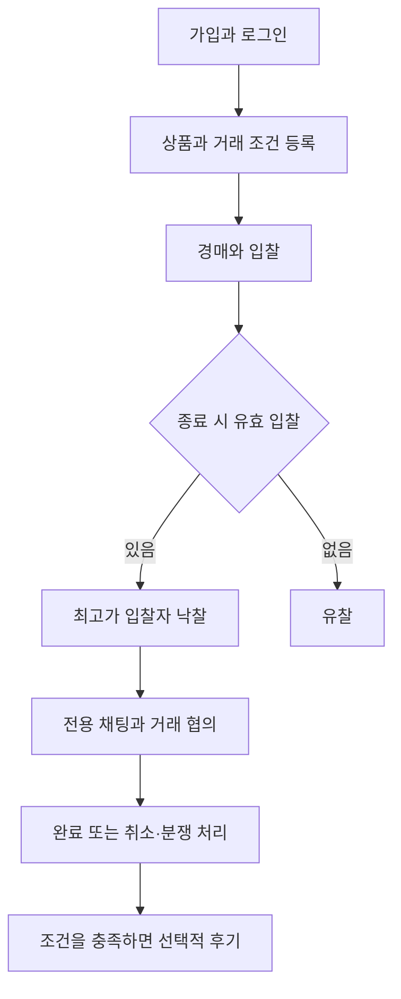
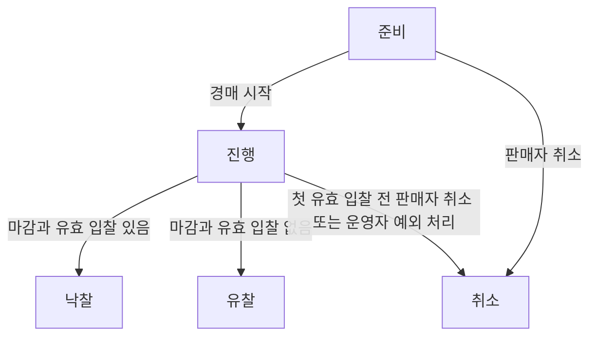
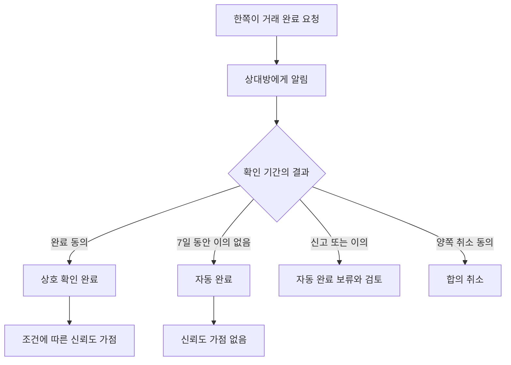
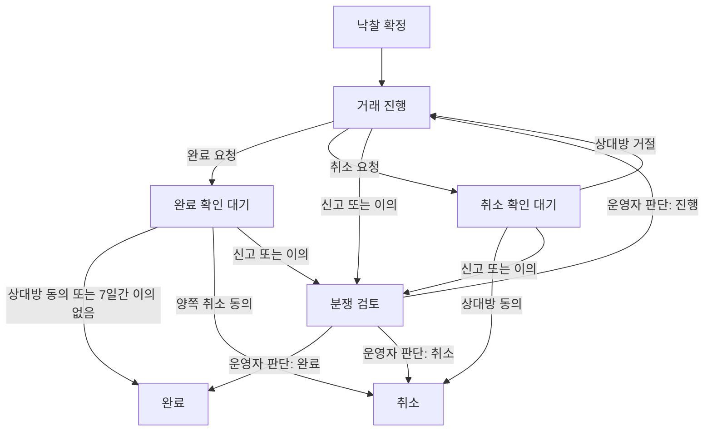

# 가격 매경 MVP 범위와 경매·거래 정책

# 가격 매경 MVP 범위와 경매·거래 정책
* toc
{:toc}

---

## 기술보다 먼저 거래 규칙을 정하기

첫 글에서는 가격 매경을 시작하는 이유와 초기 아키텍처를 정리했다. 다음 단계에서는 어떤 기능을 구현할지뿐 아니라, 각 기능이 어떤 상황에서 허용되고 어떤 결과를 만들어야 하는지 결정했다.

경매는 단순히 입찰 금액을 저장하는 기능이 아니다. 마감 직전 입찰이 들어오면 언제 끝낼지, 낙찰자가 연락하지 않으면 어떻게 할지, 양쪽이 거래를 취소하면 누구에게 불이익을 줄지 같은 규칙이 필요하다.

이번 글은 2026년 10월 19일 기준으로 결정한 일반 경매 MVP 정책과 그 이유를 정리한다. 아직 구현 결과를 검증한 글은 아니다. 현재 정책은 [MVP 범위 Wiki](https://github.com/ysiksik/price-maegyeong-docs/wiki/02-MVP-Scope)와 [일반 경매·거래 정책 Wiki](https://github.com/ysiksik/price-maegyeong-docs/wiki/03-Auction-and-Trade-Policy)에서 관리한다.

## 첫 버전은 일반 경매의 전체 흐름을 연결한다

전체 구상은 일반 경매, 구매자 역경매, 가격 하락 경매, 네고 경매다. 이번 MVP는 일반 경매의 흐름을 끝까지 연결하는 데 집중한다.

플랫폼 결제·정산·환불, 배송사 연동, 무료 나눔, 광고와 복잡한 추천은 초기 범위에서 제외한다. 결제와 물건 전달을 당사자가 협의하므로 거래를 기록하는 방식도 그 한계를 반영해야 한다.

## 여러 종류의 새 상품과 중고 상품을 다룬다

가격 매경을 중고 상품 전용 서비스로 제한하지 않는다. 여러 카테고리의 새 상품과 중고 상품을 취급하고, 상태는 판매자가 직접 선택한다.

플랫폼이 새 상품 여부를 검증했다고 표시하지는 않는다. 판매자는 개봉·사용 여부, 하자와 구성품 등을 설명하고 구매자는 그 조건을 보고 입찰한다.

다만 상품 상태를 판매자가 정하는 것과 취급 가능한 품목을 정하는 것은 별개다. 초기에는 일반 실물 상품을 중심으로 시작하고 별도의 제외 품목을 둔다.

## 전달 조건은 입찰 전에 보여준다

낙찰 이후에 모든 조건을 정하면 구매자는 택배로 받을 생각으로 입찰했는데 판매자는 직거래만 가능하다고 하는 상황이 생길 수 있다.

따라서 판매자는 출품할 때 다음 조건을 표시한다.

- 직거래·택배 중 가능한 방식. 둘 다 선택할 수 있다.
- 택배가 가능한 경우 배송비와 부담 주체

낙찰이 확정되면 판매자와 낙찰자만 참여하는 채팅을 활성화한다. 채팅에서는 출품 조건을 기준으로 장소·일시·배송·지급 방법을 협의한다. 유찰이면 해당 거래와 채팅을 만들지 않는다.

## 시작가와 최소 입찰 단위

| 항목 | 결정한 규칙 |
|---|---|
| 시작가 | 최소 100원, 판매자가 원 단위 정수로 입력 |
| 비공개 최저 낙찰가 | 사용하지 않음 |
| 최소 입찰 단위 | 판매자가 최소 100원부터 100원 단위로 설정 |
| 첫 입찰 | 시작가 이상 |
| 이후 입찰 | 최고가 + 최소 입찰 단위 이상 |
| 변경 | 경매 시작 후 최소 입찰 단위 변경 불가 |

시작가는 판매자가 실제로 판매할 의사가 있는 최저 금액으로 안내한다. 유효 입찰이 한 건이라도 있으면 그 조건으로 낙찰되며, 판매자가 기대한 금액보다 낮다는 이유로 임의 취소하는 흐름은 제공하지 않는다.

최소 입찰 단위는 정확한 배수 제한과 구분한다. 최고가가 10,000원이고 최소 단위가 300원이면 다음 최소 금액은 10,300원이다. 구매자는 10,500원처럼 그 이상의 금액도 입력할 수 있다.

## 본인 입찰과 동일 금액의 동시 입찰

| 항목 | 확정한 규칙 |
|---|---|
| 판매자 본인 입찰 | 금지 |
| 현재 최고 입찰자의 재입찰 | 금지. 다른 사용자가 최고가를 갱신하면 다시 참여 가능 |
| 동일 금액의 동시 입찰 | 서버에서 먼저 유효하게 처리된 한 건만 인정 |

판매자가 본인 상품의 가격을 직접 올리는 행위는 허용하지 않는다. 현재 최고 입찰자도 자신이 이미 최고가인 동안에는 금액을 다시 올릴 수 없다.

같은 금액의 입찰 두 건이 들어오면 서버에서 먼저 유효하게 처리된 요청을 인정한다. 뒤의 요청은 바뀐 최고가에 최소 입찰 단위를 더한 금액을 충족하지 못하므로 거절한다. 거절된 사용자는 최신 최고가를 확인하고 다시 입찰해야 한다. 먼저 처리하던 요청이 실패한 경우에는 이를 유효 입찰로 보지 않는다.

버튼을 누른 시각이나 사용자 기기의 시계로 순위를 정하지 않는다. 같은 경매의 최신 상태를 기준으로 서버가 순서를 정해 판단한다.

## 경매는 최초 1시간에서 7일까지 설정한다

처음에는 하루 안에 끝나는 경매를 생각했지만 온라인 경매에서는 구매자가 상품을 발견하고 입찰할 시간을 줄 필요가 있다고 판단했다.

최초 경매 기간은 최소 1시간~최대 7일로 정하고 판매자가 종료 시각을 지정한다. 최초 기간의 기본값은 별도로 확정하지 않았다.

이 범위는 최초 종료 시각의 설정 기준이다. 이후 자동 연장이나 운영자 최고 입찰 무효 처리에 따른 대응 시간 보장으로 실제 종료가 더 늦어질 수 있다.

## 마감 직전 입찰에는 대응 시간을 준다

종료까지 1분 이하가 남았을 때 유효한 입찰이 들어오면, 종료 시각을 해당 입찰 시점부터 1분 뒤로 변경한다. 같은 규칙을 반복 적용한다.

| 기존 종료 | 입찰 시점 | 변경 종료 |
|---|---|---|
| 15:00:00 | 14:59:40 | 15:00:40 |
| 15:00:40 | 15:00:20 | 15:01:20 |

잘못된 금액이나 거절된 요청은 연장을 발생시키지 않는다. 입찰 승인과 마감 연장이 서로 다른 결과를 만들지 않도록 구현해야 한다.

## 종료 시각과 같은 시점의 입찰은 거절한다

입찰은 경매가 진행 중이고 서버의 판정 시각이 현재 종료 시각보다 이른 경우에만 허용한다.

- `판정 시각 < 현재 종료 시각`: 입찰 가능. 나머지 자격·금액 조건도 충족해야 한다.
- `판정 시각 >= 현재 종료 시각`: 입찰 거절

판정 시각은 서버가 최신 최고가와 종료 시각을 기준으로 해당 입찰의 유효성을 판단하는 시각이다. 요청 접수 시각이나 응답 도착 시각과는 다르다. 마감 전에 접수됐어도 대기 후 판정할 때 이미 종료 시각이 지났다면 거절한다.

먼저 처리된 유효 입찰로 종료 시각이 연장됐다면 뒤의 요청은 연장된 시각을 기준으로 판단한다. 종료 스케줄러가 늦게 실행됐다고 입찰을 더 받지는 않는다. 입찰 승인·최고가 변경·자동 연장은 원자적으로 반영하고 종료 처리와도 순서를 맞춰야 한다. 공통 시계와 잠금 방식은 후속 기술 설계에서 구체화한다.

## 경매 취소와 입찰 무효를 구분한다

판매자는 첫 유효 입찰 전까지 경매를 취소할 수 있다. 유효 입찰이 들어온 뒤에는 임의 취소할 수 없고, 상품 파손·허위 등록 같은 예외는 운영자가 사유를 기록하고 처리한다.

구매자에게도 직접 입찰 취소 기능을 제공하지 않는다. 오입력 등 예외는 운영자에게 요청하고, 취소한 입찰은 삭제하지 않고 무효 이력으로 남긴다.

진행 중 최고 입찰이 무효가 되어 최고가가 변경되면 남은 유효 입찰로 재계산하고, 종료 시각을 다음 중 더 늦은 시각으로 정한다.

- 기존 종료 시각
- 운영자 무효 처리 시점부터 10분 뒤

예를 들어 15:00 종료 경매에서 14:58에 최고 입찰을 무효 처리하면 15:08까지 대응 시간을 준다. 종료가 이미 16:00이었다면 시간을 줄이지 않고 유지한다.

이미 종료된 경매는 다시 열지 않는다. 낙찰 무효와 거래 취소를 기록하고 재출품한다. 차순위자는 다른 상품을 구매했을 수도 있으므로 자동 낙찰시키지 않는다.

## 경매 상태는 준비·진행·낙찰·유찰·취소로 구분한다

'종료'는 낙찰·유찰을 포괄하는 표현으로 사용하고 별도 중복 상태로 저장하지 않는다. 취소도 더 이상 입찰을 받지 않는 종료 상태다. 유효 입찰과 자동 연장은 진행 상태에서 최고가와 종료 시각을 변경한다.

낙찰·유찰·취소 후에는 진행으로 되돌리지 않는다. 종료 후 낙찰 입찰이 무효가 되면 낙찰 무효 이력과 거래 취소를 기록하고 새 경매로 재출품한다.

## 합의 취소와 귀책 불발은 다르다

판매자와 낙찰자 모두 거래 취소를 요청할 수 있지만 한쪽의 요청이나 신고만으로 즉시 취소되지는 않는다.

양쪽이 동의하면 합의 취소로 처리하고 불발 카운트와 신뢰도에 불이익을 주지 않는다. 반대로 명확한 거래 거부나 무응답 등으로 거래가 무산된 경우에는 책임이 확인된 사용자에게만 불이익을 반영한다.

| 상황 | 처리 원칙 |
|---|---|
| 양쪽 합의 취소 | 불이익 없음 |
| 상대방 귀책으로 취소 | 책임 없는 사용자에게 불이익 없음 |
| 신고 접수·책임 다툼 | 판단 전 반영 보류 |
| 본인 귀책 불발 확정 | 해당 사용자에게 카운트·점수 반영 |
| 오판 번복 | 카운트·점수 정정 |

거래를 종료했다는 사실과 누구에게 책임이 있는지는 별도 판단이다. 확인하기 어려운 사건까지 반드시 누군가의 잘못으로 결론 내리지는 않는다.

## 무응답은 공식 요청과 기록을 기준으로 검토한다

낙찰 후 24시간 내 첫 연락을 안내하고 기한이 지나면 양쪽에 알린다. 이 시점에 자동 취소하거나 제재하지 않는다.

무응답이 계속되면 공식 응답 요청을 신청할 수 있다. 일반 메시지를 보낸 시점과 구분해 공식 요청부터 24시간에 재알림, 48시간에 운영자 검토 대상으로 전환한다.

추가 메시지로 기한이 계속 갱신되지 않도록 진행 중 요청은 한 건만 허용한다. 운영자는 요청·알림·채팅 기록과 당사자 설명을 살펴보고, 기한 초과만으로 귀책을 자동 확정하지 않는다.

송금·발송·수령에 관한 주장이 있으면 단순 무응답 종료가 아닌 분쟁 검토로 넘긴다. 외부 거래를 확인할 수 없는 플랫폼에서 시스템 상태 변경을 환불이나 배송 취소와 동일하게 취급할 수는 없다.

## 실제 거래 사실을 보증하지 않는 완료 처리

가장 애매했던 질문은 실제로 거래했는지 플랫폼이 어떻게 알 수 있느냐는 것이었다. 당사자가 밖에서 돈과 물건을 주고받는 구조이므로, 운영자도 항상 사실을 확정할 수는 없다.

그래서 거래 완료의 처리 근거를 구분한다.

7일은 낙찰 시점도, 후기 미작성 시점도 아닌 한쪽의 거래 완료 요청 시점부터 계산한다. 완료 요청이 없는데 오래됐다는 이유만으로 자동 완료하지 않는다.

상호 확인은 양쪽이 완료했다고 응답한 기록이고 자동 완료는 이의 없는 상태를 기준으로 한 시스템 처리다. 둘 다 플랫폼의 외부 거래 사실 검증이라는 의미로 표시하지 않는다.

## 거래 상태와 분쟁 검토 경로

취소 요청을 상대방이 거절하면 거래 진행으로 돌아가고 필요하면 검토를 요청한다. 신고·이의가 접수되면 진행·확인 대기 상태에서 분쟁 검토로 전환하며, 검토 중에는 자동 완료를 보류한다. 무응답 기한을 넘겼다는 이유만으로 취소하지 않고 공식 응답 요청에 따른 운영자 검토를 거친다. 완료 확인 대기 중에도 양쪽이 취소에 동의하면 합의 취소로 처리한다.

완료 상태에는 상호 확인·자동 완료 등 근거를 별도로 남긴다. 운영자가 완료로 처리했다는 사실만으로 양쪽 동의가 있었다고 보거나 상호 확인 가점을 부여하지 않는다. 취소 상태 역시 귀책 확정과는 별개이므로 취소만으로 불발 불이익을 적용하지 않는다.

## 반복 귀책 불발에는 거래 기능을 제한한다

제재 기준은 최근 90일 내 확인된 귀책 불발로 정했다.

| 횟수 | 조치 |
|---|---|
| 1회 | 경고와 카운트·신뢰도 반영 |
| 2회 | 최종 경고, 다음 불발 시 제한 안내 |
| 3회 | 신규 입찰·출품 제한 |

동일 거래에 여러 신고가 접수돼도 거래당 한 건으로 집계한다. 합의 취소와 책임 미확정 건은 제외한다.

이용 제한은 자동 해제하지 않고 운영자가 해제 요청을 검토한다. 다만 제한 중에도 로그인·기존 거래 채팅·신고·이의 제기는 유지한다. 진행 중인 거래를 마무리하거나 잘못된 판단에 설명할 경로가 필요하기 때문이다.

해제 요청에는 제한 사유에 대한 설명, 진행 중 거래의 처리 상황, 재발 방지 내용을 받고 승인·거절 사유를 기록한다. 오판 정정과 책임을 인정한 상태의 이용 재허용은 구분한다.

이용을 다시 허용해도 기존 기록을 지우지는 않는다. 같은 사건들만으로 바로 재제한하지 않고 해제 이후 새 귀책 불발이 확인되면 재제한을 검토한다.

## 신뢰도는 점수와 근거를 함께 보여준다

| 항목 | 반영 |
|---|---|
| 가입 시 | 50점과 신규 사용자 표시 |
| 상호 확인 완료 | +1점 |
| 자동 완료·합의 취소 | 변동 없음 |
| 본인 귀책 불발 확정 | -5점 |
| 오판 번복 | 해당 차감 효과 정정 |

점수 범위는 0~100점이며 같은 상대방과는 30일에 한 번만 완료 가점을 인정한다. 자동 완료로 점수를 올리지 않고 후기 평가도 점수에 직접 반영하지 않는다.

점수만으로 이용 제한을 결정하지 않는다. 프로필에는 상호 확인 완료 건수와 최근 90일 귀책 불발 건수를 함께 표시해 점수의 맥락을 제공한다. 신고 내용과 검토 중인 분쟁은 공개하지 않는다.

시간이 지났거나 이용 제한이 해제됐다는 이유만으로 점수를 초기화하지 않는다. 이후 상호 확인 거래로 회복할 수 있다.

## 후기는 완료와 분리해 선택 작성한다

상호 확인 완료 또는 자동 완료된 거래의 당사자는 상대방에게 거래당 한 번 후기를 남길 수 있다. 작성 기한은 완료 처리 후 14일이며, 양쪽이 작성하거나 기한이 끝나면 공개한다.

공개 전에는 수정할 수 있고 공개 후에는 신고·운영자 처리 절차를 사용한다. 자동 완료 거래의 후기는 그 처리 근거를 별도로 표시한다.

후기를 쓰지 않았다고 거래가 실패한 것은 아니다. 합의 취소 거래에는 거래 후기를 작성하지 않고, 문제 제기는 신고로 다룬다. 낮은 후기 하나만으로 귀책 불발이나 이용 제한이 확정되지 않는다.

## 초기 제외 품목을 구분한다

전자기기·의류·도서·취미용품·생활용품 등 일반 실물 상품부터 다룬다. 의약품·마약류는 취급하지 않는다. 식약처는 온라인 의약품 판매 등을 불법유통 신고 대상으로 안내하고 있다. [식약처 공식 안내](https://www.mfds.go.kr/wpge/m_661/de010410l001.do)

주류·담배·의료기기·식품·건강기능식품·화장품·생물·상품권·티켓·계정·디지털 상품도 MVP에서 제외한다. 이 목록 전체를 법적 거래 금지 목록이라는 의미로 사용하지 않는다. 품목별 조건과 운영 부담을 고려한 서비스 범위이며, 공개 전에는 개별 금지·제한 기준을 구체화해야 한다.

## 정책은 상태와 검증 조건으로 연결한다

정책을 문서에 적는 것으로 구현이 끝나지는 않는다. 특히 다음 검증이 필요하다.

- 동시 입찰·종료에서도 최고가와 낙찰 결과가 일치하는가?
- 완료 요청의 7일, 공식 응답 요청의 48시간, 후기의 14일을 다른 기한으로 처리하는가?
- 재시도와 이벤트 중복으로 점수·불발 카운트가 여러 번 반영되지 않는가?
- 신고·이의가 있으면 자동 완료가 보류되는가?
- 판정 번복 시 점수·카운트·이용 제한 근거를 정정할 수 있는가?
- 기존 거래 처리와 이의 제기가 제한 때문에 막히지 않는가?

입찰 자격·동일 금액 처리·종료 경계와 경매·거래 상태 전이까지 이번 정책 정의에 포함했다. 기간 기본값, 금액 상한, 90일 집계 기준 시각, 기존 진행 경매에 대한 제재 영향, 보관 기간 등은 별도 상세 설계·운영 준비에서 결정한다. 확정한 정책과 후속 항목을 구분해 Wiki에 남겼다.

다음 설계는 확정한 상태 전이를 바탕으로 ERD·API 계약과 동시성 제어 방식을 구체화하는 작업이다. 이후의 변경은 Wiki와 결정 기록에 반영하고, 구현 결과와 테스트로 설계를 검증한다.
