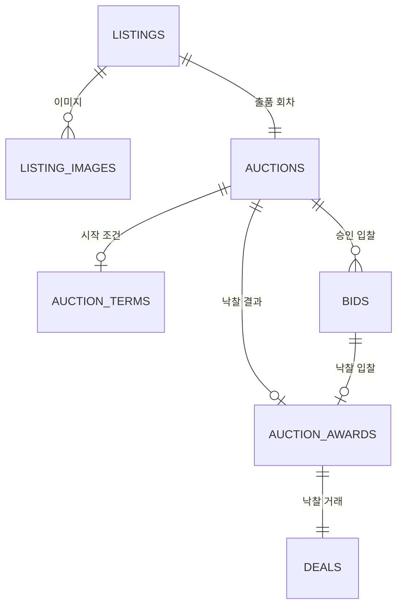
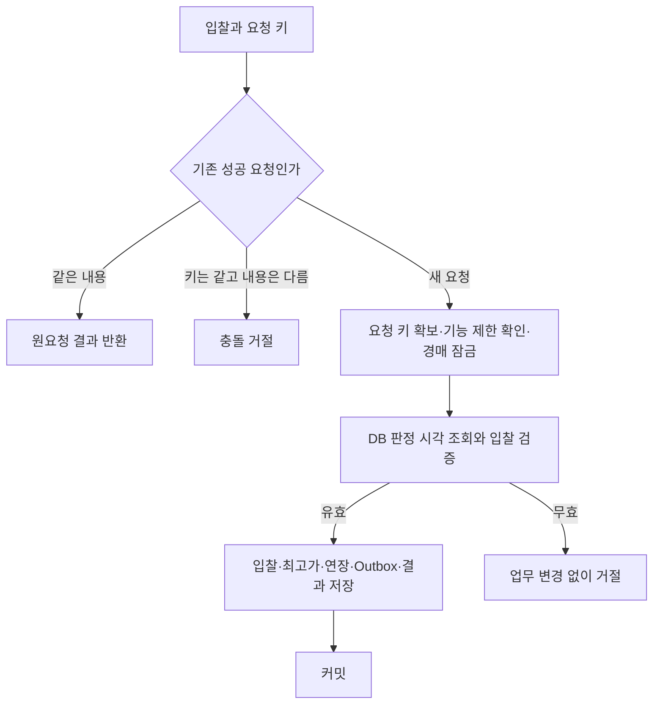

# 가격 매경 핵심 ERD와 트랜잭션 설계

# 가격 매경 핵심 ERD와 트랜잭션 설계
* toc
{:toc}

---

## 핵심 흐름부터 데이터로 옮기기

서비스 경계와 데이터 소유권을 정했으니 다음은 ERD다. 전체 테이블을 한 번에 나열하기보다 출품 → 입찰 → 낙찰 → 거래 생성 흐름부터 설계한다.

이번 글은 2026년 10월 20일 기준의 1차 설계안이다. 실제 DDL을 적용하거나 동시성 테스트를 실행한 결과는 아니다. 회원·인증, 거래 완료·취소 요청, 후기·신고·제재 이력 전체와 Flyway 초기 SQL은 후속 범위로 남긴다.

상세 명세와 검증 시나리오는 [경매 핵심 ERD와 트랜잭션 Wiki](https://github.com/ysiksik/price-maegyeong-docs/wiki/05-Auction-Core-ERD-and-Transactions)에 기록한다.

## 테이블보다 먼저 함께 바뀌어야 할 데이터를 찾는다

| 동작 | 같은 업무 변경으로 다룰 데이터 |
|---|---|
| 출품 준비 | 상품·거래 조건, 이미지 메타데이터, 준비 상태 경매 |
| 경매 시작 | 시작 조건 스냅샷, 시작·최초 종료 시각, 진행 상태, 이력·Outbox |
| 입찰 승인 | 입찰, 최고가, 자동 연장, 승인 순서, Outbox, 요청 성공 결과 |
| 낙찰 확정 | 경매 낙찰 상태, 낙찰 결과, 거래 생성, 이력·Outbox |
| 유찰 | 유찰 상태와 이력·Outbox. 낙찰·거래는 만들지 않음 |

예를 들어 입찰만 저장하고 최고가 변경에 실패하면 조회 결과가 원본과 달라질 수 있다. 낙찰만 확정하고 거래 생성에 실패하면 사용자는 낙찰됐는데 거래를 시작할 수 없다. 데이터 관계와 함께 트랜잭션 경계를 정해야 하는 이유다.

## 출품 한 회차와 경매를 연결한다



새 출품은 경매 한 회차에 대응하도록 설계한다. 준비 상태 경매를 출품과 함께 만들고, 재출품은 새 출품·경매로 생성한다. 이전 입력을 복사할 수는 있지만 기존 경매를 다시 진행 상태로 바꾸지는 않는다. 상품 재고 관리나 같은 물건의 중복 출품 탐지까지 설계했다는 의미는 아니다.

출품·경매·거래는 Marketplace 내부 모듈이 소유한다. 회원 식별자는 값으로 보관하고 회원 서비스 스키마로 외래 키나 JOIN을 만들지 않는다.

## 상품 원본과 시작 시점의 조건을 구분한다

현재 상품 정보만 참조하면 나중에 설명·상태·배송비가 바뀌었을 때 어떤 조건으로 입찰했는지 알기 어렵다.

경매 시작 시 `auction_terms`에 상품 상태·설명·하자·구성품, 전달 방식·배송비·부담 주체, 이미지 키와 순서를 스냅샷으로 보관한다. 버전과 고정 시각도 기록한다. 시작가·입찰 단위·마감 시각처럼 입찰 판단에 사용하는 값은 `auctions`의 정형 컬럼으로 둔다.

시작한 경매의 조건은 원본 수정으로 덮어쓰지 않는다. 이미지도 같은 키의 파일을 임의로 교체하지 않도록 관리해야 한다. 시작 후 정정의 승인 절차와 파일 보관 기간은 별도 운영 설계다.

## 핵심 테이블과 보조 테이블

| 테이블 | 책임 |
|---|---|
| `listings`, `listing_images` | 출품 원본과 이미지 메타데이터 |
| `auctions`, `auction_terms` | 경매 상태·시각·최고가와 시작 조건 스냅샷 |
| `bids` | 승인된 입찰, 경매 내 승인 순서와 이후 무효 이력 |
| `auction_awards` | 낙찰 입찰·당사자·금액과 낙찰 무효 기록 |
| `deals` | 낙찰 거래의 당사자와 최초 진행 상태 |
| `command_receipts` | 사용자·명령·요청 키별 성공 결과와 요청 해시 |
| `outbox_events` | 원본 변경과 함께 저장한 전달 대상 이벤트 |
| `state_transition_history` | 상태 변경 전후·사유·행위자·버전·시각 |
| `trading_actor_gate` | 신규 출품·입찰 제한을 검증할 현재 상태 보조 행 |

거래 기능 제한 보조 행은 제재·해제·정정 이력 전체를 대신하지 않는다. 초기 행 생성 경로와 제재 이력 모델은 후속 설계에서 완성해야 한다. 행이 없다고 제한이 없다고 단정하거나 기존 제한 상태를 초기값으로 덮어쓰면 안 된다.

## 자료형과 유일성 제약을 먼저 정한다

업무 식별자는 애플리케이션에서 발급한 UUID를 정규화된 `CHAR(36)` 문자열로 저장하는 방향으로 시작한다. ID가 생성됐다는 사실만으로 업무 순서를 정하지 않는다. 물리 인덱스 비용은 실제 구현에서 검증한다.

금액은 KRW 원 단위 `BIGINT`, 시각은 UTC 기준 `DATETIME(6)`로 설계한다. `BIGINT`의 최대값이 서비스의 거래 허용 상한이라는 뜻은 아니다. 업무 상한은 별도로 정하고 범위 초과와 덧셈 오버플로를 거절해야 한다.

| 제약 | 막으려는 중복 |
|---|---|
| `auctions(listing_id)` 유일성 | 출품 한 회차에 여러 경매 생성 |
| `bids(auction_id, accepted_seq)` 유일성 | 같은 경매 내 승인 순서 중복 |
| `auction_awards(auction_id)` 유일성 | 경매 하나의 중복 낙찰 |
| `deals(award_id)` 유일성 | 낙찰 하나의 중복 거래 |
| `command_receipts(actor_id, operation, request_key)` 유일성 | 같은 사용자의 동일 명령 중복 처리 |
| `outbox_events(dedup_key)` 유일성 | 같은 업무 사건의 중복 이벤트 생성 |

시작가·입찰 단위 최소값과 100원 배수 같은 행 단위 조건은 DB CHECK와 애플리케이션 양쪽에서 검증하는 방향이다. 다른 입찰과 비교하는 조건이나 상태 전이를 CHECK 하나로 보장한다고 보지는 않는다.

최종 DDL에서는 낙찰 입찰이 해당 경매의 입찰을 가리키는 복합 외래 키도 검토한다. 여러 테이블의 순환 참조나 다른 서비스의 테이블을 물리 외래 키로 무리하게 연결하지 않는다.

## 첫 동시성 제어는 경매 행 잠금으로 시작한다

처음에는 경매 PK 행을 트랜잭션 안에서 `SELECT ... FOR UPDATE`로 잠그는 방식으로 설계한다. 입찰·종료·경매 취소·입찰 무효 처리 모두 같은 경매 행을 잠근 뒤 최신 상태를 확인한다.

MySQL의 `FOR UPDATE`는 읽은 인덱스 레코드를 잠그고 트랜잭션 커밋·롤백 때 잠금을 해제한다. 이번 설계에서는 이 동작으로 경매 한 건의 변경 순서를 정한다. [MySQL Locking Reads](https://dev.mysql.com/doc/refman/8.4/en/innodb-locking-reads.html)

낙관적 조건부 갱신도 후속 비교 대상이지만 첫 구현에서는 한 가지 방식을 기준으로 정확성을 검증한다. 경매가 다르면 별도 행을 사용하고, 전체 경매를 잠그는 전역 락을 두지는 않는다.

신규 입찰·출품은 기능 제한 보조 행에 공유 잠금, 제재·해제는 같은 행에 배타 잠금을 사용하는 방향으로 잡는다. 여러 잠금이 필요할 때는 요청 키 → 기능 제한 행 → 경매 행 → 하위 데이터 순서를 맞춘다. 초기화·제재 변경 경로도 이 규약을 따라야 한다.

낙찰자의 신규 입찰 제한을 이유로 기존 유효 입찰을 자동 무효화하는 정책은 아직 정하지 않았다. 종료 작업에서 이를 임의로 추가하지 않는다.

## DB 시각도 언제 읽었는지가 중요하다

기존 정책은 서버 판정 시각이 종료 시각보다 이른 경우만 입찰을 허용한다는 것이다. 그 기준을 구현하려면 요청 접수 전에 읽어 둔 시각이나 잠금 대기 전 시각을 그대로 사용하면 안 된다.

필요한 잠금을 얻은 뒤 별도 문장에서 `UTC_TIMESTAMP(6)`를 조회하는 방향으로 정한다. MySQL의 현재 시각 함수는 문장 실행 시작 시 평가되므로, 잠금을 기다리는 쿼리 안에서 읽은 값을 잠금 획득 뒤 시각으로 취급하지 않는다. [MySQL Date and Time Functions](https://dev.mysql.com/doc/refman/8.4/en/date-and-time-functions.html)

```text
잠금 획득
→ 별도 SQL로 판정 시각 조회
→ 최신 경매 상태와 종료 시각 확인
→ 판정 시각 < 종료 시각일 때만 입찰 검증
```

유효 입찰의 남은 시간이 1분 이하이면 해당 판정 시각+1분으로 연장한다. 종료 작업도 같은 경매 잠금 안에서 연장된 종료 시각을 다시 확인한다. 스케줄러가 늦었다는 이유로 마감 이후의 입찰을 받지는 않는다.

판정 시각과 커밋·응답 시각은 다르다. 판정 후 커밋이 마감보다 늦어질 수 있지만 종료 작업은 잠금 해제 뒤 최신 상태를 확인한다. 롤백되면 입찰과 연장 모두 반영되지 않는다. 실제 DB 시계 동기화와 시간 정밀도는 환경 검증 대상이다.

## 같은 요청의 재전송은 새로운 입찰이 아니다



현재 최고 입찰자의 새 입찰은 금지했지만, 이미 승인된 같은 요청을 다시 보내는 것은 별개다. 성공한 요청 키를 먼저 확인해 저장된 원요청 결과를 돌려준다. 이후 경매가 종료됐거나 입찰이 무효 처리됐다면 최신 상태는 별도 조회로 확인한다.

키는 사용자·명령 종류와 함께 유일하게 관리하고 경매 ID·금액 등을 정규화한 해시로 내용 일치를 확인한다. 같은 키로 다른 내용을 보내면 충돌로 거절한다. 결과 스냅샷에는 비밀 정보나 인증 토큰을 저장하지 않는다.

승인 순서는 경매 잠금 안에서 누적 승인 수를 증가시켜 배정한다. 이후 입찰 무효가 생겨도 누적 승인 수를 감소시키지 않는다. 첫 승인 이력을 지워 판매자의 임의 취소가 다시 허용되는 일을 막기 위해서다. 현재 최고가는 남은 유효 입찰로 별도 관리한다.

## 낙찰·거래·Outbox는 같은 트랜잭션으로 묶는다

종료 작업은 후보를 조회한 뒤 경매를 잠그고 상태와 종료 시각을 다시 확인한다. 유효 입찰이 있으면 낙찰 결과와 거래를 만들고, 경매 상태·이력·Outbox까지 함께 커밋한다. 유효 입찰이 없으면 유찰 처리하며 거래를 만들지 않는다.

거래나 Outbox 저장에 실패하면 낙찰도 함께 롤백해야 한다. 여러 종료 작업자가 같은 경매를 처리하더라도 상태 검사와 유일성 제약으로 낙찰·거래·종료 사건이 중복 생성되지 않아야 한다.

진행 중 최고 입찰 무효 처리 역시 입찰 무효·최고가 재계산·최소 10분 대응 시간·버전·이력·Outbox를 같은 경매 잠금 안에서 반영한다. 종료된 경매는 다시 열지 않는다.

잠금을 잡은 상태로 Kafka 발행·채팅·알림·파일 업로드·외부 API를 기다리지 않는다. 이벤트 전달은 커밋 이후의 별도 작업이다. 발행 성공 후 기록 전에 중단되면 같은 이벤트가 다시 전달될 수 있으므로 Consumer의 멱등 처리도 필요하다.

## 재시도와 테스트 시나리오도 설계에 포함한다

잠금 순서를 맞췄다고 데드락이 절대 발생하지 않는 것은 아니다. 데드락·잠금 시간 초과는 명시적 롤백 후 제한된 횟수로 전체 트랜잭션을 재시도하고 시각·상태를 다시 판단하는 방향으로 설계한다. [MySQL Deadlock Handling](https://dev.mysql.com/doc/refman/8.4/en/innodb-deadlocks-handling.html)

| 테스트 | 확인할 결과 |
|---|---|
| 동일 금액 동시 입찰 | 유효한 한 건만 승인 |
| 동일 요청 키 동시 전송 | 입찰 한 건과 같은 원요청 결과 |
| 같은 키로 다른 금액 전송 | 충돌 거절 |
| 잠금 대기 중 마감·정확히 마감 시각 | 입찰 거절 |
| 마감 직전 입찰과 종료 경쟁 | 연장된 최신 시각과 낙찰 결과 일치 |
| 제재 적용과 입찰 경쟁 | 기능 제한 잠금 규약에 따른 일관된 판단 |
| 종료 중 거래·Outbox 저장 실패 | 부분 낙찰 없이 전체 롤백 |
| 여러 종료 작업자의 재처리 | 낙찰·거래·종료 이벤트 중복 생성 없음 |
| 입찰 전부 무효·상품 원본 수정 | 유효 최고가 재계산, 시작 조건 스냅샷 유지 |
| 응답 유실·이벤트 재전달 | 중복 입찰·채팅·알림 생성 방지 |

이 표는 실제 테스트 결과가 아니라 앞으로 실행할 검증 목록이다. ORM의 키 충돌 처리, 격리 수준, 잠금 범위·시간 초과·재시도 횟수와 인덱스 실행 계획도 실제 MySQL에서 확인해야 한다.

## 정리

이번 단계에서는 핵심 흐름의 데이터 관계와 변경 경계를 잡았다. 출품 조건은 시작 시 스냅샷으로 남기고, 입찰은 경매 행 잠금과 DB 판정 시각으로 검증하며, 낙찰·거래·Outbox는 같은 트랜잭션으로 확정하는 방향이다.

전체 ERD 작업은 아직 진행 중이다. 다음에는 회원·인증, 거래 완료·취소 요청, 후기·신고·귀책·신뢰도·제재 이력 모델을 보완하고 서비스별 Flyway 초기 DDL을 작성한다. 문서 설계와 SQL 적용·동시성 실측 결과는 구분해서 기록한다.
