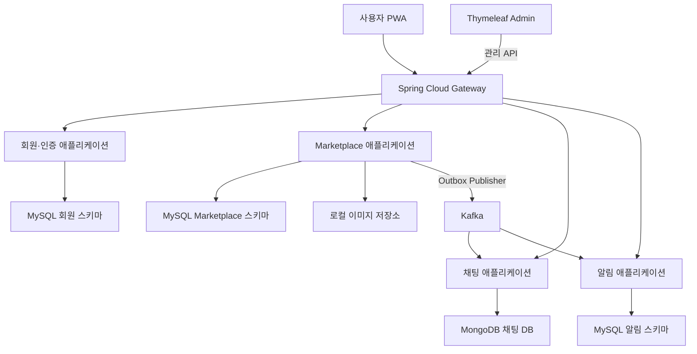
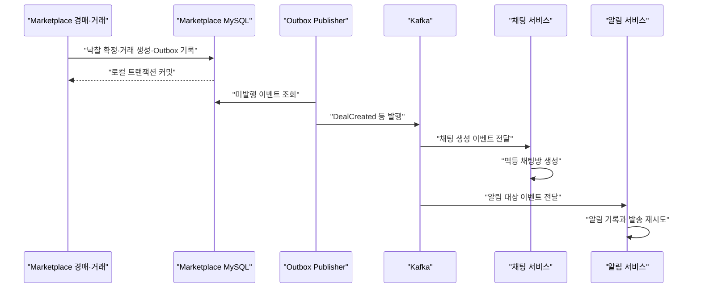

# 가격 매경 서비스 경계와 데이터 소유권

# 가격 매경 서비스 경계와 데이터 소유권
* toc
{:toc}

---

## 로컬 개발인데 배포 단위부터 정해야 할까

경매·거래 정책을 정리한 다음 작업은 MSA의 배포 단위와 데이터 소유권을 정하는 것이었다. 그런데 아직 로컬에서 개발할 계획인데 배포부터 생각해야 하는지 의문이 들었다.

이 단계의 배포 단위는 클라우드에 서버를 만드는 작업이 아니다. 서로 독립적으로 빌드하고 실행할 애플리케이션의 경계를 뜻한다. 로컬에서는 Spring Boot 프로세스를 나누어 실행할 수 있다.

상품·경매·거래라는 도메인을 나누는 것과 세 개의 서버를 만드는 것은 다르다. 하나의 애플리케이션 안에서 모듈로 구분할 수도 있다. 반대로 로컬 PC 한 대에서도 여러 애플리케이션을 실행할 수 있다.

이번 글은 2026년 10월 20일 기준 로컬 MVP의 설계 결정이다. 실제 애플리케이션·인프라 구현이나 배포 검증 결과는 아니다. 최신 구성과 ADR은 [서비스 경계와 데이터 소유권 Wiki](https://github.com/ysiksik/price-maegyeong-docs/wiki/04-Service-Boundaries-and-Data-Ownership)에서 관리한다.

## 도메인마다 애플리케이션을 만들지는 않는다

앞선 개요에서는 회원·상품·경매·거래·채팅·알림·신뢰·신고의 논리적인 책임을 나눴다. 이제 그 구상을 실제 실행 단위로 구체화한다.

| 실행 단위 | 역할 |
|---|---|
| `gateway-service` | Spring Cloud Gateway, 외부 API 라우팅과 JWT 기본 검증 |
| `auth-service` | 회원 가입·로그인, 인증 정보, 기본 프로필과 계정 상태 |
| `marketplace-service` | 상품·출품, 경매·입찰·낙찰, 거래, 후기·신뢰·신고·거래 기능 제한 |
| `chat-service` | 채팅방, 참여자 확인, 메시지와 읽음 상태 |
| `notification-service` | 사용자 알림, 설정·구독, 발송 이력과 재시도 |
| `admin-app` | Spring Boot·Thymeleaf 관리자 화면과 관리 API 호출 |
| `web-app` | React·TypeScript·PWA 사용자 화면 |

이름은 설계상 식별자이며 저장소나 애플리케이션이 이미 만들어졌다는 의미가 아니다. 실행 단위와 Git 저장소도 일대일일 필요는 없다.

## 상품·경매·거래는 Marketplace 모듈로 시작한다

이 그림은 전체 기능이 연결됐을 때의 책임 구분이다. 첫날부터 모든 프로세스를 켜 놓아야 한다는 의미는 아니다.

Marketplace 안에서는 다음 모듈을 구분한다.

| 모듈 | 주요 책임 |
|---|---|
| 상품·출품 | 상품 상태·설명, 카테고리, 이미지 메타데이터, 출품 조건 |
| 경매 | 기간·입찰 단위, 유효·무효 입찰, 최고가, 종료와 낙찰 |
| 거래 | 판매자·낙찰자 관계, 완료·취소 요청과 상태, 후기 자격 |
| 후기·신뢰 | 후기, 신뢰 점수와 변동 근거, 귀책 불발 집계 |
| 신고·제재 | 신고·분쟁, 귀책 확정·정정, 신규 입찰·출품 제한과 해제 |

낙찰을 확정하고 거래를 만드는 동작은 서로 밀접하다. 처음부터 별도 서비스로 나누면 통신 실패와 중간 상태까지 고려해야 한다. 초기에는 같은 애플리케이션과 MySQL 스키마 안에서 로컬 트랜잭션으로 검증한다.

모듈 사이에서는 Java 인터페이스와 애플리케이션 서비스를 호출한다. 같은 프로세스 안에서 gRPC나 Kafka를 거쳐 자기 기능을 호출하지 않는다. 다른 모듈의 Repository나 테이블을 직접 수정하는 방식도 피한다.

## 신뢰·신고를 회원 서비스에 넣지 않는 이유

신뢰 점수는 프로필 화면에 표시되지만 그 근거는 거래와 귀책 판정에서 나온다. 표시 위치와 데이터 소유권을 동일하게 볼 필요는 없다.

초기에는 후기·신뢰와 신고·제재를 Marketplace 내부 모듈로 둔다. 거래 완료 여부, 후기 작성 자격, 귀책 판정 번복과 점수 정정을 가까운 경계에서 처리하기 위해서다.

회원 서비스는 인증과 기본 프로필·계정 상태를 맡는다. 귀책 불발로 인한 신규 입찰·출품 제한은 Marketplace가 소유한다. 기존 정책상 이런 제한 중에도 로그인·기존 채팅·신고·이의 제기는 가능해야 하므로 모든 기능을 막는 계정 정지와 구분한다.

프로필에서 기본 회원 정보와 신뢰 지표를 함께 보여주려면 화면이 각각의 API를 조회하면 된다. 신뢰 점수를 회원 DB에도 원본처럼 중복 저장하지 않는다.

Gateway가 JWT를 확인하더라도 Marketplace는 자기 데이터로 거래 기능 제한을 다시 검증한다. 제한 적용과 입찰이 동시에 일어날 때의 잠금·처리 순서는 ERD와 동시성 설계에서 정한다.

## DB 인스턴스 공유와 데이터 공유는 다르다

로컬에서는 MySQL 인스턴스 한 개에 서비스별 스키마를 두는 것으로 시작한다. 서비스별 접속 계정·권한과 Flyway 마이그레이션 범위는 분리한다.

| 데이터 | 원본 소유자와 저장소 |
|---|---|
| 회원·인증·기본 프로필 | 회원·인증, MySQL 회원 스키마 |
| 상품·입찰·낙찰·거래·후기·신뢰·신고·거래 기능 제한 | Marketplace의 각 모듈, MySQL Marketplace 스키마 |
| 채팅방·참여자 투영·메시지·읽음 | 채팅, MongoDB 채팅 DB |
| 알림 설정·구독·알림·발송 이력 | 알림, MySQL 알림 스키마 |
| 관계형 업무 변경의 Outbox | 해당 변경을 처리한 서비스의 MySQL 스키마 |
| 캐시·접속 상태·Rate Limit 키 | 사용하는 서비스, Redis의 서비스별 키 영역 |
| 상품 이미지 파일 | 상품·출품, 로컬 저장 어댑터 |

같은 MySQL에 있다고 다른 서비스의 스키마를 직접 조회하거나 수정하지 않는다. 교차 스키마 JOIN과 교차 서비스 외래 키도 사용하지 않는다. 서비스 사이에서는 식별자 값과 API·이벤트 계약으로 연결한다.

Marketplace 내부 테이블의 외래 키와 트랜잭션은 이후 ERD에서 구체화한다. 서비스 간 DB 접근 금지와 같은 서비스 내부 모듈의 참조 설계를 혼동하지 않는다.

채팅방 참여자는 Marketplace의 거래 당사자 원본에서 만들어진 채팅용 투영이다. 클라이언트가 임의로 보낸 판매자·낙찰자 ID만으로 방을 만들지 않고, 이벤트를 통해 전달된 거래 식별자와 처리 이력으로 중복 생성과 잘못된 덮어쓰기를 방지한다.

## 이미지 저장도 로컬에서 시작한다

상품 이미지 때문에 지금 외부 저장소를 구성할 필요는 없다. 로컬 개발에서는 디렉터리·볼륨 기반 저장 어댑터를 사용하고 DB에는 파일 키와 메타데이터를 기록하는 방향으로 정한다.

실제 서버 파일 경로를 클라이언트에 노출하지 않는다. 업로드·조회 API와 실패 파일 정리 방식은 후속 계약에서 구체화한다. 저장소 접근을 어댑터로 구분하면 이후 저장 방식이 바뀌더라도 상품 도메인의 책임을 유지할 수 있다.

## 즉시 결과가 필요한 호출과 나중에 처리할 이벤트

| 흐름 | 연결 방식 |
|---|---|
| 사용자 화면에서 기능 요청 | Gateway를 통한 REST, 채팅 연결은 WebSocket |
| 관리자 조회·명령 | Gateway를 통한 소유 서비스 관리 REST API |
| 별도 서비스 사이의 즉시 필요한 검증·조회 | gRPC를 기본 방향으로 두고 개별 계약은 후속 정의 |
| Marketplace 내부 모듈 협력 | Java 인터페이스·서비스 호출 |
| 거래 생성 후 채팅방 준비 | Outbox·Kafka 이벤트 |
| 입찰·낙찰·거래 변경 후 사용자 알림 | Outbox·Kafka 이벤트 |

내부 통신이라는 이유만으로 호출자가 보낸 회원 ID나 관리자 여부를 신뢰하지 않는다. 각 서비스는 사용자·관리자 권한과 데이터 소유권을 확인하며 구체적인 인증·권한 전달 형식은 API 계약 단계에서 정한다.

## 낙찰과 거래 원본은 먼저 확정한다

경매·거래가 같은 애플리케이션에 있으므로 낙찰 확정·거래 생성·Outbox 기록을 같은 로컬 트랜잭션으로 처리하는 것을 기준으로 삼는다. 개요에 등장했던 `AuctionClosed → 거래 서비스`라는 논리 연결을 그대로 원격 통신으로 구현하는 것은 아니다.

채팅·알림은 거래 원본 커밋 이후 이벤트로 처리한다. Kafka나 채팅이 잠시 멈췄다고 낙찰을 되돌리지 않는다. Publisher는 재전달하고 Consumer는 이벤트 ID와 업무 식별자로 중복 처리를 막는다. 사용자 화면에서는 채팅 준비 중이나 알림 지연도 표현할 수 있어야 한다.

서비스 간 분산 트랜잭션을 가정하지 않는다. MongoDB의 채팅 메시지에서 별도 이벤트를 발행해야 한다면 해당 저장소의 영속 발행 방식도 후속 설계에서 다룬다. DB 저장 다음에 Kafka를 호출했다는 이유만으로 이벤트 유실이 없다고 보지는 않는다.

## 관리자는 DB 대신 관리 API를 호출한다

Admin은 업무 데이터의 소유자가 아니다. 조회와 수정 모두 소유 서비스가 제공하는 관리 API를 사용한다.

경매·입찰 무효 처리, 귀책 판정과 번복, 점수·카운트 변경, 거래 기능 제한·해제는 소유 서비스가 검증하고 처리한다. 관리자 행위자·대상·사유·결과도 해당 서비스가 업무 감사 이력으로 남긴다.

관리자 화면에서 버튼을 숨기는 것은 권한 검증을 대신할 수 없다. 관리 API 자체에서 운영자 권한과 허용되는 상태 전이를 검사해야 한다.

## 로컬 실행은 단계적으로 늘린다

회원과 Marketplace를 IntelliJ에서 실행하고 MySQL은 Docker Compose로 실행하는 단계부터 시작한다. Gateway·웹은 해당 연결을 개발할 때 추가한다.

이벤트를 구현할 때 Kafka, 채팅을 구현할 때 MongoDB와 채팅 애플리케이션, 사용자 알림을 구현할 때 알림 애플리케이션을 연결한다. Redis도 캐시·접속 상태·Rate Limit이 필요해지는 단계에서 적용한다.

경매 종료 스케줄러와 Outbox Publisher는 Marketplace가 소유하는 작업 모듈로 둔다. 로컬 첫 버전에서는 같은 프로세스에서 시작하고 API와 자원 사용·실행 주기를 분리해야 할 때 별도 Worker로 실행한다. Worker 분리와 데이터 소유권 변경은 같은 일이 아니다.

호스트의 IDE에서 인프라에 접근하는 주소와 Compose 안의 컨테이너 사이에서 사용하는 서비스 이름은 구분한다. 실제 포트·볼륨·접속 설정과 Compose 파일 작성은 별도 환경 구성 작업이다. 개발용 데이터와 로컬 접근 범위를 사용하고 인프라를 외부에 노출하지 않는다.

Docker Desktop Kubernetes는 기능이 연결된 뒤 컨테이너 실행·Service·Probe·롤링 업데이트를 검증하는 후속 단계로 둔다. 지금 외부 도메인, 클라우드 Load Balancer나 공개 서버를 만들지는 않는다.

## ADR로 선택 이유를 남긴다

이번 결정은 Wiki의 ADR-001에 기록했다.

| 대안 | 판단 |
|---|---|
| 상품·경매·거래·신뢰·신고를 처음부터 각각 별도 서비스로 분리 | 원격 호출·장애·정합성 처리 범위가 초기 개발에 비해 커진다. |
| 전체 기능을 단일 애플리케이션에 구성 | 시작은 단순하지만 채팅·알림의 독립 실행과 서비스 계약 학습 범위가 줄어든다. |
| Marketplace 모듈과 회원·채팅·알림 실행 단위를 구분 | 핵심 거래 정합성을 가까이 두면서 별도 서비스와 이벤트 흐름을 학습할 수 있어 채택한다. |

이 선택으로 모든 문제가 해결되는 것은 아니다. 모듈의 데이터 소유권을 지키지 않으면 나중에 분리하기 어렵다. 별도 서비스 분리는 실제 부하·자원 사용, 변경 주기, 장애 격리 필요성이 확인되고 데이터 이동과 정합성 전환 계획이 생겼을 때 검토한다.

특히 신뢰·신고를 분리한다면 거래 기능 제한을 입찰에서 즉시 확인하는 방법과 귀책·점수 정정의 일관성을 먼저 설계해야 한다.

## 정리

로컬 개발에 앞서 정한 것은 클라우드 배치가 아니라 실행 단위와 데이터 책임이다. 상품·경매·거래·후기·신뢰·신고는 Marketplace 모듈로 시작하고 회원·채팅·알림은 별도 애플리케이션으로 둔다. 관리자와 사용자 화면은 각 소유 서비스의 API를 사용한다.

다음은 이 경계를 기준으로 초기 ERD와 Flyway 마이그레이션, 입찰 동시성 경계를 설계하는 작업이다. 이후 REST·gRPC·이벤트 계약과 로컬 환경을 구체화하며, 설계 완료와 실제 구현·배포 검증 완료는 구분해 기록한다.
