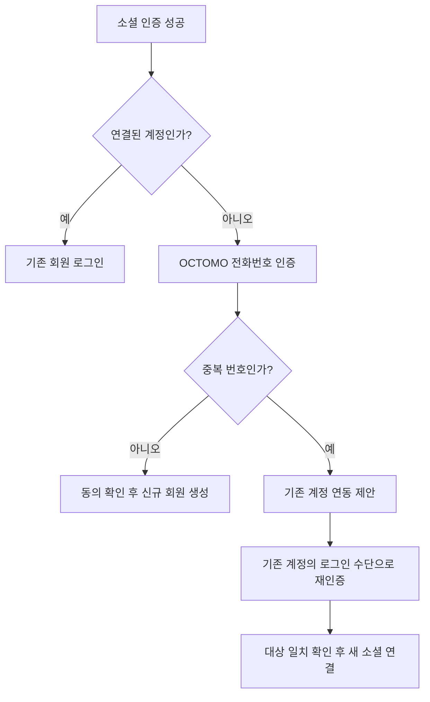

# 가격 매경 소셜 가입과 전화번호 인증·계정 연동

# 가격 매경 소셜 가입과 전화번호 인증·계정 연동
* toc
{:toc}

---

## 계정 하나와 사람 한 명은 다르다

가격 매경은 소셜 계정으로 가입하고 로그인한다. 자체 아이디·비밀번호 가입은 만들지 않는다. 먼저 카카오로 전체 흐름을 완성하고 네이버·구글을 추가한다.

문제는 소셜 계정 하나가 사람 한 명을 뜻하지 않는다는 점이다. 제공자 계정 식별자는 해당 계정을 구분하는 값이지, 한 사람이 가진 다른 계정을 모두 묶어 주는 값이 아니다. Google도 `sub`를 Google 계정의 고유 식별자로 설명한다. 이메일이 같거나 이름이 일치한다고 계정을 자동 합쳐서는 안 된다. [Google OIDC 공식 문서](https://developers.google.com/identity/openid-connect/openid-connect)

초기에는 실명·동일인 확인보다 운영비 제약을 우선한다. CI·DI 수집과 본인확인기관 연동은 제외하고, **인증된 전화번호를 기준으로 중복 가입을 제한**한다. 한 사람이 여러 번호를 쓰는 경우까지 구분하지 못한다는 한계도 함께 받아들인다.

이는 '1인 1계정 보장'이 아니다. 번호 재할당도 있기 때문에 전화번호를 불변 회원 ID처럼 취급하지 않는다.

## 가입부터 번호 점유를 확인한다

OCTOMO는 이용자가 지정된 번호로 인증 문자를 보내고, 서비스 서버가 수신 여부를 조회하는 MO 방식이다. 서버가 이용자에게 인증 문자를 발송하는 구조와 방향이 반대다. [공식 설명](https://octomo.octoverse.kr/)

```text
소셜 인증
→ 전화번호 확인 또는 입력
→ 서버가 만든 일회용 인증코드를 이용자가 문자로 전송
→ 서버가 OCTOMO 조회 결과 검증
→ 인증된 번호 중복 검사
→ 신규 가입 또는 기존 회원 연동
```

소셜 응답에 번호가 있으면 입력란에 미리 표시하고, 없으면 직접 받는다. 어느 경우든 최초 가입에서 OCTOMO 인증을 진행한다. 소셜에서 받은 번호가 있다는 이유만으로 우리 서비스의 번호 점유 인증을 생략하지 않는다.

번호 점유 인증은 해당 번호로 문자를 보낼 수 있는지를 확인하는 절차다. 명의자 실명이나 CI·DI를 확인하지 않으며, 업체 약관도 본인확인기관이 아닌 번호 점유 확인 서비스라고 명시한다. 이 연동으로 소셜 CI 제공 요건을 충족한다고 보지 않는다. [OCTOMO 약관](https://octomo.octoverse.kr/terms/)

## 모든 소셜에 같은 흐름을 적용한다

카카오를 먼저 개발하지만 카카오만 신규 가입을 허용하는 정책은 아니다. 네이버·구글을 추가한 뒤에는 로그아웃 상태에서도 세 제공자 중 원하는 수단으로 가입을 시작할 수 있다.



이미 연결된 소셜 계정으로 재방문하면 원래 회원으로 로그인한다. 매번 번호 인증을 반복하거나 소셜 응답의 전화번호로 기존 번호를 자동 변경하지 않는다.

아직 가입을 완료하지 않은 사용자는 가입 대기 상태다. 번호 인증 전부터 회원을 생성하고 거래 권한을 주지 않는다. 만료되는 임시 가입 흐름과 실제 회원 세션을 구분한다.

## 중복 번호는 연동 제안이지 로그인 증거가 아니다

번호 인증을 마친 뒤 같은 번호를 가진 회원이 있으면 기존 계정 연결 여부를 묻는다. 그러나 확인 버튼을 눌렀다고 바로 연결하지 않는다.

1. 새 소셜 계정의 인증 결과를 서버가 보관한다.
2. 사용자가 연동을 선택하면 기존 회원에 연결된 소셜로 다시 로그인한다.
3. 재인증한 회원이 중복 번호의 대상 회원과 일치하는지 확인한다.
4. 새 소셜이 다른 회원 소유가 아닌지 다시 검사하고 연결한다.

번호는 새 이용자에게 재할당될 수 있다. 따라서 번호를 인증했다는 이유만으로 기존 계정에 로그인시키면 다른 사람의 계정을 가져갈 수 있다. 기존 로그인 수단을 사용할 수 없다면 자동 연동하지 않고 별도 복구 절차로 안내한다.

로그인된 회원이 설정 화면에서 소셜을 추가하는 경우에도 기존 회원 재인증과 새 소셜 인증을 확인한다. 기존에 인증한 번호를 공유하므로 단순 연결 때문에 번호 인증을 반복하지 않는다. 다른 회원에게 연결된 소셜을 옮기거나 두 회원의 거래 이력을 자동 병합하지 않는다.

## 회원과 로그인 수단의 데이터는 분리한다

`auth-service`는 내부 회원 ID를 기준으로 회원 원본을 관리하고, 여러 소셜 로그인 수단을 연결한다.

| 논리 모델 후보 | 역할 |
|---|---|
| 회원 | 불변 회원 ID, 기본 프로필·계정 상태 |
| 소셜 연결 | 제공자 계정 식별자와 내부 회원의 관계 |
| 전화번호 바인딩 | 현재 인증된 번호와 회원의 관계 |
| 인증 흐름·challenge | 가입·연동 목적, 일회용 검증 상태와 만료 |
| 연결 감사 이력 | 연결 시도·성공·거절의 근거 |

번호와 소셜 계정의 중복 방지는 조회 한 번으로 끝나지 않는다. 같은 번호로 두 가입 요청이 동시에 도착할 수 있으므로 DB 유일성 제약과 최종 트랜잭션 재검사가 필요하다. 회원·번호·소셜 연결과 검증 증표의 소모를 원자적으로 처리하는 방향으로 설계한다.

외부 OAuth·OCTOMO 통신 중에는 DB 잠금을 유지하지 않는다. 호출이 성공했더라도 흐름이 만료되었거나 이미 소모됐으면 가입·연동에 적용하지 않는다. 키·토큰·인증 코드와 번호 원문은 일반 로그에 남기지 않는다. 상세 DDL·API·세션 정책은 후속 설계 범위다.

소셜을 추가하거나 번호를 바꿔도 `member_id`는 유지한다. Marketplace의 거래 제한·신뢰도·귀책 기록을 새 가입 기본값으로 초기화하지 않는다. 거래 제한은 로그인·기존 채팅·신고·이의 제기를 막는 계정 차단과 구분한다.

## 무료 조건과 장애 경계

2026년 10월 20일 확인한 OCTOMO Free는 애플리케이션 1개와 월 API 호출 10,000건이다. 실패·반복 조회도 차감되고 초과 시 추가 과금 없이 429로 제한한다고 안내한다. 인증 10,000회 또는 무제한 무료로 해석하지 않는다. 이용자가 보내는 문자에는 요금이 발생할 수 있다. [요금제·FAQ](https://octomo.octoverse.kr/)

인증 화면에서 짧은 간격으로 무한 조회하면 무료 한도를 소진할 수 있다. 조회 횟수·대기시간·남용 제한을 정하고, 한도 초과나 장애 때는 인증 성공으로 우회하지 않는다. 자동 유료 전환도 하지 않는다.

모바일은 문자 앱을 열어 이용자가 전송한 뒤 돌아오는 흐름을, PC는 QR·수동 전송 흐름을 검증한다. iOS·Android에서 `sms:` 링크의 본문 채움과 복귀 동작은 실제 기기에서 확인해야 한다.

## 공개 전에 남겨 둔 일

- 전화번호 변경·재할당·기존 로그인 수단 분실 시 복구 근거와 절차.
- 마지막 소셜 해제, 제공자 연결 해제, 탈퇴 후 재가입·보관 정책.
- 약관 동의와 개인정보 최소 수집·보관·삭제·처리 위탁 조건.
- OAuth 흐름 검증과 세션·리프레시 토큰·로그아웃의 상세 계약.
- OCTOMO 계정·키 발급, 실제 API 응답과 남용 방어·장애 복구 검증.

OCTOMO 방침에는 인증 문자 원본·요청 로그를 1년 보관한다고 안내돼 있다. 업체의 고지와 우리 서비스의 위탁·보관 정책을 맞춰 검토해야 한다. 이 글은 공개 운영의 법적 요건을 검토 완료했다는 뜻이 아니다. [개인정보 처리방침](https://octomo.octoverse.kr/privacy/)

현재 완료한 것은 정책과 초기 설계 문서다. 카카오·OCTOMO 연동, 회원 DDL, 실기기·동시성 검증은 아직 하지 않았다. 상세 흐름과 검증 목록은 [Wiki 08번 문서](https://github.com/ysiksik/price-maegyeong-docs/wiki/08-Social-Signup-Phone-Verification-and-Account-Linking)에 기록한다.

## 정리

카카오 개발 첫 단계부터 OCTOMO 번호 인증·중복 검사·기존 계정 재인증 연동을 포함한다. 네이버·구글도 같은 가입 흐름을 사용한다. 여러 로그인 수단을 내부 회원 하나에 연결하되, 전화번호 일치만으로 계정을 합치지 않는다. 무료 운영을 위한 번호 기준 중복 억제라는 목표와 동일인 확인을 보장하지 못한다는 한계를 함께 문서화한다.
