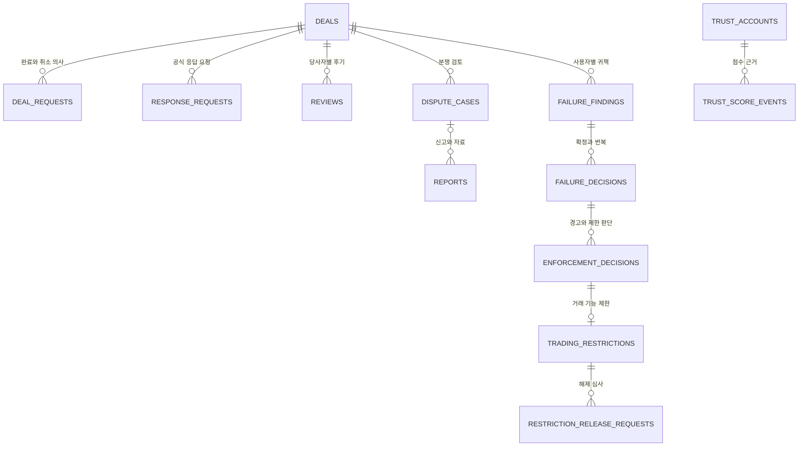

# 가격 매경 거래·후기·신고·제재 모델과 초기 DDL

# 가격 매경 거래·후기·신고·제재 모델과 초기 DDL
* toc
{:toc}

---

## 낙찰 이후의 데이터를 설계하기

앞선 글에서는 출품 → 입찰 → 낙찰 → 거래 생성 구간을 정리했다. 이번에는 거래가 완료·취소·분쟁으로 이어질 때 어떤 근거를 저장할지 설계하고, Marketplace의 초기 Flyway DDL을 작성한다.

2026년 10월 20일 기준의 초기 설계다. 문서와 SQL 정적 검사를 진행했지만 실제 MySQL·Flyway·다중 연결 테스트는 아직 실행하지 않았다. 애플리케이션 구현이나 운영 준비 완료를 의미하지 않는다.

## 거래 종료와 책임은 다르다

가격 매경은 결제·정산을 처리하지 않고 외부의 송금·상품 전달도 보증하지 않는다. 따라서 거래 상태에 실제 지급·전달 사실을 모두 담으려고 하지 않는다.

| 구분 | 저장할 내용 |
|---|---|
| 거래 종료 | 진행·완료·취소 등 현재 상태와 변경 근거 |
| 당사자의 의사 | 누가 완료·취소를 요청했고 상대방이 어떻게 응답했는지 |
| 신고와 검토 | 주장·자료·검토 사건과 운영자 판단 |
| 귀책 불발 | 어느 사용자의 책임이 확인됐는지, 번복됐는지 |
| 신뢰도 | 어떤 완료·귀책 근거로 점수가 달라졌는지 |
| 이용 제한 | 어떤 집계와 판정으로 신규 출품·입찰을 제한·해제했는지 |

양쪽 합의 취소는 불발이나 차감 근거가 아니다. 신고 접수·48시간 무응답도 자동 귀책이 아니며, 낮은 후기 평가도 제재를 직접 발생시키지 않는다.

## 확장 모델

모두 Marketplace 소유다. 회원·인증은 독립 서비스의 원본으로 유지하며 회원 ID는 값으로만 참조한다. 채팅 메시지는 MongoDB에 있으므로 증거에 메시지 식별자를 남기더라도 교차 저장소 FK나 직접 JOIN을 만들지 않는다.

## 완료·취소 요청과 자동 처리

`deal_requests`는 COMPLETE/CANCEL 요청을 구분한다. 요청자·상대방·사유·응답·해결 시각을 남기고, 완료 요청에만 요청 후 7일의 자동 완료 기한을 둔다.

거래당 진행 중 요청은 한 건이다. `active_slot`을 진행 중 1, 해결 이력 NULL로 저장하고 `(deal_id, active_slot)` 유일성과 상태별 CHECK를 함께 둔다. 완료 요청과 취소 요청이 동시에 별개로 살아 있는 구조를 피한다.

### 교차 요청의 초기 처리 기준

- 상대방도 완료를 표시하면 새 요청이 아니라 기존 완료 요청의 동의로 처리한다.
- 완료 대기 중 취소를 요청하면 완료 요청을 대체 이력으로 남기고 취소 대기로 전환한다.
- 취소 대기 중 완료 요청은 충돌 처리한다. 기존 취소 요청을 먼저 해결한다.
- 취소 거절·분쟁 해소 후에는 거래 진행으로 돌아가며 과거 완료 타이머를 재개하지 않는다.
- 새 완료 요청이 있어야 새 7일 기한이 시작한다.

이 내용은 기존 정책의 교차 요청을 구체화한 기술 설계안이다. 양쪽 동의 없는 취소나 임의의 자동 취소를 추가하는 것은 아니다.

자동 완료 작업과 신고·동의 명령은 같은 거래 행을 잠근다. 잠금 후 별도 SQL로 읽은 DB 시각과 최신 요청·분쟁 상태로 판정한다. 진행 중 거래의 이의 접수는 요청 중지·분쟁 생성·검토 전환을 같은 트랜잭션에 기록한다. 이미 완료된 뒤의 신고는 별도로 보존하고 완료를 자동 번복하지 않는다.

## 완료 근거와 후기

완료 근거는 상호 확인(MUTUAL), 이의 없는 자동 완료(NO_OBJECTION), 운영자 처리(OPERATOR)로 나눈다. 운영자가 완료했다고 양쪽 동의나 가점을 자동으로 인정하지 않는다.

후기는 기존 정책대로 상호 확인·자동 완료 거래의 당사자만 완료 후 14일 동안 거래당 한 번 작성한다. 자동 완료 표시는 거래 원본의 근거에서 가져온다.

`reviews`에는 `(deal_id, reviewer_id)` 유일성을 두고 `review_revisions`에 공개 전 수정 이력을 남긴다. 작성·수정·공개는 같은 거래 잠금 순서를 사용한다. 양쪽 제출 또는 14일 경과 시 공개하고, 공개 후 숨김 처리되더라도 일반 수정 권한을 되살리지 않는다.

DB의 중복 방지와 별개로 API는 당사자·완료 근거·기한·비공개 접근을 검증해야 한다. 상대방이 아직 제출하지 않은 후기 본문을 읽을 수 없게 해야 한다. 별점·평가 항목은 아직 정하지 않았으므로 버전이 있는 JSON 구조를 두고 API 계약에서 허용 구조를 정한다.

## 공식 응답 요청과 신고

공식 응답 요청은 일반 채팅과 분리한다. 요청 후 24시간 재알림, 48시간 무응답 검토 기준을 저장한다. 메시지를 추가해도 기한을 갱신하지 않고, 검토 대기 동안도 활성 요청은 한 건만 유지한다.

`reports`는 신고자의 주장이다. 검토 대상은 `dispute_cases`, 운영자의 결정은 `dispute_decisions`에 기록한다. 후기 내용 신고가 자동으로 거래 취소나 귀책 불발이 되지는 않는다.

증거에는 파일 키·해시 또는 메시지 식별자를 두되 공개 URL·인증 토큰을 넣지 않는다. 자료 접근은 운영자 API 권한으로 제한하고 보관·삭제 정책은 공개 전 별도로 결정한다. 해시가 있다고 내용의 진실성까지 확인되는 것은 아니다.

## 귀책 확정과 신규 거래 기능 제한

`failure_findings`는 `(deal_id, member_id)`가 유일하다. 신고가 여러 건이어도 같은 거래의 같은 사용자를 여러 번 집계하지 않는다. `failure_decisions`는 확정·번복·확인 불가를 개정별로 보존한다.

확정 귀책의 최근 90일 집계에 따라 1회 경고, 2회 최종 경고, 3회 신규 입찰·출품 제한을 적용한다. 집계 근거는 `enforcement_decisions`, 제한·해제는 `trading_restrictions`, 명령 검증용 현재 값은 `trading_actor_gate`가 맡는다. 제한 원본과 gate는 같은 트랜잭션에서 갱신한다.

로그인·기존 거래 채팅·신고·이의·해제 신청은 계속 허용한다. 90일이 지났다고 이미 적용된 제한이 자동으로 해제되지는 않는다. 오판 이의와 책임 인정 후 재이용 신청도 구분한다. 재이용 승인만으로 과거 기록이나 점수를 지우지 않는다.

90일의 기준일은 아직 정책 미정이다. 초기 SQL은 최초 확정 시각과 집계 기준 시각을 분리하고 자동 기본값을 넣지 않았다. 실제 귀책 확정 기능을 구현하기 전에 기준일·경계·늦은 확정 처리를 정책 버전과 함께 결정해야 한다.

## 점수 정정은 반대 부호로 더하면 끝날까

점수는 최초 50, 상호 확인 +1, 확정 귀책 -5, 범위는 0~100이다. 같은 상대방과의 가점은 30일에 한 번이며 자동 완료·합의 취소에는 가점이 없다.

여기서 오판 정정은 단순 +5로 처리할 수 없다. 점수 2에서 잘못 -5를 적용해 0이 되고 정상 +1로 1이 됐다면, 잘못된 차감을 제외한 결과는 3이지 6이 아니다.

`trust_score_events`에 원사건과 REVOKE를 연결하고 사용자별 순서로 유효 사건을 재생해 점수를 계산한다. 매 단계 0~100 제한을 적용한다. 현재 조회 값은 `trust_accounts`에 유지한다. 같은 상대방과의 동시 완료는 정렬한 회원 ID 쌍의 `trust_pair_gates`를 잠가 검증한다.

이는 전체 도메인의 이벤트 소싱 전환이 아니라 점수 근거를 재계산할 수 있게 하는 설계다. 뒤늦은 가점 취소와 30일 기회의 소급 재배분 등 미정 정책을 자동 수행하지 않는다.

## 초기 DDL과 책임 경계

[Marketplace 초기 SQL 다운로드]({{ '/assets/project/price-maegyeong/database/marketplace/db/migration/V1__create_marketplace_schema.sql' | relative_url }})와 [적용·검증 안내]({{ '/assets/project/price-maegyeong/database/README.md' | relative_url }})를 프로젝트 자료로 둔다. 실제 Marketplace 프로젝트가 생기면 해당 서비스의 `src/main/resources/db/migration/`로 옮겨 관리한다.

대상은 MySQL 8.4 / InnoDB의 빈 Marketplace 스키마다. 서비스 계정·스키마 생성은 환경 구성 책임이며 SQL에는 자격 정보나 데이터 삭제를 넣지 않았다. 회원·인증·알림의 원본 DDL은 이번 범위가 아니다.

| DB 제약으로 제한 | 애플리케이션도 검증 |
|---|---|
| 낙찰·거래·후기·귀책의 중복 | 실제 거래 당사자·운영자 권한 |
| 활성 요청·제한 한 건 | 상태 전이·다른 행과의 일관성 |
| 양수 금액·점수 범위·필수 시각 | 마감·30일·90일·현재 시각 |
| 같은 경매의 낙찰 입찰 복합 FK | 유효 입찰·금액·낙찰 당사자 일치 |
| 점수 근거·요청·Outbox 유일 키 | 점수 재계산·비공개 후기·불변 이력 |

CHECK가 현재 시각이나 다른 테이블을 조회하는 업무 판단을 대신하지는 않는다. 복합 FK는 명시적 유일 키를 참조하며 서비스 간 FK나 삭제 CASCADE를 사용하지 않는다. [MySQL CHECK](https://dev.mysql.com/doc/refman/8.4/en/create-table-check-constraints.html), [MySQL Foreign Keys](https://dev.mysql.com/doc/refman/8.4/en/create-table-foreign-keys.html)

첫 영속 환경 적용 후 V1은 고치지 않고 V2 이상으로 변경한다. 아직 적용하지 않은 초안은 실행 검증 과정에서 보완할 수 있다. 여러 MySQL DDL을 파일 전체 롤백으로 가정해서도 안 된다. [Flyway versioned migrations](https://documentation.red-gate.com/fd/versioned-migrations-273973333.html)

## 검증과 남은 작업

SQL 파서와 정적 키·FK 검사에서 29개 테이블, FK 32개, CHECK 64개, UNIQUE KEY 29개를 확인했다. 이것은 MySQL 서버가 SQL을 수용하거나 제약이 실제 동작한다는 검증은 아니다.

현재 환경에는 Docker·MySQL·Flyway 실행 환경이 확인되지 않아 실제 적용은 하지 않았다. 빈 DB 마이그레이션, 제약 위반, 양쪽 동시 완료·완료와 신고 경쟁·반복 상대방 가점·오판 정정·제재와 입찰 경쟁을 후속 테스트에서 확인한다.

회원·인증의 독립 상세 모델과 초기 DDL도 남아 있다. 따라서 전체 ERD/Flyway 업무는 진행 중으로 유지하고, 이번 Marketplace 상세 모델·초기 SQL 작성과 실행 검증을 구분한다.

## 정리

거래 완료·취소는 책임 판단과 분리하고, 책임 판단은 점수·제재의 근거로 연결한다. 현재 상태만 저장하지 않고 요청·판정·정정 이력을 보존하며, 원본 행의 잠금과 DB 유일성으로 경쟁 조건을 통제하는 것을 초기 구현 기준으로 삼았다.
