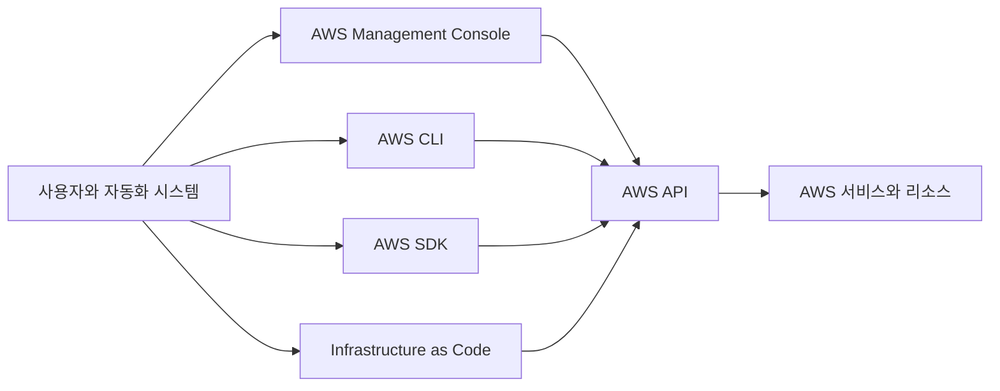
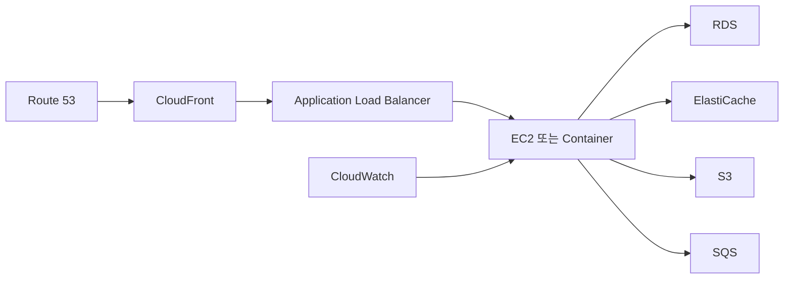
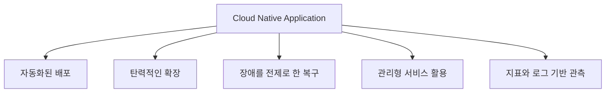
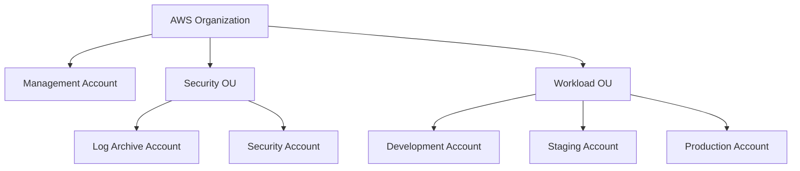
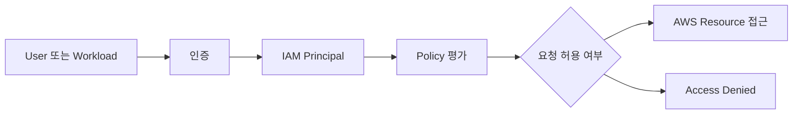
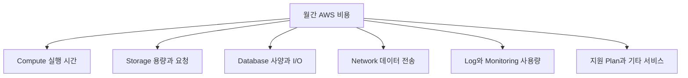
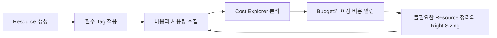
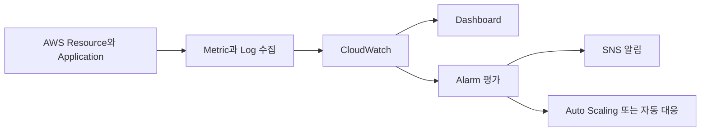
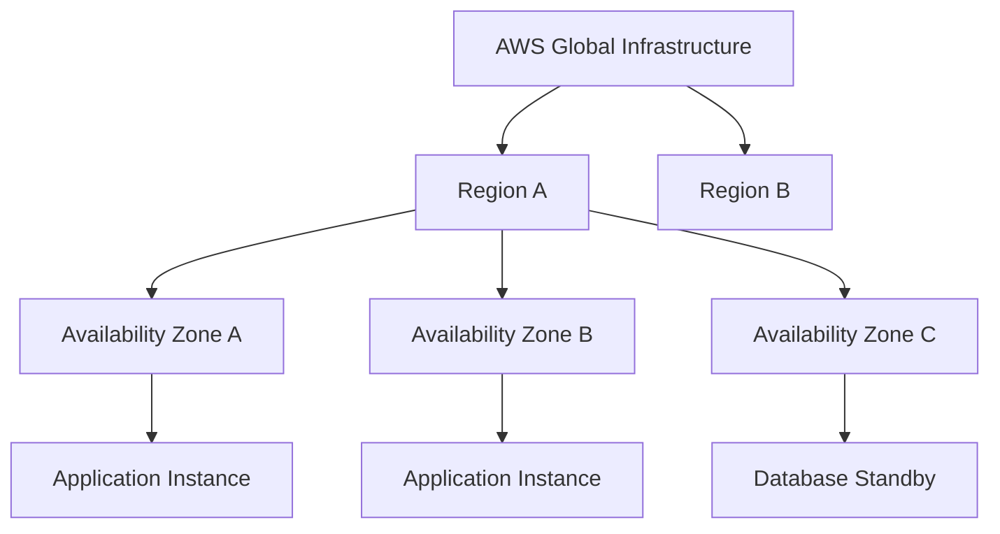

# 3장. AWS를 사용하기 위한 도구

# 3장. AWS를 사용하기 위한 도구
* toc
{:toc}

---

## AWS를 사용하기 위한 도구

AWS를 사용한다는 것은 관리 콘솔에서 서비스를 찾아 자원을 생성하는 일만을 의미하지 않는다. 실제 운영 환경에서는 계정을 어떻게 분리할지, 누가 어떤 권한으로 접근할지, 어느 Region에 자원을 만들지, 비용과 장애를 어떻게 감지할지까지 함께 결정해야 한다.

AWS 자원은 Management Console, AWS CLI, SDK, Infrastructure as Code를 통해 동일한 API로 제어할 수 있다. 처음에는 Management Console이 편리하지만, 반복 작업과 운영 변경은 CLI나 코드로 옮겨야 재현성과 변경 이력을 확보할 수 있다.



이번 장에서는 AWS를 다루는 도구뿐 아니라 도구를 안전하게 사용하기 위해 필요한 계정, 권한, 비용, 모니터링 구조를 함께 살펴본다.

### AWS를 사용하는 네 가지 방법

#### AWS Management Console

AWS Management Console은 웹 브라우저에서 AWS 서비스를 검색하고 자원을 생성하거나 상태를 확인하는 관리 화면이다. 처음 접하는 서비스의 설정 항목을 살펴보고 현재 상태를 시각적으로 확인하기에 편리하다.

하지만 Console에서 수행한 수동 작업은 같은 설정을 반복하기 어렵고 작업자의 실수에 영향을 받기 쉽다. 개발 환경에서 성공한 구성을 운영 환경에 다시 만들 때 일부 항목을 빠뜨리면 환경 차이가 발생한다. 따라서 Console은 탐색과 확인에 활용하고, 반복되는 운영 구성은 코드로 전환하는 것이 좋다.

#### AWS CLI

AWS CLI는 터미널에서 AWS API를 호출하는 명령줄 도구다. 자원 조회, 배포 스크립트, 장애 분석, CI/CD 자동화에 활용할 수 있다. 명령 결과를 JSON 형태로 받을 수 있어 다른 도구와 조합하기도 쉽다.

```shell
aws sts get-caller-identity
aws configure list
aws ec2 describe-regions --all-regions
```

- `aws sts get-caller-identity`는 현재 명령을 실행하는 AWS 계정과 Principal을 확인한다.
- `aws configure list`는 현재 적용되는 Profile, Region, Credential 출처를 보여 준다.
- `aws ec2 describe-regions`는 계정에서 확인할 수 있는 Region 정보를 조회한다.

운영 명령을 실행하기 전에는 항상 현재 계정, Role과 Region을 확인하는 습관이 필요하다. 개발 계정에서 실행하려던 삭제 명령이 운영 계정에 적용되는 사고를 막는 가장 기본적인 절차다.

#### AWS SDK

AWS SDK는 Java, JavaScript, Python, Go 등의 애플리케이션 코드에서 AWS 서비스를 호출할 수 있도록 제공되는 라이브러리다. 애플리케이션이 S3에 파일을 올리거나 SQS에 메시지를 전송하고, DynamoDB 데이터를 조회하는 경우에 사용한다.

SDK를 사용할 때 Access Key를 소스 코드나 설정 파일에 직접 저장해서는 안 된다. EC2 Instance Profile, ECS Task Role, EKS Service Account, Lambda Execution Role처럼 실행 환경에 연결된 IAM Role을 사용하면 임시 자격 증명을 발급받아 호출할 수 있다.

#### Infrastructure as Code

AWS CloudFormation, AWS CDK, Terraform 같은 도구를 사용하면 인프라 구성을 코드로 정의할 수 있다. 코드 리뷰, 버전 관리와 자동화된 배포가 가능해지므로 운영 환경의 변경 이력을 남기고 동일한 구성을 다시 만들기 쉽다.

Infrastructure as Code를 사용하더라도 모든 변경이 자동으로 안전해지는 것은 아니다. 적용 전에 변경 계획을 검토하고, Database나 Network처럼 영향 범위가 큰 자원은 삭제와 교체 여부를 특히 주의해야 한다.

### AWS 서비스를 조합하는 방식

AWS에서는 하나의 서비스가 전체 시스템을 완성하는 것이 아니라 여러 서비스를 조합해 필요한 구조를 만든다.



웹 애플리케이션을 만든다고 해서 이 서비스를 모두 사용해야 하는 것은 아니다. 필요한 기능과 운영 규모를 기준으로 가장 단순한 구성을 선택하고, 실제 문제가 생길 때 서비스를 추가해야 한다.

서비스를 조합할 때는 다음 항목을 함께 확인한다.

- 서비스가 지원되는 Region
- 다른 서비스와 연결하기 위해 필요한 IAM 권한
- Public Network와 Private Network 사이의 통신 경로
- 요청 수, 저장 용량과 데이터 전송에 따른 비용
- 장애 발생 시 재시도와 복구 방식
- Resource Quota와 API Rate Limit
- 로그와 지표를 수집하는 방법

### 관리형 서비스의 의미

관리형 서비스는 운영체제 패치, 하드웨어 교체, 일부 백업과 고가용성 기능처럼 반복적인 인프라 운영을 AWS가 대신 수행하는 서비스다. Amazon RDS, DynamoDB, S3, Lambda 등이 대표적이다.

관리형 서비스를 사용하면 사용자가 관리해야 할 계층은 줄어든다. 그러나 운영 책임이 없어지는 것은 아니다.

| 구분 | AWS가 주로 관리하는 영역 | 사용자가 관리해야 하는 영역 |
|---|---|---|
| EC2 | 데이터센터, 물리 서버, 가상화 | Guest OS, 패치, 애플리케이션, 데이터 |
| RDS | 물리 장비, OS, Database Engine 운영 일부 | Schema, Query, 계정, Backup 정책, 데이터 |
| S3 | Storage 인프라와 내구성 | Bucket Policy, 암호화, Lifecycle, 객체 데이터 |
| Lambda | 서버와 Runtime 기반 환경 | 함수 코드, 권한, Timeout, 재시도와 데이터 |

관리형 Database도 잘못된 Query, 과도한 Connection, 잘못된 Schema 설계까지 해결해 주지는 않는다. 자동 Backup을 활성화했더라도 필요한 시점으로 실제 복원할 수 있는지 별도로 검증해야 한다.

#### 클라우드 네이티브

클라우드 네이티브는 단순히 애플리케이션을 AWS에서 실행하는 것을 뜻하지 않는다. 자동화, 탄력적 확장, 장애를 전제로 한 설계, 관리형 서비스 활용, 관측 가능성을 통해 클라우드의 특성을 적극적으로 사용하는 접근 방식이다.



한 번 만든 서버를 오래 유지하는 방식보다 동일한 서버를 언제든 다시 생성할 수 있도록 구성하는 편이 클라우드 환경에 적합하다. 애플리케이션 상태는 Database, Object Storage, Cache 같은 외부 시스템에 저장하고 실행 서버는 교체 가능한 자원으로 다루는 것이 좋다.

### AWS 계정과 Organizations

AWS Account는 단순한 로그인 계정이 아니다. Resource, 권한, 비용과 Service Quota를 구분하는 강한 경계다. 하나의 Account 안에서 IAM User를 여러 개 만드는 것과 개발·운영 환경을 서로 다른 AWS Account로 나누는 것은 격리 수준이 다르다.

#### Root User

AWS Account를 만들 때 사용하는 Email Address와 자격 증명은 Root User가 된다. Root User는 Account 전체에 대한 강력한 권한을 가지므로 일상적인 관리와 개발 작업에 사용해서는 안 된다.

Root User에는 다중 인증을 적용하고 자격 증명을 안전하게 보관해야 한다. Root User만 수행할 수 있는 제한적인 작업이 아니라면 IAM Identity Center나 IAM Role을 통해 접근하는 것이 좋다.

#### AWS Organizations

AWS Organizations는 여러 AWS Account를 하나의 Organization으로 묶어 중앙에서 관리하는 서비스다. Account를 Organizational Unit으로 그룹화하고 정책과 통합 결제를 적용할 수 있다.



Management Account에는 Organization 관리에 필요한 기능만 두고 일반적인 애플리케이션 Workload를 배치하지 않는 편이 좋다. Management Account는 강력한 권한과 결제 책임을 가지며 Service Control Policy의 제한도 동일하게 적용되지 않기 때문이다.

#### Organizational Unit과 Service Control Policy

Organizational Unit은 Account를 논리적으로 묶는 계층이다. 조직, Workload, 환경과 보안 수준에 따라 Account를 그룹화하고 공통 정책을 적용할 수 있다.

Service Control Policy는 Organization, OU 또는 Account에서 사용할 수 있는 최대 권한의 범위를 제한하는 Guardrail이다. SCP는 권한을 직접 부여하지 않는다. IAM Policy가 어떤 작업을 허용하더라도 상위 SCP에서 해당 작업을 제한하면 실행할 수 없다.

개발과 운영을 별도 Account로 나누면 다음과 같은 장점이 있다.

- 개발 작업이 운영 Resource에 직접 영향을 주는 실수를 줄일 수 있다.
- 환경별 비용을 Account 단위로 구분하기 쉽다.
- 운영 환경에 더 엄격한 권한과 Network 정책을 적용할 수 있다.
- Account별 Service Quota와 장애 범위를 분리할 수 있다.
- Security Log와 감사 계정을 별도로 운영할 수 있다.

### AWS Management Console

AWS Management Console은 계정과 권한에 따라 사용할 수 있는 서비스와 작업을 보여 준다. Console 화면은 지속적으로 변경될 수 있으므로 버튼 위치를 외우는 것보다 현재 Account, Role과 Region을 먼저 확인하는 습관이 중요하다.

#### Region 선택

대부분의 AWS Resource는 생성한 Region에 속한다. Management Console에서 Region을 변경하면 화면에 표시되는 EC2, RDS와 VPC Resource도 달라진다.

서울 Region에서 만든 EC2가 보이지 않는다면 Resource가 삭제됐다고 판단하기 전에 현재 선택한 Region을 확인해야 한다. CLI에서도 `--region` Option이나 Profile의 기본 Region이 명령 대상에 영향을 준다.

```shell
aws ec2 describe-instances --region ap-northeast-2
```

#### Console Dashboard와 즐겨찾기

자주 사용하는 서비스는 즐겨찾기에 등록하고 Resource Dashboard를 활용하면 빠르게 접근할 수 있다. 다만 Dashboard는 운영 상태를 요약해서 보여 주는 화면이므로 장애 분석에는 원본 Metric, Log와 Event를 함께 확인해야 한다.

#### AWS Health Dashboard

AWS Health Dashboard는 AWS 서비스의 상태와 계정 Resource에 영향을 줄 수 있는 Event를 확인하는 도구다. 서비스 전체의 공개 상태뿐 아니라 유지보수, Resource 중단 예정과 같이 Account에 관련된 Event를 확인할 수 있다.

Health Event가 없다는 사실이 애플리케이션에 장애가 없다는 의미는 아니다. 애플리케이션 오류, 잘못된 배포, 권한 문제와 Resource 부족은 CloudWatch와 애플리케이션 모니터링을 통해 별도로 확인해야 한다.

#### Global Service와 Regional Service

AWS 서비스는 관리 범위에 따라 Global 또는 Regional 성격을 가진다. IAM, Route 53, CloudFront처럼 전역 관점에서 관리되는 서비스가 있는 반면 EC2, RDS, Lambda와 VPC Resource는 특정 Region에 생성된다.

Global Service도 모든 데이터 처리와 장애 범위가 완전히 전 세계 단일 지점에 있다는 의미는 아니다. 서비스마다 Control Plane과 Data Plane의 범위가 다르므로 정확한 복구 특성과 데이터 위치는 해당 서비스 문서를 확인해야 한다.

### IAM과 접근 권한

AWS Identity and Access Management는 누가 어떤 AWS Resource에 어떤 작업을 수행할 수 있는지 제어하는 서비스다. 보안은 인증과 인가를 구분해서 이해해야 한다.

- **인증**은 요청자가 누구인지 확인하는 과정이다.
- **인가**는 인증된 Principal이 특정 작업을 수행할 수 있는지 판단하는 과정이다.



#### IAM User

IAM User는 한 AWS Account 안에서 장기 자격 증명을 가질 수 있는 IAM Identity다. Console Password나 Access Key를 발급할 수 있지만, 장기 Credential은 유출과 회수 관리가 어렵다.

현재의 일반적인 운영 환경에서는 사람마다 IAM User와 장기 Access Key를 발급하기보다 IAM Identity Center 또는 외부 Identity Provider를 통해 로그인하고 IAM Role의 임시 자격 증명을 사용하는 방식이 권장된다.

IAM User가 필요한 예외적인 경우에는 다음 원칙을 적용한다.

- 사용하지 않는 Console Password와 Access Key는 발급하지 않는다.
- MFA를 적용한다.
- Access Key를 소스 코드나 공유 문서에 저장하지 않는다.
- 사용하지 않는 Credential과 권한을 정기적으로 제거한다.
- 하나의 IAM User를 여러 사람이 공유하지 않는다.

#### IAM Group

IAM Group은 여러 IAM User에 같은 권한을 적용하기 위한 묶음이다. 개발자, 운영자, 감사자와 같이 역할이 비슷한 User에게 공통 Policy를 연결할 수 있다.

IAM Group은 로그인하거나 Role을 Assume하는 Principal이 아니며 다른 Group을 포함할 수도 없다. 여러 Account의 인력을 중앙에서 관리해야 한다면 IAM Group보다 IAM Identity Center의 User, Group과 Permission Set을 사용하는 편이 적합하다.

#### IAM Role

IAM Role은 특정 사람 한 명에게 고정되지 않고 신뢰가 허용된 Principal이 Assume해서 사용하는 IAM Identity다. Role을 Assume하면 제한된 수명의 임시 자격 증명이 발급된다.

IAM Role은 다음과 같은 상황에서 사용한다.

- EC2, Lambda, ECS Task 같은 Workload가 AWS API를 호출할 때
- 다른 AWS Account의 Resource에 접근할 때
- Identity Provider로 로그인한 사용자가 AWS Account에 접근할 때
- 일시적으로 더 높은 운영 권한이 필요할 때

EC2에 S3 접근 권한이 필요하다면 Access Key를 서버에 저장하는 대신 IAM Role을 Instance Profile로 연결해야 한다. Credential 교체는 AWS가 처리하며 애플리케이션은 Credential Provider Chain을 통해 임시 자격 증명을 가져올 수 있다.

#### IAM Policy

IAM Policy는 허용하거나 거부할 Action, Resource와 조건을 JSON 문서로 정의한다. 다음은 특정 S3 Bucket의 객체를 조회하도록 허용하는 단순한 예다.

```json
{
  "Version": "2012-10-17",
  "Statement": [
    {
      "Sid": "ReadObjects",
      "Effect": "Allow",
      "Action": [
        "s3:GetObject"
      ],
      "Resource": "arn:aws:s3:::example-bucket/*"
    }
  ]
}
```

- `Effect`는 요청을 허용할지 거부할지를 지정한다.
- `Action`은 허용할 AWS API 작업을 지정한다.
- `Resource`는 권한이 적용되는 대상 ARN을 지정한다.
- `Condition`을 추가하면 Source IP, Tag, MFA 여부와 같은 조건을 적용할 수 있다.

권한 평가에서는 명시적인 `Deny`가 `Allow`보다 우선한다. 어떤 Policy에서도 허용되지 않은 작업은 기본적으로 거부된다. Identity Policy만 확인하지 말고 Resource Policy, SCP, Permission Boundary, Session Policy와 VPC Endpoint Policy처럼 함께 적용되는 정책도 확인해야 한다.

#### 최소 권한 원칙

처음부터 모든 Resource에 `*` 권한을 부여하면 개발은 편해 보이지만, Credential이 유출되거나 잘못된 명령을 실행했을 때 피해 범위가 커진다. 필요한 Action과 Resource만 허용하고 실제 사용 기록을 바탕으로 권한을 줄여야 한다.

운영 환경에서는 최소한 다음 항목을 점검한다.

- Root User와 주요 운영 접근에 MFA 적용
- 사람과 Workload 모두 가능한 한 임시 자격 증명 사용
- 개발, 운영과 감사 권한 분리
- CloudTrail을 통한 API 작업 기록
- IAM Access Analyzer를 통한 외부 공개와 미사용 권한 검토
- 비밀 정보와 Access Key를 Source Repository에 저장하지 않기

### AWS 요금 계산 방식

AWS는 대부분 사용량에 따라 비용을 계산하지만 서비스마다 과금 단위가 다르다. EC2는 Instance 실행 시간과 사양, EBS는 저장 용량과 성능, S3는 저장 용량·요청·데이터 전송량, Lambda는 요청 수와 실행 시간에 따라 비용이 달라진다.



#### 대표적인 요금 방식

| 요금 방식 | 특징 | 적합한 상황 |
|---|---|---|
| On-Demand | 약정 없이 사용한 만큼 지불 | 초기 서비스, 사용량 예측이 어려운 Workload |
| Savings Plans | 일정 사용 금액을 약정해 할인 | 지속적으로 사용하는 Compute Workload |
| Reserved Instance | 서비스별 조건에 따라 일정 사용을 약정 | 장기간 안정적인 Database 등 |
| Spot Instance | 남는 용량을 저렴하게 사용하지만 중단 가능 | 재시도 가능한 Batch와 분산 작업 |

할인 상품은 무조건 저렴한 선택이 아니다. 실제 사용량보다 큰 약정을 구매하면 사용하지 않은 금액이 낭비될 수 있다. 먼저 사용량을 측정하고 안정적으로 유지되는 기준 용량과 일시적으로 증가하는 용량을 구분해야 한다.

#### 비용 계산 시 확인할 항목

단순한 월 비용은 다음과 같은 요소를 합산해 추정할 수 있다.

```text
월 비용 = Compute + Storage + Database + 요청 수 + 데이터 전송 + Monitoring + Backup + 기타 서비스
```

가격은 Region과 서비스 설정에 따라 달라질 수 있다. 세금, 환율, Support Plan과 Marketplace Software 비용도 최종 청구 금액에 영향을 줄 수 있다. 따라서 설계 단계에서는 Pricing Calculator로 추정하고, 운영 이후에는 실제 청구 데이터를 기준으로 계속 보정해야 한다.

### Billing and Cost Management

AWS Billing and Cost Management는 청구 금액과 사용량을 확인하고 비용을 분석하는 기능을 제공한다. 비용은 월말에 한 번 확인하는 것이 아니라 예산, 알림과 Tag를 이용해 지속적으로 관리해야 한다.

#### Cost Explorer

Cost Explorer는 기간별 비용과 사용량을 서비스, Account, Region, Usage Type, Tag 등의 기준으로 분석하는 도구다. 비용이 증가한 시점과 원인을 확인하고 이후 비용을 예측하는 데 활용할 수 있다.

비용이 증가했다면 전체 합계만 보는 것보다 다음 순서로 범위를 좁히는 편이 좋다.

1. 이전 기간과 비교해 증가한 날짜를 찾는다.
2. 비용이 증가한 Service를 확인한다.
3. Account, Region과 Usage Type으로 세분화한다.
4. Cost Allocation Tag와 Resource 정보로 원인을 찾는다.
5. 배포 또는 트래픽 변경 기록과 비교한다.

#### AWS Budgets

AWS Budgets를 사용하면 비용, 사용량, Savings Plans와 Reserved Instance의 활용률을 기준으로 예산을 설정하고 임계값에 도달했을 때 알림을 받을 수 있다.

예산 알림은 비용 발생을 자동으로 막는 기능이 아니다. 알림을 받은 뒤 누가 확인하고 어떤 조치를 수행할지 운영 절차를 준비해야 한다. 자동 조치를 연결하는 경우에도 운영 Resource가 잘못 중단되지 않도록 대상과 조건을 보수적으로 설정해야 한다.

#### 비용 할당 Tag

Resource에 `Project`, `Environment`, `Owner`, `CostCenter`와 같은 Tag를 일관되게 적용하면 비용을 조직과 서비스 단위로 구분할 수 있다.

```yaml
Project: sns-service
Environment: production
Owner: backend-team
CostCenter: platform
```

Tag가 없는 Resource는 비용의 책임 주체를 파악하기 어렵다. Organization 전체에 Tag 규칙을 정하고 Resource 생성 자동화에서 필수 Tag를 적용하는 것이 좋다.

#### 비용 관리 흐름



개발 환경의 야간 중지, 오래된 Snapshot 정리, Log 보존 기간 설정, 유휴 Load Balancer와 NAT Gateway 확인처럼 작은 운영 규칙도 장기적으로 큰 차이를 만든다.

### Amazon Q Developer와 AWS CLI

Amazon Q Developer는 AWS 사용과 Software 개발을 지원하는 생성형 AI Assistant다. AWS Management Console과 개발 도구에서 서비스 설명, Resource 관련 질문, 코드 작성과 문제 해결을 보조할 수 있다.

생성형 AI의 답변과 명령은 그대로 운영 환경에 실행해서는 안 된다. 존재하지 않는 Option을 제안하거나 현재 환경의 권한과 Network 구조를 충분히 반영하지 못할 수 있다. 특히 Resource 삭제, IAM 변경과 비용을 발생시키는 명령은 공식 문서와 변경 계획을 다시 확인해야 한다.

#### AWS CLI Profile과 임시 자격 증명

여러 Account를 다루는 경우 Profile을 분리하면 대상 Account와 Region을 명확하게 관리할 수 있다. 사람의 CLI 접근에는 장기 Access Key보다 IAM Identity Center를 통한 SSO와 임시 자격 증명을 사용하는 편이 좋다.

```shell
aws configure sso
aws sso login --profile development
aws sts get-caller-identity --profile development
```

명령을 자동화할 때는 다음 기준을 적용한다.

- Script 안에 Access Key와 Secret Access Key를 작성하지 않는다.
- 명령 실행 전 Account ID, Role과 Region을 출력한다.
- 삭제나 교체 작업에는 대상 Resource를 먼저 조회하는 단계를 둔다.
- `--dry-run`이나 변경 계획 기능이 있다면 우선 사용한다.
- 결과와 오류를 Log로 남기되 Credential과 Secret은 기록하지 않는다.

### Amazon CloudWatch

Amazon CloudWatch는 AWS Resource와 Application의 Metric, Log와 Event를 수집하고 Dashboard와 Alarm을 구성하는 Monitoring 서비스다. 장애가 발생한 뒤 수동으로 확인하는 용도뿐 아니라 이상 징후를 조기에 발견하고 자동 대응을 시작하는 데 사용한다.

#### Metric

Metric은 시간에 따라 측정되는 수치 데이터다. EC2의 CPU 사용률, RDS Connection 수, Application Load Balancer의 응답 시간과 HTTP 오류 수 등이 대표적이다.

모든 운영체제와 애플리케이션 지표가 기본으로 수집되는 것은 아니다. EC2 내부의 Memory 사용률과 Disk 사용률처럼 Guest OS 안에서 확인해야 하는 지표는 CloudWatch Agent 또는 별도의 수집기를 구성해야 한다.

#### Alarm

CloudWatch Alarm은 일정 기간 동안 Metric이 기준을 벗어났는지 평가한다. 상태는 일반적으로 `OK`, `ALARM`, `INSUFFICIENT_DATA`로 구분된다.

Alarm은 단일 순간 값보다 평가 기간과 데이터 포인트 수를 함께 설정해야 한다. CPU 사용률이 잠시 증가한 것만으로 장애 알림을 보내면 불필요한 경보가 많아지고 실제 장애를 놓치기 쉽다.



#### CloudWatch Logs

CloudWatch Logs는 Application, Operating System과 AWS Service에서 발생한 Log를 저장하고 검색한다. Log Group은 Application이나 기능 단위로 구분하고 Log Stream은 Instance, Container와 실행 단위로 나눌 수 있다.

Log를 무기한 저장하면 비용이 계속 증가한다. 운영 요구와 감사 정책에 맞는 보존 기간을 설정하고 장기 보관이 필요한 Log는 S3로 내보내는 방식을 검토해야 한다. Password, Token, 개인정보와 같은 민감 정보가 Log에 남지 않도록 애플리케이션 단계에서 제어해야 한다.

#### CloudTrail과의 차이

CloudWatch와 CloudTrail은 목적이 다르다.

| 구분 | CloudWatch | CloudTrail |
|---|---|---|
| 주요 목적 | Resource와 Application의 상태 관측 | AWS API 활동과 계정 변경 감사 |
| 주요 데이터 | Metric, Log, Alarm, Dashboard | 누가 언제 어떤 API를 호출했는지에 대한 Event |
| 대표 질문 | CPU가 높고 응답이 느린가? | 누가 Security Group을 변경했는가? |
| 활용 | 장애 탐지, 성능 분석, 자동 대응 | 보안 감사, 변경 추적, 사고 조사 |

CloudTrail Event를 CloudWatch Logs로 전달해 특정 API 호출을 탐지하고 Alarm을 만들 수도 있다. 두 서비스는 대체 관계가 아니라 운영 상태와 변경 이력을 서로 다른 관점에서 보완한다.

### Region과 Availability Zone

Region은 AWS가 인프라를 운영하는 지리적인 영역이고, Availability Zone은 하나의 Region 안에서 물리적으로 분리된 위치다. 대부분의 Regional Resource는 생성한 Region에 속하며 자동으로 다른 Region에 복제되지 않는다.



#### Region 선택 기준

Region은 다음 기준을 종합해서 선택해야 한다.

- 주요 사용자와의 Network Latency
- 데이터 저장 위치와 규제 요구사항
- 필요한 AWS Service와 기능의 제공 여부
- 서비스별 가격과 데이터 전송 비용
- 기존 사내망과 다른 Cloud 환경의 연결 구조
- 재해 복구를 위한 다른 Region과의 거리

가장 가까운 Region이 항상 정답은 아니다. 특정 서비스가 지원되지 않거나 규제와 재해 복구 요구를 충족하지 못할 수 있다. Region 변경은 Database와 Network를 포함한 Migration 작업이 되므로 초기 설계 단계에서 충분히 검토해야 한다.

#### Availability Zone을 이용한 고가용성

한 Availability Zone에 모든 서버와 Database를 배치하면 해당 Zone의 장애가 서비스 전체에 영향을 줄 수 있다. 고가용성이 필요한 시스템은 Application을 여러 Availability Zone에 분산하고 Load Balancer를 통해 요청을 전달해야 한다.

다중 AZ 배포가 모든 장애를 해결하지는 않는다. Application 오류, 잘못된 배포, 잘못된 데이터 변경과 Region 전체 장애는 별도의 대응이 필요하다. Backup, Rollback, Cross-Region 복제와 재해 복구 절차를 서비스 중요도에 맞게 준비해야 한다.

#### Availability Zone 이름과 ID

`ap-northeast-2a`와 같은 Availability Zone 이름은 AWS Account마다 실제 물리 위치의 매핑이 다를 수 있다. 여러 Account에서 같은 물리 Zone을 기준으로 배치해야 한다면 Account별 이름만 비교하지 말고 Availability Zone ID를 확인해야 한다.

#### Regional Resource와 Global Resource

Resource를 조회할 때는 서비스의 Scope를 확인해야 한다.

| Scope | 대표적인 예 | 운영 시 주의사항 |
|---|---|---|
| Availability Zone | Subnet, 일부 Compute와 Storage 연결 | 다른 Zone으로 자동 이동하지 않음 |
| Region | VPC, 대부분의 EC2·RDS·Lambda Resource | 다른 Region에 자동 복제되지 않음 |
| Global | IAM, Route 53, CloudFront의 전역 관리 기능 | 서비스마다 실제 데이터 처리 범위가 다름 |

서비스가 Global로 표시된다고 해서 Region 장애와 데이터 위치를 고려하지 않아도 되는 것은 아니다. 각 서비스의 Control Plane, Data Plane, 복제 방식과 장애 복구 범위를 별도로 확인해야 한다.

## 정리

AWS를 안전하게 운영하려면 Resource 생성 방법보다 계정, 권한, 비용과 관측 구조를 먼저 이해해야 한다. Management Console은 시작하기 편리하지만 반복 작업은 CLI, SDK와 Infrastructure as Code를 통해 자동화해야 한다.

이번 장의 핵심 내용을 정리하면 다음과 같다.

- AWS Resource는 Console, CLI, SDK와 Infrastructure as Code를 통해 같은 AWS API로 제어할 수 있다.
- 관리형 서비스는 운영 범위를 줄여 주지만 데이터, 권한과 애플리케이션에 대한 책임까지 없애지는 않는다.
- AWS Account는 Resource, 권한, 비용과 Service Quota를 분리하는 경계다.
- AWS Organizations와 OU를 이용하면 여러 Account에 공통 Guardrail과 통합 결제를 적용할 수 있다.
- SCP는 최대 권한을 제한할 뿐 IAM 권한을 직접 부여하지 않는다.
- 사람과 Workload에는 가능한 한 IAM Role과 임시 자격 증명을 사용해야 한다.
- IAM Policy는 최소 권한 원칙으로 작성하고 명시적 Deny와 여러 Policy 계층을 함께 확인해야 한다.
- 비용은 Compute뿐 아니라 Storage, 요청, 데이터 전송, Log와 Backup까지 포함해 관리해야 한다.
- Cost Explorer, Budgets와 Cost Allocation Tag를 함께 사용하면 비용 증가 원인을 빠르게 찾을 수 있다.
- CloudWatch는 상태와 성능을 관측하고 CloudTrail은 AWS API 활동을 감사한다.
- 대부분의 Resource는 생성한 Region에 속하며 고가용성을 위해 여러 Availability Zone을 활용해야 한다.

이 기본기를 갖추면 이후 EC2, VPC, RDS와 같은 개별 서비스를 사용할 때 단순히 Resource를 생성하는 수준을 넘어 안전한 권한, 비용 통제와 장애 대응까지 포함한 운영 구조를 설계할 수 있다.
