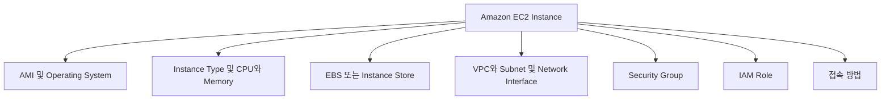
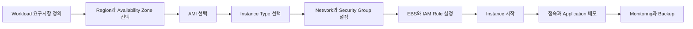
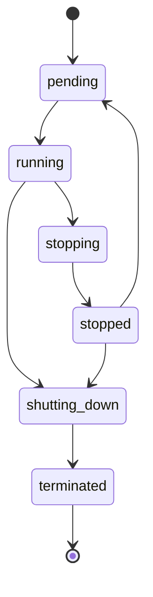
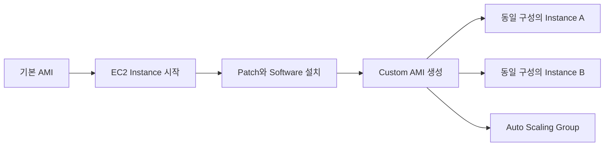
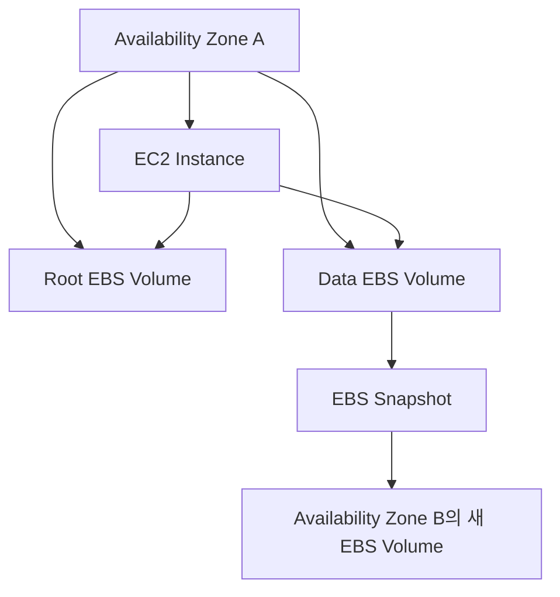
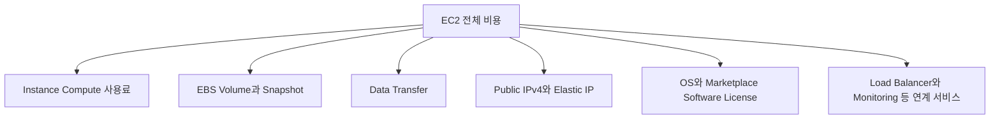
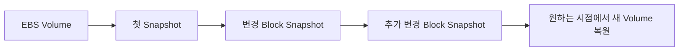
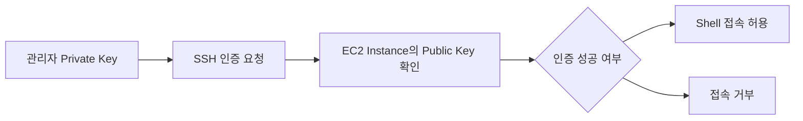

# 4장. 컴퓨팅 서비스

# 4장. 컴퓨팅 서비스
* toc
{:toc}

---

## AWS 컴퓨팅 서비스와 Amazon EC2

애플리케이션을 실행하려면 CPU, Memory, Operating System, Storage와 Network가 필요하다. 온프레미스 환경에서는 물리 서버를 구매하고 Operating System과 Software를 직접 설치해야 하지만, AWS에서는 Amazon EC2를 통해 필요한 사양의 Virtual Server를 짧은 시간 안에 생성할 수 있다.

EC2는 서버 준비 시간을 줄여 주지만 서버 설계와 운영 책임까지 없애 주지는 않는다. 사용자는 Workload에 맞는 인스턴스 유형, AMI, Storage, Network와 접근 권한을 선택해야 한다. Operating System 패치, 애플리케이션 배포, Monitoring과 Backup도 기본적으로 사용자의 책임이다.

이번 장에서는 EC2 Instance를 구성하는 요소부터 생성과 종료까지의 수명 주기, AMI, Instance Type, EBS, 요금, Snapshot, 원격 접속과 IP 주소를 하나의 흐름으로 살펴본다.

### Amazon EC2란

Amazon Elastic Compute Cloud는 AWS에서 확장 가능한 Compute Resource를 제공하는 서비스다. 사용자는 물리 서버를 직접 구매하지 않고 API를 통해 Virtual Server인 EC2 Instance를 생성한다.

`Elastic`이라는 이름처럼 필요한 시점에 Instance를 늘리거나 줄이고 사양을 변경할 수 있다. 하지만 하나의 Instance가 자동으로 확장되거나 장애에서 복구되는 것은 아니다. Auto Scaling, Load Balancer, Multi-AZ 배치와 Monitoring을 별도로 구성해야 탄력성과 가용성을 확보할 수 있다.



#### EC2를 구성하는 주요 요소

| 구성 요소 | 역할 | 설계 시 확인할 내용 |
|---|---|---|
| AMI | Operating System과 초기 Software Image | OS, Architecture, Patch, Image 출처 |
| Instance Type | vCPU, Memory, Network와 Storage 성능 | Workload 특성과 예상 부하 |
| EBS | 영구 Block Storage | 용량, IOPS, Throughput, 암호화 |
| VPC와 Subnet | Instance가 배치될 Network | Public·Private 구분, Route, Availability Zone |
| Security Group | Instance의 Inbound·Outbound 통신 제어 | 필요한 Port와 Source만 허용 |
| IAM Role | Instance가 AWS API를 호출할 권한 | 최소 권한, 임시 자격 증명 사용 |
| Key Pair 또는 Session Manager | 관리자 접속 수단 | SSH 공개 범위, Credential 보관, 감사 |
| User Data | 첫 Boot 시 실행할 초기화 Script | 멱등성, Secret 분리, 실행 Log |

EC2는 이 구성 요소를 조합해 서버를 만드는 서비스다. Instance 자체만 생성하고 Network, Storage와 권한을 고려하지 않으면 외부 접속이 되지 않거나 데이터가 손실되고 과도한 권한이 부여될 수 있다.

### EC2 Instance를 사용하는 흐름

EC2를 사용하려면 서버에 필요한 조건을 먼저 정하고 그 조건에 맞는 Resource를 선택해야 한다.



#### 서버 설계에서 먼저 정할 항목

- 어떤 Application과 Operating System을 실행할 것인가?
- 필요한 vCPU와 Memory는 어느 정도인가?
- Random I/O와 Sequential I/O 중 어떤 Storage 특성이 중요한가?
- 외부 인터넷에서 직접 접근해야 하는가?
- 어느 Port를 누구에게 허용할 것인가?
- 단일 Availability Zone 장애를 허용할 수 있는가?
- Instance가 AWS 서비스에 접근할 IAM 권한은 무엇인가?
- 장애가 발생했을 때 새 Instance를 얼마나 빨리 만들 수 있는가?
- Server 내부 데이터는 어디에 Backup할 것인가?

처음부터 최대 사양을 선택하기보다 작은 사양으로 시작해 Metric을 측정하고 조정하는 편이 좋다. CPU만 높다고 Instance를 무조건 Scale Up하기보다 Memory, Disk I/O, Network, Application Thread와 Database 응답 시간을 함께 확인해야 한다.

### EC2 Instance의 수명 주기

EC2 Instance는 생성된 뒤 여러 상태를 거친다. 상태에 따라 접속 가능 여부와 Compute 요금이 달라진다.



| 상태 | 의미 | Instance Compute 요금 |
|---|---|---|
| `pending` | Instance를 시작하기 위해 준비 중 | 일반적으로 미청구 |
| `running` | 실행 중이며 접속과 작업이 가능 | 청구 |
| `stopping` | 중지되는 중 | Hibernate 여부 등에 따라 차이 발생 가능 |
| `stopped` | 중지되어 Compute를 사용하지 않음 | Instance 사용료는 미청구 |
| `shutting-down` | 종료 처리 중 | Instance 사용료 미청구 |
| `terminated` | 삭제되어 다시 시작할 수 없음 | Instance 사용료 미청구 |

`stopped` 상태라고 해서 모든 비용이 사라지는 것은 아니다. 연결된 EBS Volume, EBS Snapshot, Elastic IP와 Public IPv4, 기타 연결 Resource에서는 계속 비용이 발생할 수 있다.

#### Reboot, Stop, Hibernate와 Terminate의 차이

| 작업 | Instance ID | Private IPv4 | 자동 할당 Public IPv4 | EBS | Instance Store |
|---|---|---|---|---|---|
| Reboot | 유지 | 유지 | 유지 | 유지 | 유지 |
| Stop 후 Start | 유지 | 유지 | 일반적으로 변경 | 유지 | 데이터 손실 |
| Hibernate 후 Start | 유지 | 유지 | 일반적으로 변경 | 유지 | 데이터 손실 |
| Terminate | 삭제 | 해제 | 해제 | 설정에 따라 삭제 또는 보존 | 데이터 손실 |

Reboot는 Operating System을 다시 시작하는 동작에 가깝다. Stop 후 Start하면 Instance가 다른 물리 Host에서 시작될 수 있으며 자동 할당 Public IPv4도 일반적으로 변경된다. Terminate된 Instance는 복구할 수 없으므로 필요한 데이터와 설정을 먼저 Backup해야 한다.

EBS Root Volume은 기본 설정에서 Instance 종료 시 함께 삭제되는 경우가 많다. `DeleteOnTermination` 설정을 확인하지 않고 Instance를 종료하면 필요한 데이터가 삭제될 수 있다.

### Instance 생성과 서버 설계

EC2 Instance 생성 화면은 서버를 짧은 시간에 만들 수 있도록 구성되어 있지만, 어떤 Server를 만들지는 사용자가 결정해야 한다. 단순히 기본값을 선택해 생성하는 것과 운영 가능한 Server를 설계하는 것은 다른 문제다.

#### Instance 생성 시 주요 설정

| 설정 | 설명 | 주의사항 |
|---|---|---|
| Name과 Tag | Resource 식별과 비용 분류 | Environment, Owner와 Project Tag 적용 |
| AMI | Boot할 OS와 Software Image | 신뢰할 수 있는 출처와 최신 Patch 확인 |
| Instance Type | Compute, Memory와 Network 성능 | 실제 Metric을 기반으로 Right Sizing |
| Key Pair | SSH 또는 Windows Password 처리에 사용 | Private Key 재발급과 공유에 주의 |
| Network | VPC, Subnet, Public IP와 ENI | Public 배치 필요 여부와 Route 확인 |
| Security Group | 허용할 통신 규칙 | `0.0.0.0/0` 전체 공개 최소화 |
| Storage | Root·Data Volume 설정 | Type, 용량, 암호화, 삭제 정책 확인 |
| IAM Role | AWS API 접근 권한 | Access Key 대신 최소 권한 Role 사용 |
| User Data | 초기 Boot Script | 반복 실행 가능성과 실패 Log 확인 |

#### User Data를 이용한 초기화

Linux Instance에서는 User Data에 Shell Script나 Cloud-Init 설정을 전달해 Package 설치와 초기 설정을 자동화할 수 있다.

```shell
#!/bin/bash
set -euo pipefail

dnf update -y
dnf install -y nginx
systemctl enable --now nginx
```

이 Script는 단순한 예시다. 실제 운영에서는 Package Version을 관리하고 실패 여부를 Log로 남겨야 한다. Password, Token과 Private Key 같은 Secret을 User Data에 직접 넣어서는 안 된다. User Data만으로 복잡한 배포를 관리하기보다 AMI Pipeline, Systems Manager, Configuration Management 또는 Container Image를 함께 검토하는 편이 좋다.

#### 교체 가능한 Server로 설계하기

Instance 내부에서 수동으로 설정을 반복하면 동일한 Server를 다시 만들기 어렵다. 운영 서버는 장애가 발생해도 AMI와 자동화 Script를 이용해 재생성할 수 있어야 한다.

- Application Binary와 설정의 Version을 관리한다.
- 사용자 Upload 파일을 Instance Local Disk에만 저장하지 않는다.
- Session과 상태를 외부 Database 또는 Cache에 저장한다.
- Log를 CloudWatch Logs나 중앙 Log 시스템으로 전송한다.
- Secret은 Systems Manager Parameter Store나 Secrets Manager에서 가져온다.
- Health Check와 자동 복구 절차를 준비한다.

### Amazon Machine Image

Amazon Machine Image는 EC2 Instance를 시작하는 데 필요한 OS와 Software 구성 정보를 담은 Image다. Instance를 생성할 때 반드시 AMI를 선택해야 한다.

AMI에는 일반적으로 다음 정보가 포함된다.

- Root Volume을 만들기 위한 Snapshot
- 추가 Block Device Mapping
- AMI를 사용할 수 있는 Account에 대한 Launch Permission
- Operating System과 CPU Architecture
- Boot Mode와 Virtualization Type



#### AMI의 종류

| 종류 | 특징 | 확인할 사항 |
|---|---|---|
| AWS 제공 AMI | Amazon Linux 등 AWS가 제공 | 지원 기간과 Architecture |
| Partner 제공 AMI | OS Vendor와 Partner가 제공 | License와 지원 정책 |
| AWS Marketplace AMI | 상용 Software가 포함될 수 있음 | Software 사용료와 약관 |
| Community AMI | 공개된 Image | 게시자, 보안성과 유지보수 상태 |
| Custom AMI | 사용자가 Instance에서 생성 | Patch, Secret 제거, Version 관리 |

AMI는 Region Resource다. 다른 Region에서 사용하려면 AMI를 복사해야 한다. CPU Architecture와 Instance Type도 호환되어야 하므로 `x86_64` Image를 Arm 기반 Instance에서 그대로 실행할 수는 없다.

#### AMI를 직접 만들 때의 주의사항

Custom AMI는 Server 생성 시간을 줄이고 동일한 구성을 반복하는 데 유용하다. 그러나 오래된 AMI에는 취약한 Package와 만료된 설정이 남을 수 있다. AMI를 한 번 만들고 계속 사용하는 대신 자동 Pipeline으로 정기적으로 다시 생성하고 Patch와 취약점 검사를 수행해야 한다.

AMI를 만들기 전에 다음 항목을 확인한다.

- Temporary File과 불필요한 Log 제거
- SSH Host Key와 Machine 고유 정보 재생성 여부
- Access Key, Token과 Application Secret 제거
- 운영 데이터와 개인정보 제외
- Package와 보안 Patch 적용
- AMI Version과 생성 날짜 Tag 지정
- 새 AMI로 실제 Boot와 Health Check 수행

AMI 등록을 해제해도 연결된 EBS Snapshot이 자동으로 모두 삭제되는 것은 아니다. 사용하지 않는 Image와 Snapshot을 함께 관리해야 비용이 남지 않는다.

### Instance Type

Instance Type은 EC2 Instance에 제공되는 vCPU, Memory, Network, EBS 성능과 Local Storage 특성을 정의한다. Workload에 맞지 않는 Type을 선택하면 성능이 부족하거나 사용하지 않는 Resource에 비용을 지불하게 된다.

#### Instance Type 이름 읽기

`m7g.large`를 예로 들면 다음과 같이 구분할 수 있다.

```text
m      7      g      .large
계열   세대   옵션    크기
```

- `m`은 General Purpose 계열을 의미한다.
- `7`은 해당 계열의 Generation을 나타낸다.
- `g`는 AWS Graviton Processor 사용과 같은 Option을 나타낸다.
- `large`는 같은 계열 안에서 vCPU와 Memory의 크기를 나타낸다.

Instance 이름의 의미와 지원 사양은 계열마다 달라질 수 있으므로 이름만 추측하지 말고 공식 사양을 확인해야 한다.

#### 대표적인 Instance Family

| 계열 | 특성 | 대표적인 Workload |
|---|---|---|
| T | Burstable General Purpose | 개발 환경, 낮은 평균 부하의 소규모 서비스 |
| M | General Purpose | 일반 Web·Application Server |
| C | Compute Optimized | Batch, Encoding, 고성능 Web Server |
| R·X | Memory Optimized | In-Memory Database, 대규모 Memory 처리 |
| I·D·H | Storage Optimized | 대규모 Local I/O와 Data 처리 |
| G·P | Accelerated Computing | Graphics, Machine Learning, GPU 작업 |
| Inf·Trn | AI Accelerator | Machine Learning 추론과 학습 |

T 계열은 CPU Credit을 사용하는 Burstable Instance다. 평균 부하는 낮지만 순간적으로 CPU가 필요한 Workload에 적합하다. 지속적으로 높은 CPU를 사용하는 서비스에 적용하면 Credit과 추가 과금 정책을 이해해야 한다.

#### vCPU와 물리 Core

vCPU는 Operating System에 보이는 논리적 Processor 단위다. 일반적인 Instance에서 vCPU 수를 물리 Core 수와 동일하게 해석해서는 안 된다. Software License가 Physical Core나 Socket을 기준으로 계산된다면 Dedicated Host와 CPU Option을 포함해 별도로 검토해야 한다.

#### Right Sizing

Instance Type은 예상만으로 한 번에 결정하기 어렵다. 일정 기간 CPU, Memory, Network, EBS Queue와 Application 지표를 측정해 조정해야 한다.

- CPU는 낮지만 Memory가 부족하면 Memory Optimized 계열을 검토한다.
- CPU가 지속적으로 높다면 Compute Optimized 계열이나 수평 확장을 검토한다.
- Disk Queue와 Latency가 높다면 EBS 성능과 Instance의 EBS 대역폭을 함께 확인한다.
- Network Throughput이 병목이면 Network 성능이 높은 Type을 검토한다.
- Arm 기반 Instance는 가격 대비 성능이 좋을 수 있지만 Application과 Native Library 호환성을 확인한다.

### Amazon EBS

Amazon Elastic Block Store는 EC2 Instance에 연결해 사용하는 Block Storage다. Operating System에서는 Disk Device처럼 보이며 File System을 생성해 사용한다.

EBS Volume은 특정 Availability Zone에 생성되고 같은 Availability Zone의 Instance에 연결할 수 있다. Instance와 독립된 수명 주기를 가질 수 있으므로 Instance를 중지해도 데이터가 유지된다. 다만 Instance를 종료할 때 Volume의 `DeleteOnTermination` 설정에 따라 함께 삭제될 수 있다.



EBS는 Availability Zone 안에서 내구성을 위해 복제되지만 다른 Availability Zone으로 Volume 자체가 자동 복제되는 것은 아니다. 다른 Zone에서 사용하려면 Snapshot을 기반으로 새 Volume을 만들어야 한다.

#### EBS와 Instance Store의 차이

| 구분 | EBS | Instance Store |
|---|---|---|
| 수명 주기 | Instance와 분리 가능 | 물리 Host와 Instance 수명에 종속 |
| Stop 후 Start | 데이터 유지 | 데이터 손실 |
| Snapshot | EBS Snapshot 지원 | 직접 외부로 Backup 필요 |
| 주요 용도 | Root Disk, Database, 영구 데이터 | Cache, Buffer, 재생성 가능한 임시 데이터 |

Instance Store는 매우 빠른 Local Storage가 필요한 작업에 유용하지만 영구 저장소로 사용해서는 안 된다. Stop, Hibernate, Terminate 또는 Host 장애가 발생하면 데이터가 사라질 수 있다.

#### EBS Volume Type

| Type | Storage | 특징 | 적합한 Workload |
|---|---|---|---|
| `gp3` | SSD | 용량과 IOPS·Throughput을 독립 조정 | 대부분의 Boot와 일반 Application |
| `gp2` | SSD | 용량에 따라 기본 성능이 연결 | 기존 General Purpose Volume |
| `io2` | SSD | 높은 IOPS와 내구성 | 중요한 Database와 낮은 Latency 요구 |
| `io1` | SSD | Provisioned IOPS의 이전 세대 | 기존 고성능 Workload |
| `st1` | HDD | 대용량 Sequential Throughput | Log 처리, Big Data, Data Warehouse |
| `sc1` | HDD | 낮은 비용의 저빈도 접근 | 자주 사용하지 않는 대용량 데이터 |

대부분의 일반 Workload는 `gp3`에서 시작해도 충분하다. Database라고 해서 항상 `io2`가 필요한 것은 아니다. 실제 IOPS, Throughput과 Latency를 측정하고 성능 요구를 만족하지 못할 때 조정해야 한다.

HDD 기반 `st1`과 `sc1`은 Boot Volume으로 사용할 수 없고 작은 Random I/O보다 큰 Sequential I/O에 적합하다.

#### EBS 성능의 두 가지 한계

EBS 성능은 Volume 설정만으로 결정되지 않는다.

```text
실제 EBS 성능 = min(Volume 성능 한도, EC2 Instance의 EBS 성능 한도)
```

Volume에 높은 IOPS를 설정해도 Instance Type의 EBS 대역폭이 낮으면 설정한 성능을 모두 사용할 수 없다. CloudWatch에서 IOPS, Throughput, Queue Length와 Latency를 함께 확인해야 한다.

#### EBS 암호화와 비용

EBS Volume은 AWS KMS Key를 사용해 암호화할 수 있다. 암호화된 Volume에서 만든 Snapshot도 암호화되며, Snapshot에서 생성한 새 Volume도 암호화 상태를 이어받는다.

EBS 비용에는 저장 용량뿐 아니라 Volume Type에 따라 Provisioned IOPS와 Throughput이 포함될 수 있다. Instance를 중지해도 Volume이 남아 있으면 Storage 비용은 계속 발생한다.

### EC2 요금

EC2의 전체 비용은 Instance 실행 시간만으로 계산되지 않는다.



Instance가 `stopped` 상태라면 일반적인 Compute 사용료는 발생하지 않지만 EBS와 Public IPv4 등 다른 Resource 비용은 남을 수 있다. EC2를 삭제할 때는 연결된 Storage, Snapshot, Elastic IP, Load Balancer와 NAT Gateway도 함께 확인해야 한다.

#### 대표적인 구매 방식

| 구매 방식 | 특징 | 적합한 Workload |
|---|---|---|
| On-Demand | 장기 약정 없이 사용한 만큼 지불 | 신규 서비스, 사용량 예측이 어려운 환경 |
| Savings Plans | 일정 Compute 사용 금액을 약정 | 장기간 유지되는 기준 Workload |
| Reserved Instances | 일정 Instance 구성과 기간을 약정 | 특정 구성이 안정적으로 유지되는 환경 |
| Spot Instances | 남는 EC2 용량을 저렴하게 사용하나 중단 가능 | 재시도 가능한 Batch와 분산 작업 |
| Dedicated Hosts | 물리 Host를 Account 전용으로 사용 | License, 규제와 Host 제어 요구 |

Spot Instance는 언제든 중단될 수 있다는 전제로 설계해야 한다. 작업 Checkpoint, Queue 기반 재시도와 중복 처리에 안전한 구조가 필요하다. Database Primary나 중단을 허용할 수 없는 단일 Server에 단순 적용해서는 안 된다.

Savings Plans와 Reserved Instances는 Instance를 중지하거나 삭제한다고 약정 비용이 없어지는 구조가 아니다. 실제 사용량을 측정한 뒤 항상 필요한 기준 용량에 적용하고, 일시적인 Peak는 On-Demand나 Spot으로 처리하는 방식을 검토할 수 있다.

### EBS Snapshot과 Amazon Data Lifecycle Manager

EBS Snapshot은 특정 시점의 Volume 상태를 보관하는 Point-in-Time Backup이다. Snapshot은 EBS가 관리하는 S3 기반 저장소에 보관되지만 사용자가 S3 Object처럼 직접 접근하는 것은 아니다.

첫 Snapshot 이후의 Snapshot은 변경된 Block만 저장하는 증분 방식이다. 저장 구조가 증분이라는 이유로 중간 Snapshot을 임의로 삭제하면 이후 복원이 불가능해지는 것은 아니다. AWS가 복원에 필요한 Block 관계를 관리한다.



#### Crash Consistency와 Application Consistency

실행 중인 Volume의 Snapshot을 만들 수 있지만 Memory와 Application Cache에만 존재하고 Disk에 기록되지 않은 데이터는 포함되지 않는다. Database와 File System의 일관성이 중요한 경우 Write를 일시 중지하거나 Flush하고, File System을 Freeze하거나 Application이 제공하는 Backup 절차를 사용해야 한다.

Snapshot 생성 요청이 반환됐더라도 Snapshot이 즉시 완성되는 것은 아니다. 상태가 `completed`인지 확인한 뒤 복구 절차에 사용해야 한다.

#### Snapshot 복원과 재해 복구

Snapshot으로 같은 Region의 다른 Availability Zone에 새 Volume을 만들 수 있다. 다른 Region이나 Account로 복사하면 재해 복구와 Account 격리에 활용할 수 있다.

Backup은 생성 성공 여부만 확인해서는 부족하다. 정기적으로 새 Volume과 Instance에 복원해 File System, Database와 Application이 실제로 동작하는지 검증해야 한다.

#### Amazon Data Lifecycle Manager

Amazon Data Lifecycle Manager를 사용하면 Tag를 기준으로 EBS Snapshot과 EBS-backed AMI의 생성, 보존과 삭제를 자동화할 수 있다.

- 업무 중요도에 따라 Snapshot 주기와 보존 기간을 구분한다.
- 운영 Volume에 공통 Backup Tag를 적용한다.
- 오래된 Snapshot을 자동 삭제해 비용을 통제한다.
- 필요한 경우 다른 Region 또는 Account로 복사한다.
- 정책이 선택하지 않은 Resource가 없는지 정기적으로 확인한다.

여러 AWS 서비스의 중앙 Backup 정책과 복구 관리를 원한다면 AWS Backup도 함께 검토할 수 있다.

### EC2 접근 관리

Linux EC2 Instance에는 SSH, EC2 Instance Connect, Systems Manager Session Manager 등을 이용해 접속할 수 있다. Windows Server는 RDP와 Fleet Manager 등을 사용할 수 있다.

접속 방법을 선택할 때는 편의성보다 Network 공개 범위, Credential 관리와 감사 기록을 먼저 고려해야 한다.

#### SSH와 Key Pair

EC2 Key Pair는 공개키 암호 방식을 사용한다. AWS에는 Public Key가 등록되고 사용자는 Private Key를 보관한다. Linux Instance에서는 Public Key가 지정된 사용자 계정의 `authorized_keys`에 배치된다.

Private Key를 분실하면 AWS에서 동일한 Private Key를 다시 내려받을 수 없다. 여러 사람이 같은 Key를 공유하면 퇴사나 권한 변경 시 회수가 어렵고 누가 접속했는지 구분하기도 어렵다.



SSH를 사용한다면 Security Group의 `22` Port를 전 세계에 공개하지 말고 회사 VPN, Bastion Host 또는 특정 관리 IP로 제한해야 한다. Private Key는 암호화된 Credential 저장소에서 관리하고 주기적인 교체와 사용자별 접근 분리를 고려해야 한다.

#### EC2 Instance Connect

EC2 Instance Connect는 IAM 권한을 기반으로 일시적인 SSH Public Key를 Instance에 전달해 접속할 수 있게 한다. 장기 Key 배포 부담을 줄일 수 있지만 지원 AMI와 Agent, Network 경로와 IAM 권한이 필요하다.

Public IP 없이 Private Subnet의 Instance에 접근하려면 EC2 Instance Connect Endpoint를 사용할 수 있다. 구성에 따라 SSH Port와 Security Group 규칙은 여전히 필요하므로 전체 경로를 확인해야 한다.

#### Systems Manager Session Manager

Session Manager를 사용하면 Inbound SSH Port와 Bastion Host 없이 IAM을 통해 Instance에 접속할 수 있다. Instance에는 SSM Agent, Systems Manager Endpoint에 대한 Network 경로와 적절한 IAM Instance Profile이 필요하다.

Session Manager는 다음과 같은 장점이 있다.

- 장기 SSH Key 공유를 줄일 수 있다.
- Public IP와 Inbound `22` Port 없이 접속할 수 있다.
- IAM과 MFA를 이용해 접근 권한을 제어할 수 있다.
- Session Log와 감사 기록을 남길 수 있다.

운영 환경에서는 SSH를 기본으로 열어 두기보다 Session Manager를 우선 검토하는 편이 좋다.

### EC2의 IP 주소

EC2 Instance에는 하나 이상의 Network Interface가 연결되고 Private IP, Public IP와 IPv6 주소를 사용할 수 있다.

#### Private IPv4

Private IPv4는 VPC CIDR 범위에서 할당된다. 인터넷에서 직접 Route할 수 없으며 VPC 내부 통신과 VPN, Direct Connect로 연결된 Network에서 사용한다.

Primary Private IPv4는 Instance를 Stop한 뒤 다시 Start해도 유지된다. Application과 Database의 내부 통신에는 Public IP보다 Private IP와 Private DNS를 사용하는 것이 일반적이다.

#### 자동 할당 Public IPv4

Public IPv4 자동 할당 여부는 Subnet 설정과 Instance 시작 옵션에 따라 달라진다. Public IPv4는 Internet Gateway를 통해 외부와 통신할 때 사용할 수 있지만, Public IP가 있다는 사실만으로 통신이 허용되는 것은 아니다. Route Table, Security Group, Network ACL과 Application Port가 모두 올바르게 설정되어야 한다.

자동 할당 Public IPv4는 Instance를 Stop하거나 Hibernate하면 해제되고 다시 Start할 때 다른 주소가 할당된다. 고정 주소가 필요한 경우 Elastic IP를 사용할 수 있지만, 장기적으로는 DNS와 Load Balancer를 통해 Endpoint를 추상화하는 편이 유연하다.

#### IPv6

IPv6는 Public Address와 Private Address를 NAT로 구분하는 IPv4 관행과 다르게 Global Unicast Address를 사용할 수 있다. IPv6 주소가 있어도 Route와 Security Group을 올바르게 구성해야 하며, 외부에서 시작되는 연결을 막으려면 Egress-only Internet Gateway 같은 구성을 검토할 수 있다.

### Elastic IP

Elastic IP는 AWS Account에 할당해 필요할 때 Network Interface의 Private IPv4에 연결할 수 있는 고정 Public IPv4 주소다. Instance를 교체해도 Elastic IP를 새 Instance에 다시 연결하면 같은 Public Endpoint를 유지할 수 있다.


#### Elastic IP 관리 흐름

1. AWS Account에 Elastic IP를 할당한다.
2. Instance의 Network Interface 또는 Private IPv4에 연결한다.
3. 필요하면 다른 Resource로 재연결한다.
4. 더 이상 사용하지 않으면 연결을 해제한 뒤 Account에서 반환한다.

Elastic IP 연결을 해제하는 것과 반환하는 것은 다르다. 연결만 해제하면 주소는 Account에 계속 할당되어 비용이 발생할 수 있다.

#### Public IPv4 비용

현재 AWS에서는 사용 중인 주소와 유휴 주소를 포함해 Account에 할당된 Public IPv4에 시간 단위 비용이 발생할 수 있다. 따라서 모든 Instance에 Elastic IP를 부여하는 방식은 비용과 운영 측면에서 적절하지 않다.

외부 Web Traffic에는 Application Load Balancer와 DNS를 사용하고, 관리 접속에는 Session Manager를 사용하면 개별 Instance의 Public IPv4 의존도를 줄일 수 있다. 고정 IP가 반드시 필요한 방화벽 허용 목록, 외부 시스템 연동 등의 경우에만 Elastic IP를 선택하는 편이 좋다.

## 정리

Amazon EC2는 짧은 시간 안에 Virtual Server를 만들 수 있는 서비스지만, 서버의 목적과 운영 방식은 사용자가 설계해야 한다. AMI와 Instance Type만 선택하는 것으로 끝나지 않고 Storage, Network, 권한, 접근, Backup과 비용을 함께 고려해야 한다.

이번 장의 핵심 내용을 정리하면 다음과 같다.

- EC2 Instance는 AMI, Instance Type, Storage, Network, Security Group과 IAM Role의 조합으로 만들어진다.
- Stop, Reboot, Hibernate와 Terminate는 Resource 수명과 데이터 보존 방식이 서로 다르다.
- Instance가 중지되어도 EBS, Snapshot과 Public IPv4 비용은 남을 수 있다.
- AMI는 동일한 Server 구성을 반복해서 생성하는 기반이며 정기적인 Patch와 Image 갱신이 필요하다.
- Instance Type은 CPU만이 아니라 Memory, Network와 EBS 성능을 함께 비교해야 한다.
- EBS는 Availability Zone에 속하는 영구 Block Storage이며 Instance Store와 수명 주기가 다르다.
- EBS 성능은 Volume 설정과 Instance Type의 EBS 한도 중 낮은 값에 의해 제한된다.
- Snapshot은 Point-in-Time Backup이지만 Application 일관성과 실제 복원 가능성을 별도로 검증해야 한다.
- EC2 접근에는 장기 SSH Key보다 IAM 기반의 EC2 Instance Connect와 Session Manager를 우선 검토할 수 있다.
- 자동 할당 Public IPv4는 Stop 후 Start할 때 변경될 수 있고 Elastic IP는 고정 주소를 제공한다.
- Public IPv4에는 비용이 발생할 수 있으므로 필요한 Resource에만 사용해야 한다.

EC2를 단순한 원격 Server 한 대가 아니라 언제든 교체할 수 있는 Compute Resource로 다루면 자동화, 확장과 장애 복구가 쉬워진다. 이후 Load Balancer와 Auto Scaling을 결합하면 단일 Instance 의존도를 줄이고 더 안정적인 Application 실행 환경을 만들 수 있다.
