# 5장. 스토리지 서비스

# 5장. 스토리지 서비스
* toc
{:toc}

---

## AWS 스토리지 서비스와 Amazon S3

애플리케이션이 다루는 데이터는 형태와 사용 방식이 제각각이다. Operating System이 사용할 Disk가 필요할 때도 있고, 여러 Server가 동시에 연결하는 File System이 필요할 때도 있으며, 이미지나 동영상처럼 용량이 큰 파일을 장기간 보관해야 할 때도 있다. 모든 데이터를 같은 Storage에 저장하면 성능과 비용, 운영 방식이 실제 요구사항과 어긋나기 쉽다.

Amazon Simple Storage Service는 파일을 객체 단위로 저장하는 Object Storage다. 사용자는 Disk를 생성하거나 File System을 직접 관리하지 않고, Bucket과 Object Key를 지정해 HTTPS API로 데이터를 저장하고 조회한다. 서버 용량을 미리 산정하거나 Storage 장비를 증설할 필요가 없다는 점이 S3의 가장 큰 장점이다.

S3는 단순한 파일 보관소를 넘어 정적 콘텐츠 배포, Backup, Log 저장, Data Lake와 장기 Archive의 기반으로 활용된다. 반면 Block Storage나 공유 File System이 필요한 Workload에는 EBS 또는 EFS가 더 적합하다. 서비스를 선택하기 전에 데이터에 어떤 방식으로 접근할 것인지부터 구분해야 한다.

| 서비스 | Storage 방식 | 대표적인 접근 방법 | 주요 용도 |
|---|---|---|---|
| Amazon S3 | Object Storage | HTTPS API, AWS CLI, SDK | 이미지, Log, Backup, Data Lake, 정적 콘텐츠 |
| Amazon EBS | Block Storage | EC2에 Volume 연결 | Boot Disk, Database Disk, 단일 Server의 영구 Disk |
| Amazon EFS | File Storage | NFS Mount | 여러 Linux Server가 공유하는 File System |

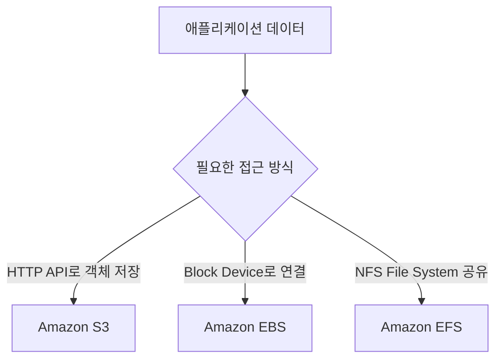

### Amazon S3란

S3는 데이터를 객체로 관리하는 Managed Service다. 객체는 실제 데이터와 Metadata로 구성되고, Bucket 안에서 Object Key로 식별된다. 사용자는 Storage Server, RAID, Disk 교체와 용량 확장을 직접 관리하지 않는다.

S3의 일반적인 특징은 다음과 같다.

- 하나의 일반 목적 Bucket에 사실상 제한 없이 많은 객체를 저장할 수 있다.
- 객체 하나의 최대 크기는 현재 `50 TB`이며, 큰 객체는 Multipart Upload가 필요하다.
- `PUT`, `DELETE`, `GET`, `LIST` 작업에 Strong Consistency를 제공한다.
- S3 Standard를 비롯한 여러 Storage Class는 연간 `99.999999999%`의 내구성을 목표로 설계되어 있다.
- 저장 용량뿐 아니라 Request, Retrieval과 Data Transfer를 기준으로 비용이 계산된다.
- Versioning, Lifecycle, Replication과 Object Lock을 이용해 객체의 수명과 보호 정책을 관리할 수 있다.

#### 내구성과 가용성은 다르다

내구성은 저장한 객체를 잃지 않을 가능성을 의미하고, 가용성은 필요한 시점에 서비스를 사용할 수 있는 가능성을 의미한다. 내구성이 높다고 해서 모든 요청이 항상 성공하거나 Application 장애가 발생하지 않는 것은 아니다.

또한 높은 내구성은 사용자의 실수까지 자동으로 되돌려 주는 Backup과 같은 의미가 아니다. 잘못된 권한으로 객체를 덮어쓰거나 삭제하면 그 변경도 정상 요청으로 처리된다. 실수와 공격에 대비하려면 Versioning, Object Lock, 별도 Account로의 Replication과 복구 절차를 함께 설계해야 한다.

#### Strong Consistency

S3는 객체를 새로 저장하거나 덮어쓰고 삭제한 뒤 성공 응답을 받으면, 이후의 `GET`과 `LIST` 요청에서 변경 결과를 일관되게 확인할 수 있다. 과거의 Eventual Consistency를 전제로 불필요한 대기나 재조회 로직을 추가할 필요는 없다.

다만 하나의 Object Key에 여러 Writer가 동시에 값을 저장할 때 S3가 업무 충돌을 해결해 주는 것은 아니다. 마지막으로 완료된 쓰기가 현재 객체가 될 수 있으므로, 동시 수정 제어가 필요하다면 Versioning, 조건부 요청과 Application 수준의 낙관적 Lock을 검토해야 한다.

### S3를 사용하는 전체 흐름

S3는 Bucket을 만든 뒤 바로 파일을 업로드하는 것보다 데이터의 공개 범위, 암호화, 보존 기간과 비용 정책을 먼저 정하는 편이 안전하다.

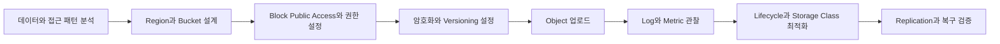

#### S3를 조작하는 방법

S3의 모든 작업은 API를 통해 수행된다. 관리 콘솔도 내부적으로는 동일한 API를 호출한다.

| 방법 | 적합한 상황 | 주의사항 |
|---|---|---|
| AWS Management Console | 소수 객체 확인, 초기 설정 | 반복 작업과 대량 전송에는 비효율적 |
| AWS CLI | 운영 Script, 일괄 복사와 동기화 | Profile과 실행 Role의 권한 확인 |
| AWS SDK | Application에서 업로드·다운로드 | 재시도, Timeout과 오류 처리 필요 |
| REST API | SDK를 사용하기 어려운 환경 | Signature Version 4 구현 필요 |
| AWS Transfer Family | SFTP·FTPS·FTP 기반 연동 | Endpoint와 전송량 비용 고려 |
| AWS DataSync | On-premises와 AWS Storage 간 대량 이동 | Agent, Task와 검증 옵션 설계 |

#### 기본 Bucket 생성 예제

다음 예제는 서울 Region에 일반 목적 Bucket을 만들고, Public Access 차단과 Versioning을 설정한다.

```shell
BUCKET_NAME="example-app-assets-123456789012"
REGION="ap-northeast-2"

aws s3api create-bucket \
  --bucket "${BUCKET_NAME}" \
  --region "${REGION}" \
  --create-bucket-configuration LocationConstraint="${REGION}"

aws s3api put-public-access-block \
  --bucket "${BUCKET_NAME}" \
  --public-access-block-configuration \
  BlockPublicAcls=true,IgnorePublicAcls=true,BlockPublicPolicy=true,RestrictPublicBuckets=true

aws s3api put-bucket-versioning \
  --bucket "${BUCKET_NAME}" \
  --versioning-configuration Status=Enabled
```

`create-bucket`은 Bucket의 이름과 Region을 결정한다. Bucket 이름과 Region은 생성 후 변경할 수 없다. `put-public-access-block`은 ACL과 Bucket Policy를 통한 의도하지 않은 Public Access를 방지하며, `put-bucket-versioning`은 같은 Key의 여러 Version을 보관할 수 있게 한다.

명령이 성공했다고 운영 설정이 끝난 것은 아니다. 기본 암호화, IAM Role, Bucket Policy, Logging, Lifecycle과 복구 정책까지 Workload에 맞게 구성해야 한다.

### 객체와 Bucket

S3의 가장 중요한 개념은 Bucket, Object와 Object Key다.

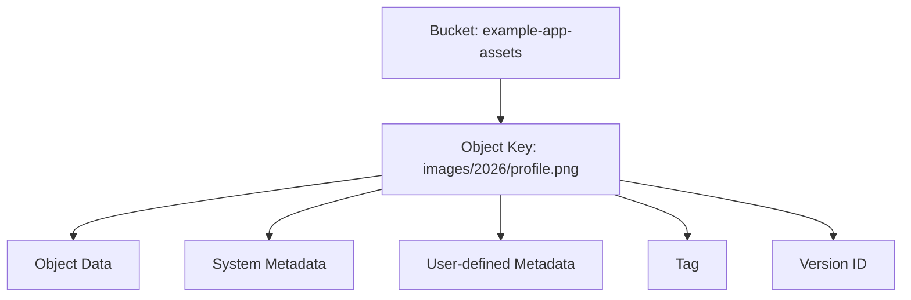

#### Object와 Object Key

Object는 파일 데이터와 Metadata를 하나의 단위로 저장한 것이다. Object Key는 Bucket 안에서 객체를 식별하는 이름이다.

```text
s3://example-app-assets/images/2026/profile.png
     └──── Bucket ────┘└────── Object Key ──────┘
```

S3는 File System이 아니므로 실제 Directory가 존재하지 않는다. `/`가 포함된 Key를 Console이 Folder처럼 표현할 뿐이다. `images/2026/`를 삭제한다는 동작도 Directory 하나를 지우는 것이 아니라 해당 Prefix를 가진 객체를 찾아 개별적으로 삭제하는 과정이다.

Object Key 설계는 조회와 운영에 직접 영향을 준다. 개인정보나 Secret을 Key에 포함하면 URL, Log와 Inventory에 노출될 수 있으므로 피해야 한다. 날짜, Tenant, 데이터 종류처럼 Lifecycle과 권한 정책에 사용할 기준을 Prefix 또는 Tag로 명확하게 표현하는 편이 좋다.

#### Object Metadata와 Tag

Metadata는 `Content-Type`, `Content-Length`, `ETag`처럼 객체의 속성을 설명한다. 사용자 정의 Metadata는 객체를 업로드할 때 지정하며, 이후 값을 바꾸려면 객체를 다시 복사해야 한다.

Tag는 Key-Value 형태로 객체를 분류한다. Bucket Policy, Lifecycle과 비용 분류에 사용할 수 있고 Metadata와 달리 객체 데이터를 다시 복사하지 않고 수정할 수 있다. 다만 Tag는 객체당 개수 제한이 있으므로 검색용 Database처럼 사용해서는 안 된다.

#### Bucket 이름과 Region

일반 목적 Bucket 이름은 기본적으로 같은 AWS Partition의 모든 Account에서 고유해야 한다. 이름은 `3~63`자의 소문자, 숫자, 마침표와 하이픈을 사용할 수 있으며 IP 주소 형식으로 만들 수 없다.

Bucket을 삭제하면 다른 Account가 같은 이름을 획득해 기존 요청을 받을 가능성이 있다. 동일한 이름을 계속 보호해야 한다면 Bucket을 삭제하지 말고 비운 뒤 모든 요청을 차단하는 방식을 검토한다. Bucket 이름에는 Project, Environment, Account 식별자와 무작위 Suffix를 포함하면 충돌 가능성을 줄일 수 있다.

```text
서비스-용도-환경-계정-리전-고유값
example-assets-prod-123456789012-apne2-a1b2c3
```

Bucket 이름과 Region은 생성 후 바꿀 수 없다. Region을 변경해야 한다면 새 Bucket을 만들고 Replication 또는 Copy 작업으로 객체를 이동한 뒤 Application Endpoint를 전환해야 한다.

### S3 접근 제어

S3 접근 권한은 하나의 설정만으로 결정되지 않는다. IAM Policy, Bucket Policy, Block Public Access, AWS Organizations SCP, VPC Endpoint Policy와 KMS Key Policy가 함께 평가될 수 있다.

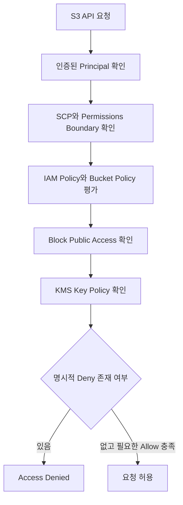

명시적인 `Deny`는 다른 `Allow`보다 우선한다. S3 권한이 허용되어 있어도 SSE-KMS로 암호화한 객체를 읽을 KMS 권한이 없다면 요청은 실패한다. 반대로 KMS 권한만 있고 `s3:GetObject` 권한이 없어도 객체를 읽을 수 없다.

#### IAM Policy와 Bucket Policy

IAM Policy는 사용자나 Role에 연결하는 Identity-based Policy다. 특정 Application Role이 어떤 Bucket을 사용할 수 있는지 정의할 때 적합하다.

Bucket Policy는 Bucket에 연결하는 Resource-based Policy다. 다른 Account나 AWS Service에 접근을 허용하거나, TLS를 사용하지 않는 요청을 강제로 차단하는 등 Bucket 전체 Guardrail을 설정할 수 있다.

다음 Bucket Policy는 암호화되지 않은 HTTP 요청을 거부하고 특정 Application Role에 객체 조회와 업로드 권한을 부여한다.

```json
{
  "Version": "2012-10-17",
  "Statement": [
    {
      "Sid": "DenyInsecureTransport",
      "Effect": "Deny",
      "Principal": "*",
      "Action": "s3:*",
      "Resource": [
        "arn:aws:s3:::example-app-assets-123456789012",
        "arn:aws:s3:::example-app-assets-123456789012/*"
      ],
      "Condition": {
        "Bool": {
          "aws:SecureTransport": "false"
        }
      }
    },
    {
      "Sid": "AllowApplicationList",
      "Effect": "Allow",
      "Principal": {
        "AWS": "arn:aws:iam::123456789012:role/example-app-role"
      },
      "Action": "s3:ListBucket",
      "Resource": "arn:aws:s3:::example-app-assets-123456789012",
      "Condition": {
        "StringLike": {
          "s3:prefix": "uploads/*"
        }
      }
    },
    {
      "Sid": "AllowApplicationObjects",
      "Effect": "Allow",
      "Principal": {
        "AWS": "arn:aws:iam::123456789012:role/example-app-role"
      },
      "Action": [
        "s3:GetObject",
        "s3:PutObject"
      ],
      "Resource": "arn:aws:s3:::example-app-assets-123456789012/uploads/*"
    }
  ]
}
```

Bucket 자체를 대상으로 하는 `s3:ListBucket`과 객체를 대상으로 하는 `s3:GetObject`, `s3:PutObject`의 Resource ARN이 다르다는 점이 중요하다. 실제 적용 시 예제의 Account ID, Role과 Bucket 이름을 운영 환경 값으로 바꿔야 한다.

#### ACL과 Object Ownership

ACL은 Bucket이나 객체 단위의 오래된 접근 제어 방식이다. 현재 새 Bucket은 기본적으로 `Bucket owner enforced`가 적용되어 ACL이 비활성화된다. 대부분의 환경에서는 이 설정을 유지하고 IAM Policy와 Bucket Policy로 권한을 관리하는 편이 단순하고 안전하다.

다른 Account가 객체를 업로드하는 환경에서 ACL을 다시 활성화하면 객체 소유권 문제가 생길 수 있다. 특별한 호환성 요구가 없다면 ACL을 사용하기보다 Bucket Owner가 모든 객체를 소유하도록 유지한다.

#### Block Public Access

Block Public Access는 Public ACL과 Public Bucket Policy가 적용되는 것을 차단하는 안전장치다. Account와 Bucket 수준에 각각 설정할 수 있으며, 새 Bucket에는 기본적으로 활성화된다.

파일을 외부 사용자에게 제공해야 한다고 해서 Bucket 전체를 Public으로 만들 필요는 없다. CloudFront, Application API 또는 Presigned URL을 사용하면 Bucket은 Private 상태로 유지하면서 필요한 객체만 전달할 수 있다.

#### S3 암호화

S3에 새로 저장되는 객체는 기본적으로 Server-side Encryption이 적용된다. 운영 환경에서는 암호화 여부뿐 아니라 Key의 통제와 감사 요구사항을 기준으로 방식을 선택한다.

| 방식 | Key 관리 | 적합한 경우 |
|---|---|---|
| SSE-S3 | S3가 관리하는 Key | 일반적인 저장 데이터 암호화 |
| SSE-KMS | AWS KMS Key 사용 | Key Policy, 감사, Rotation 제어가 필요한 경우 |
| DSSE-KMS | 두 계층의 KMS 기반 암호화 | 규제상 이중 암호화가 필요한 경우 |
| Client-side Encryption | Client에서 암호화 후 업로드 | AWS에 평문을 보내지 않아야 하는 경우 |

SSE-KMS를 사용하면 S3 Request 외에 KMS Request 비용과 KMS 권한이 추가된다. 대량 요청 환경에서는 Bucket Key를 검토해 KMS 호출 비용을 줄일 수 있다.

### Storage Class

Storage Class는 객체의 접근 빈도, 복원 시간과 장애 격리 수준에 맞춰 저장 비용을 선택하는 기능이다. Bucket마다 하나의 Class만 사용하는 것이 아니라 객체별로 서로 다른 Class를 지정할 수 있다.

| Storage Class | 접근 특성 | 주요 용도 | 주의사항 |
|---|---|---|---|
| S3 Standard | 자주 접근, Millisecond 응답 | Web 콘텐츠, Data Lake의 활성 데이터 | 기본 Class |
| S3 Intelligent-Tiering | 접근 패턴이 불규칙 | 장기 보관하지만 사용 시점을 모르는 데이터 | 객체 Monitoring 비용 발생 |
| S3 Standard-IA | 드물게 접근, 즉시 조회 | Backup, 오래된 원본 파일 | 최소 보관 기간과 Retrieval 비용 |
| S3 One Zone-IA | 드물게 접근, 단일 AZ | 재생성 가능한 Secondary 데이터 | AZ 손실에 견디지 못함 |
| S3 Glacier Instant Retrieval | 분기 단위 접근, 즉시 조회 | 즉시 열어야 하는 Archive | 최소 보관 기간과 Retrieval 비용 |
| S3 Glacier Flexible Retrieval | 분 단위에서 시간 단위 복원 | Backup과 장기 Archive | 사용 전 Restore 필요 |
| S3 Glacier Deep Archive | 장기간 거의 접근하지 않음 | 규정 보관, Digital Archive | 긴 복원 시간과 최소 보관 기간 |
| S3 Express One Zone | 매우 낮은 지연, 단일 AZ | 지연에 민감한 고성능 Workload | Directory Bucket과 단일 AZ 특성 |

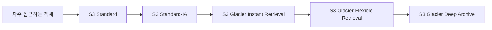

위 흐름이 모든 객체에 정답인 것은 아니다. 작은 객체는 최소 과금 크기 때문에 낮은 Storage Class로 이동해도 비용이 줄지 않을 수 있다. 보관 기간을 채우기 전에 삭제하면 조기 삭제 비용이 발생할 수 있고, Archive Class는 Retrieval 비용과 복원 시간이 추가된다.

접근 패턴을 예측하기 어렵다면 S3 Intelligent-Tiering을 검토할 수 있다. 객체별 접근을 감시해 적절한 Access Tier로 자동 이동하지만, 작은 객체나 수명이 짧은 객체가 많으면 Monitoring 비용까지 비교해야 한다.

### S3 요금 구조

S3 비용은 저장 용량 하나만으로 계산되지 않는다.

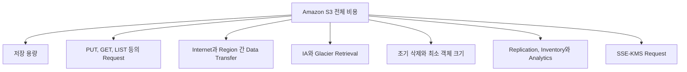

개발 환경에서는 저장 용량보다 잦은 `LIST`나 작은 객체의 대량 요청 비용이 더 커질 수 있다. Archive Class는 저장 비용이 낮지만 조회가 많아지면 Retrieval과 Request 비용이 커진다. Cross-Region Replication은 대상 Bucket의 저장 비용과 Region 간 전송 비용도 발생한다.

비용을 줄이기 전에 다음 항목을 함께 확인해야 한다.

- 객체 크기와 개수
- 월별 `PUT`, `GET`, `LIST` Request 수
- Internet, 다른 Region과 다른 AWS 서비스로 전송되는 양
- 객체의 평균 보존 기간과 조회 빈도
- Versioning으로 누적되는 Noncurrent Version
- 완료되지 않은 Multipart Upload Part
- Inventory, Storage Lens, Replication과 KMS 사용량

Storage Lens와 Cost and Usage Report를 이용하면 Bucket과 Account 단위의 사용량을 확인할 수 있다. 추정만으로 Storage Class를 일괄 변경하기보다 실제 Access Pattern과 Retrieval 비용을 측정해야 한다.

### 정적 웹사이트 호스팅

S3 Bucket에 HTML, CSS, JavaScript와 Image를 저장하고 정적 웹사이트 호스팅을 활성화하면 Website Endpoint를 통해 사이트를 공개할 수 있다. Server-side Rendering이나 Database 처리는 지원하지 않으므로 Client에서 실행되는 정적 파일에 적합하다.

#### S3 Website Endpoint를 직접 공개하는 방식

직접 호스팅하려면 Index Document와 Error Document를 지정하고, Block Public Access를 해제한 뒤 Public Read를 허용하는 Bucket Policy가 필요하다. 그러나 S3 Website Endpoint는 HTTPS를 지원하지 않는다.

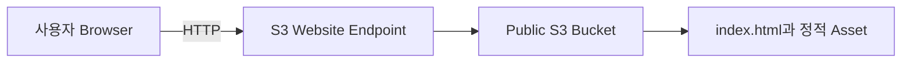

학습용이나 제한적인 환경에서는 사용할 수 있지만, 운영 사이트를 Public Bucket으로 만들고 HTTP로 제공하는 구성은 적절하지 않다.

#### CloudFront와 Private Bucket을 사용하는 방식

운영 환경에서는 S3 Bucket을 Private으로 유지하고 CloudFront를 앞에 배치하는 구성이 일반적이다. Origin Access Control을 사용하면 CloudFront Distribution만 S3 REST Endpoint에 접근하도록 제한할 수 있다.

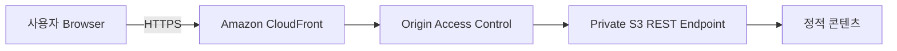

이 방식에서는 S3 Website Endpoint가 아니라 S3 REST Endpoint를 Origin으로 사용한다. CloudFront의 Default Root Object와 Custom Error Response를 이용해 정적 사이트 동작을 구성한다. Route 53과 ACM Certificate를 연결하면 사용자 Domain과 HTTPS를 적용할 수 있다.

### 파일 업로드와 다운로드

S3 객체는 Console, CLI, SDK와 REST API로 전송할 수 있다. On-premises 파일 전송 규약이 필요하면 AWS Transfer Family를, 대규모 Storage Migration에는 AWS DataSync를 검토한다.

#### AWS CLI 예제

```shell
aws s3 cp ./profile.png \
  s3://example-app-assets-123456789012/uploads/profile.png \
  --content-type image/png

aws s3 cp \
  s3://example-app-assets-123456789012/uploads/profile.png \
  ./downloaded-profile.png

aws s3 sync ./public/ \
  s3://example-app-assets-123456789012/public/ \
  --delete
```

`cp`는 단일 객체를 전송하고, `sync`는 Source와 Destination을 비교해 여러 객체를 동기화한다. `--delete`는 Source에 없는 Destination 객체를 삭제하므로 운영 Bucket에 적용하기 전에 `--dryrun`으로 대상 범위를 확인해야 한다.

#### Presigned URL

Browser나 Mobile Client가 파일을 업로드할 때 Application Server가 파일 전체를 중계하면 Network와 Memory 사용량이 커진다. Server가 짧은 만료 시간을 가진 Presigned URL을 발급하고 Client가 S3에 직접 전송하면 부하를 줄일 수 있다.

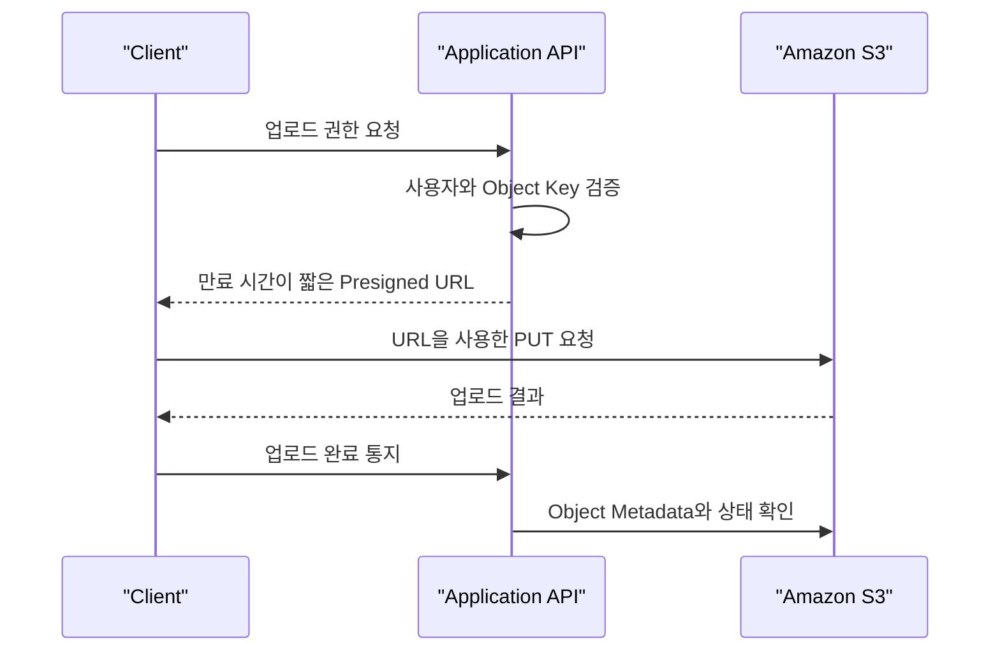

Presigned URL은 생성한 IAM Principal의 권한 범위 안에서만 동작한다. URL을 가진 사용자는 만료 전까지 요청을 실행할 수 있으므로 Object Key, HTTP Method, Content Type, 파일 크기와 만료 시간을 제한해야 한다. URL을 Log에 남기거나 장기간 재사용해서는 안 된다.

#### Multipart Upload

대용량 객체는 여러 Part로 나눠 병렬 업로드할 수 있다. 일부 Part가 실패하면 전체 파일 대신 실패한 Part만 다시 전송할 수 있다. 현재 한 객체는 최대 `50 TB`까지 저장할 수 있고 하나의 Multipart Upload는 최대 `10,000`개 Part를 사용한다.

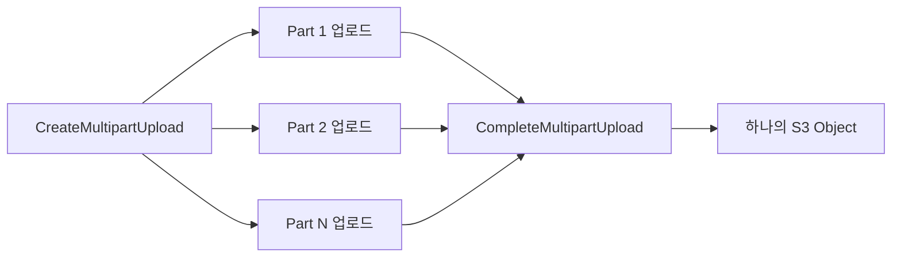

Multipart Upload를 시작하고 완료하거나 중단하지 않으면 업로드된 Part에 Storage 비용이 계속 발생한다. Lifecycle의 `AbortIncompleteMultipartUpload`를 설정해 오래된 미완료 Upload를 정리하는 것이 좋다.

### 접근 기록과 변조 방지

S3에 중요한 데이터를 저장했다면 누가 어떤 객체를 읽고 변경했는지 확인할 수 있어야 한다. Logging, Inventory와 Object Lock은 목적이 서로 다르므로 하나로 대체할 수 없다.

#### Server Access Logging과 CloudTrail

| 기능 | 확인할 수 있는 내용 | 주의사항 |
|---|---|---|
| S3 Server Access Logging | Bucket에 들어온 요청과 응답 정보 | Best-effort 전달이며 완전한 회계 자료로 단독 사용하지 않음 |
| CloudTrail Management Event | Bucket 설정 변경과 관리 API | Object 조회·저장은 Data Event 설정 필요 |
| CloudTrail Data Event | `GetObject`, `PutObject` 같은 객체 작업 | 기본 비활성화이며 이벤트 양과 비용 고려 |
| S3 Inventory | 객체 목록, 크기, 암호화와 Storage Class | 실시간 Log가 아닌 주기적 Report |
| S3 Storage Lens | Account와 Bucket의 사용·활동 지표 | 개별 요청 추적보다 집계 분석에 적합 |

Access Log를 Source Bucket과 같은 Prefix에 저장하면 Log 생성이 다시 Log를 만들 수 있다. 별도의 Logging Bucket을 사용하고 Lifecycle로 보존 기간을 관리하는 편이 안전하다.

#### Object Lock

Object Lock은 지정된 기간이나 Legal Hold가 유지되는 동안 특정 Object Version을 삭제하거나 덮어쓰지 못하도록 보호한다. Versioning과 함께 동작하며 다음 두 Retention Mode를 제공한다.

Bucket에서 Object Lock을 활성화하면 다시 비활성화할 수 없고 Versioning도 중지할 수 없다. 따라서 적용 전에 대상 Bucket, 기본 Retention 기간과 운영 권한을 충분히 검증해야 한다.

| Mode | 특징 |
|---|---|
| Governance | 특별한 우회 권한을 가진 Principal은 Retention을 변경하거나 삭제 가능 |
| Compliance | Root User를 포함해 Retention 기간 전에는 보호된 Version 삭제 불가 |

Compliance Mode는 잘못 설정해도 Retention 기간이 끝나기 전 해제할 수 없으므로 규정과 운영 절차를 먼저 검증해야 한다. Object Lock이 Backup을 자동 생성하는 것은 아니므로 Account 장애와 Region 재해에 대비한 Replication 또는 별도 Backup도 필요하다.

### Versioning과 Lifecycle

#### Versioning

Versioning을 활성화하면 같은 Object Key를 덮어쓸 때 기존 데이터가 Noncurrent Version으로 남는다. Versioning이 활성화된 Bucket에서 Version ID 없이 객체를 삭제하면 데이터가 즉시 영구 삭제되는 대신 Delete Marker가 현재 Version으로 추가된다.

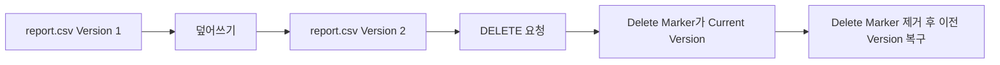

Versioning은 실수로 인한 덮어쓰기와 삭제 복구에 유용하지만 이전 Version도 Storage 비용을 발생시킨다. Versioning을 활성화한 뒤 Lifecycle 없이 운영하면 보이지 않는 Noncurrent Version과 Delete Marker가 계속 쌓일 수 있다.

#### Lifecycle Rule

Lifecycle은 객체의 Age, Prefix, Tag와 크기를 기준으로 Storage Class를 변경하거나 만료시키는 기능이다. Current Version과 Noncurrent Version의 정책을 별도로 정의할 수 있다.

```json
{
  "Rules": [
    {
      "ID": "archive-application-logs",
      "Status": "Enabled",
      "Filter": {
        "Prefix": "logs/"
      },
      "Transitions": [
        {
          "Days": 30,
          "StorageClass": "STANDARD_IA"
        },
        {
          "Days": 90,
          "StorageClass": "GLACIER_IR"
        }
      ],
      "Expiration": {
        "Days": 365
      },
      "NoncurrentVersionTransitions": [
        {
          "NoncurrentDays": 30,
          "StorageClass": "GLACIER_IR"
        }
      ],
      "NoncurrentVersionExpiration": {
        "NoncurrentDays": 120
      },
      "AbortIncompleteMultipartUpload": {
        "DaysAfterInitiation": 7
      }
    }
  ]
}
```

이 규칙은 `logs/` Prefix의 Current Version을 30일 뒤 Standard-IA, 90일 뒤 Glacier Instant Retrieval로 옮기고 365일 뒤 만료시킨다. Noncurrent Version은 30일 뒤 Archive Class로 옮긴 후 120일 뒤 영구 삭제하며, 7일 이상 완료되지 않은 Multipart Upload도 중단한다.

Lifecycle Expiration은 업무 보존 정책과 법적 요구사항을 확인한 뒤 적용해야 한다. 특히 Versioning Bucket에서는 Current Version 만료가 Delete Marker를 생성하는 동작과 Noncurrent Version 영구 삭제를 구분해야 한다.

### S3 Replication

S3 Replication은 객체와 Metadata를 같은 Region 또는 다른 Region의 Destination Bucket으로 비동기 복제하는 기능이다.

| 방식 | Destination | 대표적인 목적 |
|---|---|---|
| Same-Region Replication | 같은 Region의 다른 Bucket | Account 분리, Log 집계, 데이터 소유권 분리 |
| Cross-Region Replication | 다른 Region의 Bucket | 재해 복구, 지연 감소, 규정에 따른 지역 분리 |
| S3 Batch Replication | 기존 객체의 일괄 복제 | Replication 설정 전 객체와 실패 객체 재처리 |

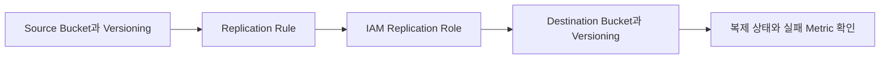

Source와 Destination Bucket 모두 Versioning이 활성화되어야 하고, S3가 복제를 수행할 IAM Role이 필요하다. 일반 Replication Rule은 설정 이후의 객체를 대상으로 하므로 기존 객체는 S3 Batch Replication을 사용해야 한다.

Replication은 즉시 완료되는 동기식 복사가 아니다. 복제 지연과 실패를 Monitoring하고 Destination에서 실제로 복원할 수 있는지 검증해야 한다. Delete Marker 복제 여부, KMS Key 권한, Destination Lifecycle과 객체 소유권도 별도로 확인해야 한다.

### 실무에서 확인할 S3 설계 기준

#### Bucket을 환경과 책임 단위로 분리한다

하나의 Bucket에 개발·운영 데이터와 공개·비공개 파일을 모두 넣으면 Policy와 Lifecycle이 복잡해진다. 데이터 소유 조직, 보안 등급, Environment, Region과 보존 정책이 다르면 Bucket을 분리하는 편이 명확하다.

Bucket 수를 무조건 늘리는 것도 정답은 아니다. 동일한 권한과 수명 주기를 가지는 데이터는 Prefix와 Tag로 관리할 수 있다. 정책이 실제 격리 경계를 제공해야 하는지, 단순 분류만 필요한지 판단해야 한다.

#### Application Server를 파일 중계 지점으로 만들지 않는다

대용량 업로드를 Application Server가 모두 받아 다시 S3로 전송하면 Network Traffic과 Thread, Temporary Disk 사용량이 증가한다. 사용자 인증과 Object Key 발급은 Application이 담당하고 실제 데이터 전송은 Presigned URL로 S3에 직접 수행하도록 구성할 수 있다.

업로드 완료 Event를 SQS나 EventBridge로 전달하면 Virus Scan, Thumbnail 생성과 Metadata 저장을 비동기 처리할 수 있다. Event는 중복 전달될 수 있으므로 Consumer는 같은 객체를 여러 번 처리해도 안전해야 한다.

#### 공개보다 Private을 기본값으로 둔다

Block Public Access와 ACL 비활성화를 기본으로 유지하고, 외부 제공이 필요한 객체는 CloudFront 또는 만료 시간이 짧은 Presigned URL로 전달한다. Public Bucket이 꼭 필요한 경우에도 별도 Bucket으로 격리하고 AWS Config와 IAM Access Analyzer로 공개 상태를 감시하는 편이 좋다.

#### 저장 성공과 복구 가능성을 구분한다

S3의 높은 내구성만 보고 복구 계획을 생략해서는 안 된다. Versioning, Lifecycle, Object Lock과 Replication은 각각 다른 장애에 대응한다. 정기적으로 객체와 Version을 복원하고, 다른 Account나 Region에서 Application이 실제로 읽을 수 있는지 확인해야 한다.

## 정리

Amazon S3는 Server와 Disk를 직접 관리하지 않고 API로 객체를 저장하는 Managed Object Storage다. 높은 확장성과 내구성을 제공하지만 데이터 구조, 접근 권한, 보존 기간과 비용 정책은 사용자가 설계해야 한다.

이번 장의 핵심 내용을 정리하면 다음과 같다.

- S3는 File System이 아니라 Bucket과 Object Key를 사용하는 Object Storage다.
- S3는 객체 쓰기와 삭제 이후 Strong Consistency를 제공하지만 Application의 동시 수정 충돌까지 해결하지는 않는다.
- 일반 목적 Bucket 이름은 기본적으로 Partition 안에서 고유하며 이름과 Region은 생성 후 변경할 수 없다.
- 현재 새 Bucket은 ACL이 비활성화되고 Block Public Access가 활성화되는 구성이 기본이다.
- IAM Policy와 Bucket Policy뿐 아니라 SCP, VPC Endpoint Policy와 KMS Key Policy까지 함께 권한을 결정할 수 있다.
- Storage Class는 접근 빈도와 복원 시간에 맞게 선택하고 최소 보관 기간, Retrieval과 조기 삭제 비용을 함께 계산해야 한다.
- S3 Website Endpoint는 HTTPS를 지원하지 않으므로 운영 사이트는 CloudFront와 Private Bucket 구성을 우선 검토한다.
- 큰 파일은 Multipart Upload를 사용하고 미완료 Part가 남지 않도록 Lifecycle을 설정한다.
- Server Access Logging, CloudTrail Data Event, Inventory와 Storage Lens는 서로 다른 관찰 목적을 가진다.
- Versioning은 이전 Version을 보존하지만 Lifecycle이 없으면 Storage 비용이 계속 증가할 수 있다.
- Replication은 비동기 방식이므로 복제 상태와 실제 복원 가능성을 별도로 검증해야 한다.

S3를 단순한 파일 보관소로만 사용하면 권한과 비용, 복구 문제가 뒤늦게 드러난다. 처음부터 객체의 생성, 접근, 보존, 이동과 삭제까지 전체 수명 주기를 설계하면 S3를 안정적인 Application Storage이자 Data Platform의 기반으로 활용할 수 있다.
