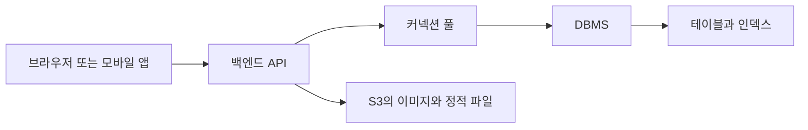
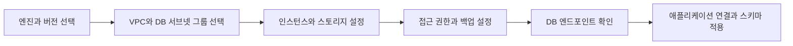
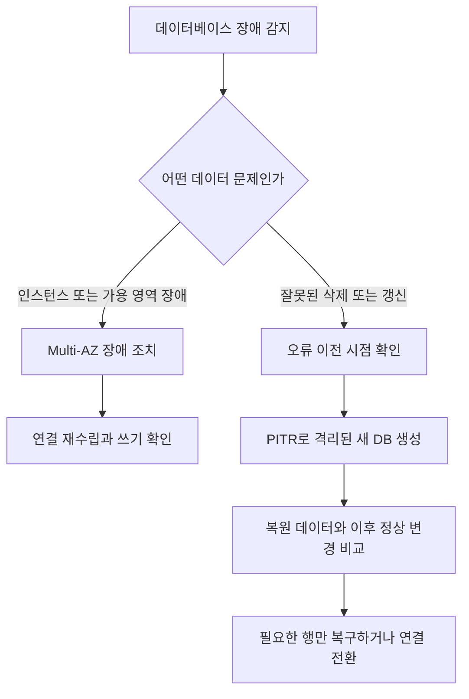
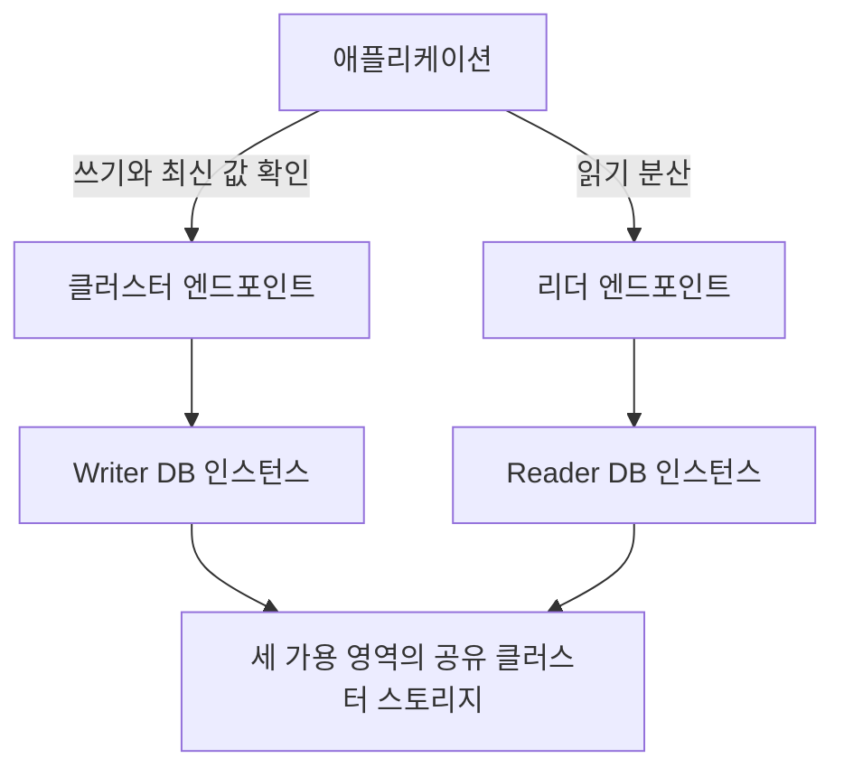
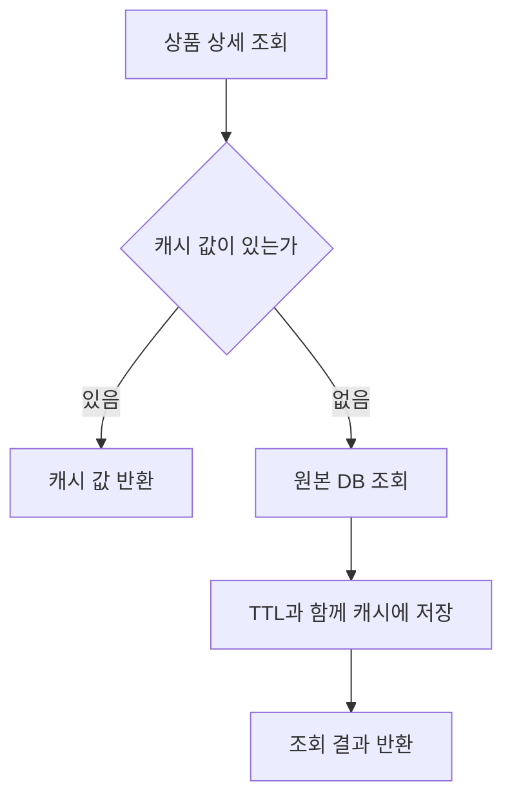

# 6장. 데이터베이스 서비스

# 6장. 데이터베이스 서비스
* toc
{:toc}

---

## 데이터베이스는 무엇을 기준으로 고르는가

쇼핑몰에서 주문 내역, 로그인 세션, 상품 상세 화면의 캐시, 배송 차량의 위치 기록은 모두 데이터다. 하지만 필요한 보장은 각각 다르다. 주문과 주문 상품은 함께 저장되어야 하고, 세션은 보통 세션 ID 하나로 조회한다. 상품 캐시는 원본에서 다시 채울 수 있지만, 차량 위치는 개별 기록보다 일정 시간 동안의 이동과 변화가 중요하다.

AWS에서 데이터베이스를 고를 때는 데이터의 크기보다 **어떤 조건으로 조회하고, 어떤 변경이 함께 성공해야 하며, 장애가 나면 어디까지 복구해야 하는가**를 먼저 정하는 편이 좋다. 같은 애플리케이션이라도 요구사항이 분명하게 다른 부분에는 서로 다른 저장소를 사용할 수 있다.

| 데이터 모델 | 먼저 살펴볼 AWS 서비스 | 잘 맞는 작업 |
|---|---|---|
| 관계형 | Amazon RDS, Amazon Aurora | 주문, 정산처럼 여러 테이블의 제약과 트랜잭션이 중요한 작업 |
| 키-값·문서 | Amazon DynamoDB | 사용자 ID, 세션 ID 또는 미리 정한 키 패턴으로 조회하는 작업 |
| 문서형 | Amazon DocumentDB | 중첩된 필드와 배열을 포함한 문서를 저장하고 검색하는 작업 |
| 인메모리 | Amazon ElastiCache | 자주 사용하는 조회 결과, 짧은 수명의 세션, 카운터 |
| 그래프 | Amazon Neptune | 여러 단계에 걸친 관계 탐색, 추천, 연결 경로 분석 |
| 시계열 | Amazon Timestream | 장비나 센서에서 들어오는 측정값의 시간 구간별 조회와 집계 |

### 데이터베이스, DBMS, SQL의 차이

데이터베이스는 구조화해서 보관한 데이터의 집합이고, DBMS는 그 데이터를 저장하고 조회하며 동시 접근을 관리하는 소프트웨어다. PostgreSQL과 MySQL은 관계형 데이터베이스를 관리하는 RDBMS이고, SQL은 애플리케이션이나 관리 도구가 여기에 명령을 전달할 때 주로 사용하는 언어다.

웹 시스템에서는 브라우저가 DB에 직접 연결하지 않는다. 백엔드가 사용자를 인증하고 요청을 검증한 뒤, 커넥션 풀에서 연결을 얻어 필요한 쿼리를 실행한다. 정적 파일이나 원본 이미지는 앞 장에서 다룬 S3에 두고, 주문 상태나 이미지 소유자처럼 검색하고 변경해야 하는 정보는 DB에 저장할 수 있다.



### 관계형 데이터베이스와 트랜잭션

관계형 데이터베이스는 데이터를 행과 열로 이루어진 테이블에 저장하고, 기본 키와 외래 키로 각 행을 식별하고 연결한다. 예를 들어 주문 번호로 `orders`를 찾고, 같은 번호를 참조하는 `order_items`를 조인하면 주문 상품까지 조회할 수 있다. SQL에서 `SELECT`는 조회, `INSERT`는 추가, `UPDATE`는 변경, `DELETE`는 삭제에 사용한다.

다음 예제에서는 상품 행이 없는 주문을 중간 상태로 남기지 않도록 두 삽입을 하나의 트랜잭션에 묶는다. 새 스키마에서 한 번 실행하는 예제이며, 실제 애플리케이션에서는 SQL에 값을 이어 붙이지 않고 바인딩하고 예외가 나면 트랜잭션을 롤백한다.

```sql
CREATE TABLE orders (
    order_id BIGINT PRIMARY KEY,
    customer_id BIGINT NOT NULL,
    status VARCHAR(20) NOT NULL CHECK (status IN ('CREATED', 'PAID', 'CANCELLED'))
);

CREATE TABLE order_items (
    order_id BIGINT NOT NULL REFERENCES orders (order_id),
    line_no INTEGER NOT NULL,
    product_id BIGINT NOT NULL,
    quantity INTEGER NOT NULL CHECK (quantity > 0),
    PRIMARY KEY (order_id, line_no)
);

BEGIN;

INSERT INTO orders (order_id, customer_id, status)
VALUES (1001, 42, 'CREATED');

INSERT INTO order_items (order_id, line_no, product_id, quantity)
VALUES (1001, 1, 207, 2);

COMMIT;

SELECT o.order_id, o.status, i.product_id, i.quantity
FROM orders AS o
JOIN order_items AS i ON i.order_id = o.order_id
WHERE o.order_id = 1001;
```

조회하면 `1001`, `CREATED`, `207`, `2`가 한 행으로 나온다. 외래 키는 존재하지 않는 주문에 상품을 추가하는 일을 막고, `CHECK` 제약은 수량이 0 이하인 값을 막는다. 다만 이 예제만으로 외부 결제 API 호출까지 원자적으로 처리되는 것은 아니다. DB 트랜잭션에 포함되지 않는 결제나 메시지 발행은 별도의 실패 처리와 중복 방지 설계가 필요하다.

트랜잭션의 성질은 보통 ACID로 설명한다. **원자성**은 작업이 전부 반영되거나 전부 취소되는 성질, **일관성**은 작업 전후에 정의된 제약을 만족하는 성질이다. **격리성**은 동시에 실행되는 트랜잭션의 변경이 어떻게 보이는지를 다루며, 실제 동작은 격리 수준에 따라 달라진다. **지속성**은 커밋한 변경을 엔진이 제공하는 보장 범위에서 장애 후에도 보존하는 성질이다. 여기서 ACID의 일관성과 복제본에서 최신 값을 즉시 읽을 수 있는지는 다른 문제다.

### 비관계형 데이터베이스는 스키마가 필요 없는가

NoSQL은 키-값, 문서, 그래프, 시계열 등 서로 다른 모델을 묶는 표현이다. 모든 NoSQL 서비스의 일관성이나 트랜잭션 보장이 같지는 않다. DynamoDB도 조건부 쓰기와 트랜잭션을 제공하고, SQL과 유사한 PartiQL 인터페이스를 지원한다. 그렇다고 관계형 조인과 같은 방식으로 모델링하는 것은 아니다.

문서마다 필드가 달라도 저장할 수 있다는 말은 설계를 생략해도 된다는 뜻이 아니다. 어떤 필드로 자주 조회하는지, 어떤 값으로 데이터를 분산하는지, 이전 버전의 문서를 새 코드가 읽을 수 있는지까지 애플리케이션에서 정해야 한다. 관계형 DB에서는 테이블 간 제약을 먼저 정한다면, 키 기반 NoSQL에서는 접근 패턴을 모델의 출발점으로 삼는 경우가 많다.

## Amazon RDS

Amazon RDS는 관계형 DB를 관리형으로 운영하는 서비스다. AWS가 인프라, 엔진 설치, 설정에 따른 백업과 장애 조치 등을 맡는다. 사용자는 엔진과 버전, 스키마와 인덱스, 권한, 쿼리 튜닝, 백업 보존 기간을 결정한다. AWS가 DB를 관리해 준다고 해서 느린 쿼리가 자동으로 개선되거나, 운영자가 삭제한 데이터가 자동 복구되는 것은 아니다.

### 엔진, 인스턴스 클래스와 비용

| 엔진 | 선택할 때 확인할 사항 |
|---|---|
| PostgreSQL | 사용하는 확장, 버전, SQL 문법과 마이그레이션 도구 지원 여부 |
| MySQL | 문자셋과 정렬 규칙, SQL 모드, 드라이버 호환성 |
| MariaDB | MySQL과 갈라진 뒤 달라진 기능과 복제·이전 호환성 |
| Oracle Database | 에디션, 옵션, 라이선스 모델과 기존 애플리케이션 의존성 |
| Microsoft SQL Server | 지원 에디션, 기능 제한과 라이선스 비용 |
| IBM Db2 | 기존 DB 기능의 지원 범위와 라이선스 조건 |
| Amazon Aurora | MySQL 호환과 PostgreSQL 호환 중 선택. 클러스터 구조와 호환성 별도 확인 |

`db.r6g.large`와 같은 DB 인스턴스 클래스는 컴퓨팅 사양을 나타낸다. 메모리 최적화 계열은 버퍼 캐시나 메모리를 많이 사용하는 쿼리에 유리할 수 있고, 버스트 가능 클래스는 평균 부하가 낮고 간헐적으로 CPU가 필요한 곳에 적합하다. 같은 엔진이라도 버전과 리전, 배포 방식에 따라 선택할 수 있는 클래스가 다르다. 클래스는 CPU뿐 아니라 가용 메모리, 연결 수, 읽기·쓰기 지연, I/O 병목을 함께 보고 정한다.

RDS 비용은 보통 **인스턴스, 스토리지와 I/O 옵션, 백업, 데이터 전송**을 나눠 계산한다. 일반적인 RDS의 할당형 스토리지는 실제로 채운 양이 아니라 할당한 용량이 비용의 기준이 된다. Multi-AZ와 읽기 복제본을 더하면 인스턴스와 스토리지 비용 구조가 바뀌며, 상용 엔진은 에디션과 라이선스 모델도 확인해야 한다. 스냅샷 복원으로 만든 DB와 삭제한 DB에서 별도로 보관한 스냅샷 역시 비용 계산에서 빠뜨리기 쉽다.

### RDS를 만들고 애플리케이션에서 연결하기



| 단계 | 확인할 항목 |
|---|---|
| 네트워크 | DB가 사용할 VPC와 서브넷을 DB 서브넷 그룹에 지정한다. 배포 유형이 요구하는 수만큼 가용 영역을 확보한다. |
| 접근 경로 | DB의 공용 접근은 기본적으로 끄고, 예를 들어 PostgreSQL의 `5432`는 애플리케이션의 보안 그룹을 출발지로 허용한다. MySQL의 기본 포트는 `3306`이다. |
| 엔진 설정 | 파라미터 그룹으로 엔진 설정을 관리한다. 일부 엔진은 옵션 그룹도 제공한다. 적용에 재시작이 필요한 설정인지 변경 전에 확인한다. |
| 연결 정보 | RDS 리소스 식별자는 엔진 안의 데이터베이스 이름과 다르다. 애플리케이션에는 DB 엔드포인트, 포트, DB 이름과 애플리케이션 전용 계정을 전달한다. |
| 운영 보호 | 저장 데이터 암호화, TLS 인증서 검증, 백업 보존 기간, 삭제 방지, 유지보수 창과 로그 내보내기를 정한다. |

콘솔, CLI와 IaC는 RDS 리소스를 **만들고 관리하는** 도구다. 실제 테이블 데이터를 읽고 쓰는 작업에는 `psql`이나 MySQL 클라이언트, 애플리케이션의 JDBC 드라이버를 사용한다. 연결이 실패하면 먼저 DNS와 네트워크 경로, 보안 그룹을 확인하고, 그다음 포트, 인증 정보, TLS 인증서와 DB 내부 권한을 점검한다. 응답 시간을 확인할 때는 쿼리 실행 시간과 커넥션 풀에서 대기한 시간을 구분해야 한다.

EC2에 엔진을 직접 설치하면 운영체제 접근과 파일 시스템 제어, 특수한 DB 확장 설치가 자유롭지만 패치, 복제, 장애 복구도 직접 관리해야 한다. 일반 RDS DB에는 EC2처럼 SSH로 접근하거나 AMI로 내보낼 수 없다. DB에 대한 별도의 운영체제 제어가 필요하지 않다면 이 제한 덕분에 관리할 표면도 줄어든다.

기존 DB에서 옮기는 경우 AWS DMS를 사용해 초기 적재와 지원되는 원본의 변경 데이터 캡처(CDC)를 조합할 수 있다. 그러나 데이터 전송만으로 인덱스, 함수, 트리거와 애플리케이션 쿼리까지 모두 호환된다는 뜻은 아니다. 실제 전환 전에는 스키마와 쿼리 검증, 복제 지연 확인, 최종 쓰기 전환과 롤백 기준을 정해 둔다.

### Multi-AZ, 읽기 복제본과 백업의 차이

| 기능 | 해결하는 문제 | 놓치기 쉬운 점 |
|---|---|---|
| Multi-AZ DB 인스턴스 | 다른 가용 영역의 대기 인스턴스로 자동 장애 조치 | 대기 인스턴스는 애플리케이션의 읽기 트래픽을 받지 않는다. |
| Multi-AZ DB 클러스터 | 3개 가용 영역의 writer 1개와 reader 2개로 장애 조치와 읽기 분산 | RDS for MySQL과 PostgreSQL의 지원 조합에서 사용하며, Aurora 클러스터와는 다른 배포 유형이다. |
| RDS 읽기 복제본 | 조회 부하 분산, 지원 구성에서 다른 리전의 복구 대상 확보 | 비동기 복제에서는 최신 쓰기가 늦게 보일 수 있다. 기본 자동 장애 조치 대상과는 구분한다. |
| 수동 스냅샷 | 배포 전후처럼 특정 시점의 상태 보관 | 복원은 보통 새 DB로 수행한다. |
| 자동 백업과 PITR | 보존 범위 안의 특정 시점으로 복구 | 최신 복원 가능 시각을 먼저 확인한다. 복원 후 검증과 연결 전환도 필요하다. |

인스턴스 장애라면 새 writer로 전환하는 것이 우선이다. 반대로 `DELETE`를 잘못 실행했다면 그 변경도 복제될 수 있으므로 복제본만으로 이전 데이터를 되찾을 수 없다. 이때 필요한 것은 오류 이전 시점의 백업이다.



장애 조치 후에도 기존 TCP 연결과 실행 중이던 트랜잭션이 그대로 살아나는 것은 아니다. 연결 풀은 죽은 연결을 교체해야 하고, DNS가 바뀌었을 때 이전 주소를 무기한 캐시해서도 안 된다. 특히 응답을 받기 전에 연결이 끊긴 쓰기는 이미 커밋되었을 수 있으므로, 주문 번호나 멱등성 키로 처리 여부를 확인할 수 있게 만든다.

복구 목표는 RPO와 RTO로 나눠 생각할 수 있다. RPO는 잃어도 되는 데이터의 시간 범위이고, RTO는 서비스를 되살리기까지 허용되는 시간이다. 예를 들어 복원 리소스가 `available`이 되었다고 RTO를 달성한 것은 아니다. 보안 그룹과 계정, 연결 전환, 정합성 확인이 끝나 사용자가 다시 처리할 수 있어야 복구가 끝난다.

## Amazon Aurora

Aurora는 AWS가 개발한 관계형 DB로 MySQL 호환과 PostgreSQL 호환 엔진을 제공한다. 일반 RDS 엔진과 구별되는 점은 DB 컴퓨팅 인스턴스와 클러스터 스토리지를 분리한다는 것이다. writer와 reader가 같은 논리적 클러스터 볼륨을 사용하며, 스토리지는 세 가용 영역에 걸쳐 여섯 복사본으로 저장되도록 설계되어 있다. 이 여섯 복사본은 여섯 개의 읽기 인스턴스를 뜻하지 않는다.



reader를 별도 가용 영역에 배치하면 읽기 부하를 나누고 writer 장애 때 승격 대상으로 사용할 수 있다. 리더 엔드포인트는 쿼리마다 분배하는 것이 아니라 **새 연결을** reader에 분산하므로, 이미 연결된 커넥션 풀이 한 reader에 몰릴 수 있다. reader가 없는 클러스터에서는 리더 엔드포인트가 writer로 연결될 수 있으므로, 엔드포인트만으로 쓰기 금지를 보장하지 말고 읽기 전용 DB 계정도 사용한다. 주문 생성 직후 같은 요청 흐름에서 최신 상태가 반드시 보여야 한다면 writer를 통해 확인하는 것이 명확하다.

Aurora Serverless는 설정한 범위 안에서 인스턴스의 컴퓨팅 용량을 부하에 맞춰 조정하고, 그 용량을 ACU로 표현한다. 저장 비용과 I/O 과금 방식은 컴퓨팅 비용과 구분해서 본다. Aurora Global Database는 주 리전과 보조 리전을 두어 다른 리전의 읽기나 리전 장애에 대비하는 기능이다. 보조 리전을 둔다고 각 리전이 독립적인 writer가 되는 것은 아니다.

이름이 비슷한 **Aurora DSQL**은 Aurora DB 클러스터의 옵션이 아니라 PostgreSQL 호환 분산 SQL 서비스다. 지원되는 멀티 리전 구성은 활성 리전 양쪽에서 읽고 쓸 수 있다. PostgreSQL 클라이언트를 사용할 수 있더라도 지원 SQL, 인증, 동시성 동작에는 차이가 있으므로 기존 Aurora PostgreSQL이나 PostgreSQL의 그대로인 대체재로 가정하지 않는다.

## Amazon DynamoDB

DynamoDB는 키-값과 문서 모델을 제공하는 서버리스 데이터베이스다. 사용자가 DB 인스턴스를 직접 프로비저닝하거나 엔진에 TCP로 연결하는 대신, SDK 또는 HTTPS API로 요청한다. 애플리케이션은 IAM 권한을 사용하며, VPC 안의 리소스에서는 필요에 따라 VPC 엔드포인트를 통한 접근을 구성할 수 있다.

### 조회 방식을 먼저 정하고 키를 만든다

사용자별 알림을 시간순으로 가져오는 화면이 있다고 하자. 파티션 키를 `USER#42`, 정렬 키를 `NOTIF#2026-11-20T09:15:00Z#n001`처럼 두면 한 사용자의 알림을 `Query`로 찾고 시간 범위를 좁힐 수 있다. 반대로 한 키에 전체 고객의 알림을 집중시키면 부하가 몰리는 핫 파티션이 생길 수 있다.

```json
{
  "pk": "USER#42",
  "sk": "NOTIF#2026-11-20T09:15:00Z#n001",
  "type": "ORDER_SHIPPED",
  "orderId": 1001,
  "read": false
}
```

위 JSON은 논리적인 항목 예시다. `PutItem`, `GetItem`, `UpdateItem`, `DeleteItem`은 항목 단위 작업이고, 복합 기본 키를 쓰는 테이블에서 `GetItem`에는 두 키를 모두 전달한다. `Query`는 파티션 키의 값을 지정하고 필요하면 정렬 키의 조건을 추가한다. `Scan`은 테이블이나 인덱스의 항목을 훑는다. 필터는 읽은 뒤 적용되므로 응답이 작다고 읽기 비용까지 작아지는 것은 아니다.

다른 관점의 조회가 필요하면 보조 인덱스를 설계한다. 예를 들어 주문 번호로 알림을 찾아야 하는 요구사항에는 그 번호를 키로 한 GSI를 검토할 수 있다. 다만 인덱스에는 쓰기 및 저장 비용이 추가되고, GSI 읽기에는 강한 일관성을 요청할 수 없다. 변경 직후 확인이 필요한 경우 기본 테이블의 강한 일관성 읽기처럼 요구사항에 맞는 경로를 고른다.

### 동시성, 변경 스트림과 요금

조건부 쓰기로 이미 처리한 요청의 중복 등록을 막을 수 있고, 여러 항목을 함께 바꿔야 하면 트랜잭션 API를 검토할 수 있다. DynamoDB Streams로 항목 생성·수정·삭제를 소비해 알림 발송과 같은 후속 작업을 처리할 때는 이벤트 재처리에 대비해 소비자를 멱등하게 작성한다.

Global Tables는 여러 리전에서 테이블을 사용할 때 선택할 수 있다. MREC는 리전 사이에서 비동기로 변경을 전파하고, MRSC는 지원되는 리전 조합에서 리전 간 강한 일관성을 제공한다. 일관성 모드는 생성 후 바꿀 수 없으므로, 사용 가능한 리전과 필요한 기능, 정상 시 쓰기 지연까지 비교한다.

온디맨드 모드는 사용한 읽기·쓰기 요청 단위로 과금되고, 프로비저닝 모드는 설정한 처리량을 기준으로 과금된다. 같은 호출 횟수라도 항목 크기, 읽기 일관성, 트랜잭션 사용과 보조 인덱스에 따라 소비량이 달라진다. 비교할 때 저장, 백업, 리전 간 복제 비용도 포함한다.

## Amazon DocumentDB

문서형 DB는 상품의 옵션과 속성처럼 함께 읽는 데이터를 JSON과 유사한 문서 안에 중첩해서 저장한다. 예를 들어 의류의 사이즈와 전자제품의 정격 전압을 같은 상품 컬렉션에서 서로 다른 필드로 표현할 수 있다. 그래도 조회 조건과 정렬이 정해졌다면 그에 맞는 인덱스가 필요하며, 중첩 문서가 계속 커지는 구조는 업데이트와 읽기 비용을 늘릴 수 있다.

Amazon DocumentDB는 MongoDB API와 호환되는 관리형 서비스지만, 내부 엔진은 MongoDB 자체가 아니다. MongoDB 호환 드라이버를 쓰더라도 대상 버전에서 집계 연산자와 인덱스, 트랜잭션, `retryWrites` 설정이 지원되는지 확인해야 한다. 같은 쿼리의 실행 계획도 달라질 수 있다. 이전을 결정하기 전에 자주 쓰는 쿼리와 인덱스를 작은 데이터뿐 아니라 운영과 비슷한 분포에서도 검증한다.

인스턴스 기반 클러스터를 계산할 때는 writer와 reader의 컴퓨팅, 저장 용량, 구성에 따른 I/O, 백업과 전송을 나눠 본다. 클러스터 유형과 요금 옵션에 따라 과금 기준이 다르므로 MongoDB와 접속 방식이 비슷하다는 이유로 비용도 같을 것이라 가정하지 않는다.

## Amazon ElastiCache

ElastiCache는 자주 읽는 데이터를 메모리에 두어 원본 DB에 가는 요청을 줄이는 데 사용한다. Valkey와 Redis OSS는 문자열 외에도 해시, 리스트, 정렬 집합 같은 자료구조를 활용할 수 있고, Memcached는 단순한 키-값 캐시가 필요한 경우 검토할 수 있다. 엔진과 배포 옵션에 따라 복제, 장애 조치와 지속성 지원이 다르지만, 일반적인 조회 캐시 설계에서는 원본 DB를 기준으로 캐시를 다시 만들 수 있어야 한다.



이 방식은 캐시 어사이드(Cache-Aside)라고 한다. 데이터 변경 시에는 원본 DB의 커밋 이후 해당 캐시 키를 무효화하는 방식을 흔히 쓴다. 갱신과 조회가 겹칠 때 낡은 값이 캐시에 다시 채워질 수 있으므로, 짧은 TTL만으로 허용할 수 있는 지연인지 먼저 정한다. 여러 키의 TTL이 동시에 끝나면 DB에 조회가 몰릴 수 있어 만료 시점에 편차를 주거나, 같은 키의 재생성을 한 요청만 수행하게 할 수 있다.

노드 기반은 선택한 노드 종류와 개수, 가동 시간을 중심으로 계산하고, 서버리스는 저장 데이터와 요청이 사용한 처리 용량(ECPU)이 비용의 주요 기준이다. 비용뿐 아니라 캐시 적중률, 메모리 여유, 키 축출 수, 캐시 장애 때의 원본 DB 부하를 함께 본다.

## 그래프와 시계열 데이터베이스

### Amazon Neptune

그래프 DB에서는 사용자나 상품이 노드이고, 팔로우나 구매처럼 두 대상을 잇는 관계가 엣지다. 예를 들어 ‘내가 팔로우하는 사람들이 최근에 구매한 상품’을 찾을 때는 연결을 몇 단계 따라가는지가 쿼리의 중심이 된다. 단순한 1단계 관계만 필요하다면 관계형 DB의 인덱스와 조인으로도 충분할 수 있다. 관계 자체가 핵심이고 탐색 깊이가 일정하지 않은 경우 그래프 모델의 장점이 커진다.


Neptune Database는 속성 그래프에 Gremlin과 openCypher를, RDF 그래프에 SPARQL을 사용한다. 서로 다른 그래프 모델에 대응하는 언어이므로, RDF로 쌓은 데이터를 openCypher로 바로 조회할 수 있다고 가정하면 안 된다. 비용은 인스턴스 기반 컴퓨팅 또는 Neptune Serverless의 NCU 사용량, 그리고 스토리지, 선택한 구성에 따른 I/O와 백업 비용을 구분해 계산한다.

### Amazon Timestream

시계열 데이터는 측정 시각, 장비나 센서의 식별 정보, 측정값으로 구성된다. 장비별 최신 온도, 지난 한 시간의 5분 평균, 최근 30일의 최대값처럼 **시간 구간을 기준으로 읽는 쿼리**가 많다. 빈번히 조회하는 최근 구간과 장기간 보관만 하는 구간의 비용을 다르게 계산해야 할 때도 있다.

Timestream for LiveAnalytics는 시계열 집계와 메모리·마그네틱 스토어의 보존 정책을 제공한다. 비용을 볼 때는 쓰기량, 쿼리 처리, 각 저장 계층의 보유량과 기간을 구분한다. 다만 **2025년 6월 20일부터 LiveAnalytics의 신규 고객 접근은 종료**되었다. 기존 고객 워크로드의 종료를 뜻하는 것은 아니다. 신규 프로젝트라면 Timestream for InfluxDB 등 현재 이용할 수 있는 서비스를 검토하고, 쿼리와 저장 모델이 달라 그대로 옮길 수 있는지 따로 확인한다.

## 정리

주문처럼 여러 데이터의 제약과 변경을 함께 관리해야 한다면 RDS나 Aurora부터 검토한다. 자주 쓰는 조회가 키로 명확하다면 DynamoDB, 중첩 문서를 필드 단위로 검색하는 것이 중요하다면 DocumentDB가 후보가 된다. 반복 조회를 원본에서 분리하는 것이 목표라면 ElastiCache, 여러 단계의 연결이나 시간 구간이 쿼리의 중심이라면 각각 Neptune과 시계열 DB를 검토할 수 있다.

운영에서 특히 중요한 구분은 **장애 조치, 읽기 확장, 과거 데이터 복구가 서로 다른 문제**라는 점이다. Multi-AZ는 DB가 다시 요청을 받을 수 있게 돕고, 읽기 복제본은 조회 부하를 분산하며, 백업과 PITR은 잘못 반영된 변경 이전의 데이터로 돌아갈 수 있게 한다. 서비스를 고를 때는 정상 상황의 쿼리 속도뿐 아니라 장애 시 어떤 데이터를 어느 시점까지, 얼마나 빨리 복구할 수 있는지도 같이 결정해야 한다.
