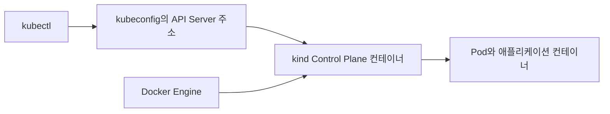

# Ch 4. Kubernetes 실습 환경 구성

# Ch 4. Kubernetes 실습 환경 구성
* toc
{:toc}

---

## 01. Kubernetes 실습 환경 개요

Kubernetes를 학습할 때 가장 먼저 부딪히는 문제는 **실습 환경 구성**이다.
실제 운영 환경처럼 AWS나 GCP에 클러스터를 구성할 수도 있지만, 학습 단계에서는 비용과 설정 부담이 크다.

이 챕터에서는 **로컬 머신에서 Kubernetes 클러스터를 실행하는 환경**을 구성한다.
이를 통해 별도의 클라우드 사용료 없이 Kubernetes의 핵심 개념과 동작 방식을 실습할 수 있다. 다만 로컬 PC의 CPU·메모리·디스크를 사용하며, Docker Desktop의 조직별 사용 조건도 별도로 확인해야 한다.

실습 환경은 다음 세 가지 도구로 구성된다.

1. Docker Desktop
2. kind (Kubernetes IN Docker)
3. kubectl

---

## 02. Docker Desktop 설치

Docker Desktop은 로컬 머신에서 컨테이너를 실행하기 위한 기본 환경이다.
이 실습에서는 Docker Desktop이 제공하는 Docker Engine을 kind의 실행 기반으로 사용한다. Docker Desktop의 내장 Kubernetes를 켜는 방식과 kind로 클러스터를 생성하는 방식은 다르며, 둘을 동시에 활성화할 필요는 없다. Linux에서는 Docker Engine 등 지원되는 실행 기반을 사용할 수도 있으므로 Docker Desktop 자체가 kind의 필수 구성 요소인 것은 아니다.

* 운영체제에 맞는 Docker Desktop 설치
* 설치 후 Docker 데몬이 정상적으로 실행되는지 확인

Docker가 정상 동작한다면 Kubernetes 실습을 위한 기반은 준비된 셈이다.

---

## 03. kind 설치

kind는 **로컬 머신에서 Kubernetes 클러스터를 실행할 수 있도록 도와주는 도구**다.
클라우드 환경 없이도 Kubernetes를 사용할 수 있게 해주기 때문에 학습과 테스트에 매우 적합하다.

### kind의 특징

* 로컬 환경에서 Kubernetes 클러스터 생성
* Docker 컨테이너 기반으로 Kubernetes 노드 구성
* AWS, GCP 없이도 Kubernetes 실습 가능
* 빠른 생성과 삭제로 반복 실습에 유리

### 설치 방법

* 공식 사이트: [https://kind.sigs.k8s.io/](https://kind.sigs.k8s.io/)
* Quick Start 메뉴에서 운영체제에 맞는 설치 방법 선택
* 바이너리 설치 또는 패키지 매니저를 통해 설치

### 클러스터 생성

설치가 완료되면 아래 명령어로 Kubernetes 클러스터를 생성할 수 있다.

```shell
kind create cluster
```

이 명령어를 실행하면 로컬 머신에 Kubernetes 클러스터가 자동으로 구성된다.

---

## 04. kubectl 설치

kubectl은 Kubernetes 클러스터를 제어하기 위한 **CLI(Command Line Interface)** 도구다.
클러스터에 리소스를 생성하거나 상태를 확인할 때 필수적으로 사용된다.

### kubectl 설치 경로

* [https://kubernetes.io/](https://kubernetes.io/)
* Documentation → Tasks → Install Tools

운영체제에 맞는 설치 방법을 선택해 kubectl을 설치한다.

### 설치 확인

설치가 완료되면 다음 명령어로 정상 설치 여부를 확인한다.

```shell
kubectl version
```

kind로 생성한 클러스터와 kubectl이 정상적으로 연결되면,
이제 Kubernetes 리소스를 직접 다뤄볼 수 있는 실습 환경이 완성된다.

### 도구가 연결되는 전체 구조

세 도구를 설치했다는 사실과 클러스터가 정상 동작한다는 사실은 다르다. Docker는 kind의 Node 컨테이너를 실행하고, kind는 클러스터를 만들며, kubectl은 kubeconfig에 기록된 API Server에 요청한다.



Node가 컨테이너라고 해서 Node와 애플리케이션 Pod가 같은 개념은 아니다. kind는 컨테이너 안에 Kubernetes Node 실행 환경을 구성하고 그 환경에서 Pod를 관리한다.

### 이름을 지정해 클러스터 생성과 접속을 검증하기

다음은 앞의 기본 생성 명령 대신 사용할 수 있는 예시다. 이미 만든 기본 클러스터와 별개로 생성되므로, 처음부터 어느 이름을 사용할지 정하고 한 가지 방식만 진행한다. Windows에서는 Docker Desktop을 Linux 컨테이너 모드로 실행하고 필요한 가상화·WSL 2 조건을 먼저 준비한다.

```shell
docker version
kind version
kubectl version --client
kind create cluster --name k8s-study --wait 120s
kind get clusters
kubectl config current-context
kubectl cluster-info --context kind-k8s-study
kubectl get nodes --context kind-k8s-study
kubectl get pods -n kube-system --context kind-k8s-study
```

`docker version`은 Client뿐 아니라 Server 응답도 확인한다. Client만 출력되고 연결 오류가 나면 Docker Engine이 아직 준비되지 않은 것이다. `--wait 120s`는 Control Plane 준비 대기 시간이며, 이후 Node와 시스템 Pod 상태까지 따로 확인한다.

정상적인 기대 결과는 `kind get clusters`에 `k8s-study`가 나타나고, 해당 Context의 Node가 `Ready`가 되는 것이다. `kubectl version --client` 성공은 kubectl 설치 확인일 뿐 API Server 접속 성공을 뜻하지 않는다.

### 애플리케이션을 실제로 실행해 보기

다음 명령은 테스트용 Namespace에 nginx Deployment와 ClusterIP Service를 생성한다. 예시 이미지가 사용 환경에서 허용되는지 확인하고, 이미지 다운로드에 필요한 인터넷·프록시 설정도 준비한다.

```shell
kubectl create namespace k8s-lab --context kind-k8s-study
kubectl create deployment web --image=nginx:stable --namespace k8s-lab --context kind-k8s-study
kubectl rollout status deployment/web --namespace k8s-lab --context kind-k8s-study --timeout=120s
kubectl expose deployment web --port=80 --target-port=80 --namespace k8s-lab --context kind-k8s-study
kubectl port-forward service/web 8080:80 --namespace k8s-lab --context kind-k8s-study
```

마지막 명령은 터미널을 점유한다. 실행한 상태에서 브라우저로 `http://127.0.0.1:8080`에 접속하면 nginx 기본 페이지가 보이는 것이 기대 결과다. 로컬 8080 포트가 사용 중이면 `18080:80`으로 변경한다. 이 검사는 개발용 포트 전달을 확인하는 것이며 Ingress나 외부 Load Balancer의 통신까지 검증하지 않는다.

### 실패 지점을 구분하는 방법

| 현상 | 먼저 확인할 내용 |
|---|---|
| Docker Server 연결 실패 | Docker Desktop 실행 상태, Linux 컨테이너 모드, 가상화 조건 |
| kind 생성 실패 | 로컬 자원, 이미지 다운로드, 프록시, `kind export logs --name k8s-study` 결과 |
| kubectl이 다른 클러스터를 조회 | 현재 Context와 명령의 `--context` |
| Node가 Ready가 되지 않음 | Node 상세 상태와 시스템 Pod 이벤트 |
| nginx가 ImagePullBackOff | 이미지 접근 경로와 Pod 이벤트 |

이미지를 로컬에서 직접 빌드한 경우에는 PC의 Docker에 이미지가 있다고 kind Node에서도 자동으로 보이는 것은 아니다. `kind load docker-image <이미지:태그> --name k8s-study` 또는 접근 가능한 레지스트리를 사용해야 한다. 로컬 이미지를 사용할 때는 태그와 `imagePullPolicy`도 일치시킨다.

### 실습 종료와 정리

포트 전달은 해당 터미널에서 `Ctrl+C`로 종료한다. 테스트 리소스만 지우려면 아래 첫 번째 명령을 사용한다. 클러스터 자체가 더 이상 필요 없다면 두 번째 명령을 사용하되, 그 클러스터 안의 다른 실습 데이터도 삭제된다는 점을 확인한다.

```shell
kubectl delete namespace k8s-lab --context kind-k8s-study
kind delete cluster --name k8s-study
```

### 정리

로컬 실습 환경은 Docker 실행 기반, kind 클러스터, kubectl 접속 설정을 차례대로 검증해야 한다. 설치 명령의 성공에서 멈추지 않고 Node 준비, Deployment 기동, Service 연결까지 확인하면 이후 실습에서 발생하는 문제를 도구 설치 문제와 애플리케이션 문제로 나누어 조사할 수 있다.

---
