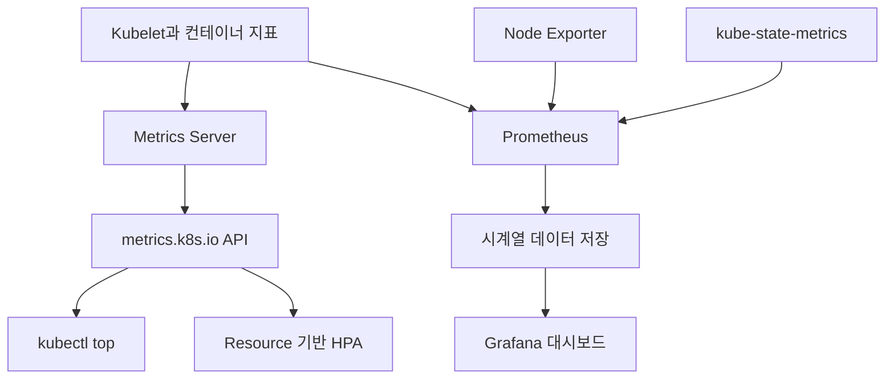
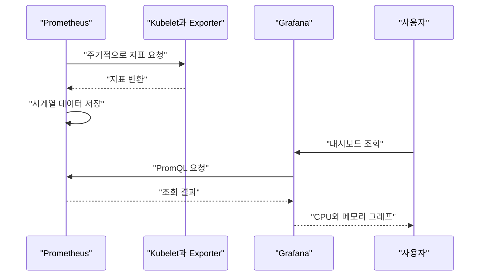
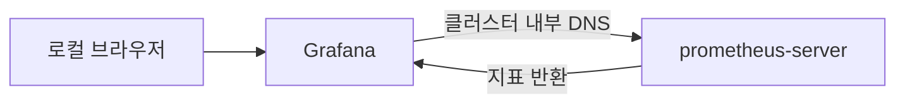
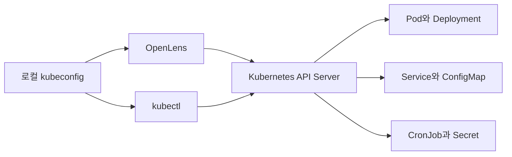
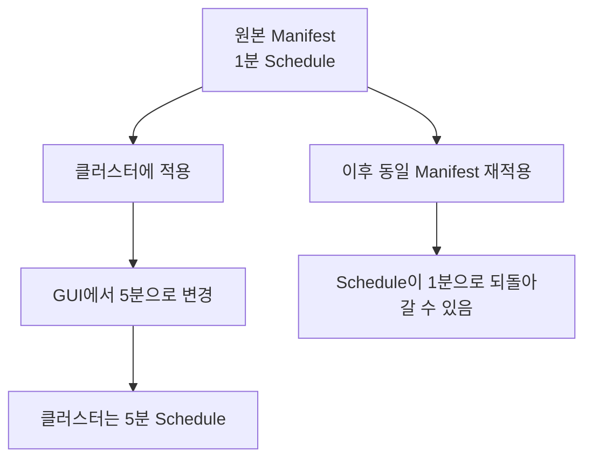
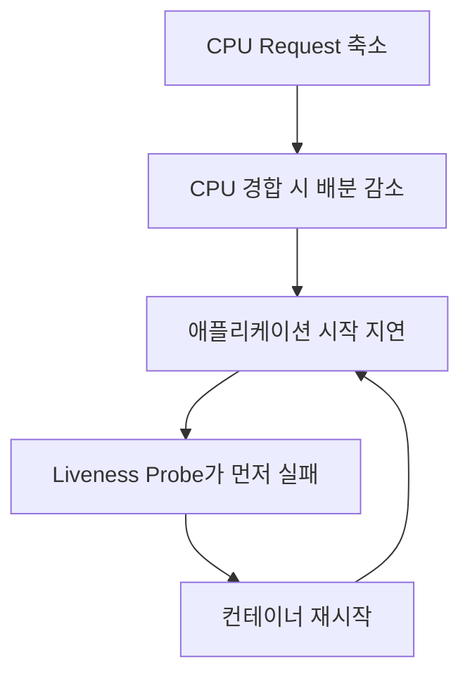
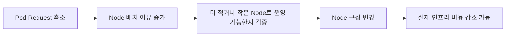

# Ch 6. 스케일 가능한 서비스 환경 구성과 성능 테스트

# Ch 6. 스케일 가능한 서비스 환경 구성과 성능 테스트
* toc
{:toc}

---

## 01. Prometheus와 Grafana를 이용한 서비스 모니터링

### Metrics Server, Prometheus, Grafana로 Kubernetes 모니터링 구성하기

SNS 백엔드의 기본 기능은 동작하지만, API가 느려지거나 Pod가 종료됐을 때 원인을 찾으려면 실행 상태를 관찰할 수 있어야 한다. 요청량이 늘어날 때 CPU와 메모리가 어떻게 변하는지 확인하는 것도 필요하다.

이번에는 Metrics Server로 현재 자원 사용량을 확인하고, Prometheus와 Grafana로 시간에 따른 변화를 살펴볼 수 있는 모니터링 환경을 구성한다. 이후 성능 테스트에서는 이 대시보드를 기준으로 부하 전후의 상태를 비교한다.

#### 모니터링 구성 요소의 역할

세 도구는 같은 일을 하는 것처럼 보이지만 역할이 다르다.

| 도구 | 역할 | 이번 실습에서의 용도 |
|---|---|---|
| Metrics Server | Node와 Pod의 CPU·메모리 지표 제공 | `kubectl top`, Resource 기반 HPA |
| Prometheus | 지표 수집, 시계열 저장, PromQL 조회 | 컨테이너 자원 사용량 이력 조회 |
| Grafana | 데이터 소스의 지표를 대시보드로 시각화 | CPU·메모리 그래프 구성 |
| Alertmanager | 알림 그룹화, 중복 제거, 전달 | 이번에는 함께 설치하되 알림 연동은 생략 |

Metrics Server는 장기적인 지표 저장소가 아니다. Prometheus가 Metrics Server의 데이터를 받아 저장하는 구조도 아니다. 각각 Kubelet 등의 Endpoint에서 필요한 지표를 수집한다.



Metrics Server는 자원 기반 자동 확장에 필요한 지표 제공에 초점을 둔다. 자원 사용량 이력과 상세 분석에는 Prometheus 같은 모니터링 시스템을 사용한다. [Metrics Server의 용도와 요구사항](https://github.com/kubernetes-sigs/metrics-server)

#### 설치 전에 Node 자원 확인하기

현재 클러스터에는 User Server, Feed Server, Image Server와 Notification Batch가 실행되고 있다. 모니터링 도구도 Pod로 실행되므로 추가 CPU와 메모리가 필요하다.

먼저 Node와 Pod 배치를 확인한다.

```shell
kubectl get nodes
kubectl get pods -A -o wide
```

특정 Node에 예약된 자원은 다음 명령으로 확인한다.

```shell
kubectl describe node <NODE_NAME>
```

`Allocated resources`에는 Pod의 `requests`와 `limits` 합계가 표시된다. 실제 사용량과 다른 값이라는 점에 주의해야 한다.

- 실제 CPU 사용량이 낮아도 `requests` 합계가 크면 새 Pod가 배치되지 않을 수 있다.
- Node 전체 메모리 중 일부는 운영체제와 Kubernetes 구성 요소가 사용한다.
- Pod를 배치할 수 있는 기준은 전체 용량보다 `Allocatable`에 가깝다.

이번 환경에서는 Node를 2개에서 3개로 늘린다. 다만 Node 3개가 모든 환경에 필요한 고정 조건은 아니다. 인스턴스 사양과 기존 Workload의 자원 설정에 따라 판단한다.

#### EKS Managed Node Group 증설

AWS Console에서 다음 순서로 Node Group 설정을 변경한다.

1. EKS에서 대상 클러스터를 선택한다.
2. **Compute**에서 Managed Node Group을 선택한다.
3. **Edit**에서 Scaling 설정을 연다.
4. Desired Size, Minimum Size, Maximum Size를 각각 `3`으로 지정한다.
5. 변경 내용을 저장한다.

| 항목 | 설정값 | 의미 |
|---|---:|---|
| Desired Size | 3 | 유지하려는 Node 수 |
| Minimum Size | 3 | 최소 Node 수 |
| Maximum Size | 3 | 최대 Node 수 |

이 구성은 Node 수를 3개로 고정하는 실습용 설정이다. Cluster Autoscaler를 사용 중이라면 Desired Size를 직접 변경하기 전에 자동 확장 정책을 확인해야 한다. [EKS Node Group Scaling 설정](https://docs.aws.amazon.com/eks/latest/APIReference/API_NodegroupScalingConfig.html)

CLI로 변경할 수도 있다.

```shell
aws eks update-nodegroup-config \
  --cluster-name <CLUSTER_NAME> \
  --nodegroup-name <NODE_GROUP_NAME> \
  --region <REGION> \
  --scaling-config minSize=3,maxSize=3,desiredSize=3
```

새 EC2 인스턴스가 생성되고 클러스터에 등록되기까지 시간이 필요하다.

```shell
kubectl get nodes -w
```

새 Node가 `Ready` 상태인지 확인한다. Node가 늘어나더라도 기존 Pod가 자동으로 균등하게 재배치되는 것은 아니다. 새로 생성되는 Pod부터 추가 Node에 배치될 수 있다.

#### 증설에 따른 비용

같은 사양의 Node를 2개에서 3개로 늘리면 해당 Node들의 EC2 사용 비용도 증가한다. 동일한 사용 시간과 구매 조건이라면 인스턴스 수에 따른 EC2 비용은 약 1.5배가 되지만, 클러스터 전체 비용이 정확히 1.5배가 되는 것은 아니다.

EKS Control Plane, RDS, EFS, EBS, NAT Gateway, Load Balancer 등은 별도로 비용이 발생할 수 있다. 영구 저장을 끄더라도 모니터링 Pod가 사용하는 컴퓨팅 자원은 계속 필요하다.

실습이 끝난 뒤에는 사용하지 않는 자원을 정리하되, 보존할 데이터와 다른 서비스의 의존성을 먼저 확인한다. 클러스터를 삭제했다고 해서 RDS나 EFS 같은 외부 자원까지 모두 삭제되는 것은 아니다.

#### Metrics Server 설치

먼저 이미 설치되어 있는지 확인한다.

```shell
kubectl get deployment metrics-server -n kube-system
kubectl get apiservice v1beta1.metrics.k8s.io
```

기존 Helm Release나 EKS Add-on으로 관리 중이라면 설치 방식을 유지한다. 다른 방식으로 중복 설치하면 관리 객체가 충돌할 수 있다.

설치되지 않았다면 공식 Manifest를 적용한다.

```shell
kubectl apply -f \
  https://github.com/kubernetes-sigs/metrics-server/releases/latest/download/components.yaml
```

실습에서는 최신 Manifest를 사용할 수 있지만, 반복해서 같은 환경을 만들려면 클러스터와 호환되는 Release를 선택하고 URL의 버전을 고정하는 것이 좋다.

```shell
kubectl rollout status deployment/metrics-server -n kube-system
kubectl get apiservice v1beta1.metrics.k8s.io
```

APIService의 `AVAILABLE`이 `True`인지 확인한다.

EKS에서도 인증서나 네트워크 구성에 따라 설치 후 문제가 발생할 수 있다. 오류가 난다고 곧바로 `--kubelet-insecure-tls`를 추가하기보다 로그와 Kubelet 연결 경로를 먼저 확인한다. 해당 옵션은 Kubelet 인증서 검증을 생략한다.

#### 현재 CPU와 메모리 사용량 확인

지표가 수집되면 다음 명령을 사용할 수 있다.

```shell
kubectl top nodes
```

예상 출력 형태는 다음과 같다. 값은 실제 환경에 따라 달라진다.

```text
NAME             CPU(cores)   CPU%   MEMORY(bytes)   MEMORY%
node-a           120m         6%     1450Mi          38%
node-b           180m         9%     1680Mi          44%
node-c           90m          4%     980Mi           26%
```

SNS Namespace의 Pod 사용량을 확인한다.

```shell
kubectl top pods -n sns
```

컨테이너 단위로 보고 싶다면 다음 옵션을 사용한다.

```shell
kubectl top pods -n sns --containers
```

CPU의 `100m`은 평균적으로 0.1 Core에 해당하는 사용량이다. Memory는 JVM Heap만 의미하지 않는다. Java 애플리케이션에서는 Heap 외에도 Metaspace, Thread Stack, Direct Buffer와 Native Memory 등이 포함된다.

이 명령은 현재 상태를 빠르게 확인하기에 좋지만, 어제와 오늘의 사용량을 비교하거나 장애 직전의 변화를 분석하기에는 한계가 있다.

#### Prometheus와 Grafana의 데이터 흐름

Prometheus는 정해진 주기에 대상 Endpoint를 호출하는 Pull 방식으로 지표를 수집한다. Grafana는 Prometheus에 PromQL을 보내고 조회 결과를 그래프로 표시한다.



이번에는 Prometheus와 Grafana를 각각 Helm Chart로 설치한다. Prometheus Operator를 포함한 `kube-prometheus-stack`과는 다른 구성이다.

#### Helm Repository 추가

```shell
helm repo add prometheus-community \
  https://prometheus-community.github.io/helm-charts

helm repo add grafana-community \
  https://grafana-community.github.io/helm-charts

helm repo update
helm repo list
```

Grafana는 현재 설치 안내에서 사용하는 Community Repository를 기준으로 구성한다. Repository의 로컬 이름과 Chart 경로는 설치 명령에서도 동일하게 사용해야 한다. [Grafana Helm 설치](https://grafana.com/docs/grafana/latest/setup-grafana/installation/helm/)

설치할 Chart를 확인한다.

```shell
helm search repo prometheus-community/prometheus
helm search repo grafana-community/grafana
```

Chart Version과 Application Version은 다르다. 재현 가능한 설치가 필요하다면 조회한 Chart Version을 기록하고 설치 명령에 `--version`으로 지정한다.

#### 모니터링 Namespace 생성

`monitoring-namespace.yaml`을 작성한다.

```yaml
apiVersion: v1
kind: Namespace
metadata:
  name: monitoring
```

```shell
kubectl apply -f monitoring-namespace.yaml
```

애플리케이션과 모니터링 구성 요소를 Namespace로 구분하면 객체와 권한을 관리하기 편하다. 다만 Prometheus는 다른 Namespace의 Workload도 관찰하므로 Chart에서 Cluster 범위의 RBAC 객체를 생성할 수 있다.

#### 이번 실습의 저장소 정책

Prometheus는 수집한 시계열 데이터를 저장하고, Grafana는 Dashboard와 사용자 설정 등을 저장한다. 이번에는 설치와 지표 확인에 집중하기 위해 Persistent Volume 사용을 끈다.

| 대상 | 임시 저장 시 잃을 수 있는 데이터 |
|---|---|
| Prometheus | 수집한 지표 이력 |
| Grafana | UI에서 저장한 Dashboard와 설정 |
| Alertmanager | Silence와 일부 알림 상태 |

`emptyDir`는 같은 Pod 안에서 컨테이너가 재시작되는 동안에는 유지될 수 있지만, Pod가 삭제되거나 교체되면 사라진다.

StorageClass의 기본값도 확인한다.

```shell
kubectl get storageclass
```

기본 StorageClass가 EBS를 가리키는데 EBS CSI Driver나 권한이 준비되지 않았다면 PVC가 `Pending`에 머물 수 있다. 기본 StorageClass가 언제나 `gp2`라고 가정해서는 안 된다.

특히 Prometheus의 로컬 시계열 저장소에는 EFS 같은 NFS 파일 시스템을 사용하지 않는다. 운영 저장소는 EBS 등 적합한 디스크나 Remote Storage 구성을 검토해야 한다. [Prometheus 저장소 요구사항](https://prometheus.io/docs/prometheus/latest/storage/)

#### Prometheus Values 작성

`prometheus-values.yaml`을 작성한다.

```yaml
server:
  persistentVolume:
    enabled: false
  retention: 6h
  global:
    scrape_interval: 30s
    evaluation_interval: 30s
  resources:
    requests:
      cpu: 250m
      memory: 512Mi
    limits:
      cpu: "1"
      memory: 2Gi

alertmanager:
  enabled: true
  persistence:
    enabled: false

kube-state-metrics:
  enabled: true

prometheus-node-exporter:
  enabled: true

prometheus-pushgateway:
  enabled: false
```

주요 설정은 다음과 같다.

| 설정 | 의미 |
|---|---|
| `server.persistentVolume.enabled: false` | Prometheus 데이터를 임시 Volume에 저장 |
| `server.retention: 6h` | 지표 보관 기간을 6시간으로 설정 |
| `scrape_interval: 30s` | 기본 지표 수집 주기 |
| `evaluation_interval: 30s` | Rule 평가 주기 |
| `alertmanager.persistence.enabled: false` | Alertmanager 영구 저장 비활성화 |
| `kube-state-metrics` | Deployment, Pod 등 Kubernetes 객체 상태 제공 |
| `prometheus-node-exporter` | Node 운영체제 수준 지표 제공 |

Node Exporter는 일반적으로 DaemonSet으로 설치되므로 Node 수가 늘어나면 Pod 수도 늘어난다. Chart가 제공하는 부가 구성 요소까지 포함해 자원을 계산해야 한다.

Values 키는 Chart 버전에 따라 달라질 수 있다. 설치 전에 해당 버전의 기본 설정과 비교한다.

```shell
helm show values prometheus-community/prometheus
```

위 예제는 `server.persistentVolume`과 하위 Alertmanager Chart의 `persistence` 설정을 사용한다. [Prometheus Chart 설정](https://github.com/prometheus-community/helm-charts/blob/main/charts/prometheus/values.yaml)

#### Prometheus 설치

```shell
helm upgrade --install prometheus \
  prometheus-community/prometheus \
  --namespace monitoring \
  --values prometheus-values.yaml \
  --wait \
  --timeout 10m
```

설치 상태를 확인한다.

```shell
helm list -n monitoring
kubectl get pods,service,pvc -n monitoring
```

이번 설정에서는 Prometheus와 Alertmanager의 PVC가 생성되지 않아야 한다. 예상하지 못한 PVC가 있다면 Chart 버전과 적용된 Values를 확인한다.

```shell
helm get values prometheus -n monitoring
```

#### Grafana Values 작성

`grafana-values.yaml`을 작성한다.

```yaml
persistence:
  enabled: false

adminUser: admin

service:
  type: ClusterIP

resources:
  requests:
    cpu: 100m
    memory: 256Mi
  limits:
    cpu: 500m
    memory: 512Mi

datasources:
  datasources.yaml:
    apiVersion: 1
    datasources:
      - name: Prometheus
        uid: prometheus
        type: prometheus
        access: proxy
        url: http://prometheus-server.monitoring.svc.cluster.local
        isDefault: true
        editable: false
```

`datasources.yaml`은 Grafana의 Data Source Provisioning 설정이다. 여기의 `apiVersion: 1`은 Kubernetes API Version이 아니라 Grafana 설정 형식의 버전이다.

`access: proxy`는 브라우저 대신 Grafana 서버가 Prometheus를 조회한다는 의미다. 따라서 로컬 브라우저가 `*.svc.cluster.local` 주소를 직접 해석할 필요는 없다.



`prometheus-server`는 이번 Release 이름을 기준으로 생성될 Service 이름이다. 실제 Service와 Port는 설치 결과에서 확인한다.

```shell
kubectl get service -n monitoring
```

Chart 기본 구성에서 Prometheus Server Service가 80 포트를 제공하면 URL에 Port를 생략할 수 있다. 다른 Port를 사용한다면 URL에도 반영한다.

#### Grafana 설치와 로그인 정보

```shell
helm upgrade --install grafana \
  grafana-community/grafana \
  --namespace monitoring \
  --values grafana-values.yaml \
  --wait \
  --timeout 10m
```

이번에는 고정된 쉬운 관리자 비밀번호를 Values나 명령행에 넣지 않고 Chart가 생성하는 Secret을 사용한다.

로컬 PowerShell에서 비밀번호를 화면에 출력하지 않고 Clipboard에 복사할 수 있다.

```powershell
$grafanaPasswordBase64 = kubectl get secret grafana `
  -n monitoring `
  -o jsonpath="{.data.admin-password}"

$grafanaPassword = [Text.Encoding]::UTF8.GetString(
    [Convert]::FromBase64String(
        $grafanaPasswordBase64
    )
)

Set-Clipboard -Value $grafanaPassword

Remove-Variable grafanaPassword
Remove-Variable grafanaPasswordBase64
```

로그인할 때 사용자 이름은 `admin`, 비밀번호는 복사한 값을 사용한다. 로그인 후 Clipboard는 비워 둔다.

```powershell
Set-Clipboard -Value ""
```

#### Grafana 접속

Grafana의 컨테이너 Port는 기본적으로 3000이다. 로컬 3000 포트로 연결한다.

```shell
kubectl port-forward \
  deployment/grafana \
  3000:3000 \
  -n monitoring
```

브라우저에서 [Grafana](http://localhost:3000)에 접속한다. Port Forward를 실행한 Terminal은 접속하는 동안 열어 두어야 한다.

로컬에서 3000 포트를 이미 사용 중이라면 다음과 같이 변경한다.

```shell
kubectl port-forward \
  deployment/grafana \
  3001:3000 \
  -n monitoring
```

이 경우 접속 주소는 `http://localhost:3001`이다. 설치 확인을 위해 별도 LoadBalancer나 Ingress를 만들 필요는 없다.

#### Data Source와 수집 상태 확인

Grafana에서 Prometheus Data Source가 등록되어 있는지 확인한다. UI 위치는 버전에 따라 다를 수 있지만, Data Source 설정의 연결 테스트 또는 Explore에서 조회할 수 있다.

먼저 다음 PromQL을 실행한다.

```promql
up
```

`up`은 각 수집 대상의 최근 Scrape 성공 여부를 나타낸다.

- `1`: 지표 수집 성공
- `0`: 지표 수집 실패

Prometheus 화면에서 상세 상태를 보고 싶다면 별도 Terminal에서 Port Forward를 실행한다.

```shell
kubectl port-forward \
  service/prometheus-server \
  9090:80 \
  -n monitoring
```

[Prometheus](http://localhost:9090)의 Targets 화면에서 Kubelet과 cAdvisor 대상이 정상인지 확인한다.

Pod가 Running이고 Ready라는 사실만으로 필요한 지표가 수집된다고 판단해서는 안 된다. Grafana 연결과 Prometheus Target 상태까지 확인해야 한다.

#### 컨테이너 CPU 패널 만들기

Grafana에서 Dashboard를 만들고 Visualization을 추가한다. Data Source로 Prometheus를 선택한 뒤 다음 Query를 입력한다.

```promql
sum by (namespace, pod, container) (
  rate(
    container_cpu_usage_seconds_total{
      namespace="sns",
      container!="",
      container!="POD"
    }[5m]
  )
)
```

`container=""`인 집계 항목과 `container="POD"`인 인프라 컨테이너를 제외해 애플리케이션 컨테이너를 중심으로 표시한다. 실제 Label은 수집 환경에서 확인한다.

##### 누적 CPU 시간에 `rate()`를 적용하는 이유

`container_cpu_usage_seconds_total`은 컨테이너가 사용한 CPU 시간의 누적값이다. 그대로 표시하면 현재 부하보다 컨테이너가 얼마나 오래 실행됐는지에 영향을 받는다.

`rate(...[5m])`는 최근 5분 동안의 초당 평균 증가량을 계산한다. 이 결과는 평균적으로 사용한 CPU Core 수로 해석할 수 있다. `rate()`를 먼저 적용한 뒤 합산해야 개별 컨테이너의 Counter Reset을 처리할 수 있다. [Prometheus rate 함수](https://prometheus.io/docs/prometheus/latest/querying/functions/)

| Query 결과 | CPU 사용량 해석 |
|---:|---|
| `0.05` | 약 0.05 Core, 50m |
| `0.5` | 약 0.5 Core, 500m |
| `1.0` | 약 1 Core |
| `2.0` | 약 2 Core |

CPU Core 값에 Grafana의 Percent Unit을 지정하면 의미가 달라진다. 이번 패널은 단위를 `cores`로 표시하거나 사용자 정의 단위로 지정한다.

##### 패널 설정

| 항목 | 설정 |
|---|---|
| Title | Container CPU |
| Visualization | Time series |
| Query | 최근 5분 CPU 사용량 |
| Min | 0 |
| Legend | Pod와 Container를 함께 표시 |

컨테이너 이름만 표시하면 Feed Server의 두 Replica가 같은 이름으로 보인다. Pod 이름도 포함하면 Replica별 차이를 확인하기 쉽다.

5분 범위는 값을 부드럽게 보여주지만 짧은 순간의 급증은 완만하게 나타날 수 있다. 이후 부하 테스트에서는 Query Window와 수집 주기를 함께 고려한다.

#### 컨테이너 메모리 패널 만들기

두 번째 Visualization을 추가하고 다음 Query를 입력한다.

```promql
sum by (namespace, pod, container) (
  container_memory_usage_bytes{
    namespace="sns",
    container!="",
    container!="POD"
  }
)
```

메모리 사용량은 현재 값이 증가하거나 감소하는 Gauge다. CPU의 누적 시간처럼 `rate()`로 변환할 필요가 없다.

| 항목 | 설정 |
|---|---|
| Title | Container Memory |
| Visualization | Time series |
| Unit | Bytes IEC |
| Min | 0 |
| Legend | Pod와 Container를 함께 표시 |

##### SI와 IEC 단위

| 단위 | 크기 |
|---|---:|
| 1 MB | 1,000,000 bytes |
| 1 MiB | 1,048,576 bytes |
| 1 GB | 1,000,000,000 bytes |
| 1 GiB | 1,073,741,824 bytes |

Kubernetes에서 `512Mi`, `1Gi`처럼 Resource를 설정했다면 Grafana도 Bytes IEC로 표시하는 편이 비교하기 쉽다. 이는 표시 단위를 바꾸는 것이며 수집한 byte 값 자체가 달라지는 것은 아니다.

##### Working Set도 함께 보기

`container_memory_usage_bytes`에는 Cache 등이 포함될 수 있다. 실제 상태를 판단할 때는 Working Set도 같이 살펴본다.

```promql
sum by (namespace, pod, container) (
  container_memory_working_set_bytes{
    namespace="sns",
    container!="",
    container!="POD"
  }
)
```

Working Set도 JVM Heap과 같은 값은 아니며, 이 지표 하나만으로 OOM 여부를 단정할 수 없다. 재시작 상태, Memory Limit, JVM 지표를 함께 확인한다.

#### Dashboard 저장

CPU와 메모리 패널을 배치하고 `SNS Resource Monitoring` 같은 이름으로 저장한다.

- 시간 범위는 우선 최근 15분 또는 30분으로 설정한다.
- 자동 새로고침은 수집 주기와 비슷하게 30초 정도로 설정한다.
- CPU와 메모리 패널의 Pod 이름을 맞춰 비교한다.

Prometheus를 설치하기 전의 지표는 조회할 수 없다. 설치 직후에는 `rate()` 계산에 필요한 Sample도 부족할 수 있으므로 여러 번 수집될 때까지 기다린다.

Grafana 영구 저장을 껐기 때문에 UI에서 저장한 Dashboard는 Pod 교체 후 사라질 수 있다. 계속 사용할 Dashboard는 JSON으로 Export하거나 Provisioning 설정으로 관리한다.

#### 현재 그래프를 해석하는 방법

요청이 없는 상태에서는 CPU 사용량이 낮게 나타나는 것이 자연스럽다. 반면 Java 애플리케이션은 요청이 없어도 Heap과 JVM 실행 공간을 사용하므로 메모리가 0에 가깝게 내려가지는 않는다.

설치 후 다음 항목을 먼저 확인한다.

- 예상한 User, Feed, Image 컨테이너가 보이는가
- 같은 Deployment의 Replica를 구분할 수 있는가
- CPU와 메모리 값이 지속해서 갱신되는가
- `kubectl top`과 크게 다른 값이라면 시간 범위와 지표 정의가 다른가
- Prometheus Target이 정상인가

`kubectl top`과 Grafana의 값은 완전히 일치하지 않을 수 있다. 수집 시점, CPU 평균 구간, 메모리 지표가 다르기 때문이다.

#### CPU와 메모리만으로 알 수 없는 것

이 구성은 Kubernetes 자원 관찰의 시작점이다. Spring Boot의 요청 지연, 오류율, JVM GC까지 자동으로 수집하는 것은 아니다.

애플리케이션 Monitoring에는 별도 Micrometer Prometheus 연동과 Scrape 설정이 필요하다. 이후에는 다음 지표를 추가한다.

| 영역 | 확인할 지표 |
|---|---|
| HTTP | 요청 수, 오류율, 응답 시간 |
| JVM | Heap, GC 시간, Thread 수 |
| Database | Connection Pool, Query 지연 |
| 서비스 간 호출 | User Server 호출 횟수, 지연, 실패율 |
| Batch | 실행 성공 여부, 처리 건수, 미처리 데이터, 처리 지연 |
| Kubernetes | Pod 재시작, Pending, CPU Throttling, Memory 압박 |

Notification Batch처럼 짧게 실행되는 Pod는 종료되기 전에 Scrape되지 않을 수 있다. `kubectl top`에 보이지 않는다는 이유로 실행되지 않았다고 판단하지 말고 Job 상태와 실행 이력도 확인한다.

#### 자주 발생하는 문제

##### Metrics API를 사용할 수 없는 경우

```text
Metrics API not available
```

```shell
kubectl get apiservice v1beta1.metrics.k8s.io
kubectl describe apiservice v1beta1.metrics.k8s.io
kubectl logs deployment/metrics-server -n kube-system
```

APIService 상태, 인증서 오류, Metrics Server에서 Kubelet로 접근 가능한지를 확인한다.

##### 모니터링 Pod가 Pending인 경우

```shell
kubectl describe pod <POD_NAME> -n monitoring
kubectl get events -n monitoring --sort-by=.lastTimestamp
```

| Event | 확인할 내용 |
|---|---|
| Insufficient cpu | Node의 남은 CPU requests |
| Insufficient memory | Node의 남은 Memory requests |
| Unbound PersistentVolumeClaims | PVC와 StorageClass |
| Too many pods | Node의 Pod 수 제한 |
| Taint 관련 오류 | Node Taint와 Toleration |

영구 저장을 껐는데 PVC가 생성됐다면 Values 키가 설치한 Chart에서 적용되는지 확인한다.

##### Grafana에서 Prometheus 연결이 실패하는 경우

```shell
kubectl get service,endpointslice -n monitoring
kubectl logs deployment/grafana -n monitoring
```

Data Source URL의 Service 이름, Namespace, Port를 확인한다. `access: proxy`에서 `localhost`는 로컬 PC가 아니라 Grafana Pod를 가리킨다.

##### CPU 패널에 No data가 표시되는 경우

먼저 Metric 자체가 있는지 확인한다.

```promql
container_cpu_usage_seconds_total
```

그다음 Namespace 조건을 추가한다.

```promql
container_cpu_usage_seconds_total{namespace="sns"}
```

전체 Metric은 있지만 Filter 적용 후 없어지면 Label이 다를 수 있다. Metric 자체가 없다면 cAdvisor 수집 대상과 RBAC, 네트워크를 확인한다. 설치 직후에는 `rate()` 계산에 필요한 Sample이 부족한 경우도 있다.

##### 값이 두 배로 집계되는 경우

같은 Endpoint를 두 Scrape Job이 수집하면 `sum()`이 중복 데이터를 합산할 수 있다.

```promql
count by (job) (
  container_memory_usage_bytes{
    namespace="sns",
    container!="",
    container!="POD"
  }
)
```

수집 경로를 확인한 뒤 Query에 해당 `job`을 지정하거나 중복 Scrape 설정을 제거한다.

##### Dashboard가 사라진 경우

Grafana Pod가 교체됐는지 확인한다. `persistence.enabled: false`에서 UI 저장은 영구 보존을 의미하지 않는다. Dashboard JSON이나 Provisioning 설정으로 복구한다.

### 정리

Node 자원을 확인하고 Metrics Server, Prometheus, Grafana를 설치해 SNS 컨테이너의 CPU와 메모리를 관찰할 수 있게 구성했다.

Metrics Server는 현재 자원 조회와 자동 확장에 사용하고, Prometheus는 지표 이력을 저장하며, Grafana는 이를 그래프로 보여준다. CPU는 누적 CPU 시간에 `rate()`를 적용해 Core 사용량으로 해석하고, 메모리는 현재 byte 값을 IEC 단위로 표시한다.

이번 환경은 영구 저장을 비활성화한 실습용 구성이다. Pod 교체 시 지표 이력과 UI에서 저장한 Dashboard가 사라질 수 있으며, 운영에서는 저장소와 보존 정책을 별도로 설계해야 한다.

이제 성능 테스트를 실행하면서 요청량 증가가 자원 사용량에 어떤 영향을 주는지 확인할 수 있다. 자원 그래프와 함께 응답 시간, 오류율, Database와 서비스 간 호출 지표까지 연결하면 병목을 더 정확하게 찾을 수 있다.

## 02. OpenLens와 Kubecost를 이용한 서비스 관리

### OpenLens와 Kubecost로 클러스터 상태와 비용 살펴보기

앞에서는 Prometheus와 Grafana로 컨테이너의 CPU와 메모리 사용량을 확인했다. 이번에는 Kubernetes 객체를 탐색하고 운영 설정을 바꾸는 작업, 그리고 자원 사용량을 비용 관점에서 분석하는 작업을 살펴본다.

OpenLens는 클러스터를 관리하는 GUI 도구이고, Kubecost는 Kubernetes 자원에 비용을 배분하고 낭비되는 자원을 찾는 분석 도구다. 둘을 함께 사용하면 어떤 Workload가 실행되고 있는지 확인하는 데서 나아가, 그 Workload에 할당한 자원이 적절한지도 검토할 수 있다.

| 도구 | 주로 확인하는 내용 |
|---|---|
| `kubectl` | Kubernetes 객체 조회와 변경, 자동화 |
| OpenLens | 객체 탐색, 상태 확인, GUI를 통한 운영 작업 |
| Prometheus·Grafana | 시간에 따른 지표 변화 |
| Kubecost | 자원별 비용 배분과 자원 조정 권고 |

#### OpenLens의 역할과 현재 지원 상태

OpenLens는 Lens의 공개 소스 부분을 기반으로 만든 Kubernetes 관리 도구다. 로컬의 `kubeconfig`를 이용해 Kubernetes API Server에 연결하고, Pod와 Deployment 같은 객체를 화면에 표시한다.

다만 OpenLens 바이너리 배포 저장소는 더 이상 업데이트를 제공하지 않는다고 안내하고 있다. 기존 환경의 기능을 살펴볼 수는 있지만, 새 Kubernetes 버전과의 호환성이나 보안 업데이트가 계속 제공되는 도구로 가정해서는 안 된다. [OpenLens 배포 저장소](https://github.com/MuhammedKalkan/OpenLens)



GUI에서 수행하는 작업도 결국 Kubernetes API 요청이다. OpenLens를 설치한다고 기존 계정에 없는 권한이 추가되는 것은 아니다.

#### CLI와 GUI를 함께 사용하는 이유

클러스터 상태를 처음 파악할 때는 GUI가 편리하다. Namespace별 Pod를 살펴보고, 문제가 있는 객체를 선택해 Event와 설정을 연속해서 확인할 수 있다.

반면 CLI는 반복 작업과 자동화에 유리하다. 같은 명령으로 여러 환경을 비교하거나, CI/CD에서 Manifest를 적용하고 실행 결과를 기록할 수 있다.

예를 들어 Pod가 시작되지 않는 상황에서는 다음 두 방법이 같은 정보를 확인하는 경로가 된다.

| OpenLens 작업 | 대응하는 명령 |
|---|---|
| Pod 목록 열기 | `kubectl get pods` |
| Pod 상세와 Event 확인 | `kubectl describe pod` |
| Pod 로그 확인 | `kubectl logs` |
| Deployment Replica 변경 | `kubectl scale deployment` |
| 객체 YAML 편집 | `kubectl edit` |

로그나 Terminal 메뉴의 제공 여부는 OpenLens 버전과 설치된 Extension에 따라 다를 수 있다. 화면에 기능이 없다면 해당 `kubectl` 명령으로 확인하면 된다.

#### OpenLens 설치와 EKS 연결

OpenLens의 Release 페이지에서 운영체제와 CPU Architecture에 맞는 설치 파일을 선택한다. 배포 시점과 지원 상태도 함께 확인한다.

EKS 연결은 먼저 Terminal에서 정상적으로 동작하는지 확인한다.

```shell
aws eks update-kubeconfig \
  --name <CLUSTER_NAME> \
  --region <REGION>

kubectl config get-contexts
kubectl config current-context
kubectl get nodes
```

OpenLens에서 **Catalog → Clusters**를 열면 로컬 `kubeconfig`에 등록된 Context를 선택할 수 있다. 목록에 없다면 사용 중인 설정 파일을 직접 등록한다.

기본 `kubeconfig` 위치는 다음과 같다.

```text
Windows: %USERPROFILE%\.kube\config
Linux 또는 macOS: ~/.kube/config
```

EKS의 `kubeconfig`는 AWS CLI를 실행해 인증 Token을 얻는 구성을 사용할 수 있다. 따라서 OpenLens 프로세스에서도 `aws` 명령과 필요한 AWS Profile을 사용할 수 있어야 한다.

AWS SSO를 사용한다면 로그인 상태도 확인한다.

```shell
aws sso login --profile <AWS_PROFILE>
```

Terminal에서는 접속되는데 GUI에서 실패한다면 AWS CLI 경로, Profile, SSO 만료, API Server 접근 경로를 확인한다. Private Endpoint만 사용하는 클러스터라면 로컬 PC에서 해당 네트워크에 접근할 수 있어야 한다.

#### SNS Workload 확인

클러스터를 선택한 뒤 Namespace를 `sns`로 좁혀 확인한다.

| 영역 | 확인할 항목 |
|---|---|
| Pods | Ready 상태, Restart Count, 실행 Node |
| Deployments | 원하는 Replica와 실제 가용 Replica |
| Services | Selector와 Port |
| ConfigMaps | 애플리케이션 설정 |
| CronJobs | Schedule, Suspend, 최근 실행 |
| Jobs | 성공·실패 상태 |
| PVCs | Binding과 사용 중인 Volume |

Pod가 `Running`이어도 Ready 상태가 아닐 수 있다. 상태를 볼 때는 실행 여부뿐 아니라 Readiness, Restart Count, Event를 함께 확인한다.

CLI로도 같은 상태를 비교해 본다.

```shell
kubectl get deployment,pod,service,cronjob,job,pvc -n sns
```

#### Deployment Scale과 재시작

GUI에서는 Deployment의 Replica 수를 바꾸거나 새 Pod로 교체하는 작업을 수행할 수 있다.

CLI로는 다음과 같은 작업이다.

```shell
kubectl scale deployment/feed-server \
  --replicas=3 \
  -n sns
```

```shell
kubectl rollout restart deployment/feed-server -n sns
```

`rollout restart`는 기존 컨테이너 프로세스를 제자리에서 재시작하는 동작이 아니다. Deployment의 Pod Template을 변경해 새 Pod로 교체한다.

HPA가 Replica 수를 관리하고 있다면 수동 Scale 결과가 다시 바뀔 수 있다. 이 경우 Deployment만 수정하지 말고 HPA의 최소·최대 Replica와 현재 계산 결과를 확인한다.

#### Secret 조회와 변경 시 주의점

OpenLens는 Secret의 Base64 값을 해석해 표시하거나 편집하는 기능을 제공할 수 있다. 편리하지만 그 화면에는 실제 비밀번호와 Token이 나타날 수 있다.

필요한 권한부터 확인한다.

```shell
kubectl auth can-i get secrets -n sns
kubectl auth can-i update secrets -n sns
```

환경 변수로 주입한 Secret은 실행 중인 프로세스에 자동으로 다시 전달되지 않는다. Secret을 변경했다면 필요한 Workload를 새 Pod로 교체하거나 다음 실행에서 새 Pod가 생성되도록 해야 한다.

Notification Batch는 새로운 Job의 Pod가 생성될 때 최신 Secret을 읽는다. 이미 실행 중인 Batch에는 이전 값이 남는다.

#### CronJob 주기를 5분으로 변경하기

Notification Batch는 테스트를 위해 1분마다 실행하도록 구성했다. 이를 5분마다 실행하도록 변경해 본다.

```text
변경 전: * * * * *
변경 후: */5 * * * *
```

`*/5 * * * *`는 매시 0분, 5분, 10분처럼 달력 기준 5분 간격을 의미한다. 이전 Job이 끝난 시점부터 5분을 기다리는 설정은 아니다.

OpenLens에서 `notification-batch` CronJob을 선택하고 Edit 화면에서 `spec.schedule`을 변경한다. CLI에서는 다음 명령을 사용할 수 있다.

```shell
kubectl edit cronjob notification-batch -n sns
```

반영된 값을 확인한다.

```shell
kubectl get cronjob notification-batch \
  -n sns \
  -o jsonpath="{.spec.schedule}"
```

정상 결과는 다음과 같다.

```text
*/5 * * * *
```

기존 Job의 동작은 바뀌지 않는다. 변경한 Schedule은 이후 예약 실행에 적용된다.

CronJob을 Suspend하는 기능도 이미 실행 중인 Job을 종료하는 기능과는 다르다. 새 예약 실행을 중지하는 설정이다.

#### 클러스터 설정과 배포 파일이 달라지는 문제

GUI나 `kubectl edit`로 변경한 내용은 클러스터에 반영되지만 로컬 Manifest는 수정되지 않는다.



이처럼 선언한 설정과 실제 상태가 다른 상황을 Configuration Drift라고 한다.

Schedule 변경을 계속 유지하려면 `notification-cronjob.yaml`의 `spec.schedule`도 같은 값으로 수정한다. Helm으로 관리한다면 Values를, GitOps로 관리한다면 원본 Git 설정을 변경한다.

적용 전 차이를 확인한다.

```shell
kubectl diff -f notification-cronjob.yaml
```

```shell
kubectl apply -f notification-cronjob.yaml
```

현재 상태만 확인하고 싶다면 다음 명령을 사용한다.

```shell
kubectl get cronjob notification-batch -n sns -o yaml
```

조회 결과에는 `status`, `resourceVersion` 같은 서버 관리 필드도 포함된다. 전체 출력을 그대로 새 배포 파일로 사용하는 것보다 기존 Manifest에 필요한 변경만 반영하는 편이 좋다.

| 변경 목적 | 처리 방법 |
|---|---|
| 장애 대응을 위한 임시 변경 | 변경 전 값을 기록하고 종료 후 복원 |
| 계속 유지할 운영 정책 | Manifest 또는 Helm Values에 반영 |
| HPA가 관리하는 Replica 변경 | HPA 설정과 함께 검토 |
| GitOps 환경의 변경 | 원본 저장소와 동기화 정책 확인 |

자동 동기화가 활성화된 GitOps 환경에서는 수동 변경이 다음 배포를 기다리지 않고 곧바로 복원될 수도 있다.

#### Kubecost가 분석하는 내용

자원 그래프는 사용량을 보여주지만, 어떤 서비스 때문에 비용이 발생하는지까지 바로 설명하지는 않는다.

Kubecost는 Kubernetes 자원과 가격 정보를 연결해 비용을 배분하고 자원 조정 후보를 제시한다.

- Namespace와 Workload별 비용
- Node 및 Storage 비용
- 사용되지 않는 자원 비용
- 컨테이너 `requests` 조정 후보
- Node 구성 변경에 따른 절감 가능성

표시된 비용이 항상 AWS 청구서와 같지는 않다. 가격 데이터와 할인 조건, 비용 배분 방식, 관찰 기간에 따라 차이가 생긴다. 실제 청구 기준의 분석이 필요하면 AWS Billing 데이터 연동을 별도로 구성한다. [EKS의 Kubecost 비용 분석](https://docs.aws.amazon.com/eks/latest/userguide/cost-monitoring-kubecost-bundles.html)

#### Kubecost 버전에 따른 설치 차이

Kubecost는 버전별 구조가 크게 달라졌다.

| 구분 | 1.x·2.x 계열 | 3.x 계열 |
|---|---|---|
| ECR Helm Chart 경로 | `kubecost/cost-analyzer` | `kubecost/kubecost` |
| 지표 수집 구조 | Prometheus 기반 | FinOps Agent 기반 |
| 조회·저장 구조 | 이전 비용 분석 구조 | ClickHouse 기반 Aggregator |
| 대표 UI Deployment | `kubecost-cost-analyzer` | `kubecost-frontend` |
| 저장소 설정 | 이전 Chart의 Persistence 키 | Local Store와 Aggregator 설정 |

3.x에서는 기본 구조의 Prometheus 의존성이 제거됐다. 앞에서 설치한 Prometheus·Grafana는 자원 모니터링에 계속 사용하고, Kubecost는 별도 비용 분석 경로를 사용한다. [Kubecost 설치 구조 변경](https://docs.aws.amazon.com/eks/latest/userguide/cost-monitoring-kubecost.html)

아래 예제는 Chart `3.3.0`으로 버전을 고정한다. 이전 버전의 `persistentVolume.enabled`나 `prometheus.server.persistentVolume.enabled`를 그대로 복사해서 사용하지 않는다.

#### 설치 전 자원 확인

Kubecost 자체도 CPU와 메모리를 사용한다.

```shell
kubectl get nodes
kubectl top nodes
kubectl get pods -n monitoring
```

```shell
helm show values \
  oci://public.ecr.aws/kubecost/kubecost \
  --version 3.3.0
```

특히 Aggregator의 기본 Memory Request가 큰 편이므로 작은 Node에서는 `Pending`이 발생할 수 있다. 클러스터 전체에 여유가 있어도 한 Pod가 들어갈 단일 Node의 여유가 부족하면 배치되지 않는다.

Node 개수만 늘리기 전에 다음을 확인한다.

```shell
kubectl describe node <NODE_NAME>
```

실습 환경이 작다는 이유로 메모리 설정을 크게 낮추면 실행 중 OOM이 발생할 수 있다. 기본 요청량과 Node의 Allocatable을 비교한 뒤 설치한다.

#### 임시 저장을 사용하는 Kubecost Values

이번에는 비용 분석 화면을 확인하는 것이 목적이므로 별도의 PVC를 만들지 않는 구성으로 진행한다.

`kubecost-values.yaml`을 작성한다.

```yaml
global:
  clusterId: sns-eks-dev

frontend:
  enabled: true
  service:
    type: ClusterIP
    port: 9090
    targetPort: 9090

localStore:
  enabled: true
  persistentVolume:
    enabled: false

aggregator:
  enabled: true
  useHostPath: false
  useEmptyDir: true

cloudCost:
  enabled: false

clusterController:
  enabled: false

mcp:
  enabled: false
```

각 설정의 역할은 다음과 같다.

| 설정 | 의미 |
|---|---|
| `global.clusterId` | 비용 데이터에서 사용할 클러스터 식별자 |
| `frontend` | 비용 분석 UI 제공 |
| `localStore` | 단일 클러스터의 수집 데이터 저장 |
| `localStore.persistentVolume.enabled: false` | Local Store의 PVC 사용 중지 |
| `aggregator.useEmptyDir: true` | 분석 데이터와 설정에 임시 Volume 사용 |
| `cloudCost.enabled: false` | 별도 클라우드 청구 데이터 처리 제외 |
| `clusterController.enabled: false` | 자원 변경 자동화 Controller 제외 |
| `mcp.enabled: false` | 이번 실습에서 사용하지 않는 연동 기능 제외 |

이 설정은 분석 결과를 확인하기 위한 단일 클러스터 실습용이다. Pod가 교체되면 데이터나 UI 설정이 사라지거나 다시 계산되어야 할 수 있다. 영구 저장을 끈다고 Node의 디스크와 컴퓨팅 사용까지 없어지는 것은 아니다. [Kubecost 3.3.0 Values](https://github.com/kubecost/kubecost/blob/v3.3.0/kubecost/values.yaml)

#### 설치 Manifest 확인과 적용

Helm Template을 확인하면 실제 생성될 객체를 설치 전에 살펴볼 수 있다.

```shell
helm template kubecost \
  oci://public.ecr.aws/kubecost/kubecost \
  --version 3.3.0 \
  --namespace monitoring \
  --values kubecost-values.yaml
```

이번 구성에서 예상하지 않은 PVC나 LoadBalancer가 생성되지 않는지 확인한다.

설치한다.

```shell
helm upgrade --install kubecost \
  oci://public.ecr.aws/kubecost/kubecost \
  --version 3.3.0 \
  --namespace monitoring \
  --values kubecost-values.yaml \
  --wait \
  --timeout 15m
```

설치 결과를 확인한다.

```shell
helm list -n monitoring

kubectl get deployment,statefulset,pod,service,pvc \
  -n monitoring \
  -l app.kubernetes.io/instance=kubecost
```

기존 Prometheus, Grafana와 구분해 볼 수 있도록 Release Label을 사용했다.

#### Kubecost UI 접속

Frontend를 로컬 9000 포트에 연결한다.

```shell
kubectl port-forward \
  deployment/kubecost-frontend \
  9000:9090 \
  -n monitoring
```

브라우저에서 [Kubecost](http://localhost:9000)에 접속한다.

로컬 9000은 브라우저에서 사용하는 포트이고, 9090은 Kubecost Frontend의 포트다. 이 방식은 클러스터에 외부 LoadBalancer를 생성하지 않는다.

UI가 열려도 비용 데이터가 바로 채워지는 것은 아니다. 수집과 계산에 시간이 필요하며, 처음 표시되는 데이터는 관찰 기간이 짧다는 점을 고려해야 한다. [Kubecost Dashboard 접속](https://docs.aws.amazon.com/eks/latest/userguide/cost-monitoring-kubecost-dashboard.html)

#### Namespace별 비용 확인

먼저 Namespace 기준으로 비용을 구분해 본다.

- `sns`: 백엔드 애플리케이션
- `monitoring`: Prometheus, Grafana, Kubecost
- `kube-system`: Kubernetes 시스템 구성 요소

모니터링 시스템 자체도 비용을 사용한다. `sns`만 보고 전체 클러스터 비용으로 판단하면 공유 시스템과 유휴 비용을 놓칠 수 있다.

관찰 기간과 표시 방식도 맞춰야 한다.

| 표시 방식 | 해석 |
|---|---|
| 선택 기간의 누적 비용 | 해당 기간에 배분된 비용 |
| 일 단위 비용 | 하루 기준으로 표시한 값 |
| 월 환산 비용 | 현재 조건이 유지된다고 가정한 월 단위 값 |
| 절감 예상액 | 제안된 변경을 적용했을 때의 추정값 |

설치 직후의 월 환산 값을 한 달 동안 실제로 발생한 청구 금액으로 읽어서는 안 된다.

#### Node 구성 변경 제안 해석

비용 최적화 화면에서는 더 작은 Node를 여러 개 사용하는 구성을 제안할 수 있다. 예를 들어 `t3.medium` 3개 대신 `t3.small` 4개를 제시하더라도, 이를 그대로 적용할 정답으로 보지는 않는다.

확인할 항목은 다음과 같다.

- 각 Pod가 작은 Node 한 대에 들어갈 수 있는가
- 시스템 Pod를 제외한 Allocatable이 충분한가
- Node별 Pod 수와 IP 수 제한에 걸리지 않는가
- DaemonSet이 늘어나면서 추가 자원을 사용하는가
- Node 장애 시 남은 Node로 서비스를 유지할 수 있는가
- Rolling Update의 추가 Pod를 배치할 공간이 있는가
- 이미지 처리와 Batch 실행이 겹치는 시간에도 버틸 수 있는가

특히 T3 계열은 CPU Credit 특성을 가진다. 짧은 유휴 구간만 보고 지속적인 부하에서도 같은 성능과 비용이 유지된다고 가정하면 안 된다.

이번처럼 사용자가 거의 없는 환경의 추천은 현재 유휴 상태를 크게 반영한다. 정상 트래픽, Peak 시간과 배포 상황을 관찰한 뒤 판단한다.

#### 컨테이너 Requests 조정

Kubecost는 사용량에 비해 크게 잡힌 `requests`를 조정 후보로 제시할 수 있다.

기존 애플리케이션이 다음 값을 사용한다고 가정한다.

```text
CPU Request: 250m
Memory Request: 512Mi
```

실제 사용량이 낮다면 더 작은 값을 제안할 수 있다. 여기서 추천 대상이 `requests`인지 `limits`인지 구분해야 한다.

| 설정 | 역할 |
|---|---|
| CPU Request | 스케줄링과 CPU 경합 시 배분 기준 |
| CPU Limit | CPU 사용 상한과 Throttling에 영향 |
| Memory Request | 메모리 스케줄링 기준 |
| Memory Limit | 컨테이너 메모리 사용 상한 |

CPU Request를 낮춘다고 즉시 CPU가 해당 값으로 제한되는 것은 아니다. 하지만 CPU 경합이 발생하면 배분받는 비중이 줄어들어 응답이나 시작 시간이 느려질 수 있다.

Memory Request도 예약 기준이다. 낮게 설정하면 메모리를 많이 사용하는 Pod들이 같은 Node에 배치되어 메모리 압박이 커질 수 있다.

#### 낮은 CPU Request와 Probe 실패

Spring Boot 애플리케이션은 시작할 때 클래스 로딩과 Bean 초기화 등으로 CPU를 사용한다. CPU가 부족한 상태에서 시작 시간이 길어지면 Probe와 상호작용할 수 있다.



CPU Request가 낮다는 이유만으로 컨테이너가 재시작되는 것은 아니다. 시작 지연 중 Liveness Probe가 실패하거나 다른 종료 원인이 발생해야 한다.

설정을 바꾼 뒤에는 다음을 확인한다.

```shell
kubectl get pods -n sns
kubectl describe pod <POD_NAME> -n sns
kubectl logs <POD_NAME> -n sns --previous
```

시작 시간이 긴 애플리케이션은 `startupProbe`로 시작 구간을 보호하는 방법도 검토한다.

HPA가 CPU 사용량을 Request 대비 비율로 계산한다면 Request 변경은 Replica 계산에도 영향을 준다. Request를 낮출 때는 HPA의 목표와 실제 Scale 동작까지 함께 확인한다.

#### 자원 축소가 실제 절감으로 이어지는 조건

Request를 줄이면 Kubecost의 Workload 비용 배분이나 효율 지표가 개선될 수 있다. 하지만 Node 수와 인스턴스가 그대로라면 EC2 청구 비용은 그대로일 수 있다.



비용 배분 결과가 좋아진 것과 실제 지출이 줄어든 것은 구분해야 한다. Node를 줄일 때도 가용성, 여유 용량과 Peak 부하를 유지할 수 있어야 한다.

#### 권고 적용 후 검증

자원 조정은 한 번에 여러 서비스를 바꾸기보다 한 Workload씩 진행한다.

1. 관찰 기간과 Peak 사용량을 확인한다.
2. 변경할 Request를 Manifest 또는 Values에 반영한다.
3. 배포 후 시작 시간과 Ready 전환 시간을 확인한다.
4. 대표 API와 부하 테스트를 실행한다.
5. 응답 지연, 오류, 재시작과 자원 사용량을 비교한다.
6. 문제가 없을 때 다음 Workload로 확대한다.

Node 수가 고정된 개발 환경에서도 자원 과할당을 찾는 데 도움을 받을 수 있다. 다만 운영 비용을 예측하려면 실제 트래픽 패턴을 포함한 데이터가 필요하다.

#### 문제 상황 확인

##### OpenLens에서 클러스터에 접속하지 못하는 경우

```shell
kubectl config current-context
kubectl get nodes
aws sts get-caller-identity
```

Terminal도 실패한다면 인증이나 네트워크 문제를 먼저 해결한다. Terminal만 성공한다면 GUI 프로세스가 사용하는 AWS CLI 경로, Profile과 설정 파일을 확인한다.

##### 수정한 값이 다시 돌아오는 경우

HPA, GitOps 또는 원본 Manifest 재적용을 확인한다.

```shell
kubectl get hpa -n sns
kubectl get cronjob notification-batch -n sns -o yaml
```

GUI에서 변경한 값이 원본 설정에도 반영되어 있는지 비교한다.

##### Kubecost Pod가 Pending인 경우

```shell
kubectl describe pod <KUBECOST_POD_NAME> -n monitoring
kubectl get events -n monitoring --sort-by=.lastTimestamp
```

| 원인 | 확인 내용 |
|---|---|
| Insufficient memory | 단일 Node에 해당 Pod의 Memory Request를 배치할 수 있는지 |
| Insufficient cpu | 예약된 CPU Request 합계 |
| PVC 미연결 | Chart 버전과 적용한 저장소 키 |
| Node 조건 불일치 | Taint, Affinity, Node Selector |

##### UI는 열리지만 비용이 없는 경우

```shell
kubectl get pods -n monitoring \
  -l app.kubernetes.io/instance=kubecost
```

해당 Agent와 Aggregator Pod를 선택해 로그를 확인한다.

```shell
kubectl logs <KUBECOST_POD_NAME> -n monitoring --tail=200
```

수집 시간 부족, 조회 기간, 클러스터 ID, Agent 수집 오류, Aggregator 처리 상태를 순서대로 확인한다.

##### 데이터가 초기화된 경우

이번 구성은 임시 Volume을 사용한다. Pod가 교체되면 데이터가 사라지거나 재계산이 필요할 수 있다.

장기적인 비용 비교를 하려면 지원되는 영구 저장소와 보존 정책을 구성해야 한다. 비용 분석에 충분한 이력이 필요한 환경에서 임시 저장을 계속 사용하면 권고 판단에 필요한 데이터도 잃게 된다.

### 정리

OpenLens로 Kubernetes 객체를 탐색하고, Kubecost로 자원 배분을 비용 관점에서 살펴봤다.

GUI에서 설정을 바꾸면 클러스터에는 바로 반영되지만 원본 Manifest는 그대로다. 유지할 변경은 배포 파일이나 Helm Values에도 반영해야 다음 배포에서 의도치 않게 되돌아가는 일을 막을 수 있다.

Kubecost의 권고는 조정 후보를 찾는 데 유용하다. 다만 유휴 상태의 짧은 데이터만으로 Node나 Request를 줄이지 않고, 시작 시간과 Peak 부하, 장애 시 여유 용량까지 확인해야 한다. Request 축소가 실제 절감으로 이어지려면 Node 구성도 줄일 수 있어야 한다.

현재 상태를 확인하고 변경한 설정과 결과를 기록하는 흐름이 갖춰졌다. 이후 성능 테스트에서는 Grafana의 사용량과 Kubecost의 비용 분석을 함께 보면서, 성능을 유지할 수 있는 자원 구성을 찾아간다.
