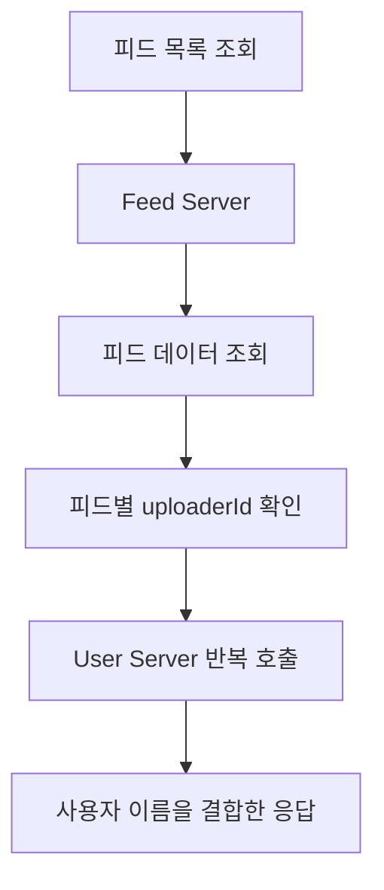
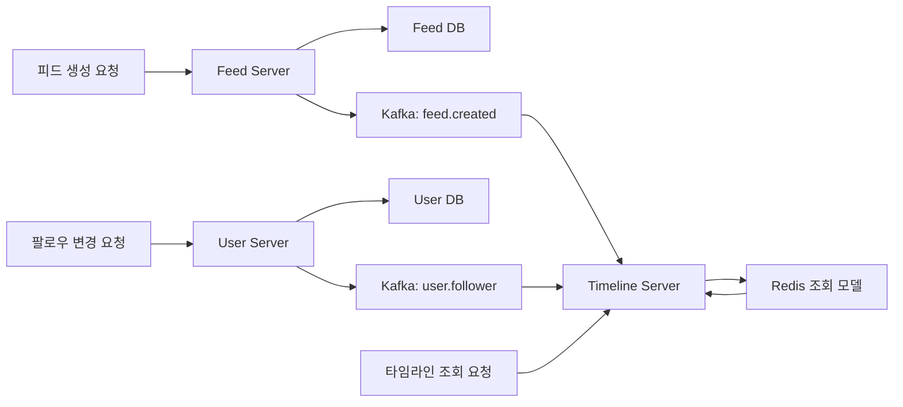
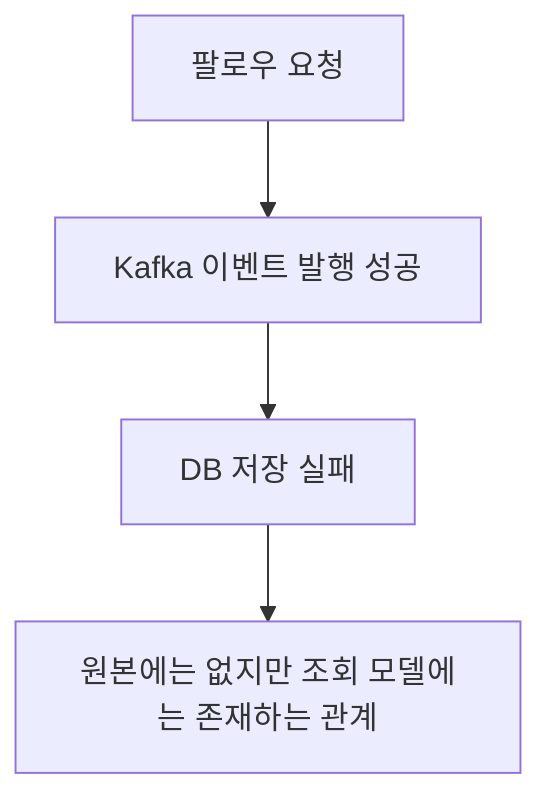
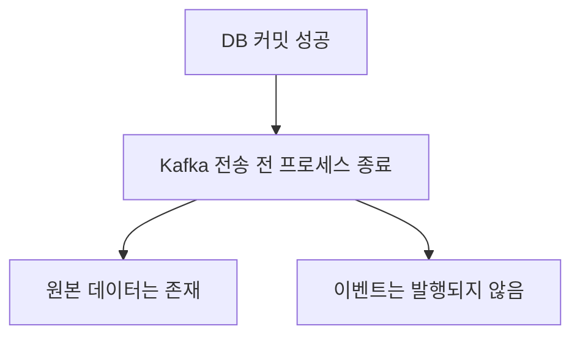
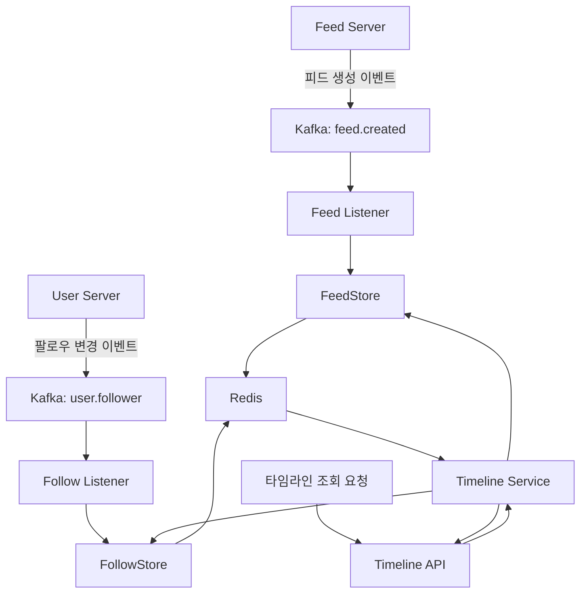
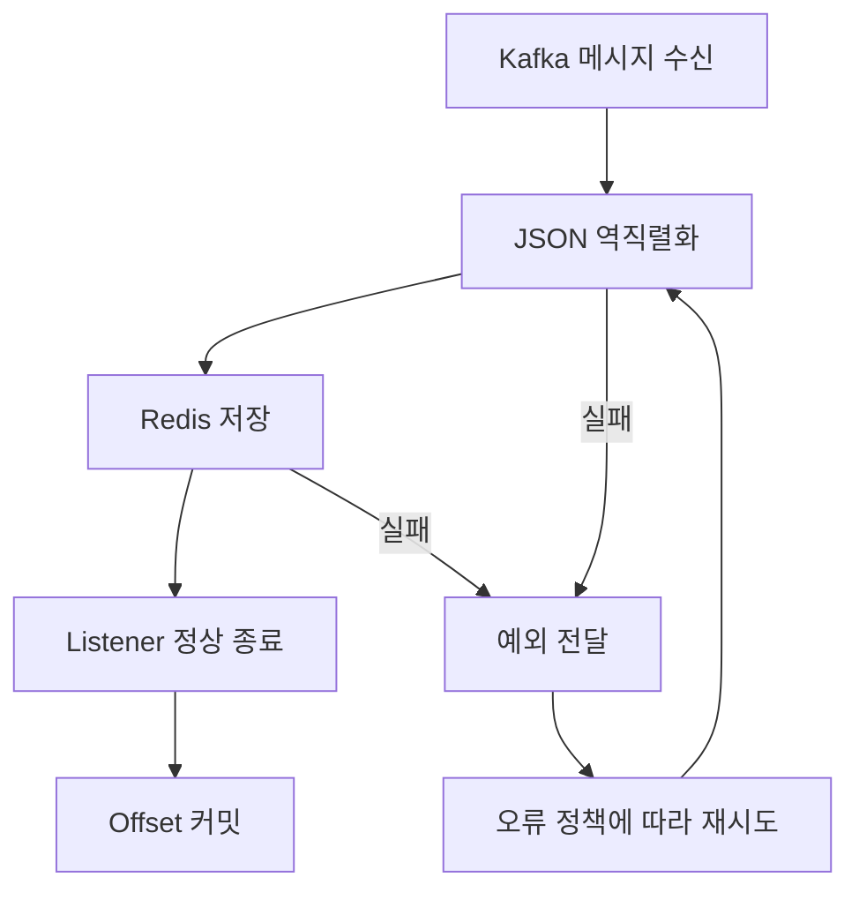

# Ch 7. Timeline 서버 개발

# Ch 7. Timeline 서버 개발
* toc
{:toc}

---

## 01. Kafka를 활용한 애플리케이션 성능 개선

### Kafka 이벤트 발행으로 Timeline 조회 모델 준비하기

피드 목록을 조회할 때 게시물마다 User Server를 호출하면, 피드가 늘어나는 만큼 서버 간 요청도 늘어난다. Feed Server의 Pod를 추가하더라도 User Server와 데이터베이스가 감당해야 할 작업까지 줄어들지는 않는다.

이 문제를 개선하려면 조회 요청을 처리하는 경로부터 바꿔야 한다. 게시물을 읽는 순간마다 사용자 정보를 조합하는 대신, 데이터가 변경될 때 조회에 필요한 정보를 미리 만들어 두는 방식이다.

이번에는 Feed Server와 User Server에서 발생하는 변경 사항을 Kafka로 발행한다. 이후 Timeline Server가 이 이벤트를 소비해 Redis에 조회용 데이터를 구성하면, 타임라인 요청마다 다른 서버를 호출하지 않아도 된다.

#### 기존 피드 조회 구조의 문제

기존 Feed Server는 데이터베이스에서 피드를 조회한 다음, 각 피드의 `uploaderId`로 사용자 정보를 가져왔다.



피드 100개를 조회하면서 각 피드마다 사용자 정보를 요청한다면, 하나의 API 요청이 최대 100번의 내부 HTTP 요청으로 이어질 수 있다. 같은 업로더를 요청 단위로 중복 제거하더라도, 서로 다른 업로더가 많아지면 호출 수가 다시 증가한다.

이 구조에서는 다음과 같은 문제가 생긴다.

- 사용자 정보 조회가 끝날 때까지 피드 응답을 완성할 수 없다.
- User Server의 응답 지연이 Feed Server의 응답 지연으로 전파된다.
- Feed Server를 확장하면 User Server로 들어가는 동시 요청도 증가한다.
- 피드 조회가 반복될 때마다 비슷한 사용자 정보를 다시 가져온다.

페이징은 반드시 필요하다. 한 번에 10개나 20개만 조회하도록 제한하면 응답 크기와 요청당 작업량을 줄일 수 있다.

다만 페이징 자체가 피드별 사용자 조회를 없애지는 않는다. 사용자가 결국 같은 게시물 전체를 조회한다면 여러 페이지에 걸쳐 비슷한 내부 호출이 발생할 수 있다. 반대로 첫 페이지만 확인하고 이탈한다면 전체 작업량도 줄어든다. 따라서 페이징은 효과적인 개선이지만, 서버 간 반복 호출과는 별도로 다뤄야 한다.

#### 조회에 필요한 데이터를 미리 구성하기

새로운 구조에서는 원본 데이터와 조회용 데이터를 나눈다.

| 구성 요소 | 역할 |
|---|---|
| Feed Server | 피드 원본 저장과 피드 생성 이벤트 발행 |
| User Server | 사용자·팔로우 원본 관리와 팔로우 변경 이벤트 발행 |
| Kafka | 변경 이벤트 보관 및 전달 |
| Timeline Server | 이벤트 소비와 타임라인 조회 처리 |
| Redis | 사용자 이름과 팔로우 관계를 포함한 조회용 데이터 저장 |

Feed Server와 User Server가 가진 데이터베이스는 원본 데이터의 기준으로 남는다. Redis에는 타임라인 조회에 맞게 가공한 별도 모델을 저장한다.



이러한 방식은 쓰기 모델과 읽기 모델을 분리하는 CQRS의 아이디어를 적용한 구조다. 반드시 별도의 프레임워크를 사용해야 하는 것은 아니다. 중요한 것은 조회 요청에서 필요한 데이터를 미리 준비해 두고, 변경 이벤트로 그 상태를 갱신한다는 점이다.

Kafka를 사용한다고 해서 애플리케이션 전체가 Reactive Programming으로 바뀌는 것은 아니다. 여기서는 서버 간 변경 전달을 비동기 이벤트 기반으로 전환한다.

이번 구현 범위는 **Feed Server와 User Server의 이벤트 발행**까지다. Timeline Server의 Consumer와 Redis 적재 기능은 이후에 연결한다.

#### 실습 전 확인할 구성

다음 환경을 전제로 진행한다.

- 애플리케이션이 실행되는 `sns` Namespace
- Kafka가 실행되는 `infra` Namespace
- Kafka Service 주소와 실제 클라이언트 리스너 포트
- Kafka에 등록된 SASL 사용자
- 기존 Feed Server와 User Server
- Java 17 이상과 Spring Boot 3.x 기반 프로젝트

Kafka 접속 주소는 다음과 같이 사용한다.

```text
kafka.infra.svc.cluster.local:9092
```

이 주소는 예시 구성이다. 실제 Kafka 설치에서 제공하는 Service 이름, 포트, 인증 방식을 먼저 확인해야 한다.

특히 bootstrap 주소에 접속할 수 있다고 해서 모든 연결이 정상이라는 뜻은 아니다. Kafka 클라이언트는 초기 접속 후 브로커 메타데이터에 포함된 주소로 다시 연결하므로, 브로커의 `advertised.listeners`도 애플리케이션 Pod에서 접근할 수 있어야 한다.

#### Kafka ConfigMap과 Secret 작성

접속 주소와 인증 방식은 ConfigMap으로 관리한다.

```yaml
apiVersion: v1
kind: ConfigMap
metadata:
  name: kafka-config
  namespace: sns
data:
  KAFKA_HOST: "kafka.infra.svc.cluster.local"
  KAFKA_PORT: "9092"
  KAFKA_SECURITY_PROTOCOL: "SASL_PLAINTEXT"
  KAFKA_SASL_MECHANISM: "PLAIN"
```

- `apiVersion: v1`: ConfigMap의 API 버전이다.
- `kind: ConfigMap`: 일반 설정 데이터를 저장한다.
- `metadata.namespace`: 이 ConfigMap을 사용하는 Pod와 같은 `sns`로 지정한다.
- `data`: 컨테이너에 주입할 환경 변수와 값을 정의한다.

인증 정보는 Secret으로 분리한다.

```yaml
apiVersion: v1
kind: Secret
metadata:
  name: kafka-secret
  namespace: sns
type: Opaque
stringData:
  KAFKA_USER: "REPLACE_WITH_KAFKA_USERNAME"
  KAFKA_PASSWORD: "REPLACE_WITH_KAFKA_PASSWORD"
```

`stringData`를 사용하면 직접 Base64로 변환하지 않아도 된다. Kubernetes가 저장 과정에서 처리한다.

다만 Base64는 암호화가 아니다. Secret YAML에 실제 비밀번호를 넣었다면 해당 파일을 Git에 커밋하지 않아야 한다. 운영에서는 Secret 접근 권한과 저장 시 암호화, 외부 Secret 관리도 함께 고려한다.

`SASL_PLAINTEXT`는 인증을 사용하지만 TLS로 통신 내용을 암호화하지 않는다. 실습에서만 제한적으로 사용하고, 운영에서는 브로커 구성에 맞는 `SASL_SSL`을 적용하는 것이 적절하다. 또한 `PLAIN`에는 `PlainLoginModule`을 사용하며, SCRAM을 선택했다면 메커니즘과 로그인 모듈을 함께 변경해야 한다. [Kafka SASL 인증 설정](https://kafka.apache.org/40/security/authentication-using-sasl/)

```shell
kubectl apply -f kafka-configmap.yaml
kubectl apply -f kafka-secret.yaml

kubectl get configmap kafka-config -n sns
kubectl get secret kafka-secret -n sns
```

Secret 내용을 출력하지 않고 객체가 생성되었는지만 확인한다.

#### Spring Kafka 의존성과 접속 설정

Feed Server와 User Server의 `build.gradle`에 다음 의존성을 추가한다.

```groovy
dependencies {
    implementation 'org.springframework.kafka:spring-kafka'
}
```

Spring Boot의 의존성 관리를 사용한다면 Spring Kafka 버전을 별도로 고정하지 않고, 프로젝트의 Boot 버전과 호환되는 버전을 사용한다.

두 서버의 기존 `application.yaml`에서 `spring` 아래에 Kafka 설정을 추가한다. `datasource`와 `kafka`는 같은 수준에 위치한다.

```yaml
spring:
  kafka:
    bootstrap-servers: "${KAFKA_HOST}:${KAFKA_PORT}"

    properties:
      "[security.protocol]": "${KAFKA_SECURITY_PROTOCOL}"
      "[sasl.mechanism]": "${KAFKA_SASL_MECHANISM}"
      "[sasl.jaas.config]": >-
        org.apache.kafka.common.security.plain.PlainLoginModule required
        username="${KAFKA_USER}"
        password="${KAFKA_PASSWORD}";

    producer:
      key-serializer: org.apache.kafka.common.serialization.StringSerializer
      value-serializer: org.apache.kafka.common.serialization.StringSerializer
      acks: all
      retries: 10
      properties:
        "[enable.idempotence]": true
        "[max.in.flight.requests.per.connection]": 5
        "[max.block.ms]": 5000
        "[request.timeout.ms]": 10000
        "[delivery.timeout.ms]": 30000
```

주요 설정은 다음과 같다.

| 설정 | 의미 |
|---|---|
| `bootstrap-servers` | 초기 브로커 연결에 사용하는 주소 |
| `security.protocol` | 인증·암호화에 사용할 통신 방식 |
| `sasl.mechanism` | SASL 인증 메커니즘 |
| `sasl.jaas.config` | 로그인 모듈과 인증 정보 |
| `key-serializer` | 메시지 키를 문자열로 직렬화 |
| `value-serializer` | JSON 문자열을 메시지 값으로 직렬화 |
| `acks: all` | 현재 ISR에 속한 복제본의 확인을 요구 |
| `enable.idempotence` | Producer 내부 재시도로 인한 중복 기록을 방지 |
| `delivery.timeout.ms` | 메시지 전달을 완료하기 위한 제한 시간 |

Producer 멱등성을 활성화하더라도 애플리케이션이 같은 이벤트를 다시 발행하는 경우까지 제거되지는 않는다. 재전송 API나 Consumer 재처리로 인한 중복은 별도로 처리해야 한다.

로컬 Kafka를 인증 없이 사용한다면 별도의 로컬 프로파일에서 주소를 `localhost:9092`, 프로토콜을 `PLAINTEXT`로 설정하고 SASL 설정을 제외한다. Kubernetes 내부 DNS 주소는 일반적인 로컬 개발 환경에서 직접 해석되지 않는다.

#### 애플리케이션에 환경 변수 전달하기

두 Deployment에는 기존 MySQL 설정을 유지하면서 Kafka ConfigMap과 Secret을 추가한다.

기존 Deployment YAML을 직접 수정하는 대신 명령으로 추가하려면 다음과 같이 적용할 수 있다.

```shell
kubectl set env deployment/feed-server -n sns --from=configmap/kafka-config
kubectl set env deployment/feed-server -n sns --from=secret/kafka-secret

kubectl set env deployment/user-server -n sns --from=configmap/kafka-config
kubectl set env deployment/user-server -n sns --from=secret/kafka-secret
```

이 명령은 Pod 템플릿을 변경하므로 새 Pod가 생성된다. 변경 사항은 관리 중인 Deployment YAML이나 Helm values에도 반영해야 이후 배포에서 사라지지 않는다.

ConfigMap이나 Secret의 값을 나중에 수정하더라도, 이미 실행 중인 컨테이너의 환경 변수가 자동으로 바뀌지는 않는다. 환경 변수 방식에서는 새 Pod를 생성해야 변경된 값을 읽는다.

#### Kafka Topic 생성

이번에는 두 Topic을 사용한다.

| Topic | 발행 서버 | 전달 내용 |
|---|---|---|
| `feed.created` | Feed Server | 사용자 이름을 포함한 피드 정보 |
| `user.follower` | User Server | 팔로우 관계와 팔로우 여부 |

Feed Server에는 다음 설정 클래스를 추가한다.

```java
package com.sns.feed.config;

import org.apache.kafka.clients.admin.NewTopic;
import org.springframework.context.annotation.Bean;
import org.springframework.context.annotation.Configuration;
import org.springframework.kafka.config.TopicBuilder;

@Configuration
public class KafkaConfiguration {

    @Bean
    public NewTopic feedCreatedTopic() {
        return TopicBuilder.name("feed.created")
                .partitions(1)
                .replicas(1)
                .build();
    }
}
```

User Server에서도 같은 방식으로 Topic을 정의한다.

```java
package com.sns.user.config;

import org.apache.kafka.clients.admin.NewTopic;
import org.springframework.context.annotation.Bean;
import org.springframework.context.annotation.Configuration;
import org.springframework.kafka.config.TopicBuilder;

@Configuration
public class KafkaConfiguration {

    @Bean
    public NewTopic userFollowerTopic() {
        return TopicBuilder.name("user.follower")
                .partitions(1)
                .replicas(1)
                .build();
    }
}
```

Spring Boot의 KafkaAdmin 자동 설정을 통해 `NewTopic` Bean을 기반으로 Topic 생성을 시도한다. 애플리케이션 계정에는 그에 필요한 권한이 있어야 한다. 운영에서 Topic을 인프라 코드로 관리한다면 애플리케이션에 생성 권한을 부여하지 않는 방식도 가능하다. [Spring Kafka Topic 설정](https://docs.spring.io/spring-kafka/reference/kafka/configuring-topics.html)

실습에서는 Partition과 Replication Factor를 각각 1로 둔다.

여기서 `replicas(1)`은 원본 외에 복제본을 하나 더 만든다는 의미가 아니다. **Partition의 전체 사본이 하나뿐이므로 중복 복제본이 없는 구성**이다. 브로커 장애에 대비한 운영 구성과는 구분해야 한다.

#### 이벤트의 데이터 구조 정의

##### 피드 생성 이벤트

REST API 응답 객체를 이벤트로 그대로 사용하면 API 응답 변경이 메시지 계약에도 영향을 줄 수 있다. 이벤트 전용 타입을 두면 두 계약을 따로 관리하기 쉽다.

Feed Server에 다음 타입을 추가한다.

```java
package com.sns.feed.event;

import java.time.Instant;
import java.util.UUID;

public record FeedCreatedEvent(
        String eventId,
        int schemaVersion,
        Instant occurredAt,
        Long feedId,
        String imageId,
        Long uploaderId,
        String uploaderUsername,
        Instant uploadedAt,
        String content
) {
    public static FeedCreatedEvent create(
            Long feedId,
            String imageId,
            Long uploaderId,
            String uploaderUsername,
            Instant uploadedAt,
            String content
    ) {
        return new FeedCreatedEvent(
                UUID.randomUUID().toString(),
                1,
                Instant.now(),
                feedId,
                imageId,
                uploaderId,
                uploaderUsername,
                uploadedAt,
                content
        );
    }
}
```

`eventId`는 이벤트를 식별하고, `schemaVersion`은 메시지 형식의 버전을 나타낸다. `schemaVersion`이 피드 데이터의 변경 순서를 나타내는 것은 아니다.

`uploaderUsername`을 포함하는 이유는 Timeline Server가 피드를 조회할 때 User Server를 다시 호출하지 않도록 하기 위해서다.

다만 이 값은 이벤트를 만들 당시의 사용자 이름이다. 이후 이름이 변경되었을 때 기존 피드에도 반영하려면 사용자 정보 변경 이벤트나 별도의 갱신 정책이 필요하다.

##### 팔로우 변경 이벤트

User Server에는 다음 타입을 추가한다.

```java
package com.sns.user.event;

import java.time.Instant;
import java.util.UUID;

public record FollowChangedEvent(
        String eventId,
        int schemaVersion,
        Instant occurredAt,
        Long followerUserId,
        Long followingUserId,
        boolean following
) {
    public static FollowChangedEvent create(
            Long followerUserId,
            Long followingUserId,
            boolean following
    ) {
        return new FollowChangedEvent(
                UUID.randomUUID().toString(),
                1,
                Instant.now(),
                followerUserId,
                followingUserId,
                following
        );
    }
}
```

팔로우 방향은 이름만 보고도 구분할 수 있어야 한다.

- `followerUserId`: 팔로우를 수행한 사용자
- `followingUserId`: 팔로우 대상 사용자
- `following: true`: 관계 추가
- `following: false`: 관계 해제

예를 들어 사용자 1이 사용자 2를 팔로우하면 `followerUserId`는 1, `followingUserId`는 2가 된다.

#### DB 커밋 이후 이벤트 발행하기

DB 저장 전에 Kafka로 이벤트를 보내면 문제가 생길 수 있다.



JPA의 `save()`를 먼저 호출해도 충분하지 않다. `save()` 이후 트랜잭션 커밋 과정에서 실패할 수 있기 때문이다.

실습에서는 JSON 직렬화를 트랜잭션 안에서 수행하고, Kafka 전송은 DB 커밋 이후에 실행한다. Spring의 `@TransactionalEventListener`는 이러한 트랜잭션 단계에 맞춘 처리를 지원한다. [Spring 트랜잭션 이벤트](https://docs.spring.io/spring-framework/reference/data-access/transaction/event.html)

다음 클래스는 Feed Server에 추가한다. User Server에도 같은 구현을 두되 패키지를 `com.sns.user.event`로 변경한다.

```java
package com.sns.feed.event;

import com.fasterxml.jackson.core.JsonProcessingException;
import com.fasterxml.jackson.databind.ObjectMapper;
import org.slf4j.Logger;
import org.slf4j.LoggerFactory;
import org.springframework.context.ApplicationEventPublisher;
import org.springframework.kafka.core.KafkaTemplate;
import org.springframework.kafka.support.SendResult;
import org.springframework.stereotype.Component;
import org.springframework.transaction.event.TransactionPhase;
import org.springframework.transaction.event.TransactionalEventListener;
import org.springframework.transaction.support.TransactionSynchronizationManager;

import java.util.concurrent.CompletableFuture;

@Component
public class KafkaEventPublisher {

    private static final Logger log =
            LoggerFactory.getLogger(KafkaEventPublisher.class);

    private final KafkaTemplate<String, String> kafkaTemplate;
    private final ObjectMapper objectMapper;
    private final ApplicationEventPublisher applicationEventPublisher;

    public KafkaEventPublisher(
            KafkaTemplate<String, String> kafkaTemplate,
            ObjectMapper objectMapper,
            ApplicationEventPublisher applicationEventPublisher
    ) {
        this.kafkaTemplate = kafkaTemplate;
        this.objectMapper = objectMapper;
        this.applicationEventPublisher = applicationEventPublisher;
    }

    public void publishAfterCommit(
            String topic,
            String key,
            Object event
    ) {
        if (!TransactionSynchronizationManager.isActualTransactionActive()) {
            throw new IllegalStateException(
                    "An active transaction is required"
            );
        }

        var message = new PendingMessage(topic, key, serialize(event));
        applicationEventPublisher.publishEvent(message);
    }

    @TransactionalEventListener(phase = TransactionPhase.AFTER_COMMIT)
    public void sendAfterCommit(PendingMessage message) {
        try {
            send(message);
        } catch (RuntimeException exception) {
            log.error(
                    "Kafka send could not start. topic={}, key={}",
                    message.topic(),
                    message.key(),
                    exception
            );
        }
    }

    public CompletableFuture<SendResult<String, String>> publishNow(
            String topic,
            String key,
            Object event
    ) {
        return send(new PendingMessage(topic, key, serialize(event)));
    }

    private CompletableFuture<SendResult<String, String>> send(
            PendingMessage message
    ) {
        var future = kafkaTemplate.send(
                message.topic(),
                message.key(),
                message.payload()
        );

        future.whenComplete((result, exception) -> {
            if (exception != null) {
                log.error(
                        "Kafka send failed. topic={}, key={}",
                        message.topic(),
                        message.key(),
                        exception
                );
            }
        });

        return future;
    }

    private String serialize(Object event) {
        try {
            return objectMapper.writeValueAsString(event);
        } catch (JsonProcessingException exception) {
            throw new IllegalStateException(
                    "Kafka event serialization failed",
                    exception
            );
        }
    }

    public record PendingMessage(
            String topic,
            String key,
            String payload
    ) {
    }
}
```

이 구현에서 확인해야 할 부분은 세 가지다.

첫째, `ObjectMapper`는 직접 생성하지 않고 Spring Bean을 주입받는다. 프로젝트에서 사용하는 날짜·시간 모듈과 직렬화 설정을 그대로 적용하기 위해서다.

둘째, `publishAfterCommit()`은 실제 트랜잭션 안에서 호출해야 한다. JSON 변환이 실패하면 런타임 예외가 발생하므로 DB 작업도 롤백할 수 있다. 정상적으로 직렬화된 메시지는 커밋 이후에 전송한다.

셋째, `send()` 호출만 `try-catch`로 감싸서는 비동기 전송 실패를 모두 잡을 수 없다. Spring Kafka 3.x의 `send()`는 `CompletableFuture`를 반환하므로 완료 결과도 확인해야 한다. [KafkaTemplate 메시지 전송](https://docs.spring.io/spring-kafka/docs/3.1.x/reference/kafka/sending-messages.html)

여기서는 커밋 이후 전송 실패를 로그로 남긴다. 이미 완료된 DB 커밋을 Kafka 실패 때문에 되돌릴 수는 없다.

또한 비동기 전송이라고 해서 호출 순간에 절대 대기하지 않는 것은 아니다. 메타데이터 확인이나 Producer 버퍼 확보 과정에서는 `max.block.ms` 범위 안에서 대기할 수 있다.

#### Feed Server에 이벤트 발행 연결

기존 피드 생성 메서드에서는 다음 순서로 처리한다.

1. 업로더 정보 조회
2. 피드 원본 저장
3. 사용자 이름을 포함한 이벤트 생성
4. 커밋 이후 발행 등록
5. 기존 API 응답 반환

기존 `SocialFeedService`에 `KafkaEventPublisher`를 생성자 주입하고, 생성 메서드를 다음 흐름으로 변경한다. 조회·삭제 등 다른 기능은 그대로 유지한다.

```java
@Transactional
public FeedResponse createFeed(CreateFeedRequest request) {
    var uploader = userServiceClient.getUser(request.uploaderId());

    SocialFeed feed = SocialFeed.create(
            request.imageId(),
            request.uploaderId(),
            request.content()
    );

    SocialFeed savedFeed = socialFeedRepository.save(feed);

    FeedCreatedEvent event = FeedCreatedEvent.create(
            savedFeed.getId(),
            savedFeed.getImageId(),
            savedFeed.getUploaderId(),
            uploader.username(),
            savedFeed.getUploadedAt(),
            savedFeed.getContent()
    );

    kafkaEventPublisher.publishAfterCommit(
            "feed.created",
            savedFeed.getId().toString(),
            event
    );

    return FeedResponse.from(savedFeed);
}
```

사용자 조회가 완전히 사라지는 것은 아니다. **피드를 읽을 때마다 실행하던 조회를 피드를 작성하는 시점의 한 번으로 옮긴 것**이다.

피드 하나가 여러 번 조회되는 서비스라면 이 차이가 커진다. 다만 현재 구현에서는 User Server가 중단되면 피드 생성도 영향을 받는다. 서버 간 호출에 연결·응답 시간 제한을 설정하고, 사용자 정보를 가져오지 못했을 때의 저장 정책도 정해야 한다.

메시지 키는 `feedId`로 지정한다. 이후 피드 수정·삭제 이벤트까지 확장한다면 같은 피드의 이벤트에 동일한 키를 사용하는 것이 순서를 관리하는 데 유리하다.

#### 기존 피드 데이터 재전송

이벤트 발행 기능을 추가해도 기존 데이터가 자동으로 Kafka에 들어가지는 않는다. 새로운 피드 생성 코드만 실행되기 때문이다.

따라서 이미 저장된 피드를 읽어 이벤트로 보내는 초기 적재 기능이 필요하다.

##### 전체 조회 대신 작은 단위로 읽기

관리 기능이라고 해서 `findAll()`로 전체 데이터를 메모리에 올려도 되는 것은 아니다. 데이터가 많으면 관리 요청 하나가 애플리케이션과 DB에 큰 부하를 줄 수 있다.

Repository에는 마지막으로 처리한 ID 다음부터 읽는 메서드를 추가한다.

```java
@Query("select coalesce(max(f.id), 0) from SocialFeed f")
Long findMaxFeedId();

List<SocialFeed> findByIdGreaterThanAndIdLessThanEqualOrderByIdAsc(
        Long afterId,
        Long upperId,
        Pageable pageable
);
```

처리 시작 시 최대 ID를 기록하고, 해당 범위 안에서 100개씩 읽는다.

기존 `SocialFeedService`에는 다음과 같은 재전송 메서드를 추가할 수 있다. 이 메서드는 Controller 등 외부 Bean에서 호출해야 트랜잭션 전파 설정이 적용된다.

```java
@Transactional(propagation = Propagation.NOT_SUPPORTED)
public long replayFeeds() {
    long upperId = socialFeedRepository.findMaxFeedId();
    long lastId = 0;
    long publishedCount = 0;

    while (true) {
        var feeds = socialFeedRepository
                .findByIdGreaterThanAndIdLessThanEqualOrderByIdAsc(
                        lastId,
                        upperId,
                        PageRequest.of(0, 100)
                );

        if (feeds.isEmpty()) {
            return publishedCount;
        }

        Map<Long, String> usernames = new HashMap<>();

        for (SocialFeed feed : feeds) {
            String username = usernames.computeIfAbsent(
                    feed.getUploaderId(),
                    id -> userServiceClient.getUser(id).username()
            );

            FeedCreatedEvent event = FeedCreatedEvent.create(
                    feed.getId(),
                    feed.getImageId(),
                    feed.getUploaderId(),
                    username,
                    feed.getUploadedAt(),
                    feed.getContent()
            );

            try {
                kafkaEventPublisher.publishNow(
                        "feed.created",
                        feed.getId().toString(),
                        event
                ).get(40, TimeUnit.SECONDS);
            } catch (InterruptedException exception) {
                Thread.currentThread().interrupt();
                throw new IllegalStateException(
                        "Feed replay was interrupted",
                        exception
                );
            } catch (ExecutionException | TimeoutException exception) {
                throw new IllegalStateException(
                        "Feed replay failed at feedId=" + feed.getId(),
                        exception
                );
            }

            lastId = feed.getId();
            publishedCount++;
        }
    }
}
```

이 메서드에는 `PageRequest`, `Map`, `HashMap`, `TimeUnit`, `ExecutionException`, `TimeoutException`, `Propagation` 관련 import가 필요하다.

한 번 읽은 묶음 안에서는 같은 업로더 정보를 재사용한다. 또한 전송 Future가 성공한 메시지만 처리 건수에 포함한다. 이 건수는 Kafka 발행 성공 건수이지, Redis 적재 완료 건수는 아니다.

타임아웃이 발생했다고 해서 메시지가 절대로 기록되지 않았다는 뜻도 아니다. 이후 재실행하면 일부 메시지가 중복될 수 있다.

##### 재전송은 관리용 POST API로 제공

Kafka 메시지를 발행하는 동작은 조회가 아니므로 `GET`보다 `POST`가 적절하다.

```java
package com.sns.feed.api;

import com.sns.feed.service.SocialFeedService;
import org.springframework.boot.autoconfigure.condition.ConditionalOnProperty;
import org.springframework.web.bind.annotation.PostMapping;
import org.springframework.web.bind.annotation.RequestMapping;
import org.springframework.web.bind.annotation.RestController;

@RestController
@RequestMapping("/internal/feeds")
@ConditionalOnProperty(
        name = "app.admin.replay-enabled",
        havingValue = "true"
)
public class FeedReplayController {

    private final SocialFeedService socialFeedService;

    public FeedReplayController(SocialFeedService socialFeedService) {
        this.socialFeedService = socialFeedService;
    }

    @PostMapping("/replay")
    public ReplayResult replay() {
        return new ReplayResult(socialFeedService.replayFeeds());
    }

    public record ReplayResult(long publishedCount) {
    }
}
```

기본 설정에서는 비활성화한다.

```yaml
app:
  admin:
    replay-enabled: false
```

조건부 활성화는 인증·인가를 대신하지 않는다. 활성화할 때는 관리자 권한과 접근 경로 제한이 필요하다.

이 예제는 소규모 실습 데이터를 위한 동기 처리다. 운영 데이터의 초기 적재는 Kubernetes Job 등으로 분리하고, 진행 상태와 재시작 지점을 저장하는 편이 적절하다.

시작 시 기록한 최대 ID는 처리 대상을 제한할 뿐, DB 전체의 일관된 스냅샷을 보장하지 않는다. 실습에서는 피드 변경을 잠시 멈추고 실행할 수 있지만, 운영에서는 초기 적재와 실시간 변경 이벤트 사이의 순서까지 설계해야 한다.

#### User Server에서 팔로우 변경 발행

팔로우 관계는 추가와 해제를 모두 전달해야 한다. 추가 이벤트만 처리하면 Redis에는 이미 해제된 관계가 계속 남는다.

기존 `FollowService`에는 User Server 패키지의 `KafkaEventPublisher`를 주입하고 다음 보조 메서드를 추가한다.

```java
private void publishFollowChanged(
        Long followerUserId,
        Long followingUserId,
        boolean following
) {
    FollowChangedEvent event = FollowChangedEvent.create(
            followerUserId,
            followingUserId,
            following
    );

    String key = followerUserId + ":" + followingUserId;

    kafkaEventPublisher.publishAfterCommit(
            "user.follower",
            key,
            event
    );
}
```

기존 팔로우 생성 메서드에서는 사용자 존재 여부, 자기 자신에 대한 팔로우, 중복 관계 검증을 유지한다. 관계 저장 이후에는 다음 코드를 호출한다.

```java
Follow savedFollow = followRepository.save(
        Follow.create(followerUserId, followingUserId)
);

publishFollowChanged(
        savedFollow.getFollowerUserId(),
        savedFollow.getFollowingUserId(),
        true
);
```

언팔로우 메서드에서는 기존 관계를 조회한 뒤 삭제하고, 해제 이벤트를 등록한다.

```java
Follow follow = followRepository
        .findByFollowerUserIdAndFollowingUserId(
                followerUserId,
                followingUserId
        )
        .orElseThrow(() -> new IllegalStateException(
                "Follow relationship does not exist"
        ));

followRepository.delete(follow);

publishFollowChanged(
        followerUserId,
        followingUserId,
        false
);
```

두 작업 모두 기존 서비스의 `@Transactional` 메서드 안에서 수행해야 한다. 관계 삭제나 커밋이 실패하면 Kafka 이벤트도 발행되지 않는다. 관계가 없는 경우의 예외는 프로젝트에서 사용하는 API 예외 매핑에 맞춘다.

동시 팔로우 요청에 대한 중복 방지는 애플리케이션의 사전 조회만으로 충분하지 않다. 데이터베이스에도 `(follower_user_id, following_user_id)` 조합의 유일성 제약이 필요하다.

메시지 키는 두 사용자 ID의 조합으로 만든다. 같은 관계의 변경이 같은 Partition으로 전달되도록 하기 위해서다. 다만 여러 Producer의 동시 요청에서 DB 커밋 순서까지 자동으로 보장되는 것은 아니다. 엄격한 상태 순서가 필요하면 관계 버전이나 발행 순서 관리가 추가로 필요하다.

기존 팔로우 관계도 잊지 않아야 한다. 초기 적재를 생략하면 새로 발생하는 변경만 전달된다. 실습 데이터가 적다면 관계를 다시 생성해 확인할 수 있지만, 실제 서비스에서는 기존 관계를 동기화하는 절차가 필요하다.

#### 빌드와 Kubernetes 배포

두 서버 모두 새 이미지 태그를 사용해 빌드한다. 아래 태그와 레지스트리 주소는 실제 배포 환경에 맞게 변경한다.

각 프로젝트에서 실행한다.

```shell
./gradlew clean test
./gradlew jib --image=<ECR_REGISTRY>/feed-server:<NEW_TAG>
```

User Server 프로젝트에서는 이미지 이름을 변경한다.

```shell
./gradlew clean test
./gradlew jib --image=<ECR_REGISTRY>/user-server:<NEW_TAG>
```

Windows PowerShell에서는 Gradle Wrapper를 `.\gradlew.bat`로 실행할 수 있다.

Deployment 이미지도 같은 태그로 변경한다.

```shell
kubectl set image deployment/feed-server -n sns feed-server=<ECR_REGISTRY>/feed-server:<NEW_TAG>
kubectl set image deployment/user-server -n sns user-server=<ECR_REGISTRY>/user-server:<NEW_TAG>

kubectl rollout status deployment/feed-server -n sns
kubectl rollout status deployment/user-server -n sns

kubectl get pods -n sns
```

이미지 주소와 환경 변수 변경은 관리 중인 선언형 설정에도 반영한다. 같은 태그에 이미지를 덮어쓰기보다 배포마다 구분되는 태그를 사용하는 편이 배포 이력과 롤백 대상을 확인하기 쉽다.

#### 이벤트 발행 테스트

##### Kafka 메시지 확인

Kafka CLI를 사용할 수 있는 클라이언트 Pod에서 Topic을 소비한다.

```shell
kafka-console-consumer.sh \
  --bootstrap-server kafka.infra.svc.cluster.local:9092 \
  --consumer.config <KAFKA_CLIENT_CONFIG> \
  --topic feed.created \
  --group feed-debug-consumer \
  --from-beginning \
  --property print.key=true
```

`<KAFKA_CLIENT_CONFIG>`는 실제 SASL 접속 설정이 들어 있는 파일 경로로 바꾼다. 애플리케이션의 Spring YAML을 그대로 지정하는 것이 아니라 Kafka CLI용 properties 파일을 사용해야 한다.

팔로우 이벤트는 Topic과 디버깅용 Consumer Group을 변경해 확인한다.

```shell
kafka-console-consumer.sh \
  --bootstrap-server kafka.infra.svc.cluster.local:9092 \
  --consumer.config <KAFKA_CLIENT_CONFIG> \
  --topic user.follower \
  --group follow-debug-consumer \
  --from-beginning \
  --property print.key=true
```

향후 Timeline Server가 사용하는 Consumer Group과는 구분한다. 같은 그룹을 사용하면 디버깅 Consumer가 처리할 메시지를 나눠 가져갈 수 있다.

##### 피드 생성 확인

클러스터 내부 테스트 환경에서 유효한 사용자 ID로 피드를 생성한다.

```shell
curl -X POST \
  http://feed-service.sns.svc.cluster.local:8080/api/feeds \
  -H "Content-Type: application/json" \
  -d '{
    "imageId": "test-image",
    "uploaderId": 1,
    "content": "Kafka event test"
  }'
```

정상 동작 시에는 다음 순서가 성립해야 한다.

1. 사용자 정보 조회가 성공한다.
2. 피드가 원본 DB에 저장된다.
3. DB 트랜잭션이 커밋된다.
4. `feed.created`에 메시지가 기록된다.
5. 메시지에 피드 ID와 업로더 이름이 포함된다.

실제 이미지 검증을 수행하는 구성이라면 `imageId`에는 존재하는 이미지 ID를 사용한다.

##### 팔로우와 언팔로우 확인

```shell
curl -X POST \
  http://user-service.sns.svc.cluster.local:8080/api/follows \
  -H "Content-Type: application/json" \
  -d '{
    "followerUserId": 1,
    "followingUserId": 2
  }'
```

이후 관계를 해제한다.

```shell
curl -X DELETE \
  http://user-service.sns.svc.cluster.local:8080/api/follows/1/2
```

각 요청 이후 `user.follower`에서 같은 사용자 쌍의 이벤트를 확인한다. 생성 시에는 `following: true`, 해제 시에는 `following: false`여야 한다.

사용자 1과 2가 미리 존재해야 하며, 인증을 적용한 API에서는 필요한 인증 정보도 함께 전달한다.

##### 실패 상황도 함께 확인

| 테스트 상황 | 확인할 결과 |
|---|---|
| 존재하지 않는 업로더로 피드 생성 | 피드 저장과 이벤트 발행이 발생하지 않음 |
| DB 저장·커밋 실패 | 커밋 이후 이벤트 발행이 실행되지 않음 |
| Kafka 인증 정보 오류 | 인증 실패 로그와 발행 실패 확인 |
| Kafka 연결 중단 | DB 저장 성공과 이벤트 발행 실패가 분리될 수 있음 |
| 기존 피드 재전송 | 이미 보낸 피드 이벤트가 다시 나타날 수 있음 |
| 기존 팔로우 초기 적재 생략 | 이전 관계는 조회 모델에 아직 반영되지 않음 |

현재 단계에서는 Kafka 메시지까지 확인한다. Timeline Server와 Redis 적재 기능을 구현하기 전이므로 타임라인 조회 성능 개선이나 Redis 반영 완료까지 검증한 것으로 보아서는 안 된다.

#### 운영에서 추가로 해결해야 할 문제

##### 커밋 이후 발행만으로 유실을 막을 수는 없다

이번 예제는 DB 롤백과 모순되는 이벤트가 먼저 전달되는 문제를 줄인다. 하지만 다음 장애 구간은 남는다.



이를 보완하는 대표적인 방식이 Transactional Outbox다.

비즈니스 데이터와 발행할 이벤트를 같은 DB 트랜잭션에 저장하고, 별도의 발행기가 Outbox를 읽어 Kafka로 전송한다. 프로세스가 재시작되어도 미발행 이벤트를 다시 찾을 수 있다.

다만 Outbox에서도 재시도에 따른 중복은 발생할 수 있으므로 Consumer의 멱등 처리는 여전히 필요하다.

##### 피드 ID가 있다고 중복이 자동으로 사라지지는 않는다

같은 피드를 재전송했을 때 Redis 목록에 무조건 추가하면 중복 게시물이 생긴다.

Consumer가 `feedId`를 기준으로 데이터를 덮어쓰거나, 타임라인 자료구조에서 같은 피드를 중복 삽입하지 않도록 구현해야 한다. 동일 이벤트의 재처리와 별도 이벤트로 재생성된 같은 피드의 처리는 구분해서 설계한다.

또한 오래된 재전송 데이터가 더 최신 데이터를 덮어쓰지 않도록 하려면 데이터 버전과 적용 순서도 필요하다.

##### 조회 모델에는 반영 지연이 있다

DB 저장과 Redis 갱신은 하나의 동기 작업이 아니다. 피드 생성 API가 성공한 직후 Timeline Server에서는 아직 해당 피드가 보이지 않을 수 있다.

이 구조에서는 최종적 일관성을 전제로 다음 정책을 정해야 한다.

- 작성 직후 화면은 생성 API 응답으로 먼저 갱신할지
- Consumer 지연이 어느 정도까지 허용되는지
- Redis 유실 시 조회 모델을 어떻게 복구할지
- 피드 수정·삭제와 사용자 이름 변경을 어떤 이벤트로 반영할지

Redis를 사용한다는 사실만으로 이러한 문제가 해결되지는 않는다. 조회 모델을 다시 구성할 수 있는 원본과 재처리 절차가 함께 있어야 한다.

### 정리

기존 구조는 피드를 조회할 때마다 사용자 정보를 가져와 응답을 조합했다. 이번에는 피드 생성 시 사용자 정보를 포함한 이벤트를 발행하고, 팔로우 관계의 추가와 해제도 Kafka로 전달하도록 변경했다.

이후 Timeline Server가 이벤트를 소비해 Redis에 조회용 데이터를 구성하면, 타임라인 요청에서 Feed Server와 User Server를 반복 호출하는 경로를 줄일 수 있다.

핵심은 Kafka 도입 자체가 아니라 **반복되는 조회 작업을 변경 시점의 처리로 옮기는 것**이다. 이를 안정적으로 운영하려면 초기 데이터 적재, 발행 유실 복구, 중복 처리, 이벤트 순서, 조회 모델의 반영 지연까지 함께 설계해야 한다.

## 02. 타임라인 API 만들기 

### Kafka와 Redis로 Timeline Server 구현하기

앞에서는 Feed Server와 User Server에서 발생하는 변경 사항을 Kafka로 발행하도록 구성했다. 이제 이 이벤트를 받아 타임라인 조회에 사용할 데이터를 만드는 서버를 구현한다.

Timeline Server의 역할은 두 가지다. Kafka 이벤트를 소비해 Redis의 조회 모델을 갱신하고, API 요청이 들어오면 Redis에서 데이터를 읽어 응답한다.

기존 Feed Server가 조회 요청마다 사용자 정보를 가져와 조합했다면, Timeline Server는 이미 사용자 이름이 포함된 피드를 읽는다. 반복적인 서버 간 호출을 조회 경로에서 제거하는 것이 이번 구현의 핵심이다.

#### 구현 목표와 전체 구조

이번에 연결할 흐름은 다음과 같다.



Timeline Server는 별도의 관계형 데이터베이스를 조회하지 않는다. 피드 원본은 Feed Server가 관리하고, 사용자와 팔로우 관계의 원본은 User Server가 관리한다.

Redis에는 타임라인 조회에 맞게 가공한 데이터를 저장한다.

| 데이터 | 원본 관리 주체 | Timeline Server의 저장 목적 |
|---|---|---|
| 피드 | Feed Server | 사용자 이름을 포함한 피드 조회 |
| 팔로우 관계 | User Server | 타임라인에 포함할 사용자 결정 |
| 좋아요 | 기존 Timeline 기능 | 좋아요 상태와 개수 조회 |

여기서 Redis를 단순히 “없어져도 되는 캐시”로만 생각하면 안 된다. 피드와 팔로우 정보는 원본으로부터 재구성할 수 있지만, 좋아요를 Redis에만 저장한다면 좋아요 데이터의 내구성과 복구 정책은 별도로 필요하다.

#### 먼저 확인할 ObjectMapper 설정

Kafka 메시지에는 게시물 작성 시각과 이벤트 발생 시각처럼 Java 날짜·시간 타입이 포함된다.

다음과 같이 기본 `ObjectMapper`를 직접 생성하면 프로젝트에서 사용하는 날짜·시간 모듈과 설정이 적용되지 않을 수 있다.

```java
private final ObjectMapper objectMapper = new ObjectMapper();
```

Spring Boot 3.x와 Jackson 2 기반 프로젝트에서는 Spring이 관리하는 `ObjectMapper`를 생성자 주입받아 사용한다.

```java
public FeedListener(
        ObjectMapper objectMapper,
        FeedStore feedStore
) {
    this.objectMapper = objectMapper;
    this.feedStore = feedStore;
}
```

이 원칙은 이벤트를 보내는 Feed Server와 User Server에도 동일하게 적용한다. Producer와 Consumer가 날짜·시간 형식을 서로 다르게 해석하지 않도록 직렬화 계약을 맞춰야 한다.

#### 프로젝트 의존성

Timeline Server에는 다음 의존성이 필요하다.

```groovy
dependencies {
    implementation 'org.springframework.boot:spring-boot-starter-web'
    implementation 'org.springframework.boot:spring-boot-starter-data-redis'
    implementation 'org.springframework.kafka:spring-kafka'
    implementation 'org.springframework.boot:spring-boot-starter-actuator'
}
```

- `spring-boot-starter-web`: 타임라인 조회 API를 제공한다.
- `spring-boot-starter-data-redis`: Redis 연결과 자료구조 접근을 담당한다.
- `spring-kafka`: Kafka 메시지를 소비한다.
- `spring-boot-starter-actuator`: Kubernetes Probe에서 사용할 상태 확인 경로를 제공한다.

JPA와 JDBC를 사용하지 않으므로 데이터베이스 연결 설정은 필요하지 않다. 기존 컨테이너 빌드용 Jib 설정은 유지하고, Timeline Server의 이미지 저장소와 태그를 지정한다.

#### Redis 접속 정보 설정

Redis가 `infra` Namespace의 `redis-master` Service로 제공된다고 가정한다.

```yaml
apiVersion: v1
kind: ConfigMap
metadata:
  name: redis-config
  namespace: sns
data:
  REDIS_HOST: "redis-master.infra.svc.cluster.local"
  REDIS_PORT: "6379"
```

`metadata.namespace`는 이 설정을 사용하는 Timeline Server와 같은 `sns`로 지정한다.

접속 대상은 다른 Namespace에 있으므로 Service 주소에 `infra`를 포함한다. Namespace가 다르다는 이유만으로 통신이 차단되지는 않는다. NetworkPolicy를 적용했다면 Kafka와 Redis로 향하는 통신이 허용되어 있는지도 확인해야 한다.

```bash
kubectl apply -f redis-configmap.yaml
kubectl get configmap redis-config -n sns
```

이 예제는 인증을 설정하지 않은 실습용 Redis를 전제로 한다. 실제 Redis에 비밀번호나 ACL을 설정했다면 Secret을 통해 인증 정보를 전달해야 한다. 인증이 없다는 구성을 운영 환경까지 그대로 가져가서는 안 된다.

#### Spring 설정

다음 설정은 Spring Boot 3.x 기반의 예제다. Kafka 인증에는 앞에서 만든 `kafka-config`와 `kafka-secret`을 사용한다.

```yaml
spring:
  application:
    name: timeline-server

  data:
    redis:
      host: "${REDIS_HOST}"
      port: "${REDIS_PORT}"
      connect-timeout: 2s
      timeout: 2s

  kafka:
    bootstrap-servers: "${KAFKA_HOST}:${KAFKA_PORT}"

    properties:
      "[security.protocol]": "${KAFKA_SECURITY_PROTOCOL}"
      "[sasl.mechanism]": "${KAFKA_SASL_MECHANISM}"
      "[sasl.jaas.config]": >-
        org.apache.kafka.common.security.plain.PlainLoginModule required
        username="${KAFKA_USER}"
        password="${KAFKA_PASSWORD}";

    consumer:
      group-id: timeline-server
      enable-auto-commit: false
      auto-offset-reset: earliest
      key-deserializer: org.apache.kafka.common.serialization.StringDeserializer
      value-deserializer: org.apache.kafka.common.serialization.StringDeserializer
      max-poll-records: 100

    listener:
      ack-mode: record
      concurrency: 1
      missing-topics-fatal: true

  lifecycle:
    timeout-per-shutdown-phase: 30s

server:
  port: 8080
  shutdown: graceful

management:
  endpoints:
    web:
      exposure:
        include: health,info
  endpoint:
    health:
      probes:
        enabled: true
```

Kafka Consumer 설정에서 특히 중요한 부분은 Offset 처리다.

| 설정 | 의미 |
|---|---|
| `group-id` | 같은 작업을 분담하는 Consumer Group |
| `enable-auto-commit: false` | Kafka 클라이언트의 주기적인 자동 커밋 비활성화 |
| `ack-mode: record` | 개별 Listener 처리가 성공한 뒤 컨테이너가 Offset 커밋 |
| `auto-offset-reset: earliest` | 유효한 커밋 Offset이 없을 때 남아 있는 가장 이른 메시지부터 소비 |
| `max-poll-records` | 한 번의 poll에서 가져오는 최대 레코드 수 |

`earliest`는 서버를 재시작할 때마다 모든 메시지를 다시 읽는 설정이 아니다. 이미 Consumer Group의 Offset이 저장되어 있다면 해당 위치에서 이어서 읽는다.

또한 메시지가 Kafka 보존 기간을 지나 삭제되었다면 `earliest`로도 복구할 수 없다.

#### Redis 자료구조 설계

##### 피드는 Sorted Set으로 정렬한다

타임라인은 일반적으로 최신 게시물이 먼저 나와야 한다. Redis Sorted Set은 각 Member에 Score를 부여하므로 이러한 정렬에 적합하다.

- Member: 피드 ID
- Score: 작성 시각의 Epoch Milliseconds
- 조회 방향: Score 내림차순

Sorted Set은 같은 Member를 다시 추가하면 별도 항목을 늘리는 대신 해당 Member의 Score를 갱신한다. 이를 피드 ID와 결합하면 재처리 시 중복 인덱스를 줄일 수 있다. [Redis Sorted Set](https://redis.io/docs/latest/develop/data-types/sorted-sets/)

주의할 점은 **Sorted Set의 중복 기준이 JSON 내부의 피드 ID가 아니라 Member 전체**라는 사실이다.

피드 JSON을 Member로 저장하면 사용자 이름이나 필드 순서가 달라졌을 때 다른 문자열로 인식될 수 있다. 같은 피드인데 두 항목이 생기는 것이다.

이번에는 본문과 정렬 인덱스를 분리한다.

| Key | 자료구조 | 저장 내용 |
|---|---|---|
| `timeline:feeds:data` | Hash | 피드 ID별 JSON 본문 |
| `timeline:feeds:all` | Sorted Set | 전체 피드 ID와 작성 시각 |
| `timeline:feeds:user:1` | Sorted Set | 사용자 1이 작성한 피드 ID와 작성 시각 |
| `timeline:following:1` | Set | 사용자 1이 팔로우하는 사용자 ID |

이 구성에서는 피드 본문을 한 곳에 저장하고, 전체 조회와 사용자별 조회를 위한 인덱스만 따로 유지한다.

##### 팔로우 관계는 Set으로 저장한다

팔로우 관계에서는 순서보다 포함 여부가 중요하다.

사용자 1이 사용자 2와 3을 팔로우한다면 다음과 같은 형태가 된다.

```text
Key: timeline:following:1
Members: 2, 3
```

이 키는 사용자 1의 **팔로워 목록이 아니라 팔로잉 목록**이다.

이름을 모호하게 `followers`로 지정하면 관계 방향을 뒤집어 구현하기 쉽다. 저장 키와 메서드 이름 모두 `following`을 기준으로 맞춘다.

#### 이벤트 계약 정의

Consumer는 Producer가 보낸 JSON 구조와 같은 필드를 사용해야 한다.

Feed Server에서 발행하는 피드 이벤트는 다음 타입으로 받는다.

```java
package com.sns.timeline.event;

import java.time.Instant;

public record FeedCreatedEvent(
        String eventId,
        int schemaVersion,
        Instant occurredAt,
        Long feedId,
        String imageId,
        Long uploaderId,
        String uploaderUsername,
        Instant uploadedAt,
        String content
) {
}
```

팔로우 변경 이벤트도 앞에서 정의한 방향을 그대로 유지한다.

```java
package com.sns.timeline.event;

import java.time.Instant;

public record FollowChangedEvent(
        String eventId,
        int schemaVersion,
        Instant occurredAt,
        Long followerUserId,
        Long followingUserId,
        boolean following
) {
}
```

`followerUserId`는 팔로우하는 사람, `followingUserId`는 팔로우 대상이다.

Redis와 API에서는 이벤트 메타데이터를 제외한 조회 모델을 사용한다.

```java
package com.sns.timeline.feed;

import com.sns.timeline.event.FeedCreatedEvent;

import java.time.Instant;

public record FeedView(
        Long feedId,
        String imageId,
        Long uploaderId,
        String uploaderUsername,
        Instant uploadedAt,
        String content
) {
    public static FeedView from(FeedCreatedEvent event) {
        if (event.feedId() == null || event.feedId() <= 0
                || event.uploaderId() == null || event.uploaderId() <= 0
                || event.uploadedAt() == null
                || event.uploaderUsername() == null
                || event.content() == null) {
            throw new IllegalArgumentException("Invalid feed event");
        }

        return new FeedView(
                event.feedId(),
                event.imageId(),
                event.uploaderId(),
                event.uploaderUsername(),
                event.uploadedAt(),
                event.content()
        );
    }
}
```

이벤트 ID와 스키마 버전은 메시지 처리에 필요한 정보다. 이를 그대로 사용자 응답에 노출할 필요는 없다.

#### FeedStore 구현

`FeedStore`는 Redis에 피드를 저장하고, 정렬 인덱스를 이용해 조회한다. 관계형 데이터베이스를 사용하는 서비스의 Repository와 비슷한 경계에 해당한다.

```java
package com.sns.timeline.feed;

import com.fasterxml.jackson.core.JsonProcessingException;
import com.fasterxml.jackson.databind.ObjectMapper;
import com.sns.timeline.event.FeedCreatedEvent;
import org.springframework.data.redis.core.StringRedisTemplate;
import org.springframework.data.redis.core.script.DefaultRedisScript;
import org.springframework.stereotype.Repository;

import java.util.ArrayList;
import java.util.List;
import java.util.Set;

@Repository
public class FeedStore {

    private static final String DATA_KEY = "timeline:feeds:data";
    private static final String ALL_KEY = "timeline:feeds:all";
    private static final String USER_PREFIX = "timeline:feeds:user:";

    private static final DefaultRedisScript<Long> UPSERT =
            new DefaultRedisScript<>("""
                    redis.call('HSET', KEYS[1], ARGV[1], ARGV[3])
                    redis.call('ZADD', KEYS[2], ARGV[2], ARGV[1])
                    redis.call('ZADD', KEYS[3], ARGV[2], ARGV[1])
                    return 1
                    """, Long.class);

    private final StringRedisTemplate redis;
    private final ObjectMapper objectMapper;

    public FeedStore(
            StringRedisTemplate redis,
            ObjectMapper objectMapper
    ) {
        this.redis = redis;
        this.objectMapper = objectMapper;
    }

    public void save(FeedCreatedEvent event) {
        FeedView feed = FeedView.from(event);

        String payload;
        try {
            payload = objectMapper.writeValueAsString(feed);
        } catch (JsonProcessingException exception) {
            throw new IllegalStateException(
                    "Feed serialization failed",
                    exception
            );
        }

        redis.execute(
                UPSERT,
                List.of(
                        DATA_KEY,
                        ALL_KEY,
                        USER_PREFIX + feed.uploaderId()
                ),
                feed.feedId().toString(),
                Long.toString(feed.uploadedAt().toEpochMilli()),
                payload
        );
    }

    public List<FeedView> listAll(long offset, int limit) {
        return read(ALL_KEY, offset, limit);
    }

    public List<FeedView> listByUser(
            long userId,
            long offset,
            int limit
    ) {
        return read(USER_PREFIX + userId, offset, limit);
    }

    private List<FeedView> read(
            String indexKey,
            long offset,
            int limit
    ) {
        if (offset < 0 || offset > 1_000_000
                || limit < 1 || limit > 100) {
            throw new IllegalArgumentException("Invalid page range");
        }

        Set<String> ids = redis.opsForZSet().reverseRange(
                indexKey,
                offset,
                offset + limit - 1
        );

        if (ids == null || ids.isEmpty()) {
            return List.of();
        }

        List<String> payloads = redis.<String, String>opsForHash()
                .multiGet(DATA_KEY, new ArrayList<>(ids));

        List<FeedView> feeds = new ArrayList<>(payloads.size());

        for (String payload : payloads) {
            if (payload == null) {
                throw new IllegalStateException(
                        "Feed index and payload are inconsistent"
                );
            }

            try {
                feeds.add(objectMapper.readValue(
                        payload,
                        FeedView.class
                ));
            } catch (JsonProcessingException exception) {
                throw new IllegalStateException(
                        "Stored feed deserialization failed",
                        exception
                );
            }
        }

        return feeds;
    }
}
```

##### 저장 동작

피드 하나를 저장하면 다음 명령이 실행된다.

1. Hash에 피드 본문 저장
2. 전체 피드 Sorted Set에 피드 ID 추가
3. 업로더별 Sorted Set에 피드 ID 추가

세 명령은 짧은 Lua Script로 묶었다. 다른 요청이 명령 사이에 끼어들지 않도록 하기 위해서다. Spring Data Redis는 `RedisTemplate.execute()`를 통해 스크립트 실행을 지원한다. [Spring Data Redis 스크립팅](https://docs.spring.io/spring-data/redis/reference/redis/scripting.html)

다만 Lua의 원자적 실행이 관계형 DB 트랜잭션처럼 모든 실행 오류를 롤백한다는 뜻은 아니다. 키 자료형 충돌 등의 오류를 방지하도록 키 소유권과 스키마를 관리해야 한다.

이 예제는 단일 Redis 쓰기 엔드포인트를 전제로 한다. Redis Cluster에서는 여러 Key를 사용하는 스크립트에 같은 Hash Slot 조건이 있으므로 이 구성을 그대로 적용할 수 없다. Hash Tag를 무조건 통일하면 한 Slot에 부하가 집중되므로, Cluster 전환 시에는 저장 구조부터 다시 검토한다.

##### 조회 동작

`reverseRange()`로 최신 피드 ID를 가져온 뒤 `multiGet()`으로 본문을 묶어서 읽는다.

피드마다 개별 `HGET`을 호출하면 Redis로 향하는 반복 요청이 생긴다. Redis를 사용하더라도 네트워크 왕복을 무분별하게 늘리지 않는 것이 중요하다.

`reverseRange(key, 0, -1)`을 사용하면 전체 항목을 가져올 수 있지만, 운영 API의 기본 동작으로 두지는 않는다. 게시물이 증가하면 Redis 조회, JSON 변환, 응답 전송 비용이 모두 증가하기 때문이다.

작성 시각이 같은 피드는 Member 문자열 순서가 정렬에 영향을 준다. 엄격한 커서 페이지네이션이 필요하면 작성 시각과 피드 ID를 함께 다루는 정책이 필요하다. 현재 예제의 Offset 페이지네이션도 중간에 새 게시물이 추가되면 중복·누락이 생길 수 있다.

#### FollowStore 구현

팔로우 변경 이벤트는 Set에 대상을 추가하거나 제거하는 방식으로 처리한다.

```java
package com.sns.timeline.follow;

import com.sns.timeline.event.FollowChangedEvent;
import org.springframework.data.redis.core.StringRedisTemplate;
import org.springframework.stereotype.Repository;

import java.util.Set;
import java.util.stream.Collectors;

@Repository
public class FollowStore {

    private static final String PREFIX = "timeline:following:";

    private final StringRedisTemplate redis;

    public FollowStore(StringRedisTemplate redis) {
        this.redis = redis;
    }

    public void apply(FollowChangedEvent event) {
        if (event.followerUserId() == null
                || event.followerUserId() <= 0
                || event.followingUserId() == null
                || event.followingUserId() <= 0) {
            throw new IllegalArgumentException("Invalid follow event");
        }

        String key = PREFIX + event.followerUserId();
        String target = event.followingUserId().toString();

        if (event.following()) {
            redis.opsForSet().add(key, target);
        } else {
            redis.opsForSet().remove(key, target);
        }
    }

    public Set<Long> listFollowing(long userId) {
        Set<String> members =
                redis.opsForSet().members(PREFIX + userId);

        if (members == null || members.isEmpty()) {
            return Set.of();
        }

        return members.stream()
                .map(Long::valueOf)
                .collect(Collectors.toUnmodifiableSet());
    }
}
```

동일한 팔로우 이벤트를 연속으로 처리해도 `SADD`는 같은 대상을 중복해서 넣지 않는다. `SREM` 역시 이미 없는 대상을 다시 제거해도 관계가 추가되지는 않는다.

다만 이것은 순서 문제까지 해결한다는 뜻이 아니다. `팔로우 → 언팔로우` 이후 오래된 팔로우 이벤트가 다시 도착하면 잘못된 관계가 복원될 수 있다.

같은 관계는 동일한 Kafka Key로 발행하고, 상태 버전과 재처리 정책이 필요하다는 점을 구분해야 한다.

`SMEMBERS`는 해당 사용자의 팔로잉 목록 전체를 반환한다. 팔로잉 수가 매우 많은 서비스에서는 이 목록을 매 요청마다 전부 읽는 방식도 개선 대상이 된다.

#### Kafka Listener 구현

##### 피드 이벤트 처리

```java
package com.sns.timeline.event;

import com.fasterxml.jackson.core.JsonProcessingException;
import com.fasterxml.jackson.databind.ObjectMapper;
import com.sns.timeline.feed.FeedStore;
import org.springframework.kafka.annotation.KafkaListener;
import org.springframework.stereotype.Component;

@Component
public class FeedListener {

    private final ObjectMapper objectMapper;
    private final FeedStore feedStore;

    public FeedListener(
            ObjectMapper objectMapper,
            FeedStore feedStore
    ) {
        this.objectMapper = objectMapper;
        this.feedStore = feedStore;
    }

    @KafkaListener(topics = "feed.created")
    public void consume(String message)
            throws JsonProcessingException {

        FeedCreatedEvent event = objectMapper.readValue(
                message,
                FeedCreatedEvent.class
        );

        if (event.schemaVersion() != 1) {
            throw new IllegalArgumentException(
                    "Unsupported feed event schema"
            );
        }

        feedStore.save(event);
    }
}
```

메시지 파싱이나 Redis 저장이 실패하면 예외를 밖으로 전달한다.

예외를 로그로만 남기고 정상 반환하면 Listener Container는 처리가 끝난 것으로 판단할 수 있다. 실제 저장에 실패한 메시지의 Offset이 진행되는 상황을 피해야 한다.

##### 팔로우 이벤트 처리

```java
package com.sns.timeline.event;

import com.fasterxml.jackson.core.JsonProcessingException;
import com.fasterxml.jackson.databind.ObjectMapper;
import com.sns.timeline.follow.FollowStore;
import org.springframework.kafka.annotation.KafkaListener;
import org.springframework.stereotype.Component;

@Component
public class FollowListener {

    private final ObjectMapper objectMapper;
    private final FollowStore followStore;

    public FollowListener(
            ObjectMapper objectMapper,
            FollowStore followStore
    ) {
        this.objectMapper = objectMapper;
        this.followStore = followStore;
    }

    @KafkaListener(topics = "user.follower")
    public void consume(String message)
            throws JsonProcessingException {

        FollowChangedEvent event = objectMapper.readValue(
                message,
                FollowChangedEvent.class
        );

        if (event.schemaVersion() != 1) {
            throw new IllegalArgumentException(
                    "Unsupported follow event schema"
            );
        }

        followStore.apply(event);
    }
}
```

두 Listener는 설정 파일의 `timeline-server` Consumer Group을 사용한다.

동일한 그룹에서는 하나의 Partition을 한 Consumer가 담당한다. Topic당 Partition이 하나라면 Timeline Pod를 여러 개 띄워도 해당 Topic의 소비를 동시에 수행하는 Consumer는 하나다.

반면 HTTP 조회 요청은 여러 Pod가 분산 처리할 수 있다. **조회 API의 확장과 Kafka 소비 병렬성은 별개의 문제**다.

#### 재시도와 Offset 커밋

실습에서는 Redis 저장 실패를 조용히 건너뛰지 않도록 재시도를 명시한다.

```java
package com.sns.timeline.config;

import org.springframework.context.annotation.Bean;
import org.springframework.context.annotation.Configuration;
import org.springframework.kafka.listener.DefaultErrorHandler;
import org.springframework.util.backoff.FixedBackOff;

@Configuration
public class KafkaConsumerConfiguration {

    @Bean
    public DefaultErrorHandler kafkaErrorHandler() {
        return new DefaultErrorHandler(
                new FixedBackOff(
                        1000L,
                        FixedBackOff.UNLIMITED_ATTEMPTS
                )
        );
    }
}
```

Spring Boot의 기본 Listener Container Factory는 이 Error Handler Bean을 사용할 수 있다. 직접 Factory를 구성한 프로젝트라면 해당 Factory에도 연결해야 한다.

이 예제에서 메시지 파싱 오류나 Redis 저장 오류가 재시도되면 해당 Partition의 후속 처리가 지연될 수 있다. 잘못된 메시지를 무제한으로 재시도하는 것은 운영에서 적절하지 않으므로, 운영 구성에서는 재시도 횟수와 DLT, 알림, 재처리 절차를 정한다. 오류 분류에 따른 재시도 여부도 함께 확인해야 한다. [Spring Kafka 예외 처리](https://docs.spring.io/spring-kafka/docs/3.1.x/reference/kafka/annotation-error-handling.html)

정상 처리 흐름은 다음과 같다.



Redis 저장 직후 프로세스가 종료되어 Offset 커밋이 이루어지지 않았다면 같은 메시지를 다시 받을 수 있다. 따라서 Redis 반영은 중복 처리를 고려해야 한다.

Kafka Offset과 Redis 쓰기가 하나의 원자적 트랜잭션이 되는 것은 아니다. [Spring Kafka Listener Container](https://docs.spring.io/spring-kafka/docs/3.1.x/reference/kafka/receiving-messages/message-listener-container.html)

#### 조회 API 연결

전체 사용자 대상 피드 조회와 특정 사용자 피드 조회는 각각 다음 Store 메서드에 연결한다.

```java
package com.sns.timeline.api;

import com.sns.timeline.feed.FeedStore;
import com.sns.timeline.feed.FeedView;
import org.springframework.web.bind.annotation.*;

import java.util.List;

@RestController
@RequestMapping("/api/timeline")
public class TimelineController {

    private final FeedStore feedStore;

    public TimelineController(FeedStore feedStore) {
        this.feedStore = feedStore;
    }

    @GetMapping("/feeds")
    public List<FeedView> listFeeds(
            @RequestParam(defaultValue = "0") long offset,
            @RequestParam(defaultValue = "20") int limit
    ) {
        validateRange(offset, limit);
        return feedStore.listAll(offset, limit);
    }

    @GetMapping("/users/{userId}/feeds")
    public List<FeedView> listUserFeeds(
            @PathVariable long userId,
            @RequestParam(defaultValue = "0") long offset,
            @RequestParam(defaultValue = "20") int limit
    ) {
        if (userId <= 0) {
            throw new org.springframework.web.server.ResponseStatusException(
                    org.springframework.http.HttpStatus.BAD_REQUEST,
                    "Invalid userId"
            );
        }

        validateRange(offset, limit);
        return feedStore.listByUser(userId, offset, limit);
    }

    private void validateRange(long offset, int limit) {
        if (offset < 0 || offset > 1_000_000
                || limit < 1 || limit > 100) {
            throw new org.springframework.web.server.ResponseStatusException(
                    org.springframework.http.HttpStatus.BAD_REQUEST,
                    "Invalid page range"
            );
        }
    }
}
```

이 API는 전체 사용자 대상 피드도 페이지 단위로 반환한다.

개인화 타임라인에서는 기존 Service의 조합 로직을 유지하면서 새 Store에 연결한다.

1. 본인의 피드 조회
2. 팔로잉 포함 옵션이 켜졌다면 `listFollowing()`으로 대상 조회
3. 대상 사용자들의 피드를 읽어 최신순으로 병합
4. 추천 피드 포함 옵션에 따라 비팔로잉 사용자 피드를 제한적으로 혼합
5. 중복 제거와 개수 제한
6. 기존 좋아요 정보를 결합해 응답

팔로잉 수만큼 사용자별 조회를 반복하면 새로운 병목이 생길 수 있다. 처음에는 조회 후보 수를 제한하고, 이후에는 Pipeline, 사전 계산된 홈 타임라인, Fan-out on Write 같은 방식을 검토한다.

추천 피드 역시 모든 게시물을 읽은 뒤 무작위로 섞는 방식으로 구현하지 않는다. 후보군과 조회량을 제한해야 한다.

#### Kubernetes Deployment와 Service

Timeline Server에는 Kafka 설정과 Redis 설정을 함께 전달한다.

다음 이미지 주소는 실제 ECR 주소로 바꾼다. 프라이빗 이미지 Pull에 필요한 권한이나 `imagePullSecrets`는 기존 클러스터 구성에 맞춰 추가한다.

```yaml
apiVersion: apps/v1
kind: Deployment
metadata:
  name: timeline-server
  namespace: sns
spec:
  replicas: 2
  selector:
    matchLabels:
      app: timeline-server
  template:
    metadata:
      labels:
        app: timeline-server
    spec:
      terminationGracePeriodSeconds: 45
      containers:
        - name: timeline-server
          image: "<ECR_REGISTRY>/timeline-server:0.0.1"
          ports:
            - name: http
              containerPort: 8080
          envFrom:
            - configMapRef:
                name: kafka-config
            - secretRef:
                name: kafka-secret
            - configMapRef:
                name: redis-config
          resources:
            requests:
              cpu: "250m"
              memory: "256Mi"
            limits:
              cpu: "1"
              memory: "512Mi"
          startupProbe:
            httpGet:
              path: /actuator/health/liveness
              port: http
            periodSeconds: 5
            failureThreshold: 60
          readinessProbe:
            httpGet:
              path: /actuator/health/readiness
              port: http
            periodSeconds: 5
            failureThreshold: 3
          livenessProbe:
            httpGet:
              path: /actuator/health/liveness
              port: http
            periodSeconds: 10
            failureThreshold: 3
---
apiVersion: v1
kind: Service
metadata:
  name: timeline-service
  namespace: sns
spec:
  type: ClusterIP
  selector:
    app: timeline-server
  ports:
    - name: http
      port: 8080
      targetPort: http
```

주요 필드의 역할은 다음과 같다.

| 필드 | 역할 |
|---|---|
| `replicas` | HTTP 요청을 처리할 Pod 수 |
| `selector` | Deployment가 관리할 Pod 식별 |
| `template` | 새 Pod에 적용할 설정 |
| `envFrom` | ConfigMap과 Secret을 환경 변수로 주입 |
| `requests` | 스케줄링 시 고려할 CPU·메모리 요청량 |
| `limits` | 컨테이너 자원 사용 상한 |
| `startupProbe` | 애플리케이션 시작 시간 확보 |
| `readinessProbe` | Service 요청 수신 가능 여부 확인 |
| `livenessProbe` | 애플리케이션 생존 상태 확인 |

Probe가 성공한다고 Kafka 메시지 적재까지 완료된 것은 아니다. 현재 상태 확인 경로는 Consumer Lag이나 조회 모델의 완전성을 자동으로 검사하지 않는다.

또한 Redis 장애를 Liveness 실패에 직접 연결하면 Redis 장애 중에 Timeline 컨테이너까지 반복 재시작될 수 있다. 외부 의존성 상태와 프로세스 생존 여부를 구분한다.

#### 빌드와 배포

다음 명령은 Bash 기준이다. Windows에서는 Gradle 실행 파일을 `gradlew.bat`로 바꿔 사용할 수 있다.

```bash
./gradlew clean test
./gradlew jib --image=<ECR_REGISTRY>/timeline-server:0.0.1
```

Feed Server와 User Server의 이벤트 발행 코드에도 변경이 있다면 각 프로젝트를 별도로 빌드하고 새 태그로 배포한다.

설정과 리소스를 적용한다.

```bash
kubectl apply -f kafka-configmap.yaml
kubectl apply -f kafka-secret.yaml
kubectl apply -f redis-configmap.yaml

kubectl apply -f feed-deployment.yaml
kubectl apply -f user-deployment.yaml
kubectl apply -f timeline-deployment.yaml
```

위 예제처럼 Service를 같은 파일에 작성했다면 마지막 명령으로 함께 생성된다.

```bash
kubectl rollout status deployment/feed-server -n sns
kubectl rollout status deployment/user-server -n sns
kubectl rollout status deployment/timeline-server -n sns

kubectl get pods -n sns
kubectl get service timeline-service -n sns
kubectl logs deployment/timeline-server -n sns --tail=100
```

Pod 실행 여부뿐 아니라 인증 오류, Redis 연결 오류, 이벤트 파싱 오류도 확인한다.

#### 기존 데이터 초기 적재

Timeline Server를 새로 배포해도 원본 DB의 피드가 자동으로 Redis에 복사되지는 않는다.

앞에서 만든 관리용 재전송 API를 사용해 기존 피드를 다시 발행한다. 기존 예제의 `POST /internal/feeds/replay`를 사용하는 경우다.

```bash
kubectl port-forward -n sns deployment/feed-server 18080:8080
```

다른 터미널에서 호출한다.

```bash
curl -X POST http://localhost:18080/internal/feeds/replay
```

이 API는 기본적으로 비활성화한 관리 기능이므로, 관리자 접근 통제와 함께 일시적으로 활성화해야 한다. 상태를 변경하고 이벤트를 발행하는 작업이므로 `GET` 조회 API로 제공하지 않는다.

초기 적재의 완료 여부는 단계별로 구분한다.

- 재전송 API 완료: Kafka 발행 작업이 완료되었는가
- Consumer 처리 완료: 해당 Offset까지 소비했는가
- Redis 반영 완료: 예상한 피드가 실제로 저장되었는가

세 상태는 같은 시점에 완료되지 않을 수 있다.

Kafka CLI 환경에서는 Consumer Group 상태를 확인한다.

```bash
kafka-consumer-groups.sh \
  --bootstrap-server kafka.infra.svc.cluster.local:9092 \
  --command-config <KAFKA_CLIENT_CONFIG> \
  --describe \
  --group timeline-server
```

`<KAFKA_CLIENT_CONFIG>`는 Kafka CLI용 인증 설정 파일 경로로 바꾼다.

`LAG`뿐 아니라 Redis 데이터 수도 확인한다. Redis CLI를 사용할 수 있는 Pod에서는 다음과 같이 조회할 수 있다.

```bash
kubectl exec -n infra <REDIS_POD> -- redis-cli ZCARD timeline:feeds:all
kubectl exec -n infra <REDIS_POD> -- redis-cli HLEN timeline:feeds:data
kubectl exec -n infra <REDIS_POD> -- redis-cli ZREVRANGE timeline:feeds:all 0 9 WITHSCORES
```

정상적인 초기 적재 후에는 Hash의 피드 수와 전체 Sorted Set의 피드 수가 일치해야 한다. 원본 데이터와의 건수 및 ID 비교도 필요하다.

기존 팔로우 관계는 피드 재전송만으로 복구되지 않는다. 별도의 관계 초기 적재를 수행하거나, 제한된 실습 데이터라면 관계를 다시 생성해 이벤트를 발생시킨다.

#### 기능 테스트

##### 전체 사용자 대상 피드 조회

```bash
kubectl port-forward -n sns service/timeline-service 18081:8080
```

다른 터미널에서 호출한다.

```bash
curl "http://localhost:18081/api/timeline/feeds?offset=0&limit=20"
```

다음 항목을 확인한다.

- 업로더 이름이 포함되는가
- 작성 시각 기준으로 최신 피드가 먼저 나오는가
- 동일한 피드가 중복되지 않는가
- 요청한 개수 제한이 적용되는가

##### 사용자별 조회

```bash
curl "http://localhost:18081/api/timeline/users/1/feeds?offset=0&limit=20"
```

반환된 피드의 `uploaderId`가 모두 1인지 확인한다.

##### 팔로우와 언팔로우

사용자 1이 사용자 2를 팔로우한 뒤 Redis를 확인한다.

```bash
kubectl exec -n infra <REDIS_POD> -- redis-cli SMEMBERS timeline:following:1
```

결과에 `2`가 포함되어야 한다. 언팔로우 이벤트가 처리된 뒤에는 제거되어야 한다.

##### 재처리 테스트

초기 적재를 한 번 더 실행한 뒤 `ZCARD`를 비교한다. 원본 피드 수가 변하지 않았다면 같은 피드 ID 때문에 Sorted Set 항목 수가 계속 증가해서는 안 된다.

단, 이 테스트가 오래된 데이터의 덮어쓰기까지 방지했음을 의미하지는 않는다. 현재 코드는 같은 ID의 마지막 처리 내용을 저장하므로, 수정 이벤트와 초기 적재가 섞이는 환경에서는 데이터 버전 검사가 필요하다.

#### k6로 기존 API와 비교하기

##### 먼저 비교 조건을 맞춘다

빠른 API가 적은 데이터를 반환한 것은 아닌지부터 확인해야 한다.

- 동일한 피드 집합과 응답 개수
- 사용자 이름 등 동등한 응답 필드
- 같은 부하 발생 위치와 네트워크 경로
- Pod 수와 CPU·메모리 설정
- 초기 적재와 Consumer 처리 완료
- 좋아요 결합 등 부가 처리 포함 여부
- 워밍업 조건

기존 API의 전체 조회와 신규 API의 20개 조회를 비교하면 구조 개선 효과를 정확히 판단할 수 없다.

##### 비교용 스크립트

다음 스크립트는 응답이 배열이거나 Spring Page 형태의 `content` 배열인 경우를 처리한다.

```javascript
import http from 'k6/http';
import { check, sleep } from 'k6';

if (!__ENV.TARGET_URL) {
  throw new Error('TARGET_URL is required');
}

export const options = {
  vus: Number(__ENV.VUS || 10),
  duration: __ENV.DURATION || '15s',
  gracefulStop: '30s',
  thresholds: {
    http_req_failed: ['rate<0.01'],
    checks: ['rate>0.99'],
  },
};

export default function () {
  const response = http.get(__ENV.TARGET_URL, {
    timeout: '30s',
  });

  let feeds = null;

  try {
    const body = response.json();
    feeds = Array.isArray(body) ? body : body.content;
  } catch (_) {
    feeds = null;
  }

  const expectedCount = Number(__ENV.EXPECTED_COUNT || 20);

  check(response, {
    'status is 200': (r) => r.status === 200,
    'feed count matches': () =>
      Array.isArray(feeds) && feeds.length === expectedCount,
  });

  sleep(0.1);
}
```

클러스터 내부 부하 발생 환경에서 실행한다. URL과 예상 데이터 수는 실제 API 계약에 맞춘다.

```bash
k6 run \
  -e TARGET_URL="http://feed-service.sns.svc.cluster.local:8080/api/feeds?page=0&size=20" \
  -e EXPECTED_COUNT=20 \
  -e VUS=10 \
  -e DURATION=15s \
  compare.js
```

동일한 조건으로 Timeline API를 호출한다.

```bash
k6 run \
  -e TARGET_URL="http://timeline-service.sns.svc.cluster.local:8080/api/timeline/feeds?offset=0&limit=20" \
  -e EXPECTED_COUNT=20 \
  -e VUS=10 \
  -e DURATION=15s \
  compare.js
```

건수 검사는 최소한의 검증이다. 본격적인 비교 전에는 두 응답의 피드 ID 집합과 필드 값도 대조해야 한다.

##### 결과를 해석하는 방법

전체 피드를 조회하는 실험의 예시로 다음과 같은 결과를 생각할 수 있다. 아래 수치는 위 페이징 예제 코드의 실행 결과나 보장 성능이 아니다.

| 항목 | 기존 Feed API | Timeline API |
|---|---:|---:|
| VU | 10 | 10 |
| 평균 응답 시간 | 약 8초 | 약 400ms |
| 기존 API 중위값 | 약 8.3초 | 별도 확인 필요 |
| 기존 API 응답 범위 | 약 7~10초 | 별도 확인 필요 |

8초와 400ms의 평균 응답 시간 비율은 약 20:1이다. 하지만 평균 하나만으로 전체 사용자 경험이나 최대 처리량을 판단해서는 안 된다.

다음 지표를 함께 확인한다.

- `http_req_duration`: 평균, 중위값, p95, p99
- `http_reqs`: 실제 초당 요청 처리량
- `http_req_failed`: 실패율
- `checks`: 응답 내용 검증 결과
- 애플리케이션 CPU·메모리와 GC
- Redis 지연과 네트워크 사용량
- Kafka Consumer Lag

기존 Feed Pod 두 개가 합쳐 초당 약 한 요청을 처리했다면, 이는 해당 조건에서의 전체 처리량이다. 이를 각 Pod의 고정 처리 능력이나 서버의 절대 한계로 일반화할 수는 없다.

##### VU를 100으로 늘리기

같은 스크립트에서 VU만 증가시켜 추가로 확인한다.

```bash
k6 run \
  -e TARGET_URL="http://timeline-service.sns.svc.cluster.local:8080/api/timeline/feeds?offset=0&limit=20" \
  -e EXPECTED_COUNT=20 \
  -e VUS=100 \
  -e DURATION=15s \
  compare.js
```

고정 VU 테스트에서는 응답이 빨라지면 각 VU가 더 많은 요청을 반복한다. 따라서 같은 10 VU라도 두 API에 동일한 RPS가 들어가는 것은 아니다. [k6 Constant VUs](https://grafana.com/docs/k6/latest/using-k6/scenarios/executors/constant-vus/)

또한 100 VU는 실제 서비스 사용자 100명과 같은 의미가 아니다. 사용자의 대기 시간과 요청 패턴이 다르기 때문이다.

15초 테스트는 개선 방향을 빠르게 확인하는 용도다. 느린 API에서는 완료 요청 수가 적고 종료 대기 구간의 영향도 크다. 안정적인 판단을 위해서는 더 긴 측정과 반복 실행이 필요하다. 동일한 요청 유입률을 비교하려면 `constant-arrival-rate` 방식도 별도로 사용한다.

#### 남은 병목을 판단하는 기준

Timeline Server로 전환하면 조회할 때마다 User Server를 호출하는 경로는 줄어든다. 그렇다고 남은 지연이 모두 서버 사양 문제라는 뜻은 아니다.

다음 항목은 여전히 구조적인 병목이 될 수 있다.

- 전체 Sorted Set을 읽는 무제한 조회
- 팔로잉 수만큼 반복하는 Redis 요청
- 피드별 좋아요 정보를 따로 조회하는 처리
- 큰 JSON의 반복적인 역직렬화
- 전체 피드 인덱스에 집중되는 부하
- Redis 메모리 부족과 Eviction
- 대형 응답의 네트워크 전송

CPU가 실제로 포화된 상태라면 Pod 확장이나 CPU 조정이 도움이 될 수 있다. 하지만 Redis가 병목이라면 Timeline Pod만 늘려도 처리량이 증가하지 않을 수 있다.

이번 변경은 조회 경로를 단순화하고 각 구성 요소를 독립적으로 개선할 여지를 만든 것이다. 확장의 효과는 측정으로 확인해야 한다.

#### 장애와 복구에서 주의할 점

| 현상 | 확인할 원인 |
|---|---|
| Redis가 비어 있는데 Consumer Lag이 0 | 이미 커밋한 Offset 이후에 Redis 데이터가 유실되었는지 |
| 피드가 일부만 보임 | 초기 적재 누락, Producer 발행 실패, Consumer 오류 |
| 팔로우 변경이 반영되지 않음 | 관계 방향, 이벤트 발행, Group과 Topic 설정 |
| 특정 Partition 처리가 멈춤 | 잘못된 메시지의 반복 재시도 |
| 같은 피드가 여러 번 보임 | JSON 전체를 Sorted Set Member로 사용했는지 |
| Pod를 늘려도 소비 속도가 같음 | Topic Partition 수 |
| API가 정상인데 오래된 데이터가 보임 | Consumer Lag과 조회 모델 갱신 상태 |

Redis를 비웠다고 Consumer가 자동으로 과거 메시지를 다시 소비하지는 않는다. 기존 Group의 Offset은 Kafka에 남아 있기 때문이다.

복구하려면 원본 재전송, 별도 재구축 Group, 통제된 Offset 재설정 등의 절차가 필요하다. 특히 팔로우 관계는 중간 이력을 일부만 다시 읽으면 최종 상태를 잘못 만들 수 있으므로, 기준 시점의 스냅샷과 이후 이벤트를 연결하는 방식이 필요하다.

피드 수정·삭제, 사용자 이름 변경도 현재의 생성 이벤트만으로는 반영되지 않는다. 실제 서비스로 확장할 때는 조회 모델에 영향을 주는 모든 변경을 이벤트 계약에 포함해야 한다.

### 정리

Timeline Server는 Kafka 이벤트를 받아 Redis에 조회 모델을 만들고, API 요청에서는 준비된 데이터를 읽도록 구성했다.

피드는 작성 시각을 Score로 사용하는 Sorted Set으로 정렬하고, 본문은 피드 ID를 기준으로 Hash에 저장했다. 팔로우 관계는 사용자별 Set으로 관리했다. Consumer에서는 Redis 반영과 Offset 커밋 순서를 구분하고 재처리를 고려했다.

성능 개선의 핵심은 Redis 도입 자체가 아니라, 조회 요청마다 반복하던 데이터 결합을 변경 시점의 처리로 옮긴 데 있다. 이후에는 동일한 데이터와 부하 조건으로 효과를 검증하고, 적재 지연과 복구 절차까지 운영 기준에 포함해야 한다.
