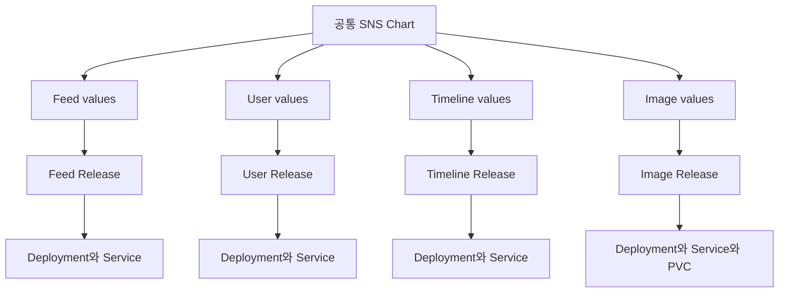
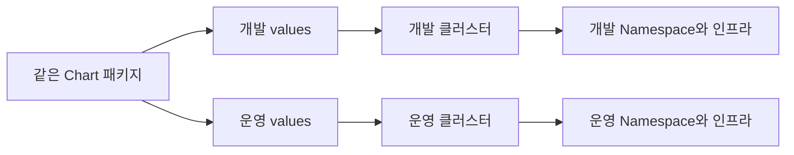

# Ch 8. 서비스 배포와 운영

# Ch 8. 서비스 배포와 운영
* toc
{:toc}

---

## 01. Helm을 이용한 서비스 배포와 환경 구분

### 공통 Helm Chart로 SNS 애플리케이션 패키징하기

서비스가 늘어나면 애플리케이션 코드뿐 아니라 배포 설정도 함께 늘어난다. Feed Server, User Server, Timeline Server, Image Server는 서로 다른 기능을 제공하지만, Kubernetes에 배포하는 방식은 상당 부분 비슷하다.

Deployment를 만들고, 이미지를 지정하고, 환경 변수를 전달하고, Service를 연결하는 작업이 반복된다. 서버마다 YAML을 복사해 관리하면 작은 설정 변경도 여러 파일에 반영해야 하고, 일부 파일에서만 수정이 누락되기 쉽다.

이번에는 반복되는 구성을 공통 Helm Chart로 묶는다. 서버별 차이는 values 파일로 전달하고, 개발 환경과 운영 환경도 같은 Chart를 사용해 배포할 수 있도록 구성한다.



#### Chart를 어떤 단위로 나눌 것인가

MSA 애플리케이션을 Helm으로 패키징하는 방법은 하나로 정해져 있지 않다.

| 구성 방식 | 특징 |
|---|---|
| 전체 애플리케이션을 하나의 Chart로 구성 | 관련 서비스를 한 번에 설치하기 편리함 |
| 서비스마다 별도의 Chart 구성 | 서비스별 배포 구조와 수명 주기를 독립적으로 관리 |
| 공통 Chart를 여러 Release에서 재사용 | 비슷한 배포 구조를 공유하면서 서비스별로 독립 배포 |
| 상위 Chart와 하위 Chart로 구성 | 전체 설치와 구성 요소별 분리를 함께 표현 |

이번에는 **공통 Chart 하나를 여러 Release에서 재사용하는 방식**을 선택한다.



같은 Chart를 사용하더라도 Release는 서로 다르다. Feed Server만 업데이트하거나 Timeline Server만 롤백할 수 있다.

여기서 만드는 Chart는 여러 서비스가 재사용한다는 의미에서 공통 Chart다. Helm의 `type: library`를 사용하는 Library Chart와는 다르다. 실제 Kubernetes 객체를 생성하므로 `type: application`으로 작성한다.

또한 이 Chart는 Deployment 기반의 서버를 대상으로 한다. 실행이 끝나는 Job이나 주기적으로 실행하는 CronJob까지 같은 형태에 억지로 포함하지 않는다.

#### 무엇을 values로 분리할 것인가

모든 항목을 변수로 만든다고 좋은 Chart가 되는 것은 아니다. 실제로 달라지는 항목과 공통 정책으로 고정할 항목을 구분해야 한다.

이번에는 다음 항목을 values로 분리한다.

- 애플리케이션 이름과 Service 이름
- 컨테이너 이미지 저장소와 태그
- Pod 복제 수
- Spring 프로파일
- 서버별 환경 변수
- ConfigMap과 Secret 참조
- CPU와 메모리
- Probe
- PVC 생성 여부와 마운트 경로
- 필요한 경우의 Node 배치 조건

반면 Deployment의 기본 업데이트 전략은 `RollingUpdate`로 통일한다.

이미지 주소도 환경별 AWS 계정이나 리전에 따라 달라질 수 있으므로 저장소와 태그를 모두 설정으로 분리한다.

#### Chart 기본 구조 만들기

```bash
helm create sns-chart
```

이 명령은 기본 Chart와 예제 템플릿을 생성한다. 생성되는 파일과 values 구조는 Helm 버전에 따라 달라질 수 있다.

이번에는 새로 생성한 예제 템플릿을 필요한 구성으로 교체한다. 이미 사용 중인 Chart의 파일을 일괄 삭제하는 작업과는 구분해야 한다.

최종 구조는 다음과 같다.

```text
sns-chart/
├── Chart.yaml
├── values.yaml
└── templates/
    ├── deployment.yaml
    ├── service.yaml
    └── pvc.yaml

values/
├── feed-dev.yaml
├── feed-prod.yaml
├── user-dev.yaml
├── timeline-dev.yaml
└── image-dev.yaml

manifests/
└── prod/
```

`templates` 아래 파일은 Kubernetes 객체를 만들기 위한 템플릿이다. 파일 이름보다 **렌더링 결과에 어떤 객체가 생성되는지**가 중요하다.

#### Chart 메타데이터 작성

`Chart.yaml`은 다음과 같이 작성한다.

```yaml
apiVersion: v2
name: sns-chart
description: Common deployment chart for SNS backend services
type: application
version: 0.1.0
```

- `apiVersion: v2`: Chart 형식을 나타낸다. Kubernetes 객체의 API 버전과는 다르다.
- `name`: Chart 이름이다.
- `type`: 실제 객체를 생성하는 Application Chart로 지정한다.
- `version`: Chart 자체의 버전이다.

`appVersion`은 필수 항목이 아니다. 여러 애플리케이션을 배포하는 공통 Chart이므로 이번에는 생략하고, 서비스별 이미지 태그를 별도로 지정한다.

Chart 버전과 애플리케이션 버전은 구분해야 한다. 템플릿이 바뀌면 Chart 버전을 올리고, Feed Server 코드가 바뀌면 Feed 이미지 버전을 올린다.

#### 기본 values 작성

`sns-chart/values.yaml`에 기본값을 정의한다.

```yaml
appName: server
replicas: 2

image:
  repository: registry.example.com/sns/server
  tag: "0.0.1"
  pullPolicy: IfNotPresent

imagePullSecrets: []

profile: dev
containerPort: 8080

service:
  name: ""
  port: 8080

envs: []
configs: []

resources:
  requests:
    cpu: "250m"
    memory: "256Mi"
  limits:
    cpu: "1"
    memory: "512Mi"

probes:
  startup:
    httpGet:
      path: /actuator/health/liveness
      port: http
    periodSeconds: 5
    failureThreshold: 60
  readiness:
    httpGet:
      path: /actuator/health/readiness
      port: http
    periodSeconds: 5
    failureThreshold: 3
  liveness:
    httpGet:
      path: /actuator/health/liveness
      port: http
    periodSeconds: 10
    failureThreshold: 3

persistence:
  enabled: false
  existingClaim: ""
  storageClassName: efs-sc
  accessModes:
    - ReadWriteMany
  size: "5Gi"
  mountPath: /data

nodeSelector: {}
tolerations: []
affinity: {}
```

이미지 주소는 구조를 설명하기 위한 기본값이다. 실제 배포에서는 각 서비스의 이미지 주소로 덮어쓴다.

Probe는 Spring Boot Actuator의 해당 경로가 활성화되어 있다는 전제다. Chart가 Probe 설정을 생성하더라도 애플리케이션에 없는 경로를 만들어 주지는 않는다.

`resources`는 Kubernetes의 구조를 그대로 사용한다. 별도의 `memory.request`, `cpu.limit` 구조를 다시 만들지 않아도 `toYaml`로 전달할 수 있다.

CPU·메모리의 `requests`는 각각의 `limits`보다 클 수 없다. 예를 들어 메모리 요청량이 `500Mi`인데 제한이 `100Mi`인 설정은 올바르지 않다.

#### Deployment 템플릿 작성

`templates/deployment.yaml`을 작성한다.

```yaml
{{- $persistence := .Values.persistence | default dict }}
{{- $probes := .Values.probes | default dict }}
apiVersion: apps/v1
kind: Deployment
metadata:
  name: {{ .Values.appName }}
  namespace: {{ .Release.Namespace }}
spec:
  replicas: {{ .Values.replicas }}
  strategy:
    type: RollingUpdate
    rollingUpdate:
      maxSurge: 1
      maxUnavailable: 0
  selector:
    matchLabels:
      app: {{ .Values.appName }}
      app.kubernetes.io/instance: {{ .Release.Name }}
  template:
    metadata:
      labels:
        app: {{ .Values.appName }}
        app.kubernetes.io/instance: {{ .Release.Name }}
    spec:
      {{- with .Values.imagePullSecrets }}
      imagePullSecrets:
        {{- toYaml . | nindent 8 }}
      {{- end }}
      containers:
        - name: {{ .Values.appName }}
          image: {{ printf "%s:%s" .Values.image.repository .Values.image.tag | quote }}
          imagePullPolicy: {{ .Values.image.pullPolicy }}
          ports:
            - name: http
              containerPort: {{ .Values.containerPort }}
          {{- if or .Values.profile .Values.envs }}
          env:
            {{- if .Values.profile }}
            - name: SPRING_PROFILES_ACTIVE
              value: {{ .Values.profile | quote }}
            {{- end }}
            {{- with .Values.envs }}
            {{- toYaml . | nindent 12 }}
            {{- end }}
          {{- end }}
          {{- with .Values.configs }}
          envFrom:
            {{- range . }}
            - configMapRef:
                name: {{ printf "%s-config" (trimSuffix "-no-secret" .) | quote }}
            {{- if not (hasSuffix "-no-secret" .) }}
            - secretRef:
                name: {{ printf "%s-secret" . | quote }}
            {{- end }}
            {{- end }}
          {{- end }}
          resources:
            {{- toYaml .Values.resources | nindent 12 }}
          {{- with $probes.startup }}
          startupProbe:
            {{- toYaml . | nindent 12 }}
          {{- end }}
          {{- with $probes.readiness }}
          readinessProbe:
            {{- toYaml . | nindent 12 }}
          {{- end }}
          {{- with $probes.liveness }}
          livenessProbe:
            {{- toYaml . | nindent 12 }}
          {{- end }}
          {{- if $persistence.enabled }}
          volumeMounts:
            - name: data
              mountPath: {{ required "persistence.mountPath is required" $persistence.mountPath | quote }}
          {{- end }}
      {{- if $persistence.enabled }}
      volumes:
        - name: data
          persistentVolumeClaim:
            claimName: {{ default (printf "%s-claim" .Values.appName) $persistence.existingClaim | quote }}
      {{- end }}
      {{- with .Values.nodeSelector }}
      nodeSelector:
        {{- toYaml . | nindent 8 }}
      {{- end }}
      {{- with .Values.tolerations }}
      tolerations:
        {{- toYaml . | nindent 8 }}
      {{- end }}
      {{- with .Values.affinity }}
      affinity:
        {{- toYaml . | nindent 8 }}
      {{- end }}
```

##### Namespace와 Release

Namespace를 `sns`로 고정하지 않고 `.Release.Namespace`를 사용했다. 설치 명령의 `--namespace` 값이 반영된다.

Namespace를 템플릿에서 생략하고 설치 대상 Namespace를 사용하는 방식도 가능하다. 여기서는 렌더링 결과만 보아도 대상을 알 수 있도록 명시했다.

`.Release.Name`은 설치할 때 지정하는 Release 이름이다. 같은 Chart를 사용하더라도 서버별 Release를 구분할 수 있다.

Deployment Selector에는 이미지 태그나 Chart 버전을 넣지 않는다. Selector는 생성 이후 변경이 제한되므로 배포마다 바뀌는 값을 포함하면 업데이트가 어려워진다.

##### 환경 변수와 `with`

다음 구문은 `envs`가 비어 있지 않을 때만 내부 내용을 출력한다.

```yaml
{{- with .Values.envs }}
{{- toYaml . | nindent 12 }}
{{- end }}
```

`with` 내부에서 `.`은 원래의 전체 컨텍스트가 아니라 `envs`를 가리킨다.

- `toYaml`: 배열이나 객체를 YAML로 변환한다.
- `nindent 12`: 줄바꿈을 추가하고 각 줄 앞에 공백 12칸을 넣는다.
- `end`: 제어 블록을 닫는다.

들여쓰기 숫자는 붙여 넣을 위치에 따라 달라진다. 환경 변수에 맞는 숫자를 다른 위치에도 그대로 사용하는 것은 잘못이다.

`with`와 `range` 내부에서 최상위 값을 참조해야 한다면 `$.Values`, `$.Release`처럼 루트 컨텍스트를 사용한다. [Helm 제어 구조](https://helm.sh/docs/v3/chart_template_guide/control_structures/)

##### ConfigMap과 Secret 참조 규칙

이번 Chart에서는 다음과 같은 이름 규칙을 사용한다.

```yaml
configs:
  - mysql
  - kafka
  - redis-no-secret
```

렌더링 결과에는 다음 참조가 생성된다.

| values 값 | ConfigMap 참조 | Secret 참조 |
|---|---|---|
| `mysql` | `mysql-config` | `mysql-secret` |
| `kafka` | `kafka-config` | `kafka-secret` |
| `redis-no-secret` | `redis-config` | 생성하지 않음 |

`trimSuffix`는 이름 뒤의 `-no-secret`을 제거하고, `hasSuffix`는 해당 접미사가 있는지 확인한다.

중요한 점은 **이 템플릿이 ConfigMap이나 Secret 객체 자체를 생성하는 것은 아니라는 것**이다. Pod의 `envFrom`에 참조만 추가한다.

따라서 해당 객체는 같은 Namespace에 미리 있어야 한다. 이름이 잘못되거나 객체가 없으면 컨테이너 시작 단계에서 `CreateContainerConfigError`가 발생할 수 있다.

이 규칙은 작은 프로젝트에서는 간단하지만, 규모가 커지면 문자열 접미사보다 ConfigMap 이름과 Secret 사용 여부를 구조화된 필드로 표현하는 편이 명확할 수 있다.

##### Probe는 Kubernetes 구조 그대로 전달

Probe 전체를 `toYaml`로 전달하므로 경로뿐 아니라 다음 항목도 조절할 수 있다.

- `initialDelaySeconds`
- `periodSeconds`
- `timeoutSeconds`
- `failureThreshold`
- `httpGet`, `tcpSocket`, `exec`

Readiness는 요청 수신 가능 여부를 판단하고, Liveness는 실패 시 컨테이너 재시작으로 이어진다. Startup Probe가 있으면 시작 단계에서 Readiness와 Liveness 검사가 유예된다.

외부 DB나 Redis의 일시적인 장애를 Liveness에 직접 연결하면 애플리케이션 컨테이너까지 반복 재시작될 수 있으므로 검사 목적을 구분한다.

#### 누락된 값과 기본값 처리

중첩 설정은 부모 객체가 없을 때의 동작도 고려해야 한다.

다음처럼 마지막에 `default`를 붙이는 것만으로는 중간 객체 접근 오류를 항상 방지할 수 없다.

```text
.Values.persistence.enabled | default false
```

Deployment 템플릿에서는 먼저 부모 값을 빈 Dictionary로 정규화했다.

```yaml
{{- $persistence := .Values.persistence | default dict }}
```

이후 `$persistence.enabled`를 검사하면 부모 객체가 없는 경우도 처리하기 쉽다.

또한 Go Template의 `and`, `or`가 항상 모든 인자를 평가한다고 설명하는 것은 정확하지 않다. 현재 Go Template의 내장 `and`, `or`는 결과가 결정되면 평가를 종료한다. 다만 Helm과 내장 Go 버전에 따른 차이를 고려하고, 중첩 값은 기본 구조나 명시적인 조건으로 처리하는 편이 읽기 쉽다. [Go Template 함수 평가](https://pkg.go.dev/text/template#hdr-Functions)

`default`는 숫자 `0`과 Boolean `false`도 빈 값으로 취급한다. 따라서 다음처럼 작성하면 의도한 복제 수 `0`이 `2`로 바뀔 수 있다.

```yaml
replicas: {{ .Values.replicas | default 2 }}
```

이번 템플릿에서는 `values.yaml`에 기본값을 두고 `.Values.replicas`를 그대로 사용했다.

`persistence.enabled` 역시 문자열 `"false"`가 아니라 Boolean `false`로 지정한다. 문자열은 조건문에서 참으로 평가될 수 있다.

#### Service 템플릿 작성

`templates/service.yaml`을 작성한다.

```yaml
apiVersion: v1
kind: Service
metadata:
  name: {{ default .Values.appName .Values.service.name }}
  namespace: {{ .Release.Namespace }}
spec:
  type: ClusterIP
  selector:
    app: {{ .Values.appName }}
    app.kubernetes.io/instance: {{ .Release.Name }}
  ports:
    - name: http
      protocol: TCP
      port: {{ .Values.service.port }}
      targetPort: http
```

Service Selector와 Pod Label이 일치해야 한다.

`service.port`는 Service의 포트이고, `targetPort: http`는 컨테이너에 선언한 이름 있는 포트로 연결한다. 애플리케이션이 실제로 수신하는 포트는 별도 설정이므로 `containerPort` 값만 바꾼다고 서버의 실행 포트까지 바뀌지는 않는다.

Service 이름도 따로 설정할 수 있게 했다. 기존 Ingress가 `feed-service`를 참조한다면 Helm 전환 이후에도 같은 이름을 유지할 수 있다.

#### 이미지 서버용 PVC 템플릿

Image Server는 업로드 파일을 저장하기 위해 Volume이 필요하다. 반면 다른 서버에는 불필요한 PVC가 생성되지 않아야 한다.

`templates/pvc.yaml`을 작성한다.

```yaml
{{- $persistence := .Values.persistence | default dict }}
{{- if and $persistence.enabled (not $persistence.existingClaim) }}
apiVersion: v1
kind: PersistentVolumeClaim
metadata:
  name: {{ printf "%s-claim" .Values.appName }}
  namespace: {{ .Release.Namespace }}
spec:
  {{- if hasKey $persistence "storageClassName" }}
  storageClassName: {{ $persistence.storageClassName | quote }}
  {{- end }}
  accessModes:
    {{- range $persistence.accessModes }}
    - {{ . | quote }}
    {{- else }}
    - ReadWriteMany
    {{- end }}
  resources:
    requests:
      storage: {{ $persistence.size | default "5Gi" | quote }}
{{- end }}
```

동작은 다음과 같다.

| 설정 | 결과 |
|---|---|
| `enabled: false` | PVC와 Volume 연결 생략 |
| `enabled: true`, `existingClaim` 없음 | 새 PVC 생성 후 마운트 |
| `enabled: true`, `existingClaim` 지정 | 기존 PVC를 사용하고 새 PVC는 생성하지 않음 |

PVC 생성 조건과 Deployment의 Volume 연결 조건을 함께 맞춰야 한다. PVC만 만들거나, 없는 PVC를 참조하는 설정이 되어서는 안 된다.

`range`의 `else`는 순회할 항목이 없을 때 실행된다. 여기서는 Access Mode의 기본값으로 `ReadWriteMany`를 사용한다.

EFS를 사용하는 경우에는 `efs-sc` StorageClass와 EFS CSI Driver, 파일 시스템 및 네트워크 접근 구성이 미리 준비되어 있어야 한다. Chart가 PVC를 생성한다고 EFS 인프라까지 자동 생성되는 것은 아니다. [EKS의 EFS 스토리지 구성](https://docs.aws.amazon.com/eks/latest/userguide/efs-csi.html)

또한 EFS에서 PVC의 `5Gi` 요청이 실제 파일 사용량을 5GiB로 제한하는 하드 쿼터를 의미하지는 않는다.

`storageClassName`을 생략하면 기본 StorageClass 선택 규칙이 적용되고, 빈 문자열 `""`을 지정하면 기본 StorageClass를 사용하지 않도록 요청한다. 두 경우도 구분해야 한다.

#### 서버별 values 작성

##### Feed Server 개발 환경

`values/feed-dev.yaml`을 작성한다.

```yaml
appName: feed-server
replicas: 2

image:
  repository: "111122223333.dkr.ecr.ap-northeast-2.amazonaws.com/feed-server"
  tag: "0.0.4"

profile: dev

service:
  name: feed-service

envs:
  - name: USER_SERVICE_URL
    value: "http://user-service.sns.svc.cluster.local:8080"

configs:
  - mysql
  - kafka
```

계정 ID와 이미지 태그는 실제 배포 대상으로 변경한다. `USER_SERVICE_URL` 역시 애플리케이션이 실제로 읽는 환경 변수 이름과 일치해야 한다.

생략한 자원과 Probe 설정은 Chart의 기본값을 사용한다.

##### User Server 개발 환경

`values/user-dev.yaml`을 작성한다.

```yaml
appName: user-server

image:
  repository: "111122223333.dkr.ecr.ap-northeast-2.amazonaws.com/user-server"
  tag: "0.0.4"

service:
  name: user-service

configs:
  - mysql
  - kafka
```

##### Timeline Server 개발 환경

`values/timeline-dev.yaml`을 작성한다.

```yaml
appName: timeline-server

image:
  repository: "111122223333.dkr.ecr.ap-northeast-2.amazonaws.com/timeline-server"
  tag: "0.0.1"

service:
  name: timeline-service

configs:
  - kafka
  - redis-no-secret
```

Redis 인증을 사용하는 환경이라면 `redis-no-secret` 규칙을 그대로 사용하지 않는다. 필요한 Secret 참조와 애플리케이션 설정을 함께 구성해야 한다.

##### Image Server 개발 환경

`values/image-dev.yaml`을 작성한다.

```yaml
appName: image-server

image:
  repository: "111122223333.dkr.ecr.ap-northeast-2.amazonaws.com/image-server"
  tag: "0.0.1"

service:
  name: image-service

persistence:
  enabled: true
  storageClassName: efs-sc
  accessModes:
    - ReadWriteMany
  size: "5Gi"
  mountPath: /images
```

`/images`는 예시다. Image Server가 실제로 파일을 저장하는 경로와 같아야 한다.

여러 Pod가 파일을 공유하려면 StorageClass와 파일 시스템이 해당 접근 방식을 지원해야 한다. Access Mode 문자열만 바꾼다고 스토리지의 기능이 바뀌지는 않는다.

#### 개발·운영 values 분리

Feed Server의 운영 설정은 `values/feed-prod.yaml`로 작성한다.

```yaml
appName: feed-server
replicas: 4

image:
  repository: "111122223333.dkr.ecr.ap-northeast-2.amazonaws.com/feed-server"
  tag: "0.0.4"

profile: prod

service:
  name: feed-service

envs:
  - name: USER_SERVICE_URL
    value: "http://user-service.prod.svc.cluster.local:8080"

configs:
  - mysql
  - kafka

resources:
  requests:
    cpu: "500m"
    memory: "512Mi"
  limits:
    cpu: "1"
    memory: "1Gi"
```

같은 Chart를 사용하지만 복제 수, 프로파일, 호출 대상, 자원 설정이 달라진다.

`profile: prod`는 컨테이너에 `SPRING_PROFILES_ACTIVE=prod`를 전달할 뿐이다. 애플리케이션에 필요한 운영 프로파일 설정이 있어야 하며, 운영 DB나 Kafka를 자동으로 준비해 주지는 않는다.

##### values 병합 방식

값은 일반적으로 다음 순서로 덮어쓴다.

```text
Chart의 values.yaml
→ 먼저 지정한 -f 파일
→ 나중에 지정한 -f 파일
→ --set 또는 --set-string
```

객체는 하위 키를 병합하지만, 배열은 일반적으로 항목별로 합쳐지지 않고 교체된다.

따라서 `envs`나 `configs`를 덮어쓸 때는 최종적으로 필요한 항목 전체를 지정해야 한다.

기본 Probe를 제거하려면 빈 객체보다 `null`이 필요할 수 있다.

```yaml
probes:
  startup: null
```

HTTP Probe를 TCP Probe로 바꾸는 경우에도 기존 `httpGet`을 제거해야 한다. 병합 결과에 두 검사 방식이 함께 남으면 Kubernetes가 거부한다. [Helm values 병합과 기본 키 제거](https://helm.sh/docs/v3/chart_template_guide/values_files/)

#### 렌더링 결과 검증

클러스터에 설치하기 전에 Chart와 values를 결합한 결과를 확인한다.

아래 명령은 Helm 3 기준이다.

```bash
helm lint ./sns-chart \
  -f values/feed-dev.yaml

helm template feed-server ./sns-chart \
  --namespace sns \
  -f values/feed-dev.yaml
```

운영 설정도 별도로 확인한다.

```bash
helm template feed-server ./sns-chart \
  --namespace prod \
  -f values/feed-prod.yaml
```

다음 항목을 대조한다.

- Deployment와 Service 이름
- 이미지 저장소와 태그
- 복제 수와 Spring 프로파일
- 환경 변수와 ConfigMap·Secret 참조
- CPU·메모리의 `requests`, `limits`
- Probe 경로와 포트
- PVC 생성 여부와 마운트 경로
- Service Selector와 Pod Label

특히 `request`와 `requests`, `storageClass`와 `storageClassName` 같은 오타는 단순 텍스트 확인만으로 놓치기 쉽다.

`helm template`은 로컬 렌더링 도구다. 출력이 생성되었다고 Kubernetes API 검증이나 실제 실행까지 성공한 것은 아니다. [Helm template](https://helm.sh/docs/v3/helm/helm_template/)

대상 Namespace가 준비되어 있다면 서버 측 검증도 추가할 수 있다.

```bash
helm template feed-server ./sns-chart \
  --namespace prod \
  -f values/feed-prod.yaml \
  | kubectl --context sns-prod \
      apply --dry-run=server -f -
```

이 검증도 이미지 Pull, 실제 파일 마운트, DB 연결, API 정상 동작을 보장하지는 않는다.

반복적인 오타와 잘못된 타입을 줄이려면 `values.schema.json`을 추가해 복제 수의 정수 여부, Boolean 설정, 필수 이미지 주소 등을 검사하는 것도 좋다.

#### Chart 패키징

검증한 Chart를 압축 패키지로 만든다.

```bash
helm package ./sns-chart --destination ./dist
```

`Chart.yaml`의 이름과 버전에 따라 다음 파일이 생성된다.

```text
dist/sns-chart-0.1.0.tgz
```

패키지에는 템플릿과 기본 values 등이 포함된다. 컨테이너 이미지나 외부 DB가 함께 들어가는 것은 아니다.

```bash
helm show chart ./dist/sns-chart-0.1.0.tgz
helm show values ./dist/sns-chart-0.1.0.tgz

helm template feed-server ./dist/sns-chart-0.1.0.tgz \
  --namespace prod \
  -f values/feed-prod.yaml
```

템플릿 오류를 수정했다면 기존 패키지가 자동으로 바뀌지 않는다. Chart 버전을 올려 새 패키지를 만들고, 서버별 배포가 참조하는 패키지도 갱신해야 한다.

같은 버전의 패키지를 조용히 덮어쓰기보다 `0.1.1`처럼 새 버전으로 남겨야 배포 이력을 재현하기 쉽다.

#### ConfigMap과 Secret 관리 경계

ConfigMap, Secret, Ingress도 Chart에 포함할 수 있다. 하지만 여러 서버가 공유하는 객체를 각 서버 Release에서 동시에 생성하면 소유권 충돌이 발생할 수 있다.

이번 구성에서는 다음과 같이 나눈다.

| 관리 대상 | 관리 방식 |
|---|---|
| 서버별 Deployment·Service | 공통 Chart의 개별 Release |
| 이미지 서버 PVC | 해당 Release 또는 외부에서 별도 관리 |
| 공유 ConfigMap·Secret | 별도 Manifest나 전용 설정 관리 체계 |
| 공통 Ingress | 별도 Manifest 또는 전용 Chart |
| MySQL·Kafka·Redis 인프라 | 별도 설치·운영 |

운영용 ConfigMap을 별도 디렉터리에 모을 수 있다.

예를 들어 `manifests/prod/mysql-config.yaml`은 다음처럼 작성한다.

```yaml
apiVersion: v1
kind: ConfigMap
metadata:
  name: mysql-config
data:
  MYSQL_HOST: "mysql.infra-prod.svc.cluster.local"
  MYSQL_PORT: "3306"
  MYSQL_DATABASE: "sns_prod"
```

여기서는 Namespace를 생략하고 적용 명령에서 지정한다.

```bash
kubectl --context sns-prod \
  --namespace prod \
  apply -f manifests/prod/
```

파일에 `namespace: sns`가 명시되어 있다면 `--namespace prod`만 추가해서 운영 환경으로 바꿀 수는 없다. 고정 Namespace를 제거하거나 환경에 맞는 값으로 작성해야 한다.

위 DB 주소는 준비된 운영 인프라를 가정한 예시다. 운영 Kafka와 Redis 설정도 실제 운영 대상을 가리켜야 한다.

Secret은 별도의 보안 절차나 Secret 관리 도구로 준비하고, 비밀번호를 일반 values 파일에 직접 저장하지 않는다. Helm의 렌더링 출력과 Release 저장 정보에도 민감 값이 남을 수 있다.

#### 기존 리소스를 Helm으로 옮길 때

이미 `kubectl apply`로 만든 `feed-server`, `feed-service`가 같은 Namespace에 있다면 Helm이 자동으로 관리권을 가져오는 것은 아니다.

기존 객체의 소유권 메타데이터 때문에 설치가 거부될 수 있고, 이번 템플릿처럼 Selector 구성이 달라지면 Deployment의 불변 필드 변경 문제도 발생할 수 있다.

전환할 때는 다음 사항을 먼저 확인한다.

- 기존 객체와 새 템플릿의 이름·Selector 차이
- Service와 Ingress가 참조하는 이름
- PVC와 실제 데이터의 연결
- Helm이 이후 업데이트·삭제할 리소스 범위
- 전환 중 트래픽과 복구 절차

학습 단계에서는 별도 Namespace에 신규 설치해 비교하는 방법이 단순하다. 운영에서는 이름 변경이나 소유권 이전을 포함한 별도 전환 계획이 필요하다.

특히 기존 이미지 파일이 있는 PVC를 새 PVC로 바꾸면 파일이 사라진 것처럼 보일 수 있다. 이 경우 실제 데이터가 삭제된 것이 아니라 다른 볼륨을 마운트한 것일 수도 있다.

기존 PVC를 유지하려면 다음처럼 지정한다.

```yaml
persistence:
  enabled: true
  existingClaim: image-pvc
  mountPath: /images
```

#### Namespace로 환경 분리하기

같은 클러스터 안에서 개발은 `sns`, 운영은 `prod` Namespace로 구분할 수 있다.

이 방식은 클러스터를 추가하지 않아 구성이 단순하고, 공용 컴퓨팅 자원을 활용하기 쉽다. 하지만 Namespace만으로 완전한 격리가 만들어지지는 않는다.

다음 자원은 여전히 공유될 수 있다.

- Worker Node와 클러스터 전체 용량
- Control Plane과 클러스터 범위 객체
- 네트워크
- StorageClass
- 외부 DB, Kafka, Redis
- 클러스터 운영 권한

운영 Namespace를 만들었더라도 개발과 같은 DB나 Redis를 사용하면 데이터까지 분리된 것이 아니다.

같은 클러스터를 사용한다면 RBAC, NetworkPolicy, ResourceQuota, LimitRange와 함께 Node Group 분리도 검토한다.

배치 조건은 별도 values로 전달할 수 있다.

```yaml
nodeSelector:
  workload-environment: production

tolerations:
  - key: environment
    operator: Equal
    value: production
    effect: NoSchedule
```

이 설정은 실제 Node에 해당 Label과 Taint가 구성되어 있다는 전제다.

Toleration은 해당 Taint를 허용할 뿐 운영 Node로 Pod를 끌어당기지 않는다. 원하는 Node로 제한하려면 Node Selector나 Node Affinity도 필요하다.

#### 클러스터로 환경 분리하기

운영 환경의 장애 영향과 접근 권한을 더 강하게 분리하려면 클러스터 자체를 나눌 수 있다.



클러스터를 나누면 Kubernetes 객체와 클러스터 자원 측면의 영향 범위를 줄일 수 있다. 다만 외부 DB, AWS 계정 권한, VPC 연결 등을 공유한다면 클러스터 간 영향이 완전히 사라지는 것은 아니다.

비용과 관리 대상도 늘어나므로, 필요한 격리 수준에 맞춰 선택한다.

#### kubeconfig Context 관리

클러스터가 여러 개라면 배포 대상 Namespace뿐 아니라 Context도 확인해야 한다.

Context는 클러스터, 사용자 인증 설정, 기본 Namespace를 묶는 구성이다.

EKS 클러스터 정보를 등록할 때 짧은 별칭을 지정할 수 있다.

```bash
aws eks update-kubeconfig \
  --region ap-northeast-2 \
  --name sns-cluster \
  --alias sns-dev

aws eks update-kubeconfig \
  --region ap-northeast-2 \
  --name sns-prod-cluster \
  --alias sns-prod
```

클러스터 이름은 실제 값으로 바꾼다.

`update-kubeconfig`는 설정을 추가·병합하면서 현재 Context도 변경한다. 두 번째 명령 이후에는 운영 Context가 선택될 수 있으므로 주의한다. [AWS update-kubeconfig](https://docs.aws.amazon.com/cli/latest/reference/eks/update-kubeconfig.html)

```bash
kubectl config get-contexts
kubectl config current-context

kubectl config use-context sns-dev
kubectl --context sns-dev get nodes
kubectl --context sns-prod get nodes
```

기존의 긴 Context 이름은 명령으로 바꿀 수도 있다.

```bash
kubectl config rename-context <OLD_CONTEXT_NAME> sns-dev
```

일반적인 기본 kubeconfig 경로는 홈 디렉터리의 `.kube/config`다. 직접 편집하기보다 명령을 사용하는 편이 실수를 줄이기 쉽다.

운영 명령에서는 현재 Context에만 의존하지 않고 대상을 명시하는 것이 좋다.

- `kubectl`: `--context`
- Helm: `--kube-context`

명령 별칭을 사용하더라도 실제 대상 확인을 대신하지는 않는다.

#### Helm으로 설치하기

다음 예제는 Context가 `sns-dev`, Namespace가 `sns`이고, 기존 동일 이름 리소스와 충돌하지 않는 상태를 전제로 한다.

ConfigMap과 Secret 등 선행 설정을 준비한 뒤 설치한다.

```bash
helm upgrade --install feed-server \
  ./dist/sns-chart-0.1.0.tgz \
  --kube-context sns-dev \
  --namespace sns \
  --create-namespace \
  -f values/feed-dev.yaml \
  --wait \
  --timeout 5m
```

나머지 서버도 같은 Chart에 각자의 values를 전달한다.

```bash
helm upgrade --install user-server \
  ./dist/sns-chart-0.1.0.tgz \
  --kube-context sns-dev \
  --namespace sns \
  -f values/user-dev.yaml \
  --wait \
  --timeout 5m

helm upgrade --install timeline-server \
  ./dist/sns-chart-0.1.0.tgz \
  --kube-context sns-dev \
  --namespace sns \
  -f values/timeline-dev.yaml \
  --wait \
  --timeout 5m

helm upgrade --install image-server \
  ./dist/sns-chart-0.1.0.tgz \
  --kube-context sns-dev \
  --namespace sns \
  -f values/image-dev.yaml \
  --wait \
  --timeout 5m
```

이 명령들은 하나의 Release가 아니라 네 개의 Release를 생성한다.

운영 클러스터의 Feed Server에는 운영 values를 사용한다.

```bash
helm upgrade --install feed-server \
  ./dist/sns-chart-0.1.0.tgz \
  --kube-context sns-prod \
  --namespace prod \
  --create-namespace \
  -f values/feed-prod.yaml \
  --wait \
  --timeout 5m
```

같은 클러스터에서 Namespace만 분리하는 구성이라면 `--kube-context`는 동일하게 두고 Namespace를 구분한다. 두 방식을 혼동하지 않아야 한다.

#### 배포 후 확인

```bash
helm list --kube-context sns-dev --namespace sns

helm status feed-server \
  --kube-context sns-dev \
  --namespace sns

helm get values feed-server \
  --kube-context sns-dev \
  --namespace sns

kubectl --context sns-dev \
  --namespace sns \
  get deployment,service,pvc
```

Pod 상태와 실제 동작도 확인한다.

```bash
kubectl --context sns-dev \
  --namespace sns \
  rollout status deployment/feed-server

kubectl --context sns-dev \
  --namespace sns \
  logs deployment/feed-server --tail=100

kubectl --context sns-dev \
  --namespace sns \
  describe pvc image-server-claim
```

정상 동작 시 기대하는 결과는 다음과 같다.

- 지정한 이미지와 복제 수가 적용된다.
- 서버별로 필요한 ConfigMap과 Secret만 참조한다.
- Image Server에서만 PVC를 생성하거나 기존 PVC를 연결한다.
- Service 이름이 기존 Ingress와 일치한다.
- 사용자·피드 API와 이미지 업로드가 정상 동작한다.
- Kafka 이벤트가 Timeline Server에 반영된다.

`--wait` 성공은 Kubernetes의 준비 상태를 기다린 결과다. 회원가입, 이미지 업로드, 이벤트 처리 같은 업무 흐름까지 검증했다는 뜻은 아니다.

#### 업데이트와 롤백

이미지 태그나 자원 설정을 변경한 뒤 같은 Release에 다시 적용한다.

Helm 3에서는 실패 시 롤백을 요청하는 `--atomic` 옵션도 사용할 수 있다.

```bash
helm upgrade --install feed-server \
  ./dist/sns-chart-0.1.0.tgz \
  --kube-context sns-dev \
  --namespace sns \
  -f values/feed-dev.yaml \
  --atomic \
  --timeout 5m
```

배포 이력을 확인한다.

```bash
helm history feed-server \
  --kube-context sns-dev \
  --namespace sns
```

복구 대상 Revision을 확인한 뒤 롤백한다.

```bash
helm rollback feed-server <REVISION> \
  --kube-context sns-dev \
  --namespace sns \
  --wait \
  --timeout 5m
```

Helm 롤백은 DB 스키마 변경이나 외부 시스템에 이미 발생한 부작용까지 되돌리지 않는다.

또한 Chart가 생성한 PVC는 Release 삭제나 템플릿 제거의 영향을 받을 수 있다. `persistence.enabled`를 끄거나 Release를 삭제하기 전에 PVC 소유권, PV Reclaim Policy, 백업을 확인해야 한다. 중요한 데이터는 외부 관리 PVC를 참조하도록 분리하는 방법도 검토한다.

#### 자주 발생하는 문제

| 현상 | 확인할 원인 |
|---|---|
| 템플릿의 nil 접근 오류 | 부모 설정 누락과 중첩 값 접근 |
| YAML 파싱 오류 | 들여쓰기, 콜론, 공백 제거 구문 |
| 환경 변수가 사라짐 | values 배열이 교체되었는지 |
| `CreateContainerConfigError` | ConfigMap·Secret 이름과 Namespace |
| `ImagePullBackOff` | 이미지 주소·태그·ECR Pull 권한 |
| Probe 실패 | 애플리케이션 경로와 포트 |
| PVC가 Pending | StorageClass, CSI Driver, 권한과 네트워크 |
| Service가 Pod에 연결되지 않음 | Selector와 Label |
| Helm 설치 시 소유권 충돌 | 기존 수동 생성 객체 존재 여부 |
| 템플릿 수정이 배포에 반영되지 않음 | 이전 패키지를 계속 사용하고 있는지 |
| 운영에서 개발 데이터가 보임 | DB·Kafka·Redis의 실제 연결 대상 |

공통 Chart를 수정하면 이를 사용하는 모든 서비스에 잠재적인 영향이 생긴다. Feed Server 한 개만 렌더링하지 말고, 최소한 일반 서버와 PVC 사용 서버의 values를 함께 검증해야 한다.

### 정리

이번에는 Deployment와 Service의 반복 구성을 공통 Helm Chart로 묶고, 이미지 서버에 필요한 PVC를 선택적으로 생성하도록 구성했다.

서버별 차이는 values로 전달하고, 개발·운영 환경도 동일한 Chart 패키지에 서로 다른 설정을 적용하도록 나눴다. 배포 대상은 Namespace뿐 아니라 kubeconfig Context까지 명시해 관리한다.

공통화의 목적은 YAML을 짧게 만드는 데만 있지 않다. **변하지 않는 배포 구조와 환경별로 달라지는 설정을 분리하고, 검증한 구성을 같은 방식으로 재현하는 것**이 핵심이다. 이를 위해 패키지 버전, 기존 리소스의 소유권, 데이터 저장소의 연결 대상과 복구 절차까지 함께 관리해야 한다.


