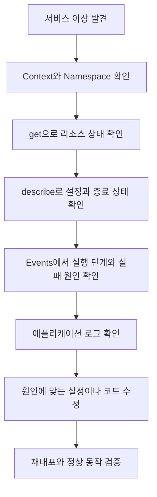
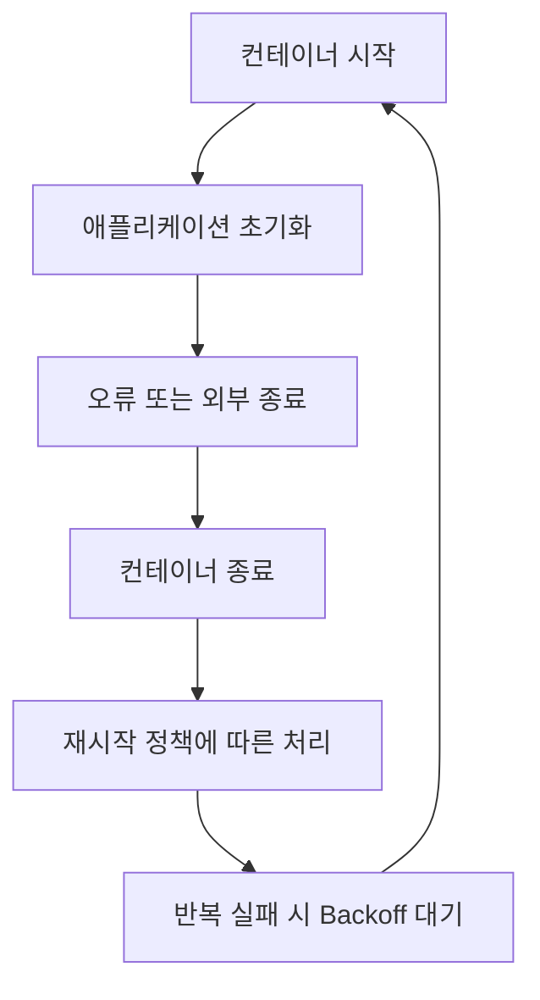
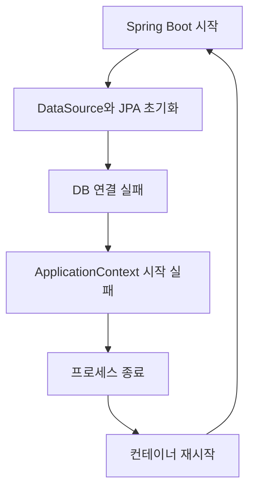

# Ch 1. 트러블슈팅을 위한 kubectl 활용

# Ch 1. 트러블슈팅을 위한 kubectl 활용
* toc
{:toc}

---

## 01. kubectl을 이용한 객체 상태, 이벤트, 로그 조회

### kubectl로 시작하는 Kubernetes 디버깅과 트러블슈팅

Kubernetes에서 애플리케이션이 정상적으로 동작하지 않을 때 가장 먼저 필요한 것은 재시작 명령이 아니라 현재 상태를 확인할 수 있는 정보다.

Pod가 준비되지 않는 이유는 다양하다. ConfigMap 이름을 잘못 입력했을 수도 있고, 이미지를 가져오지 못했을 수도 있다. 컨테이너는 실행되었지만 데이터베이스 연결에 실패해 애플리케이션이 종료되는 경우도 있다.

이러한 문제를 모두 같은 방식으로 해결할 수는 없다. 대신 **어느 단계까지 정상적으로 진행되었고, 어느 단계에서 실패했는지**를 좁혀 가는 접근이 필요하다.

이번에는 `kubectl get`, `describe`, `events`, `logs`를 중심으로 상태 확인에서 원인 추적까지 이어지는 기본 흐름을 정리한다.

#### 트러블슈팅의 기본 흐름

문제가 발생하면 먼저 Kubernetes 객체의 상태를 확인하고, 이후 필요한 정보를 더 자세히 조회한다.



각 명령이 답하는 질문은 조금씩 다르다.

| 명령 | 확인하는 내용 |
|---|---|
| `kubectl get` | 어떤 리소스가 존재하고 현재 어떤 상태인가 |
| `kubectl describe` | 해당 리소스의 설정·상태·관련 이벤트는 무엇인가 |
| `kubectl get events` | Kubernetes 구성 요소가 어떤 상황을 관찰했는가 |
| `kubectl logs` | 컨테이너 안에서 실행된 프로그램이 무엇을 기록했는가 |

처음부터 모든 정보를 조회하기보다는 전체 상태에서 특정 Pod, 특정 컨테이너로 범위를 좁히는 편이 효율적이다.

#### 먼저 조회 대상을 확인한다

개발·운영 클러스터를 함께 사용한다면 잘못된 환경을 조회하고 있지는 않은지부터 확인한다.

```bash
kubectl config current-context
kubectl config get-contexts
```

이후 예제에서는 애플리케이션이 `sns` Namespace에 있다고 가정한다.

```bash
kubectl get pods -n sns
```

Namespace를 생략하면 현재 Context의 기본 Namespace가 사용된다. 설정이 없다면 일반적으로 `default`가 사용된다.

`No resources found`가 나왔다고 애플리케이션이 삭제되었다고 단정하지 않는다. 다른 Context나 Namespace를 보고 있을 수 있다.

필요하면 모든 Namespace에서 확인한다.

```bash
kubectl get pods --all-namespaces
```

운영 환경에서는 명령에 Context를 명시하는 것이 더 안전하다.

```bash
kubectl --context sns-prod get pods -n prod
```

`Forbidden`이 발생했다면 리소스 부재가 아니라 조회 권한 문제일 수 있다. Pod 조회와 컨테이너 로그 조회도 서로 다른 권한으로 제어될 수 있다.

#### `get`으로 전체 상태 확인하기

##### 리소스 목록 조회

`get`은 Pod뿐 아니라 다양한 Kubernetes 객체를 조회할 수 있다.

```bash
kubectl get pods -n sns
kubectl get deployments -n sns
kubectl get services -n sns
kubectl get configmaps -n sns
kubectl get secrets -n sns
kubectl get pvc -n sns
```

여러 종류를 한 번에 조회할 수도 있다.

```bash
kubectl get deployment,replicaset,pod,service -n sns
```

다만 `kubectl get all`이 모든 종류의 Kubernetes 객체를 조회한다는 뜻은 아니다. ConfigMap, Secret, PVC 등 필요한 리소스는 명시적으로 확인하는 편이 좋다.

PV와 StorageClass는 Namespace에 속하지 않는 클러스터 범위 리소스다.

```bash
kubectl get pv
kubectl get storageclass
```

##### 단수형·복수형·약어

다음 명령은 모두 Pod 목록을 조회한다.

```bash
kubectl get pod -n sns
kubectl get pods -n sns
kubectl get po -n sns
```

자주 사용하는 약어는 다음과 같다.

| 리소스 | 약어 |
|---|---|
| Pod | `po` |
| Deployment | `deploy` |
| ReplicaSet | `rs` |
| Service | `svc` |
| ConfigMap | `cm` |
| Secret | 일반적으로 전체 이름 사용 |
| PersistentVolume | `pv` |
| PersistentVolumeClaim | `pvc` |
| StorageClass | `sc` |
| Namespace | `ns` |

현재 클러스터에서 제공하는 리소스와 약어는 다음 명령으로 확인한다.

```bash
kubectl api-resources
```

출력의 `SHORTNAMES`는 약어를, `NAMESPACED`는 Namespace 소속 여부를 나타낸다. 설치된 CRD도 이 목록에 포함될 수 있다.

##### Pod 목록에서 읽어야 할 항목

일반적인 Pod 조회 결과에는 다음 정보가 표시된다.

```text
NAME                          READY   STATUS             RESTARTS   AGE
feed-server-xxxxx-yyyyy        0/1     CrashLoopBackOff   4          5m
```

위 내용은 출력 형식을 설명하기 위한 예시다.

| 항목 | 의미 |
|---|---|
| `READY` | 준비 상태인 컨테이너 수와 대상 컨테이너 수 |
| `STATUS` | 현재 상황을 이해하기 쉽게 요약한 표시 |
| `RESTARTS` | 컨테이너 재시작 횟수 |
| `AGE` | Pod 생성 이후 경과 시간 |

`Running`이라고 항상 요청을 처리할 준비가 된 것은 아니다. `READY`가 `0/1`이면 프로세스가 실행 중이더라도 Readiness 조건을 충족하지 못했을 수 있다.

반대로 `RESTARTS`가 1 이상이라는 이유만으로 현재 장애라고 단정할 수도 없다. 과거에 한 번 재시작된 뒤 안정적으로 동작할 수 있으므로, **최근에도 횟수가 증가하는지**를 확인한다.

```bash
kubectl get pods -n sns --watch
```

또한 `STATUS`에 표시되는 `CrashLoopBackOff`, `Terminating`은 Pod의 `status.phase`와 같은 개념이 아니다. Pod Phase와 개별 컨테이너 상태를 구분해야 한다. [Kubernetes Pod 생명주기](https://kubernetes.io/docs/concepts/workloads/pods/pod-lifecycle/)

#### 필요한 리소스만 찾기

##### Label Selector 사용

Deployment가 만든 Pod 이름에는 보통 ReplicaSet Hash와 임의 접미사가 붙는다. 특정 서버의 Pod를 찾을 때는 이름보다 Label을 사용하는 편이 안정적이다.

```bash
kubectl get pods -n sns --show-labels

kubectl get pods -n sns \
  -l app=feed-server
```

이전 Helm 구성처럼 Release Label을 함께 사용한다면 조건을 추가할 수 있다.

```bash
kubectl get pods -n sns \
  -l app=feed-server,app.kubernetes.io/instance=feed-server
```

쉼표로 연결한 조건은 모두 만족해야 한다.

Label은 이름이 우연히 비슷한 리소스를 찾는 수단이 아니라, 운영 목적에 맞게 객체를 분류하는 기준이다. 배포 단계부터 일관된 Label을 지정해 두는 것이 중요하다.

##### Field Selector 사용

Field Selector는 리소스의 특정 필드 값을 기준으로 조회한다.

```bash
kubectl get pods -n sns \
  --field-selector metadata.name=feed-server-xxxxx-yyyyy
```

`metadata.name`에 `feed-server`만 지정하면 그 이름과 정확히 일치하는 Pod를 찾는다. `feed-server`로 시작하는 모든 Pod를 검색하는 것은 아니다.

특정 Node의 Pod를 찾을 때는 다음과 같이 조회할 수 있다.

```bash
kubectl get pods --all-namespaces \
  --field-selector spec.nodeName=<NODE_NAME> \
  -o wide
```

Field Selector에서 사용할 수 있는 필드는 리소스 종류에 따라 다르다. 일반적인 문자열 검색이나 정규식 검색 기능으로 생각해서는 안 된다. [Kubernetes Field Selector](https://kubernetes.io/docs/concepts/overview/working-with-objects/field-selectors/)

##### 텍스트 검색 도구와 조합

이름의 일부만 알고 있다면 출력 결과를 검색할 수도 있다.

```bash
kubectl get pods -n sns -o name \
  | rg '^pod/feed-server-'
```

`rg`가 없다면 `grep`을 사용할 수 있다. PowerShell에서는 다음과 같이 조회할 수 있다.

```powershell
kubectl get pods -n sns -o name |
    Select-String '^pod/feed-server-'
```

이 방식은 Kubernetes가 조건에 맞는 객체만 반환하는 것이 아니라, 명령 출력 이후 로컬에서 문자열을 거르는 방식이다.

사람이 빠르게 확인할 때는 편리하지만, 자동화에서는 Label Selector나 JSON 기반 조회를 우선하는 편이 안정적이다.

#### 출력 형식을 바꿔 더 자세히 보기

##### `-o wide`

```bash
kubectl get pods -n sns -o wide
```

Pod IP와 배치된 Node 등 기본 목록보다 많은 정보를 확인할 수 있다.

특정 Node에 배치된 Pod들에서만 문제가 발생한다면 Node 상태나 해당 Node의 네트워크·스토리지 경로를 의심할 근거가 된다. 다만 배치 위치가 같다는 사실만으로 Node 장애라고 확정하지는 않는다.

##### 필요한 컬럼 지정

```bash
kubectl get pods -n sns \
  -o custom-columns='NAME:.metadata.name,NODE:.spec.nodeName,PHASE:.status.phase,RESTARTS:.status.containerStatuses[*].restartCount'
```

이렇게 표시한 `PHASE`는 일반 목록의 `STATUS`와 다를 수 있다. 하나는 Pod API 필드이고, 다른 하나는 여러 상태를 종합한 표시이기 때문이다.

##### YAML과 JSON

특정 Pod를 자세히 확인하려면 이름을 지정한다.

```bash
POD="<POD_NAME>"

kubectl get pod "$POD" -n sns -o yaml
kubectl get pod "$POD" -n sns -o json
```

여기서 중요한 영역은 다음과 같다.

| 영역 | 확인할 내용 |
|---|---|
| `metadata` | 이름, Label, 생성 시각, 소유 객체 |
| `spec` | 이미지, 환경 변수 참조, Volume, Probe, 자원 설정 |
| `status` | 현재 Phase, 조건, 컨테이너 상태, 재시작과 종료 정보 |

출력은 원래 작성한 YAML 파일과 완전히 같지 않다. API 기본값, 스케줄링 결과, Admission 과정의 변경, 자동 주입된 설정, 실행 상태 등이 포함될 수 있다.

또한 API에 저장된 객체 정보이지, 컨테이너 내부 파일과 실제 DB 상태까지 모두 보여주는 것은 아니다.

`managedFields`가 필요하다면 별도로 포함할 수 있다.

```bash
kubectl get pod "$POD" -n sns \
  -o yaml \
  --show-managed-fields
```

##### 파일로 보관할 때의 주의사항

출력이 길다면 진단용 파일로 남길 수 있다.

```bash
kubectl get pod "$POD" -n sns \
  -o yaml > pod-snapshot.yaml
```

다만 Pod YAML에도 직접 지정한 비밀번호나 토큰이 포함될 수 있다. 저장·공유 전에 민감 정보와 보관 위치를 확인한다.

이 파일을 완전한 백업이나 재배포 원본으로 취급해서도 안 된다.

- `status`와 서버가 관리하는 메타데이터가 포함된다.
- 자동 주입된 값이 현재 환경에 종속될 수 있다.
- Deployment가 관리하는 Pod를 직접 복원하면 관리 구조가 달라진다.
- PVC 객체를 내보내도 실제 Volume 데이터가 백업되지는 않는다.

재배포 기준은 원본 Manifest나 Helm Chart와 values로 유지한다. Secret을 YAML로 내보내는 경우에도 Base64는 암호화가 아니라는 점을 주의해야 한다.

#### `describe`로 설정과 상태 함께 보기

```bash
kubectl describe pod "$POD" -n sns
```

`describe`는 사람이 읽기 쉬운 형태로 주요 정보를 정리해 준다. 원인 추적에서는 다음 항목을 우선 확인한다.

| 항목 | 확인할 내용 |
|---|---|
| `Node` | 스케줄링된 Node |
| `Containers` | 이미지, 실행 상태, 환경 변수 참조 |
| `State` | 현재 Waiting·Running·Terminated 상태 |
| `Last State` | 직전 컨테이너 실행의 종료 상태 |
| `Reason`, `Exit Code` | 종료 이유와 코드 |
| `Restart Count` | 재시작 횟수 |
| `Conditions` | Pod 준비 조건 |
| `Events` | 스케줄링·이미지·실행 과정의 관련 이벤트 |

Events만 확인하고 위쪽 컨테이너 상태를 건너뛰지 않는 것이 좋다. `OOMKilled`나 종료 코드처럼 중요한 단서가 컨테이너 상태에 있을 수 있다.

또한 `describe`가 모든 설정과 장애 이력을 빠짐없이 보관하는 것은 아니다. 상세 필드는 YAML·JSON으로, 애플리케이션 내부 오류는 로그로 이어서 확인한다.

#### Events로 실패 단계 확인하기

Namespace에 남아 있는 이벤트를 조회한다.

```bash
kubectl get events -n sns
```

대표적인 이벤트는 다음과 같다.

| Type·Reason 예시 | 의미 |
|---|---|
| `Normal / Scheduled` | Pod가 Node에 할당됨 |
| `Normal / Pulled` | 이미지가 준비되었음 |
| `Normal / Created` | 컨테이너가 생성됨 |
| `Normal / Started` | 컨테이너가 시작됨 |
| `Warning / FailedScheduling` | 스케줄링 실패 |
| `Warning / FailedMount` | Volume 구성 또는 마운트 실패 |
| `Warning / Unhealthy` | Probe 실패 |
| `Warning / BackOff` | 이미지 Pull이나 재시작 등의 재시도 대기 |

`Normal`은 해당 작업이 정상적으로 관찰되었다는 뜻이지, 서비스 전체가 정상이라는 뜻은 아니다.

`Scheduled`가 있어도 이후 Node 문제가 발생할 수 있고, `Pulled`가 있어도 이미지 안의 애플리케이션이 정상 실행된다는 보장은 없다.

##### 특정 Pod의 이벤트 조회

```bash
kubectl get events -n sns \
  --field-selector "involvedObject.kind=Pod,involvedObject.name=$POD"
```

같은 이름의 Pod가 재생성된 경우를 엄밀하게 구분하려면 UID도 활용할 수 있다.

```bash
POD_UID=$(
  kubectl get pod "$POD" -n sns \
    -o jsonpath='{.metadata.uid}'
)

kubectl get events -n sns \
  --field-selector "involvedObject.uid=$POD_UID"
```

지원되는 `kubectl` 버전에서는 전용 명령도 사용할 수 있다.

```bash
kubectl events -n sns --for "pod/$POD"
kubectl events -n sns --for "pod/$POD" --watch
```

##### 시간 기준 정렬

이벤트의 생성 시각 기준으로 정렬하려면 다음과 같이 조회한다.

```bash
kubectl get events -n sns \
  --sort-by=.metadata.creationTimestamp
```

마지막 관찰 시각이 채워져 있는 이벤트에서는 다음 명령도 사용할 수 있다.

```bash
kubectl get events -n sns \
  --sort-by=.lastTimestamp
```

다만 이벤트 API와 기록 방식에 따라 `eventTime`이나 `series.lastObservedTime`을 사용할 수 있다. 모든 이벤트에서 `lastTimestamp`가 반드시 존재한다고 가정하지 않는다.

같은 이벤트가 반복되면 하나의 객체에 횟수와 관찰 시각이 집계되기도 한다. 따라서 생성 시각 정렬을 모든 발생 이력의 완전한 시간순 목록으로 해석해서는 안 된다.

##### 이벤트는 영구 기록이 아니다

Kubernetes API Server의 `--event-ttl` 기본값은 1시간이지만 실제 보관 기간은 클러스터 설정에 따라 달라질 수 있다. [API Server 이벤트 보관 설정](https://kubernetes.io/docs/reference/command-line-tools-reference/kube-apiserver/)

Events는 감사 로그나 모든 객체 변경의 영구 이력이 아니다. 기록이 만료되거나 집계될 수 있으므로 문제가 발생했을 때 빠르게 수집해야 한다.

장기 분석이 필요하다면 이벤트 수집 체계와 중앙 로그를 별도로 운영한다.

#### 실습: ConfigMap 이름 오류 추적

애플리케이션 코드 문제와 구분하기 위해 독립적인 실습 Namespace에서 설정 오류를 재현한다.

다음 YAML을 `config-check.yaml`로 작성한다. 의도적으로 ConfigMap 참조 이름을 틀리게 지정했다.

```yaml
apiVersion: v1
kind: Namespace
metadata:
  name: troubleshoot-lab
---
apiVersion: v1
kind: ConfigMap
metadata:
  name: kafka-config
  namespace: troubleshoot-lab
data:
  MESSAGE: "configuration loaded"
---
apiVersion: apps/v1
kind: Deployment
metadata:
  name: config-check
  namespace: troubleshoot-lab
spec:
  replicas: 1
  selector:
    matchLabels:
      app: config-check
  template:
    metadata:
      labels:
        app: config-check
    spec:
      containers:
        - name: app
          image: busybox:1.36
          command:
            - sh
            - -c
          args:
            - |
              while true; do
                echo "$MESSAGE"
                sleep 30
              done
          envFrom:
            - configMapRef:
                name: kafak-config
          resources:
            requests:
              cpu: "10m"
              memory: "16Mi"
            limits:
              cpu: "100m"
              memory: "32Mi"
```

이 ConfigMap은 참조 동작 확인용이다. 실제 Kafka 접속을 수행하지 않는다.

- `Namespace`: 실습 리소스를 기존 서비스와 분리한다.
- `ConfigMap`: 컨테이너가 출력할 `MESSAGE`를 저장한다.
- `selector`, `template.metadata.labels`: Deployment와 Pod의 연결 기준이다.
- `command`, `args`: 환경 변수를 주기적으로 출력한다.
- `envFrom`: ConfigMap의 데이터를 환경 변수로 전달한다.
- `resources`: 실습 컨테이너의 자원 요청량과 상한이다.

정상 ConfigMap 이름은 `kafka-config`인데 Pod는 `kafak-config`를 참조한다.

##### 적용과 상태 확인

개발용 클러스터인지 확인한 뒤 적용한다.

```bash
kubectl apply -f config-check.yaml

kubectl get pods -n troubleshoot-lab \
  -l app=config-check
```

이미지 준비가 완료된 이후에는 다음과 같은 상태가 나타날 수 있다.

```text
READY   STATUS                       RESTARTS
0/1     CreateContainerConfigError   0
```

Pod 이름을 가져와 상세 조회한다.

```bash
LAB_POD=$(
  kubectl get pods -n troubleshoot-lab \
    -l app=config-check \
    -o jsonpath='{.items[0].metadata.name}'
)

kubectl describe pod "$LAB_POD" -n troubleshoot-lab
```

Events에서는 다음과 같은 메시지를 찾을 수 있다.

```text
Warning  Failed  Error: configmap "kafak-config" not found
```

이때 확인한 사실은 명확하다.

1. Pod가 생성되었다.
2. 컨테이너 준비 과정에서 ConfigMap 참조에 실패했다.
3. 애플리케이션 프로세스는 아직 시작되지 않았다.

따라서 애플리케이션 로그부터 찾기보다 참조한 객체를 확인하는 것이 우선이다.

```bash
kubectl get configmaps -n troubleshoot-lab
kubectl get configmap kafka-config -n troubleshoot-lab
```

##### 참조 이름 수정

원본 YAML의 `kafak-config`를 `kafka-config`로 수정한 뒤 다시 적용한다.

```bash
kubectl apply -f config-check.yaml

kubectl rollout status deployment/config-check \
  -n troubleshoot-lab

kubectl logs deployment/config-check \
  -n troubleshoot-lab \
  -c app \
  --tail=10
```

정상 동작 시 다음 내용이 반복 출력된다.

```text
configuration loaded
```

Pod 템플릿을 수정했으므로 Deployment가 새로운 Pod를 생성한다.

반면 참조 이름은 맞고 ConfigMap 자체만 없었던 경우라면, 해당 ConfigMap을 생성한 뒤 기존 Pod의 준비 재시도로 복구될 수 있다.

이미 실행 중인 컨테이너에 환경 변수로 전달한 ConfigMap 값을 변경하는 경우는 또 다르다. 기존 프로세스의 환경 변수가 자동으로 바뀌지는 않으므로 새로운 Pod가 필요하다.

Helm으로 관리하는 서비스라면 직접 수정한 상태에만 의존하지 않고 Chart나 values에도 원인을 반영한다.

#### `CrashLoopBackOff`는 원인보다 현상에 가깝다

ConfigMap 참조 오류와 달리 컨테이너가 실행된 뒤 종료되는 경우가 있다.

```text
READY   STATUS             RESTARTS
0/1     CrashLoopBackOff   4
```

이는 컨테이너가 반복적으로 종료되고, 다음 재시작까지 Backoff 대기 중임을 나타낸다.



같은 Pod 안에서 컨테이너만 재시작될 수 있다. 이를 매번 “Pod가 새로 생성된다”라고 표현하면 정확하지 않다.

가능한 원인은 다양하다.

- 애플리케이션 초기화 예외
- 잘못된 실행 명령이나 설정
- 메모리 부족
- Startup·Liveness Probe 실패
- 실행이 끝나는 프로그램을 상시 서버처럼 배포한 경우

정상 종료 코드 `0`이어도 Deployment의 재시작 정책 때문에 반복 실행될 수 있다.

`describe`에서 `Last State`, `Reason`, `Exit Code`, Probe 관련 이벤트를 함께 확인한다. `OOMKilled`는 중요한 단서지만, 종료 코드 `137`만으로 메모리 부족이라고 확정해서는 안 된다.

Readiness 실패만으로 컨테이너가 재시작되는 것도 아니다. Readiness와 Liveness·Startup의 역할을 구분해야 한다.

#### `logs`로 애플리케이션 내부 확인

##### 현재 컨테이너 로그

```bash
kubectl logs "$POD" -n sns
```

컨테이너가 여러 개라면 대상을 명시한다.

```bash
kubectl get pod "$POD" -n sns \
  -o jsonpath='{.spec.containers[*].name}'

kubectl logs "$POD" -n sns \
  -c feed-server
```

로그 대상 컨테이너를 잘못 선택하면 Sidecar 로그만 보고 애플리케이션 원인을 놓칠 수 있다.

##### 출력 범위 제한

```bash
kubectl logs "$POD" -n sns \
  -c feed-server \
  --tail=200 \
  --since=10m \
  --timestamps=true
```

- `--tail`: 마지막 몇 줄을 가져올지 지정한다.
- `--since`: 최근 일정 시간의 로그로 제한한다.
- `--timestamps`: 로그 시각을 함께 표시한다.

다른 Pod나 Events와 비교할 때는 시각과 시간대를 맞춰 보는 것이 중요하다.

##### `-f`: 실시간 출력 추적

```bash
kubectl logs "$POD" -n sns \
  -c feed-server \
  --follow \
  --tail=100
```

`-f`는 새로 기록되는 로그를 이어서 보여준다.

다만 컨테이너가 종료되거나 연결이 끊기면 추적도 끝날 수 있다. 이후 생성되는 모든 Pod까지 계속 자동 추적하는 중앙 로그 도구와는 다르다.

##### `-p`: 직전 컨테이너 로그

재시작 직후 현재 로그에는 초기 메시지만 남아 있고, 장애 직전 기록은 이전 컨테이너에 있을 수 있다.

```bash
kubectl logs "$POD" -n sns \
  -c feed-server \
  --previous \
  --tail=200 \
  --timestamps=true
```

`--previous`, 줄여서 `-p`는 **같은 Pod에서 직전에 종료된 해당 컨테이너 인스턴스**의 로그를 조회한다. [kubectl logs 옵션](https://kubernetes.io/docs/reference/kubectl/generated/kubectl_logs/)

다음과 같은 제한이 있다.

- 이전 인스턴스가 없으면 조회할 수 없다.
- 모든 과거 재시작 로그를 순서대로 조회하는 기능은 아니다.
- 삭제된 이전 Pod의 로그를 새 Pod에서 가져오는 기능이 아니다.
- Node 상태와 로그 보관·회전 정책에 따라 기록이 없을 수 있다.

컨테이너가 종료되었다고 현재 로그가 항상 사라지는 것도 아니다. 현재와 이전 로그를 상황에 맞게 확인한다.

##### 여러 Pod의 로그

```bash
kubectl logs -n sns \
  -l app=feed-server \
  --all-containers=true \
  --prefix=true \
  --tail=100
```

출처 Prefix를 붙여 어떤 Pod와 컨테이너의 기록인지 구분한다.

장애 재시작 원인을 조사할 때는 우선 특정 Pod와 컨테이너를 지정하는 편이 좋다. Deployment 이름으로 조회한 로그 하나가 모든 복제본의 상태를 대표하지는 않는다.

#### 사례: Spring Boot의 DB 초기화 실패

Spring Boot 애플리케이션에서 DataSource나 JPA 초기화 예외가 ApplicationContext 시작 실패로 이어지면 프로세스가 종료될 수 있다.

이후 kubelet은 재시작 정책에 따라 컨테이너를 다시 실행한다. DB 연결 문제를 그대로 둔 상태라면 같은 실패가 반복된다.



이때 `Back-off restarting failed container`는 반복 종료의 결과를 보여준다. 실제 원인은 로그의 예외 체인에서 찾아야 한다.

예를 들어 다음과 같은 로그가 있다고 하자.

```text
Application run failed
...
Caused by: java.net.UnknownHostException:
mysql.invalid.svc.cluster.local
```

이 경우에는 DB 주소의 이름 해석 실패가 직접적인 단서다. Kubernetes 재시작 간격을 조정해도 주소 오류는 해결되지 않는다.

| 로그 단서 | 우선 확인할 내용 |
|---|---|
| `UnknownHostException` | 호스트명, Namespace, DNS |
| `Connection refused` | 포트, DB 프로세스 수신 상태, 대상 Endpoint |
| 연결 단계의 Timeout | 네트워크 경로, 정책, 방화벽, 대상 부하 |
| DB의 `Access denied` | 계정, 비밀번호, 접속 허용 조건 |
| `Unknown database` | DB 생성 여부와 이름 |
| Hibernate 초기화 실패 | 하위 원인의 연결·스키마·설정 오류 |

가장 위에 나온 예외 이름만 보고 해결책을 정하지 않는다. 예를 들어 Hibernate 오류의 하위 원인이 DB 연결 실패라면 Dialect 설정만 추가하는 것은 근본 해결이 아니다.

확인은 다음 순서로 진행할 수 있다.

1. Deployment의 DB 설정 참조 확인
2. ConfigMap의 호스트·포트·DB 이름 확인
3. Secret 이름과 필요한 키 존재 여부 확인
4. DB Service와 Endpoint 상태 확인
5. 네트워크 연결과 실제 인증 확인

DB Service에 Endpoint가 있는지도 조회한다.

```bash
kubectl get service mysql -n infra

kubectl get endpointslice -n infra \
  -l kubernetes.io/service-name=mysql \
  -o wide
```

Endpoint가 존재한다는 사실만으로 SQL 실행과 인증까지 성공했다고 볼 수는 없다. 각 단계의 관찰 범위를 구분해야 한다.

#### 로그가 나오지 않을 때

`kubectl logs` 결과가 없다는 사실도 여러 상황으로 나뉜다.

| 상황 | 확인할 내용 |
|---|---|
| 컨테이너가 시작되지 않음 | ConfigMap·Secret, 이미지, Volume, 스케줄링 |
| 프로세스가 매우 빨리 종료됨 | 현재 로그와 `--previous` |
| 다른 컨테이너를 조회함 | `-c` 지정 |
| 파일에만 로그를 기록함 | 애플리케이션 로깅 설정 |
| Pod나 Node가 사라짐 | 중앙 로그 보관 여부 |
| `Forbidden` | `pods/log` 조회 권한 |

`kubectl logs`는 일반적으로 컨테이너의 표준 출력과 표준 오류로 기록된 로그를 조회한다. 컨테이너 안의 임의 로그 파일을 자동으로 찾아 읽지는 않는다.

Pod 삭제나 Node 장애 이후에도 분석해야 한다면 OpenSearch, Loki 등의 중앙 로그 체계를 함께 사용해야 한다. [Kubernetes 로그 구조](https://kubernetes.io/docs/concepts/cluster-administration/logging/)

#### 수정 전후에 남겨야 할 확인 사항

증상을 빨리 없애기 위해 Pod부터 삭제하면 직전 상태와 로그를 확보하기 어려워질 수 있다.

가능하다면 변경 전에 다음 정보를 확인한다.

- 장애 발생 시각
- Context와 Namespace
- Pod 이름·UID·배치 Node
- 실행 이미지와 최근 배포 변경
- 현재 상태와 직전 종료 이유
- 관련 Events
- 현재·이전 컨테이너 로그

이후 원본 Manifest, Helm values 또는 애플리케이션 코드를 수정한다.

수정 뒤에는 준비 상태뿐 아니라 실제 요청도 확인한다.

```bash
kubectl rollout status deployment/feed-server -n sns

kubectl get pods -n sns \
  -l app=feed-server \
  -o wide
```

일정 시간 동안 재시작 횟수가 다시 증가하지 않는지, 정상 API 요청이 성공하는지, DB·Kafka 등 의존 기능도 복구되었는지 확인한다.

Pod가 `Running`으로 바뀌었다는 것과 서비스 장애가 해결되었다는 것은 같은 의미가 아니다.

### 정리

Kubernetes 트러블슈팅은 `get`으로 전체 상태를 확인하고, `describe`와 Events로 실패 단계를 좁힌 뒤, 필요한 경우 컨테이너 로그로 원인을 추적하는 흐름으로 시작할 수 있다.

ConfigMap 이름 오류처럼 컨테이너 실행 전에 발생한 문제는 Events에서 직접적인 단서를 찾기 쉽다. 반면 `CrashLoopBackOff`는 반복 종료의 현상이므로 종료 상태, Probe, 현재·이전 로그를 함께 확인해야 한다.

핵심은 **표시된 상태를 곧바로 원인으로 단정하지 않는 것**이다. 관찰한 사실과 아직 확인하지 못한 영역을 구분하고, 원인을 수정한 뒤 실제 서비스 동작까지 검증해야 한다.
