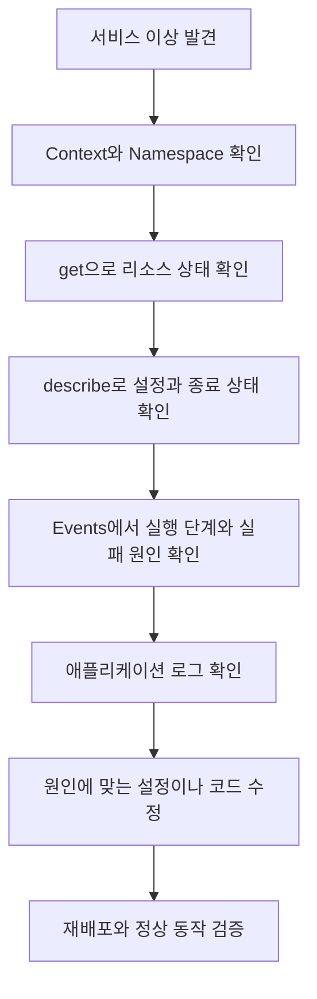
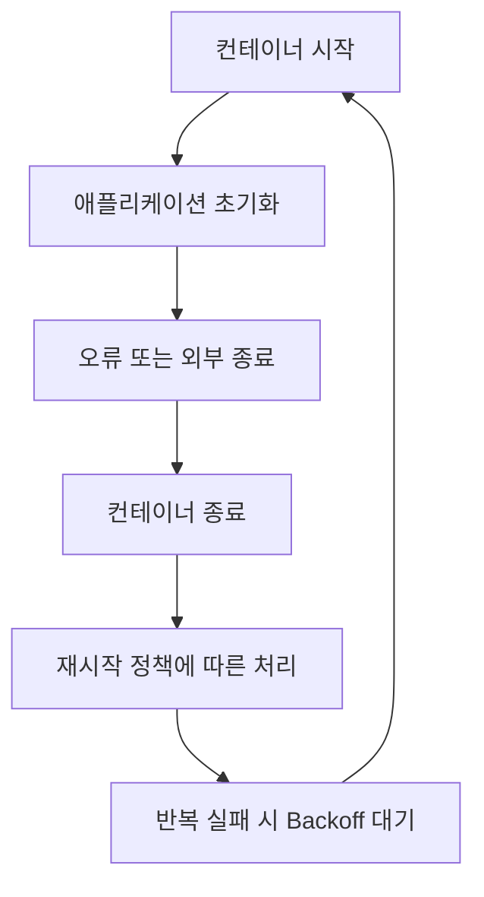
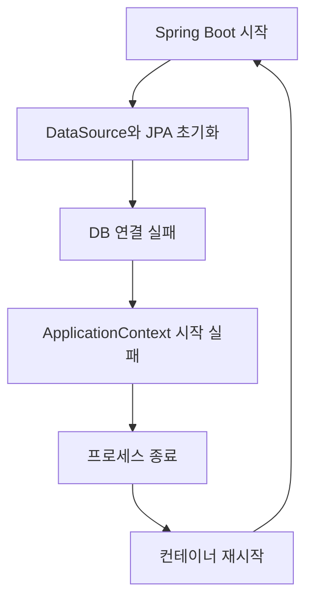
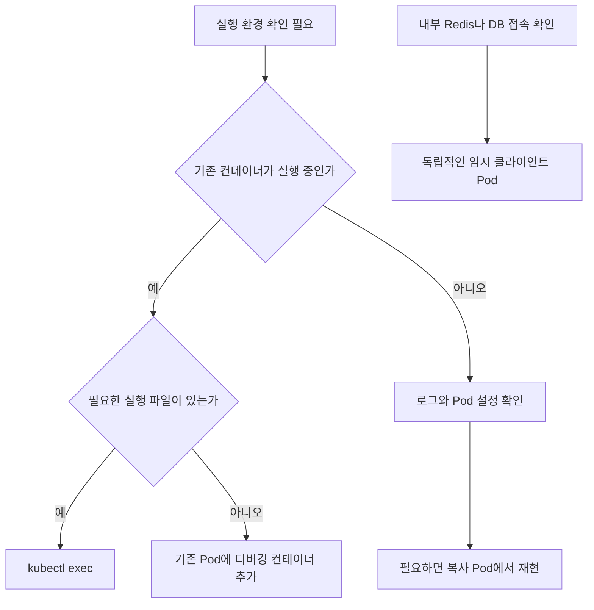
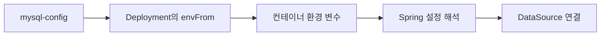
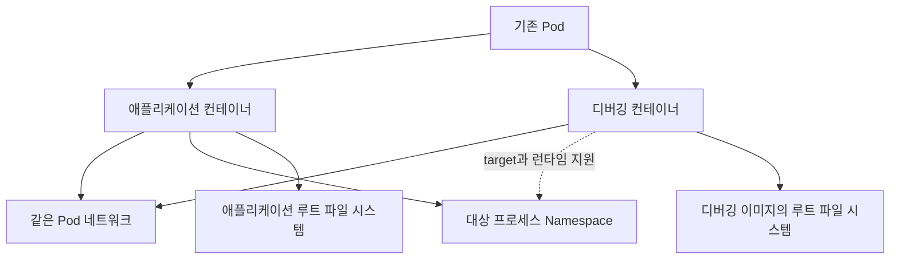
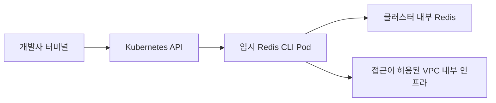

# Ch 1. 트러블슈팅을 위한 kubectl 활용

# Ch 1. 트러블슈팅을 위한 kubectl 활용
* toc
{:toc}

---

## 01. kubectl을 이용한 객체 상태, 이벤트, 로그 조회

### kubectl로 시작하는 Kubernetes 디버깅과 트러블슈팅

Kubernetes에서 애플리케이션이 정상적으로 동작하지 않을 때 가장 먼저 필요한 것은 재시작 명령이 아니라 현재 상태를 확인할 수 있는 정보다.

Pod가 준비되지 않는 이유는 다양하다. ConfigMap 이름을 잘못 입력했을 수도 있고, 이미지를 가져오지 못했을 수도 있다. 컨테이너는 실행되었지만 데이터베이스 연결에 실패해 애플리케이션이 종료되는 경우도 있다.

이러한 문제를 모두 같은 방식으로 해결할 수는 없다. 대신 **어느 단계까지 정상적으로 진행되었고, 어느 단계에서 실패했는지**를 좁혀 가는 접근이 필요하다.

이번에는 `kubectl get`, `describe`, `events`, `logs`를 중심으로 상태 확인에서 원인 추적까지 이어지는 기본 흐름을 정리한다.

#### 트러블슈팅의 기본 흐름

문제가 발생하면 먼저 Kubernetes 객체의 상태를 확인하고, 이후 필요한 정보를 더 자세히 조회한다.



각 명령이 답하는 질문은 조금씩 다르다.

| 명령 | 확인하는 내용 |
|---|---|
| `kubectl get` | 어떤 리소스가 존재하고 현재 어떤 상태인가 |
| `kubectl describe` | 해당 리소스의 설정·상태·관련 이벤트는 무엇인가 |
| `kubectl get events` | Kubernetes 구성 요소가 어떤 상황을 관찰했는가 |
| `kubectl logs` | 컨테이너 안에서 실행된 프로그램이 무엇을 기록했는가 |

처음부터 모든 정보를 조회하기보다는 전체 상태에서 특정 Pod, 특정 컨테이너로 범위를 좁히는 편이 효율적이다.

#### 먼저 조회 대상을 확인한다

개발·운영 클러스터를 함께 사용한다면 잘못된 환경을 조회하고 있지는 않은지부터 확인한다.

```bash
kubectl config current-context
kubectl config get-contexts
```

이후 예제에서는 애플리케이션이 `sns` Namespace에 있다고 가정한다.

```bash
kubectl get pods -n sns
```

Namespace를 생략하면 현재 Context의 기본 Namespace가 사용된다. 설정이 없다면 일반적으로 `default`가 사용된다.

`No resources found`가 나왔다고 애플리케이션이 삭제되었다고 단정하지 않는다. 다른 Context나 Namespace를 보고 있을 수 있다.

필요하면 모든 Namespace에서 확인한다.

```bash
kubectl get pods --all-namespaces
```

운영 환경에서는 명령에 Context를 명시하는 것이 더 안전하다.

```bash
kubectl --context sns-prod get pods -n prod
```

`Forbidden`이 발생했다면 리소스 부재가 아니라 조회 권한 문제일 수 있다. Pod 조회와 컨테이너 로그 조회도 서로 다른 권한으로 제어될 수 있다.

#### `get`으로 전체 상태 확인하기

##### 리소스 목록 조회

`get`은 Pod뿐 아니라 다양한 Kubernetes 객체를 조회할 수 있다.

```bash
kubectl get pods -n sns
kubectl get deployments -n sns
kubectl get services -n sns
kubectl get configmaps -n sns
kubectl get secrets -n sns
kubectl get pvc -n sns
```

여러 종류를 한 번에 조회할 수도 있다.

```bash
kubectl get deployment,replicaset,pod,service -n sns
```

다만 `kubectl get all`이 모든 종류의 Kubernetes 객체를 조회한다는 뜻은 아니다. ConfigMap, Secret, PVC 등 필요한 리소스는 명시적으로 확인하는 편이 좋다.

PV와 StorageClass는 Namespace에 속하지 않는 클러스터 범위 리소스다.

```bash
kubectl get pv
kubectl get storageclass
```

##### 단수형·복수형·약어

다음 명령은 모두 Pod 목록을 조회한다.

```bash
kubectl get pod -n sns
kubectl get pods -n sns
kubectl get po -n sns
```

자주 사용하는 약어는 다음과 같다.

| 리소스 | 약어 |
|---|---|
| Pod | `po` |
| Deployment | `deploy` |
| ReplicaSet | `rs` |
| Service | `svc` |
| ConfigMap | `cm` |
| Secret | 일반적으로 전체 이름 사용 |
| PersistentVolume | `pv` |
| PersistentVolumeClaim | `pvc` |
| StorageClass | `sc` |
| Namespace | `ns` |

현재 클러스터에서 제공하는 리소스와 약어는 다음 명령으로 확인한다.

```bash
kubectl api-resources
```

출력의 `SHORTNAMES`는 약어를, `NAMESPACED`는 Namespace 소속 여부를 나타낸다. 설치된 CRD도 이 목록에 포함될 수 있다.

##### Pod 목록에서 읽어야 할 항목

일반적인 Pod 조회 결과에는 다음 정보가 표시된다.

```text
NAME                          READY   STATUS             RESTARTS   AGE
feed-server-xxxxx-yyyyy        0/1     CrashLoopBackOff   4          5m
```

위 내용은 출력 형식을 설명하기 위한 예시다.

| 항목 | 의미 |
|---|---|
| `READY` | 준비 상태인 컨테이너 수와 대상 컨테이너 수 |
| `STATUS` | 현재 상황을 이해하기 쉽게 요약한 표시 |
| `RESTARTS` | 컨테이너 재시작 횟수 |
| `AGE` | Pod 생성 이후 경과 시간 |

`Running`이라고 항상 요청을 처리할 준비가 된 것은 아니다. `READY`가 `0/1`이면 프로세스가 실행 중이더라도 Readiness 조건을 충족하지 못했을 수 있다.

반대로 `RESTARTS`가 1 이상이라는 이유만으로 현재 장애라고 단정할 수도 없다. 과거에 한 번 재시작된 뒤 안정적으로 동작할 수 있으므로, **최근에도 횟수가 증가하는지**를 확인한다.

```bash
kubectl get pods -n sns --watch
```

또한 `STATUS`에 표시되는 `CrashLoopBackOff`, `Terminating`은 Pod의 `status.phase`와 같은 개념이 아니다. Pod Phase와 개별 컨테이너 상태를 구분해야 한다. [Kubernetes Pod 생명주기](https://kubernetes.io/docs/concepts/workloads/pods/pod-lifecycle/)

#### 필요한 리소스만 찾기

##### Label Selector 사용

Deployment가 만든 Pod 이름에는 보통 ReplicaSet Hash와 임의 접미사가 붙는다. 특정 서버의 Pod를 찾을 때는 이름보다 Label을 사용하는 편이 안정적이다.

```bash
kubectl get pods -n sns --show-labels

kubectl get pods -n sns \
  -l app=feed-server
```

이전 Helm 구성처럼 Release Label을 함께 사용한다면 조건을 추가할 수 있다.

```bash
kubectl get pods -n sns \
  -l app=feed-server,app.kubernetes.io/instance=feed-server
```

쉼표로 연결한 조건은 모두 만족해야 한다.

Label은 이름이 우연히 비슷한 리소스를 찾는 수단이 아니라, 운영 목적에 맞게 객체를 분류하는 기준이다. 배포 단계부터 일관된 Label을 지정해 두는 것이 중요하다.

##### Field Selector 사용

Field Selector는 리소스의 특정 필드 값을 기준으로 조회한다.

```bash
kubectl get pods -n sns \
  --field-selector metadata.name=feed-server-xxxxx-yyyyy
```

`metadata.name`에 `feed-server`만 지정하면 그 이름과 정확히 일치하는 Pod를 찾는다. `feed-server`로 시작하는 모든 Pod를 검색하는 것은 아니다.

특정 Node의 Pod를 찾을 때는 다음과 같이 조회할 수 있다.

```bash
kubectl get pods --all-namespaces \
  --field-selector spec.nodeName=<NODE_NAME> \
  -o wide
```

Field Selector에서 사용할 수 있는 필드는 리소스 종류에 따라 다르다. 일반적인 문자열 검색이나 정규식 검색 기능으로 생각해서는 안 된다. [Kubernetes Field Selector](https://kubernetes.io/docs/concepts/overview/working-with-objects/field-selectors/)

##### 텍스트 검색 도구와 조합

이름의 일부만 알고 있다면 출력 결과를 검색할 수도 있다.

```bash
kubectl get pods -n sns -o name \
  | rg '^pod/feed-server-'
```

`rg`가 없다면 `grep`을 사용할 수 있다. PowerShell에서는 다음과 같이 조회할 수 있다.

```powershell
kubectl get pods -n sns -o name |
    Select-String '^pod/feed-server-'
```

이 방식은 Kubernetes가 조건에 맞는 객체만 반환하는 것이 아니라, 명령 출력 이후 로컬에서 문자열을 거르는 방식이다.

사람이 빠르게 확인할 때는 편리하지만, 자동화에서는 Label Selector나 JSON 기반 조회를 우선하는 편이 안정적이다.

#### 출력 형식을 바꿔 더 자세히 보기

##### `-o wide`

```bash
kubectl get pods -n sns -o wide
```

Pod IP와 배치된 Node 등 기본 목록보다 많은 정보를 확인할 수 있다.

특정 Node에 배치된 Pod들에서만 문제가 발생한다면 Node 상태나 해당 Node의 네트워크·스토리지 경로를 의심할 근거가 된다. 다만 배치 위치가 같다는 사실만으로 Node 장애라고 확정하지는 않는다.

##### 필요한 컬럼 지정

```bash
kubectl get pods -n sns \
  -o custom-columns='NAME:.metadata.name,NODE:.spec.nodeName,PHASE:.status.phase,RESTARTS:.status.containerStatuses[*].restartCount'
```

이렇게 표시한 `PHASE`는 일반 목록의 `STATUS`와 다를 수 있다. 하나는 Pod API 필드이고, 다른 하나는 여러 상태를 종합한 표시이기 때문이다.

##### YAML과 JSON

특정 Pod를 자세히 확인하려면 이름을 지정한다.

```bash
POD="<POD_NAME>"

kubectl get pod "$POD" -n sns -o yaml
kubectl get pod "$POD" -n sns -o json
```

여기서 중요한 영역은 다음과 같다.

| 영역 | 확인할 내용 |
|---|---|
| `metadata` | 이름, Label, 생성 시각, 소유 객체 |
| `spec` | 이미지, 환경 변수 참조, Volume, Probe, 자원 설정 |
| `status` | 현재 Phase, 조건, 컨테이너 상태, 재시작과 종료 정보 |

출력은 원래 작성한 YAML 파일과 완전히 같지 않다. API 기본값, 스케줄링 결과, Admission 과정의 변경, 자동 주입된 설정, 실행 상태 등이 포함될 수 있다.

또한 API에 저장된 객체 정보이지, 컨테이너 내부 파일과 실제 DB 상태까지 모두 보여주는 것은 아니다.

`managedFields`가 필요하다면 별도로 포함할 수 있다.

```bash
kubectl get pod "$POD" -n sns \
  -o yaml \
  --show-managed-fields
```

##### 파일로 보관할 때의 주의사항

출력이 길다면 진단용 파일로 남길 수 있다.

```bash
kubectl get pod "$POD" -n sns \
  -o yaml > pod-snapshot.yaml
```

다만 Pod YAML에도 직접 지정한 비밀번호나 토큰이 포함될 수 있다. 저장·공유 전에 민감 정보와 보관 위치를 확인한다.

이 파일을 완전한 백업이나 재배포 원본으로 취급해서도 안 된다.

- `status`와 서버가 관리하는 메타데이터가 포함된다.
- 자동 주입된 값이 현재 환경에 종속될 수 있다.
- Deployment가 관리하는 Pod를 직접 복원하면 관리 구조가 달라진다.
- PVC 객체를 내보내도 실제 Volume 데이터가 백업되지는 않는다.

재배포 기준은 원본 Manifest나 Helm Chart와 values로 유지한다. Secret을 YAML로 내보내는 경우에도 Base64는 암호화가 아니라는 점을 주의해야 한다.

#### `describe`로 설정과 상태 함께 보기

```bash
kubectl describe pod "$POD" -n sns
```

`describe`는 사람이 읽기 쉬운 형태로 주요 정보를 정리해 준다. 원인 추적에서는 다음 항목을 우선 확인한다.

| 항목 | 확인할 내용 |
|---|---|
| `Node` | 스케줄링된 Node |
| `Containers` | 이미지, 실행 상태, 환경 변수 참조 |
| `State` | 현재 Waiting·Running·Terminated 상태 |
| `Last State` | 직전 컨테이너 실행의 종료 상태 |
| `Reason`, `Exit Code` | 종료 이유와 코드 |
| `Restart Count` | 재시작 횟수 |
| `Conditions` | Pod 준비 조건 |
| `Events` | 스케줄링·이미지·실행 과정의 관련 이벤트 |

Events만 확인하고 위쪽 컨테이너 상태를 건너뛰지 않는 것이 좋다. `OOMKilled`나 종료 코드처럼 중요한 단서가 컨테이너 상태에 있을 수 있다.

또한 `describe`가 모든 설정과 장애 이력을 빠짐없이 보관하는 것은 아니다. 상세 필드는 YAML·JSON으로, 애플리케이션 내부 오류는 로그로 이어서 확인한다.

#### Events로 실패 단계 확인하기

Namespace에 남아 있는 이벤트를 조회한다.

```bash
kubectl get events -n sns
```

대표적인 이벤트는 다음과 같다.

| Type·Reason 예시 | 의미 |
|---|---|
| `Normal / Scheduled` | Pod가 Node에 할당됨 |
| `Normal / Pulled` | 이미지가 준비되었음 |
| `Normal / Created` | 컨테이너가 생성됨 |
| `Normal / Started` | 컨테이너가 시작됨 |
| `Warning / FailedScheduling` | 스케줄링 실패 |
| `Warning / FailedMount` | Volume 구성 또는 마운트 실패 |
| `Warning / Unhealthy` | Probe 실패 |
| `Warning / BackOff` | 이미지 Pull이나 재시작 등의 재시도 대기 |

`Normal`은 해당 작업이 정상적으로 관찰되었다는 뜻이지, 서비스 전체가 정상이라는 뜻은 아니다.

`Scheduled`가 있어도 이후 Node 문제가 발생할 수 있고, `Pulled`가 있어도 이미지 안의 애플리케이션이 정상 실행된다는 보장은 없다.

##### 특정 Pod의 이벤트 조회

```bash
kubectl get events -n sns \
  --field-selector "involvedObject.kind=Pod,involvedObject.name=$POD"
```

같은 이름의 Pod가 재생성된 경우를 엄밀하게 구분하려면 UID도 활용할 수 있다.

```bash
POD_UID=$(
  kubectl get pod "$POD" -n sns \
    -o jsonpath='{.metadata.uid}'
)

kubectl get events -n sns \
  --field-selector "involvedObject.uid=$POD_UID"
```

지원되는 `kubectl` 버전에서는 전용 명령도 사용할 수 있다.

```bash
kubectl events -n sns --for "pod/$POD"
kubectl events -n sns --for "pod/$POD" --watch
```

##### 시간 기준 정렬

이벤트의 생성 시각 기준으로 정렬하려면 다음과 같이 조회한다.

```bash
kubectl get events -n sns \
  --sort-by=.metadata.creationTimestamp
```

마지막 관찰 시각이 채워져 있는 이벤트에서는 다음 명령도 사용할 수 있다.

```bash
kubectl get events -n sns \
  --sort-by=.lastTimestamp
```

다만 이벤트 API와 기록 방식에 따라 `eventTime`이나 `series.lastObservedTime`을 사용할 수 있다. 모든 이벤트에서 `lastTimestamp`가 반드시 존재한다고 가정하지 않는다.

같은 이벤트가 반복되면 하나의 객체에 횟수와 관찰 시각이 집계되기도 한다. 따라서 생성 시각 정렬을 모든 발생 이력의 완전한 시간순 목록으로 해석해서는 안 된다.

##### 이벤트는 영구 기록이 아니다

Kubernetes API Server의 `--event-ttl` 기본값은 1시간이지만 실제 보관 기간은 클러스터 설정에 따라 달라질 수 있다. [API Server 이벤트 보관 설정](https://kubernetes.io/docs/reference/command-line-tools-reference/kube-apiserver/)

Events는 감사 로그나 모든 객체 변경의 영구 이력이 아니다. 기록이 만료되거나 집계될 수 있으므로 문제가 발생했을 때 빠르게 수집해야 한다.

장기 분석이 필요하다면 이벤트 수집 체계와 중앙 로그를 별도로 운영한다.

#### 실습: ConfigMap 이름 오류 추적

애플리케이션 코드 문제와 구분하기 위해 독립적인 실습 Namespace에서 설정 오류를 재현한다.

다음 YAML을 `config-check.yaml`로 작성한다. 의도적으로 ConfigMap 참조 이름을 틀리게 지정했다.

```yaml
apiVersion: v1
kind: Namespace
metadata:
  name: troubleshoot-lab
---
apiVersion: v1
kind: ConfigMap
metadata:
  name: kafka-config
  namespace: troubleshoot-lab
data:
  MESSAGE: "configuration loaded"
---
apiVersion: apps/v1
kind: Deployment
metadata:
  name: config-check
  namespace: troubleshoot-lab
spec:
  replicas: 1
  selector:
    matchLabels:
      app: config-check
  template:
    metadata:
      labels:
        app: config-check
    spec:
      containers:
        - name: app
          image: busybox:1.36
          command:
            - sh
            - -c
          args:
            - |
              while true; do
                echo "$MESSAGE"
                sleep 30
              done
          envFrom:
            - configMapRef:
                name: kafak-config
          resources:
            requests:
              cpu: "10m"
              memory: "16Mi"
            limits:
              cpu: "100m"
              memory: "32Mi"
```

이 ConfigMap은 참조 동작 확인용이다. 실제 Kafka 접속을 수행하지 않는다.

- `Namespace`: 실습 리소스를 기존 서비스와 분리한다.
- `ConfigMap`: 컨테이너가 출력할 `MESSAGE`를 저장한다.
- `selector`, `template.metadata.labels`: Deployment와 Pod의 연결 기준이다.
- `command`, `args`: 환경 변수를 주기적으로 출력한다.
- `envFrom`: ConfigMap의 데이터를 환경 변수로 전달한다.
- `resources`: 실습 컨테이너의 자원 요청량과 상한이다.

정상 ConfigMap 이름은 `kafka-config`인데 Pod는 `kafak-config`를 참조한다.

##### 적용과 상태 확인

개발용 클러스터인지 확인한 뒤 적용한다.

```bash
kubectl apply -f config-check.yaml

kubectl get pods -n troubleshoot-lab \
  -l app=config-check
```

이미지 준비가 완료된 이후에는 다음과 같은 상태가 나타날 수 있다.

```text
READY   STATUS                       RESTARTS
0/1     CreateContainerConfigError   0
```

Pod 이름을 가져와 상세 조회한다.

```bash
LAB_POD=$(
  kubectl get pods -n troubleshoot-lab \
    -l app=config-check \
    -o jsonpath='{.items[0].metadata.name}'
)

kubectl describe pod "$LAB_POD" -n troubleshoot-lab
```

Events에서는 다음과 같은 메시지를 찾을 수 있다.

```text
Warning  Failed  Error: configmap "kafak-config" not found
```

이때 확인한 사실은 명확하다.

1. Pod가 생성되었다.
2. 컨테이너 준비 과정에서 ConfigMap 참조에 실패했다.
3. 애플리케이션 프로세스는 아직 시작되지 않았다.

따라서 애플리케이션 로그부터 찾기보다 참조한 객체를 확인하는 것이 우선이다.

```bash
kubectl get configmaps -n troubleshoot-lab
kubectl get configmap kafka-config -n troubleshoot-lab
```

##### 참조 이름 수정

원본 YAML의 `kafak-config`를 `kafka-config`로 수정한 뒤 다시 적용한다.

```bash
kubectl apply -f config-check.yaml

kubectl rollout status deployment/config-check \
  -n troubleshoot-lab

kubectl logs deployment/config-check \
  -n troubleshoot-lab \
  -c app \
  --tail=10
```

정상 동작 시 다음 내용이 반복 출력된다.

```text
configuration loaded
```

Pod 템플릿을 수정했으므로 Deployment가 새로운 Pod를 생성한다.

반면 참조 이름은 맞고 ConfigMap 자체만 없었던 경우라면, 해당 ConfigMap을 생성한 뒤 기존 Pod의 준비 재시도로 복구될 수 있다.

이미 실행 중인 컨테이너에 환경 변수로 전달한 ConfigMap 값을 변경하는 경우는 또 다르다. 기존 프로세스의 환경 변수가 자동으로 바뀌지는 않으므로 새로운 Pod가 필요하다.

Helm으로 관리하는 서비스라면 직접 수정한 상태에만 의존하지 않고 Chart나 values에도 원인을 반영한다.

#### `CrashLoopBackOff`는 원인보다 현상에 가깝다

ConfigMap 참조 오류와 달리 컨테이너가 실행된 뒤 종료되는 경우가 있다.

```text
READY   STATUS             RESTARTS
0/1     CrashLoopBackOff   4
```

이는 컨테이너가 반복적으로 종료되고, 다음 재시작까지 Backoff 대기 중임을 나타낸다.



같은 Pod 안에서 컨테이너만 재시작될 수 있다. 이를 매번 “Pod가 새로 생성된다”라고 표현하면 정확하지 않다.

가능한 원인은 다양하다.

- 애플리케이션 초기화 예외
- 잘못된 실행 명령이나 설정
- 메모리 부족
- Startup·Liveness Probe 실패
- 실행이 끝나는 프로그램을 상시 서버처럼 배포한 경우

정상 종료 코드 `0`이어도 Deployment의 재시작 정책 때문에 반복 실행될 수 있다.

`describe`에서 `Last State`, `Reason`, `Exit Code`, Probe 관련 이벤트를 함께 확인한다. `OOMKilled`는 중요한 단서지만, 종료 코드 `137`만으로 메모리 부족이라고 확정해서는 안 된다.

Readiness 실패만으로 컨테이너가 재시작되는 것도 아니다. Readiness와 Liveness·Startup의 역할을 구분해야 한다.

#### `logs`로 애플리케이션 내부 확인

##### 현재 컨테이너 로그

```bash
kubectl logs "$POD" -n sns
```

컨테이너가 여러 개라면 대상을 명시한다.

```bash
kubectl get pod "$POD" -n sns \
  -o jsonpath='{.spec.containers[*].name}'

kubectl logs "$POD" -n sns \
  -c feed-server
```

로그 대상 컨테이너를 잘못 선택하면 Sidecar 로그만 보고 애플리케이션 원인을 놓칠 수 있다.

##### 출력 범위 제한

```bash
kubectl logs "$POD" -n sns \
  -c feed-server \
  --tail=200 \
  --since=10m \
  --timestamps=true
```

- `--tail`: 마지막 몇 줄을 가져올지 지정한다.
- `--since`: 최근 일정 시간의 로그로 제한한다.
- `--timestamps`: 로그 시각을 함께 표시한다.

다른 Pod나 Events와 비교할 때는 시각과 시간대를 맞춰 보는 것이 중요하다.

##### `-f`: 실시간 출력 추적

```bash
kubectl logs "$POD" -n sns \
  -c feed-server \
  --follow \
  --tail=100
```

`-f`는 새로 기록되는 로그를 이어서 보여준다.

다만 컨테이너가 종료되거나 연결이 끊기면 추적도 끝날 수 있다. 이후 생성되는 모든 Pod까지 계속 자동 추적하는 중앙 로그 도구와는 다르다.

##### `-p`: 직전 컨테이너 로그

재시작 직후 현재 로그에는 초기 메시지만 남아 있고, 장애 직전 기록은 이전 컨테이너에 있을 수 있다.

```bash
kubectl logs "$POD" -n sns \
  -c feed-server \
  --previous \
  --tail=200 \
  --timestamps=true
```

`--previous`, 줄여서 `-p`는 **같은 Pod에서 직전에 종료된 해당 컨테이너 인스턴스**의 로그를 조회한다. [kubectl logs 옵션](https://kubernetes.io/docs/reference/kubectl/generated/kubectl_logs/)

다음과 같은 제한이 있다.

- 이전 인스턴스가 없으면 조회할 수 없다.
- 모든 과거 재시작 로그를 순서대로 조회하는 기능은 아니다.
- 삭제된 이전 Pod의 로그를 새 Pod에서 가져오는 기능이 아니다.
- Node 상태와 로그 보관·회전 정책에 따라 기록이 없을 수 있다.

컨테이너가 종료되었다고 현재 로그가 항상 사라지는 것도 아니다. 현재와 이전 로그를 상황에 맞게 확인한다.

##### 여러 Pod의 로그

```bash
kubectl logs -n sns \
  -l app=feed-server \
  --all-containers=true \
  --prefix=true \
  --tail=100
```

출처 Prefix를 붙여 어떤 Pod와 컨테이너의 기록인지 구분한다.

장애 재시작 원인을 조사할 때는 우선 특정 Pod와 컨테이너를 지정하는 편이 좋다. Deployment 이름으로 조회한 로그 하나가 모든 복제본의 상태를 대표하지는 않는다.

#### 사례: Spring Boot의 DB 초기화 실패

Spring Boot 애플리케이션에서 DataSource나 JPA 초기화 예외가 ApplicationContext 시작 실패로 이어지면 프로세스가 종료될 수 있다.

이후 kubelet은 재시작 정책에 따라 컨테이너를 다시 실행한다. DB 연결 문제를 그대로 둔 상태라면 같은 실패가 반복된다.



이때 `Back-off restarting failed container`는 반복 종료의 결과를 보여준다. 실제 원인은 로그의 예외 체인에서 찾아야 한다.

예를 들어 다음과 같은 로그가 있다고 하자.

```text
Application run failed
...
Caused by: java.net.UnknownHostException:
mysql.invalid.svc.cluster.local
```

이 경우에는 DB 주소의 이름 해석 실패가 직접적인 단서다. Kubernetes 재시작 간격을 조정해도 주소 오류는 해결되지 않는다.

| 로그 단서 | 우선 확인할 내용 |
|---|---|
| `UnknownHostException` | 호스트명, Namespace, DNS |
| `Connection refused` | 포트, DB 프로세스 수신 상태, 대상 Endpoint |
| 연결 단계의 Timeout | 네트워크 경로, 정책, 방화벽, 대상 부하 |
| DB의 `Access denied` | 계정, 비밀번호, 접속 허용 조건 |
| `Unknown database` | DB 생성 여부와 이름 |
| Hibernate 초기화 실패 | 하위 원인의 연결·스키마·설정 오류 |

가장 위에 나온 예외 이름만 보고 해결책을 정하지 않는다. 예를 들어 Hibernate 오류의 하위 원인이 DB 연결 실패라면 Dialect 설정만 추가하는 것은 근본 해결이 아니다.

확인은 다음 순서로 진행할 수 있다.

1. Deployment의 DB 설정 참조 확인
2. ConfigMap의 호스트·포트·DB 이름 확인
3. Secret 이름과 필요한 키 존재 여부 확인
4. DB Service와 Endpoint 상태 확인
5. 네트워크 연결과 실제 인증 확인

DB Service에 Endpoint가 있는지도 조회한다.

```bash
kubectl get service mysql -n infra

kubectl get endpointslice -n infra \
  -l kubernetes.io/service-name=mysql \
  -o wide
```

Endpoint가 존재한다는 사실만으로 SQL 실행과 인증까지 성공했다고 볼 수는 없다. 각 단계의 관찰 범위를 구분해야 한다.

#### 로그가 나오지 않을 때

`kubectl logs` 결과가 없다는 사실도 여러 상황으로 나뉜다.

| 상황 | 확인할 내용 |
|---|---|
| 컨테이너가 시작되지 않음 | ConfigMap·Secret, 이미지, Volume, 스케줄링 |
| 프로세스가 매우 빨리 종료됨 | 현재 로그와 `--previous` |
| 다른 컨테이너를 조회함 | `-c` 지정 |
| 파일에만 로그를 기록함 | 애플리케이션 로깅 설정 |
| Pod나 Node가 사라짐 | 중앙 로그 보관 여부 |
| `Forbidden` | `pods/log` 조회 권한 |

`kubectl logs`는 일반적으로 컨테이너의 표준 출력과 표준 오류로 기록된 로그를 조회한다. 컨테이너 안의 임의 로그 파일을 자동으로 찾아 읽지는 않는다.

Pod 삭제나 Node 장애 이후에도 분석해야 한다면 OpenSearch, Loki 등의 중앙 로그 체계를 함께 사용해야 한다. [Kubernetes 로그 구조](https://kubernetes.io/docs/concepts/cluster-administration/logging/)

#### 수정 전후에 남겨야 할 확인 사항

증상을 빨리 없애기 위해 Pod부터 삭제하면 직전 상태와 로그를 확보하기 어려워질 수 있다.

가능하다면 변경 전에 다음 정보를 확인한다.

- 장애 발생 시각
- Context와 Namespace
- Pod 이름·UID·배치 Node
- 실행 이미지와 최근 배포 변경
- 현재 상태와 직전 종료 이유
- 관련 Events
- 현재·이전 컨테이너 로그

이후 원본 Manifest, Helm values 또는 애플리케이션 코드를 수정한다.

수정 뒤에는 준비 상태뿐 아니라 실제 요청도 확인한다.

```bash
kubectl rollout status deployment/feed-server -n sns

kubectl get pods -n sns \
  -l app=feed-server \
  -o wide
```

일정 시간 동안 재시작 횟수가 다시 증가하지 않는지, 정상 API 요청이 성공하는지, DB·Kafka 등 의존 기능도 복구되었는지 확인한다.

Pod가 `Running`으로 바뀌었다는 것과 서비스 장애가 해결되었다는 것은 같은 의미가 아니다.

### 정리

Kubernetes 트러블슈팅은 `get`으로 전체 상태를 확인하고, `describe`와 Events로 실패 단계를 좁힌 뒤, 필요한 경우 컨테이너 로그로 원인을 추적하는 흐름으로 시작할 수 있다.

ConfigMap 이름 오류처럼 컨테이너 실행 전에 발생한 문제는 Events에서 직접적인 단서를 찾기 쉽다. 반면 `CrashLoopBackOff`는 반복 종료의 현상이므로 종료 상태, Probe, 현재·이전 로그를 함께 확인해야 한다.

핵심은 **표시된 상태를 곧바로 원인으로 단정하지 않는 것**이다. 관찰한 사실과 아직 확인하지 못한 영역을 구분하고, 원인을 수정한 뒤 실제 서비스 동작까지 검증해야 한다.

## 02. 컨테이너 쉘 및 디버그 컨테이너를 이용하여 문제 분석하기 

### kubectl exec와 디버깅 컨테이너로 실행 환경 확인하기

로그에서 데이터베이스 연결 오류를 발견했다면 다음으로 확인할 것은 실행 환경이다. 설정 파일에 올바른 주소를 작성했더라도, 실제 컨테이너에는 이전 값이 남아 있거나 다른 환경 변수가 주입되었을 수 있다.

이때마다 애플리케이션 코드를 수정하고 로그를 추가해 재배포하는 것은 번거롭다. Kubernetes에서는 실행 중인 컨테이너에 명령을 수행하거나, 진단 도구가 포함된 컨테이너를 추가해 상태를 확인할 수 있다.

이번에는 `kubectl exec`, `kubectl debug`, `kubectl run`을 이용해 환경 변수, 프로세스, 네트워크와 내부 인프라 연결을 점검한다.

#### 상황에 따라 진단 방법 선택하기

세 명령은 비슷해 보이지만 실행 위치와 영향 범위가 다르다.

| 방법 | 실행 위치 | 주로 사용하는 상황 |
|---|---|---|
| `kubectl exec` | 기존 애플리케이션 컨테이너 | 환경 변수·파일 등 해당 컨테이너의 상태 확인 |
| `kubectl debug` | 기존 Pod에 추가한 진단 컨테이너 | 애플리케이션 이미지에 Shell이나 도구가 없는 경우 |
| `kubectl debug --copy-to` | 원본을 바탕으로 새로 만든 Pod | 설정을 바꾸어 실행하거나 별도 환경에서 재현 |
| `kubectl run` | 독립적인 임시 Pod | Redis·DB 등 내부 인프라에 클라이언트로 접근 |



기존 Pod에서 확인한 결과와 새로운 Pod에서 확인한 결과는 같은 증거가 아니다. 문제가 발생한 실행 환경을 얼마나 유지해야 하는지에 따라 방법을 선택한다.

#### 진단 대상과 권한 먼저 확인

명령을 실행하기 전에 Context와 Namespace를 확인한다.

```bash
kubectl config current-context
kubectl get pods -n sns -o wide
```

다음 예제에서는 대상 Pod와 컨테이너 이름을 변수로 지정한다. 명령은 Bash 기준이다.

```bash
POD="<TARGET_POD_NAME>"
CONTAINER="<TARGET_CONTAINER_NAME>"
```

컨테이너 이름은 Pod 이름과 다를 수 있다.

```bash
kubectl get pod "$POD" -n sns \
  -o jsonpath='{.spec.containers[*].name}'
```

`exec`와 디버깅 컨테이너 추가는 단순 조회보다 강한 권한이다. 클러스터의 RBAC, Pod Security, 이미지 허용 정책 등에 의해 제한될 수 있다.

특히 `kubectl debug`로 Ephemeral Container를 추가하는 작업은 기존 Pod 객체를 변경한다. 진단 명령이라고 해서 모든 작업이 읽기 전용인 것은 아니다.

#### `kubectl exec`로 명령 실행하기

기본 형식은 다음과 같다.

```bash
kubectl exec "$POD" -n sns \
  -c "$CONTAINER" \
  -- <COMMAND> <ARGUMENTS>
```

`--` 앞은 `kubectl` 옵션이고, 뒤는 컨테이너 안에서 실행할 명령과 인자다.

Shell을 실행하지 않고도 명령 하나를 바로 수행할 수 있다.

```bash
kubectl exec "$POD" -n sns \
  -c "$CONTAINER" \
  -- printenv MYSQL_HOST MYSQL_PORT MYSQL_DATABASE
```

이 방식은 해당 컨테이너에서 새 프로세스를 실행한다. 기존 JVM의 내부 상태를 직접 읽는 명령은 아니라는 점도 구분해야 한다. [kubectl exec](https://kubernetes.io/docs/reference/kubectl/generated/kubectl_exec/)

##### 환경 변수는 필요한 항목만 조회한다

DB 연결을 확인하려고 환경 변수 전체를 출력하면 비밀번호나 토큰까지 노출될 수 있다.

예를 들어 `printenv` 전체 결과에서 `MYSQL`이라는 문자열만 검색하더라도 `MYSQL_PASSWORD`가 함께 포함될 수 있다. 진단 목적에 필요한 비민감 변수만 지정하는 편이 안전하다.

```bash
kubectl exec "$POD" -n sns \
  -c "$CONTAINER" \
  -- printenv MYSQL_HOST
```

JDBC URL에도 인증 정보가 포함될 수 있으므로, 주소를 로그로 남길 때 역시 민감한 부분을 제거해야 한다.

##### 명령이 해석되는 위치에 주의한다

다음처럼 로컬 Shell에서 변수를 확장하면 컨테이너의 값이 아니라 로컬 값을 전달하게 된다.

```bash
kubectl exec "$POD" -n sns \
  -c "$CONTAINER" \
  -- echo "$MYSQL_HOST"
```

컨테이너 안에서 변수 확장이 필요하다면 Shell에 명령을 전달한다.

```bash
kubectl exec "$POD" -n sns \
  -c "$CONTAINER" \
  -- sh -c 'printf "%s\n" "$MYSQL_HOST"'
```

단순 변수 조회라면 앞의 `printenv MYSQL_HOST`가 더 간단하다.

파이프와 리다이렉션도 어느 Shell이 처리하는지 확인해야 한다. `--` 뒤에 작성했다고 모든 문자열이 자동으로 원격 Shell 문법으로 해석되는 것은 아니다.

#### 사례: 잘못된 MySQL 주소 확인

컨테이너에서 다음 주소를 확인했다고 가정한다.

```text
mysql.svc.infra.cluster.local
```

일반적인 Kubernetes Service DNS 형식은 다음과 같다.

```text
<Service 이름>.<Namespace>.svc.<클러스터 도메인>
```

Service가 `mysql`, Namespace가 `infra`이고 클러스터 도메인이 `cluster.local`이라면 다음 주소가 맞다.

```text
mysql.infra.svc.cluster.local
```

Namespace와 `svc`의 위치가 뒤바뀐 것이다. 클러스터 도메인은 환경에 따라 다를 수 있으므로 항상 `cluster.local`로 고정된 것은 아니다.

##### 값의 주입 경로 확인

이번 구성에서는 환경 변수가 ConfigMap에서 전달된다.



ConfigMap의 해당 키만 조회한다.

```bash
kubectl get configmap mysql-config -n sns \
  -o jsonpath='{.data.MYSQL_HOST}{"\n"}'
```

정상적인 ConfigMap 예시는 다음과 같다.

```yaml
apiVersion: v1
kind: ConfigMap
metadata:
  name: mysql-config
  namespace: sns
data:
  MYSQL_HOST: "mysql.infra.svc.cluster.local"
  MYSQL_PORT: "3306"
  MYSQL_DATABASE: "sns"
```

- `metadata.namespace`: 이 ConfigMap을 참조하는 Pod와 같은 Namespace다.
- `data`: 컨테이너에 전달할 문자열 설정이다.
- `MYSQL_HOST`: DB Service의 DNS 이름이다.
- `MYSQL_PORT`: MySQL 접속 포트다.
- `MYSQL_DATABASE`: 사용할 데이터베이스 이름이다.

기존 ConfigMap에 다른 키가 있다면 수정 과정에서 누락하지 않도록 유지한다.

Spring Boot에서는 다음과 같이 환경 변수를 참조할 수 있다.

```yaml
spring:
  datasource:
    url: "jdbc:mysql://${MYSQL_HOST}:${MYSQL_PORT}/${MYSQL_DATABASE}"
    username: "${MYSQL_USER}"
    password: "${MYSQL_PASSWORD}"
```

다만 환경 변수 값이 올바르다는 사실만으로 최종 DataSource 설정까지 확인한 것은 아니다. 실행 인자, 활성 프로파일, 외부 설정 등에서 다른 값이 우선 적용될 수 있다.

문제가 계속된다면 환경 변수 전달과 Spring의 최종 설정 해석을 나누어 조사한다.

##### 수정 후 새 Pod에서 재확인

원본 ConfigMap을 수정해 적용한다.

```bash
kubectl apply -f mysql-config.yaml
```

환경 변수로 주입한 값은 이미 실행 중인 컨테이너에 자동 반영되지 않는다. 영향을 받는 Deployment를 선별해 새로운 Pod를 생성한다.

```bash
kubectl rollout restart deployment/feed-server -n sns
kubectl rollout status deployment/feed-server -n sns

kubectl get pods -n sns -l app=feed-server
```

새 Pod 이름으로 `POD` 값을 다시 지정한 뒤 환경 변수와 애플리케이션 로그를 확인한다.

여러 서버가 같은 ConfigMap을 참조한다면 재시작 대상도 확인해야 한다. 무작정 모든 Deployment를 재시작하지 않고, 가용성과 자원 여유를 고려해 순서대로 진행한다.

Helm으로 관리하는 설정이라면 Chart·values 또는 별도 설정 관리 원본에도 수정 내용을 반영한다.

#### CrashLoop 상태에서는 `exec`가 어려울 수 있다

`kubectl exec`는 실행 중인 컨테이너에 명령을 수행한다.

애플리케이션이 시작 직후 종료된다면 명령을 실행할 시간이 없거나, Backoff 대기 중이라 대상 컨테이너가 실행 중이지 않을 수 있다.

이때는 다음 정보를 먼저 확보한다.

```bash
kubectl describe pod "$POD" -n sns

kubectl logs "$POD" -n sns \
  -c "$CONTAINER" \
  --previous \
  --tail=200
```

이후 Pod 설정과 ConfigMap을 확인하거나 복사 Pod에서 재현한다.

복사 Pod에서 확인한 환경 변수는 새로 생성된 컨테이너의 값이다. 원본 컨테이너가 시작할 당시의 값과 반드시 같지는 않으므로, 이를 원본 실행 상태의 증거로 대신 사용하지 않는다.

#### Shell을 실행해 연속으로 확인하기

컨테이너에서 여러 명령을 수행하려면 대화형 Shell을 사용할 수 있다.

```bash
kubectl exec "$POD" -n sns \
  -c "$CONTAINER" \
  -it \
  -- /bin/sh
```

- `-i`: 표준 입력을 열어 둔다.
- `-t`: 터미널을 할당한다.
- `/bin/sh`: 컨테이너 안에서 실행할 Shell이다.

Bash가 포함되어 있다면 `/bin/bash`도 사용할 수 있다.

하지만 Bash가 없다고 이미지가 잘못된 것은 아니다. 경량 이미지에는 `sh`나 `ash`만 있을 수 있고, Distroless처럼 Shell 자체가 없는 이미지도 있다.

따라서 다음 세 상황을 구분해야 한다.

1. 컨테이너가 실행 중이 아니다.
2. 요청한 실행 파일이 이미지에 없다.
3. 권한이나 런타임 문제로 실행에 실패했다.

`executable file not found`를 애플리케이션 장애의 직접적인 원인으로 단정해서는 안 된다.

#### 진단 도구가 없는 이미지

Shell에 접속했더라도 `curl`, `ps`, `vi` 등이 없을 수 있다.

애플리케이션 이미지는 프로그램 실행에 필요한 구성만 포함하도록 만들 수 있기 때문이다. Ubuntu 계열 이미지라고 모든 진단 도구가 기본 설치되어 있는 것도 아니다.

배포판 정보는 파일이 존재하고 읽을 수 있다면 다음과 같이 확인한다.

```bash
kubectl exec "$POD" -n sns \
  -c "$CONTAINER" \
  -- cat /etc/os-release
```

OpenJDK를 사용한다는 정보만으로 기반 배포판을 판단할 수는 없다. 이미지 저장소와 태그에 따라 Debian, Ubuntu, Oracle Linux 등 구성이 달라질 수 있다.

| 이미지 계열 | 사용할 수 있는 패키지 도구 예시 |
|---|---|
| Debian·Ubuntu | `apt-get` |
| RHEL·Oracle Linux 계열 | `dnf`, 일부 이미지의 `microdnf` |
| Alpine | `apk` |
| Distroless·Scratch | 일반적으로 패키지 관리자 없음 |

실제로 포함된 도구와 패키지 저장소를 확인해야 한다.

##### 실행 중인 컨테이너에 설치하는 방법의 한계

패키지 설치가 허용된 일회성 진단 환경이고 `microdnf`가 존재한다면 다음과 같은 작업을 할 수 있다.

```bash
microdnf install -y vim
```

하지만 외부 인터넷 연결만 있다고 설치가 가능한 것은 아니다.

- 패키지 관리자가 있어야 한다.
- 저장소에 접근할 수 있어야 한다.
- 파일 시스템 쓰기와 필요한 권한이 있어야 한다.
- 보안 정책과 패키지 서명 검증 조건을 충족해야 한다.

운영 애플리케이션 컨테이너에 즉석으로 도구를 설치하면 이미지에 없는 변경이 생기고, 디스크·네트워크·프로세스 상태에도 영향을 줄 수 있다.

변경이 유지되는 범위도 다르다.

| 변경 위치 | 일반적인 유지 범위 |
|---|---|
| 컨테이너의 쓰기 가능한 루트 파일 시스템 | 컨테이너가 새로 생성되면 사라질 수 있음 |
| `emptyDir` Volume | 같은 Pod의 컨테이너 재시작 동안 유지 |
| PVC | Pod 교체 이후에도 별도 수명 주기에 따라 유지 |

컨테이너 안에서 설정 파일을 바꾸는 작업 역시 진단용 임시 변경이지 정식 배포를 대신하지 않는다.

로컬 바이너리를 복사하는 방법도 있지만 CPU 아키텍처, 공유 라이브러리, 실행 권한이 맞아야 한다. `kubectl cp`도 대상 컨테이너에 `tar`가 필요하므로 최소 이미지에서 항상 동작하는 것은 아니다. [kubectl cp](https://kubernetes.io/docs/reference/kubectl/generated/kubectl_cp/)

이런 제약 때문에 애플리케이션 이미지를 바꾸기보다 별도의 진단 컨테이너를 사용하는 편이 적합한 경우가 많다.

#### 기존 Pod에 디버깅 컨테이너 추가

Ephemeral Container는 기존 Pod에 일시적인 진단 컨테이너를 추가하는 기능이다. Kubernetes 1.25부터 정식 기능으로 제공된다. [Ephemeral Containers](https://kubernetes.io/docs/concepts/workloads/pods/ephemeral-containers/)

현재는 오래된 실험 기능으로만 취급할 필요는 없지만, 실제 클러스터의 버전·런타임·권한·보안 정책은 확인해야 한다.

```bash
kubectl version
kubectl debug --help
```

진단 이미지도 태그나 Digest를 고정하고, 운영에서는 승인된 저장소의 이미지를 사용하는 것이 좋다.

##### BusyBox 컨테이너 추가

```bash
kubectl debug "$POD" -n sns \
  -it \
  --image=busybox:1.36 \
  --container=debug-tools \
  --target="$CONTAINER" \
  --profile=general \
  -- sh
```

이 명령은 기존 애플리케이션 컨테이너에 BusyBox 도구를 설치하는 것이 아니다. 같은 Pod에 별도의 컨테이너를 추가한다.

- `--image`: 진단 컨테이너의 이미지
- `--container`: 새 진단 컨테이너의 이름
- `--target`: 프로세스 Namespace를 대상으로 삼을 컨테이너
- `--profile`: 진단 컨테이너에 적용할 보안 설정 묶음

지원 옵션과 Profile은 `kubectl` 버전에 따라 확인한다. `general`도 모든 클러스터 정책에서 허용되는 것은 아니다. 권한 오류가 발생했다고 무조건 `sysadmin`이나 Privileged 모드로 확대하지 않는다.

이미 같은 이름의 Ephemeral Container를 추가했다면 새로운 이름이 필요할 수 있다.

#### 무엇을 공유하고 무엇을 공유하지 않는가



| 항목 | 기본적인 동작 |
|---|---|
| Pod 네트워크 | 같은 Pod의 IP와 네트워크 Namespace 사용 |
| 프로세스 | `--target` 또는 Pod 설정, 런타임 지원에 따라 공유 |
| 루트 파일 시스템 | 컨테이너별로 분리 |
| 환경 변수 | 애플리케이션 값을 자동 상속하지 않음 |
| Volume | 대상 컨테이너의 마운트가 자동 복제되지 않음 |

##### 프로세스 확인

디버깅 Shell에서 확인한다.

```bash
ps
```

프로세스 Namespace 공유가 적용되었다면 대상 애플리케이션의 Java 프로세스를 볼 수 있다.

보이지 않는다면 애플리케이션이 종료되었는지, `--target` 이름이 맞는지, 런타임이 기능을 지원하는지 등을 확인한다. 일부 환경에서는 접근 권한에 따른 제한도 있다.

`--target`은 대상 컨테이너의 파일 시스템이나 환경 변수를 통째로 복제하는 옵션이 아니다.

##### 파일 시스템 확인의 한계

디버깅 컨테이너에서 `/app`을 조회했다고 애플리케이션 컨테이너의 `/app`이 보이는 것은 아니다.

기존 컨테이너의 파일은 가능하면 해당 컨테이너에 `exec`로 접근해 확인한다. 프로세스 Namespace와 권한 조건이 맞으면 `/proc/<PID>/root`를 통해 대상 파일 시스템을 살펴볼 수 있는 경우도 있지만, 이를 모든 환경에서 가능한 기본 동작으로 가정하지 않는다.

특히 디버깅 컨테이너의 `printenv` 결과를 애플리케이션 환경 변수라고 해석하지 않아야 한다.

#### 같은 Pod에서 네트워크 확인

BusyBox에서는 제공되는 범위 안에서 다음과 같은 명령을 사용할 수 있다.

```bash
nslookup mysql.infra.svc.cluster.local
netstat -lnt
```

더 많은 네트워크 도구가 필요하다면 `nicolaka/netshoot` 같은 진단 이미지를 사용할 수 있다. 아래 태그는 실제 승인된 버전으로 교체한다.

```bash
NETSHOOT_IMAGE="nicolaka/netshoot:<APPROVED_TAG>"

kubectl debug "$POD" -n sns \
  -it \
  --image="$NETSHOOT_IMAGE" \
  --container=network-tools \
  --target="$CONTAINER" \
  --profile=general \
  -- bash
```

이후 Netshoot Shell에서 단계별로 확인한다.

```bash
dig +time=2 +tries=1 mysql.infra.svc.cluster.local

nc -vz -w 3 mysql.infra.svc.cluster.local 3306

curl --fail \
  --connect-timeout 3 \
  --max-time 5 \
  http://user-service.sns.svc.cluster.local:8080/actuator/health/readiness

ss -lntp
```

각 결과가 증명하는 범위는 다르다.

| 테스트 | 확인 가능한 범위 |
|---|---|
| DNS 조회 | 이름을 주소로 해석할 수 있는가 |
| TCP 연결 | 해당 주소·포트에 연결할 수 있는가 |
| HTTP 호출 | 해당 경로의 HTTP 응답을 받을 수 있는가 |
| MySQL·Redis 클라이언트 | 프로토콜과 인증을 포함한 접속이 가능한가 |

MySQL 3306번 포트는 HTTP 서버가 아니다. `curl`만으로 DB 인증과 쿼리 실행을 검증할 수는 없다.

같은 Pod의 네트워크를 사용하더라도 JVM의 DNS 캐시, Proxy 설정, TLS Trust Store, 프로세스별 네트워크 처리까지 동일해지는 것은 아니다. 진단 도구의 성공을 애플리케이션의 정상 동작과 바로 동일시하지 않는다.

#### 디버깅 컨테이너 종료 후 상태

디버깅 Shell에서 다음 명령으로 종료할 수 있다.

```bash
exit
```

하지만 종료된 Ephemeral Container의 정의와 상태가 Pod에서 즉시 삭제되지는 않는다.

```bash
kubectl describe pod "$POD" -n sns
```

`Ephemeral Containers` 항목에 종료된 컨테이너가 남을 수 있다. 종료 상태가 남았다는 이유로 계속 실행 중이라고 판단해서는 안 된다.

Ephemeral Container는 일반 컨테이너와 달리 재시작되지 않으며, 추가한 항목을 개별적으로 수정·제거하는 데도 제약이 있다. 자원 설정 역시 일반 컨테이너와 동일하게 취급할 수 없다.

기록을 없애기 위해 운영 Pod를 즉시 교체할 필요는 없다. 단일 복제본이나 연결 중인 요청이 있다면 교체가 서비스에 영향을 줄 수 있으므로 정상적인 배포 절차 안에서 정리한다.

#### 원본을 바탕으로 복사 Pod 만들기

기존 Pod를 직접 변경하지 않고 새 Pod에서 진단하려면 `--copy-to`를 사용할 수 있다.

다만 **복사 Pod라고 해서 운영에 영향이 없는 것은 아니다.** 원본과 비슷한 애플리케이션이 다시 실행되므로 다음 사항부터 확인한다.

- 메시지 Consumer나 스케줄러가 중복 실행되는가
- Init Container가 외부 작업을 다시 수행하는가
- 같은 PVC에 접근해 파일을 변경할 수 있는가
- 같은 ServiceAccount 권한을 사용하는가
- 원본의 Service Selector에 매칭될 가능성이 있는가
- 추가 Pod를 위한 자원 여유가 있는가

이 조건을 검토한 뒤 실행한다.

```bash
COPY_POD="${POD}-debug"

kubectl debug "$POD" -n sns \
  -it \
  --copy-to="$COPY_POD" \
  --image="$NETSHOOT_IMAGE" \
  --container=network-tools \
  --share-processes=true \
  --keep-labels=false \
  --profile=general \
  -- bash
```

- `--copy-to`: 새 Pod 이름을 지정한다.
- `--share-processes`: 새 Pod 안에서 프로세스 Namespace를 공유한다.
- `--keep-labels=false`: 원본 Label을 그대로 유지하지 않도록 지정한다.

Label을 유지하지 않으면 원래 Service에 잘못 연결될 위험을 줄일 수 있다. 반대로 Label 기반 NetworkPolicy나 다른 보안 설정의 적용 조건도 달라질 수 있으므로 네트워크 결과를 원본과 동일하게 해석해서는 안 된다.

복사 과정에서 Label, Annotation, Probe 등 어떤 설정을 유지하는지도 옵션에 따라 달라진다. `--copy-to`는 실행 중인 Pod의 메모리와 파일 시스템을 그대로 떠 놓는 스냅샷 기능이 아니다. [kubectl debug 옵션](https://kubernetes.io/docs/reference/kubectl/generated/kubectl_debug/)

##### 같은 Node에서 재현하기

특정 Node에서만 문제가 발생한다고 의심되면 같은 Node에 복사하도록 요청할 수 있다.

```bash
kubectl debug "$POD" -n sns \
  -it \
  --copy-to="${POD}-node-debug" \
  --same-node \
  --image="$NETSHOOT_IMAGE" \
  --container=network-tools \
  --share-processes=true \
  --keep-labels=false \
  --profile=general \
  -- bash
```

같은 Node라도 Pod IP와 프로세스 상태는 새로 만들어진다. 자원이나 Volume 연결 제약으로 실행되지 않을 수도 있다.

정확히 원본 Pod에서만 발생하는 문제가 복사 Pod에서는 재현되지 않을 수 있다는 점도 고려한다.

##### 복사 Pod 정리

Shell만 종료해도 복사된 애플리케이션 컨테이너는 계속 실행 중일 수 있다.

진단을 마치면 생성한 Pod를 명확히 확인하고 삭제한다.

```bash
kubectl get pod "$COPY_POD" -n sns
kubectl delete pod "$COPY_POD" -n sns
```

원본 Pod 이름과 혼동하지 않도록 주의한다.

#### 독립적인 임시 Pod로 Redis 접근

특정 애플리케이션 Pod의 상태보다 Redis 자체에 접속할 수 있는지 확인하고 싶은 경우도 있다.

이때는 Redis CLI가 포함된 독립 Pod를 만들 수 있다. 진단을 위해 Redis를 인터넷에 공개할 필요는 없다.



아래 이미지 값은 실제 승인된 Redis 이미지 태그나 Digest로 바꾼다.

```bash
REDIS_CLIENT_IMAGE="redis:<APPROVED_TAG>"
```

인증을 사용하지 않는 실습 Redis에 접속한다.

```bash
kubectl run redis-cli-debug -n sns \
  --rm \
  -it \
  --restart=Never \
  --image="$REDIS_CLIENT_IMAGE" \
  --command \
  -- redis-cli \
      -h redis-master.infra.svc.cluster.local \
      -p 6379
```

- `redis-cli-debug`: 새로 생성할 Pod 이름이다.
- `--restart=Never`: CLI 종료 후 컨테이너를 반복 재시작하지 않는다.
- `--rm`: 연결된 명령이 끝나면 Pod 삭제를 요청한다.
- `--command`: 이미지의 기본 실행 명령 대신 `redis-cli`를 실행한다.

Redis 이미지를 사용하더라도 여기서는 Redis 서버를 새로 띄우는 것이 아니라 CLI 프로그램을 실행한다.

인증을 사용하는 Redis에는 별도의 진단 계정과 필요한 인증 방식이 있어야 한다. 운영에서는 TLS와 CA 검증도 구성하고, 비밀번호를 명령줄 인자나 공유 기록에 직접 넣지 않는다.

##### 네트워크 접근은 자동 보장되지 않는다

애플리케이션이 Redis에 연결된다고 임시 Pod도 반드시 연결되는 것은 아니다.

다음 조건이 다를 수 있다.

- Namespace와 Pod Label
- NetworkPolicy
- Node와 Subnet
- Pod 단위 Security Group
- ServiceAccount와 외부 인증 조건
- TLS 인증서와 접속 계정

RDS나 ElastiCache처럼 Private 네트워크에 있는 서비스도 동일하다. 클러스터 안에 Pod를 띄웠다는 사실만으로 라우팅·방화벽·인증 조건이 모두 충족되는 것은 아니다.

#### Redis 조회는 범위를 제한한다

먼저 연결을 확인한다.

```text
PING
```

정상 응답은 다음과 같다.

```text
PONG
```

이는 Redis 명령 응답이 가능하다는 의미다. 조회 모델이 완전하거나 애플리케이션이 정상이라는 의미까지 포함하지는 않는다.

앞에서 만든 Timeline 데이터는 필요한 Key를 지정해 확인할 수 있다.

```text
TYPE timeline:feeds:all
ZCARD timeline:feeds:all
HLEN timeline:feeds:data
ZRANGE timeline:feeds:all 0 4 REV WITHSCORES
```

- `TYPE`: Key의 자료구조를 확인한다.
- `ZCARD`: Sorted Set의 항목 수를 확인한다.
- `HLEN`: Hash의 필드 수를 확인한다.
- `ZRANGE ... REV`: 최신순으로 제한된 범위를 확인한다.

##### `KEYS *` 대신 점진적인 탐색

`KEYS *`는 전체 Key 공간을 한 번에 훑을 수 있어 대규모 운영 Redis의 응답 지연을 유발할 수 있다. 읽기 명령도 운영 부하를 만들 수 있다.

Key 탐색이 필요하다면 제한된 패턴으로 `SCAN`을 사용한다.

```text
SCAN 0 MATCH timeline:* COUNT 100
```

반환된 Cursor로 다음 조회를 이어가고, Cursor가 `0`이 되면 한 차례 순회를 마친다.

`COUNT`는 정확한 반환 개수 제한이 아니라 작업량에 대한 힌트다. 빈 결과가 나와도 Cursor가 남아 있으면 탐색이 끝난 것은 아니며, 변경 중인 데이터에서는 중복이 나올 수도 있다. [Redis SCAN](https://redis.io/docs/latest/commands/scan/)

`SCAN`도 전체 순회 비용이 사라지는 것은 아니다. 운영에서는 호출 빈도와 범위를 제한하고, Redis Cluster라면 노드별 조회 범위도 고려한다.

데이터 추가·수정·삭제는 접속 확인과 별개의 작업이다. 읽기 전용 진단 계정과 변경 권한을 분리하는 것이 좋다.

#### 임시 Pod 종료와 정리 확인

Redis CLI에서는 다음 명령으로 종료한다.

```text
QUIT
```

정상적인 연결 종료에서는 `--rm`에 따라 Pod가 삭제된다.

하지만 터미널이나 네트워크가 비정상적으로 종료되면 리소스가 남을 수 있으므로 확인한다.

```bash
kubectl get pod redis-cli-debug -n sns
```

남아 있다면 진단 Pod가 맞는지 확인한 뒤 정리한다.

```bash
kubectl delete pod redis-cli-debug -n sns
```

같은 이름으로 다시 실행했을 때 `AlreadyExists`가 발생한다면 기존 진단 Pod가 남아 있는지도 확인한다.

#### 방식별 결과를 해석하는 기준

| 관찰한 결과 | 확인한 사실 | 아직 확인하지 못한 것 |
|---|---|---|
| `exec`에서 `MYSQL_HOST` 확인 | 해당 실행 환경에 전달된 변수 | Spring의 최종 DataSource 설정 |
| 같은 Pod에서 DNS 조회 성공 | 진단 컨테이너의 이름 해석 | JVM DNS 캐시와 앱 동작 |
| MySQL TCP 연결 성공 | 해당 포트 연결 가능 | DB 인증과 SQL 실행 |
| 복사 Pod에서 정상 실행 | 새 환경에서 실행 가능 | 원본 Pod의 일시적 상태 |
| 임시 Redis Pod에서 `PONG` | 해당 Pod의 Redis 명령 응답 | 원본 앱의 인증·조회 모델 상태 |

가장 중요한 것은 진단 명령의 성공 범위를 과장하지 않는 것이다.

같은 Pod에 진단 컨테이너를 추가하면 원본 네트워크를 유지하기 좋지만 기존 Pod에 자원 사용과 프로세스 접근을 추가한다. 복사 Pod는 원본을 직접 변경하지 않지만 애플리케이션 중복 실행과 공유 스토리지 접근 위험이 있다.

독립적인 클라이언트 Pod는 내부 인프라 점검에 편리하지만, 원본 애플리케이션과 실행 조건이 다르다.

### 정리

`kubectl exec`는 기존 컨테이너의 환경 변수와 파일을 확인할 때 유용하다. Shell이나 진단 도구가 없다면 Ephemeral Container를 추가하거나, 복사 Pod와 독립적인 임시 Pod를 사용할 수 있다.

핵심은 **어디에서 명령을 실행했고, 원본과 어떤 조건을 공유했는지**를 구분하는 것이다. 프로세스 Namespace를 공유해도 파일 시스템과 환경 변수까지 같아지는 것은 아니며, 새 Pod의 접속 성공이 원본 애플리케이션의 정상 동작을 보장하지도 않는다.

운영에서는 승인된 이미지와 최소 권한을 사용하고, 조회 범위와 변경 영향을 제한해야 한다. 진단이 끝난 뒤에는 임시 리소스를 정리하고, 확인한 원인은 원본 설정이나 코드에 반영해야 한다.
