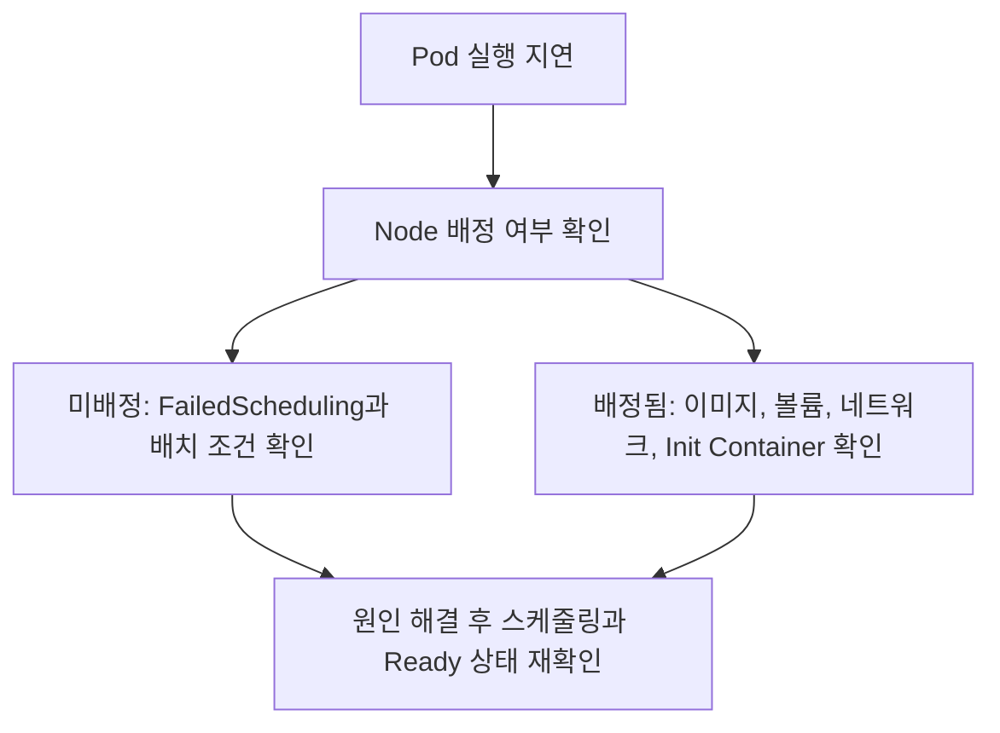

# Ch 2. 자주 발생하는 문제 해결하기

# Ch 2. 자주 발생하는 문제 해결하기
* toc
{:toc}

---

## 01. Pod가 Pending 상태에 머무는 문제

### Pod가 Pending 상태에서 실행되지 않을 때 확인할 것들

애플리케이션을 배포하거나 레플리카 수를 늘렸는데 새 Pod가 `Pending` 상태에 머무르는 경우가 있다. 기존 Pod는 정상적으로 동작하면서 새 Pod만 실행되지 않는다면, 변경한 코드뿐 아니라 **새 Pod를 배치할 수 있는 Node가 있는지**부터 확인해야 한다. 컨테이너가 시작되지 않은 단계에서는 애플리케이션 로그보다 Pod의 조건과 이벤트가 더 직접적인 단서가 된다.

#### 먼저 장애의 범위를 구분한다
클러스터 전반에서 문제가 발생했다면 현재 Context와 API Server 접근, Node 상태, 공통 네트워크·스토리지 등을 확인한다. 특정 Deployment의 새 Pod만 문제라면 이미지, 자원 요청량, 배치 조건 등 최근 변경 사항부터 살펴본다. 다만 기존 Pod가 정상이라는 이유만으로 인프라 문제를 배제할 수는 없다. 특정 Node의 장애나 클러스터의 자원 부족도 새 Pod에만 영향을 줄 수 있다.
```powershell
kubectl config current-context
kubectl get nodes
kubectl get deployments -n sns
kubectl get pods -n sns -o wide
```
Context는 의도한 클러스터에 연결했는지, Node 목록은 `Ready` 상태와 스케줄링 가능 여부를 확인하는 데 사용한다. `-o wide`로 조회한 Pod의 `NODE` 값은 실행 단계가 어디까지 진행됐는지 판단하는 출발점이다.

#### Pending은 반드시 스케줄링 실패를 뜻하지 않는다
`Pending`은 Pod가 클러스터에 등록됐지만 컨테이너 실행 준비가 끝나지 않은 단계다. Node 배정을 기다리는 시간뿐 아니라 배정 이후 이미지를 내려받는 시간도 포함한다. 따라서 **Node 미배정과 Node 배정 후 실행 준비 실패를 구분해야 한다.** 또한 `kubectl get pods`의 `STATUS` 열은 컨테이너 상태 등을 반영한 표시값이므로 Pod의 `status.phase`와 항상 같지는 않다. [Pod 생명주기](https://kubernetes.io/docs/concepts/workloads/pods/pod-lifecycle/)

잠깐의 `Pending`은 정상적인 생성 과정일 수 있다. 몇 초가 지났다는 이유만으로 장애를 단정하기보다는 이벤트가 갱신되는지, 준비 과정이 진행되는지, 평소 기동 시간과 얼마나 다른지를 함께 확인한다.

#### 레플리카를 늘린 뒤 새 Pod를 관찰한다
실습에서는 `sns` Namespace의 `feed-server` Deployment가 3개 Pod로 실행 중이라고 가정한다. 아래 증설은 배포 권한과 여유 자원을 확인한 테스트 환경에서 진행한다. HPA나 GitOps가 관리 중이라면 수동 변경이 다시 덮어써질 수 있으므로 관리 주체도 먼저 확인한다.
```powershell
kubectl scale deployment/feed-server -n sns --replicas=4
kubectl get pods -n sns -o wide
$POD = "실제로-생성된-Pending-Pod-이름"
kubectl describe pod $POD -n sns
kubectl get events -n sns --field-selector "involvedObject.kind=Pod,involvedObject.name=$POD" --sort-by=.metadata.creationTimestamp
```
`$POD`에는 실제 이름을 넣는다. `describe`에서 `Node`, `Conditions`의 `PodScheduled`, 마지막 `Events`를 확인한다. `PodScheduled=False`와 `FailedScheduling`이 함께 나타나면 스케줄러가 실행할 Node를 찾지 못한 것이다. 반대로 Node가 배정됐다면 `FailedMount`, 이미지 다운로드 실패, Pod 네트워크 생성 실패 등을 조사해야 한다. 컨테이너가 아직 시작되지 않았다면 조회할 애플리케이션 로그가 없을 수도 있다.

#### FailedScheduling 메시지에서 원인을 찾는다
예를 들어 `0/3 nodes are available: 3 Insufficient cpu`는 평가한 3개 Node 모두 새 Pod의 CPU 요청량을 수용하지 못했다는 의미다. CPU 사용률이 100%라는 뜻은 아니다. `Insufficient memory`는 메모리 요청량 부족을, `untolerated taint`는 허용하지 않은 Taint를, `didn't match Pod's node affinity/selector`는 배치 조건 불일치를 가리킨다. 한 이벤트에 여러 원인이 함께 나타날 수 있으므로 전체 메시지를 읽어야 한다.

이벤트의 `No preemption victims found for incoming pod`는 선점으로 제거할 적절한 낮은 우선순위 Pod를 찾지 못했다는 뜻이다. 선점은 Priority와 정책, 제거 후 배치 가능성 등을 고려하는 기능이지 공간이 부족할 때 임의의 Pod를 종료하는 기능이 아니다. 따라서 이 메시지만으로 “선점 설정을 하지 않아서 발생했다”고 단정하지 않는다. [Pod 우선순위와 선점](https://kubernetes.io/docs/concepts/scheduling-eviction/pod-priority-preemption/)

Pod 자체가 생성되지 않았다면 조사 경로도 달라진다. ResourceQuota 초과는 일반적으로 생성 요청을 거부하므로 Deployment와 ReplicaSet의 `FailedCreate` 이벤트를 확인해야 한다. “생성된 Pod가 배치되지 않는 문제”와 “Pod 생성 요청이 거부된 문제”는 구분한다. [ResourceQuota 동작](https://kubernetes.io/docs/concepts/policy/resource-quotas/)

#### 실제 사용량보다 requests를 먼저 확인한다
기본 스케줄러의 CPU·메모리 적합성 판단은 순간 사용량이 아니라 자원 요청량을 기준으로 한다. 일반적인 컨테이너 단위 설정에서는 **Node의 Allocatable에서 이미 배치된 Pod들의 요청량을 제외한 여유**가 새 Pod의 요청량을 수용해야 한다. `Capacity`는 전체 용량이고 `Allocatable`은 시스템 예약 등을 반영한 Pod용 용량이다. 여러 컨테이너, Init Container, Pod Overhead가 있으면 그 영향도 고려해야 한다. [컨테이너 자원 관리](https://kubernetes.io/docs/concepts/configuration/manage-resources-containers/)

예를 들어 Node의 CPU Allocatable이 `1900m`이고 기존 요청량 합계가 `1700m`이면 계산상 여유는 `200m`다. 새 Pod가 `500m`를 요청하면 실제 CPU 사용량이 낮아도 배치할 수 없다. 또한 여러 Node에 `200m`씩 남아 있더라도 이를 합쳐 하나의 `500m` Pod를 실행할 수는 없다. **Pod 하나가 들어갈 공간이 특정 Node 하나에 있어야 한다.**
```powershell
$NODE = "확인할-Node-이름"
kubectl describe node $NODE
kubectl get pods -A --field-selector "spec.nodeName=$NODE" -o wide
kubectl get pod $POD -n sns -o "custom-columns=CONTAINER:.spec.containers[*].name,CPU_REQUEST:.spec.containers[*].resources.requests.cpu,MEMORY_REQUEST:.spec.containers[*].resources.requests.memory"
kubectl top nodes
kubectl top pods -n sns --containers
```
`describe node`의 `Allocated resources`는 요청량과 제한량 집계를 확인하는 데 사용한다. 반면 `top`은 Metrics Server 등이 제공하는 실제 사용량을 보여준다. **사용률이 낮다는 사실과 새 Pod를 배치할 수 있다는 판단은 다르다.** `top`이 실패해도 곧바로 스케줄링 장애를 뜻하지는 않는다. [kubectl top](https://kubernetes.io/docs/reference/kubectl/generated/kubectl_top/)

`requests`는 실제 사용량의 하한선이 아니다. `500m`를 요청한 컨테이너도 유휴 상태에서는 그보다 적게 사용한다. CPU `limits`는 실행 중 사용 상한으로 작용하며 초과 수요에는 throttling이 발생할 수 있다. 메모리 제한을 넘으면 OOM 종료가 발생할 수 있다. 따라서 스케줄링 문제를 해결하려고 제한량만 낮추거나, 측정 없이 요청량을 줄이는 방식은 적절하지 않다. [CPU 자원 설정](https://kubernetes.io/docs/tasks/configure-pod-container/assign-cpu-resource/)

#### 자원이 남아 있다면 Taint와 배치 조건을 확인한다
Node의 `Taints`, `Conditions`, `Unschedulable`을 확인한다. 여러 Node의 Taint는 `kubectl get nodes -o 'custom-columns=NAME:.metadata.name,TAINTS:.spec.taints'`로 모아 볼 수 있다. `NoSchedule`은 허용되지 않은 새 Pod의 배치를 막고, `PreferNoSchedule`은 배치를 피하도록 유도하며, `NoExecute`는 허용되지 않은 기존 Pod의 퇴거에도 영향을 준다.

Toleration은 해당 Taint를 허용할 뿐 배치를 보장하지 않는다. `nodeSelector`, 필수 Node Affinity, Pod Anti-Affinity, 토폴로지 분산 조건도 함께 만족해야 한다. `DiskPressure` 같은 상태 때문에 생성된 Taint라면 디스크 원인을 해결해야 하며, Taint를 지우거나 광범위한 Toleration을 추가해 보호 장치를 우회하지 않는다. [Taint와 Toleration](https://kubernetes.io/docs/concepts/scheduling-eviction/taint-and-toleration/)

#### 원인에 맞게 공간을 확보한다
**Node 증설**은 기존 워크로드의 자원을 줄이지 않고 용량을 확보하는 방법이다. 단, 새 Node도 필요한 라벨·Taint·가용 영역·볼륨 조건을 만족해야 한다. Node가 준비되고 조건이 충족되면 스케줄러가 대기 중인 Pod를 다시 평가하므로, 보통 Pending Pod를 삭제할 필요는 없다. Cluster Autoscaler나 Karpenter도 최대 용량, 인스턴스 공급, 권한과 배치 조건 때문에 증설하지 못할 수 있다. [Node 자동 확장](https://kubernetes.io/docs/concepts/cluster-administration/node-autoscaling/)

**기존 레플리카 축소**도 테스트 환경에서는 사용할 수 있다. 예를 들어 사용자 서버를 3개에서 1개로 줄이는 `kubectl scale deployment/user-server -n sns --replicas=1`은 두 Pod의 종료 이후 공간을 확보할 수 있다. 다만 남은 공간이 새 Pod의 조건을 충족해야 하며, 운영에서는 처리량과 가용성이 낮아진다. Deployment의 직접적인 축소를 PDB가 자동으로 막아 준다고 가정해서도 안 된다.

**요청량 조정**은 평상시뿐 아니라 최대 부하와 기동 구간을 측정한 뒤 진행한다. Spring Boot는 기동 시 CPU 수요가 커질 수 있고, JVM Heap은 컨테이너 전체 메모리와 같지 않다. 요청량을 바꿀 때는 Deployment나 Helm values 등 관리 원본에 반영하고 새 Pod 생성과 성능을 함께 검증한다. limits를 모두 합한 용량이 항상 예약되는 것은 아니므로, 반복적인 Pending을 단순 조정으로만 넘기지 말고 피크 부하와 장애 시 여유 용량도 점검한다.

#### 해결 여부는 Ready와 실제 요청까지 확인한다
조치 후 `kubectl get pods -n sns -o wide`, `kubectl describe pod $POD -n sns`, `kubectl rollout status deployment/feed-server -n sns --timeout=180s`로 Node 배정과 가용 레플리카를 확인한다. 정상적인 기대 결과는 `PodScheduled=True`가 되고 컨테이너가 실행된 뒤 Ready 상태에 도달하는 것이다. 이후 API 요청도 확인한다. 스케줄링 성공만으로 데이터베이스 연결이나 서비스 정상 동작까지 증명되지는 않는다.

롤링 업데이트 때만 문제가 반복된다면 `maxSurge`로 일시적으로 추가되는 Pod의 공간도 계산한다. 예를 들어 레플리카 3개에 `maxSurge: 1`이라면 새 Pod를 띄울 추가 여유가 필요하다. `maxUnavailable`을 늘려 공간을 확보할 수도 있지만 그만큼 가용 용량이 줄어든다. 배포 전략은 가용성과 클러스터 여유를 함께 고려해 정한다. [Deployment 업데이트 전략](https://kubernetes.io/docs/concepts/workloads/controllers/deployment/)

### 정리
Pod가 실행되지 않을 때는 먼저 생성 여부와 Node 배정 여부를 구분한다. 미배정 상태라면 `FailedScheduling`을 근거로 requests, Allocatable, Taint와 배치 조건을 확인하고, 이미 배정됐다면 이미지·스토리지·네트워크 등 실행 준비 과정을 조사한다. 중요한 것은 Pending Pod를 반복해서 삭제하는 일이 아니라 **실행 조건을 충족하지 못한 이유를 찾아 해소하는 것**이다.
