# Ch 2. 자주 발생하는 문제 해결하기

# Ch 2. 자주 발생하는 문제 해결하기
* toc
{:toc}

---

## 01. Pod가 Pending 상태에 머무는 문제

### Pod가 Pending 상태에서 실행되지 않을 때 확인할 것들

애플리케이션을 배포하거나 레플리카 수를 늘렸는데 새 Pod가 `Pending` 상태에 머무르는 경우가 있다. 기존 Pod는 정상적으로 동작하면서 새 Pod만 실행되지 않는다면, 변경한 코드뿐 아니라 **새 Pod를 배치할 수 있는 Node가 있는지**부터 확인해야 한다. 컨테이너가 시작되지 않은 단계에서는 애플리케이션 로그보다 Pod의 조건과 이벤트가 더 직접적인 단서가 된다.

#### 먼저 장애의 범위를 구분한다
클러스터 전반에서 문제가 발생했다면 현재 Context와 API Server 접근, Node 상태, 공통 네트워크·스토리지 등을 확인한다. 특정 Deployment의 새 Pod만 문제라면 이미지, 자원 요청량, 배치 조건 등 최근 변경 사항부터 살펴본다. 다만 기존 Pod가 정상이라는 이유만으로 인프라 문제를 배제할 수는 없다. 특정 Node의 장애나 클러스터의 자원 부족도 새 Pod에만 영향을 줄 수 있다.
```powershell
kubectl config current-context
kubectl get nodes
kubectl get deployments -n sns
kubectl get pods -n sns -o wide
```
Context는 의도한 클러스터에 연결했는지, Node 목록은 `Ready` 상태와 스케줄링 가능 여부를 확인하는 데 사용한다. `-o wide`로 조회한 Pod의 `NODE` 값은 실행 단계가 어디까지 진행됐는지 판단하는 출발점이다.

#### Pending은 반드시 스케줄링 실패를 뜻하지 않는다
`Pending`은 Pod가 클러스터에 등록됐지만 컨테이너 실행 준비가 끝나지 않은 단계다. Node 배정을 기다리는 시간뿐 아니라 배정 이후 이미지를 내려받는 시간도 포함한다. 따라서 **Node 미배정과 Node 배정 후 실행 준비 실패를 구분해야 한다.** 또한 `kubectl get pods`의 `STATUS` 열은 컨테이너 상태 등을 반영한 표시값이므로 Pod의 `status.phase`와 항상 같지는 않다. [Pod 생명주기](https://kubernetes.io/docs/concepts/workloads/pods/pod-lifecycle/)
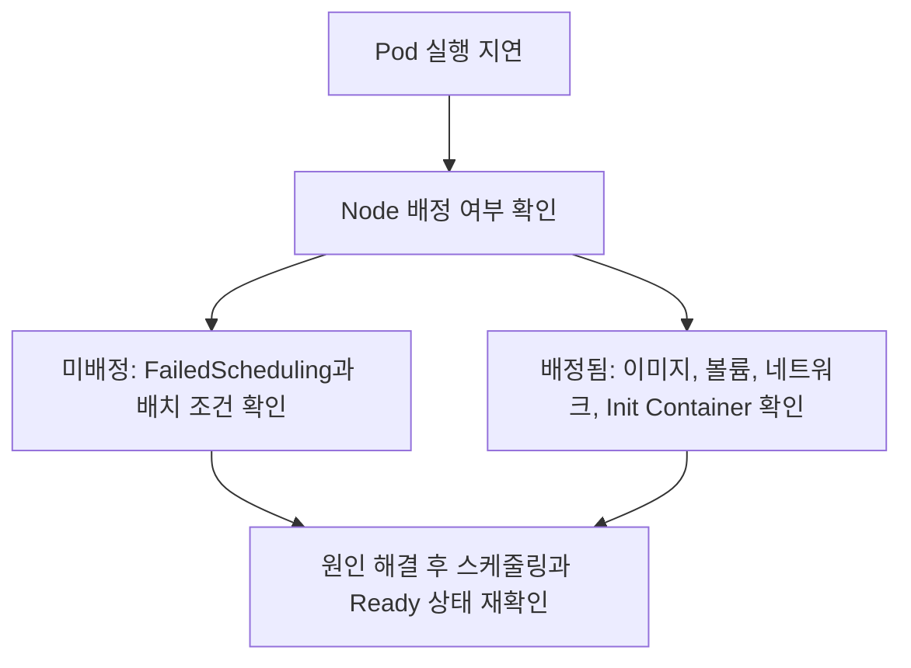
잠깐의 `Pending`은 정상적인 생성 과정일 수 있다. 몇 초가 지났다는 이유만으로 장애를 단정하기보다는 이벤트가 갱신되는지, 준비 과정이 진행되는지, 평소 기동 시간과 얼마나 다른지를 함께 확인한다.

#### 레플리카를 늘린 뒤 새 Pod를 관찰한다
실습에서는 `sns` Namespace의 `feed-server` Deployment가 3개 Pod로 실행 중이라고 가정한다. 아래 증설은 배포 권한과 여유 자원을 확인한 테스트 환경에서 진행한다. HPA나 GitOps가 관리 중이라면 수동 변경이 다시 덮어써질 수 있으므로 관리 주체도 먼저 확인한다.
```powershell
kubectl scale deployment/feed-server -n sns --replicas=4
kubectl get pods -n sns -o wide
$POD = "실제로-생성된-Pending-Pod-이름"
kubectl describe pod $POD -n sns
kubectl get events -n sns --field-selector "involvedObject.kind=Pod,involvedObject.name=$POD" --sort-by=.metadata.creationTimestamp
```
`$POD`에는 실제 이름을 넣는다. `describe`에서 `Node`, `Conditions`의 `PodScheduled`, 마지막 `Events`를 확인한다. `PodScheduled=False`와 `FailedScheduling`이 함께 나타나면 스케줄러가 실행할 Node를 찾지 못한 것이다. 반대로 Node가 배정됐다면 `FailedMount`, 이미지 다운로드 실패, Pod 네트워크 생성 실패 등을 조사해야 한다. 컨테이너가 아직 시작되지 않았다면 조회할 애플리케이션 로그가 없을 수도 있다.

#### 예시 결과를 읽으며 스케줄링 실패를 좁혀 보기

다음은 실제 클러스터 측정값이 아니라 결과 해석을 위한 예시다.

```text
NAME                    READY   STATUS    RESTARTS   NODE
feed-server-old-a        1/1     Running   0          worker-a
feed-server-old-b        1/1     Running   0          worker-b
feed-server-old-c        1/1     Running   0          worker-c
feed-server-new-d        0/1     Pending   0          <none>
```

기존 세 Pod는 실행 중이지만 새 Pod의 NODE는 비어 있다. 이때부터 애플리케이션 초기화 코드나 DB 비밀번호를 조사하면 아직 도달하지 않은 단계를 살펴보는 셈이다. 먼저 새 Pod의 `PodScheduled` 조건과 `FailedScheduling` 메시지를 읽어야 한다.

예를 들어 각 Node의 CPU Allocatable이 `1900m`이고 이미 배치된 Pod들의 요청량 합계가 다음과 같다고 가정하자.

| Node | Allocatable | 기존 CPU requests 합계 | 계산상 여유 |
|---|---|---|---|
| worker-a | 1900m | 1700m | 200m |
| worker-b | 1900m | 1600m | 300m |
| worker-c | 1900m | 1800m | 100m |

새 Pod가 `500m`를 요청하면 전체 여유의 합은 `600m`여도 어느 Node에도 들어가지 못한다. 하나의 Pod를 여러 Node의 CPU 조각에 나누어 배치할 수 없기 때문이다. 여기에 메모리와 배치 조건까지 만족해야 한다.

따라서 공간을 확보했다는 말도 “클러스터 합계가 늘었다”가 아니라 “배치 가능한 Node 하나가 해당 Pod의 모든 조건을 만족하게 됐다”는 의미여야 한다. CPU 부족 이벤트를 보고 메모리만 줄여도 문제가 해결되지 않는 이유가 여기에 있다.

#### FailedScheduling 메시지에서 원인을 찾는다
예를 들어 `0/3 nodes are available: 3 Insufficient cpu`는 평가한 3개 Node 모두 새 Pod의 CPU 요청량을 수용하지 못했다는 의미다. CPU 사용률이 100%라는 뜻은 아니다. `Insufficient memory`는 메모리 요청량 부족을, `untolerated taint`는 허용하지 않은 Taint를, `didn't match Pod's node affinity/selector`는 배치 조건 불일치를 가리킨다. 한 이벤트에 여러 원인이 함께 나타날 수 있으므로 전체 메시지를 읽어야 한다.

이벤트의 `No preemption victims found for incoming pod`는 선점으로 제거할 적절한 낮은 우선순위 Pod를 찾지 못했다는 뜻이다. 선점은 Priority와 정책, 제거 후 배치 가능성 등을 고려하는 기능이지 공간이 부족할 때 임의의 Pod를 종료하는 기능이 아니다. 따라서 이 메시지만으로 “선점 설정을 하지 않아서 발생했다”고 단정하지 않는다. [Pod 우선순위와 선점](https://kubernetes.io/docs/concepts/scheduling-eviction/pod-priority-preemption/)

Pod 자체가 생성되지 않았다면 조사 경로도 달라진다. ResourceQuota 초과는 일반적으로 생성 요청을 거부하므로 Deployment와 ReplicaSet의 `FailedCreate` 이벤트를 확인해야 한다. “생성된 Pod가 배치되지 않는 문제”와 “Pod 생성 요청이 거부된 문제”는 구분한다. [ResourceQuota 동작](https://kubernetes.io/docs/concepts/policy/resource-quotas/)

#### 실제 사용량보다 requests를 먼저 확인한다
기본 스케줄러의 CPU·메모리 적합성 판단은 순간 사용량이 아니라 자원 요청량을 기준으로 한다. 일반적인 컨테이너 단위 설정에서는 **Node의 Allocatable에서 이미 배치된 Pod들의 요청량을 제외한 여유**가 새 Pod의 요청량을 수용해야 한다. `Capacity`는 전체 용량이고 `Allocatable`은 시스템 예약 등을 반영한 Pod용 용량이다. 여러 컨테이너, Init Container, Pod Overhead가 있으면 그 영향도 고려해야 한다. [컨테이너 자원 관리](https://kubernetes.io/docs/concepts/configuration/manage-resources-containers/)

예를 들어 Node의 CPU Allocatable이 `1900m`이고 기존 요청량 합계가 `1700m`이면 계산상 여유는 `200m`다. 새 Pod가 `500m`를 요청하면 실제 CPU 사용량이 낮아도 배치할 수 없다. 또한 여러 Node에 `200m`씩 남아 있더라도 이를 합쳐 하나의 `500m` Pod를 실행할 수는 없다. **Pod 하나가 들어갈 공간이 특정 Node 하나에 있어야 한다.**
```powershell
$NODE = "확인할-Node-이름"
kubectl describe node $NODE
kubectl get pods -A --field-selector "spec.nodeName=$NODE" -o wide
kubectl get pod $POD -n sns -o "custom-columns=CONTAINER:.spec.containers[*].name,CPU_REQUEST:.spec.containers[*].resources.requests.cpu,MEMORY_REQUEST:.spec.containers[*].resources.requests.memory"
kubectl top nodes
kubectl top pods -n sns --containers
```
`describe node`의 `Allocated resources`는 요청량과 제한량 집계를 확인하는 데 사용한다. 반면 `top`은 Metrics Server 등이 제공하는 실제 사용량을 보여준다. **사용률이 낮다는 사실과 새 Pod를 배치할 수 있다는 판단은 다르다.** `top`이 실패해도 곧바로 스케줄링 장애를 뜻하지는 않는다. [kubectl top](https://kubernetes.io/docs/reference/kubectl/generated/kubectl_top/)

`requests`는 실제 사용량의 하한선이 아니다. `500m`를 요청한 컨테이너도 유휴 상태에서는 그보다 적게 사용한다. CPU `limits`는 실행 중 사용 상한으로 작용하며 초과 수요에는 throttling이 발생할 수 있다. 메모리 제한을 넘으면 OOM 종료가 발생할 수 있다. 따라서 스케줄링 문제를 해결하려고 제한량만 낮추거나, 측정 없이 요청량을 줄이는 방식은 적절하지 않다. [CPU 자원 설정](https://kubernetes.io/docs/tasks/configure-pod-container/assign-cpu-resource/)

#### 자원이 남아 있다면 Taint와 배치 조건을 확인한다
Node의 `Taints`, `Conditions`, `Unschedulable`을 확인한다. 여러 Node의 Taint는 `kubectl get nodes -o 'custom-columns=NAME:.metadata.name,TAINTS:.spec.taints'`로 모아 볼 수 있다. `NoSchedule`은 허용되지 않은 새 Pod의 배치를 막고, `PreferNoSchedule`은 배치를 피하도록 유도하며, `NoExecute`는 허용되지 않은 기존 Pod의 퇴거에도 영향을 준다.

Toleration은 해당 Taint를 허용할 뿐 배치를 보장하지 않는다. `nodeSelector`, 필수 Node Affinity, Pod Anti-Affinity, 토폴로지 분산 조건도 함께 만족해야 한다. `DiskPressure` 같은 상태 때문에 생성된 Taint라면 디스크 원인을 해결해야 하며, Taint를 지우거나 광범위한 Toleration을 추가해 보호 장치를 우회하지 않는다. [Taint와 Toleration](https://kubernetes.io/docs/concepts/scheduling-eviction/taint-and-toleration/)

#### 원인에 맞게 공간을 확보한다
**Node 증설**은 기존 워크로드의 자원을 줄이지 않고 용량을 확보하는 방법이다. 단, 새 Node도 필요한 라벨·Taint·가용 영역·볼륨 조건을 만족해야 한다. Node가 준비되고 조건이 충족되면 스케줄러가 대기 중인 Pod를 다시 평가하므로, 보통 Pending Pod를 삭제할 필요는 없다. Cluster Autoscaler나 Karpenter도 최대 용량, 인스턴스 공급, 권한과 배치 조건 때문에 증설하지 못할 수 있다. [Node 자동 확장](https://kubernetes.io/docs/concepts/cluster-administration/node-autoscaling/)

**기존 레플리카 축소**도 테스트 환경에서는 사용할 수 있다. 예를 들어 사용자 서버를 3개에서 1개로 줄이는 `kubectl scale deployment/user-server -n sns --replicas=1`은 두 Pod의 종료 이후 공간을 확보할 수 있다. 다만 남은 공간이 새 Pod의 조건을 충족해야 하며, 운영에서는 처리량과 가용성이 낮아진다. Deployment의 직접적인 축소를 PDB가 자동으로 막아 준다고 가정해서도 안 된다.

**요청량 조정**은 평상시뿐 아니라 최대 부하와 기동 구간을 측정한 뒤 진행한다. Spring Boot는 기동 시 CPU 수요가 커질 수 있고, JVM Heap은 컨테이너 전체 메모리와 같지 않다. 요청량을 바꿀 때는 Deployment나 Helm values 등 관리 원본에 반영하고 새 Pod 생성과 성능을 함께 검증한다. limits를 모두 합한 용량이 항상 예약되는 것은 아니므로, 반복적인 Pending을 단순 조정으로만 넘기지 말고 피크 부하와 장애 시 여유 용량도 점검한다.

#### 해결 여부는 Ready와 실제 요청까지 확인한다
조치 후 `kubectl get pods -n sns -o wide`, `kubectl describe pod $POD -n sns`, `kubectl rollout status deployment/feed-server -n sns --timeout=180s`로 Node 배정과 가용 레플리카를 확인한다. 정상적인 기대 결과는 `PodScheduled=True`가 되고 컨테이너가 실행된 뒤 Ready 상태에 도달하는 것이다. 이후 API 요청도 확인한다. 스케줄링 성공만으로 데이터베이스 연결이나 서비스 정상 동작까지 증명되지는 않는다.

롤링 업데이트 때만 문제가 반복된다면 `maxSurge`로 일시적으로 추가되는 Pod의 공간도 계산한다. 예를 들어 레플리카 3개에 `maxSurge: 1`이라면 새 Pod를 띄울 추가 여유가 필요하다. `maxUnavailable`을 늘려 공간을 확보할 수도 있지만 그만큼 가용 용량이 줄어든다. 배포 전략은 가용성과 클러스터 여유를 함께 고려해 정한다. [Deployment 업데이트 전략](https://kubernetes.io/docs/concepts/workloads/controllers/deployment/)

### 정리
Pod가 실행되지 않을 때는 먼저 생성 여부와 Node 배정 여부를 구분한다. 미배정 상태라면 `FailedScheduling`을 근거로 requests, Allocatable, Taint와 배치 조건을 확인하고, 이미 배정됐다면 이미지·스토리지·네트워크 등 실행 준비 과정을 조사한다. 중요한 것은 Pending Pod를 반복해서 삭제하는 일이 아니라 **실행 조건을 충족하지 못한 이유를 찾아 해소하는 것**이다.

## 02. Container Image를 가져오지 못하는 문제 

### ErrImagePull과 ImagePullBackOff가 발생했을 때 확인할 것들

Pod가 Node에 배정됐더라도 컨테이너가 바로 실행되는 것은 아니다. Node의 컨테이너 런타임이 실행할 이미지를 준비해야 하며, 필요한 이미지를 가져오지 못하면 애플리케이션은 시작되지 않는다. 이때 자주 보이는 상태가 `ErrImagePull`과 `ImagePullBackOff`다. 이전에 살펴본 자원 부족에 따른 스케줄링 실패와 달리, 이번에는 **이미지 주소, 레지스트리 접근, 인증 정보를 중심으로 원인을 찾아야 한다.**

#### ErrImagePull과 ImagePullBackOff의 차이
`ErrImagePull`은 이미지를 가져오려는 시도가 실패했음을 나타낸다. `ImagePullBackOff`는 실패 이후 다음 시도까지 대기하는 상태다. kubelet은 계속 실패할 때 재시도 간격을 늘리며, 이미지 다운로드의 최대 backoff 간격은 5분이다. 두 값은 별개의 장애 원인이라기보다 이미지 다운로드 실패와 재시도 대기라는 관계로 이해하면 된다. [이미지 다운로드와 BackOff](https://kubernetes.io/docs/concepts/containers/images/)

`CrashLoopBackOff`와는 실패 단계가 다르다. `ImagePullBackOff`는 이미지를 준비하지 못한 상태이고, `CrashLoopBackOff`는 컨테이너가 실행된 뒤 반복적으로 종료되는 상황에서 나타난다. 또한 이 값들은 컨테이너의 대기 사유를 반영한 `kubectl` 표시값이지 Pod의 `phase` 이름이 아니다. 이미지를 가져오기 전에 실패했다면 애플리케이션 로그가 없는 것도 자연스럽다.

#### 상태 이름보다 이벤트 메시지를 확인한다
먼저 문제가 발생한 Pod와 실제 이미지 주소를 확인한다. 아래 명령은 PowerShell 기준이며, `$POD`에는 조회한 Pod 이름을 넣는다.
```powershell
kubectl get pods -n sns -o wide
$POD = "확인할-Pod-이름"
kubectl describe pod $POD -n sns
kubectl get pod $POD -n sns -o 'custom-columns=CONTAINER:.spec.containers[*].name,IMAGE:.spec.containers[*].image,REASON:.status.containerStatuses[*].state.waiting.reason'
```
여러 컨테이너 중 하나만 실패할 수도 있으므로 컨테이너별 상태를 확인한다. Init Container가 있다면 `describe`의 해당 항목도 살펴본다. `Events`에서는 `Pulling`, `Failed`, `BackOff` 흐름과 함께 출력되는 **레지스트리의 상세 오류 문구**가 핵심이다.
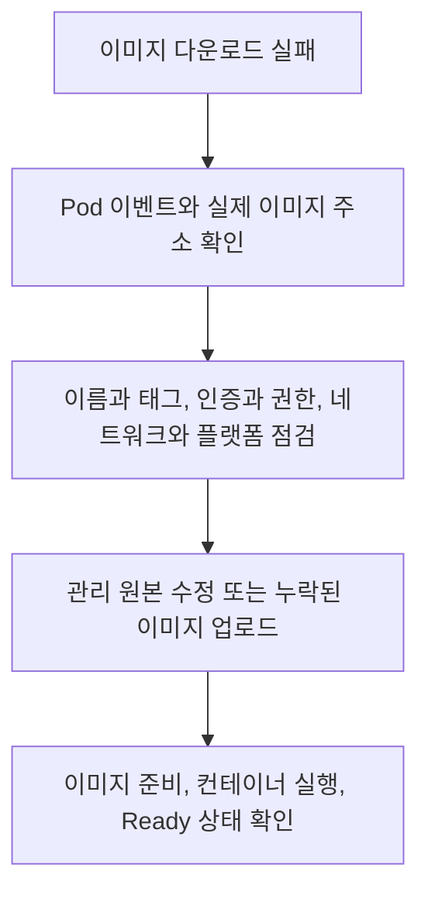

#### 이미지 주소와 태그가 실제로 존재하는지 확인한다
이미지 주소는 일반적으로 `레지스트리/저장소:태그` 형태다. ECR이라면 AWS 계정 ID와 리전까지 주소에 포함되므로, 저장소 이름만 맞아도 다른 계정이나 리전을 가리키면 원하는 이미지를 찾을 수 없다. `feed-server`를 `feed-servers`로 적은 경우처럼 작은 오타도 확인해야 한다.

예를 들어 저장소에 `0.0.1`부터 `0.1.4`까지 올라와 있는데 Deployment가 `0.5`를 참조한다면 다운로드에 실패할 수 있다. 태그는 문자열이므로 `0.5`, `0.0.5`, `v0.5`도 서로 다른 값이다. ECR에서는 실제 계정과 리전을 지정한 `aws ecr describe-images --registry-id 123456789012 --region ap-northeast-2 --repository-name sns/feed-server --image-ids imageTag=0.5`와 같은 조회로 확인할 수 있다. 예시 계정·리전·저장소는 자신의 값으로 바꿔야 하며, 이 명령의 성공은 **현재 CLI 사용자의 조회 권한**을 확인한 것이지 Node의 다운로드 권한까지 증명하지는 않는다. [ECR 이미지 조회](https://docs.aws.amazon.com/cli/latest/reference/ecr/describe-images.html)

이때 `not found`를 “인증에는 성공했고 태그만 없다”로 단정해서는 안 된다. 레지스트리에 따라 존재하지 않는 저장소와 접근 권한이 없는 저장소를 비슷하게 응답할 수 있다. 반대로 `pull access denied`가 나와도 실제 원인은 저장소 이름의 오타일 수 있다. 오류 문구와 이미지 주소, 저장소의 실제 상태를 함께 대조해야 한다.

#### 태그를 잘못 적었는지, 이미지를 올리지 않았는지 구분한다
**배포 설정의 태그가 잘못됐다면** Deployment YAML이나 Helm values를 실제 배포하려던 이미지로 수정한다. 단순히 실행 가능한 과거 태그로 바꾸면 의도한 기능이 누락될 수 있으므로, 정상 기동뿐 아니라 배포 대상 버전도 확인해야 한다. 관리 원본을 고치지 않고 실행 중인 객체만 수정하면 다음 배포에서 같은 문제가 반복된다.

**태그는 맞지만 이미지 업로드가 빠졌다면** 해당 버전을 빌드하고 레지스트리에 push해야 한다. Gradle Jib를 사용한다면 프로젝트에 설정된 대상 저장소와 태그, 인증을 확인한 뒤 `.\gradlew.bat jib` 같은 배포용 작업을 수행한다. 로컬 JAR 빌드나 로컬 이미지 생성만으로 레지스트리에 이미지가 등록되지는 않는다. 이미지가 준비되면 kubelet의 다음 재시도에서 다운로드가 진행될 수 있으므로, 원인 해결 없이 Pod를 반복해서 삭제할 필요는 없다.

자동화된 환경에서도 빌드와 배포 파이프라인이 분리되어 있으면 같은 문제가 발생한다. 배포 단계가 이미지 업로드 완료를 확인하지 않고 먼저 실행되거나 서로 다른 태그 변수를 사용하기 때문이다. **빌드 → push 완료 확인 → 배포 이미지 참조 갱신 → 롤아웃 확인** 순서를 연결하고, 가능하면 빌드 결과의 digest까지 배포 정보로 전달해 어떤 이미지를 배포했는지 추적할 수 있게 한다.

#### 이미지 오류 메시지와 수정 결과를 연결하기

이미지 주소가 `registry.example.com/sns/feed-server:0.5`인데 저장소에는 `0.1.4`만 존재한다고 가정하자. 이벤트에서 다음과 같은 순서를 볼 수 있다. 상세 문구는 런타임과 레지스트리에 따라 달라진다.

```text
Pulling  Pulling image "registry.example.com/sns/feed-server:0.5"
Failed   Failed to pull image: manifest unknown
Failed   Error: ErrImagePull
BackOff  Back-off pulling image
Failed   Error: ImagePullBackOff
```

여기서 `BackOff`는 재시도 정책의 결과이고, 먼저 조사할 단서는 `manifest unknown`과 실제 이미지 참조다. 배포 대상이 원래 `0.1.4`였다면 원본 설정을 바로잡고, `0.5`를 배포하려던 것이 맞다면 그 빌드가 push까지 완료됐는지 확인한다. 두 상황은 서로 다른 수정이 필요하다.

반대로 `unauthorized`가 보이면 태그를 임의로 바꾸기보다 인증 주체와 저장소 주소를 먼저 확인한다. 올바른 주소에 로그인했더라도 다른 계정이나 다른 리전의 저장소를 참조하면 같은 자격 증명으로 접근하지 못할 수 있다.

수정 후 `Pulled`, `Created`, `Started`가 나타나면 이미지 준비와 프로세스 시작까지 진행된 것이다. 이 시점부터 DB 연결이나 Probe 실패가 드러날 수도 있다. 첫 오류가 사라졌다고 이후 단계까지 모두 정상이라고 판단하지 않고 실패 단계가 어디로 이동했는지를 확인한다.

#### Private Registry라면 인증 정보도 확인한다
`unauthorized`, `authentication required`, `denied`, `no basic auth credentials` 등이 보이면 인증과 권한을 조사한다. 자격 증명이 틀렸거나 만료됐을 수도 있고, 로그인은 가능하지만 해당 저장소의 pull 권한이 없을 수도 있다. 로컬 PC의 `docker login` 성공은 Node가 같은 자격 증명을 사용한다는 뜻이 아니다.

일반적인 Private Registry에서는 `kubernetes.io/dockerconfigjson` 타입 Secret을 만들고 Pod의 `imagePullSecrets`에서 참조한다. 아래 명령은 실제 인증 정보가 들어 있는 `registry-auth.json`을 안전하게 준비한 경우의 예다. 비밀번호를 명령행 인자로 직접 전달하면 Shell 기록이나 프로세스 정보에 노출될 수 있다.
```powershell
kubectl create secret generic registry-credentials -n sns --from-file=.dockerconfigjson=./registry-auth.json --type=kubernetes.io/dockerconfigjson
kubectl get secret registry-credentials -n sns
```
입력 파일에 로컬 전용 `credsStore`나 `credHelpers` 설정만 있다면 Kubernetes가 사용할 인증 값이 없는 상태일 수 있다. 파일은 Git에 커밋하거나 로그에 출력하지 않는다. Secret의 base64 인코딩도 암호화가 아니므로 접근 권한과 저장 시 암호화 정책은 별도로 관리해야 한다. [Private Registry 인증 설정](https://kubernetes.io/docs/tasks/configure-pod-container/pull-image-private-registry/)

다음은 Secret 참조 위치를 보여주는 독립 Pod 예시다. `registry.example.com`은 설명용 주소이므로 실제 이미지로 교체해야 한다. 기존 Deployment를 수정한다면 이 Pod를 추가하는 대신 동일한 설정을 **`spec.template.spec.imagePullSecrets`**에 반영한다.
```yaml
apiVersion: v1
kind: Pod
metadata:
  name: private-image-check
  namespace: sns
spec:
  imagePullSecrets:
    - name: registry-credentials
  containers:
    - name: feed-server
      image: registry.example.com/sns/feed-server:0.1.4
      imagePullPolicy: Always
```
`apiVersion`과 `kind`는 Pod 객체를 지정하고, `metadata`는 이름과 Namespace를 정한다. `spec.imagePullSecrets`는 인증용 Secret을 참조하며, `containers`는 실행할 이미지와 컨테이너 이름을 정의한다. **Secret은 Pod와 같은 Namespace에 있어야 한다.** `FailedToRetrieveImagePullSecret` 이벤트가 있다면 Secret의 존재 여부와 이름부터 확인한다.

`Always`는 시작 시 레지스트리를 통해 이미지 참조를 확인하도록 하지만, 이미 로컬에 있는 동일한 이미지 레이어까지 매번 다시 내려받는다는 뜻은 아니다. 이 예시는 이미지 준비 설정에 초점을 맞췄으므로 실제 서버에 필요한 환경 변수·볼륨·자원 설정은 별도로 필요하다. 애플리케이션이 DB 변경이나 메시지 소비를 수행한다면 단순 확인 목적으로 추가 실행하기 전에도 부작용을 검토해야 한다.

#### EKS에서는 이미지 다운로드에 사용하는 IAM 역할을 구분한다
EKS의 EC2 기반 Node에서는 일반적으로 **Node IAM Role**의 ECR 권한을 사용한다. Fargate에서는 **Fargate Pod execution role**을 확인한다. 따라서 EKS에서 별도 `imagePullSecrets` 없이 ECR 이미지를 가져왔다면 인증이 생략된 것이 아니라 해당 실행 환경의 IAM 구성을 통해 처리된 것이다. 다른 계정의 ECR을 사용한다면 저장소 정책 등 교차 계정 접근 조건도 확인한다. [EKS의 ECR 이미지 사용 권한](https://docs.aws.amazon.com/AmazonECR/latest/userguide/ECR_on_EKS.html)

애플리케이션이 실행된 뒤 AWS API를 호출하는 권한과, 실행 전에 이미지를 다운로드하는 권한은 구분해야 한다. 애플리케이션용 IRSA나 EKS Pod Identity 설정을 변경했다고 이미지 다운로드 문제가 자동으로 해결되는 것은 아니다. 또한 ECR 로그인 토큰을 직접 Secret에 저장하는 방식이라면 토큰 유효 기간이 12시간이므로 갱신 체계가 필요하다. 이를 장기 비밀번호처럼 고정해 두지 않는다. [ECR 인증 토큰](https://docs.aws.amazon.com/AmazonECR/latest/userguide/registry_auth.html)

#### 어제까지 정상이었어도 새 Pod는 실패할 수 있다
기존 컨테이너는 이미 이미지를 준비한 상태라 계속 동작하지만, 증설이나 재배포로 생성된 Pod는 이미지를 새로 확인하다 실패할 수 있다. 비밀번호 변경, 토큰 만료, pull 권한 회수, 이미지 삭제, Node 교체와 로컬 캐시 차이가 조사 대상이다. “기존 Pod가 정상이다”라는 사실만으로 현재 레지스트리 접근이 정상이라고 판단하지 않는다.

이미지와 인증에 문제가 없다면 오류에 맞춰 범위를 넓힌다. `timeout`은 Node의 네트워크 경로와 방화벽, `no such host`는 DNS, `x509`는 인증서 신뢰, `429`는 요청 제한을 확인한다. `no matching manifest`는 Node의 CPU 아키텍처·운영체제에 맞는 이미지가 있는지 점검한다. 이미 실행된 컨테이너의 `exec format error`와는 실패 단계가 다를 수 있다. 인증서 오류를 해결하려고 TLS 검증부터 끄는 방식은 피한다. [이미지 다운로드 오류별 진단](https://docs.cloud.google.com/kubernetes-engine/docs/troubleshooting/image-pulls)

#### 수정 후에는 이미지 준비와 애플리케이션 기동을 나눠 검증한다
관리 원본 수정이나 누락된 이미지 업로드 이후 다음과 같이 상태를 확인한다. Helm이나 GitOps가 관리한다면 해당 배포 경로로 먼저 변경을 반영한다.
```powershell
kubectl rollout status deployment/feed-server -n sns --timeout=300s
kubectl get pods -n sns -o wide
```
새 Pod의 이벤트에서 이미지 준비가 성공했는지, 컨테이너가 시작됐는지, Ready 상태에 도달했는지 순서대로 확인한다. 이후 API도 호출해 정상 응답을 검증한다. 이미지 문제를 해결한 뒤 `CrashLoopBackOff`가 나타난다면 이미지 다운로드는 통과했지만 애플리케이션 실행 단계에 다른 문제가 남은 것이므로, 그때 컨테이너 로그와 종료 원인을 조사한다.

### 정리
`ImagePullBackOff`는 원인 자체가 아니라 이미지 다운로드 실패 후 재시도를 기다리는 상태다. Pod 이벤트와 실제 이미지 주소를 확인하고, **이름·태그 오류인지, 업로드 누락인지, 인증·권한 문제인지**부터 구분한다. 원인을 바로잡은 뒤에는 이미지 다운로드 성공에서 멈추지 않고 컨테이너 실행, Ready 상태, 실제 요청 처리까지 확인해야 한다.

## 03. 컨테이너 재시작과 Ready 상태 문제

### 컨테이너가 반복해서 재시작하거나 Ready 상태가 되지 않을 때

이미지를 정상적으로 가져왔고 Pod도 Node에 배정됐는데 애플리케이션이 서비스하지 못하는 경우가 있다. 컨테이너가 실행 직후 종료되기도 하고, 프로세스는 살아 있지만 Ready 상태에 도달하지 못하기도 한다. 이때는 **프로세스가 종료되는 문제와 트래픽을 받을 준비가 되지 않은 문제를 먼저 구분해야 한다.** 두 현상은 비슷해 보여도 원인과 해결 방법이 다르다.

#### 컨테이너 재시작과 Pod 교체는 다르다
Deployment의 일반적인 컨테이너는 `restartPolicy: Always`에 따라 프로세스가 종료되면 다시 시작된다. 같은 Pod 안에서 컨테이너가 재시작하는 것이므로 Pod 이름과 UID는 유지된다. 반면 롤링 업데이트나 Pod 삭제로 새 Pod가 생성되면 이름과 UID가 달라진다. `Always`에서는 종료 코드가 `0`인 정상 종료도 재시작 대상이다. 따라서 서버 이미지의 실행 명령이 작업만 마치고 종료되는 경우에도 반복 재시작이 발생할 수 있다. [Pod의 재시작 정책](https://kubernetes.io/docs/concepts/workloads/pods/pod-lifecycle/)
반복 종료 후 나타나는 `CrashLoopBackOff`는 원인 자체가 아니라 다음 재시작까지 기다리는 상태다. 애플리케이션 초기화 실패, 잘못된 실행 명령, Probe 실패, 메모리 부족 등 여러 원인이 같은 표시로 나타날 수 있다.
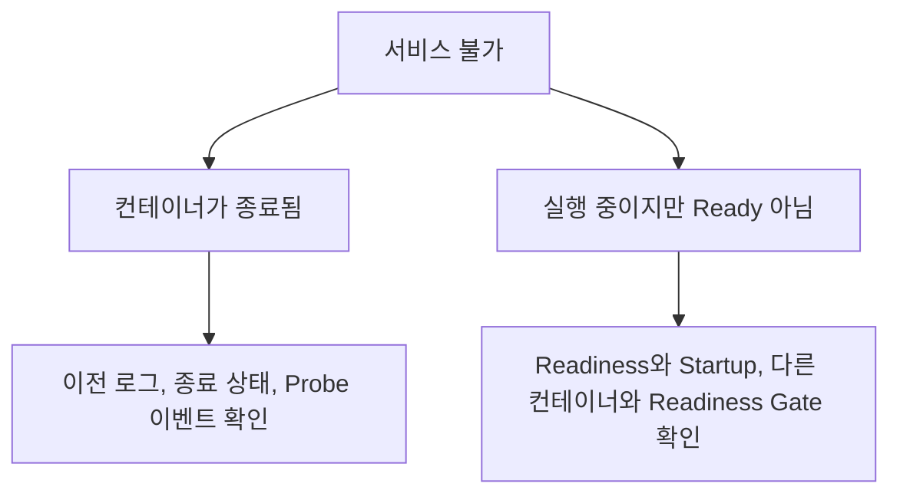

#### describe와 이전 컨테이너 로그를 함께 확인한다
다음은 PowerShell 기준이다. Pod와 컨테이너 이름은 실제 조회 결과에 맞춘다.
```powershell
kubectl get pods -n sns -o wide
$POD = "확인할-Pod-이름"
$CONTAINER = "feed-server"
kubectl describe pod $POD -n sns
kubectl logs $POD -n sns -c $CONTAINER --tail=200 --timestamps
kubectl logs $POD -n sns -c $CONTAINER --previous --tail=200 --timestamps
```
`describe`에서는 컨테이너별 `State`, `Last State`, `Reason`, `Exit Code`, 종료 시각, 재시작 횟수와 이벤트를 확인한다. `--previous`는 같은 Pod에서 직전에 종료된 해당 컨테이너 인스턴스의 로그를 조회한다. 현재 인스턴스가 막 시작해 로그가 적더라도 이전 로그에는 종료 직전 오류가 남아 있을 수 있다. 삭제된 Pod 전체의 과거 이력을 조회하는 옵션은 아니다. [kubectl logs](https://kubernetes.io/docs/reference/kubectl/generated/kubectl_logs/)
`OOMKilled`라면 컨테이너 메모리 제한과 Node 메모리 상황을 조사한다. 종료 코드 `137`만으로 OOM을 확정하거나 `143`만으로 Liveness 실패를 확정해서는 안 된다. 종료 코드와 이벤트, 로그의 시각을 맞춰 원인을 판단한다. 재시작 횟수가 한두 번이라고 해서 기동 시간 문제라고 단정할 수도 없다. [컨테이너 재시작 진단](https://learn.microsoft.com/en-us/troubleshoot/azure/azure-kubernetes/availability-performance/troubleshoot-pod-workload-restart)

#### 애플리케이션이 스스로 종료됐다면 초기화 오류를 추적한다
Spring Boot에서는 Bean 생성, 설정 바인딩, 데이터베이스 연결, 마이그레이션 등 필수 초기화 과정이 실패하면 애플리케이션 컨텍스트가 닫히고 프로세스가 종료될 수 있다. `APPLICATION FAILED TO START`, `BeanCreationException`, JDBC 연결 오류 등이 단서다. 다만 모든 데이터베이스 접속 실패가 반드시 프로세스 종료로 이어지는 것은 아니며, 실제 동작은 사용 라이브러리와 초기화 설정에 따라 달라진다.
로그에 JDBC 연결 실패가 있다면 하위 원인까지 읽는다. 호스트를 찾지 못했다면 DNS와 주소를, 연결 거부나 시간 초과라면 포트·DB 상태·네트워크 경로를, 접근 거부라면 사용자·비밀번호·접속 허용 조건을 확인한다. “DB 연결 실패”라는 상위 메시지만으로 비밀번호부터 바꾸는 방식은 피한다.
최근 ConfigMap이나 Secret을 변경했다면 Namespace, 키 이름, `env`·`envFrom` 참조를 먼저 대조한다. 애플리케이션 코드나 배포 설정을 변경했다면 활성 Profile, 환경 변수 이름, 명령행 인자 등 최종 설정에 영향을 주는 경로도 살펴본다. 설정을 바꾸지 않았더라도 DB 장애나 자격 증명 만료는 발생할 수 있다. 진단을 위해 환경 변수 전체나 Secret 값을 로그로 출력하지 말고, 호스트·포트·Profile 등 필요한 비민감 항목만 확인한다.

#### Readiness와 Liveness는 실패했을 때의 동작이 다르다
**Readiness Probe 실패는 컨테이너를 재시작하지 않는다.** 준비되지 않은 Pod를 일반적인 Service 트래픽 대상에서 제외하기 위한 신호다. 반면 **Liveness Probe와 Startup Probe는 연속 실패가 설정한 임계값에 도달하면 해당 컨테이너의 종료와 재시작을 유발할 수 있다.** Startup Probe가 설정돼 있다면 성공하기 전까지 Liveness와 Readiness 검사는 시작되지 않는다. [Probe의 역할](https://kubernetes.io/docs/concepts/workloads/pods/probes/)
따라서 `Running`인데 `READY`가 `0/1`이고 재시작 횟수가 늘지 않는다면 Readiness 실패를 먼저 확인한다. 재시작 횟수가 계속 증가한다면 프로세스 종료 원인과 함께 `Liveness probe failed`, `Startup probe failed`, `Killing` 이벤트가 있는지 본다. 단, Ready 여부에는 다른 컨테이너나 Readiness Gate도 관여하므로 Probe 하나만으로 모든 상황을 설명할 수는 없다.

#### Probe 응답 코드와 실제 접근 경로를 확인한다
HTTP Probe의 `404`는 경로 오타, 엔드포인트 미등록, Actuator 노출 설정, 컨텍스트 경로나 관리 포트 차이를 조사할 단서다. `401`·`403`이면 보안 설정을, `503`이면 실제 준비·건강 상태를 확인한다. 연결 거부는 서버 미기동·포트 오류·바인딩 주소를, 시간 초과는 처리 지연·자원 경합·네트워크 경로 등을 점검한다.
실행 중인 컨테이너에 `curl`이 있다면 다음과 같이 응답을 직접 확인할 수 있다. 도구가 없다면 검토된 디버깅 컨테이너를 사용하며, 빠르게 종료되는 컨테이너에는 `exec` 자체가 실패할 수 있다.
```powershell
kubectl exec $POD -n sns -c $CONTAINER -- curl -i --connect-timeout 2 --max-time 5 http://127.0.0.1:8080/actuator/health/liveness
kubectl exec $POD -n sns -c $CONTAINER -- curl -i --connect-timeout 2 --max-time 5 http://127.0.0.1:8080/actuator/health/readiness
```
여기서 중요한 점은 **컨테이너 내부의 localhost 호출이 kubelet의 HTTP Probe와 같은 경로는 아니라는 것**이다. kubelet은 기본적으로 Node에서 Pod IP의 지정 포트로 접근하며 Service나 Ingress를 거치지 않는다. localhost 호출이 성공해도 애플리케이션이 루프백 주소에만 바인딩돼 있거나 Node에서 Pod로 가는 경로에 문제가 있으면 Probe는 실패할 수 있다. 따라서 네트워크 문제를 처음부터 배제하지 않는다. [HTTP Probe의 동작](https://kubernetes.io/docs/tasks/configure-pod-container/configure-liveness-readiness-startup-probes/)

#### 실행 중인 프로세스와 준비된 서비스를 구분하는 예시

다음은 두 상황을 비교하기 위한 예시다.

```text
상황 A: READY 0/1, STATUS Running, RESTARTS 0
상황 B: READY 0/1, STATUS CrashLoopBackOff, RESTARTS 5
```

상황 A에서 이벤트가 `Readiness probe failed: HTTP probe failed with statuscode: 404`라면 프로세스는 유지되지만 검사 경로가 잘못됐을 가능성이 있다. 실제 등록된 경로가 `/actuator/health/readiness`인데 YAML에 `/actuator/health/ready`를 적었다면 기다리는 시간을 늘려도 해결되지 않는다.

상황 B에서는 직전 컨테이너의 종료 원인을 확인해야 한다. 같은 404가 Liveness에서 발생하고 `Killing` 이벤트로 이어졌다면, 정상 서버를 잘못된 검사 경로 때문에 종료하고 있을 수 있다. 이 경우 애플리케이션의 일반 요청 로그에는 특별한 예외가 없어도 설명이 된다.

검사는 다음 순서로 좁힌다.

1. 실행 중인 이미지 버전과 실제 Probe의 경로·포트를 대조한다.
2. localhost 요청으로 애플리케이션의 해당 경로가 제공되는지 확인한다.
3. localhost는 성공하지만 Probe가 실패하면 Pod IP 접근과 바인딩·네트워크 조건을 확인한다.
4. `401`이면 보안 설정을, `503`이면 상태 판정과 의존성을, timeout이면 처리 지연과 자원 상황을 조사한다.
5. 수정한 이미지나 설정을 배포하고 재시작 횟수 증가가 멈추는지 관찰한다.

이렇게 관찰 결과를 나누면 “재시작하니까 일단 Probe 시간을 늘린다”는 식의 임시 대응을 줄일 수 있다.

#### Spring Boot의 상태 확인 엔드포인트를 맞춘다
Actuator를 사용한다면 `spring-boot-starter-actuator` 의존성과 Health Probe 그룹 활성화 여부를 확인한다. 기본 경로는 `/actuator/health/liveness`와 `/actuator/health/readiness`이며, 필요하면 `management.endpoint.health.probes.enabled=true`로 명시적으로 활성화할 수 있다. 경로나 관리 포트를 변경했다면 Probe도 이에 맞춰야 한다.
Spring Security를 적용한 뒤 `401`이 발생한다면 해당 상태 확인 경로만 필요한 범위에서 인증 예외로 처리하는 방식을 검토한다. 전체 Actuator나 업무 API를 일괄 공개해서는 안 된다. 고정 HTTP 헤더도 Probe에 설정할 수 있지만 토큰을 YAML에 직접 넣으면 노출·교체 문제가 생기므로 신중해야 한다. 관리 서버가 별도 포트라면 그 포트의 성공만으로 실제 업무 포트도 정상이라고 보장할 수 없다.
또한 Liveness에 공통 DB나 외부 API의 정상 여부를 그대로 연결하면 외부 장애가 모든 인스턴스의 재시작으로 번질 수 있다. Liveness는 재시작으로 회복 가능한 내부 상태를 중심으로 설계하고, 외부 의존성을 Readiness에 포함할지도 서비스의 대체 처리 가능성과 전체 인스턴스 제외 위험을 고려해 결정한다. [Spring Boot의 Kubernetes Probe](https://docs.spring.io/spring-boot/reference/actuator/endpoints.html)

#### 느린 기동은 Startup Probe로 보호한다
`initialDelaySeconds: 5`, `periodSeconds: 1`, `timeoutSeconds: 1`, `failureThreshold: 3`인 Liveness 설정은 기동이 느린 Spring 애플리케이션에 지나치게 짧을 수 있다. 정확한 종료 시점을 단순히 몇 초라고 확정할 수는 없지만, 정상 기동 전에 연속 실패 임계값에 도달할 위험이 크다. 로컬에서는 빨라도 컨테이너의 CPU 제한, 클래스 로딩, 초기화 작업, 외부 의존성 때문에 배포 환경의 기동 시간은 달라진다.
다음은 기존 Deployment의 **`spec.template.spec.containers` 아래 해당 컨테이너에 병합하는 설정**이다. 독립적으로 적용하는 Kubernetes 리소스 파일은 아니며, 엔드포인트가 업무 포트 `8080`에 제공된다고 가정한다.
```yaml
startupProbe:
  httpGet:
    path: /actuator/health/liveness
    port: 8080
  periodSeconds: 5
  timeoutSeconds: 2
  failureThreshold: 30
livenessProbe:
  httpGet:
    path: /actuator/health/liveness
    port: 8080
  periodSeconds: 10
  timeoutSeconds: 2
  failureThreshold: 3
readinessProbe:
  httpGet:
    path: /actuator/health/readiness
    port: 8080
  periodSeconds: 5
  timeoutSeconds: 2
  failureThreshold: 3
```
`httpGet`은 검사 경로와 포트, `periodSeconds`는 검사 주기, `timeoutSeconds`는 개별 검사 제한 시간, `failureThreshold`는 연속 실패 임계값이다. Startup에는 약 150초 규모의 기동 여유를 두고, 성공 이후에는 Liveness와 Readiness가 각 목적에 따라 검사한다. 이는 초기 판단용 예시이지 모든 서비스에 맞는 정답은 아니다. 실제 기동 시간 분포와 장애 감지 목표를 측정해 조정하며, `initialDelaySeconds`와 임계값을 무작정 늘려 실제 장애를 감추지 않는다.

#### 롤링 업데이트 중의 불안정성까지 확인한다
Readiness가 잠깐 성공한 뒤 잘못된 Liveness 때문에 종료되는 Pod는 트래픽을 받았다가 중단되는 일을 반복할 수 있다. Deployment도 새 Pod를 가용하다고 판단한 뒤 기존 Pod를 줄일 수 있으므로 배포 전체가 불안정해질 수 있다. 반대로 새 Pod의 Readiness가 실패한다고 기존 서비스가 항상 안전한 것도 아니다. 기존 Pod 유지 범위는 `maxUnavailable`, 레플리카 수, 기존 Pod 상태 등에 따라 달라진다. `minReadySeconds`로 일정 시간 안정적인 Ready 상태를 확인하는 것도 도움이 되지만 잘못된 Probe 자체를 고쳐 주지는 않는다. [Deployment의 가용성 판단](https://kubernetes.io/docs/concepts/workloads/controllers/deployment/)
조사 전에 Pod 삭제나 전체 재시작부터 수행하면 로그와 종료 상태를 잃거나 정상 인스턴스까지 줄일 수 있다. 먼저 증거를 확보하고 Deployment YAML·Helm values 등 관리 원본을 수정한다. 배포 후에는 `kubectl rollout status deployment/feed-server -n sns --timeout=300s`와 Pod 상태를 확인하고, Ready 안정성·재시작 횟수·실제 API 응답을 충분한 시간 동안 함께 관찰한다.

### 정리
반복 재시작은 종료 원인을, Ready 미도달은 준비 상태를 중심으로 조사한다. 이전 컨테이너 로그와 종료 상태, Probe 이벤트를 함께 읽고 **Readiness는 트래픽 제어, Liveness는 내부 장애 감지, Startup은 기동 보호**라는 역할을 구분해야 한다. 재시작을 반복하는 대신 애플리케이션 설정과 검사 경로, 기동 시간에 맞는 조건을 바로잡는 것이 해결의 핵심이다.


## 04. Container Resource가 부족할 경우 생기는 문제 

### CPU와 메모리 부족으로 발생하는 컨테이너 장애 진단하기

애플리케이션의 자원이 부족하다고 해서 항상 명확한 오류가 남는 것은 아니다. 메모리 부족으로 컨테이너가 종료되기도 하지만, 실행은 유지한 채 응답만 느려지거나 Probe 실패가 반복되기도 한다. 특히 자원 부족이 Probe 실패로 이어지면 이벤트에는 종료의 직접적인 계기만 기록되므로, **종료 상태와 로그, 장애 직전의 자원 지표를 함께 확인해야 한다.**

#### requests와 limits는 최소·최대 사용량이 아니다
`requests`는 스케줄링과 자원 경합 시의 배분 등에 사용하는 요청량이지, 애플리케이션이 항상 그만큼 사용한다는 의미가 아니다. `limits`는 실행 중 사용을 제한하는 기준이다. Linux 환경에서는 CPU 제한이 주로 throttling으로 적용되고, 메모리 제한은 메모리 회수가 불가능한 상황에서 OOM 종료로 이어질 수 있다. CPU와 메모리는 제한에 도달했을 때의 동작이 다르다. [컨테이너 자원 관리](https://kubernetes.io/docs/concepts/configuration/manage-resources-containers/)
다음은 기존 Deployment의 `spec.template.spec.containers` 아래 해당 컨테이너에 넣는 설정 예시다. 독립적으로 적용하는 리소스 파일은 아니며, 실제 수치는 부하 측정에 따라 결정해야 한다.
```yaml
resources:
  requests:
    cpu: "250m"
    memory: "512Mi"
  limits:
    cpu: "1"
    memory: "1Gi"
```
`requests.cpu`와 `requests.memory`는 배치 시 고려할 요청량이며, `limits.cpu`와 `limits.memory`는 실행 중 제한 기준이다. 위 설정에서 CPU 요청량은 `0.25` CPU이고 제한은 `1` CPU다. 여유가 있다면 요청량을 넘어 사용할 수 있지만, 제한량까지의 물리 자원이 항상 별도로 예약되는 것은 아니다. 메모리도 `512Mi`를 요청했다고 그 이하로 사용량이 내려가지 않는 것은 아니다.

#### 재시작 원인은 Events와 Last State를 함께 확인한다
다음 명령은 PowerShell 기준이다. Pod 이름과 컨테이너 이름은 실제 환경에 맞춘다.
```powershell
kubectl get pods -n sns -o wide
$POD = "확인할-Pod-이름"
$CONTAINER = "feed-server"
kubectl describe pod $POD -n sns
kubectl logs $POD -n sns -c $CONTAINER --previous --tail=200 --timestamps
kubectl top pods -n sns --containers
kubectl top nodes
```
`describe`의 `Events`에는 재시작이나 Probe 실패가 기록돼도 메모리 부족의 단서가 충분하지 않을 수 있다. 컨테이너 항목의 **`Last State`, `Reason`, `Exit Code`, 종료 시각**까지 확인한다. 예를 들어 `Last State: Terminated`, `Reason: OOMKilled`, `Exit Code: 137`이 함께 나타나면 OOM 종료를 중심으로 조사한다. 과거 `FailedScheduling` 이후 배치에 성공했다면 그 이벤트를 현재 재시작의 원인으로 곧바로 연결하지 말고 발생 순서를 구분한다.

#### OOMKilled는 컨테이너 제한과 Node 상황을 구분한다
Linux에서 메모리 부족에 따른 프로세스 종료는 커널의 OOM 처리와 관련된다. 컨테이너의 메모리 제한 범위에서 할당을 충족하지 못한 경우뿐 아니라 Node 전체의 메모리가 부족한 경우도 조사해야 한다. `OOMKilled`가 보인다는 이유만으로 “컨테이너 limits가 너무 작다”는 결론부터 내리지 않는다. 해당 컨테이너의 제한량, 종료 직전 사용량, Node 상태와 커널 기록을 함께 확인한다.
Node 압력으로 kubelet이 Pod를 퇴거시키는 **Eviction은 컨테이너 OOM 종료와 다른 동작**이다. OOM으로 종료된 컨테이너는 같은 Pod 안에서 재시작할 수 있지만, 퇴거된 Pod는 일반적으로 `Failed`와 `Evicted`로 남고 Deployment 등의 컨트롤러가 대체 Pod를 생성한다. [Node 메모리 압력과 OOM 처리](https://kubernetes.io/docs/concepts/scheduling-eviction/node-pressure-eviction/)
종료 코드 `137`은 통상 `128 + 9`, 즉 `SIGKILL`과 연결되지만 이것만으로 OOM을 확정할 수는 없다. 종료 유예 시간 초과 등 다른 강제 종료 경로도 있기 때문이다. 또한 `SIGKILL`을 받은 프로세스는 정상적인 종료 처리를 수행할 기회가 없으므로, 로그가 기동 도중 갑자기 끊기고 예외나 종료 메시지가 남지 않을 수 있다. **로그에 오류가 없다는 사실은 정상 종료의 증거가 아니다.** [OOM 이벤트 진단](https://docs.cloud.google.com/kubernetes-engine/docs/troubleshooting/oom-events)

#### JVM Heap과 컨테이너 메모리는 서로 다르다
Java 애플리케이션의 메모리는 Heap만으로 구성되지 않는다. Metaspace, Code Cache, 스레드 스택, Direct Buffer, 네이티브 라이브러리 등도 메모리를 사용한다. 컨테이너 메모리 제한이 `1Gi`인데 최대 Heap을 그와 동일하게 잡으면 다른 영역이 사용할 여유가 부족해질 수 있다. `-Xmx`나 `-XX:MaxRAMPercentage`는 전체 컨테이너 메모리 제한과 구분해 결정해야 한다. [Java 컨테이너의 메모리 설정](https://learn.microsoft.com/en-us/azure/developer/java/containers/overview)
**JVM의 `OutOfMemoryError`와 Kubernetes에서 관찰하는 `OOMKilled`도 구분해야 한다.** `Java heap space`는 Heap 할당 실패를, `Metaspace`는 클래스 메타데이터 영역의 문제를 가리킬 수 있다. JVM 내부에서 오류가 발생하더라도 반드시 즉시 전체 프로세스가 종료되는 것은 아니며, 오류가 발생한 스레드와 실행 옵션 등에 따라 결과가 달라진다. 반대로 커널이 프로세스를 종료하면 Java 예외가 남지 않을 수 있다. [JVM 메모리 부족 진단](https://docs.oracle.com/en/java/javase/25/troubleshoot/troubleshooting-memory-leaks.html)
GC가 있다는 이유로 컨테이너 OOM이 잘 발생하지 않는다고 가정해서도 안 된다. GC는 참조가 유지되는 객체를 마음대로 제거할 수 없고 모든 네이티브 메모리를 관리하지도 않는다. Heap이 빠듯하면 GC 빈도와 소요 시간이 늘어 CPU를 소비하고 응답 지연을 만들 수 있다. 사용량이 낮아지는지만 볼 것이 아니라, **GC 이후 남는 메모리와 GC에 소비한 시간, 객체 할당 속도**까지 확인해야 한다.

#### CPU 부족은 종료보다 지연으로 먼저 나타날 수 있다
CPU가 부족하면 일반적으로 처리량이 줄고 요청 대기 시간이 늘어난다. CPU 제한에 도달했다는 이유만으로 메모리 OOM처럼 바로 컨테이너가 종료되는 것은 아니다. 다만 제한된 CPU 시간 때문에 상태 확인 요청에도 제때 응답하지 못하면, 결과적으로 Liveness나 Startup 실패가 컨테이너 재시작을 유발할 수 있다.
`100m`는 `0.1` CPU를 뜻한다. 그러나 **`requests.cpu: 100m`와 `limits.cpu: 100m`는 다르다.** 요청량만 `100m`라면 여유 자원을 더 사용할 수 있지만, 제한이 `100m`라면 CPU 사용 시간이 강하게 제한될 수 있다. 이는 특정 물리 코어의 성능을 10%로 낮춘다는 의미도, 반드시 물리 코어 하나에 고정한다는 의미도 아니다.
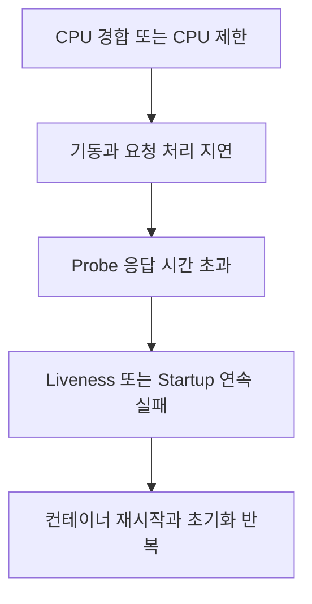

#### 기동 중 CPU 부족과 실행 중 과부하를 나눠 본다
Spring Boot는 기동하면서 클래스 로딩, Bean 생성, JIT 컴파일, 연결 초기화 등을 수행한다. 충분한 CPU에서는 15초에 끝나던 초기화가 제한된 환경에서는 훨씬 오래 걸릴 수 있다. 이때 기존 `initialDelaySeconds: 30`이 더 이상 충분하지 않으면 기동을 끝내기도 전에 종료와 재시작을 반복할 수 있다. 경계에 걸린 설정에서는 어떤 실행은 성공하고 다른 실행은 실패해 간헐적인 문제처럼 보이기도 한다.
느린 기동은 Startup Probe로 보호하되, 대기 시간만 계속 늘리는 것으로 해결하지 않는다. 기동 시간 분포와 CPU 제한을 함께 측정하고, 초기화 작업 최적화와 적정 자원 확보를 검토한다. 수 분의 기동 시간이 필요한 서비스도 있으므로 긴 설정 자체가 잘못은 아니지만, **의도한 초기화 시간인지 자원 부족으로 불필요하게 늘어난 시간인지**는 구분해야 한다.
실행 중에는 트래픽 증가, CPU 경합, GC 증가, 스레드 풀이나 커넥션 풀 대기가 Probe 지연을 만들 수 있다. 이때 이벤트에는 Liveness 실패만 남아도 실제 원인은 과부하일 수 있다. 반대로 스레드 풀이 DB 응답을 기다리며 소진된 경우에는 CPU 사용량이 높지 않을 수도 있다. CPU 집약적 작업과 I/O 대기 작업을 같은 지표 패턴으로 판단하지 않는다.

#### 메모리 증가와 CPU 제한을 지표로 비교하는 예시

메모리 제한이 `1Gi`인 컨테이너가 재시작됐는데 현재 사용량은 `300Mi`라고 가정하자. 현재 값은 새 프로세스의 사용량일 수 있다. 종료 직전 `950Mi` 이상으로 증가한 그래프와 `OOMKilled` 기록이 함께 있다면 메모리 수요와 제한량을 조사할 근거가 된다. 다만 수집 간격 사이의 순간 증가를 놓칠 수 있으므로 그래프가 제한을 찍지 않았다고 OOM을 배제하지 않는다.

JVM Heap 사용량이 낮았다는 사실도 컨테이너 전체 메모리가 낮았다는 뜻은 아니다. 스레드 수와 Direct Buffer, Metaspace 등 Heap 밖의 수요를 같이 확인한다. Heap을 늘리면 오히려 네이티브 영역의 여유를 줄일 수도 있다.

CPU는 다른 방식으로 읽는다. `limits.cpu: 100m`에서 사용량이 `100m` 근처에 머물고 요청 지연과 throttling이 동시에 증가한다면 제한 때문에 대기하는 상황을 의심할 수 있다. 낮은 사용량 그래프만 보고 “CPU가 남는다”고 해석해서는 안 된다. 그래프의 단위와 비교 기준이 Node 전체인지 컨테이너 제한량인지 먼저 확인한다.

다음 두 변경은 목적이 다르다.

| 변경 | 기대 효과 | 함께 검증할 내용 |
|---|---|---|
| CPU requests 상향 | 배치와 경합 시 배분 기준 조정 | Node 여유, 스케줄링, HPA 판단 변화 |
| CPU limits 상향 | CPU 시간 상한으로 인한 대기 완화 가능 | 실제 Node 용량, 지연, throttling |
| 메모리 limits 상향 | 컨테이너 제한 범위의 여유 증가 | 전체 메모리, JVM 옵션, 누수, Node 압력 |

변경 전후에는 같은 요청량과 데이터 규모를 사용한다. 부하를 줄인 뒤 자원만 늘려 응답이 빨라졌다면 어느 요인의 효과인지 분리할 수 없다.

#### Readiness를 먼저 실패하게 만드는 전략에도 한계가 있다
Readiness를 Liveness보다 빠르게 실패하도록 설계하면, 재시작 전에 일반적인 Service 트래픽 대상에서 제외해 일시적인 부하 완화를 기대할 수 있다. 예를 들어 Readiness의 검사 주기나 연속 실패 임계값을 더 짧게 설정하는 방식이다. 단, Readiness 실패 자체는 컨테이너를 재시작하지 않으며 이미 진행 중인 요청이나 별도 경로의 트래픽까지 모두 중단하는 것도 아니다.
남은 Pod에 트래픽이 몰리면 다른 Pod도 연쇄적으로 준비 상태를 잃을 수 있다. 짧은 과부하마다 Liveness로 재시작하면 가용 용량과 캐시까지 줄어 상황이 악화될 수 있으므로, Liveness는 단순한 부하 감지기가 아니라 **재시작이 필요한 내부 장애를 판단하는 검사**로 설계한다. Readiness 조정은 확장·요청 제한·백프레셔를 대체하지 않는다. [Probe 오설정과 연쇄 장애](https://kubernetes.io/docs/concepts/workloads/pods/probes/)

#### 재시작 직전의 지표를 같은 시간축에서 확인한다
`kubectl top`은 현재 사용량을 확인하는 출발점이지만 장애 직전의 순간 최대값을 복원하지는 못한다. 재시작한 컨테이너의 메모리가 낮아졌다고 메모리 부족을 배제할 수 없다. Metrics Server가 없거나 데이터가 아직 준비되지 않았다면 조회가 실패할 수도 있다. 과거 분석에는 Prometheus와 Grafana 같은 지속 수집 체계가 필요하다. [kubectl top의 용도](https://kubernetes.io/docs/reference/kubectl/generated/kubectl_top/)
장애 시각을 기준으로 요청량·오류율·응답 시간의 p95/p99, 컨테이너 CPU와 메모리, JVM Heap과 GC 시간, 작업 스레드와 커넥션 풀 대기, Probe 실패와 재시작을 함께 비교한다. Pod 합계만 보면 특정 컨테이너의 제한 도달을 놓칠 수 있으므로 컨테이너 단위로도 분리한다. 메모리 Working Set과 실제 메모리 제한 판정에 사용되는 값도 완전히 같다고 가정하지 않는다.
CPU 제한이 의심된다면 사용량 외에 `container_cpu_cfs_throttled_periods_total`과 `container_cpu_cfs_periods_total` 등의 증가율도 살펴본다. 두 값으로 계산한 비율은 **제한 주기 중 throttling이 발생한 주기의 비율**이지, 그대로 CPU 사용률이나 성능 손실률을 의미하지 않는다. 지표 제공 여부는 수집 환경에 따라 다르며, 지연과 같은 시점에 증가했는지 확인해야 한다. [cAdvisor의 CPU 지표](https://github.com/google/cadvisor/blob/master/docs/storage/prometheus.md)

#### 자원 증설과 코드 개선을 함께 검증한다
메모리 제한이 정상적인 최대 사용량보다 작다면 여유를 확보하되, 누수가 의심되면 Heap·네이티브 메모리 분석을 병행한다. Heap Dump는 JVM OOM과 커널 OOM에서 생성 조건이 다르고 디스크 용량과 민감 정보 문제도 있으므로 사전에 수집 정책을 준비한다. CPU는 과도한 제한, Node 경합, 비효율적인 연산, GC 비용을 구분해 조정한다. 무한히 커지는 큐나 캐시를 자원 증설만으로 해결하려고 해서는 안 된다.
여러 인스턴스로 분산 가능한 부하라면 레플리카 증가나 HPA도 검토한다. 다만 HPA는 Node 용량을 직접 늘리지 않으며, CPU 사용률 기반 설정은 requests를 기준으로 계산하므로 요청량 변경이 확장 판단에도 영향을 준다. 자원 증설 뒤 새 Pod가 `Pending`에 머무르지 않는지까지 확인한다. [HPA의 동작](https://kubernetes.io/docs/concepts/workloads/autoscaling/horizontal-pod-autoscale/)
변경은 Deployment YAML이나 Helm values 등 관리 원본에 반영한다. 이후 기동 시간, Ready 안정성, 재시작 횟수뿐 아니라 동일한 부하에서의 지연·오류율·throttling·GC를 비교한다. **현재 한 번 실행됐다는 사실보다, 기동과 예상 부하 구간에서 충분한 여유를 유지하는지**가 개선 여부를 판단하는 기준이다.

### 정리
자원 부족은 OOM 종료, 느린 기동, 응답 지연, Probe 실패처럼 서로 다른 모습으로 나타난다. `OOMKilled`와 JVM `OutOfMemoryError`, CPU 사용량과 throttling, 컨테이너 재시작과 Pod 퇴거를 구분하고 장애 직전의 지표를 함께 확인해야 한다. Probe 시간을 늘리거나 자원만 추가하는 데서 멈추지 않고, 실제 병목과 정상적인 자원 수요를 측정하는 것이 안정적인 운영의 출발점이다.

## 05. Pod의 네트워크 관련 문제

### Pod는 정상인데 서비스 호출이 실패할 때 네트워크 문제 진단하기

Pod가 `Running`이고 Ready 상태라고 해서 모든 통신이 정상이라는 뜻은 아니다. 피드 서버가 사용자 정보를 조회하는 것처럼 다른 서비스에 의존하는 기능은 DNS, Service 설정, 네트워크 정책, 대상 서버 상태에 따라 실패할 수 있다. 이때 Kubernetes 이벤트에는 별다른 문제가 없고 애플리케이션 로그에만 오류가 남기도 한다. **Pod의 정상 상태와 실제 요청 경로의 정상 여부를 구분하는 것**이 진단의 출발점이다.

#### 오류가 발생한 계층부터 구분한다
주소·포트·경로 같은 설정 문제와 CNI·라우팅·방화벽 같은 통신 경로 문제로 나누면 조사 방향을 잡기 쉽다. 다만 오류 메시지 하나로 원인을 확정해서는 안 된다. 시간 초과도 네트워크 차단뿐 아니라 대상 서버의 과부하나 커넥션 풀 대기 때문에 발생할 수 있다.
| 관찰한 오류 | 우선 확인할 대상 | 해석할 때의 주의점 |
|---|---|---|
| `UnknownHostException`, `Could not resolve host` | 호스트 이름, Namespace, DNS | 주소 오타뿐 아니라 DNS 서버 접근 실패도 가능하다. |
| `Connection refused` | 대상 포트, 서버 리스닝 상태, Service 백엔드 | 애플리케이션에 정상 연결됐다는 뜻은 아니다. |
| 연결 시간 초과 | 라우팅, 방화벽, 정책, 대상 상태 | 응답 대기 시간 초과와 구분해야 한다. |
| 응답 시간 초과 | 대상 처리 지연, 과부하, 중간 프록시 | 서버가 요청을 받았지만 처리하지 못했을 수도 있다. |
| HTTP `404`, `401`, `403` | 경로, 라우팅, 인증·인가 | HTTP 응답을 받은 것이므로 단순 연결 실패와 다르다. |
HTTP `404`는 애플리케이션이나 프록시 등 어떤 HTTP 처리 주체까지 요청이 도달했다는 단서다. 하지만 의도한 서버가 응답했다는 보장은 없다. 응답 본문·헤더와 서버 로그를 대조해 어디서 반환한 상태 코드인지 확인한다.

#### 실제 요청을 처리한 Pod의 로그를 찾는다
레플리카가 여러 개라면 오류가 특정 Pod에만 기록될 수 있다. 요청 시각과 추적 ID를 기준으로 로그를 찾고, 호출 대상 주소와 예외의 하위 원인을 확인한다. 다음은 `sns` Namespace와 `app=feed-server` 라벨을 사용하는 예시이며, 라벨과 컨테이너 이름은 실제 환경에 맞춘다.
```powershell
kubectl get pods -n sns -o wide --show-labels
kubectl logs -n sns -l app=feed-server -c feed-server --since=10m --tail=200 --timestamps --prefix=true
$POD = "문제가-발생한-피드-Pod-이름"
kubectl describe pod $POD -n sns
```
환경 변수를 확인할 때는 주소 관련 항목만 선택한다. 예를 들어 실제 설정 키가 `USER_SERVICE_URL`이라면 `kubectl exec $POD -n sns -c feed-server -- printenv USER_SERVICE_URL`로 확인할 수 있다. 전체 환경 변수나 인증 헤더를 출력하지 않는다. 또한 환경 변수 값이 맞더라도 Profile, 명령행 인자, 코드의 기본값 때문에 다른 주소를 사용할 수 있으므로 최종 호출 대상과 대조한다.

#### DNS 이름과 Service 이름을 맞춰 본다
일반적인 Service DNS 이름은 `<service>.<namespace>.svc.<cluster-domain>`이다. 클러스터 도메인이 `cluster.local`이라면 사용자 Service는 `user-service.sns.svc.cluster.local`처럼 접근한다. 여기서 앞부분은 Deployment나 Pod 이름이 아니라 **Service의 `metadata.name`**이다. 같은 Namespace에서는 짧은 이름을 사용할 수 있지만, 다른 Namespace라면 그 Namespace까지 명시해야 한다. [Kubernetes DNS 진단](https://kubernetes.io/docs/tasks/administer-cluster/dns-debugging-resolution/)
```powershell
kubectl get services -n sns
kubectl exec $POD -n sns -c feed-server -- nslookup user-service.sns.svc.cluster.local
kubectl exec $POD -n sns -c feed-server -- curl -i --connect-timeout 3 --max-time 10 http://user-service.sns.svc.cluster.local:8080/actuator/health/readiness
```
이 예시는 Service 포트가 `8080`이고 해당 Health 엔드포인트가 제공되는 환경을 전제로 한다. `nslookup`이나 `curl`이 없으면 검토된 도구 이미지의 디버깅 컨테이너를 사용한다. Health API도 경로·보안·의존성 설정에 따라 실패하므로 “절대 실패하지 않는 URL”로 취급하지 않는다.
Service 이름이 실제로는 다르게 만들어졌다면 호출 설정과 Service 정의 중 의도와 어긋난 쪽을 수정한다. 다른 Service는 조회되는데 이 이름만 실패한다면 이름·Namespace 불일치를 먼저 의심할 수 있다. 여러 정상 이름까지 실패한다면 Pod의 `/etc/resolv.conf`, `dnsPolicy`, CoreDNS와 DNS 접근 경로를 확인한다. 한 번의 DNS 실패만으로 전체 네트워크 장애를 단정하지 않는다.

#### Service가 올바른 Pod를 가리키는지 확인한다
DNS 조회에 성공해도 요청을 전달할 백엔드가 없거나 포트가 틀릴 수 있다. 일반적인 ClusterIP Service의 통신을 다음과 같이 나누어 점검한다. 아래 그림은 논리적 흐름이며 Service가 별도의 프록시 프로세스라는 뜻은 아니다.

```powershell
kubectl describe service user-service -n sns
kubectl get endpointslices -n sns -l kubernetes.io/service-name=user-service -o yaml
kubectl get pods -n sns -o wide --show-labels
```
Service의 `selector`와 Pod 라벨을 비교하고, `port`와 `targetPort`를 구분한다. 호출자는 Service의 `port`로 접근하고 백엔드는 `targetPort`에 해당하는 포트에서 요청을 받아야 한다. `containerPort`를 선언하는 것만으로 서버가 그 포트에서 리스닝하지는 않는다. [Service 진단 절차](https://kubernetes.io/docs/tasks/debug/debug-application/debug-service/)
EndpointSlice에서는 대상 주소·포트와 `conditions.ready` 등을 확인한다. 백엔드 주소가 없거나 준비된 대상이 없다면 Selector 불일치, Pod 미생성, Readiness 실패부터 조사한다. Service 하나에 EndpointSlice가 여러 개일 수 있으므로 전체를 확인해야 한다. [EndpointSlice 구조](https://kubernetes.io/docs/concepts/services-networking/endpoint-slices/)
같은 호출 Pod에서 **DNS 이름 → ClusterIP → 개별 대상 Pod IP** 순서로 비교하면 범위를 좁힐 수 있다. ClusterIP는 성공하지만 이름만 실패하면 DNS를, 개별 Pod는 성공하지만 ClusterIP가 실패하면 Service 포트·트래픽 정책·Service 데이터 경로를 조사한다. 직접 Pod에 호출할 때는 Service 포트가 아니라 실제 대상 포트를 사용한다. HTTPS라면 IP 치환으로 Host·SNI 조건이 달라질 수 있으므로 단순 비교에 주의한다.

#### 세 가지 주소로 같은 요청을 보내는 이유

사용자 Service가 `port: 80`, `targetPort: 8080`으로 구성됐다고 가정하자. 앞의 8080 Service 예시와 다른 포트 구성을 일부러 사용해 두 포트의 역할을 구분한다. 다음 값은 설명용이며 실제 `get service`와 EndpointSlice 조회 결과로 바꿔야 한다.

```text
Service 이름: user-service.sns.svc.cluster.local
ClusterIP:    10.96.20.30
대상 Pod IP:  10.244.1.20
Service port: 80
대상 포트:    8080
```

세 호출은 업무 경로를 동일하게 유지한 채 접근 경로만 바꾸는 검사다. 여기서는 읽기 전용 Health 경로를 사용한다. 쓰기 API를 그대로 반복해 테스트 데이터를 중복 생성하지 않도록 한다.

```powershell
kubectl exec $POD -n sns -c feed-server -- curl -i --connect-timeout 3 --max-time 10 http://user-service.sns.svc.cluster.local:80/actuator/health/readiness
kubectl exec $POD -n sns -c feed-server -- curl -i --connect-timeout 3 --max-time 10 http://10.96.20.30:80/actuator/health/readiness
kubectl exec $POD -n sns -c feed-server -- curl -i --connect-timeout 3 --max-time 10 http://10.244.1.20:8080/actuator/health/readiness
```

첫 번째는 DNS 조회와 Service 경로를 모두 사용한다. 두 번째는 Service의 이름 해석을 건너뛰지만 ClusterIP 전달 경로는 사용한다. 세 번째는 DNS와 ClusterIP를 거치지 않고 지정한 Pod에 직접 접근한다.

| DNS 이름 | ClusterIP | 대상 Pod IP | 다음 조사 방향 |
|---|---|---|---|
| 실패 | 성공 | 성공 | Service 이름, Namespace, DNS 설정과 캐시 |
| 실패 | 실패 | 성공 | Service 포트, EndpointSlice, 정책, Service 데이터 경로 |
| 실패 | 실패 | 실패 | 대상 리스닝, 직접 통신 경로, 정책, 대상 Pod 상태 |
| 성공 | 성공 | 일부 Pod만 실패 | 해당 백엔드의 버전·설정·Node·준비 상태 차이 |

이 표는 조사 우선순위이지 원인 확정표가 아니다. 한 Pod에 대한 직접 호출이 성공해도 다른 백엔드는 실패할 수 있고, Host 기반 처리나 Service Mesh에서는 IP 호출과 DNS 이름 호출의 의미가 다를 수 있다. 같은 시각과 동일한 조건에서 반복 확인하고 대상 서버의 수신 로그까지 맞춘다.

#### Service의 Selector와 targetPort 오류를 수정하는 예시

사용자 Pod의 라벨이 `app: user-server`이고 실제 서버가 8080에서 리스닝한다고 가정하자. Service의 Selector가 `app: users-server`이면 Pod가 존재해도 원하는 백엔드가 선택되지 않는다. 다음은 그 관계를 명시한 Service 전체 예시다.

```yaml
apiVersion: v1
kind: Service
metadata:
  name: user-service
  namespace: sns
spec:
  type: ClusterIP
  selector:
    app: user-server
  ports:
    - name: http
      protocol: TCP
      port: 80
      targetPort: 8080
```

`apiVersion`과 `kind`는 v1 Service를 정의한다. `metadata.name`은 DNS 이름의 앞부분이며 `namespace`는 이름이 속한 범위다. `selector`는 같은 Namespace에서 라벨이 일치하는 Pod를 선택하고, `ports`는 Service의 TCP 80번 요청을 대상 8080번으로 전달하도록 지정한다.

이 YAML은 위의 포트 비교 예시에만 대응한다. 이미 서비스 중인 8080 Service를 무조건 80으로 바꾸라는 의미가 아니다. 실제 적용할 때는 기존 호출자와 Ingress가 기대하는 포트를 먼저 확인하고 원래 관리 파일의 잘못된 필드만 수정한다.

수정 후에는 EndpointSlice에 대상 주소가 생겼는지, 준비된 대상인지, Service 주소의 읽기 요청이 성공하는지 확인한다. 그 다음 피드 API를 다시 호출해 사용자 정보가 정상적으로 결합되는지 검증한다. Health 요청의 성공과 업무 기능의 복구를 각각 확인해야 진단이 끝난다.

#### 출발지와 목적지의 조합을 기록하기

같은 Node와 다른 Node를 비교할 때도 결과를 구체적으로 남기는 것이 좋다.

| 출발 Pod와 Node | 동일한 대상 Pod와 Node | 결과 예시 |
|---|---|---|
| feed-a / worker-a | user-a / worker-a | 성공 |
| feed-b / worker-b | user-a / worker-a | timeout |
| feed-c / worker-c | user-a / worker-a | 성공 |

이 예시에서는 모든 Node 간 통신이 실패한다고 말할 수 없다. 우선 worker-b의 출발 경로, 해당 Pod에 적용되는 정책과 사이드카, 출발지 주소에 따른 대상 측 제한을 조사한다. 대상도 다른 Node의 Pod로 바꾸어 비교하면 특정 출발지 문제와 특정 목적지 문제를 더 좁힐 수 있다.

#### 같은 Node와 다른 Node의 결과를 비교한다
피드 Pod 두 개 중 하나만 사용자 서버 호출에 실패한다면 `kubectl get pods -n sns -o wide`로 출발지와 목적지의 Node를 확인한다. 같은 Node에서는 성공하고 다른 Node에서는 실패한다면 Node 간 경로를 의심할 근거가 된다. 다만 Service로 호출하면 매번 다른 백엔드가 선택될 수 있으므로, 비교할 때는 **동일한 대상 Pod IP·포트·요청 조건**으로 맞춘다.
특정 출발 Node에서만 실패하는지, 특정 목적 Node로 향할 때만 실패하는지도 나누어 기록한다. CNI 상태, 라우팅, 보안 그룹·방화벽, MTU, conntrack 등의 조사 범위를 좁히는 데 도움이 된다. 같은 Node 통신도 가상 인터페이스와 네트워크 정책 등의 영향을 받으며, 관찰 결과만으로 물리 네트워크 장비의 장애를 확정할 수는 없다.
별도 진단 Pod를 특정 Node에 배치하려면 실제 Node 라벨을 확인한 뒤 `nodeSelector`나 Node Affinity를 사용한다. `nodeName` 직접 지정은 스케줄러를 우회하므로 일반적인 배치 방식과 구분해야 한다. 진단 Pod는 원래 Pod와 라벨·ServiceAccount·사이드카·보안 조건이 다를 수 있으므로 성공했다고 원래 경로도 정상이라고 판단하지 않는다. [Pod의 Node 배치 조건](https://kubernetes.io/docs/concepts/scheduling-eviction/assign-pod-node/)

#### NetworkPolicy는 출발지와 목적지를 모두 확인한다
`kubectl get networkpolicy -A`로 정책 존재 여부를 확인하고 관련 Namespace의 정책을 상세 조회한다. 출발지 Pod가 Egress 격리 대상이면 나가는 통신이, 목적지 Pod가 Ingress 격리 대상이면 들어오는 통신이 허용돼야 한다. 정책은 선택된 Pod에 적용되고 허용 규칙은 합산되므로 파일 하나만 보고 결론 내리지 않는다.
특히 Egress를 제한하면서 DNS 서버로 향하는 UDP·TCP 53번 통신을 빠뜨리면 서비스 이름부터 해석하지 못할 수 있다. 표준 NetworkPolicy의 실제 적용에는 이를 지원하는 네트워크 구현이 필요하며, CNI 고유 정책이나 클라우드 보안 설정도 별도로 존재할 수 있다. 진단을 위해 정책 전체를 삭제하기보다는 **필요한 출발지·목적지·프로토콜·포트**를 식별한다. [NetworkPolicy의 동작](https://kubernetes.io/docs/concepts/services-networking/network-policies/)

#### NetworkPolicy를 발견했다면 무엇을 읽어야 할까?

```powershell
kubectl get networkpolicy -n sns
$POLICY = "확인할-정책-이름"
kubectl describe networkpolicy $POLICY -n sns
kubectl get namespace sns --show-labels
kubectl get pods -n sns --show-labels
```

정책의 `podSelector`가 어느 Pod를 선택하는지부터 확인한다. 그 다음 출발지의 Egress와 목적지의 Ingress에서 상대 Namespace·Pod 라벨과 대상 포트를 허용하는지 살핀다. Namespace 이름을 보고 사람이 구분한 환경과 `namespaceSelector`가 실제 선택하는 라벨이 다를 수도 있다.

같은 `from` 항목 안의 `namespaceSelector`와 `podSelector`는 함께 만족해야 하는 조건이며, 서로 다른 목록 항목은 별개의 허용 조건이다. 들여쓰기를 바꾸는 것만으로 허용 범위가 달라질 수 있으므로 “정책이 있다”에서 끝내지 않고 선택 결과를 대조한다.

정책 변경은 다른 서비스의 접근 범위에도 영향을 준다. 장애 해결을 위해 전체 허용으로 전환하기보다 필요한 경로만 최소 범위로 열고, 허용돼야 하는 요청과 차단돼야 하는 요청을 모두 검사한다.

#### 클러스터 외부로 나가는 요청도 계층별로 확인한다
외부 API나 데이터베이스 호출은 DNS, 연결, TLS, 인증, 실제 응답 순서로 나눈다. HTTP API는 시간 제한을 둔 `curl`로 비교하고, 데이터베이스는 해당 프로토콜의 클라이언트로 검사한다. TCP 연결 성공만으로 DB 로그인이나 쿼리 실행까지 검증된 것은 아니다.
애플리케이션과 진단 도구가 모두 실패하면 Egress 정책, Node의 외부 경로, NAT 또는 VPC Endpoint, 방화벽, 목적지 접근 허용 조건 등을 조사한다. 반대로 `curl`만 성공한다면 JVM DNS 캐시, 프록시 설정, 인증서 TrustStore, 연결 풀, 클라이언트 타임아웃의 차이를 확인한다. 진단 컨테이너도 애플리케이션의 TLS·인증 설정까지 그대로 공유하는 것은 아니다.

#### 외부 요청은 Ingress 설정과 실제 트래픽 경로를 구분한다
외부에서만 실패한다면 도메인 DNS, TLS, Load Balancer 리스너와 대상 상태, Ingress 규칙, 백엔드 순서로 확인한다. 전체 API가 실패하는지 특정 Host·Path만 실패하는지도 중요한 단서다.
```powershell
kubectl get ingress -A
kubectl get ingressclass
kubectl describe ingress <실제-Ingress-이름> -n sns
```
Ingress에서는 Host, Path, `pathType`, 연결된 Service 이름과 포트를 대조한다. 일반적인 Ingress의 Service 백엔드는 같은 Namespace의 Service를 참조하며, 포트도 Service에 선언된 값과 맞아야 한다. 경로 일치와 경로 재작성은 별개의 설정이다. Controller의 설치 Namespace는 고정되어 있지 않으므로 먼저 실제 Deployment와 Pod 위치를 찾고 로그를 확인한다. [Ingress 구성](https://kubernetes.io/docs/concepts/services-networking/ingress/)
AWS Load Balancer Controller는 ALB 등을 구성하는 제어 역할을 하며, HTTP 요청이 Controller Pod를 통과하는 구조는 아니다. ALB의 IP 대상 모드는 Pod IP로 직접 전달하고, Instance 대상 모드는 NodePort를 거친다. 따라서 Controller 로그가 깨끗해도 ALB 접근 로그·대상 Health Check·보안 그룹에서 문제가 발견될 수 있고, 내부 ClusterIP 호출 성공만으로 ALB에서 Pod까지의 경로가 검증되지는 않는다. [AWS Load Balancer Controller의 요청 경로](https://kubernetes-sigs.github.io/aws-load-balancer-controller/latest/how-it-works/)

### 정리
네트워크 진단에서는 “호출이 안 된다”를 DNS 실패, 연결 실패, TLS 실패, HTTP 오류, 응답 지연으로 나누는 것이 먼저다. 실제 오류가 발생한 Pod에서 Service 이름·포트·EndpointSlice를 확인하고, 동일 조건으로 경로를 비교한 뒤 정책과 Node·외부 인프라로 조사 범위를 넓힌다. 수정 후에는 진단 명령의 성공에 그치지 않고 **원래 실패했던 업무 요청을 같은 출발지와 조건에서 다시 확인해야 한다.**

## 06. Pod의 배포 과정에서 발생하는 문제 

### Kubernetes 배포 과정에서 발생하는 장애와 롤링 업데이트 트러블슈팅

Kubernetes에서는 Deployment를 사용해 애플리케이션을 배포하고, Rolling Update를 통해 기존 버전을 새로운 버전으로 점진적으로 교체할 수 있다.

Rolling Update는 기존 Pod를 한 번에 종료하지 않고 새로운 Pod를 순차적으로 생성하면서 교체하기 때문에, 서비스 중단을 최소화할 수 있는 대표적인 배포 전략이다.

하지만 Rolling Update를 사용한다고 해서 모든 배포가 정상적으로 완료되거나 서비스 중단이 발생하지 않는 것은 아니다.

예를 들어 다음과 같은 상황을 생각해 볼 수 있다.

- 기존 애플리케이션은 정상적으로 실행되고 있지만 새로운 버전의 Pod가 생성되지 않는 경우
- 새로운 Pod가 생성되었지만 `Pending` 상태에서 벗어나지 못하는 경우
- 기존 Pod가 종료되었는데 새로운 Pod가 준비되지 않아 서비스 처리량이 감소하는 경우
- 잘못된 이미지 태그로 인해 새로운 컨테이너를 실행하지 못하는 경우
- Deployment, ReplicaSet, Pod의 상태를 임의로 수정하다가 배포 상태가 복잡해지는 경우

이러한 문제는 애플리케이션 자체의 오류뿐 아니라 **컨테이너 이미지, Node 리소스, Rolling Update 전략, Kubernetes 컨트롤러의 동작 방식**과 밀접하게 관련되어 있다.

특히 Node의 자원이 부족한 상황에서는 Rolling Update 설정에 따라 배포가 무기한 지연되거나, 반대로 배포 과정에서 기존 Pod가 과도하게 종료되어 서비스 장애가 발생할 수 있다.

이번에는 Kubernetes의 배포 구조를 이해하고, 실제 운영 환경에서 발생할 수 있는 배포 장애를 원인별로 분석한 뒤 안전하게 복구하는 방법을 알아본다.

---

### Kubernetes의 배포 구조

#### Deployment, ReplicaSet, Pod의 관계

Kubernetes에서 Deployment를 생성하면 Deployment가 직접 Pod를 관리하는 것이 아니라, ReplicaSet을 통해 Pod를 관리한다.

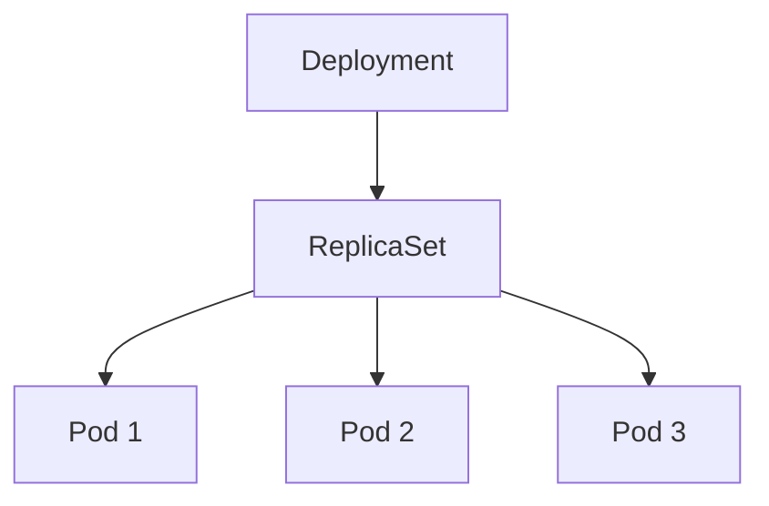

각 객체의 역할은 다음과 같다.

| 객체 | 역할 |
|---|---|
| Deployment | 애플리케이션의 선언적 배포 및 업데이트 관리 |
| ReplicaSet | 지정된 수량의 Pod를 유지 |
| Pod | 실제 애플리케이션 컨테이너 실행 |
| Service | Ready 상태의 Pod를 대상으로 트래픽 전달 |

Deployment의 핵심 역할은 사용자가 선언한 원하는 상태를 실제 클러스터에 반영하는 것이다.

예를 들어 다음과 같은 설정이 있다고 가정하자.

```yaml
apiVersion: apps/v1
kind: Deployment
metadata:
  name: feed-server
spec:
  replicas: 3
  selector:
    matchLabels:
      app: feed-server
  template:
    metadata:
      labels:
        app: feed-server
    spec:
      containers:
        - name: feed
          image: registry.example.com/team/feed-server:1.0.0
          ports:
            - containerPort: 8080
```

`registry.example.com/team/feed-server:1.0.0`은 설명을 위한 이미지 주소이며, 실제 적용할 때는 사용하는 Container Registry 주소로 변경해야 한다.

이 Deployment를 적용하면 Kubernetes는 다음 상태를 유지하려고 한다.

```text
Deployment: feed-server
replicas: 3

ReplicaSet
 ├── Pod 1
 ├── Pod 2
 └── Pod 3
```

Pod 하나가 삭제되더라도 ReplicaSet은 원하는 수량인 3개를 유지하기 위해 새로운 Pod를 생성한다.

이 구조는 배포 장애를 해결할 때도 중요하다.

문제가 발생한 Pod를 무작정 삭제해도 ReplicaSet이 동일한 설정으로 Pod를 다시 생성할 수 있기 때문이다.

---

### Rolling Update의 동작 원리

Rolling Update는 기존 버전의 Pod를 새로운 버전으로 점진적으로 교체하는 배포 전략이다.

예를 들어 `feed-server` 애플리케이션의 버전을 다음과 같이 변경한다고 가정하자.

```text
기존 버전: 1.0.0
새로운 버전: 1.1.0
```

기존에는 ReplicaSet 하나가 Pod 3개를 관리하고 있다.

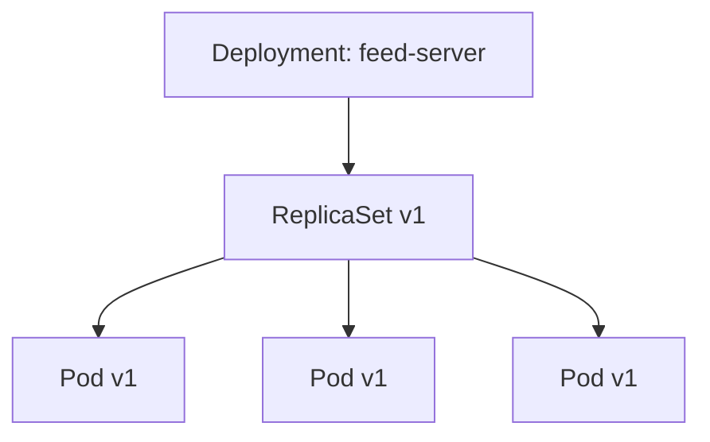

이 상태에서 컨테이너 이미지가 변경되면 Deployment는 새로운 Pod Template을 기반으로 새로운 ReplicaSet을 생성한다.

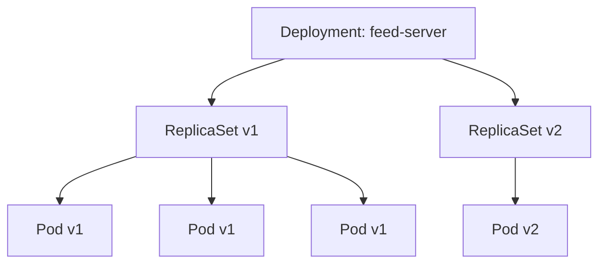

새로운 Pod가 정상적으로 준비되면 기존 ReplicaSet의 Pod를 줄이고 새로운 ReplicaSet의 Pod를 늘린다.

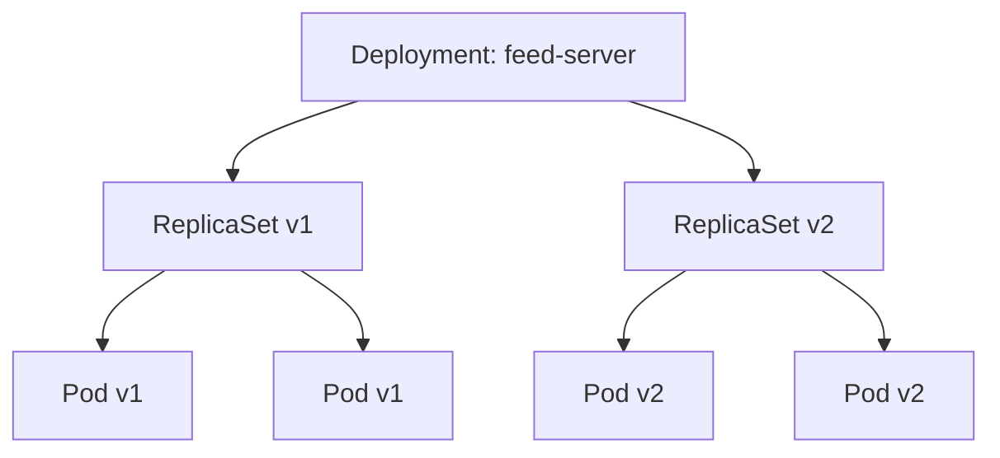

최종적으로 새로운 ReplicaSet이 Pod 3개를 관리하게 된다.

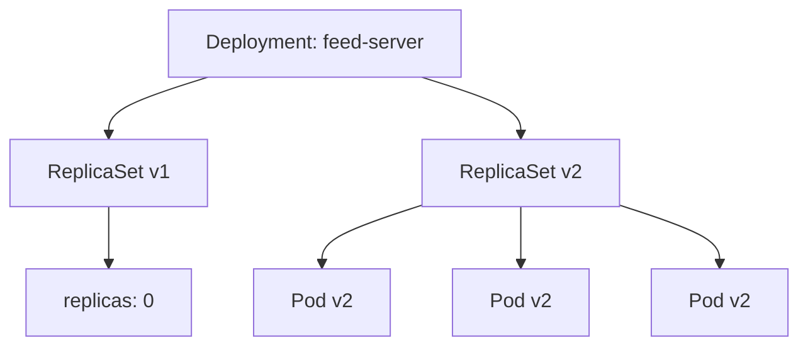

기존 ReplicaSet은 Pod 수가 0이 되더라도 롤백을 위해 일정 기간 유지될 수 있다.

이러한 배포 과정에서 생성할 수 있는 Pod 수와 일시적으로 사용할 수 없게 되는 Pod 수를 제어하는 설정이 바로 `maxSurge`와 `maxUnavailable`이다.

---

### 배포 장애가 발생했을 때 가장 먼저 확인할 항목

새로운 애플리케이션을 배포했는데 정상적으로 실행되지 않는다면, 가장 먼저 Pod 상태와 이벤트를 확인해야 한다.

#### Pod 상태 확인

```bash
kubectl get pods
```

예상 출력은 다음과 같다.

```text
NAME                           READY   STATUS             RESTARTS
feed-server-7c8d9f5b6-abc12   1/1     Running            0
feed-server-7c8d9f5b6-def34   1/1     Running            0
feed-server-7c8d9f5b6-ghi56   1/1     Running            0
feed-server-8d9f6c7b5-xyz78   0/1     ImagePullBackOff   0
```

기존 Pod는 정상적으로 실행되고 있지만, 새로운 Pod는 이미지를 가져오지 못하고 있다.

이 경우 애플리케이션 로그보다 먼저 이미지 관련 오류를 확인하는 것이 효과적이다.

반대로 새로운 Pod가 `Pending` 상태라면 Node 리소스나 스케줄링 제약을 확인해야 한다.

대표적인 상태와 확인 방향은 다음과 같다.

| 상태 | 주요 원인 | 우선 확인할 항목 |
|---|---|---|
| `Pending` | Node 자원 부족, 스케줄링 제약 | Pod Events, Node Allocatable |
| `ImagePullBackOff` | 이미지 다운로드 실패 | 이미지 주소, 태그, 인증 |
| `ErrImagePull` | 이미지 다운로드 과정에서 오류 발생 | Registry 접근, 태그 |
| `CrashLoopBackOff` | 컨테이너 반복 종료 | 애플리케이션 로그, 종료 코드 |
| `CreateContainerConfigError` | 컨테이너 설정 오류 | Secret, ConfigMap, 환경 변수 |
| `ContainerCreating` | 컨테이너 생성 과정 진행 또는 지연 | 이미지, Volume, 네트워크 관련 Events |
| `Running`이지만 `0/1` | Readiness Probe 실패 등 | Probe 설정, 애플리케이션 상태 |

`CrashLoopBackOff`, `ImagePullBackOff` 등은 Pod의 현재 실행 상황을 조회할 때 표시되는 상태 문자열이며, Pod의 최상위 Phase와는 구분된다.

#### Pod 상세 정보 확인

```bash
kubectl describe pod <pod-name>
```

특히 출력 하단의 `Events` 항목을 확인한다.

```text
Events:
  Type     Reason             Message
  ----     ------             -------
  Warning  FailedScheduling   0/3 nodes are available: Insufficient cpu.
```

이 메시지를 통해 Scheduler가 새로운 Pod를 배치할 수 없는 이유를 확인할 수 있다.

#### 애플리케이션 로그 확인

컨테이너가 실행된 후 오류가 발생했다면 로그를 확인한다.

```bash
kubectl logs <pod-name>
```

컨테이너가 재시작되었다면 이전 컨테이너 로그를 확인할 수 있다.

```bash
kubectl logs <pod-name> --previous
```

다만 `ImagePullBackOff`처럼 이미지 자체를 가져오지 못한 상태에서는 애플리케이션 프로세스가 실행되지 않았으므로 컨테이너 로그가 존재하지 않을 수 있다.

이때는 `kubectl describe pod`의 이벤트가 더 유용하다.

---

### 배포 시 자주 발생하는 이미지 오류

애플리케이션을 새롭게 배포하거나 기존 버전을 업그레이드할 때 자주 발생하는 문제 중 하나는 컨테이너 이미지를 가져오지 못하는 오류이다.

특히 기존 애플리케이션이 정상적으로 실행되고 있었고 이미지 태그만 변경했다면, 변경된 이미지 주소와 태그를 우선적으로 확인할 필요가 있다.

#### 1. 이미지 태그가 존재하지 않는 경우

기존 이미지가 다음과 같다고 가정하자.

```yaml
image: registry.example.com/team/feed-server:1.0.0
```

새로운 버전으로 변경한다.

```yaml
image: registry.example.com/team/feed-server:1.1.0
```

그런데 실제 Container Registry에는 `1.1.0` 이미지가 등록되어 있지 않을 수 있다.

이 경우 Kubernetes는 새로운 이미지를 다운로드하려고 시도하지만 실패한다.

```text
ErrImagePull
    ↓
ImagePullBackOff
```

`ImagePullBackOff`는 이미지 다운로드에 실패한 후 재시도를 지연하고 있는 상태를 의미한다.

확인해야 할 항목은 다음과 같다.

- 이미지 이름이 정확한가?
- 이미지 태그가 실제로 존재하는가?
- 새로운 이미지가 Registry에 Push되었는가?
- Registry 주소가 올바른가?
- 대상 클러스터가 이미지를 다운로드할 수 있는가?

#### 2. Registry 인증이 실패하는 경우

Private Registry를 사용한다면 인증 정보도 확인해야 한다.

대표적으로 `imagePullSecrets`를 사용한다.

```yaml
spec:
  imagePullSecrets:
    - name: registry-credentials
  containers:
    - name: feed
      image: registry.example.com/team/feed-server:1.1.0
```

Secret이 현재 Namespace에 존재하는지 확인한다.

```bash
kubectl get secret registry-credentials
```

Registry 인증 정보가 잘못되었거나 Secret이 존재하지 않는다면 이미지를 가져올 수 없다.

#### 3. 변경된 이미지 확인

현재 Deployment에 적용된 이미지를 확인한다.

```bash
kubectl get deployment feed-server \
  -o jsonpath='{.spec.template.spec.containers[*].image}{"\n"}'
```

예상 출력:

```text
registry.example.com/team/feed-server:1.1.0
```

실제 이미지가 변경되었는지, 의도한 태그인지 확인할 수 있다.

실무에서는 이미지 태그만 변경된 배포라면 우선 새로운 이미지가 정상적으로 빌드·배포되었는지 확인하는 것이 효율적이다.

다만 이미지 자체는 정상적이어도 새로운 버전에서 환경 변수나 Secret이 추가로 필요할 수 있으므로, 이미지 문제가 아니라면 이전 버전과의 실행 환경 차이도 함께 확인해야 한다.

---

### 명령어로 컨테이너 이미지 업데이트하기

Deployment YAML을 수정하는 대신 `kubectl set image` 명령어로 컨테이너 이미지를 변경할 수도 있다.

예를 들어 다음과 같은 Deployment가 있다고 가정하자.

```text
Deployment: feed-server
Container: feed
Image: feed-server:1.0.0
Replicas: 3
```

이미지를 새로운 버전으로 변경한다.

```bash
kubectl set image deployment/feed-server \
  feed=registry.example.com/team/feed-server:1.1.0
```

정상적으로 반영되면 다음과 같은 메시지가 출력된다.

```text
deployment.apps/feed-server image updated
```

이 명령어는 Deployment의 Pod Template에 있는 이미지 필드를 변경한다.

Pod Template이 변경되면 새로운 ReplicaSet이 생성되고 Rolling Update가 시작된다.

단, 위 명령어의 성공은 **Deployment 설정 변경이 성공했다는 의미이지, 새로운 Pod의 배포가 완료되었다는 의미는 아니다.**

배포 진행 상태를 별도로 확인해야 한다.

```bash
kubectl rollout status deployment/feed-server
```

정상적으로 완료되면 다음과 같은 메시지가 출력된다.

```text
deployment "feed-server" successfully rolled out
```

새로운 Pod가 준비되지 못한다면 완료되지 않은 상태로 대기하거나 진행 제한 시간을 초과했다는 오류가 발생할 수 있다.

---

### Rolling Update 설정 이해하기

Rolling Update에서 가장 중요한 설정은 `maxSurge`와 `maxUnavailable`이다.

두 설정은 비슷해 보이지만 역할이 다르다.

```yaml
apiVersion: apps/v1
kind: Deployment
metadata:
  name: feed-server
spec:
  replicas: 3
  revisionHistoryLimit: 10
  minReadySeconds: 5
  progressDeadlineSeconds: 180

  strategy:
    type: RollingUpdate
    rollingUpdate:
      maxSurge: 1
      maxUnavailable: 0

  selector:
    matchLabels:
      app: feed-server

  template:
    metadata:
      labels:
        app: feed-server

    spec:
      terminationGracePeriodSeconds: 30

      containers:
        - name: feed
          image: registry.example.com/team/feed-server:1.0.0

          ports:
            - containerPort: 8080

          resources:
            requests:
              cpu: "500m"
              memory: "256Mi"
            limits:
              cpu: "1000m"
              memory: "512Mi"

          readinessProbe:
            httpGet:
              path: /actuator/health/readiness
              port: 8080
            initialDelaySeconds: 5
            periodSeconds: 5
            timeoutSeconds: 2
            failureThreshold: 3
```

위 YAML은 Spring Boot Actuator의 Readiness Endpoint가 활성화되어 있는 애플리케이션을 가정한 예시이다.

주요 설정의 의미는 다음과 같다.

| 설정 | 의미 |
|---|---|
| `replicas: 3` | 목표 Pod 수량 3개 |
| `type: RollingUpdate` | 점진적 배포 전략 |
| `maxSurge: 1` | 업데이트 중 목표 수량보다 최대 1개 추가 생성 |
| `maxUnavailable: 0` | 업데이트 중 사용할 수 있는 Pod를 목표 수량보다 줄이지 않음 |
| `minReadySeconds: 5` | Ready 상태를 최소 5초 유지한 후 Available로 인정 |
| `progressDeadlineSeconds: 180` | 배포 진행이 멈춘 상태를 보고하기 위한 제한 시간 |
| `revisionHistoryLimit: 10` | 롤백을 위해 보관할 이전 ReplicaSet의 개수 |

`maxSurge`와 `maxUnavailable`의 기본값은 각각 `25%`이며, 비율을 정수로 변환할 때 서로 다른 반올림 정책을 사용한다.

---

### maxSurge란?

`maxSurge`는 Rolling Update 과정에서 **목표 replicas보다 추가로 생성할 수 있는 Pod의 최대 수량**을 의미한다.

예를 들어 다음과 같은 설정이 있다고 가정하자.

```yaml
replicas: 3

strategy:
  type: RollingUpdate
  rollingUpdate:
    maxSurge: 1
    maxUnavailable: 0
```

기본적으로 유지해야 하는 Pod는 3개이다.

하지만 업데이트 과정에서는 최대 1개의 Pod를 추가로 생성할 수 있다.

```text
기존 Pod 수량: 3
maxSurge: 1

최대 Pod 수량: 4
```

배포 과정은 다음과 같이 진행된다.

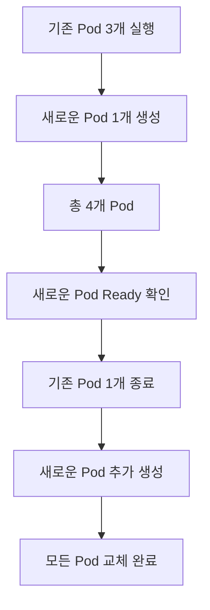

`maxSurge`의 핵심은 **추가 생성 가능한 최대 수량**이라는 점이다.

예를 들어 `maxSurge: 3`이라고 설정했다고 해서 Kubernetes가 반드시 새로운 Pod를 동시에 3개 생성하고 실행해야 하는 것은 아니다.

현재 클러스터 상태와 업데이트 진행 상황에 따라 더 적은 수량만 생성하면서 점진적으로 업데이트할 수 있다.

따라서 `maxSurge`가 크다고 해서 항상 그 수량만큼의 여유 Node 자원이 있어야 업데이트가 가능한 것은 아니다.

다만 `maxUnavailable`이 0이고 새로운 Pod를 실행할 여유 자원이 전혀 없다면 업데이트가 진행되지 못할 수 있다.

#### maxSurge가 25%인 경우

```yaml
replicas: 3

strategy:
  rollingUpdate:
    maxSurge: 25%
```

3개의 25%는 다음과 같다.

```text
3 × 0.25 = 0.75
```

Kubernetes는 `maxSurge`의 비율 계산 결과를 올림 처리한다.

```text
ceil(0.75) = 1
```

따라서 최대 1개의 Pod를 추가로 생성할 수 있다.

| replicas | maxSurge | 추가 가능한 Pod |
|---:|---:|---:|
| 3 | 25% | 1 |
| 4 | 25% | 1 |
| 5 | 25% | 2 |
| 8 | 25% | 2 |
| 10 | 25% | 3 |

여기서 주의할 점은 `maxSurge`가 Running 상태의 Pod만 계산하는 설정은 아니라는 것이다.

Pod가 삭제 중인 `Terminating` 상태에서도 실제 리소스를 사용하고 있을 수 있다.

따라서 Rolling Update 중에는 종료 중인 Pod까지 포함한 실제 Pod 수와 리소스 사용량이 설정상 예상한 최대치보다 일시적으로 커질 수 있다.

---

### maxUnavailable이란?

`maxUnavailable`은 Rolling Update 과정에서 **사용할 수 없는 상태가 되는 Pod를 최대 몇 개까지 허용할 것인지**를 결정하는 설정이다.

```yaml
replicas: 3

strategy:
  rollingUpdate:
    maxUnavailable: 1
```

목표 Pod가 3개이고 `maxUnavailable`이 1이라면 업데이트 과정에서 최소 2개의 Pod가 Available 상태를 유지하도록 제어한다.

```text
목표 replicas: 3
maxUnavailable: 1

최소 Available Pod: 2
```

이 값을 이해할 때 중요한 점은 단순히 Running 상태의 Pod 수를 계산하는 것이 아니라는 것이다.

Kubernetes에서 Deployment의 Available Pod는 Ready 상태를 만족하고, 설정된 `minReadySeconds`까지 충족한 Pod를 의미한다.

예를 들어 새로운 Pod가 생성되었더라도 Readiness Probe를 통과하지 못했다면 Available Pod에 포함되지 않는다.

#### maxUnavailable이 0인 경우

```yaml
maxUnavailable: 0
```

업데이트 과정에서 Available Pod 수가 목표 replicas보다 적어지는 것을 허용하지 않는다.

```text
replicas: 3
maxUnavailable: 0

최소 Available Pod: 3
```

즉 새로운 Pod가 정상적으로 준비되기 전에 기존 Pod를 줄일 수 없게 된다.

서비스 안정성 측면에서는 유리하지만, 새로운 Pod를 생성할 Node 자원이 없다면 업데이트가 막힐 수 있다.

#### maxUnavailable이 2인 경우

```yaml
maxUnavailable: 2
```

목표 Pod가 3개라면 최소 1개의 Pod만 Available 상태를 유지해도 업데이트 정책을 만족할 수 있다.

```text
replicas: 3
maxUnavailable: 2

최소 Available Pod: 1
```

이 설정에서는 새로운 버전의 Pod가 준비되기 전에 기존 Pod가 최대 2개까지 줄어들 수 있다.

기존 Pod 3개가 트래픽을 나누어 처리하고 있었다면, 배포 과정에서 순간적으로 1개만 남아 전체 트래픽을 감당해야 하는 상황이 생길 수 있다.

#### maxUnavailable이 25%인 경우

```yaml
replicas: 3

strategy:
  rollingUpdate:
    maxUnavailable: 25%
```

3개의 25%는 0.75이다.

하지만 `maxUnavailable`의 비율 계산 결과는 내림 처리한다.

```text
floor(3 × 0.25) = 0
```

따라서 3개의 Pod를 운영하는 Deployment에서 `maxUnavailable: 25%`는 실제로 `maxUnavailable: 0`과 같은 결과가 된다.

| replicas | maxUnavailable | 허용되는 Unavailable Pod |
|---:|---:|---:|
| 3 | 25% | 0 |
| 4 | 25% | 1 |
| 5 | 25% | 1 |
| 8 | 25% | 2 |
| 10 | 25% | 2 |

이러한 반올림 차이 때문에 replicas 수가 적은 서비스에서는 퍼센트보다 정수 값을 명시하는 편이 배포 동작을 예측하기 쉬울 수 있다.

---

### maxSurge와 maxUnavailable 비교

| 구분 | maxSurge | maxUnavailable |
|---|---|---|
| 목적 | 추가 Pod 생성 수 제한 | 사용 불가능한 Pod 수 제한 |
| 기준 | 목표 replicas | 목표 replicas |
| 비율 계산 | 올림 | 내림 |
| 기본값 | 25% | 25% |
| 값이 클 때 | 추가 Pod를 더 많이 생성할 수 있음 | 기존 Pod를 더 많이 줄일 수 있음 |
| 운영상 위험 | 추가 리소스 부족 | 배포 중 서비스 처리 용량 감소 |
| 주요 고려사항 | Node 여유 자원 | 최소 서비스 처리 용량 |

다음 관계를 기억하면 이해하기 쉽다.

```text
추가 생성 가능 Pod
= replicas + maxSurge

최소 Available Pod
= replicas - maxUnavailable
```

단, 이 값은 Rolling Update의 정책상 목표와 허용 범위를 의미한다.

실제 서비스 가용성은 Readiness Probe, 애플리케이션 상태, Node 장애, 네트워크 문제 등의 영향도 받는다.

또한 `maxSurge: 0`과 `maxUnavailable: 0`을 동시에 설정할 수 없다.

새로운 Pod를 추가할 수도 없고 기존 Pod를 줄일 수도 없다면 Rolling Update를 진행할 방법이 없기 때문이다.

---

### Node 리소스 부족으로 Rolling Update가 멈추는 경우

이제 실제로 발생할 수 있는 대표적인 배포 장애를 살펴보자.

다음과 같은 환경이 있다고 가정하자.

```text
Deployment: feed-server
replicas: 3

maxSurge: 1
maxUnavailable: 0

기존 Pod: 3개
새로운 Pod: 0개

Node의 추가 CPU/Memory 여유: 없음
```

기존 Pod 3개가 Node의 할당 가능한 자원을 거의 모두 사용하고 있다.

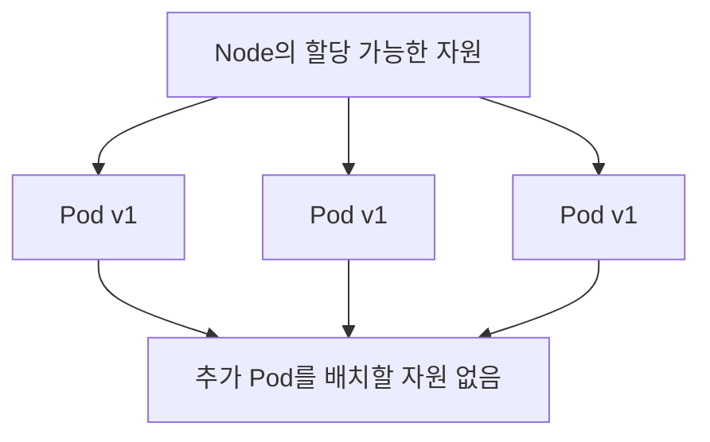

이 상태에서 새로운 버전으로 이미지를 업데이트한다.

```bash
kubectl set image deployment/feed-server \
  feed=registry.example.com/team/feed-server:1.1.0
```

Deployment는 새로운 ReplicaSet을 생성하고 새로운 Pod를 실행하려고 한다.

```text
기존 Pod: 3개 Running
새로운 Pod: 1개 Pending
```

하지만 Node에는 추가 Pod의 `requests`를 충족할 자원이 없다.

따라서 새로운 Pod는 `Pending` 상태에 머무른다.

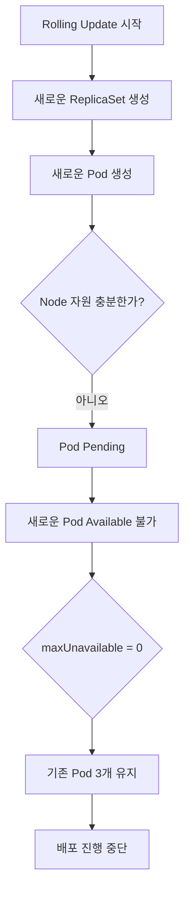

여기서 중요한 문제가 발생한다.

새로운 Pod를 실행하려면 Node 자원이 필요하다.

하지만 Node 자원을 확보하기 위해 기존 Pod를 종료할 수도 없다.

왜냐하면 `maxUnavailable: 0`이기 때문이다.

즉 다음과 같은 상태가 된다.

```text
새로운 Pod를 실행하려면
→ 자원이 필요함

자원을 확보하려면
→ 기존 Pod를 종료해야 함

하지만 maxUnavailable: 0
→ 기존 Pod를 종료할 수 없음

결과
→ 새로운 Pod Pending
→ Rolling Update 진행 불가
```

이것이 **리소스 부족과 maxUnavailable 설정이 결합되어 Rolling Update가 멈추는 대표적인 사례**이다.

#### 실제 상태 확인

```bash
kubectl get pods
```

예상 출력:

```text
NAME                           READY   STATUS    RESTARTS
feed-server-7c8d9f5b6-abc12   1/1     Running   0
feed-server-7c8d9f5b6-def34   1/1     Running   0
feed-server-7c8d9f5b6-ghi56   1/1     Running   0
feed-server-8d9f6c7b5-xyz78   0/1     Pending   0
```

새로운 Pod의 상세 정보를 확인한다.

```bash
kubectl describe pod feed-server-8d9f6c7b5-xyz78
```

예상 이벤트:

```text
Warning  FailedScheduling  0/3 nodes are available: Insufficient cpu.
```

이 메시지는 Scheduler가 Pod의 CPU requests를 만족하는 Node를 찾지 못했다는 의미이다.

---

### Pending이 발생하는 이유는 실제 CPU 사용률 때문만은 아니다

여기서 한 가지 더 중요한 점이 있다.

Kubernetes Scheduler는 일반적으로 Pod의 실제 CPU 사용량이 아니라 **requests를 기준으로 배치 가능 여부를 판단한다.**

예를 들어 Node의 자원 상황이 다음과 같다고 가정하자.

```text
Node Allocatable CPU: 2000m

기존 Pod A requests: 700m
기존 Pod B requests: 700m
기존 Pod C requests: 600m

총 requests: 2000m
```

실제 CPU 사용량은 낮을 수 있다.

```text
Pod A 실제 사용량: 100m
Pod B 실제 사용량: 100m
Pod C 실제 사용량: 100m

총 실제 사용량: 300m
```

하지만 새로운 Pod가 `cpu: 500m`를 요청한다면 Scheduler는 해당 Node에 배치할 수 없다고 판단할 수 있다.

```text
Node Allocatable: 2000m
이미 할당된 requests: 2000m
새로운 Pod requests: 500m

추가 배치 불가
```

즉 `kubectl top nodes`에서는 CPU 사용률이 낮아 보여도 새로운 Pod가 Pending 상태일 수 있다.

이를 확인하려면 다음 명령어를 사용한다.

```bash
kubectl describe node <node-name>
```

출력의 `Allocated resources` 부분을 확인하면 Node에서 이미 예약된 CPU·메모리 requests와 limits를 파악할 수 있다.

추가로 실제 스케줄링 실패 원인은 CPU·메모리 외에도 다양하다.

| 원인 | 설명 |
|---|---|
| CPU requests 부족 | 요청한 CPU를 제공할 Node가 없음 |
| Memory requests 부족 | 요청한 메모리를 제공할 Node가 없음 |
| Node Affinity | Pod가 배치할 수 있는 Node 조건이 제한됨 |
| Pod Anti-Affinity | 기존 Pod와 같은 Node에 배치할 수 없음 |
| Taints / Tolerations | Node에 배치될 권한이 없음 |
| Pod 수 제한 | Node가 허용하는 최대 Pod 수 도달 |
| ResourceQuota | Namespace의 리소스 사용 한도 초과 |
| PVC 관련 제약 | Volume 바인딩 또는 토폴로지 조건을 만족하지 못함 |

따라서 Rolling Update가 멈추었다면 단순히 CPU 사용률만 보는 것이 아니라 `FailedScheduling` 이벤트의 구체적인 원인을 확인해야 한다.

---

### 리소스 부족으로 멈춘 Rolling Update 해결 방법

가장 근본적인 방법은 새로운 Pod를 실행할 수 있을 만큼 충분한 클러스터 자원을 확보하는 것이다.

그러나 현재 운영 환경에서 즉시 Node를 늘릴 수 없을 수도 있다.

이 경우에는 Rolling Update 설정을 변경해 배포를 진행하는 방법도 고려할 수 있다.

#### 방법 1. Node 리소스 확보

기존 서비스의 처리 용량을 유지하면서 배포하려면 새로운 Pod를 실행할 여유 자원이 있어야 한다.

예를 들어 다음과 같은 상태를 만든다.

```text
기존 Pod: 3개
추가 실행 가능한 Pod: 1개

maxSurge: 1
maxUnavailable: 0
```

이 경우 다음 순서로 배포할 수 있다.

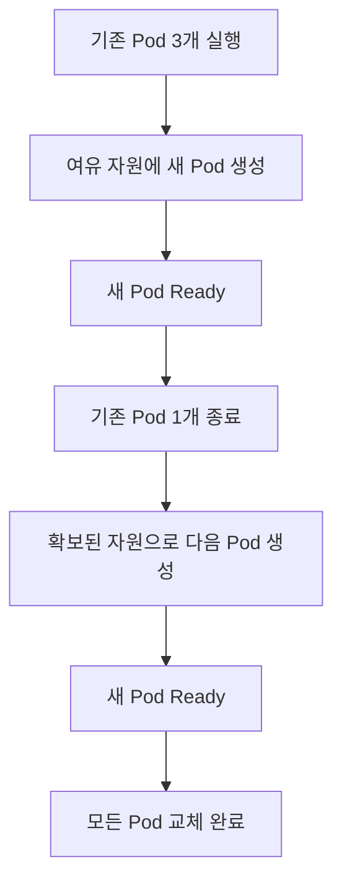

기존 Pod 3개의 Available 상태를 유지하면서 점진적으로 업데이트할 수 있다.

이 방식은 서비스 안정성 측면에서 우선적으로 고려할 만한 방법이다.

#### 방법 2. maxUnavailable을 1 이상으로 설정

Node를 추가할 수 없는 환경이라면 `maxUnavailable`을 1로 조정할 수 있다.

```yaml
strategy:
  type: RollingUpdate
  rollingUpdate:
    maxSurge: 1
    maxUnavailable: 1
```

이 설정은 목표 Pod 3개 중 최소 2개만 Available 상태를 유지하도록 허용한다.

배포 과정은 다음과 같이 진행될 수 있다.

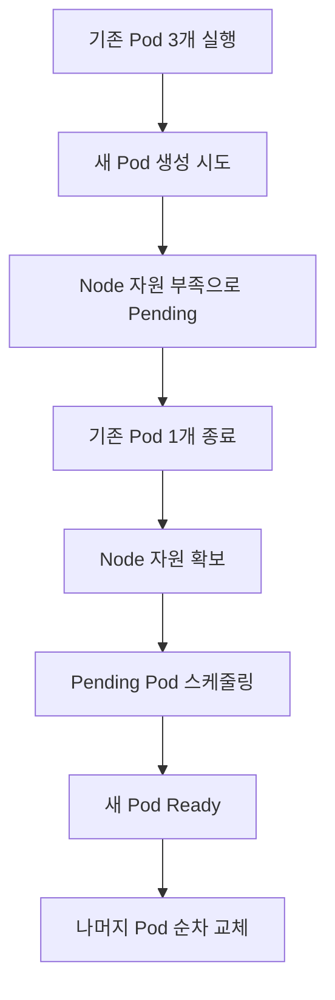

기존 Pod 1개를 종료하면 그 Pod가 사용하던 자원을 새로운 Pod에 할당할 수 있다.

이렇게 하면 추가 Node 없이도 Rolling Update를 진행할 가능성이 생긴다.

다만 **배포를 진행할 수 있다는 것과 서비스가 안정적으로 동작한다는 것은 별개의 문제**이다.

기존 Pod 3개가 처리하던 트래픽을 일시적으로 Pod 2개가 처리해야 하기 때문이다.

따라서 이 방법은 서비스 처리 용량에 충분한 여유가 있는 경우에 사용해야 한다.

#### 명령어로 변경하기

다음 명령어로 Deployment의 Rolling Update 설정을 변경할 수 있다.

```bash
kubectl patch deployment feed-server \
  --type=merge \
  -p '{"spec":{"strategy":{"rollingUpdate":{"maxSurge":1,"maxUnavailable":1}}}}'
```

정상적으로 반영되면 다음과 같은 메시지가 출력된다.

```text
deployment.apps/feed-server patched
```

설정이 변경되었는지 확인한다.

```bash
kubectl get deployment feed-server -o yaml
```

변경 후에도 실제 Pod가 정상적으로 배치되고 준비되는지 반드시 확인해야 한다.

```bash
kubectl rollout status deployment/feed-server
```

`maxUnavailable` 값을 수정하는 것만으로 Node 부족 문제 자체가 해결되는 것은 아니다.

기존 Pod 종료로 자원을 회수할 수 있고, 새 Pod의 requests 및 스케줄링 조건을 만족해야 배포가 이어질 수 있다.

---

### maxUnavailable이 너무 크면 서비스 장애가 발생할 수 있다

`maxUnavailable`을 늘리면 리소스가 부족한 환경에서도 Rolling Update를 진행할 여지가 생긴다.

하지만 너무 크게 설정하면 오히려 서비스에 심각한 영향을 줄 수 있다.

#### replicas가 3이고 maxUnavailable이 2인 경우

```yaml
replicas: 3

strategy:
  type: RollingUpdate
  rollingUpdate:
    maxSurge: 1
    maxUnavailable: 2
```

이 설정에서는 최소 1개의 Pod만 Available 상태를 유지하면 된다.

```text
기존 Pod: 3개

배포 진행 중
→ 기존 Pod 2개가 종료될 수 있음

최소 Available Pod: 1개
```

새로운 Pod가 아직 준비되지 않았다면 다음과 같은 상태가 생길 수 있다.

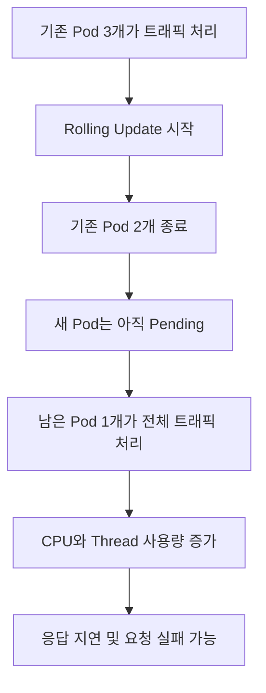

기존 Pod 3개가 각각 비슷한 양의 트래픽을 처리하고 있었다면, 남은 Pod 1개의 처리 부담이 크게 증가한다.

트래픽이 균등하게 분산되었다고 단순 가정할 경우, 각 Pod의 요청 처리량은 다음처럼 변할 수 있다.

```text
기존

Pod A: 100 RPS
Pod B: 100 RPS
Pod C: 100 RPS

전체: 300 RPS
```

Pod 2개가 제외되면 다음과 같이 된다.

```text
변경 후

Pod A: 최대 300 RPS 처리 필요
Pod B: 종료
Pod C: 종료
```

하지만 Pod A가 최대 150 RPS밖에 처리하지 못한다면 전체 요청을 정상적으로 처리할 수 없다.

이 경우 다음 문제가 발생할 수 있다.

- 응답 시간 증가
- CPU 사용률 증가
- Thread Pool 포화
- Connection Timeout
- HTTP 5xx 오류
- Readiness Probe 실패

특히 Readiness Probe가 실패해 남은 Pod마저 Service 트래픽 대상에서 제외된다면 서비스가 사실상 중단되는 상황도 발생할 수 있다.

#### replicas가 3이고 maxUnavailable이 3인 경우

```yaml
replicas: 3

strategy:
  type: RollingUpdate
  rollingUpdate:
    maxSurge: 1
    maxUnavailable: 3
```

이 설정에서는 업데이트 과정에서 Available Pod가 0개까지 감소하는 것을 허용한다.

```text
replicas: 3
maxUnavailable: 3

최소 Available Pod: 0
```

새로운 Pod가 준비되기 전에 기존 Pod가 모두 종료될 수 있다.

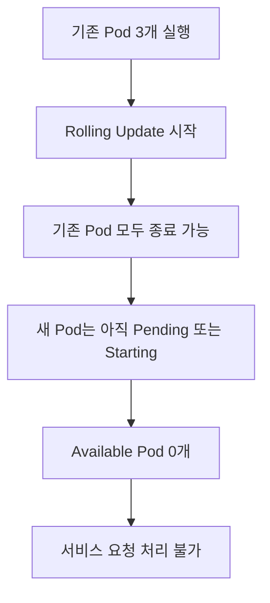

Rolling Update를 사용하는 목적 중 하나는 서비스 중단을 최소화하는 것이다.

그런데 `maxUnavailable`을 replicas와 동일하게 설정하면 이러한 목적을 달성하지 못할 수 있다.

따라서 Rolling Update를 사용한다는 이유만으로 무중단 배포가 보장된다고 생각해서는 안 된다.

---

### maxUnavailable은 현재 트래픽 처리 용량을 기준으로 결정해야 한다

`maxUnavailable`을 결정할 때 가장 중요한 것은 현재 Pod 수량이 아니라 **최소 몇 개의 Pod가 있어야 현재 트래픽을 안정적으로 처리할 수 있는가**이다.

예를 들어 서비스의 최대 예상 트래픽이 800 RPS이고 Pod 하나가 안정적으로 처리할 수 있는 요청량이 250 RPS라고 가정하자.

필요한 최소 Pod 수량은 다음과 같이 계산할 수 있다.

```text
필요 Pod 수량
= ceil(최대 예상 RPS / Pod당 안정적 처리 RPS)

= ceil(800 / 250)
= 4
```

현재 replicas가 5라면 다음과 같다.

```text
현재 Pod 수량: 5
최소 필요 Pod 수량: 4
```

이 경우 이론적으로 1개의 Pod가 일시적으로 제외되어도 트래픽을 처리할 수 있다.

```text
maxUnavailable ≤ 5 - 4

maxUnavailable ≤ 1
```

따라서 `maxUnavailable: 1` 정도를 검토할 수 있다.

다만 실제 운영에서는 네트워크 연결 분산, Pod별 처리량 차이, 트래픽 급증, 재시도 요청, 외부 의존성 등을 고려해 추가적인 여유를 확보해야 한다.

반대로 현재 Pod 3개가 모두 높은 CPU 사용률로 동작하고 있다면 `maxUnavailable: 1`조차 위험할 수 있다.

**현재 replicas에서 몇 개를 줄일 수 있는지가 아니라, 몇 개를 줄여도 안정적으로 운영할 수 있는지를 기준으로 설정해야 한다.**

---

### 안정적인 Rolling Update 전략

서비스 요구사항에 따라 적절한 Rolling Update 설정은 달라진다.

| 운영 상황 | maxSurge | maxUnavailable | 고려사항 |
|---|---:|---:|---|
| 가용성이 매우 중요한 API 서비스 | 1 이상 | 0 | 새 Pod 실행을 위한 여유 자원 필요 |
| 일반적인 백엔드 서비스 | 1 | 0 또는 1 | 실제 처리 용량 기준으로 선택 |
| Node 자원이 제한적인 환경 | 1 | 1 | 일시적인 처리량 감소 허용 필요 |
| 배포 중 일부 서비스 저하 허용 | 1 | 2 이상 | 높은 장애 위험을 감수해야 함 |
| 완전한 재생성 방식 | 해당 없음 | 해당 없음 | `Recreate` 전략 검토 |

가용성이 중요한 서비스라면 다음 설정을 우선 검토할 수 있다.

```yaml
strategy:
  type: RollingUpdate
  rollingUpdate:
    maxSurge: 1
    maxUnavailable: 0
```

이 설정은 기존 서비스 처리 용량을 유지하면서 새로운 Pod를 준비시키는 방향으로 동작한다.

다만 다음 조건이 함께 만족되어야 한다.

1. 새로운 Pod를 실행할 Node 자원이 충분해야 한다.
2. Readiness Probe가 실제 트래픽 처리 가능 상태를 정확하게 판단해야 한다.
3. Pod 종료 시 Graceful Shutdown이 동작해야 한다.
4. 새로운 Pod가 정상적으로 시작될 수 있어야 한다.
5. Service와 Ingress가 Ready 상태의 Pod를 정상적으로 사용해야 한다.

Rolling Update 설정 하나만으로 무중단 배포를 완성할 수는 없다.

---

### 배포 중 장애를 방지하기 위한 Readiness Probe

Rolling Update에서는 새로운 Pod가 생성되었다는 사실보다 **실제로 요청을 처리할 준비가 되었는지**가 중요하다.

예를 들어 Spring Boot 애플리케이션은 컨테이너가 실행되더라도 다음 작업이 완료되지 않았을 수 있다.

- Spring ApplicationContext 초기화
- 데이터베이스 연결 준비
- Cache 초기화
- 필수 외부 시스템 연결
- 애플리케이션 내부 리소스 준비

이 상태에서 새로운 Pod로 요청이 전달되면 오류가 발생할 수 있다.

Readiness Probe를 사용하면 Kubernetes가 해당 Pod의 준비 상태를 확인한 뒤 Service의 트래픽 대상으로 포함할 수 있다.

```yaml
readinessProbe:
  httpGet:
    path: /actuator/health/readiness
    port: 8080
  initialDelaySeconds: 5
  periodSeconds: 5
  timeoutSeconds: 2
  failureThreshold: 3
  successThreshold: 1
```

Spring Boot Actuator를 사용하는 경우 다음 설정도 함께 고려할 수 있다.

```yaml
management:
  endpoint:
    health:
      probes:
        enabled: true
```

Rolling Update와 Readiness Probe는 다음과 같이 연결된다.

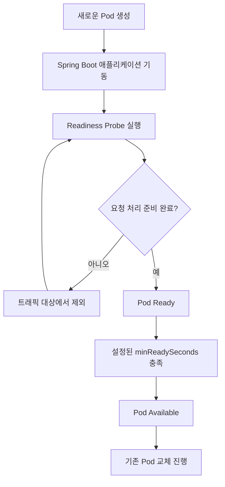

여기서 `minReadySeconds`를 사용하면 새로운 Pod가 Ready 상태에 진입한 직후가 아니라 일정 시간 동안 안정적으로 Ready 상태를 유지한 후 Available로 판단하도록 할 수 있다.

```yaml
spec:
  minReadySeconds: 10
```

새로운 Pod가 시작 직후 잠깐 Ready 상태가 되었다가 다시 실패하는 문제가 있다면 이러한 설정을 검토할 수 있다.

---

### 배포가 멈췄을 때 Deployment 상태 확인

Rolling Update가 정상적으로 진행되지 않는다면 Deployment 상태를 확인해야 한다.

```bash
kubectl describe deployment feed-server
```

예를 들어 다음과 같은 상태가 나타날 수 있다.

```text
Replicas: 3 desired | 1 updated | 4 total | 3 available | 1 unavailable

StrategyType: RollingUpdate

RollingUpdateStrategy:
  0 max unavailable, 1 max surge
```

이 출력은 다음을 의미한다.

| 항목 | 의미 |
|---|---|
| `3 desired` | 목표 Pod 수량 3개 |
| `1 updated` | 새로운 Pod Template을 사용하는 Pod 1개 |
| `4 total` | 현재 생성된 Pod 4개 |
| `3 available` | 사용 가능한 Pod 3개 |
| `1 unavailable` | 사용 불가능한 Pod 1개 |

새로운 Pod가 Pending 상태라면 `updated`에 포함되더라도 `available`에는 포함되지 않는다.

즉 **새로운 Pod가 생성되었다는 사실만으로 배포가 성공한 것은 아니다.**

#### Deployment Conditions 확인

Deployment에는 현재 배포 상태를 나타내는 Condition이 존재한다.

```bash
kubectl get deployment feed-server -o yaml
```

다음과 같은 상태가 나타날 수 있다.

```yaml
status:
  conditions:
    - type: Available
      status: "True"
      reason: MinimumReplicasAvailable

    - type: Progressing
      status: "False"
      reason: ProgressDeadlineExceeded
```

`ProgressDeadlineExceeded`는 지정된 시간 동안 Deployment가 정상적으로 진행되지 않았다는 의미이다.

예를 들어 다음과 같이 설정할 수 있다.

```yaml
spec:
  progressDeadlineSeconds: 180
```

이 경우 Deployment는 일정 시간 동안 배포 진행이 이루어지지 않으면 실패 상태를 보고할 수 있다.

하지만 중요한 점이 있다.

**`progressDeadlineSeconds`를 초과했다고 해서 Kubernetes가 자동으로 이전 버전으로 롤백하는 것은 아니다.**

Deployment Controller는 진행 실패 상태를 기록하지만, 기본적으로 자동 롤백까지 수행하지 않는다.

별도의 배포 자동화 시스템이 이를 감지해 롤백하거나 운영자가 직접 조치해야 한다.

---

### Rolling Update 중 ReplicaSet 상태 확인

Deployment는 새로운 버전의 Pod를 직접 생성하지 않고 새로운 ReplicaSet을 통해 생성한다.

따라서 배포 장애가 발생했다면 ReplicaSet도 함께 확인해야 한다.

```bash
kubectl get replicasets
```

또는 축약 명령어를 사용할 수 있다.

```bash
kubectl get rs
```

예상 출력:

```text
NAME                     DESIRED   CURRENT   READY
feed-server-7c8d9f5b6    3         3         3
feed-server-8d9f6c7b5    1         1         0
```

이 경우 다음과 같이 해석할 수 있다.

```text
기존 ReplicaSet
→ Pod 3개
→ 모두 Ready

새로운 ReplicaSet
→ Pod 1개 생성
→ Ready Pod 0개
```

새로운 ReplicaSet의 Pod가 준비되지 못했기 때문에 배포가 진행되지 않는 것이다.

ReplicaSet 이름 뒤에는 일반적으로 Pod Template을 구분하기 위한 해시값이 포함된다.

예를 들어 다음 두 ReplicaSet은 서로 다른 Pod Template을 기반으로 생성되었다.

```text
feed-server-7c8d9f5b6
feed-server-8d9f6c7b5
```

각 ReplicaSet을 구분하면 어떤 Pod가 기존 버전이고 어떤 Pod가 새로운 버전인지 파악하기 쉽다.

더 정확하게 확인하려면 ReplicaSet의 이미지와 Pod Template을 함께 확인한다.

```bash
kubectl describe rs feed-server-8d9f6c7b5
```

---

### 배포가 실패했을 때 롤백하는 방법

Rolling Update가 정상적으로 진행되지 않는다면 문제를 해결하는 방법은 크게 두 가지이다.

첫 번째는 현재 배포 설정을 수정해 진행 중인 업데이트를 정상적으로 완료하는 것이다.

두 번째는 이전에 정상적으로 실행되던 버전으로 롤백한 후 문제를 수정하고 다시 배포하는 것이다.

특히 운영 환경에서 서비스 영향이 발생하고 있다면 무리하게 문제를 수정하면서 배포를 계속 진행하는 것보다 **먼저 안정적인 버전으로 복구하는 방식**이 적절할 수 있다.

다만 롤백 역시 새로운 리소스 변경을 유발하므로 현재 Node 자원과 기존 ReplicaSet의 상태를 확인한 후 수행해야 한다.

---

### Deployment 롤백

Kubernetes Deployment는 이전 배포 이력을 기반으로 롤백할 수 있다.

#### 1. 현재 배포 이력 확인

```bash
kubectl rollout history deployment/feed-server
```

예상 출력:

```text
deployment.apps/feed-server

REVISION  CHANGE-CAUSE
1         <none>
2         <none>
3         <none>
```

여기서 `REVISION`은 Deployment의 Pod Template 변경 이력을 나타낸다.

`CHANGE-CAUSE`가 `<none>`으로 표시되는 것은 변경 사유가 별도로 기록되지 않았다는 의미이다.

현재 Deployment의 이전 설정을 확인하려면 다음 명령어를 사용할 수 있다.

```bash
kubectl rollout history deployment/feed-server --revision=2
```

예상 출력:

```text
deployment.apps/feed-server revision 2

Containers:
  feed:
    Image: registry.example.com/team/feed-server:1.0.0
```

#### 2. 이전 버전으로 롤백

```bash
kubectl rollout undo deployment/feed-server
```

정상적으로 요청이 반영되면 다음과 같은 메시지가 출력된다.

```text
deployment.apps/feed-server rolled back
```

이 명령어는 이전 Deployment Revision의 Pod Template으로 되돌리는 작업을 수행한다.

특정 Revision으로 롤백할 수도 있다.

```bash
kubectl rollout undo deployment/feed-server --to-revision=2
```

#### 3. 롤백 완료 확인

```bash
kubectl rollout status deployment/feed-server
```

Pod 상태도 확인한다.

```bash
kubectl get pods
```

ReplicaSet 상태도 확인한다.

```bash
kubectl get rs
```

롤백이 정상적으로 완료되면 이전 버전의 Pod Template을 사용하는 ReplicaSet이 다시 확장되고, 문제가 있었던 새로운 버전의 ReplicaSet은 축소된다.

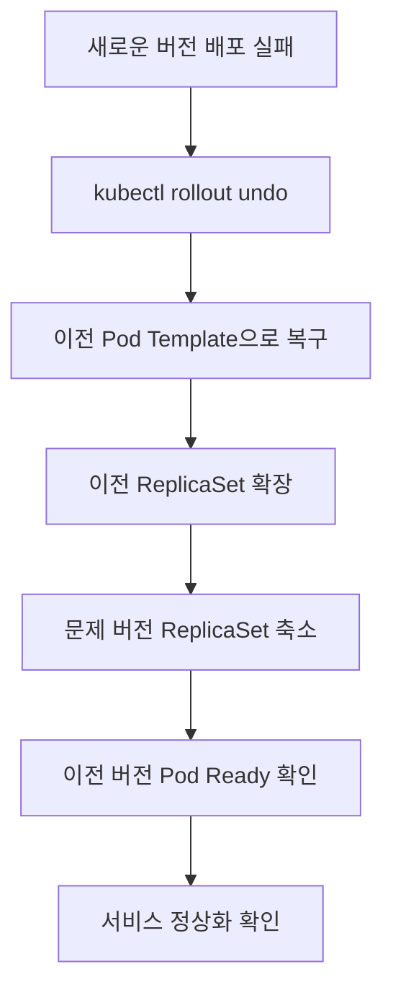

단, 롤백 대상 버전 역시 현재 Node 자원으로 실행할 수 있어야 한다.

기존 ReplicaSet의 Pod가 이미 많이 종료되었다면 롤백 과정에서도 Pod 생성과 스케줄링 시간이 필요할 수 있다.

---

### 롤백하면 모든 설정이 이전으로 돌아갈까?

여기서 주의할 점이 있다.

`kubectl rollout undo`는 Deployment의 이전 Revision을 기반으로 복구하지만, Deployment의 모든 설정을 무조건 이전 상태로 되돌리는 기능은 아니다.

Deployment Revision은 기본적으로 `.spec.template` 변경을 기준으로 생성된다.

따라서 이미지나 Pod Template에 포함된 환경 변수, 컨테이너 리소스 설정 등은 롤백 대상이 될 수 있다.

반면 다음과 같은 설정은 이전 Revision으로 자동 복구되지 않는다.

- Deployment의 `replicas`
- Rolling Update의 `maxSurge`
- Rolling Update의 `maxUnavailable`
- Service 설정
- 별도로 관리되는 ConfigMap과 Secret의 내용
- 외부 데이터베이스 스키마

예를 들어 배포 장애를 해결하기 위해 다음 설정을 변경했다고 가정하자.

```yaml
strategy:
  rollingUpdate:
    maxSurge: 1
    maxUnavailable: 2
```

이 상태에서 `kubectl rollout undo`를 실행해도 `maxUnavailable`이 자동으로 이전 값으로 돌아가는 것은 아니다.

따라서 롤백 후에도 다음 명령어로 실제 Deployment 설정을 확인해야 한다.

```bash
kubectl get deployment feed-server -o yaml
```

특히 GitOps 또는 Helm으로 관리하는 환경이라면 클러스터의 현재 설정과 배포 관리 시스템에 선언된 설정이 일치하는지도 확인해야 한다.

---

### Helm으로 배포한 경우 롤백하기

Helm을 사용해 애플리케이션을 배포했다면 Deployment만 수정하기보다 Helm Release 단위로 롤백하는 것이 적절할 수 있다.

Helm은 Chart와 Values를 기반으로 여러 Kubernetes 리소스를 함께 관리하기 때문이다.

예를 들어 다음과 같이 배포했다고 가정하자.

```bash
helm upgrade feed-server ./feed-server-chart \
  --namespace production
```

Helm Release의 이력을 확인한다.

```bash
helm history feed-server --namespace production
```

예상 출력:

```text
REVISION  STATUS       DESCRIPTION
1         superseded   Install complete
2         superseded   Upgrade complete
3         deployed     Upgrade complete
```

이전 Revision인 2로 롤백하려면 다음 명령어를 사용한다.

```bash
helm rollback feed-server 2 \
  --namespace production \
  --wait \
  --timeout 5m
```

주요 옵션은 다음과 같다.

| 옵션 | 설명 |
|---|---|
| `feed-server` | Helm Release 이름 |
| `2` | 롤백할 Release Revision |
| `--namespace` | Release가 설치된 Namespace |
| `--wait` | 관련 리소스가 준비될 때까지 대기 |
| `--timeout` | 대기 제한 시간 |

Helm Release Revision과 Kubernetes Deployment Revision은 서로 다른 이력이라는 점에 주의해야 한다.

Helm은 Chart가 관리하는 리소스 집합을 대상으로 이전 Release 상태를 복구한다.

반면 `kubectl rollout undo`는 특정 Deployment의 Pod Template 이력을 기준으로 동작한다.

따라서 Helm으로 운영하는 서비스라면 가능하면 Helm을 통해 변경 및 롤백 이력을 일관되게 관리하는 것이 좋다.

---

### Pod를 직접 삭제하면 문제가 해결될까?

배포가 정상적으로 완료되지 않을 때 흔히 시도하는 방법 중 하나가 문제 Pod를 직접 삭제하는 것이다.

```bash
kubectl delete pod <pod-name>
```

하지만 ReplicaSet이 관리하는 Pod라면 단순 삭제로 문제가 해결되지 않을 수 있다.

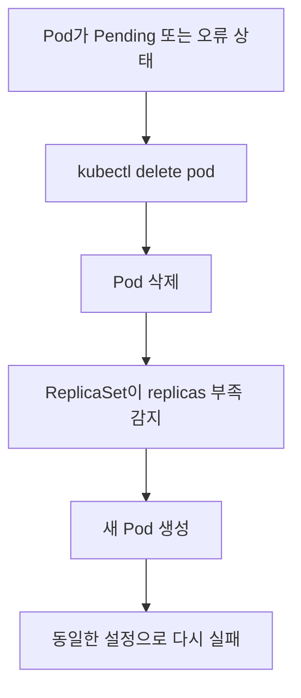

Pod를 삭제해도 ReplicaSet이 원하는 Pod 수량을 유지하려고 하기 때문이다.

예를 들어 새로운 ReplicaSet의 이미지 태그가 잘못되었다면, 해당 Pod를 삭제하더라도 같은 이미지 태그를 사용하는 Pod가 다시 생성된다.

```text
잘못된 이미지 태그
    ↓
Pod ImagePullBackOff
    ↓
Pod 삭제
    ↓
ReplicaSet이 새 Pod 생성
    ↓
동일한 ImagePullBackOff
```

근본적인 원인이 ReplicaSet의 Pod Template에 남아 있다면 동일한 문제가 반복된다.

따라서 문제 Pod를 삭제하기 전에 Deployment와 ReplicaSet의 설정을 확인해야 한다.

---

### ReplicaSet을 직접 수정하거나 삭제할 때 주의할 점

Deployment가 관리하는 ReplicaSet을 직접 수정하는 것도 주의해야 한다.

예를 들어 배포가 멈췄다는 이유로 ReplicaSet의 replicas를 직접 변경했다고 가정하자.

```bash
kubectl scale rs <replicaset-name> --replicas=0
```

그러나 상위 Deployment Controller는 자신의 원하는 상태를 유지하려고 한다.

따라서 사용자가 변경한 ReplicaSet의 replicas 값이 다시 조정되거나, Deployment의 Rolling Update 상태와 맞지 않는 결과가 나타날 수 있다.

또한 이전 ReplicaSet을 무분별하게 삭제하면 롤백에 필요한 이력이 사라질 수 있다.

#### ReplicaSet의 소유 관계 확인

ReplicaSet이 어떤 Deployment에 속하는지 확인할 수 있다.

```bash
kubectl get rs <replicaset-name> \
  -o jsonpath='{.metadata.ownerReferences[*].name}{"\n"}'
```

예상 출력:

```text
feed-server
```

Pod가 어떤 ReplicaSet에 속하는지도 확인할 수 있다.

```bash
kubectl get pod <pod-name> \
  -o jsonpath='{.metadata.ownerReferences[*].name}{"\n"}'
```

예상 출력:

```text
feed-server-8d9f6c7b5
```

이러한 소유 관계를 통해 다음 구조를 확인할 수 있다.

```mermaid
flowchart TD
    A["Deployment: feed-server"] --> B["ReplicaSet: old"]
    A --> C["ReplicaSet: new"]

    B --> D["기존 Pod 3개"]
    C --> E["새로운 Pod 1개"]
```

배포 장애가 발생했다고 해서 Pod나 ReplicaSet을 무조건 직접 삭제하는 것은 적절하지 않다.

가능하면 다음 순서를 우선 적용한다.

1. Deployment 상태 확인
2. ReplicaSet과 Pod의 관계 확인
3. 배포 실패 원인 확인
4. Deployment 설정 수정 또는 롤백
5. 정상화 여부 확인
6. 필요할 때만 남아 있는 비정상 리소스 정리

수동 정리가 꼭 필요한 경우에는 해당 ReplicaSet의 소유 관계와 배포 이력, 현재 트래픽 처리 여부를 확인해야 한다.

특히 롤백을 위해 보관 중인 ReplicaSet은 함부로 삭제하지 않는 것이 좋다.

---

### revisionHistoryLimit을 이용한 이전 ReplicaSet 관리

Deployment는 이전 버전으로 롤백할 수 있도록 과거 ReplicaSet을 보관한다.

이때 보관할 이력의 개수를 지정하는 설정이 `revisionHistoryLimit`이다.

```yaml
spec:
  revisionHistoryLimit: 10
```

위 설정은 이전 ReplicaSet 이력을 최대 10개까지 보관하도록 지정한다.

기본값도 10이다.

이전 ReplicaSet의 replicas는 일반적으로 0이므로 Pod를 실행하지 않지만, ReplicaSet 객체는 클러스터에 남아 있다.

```text
Deployment: feed-server

ReplicaSet v1 → replicas: 0
ReplicaSet v2 → replicas: 0
ReplicaSet v3 → replicas: 3
```

이러한 이력이 있어야 이전 Pod Template으로 롤백할 수 있다.

다음처럼 설정할 수도 있다.

```yaml
revisionHistoryLimit: 0
```

하지만 이 경우 이전 ReplicaSet 이력이 정리되어 Deployment의 이전 Revision으로 롤백할 수 없게 된다.

배포 안정성이 중요한 운영 환경에서는 무조건 이 값을 0으로 설정하기보다 적절한 수량의 이력을 유지하는 것이 좋다.

---

### 배포 장애 발생 시 권장 복구 순서

실제 운영 환경에서는 배포가 멈췄다고 해서 바로 Node를 추가하거나 ReplicaSet을 삭제하기보다, 원인을 순서대로 확인하는 것이 중요하다.

다음과 같은 흐름으로 접근할 수 있다.

```mermaid
flowchart TD
    A["Rolling Update 실패"] --> B["Deployment와 Pod 상태 확인"]
    B --> C{"Pod 상태는?"}

    C -->|"ImagePullBackOff"| D["이미지 주소와 인증 확인"]
    C -->|"Pending"| E["Node 자원 및 스케줄링 확인"]
    C -->|"CrashLoopBackOff"| F["애플리케이션 로그 확인"]
    C -->|"Running / NotReady"| G["Readiness Probe 확인"]

    D --> H["원인 수정 가능 여부 판단"]
    E --> H
    F --> H
    G --> H

    H --> I{"서비스 영향이 있는가?"}

    I -->|"없음"| J["설정 수정 후 배포 재시도"]
    I -->|"있음"| K["안정적인 이전 버전으로 롤백 검토"]

    J --> L["Rollout 상태 확인"]
    K --> L

    L --> M["Pod / ReplicaSet / Service 상태 검증"]
```

특히 리소스 부족이 발생한 경우에는 다음 사항을 확인하는 것이 좋다.

| 확인 항목 | 확인 이유 |
|---|---|
| Node Allocatable | 새로운 Pod를 배치할 실제 자원 여유 확인 |
| Pod requests | Scheduler가 요구하는 자원량 확인 |
| maxSurge | 추가 생성 가능한 Pod 수 확인 |
| maxUnavailable | 배포 중 유지할 최소 Available Pod 수 확인 |
| minReadySeconds | 새로운 Pod를 Available로 판단하는 시점 확인 |
| Readiness Probe | 신규 Pod가 트래픽을 받을 준비가 되었는지 확인 |
| progressDeadlineSeconds | 배포 진행 실패 판단 기준 확인 |
| ReplicaSet | 기존/신규 버전별 Pod 수 확인 |
| Deployment Revision | 롤백 가능한 이력 확인 |

---

### 실무에서 고려해야 할 추가 사항

#### 1. Rolling Update를 위한 여유 리소스를 확보해야 한다

운영 중인 Pod가 Node 자원을 모두 사용하고 있다면 배포 시 새로운 Pod를 생성하기 어렵다.

따라서 평상시 자원 사용량뿐 아니라 Rolling Update에 필요한 추가 리소스도 고려해야 한다.

예를 들어 다음과 같은 서비스가 있다고 가정하자.

```text
replicas: 5
Pod당 CPU requests: 500m
maxSurge: 1
```

기존 Pod에 필요한 CPU requests 총합은 다음과 같다.

```text
5 × 500m = 2500m
```

Rolling Update에서 새 Pod 1개를 추가로 실행하려면 다음과 같은 자원이 필요하다.

```text
추가 CPU requests: 500m

필요한 총 CPU requests:
2500m + 500m = 3000m
```

따라서 해당 워크로드를 배치할 수 있는 Node들의 자원과 스케줄링 제약을 고려해 최소 500m의 추가 CPU requests를 수용할 여유가 있어야 한다.

이 계산에는 Memory requests, DaemonSet, 시스템 예약 자원, Pod 배치 제약 등도 함께 고려해야 한다.

단순히 클러스터 전체 CPU가 충분하다고 해서 반드시 해당 Pod를 배치할 수 있는 것은 아니다.

#### 2. maxUnavailable이 0이어도 무조건 무중단은 아니다

`maxUnavailable: 0`은 Deployment Controller가 업데이트 중 목표 Available Pod 수를 유지하도록 제어하는 설정이다.

하지만 다음과 같은 상황에서는 실제 서비스 장애가 발생할 수 있다.

- Readiness Probe가 잘못 설정된 경우
- 기존 Pod에 예상치 못한 장애가 발생한 경우
- Node 자체가 장애를 일으킨 경우
- 애플리케이션이 연결 종료를 안전하게 처리하지 못하는 경우
- 새 Pod가 Ready 상태이지만 실제 요청을 정상적으로 처리하지 못하는 경우

즉 `maxUnavailable: 0`은 Rolling Update 중 가용성을 높이기 위한 설정이지 서비스 장애를 완전히 방지하는 보장 장치는 아니다.

#### 3. Graceful Shutdown이 중요하다

Rolling Update 과정에서 기존 Pod는 종료된다.

이때 이미 처리 중인 요청이 있다면 가능하면 해당 요청을 정상적으로 마무리해야 한다.

Spring Boot에서는 다음과 같은 설정을 사용할 수 있다.

```yaml
server:
  shutdown: graceful

spring:
  lifecycle:
    timeout-per-shutdown-phase: 30s
```

Kubernetes Deployment에도 종료 유예 시간을 지정할 수 있다.

```yaml
spec:
  template:
    spec:
      terminationGracePeriodSeconds: 40
```

이를 통해 Pod 종료 시 애플리케이션이 진행 중인 작업을 정리할 시간을 확보할 수 있다.

다만 실제 무중단 종료를 위해서는 Service Endpoint 전파 지연, 기존 연결, Ingress 및 Load Balancer 동작도 함께 고려해야 한다.

#### 4. 이미지 태그는 가능한 한 변경 불가능하게 관리한다

동일한 이미지 태그에 서로 다른 이미지를 반복 Push하면 어떤 Pod가 실제로 어떤 이미지를 실행하고 있는지 파악하기 어려워질 수 있다.

예를 들어 다음과 같은 방식은 주의가 필요하다.

```yaml
image: registry.example.com/team/feed-server:latest
```

운영 환경에서는 다음과 같이 빌드 버전이나 커밋을 식별할 수 있는 태그를 사용하는 것이 좋다.

```yaml
image: registry.example.com/team/feed-server:1.1.0
```

더 엄격하게 이미지를 고정하려면 이미지 Digest를 사용할 수도 있다.

```yaml
image: registry.example.com/team/feed-server@sha256:<image-digest>
```

이렇게 하면 어떤 이미지가 배포되었는지 명확하게 추적할 수 있다.

#### 5. HPA를 사용한다면 replicas 변경 주체를 고려해야 한다

HPA가 Deployment의 replicas를 관리하는 환경에서는 Deployment YAML이나 수동 스케일 명령어로 replicas를 변경하더라도 HPA가 이후 다시 조정할 수 있다.

따라서 트래픽이 높은 서비스에서 배포 전 replicas를 임의로 변경할 때는 HPA의 최소·최대 replicas 설정과 현재 메트릭도 함께 확인해야 한다.

또한 HPA가 Pod 수를 늘려도 Node 자원이 부족하면 새로운 Pod는 Pending 상태가 될 수 있다.

이 경우에는 Cluster Autoscaler나 Node Auto Provisioning 같은 Node 수준의 확장 기능도 함께 고려할 수 있다.

#### 6. 배포 실패 후 무조건 재시작하는 것은 해결책이 아니다

`kubectl rollout restart`는 Deployment의 Pod Template을 변경해 새로운 롤아웃을 시작하게 만드는 명령어이다.

```bash
kubectl rollout restart deployment/feed-server
```

그러나 이미지 태그가 존재하지 않거나 Node 리소스가 부족한 상태라면 재시작만으로 근본 문제가 해결되지 않는다.

오히려 불필요한 Pod 교체로 서비스에 영향을 줄 수 있다.

배포 장애가 발생했을 때는 재시작보다 **왜 새로운 Pod가 Ready 또는 Available 상태가 되지 못했는지**를 먼저 확인해야 한다.

#### 7. 배포 자동화에서는 실패를 감지하고 대응할 수 있어야 한다

수동 배포에서는 운영자가 `kubectl rollout status`를 확인할 수 있지만, CI/CD 환경에서는 배포 실패를 자동으로 감지하는 구성이 필요하다.

예를 들어 다음 명령어를 사용할 수 있다.

```bash
kubectl rollout status deployment/feed-server --timeout=180s
```

배포가 정상적으로 완료되면 종료 코드 0을 반환한다.

반면 제한 시간 내에 완료되지 않거나 실패 상태가 확인되면 0이 아닌 종료 코드를 반환할 수 있다.

배포 자동화에서는 이 결과를 기준으로 후속 작업을 중단하거나 알림을 전송할 수 있다.

다만 `--timeout`은 명령어가 대기하는 시간이고, Deployment의 `progressDeadlineSeconds`는 Deployment Controller가 배포 진행 상태를 판단하는 시간이라는 점에서 서로 다르다.

---

### Rolling Update 설정에 따른 장애 가능성 비교

지금까지 살펴본 내용을 다음과 같이 비교할 수 있다.

| 상황 | maxSurge | maxUnavailable | 발생 가능한 문제 |
|---|---:|---:|---|
| Node 자원 충분 | 1 | 0 | 비교적 안정적인 순차 배포 |
| Node 자원 부족 | 1 | 0 | 신규 Pod Pending, 배포 정체 |
| Node 자원 부족 | 1 | 1 | 기존 Pod 종료 후 배포 가능성 증가 |
| Node 자원 부족 | 1 | 2 | 배포 중 처리 용량 급감 가능 |
| Node 자원 부족 | 1 | 3 | Available Pod 0개까지 감소 가능 |
| Readiness Probe 오류 | 1 | 0 | 새 Pod 준비 실패로 배포 정체 |
| 이미지 태그 오류 | 1 | 0 | ImagePullBackOff로 배포 정체 |
| 새 버전 애플리케이션 오류 | 1 | 0 | CrashLoopBackOff 또는 NotReady |
| ReplicaSet 임의 수정 | 다양 | 다양 | Deployment와 실제 상태 사이의 불일치 가능 |

핵심은 `maxSurge`와 `maxUnavailable` 중 어느 하나가 절대적으로 좋은 설정은 아니라는 것이다.

**Node 자원과 서비스 처리 용량을 동시에 고려해야 적절한 값을 결정할 수 있다.**

---

### 배포 장애를 예방하기 위한 운영 전략

실무에서는 Rolling Update 자체가 문제가 아니라, 배포를 고려하지 않은 리소스 설계와 가용성 정책이 장애를 유발하는 경우가 많다.

이를 예방하기 위해서는 다음과 같은 접근이 효과적이다.

#### 배포 전

애플리케이션의 정상 실행에 필요한 CPU·Memory requests를 확인하고, 추가 Pod를 생성할 여유 자원이 있는지 검토한다.

또한 배포 중 Pod가 일부 감소하더라도 트래픽을 처리할 수 있는 최소 Pod 수량을 파악해야 한다.

#### 배포 중

Deployment, ReplicaSet, Pod의 상태를 함께 관찰한다.

```bash
kubectl get deployment feed-server
```

```bash
kubectl get rs -l app=feed-server
```

```bash
kubectl get pods -l app=feed-server
```

```bash
kubectl rollout status deployment/feed-server
```

새로운 Pod가 Ready 상태인지, 기존 Pod가 과도하게 종료되지 않는지 확인한다.

#### 배포 실패 시

실패 원인이 이미지인지, 애플리케이션인지, Node 리소스인지 먼저 구분한다.

서비스에 영향을 주는 상황이라면 안정적인 이전 버전으로 복구하는 것을 우선 검토한다.

문제 해결을 위해 ReplicaSet과 Pod를 무분별하게 삭제하는 행동은 피한다.

#### 배포 완료 후

다음 항목을 확인한다.

- 새로운 버전의 Pod가 목표 수량만큼 실행되는가?
- 모든 Pod가 Ready 상태인가?
- 이전 ReplicaSet이 정상적으로 축소되었는가?
- 응답 시간과 오류율이 정상 범위인가?
- CPU·메모리 사용량이 예상 범위에 있는가?
- 불필요한 재시작이 발생하지 않는가?

이러한 검증을 통해 단순히 Kubernetes 관점에서 배포가 완료된 상태뿐 아니라 실제 서비스 관점에서도 정상적으로 운영되고 있는지 확인해야 한다.

---

### 정리

Kubernetes에서 Deployment를 이용하면 Rolling Update를 통해 애플리케이션을 점진적으로 교체할 수 있다.

하지만 Rolling Update는 모든 상황에서 무중단 배포를 보장하는 기능이 아니다.

새로운 Pod를 생성할 Node 자원이 부족하거나, `maxUnavailable` 설정이 서비스 처리 용량에 비해 너무 크다면 배포 과정에서 장애가 발생할 수 있다.

특히 다음 내용을 이해하는 것이 중요하다.

**첫째, 새로운 Pod가 Pending 상태라고 해서 반드시 애플리케이션 오류인 것은 아니다.**

Scheduler가 CPU·Memory requests를 만족할 Node를 찾지 못했을 수 있다.

**둘째, maxSurge는 추가 Pod를 생성할 수 있는 최대 수량을 의미한다.**

`maxSurge`가 크다고 반드시 그 수량만큼 한꺼번에 Pod를 실행해야 하는 것은 아니다.

**셋째, maxUnavailable은 배포 중 허용되는 최대 사용 불가능 Pod 수량을 의미한다.**

`maxUnavailable: 0`은 기존 서비스의 가용성을 유지하는 데 유리하지만 추가 자원이 부족하면 배포가 멈출 수 있다.

**넷째, maxUnavailable을 늘리면 배포를 진행할 수 있는 여지가 생기지만 처리 용량 감소를 감수해야 한다.**

설정값이 너무 크면 새로운 Pod가 준비되기 전에 기존 Pod가 과도하게 종료되어 장애가 발생할 수 있다.

**다섯째, 배포 실패 시 Deployment와 ReplicaSet의 관계를 이해해야 한다.**

Pod를 삭제해도 ReplicaSet이 동일한 Pod를 다시 생성할 수 있으므로 근본 원인을 해결해야 한다.

**여섯째, 문제가 발생하면 Deployment 또는 Helm의 롤백 기능을 활용할 수 있다.**

다만 롤백 범위와 관리 주체가 다르므로 실제로 어떤 설정이 복구되는지 이해해야 한다.

**일곱째, 안정적인 배포를 위해서는 충분한 Node 자원, 정확한 Readiness Probe, Graceful Shutdown, 적절한 Rolling Update 전략이 함께 필요하다.**

#### 한 줄 요약

> Kubernetes의 Rolling Update는 새로운 Pod를 순차적으로 교체하는 배포 전략이며, 안정적인 배포를 위해서는 `maxSurge`와 `maxUnavailable`을 Node의 자원 여유와 서비스의 최소 처리 용량에 맞게 설정해야 한다.
