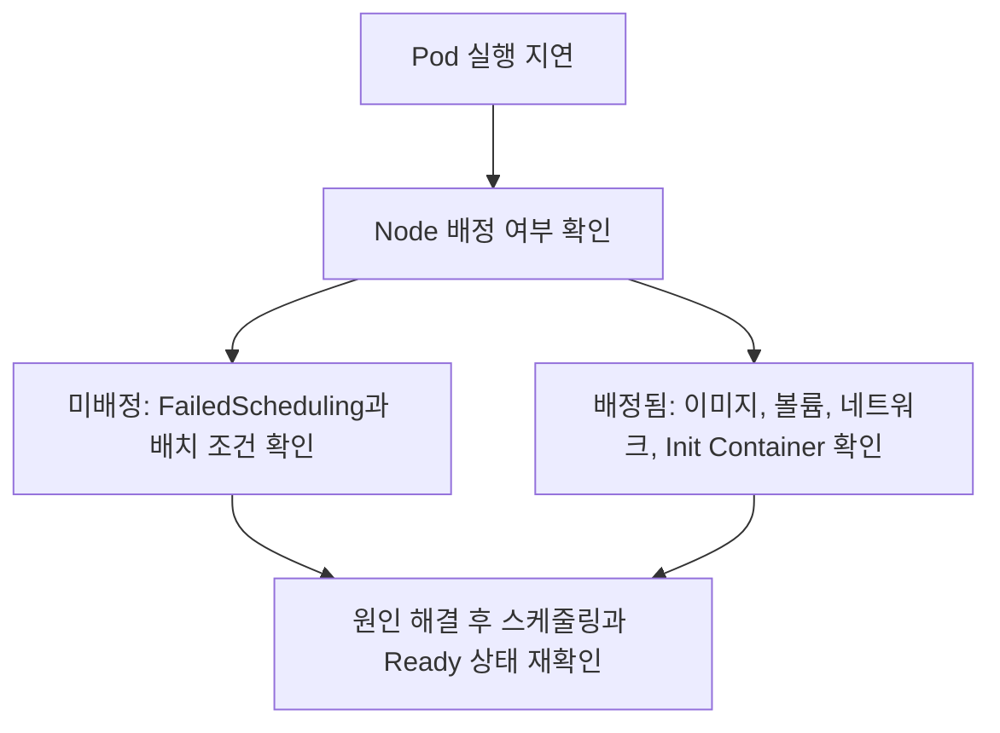
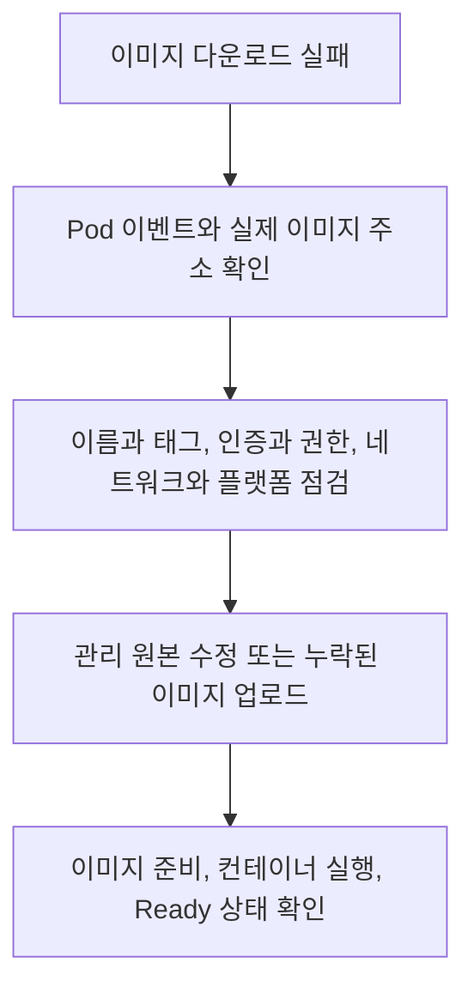
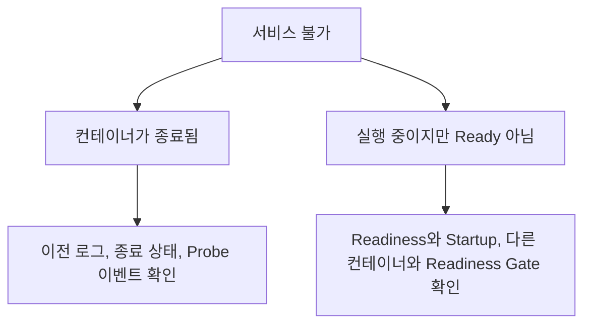

# Ch 2. 자주 발생하는 문제 해결하기

# Ch 2. 자주 발생하는 문제 해결하기
* toc
{:toc}

---

## 01. Pod가 Pending 상태에 머무는 문제

### Pod가 Pending 상태에서 실행되지 않을 때 확인할 것들

애플리케이션을 배포하거나 레플리카 수를 늘렸는데 새 Pod가 `Pending` 상태에 머무르는 경우가 있다. 기존 Pod는 정상적으로 동작하면서 새 Pod만 실행되지 않는다면, 변경한 코드뿐 아니라 **새 Pod를 배치할 수 있는 Node가 있는지**부터 확인해야 한다. 컨테이너가 시작되지 않은 단계에서는 애플리케이션 로그보다 Pod의 조건과 이벤트가 더 직접적인 단서가 된다.

#### 먼저 장애의 범위를 구분한다
클러스터 전반에서 문제가 발생했다면 현재 Context와 API Server 접근, Node 상태, 공통 네트워크·스토리지 등을 확인한다. 특정 Deployment의 새 Pod만 문제라면 이미지, 자원 요청량, 배치 조건 등 최근 변경 사항부터 살펴본다. 다만 기존 Pod가 정상이라는 이유만으로 인프라 문제를 배제할 수는 없다. 특정 Node의 장애나 클러스터의 자원 부족도 새 Pod에만 영향을 줄 수 있다.
```powershell
kubectl config current-context
kubectl get nodes
kubectl get deployments -n sns
kubectl get pods -n sns -o wide
```
Context는 의도한 클러스터에 연결했는지, Node 목록은 `Ready` 상태와 스케줄링 가능 여부를 확인하는 데 사용한다. `-o wide`로 조회한 Pod의 `NODE` 값은 실행 단계가 어디까지 진행됐는지 판단하는 출발점이다.

#### Pending은 반드시 스케줄링 실패를 뜻하지 않는다
`Pending`은 Pod가 클러스터에 등록됐지만 컨테이너 실행 준비가 끝나지 않은 단계다. Node 배정을 기다리는 시간뿐 아니라 배정 이후 이미지를 내려받는 시간도 포함한다. 따라서 **Node 미배정과 Node 배정 후 실행 준비 실패를 구분해야 한다.** 또한 `kubectl get pods`의 `STATUS` 열은 컨테이너 상태 등을 반영한 표시값이므로 Pod의 `status.phase`와 항상 같지는 않다. [Pod 생명주기](https://kubernetes.io/docs/concepts/workloads/pods/pod-lifecycle/)

잠깐의 `Pending`은 정상적인 생성 과정일 수 있다. 몇 초가 지났다는 이유만으로 장애를 단정하기보다는 이벤트가 갱신되는지, 준비 과정이 진행되는지, 평소 기동 시간과 얼마나 다른지를 함께 확인한다.

#### 레플리카를 늘린 뒤 새 Pod를 관찰한다
실습에서는 `sns` Namespace의 `feed-server` Deployment가 3개 Pod로 실행 중이라고 가정한다. 아래 증설은 배포 권한과 여유 자원을 확인한 테스트 환경에서 진행한다. HPA나 GitOps가 관리 중이라면 수동 변경이 다시 덮어써질 수 있으므로 관리 주체도 먼저 확인한다.
```powershell
kubectl scale deployment/feed-server -n sns --replicas=4
kubectl get pods -n sns -o wide
$POD = "실제로-생성된-Pending-Pod-이름"
kubectl describe pod $POD -n sns
kubectl get events -n sns --field-selector "involvedObject.kind=Pod,involvedObject.name=$POD" --sort-by=.metadata.creationTimestamp
```
`$POD`에는 실제 이름을 넣는다. `describe`에서 `Node`, `Conditions`의 `PodScheduled`, 마지막 `Events`를 확인한다. `PodScheduled=False`와 `FailedScheduling`이 함께 나타나면 스케줄러가 실행할 Node를 찾지 못한 것이다. 반대로 Node가 배정됐다면 `FailedMount`, 이미지 다운로드 실패, Pod 네트워크 생성 실패 등을 조사해야 한다. 컨테이너가 아직 시작되지 않았다면 조회할 애플리케이션 로그가 없을 수도 있다.

#### FailedScheduling 메시지에서 원인을 찾는다
예를 들어 `0/3 nodes are available: 3 Insufficient cpu`는 평가한 3개 Node 모두 새 Pod의 CPU 요청량을 수용하지 못했다는 의미다. CPU 사용률이 100%라는 뜻은 아니다. `Insufficient memory`는 메모리 요청량 부족을, `untolerated taint`는 허용하지 않은 Taint를, `didn't match Pod's node affinity/selector`는 배치 조건 불일치를 가리킨다. 한 이벤트에 여러 원인이 함께 나타날 수 있으므로 전체 메시지를 읽어야 한다.

이벤트의 `No preemption victims found for incoming pod`는 선점으로 제거할 적절한 낮은 우선순위 Pod를 찾지 못했다는 뜻이다. 선점은 Priority와 정책, 제거 후 배치 가능성 등을 고려하는 기능이지 공간이 부족할 때 임의의 Pod를 종료하는 기능이 아니다. 따라서 이 메시지만으로 “선점 설정을 하지 않아서 발생했다”고 단정하지 않는다. [Pod 우선순위와 선점](https://kubernetes.io/docs/concepts/scheduling-eviction/pod-priority-preemption/)

Pod 자체가 생성되지 않았다면 조사 경로도 달라진다. ResourceQuota 초과는 일반적으로 생성 요청을 거부하므로 Deployment와 ReplicaSet의 `FailedCreate` 이벤트를 확인해야 한다. “생성된 Pod가 배치되지 않는 문제”와 “Pod 생성 요청이 거부된 문제”는 구분한다. [ResourceQuota 동작](https://kubernetes.io/docs/concepts/policy/resource-quotas/)

#### 실제 사용량보다 requests를 먼저 확인한다
기본 스케줄러의 CPU·메모리 적합성 판단은 순간 사용량이 아니라 자원 요청량을 기준으로 한다. 일반적인 컨테이너 단위 설정에서는 **Node의 Allocatable에서 이미 배치된 Pod들의 요청량을 제외한 여유**가 새 Pod의 요청량을 수용해야 한다. `Capacity`는 전체 용량이고 `Allocatable`은 시스템 예약 등을 반영한 Pod용 용량이다. 여러 컨테이너, Init Container, Pod Overhead가 있으면 그 영향도 고려해야 한다. [컨테이너 자원 관리](https://kubernetes.io/docs/concepts/configuration/manage-resources-containers/)

예를 들어 Node의 CPU Allocatable이 `1900m`이고 기존 요청량 합계가 `1700m`이면 계산상 여유는 `200m`다. 새 Pod가 `500m`를 요청하면 실제 CPU 사용량이 낮아도 배치할 수 없다. 또한 여러 Node에 `200m`씩 남아 있더라도 이를 합쳐 하나의 `500m` Pod를 실행할 수는 없다. **Pod 하나가 들어갈 공간이 특정 Node 하나에 있어야 한다.**
```powershell
$NODE = "확인할-Node-이름"
kubectl describe node $NODE
kubectl get pods -A --field-selector "spec.nodeName=$NODE" -o wide
kubectl get pod $POD -n sns -o "custom-columns=CONTAINER:.spec.containers[*].name,CPU_REQUEST:.spec.containers[*].resources.requests.cpu,MEMORY_REQUEST:.spec.containers[*].resources.requests.memory"
kubectl top nodes
kubectl top pods -n sns --containers
```
`describe node`의 `Allocated resources`는 요청량과 제한량 집계를 확인하는 데 사용한다. 반면 `top`은 Metrics Server 등이 제공하는 실제 사용량을 보여준다. **사용률이 낮다는 사실과 새 Pod를 배치할 수 있다는 판단은 다르다.** `top`이 실패해도 곧바로 스케줄링 장애를 뜻하지는 않는다. [kubectl top](https://kubernetes.io/docs/reference/kubectl/generated/kubectl_top/)

`requests`는 실제 사용량의 하한선이 아니다. `500m`를 요청한 컨테이너도 유휴 상태에서는 그보다 적게 사용한다. CPU `limits`는 실행 중 사용 상한으로 작용하며 초과 수요에는 throttling이 발생할 수 있다. 메모리 제한을 넘으면 OOM 종료가 발생할 수 있다. 따라서 스케줄링 문제를 해결하려고 제한량만 낮추거나, 측정 없이 요청량을 줄이는 방식은 적절하지 않다. [CPU 자원 설정](https://kubernetes.io/docs/tasks/configure-pod-container/assign-cpu-resource/)

#### 자원이 남아 있다면 Taint와 배치 조건을 확인한다
Node의 `Taints`, `Conditions`, `Unschedulable`을 확인한다. 여러 Node의 Taint는 `kubectl get nodes -o 'custom-columns=NAME:.metadata.name,TAINTS:.spec.taints'`로 모아 볼 수 있다. `NoSchedule`은 허용되지 않은 새 Pod의 배치를 막고, `PreferNoSchedule`은 배치를 피하도록 유도하며, `NoExecute`는 허용되지 않은 기존 Pod의 퇴거에도 영향을 준다.

Toleration은 해당 Taint를 허용할 뿐 배치를 보장하지 않는다. `nodeSelector`, 필수 Node Affinity, Pod Anti-Affinity, 토폴로지 분산 조건도 함께 만족해야 한다. `DiskPressure` 같은 상태 때문에 생성된 Taint라면 디스크 원인을 해결해야 하며, Taint를 지우거나 광범위한 Toleration을 추가해 보호 장치를 우회하지 않는다. [Taint와 Toleration](https://kubernetes.io/docs/concepts/scheduling-eviction/taint-and-toleration/)

#### 원인에 맞게 공간을 확보한다
**Node 증설**은 기존 워크로드의 자원을 줄이지 않고 용량을 확보하는 방법이다. 단, 새 Node도 필요한 라벨·Taint·가용 영역·볼륨 조건을 만족해야 한다. Node가 준비되고 조건이 충족되면 스케줄러가 대기 중인 Pod를 다시 평가하므로, 보통 Pending Pod를 삭제할 필요는 없다. Cluster Autoscaler나 Karpenter도 최대 용량, 인스턴스 공급, 권한과 배치 조건 때문에 증설하지 못할 수 있다. [Node 자동 확장](https://kubernetes.io/docs/concepts/cluster-administration/node-autoscaling/)

**기존 레플리카 축소**도 테스트 환경에서는 사용할 수 있다. 예를 들어 사용자 서버를 3개에서 1개로 줄이는 `kubectl scale deployment/user-server -n sns --replicas=1`은 두 Pod의 종료 이후 공간을 확보할 수 있다. 다만 남은 공간이 새 Pod의 조건을 충족해야 하며, 운영에서는 처리량과 가용성이 낮아진다. Deployment의 직접적인 축소를 PDB가 자동으로 막아 준다고 가정해서도 안 된다.

**요청량 조정**은 평상시뿐 아니라 최대 부하와 기동 구간을 측정한 뒤 진행한다. Spring Boot는 기동 시 CPU 수요가 커질 수 있고, JVM Heap은 컨테이너 전체 메모리와 같지 않다. 요청량을 바꿀 때는 Deployment나 Helm values 등 관리 원본에 반영하고 새 Pod 생성과 성능을 함께 검증한다. limits를 모두 합한 용량이 항상 예약되는 것은 아니므로, 반복적인 Pending을 단순 조정으로만 넘기지 말고 피크 부하와 장애 시 여유 용량도 점검한다.

#### 해결 여부는 Ready와 실제 요청까지 확인한다
조치 후 `kubectl get pods -n sns -o wide`, `kubectl describe pod $POD -n sns`, `kubectl rollout status deployment/feed-server -n sns --timeout=180s`로 Node 배정과 가용 레플리카를 확인한다. 정상적인 기대 결과는 `PodScheduled=True`가 되고 컨테이너가 실행된 뒤 Ready 상태에 도달하는 것이다. 이후 API 요청도 확인한다. 스케줄링 성공만으로 데이터베이스 연결이나 서비스 정상 동작까지 증명되지는 않는다.

롤링 업데이트 때만 문제가 반복된다면 `maxSurge`로 일시적으로 추가되는 Pod의 공간도 계산한다. 예를 들어 레플리카 3개에 `maxSurge: 1`이라면 새 Pod를 띄울 추가 여유가 필요하다. `maxUnavailable`을 늘려 공간을 확보할 수도 있지만 그만큼 가용 용량이 줄어든다. 배포 전략은 가용성과 클러스터 여유를 함께 고려해 정한다. [Deployment 업데이트 전략](https://kubernetes.io/docs/concepts/workloads/controllers/deployment/)

### 정리
Pod가 실행되지 않을 때는 먼저 생성 여부와 Node 배정 여부를 구분한다. 미배정 상태라면 `FailedScheduling`을 근거로 requests, Allocatable, Taint와 배치 조건을 확인하고, 이미 배정됐다면 이미지·스토리지·네트워크 등 실행 준비 과정을 조사한다. 중요한 것은 Pending Pod를 반복해서 삭제하는 일이 아니라 **실행 조건을 충족하지 못한 이유를 찾아 해소하는 것**이다.

## 02. Container Image를 가져오지 못하는 문제 

### ErrImagePull과 ImagePullBackOff가 발생했을 때 확인할 것들

Pod가 Node에 배정됐더라도 컨테이너가 바로 실행되는 것은 아니다. Node의 컨테이너 런타임이 실행할 이미지를 준비해야 하며, 필요한 이미지를 가져오지 못하면 애플리케이션은 시작되지 않는다. 이때 자주 보이는 상태가 `ErrImagePull`과 `ImagePullBackOff`다. 이전에 살펴본 자원 부족에 따른 스케줄링 실패와 달리, 이번에는 **이미지 주소, 레지스트리 접근, 인증 정보를 중심으로 원인을 찾아야 한다.**

#### ErrImagePull과 ImagePullBackOff의 차이
`ErrImagePull`은 이미지를 가져오려는 시도가 실패했음을 나타낸다. `ImagePullBackOff`는 실패 이후 다음 시도까지 대기하는 상태다. kubelet은 계속 실패할 때 재시도 간격을 늘리며, 이미지 다운로드의 최대 backoff 간격은 5분이다. 두 값은 별개의 장애 원인이라기보다 이미지 다운로드 실패와 재시도 대기라는 관계로 이해하면 된다. [이미지 다운로드와 BackOff](https://kubernetes.io/docs/concepts/containers/images/)

`CrashLoopBackOff`와는 실패 단계가 다르다. `ImagePullBackOff`는 이미지를 준비하지 못한 상태이고, `CrashLoopBackOff`는 컨테이너가 실행된 뒤 반복적으로 종료되는 상황에서 나타난다. 또한 이 값들은 컨테이너의 대기 사유를 반영한 `kubectl` 표시값이지 Pod의 `phase` 이름이 아니다. 이미지를 가져오기 전에 실패했다면 애플리케이션 로그가 없는 것도 자연스럽다.

#### 상태 이름보다 이벤트 메시지를 확인한다
먼저 문제가 발생한 Pod와 실제 이미지 주소를 확인한다. 아래 명령은 PowerShell 기준이며, `$POD`에는 조회한 Pod 이름을 넣는다.
```powershell
kubectl get pods -n sns -o wide
$POD = "확인할-Pod-이름"
kubectl describe pod $POD -n sns
kubectl get pod $POD -n sns -o 'custom-columns=CONTAINER:.spec.containers[*].name,IMAGE:.spec.containers[*].image,REASON:.status.containerStatuses[*].state.waiting.reason'
```
여러 컨테이너 중 하나만 실패할 수도 있으므로 컨테이너별 상태를 확인한다. Init Container가 있다면 `describe`의 해당 항목도 살펴본다. `Events`에서는 `Pulling`, `Failed`, `BackOff` 흐름과 함께 출력되는 **레지스트리의 상세 오류 문구**가 핵심이다.


#### 이미지 주소와 태그가 실제로 존재하는지 확인한다
이미지 주소는 일반적으로 `레지스트리/저장소:태그` 형태다. ECR이라면 AWS 계정 ID와 리전까지 주소에 포함되므로, 저장소 이름만 맞아도 다른 계정이나 리전을 가리키면 원하는 이미지를 찾을 수 없다. `feed-server`를 `feed-servers`로 적은 경우처럼 작은 오타도 확인해야 한다.

예를 들어 저장소에 `0.0.1`부터 `0.1.4`까지 올라와 있는데 Deployment가 `0.5`를 참조한다면 다운로드에 실패할 수 있다. 태그는 문자열이므로 `0.5`, `0.0.5`, `v0.5`도 서로 다른 값이다. ECR에서는 실제 계정과 리전을 지정한 `aws ecr describe-images --registry-id 123456789012 --region ap-northeast-2 --repository-name sns/feed-server --image-ids imageTag=0.5`와 같은 조회로 확인할 수 있다. 예시 계정·리전·저장소는 자신의 값으로 바꿔야 하며, 이 명령의 성공은 **현재 CLI 사용자의 조회 권한**을 확인한 것이지 Node의 다운로드 권한까지 증명하지는 않는다. [ECR 이미지 조회](https://docs.aws.amazon.com/cli/latest/reference/ecr/describe-images.html)

이때 `not found`를 “인증에는 성공했고 태그만 없다”로 단정해서는 안 된다. 레지스트리에 따라 존재하지 않는 저장소와 접근 권한이 없는 저장소를 비슷하게 응답할 수 있다. 반대로 `pull access denied`가 나와도 실제 원인은 저장소 이름의 오타일 수 있다. 오류 문구와 이미지 주소, 저장소의 실제 상태를 함께 대조해야 한다.

#### 태그를 잘못 적었는지, 이미지를 올리지 않았는지 구분한다
**배포 설정의 태그가 잘못됐다면** Deployment YAML이나 Helm values를 실제 배포하려던 이미지로 수정한다. 단순히 실행 가능한 과거 태그로 바꾸면 의도한 기능이 누락될 수 있으므로, 정상 기동뿐 아니라 배포 대상 버전도 확인해야 한다. 관리 원본을 고치지 않고 실행 중인 객체만 수정하면 다음 배포에서 같은 문제가 반복된다.

**태그는 맞지만 이미지 업로드가 빠졌다면** 해당 버전을 빌드하고 레지스트리에 push해야 한다. Gradle Jib를 사용한다면 프로젝트에 설정된 대상 저장소와 태그, 인증을 확인한 뒤 `.\gradlew.bat jib` 같은 배포용 작업을 수행한다. 로컬 JAR 빌드나 로컬 이미지 생성만으로 레지스트리에 이미지가 등록되지는 않는다. 이미지가 준비되면 kubelet의 다음 재시도에서 다운로드가 진행될 수 있으므로, 원인 해결 없이 Pod를 반복해서 삭제할 필요는 없다.

자동화된 환경에서도 빌드와 배포 파이프라인이 분리되어 있으면 같은 문제가 발생한다. 배포 단계가 이미지 업로드 완료를 확인하지 않고 먼저 실행되거나 서로 다른 태그 변수를 사용하기 때문이다. **빌드 → push 완료 확인 → 배포 이미지 참조 갱신 → 롤아웃 확인** 순서를 연결하고, 가능하면 빌드 결과의 digest까지 배포 정보로 전달해 어떤 이미지를 배포했는지 추적할 수 있게 한다.

#### Private Registry라면 인증 정보도 확인한다
`unauthorized`, `authentication required`, `denied`, `no basic auth credentials` 등이 보이면 인증과 권한을 조사한다. 자격 증명이 틀렸거나 만료됐을 수도 있고, 로그인은 가능하지만 해당 저장소의 pull 권한이 없을 수도 있다. 로컬 PC의 `docker login` 성공은 Node가 같은 자격 증명을 사용한다는 뜻이 아니다.

일반적인 Private Registry에서는 `kubernetes.io/dockerconfigjson` 타입 Secret을 만들고 Pod의 `imagePullSecrets`에서 참조한다. 아래 명령은 실제 인증 정보가 들어 있는 `registry-auth.json`을 안전하게 준비한 경우의 예다. 비밀번호를 명령행 인자로 직접 전달하면 Shell 기록이나 프로세스 정보에 노출될 수 있다.
```powershell
kubectl create secret generic registry-credentials -n sns --from-file=.dockerconfigjson=./registry-auth.json --type=kubernetes.io/dockerconfigjson
kubectl get secret registry-credentials -n sns
```
입력 파일에 로컬 전용 `credsStore`나 `credHelpers` 설정만 있다면 Kubernetes가 사용할 인증 값이 없는 상태일 수 있다. 파일은 Git에 커밋하거나 로그에 출력하지 않는다. Secret의 base64 인코딩도 암호화가 아니므로 접근 권한과 저장 시 암호화 정책은 별도로 관리해야 한다. [Private Registry 인증 설정](https://kubernetes.io/docs/tasks/configure-pod-container/pull-image-private-registry/)

다음은 Secret 참조 위치를 보여주는 독립 Pod 예시다. `registry.example.com`은 설명용 주소이므로 실제 이미지로 교체해야 한다. 기존 Deployment를 수정한다면 이 Pod를 추가하는 대신 동일한 설정을 **`spec.template.spec.imagePullSecrets`**에 반영한다.
```yaml
apiVersion: v1
kind: Pod
metadata:
  name: private-image-check
  namespace: sns
spec:
  imagePullSecrets:
    - name: registry-credentials
  containers:
    - name: feed-server
      image: registry.example.com/sns/feed-server:0.1.4
      imagePullPolicy: Always
```
`apiVersion`과 `kind`는 Pod 객체를 지정하고, `metadata`는 이름과 Namespace를 정한다. `spec.imagePullSecrets`는 인증용 Secret을 참조하며, `containers`는 실행할 이미지와 컨테이너 이름을 정의한다. **Secret은 Pod와 같은 Namespace에 있어야 한다.** `FailedToRetrieveImagePullSecret` 이벤트가 있다면 Secret의 존재 여부와 이름부터 확인한다.

`Always`는 시작 시 레지스트리를 통해 이미지 참조를 확인하도록 하지만, 이미 로컬에 있는 동일한 이미지 레이어까지 매번 다시 내려받는다는 뜻은 아니다. 이 예시는 이미지 준비 설정에 초점을 맞췄으므로 실제 서버에 필요한 환경 변수·볼륨·자원 설정은 별도로 필요하다. 애플리케이션이 DB 변경이나 메시지 소비를 수행한다면 단순 확인 목적으로 추가 실행하기 전에도 부작용을 검토해야 한다.

#### EKS에서는 이미지 다운로드에 사용하는 IAM 역할을 구분한다
EKS의 EC2 기반 Node에서는 일반적으로 **Node IAM Role**의 ECR 권한을 사용한다. Fargate에서는 **Fargate Pod execution role**을 확인한다. 따라서 EKS에서 별도 `imagePullSecrets` 없이 ECR 이미지를 가져왔다면 인증이 생략된 것이 아니라 해당 실행 환경의 IAM 구성을 통해 처리된 것이다. 다른 계정의 ECR을 사용한다면 저장소 정책 등 교차 계정 접근 조건도 확인한다. [EKS의 ECR 이미지 사용 권한](https://docs.aws.amazon.com/AmazonECR/latest/userguide/ECR_on_EKS.html)

애플리케이션이 실행된 뒤 AWS API를 호출하는 권한과, 실행 전에 이미지를 다운로드하는 권한은 구분해야 한다. 애플리케이션용 IRSA나 EKS Pod Identity 설정을 변경했다고 이미지 다운로드 문제가 자동으로 해결되는 것은 아니다. 또한 ECR 로그인 토큰을 직접 Secret에 저장하는 방식이라면 토큰 유효 기간이 12시간이므로 갱신 체계가 필요하다. 이를 장기 비밀번호처럼 고정해 두지 않는다. [ECR 인증 토큰](https://docs.aws.amazon.com/AmazonECR/latest/userguide/registry_auth.html)

#### 어제까지 정상이었어도 새 Pod는 실패할 수 있다
기존 컨테이너는 이미 이미지를 준비한 상태라 계속 동작하지만, 증설이나 재배포로 생성된 Pod는 이미지를 새로 확인하다 실패할 수 있다. 비밀번호 변경, 토큰 만료, pull 권한 회수, 이미지 삭제, Node 교체와 로컬 캐시 차이가 조사 대상이다. “기존 Pod가 정상이다”라는 사실만으로 현재 레지스트리 접근이 정상이라고 판단하지 않는다.

이미지와 인증에 문제가 없다면 오류에 맞춰 범위를 넓힌다. `timeout`은 Node의 네트워크 경로와 방화벽, `no such host`는 DNS, `x509`는 인증서 신뢰, `429`는 요청 제한을 확인한다. `no matching manifest`는 Node의 CPU 아키텍처·운영체제에 맞는 이미지가 있는지 점검한다. 이미 실행된 컨테이너의 `exec format error`와는 실패 단계가 다를 수 있다. 인증서 오류를 해결하려고 TLS 검증부터 끄는 방식은 피한다. [이미지 다운로드 오류별 진단](https://docs.cloud.google.com/kubernetes-engine/docs/troubleshooting/image-pulls)

#### 수정 후에는 이미지 준비와 애플리케이션 기동을 나눠 검증한다
관리 원본 수정이나 누락된 이미지 업로드 이후 다음과 같이 상태를 확인한다. Helm이나 GitOps가 관리한다면 해당 배포 경로로 먼저 변경을 반영한다.
```powershell
kubectl rollout status deployment/feed-server -n sns --timeout=300s
kubectl get pods -n sns -o wide
```
새 Pod의 이벤트에서 이미지 준비가 성공했는지, 컨테이너가 시작됐는지, Ready 상태에 도달했는지 순서대로 확인한다. 이후 API도 호출해 정상 응답을 검증한다. 이미지 문제를 해결한 뒤 `CrashLoopBackOff`가 나타난다면 이미지 다운로드는 통과했지만 애플리케이션 실행 단계에 다른 문제가 남은 것이므로, 그때 컨테이너 로그와 종료 원인을 조사한다.

### 정리
`ImagePullBackOff`는 원인 자체가 아니라 이미지 다운로드 실패 후 재시도를 기다리는 상태다. Pod 이벤트와 실제 이미지 주소를 확인하고, **이름·태그 오류인지, 업로드 누락인지, 인증·권한 문제인지**부터 구분한다. 원인을 바로잡은 뒤에는 이미지 다운로드 성공에서 멈추지 않고 컨테이너 실행, Ready 상태, 실제 요청 처리까지 확인해야 한다.

## 03. Container Resource가 부족할 경우 생기는 문제

### 컨테이너가 반복해서 재시작하거나 Ready 상태가 되지 않을 때

이미지를 정상적으로 가져왔고 Pod도 Node에 배정됐는데 애플리케이션이 서비스하지 못하는 경우가 있다. 컨테이너가 실행 직후 종료되기도 하고, 프로세스는 살아 있지만 Ready 상태에 도달하지 못하기도 한다. 이때는 **프로세스가 종료되는 문제와 트래픽을 받을 준비가 되지 않은 문제를 먼저 구분해야 한다.** 두 현상은 비슷해 보여도 원인과 해결 방법이 다르다.

#### 컨테이너 재시작과 Pod 교체는 다르다
Deployment의 일반적인 컨테이너는 `restartPolicy: Always`에 따라 프로세스가 종료되면 다시 시작된다. 같은 Pod 안에서 컨테이너가 재시작하는 것이므로 Pod 이름과 UID는 유지된다. 반면 롤링 업데이트나 Pod 삭제로 새 Pod가 생성되면 이름과 UID가 달라진다. `Always`에서는 종료 코드가 `0`인 정상 종료도 재시작 대상이다. 따라서 서버 이미지의 실행 명령이 작업만 마치고 종료되는 경우에도 반복 재시작이 발생할 수 있다. [Pod의 재시작 정책](https://kubernetes.io/docs/concepts/workloads/pods/pod-lifecycle/)
반복 종료 후 나타나는 `CrashLoopBackOff`는 원인 자체가 아니라 다음 재시작까지 기다리는 상태다. 애플리케이션 초기화 실패, 잘못된 실행 명령, Probe 실패, 메모리 부족 등 여러 원인이 같은 표시로 나타날 수 있다.


#### describe와 이전 컨테이너 로그를 함께 확인한다
다음은 PowerShell 기준이다. Pod와 컨테이너 이름은 실제 조회 결과에 맞춘다.
```powershell
kubectl get pods -n sns -o wide
$POD = "확인할-Pod-이름"
$CONTAINER = "feed-server"
kubectl describe pod $POD -n sns
kubectl logs $POD -n sns -c $CONTAINER --tail=200 --timestamps
kubectl logs $POD -n sns -c $CONTAINER --previous --tail=200 --timestamps
```
`describe`에서는 컨테이너별 `State`, `Last State`, `Reason`, `Exit Code`, 종료 시각, 재시작 횟수와 이벤트를 확인한다. `--previous`는 같은 Pod에서 직전에 종료된 해당 컨테이너 인스턴스의 로그를 조회한다. 현재 인스턴스가 막 시작해 로그가 적더라도 이전 로그에는 종료 직전 오류가 남아 있을 수 있다. 삭제된 Pod 전체의 과거 이력을 조회하는 옵션은 아니다. [kubectl logs](https://kubernetes.io/docs/reference/kubectl/generated/kubectl_logs/)
`OOMKilled`라면 컨테이너 메모리 제한과 Node 메모리 상황을 조사한다. 종료 코드 `137`만으로 OOM을 확정하거나 `143`만으로 Liveness 실패를 확정해서는 안 된다. 종료 코드와 이벤트, 로그의 시각을 맞춰 원인을 판단한다. 재시작 횟수가 한두 번이라고 해서 기동 시간 문제라고 단정할 수도 없다. [컨테이너 재시작 진단](https://learn.microsoft.com/en-us/troubleshoot/azure/azure-kubernetes/availability-performance/troubleshoot-pod-workload-restart)

#### 애플리케이션이 스스로 종료됐다면 초기화 오류를 추적한다
Spring Boot에서는 Bean 생성, 설정 바인딩, 데이터베이스 연결, 마이그레이션 등 필수 초기화 과정이 실패하면 애플리케이션 컨텍스트가 닫히고 프로세스가 종료될 수 있다. `APPLICATION FAILED TO START`, `BeanCreationException`, JDBC 연결 오류 등이 단서다. 다만 모든 데이터베이스 접속 실패가 반드시 프로세스 종료로 이어지는 것은 아니며, 실제 동작은 사용 라이브러리와 초기화 설정에 따라 달라진다.
로그에 JDBC 연결 실패가 있다면 하위 원인까지 읽는다. 호스트를 찾지 못했다면 DNS와 주소를, 연결 거부나 시간 초과라면 포트·DB 상태·네트워크 경로를, 접근 거부라면 사용자·비밀번호·접속 허용 조건을 확인한다. “DB 연결 실패”라는 상위 메시지만으로 비밀번호부터 바꾸는 방식은 피한다.
최근 ConfigMap이나 Secret을 변경했다면 Namespace, 키 이름, `env`·`envFrom` 참조를 먼저 대조한다. 애플리케이션 코드나 배포 설정을 변경했다면 활성 Profile, 환경 변수 이름, 명령행 인자 등 최종 설정에 영향을 주는 경로도 살펴본다. 설정을 바꾸지 않았더라도 DB 장애나 자격 증명 만료는 발생할 수 있다. 진단을 위해 환경 변수 전체나 Secret 값을 로그로 출력하지 말고, 호스트·포트·Profile 등 필요한 비민감 항목만 확인한다.

#### Readiness와 Liveness는 실패했을 때의 동작이 다르다
**Readiness Probe 실패는 컨테이너를 재시작하지 않는다.** 준비되지 않은 Pod를 일반적인 Service 트래픽 대상에서 제외하기 위한 신호다. 반면 **Liveness Probe와 Startup Probe는 연속 실패가 설정한 임계값에 도달하면 해당 컨테이너의 종료와 재시작을 유발할 수 있다.** Startup Probe가 설정돼 있다면 성공하기 전까지 Liveness와 Readiness 검사는 시작되지 않는다. [Probe의 역할](https://kubernetes.io/docs/concepts/workloads/pods/probes/)
따라서 `Running`인데 `READY`가 `0/1`이고 재시작 횟수가 늘지 않는다면 Readiness 실패를 먼저 확인한다. 재시작 횟수가 계속 증가한다면 프로세스 종료 원인과 함께 `Liveness probe failed`, `Startup probe failed`, `Killing` 이벤트가 있는지 본다. 단, Ready 여부에는 다른 컨테이너나 Readiness Gate도 관여하므로 Probe 하나만으로 모든 상황을 설명할 수는 없다.

#### Probe 응답 코드와 실제 접근 경로를 확인한다
HTTP Probe의 `404`는 경로 오타, 엔드포인트 미등록, Actuator 노출 설정, 컨텍스트 경로나 관리 포트 차이를 조사할 단서다. `401`·`403`이면 보안 설정을, `503`이면 실제 준비·건강 상태를 확인한다. 연결 거부는 서버 미기동·포트 오류·바인딩 주소를, 시간 초과는 처리 지연·자원 경합·네트워크 경로 등을 점검한다.
실행 중인 컨테이너에 `curl`이 있다면 다음과 같이 응답을 직접 확인할 수 있다. 도구가 없다면 검토된 디버깅 컨테이너를 사용하며, 빠르게 종료되는 컨테이너에는 `exec` 자체가 실패할 수 있다.
```powershell
kubectl exec $POD -n sns -c $CONTAINER -- curl -i --connect-timeout 2 --max-time 5 http://127.0.0.1:8080/actuator/health/liveness
kubectl exec $POD -n sns -c $CONTAINER -- curl -i --connect-timeout 2 --max-time 5 http://127.0.0.1:8080/actuator/health/readiness
```
여기서 중요한 점은 **컨테이너 내부의 localhost 호출이 kubelet의 HTTP Probe와 같은 경로는 아니라는 것**이다. kubelet은 기본적으로 Node에서 Pod IP의 지정 포트로 접근하며 Service나 Ingress를 거치지 않는다. localhost 호출이 성공해도 애플리케이션이 루프백 주소에만 바인딩돼 있거나 Node에서 Pod로 가는 경로에 문제가 있으면 Probe는 실패할 수 있다. 따라서 네트워크 문제를 처음부터 배제하지 않는다. [HTTP Probe의 동작](https://kubernetes.io/docs/tasks/configure-pod-container/configure-liveness-readiness-startup-probes/)

#### Spring Boot의 상태 확인 엔드포인트를 맞춘다
Actuator를 사용한다면 `spring-boot-starter-actuator` 의존성과 Health Probe 그룹 활성화 여부를 확인한다. 기본 경로는 `/actuator/health/liveness`와 `/actuator/health/readiness`이며, 필요하면 `management.endpoint.health.probes.enabled=true`로 명시적으로 활성화할 수 있다. 경로나 관리 포트를 변경했다면 Probe도 이에 맞춰야 한다.
Spring Security를 적용한 뒤 `401`이 발생한다면 해당 상태 확인 경로만 필요한 범위에서 인증 예외로 처리하는 방식을 검토한다. 전체 Actuator나 업무 API를 일괄 공개해서는 안 된다. 고정 HTTP 헤더도 Probe에 설정할 수 있지만 토큰을 YAML에 직접 넣으면 노출·교체 문제가 생기므로 신중해야 한다. 관리 서버가 별도 포트라면 그 포트의 성공만으로 실제 업무 포트도 정상이라고 보장할 수 없다.
또한 Liveness에 공통 DB나 외부 API의 정상 여부를 그대로 연결하면 외부 장애가 모든 인스턴스의 재시작으로 번질 수 있다. Liveness는 재시작으로 회복 가능한 내부 상태를 중심으로 설계하고, 외부 의존성을 Readiness에 포함할지도 서비스의 대체 처리 가능성과 전체 인스턴스 제외 위험을 고려해 결정한다. [Spring Boot의 Kubernetes Probe](https://docs.spring.io/spring-boot/reference/actuator/endpoints.html)

#### 느린 기동은 Startup Probe로 보호한다
`initialDelaySeconds: 5`, `periodSeconds: 1`, `timeoutSeconds: 1`, `failureThreshold: 3`인 Liveness 설정은 기동이 느린 Spring 애플리케이션에 지나치게 짧을 수 있다. 정확한 종료 시점을 단순히 몇 초라고 확정할 수는 없지만, 정상 기동 전에 연속 실패 임계값에 도달할 위험이 크다. 로컬에서는 빨라도 컨테이너의 CPU 제한, 클래스 로딩, 초기화 작업, 외부 의존성 때문에 배포 환경의 기동 시간은 달라진다.
다음은 기존 Deployment의 **`spec.template.spec.containers` 아래 해당 컨테이너에 병합하는 설정**이다. 독립적으로 적용하는 Kubernetes 리소스 파일은 아니며, 엔드포인트가 업무 포트 `8080`에 제공된다고 가정한다.
```yaml
startupProbe:
  httpGet:
    path: /actuator/health/liveness
    port: 8080
  periodSeconds: 5
  timeoutSeconds: 2
  failureThreshold: 30
livenessProbe:
  httpGet:
    path: /actuator/health/liveness
    port: 8080
  periodSeconds: 10
  timeoutSeconds: 2
  failureThreshold: 3
readinessProbe:
  httpGet:
    path: /actuator/health/readiness
    port: 8080
  periodSeconds: 5
  timeoutSeconds: 2
  failureThreshold: 3
```
`httpGet`은 검사 경로와 포트, `periodSeconds`는 검사 주기, `timeoutSeconds`는 개별 검사 제한 시간, `failureThreshold`는 연속 실패 임계값이다. Startup에는 약 150초 규모의 기동 여유를 두고, 성공 이후에는 Liveness와 Readiness가 각 목적에 따라 검사한다. 이는 초기 판단용 예시이지 모든 서비스에 맞는 정답은 아니다. 실제 기동 시간 분포와 장애 감지 목표를 측정해 조정하며, `initialDelaySeconds`와 임계값을 무작정 늘려 실제 장애를 감추지 않는다.

#### 롤링 업데이트 중의 불안정성까지 확인한다
Readiness가 잠깐 성공한 뒤 잘못된 Liveness 때문에 종료되는 Pod는 트래픽을 받았다가 중단되는 일을 반복할 수 있다. Deployment도 새 Pod를 가용하다고 판단한 뒤 기존 Pod를 줄일 수 있으므로 배포 전체가 불안정해질 수 있다. 반대로 새 Pod의 Readiness가 실패한다고 기존 서비스가 항상 안전한 것도 아니다. 기존 Pod 유지 범위는 `maxUnavailable`, 레플리카 수, 기존 Pod 상태 등에 따라 달라진다. `minReadySeconds`로 일정 시간 안정적인 Ready 상태를 확인하는 것도 도움이 되지만 잘못된 Probe 자체를 고쳐 주지는 않는다. [Deployment의 가용성 판단](https://kubernetes.io/docs/concepts/workloads/controllers/deployment/)
조사 전에 Pod 삭제나 전체 재시작부터 수행하면 로그와 종료 상태를 잃거나 정상 인스턴스까지 줄일 수 있다. 먼저 증거를 확보하고 Deployment YAML·Helm values 등 관리 원본을 수정한다. 배포 후에는 `kubectl rollout status deployment/feed-server -n sns --timeout=300s`와 Pod 상태를 확인하고, Ready 안정성·재시작 횟수·실제 API 응답을 충분한 시간 동안 함께 관찰한다.

### 정리
반복 재시작은 종료 원인을, Ready 미도달은 준비 상태를 중심으로 조사한다. 이전 컨테이너 로그와 종료 상태, Probe 이벤트를 함께 읽고 **Readiness는 트래픽 제어, Liveness는 내부 장애 감지, Startup은 기동 보호**라는 역할을 구분해야 한다. 재시작을 반복하는 대신 애플리케이션 설정과 검사 경로, 기동 시간에 맞는 조건을 바로잡는 것이 해결의 핵심이다.
