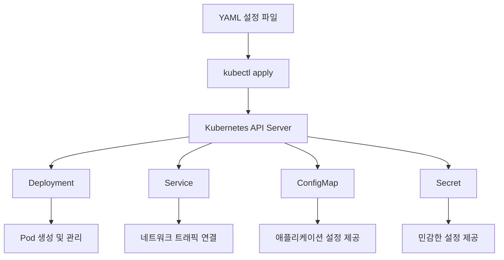
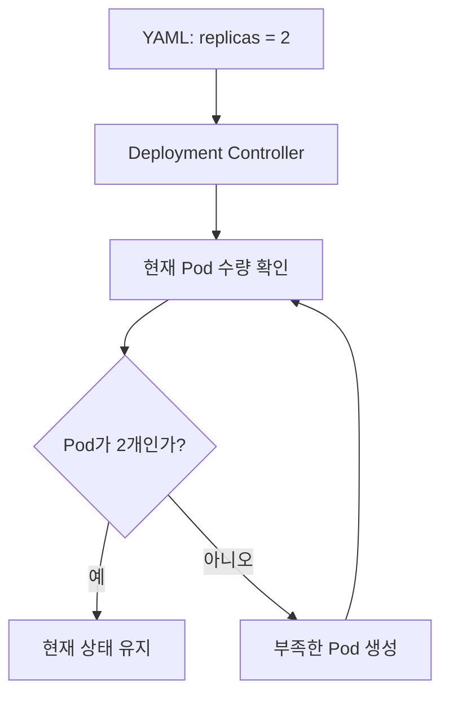
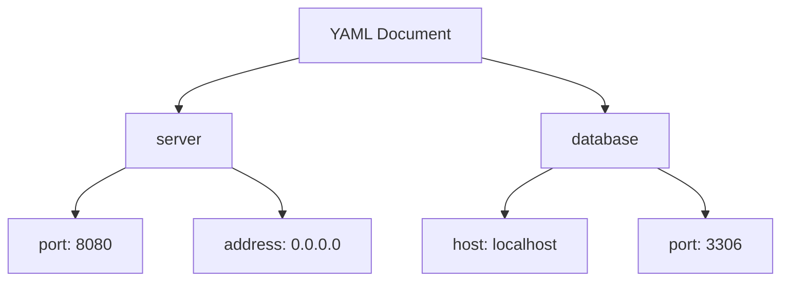
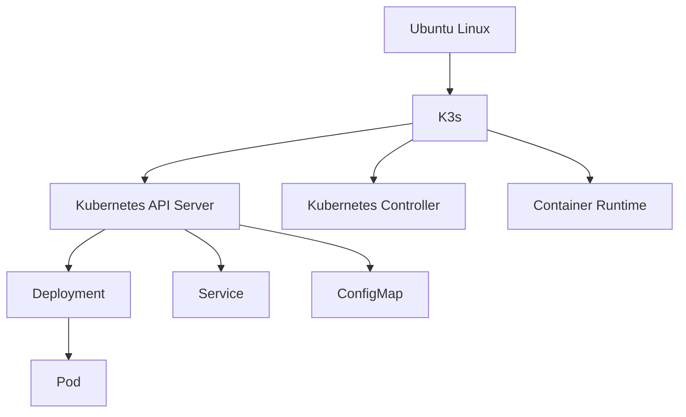
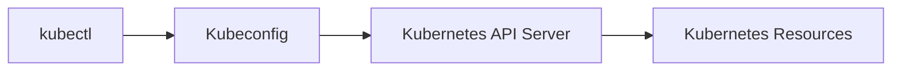
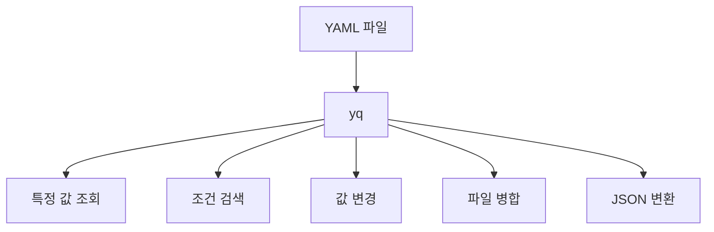
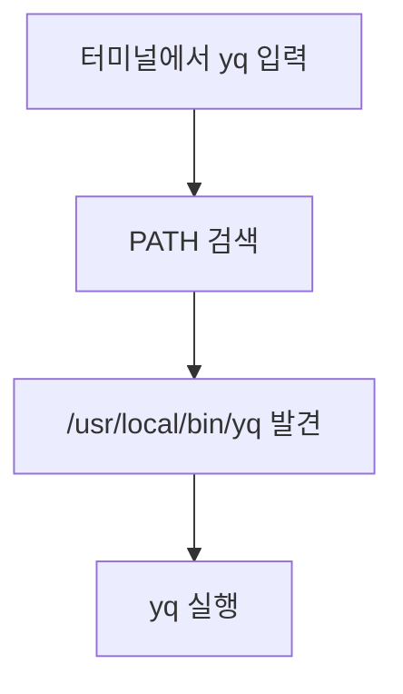
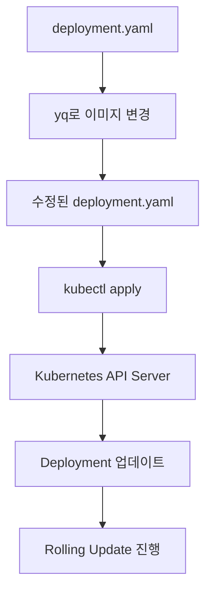
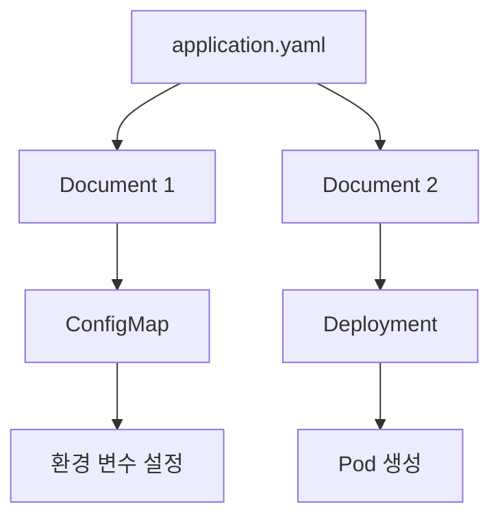
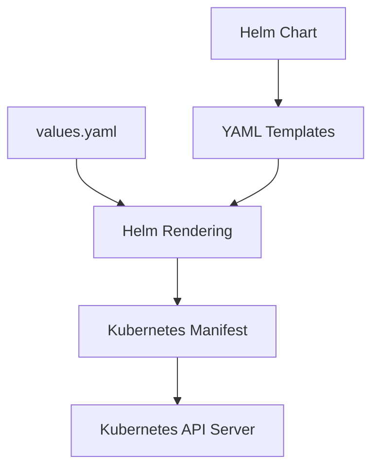

# Ch 1. Yaml 이란

# Ch 1. Yaml 이란
* toc
{:toc}

---

## 01. Orientation

### Kubernetes YAML의 개념과 yq를 활용한 설정 파일 관리

Kubernetes에서는 Pod, Deployment, Service, ConfigMap, Secret 등 다양한 리소스를 생성하고 관리한다.

이러한 리소스를 생성하는 방법은 여러 가지가 있지만, 가장 일반적인 방법은 **YAML 파일을 작성하여 Kubernetes API에 적용하는 것**이다.

예를 들어 애플리케이션을 실행하기 위해 Deployment를 생성하려면 다음과 같은 YAML 파일을 작성할 수 있다.

```yaml
apiVersion: apps/v1
kind: Deployment
metadata:
  name: my-app
spec:
  replicas: 3
  selector:
    matchLabels:
      app: my-app
  template:
    metadata:
      labels:
        app: my-app
    spec:
      containers:
        - name: my-app
          image: nginx:1.27
          ports:
            - containerPort: 80
```

이 파일에는 애플리케이션을 어떤 이미지로 실행할 것인지, Pod를 몇 개 생성할 것인지, 어떤 Label을 사용할 것인지 등의 설정이 정의되어 있다.

Kubernetes는 YAML 파일에 작성된 설정을 기반으로 리소스를 생성하고, 선언된 상태가 유지되도록 지속적으로 관리한다.

하지만 YAML을 단순히 Kubernetes의 설정 파일 형식으로만 이해하면 활용 범위를 제대로 파악하기 어렵다.

YAML은 Kubernetes 전용으로 만들어진 형식이 아니라, 다양한 애플리케이션과 시스템에서 데이터를 표현하기 위해 사용하는 범용 데이터 직렬화 형식이다.

Spring Boot의 `application.yml`, Docker Compose의 `compose.yaml`, GitHub Actions의 Workflow 파일에서도 YAML을 사용한다.

따라서 YAML의 기본 구조와 문법을 이해하면 Kubernetes뿐 아니라 여러 개발 환경에서 설정 파일을 더욱 정확하고 효율적으로 관리할 수 있다.

또한 설정 파일의 규모가 커지면 직접 내용을 검색하거나 수정하는 작업이 번거로워질 수 있다.

이러한 상황에서는 YAML을 명령어로 조회하고 수정할 수 있는 **yq**를 활용할 수 있다.

이번에는 YAML의 기본 개념과 Kubernetes에서의 역할을 살펴보고, 실습 환경을 구성한 뒤 yq를 설치하여 YAML 파일을 다루는 방법까지 알아본다.

---

### YAML이란?

YAML은 **YAML Ain't Markup Language**의 약자로, 데이터를 표현하기 위한 사람이 읽기 쉬운 데이터 직렬화 형식이다.

여기서 데이터 직렬화란 객체나 자료구조를 저장하거나 전달할 수 있는 형태로 변환하는 것을 의미한다.

예를 들어 다음과 같은 데이터를 표현한다고 가정하자.

```text
애플리케이션 이름: my-app
서버 포트: 8080
실행 환경: production
```

이를 YAML로 표현하면 다음과 같다.

```yaml
application:
  name: my-app
  port: 8080
  environment: production
```

YAML은 들여쓰기를 사용하여 데이터 사이의 계층 구조를 표현한다.

따라서 중첩된 데이터를 비교적 간결하게 작성할 수 있다.

#### JSON과 YAML 비교

동일한 데이터를 JSON으로 표현하면 다음과 같다.

```json
{
  "application": {
    "name": "my-app",
    "port": 8080,
    "environment": "production"
  }
}
```

YAML에서는 다음과 같이 작성할 수 있다.

```yaml
application:
  name: my-app
  port: 8080
  environment: production
```

두 형식은 동일한 데이터를 표현하지만 문법에서 차이가 있다.

| 구분 | YAML | JSON |
|---|---|---|
| 계층 표현 | 들여쓰기 | 중괄호 |
| 배열 표현 | 하이픈 또는 대괄호 | 대괄호 |
| 문자열 표현 | 따옴표 생략 가능 | 큰따옴표 필요 |
| 주석 | 지원 | 표준 JSON에서는 지원하지 않음 |
| 가독성 | 사람이 읽기 편리함 | 구조가 명시적임 |
| 대표 활용 | 설정 파일, Kubernetes | API 응답, 데이터 교환 |

YAML은 중괄호와 쉼표를 반복해서 작성할 필요가 없기 때문에 복잡한 설정을 읽기 쉽게 표현할 수 있다.

반면 들여쓰기가 데이터 구조를 결정하므로 작은 공백 차이로도 의미가 달라질 수 있다는 점에 주의해야 한다.

---

### Kubernetes에서 YAML을 사용하는 이유

Kubernetes는 다양한 종류의 리소스를 관리한다.

대표적인 리소스는 다음과 같다.

| 리소스 | 역할 |
|---|---|
| Pod | 컨테이너를 실행하는 기본 단위 |
| Deployment | 애플리케이션 배포와 업데이트 관리 |
| StatefulSet | 안정적인 식별자와 스토리지가 필요한 애플리케이션 관리 |
| DaemonSet | 특정 Node에 Pod를 실행 |
| Service | Pod에 대한 네트워크 접근 제공 |
| ConfigMap | 일반 설정 데이터 관리 |
| Secret | 비밀번호와 토큰 등 민감한 데이터 관리 |
| PersistentVolumeClaim | 영구 스토리지 요청 |
| HorizontalPodAutoscaler | Pod 수량 자동 조정 |
| Job | 완료를 목적으로 하는 작업 실행 |
| CronJob | 주기적인 작업 실행 |

각 리소스는 서로 다른 목적을 가지고 있으며, 필요한 설정도 다르다.

Kubernetes에서는 이러한 리소스의 원하는 상태를 YAML 파일로 선언할 수 있다.



예를 들어 Deployment를 생성하는 YAML 파일은 다음과 같다.

```yaml
apiVersion: apps/v1
kind: Deployment
metadata:
  name: nginx-deployment
spec:
  replicas: 2
  selector:
    matchLabels:
      app: nginx
  template:
    metadata:
      labels:
        app: nginx
    spec:
      containers:
        - name: nginx
          image: nginx:1.27
          ports:
            - containerPort: 80
```

이 설정을 Kubernetes에 적용하면 Kubernetes는 Pod 2개를 실행하는 Deployment를 생성한다.

```bash
kubectl apply -f deployment.yaml
```

정상적으로 생성되면 다음과 같은 메시지가 출력된다.

```text
deployment.apps/nginx-deployment created
```

여기서 중요한 점은 YAML 파일이 단순한 실행 명령어가 아니라 **시스템이 유지해야 하는 원하는 상태를 선언한다는 것**이다.

예를 들어 `replicas: 2`로 설정했다면 Kubernetes는 Pod 2개가 유지되도록 관리한다.

Pod 하나가 비정상 종료되면 Kubernetes Controller는 실제 상태와 원하는 상태의 차이를 확인하고 새로운 Pod를 생성한다.



이러한 동작은 Kubernetes의 선언적 관리 방식과 Reconciliation 구조를 이해하는 데 중요한 개념이다.

---

### YAML 파일과 Kubernetes 리소스의 관계

YAML은 설정을 표현하는 형식이고, Kubernetes Resource는 실제 Kubernetes API가 관리하는 객체이다.

두 개념은 구분해서 이해해야 한다.

```text
YAML
→ 데이터를 표현하는 형식

Kubernetes Manifest
→ Kubernetes 리소스를 정의한 설정

Kubernetes Resource
→ API Server에 등록되어 관리되는 객체
```

예를 들어 다음 파일은 YAML 문법을 사용한 Kubernetes Manifest이다.

```yaml
apiVersion: v1
kind: ConfigMap
metadata:
  name: my-config
data:
  APP_ENV: production
  LOG_LEVEL: INFO
```

여기서 YAML은 데이터를 표현하는 형식일 뿐이다.

`apiVersion`, `kind`, `metadata`, `data`가 Kubernetes에서 어떤 의미를 가지는지는 Kubernetes API가 결정한다.

즉 YAML 문법을 정확하게 작성했다고 해서 반드시 올바른 Kubernetes Manifest가 되는 것은 아니다.

YAML 문법은 올바르더라도 Kubernetes가 지원하지 않는 필드나 잘못된 리소스 구조를 사용하면 API Server에서 오류가 발생할 수 있다.

따라서 Kubernetes 설정 파일을 작성할 때는 다음 두 가지를 모두 이해해야 한다.

1. YAML의 문법과 데이터 구조
2. Kubernetes 리소스별 API 구조와 필드 의미

---

### YAML의 기본 구조

YAML은 기본적으로 Key-Value 형태로 데이터를 표현한다.

#### Key-Value

가장 단순한 형태는 다음과 같다.

```yaml
name: my-app
port: 8080
enabled: true
```

각 항목은 다음과 같은 의미를 가진다.

```text
Key: Value
```

예를 들어 다음과 같다.

```yaml
port: 8080
```

`port`라는 Key에 `8080`이라는 값을 지정한 것이다.

#### 중첩 구조

YAML은 들여쓰기를 사용해 계층 구조를 표현한다.

```yaml
server:
  port: 8080
  address: 0.0.0.0

database:
  host: localhost
  port: 3306
```

이 구조는 다음과 같이 해석할 수 있다.



이때 중요한 것은 **같은 계층에 속한 항목은 같은 수준으로 들여쓰기해야 한다는 점**이다.

일반적으로 공백 2칸을 사용하는 방식이 널리 사용된다.

YAML에서는 들여쓰기에 Tab 문자를 사용하지 않고 공백을 사용해야 한다.

#### 배열

YAML에서 배열은 하이픈(`-`)을 사용해 표현할 수 있다.

```yaml
servers:
  - server1
  - server2
  - server3
```

객체를 배열로 표현할 수도 있다.

```yaml
containers:
  - name: nginx
    image: nginx:1.27

  - name: redis
    image: redis:7
```

Kubernetes에서는 하나의 Pod에 여러 컨테이너를 정의하거나 환경 변수, Volume 등을 설정할 때 이러한 배열 구조를 자주 사용한다.

#### 주석

YAML에서는 `#`으로 주석을 작성한다.

```yaml
# 애플리케이션 실행 환경
environment: production

# HTTP 포트
port: 8080
```

주석은 설정의 의미를 설명하는 데 유용하다.

다만 중요한 비즈니스 규칙이나 운영 절차를 주석에만 의존하기보다 설정 자체를 이해하기 쉽게 구성하는 것이 좋다.

#### 데이터 타입

YAML은 문자열, 숫자, Boolean, Null 등의 값을 표현할 수 있다.

```yaml
name: my-app
port: 8080
enabled: true
description: null
```

값을 명확하게 문자열로 처리하고 싶다면 따옴표를 사용한다.

```yaml
port: "8080"
enabled: "true"
```

이 경우 `8080`과 `true`는 문자열로 표현된다.

특히 Kubernetes 환경 변수의 `value` 필드는 문자열을 기대하므로 다음처럼 명시하는 것이 안전하다.

```yaml
env:
  - name: SERVER_PORT
    value: "8080"

  - name: FEATURE_ENABLED
    value: "true"
```

반대로 다음 설정은 환경 변수의 값에 숫자나 Boolean을 직접 지정하므로 Kubernetes API 검증에서 문제가 발생할 수 있다.

```yaml
env:
  - name: SERVER_PORT
    value: 8080
```

YAML의 데이터 타입과 Kubernetes API 필드의 데이터 타입은 함께 고려해야 한다.

---

### Kubernetes YAML의 주요 필드

Kubernetes Manifest에서는 다음 필드들이 자주 등장한다.

```yaml
apiVersion: apps/v1
kind: Deployment

metadata:
  name: my-app
  namespace: default

spec:
  replicas: 3

  selector:
    matchLabels:
      app: my-app

  template:
    metadata:
      labels:
        app: my-app

    spec:
      containers:
        - name: my-app
          image: nginx:1.27
```

각 필드의 의미는 다음과 같다.

| 필드 | 설명 |
|---|---|
| `apiVersion` | 사용할 Kubernetes API 버전 |
| `kind` | 생성할 리소스 종류 |
| `metadata` | 리소스 이름, Namespace, Label 등의 메타데이터 |
| `spec` | 리소스의 원하는 상태 |
| `selector` | 관리 대상 리소스를 선택하는 조건 |
| `template` | 생성할 Pod의 템플릿 |
| `containers` | Pod에서 실행할 컨테이너 목록 |

`apiVersion`, `kind`, `metadata`, `spec`은 많은 Kubernetes 리소스에서 공통적으로 사용된다.

다만 모든 리소스가 같은 구조를 사용하는 것은 아니다.

예를 들어 ConfigMap은 일반적으로 `spec` 대신 `data` 필드를 사용한다.

```yaml
apiVersion: v1
kind: ConfigMap
metadata:
  name: application-config

data:
  APP_ENV: production
```

따라서 Kubernetes Manifest를 작성할 때는 리소스 종류에 맞는 API 구조를 사용해야 한다.

---

### YAML 작성 및 검증 환경 구성

YAML 파일 자체를 작성하는 데 반드시 Kubernetes 클러스터가 필요한 것은 아니다.

하지만 작성한 Manifest를 실제로 적용하고 Kubernetes 리소스의 동작을 확인하려면 Kubernetes 환경이 필요하다.

이번 구성에서는 다음 도구를 사용한다.

| 도구 | 목적 |
|---|---|
| Ubuntu Linux | 명령어 실행 환경 |
| K3s | 경량 Kubernetes 클러스터 |
| kubectl | Kubernetes 리소스 관리 |
| Visual Studio Code | YAML 파일 작성 |
| yq | YAML 파일 조회 및 수정 |

이미 Kubernetes 클러스터가 있다면 K3s를 별도로 설치하지 않고 기존 환경을 사용할 수 있다.

---

### K3s란?

K3s는 경량 Kubernetes 배포판이다.

일반적인 Kubernetes 환경보다 간단하게 설치할 수 있도록 구성되어 있으며, 개발 및 테스트 환경이나 리소스가 제한적인 환경에서 활용할 수 있다.

K3s는 Kubernetes의 핵심 기능을 제공하므로 Pod, Deployment, Service, ConfigMap 같은 리소스를 생성하고 관리할 수 있다.



단일 서버에 K3s를 설치하면 Kubernetes의 핵심 구성 요소를 포함하는 클러스터를 구성할 수 있다.

다만 실제 운영용 고가용성 클러스터를 구성할 때는 추가 서버, 네트워크, 스토리지 및 장애 복구 전략을 별도로 고려해야 한다.

---

### Ubuntu 환경에서 K3s 설치

#### K3s 설치

K3s는 설치 스크립트를 제공한다.

```bash
curl -sfL https://get.k3s.io | sh -
```

이 명령어는 설치 스크립트를 다운로드하고 실행한다.

각 요소의 의미는 다음과 같다.

| 항목 | 설명 |
|---|---|
| `curl` | HTTP 요청으로 파일을 다운로드 |
| `-s` | 진행 정보를 최소화 |
| `-f` | HTTP 오류가 발생하면 실패 처리 |
| `-L` | Redirect 응답을 따라 이동 |
| `sh -` | 표준 입력으로 받은 스크립트 실행 |

외부 설치 스크립트를 실행하는 방식이므로 운영 환경에서는 스크립트와 설치 버전을 검토하고 조직의 보안 정책에 맞게 설치해야 한다.

설치가 완료되면 K3s 서비스가 실행되고 Kubernetes를 관리하는 데 필요한 명령어도 제공된다.

#### K3s 상태 확인

```bash
sudo systemctl status k3s
```

정상적으로 실행되고 있다면 다음과 같은 상태를 확인할 수 있다.

```text
Active: active (running)
```

#### Node 확인

```bash
sudo k3s kubectl get nodes
```

예상 출력:

```text
NAME       STATUS   ROLES                  AGE   VERSION
ubuntu01   Ready    control-plane,master   5m    v1.xx.x+k3s1
```

Kubernetes Node가 `Ready` 상태라면 기본적인 클러스터 구성이 정상적으로 이루어졌음을 확인할 수 있다.

#### Pod 확인

```bash
sudo k3s kubectl get pods -A
```

`-A`는 모든 Namespace의 Pod를 조회하는 옵션이다.

시스템 Pod가 정상적으로 실행되는지 확인할 수 있다.

---

### kubectl과 Kubeconfig

`kubectl`은 Kubernetes API Server와 통신하여 리소스를 조회하거나 변경하는 명령어이다.



K3s는 기본적으로 다음 위치에 Kubeconfig 파일을 생성한다.

```text
/etc/rancher/k3s/k3s.yaml
```

이 파일에는 클러스터의 접속 주소와 인증 정보 등이 포함되어 있다.

K3s에서 제공하는 `kubectl`은 기본적으로 해당 Kubeconfig를 사용한다.

별도로 설치한 `kubectl`을 사용한다면 Kubeconfig 경로를 지정해야 할 수 있다.

```bash
sudo kubectl \
  --kubeconfig /etc/rancher/k3s/k3s.yaml \
  get nodes
```

Kubeconfig는 클러스터 접근 권한을 포함할 수 있으므로 외부에 노출되지 않도록 주의해야 한다.

특히 K3s의 관리자 Kubeconfig는 높은 권한을 가지므로 일반적인 애플리케이션 설정 파일과 동일하게 취급해서는 안 된다.

---

### Visual Studio Code를 이용한 YAML 작성

YAML은 일반 텍스트 파일이므로 다양한 편집기에서 작성할 수 있다.

하지만 Kubernetes Manifest처럼 중첩 구조가 복잡한 파일은 YAML 문법을 지원하는 편집기를 사용하는 것이 효율적이다.

Visual Studio Code는 YAML 작성에 필요한 다양한 편의 기능을 제공한다.

대표적으로 다음 기능을 활용할 수 있다.

- 문법 하이라이팅
- 자동 들여쓰기
- YAML 구조 확인
- 문법 오류 표시
- 파일 검색
- Kubernetes 설정 파일 편집

YAML 관련 확장 기능을 설치하면 스키마 검증이나 자동 완성 기능도 활용할 수 있다.

#### 들여쓰기 주의사항

다음 YAML은 잘못된 예시이다.

```yaml
server:
  port: 8080
   address: localhost
```

`port`와 `address`가 같은 계층에 있어야 하지만 들여쓰기가 다르다.

올바른 YAML은 다음과 같다.

```yaml
server:
  port: 8080
  address: localhost
```

YAML은 들여쓰기만으로 데이터 구조가 결정되기 때문에 편집기의 자동 들여쓰기와 문법 검증 기능을 활용하는 것이 좋다.

---

### yq란?

yq는 YAML 파일을 명령어로 조회하고 수정할 수 있는 CLI 도구이다.

Linux에서 텍스트를 처리할 때 `grep`, `sed`, `awk` 같은 명령어를 자주 사용한다.

하지만 YAML은 단순한 문자열이 아니라 계층 구조를 가진 데이터이기 때문에 일반적인 텍스트 검색만으로 원하는 값을 정확하게 찾아내기 어려울 수 있다.

예를 들어 다음 YAML을 살펴보자.

```yaml
application:
  name: my-app
  server:
    port: 8080

database:
  host: localhost
  port: 3306
```

이 파일에서 `port`라는 문자열을 검색하면 두 값이 모두 검색된다.

```bash
grep port application.yaml
```

출력:

```text
    port: 8080
  port: 3306
```

하지만 원하는 값이 애플리케이션 서버의 포트라면 다음 경로를 기준으로 조회해야 한다.

```text
application.server.port
```

이때 yq를 사용하면 다음처럼 특정 경로의 값만 조회할 수 있다.

```bash
yq '.application.server.port' application.yaml
```

출력:

```text
8080
```

즉 yq는 YAML 파일을 단순한 문자열이 아니라 **구조화된 데이터로 해석하여 필요한 값을 추출하거나 변경하는 도구**이다.



yq는 Go 기반의 실행 파일로 배포되며 Linux, macOS, Windows 등 여러 운영체제에서 사용할 수 있다.

---

### yq 버전 선택

yq는 버전에 따라 명령어와 옵션의 동작이 달라질 수 있다.

특히 과거 v3와 v4는 문법 차이가 있으므로 예제를 실행할 때 버전을 확인하는 것이 중요하다.

여기서는 다음 버전을 기준으로 한다.

```text
yq v4.19.1
```

v4.19.1은 특정 버전의 사용법을 일관되게 확인하기 위한 기준이다.

현재 배포되는 최신 버전과는 다를 수 있으므로, 실제 운영 환경에서는 사용하는 버전의 변경 사항과 호환성을 확인해야 한다.

또한 v4.18.1부터는 별도의 `eval` 명령어를 명시하지 않아도 기본 평가 명령으로 처리하는 방식이 지원된다.

따라서 다음 두 명령어를 비슷한 용도로 사용할 수 있다.

```bash
yq eval '.metadata.name' deployment.yaml
```

```bash
yq '.metadata.name' deployment.yaml
```

다만 명령어의 명확성을 위해 처음에는 `eval`을 명시해서 사용하는 것도 좋은 방법이다.

---

### Ubuntu에서 yq 설치

yq는 GitHub Releases에서 운영체제와 CPU 아키텍처에 맞는 실행 파일을 다운로드하여 설치할 수 있다.

#### 운영체제 및 아키텍처 확인

먼저 실행 환경을 확인한다.

```bash
uname -s
```

Ubuntu에서는 일반적으로 다음과 같이 출력된다.

```text
Linux
```

CPU 아키텍처를 확인한다.

```bash
uname -m
```

일반적인 64비트 x86 서버에서는 다음과 같이 출력된다.

```text
x86_64
```

ARM64 환경에서는 다음과 같이 출력될 수 있다.

```text
aarch64
```

yq에서 사용하는 대표적인 바이너리 이름은 다음과 같다.

| 환경 | 바이너리 |
|---|---|
| Linux x86-64 | `yq_linux_amd64` |
| Linux ARM64 | `yq_linux_arm64` |
| macOS Intel | `yq_darwin_amd64` |
| macOS Apple Silicon | `yq_darwin_arm64` |
| Windows x86-64 | `yq_windows_amd64.exe` |

따라서 실행 환경에 맞는 바이너리를 선택해야 한다.

---

### wget으로 yq 다운로드

Ubuntu x86-64 환경을 기준으로 yq v4.19.1을 다운로드해보자.

#### 1. 버전 및 바이너리 지정

```bash
VERSION=v4.19.1
BINARY=yq_linux_amd64
```

변수의 의미는 다음과 같다.

| 변수 | 값 | 설명 |
|---|---|---|
| `VERSION` | `v4.19.1` | 다운로드할 yq 버전 |
| `BINARY` | `yq_linux_amd64` | Linux x86-64 실행 파일 |

#### 2. 실행 파일 다운로드

```bash
wget \
  "https://github.com/mikefarah/yq/releases/download/${VERSION}/${BINARY}" \
  -O yq_linux_amd64
```

`wget`은 지정한 URL의 파일을 다운로드하는 명령어이다.

여기서 `-O`는 다운로드한 파일을 어떤 이름으로 저장할지 지정하는 옵션이다.

명령어가 정상적으로 실행되면 현재 디렉터리에 다음 파일이 생성된다.

```text
yq_linux_amd64
```

파일이 존재하는지 확인한다.

```bash
ls -lh yq_linux_amd64
```

#### 3. 실행 권한 부여

다운로드한 파일에 실행 권한을 부여한다.

```bash
chmod +x yq_linux_amd64
```

`chmod`는 파일의 권한을 변경하는 명령어이다.

`+x`는 실행 권한을 추가한다는 의미이다.

#### 4. 실행 확인

```bash
./yq_linux_amd64 --version
```

예상 출력:

```text
yq (https://github.com/mikefarah/yq/) version v4.19.1
```

이제 다운로드한 yq 실행 파일이 정상적으로 동작하는 것을 확인할 수 있다.

---

### yq를 모든 경로에서 실행하도록 설정

현재 상태에서는 실행 파일이 있는 디렉터리에서 다음과 같이 실행해야 한다.

```bash
./yq_linux_amd64 --version
```

하지만 실제 작업에서는 어떤 디렉터리에서도 `yq` 명령어를 실행할 수 있는 것이 편리하다.

이를 위해 실행 파일을 PATH에 포함된 디렉터리로 이동한다.

일반적으로 `/usr/local/bin`을 사용할 수 있다.

```bash
sudo mv yq_linux_amd64 /usr/local/bin/yq
```

설치된 파일을 확인한다.

```bash
ls -l /usr/local/bin/yq
```

이제 현재 디렉터리와 관계없이 다음 명령어를 사용할 수 있다.

```bash
yq --version
```

출력:

```text
yq (https://github.com/mikefarah/yq/) version v4.19.1
```

실제 실행되는 yq의 위치를 확인하려면 다음 명령어를 사용한다.

```bash
which yq
```

예상 출력:

```text
/usr/local/bin/yq
```

#### /usr/local/bin에 설치하는 이유

Linux는 명령어를 실행할 때 `PATH` 환경 변수에 등록된 디렉터리에서 실행 파일을 검색한다.

현재 PATH를 확인할 수 있다.

```bash
echo "$PATH"
```

출력 예시:

```text
/usr/local/sbin:/usr/local/bin:/usr/sbin:/usr/bin:/bin
```

`/usr/local/bin`이 PATH에 포함되어 있다면 해당 디렉터리에 설치된 yq를 어디서든 실행할 수 있다.



`/usr/local/bin`에 실행 파일을 직접 설치할 때는 파일의 출처와 무결성을 확인하고, 필요한 권한만 부여하는 것이 좋다.

---

### macOS에서 yq 설치

macOS에서도 yq를 사용할 수 있다.

Homebrew가 설치되어 있다면 다음 명령어로 설치할 수 있다.

```bash
brew install yq
```

설치된 버전을 확인한다.

```bash
yq --version
```

다만 Homebrew는 일반적으로 사용 가능한 최신 버전을 설치하므로 v4.19.1과 정확히 일치하지 않을 수 있다.

특정 버전이 필요하다면 GitHub Releases에서 해당 버전의 바이너리를 다운로드하는 방식으로 설치할 수 있다.

Apple Silicon 환경에서는 `darwin_arm64`, Intel Mac에서는 `darwin_amd64` 바이너리를 선택해야 한다.

실무에서는 CI/CD 서버와 로컬 개발 환경의 yq 버전이 다를 경우 예상하지 못한 차이가 발생할 수 있으므로, 자동화 스크립트에서 사용하는 도구 버전을 명확하게 관리하는 것이 좋다.

---

### yq 기본 사용법

yq 설치가 완료되었다면 간단한 YAML 파일을 작성하여 데이터를 조회해보자.

다음 파일을 생성한다.

**application.yaml**

```yaml
application:
  name: my-app
  version: 1.0.0

  server:
    port: 8080
    host: localhost

  features:
    - login
    - payment
    - notification

database:
  host: localhost
  port: 3306
  username: admin
```

#### 전체 내용 출력

```bash
yq '.' application.yaml
```

`.`은 전체 YAML 문서를 의미한다.

따라서 파일의 전체 내용을 출력한다.

#### 특정 필드 조회

애플리케이션 이름만 확인하려면 다음 명령어를 사용한다.

```bash
yq '.application.name' application.yaml
```

출력:

```text
my-app
```

서버 포트를 확인하려면 다음과 같이 작성한다.

```bash
yq '.application.server.port' application.yaml
```

출력:

```text
8080
```

데이터베이스 포트도 같은 방식으로 조회할 수 있다.

```bash
yq '.database.port' application.yaml
```

출력:

```text
3306
```

이처럼 yq에서는 `.`으로 시작하는 경로 표현식을 사용하여 중첩된 데이터에 접근한다.

---

### yq로 배열 조회

YAML의 배열도 yq로 조회할 수 있다.

앞서 작성한 파일에는 다음과 같은 배열이 있다.

```yaml
features:
  - login
  - payment
  - notification
```

배열 전체를 조회한다.

```bash
yq '.application.features' application.yaml
```

출력:

```yaml
- login
- payment
- notification
```

특정 인덱스에 접근할 수도 있다.

```bash
yq '.application.features[0]' application.yaml
```

출력:

```text
login
```

```bash
yq '.application.features[1]' application.yaml
```

출력:

```text
payment
```

배열의 모든 요소를 개별적으로 출력하려면 다음과 같이 작성한다.

```bash
yq '.application.features[]' application.yaml
```

출력:

```text
login
payment
notification
```

이러한 기능은 Kubernetes Deployment에 정의된 여러 컨테이너 중 특정 컨테이너의 이미지나 이름을 확인할 때도 활용할 수 있다.

---

### yq로 YAML 값 변경

yq는 YAML 파일의 값을 조회하는 것뿐 아니라 변경할 수도 있다.

예를 들어 다음 설정을 변경한다고 가정하자.

```yaml
application:
  server:
    port: 8080
```

서버 포트를 9090으로 변경하려면 다음 명령어를 사용한다.

```bash
yq '.application.server.port = 9090' application.yaml
```

이 명령어는 수정된 YAML을 표준 출력으로 보여준다.

원본 파일을 직접 수정하지는 않는다.

실제 파일에 변경 내용을 반영하려면 `-i` 옵션을 사용해야 한다.

```bash
yq -i '.application.server.port = 9090' application.yaml
```

이후 값을 확인한다.

```bash
yq '.application.server.port' application.yaml
```

출력:

```text
9090
```

`-i`는 원본 파일에 변경 결과를 반영하는 옵션이다.

설정 파일을 직접 수정하기 때문에 중요한 파일에 사용하기 전에는 Git 등을 통해 변경 이력을 관리하거나 백업해 두는 것이 좋다.

---

### Kubernetes YAML에서 yq 활용하기

실제 Kubernetes Manifest에서도 yq를 활용할 수 있다.

예를 들어 다음과 같은 Deployment가 있다고 가정하자.

**deployment.yaml**

```yaml
apiVersion: apps/v1
kind: Deployment

metadata:
  name: my-app
  namespace: default

spec:
  replicas: 3

  selector:
    matchLabels:
      app: my-app

  template:
    metadata:
      labels:
        app: my-app

    spec:
      containers:
        - name: my-app
          image: nginx:1.27

          ports:
            - containerPort: 80

          resources:
            requests:
              cpu: "100m"
              memory: "128Mi"

            limits:
              cpu: "500m"
              memory: "256Mi"
```

#### Deployment 이름 조회

```bash
yq '.metadata.name' deployment.yaml
```

출력:

```text
my-app
```

#### replicas 조회

```bash
yq '.spec.replicas' deployment.yaml
```

출력:

```text
3
```

#### 컨테이너 이미지 조회

```bash
yq '.spec.template.spec.containers[0].image' deployment.yaml
```

출력:

```text
nginx:1.27
```

#### CPU requests 조회

```bash
yq '.spec.template.spec.containers[0].resources.requests.cpu' deployment.yaml
```

출력:

```text
100m
```

#### Memory limits 조회

```bash
yq '.spec.template.spec.containers[0].resources.limits.memory' deployment.yaml
```

출력:

```text
256Mi
```

이처럼 Kubernetes YAML의 구조를 이해하면 yq를 이용해 원하는 설정을 정확하게 추출할 수 있다.

---

### yq를 이용해 Deployment 이미지 변경하기

Deployment YAML에 정의된 컨테이너 이미지를 변경해보자.

기존 설정은 다음과 같다.

```yaml
containers:
  - name: my-app
    image: nginx:1.27
```

yq를 사용하면 특정 필드만 수정할 수 있다.

```bash
yq -i \
  '.spec.template.spec.containers[0].image = "nginx:1.28"' \
  deployment.yaml
```

변경된 값을 확인한다.

```bash
yq '.spec.template.spec.containers[0].image' deployment.yaml
```

출력:

```text
nginx:1.28
```

여기서 중요한 점은 yq가 Kubernetes 클러스터의 리소스를 직접 수정하는 도구는 아니라는 것이다.

yq는 YAML 파일을 수정한다.

수정한 파일을 Kubernetes에 반영하려면 별도의 `kubectl apply` 명령이 필요하다.

```bash
kubectl apply -f deployment.yaml
```

전체 흐름은 다음과 같다.



이러한 방식은 배포 자동화 스크립트에서 이미지 태그나 replicas를 변경할 때 활용할 수 있다.

다만 여러 배포 프로세스가 동일한 파일을 수정한다면 변경 충돌이 발생할 수 있으므로, 실제 운영에서는 GitOps나 Helm 같은 설정 관리 방식과 함께 사용하는 것이 좋다.

---

### kubectl과 yq를 함께 사용하기

yq는 로컬 YAML 파일뿐 아니라 `kubectl`이 출력한 YAML 데이터에도 적용할 수 있다.

예를 들어 Kubernetes에 존재하는 Deployment를 조회해보자.

```bash
kubectl get deployment my-app -o yaml
```

이 명령어는 Kubernetes API Server에 저장된 Deployment 정보를 YAML 형식으로 출력한다.

출력에는 사용자가 작성한 설정뿐 아니라 Kubernetes가 추가하거나 관리하는 메타데이터와 상태 정보도 포함될 수 있다.

이 결과를 yq에 전달하면 필요한 값만 추출할 수 있다.

#### 실행 중인 Deployment의 이미지 조회

```bash
kubectl get deployment my-app -o yaml |
  yq '.spec.template.spec.containers[0].image'
```

출력 예시:

```text
nginx:1.28
```

#### Deployment의 replicas 조회

```bash
kubectl get deployment my-app -o yaml |
  yq '.spec.replicas'
```

출력 예시:

```text
3
```

#### Deployment의 Ready replicas 조회

```bash
kubectl get deployment my-app -o yaml |
  yq '.status.readyReplicas'
```

출력 예시:

```text
3
```

여기서 `spec.replicas`와 `status.readyReplicas`는 서로 다른 의미를 가진다.

| 항목 | 의미 |
|---|---|
| `spec.replicas` | 사용자가 원하는 Pod 수 |
| `status.readyReplicas` | 현재 Ready 상태인 Pod 수 |

예를 들어 다음과 같은 상황이 있을 수 있다.

```text
spec.replicas: 3
status.readyReplicas: 2
```

이는 3개의 Pod를 유지하려고 하지만 현재 Ready 상태인 Pod는 2개라는 의미이다.

이처럼 kubectl과 yq를 함께 사용하면 Kubernetes의 원하는 상태와 실제 상태를 비교하는 자동화 스크립트도 작성할 수 있다.

---

### YAML을 JSON으로 변환하기

yq는 YAML 데이터를 JSON으로 변환할 수도 있다.

```bash
yq -o=json '.' application.yaml
```

예를 들어 다음 YAML을 변환한다고 가정하자.

```yaml
application:
  name: my-app
  port: 8080
```

변환 결과는 다음과 같다.

```json
{
  "application": {
    "name": "my-app",
    "port": 8080
  }
}
```

반대로 JSON 파일을 YAML로 변환할 수도 있다.

```bash
yq -P -o=yaml '.' application.json
```

YAML은 사람이 설정을 작성하는 데 편리하고, JSON은 다양한 API와 프로그램에서 데이터 교환 형식으로 활용된다.

두 형식을 변환할 수 있으면 서로 다른 시스템 사이에서 설정을 전달하거나 자동화하는 데 도움이 된다.

---

### 여러 Kubernetes 리소스를 하나의 YAML 파일로 관리하기

YAML에서는 `---`를 사용해 여러 문서를 구분할 수 있다.

Kubernetes에서도 하나의 파일에 여러 리소스를 정의할 때 이 기능을 사용할 수 있다.

예를 들어 다음 파일에는 ConfigMap과 Deployment가 함께 정의되어 있다.

**application.yaml**

```yaml
apiVersion: v1
kind: ConfigMap
metadata:
  name: my-app-config
data:
  APP_ENV: production
  LOG_LEVEL: INFO

---
apiVersion: apps/v1
kind: Deployment
metadata:
  name: my-app
spec:
  replicas: 2
  selector:
    matchLabels:
      app: my-app
  template:
    metadata:
      labels:
        app: my-app
    spec:
      containers:
        - name: my-app
          image: nginx:1.27
          envFrom:
            - configMapRef:
                name: my-app-config
```

`---`를 기준으로 두 개의 YAML 문서가 구분된다.



두 리소스를 한 번에 적용할 수 있다.

```bash
kubectl apply -f application.yaml
```

출력 예시:

```text
configmap/my-app-config created
deployment.apps/my-app created
```

이처럼 하나의 YAML 파일에 여러 리소스를 작성할 수 있으며, 리소스별로 파일을 나누어 관리할 수도 있다.

실무에서는 설정의 규모와 배포 단위에 따라 적절한 구조를 선택한다.

---

### YAML과 Helm의 관계

Kubernetes 환경에서는 YAML과 함께 Helm이라는 도구도 자주 사용한다.

Helm은 Kubernetes 애플리케이션을 패키징하고 배포하기 위한 패키지 관리자이다.

YAML이 Kubernetes 리소스를 선언하는 형식이라면, Helm은 여러 Kubernetes Manifest를 템플릿으로 관리하고 배포할 수 있도록 도와준다.

예를 들어 개발 환경과 운영 환경에서 사용하는 이미지 태그나 replicas가 다를 수 있다.

개발 환경에서는 다음과 같이 설정할 수 있다.

```yaml
replicaCount: 1

image:
  repository: nginx
  tag: "1.27"
```

운영 환경에서는 다음처럼 설정할 수 있다.

```yaml
replicaCount: 3

image:
  repository: nginx
  tag: "1.28"
```

Helm은 이러한 값을 기반으로 Kubernetes Manifest를 생성한다.



따라서 Helm을 제대로 활용하려면 기본적으로 YAML 문법과 Kubernetes 리소스 구조를 이해해야 한다.

Helm의 템플릿 문법은 일반 YAML과 다르며, 템플릿을 렌더링한 최종 결과가 유효한 Kubernetes Manifest가 되어야 한다.

---

### 실무에서 YAML과 yq를 활용하는 방법

YAML과 yq는 단순히 설정 파일을 작성하거나 값을 조회하는 용도 외에도 다양한 상황에서 활용할 수 있다.

#### 1. 배포 전 설정 검증

배포하기 전에 Kubernetes Manifest의 기본적인 오류를 확인할 수 있다.

```bash
kubectl apply --dry-run=client -f deployment.yaml
```

이 명령어는 리소스를 실제로 생성하지 않고 적용 가능 여부를 사전에 확인하는 데 사용한다.

다만 클라이언트 측 검증만으로 모든 서버 측 검증이나 Admission 정책까지 확인할 수 있는 것은 아니다.

API Server의 검증까지 확인하려면 다음 명령어를 사용할 수 있다.

```bash
kubectl apply --dry-run=server -f deployment.yaml
```

서버 측 Dry Run은 클러스터에 접근할 수 있어야 하며, 관련 Admission 구성도 이를 지원해야 한다.

#### 2. 배포 이미지 확인

현재 Deployment에서 사용 중인 이미지를 확인할 수 있다.

```bash
kubectl get deployment my-app -o yaml |
  yq '.spec.template.spec.containers[].image'
```

여러 컨테이너가 정의되어 있다면 각 컨테이너의 이미지가 출력된다.

#### 3. CPU와 Memory 설정 확인

```bash
kubectl get deployment my-app -o yaml |
  yq '.spec.template.spec.containers[].resources'
```

이 명령어를 사용하면 컨테이너의 requests와 limits 설정을 확인할 수 있다.

#### 4. CI/CD에서 이미지 태그 변경

배포 파이프라인에서 특정 이미지 버전을 적용해야 한다고 가정하자.

```bash
IMAGE_TAG=1.2.0

IMAGE_TAG="$IMAGE_TAG" yq -i \
  '.spec.template.spec.containers[0].image = "registry.example.com/my-app:" + strenv(IMAGE_TAG)' \
  deployment.yaml
```

`strenv()`는 환경 변수의 값을 문자열로 가져오는 기능이다.

이 방식은 이미지 버전이 변경될 때 YAML 파일을 자동으로 수정하는 데 사용할 수 있다.

단, 실제 운영에서는 컨테이너 이름을 기준으로 변경 대상을 선택하거나, GitOps 도구가 관리하는 선언적 설정과 충돌하지 않도록 설계하는 것이 좋다.

#### 5. 운영 환경의 설정 차이 확인

개발 환경과 운영 환경의 Kubernetes Manifest를 비교할 때도 yq를 사용할 수 있다.

예를 들어 두 파일의 replicas를 각각 확인한다.

```bash
yq '.spec.replicas' deployment-dev.yaml
```

```bash
yq '.spec.replicas' deployment-prod.yaml
```

출력 예시:

```text
1
```

```text
3
```

이러한 방식을 활용하면 환경별 설정 차이를 자동으로 검증하는 스크립트를 만들 수 있다.

---

### YAML과 yq 사용 시 주의사항

#### YAML의 들여쓰기를 정확하게 작성해야 한다

YAML은 공백으로 계층 구조를 표현한다.

따라서 들여쓰기가 잘못되면 문법 오류가 발생하거나 의도하지 않은 데이터 구조가 만들어질 수 있다.

#### YAML 문법 검증과 Kubernetes API 검증은 다르다

YAML이 문법적으로 올바르더라도 Kubernetes 리소스의 필드 이름이나 타입이 잘못되면 적용에 실패할 수 있다.

따라서 YAML 문법과 Kubernetes API 구조를 함께 확인해야 한다.

#### yq 버전을 확인해야 한다

yq는 버전에 따라 일부 명령어나 옵션의 동작이 달라질 수 있다.

특히 자동화 스크립트를 작성할 때는 로컬과 CI/CD 환경의 버전을 일관되게 관리하는 것이 좋다.

#### 원본 파일을 직접 수정할 때 주의해야 한다

`yq -i`는 원본 파일에 변경 내용을 반영한다.

따라서 변경 전후의 차이를 확인할 수 있도록 Git을 사용하거나 중요한 파일을 백업하는 것이 좋다.

#### YAML 설정 파일에 민감한 정보를 직접 저장하지 않아야 한다

데이터베이스 비밀번호나 API Key 등의 민감한 정보를 일반 YAML 파일에 직접 작성하면 Git 저장소 등에 노출될 수 있다.

Kubernetes Secret이나 외부 Secret 관리 시스템을 활용하고, 접근 권한을 적절하게 제한해야 한다.

Kubernetes Secret 역시 기본적으로 값을 암호화된 형태로 보장하는 것은 아니므로, 저장 시 암호화와 RBAC 등 추가적인 보안 설정을 고려해야 한다.

---

### 정리

Kubernetes에서는 Pod, Deployment, Service, ConfigMap, Secret 등 다양한 리소스를 YAML 파일로 정의하고 관리할 수 있다.

YAML은 사람이 읽기 쉬운 형태로 구조화된 데이터를 표현하는 형식이며, Kubernetes뿐 아니라 Spring Boot, Docker Compose, GitHub Actions 등 여러 개발 환경에서도 사용된다.

이번에 살펴본 핵심 내용을 정리하면 다음과 같다.

| 항목 | 핵심 내용 |
|---|---|
| YAML | 구조화된 데이터를 표현하는 직렬화 형식 |
| Kubernetes Manifest | Kubernetes 리소스의 원하는 상태를 선언한 파일 |
| `apiVersion` | Kubernetes API 버전 |
| `kind` | 리소스 종류 |
| `metadata` | 리소스 이름과 메타데이터 |
| `spec` | 리소스의 원하는 상태 |
| K3s | 가볍게 Kubernetes 환경을 구성할 수 있는 배포판 |
| kubectl | Kubernetes API와 통신하는 CLI |
| yq | YAML 데이터를 조회하고 수정하는 CLI |
| `yq eval` | YAML 경로 표현식을 평가하는 명령어 |
| `yq -i` | YAML 파일을 직접 수정하는 옵션 |
| `kubectl apply` | Kubernetes Manifest를 클러스터에 적용하는 명령어 |

YAML을 사용할 때 가장 중요한 것은 단순히 문법을 암기하는 것이 아니라 **들여쓰기와 데이터 구조를 이해하고, 각 설정이 어떤 의미를 가지는지 정확하게 파악하는 것**이다.

또한 Kubernetes 환경에서는 YAML이 실제 리소스를 정의하는 수단이기 때문에 Kubernetes API 구조까지 함께 이해해야 한다.

yq를 활용하면 이러한 YAML 설정을 명령어로 조회하거나 변경할 수 있으며, 이를 통해 배포 자동화와 운영 설정 관리 작업을 더욱 효율적으로 구성할 수 있다.

#### 한 줄 요약

> YAML은 Kubernetes 리소스의 원하는 상태를 선언하는 데 사용하는 핵심 데이터 형식이며, yq는 YAML 파일을 구조적으로 조회하고 수정하여 설정 관리와 배포 자동화를 효율적으로 수행할 수 있도록 도와주는 도구이다.
