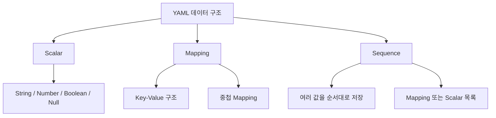
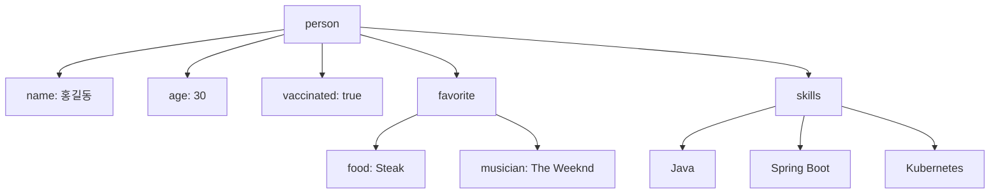
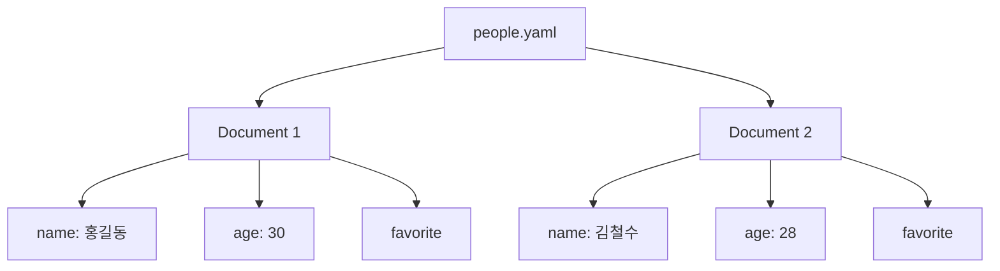
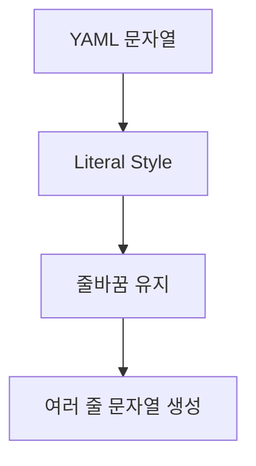
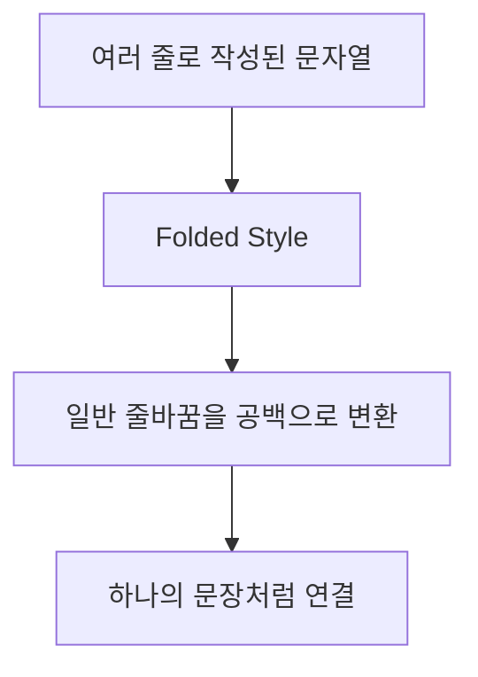
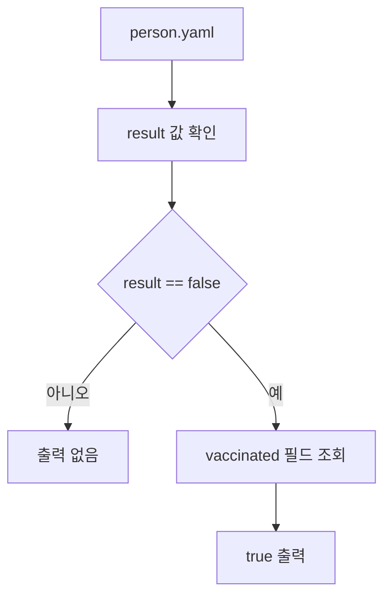
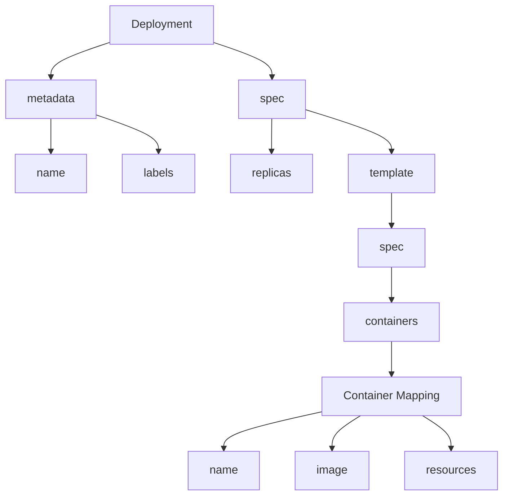

# Ch 2. Yaml 구조 및 문법

# Ch 2. Yaml 구조 및 문법
* toc
{:toc}

---

## 01. Dictionary

### YAML의 구조와 문법: Mapping, Dictionary, 문자열, Null, Boolean

YAML은 사람이 쉽게 읽고 작성할 수 있도록 설계된 데이터 직렬화 형식이다.

Kubernetes에서는 Pod, Deployment, Service, ConfigMap 등 다양한 리소스를 YAML 파일로 정의하며, Spring Boot에서도 `application.yml`을 통해 애플리케이션 설정을 관리한다.

YAML의 기본적인 구조는 비교적 간단하다.

```yaml
name: 홍길동
age: 30

favorite:
  food: Steak
  musician: The Weeknd
```

위 내용을 읽으면 별도의 설명 없이도 다음과 같은 정보를 이해할 수 있다.

- 이름은 홍길동이다.
- 나이는 30세이다.
- 좋아하는 음식은 Steak이다.
- 좋아하는 음악가는 The Weeknd이다.

YAML은 이처럼 데이터를 Key와 Value로 표현하며, 들여쓰기를 통해 데이터 사이의 계층 관계를 나타낸다.

하지만 실제 YAML을 작성하려면 Key-Value 구조 외에도 알아야 할 문법이 있다.

예를 들어 다음과 같은 상황이다.

- 하나의 Key에 또 다른 객체를 저장하고 싶은 경우
- 같은 데이터를 한 줄로 표현하고 싶은 경우
- 하나의 파일에 여러 YAML 문서를 작성하고 싶은 경우
- 긴 문자열을 여러 줄로 표현하고 싶은 경우
- 줄바꿈을 유지하거나 하나의 문장으로 합치고 싶은 경우
- 값이 존재하지 않는 상태를 표현하고 싶은 경우
- Boolean 값을 기준으로 데이터를 필터링하고 싶은 경우

이번에는 YAML의 기본 데이터 구조인 **Mapping(Dictionary)** 을 중심으로 다양한 문법을 살펴보고, `yq`를 사용하여 실제 데이터가 어떻게 해석되는지도 확인한다.

---

### YAML의 기본 데이터 구조

YAML은 크게 세 가지 기본 데이터 구조를 사용한다.

| 데이터 구조 | 의미 | 예시 |
|---|---|---|
| Scalar | 하나의 값 | 문자열, 숫자, Boolean, Null |
| Mapping | Key-Value 관계 | 객체, Dictionary, Map |
| Sequence | 순서가 있는 값의 목록 | 배열, List |

이 세 가지 구조를 조합하면 복잡한 데이터도 표현할 수 있다.



예를 들어 다음 YAML을 살펴보자.

```yaml
person:
  name: 홍길동
  age: 30
  vaccinated: true

  favorite:
    food: Steak
    musician: The Weeknd

  skills:
    - Java
    - Spring Boot
    - Kubernetes
```

이 문서에는 세 가지 구조가 모두 포함되어 있다.

`홍길동`, `30`, `true`는 Scalar에 해당한다.

`person`과 `favorite`는 Mapping을 구성한다.

`skills`는 여러 문자열을 포함하는 Sequence이다.

이를 계층 구조로 표현하면 다음과 같다.



이러한 구조를 이해하면 YAML의 문법이 조금 복잡해지더라도 데이터 사이의 관계를 파악할 수 있다.

---

### Mapping과 Dictionary란?

Mapping은 **Key와 Value를 연결하여 데이터를 표현하는 구조**이다.

프로그래밍 언어에서 사용하는 Map이나 Dictionary와 비슷한 개념이다.

예를 들어 다음 YAML을 살펴보자.

```yaml
name: 홍길동
age: 30
```

여기서 `name`과 `age`는 Key이다.

`홍길동`과 `30`은 각각의 Value이다.

```text
Key    Value
--------------
name   홍길동
age    30
```

Mapping의 기본적인 표현 방식은 다음과 같다.

```yaml
key: value
```

콜론(`:`)을 사용하여 Key와 Value를 구분한다.

일반적인 블록 스타일에서는 콜론 뒤에 공백을 작성한다.

```yaml
name: 홍길동
```

여기서 `name`은 데이터를 구분하기 위한 이름이며, `홍길동`은 해당 이름에 대응하는 값이다.

#### Mapping의 특징

Mapping은 다음과 같은 특징을 가진다.

1. Key와 Value의 관계로 데이터를 표현한다.
2. 하나의 Mapping에 여러 Key-Value 쌍을 포함할 수 있다.
3. Value에는 Scalar뿐 아니라 다른 Mapping이나 Sequence를 사용할 수 있다.
4. 동일한 Mapping 안에서는 Key가 중복되지 않아야 한다.
5. Mapping의 항목 순서는 데이터의 의미를 결정하는 기준으로 사용하지 않는 것이 좋다.

실무에서는 Key를 문자열로 사용하는 경우가 대부분이다.

특히 Kubernetes Manifest에서는 일반적인 JSON 객체와 호환되는 문자열 Key를 사용한다.

다만 YAML 규격 자체는 문자열 외의 값이나 복합 노드를 Key로 표현하는 기능도 지원한다. 따라서 YAML의 모든 Key가 반드시 문자열이어야 하는 것은 아니다.

이러한 고급 기능은 일반적인 Kubernetes 설정에서는 거의 사용하지 않으므로, 우선 문자열 Key를 사용하는 Mapping 구조를 익히는 것이 좋다.

---

### Mapping의 Value에는 어떤 데이터를 사용할 수 있을까?

Mapping의 Value에는 다양한 종류의 데이터를 저장할 수 있다.

대표적으로 다음과 같다.

- String
- Integer
- Float
- Boolean
- Null
- Mapping
- Sequence

예를 들어 다음 YAML을 살펴보자.

```yaml
name: 홍길동
age: 30
height: 175.5
vaccinated: true
experience: null
```

각 항목의 데이터 타입은 다음과 같다.

| Key | Value | 데이터 타입 |
|---|---|---|
| `name` | `홍길동` | String |
| `age` | `30` | Integer |
| `height` | `175.5` | Float |
| `vaccinated` | `true` | Boolean |
| `experience` | `null` | Null |

Value에 문자열이나 숫자만 사용할 수 있는 것은 아니다.

다음과 같이 또 다른 Mapping을 포함할 수도 있다.

```yaml
person:
  name: 홍길동
  age: 30
```

여기서 `person`의 Value는 하나의 문자열이나 숫자가 아니라 Mapping이다.

즉 Mapping 안에 Mapping이 들어 있는 중첩 구조이다.

---

### 중첩 Mapping 표현하기

YAML에서는 들여쓰기를 사용하여 Mapping 내부에 또 다른 Mapping을 표현한다.

예를 들어 사용자에게 좋아하는 음식과 음악가에 대한 정보가 있다고 가정하자.

```yaml
name: 홍길동
age: 30

favorite:
  food: Steak
  musician: The Weeknd
```

여기서 `favorite`는 Key이다.

하지만 `favorite`의 Value는 단순한 Scalar가 아니다.

다음 두 개의 Key-Value 쌍을 포함하는 Mapping이다.

```yaml
food: Steak
musician: The Weeknd
```

이를 구조적으로 표현하면 다음과 같다.

```text
Root Mapping
│
├── name: 홍길동
├── age: 30
│
└── favorite
    ├── food: Steak
    └── musician: The Weeknd
```

이러한 구조에서는 들여쓰기 수준이 중요하다.

`food`와 `musician`은 `favorite`에 속해 있으므로 한 단계 더 들여쓰기해야 한다.

```yaml
favorite:
  food: Steak
  musician: The Weeknd
```

반대로 다음과 같이 작성하면 데이터의 구조가 달라진다.

```yaml
favorite:
food: Steak
musician: The Weeknd
```

이 설정은 `food`와 `musician`이 `favorite`에 속한 구조가 아니다.

`favorite`, `food`, `musician`이 최상위에 있는 별도의 Key가 된다. 이 경우 `favorite`의 값은 Null로 해석될 수 있다.

따라서 YAML에서는 단순히 문법 오류가 발생하지 않았다는 사실만으로 의도한 데이터 구조가 만들어졌다고 판단해서는 안 된다.

**들여쓰기가 올바른 계층 관계를 표현하고 있는지 확인하는 것이 중요하다.**

---

### YAML의 들여쓰기 규칙

YAML에서는 들여쓰기를 통해 데이터의 계층 구조를 표현한다.

일반적으로 공백 2칸을 사용하는 방식을 많이 사용한다.

```yaml
application:
  name: my-app

  server:
    port: 8080
    host: localhost
```

위 구조를 살펴보면 다음과 같다.

```text
application                 ← 최상위
  name                      ← 1단계
  server                    ← 1단계
    port                    ← 2단계
    host                    ← 2단계
```

들여쓰기의 핵심 규칙은 다음과 같다.

| 규칙 | 설명 |
|---|---|
| 공백 사용 | 들여쓰기에는 Space 사용 |
| Tab 사용 금지 | Tab을 들여쓰기로 사용하지 않음 |
| 같은 계층 | 동일한 수준으로 들여쓰기 |
| 하위 데이터 | 상위 항목보다 깊게 들여쓰기 |
| 일관성 | 파일 전체에서 일정한 들여쓰기 방식 유지 |

YAML이 공백 2칸만 허용하는 것은 아니다.

하지만 같은 계층의 항목은 동일한 들여쓰기 수준을 사용해야 한다.

#### 잘못된 예시

```yaml
application:
  name: my-app
   version: 1.0.0
```

`name`과 `version`의 들여쓰기가 다르다.

#### 올바른 예시

```yaml
application:
  name: my-app
  version: "1.0.0"
```

또한 `version`은 숫자가 아니라 버전 문자열로 관리하는 경우가 많으므로 따옴표로 감싸는 것이 안전하다.

---

### Mapping을 한 줄로 표현하는 Flow Style

YAML은 들여쓰기를 사용하는 Block Style 외에도 중괄호를 사용하는 Flow Style을 지원한다.

예를 들어 다음 Mapping이 있다고 가정하자.

```yaml
name: 홍길동
age: 30

favorite:
  food: Steak
  musician: The Weeknd
```

이 데이터는 다음과 같이 한 줄로 작성할 수도 있다.

```yaml
{name: 홍길동, age: 30, favorite: {food: Steak, musician: The Weeknd}}
```

두 YAML은 동일한 데이터 구조를 표현한다.

#### Block Style

```yaml
name: 홍길동
age: 30

favorite:
  food: Steak
  musician: The Weeknd
```

#### Flow Style

```yaml
{name: 홍길동, age: 30, favorite: {food: Steak, musician: The Weeknd}}
```

이러한 표현 방식은 JSON과 유사하다.

JSON에서는 객체를 중괄호로 표현한다.

```json
{
  "name": "홍길동",
  "age": 30,
  "favorite": {
    "food": "Steak",
    "musician": "The Weeknd"
  }
}
```

하지만 YAML의 Flow Style은 JSON과 완전히 동일하지는 않다.

YAML에서는 일반적인 Key와 문자열 값의 따옴표를 생략할 수 있다.

또한 Flow Style에서도 Mapping은 중괄호(`{}`)로 표현하고, Sequence는 대괄호(`[]`)로 표현한다.

#### Block Style과 Flow Style 비교

| 구분 | Block Style | Flow Style |
|---|---|---|
| Mapping 표현 | 들여쓰기 | `{}` |
| 데이터 구분 | 줄바꿈과 들여쓰기 | 쉼표 |
| 가독성 | 중첩 구조에 유리 | 간단한 구조에 유리 |
| 작성 방식 | 여러 줄 | 한 줄 또는 여러 줄 |
| 대표 사용처 | Kubernetes Manifest, 설정 파일 | 짧은 Mapping, 간단한 값 |

실무에서는 계층이 복잡한 Kubernetes Manifest를 작성할 때 Block Style을 주로 사용한다.

반면 단순한 값 목록이나 짧은 Mapping은 Flow Style로 작성해도 무방하다.

예를 들어 다음처럼 사용할 수 있다.

```yaml
labels: {app: nginx, environment: production}
```

이는 다음 구조와 동일하다.

```yaml
labels:
  app: nginx
  environment: production
```

---

### YAML의 Block Style과 Flow Style을 혼합할 수 있을까?

YAML은 두 가지 표현 방식을 혼합해서 사용할 수 있다.

예를 들어 다음과 같이 작성할 수 있다.

```yaml
application:
  name: payment-service

  database:
    host: localhost
    port: 3306

  labels: {team: backend, environment: production}

  profiles: [dev, staging, production]
```

여기서 `application`과 `database`는 Block Style의 Mapping이다.

반면 `labels`는 Flow Style의 Mapping이다.

`profiles`는 대괄호를 사용한 Flow Style의 Sequence이다.

이처럼 YAML은 표현 방식이 달라도 동일한 데이터 모델로 해석할 수 있다.

다만 하나의 파일에서 여러 표현 방식을 지나치게 혼합하면 가독성이 떨어질 수 있다.

따라서 실무에서는 기본적으로 Block Style을 사용하고, 짧은 설정에만 Flow Style을 사용하는 방법이 적절하다.

---

### YAML 문서의 시작을 나타내는 `---`

YAML에서는 하이픈 세 개(`---`)를 사용해 문서의 시작을 나타낼 수 있다.

다음 예시를 살펴보자.

```yaml
---
name: 홍길동
age: 30
```

여기서 `---`는 새로운 YAML 문서가 시작된다는 의미이다.

다만 중요한 점이 있다.

**모든 YAML 파일이 반드시 `---`로 시작해야 하는 것은 아니다.**

다음 YAML도 정상적인 YAML 문서이다.

```yaml
name: 홍길동
age: 30
```

따라서 `---`는 선택적으로 사용할 수 있는 문서 시작 표시이다.

특히 하나의 파일에 여러 YAML 문서를 작성할 때 유용하다.

---

### 하나의 파일에 여러 YAML 문서 작성하기

하나의 YAML 파일에 서로 다른 문서를 작성하려면 `---`를 사용하여 구분할 수 있다.

예를 들어 다음과 같은 YAML 파일을 작성한다고 가정하자.

**people.yaml**

```yaml
name: 홍길동
age: 30

favorite:
  food: Steak
  musician: The Weeknd

---
name: 김철수
age: 28

favorite:
  food: Pizza
  musician: Coldplay
```

이 파일에는 두 개의 YAML 문서가 들어 있다.

첫 번째 문서는 홍길동에 대한 정보이다.

```yaml
name: 홍길동
age: 30

favorite:
  food: Steak
  musician: The Weeknd
```

두 번째 문서는 김철수에 대한 정보이다.

```yaml
name: 김철수
age: 28

favorite:
  food: Pizza
  musician: Coldplay
```

두 문서는 같은 파일에 존재하지만 별개의 YAML 문서로 해석된다.



참고로 YAML은 문서의 끝을 명시하기 위한 `...` 표시도 지원한다.

```yaml
---
name: 홍길동
age: 30
...
```

하지만 일반적인 설정 파일에서는 문서 종료 표시를 생략하는 경우가 많다.

#### Kubernetes에서의 활용

Kubernetes에서는 하나의 파일에 여러 리소스를 정의할 때 `---`를 자주 사용한다.

```yaml
apiVersion: v1
kind: ConfigMap
metadata:
  name: app-config
data:
  APP_ENV: production

---
apiVersion: v1
kind: Service
metadata:
  name: app-service
spec:
  selector:
    app: my-app
  ports:
    - port: 80
      targetPort: 8080
```

이 파일에는 ConfigMap과 Service라는 두 개의 Kubernetes 리소스가 정의되어 있다.

다음 명령어를 실행하면 두 리소스를 함께 적용할 수 있다.

```bash
kubectl apply -f application.yaml
```

예상 출력:

```text
configmap/app-config created
service/app-service created
```

이처럼 YAML의 다중 문서 기능은 Kubernetes 리소스들을 하나의 파일로 관리할 때 유용하다.

---

### YAML의 문자열 표현 방식

YAML에서 가장 많이 사용하는 데이터 타입 중 하나는 문자열(String)이다.

문자열은 기본적으로 다음과 같이 작성할 수 있다.

```yaml
name: 홍길동
title: Happy
```

YAML에서는 일반적인 문자열을 작성할 때 큰따옴표나 작은따옴표를 생략할 수 있다.

하지만 필요하다면 다음과 같이 명시적으로 작성할 수도 있다.

```yaml
name: "홍길동"
title: 'Happy'
```

세 가지 표현 방식을 비교하면 다음과 같다.

```yaml
name1: 홍길동
name2: "홍길동"
name3: '홍길동'
```

세 값은 모두 문자열로 해석할 수 있다.

다만 따옴표의 종류에 따라 이스케이프 문자와 특수문자를 처리하는 규칙에는 차이가 있다.

| 표현 방식 | 특징 |
|---|---|
| 따옴표 없음 | 간결하지만 일부 특수문자와 타입 해석에 주의 |
| 큰따옴표 | `\n`, `\"` 등의 이스케이프 표현 지원 |
| 작은따옴표 | 대부분의 문자를 문자 그대로 표현 |

예를 들어 문자열에 `:`과 공백이 포함된다면 다음처럼 따옴표를 사용하는 것이 안전하다.

```yaml
message: "Hello: Kubernetes"
```

반대로 다음과 같이 작성하면 Mapping 구분 기호와 충돌할 수 있다.

```yaml
message: Hello: Kubernetes
```

따라서 문자열에 YAML의 특수문자가 포함되어 있다면 따옴표 사용을 고려해야 한다.

---

### 여러 줄 문자열을 표현하는 Literal Block Scalar

YAML에서는 긴 문자열을 여러 줄로 표현할 수 있다.

대표적으로 파이프(`|`)를 사용하는 방식이 있다.

이를 **Literal Block Scalar**라고 한다.

예를 들어 다음과 같은 문장을 저장한다고 가정하자.

```text
Kubernetes is an open-source system.
It helps manage containerized applications.
It supports automated deployment and scaling.
```

이 문자열을 YAML로 작성하면 다음과 같다.

```yaml
description: |
  Kubernetes is an open-source system.
  It helps manage containerized applications.
  It supports automated deployment and scaling.
```

여기서 `|`는 줄바꿈을 유지하는 여러 줄 문자열을 의미한다.

따라서 파싱된 문자열에도 줄바꿈이 포함된다.

```text
Kubernetes is an open-source system.\n
It helps manage containerized applications.\n
It supports automated deployment and scaling.\n
```

이를 구조적으로 표현하면 다음과 같다.



이 방식은 다음과 같은 데이터를 표현할 때 유용하다.

- 긴 설명
- Shell Script
- SQL 문장
- 이메일 본문
- 인증서
- 여러 줄로 구성된 애플리케이션 설정

#### Kubernetes ConfigMap에서 활용하기

예를 들어 ConfigMap에 여러 줄 설정을 저장할 수 있다.

```yaml
apiVersion: v1
kind: ConfigMap
metadata:
  name: application-config

data:
  application.yml: |
    server:
      port: 8080

    spring:
      application:
        name: payment-service

    logging:
      level:
        root: INFO
```

여기서 `application.yml`의 Value는 여러 줄로 구성된 문자열이다.

ConfigMap은 이 문자열을 저장하며, 이를 Volume으로 마운트하는 등의 방식으로 애플리케이션에 전달할 수 있다.

이처럼 YAML의 Literal Block Scalar는 Kubernetes에서 여러 줄 설정 파일을 저장할 때 자주 활용된다.

---

### 여러 줄로 작성하지만 하나의 문장으로 해석하는 Folded Block Scalar

YAML에는 여러 줄로 작성한 문자열을 하나의 문장처럼 해석하는 기능도 있다.

이를 **Folded Block Scalar**라고 하며, 꺾쇠(`>`)를 사용한다.

예를 들어 다음과 같이 작성할 수 있다.

```yaml
description: >
  Kubernetes is an open-source system.
  It helps manage containerized applications.
  It supports automated deployment and scaling.
```

이 경우 일반적인 줄바꿈은 공백으로 변환된다.

따라서 최종 문자열은 다음과 같이 해석된다.

```text
Kubernetes is an open-source system. It helps manage containerized applications. It supports automated deployment and scaling.\n
```

파일에서는 여러 줄로 작성했지만 실제 문자열은 하나의 문장처럼 연결된다.



단, 모든 줄바꿈이 무조건 공백으로 변환되는 것은 아니다.

빈 줄이나 더 깊게 들여쓰기된 줄 등에서는 별도의 규칙이 적용된다.

#### Literal과 Folded 비교

다음 두 YAML을 비교해보자.

**Literal Style**

```yaml
message: |
  Hello
  Kubernetes
  YAML
```

파싱 결과:

```text
Hello\nKubernetes\nYAML\n
```

**Folded Style**

```yaml
message: >
  Hello
  Kubernetes
  YAML
```

파싱 결과:

```text
Hello Kubernetes YAML\n
```

두 방식의 차이는 다음과 같다.

| 구분 | `\|` | `>` |
|---|---|---|
| 명칭 | Literal Block Scalar | Folded Block Scalar |
| 줄바꿈 | 유지 | 일반 줄바꿈을 공백으로 변환 |
| 목적 | 여러 줄 문자열 보존 | 긴 문자열을 읽기 쉽게 나누어 작성 |
| 주요 활용 | Script, 인증서, 설정 파일 | 긴 설명, 문장 |
| 기본 마지막 줄바꿈 | 유지 | 유지 |

---

### `|-`, `>-`와 마지막 줄바꿈 처리

YAML에서 `|`와 `>`를 사용할 때 추가로 알아두면 좋은 문법이 있다.

바로 `-`와 `+`를 이용한 Chomping Indicator이다.

이 기능은 여러 줄 문자열의 마지막 줄바꿈을 어떻게 처리할지 결정한다.

#### 기본 동작

```yaml
message: |
  Hello
  Kubernetes
```

일반적으로 마지막 줄바꿈 하나가 유지된다.

```text
Hello\nKubernetes\n
```

#### `|-`: 마지막 줄바꿈 제거

```yaml
message: |-
  Hello
  Kubernetes
```

파싱 결과:

```text
Hello\nKubernetes
```

마지막 줄바꿈이 제거된다.

#### `|+`: 마지막 빈 줄까지 유지

```yaml
message: |+
  Hello
  Kubernetes


```

마지막에 존재하는 빈 줄과 줄바꿈을 유지한다.

#### `>-`: 줄바꿈을 접고 마지막 줄바꿈 제거

```yaml
message: >-
  Hello
  Kubernetes
```

파싱 결과:

```text
Hello Kubernetes
```

이를 정리하면 다음과 같다.

| 문법 | 동작 |
|---|---|
| `\|` | 내부 줄바꿈 유지, 마지막 줄바꿈 하나 유지 |
| `\|-` | 내부 줄바꿈 유지, 마지막 줄바꿈 제거 |
| `\|+` | 내부 줄바꿈 유지, 마지막 빈 줄들도 보존 |
| `>` | 일반 줄바꿈 접기, 마지막 줄바꿈 하나 유지 |
| `>-` | 일반 줄바꿈 접기, 마지막 줄바꿈 제거 |
| `>+` | 일반 줄바꿈 접기, 마지막 빈 줄들도 보존 |

실무에서는 문자열의 마지막 줄바꿈이 중요하지 않은 경우도 많다.

하지만 Shell Script, 인증서, 특정 문자열 비교처럼 정확한 문자열 내용이 중요한 경우에는 이러한 차이를 알아두는 것이 좋다.

---

### YAML에서 Null 표현하기

프로그램에서 데이터를 처리하다 보면 특정 값이 존재하지 않는 상황이 발생한다.

예를 들어 사용자의 경력 정보가 아직 입력되지 않았다고 가정하자.

```text
name: 홍길동
age: 30
experience: 값 없음
```

이처럼 값이 없다는 사실을 표현할 때 Null을 사용할 수 있다.

YAML에서는 여러 방식으로 Null을 표현할 수 있다.

#### 1. `null` 사용

```yaml
experience: null
```

#### 2. `~` 사용

```yaml
experience: ~
```

#### 3. Value 생략

```yaml
experience:
```

이 세 가지는 일반적인 YAML 해석에서 Null 값을 나타낼 수 있다.

다만 명확한 설정 파일을 작성할 때는 `null`을 명시하는 방식이 이해하기 쉬운 경우가 많다.

---

### Null과 빈 문자열은 다르다

Null과 빈 문자열은 서로 다른 값이다.

다음 YAML을 살펴보자.

```yaml
experience: null
nickname: ""
description: "null"
```

세 값은 서로 다르다.

| Key | Value | 의미 |
|---|---|---|
| `experience` | `null` | 값이 없음 |
| `nickname` | `""` | 길이가 0인 문자열 |
| `description` | `"null"` | null이라는 글자로 이루어진 문자열 |

Java 코드로 표현하면 다음과 비슷하다.

```java
String experience = null;
String nickname = "";
String description = "null";
```

여기서 `experience`는 Null이다.

반면 `nickname`은 비어 있지만 실제로 존재하는 문자열이다.

또한 `description`은 `null`이라는 문자열을 가지고 있다.

이 차이는 애플리케이션의 설정이나 데이터 역직렬화에서 중요하다.

예를 들어 어떤 설정이 Null인지, 빈 문자열인지에 따라 검증 결과나 기본값 적용 방식이 달라질 수 있다.

---

### Null과 Key가 존재하지 않는 상태도 다르다

다음 두 YAML을 비교해보자.

**Key가 존재하지만 Value가 Null인 경우**

```yaml
name: 홍길동
experience: null
```

**Key 자체가 존재하지 않는 경우**

```yaml
name: 홍길동
```

첫 번째 YAML에는 `experience`라는 Key가 존재한다.

하지만 Value는 Null이다.

두 번째 YAML에는 `experience`라는 Key 자체가 존재하지 않는다.

이러한 차이는 설정을 병합하거나 API 요청을 처리할 때 중요할 수 있다.

예를 들어 부분 수정 API에서 다음과 같은 의미를 구분하도록 설계할 수 있다.

```text
experience 필드 없음
→ 기존 값 유지

experience: null
→ 기존 값 제거
```

물론 실제 동작은 애플리케이션의 API 계약과 구현 방식에 따라 달라진다.

YAML 자체가 이러한 비즈니스 규칙을 정의하는 것은 아니다.

하지만 YAML은 두 상태를 서로 다른 데이터 구조로 표현할 수 있다.

---

### YAML의 Boolean 표현 방식

Boolean은 참과 거짓을 나타내는 데이터 타입이다.

YAML에서도 Boolean 값을 표현할 수 있다.

가장 일반적인 표현 방식은 다음과 같다.

```yaml
vaccinated: true
result: false
```

여기서 `vaccinated`는 `true`이다.

`result`는 `false`이다.

이 값들은 문자열이 아니라 Boolean 타입으로 해석할 수 있다.

#### Boolean은 첫 글자를 대문자로 작성해야 할까?

반드시 그렇지는 않다.

YAML 1.2의 Core Schema에서는 다음과 같은 표현을 Boolean으로 인식한다.

```yaml
value1: true
value2: True
value3: TRUE

value4: false
value5: False
value6: FALSE
```

따라서 `True`나 `False`처럼 첫 글자를 대문자로 작성해야만 Boolean이 되는 것은 아니다.

다만 **실무에서는 소문자인 `true`와 `false`를 사용하는 것이 가장 일관되고 안전하다.**

JSON에서도 Boolean은 소문자인 `true`, `false`로 표현하며, Kubernetes Manifest에서도 일반적으로 같은 표기를 사용한다.

```yaml
enabled: true
debug: false
```

또한 다음 값들은 문자열과 구분해야 한다.

```yaml
enabled: "true"
debug: "false"
```

따옴표로 감싸면 Boolean이 아니라 문자열이 된다.

---

### YAML 1.1과 YAML 1.2의 Boolean 차이

YAML의 Boolean을 이해할 때 한 가지 더 주의할 사항이 있다.

YAML 버전과 파서에 따라 특정 값의 해석 방식이 달라질 수 있다.

예를 들어 YAML 1.1 계열에서는 다음과 같은 값을 Boolean으로 해석하는 파서가 있다.

```yaml
enabled: yes
disabled: no

featureOn: on
featureOff: off
```

하지만 YAML 1.2 Core Schema에서는 이러한 값들을 일반적으로 문자열로 해석한다.

| 값 | YAML 1.1 계열의 일부 파서 | YAML 1.2 Core Schema |
|---|---|---|
| `true` | Boolean | Boolean |
| `false` | Boolean | Boolean |
| `yes` | Boolean으로 해석 가능 | String |
| `no` | Boolean으로 해석 가능 | String |
| `on` | Boolean으로 해석 가능 | String |
| `off` | Boolean으로 해석 가능 | String |

이 차이는 실제 설정 오류로 이어질 수 있다.

예를 들어 다음 설정을 작성했다고 가정하자.

```yaml
countryCode: NO
```

개발자의 의도는 노르웨이를 의미하는 국가 코드 `NO`를 문자열로 저장하는 것일 수 있다.

하지만 일부 YAML 1.1 계열 파서는 이를 Boolean으로 해석할 수 있다.

이러한 문제를 방지하려면 다음과 같이 작성하는 것이 안전하다.

```yaml
countryCode: "NO"
```

따라서 문자열과 Boolean이 혼동될 수 있는 값은 명확하게 구분하는 것이 좋다.

---

### yq를 이용해 YAML 데이터 파싱하기

이제 앞에서 작성한 YAML을 실제로 파싱해보자.

여기서는 Mike Farah의 yq v4 계열을 기준으로 사용한다.

yq는 YAML 데이터를 구조적으로 조회하고 수정할 수 있는 CLI 도구이다.

먼저 다음 YAML 파일을 작성한다.

**person.yaml**

```yaml
name: 홍길동
age: 30

favorite:
  food: Steak
  musician: The Weeknd

experience: null
vaccinated: true
result: false
```

파일을 저장한 뒤 yq로 내용을 확인한다.

```bash
yq '.' person.yaml
```

여기서 `.`은 YAML 문서 전체를 선택한다는 의미이다.

예상 출력:

```yaml
name: 홍길동
age: 30
favorite:
  food: Steak
  musician: The Weeknd
experience: null
vaccinated: true
result: false
```

이제 특정 필드를 조회해보자.

---

### yq로 Mapping의 특정 값 조회하기

사용자 이름을 조회하려면 다음 명령어를 사용한다.

```bash
yq '.name' person.yaml
```

출력:

```text
홍길동
```

나이를 조회한다.

```bash
yq '.age' person.yaml
```

출력:

```text
30
```

중첩된 Mapping에 접근하려면 점(`.`)을 사용하여 경로를 이어서 작성한다.

```bash
yq '.favorite.food' person.yaml
```

출력:

```text
Steak
```

좋아하는 음악가를 조회한다.

```bash
yq '.favorite.musician' person.yaml
```

출력:

```text
The Weeknd
```

이러한 경로 표현식은 Java 객체에서 중첩된 필드에 접근하는 개념과 비슷하게 이해할 수 있다.

```text
person.favorite.food
```

YAML에서는 해당 경로를 다음과 같이 표현한다.

```text
.favorite.food
```

중첩 구조가 깊어져도 같은 방식으로 접근할 수 있다.

---

### yq로 데이터 타입 확인하기

yq에서는 `tag` 연산자를 사용해 YAML 값의 타입을 확인할 수 있다.

예를 들어 다음 명령어를 실행한다.

```bash
yq '.name | tag' person.yaml
```

출력:

```text
!!str
```

문자열이라는 의미이다.

나이의 타입을 확인한다.

```bash
yq '.age | tag' person.yaml
```

출력:

```text
!!int
```

정수라는 의미이다.

Boolean 타입을 확인한다.

```bash
yq '.vaccinated | tag' person.yaml
```

출력:

```text
!!bool
```

Null 타입을 확인한다.

```bash
yq '.experience | tag' person.yaml
```

출력:

```text
!!null
```

주요 타입은 다음과 같다.

| 타입 태그 | 의미 |
|---|---|
| `!!str` | 문자열 |
| `!!int` | 정수 |
| `!!float` | 실수 |
| `!!bool` | Boolean |
| `!!null` | Null |
| `!!map` | Mapping |
| `!!seq` | Sequence |

이 기능은 YAML을 작성했을 때 값이 의도한 타입으로 해석되는지 확인하는 데 유용하다.

특히 `true`, `"true"`, `null`, `"null"`처럼 화면에서는 비슷하게 보이는 값의 차이를 확인할 수 있다.

---

### yq의 select를 이용한 조건 검색

yq에서는 `select`를 사용해 특정 조건을 만족하는 데이터만 선택할 수 있다.

예를 들어 다음 YAML을 사용한다고 가정하자.

```yaml
name: 홍길동
age: 30
vaccinated: true
result: false
```

여기서 `result`는 단순한 Boolean 데이터이다.

실제 서비스에서는 `false`가 어떤 업무적 의미를 가지는지 별도로 정의해야 하지만, 여기서는 조건 검색을 위한 값으로 사용한다.

#### result가 false가 아닌 경우

다음 명령어를 실행한다.

```bash
yq 'select(.result != false)' person.yaml
```

이 명령어는 다음 조건을 검사한다.

```text
result != false
```

즉 `result`의 값이 Boolean `false`와 다르면 문서를 출력한다.

하지만 현재 데이터는 다음과 같다.

```yaml
result: false
```

따라서 조건을 만족하지 않는다.

결과적으로 출력되는 내용이 없다.

```text
출력 없음
```

여기서 중요한 점은 **조건에 일치하는 데이터가 없어서 아무것도 출력되지 않았다는 것**이다.

단순히 출력이 비었다는 사실만으로 YAML 파싱에 실패했다고 판단해서는 안 된다.

---

### result가 false인 경우만 조회하기

이번에는 조건을 반대로 변경해보자.

```bash
yq 'select(.result == false)' person.yaml
```

이 명령어는 다음 조건을 검사한다.

```text
result == false
```

현재 YAML에서는 `result`가 `false`이므로 조건을 만족한다.

따라서 문서 전체가 출력된다.

```yaml
name: 홍길동
age: 30
vaccinated: true
result: false
```

`select`는 조건을 만족하는 데이터를 선택하는 역할을 한다.

여기서는 입력 문서의 최상위 Mapping에 조건을 적용했기 때문에 조건을 만족하면 문서 전체가 출력된다.

반대로 조건을 만족하지 않으면 아무것도 출력되지 않는다.

---

### 조건을 만족하는 경우 특정 필드만 출력하기

조건을 만족하는 문서 전체가 아니라 특정 값만 조회하고 싶을 수도 있다.

예를 들어 `result`가 `false`일 때 `vaccinated` 값만 확인한다고 가정하자.

```bash
yq 'select(.result == false) | .vaccinated' person.yaml
```

출력:

```text
true
```

이 명령어는 다음 두 단계를 수행한다.

**첫 번째 단계**

```text
select(.result == false)
```

현재 문서의 `result`가 `false`인지 확인한다.

**두 번째 단계**

```text
.vaccinated
```

조건을 만족하는 문서에서 `vaccinated` 값을 추출한다.



이처럼 `select`와 경로 표현식을 조합하면 특정 조건을 만족하는 데이터에서 필요한 값만 추출할 수 있다.

---

### 여러 YAML 문서에서 조건에 맞는 데이터 검색하기

앞에서는 하나의 YAML 문서를 대상으로 조건을 검사했다.

이번에는 여러 YAML 문서를 포함하는 파일에서 조건에 맞는 데이터를 추출해보자.

**people.yaml**

```yaml
---
name: 홍길동
age: 30
vaccinated: true
result: false

---
name: 김철수
age: 28
vaccinated: false
result: true

---
name: 이영희
age: 32
vaccinated: true
result: false
```

이 파일에는 세 개의 YAML 문서가 있다.

각 문서의 값은 다음과 같다.

| 이름 | vaccinated | result |
|---|---|---|
| 홍길동 | true | false |
| 김철수 | false | true |
| 이영희 | true | false |

여기서 `result`가 `false`인 사람의 이름만 조회해보자.

```bash
yq 'select(.result == false) | .name' people.yaml
```

출력:

```text
홍길동
---
이영희
```

yq는 여러 YAML 문서에서 조건에 맞는 결과를 출력할 때 문서 구분 기호를 함께 표시할 수 있다.

이처럼 문서마다 별도의 조건을 검사할 수 있다.

#### vaccinated가 true인 사람 조회

```bash
yq 'select(.vaccinated == true) | .name' people.yaml
```

예상 출력:

```text
홍길동
---
이영희
```

#### 두 조건을 모두 만족하는 경우

이번에는 `result`가 `false`이면서 `vaccinated`가 `true`인 경우만 조회해보자.

```bash
yq 'select(.result == false and .vaccinated == true) | .name' people.yaml
```

예상 출력:

```text
홍길동
---
이영희
```

여기서 `and`는 두 조건을 모두 만족해야 한다는 의미이다.

반대로 둘 중 하나만 만족해도 조회하고 싶다면 `or`를 사용할 수 있다.

```bash
yq 'select(.result == false or .vaccinated == true) | .name' people.yaml
```

이처럼 yq를 활용하면 YAML 파일에서도 조건 검색을 수행할 수 있다.

---

### YAML의 Null을 yq로 검사하기

앞에서 Null을 여러 방식으로 표현할 수 있다는 점을 살펴보았다.

이번에는 yq를 사용해 실제로 Null인지 확인해보자.

**null-example.yaml**

```yaml
name: 홍길동

experience: null
nickname: ""
description: "null"
```

먼저 `experience`가 Null인지 확인한다.

```bash
yq '.experience == null' null-example.yaml
```

출력:

```text
true
```

`nickname`이 Null인지 확인한다.

```bash
yq '.nickname == null' null-example.yaml
```

출력:

```text
false
```

`nickname`은 빈 문자열이기 때문이다.

`description`이 Null인지 확인한다.

```bash
yq '.description == null' null-example.yaml
```

출력:

```text
false
```

`description`에는 `"null"`이라는 문자열이 저장되어 있다.

이처럼 yq를 이용하면 데이터의 타입과 값에 따라 조건을 검사할 수 있다.

다만 존재하지 않는 Key를 조회했을 때도 Null과 유사한 결과가 나타날 수 있다.

따라서 실제 Key의 존재 여부까지 확인하려면 `has` 같은 연산자를 추가로 사용하는 것이 좋다.

```bash
yq 'has("experience")' null-example.yaml
```

출력:

```text
true
```

반면 존재하지 않는 필드를 조회하면 다음과 같다.

```bash
yq 'has("address")' null-example.yaml
```

출력:

```text
false
```

이는 Null 값과 Key의 부재를 구분할 때 유용하다.

---

### yq로 특정 문서만 조회하기

YAML 파일에 여러 문서가 포함되어 있다면 문서의 순서를 기준으로 특정 문서를 조회할 수도 있다.

예를 들어 앞서 작성한 `people.yaml`을 사용한다고 가정하자.

```yaml
---
name: 홍길동
age: 30

---
name: 김철수
age: 28

---
name: 이영희
age: 32
```

문서의 인덱스는 0부터 시작한다.

```text
Document 0 → 홍길동
Document 1 → 김철수
Document 2 → 이영희
```

두 번째 문서를 조회하려면 다음 명령어를 사용한다.

```bash
yq 'select(document_index == 1)' people.yaml
```

출력:

```yaml
name: 김철수
age: 28
```

`document_index`는 현재 YAML 문서의 인덱스를 나타낸다.

`di`라는 축약 표현도 사용할 수 있다.

```bash
yq 'select(di == 1)' people.yaml
```

이를 통해 다중 문서 YAML 파일에서 특정 위치의 문서만 추출할 수 있다.

다만 운영 환경에서 문서 순서가 변경될 가능성이 있다면 인덱스보다 `metadata.name` 같은 명시적인 식별자를 기준으로 검색하는 편이 안정적이다.

---

### YAML 문법이 올바른지 검증하기

YAML은 사람이 읽기 쉬운 형식이지만 들여쓰기나 특수문자 사용이 잘못되면 파싱 오류가 발생할 수 있다.

따라서 작성한 YAML 파일을 실제로 사용하기 전에 문법을 검증하는 것이 좋다.

검증 방법에는 여러 가지가 있다.

#### 1. yq를 이용한 파싱 확인

다음 명령어를 실행한다.

```bash
yq '.' person.yaml
```

문법이 정상적이라면 YAML 내용이 출력된다.

반면 문법이 잘못되었다면 오류가 발생할 수 있다.

예를 들어 다음 YAML은 들여쓰기가 잘못되어 있다.

```yaml
person:
  name: 홍길동
   age: 30
```

이런 경우 yq가 YAML을 파싱하는 과정에서 오류를 반환할 수 있다.

명령어의 종료 코드도 확인할 수 있다.

```bash
yq '.' person.yaml > /dev/null

echo $?
```

정상적으로 파싱되었다면 일반적으로 다음과 같이 출력된다.

```text
0
```

오류가 발생했다면 0이 아닌 종료 코드가 나타난다.

#### 2. yamllint를 이용한 문법과 스타일 검증

`yamllint`는 YAML 파일의 문법과 스타일을 검사하는 도구이다.

설치되어 있다면 다음과 같이 사용할 수 있다.

```bash
yamllint person.yaml
```

문법 오류뿐 아니라 들여쓰기와 같은 스타일 문제도 확인할 수 있다.

다만 yamllint의 규칙은 설정에 따라 달라질 수 있다.

예를 들어 파일 시작 부분에 `---`를 작성하도록 권장하는 규칙이 활성화되어 있을 수 있다.

이 경우 YAML 규격상 `---`가 필수가 아니더라도 스타일 경고가 나타날 수 있다.

따라서 **YAML 문법 자체의 요구사항과 특정 Linter의 스타일 규칙을 구분해야 한다.**

#### 3. Kubernetes API 검증

Kubernetes Manifest라면 YAML 문법만 확인해서는 충분하지 않다.

예를 들어 다음 YAML을 살펴보자.

```yaml
apiVersion: v1
kind: Pod
metadata:
  name: nginx
spec:
  containers:
    - name: nginx
      image: nginx:1.27
```

이 파일은 YAML 문법에 맞게 작성되었다.

하지만 실제 Kubernetes에 적용할 때는 Kubernetes API가 요구하는 구조도 올바른지 확인해야 한다.

이를 위해 다음 명령어를 사용할 수 있다.

```bash
kubectl apply --dry-run=server -f pod.yaml
```

이 명령어는 API Server를 통해 적용 가능 여부를 확인하지만 실제로 리소스를 저장하지는 않는다.

단, 서버 측 Dry Run이 지원되는 클러스터 환경과 적절한 권한이 필요하다.

또한 Dry Run이 성공했다고 해서 실제 Pod가 정상적으로 스케줄링되고 컨테이너가 실행된다는 사실까지 보장하는 것은 아니다.

검증 단계는 다음과 같이 구분할 수 있다.

| 검증 단계 | 확인 내용 |
|---|---|
| YAML Parser | YAML 문법이 올바른가? |
| YAML Linter | 들여쓰기와 스타일 규칙을 준수하는가? |
| Kubernetes API 검증 | 리소스의 API 구조와 필드가 유효한가? |
| 실제 배포 검증 | Pod가 정상적으로 생성되고 실행되는가? |

이러한 검증 과정을 분리하면 설정 오류의 원인을 빠르게 파악할 수 있다.

---

### Kubernetes에서 Mapping을 활용하는 방법

지금까지 살펴본 Mapping 구조는 Kubernetes Manifest에서도 매우 중요하다.

예를 들어 다음 Deployment를 살펴보자.

```yaml
apiVersion: apps/v1
kind: Deployment

metadata:
  name: payment-service

  labels:
    app: payment-service
    team: backend

spec:
  replicas: 3

  selector:
    matchLabels:
      app: payment-service

  template:
    metadata:
      labels:
        app: payment-service

    spec:
      containers:
        - name: payment-service
          image: nginx:1.27

          ports:
            - containerPort: 80

          resources:
            requests:
              cpu: "100m"
              memory: "128Mi"

            limits:
              cpu: "500m"
              memory: "256Mi"
```

이 YAML에는 Mapping과 Sequence가 함께 사용되고 있다.

먼저 다음 부분을 살펴보자.

```yaml
metadata:
  name: payment-service

  labels:
    app: payment-service
    team: backend
```

`metadata`는 Mapping이다.

`labels`도 Mapping이다.

반면 다음 부분을 살펴보자.

```yaml
containers:
  - name: payment-service
    image: nginx:1.27
```

`containers`는 Sequence이다.

Sequence의 첫 번째 요소는 `name`과 `image`라는 Key를 포함하는 Mapping이다.



이처럼 Kubernetes Manifest는 Mapping 안에 Mapping이 들어가고, 그 안에 Sequence가 포함되는 구조가 반복된다.

따라서 YAML의 Mapping과 Sequence를 정확하게 이해하면 Kubernetes Manifest의 복잡한 구조도 쉽게 분석할 수 있다.

---

### Kubernetes Manifest에서 yq 활용하기

실제 Kubernetes Manifest에서는 특정 설정을 확인하거나 수정할 때 yq를 사용할 수 있다.

예를 들어 앞서 작성한 Deployment를 `deployment.yaml`로 저장했다고 가정하자.

#### Deployment 이름 확인

```bash
yq '.metadata.name' deployment.yaml
```

출력:

```text
payment-service
```

#### replicas 확인

```bash
yq '.spec.replicas' deployment.yaml
```

출력:

```text
3
```

#### 컨테이너 이미지 확인

```bash
yq '.spec.template.spec.containers[0].image' deployment.yaml
```

출력:

```text
nginx:1.27
```

#### CPU requests 확인

```bash
yq '.spec.template.spec.containers[0].resources.requests.cpu' deployment.yaml
```

출력:

```text
100m
```

#### Memory limits 확인

```bash
yq '.spec.template.spec.containers[0].resources.limits.memory' deployment.yaml
```

출력:

```text
256Mi
```

이러한 경로를 보면 Kubernetes Manifest가 얼마나 많은 Mapping과 Sequence로 이루어져 있는지 확인할 수 있다.

특히 다음 부분을 이해하는 것이 중요하다.

```text
.spec.template.spec.containers[0].resources.requests.cpu
```

각 요소의 의미는 다음과 같다.

| 경로 | 의미 |
|---|---|
| `.spec` | Deployment의 원하는 상태 |
| `.template` | Pod Template |
| `.spec` | Pod의 실행 설정 |
| `.containers` | 컨테이너 목록 |
| `[0]` | 첫 번째 컨테이너 |
| `.resources` | 컨테이너 자원 설정 |
| `.requests` | 요청 자원 |
| `.cpu` | CPU requests 값 |

이처럼 YAML의 계층 구조를 이해하면 길고 복잡한 설정도 경로 단위로 분석할 수 있다.

---

### Spring Boot에서 Mapping을 활용하는 방법

Spring Boot에서도 YAML Mapping 구조를 자주 사용한다.

예를 들어 다음과 같은 설정이 있다고 가정하자.

**application.yml**

```yaml
server:
  port: 8080

spring:
  application:
    name: payment-service

  datasource:
    url: jdbc:mysql://localhost:3306/payment
    username: payment_user
    password: ${DB_PASSWORD}

management:
  endpoints:
    web:
      exposure:
        include: health,info

  endpoint:
    health:
      probes:
        enabled: true
```

이 설정은 여러 단계의 Mapping으로 구성되어 있다.

```text
server
 └── port

spring
 ├── application
 │    └── name
 │
 └── datasource
      ├── url
      ├── username
      └── password

management
 ├── endpoints
 │    └── web
 │         └── exposure
 │              └── include
 │
 └── endpoint
      └── health
           └── probes
                └── enabled
```

Spring Boot는 이러한 설정을 읽어 애플리케이션의 실행 환경을 구성한다.

또한 사용자 정의 설정을 `@ConfigurationProperties`로 바인딩할 수도 있다.

예를 들어 다음 YAML이 있다고 가정하자.

```yaml
payment:
  retry:
    enabled: true
    max-attempts: 3
    delay-ms: 1000
```

이에 대응하는 Java 클래스를 정의할 수 있다.

```java
import org.springframework.boot.context.properties.ConfigurationProperties;

@ConfigurationProperties(prefix = "payment.retry")
public record PaymentRetryProperties(
        boolean enabled,
        int maxAttempts,
        long delayMs
) {
}
```

Spring Boot에서 해당 Configuration Properties가 등록되어 있다면 YAML 값을 Java 객체로 바인딩할 수 있다.

이때 다음 Mapping 경로가 Java 객체의 필드와 연결된다.

```text
payment.retry.enabled       → enabled
payment.retry.max-attempts  → maxAttempts
payment.retry.delay-ms      → delayMs
```

이처럼 YAML의 Mapping 구조는 단순한 텍스트 설정을 넘어 실제 애플리케이션 객체와 연결될 수 있다.

---

### 실무에서 YAML을 작성할 때 고려해야 할 사항

YAML은 비교적 읽기 쉬운 형식이지만 운영 환경에서 사용한다면 몇 가지 원칙을 지키는 것이 좋다.

#### 1. 들여쓰기 규칙을 일관되게 유지한다

공백 2칸을 사용한다면 파일 전체에서 동일한 규칙을 유지하는 것이 좋다.

서로 다른 들여쓰기 폭을 혼합하면 코드 리뷰와 수정 과정에서 실수가 발생하기 쉽다.

#### 2. 중첩 구조를 지나치게 깊게 만들지 않는다

다음과 같이 계층이 지나치게 깊어지면 설정을 이해하기 어렵다.

```yaml
application:
  server:
    connection:
      pool:
        settings:
          timeout:
            value: 30
```

설정 구조가 복잡하다면 불필요한 계층을 줄이거나 관련 설정을 분리할 수 있는지 검토해야 한다.

#### 3. 데이터 타입이 중요한 값에는 따옴표를 명시한다

특히 버전 번호, 국가 코드, 식별자처럼 숫자나 Boolean과 혼동될 수 있는 값은 문자열임을 명시하는 것이 좋다.

```yaml
version: "1.0"
countryCode: "NO"
productCode: "00123"
```

#### 4. Boolean은 소문자로 통일한다

```yaml
enabled: true
debug: false
```

YAML 파서 간의 차이를 줄이고 JSON과의 일관성을 유지하는 데 도움이 된다.

#### 5. Null과 빈 문자열을 구분한다

```yaml
experience: null
nickname: ""
```

두 값은 서로 다르므로 애플리케이션의 비즈니스 규칙에 맞게 사용해야 한다.

#### 6. 여러 줄 문자열의 줄바꿈 정책을 이해한다

Shell Script처럼 줄바꿈이 중요한 경우에는 `|`를 사용한다.

반면 긴 설명을 여러 줄로 나누어 작성하고 싶다면 `>`를 고려할 수 있다.

#### 7. YAML 문법과 애플리케이션 설정 검증을 구분한다

YAML 문법이 정상적이어도 Kubernetes나 Spring Boot에서 허용하지 않는 설정일 수 있다.

따라서 파싱 검증뿐 아니라 애플리케이션별 설정 검증도 함께 수행해야 한다.

#### 8. Mapping의 Key를 중복해서 작성하지 않는다

```yaml
port: 8080
port: 9090
```

위 구조는 동일한 Mapping에 같은 Key가 중복되어 있다.

일부 파서는 오류를 반환하고, 일부 파서는 특정 값을 선택할 수 있으므로 중복 Key를 허용하지 않도록 관리하는 것이 안전하다.

#### 9. 민감한 데이터를 외부 검증 사이트에 붙여 넣지 않는다

YAML 문법을 확인하기 위해 온라인 Linter를 사용할 수 있지만, 운영 환경의 설정 파일에는 데이터베이스 비밀번호나 API Key 등의 민감한 정보가 포함될 수 있다.

따라서 실제 운영 설정은 로컬의 yq, yamllint 또는 조직 내부의 검증 환경을 사용하는 것이 안전하다.

#### 10. YAML의 최종 해석 결과를 확인한다

YAML은 사람이 읽기 쉬운 형식이지만 실제 해석 결과가 작성자의 의도와 다를 수 있다.

예를 들어 `null`, `"null"`, `false`, `"false"`는 서로 다른 데이터 타입이다.

따라서 문제가 발생한다면 단순히 YAML 파일의 문자열만 확인하기보다 yq의 `tag` 연산자 등을 이용해 실제로 해석되는 타입까지 확인하는 것이 효과적이다.

---

### 정리

YAML은 Mapping, Sequence, Scalar라는 기본 데이터 구조를 조합하여 복잡한 데이터를 표현한다.

이 중 Mapping은 Key와 Value를 연결하는 가장 기본적인 구조이다.

Mapping의 Value에는 문자열이나 숫자뿐 아니라 다른 Mapping과 Sequence도 포함할 수 있다.

따라서 YAML은 중첩된 데이터 구조를 자연스럽게 표현할 수 있다.

이번에 살펴본 핵심 문법을 정리하면 다음과 같다.

| 문법 | 의미 | 예시 |
|---|---|---|
| `key: value` | Mapping | `name: Hong` |
| 들여쓰기 | 계층 구조 표현 | `favorite` 아래 `food` |
| `{}` | Flow Style Mapping | `{name: Hong, age: 30}` |
| `[]` | Flow Style Sequence | `[Java, Spring]` |
| `---` | YAML 문서 시작 | 다중 문서 구분 |
| `...` | YAML 문서 종료 | 명시적인 문서 종료 |
| `\|` | 줄바꿈 유지 문자열 | Literal Block Scalar |
| `>` | 줄바꿈을 접는 문자열 | Folded Block Scalar |
| `\|-` | 마지막 줄바꿈 제거 | Literal + Strip |
| `>-` | 줄바꿈 접기 및 마지막 줄바꿈 제거 | Folded + Strip |
| `null` | Null 값 | `experience: null` |
| `~` | Null 값 | `experience: ~` |
| `true` | Boolean 참 | `enabled: true` |
| `false` | Boolean 거짓 | `enabled: false` |
| `#` | 주석 | `# 서버 설정` |

또한 yq를 사용하면 YAML 데이터를 구조적으로 조회하거나 조건에 따라 필터링할 수 있다.

대표적인 명령어는 다음과 같다.

| 명령어 | 의미 |
|---|---|
| `yq '.' file.yaml` | 전체 YAML 조회 |
| `yq '.name' file.yaml` | 특정 Key 조회 |
| `yq '.favorite.food' file.yaml` | 중첩 Mapping 조회 |
| `yq '.age \| tag' file.yaml` | 데이터 타입 확인 |
| `yq 'select(.result == false)' file.yaml` | 조건에 맞는 문서 조회 |
| `yq 'select(.result == false) \| .name' file.yaml` | 조건에 맞는 문서에서 특정 필드 조회 |
| `yq 'select(di == 1)' file.yaml` | 두 번째 YAML 문서 조회 |

YAML의 문법을 이해할 때 중요한 것은 기호를 암기하는 것이 아니라 **실제로 어떤 데이터 구조가 만들어지는지 이해하는 것**이다.

예를 들어 Mapping과 Sequence가 어떻게 중첩되는지, Scalar가 어떤 타입으로 해석되는지, 여러 줄 문자열이 최종적으로 어떤 값을 갖는지를 이해하면 Kubernetes Manifest나 Spring Boot 설정 파일도 더 정확하게 작성할 수 있다.

또한 yq와 같은 도구를 사용하면 YAML을 단순히 눈으로 읽는 수준을 넘어, 실제 데이터 구조와 타입을 검증하고 자동화 작업에 활용할 수 있다.

#### 한 줄 요약

> YAML의 Mapping은 Key-Value 관계로 데이터를 표현하는 기본 구조이며, 들여쓰기와 다양한 Scalar 문법을 통해 중첩된 데이터를 표현할 수 있다. 이러한 문법을 이해하면 Kubernetes와 Spring Boot의 복잡한 설정을 정확하게 작성하고, yq를 통해 구조적으로 조회하고 검증할 수 있다.
