# Ch 2. Yaml 구조 및 문법

# Ch 2. Yaml 구조 및 문법
* toc
{:toc}

---

## 01. Dictionary

### YAML의 구조와 문법: Mapping, Dictionary, 문자열, Null, Boolean

YAML은 사람이 쉽게 읽고 작성할 수 있도록 설계된 데이터 직렬화 형식이다.

Kubernetes에서는 Pod, Deployment, Service, ConfigMap 등 다양한 리소스를 YAML 파일로 정의하며, Spring Boot에서도 `application.yml`을 통해 애플리케이션 설정을 관리한다.

YAML의 기본적인 구조는 비교적 간단하다.

```yaml
name: 홍길동
age: 30

favorite:
  food: Steak
  musician: The Weeknd
```

위 내용을 읽으면 별도의 설명 없이도 다음과 같은 정보를 이해할 수 있다.

- 이름은 홍길동이다.
- 나이는 30세이다.
- 좋아하는 음식은 Steak이다.
- 좋아하는 음악가는 The Weeknd이다.

YAML은 이처럼 데이터를 Key와 Value로 표현하며, 들여쓰기를 통해 데이터 사이의 계층 관계를 나타낸다.

하지만 실제 YAML을 작성하려면 Key-Value 구조 외에도 알아야 할 문법이 있다.

예를 들어 다음과 같은 상황이다.

- 하나의 Key에 또 다른 객체를 저장하고 싶은 경우
- 같은 데이터를 한 줄로 표현하고 싶은 경우
- 하나의 파일에 여러 YAML 문서를 작성하고 싶은 경우
- 긴 문자열을 여러 줄로 표현하고 싶은 경우
- 줄바꿈을 유지하거나 하나의 문장으로 합치고 싶은 경우
- 값이 존재하지 않는 상태를 표현하고 싶은 경우
- Boolean 값을 기준으로 데이터를 필터링하고 싶은 경우

이번에는 YAML의 기본 데이터 구조인 **Mapping(Dictionary)** 을 중심으로 다양한 문법을 살펴보고, `yq`를 사용하여 실제 데이터가 어떻게 해석되는지도 확인한다.

---

### YAML의 기본 데이터 구조

YAML은 크게 세 가지 기본 데이터 구조를 사용한다.

| 데이터 구조 | 의미 | 예시 |
|---|---|---|
| Scalar | 하나의 값 | 문자열, 숫자, Boolean, Null |
| Mapping | Key-Value 관계 | 객체, Dictionary, Map |
| Sequence | 순서가 있는 값의 목록 | 배열, List |

이 세 가지 구조를 조합하면 복잡한 데이터도 표현할 수 있다.

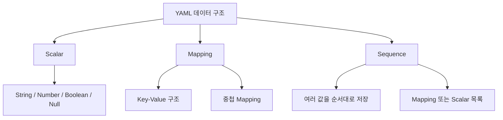

예를 들어 다음 YAML을 살펴보자.

```yaml
person:
  name: 홍길동
  age: 30
  vaccinated: true

  favorite:
    food: Steak
    musician: The Weeknd

  skills:
    - Java
    - Spring Boot
    - Kubernetes
```

이 문서에는 세 가지 구조가 모두 포함되어 있다.

`홍길동`, `30`, `true`는 Scalar에 해당한다.

`person`과 `favorite`는 Mapping을 구성한다.

`skills`는 여러 문자열을 포함하는 Sequence이다.

이를 계층 구조로 표현하면 다음과 같다.

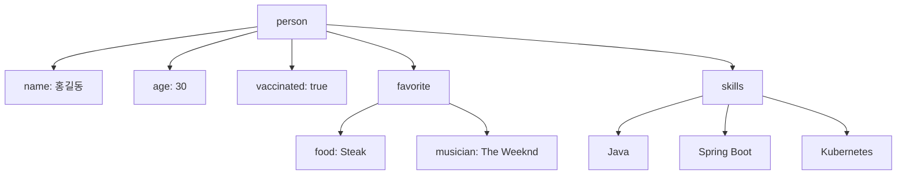

이러한 구조를 이해하면 YAML의 문법이 조금 복잡해지더라도 데이터 사이의 관계를 파악할 수 있다.

---

### Mapping과 Dictionary란?

Mapping은 **Key와 Value를 연결하여 데이터를 표현하는 구조**이다.

프로그래밍 언어에서 사용하는 Map이나 Dictionary와 비슷한 개념이다.

예를 들어 다음 YAML을 살펴보자.

```yaml
name: 홍길동
age: 30
```

여기서 `name`과 `age`는 Key이다.

`홍길동`과 `30`은 각각의 Value이다.

```text
Key    Value
--------------
name   홍길동
age    30
```

Mapping의 기본적인 표현 방식은 다음과 같다.

```yaml
key: value
```

콜론(`:`)을 사용하여 Key와 Value를 구분한다.

일반적인 블록 스타일에서는 콜론 뒤에 공백을 작성한다.

```yaml
name: 홍길동
```

여기서 `name`은 데이터를 구분하기 위한 이름이며, `홍길동`은 해당 이름에 대응하는 값이다.

#### Mapping의 특징

Mapping은 다음과 같은 특징을 가진다.

1. Key와 Value의 관계로 데이터를 표현한다.
2. 하나의 Mapping에 여러 Key-Value 쌍을 포함할 수 있다.
3. Value에는 Scalar뿐 아니라 다른 Mapping이나 Sequence를 사용할 수 있다.
4. 동일한 Mapping 안에서는 Key가 중복되지 않아야 한다.
5. Mapping의 항목 순서는 데이터의 의미를 결정하는 기준으로 사용하지 않는 것이 좋다.

실무에서는 Key를 문자열로 사용하는 경우가 대부분이다.

특히 Kubernetes Manifest에서는 일반적인 JSON 객체와 호환되는 문자열 Key를 사용한다.

다만 YAML 규격 자체는 문자열 외의 값이나 복합 노드를 Key로 표현하는 기능도 지원한다. 따라서 YAML의 모든 Key가 반드시 문자열이어야 하는 것은 아니다.

이러한 고급 기능은 일반적인 Kubernetes 설정에서는 거의 사용하지 않으므로, 우선 문자열 Key를 사용하는 Mapping 구조를 익히는 것이 좋다.

---

### Mapping의 Value에는 어떤 데이터를 사용할 수 있을까?

Mapping의 Value에는 다양한 종류의 데이터를 저장할 수 있다.

대표적으로 다음과 같다.

- String
- Integer
- Float
- Boolean
- Null
- Mapping
- Sequence

예를 들어 다음 YAML을 살펴보자.

```yaml
name: 홍길동
age: 30
height: 175.5
vaccinated: true
experience: null
```

각 항목의 데이터 타입은 다음과 같다.

| Key | Value | 데이터 타입 |
|---|---|---|
| `name` | `홍길동` | String |
| `age` | `30` | Integer |
| `height` | `175.5` | Float |
| `vaccinated` | `true` | Boolean |
| `experience` | `null` | Null |

Value에 문자열이나 숫자만 사용할 수 있는 것은 아니다.

다음과 같이 또 다른 Mapping을 포함할 수도 있다.

```yaml
person:
  name: 홍길동
  age: 30
```

여기서 `person`의 Value는 하나의 문자열이나 숫자가 아니라 Mapping이다.

즉 Mapping 안에 Mapping이 들어 있는 중첩 구조이다.

---

### 중첩 Mapping 표현하기

YAML에서는 들여쓰기를 사용하여 Mapping 내부에 또 다른 Mapping을 표현한다.

예를 들어 사용자에게 좋아하는 음식과 음악가에 대한 정보가 있다고 가정하자.

```yaml
name: 홍길동
age: 30

favorite:
  food: Steak
  musician: The Weeknd
```

여기서 `favorite`는 Key이다.

하지만 `favorite`의 Value는 단순한 Scalar가 아니다.

다음 두 개의 Key-Value 쌍을 포함하는 Mapping이다.

```yaml
food: Steak
musician: The Weeknd
```

이를 구조적으로 표현하면 다음과 같다.

```text
Root Mapping
│
├── name: 홍길동
├── age: 30
│
└── favorite
    ├── food: Steak
    └── musician: The Weeknd
```

이러한 구조에서는 들여쓰기 수준이 중요하다.

`food`와 `musician`은 `favorite`에 속해 있으므로 한 단계 더 들여쓰기해야 한다.

```yaml
favorite:
  food: Steak
  musician: The Weeknd
```

반대로 다음과 같이 작성하면 데이터의 구조가 달라진다.

```yaml
favorite:
food: Steak
musician: The Weeknd
```

이 설정은 `food`와 `musician`이 `favorite`에 속한 구조가 아니다.

`favorite`, `food`, `musician`이 최상위에 있는 별도의 Key가 된다. 이 경우 `favorite`의 값은 Null로 해석될 수 있다.

따라서 YAML에서는 단순히 문법 오류가 발생하지 않았다는 사실만으로 의도한 데이터 구조가 만들어졌다고 판단해서는 안 된다.

**들여쓰기가 올바른 계층 관계를 표현하고 있는지 확인하는 것이 중요하다.**

---

### YAML의 들여쓰기 규칙

YAML에서는 들여쓰기를 통해 데이터의 계층 구조를 표현한다.

일반적으로 공백 2칸을 사용하는 방식을 많이 사용한다.

```yaml
application:
  name: my-app

  server:
    port: 8080
    host: localhost
```

위 구조를 살펴보면 다음과 같다.

```text
application                 ← 최상위
  name                      ← 1단계
  server                    ← 1단계
    port                    ← 2단계
    host                    ← 2단계
```

들여쓰기의 핵심 규칙은 다음과 같다.

| 규칙 | 설명 |
|---|---|
| 공백 사용 | 들여쓰기에는 Space 사용 |
| Tab 사용 금지 | Tab을 들여쓰기로 사용하지 않음 |
| 같은 계층 | 동일한 수준으로 들여쓰기 |
| 하위 데이터 | 상위 항목보다 깊게 들여쓰기 |
| 일관성 | 파일 전체에서 일정한 들여쓰기 방식 유지 |

YAML이 공백 2칸만 허용하는 것은 아니다.

하지만 같은 계층의 항목은 동일한 들여쓰기 수준을 사용해야 한다.

#### 잘못된 예시

```yaml
application:
  name: my-app
   version: 1.0.0
```

`name`과 `version`의 들여쓰기가 다르다.

#### 올바른 예시

```yaml
application:
  name: my-app
  version: "1.0.0"
```

또한 `version`은 숫자가 아니라 버전 문자열로 관리하는 경우가 많으므로 따옴표로 감싸는 것이 안전하다.

---

### Mapping을 한 줄로 표현하는 Flow Style

YAML은 들여쓰기를 사용하는 Block Style 외에도 중괄호를 사용하는 Flow Style을 지원한다.

예를 들어 다음 Mapping이 있다고 가정하자.

```yaml
name: 홍길동
age: 30

favorite:
  food: Steak
  musician: The Weeknd
```

이 데이터는 다음과 같이 한 줄로 작성할 수도 있다.

```yaml
{name: 홍길동, age: 30, favorite: {food: Steak, musician: The Weeknd}}
```

두 YAML은 동일한 데이터 구조를 표현한다.

#### Block Style

```yaml
name: 홍길동
age: 30

favorite:
  food: Steak
  musician: The Weeknd
```

#### Flow Style

```yaml
{name: 홍길동, age: 30, favorite: {food: Steak, musician: The Weeknd}}
```

이러한 표현 방식은 JSON과 유사하다.

JSON에서는 객체를 중괄호로 표현한다.

```json
{
  "name": "홍길동",
  "age": 30,
  "favorite": {
    "food": "Steak",
    "musician": "The Weeknd"
  }
}
```

하지만 YAML의 Flow Style은 JSON과 완전히 동일하지는 않다.

YAML에서는 일반적인 Key와 문자열 값의 따옴표를 생략할 수 있다.

또한 Flow Style에서도 Mapping은 중괄호(`{}`)로 표현하고, Sequence는 대괄호(`[]`)로 표현한다.

#### Block Style과 Flow Style 비교

| 구분 | Block Style | Flow Style |
|---|---|---|
| Mapping 표현 | 들여쓰기 | `{}` |
| 데이터 구분 | 줄바꿈과 들여쓰기 | 쉼표 |
| 가독성 | 중첩 구조에 유리 | 간단한 구조에 유리 |
| 작성 방식 | 여러 줄 | 한 줄 또는 여러 줄 |
| 대표 사용처 | Kubernetes Manifest, 설정 파일 | 짧은 Mapping, 간단한 값 |

실무에서는 계층이 복잡한 Kubernetes Manifest를 작성할 때 Block Style을 주로 사용한다.

반면 단순한 값 목록이나 짧은 Mapping은 Flow Style로 작성해도 무방하다.

예를 들어 다음처럼 사용할 수 있다.

```yaml
labels: {app: nginx, environment: production}
```

이는 다음 구조와 동일하다.

```yaml
labels:
  app: nginx
  environment: production
```

---

### YAML의 Block Style과 Flow Style을 혼합할 수 있을까?

YAML은 두 가지 표현 방식을 혼합해서 사용할 수 있다.

예를 들어 다음과 같이 작성할 수 있다.

```yaml
application:
  name: payment-service

  database:
    host: localhost
    port: 3306

  labels: {team: backend, environment: production}

  profiles: [dev, staging, production]
```

여기서 `application`과 `database`는 Block Style의 Mapping이다.

반면 `labels`는 Flow Style의 Mapping이다.

`profiles`는 대괄호를 사용한 Flow Style의 Sequence이다.

이처럼 YAML은 표현 방식이 달라도 동일한 데이터 모델로 해석할 수 있다.

다만 하나의 파일에서 여러 표현 방식을 지나치게 혼합하면 가독성이 떨어질 수 있다.

따라서 실무에서는 기본적으로 Block Style을 사용하고, 짧은 설정에만 Flow Style을 사용하는 방법이 적절하다.

---

### YAML 문서의 시작을 나타내는 `---`

YAML에서는 하이픈 세 개(`---`)를 사용해 문서의 시작을 나타낼 수 있다.

다음 예시를 살펴보자.

```yaml
---
name: 홍길동
age: 30
```

여기서 `---`는 새로운 YAML 문서가 시작된다는 의미이다.

다만 중요한 점이 있다.

**모든 YAML 파일이 반드시 `---`로 시작해야 하는 것은 아니다.**

다음 YAML도 정상적인 YAML 문서이다.

```yaml
name: 홍길동
age: 30
```

따라서 `---`는 선택적으로 사용할 수 있는 문서 시작 표시이다.

특히 하나의 파일에 여러 YAML 문서를 작성할 때 유용하다.

---

### 하나의 파일에 여러 YAML 문서 작성하기

하나의 YAML 파일에 서로 다른 문서를 작성하려면 `---`를 사용하여 구분할 수 있다.

예를 들어 다음과 같은 YAML 파일을 작성한다고 가정하자.

**people.yaml**

```yaml
name: 홍길동
age: 30

favorite:
  food: Steak
  musician: The Weeknd

---
name: 김철수
age: 28

favorite:
  food: Pizza
  musician: Coldplay
```

이 파일에는 두 개의 YAML 문서가 들어 있다.

첫 번째 문서는 홍길동에 대한 정보이다.

```yaml
name: 홍길동
age: 30

favorite:
  food: Steak
  musician: The Weeknd
```

두 번째 문서는 김철수에 대한 정보이다.

```yaml
name: 김철수
age: 28

favorite:
  food: Pizza
  musician: Coldplay
```

두 문서는 같은 파일에 존재하지만 별개의 YAML 문서로 해석된다.

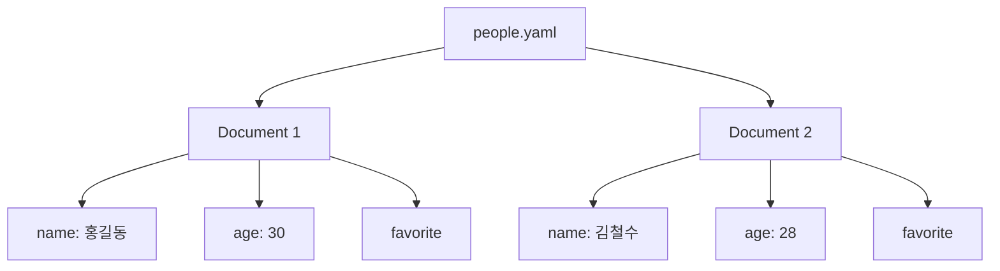

참고로 YAML은 문서의 끝을 명시하기 위한 `...` 표시도 지원한다.

```yaml
---
name: 홍길동
age: 30
...
```

하지만 일반적인 설정 파일에서는 문서 종료 표시를 생략하는 경우가 많다.

#### Kubernetes에서의 활용

Kubernetes에서는 하나의 파일에 여러 리소스를 정의할 때 `---`를 자주 사용한다.

```yaml
apiVersion: v1
kind: ConfigMap
metadata:
  name: app-config
data:
  APP_ENV: production

---
apiVersion: v1
kind: Service
metadata:
  name: app-service
spec:
  selector:
    app: my-app
  ports:
    - port: 80
      targetPort: 8080
```

이 파일에는 ConfigMap과 Service라는 두 개의 Kubernetes 리소스가 정의되어 있다.

다음 명령어를 실행하면 두 리소스를 함께 적용할 수 있다.

```bash
kubectl apply -f application.yaml
```

예상 출력:

```text
configmap/app-config created
service/app-service created
```

이처럼 YAML의 다중 문서 기능은 Kubernetes 리소스들을 하나의 파일로 관리할 때 유용하다.

---

### YAML의 문자열 표현 방식

YAML에서 가장 많이 사용하는 데이터 타입 중 하나는 문자열(String)이다.

문자열은 기본적으로 다음과 같이 작성할 수 있다.

```yaml
name: 홍길동
title: Happy
```

YAML에서는 일반적인 문자열을 작성할 때 큰따옴표나 작은따옴표를 생략할 수 있다.

하지만 필요하다면 다음과 같이 명시적으로 작성할 수도 있다.

```yaml
name: "홍길동"
title: 'Happy'
```

세 가지 표현 방식을 비교하면 다음과 같다.

```yaml
name1: 홍길동
name2: "홍길동"
name3: '홍길동'
```

세 값은 모두 문자열로 해석할 수 있다.

다만 따옴표의 종류에 따라 이스케이프 문자와 특수문자를 처리하는 규칙에는 차이가 있다.

| 표현 방식 | 특징 |
|---|---|
| 따옴표 없음 | 간결하지만 일부 특수문자와 타입 해석에 주의 |
| 큰따옴표 | `\n`, `\"` 등의 이스케이프 표현 지원 |
| 작은따옴표 | 대부분의 문자를 문자 그대로 표현 |

예를 들어 문자열에 `:`과 공백이 포함된다면 다음처럼 따옴표를 사용하는 것이 안전하다.

```yaml
message: "Hello: Kubernetes"
```

반대로 다음과 같이 작성하면 Mapping 구분 기호와 충돌할 수 있다.

```yaml
message: Hello: Kubernetes
```

따라서 문자열에 YAML의 특수문자가 포함되어 있다면 따옴표 사용을 고려해야 한다.

---

### 여러 줄 문자열을 표현하는 Literal Block Scalar

YAML에서는 긴 문자열을 여러 줄로 표현할 수 있다.

대표적으로 파이프(`|`)를 사용하는 방식이 있다.

이를 **Literal Block Scalar**라고 한다.

예를 들어 다음과 같은 문장을 저장한다고 가정하자.

```text
Kubernetes is an open-source system.
It helps manage containerized applications.
It supports automated deployment and scaling.
```

이 문자열을 YAML로 작성하면 다음과 같다.

```yaml
description: |
  Kubernetes is an open-source system.
  It helps manage containerized applications.
  It supports automated deployment and scaling.
```

여기서 `|`는 줄바꿈을 유지하는 여러 줄 문자열을 의미한다.

따라서 파싱된 문자열에도 줄바꿈이 포함된다.

```text
Kubernetes is an open-source system.\n
It helps manage containerized applications.\n
It supports automated deployment and scaling.\n
```

이를 구조적으로 표현하면 다음과 같다.

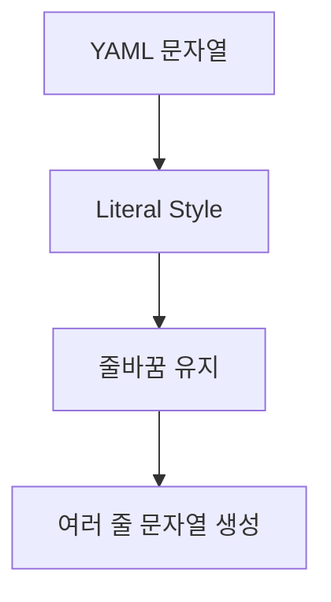

이 방식은 다음과 같은 데이터를 표현할 때 유용하다.

- 긴 설명
- Shell Script
- SQL 문장
- 이메일 본문
- 인증서
- 여러 줄로 구성된 애플리케이션 설정

#### Kubernetes ConfigMap에서 활용하기

예를 들어 ConfigMap에 여러 줄 설정을 저장할 수 있다.

```yaml
apiVersion: v1
kind: ConfigMap
metadata:
  name: application-config

data:
  application.yml: |
    server:
      port: 8080

    spring:
      application:
        name: payment-service

    logging:
      level:
        root: INFO
```

여기서 `application.yml`의 Value는 여러 줄로 구성된 문자열이다.

ConfigMap은 이 문자열을 저장하며, 이를 Volume으로 마운트하는 등의 방식으로 애플리케이션에 전달할 수 있다.

이처럼 YAML의 Literal Block Scalar는 Kubernetes에서 여러 줄 설정 파일을 저장할 때 자주 활용된다.

---

### 여러 줄로 작성하지만 하나의 문장으로 해석하는 Folded Block Scalar

YAML에는 여러 줄로 작성한 문자열을 하나의 문장처럼 해석하는 기능도 있다.

이를 **Folded Block Scalar**라고 하며, 꺾쇠(`>`)를 사용한다.

예를 들어 다음과 같이 작성할 수 있다.

```yaml
description: >
  Kubernetes is an open-source system.
  It helps manage containerized applications.
  It supports automated deployment and scaling.
```

이 경우 일반적인 줄바꿈은 공백으로 변환된다.

따라서 최종 문자열은 다음과 같이 해석된다.

```text
Kubernetes is an open-source system. It helps manage containerized applications. It supports automated deployment and scaling.\n
```

파일에서는 여러 줄로 작성했지만 실제 문자열은 하나의 문장처럼 연결된다.

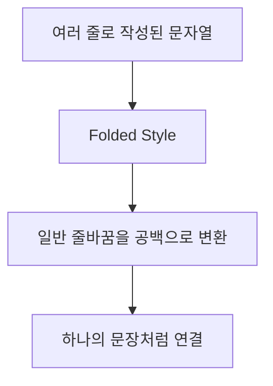

단, 모든 줄바꿈이 무조건 공백으로 변환되는 것은 아니다.

빈 줄이나 더 깊게 들여쓰기된 줄 등에서는 별도의 규칙이 적용된다.

#### Literal과 Folded 비교

다음 두 YAML을 비교해보자.

**Literal Style**

```yaml
message: |
  Hello
  Kubernetes
  YAML
```

파싱 결과:

```text
Hello\nKubernetes\nYAML\n
```

**Folded Style**

```yaml
message: >
  Hello
  Kubernetes
  YAML
```

파싱 결과:

```text
Hello Kubernetes YAML\n
```

두 방식의 차이는 다음과 같다.

| 구분 | `\|` | `>` |
|---|---|---|
| 명칭 | Literal Block Scalar | Folded Block Scalar |
| 줄바꿈 | 유지 | 일반 줄바꿈을 공백으로 변환 |
| 목적 | 여러 줄 문자열 보존 | 긴 문자열을 읽기 쉽게 나누어 작성 |
| 주요 활용 | Script, 인증서, 설정 파일 | 긴 설명, 문장 |
| 기본 마지막 줄바꿈 | 유지 | 유지 |

---

### `|-`, `>-`와 마지막 줄바꿈 처리

YAML에서 `|`와 `>`를 사용할 때 추가로 알아두면 좋은 문법이 있다.

바로 `-`와 `+`를 이용한 Chomping Indicator이다.

이 기능은 여러 줄 문자열의 마지막 줄바꿈을 어떻게 처리할지 결정한다.

#### 기본 동작

```yaml
message: |
  Hello
  Kubernetes
```

일반적으로 마지막 줄바꿈 하나가 유지된다.

```text
Hello\nKubernetes\n
```

#### `|-`: 마지막 줄바꿈 제거

```yaml
message: |-
  Hello
  Kubernetes
```

파싱 결과:

```text
Hello\nKubernetes
```

마지막 줄바꿈이 제거된다.

#### `|+`: 마지막 빈 줄까지 유지

```yaml
message: |+
  Hello
  Kubernetes


```

마지막에 존재하는 빈 줄과 줄바꿈을 유지한다.

#### `>-`: 줄바꿈을 접고 마지막 줄바꿈 제거

```yaml
message: >-
  Hello
  Kubernetes
```

파싱 결과:

```text
Hello Kubernetes
```

이를 정리하면 다음과 같다.

| 문법 | 동작 |
|---|---|
| `\|` | 내부 줄바꿈 유지, 마지막 줄바꿈 하나 유지 |
| `\|-` | 내부 줄바꿈 유지, 마지막 줄바꿈 제거 |
| `\|+` | 내부 줄바꿈 유지, 마지막 빈 줄들도 보존 |
| `>` | 일반 줄바꿈 접기, 마지막 줄바꿈 하나 유지 |
| `>-` | 일반 줄바꿈 접기, 마지막 줄바꿈 제거 |
| `>+` | 일반 줄바꿈 접기, 마지막 빈 줄들도 보존 |

실무에서는 문자열의 마지막 줄바꿈이 중요하지 않은 경우도 많다.

하지만 Shell Script, 인증서, 특정 문자열 비교처럼 정확한 문자열 내용이 중요한 경우에는 이러한 차이를 알아두는 것이 좋다.

---

### YAML에서 Null 표현하기

프로그램에서 데이터를 처리하다 보면 특정 값이 존재하지 않는 상황이 발생한다.

예를 들어 사용자의 경력 정보가 아직 입력되지 않았다고 가정하자.

```text
name: 홍길동
age: 30
experience: 값 없음
```

이처럼 값이 없다는 사실을 표현할 때 Null을 사용할 수 있다.

YAML에서는 여러 방식으로 Null을 표현할 수 있다.

#### 1. `null` 사용

```yaml
experience: null
```

#### 2. `~` 사용

```yaml
experience: ~
```

#### 3. Value 생략

```yaml
experience:
```

이 세 가지는 일반적인 YAML 해석에서 Null 값을 나타낼 수 있다.

다만 명확한 설정 파일을 작성할 때는 `null`을 명시하는 방식이 이해하기 쉬운 경우가 많다.

---

### Null과 빈 문자열은 다르다

Null과 빈 문자열은 서로 다른 값이다.

다음 YAML을 살펴보자.

```yaml
experience: null
nickname: ""
description: "null"
```

세 값은 서로 다르다.

| Key | Value | 의미 |
|---|---|---|
| `experience` | `null` | 값이 없음 |
| `nickname` | `""` | 길이가 0인 문자열 |
| `description` | `"null"` | null이라는 글자로 이루어진 문자열 |

Java 코드로 표현하면 다음과 비슷하다.

```java
String experience = null;
String nickname = "";
String description = "null";
```

여기서 `experience`는 Null이다.

반면 `nickname`은 비어 있지만 실제로 존재하는 문자열이다.

또한 `description`은 `null`이라는 문자열을 가지고 있다.

이 차이는 애플리케이션의 설정이나 데이터 역직렬화에서 중요하다.

예를 들어 어떤 설정이 Null인지, 빈 문자열인지에 따라 검증 결과나 기본값 적용 방식이 달라질 수 있다.

---

### Null과 Key가 존재하지 않는 상태도 다르다

다음 두 YAML을 비교해보자.

**Key가 존재하지만 Value가 Null인 경우**

```yaml
name: 홍길동
experience: null
```

**Key 자체가 존재하지 않는 경우**

```yaml
name: 홍길동
```

첫 번째 YAML에는 `experience`라는 Key가 존재한다.

하지만 Value는 Null이다.

두 번째 YAML에는 `experience`라는 Key 자체가 존재하지 않는다.

이러한 차이는 설정을 병합하거나 API 요청을 처리할 때 중요할 수 있다.

예를 들어 부분 수정 API에서 다음과 같은 의미를 구분하도록 설계할 수 있다.

```text
experience 필드 없음
→ 기존 값 유지

experience: null
→ 기존 값 제거
```

물론 실제 동작은 애플리케이션의 API 계약과 구현 방식에 따라 달라진다.

YAML 자체가 이러한 비즈니스 규칙을 정의하는 것은 아니다.

하지만 YAML은 두 상태를 서로 다른 데이터 구조로 표현할 수 있다.

---

### YAML의 Boolean 표현 방식

Boolean은 참과 거짓을 나타내는 데이터 타입이다.

YAML에서도 Boolean 값을 표현할 수 있다.

가장 일반적인 표현 방식은 다음과 같다.

```yaml
vaccinated: true
result: false
```

여기서 `vaccinated`는 `true`이다.

`result`는 `false`이다.

이 값들은 문자열이 아니라 Boolean 타입으로 해석할 수 있다.

#### Boolean은 첫 글자를 대문자로 작성해야 할까?

반드시 그렇지는 않다.

YAML 1.2의 Core Schema에서는 다음과 같은 표현을 Boolean으로 인식한다.

```yaml
value1: true
value2: True
value3: TRUE

value4: false
value5: False
value6: FALSE
```

따라서 `True`나 `False`처럼 첫 글자를 대문자로 작성해야만 Boolean이 되는 것은 아니다.

다만 **실무에서는 소문자인 `true`와 `false`를 사용하는 것이 가장 일관되고 안전하다.**

JSON에서도 Boolean은 소문자인 `true`, `false`로 표현하며, Kubernetes Manifest에서도 일반적으로 같은 표기를 사용한다.

```yaml
enabled: true
debug: false
```

또한 다음 값들은 문자열과 구분해야 한다.

```yaml
enabled: "true"
debug: "false"
```

따옴표로 감싸면 Boolean이 아니라 문자열이 된다.

---

### YAML 1.1과 YAML 1.2의 Boolean 차이

YAML의 Boolean을 이해할 때 한 가지 더 주의할 사항이 있다.

YAML 버전과 파서에 따라 특정 값의 해석 방식이 달라질 수 있다.

예를 들어 YAML 1.1 계열에서는 다음과 같은 값을 Boolean으로 해석하는 파서가 있다.

```yaml
enabled: yes
disabled: no

featureOn: on
featureOff: off
```

하지만 YAML 1.2 Core Schema에서는 이러한 값들을 일반적으로 문자열로 해석한다.

| 값 | YAML 1.1 계열의 일부 파서 | YAML 1.2 Core Schema |
|---|---|---|
| `true` | Boolean | Boolean |
| `false` | Boolean | Boolean |
| `yes` | Boolean으로 해석 가능 | String |
| `no` | Boolean으로 해석 가능 | String |
| `on` | Boolean으로 해석 가능 | String |
| `off` | Boolean으로 해석 가능 | String |

이 차이는 실제 설정 오류로 이어질 수 있다.

예를 들어 다음 설정을 작성했다고 가정하자.

```yaml
countryCode: NO
```

개발자의 의도는 노르웨이를 의미하는 국가 코드 `NO`를 문자열로 저장하는 것일 수 있다.

하지만 일부 YAML 1.1 계열 파서는 이를 Boolean으로 해석할 수 있다.

이러한 문제를 방지하려면 다음과 같이 작성하는 것이 안전하다.

```yaml
countryCode: "NO"
```

따라서 문자열과 Boolean이 혼동될 수 있는 값은 명확하게 구분하는 것이 좋다.

---

### yq를 이용해 YAML 데이터 파싱하기

이제 앞에서 작성한 YAML을 실제로 파싱해보자.

여기서는 Mike Farah의 yq v4 계열을 기준으로 사용한다.

yq는 YAML 데이터를 구조적으로 조회하고 수정할 수 있는 CLI 도구이다.

먼저 다음 YAML 파일을 작성한다.

**person.yaml**

```yaml
name: 홍길동
age: 30

favorite:
  food: Steak
  musician: The Weeknd

experience: null
vaccinated: true
result: false
```

파일을 저장한 뒤 yq로 내용을 확인한다.

```bash
yq '.' person.yaml
```

여기서 `.`은 YAML 문서 전체를 선택한다는 의미이다.

예상 출력:

```yaml
name: 홍길동
age: 30
favorite:
  food: Steak
  musician: The Weeknd
experience: null
vaccinated: true
result: false
```

이제 특정 필드를 조회해보자.

---

### yq로 Mapping의 특정 값 조회하기

사용자 이름을 조회하려면 다음 명령어를 사용한다.

```bash
yq '.name' person.yaml
```

출력:

```text
홍길동
```

나이를 조회한다.

```bash
yq '.age' person.yaml
```

출력:

```text
30
```

중첩된 Mapping에 접근하려면 점(`.`)을 사용하여 경로를 이어서 작성한다.

```bash
yq '.favorite.food' person.yaml
```

출력:

```text
Steak
```

좋아하는 음악가를 조회한다.

```bash
yq '.favorite.musician' person.yaml
```

출력:

```text
The Weeknd
```

이러한 경로 표현식은 Java 객체에서 중첩된 필드에 접근하는 개념과 비슷하게 이해할 수 있다.

```text
person.favorite.food
```

YAML에서는 해당 경로를 다음과 같이 표현한다.

```text
.favorite.food
```

중첩 구조가 깊어져도 같은 방식으로 접근할 수 있다.

---

### yq로 데이터 타입 확인하기

yq에서는 `tag` 연산자를 사용해 YAML 값의 타입을 확인할 수 있다.

예를 들어 다음 명령어를 실행한다.

```bash
yq '.name | tag' person.yaml
```

출력:

```text
!!str
```

문자열이라는 의미이다.

나이의 타입을 확인한다.

```bash
yq '.age | tag' person.yaml
```

출력:

```text
!!int
```

정수라는 의미이다.

Boolean 타입을 확인한다.

```bash
yq '.vaccinated | tag' person.yaml
```

출력:

```text
!!bool
```

Null 타입을 확인한다.

```bash
yq '.experience | tag' person.yaml
```

출력:

```text
!!null
```

주요 타입은 다음과 같다.

| 타입 태그 | 의미 |
|---|---|
| `!!str` | 문자열 |
| `!!int` | 정수 |
| `!!float` | 실수 |
| `!!bool` | Boolean |
| `!!null` | Null |
| `!!map` | Mapping |
| `!!seq` | Sequence |

이 기능은 YAML을 작성했을 때 값이 의도한 타입으로 해석되는지 확인하는 데 유용하다.

특히 `true`, `"true"`, `null`, `"null"`처럼 화면에서는 비슷하게 보이는 값의 차이를 확인할 수 있다.

---

### yq의 select를 이용한 조건 검색

yq에서는 `select`를 사용해 특정 조건을 만족하는 데이터만 선택할 수 있다.

예를 들어 다음 YAML을 사용한다고 가정하자.

```yaml
name: 홍길동
age: 30
vaccinated: true
result: false
```

여기서 `result`는 단순한 Boolean 데이터이다.

실제 서비스에서는 `false`가 어떤 업무적 의미를 가지는지 별도로 정의해야 하지만, 여기서는 조건 검색을 위한 값으로 사용한다.

#### result가 false가 아닌 경우

다음 명령어를 실행한다.

```bash
yq 'select(.result != false)' person.yaml
```

이 명령어는 다음 조건을 검사한다.

```text
result != false
```

즉 `result`의 값이 Boolean `false`와 다르면 문서를 출력한다.

하지만 현재 데이터는 다음과 같다.

```yaml
result: false
```

따라서 조건을 만족하지 않는다.

결과적으로 출력되는 내용이 없다.

```text
출력 없음
```

여기서 중요한 점은 **조건에 일치하는 데이터가 없어서 아무것도 출력되지 않았다는 것**이다.

단순히 출력이 비었다는 사실만으로 YAML 파싱에 실패했다고 판단해서는 안 된다.

---

### result가 false인 경우만 조회하기

이번에는 조건을 반대로 변경해보자.

```bash
yq 'select(.result == false)' person.yaml
```

이 명령어는 다음 조건을 검사한다.

```text
result == false
```

현재 YAML에서는 `result`가 `false`이므로 조건을 만족한다.

따라서 문서 전체가 출력된다.

```yaml
name: 홍길동
age: 30
vaccinated: true
result: false
```

`select`는 조건을 만족하는 데이터를 선택하는 역할을 한다.

여기서는 입력 문서의 최상위 Mapping에 조건을 적용했기 때문에 조건을 만족하면 문서 전체가 출력된다.

반대로 조건을 만족하지 않으면 아무것도 출력되지 않는다.

---

### 조건을 만족하는 경우 특정 필드만 출력하기

조건을 만족하는 문서 전체가 아니라 특정 값만 조회하고 싶을 수도 있다.

예를 들어 `result`가 `false`일 때 `vaccinated` 값만 확인한다고 가정하자.

```bash
yq 'select(.result == false) | .vaccinated' person.yaml
```

출력:

```text
true
```

이 명령어는 다음 두 단계를 수행한다.

**첫 번째 단계**

```text
select(.result == false)
```

현재 문서의 `result`가 `false`인지 확인한다.

**두 번째 단계**

```text
.vaccinated
```

조건을 만족하는 문서에서 `vaccinated` 값을 추출한다.

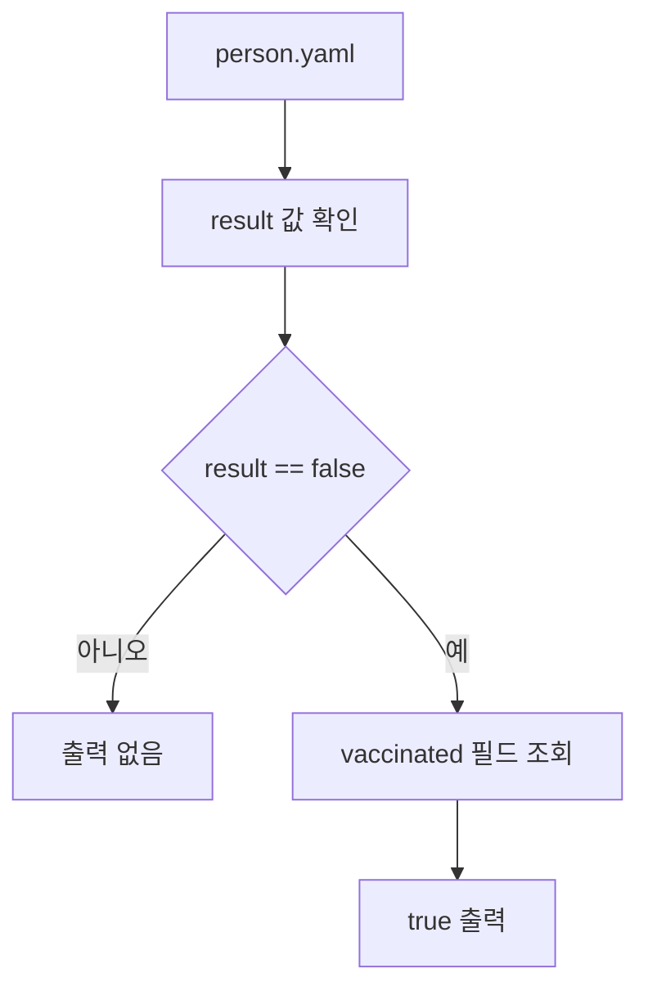

이처럼 `select`와 경로 표현식을 조합하면 특정 조건을 만족하는 데이터에서 필요한 값만 추출할 수 있다.

---

### 여러 YAML 문서에서 조건에 맞는 데이터 검색하기

앞에서는 하나의 YAML 문서를 대상으로 조건을 검사했다.

이번에는 여러 YAML 문서를 포함하는 파일에서 조건에 맞는 데이터를 추출해보자.

**people.yaml**

```yaml
---
name: 홍길동
age: 30
vaccinated: true
result: false

---
name: 김철수
age: 28
vaccinated: false
result: true

---
name: 이영희
age: 32
vaccinated: true
result: false
```

이 파일에는 세 개의 YAML 문서가 있다.

각 문서의 값은 다음과 같다.

| 이름 | vaccinated | result |
|---|---|---|
| 홍길동 | true | false |
| 김철수 | false | true |
| 이영희 | true | false |

여기서 `result`가 `false`인 사람의 이름만 조회해보자.

```bash
yq 'select(.result == false) | .name' people.yaml
```

출력:

```text
홍길동
---
이영희
```

yq는 여러 YAML 문서에서 조건에 맞는 결과를 출력할 때 문서 구분 기호를 함께 표시할 수 있다.

이처럼 문서마다 별도의 조건을 검사할 수 있다.

#### vaccinated가 true인 사람 조회

```bash
yq 'select(.vaccinated == true) | .name' people.yaml
```

예상 출력:

```text
홍길동
---
이영희
```

#### 두 조건을 모두 만족하는 경우

이번에는 `result`가 `false`이면서 `vaccinated`가 `true`인 경우만 조회해보자.

```bash
yq 'select(.result == false and .vaccinated == true) | .name' people.yaml
```

예상 출력:

```text
홍길동
---
이영희
```

여기서 `and`는 두 조건을 모두 만족해야 한다는 의미이다.

반대로 둘 중 하나만 만족해도 조회하고 싶다면 `or`를 사용할 수 있다.

```bash
yq 'select(.result == false or .vaccinated == true) | .name' people.yaml
```

이처럼 yq를 활용하면 YAML 파일에서도 조건 검색을 수행할 수 있다.

---

### YAML의 Null을 yq로 검사하기

앞에서 Null을 여러 방식으로 표현할 수 있다는 점을 살펴보았다.

이번에는 yq를 사용해 실제로 Null인지 확인해보자.

**null-example.yaml**

```yaml
name: 홍길동

experience: null
nickname: ""
description: "null"
```

먼저 `experience`가 Null인지 확인한다.

```bash
yq '.experience == null' null-example.yaml
```

출력:

```text
true
```

`nickname`이 Null인지 확인한다.

```bash
yq '.nickname == null' null-example.yaml
```

출력:

```text
false
```

`nickname`은 빈 문자열이기 때문이다.

`description`이 Null인지 확인한다.

```bash
yq '.description == null' null-example.yaml
```

출력:

```text
false
```

`description`에는 `"null"`이라는 문자열이 저장되어 있다.

이처럼 yq를 이용하면 데이터의 타입과 값에 따라 조건을 검사할 수 있다.

다만 존재하지 않는 Key를 조회했을 때도 Null과 유사한 결과가 나타날 수 있다.

따라서 실제 Key의 존재 여부까지 확인하려면 `has` 같은 연산자를 추가로 사용하는 것이 좋다.

```bash
yq 'has("experience")' null-example.yaml
```

출력:

```text
true
```

반면 존재하지 않는 필드를 조회하면 다음과 같다.

```bash
yq 'has("address")' null-example.yaml
```

출력:

```text
false
```

이는 Null 값과 Key의 부재를 구분할 때 유용하다.

---

### yq로 특정 문서만 조회하기

YAML 파일에 여러 문서가 포함되어 있다면 문서의 순서를 기준으로 특정 문서를 조회할 수도 있다.

예를 들어 앞서 작성한 `people.yaml`을 사용한다고 가정하자.

```yaml
---
name: 홍길동
age: 30

---
name: 김철수
age: 28

---
name: 이영희
age: 32
```

문서의 인덱스는 0부터 시작한다.

```text
Document 0 → 홍길동
Document 1 → 김철수
Document 2 → 이영희
```

두 번째 문서를 조회하려면 다음 명령어를 사용한다.

```bash
yq 'select(document_index == 1)' people.yaml
```

출력:

```yaml
name: 김철수
age: 28
```

`document_index`는 현재 YAML 문서의 인덱스를 나타낸다.

`di`라는 축약 표현도 사용할 수 있다.

```bash
yq 'select(di == 1)' people.yaml
```

이를 통해 다중 문서 YAML 파일에서 특정 위치의 문서만 추출할 수 있다.

다만 운영 환경에서 문서 순서가 변경될 가능성이 있다면 인덱스보다 `metadata.name` 같은 명시적인 식별자를 기준으로 검색하는 편이 안정적이다.

---

### YAML 문법이 올바른지 검증하기

YAML은 사람이 읽기 쉬운 형식이지만 들여쓰기나 특수문자 사용이 잘못되면 파싱 오류가 발생할 수 있다.

따라서 작성한 YAML 파일을 실제로 사용하기 전에 문법을 검증하는 것이 좋다.

검증 방법에는 여러 가지가 있다.

#### 1. yq를 이용한 파싱 확인

다음 명령어를 실행한다.

```bash
yq '.' person.yaml
```

문법이 정상적이라면 YAML 내용이 출력된다.

반면 문법이 잘못되었다면 오류가 발생할 수 있다.

예를 들어 다음 YAML은 들여쓰기가 잘못되어 있다.

```yaml
person:
  name: 홍길동
   age: 30
```

이런 경우 yq가 YAML을 파싱하는 과정에서 오류를 반환할 수 있다.

명령어의 종료 코드도 확인할 수 있다.

```bash
yq '.' person.yaml > /dev/null

echo $?
```

정상적으로 파싱되었다면 일반적으로 다음과 같이 출력된다.

```text
0
```

오류가 발생했다면 0이 아닌 종료 코드가 나타난다.

#### 2. yamllint를 이용한 문법과 스타일 검증

`yamllint`는 YAML 파일의 문법과 스타일을 검사하는 도구이다.

설치되어 있다면 다음과 같이 사용할 수 있다.

```bash
yamllint person.yaml
```

문법 오류뿐 아니라 들여쓰기와 같은 스타일 문제도 확인할 수 있다.

다만 yamllint의 규칙은 설정에 따라 달라질 수 있다.

예를 들어 파일 시작 부분에 `---`를 작성하도록 권장하는 규칙이 활성화되어 있을 수 있다.

이 경우 YAML 규격상 `---`가 필수가 아니더라도 스타일 경고가 나타날 수 있다.

따라서 **YAML 문법 자체의 요구사항과 특정 Linter의 스타일 규칙을 구분해야 한다.**

#### 3. Kubernetes API 검증

Kubernetes Manifest라면 YAML 문법만 확인해서는 충분하지 않다.

예를 들어 다음 YAML을 살펴보자.

```yaml
apiVersion: v1
kind: Pod
metadata:
  name: nginx
spec:
  containers:
    - name: nginx
      image: nginx:1.27
```

이 파일은 YAML 문법에 맞게 작성되었다.

하지만 실제 Kubernetes에 적용할 때는 Kubernetes API가 요구하는 구조도 올바른지 확인해야 한다.

이를 위해 다음 명령어를 사용할 수 있다.

```bash
kubectl apply --dry-run=server -f pod.yaml
```

이 명령어는 API Server를 통해 적용 가능 여부를 확인하지만 실제로 리소스를 저장하지는 않는다.

단, 서버 측 Dry Run이 지원되는 클러스터 환경과 적절한 권한이 필요하다.

또한 Dry Run이 성공했다고 해서 실제 Pod가 정상적으로 스케줄링되고 컨테이너가 실행된다는 사실까지 보장하는 것은 아니다.

검증 단계는 다음과 같이 구분할 수 있다.

| 검증 단계 | 확인 내용 |
|---|---|
| YAML Parser | YAML 문법이 올바른가? |
| YAML Linter | 들여쓰기와 스타일 규칙을 준수하는가? |
| Kubernetes API 검증 | 리소스의 API 구조와 필드가 유효한가? |
| 실제 배포 검증 | Pod가 정상적으로 생성되고 실행되는가? |

이러한 검증 과정을 분리하면 설정 오류의 원인을 빠르게 파악할 수 있다.

---

### Kubernetes에서 Mapping을 활용하는 방법

지금까지 살펴본 Mapping 구조는 Kubernetes Manifest에서도 매우 중요하다.

예를 들어 다음 Deployment를 살펴보자.

```yaml
apiVersion: apps/v1
kind: Deployment

metadata:
  name: payment-service

  labels:
    app: payment-service
    team: backend

spec:
  replicas: 3

  selector:
    matchLabels:
      app: payment-service

  template:
    metadata:
      labels:
        app: payment-service

    spec:
      containers:
        - name: payment-service
          image: nginx:1.27

          ports:
            - containerPort: 80

          resources:
            requests:
              cpu: "100m"
              memory: "128Mi"

            limits:
              cpu: "500m"
              memory: "256Mi"
```

이 YAML에는 Mapping과 Sequence가 함께 사용되고 있다.

먼저 다음 부분을 살펴보자.

```yaml
metadata:
  name: payment-service

  labels:
    app: payment-service
    team: backend
```

`metadata`는 Mapping이다.

`labels`도 Mapping이다.

반면 다음 부분을 살펴보자.

```yaml
containers:
  - name: payment-service
    image: nginx:1.27
```

`containers`는 Sequence이다.

Sequence의 첫 번째 요소는 `name`과 `image`라는 Key를 포함하는 Mapping이다.

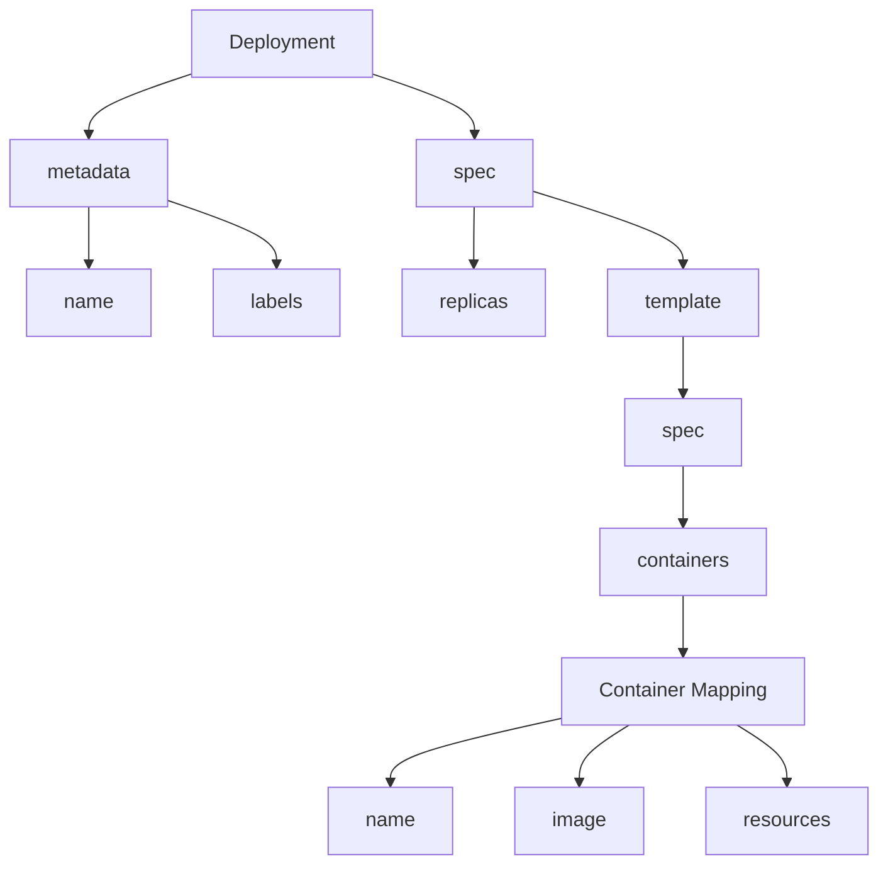

이처럼 Kubernetes Manifest는 Mapping 안에 Mapping이 들어가고, 그 안에 Sequence가 포함되는 구조가 반복된다.

따라서 YAML의 Mapping과 Sequence를 정확하게 이해하면 Kubernetes Manifest의 복잡한 구조도 쉽게 분석할 수 있다.

---

### Kubernetes Manifest에서 yq 활용하기

실제 Kubernetes Manifest에서는 특정 설정을 확인하거나 수정할 때 yq를 사용할 수 있다.

예를 들어 앞서 작성한 Deployment를 `deployment.yaml`로 저장했다고 가정하자.

#### Deployment 이름 확인

```bash
yq '.metadata.name' deployment.yaml
```

출력:

```text
payment-service
```

#### replicas 확인

```bash
yq '.spec.replicas' deployment.yaml
```

출력:

```text
3
```

#### 컨테이너 이미지 확인

```bash
yq '.spec.template.spec.containers[0].image' deployment.yaml
```

출력:

```text
nginx:1.27
```

#### CPU requests 확인

```bash
yq '.spec.template.spec.containers[0].resources.requests.cpu' deployment.yaml
```

출력:

```text
100m
```

#### Memory limits 확인

```bash
yq '.spec.template.spec.containers[0].resources.limits.memory' deployment.yaml
```

출력:

```text
256Mi
```

이러한 경로를 보면 Kubernetes Manifest가 얼마나 많은 Mapping과 Sequence로 이루어져 있는지 확인할 수 있다.

특히 다음 부분을 이해하는 것이 중요하다.

```text
.spec.template.spec.containers[0].resources.requests.cpu
```

각 요소의 의미는 다음과 같다.

| 경로 | 의미 |
|---|---|
| `.spec` | Deployment의 원하는 상태 |
| `.template` | Pod Template |
| `.spec` | Pod의 실행 설정 |
| `.containers` | 컨테이너 목록 |
| `[0]` | 첫 번째 컨테이너 |
| `.resources` | 컨테이너 자원 설정 |
| `.requests` | 요청 자원 |
| `.cpu` | CPU requests 값 |

이처럼 YAML의 계층 구조를 이해하면 길고 복잡한 설정도 경로 단위로 분석할 수 있다.

---

### Spring Boot에서 Mapping을 활용하는 방법

Spring Boot에서도 YAML Mapping 구조를 자주 사용한다.

예를 들어 다음과 같은 설정이 있다고 가정하자.

**application.yml**

```yaml
server:
  port: 8080

spring:
  application:
    name: payment-service

  datasource:
    url: jdbc:mysql://localhost:3306/payment
    username: payment_user
    password: ${DB_PASSWORD}

management:
  endpoints:
    web:
      exposure:
        include: health,info

  endpoint:
    health:
      probes:
        enabled: true
```

이 설정은 여러 단계의 Mapping으로 구성되어 있다.

```text
server
 └── port

spring
 ├── application
 │    └── name
 │
 └── datasource
      ├── url
      ├── username
      └── password

management
 ├── endpoints
 │    └── web
 │         └── exposure
 │              └── include
 │
 └── endpoint
      └── health
           └── probes
                └── enabled
```

Spring Boot는 이러한 설정을 읽어 애플리케이션의 실행 환경을 구성한다.

또한 사용자 정의 설정을 `@ConfigurationProperties`로 바인딩할 수도 있다.

예를 들어 다음 YAML이 있다고 가정하자.

```yaml
payment:
  retry:
    enabled: true
    max-attempts: 3
    delay-ms: 1000
```

이에 대응하는 Java 클래스를 정의할 수 있다.

```java
import org.springframework.boot.context.properties.ConfigurationProperties;

@ConfigurationProperties(prefix = "payment.retry")
public record PaymentRetryProperties(
        boolean enabled,
        int maxAttempts,
        long delayMs
) {
}
```

Spring Boot에서 해당 Configuration Properties가 등록되어 있다면 YAML 값을 Java 객체로 바인딩할 수 있다.

이때 다음 Mapping 경로가 Java 객체의 필드와 연결된다.

```text
payment.retry.enabled       → enabled
payment.retry.max-attempts  → maxAttempts
payment.retry.delay-ms      → delayMs
```

이처럼 YAML의 Mapping 구조는 단순한 텍스트 설정을 넘어 실제 애플리케이션 객체와 연결될 수 있다.

---

### 실무에서 YAML을 작성할 때 고려해야 할 사항

YAML은 비교적 읽기 쉬운 형식이지만 운영 환경에서 사용한다면 몇 가지 원칙을 지키는 것이 좋다.

#### 1. 들여쓰기 규칙을 일관되게 유지한다

공백 2칸을 사용한다면 파일 전체에서 동일한 규칙을 유지하는 것이 좋다.

서로 다른 들여쓰기 폭을 혼합하면 코드 리뷰와 수정 과정에서 실수가 발생하기 쉽다.

#### 2. 중첩 구조를 지나치게 깊게 만들지 않는다

다음과 같이 계층이 지나치게 깊어지면 설정을 이해하기 어렵다.

```yaml
application:
  server:
    connection:
      pool:
        settings:
          timeout:
            value: 30
```

설정 구조가 복잡하다면 불필요한 계층을 줄이거나 관련 설정을 분리할 수 있는지 검토해야 한다.

#### 3. 데이터 타입이 중요한 값에는 따옴표를 명시한다

특히 버전 번호, 국가 코드, 식별자처럼 숫자나 Boolean과 혼동될 수 있는 값은 문자열임을 명시하는 것이 좋다.

```yaml
version: "1.0"
countryCode: "NO"
productCode: "00123"
```

#### 4. Boolean은 소문자로 통일한다

```yaml
enabled: true
debug: false
```

YAML 파서 간의 차이를 줄이고 JSON과의 일관성을 유지하는 데 도움이 된다.

#### 5. Null과 빈 문자열을 구분한다

```yaml
experience: null
nickname: ""
```

두 값은 서로 다르므로 애플리케이션의 비즈니스 규칙에 맞게 사용해야 한다.

#### 6. 여러 줄 문자열의 줄바꿈 정책을 이해한다

Shell Script처럼 줄바꿈이 중요한 경우에는 `|`를 사용한다.

반면 긴 설명을 여러 줄로 나누어 작성하고 싶다면 `>`를 고려할 수 있다.

#### 7. YAML 문법과 애플리케이션 설정 검증을 구분한다

YAML 문법이 정상적이어도 Kubernetes나 Spring Boot에서 허용하지 않는 설정일 수 있다.

따라서 파싱 검증뿐 아니라 애플리케이션별 설정 검증도 함께 수행해야 한다.

#### 8. Mapping의 Key를 중복해서 작성하지 않는다

```yaml
port: 8080
port: 9090
```

위 구조는 동일한 Mapping에 같은 Key가 중복되어 있다.

일부 파서는 오류를 반환하고, 일부 파서는 특정 값을 선택할 수 있으므로 중복 Key를 허용하지 않도록 관리하는 것이 안전하다.

#### 9. 민감한 데이터를 외부 검증 사이트에 붙여 넣지 않는다

YAML 문법을 확인하기 위해 온라인 Linter를 사용할 수 있지만, 운영 환경의 설정 파일에는 데이터베이스 비밀번호나 API Key 등의 민감한 정보가 포함될 수 있다.

따라서 실제 운영 설정은 로컬의 yq, yamllint 또는 조직 내부의 검증 환경을 사용하는 것이 안전하다.

#### 10. YAML의 최종 해석 결과를 확인한다

YAML은 사람이 읽기 쉬운 형식이지만 실제 해석 결과가 작성자의 의도와 다를 수 있다.

예를 들어 `null`, `"null"`, `false`, `"false"`는 서로 다른 데이터 타입이다.

따라서 문제가 발생한다면 단순히 YAML 파일의 문자열만 확인하기보다 yq의 `tag` 연산자 등을 이용해 실제로 해석되는 타입까지 확인하는 것이 효과적이다.

---

### 정리

YAML은 Mapping, Sequence, Scalar라는 기본 데이터 구조를 조합하여 복잡한 데이터를 표현한다.

이 중 Mapping은 Key와 Value를 연결하는 가장 기본적인 구조이다.

Mapping의 Value에는 문자열이나 숫자뿐 아니라 다른 Mapping과 Sequence도 포함할 수 있다.

따라서 YAML은 중첩된 데이터 구조를 자연스럽게 표현할 수 있다.

이번에 살펴본 핵심 문법을 정리하면 다음과 같다.

| 문법 | 의미 | 예시 |
|---|---|---|
| `key: value` | Mapping | `name: Hong` |
| 들여쓰기 | 계층 구조 표현 | `favorite` 아래 `food` |
| `{}` | Flow Style Mapping | `{name: Hong, age: 30}` |
| `[]` | Flow Style Sequence | `[Java, Spring]` |
| `---` | YAML 문서 시작 | 다중 문서 구분 |
| `...` | YAML 문서 종료 | 명시적인 문서 종료 |
| `\|` | 줄바꿈 유지 문자열 | Literal Block Scalar |
| `>` | 줄바꿈을 접는 문자열 | Folded Block Scalar |
| `\|-` | 마지막 줄바꿈 제거 | Literal + Strip |
| `>-` | 줄바꿈 접기 및 마지막 줄바꿈 제거 | Folded + Strip |
| `null` | Null 값 | `experience: null` |
| `~` | Null 값 | `experience: ~` |
| `true` | Boolean 참 | `enabled: true` |
| `false` | Boolean 거짓 | `enabled: false` |
| `#` | 주석 | `# 서버 설정` |

또한 yq를 사용하면 YAML 데이터를 구조적으로 조회하거나 조건에 따라 필터링할 수 있다.

대표적인 명령어는 다음과 같다.

| 명령어 | 의미 |
|---|---|
| `yq '.' file.yaml` | 전체 YAML 조회 |
| `yq '.name' file.yaml` | 특정 Key 조회 |
| `yq '.favorite.food' file.yaml` | 중첩 Mapping 조회 |
| `yq '.age \| tag' file.yaml` | 데이터 타입 확인 |
| `yq 'select(.result == false)' file.yaml` | 조건에 맞는 문서 조회 |
| `yq 'select(.result == false) \| .name' file.yaml` | 조건에 맞는 문서에서 특정 필드 조회 |
| `yq 'select(di == 1)' file.yaml` | 두 번째 YAML 문서 조회 |

YAML의 문법을 이해할 때 중요한 것은 기호를 암기하는 것이 아니라 **실제로 어떤 데이터 구조가 만들어지는지 이해하는 것**이다.

예를 들어 Mapping과 Sequence가 어떻게 중첩되는지, Scalar가 어떤 타입으로 해석되는지, 여러 줄 문자열이 최종적으로 어떤 값을 갖는지를 이해하면 Kubernetes Manifest나 Spring Boot 설정 파일도 더 정확하게 작성할 수 있다.

또한 yq와 같은 도구를 사용하면 YAML을 단순히 눈으로 읽는 수준을 넘어, 실제 데이터 구조와 타입을 검증하고 자동화 작업에 활용할 수 있다.

#### 한 줄 요약

> YAML의 Mapping은 Key-Value 관계로 데이터를 표현하는 기본 구조이며, 들여쓰기와 다양한 Scalar 문법을 통해 중첩된 데이터를 표현할 수 있다. 이러한 문법을 이해하면 Kubernetes와 Spring Boot의 복잡한 설정을 정확하게 작성하고, yq를 통해 구조적으로 조회하고 검증할 수 있다.

## 02. Array

### YAML의 Array와 List: Sequence 문법과 중첩 데이터 구조 이해하기

YAML은 Mapping, Sequence, Scalar라는 세 가지 기본 데이터 구조를 사용하여 데이터를 표현한다.

Mapping은 Key와 Value를 연결하는 구조이며, Scalar는 문자열이나 숫자처럼 하나의 값을 나타낸다.

이번에 살펴볼 **Sequence는 여러 개의 데이터를 순서대로 저장하는 구조**이다.

일반적인 프로그래밍 언어에서 사용하는 Array나 List와 비슷한 개념으로 이해할 수 있다.

예를 들어 일주일을 구성하는 요일을 데이터로 표현한다고 가정하자.

```yaml
days:
  - Monday
  - Tuesday
  - Wednesday
  - Thursday
  - Friday
  - Saturday
  - Sunday
```

여기서 `days`는 Key이며, Value는 일곱 개의 문자열을 포함하는 Sequence이다.

각 항목은 하이픈(`-`)으로 구분한다.

동일한 데이터를 다음과 같이 작성할 수도 있다.

```yaml
days: [Monday, Tuesday, Wednesday, Thursday, Friday, Saturday, Sunday]
```

두 YAML은 표현 방식이 다르지만 동일한 데이터 구조를 가진다.

이처럼 YAML은 Sequence를 여러 줄로 표현하거나 한 줄로 표현할 수 있다.

또한 Sequence에는 문자열과 숫자뿐 아니라 Mapping이나 또 다른 Sequence도 포함할 수 있다.

이러한 특징은 Kubernetes Manifest를 이해할 때 특히 중요하다.

Kubernetes의 Deployment를 살펴보면 다음과 같은 설정이 자주 등장한다.

```yaml
containers:
  - name: application
    image: nginx:1.27
    ports:
      - containerPort: 80
```

여기서 `containers`는 Sequence이고, 각 요소는 Mapping이다.

또한 컨테이너 내부의 `ports` 역시 Sequence이다.

즉 **Kubernetes Manifest는 Mapping과 Sequence를 여러 단계로 조합하여 만들어진 구조**라고 이해할 수 있다.

이번에는 YAML Sequence의 기본 문법부터 중첩 구조를 표현하는 방법, yq를 이용한 데이터 조회와 수정, Kubernetes에서의 활용 방법까지 살펴본다.

---

### YAML의 Sequence란?

Sequence는 여러 개의 값을 순서대로 저장하는 데이터 구조이다.

YAML에서는 일반적으로 하이픈(`-`)이나 대괄호(`[ ]`)를 사용하여 Sequence를 표현한다.

Sequence는 다음과 같은 특징을 가진다.

| 특징 | 설명 |
|---|---|
| 순서 유지 | 작성한 요소의 순서가 유지된다. |
| 인덱스 접근 | 0부터 시작하는 인덱스로 요소에 접근할 수 있다. |
| 다양한 데이터 타입 | 문자열, 숫자, Boolean, Mapping 등을 포함할 수 있다. |
| 중첩 가능 | Sequence 안에 다른 Sequence를 포함할 수 있다. |
| Mapping과 조합 | Sequence의 각 요소를 Mapping으로 구성할 수 있다. |

Java의 `List`와 비슷하게 생각하면 이해하기 쉽다.

예를 들어 Java에서는 다음과 같이 여러 문자열을 하나의 List에 저장할 수 있다.

```java
List<String> days = List.of(
    "Monday",
    "Tuesday",
    "Wednesday",
    "Thursday",
    "Friday",
    "Saturday",
    "Sunday"
);
```

동일한 데이터를 YAML로 표현하면 다음과 같다.

```yaml
days:
  - Monday
  - Tuesday
  - Wednesday
  - Thursday
  - Friday
  - Saturday
  - Sunday
```

YAML은 특정 프로그래밍 언어에 종속되지 않기 때문에 Java뿐 아니라 Python, JavaScript 등에서도 Sequence를 각 언어의 자료구조로 변환할 수 있다.

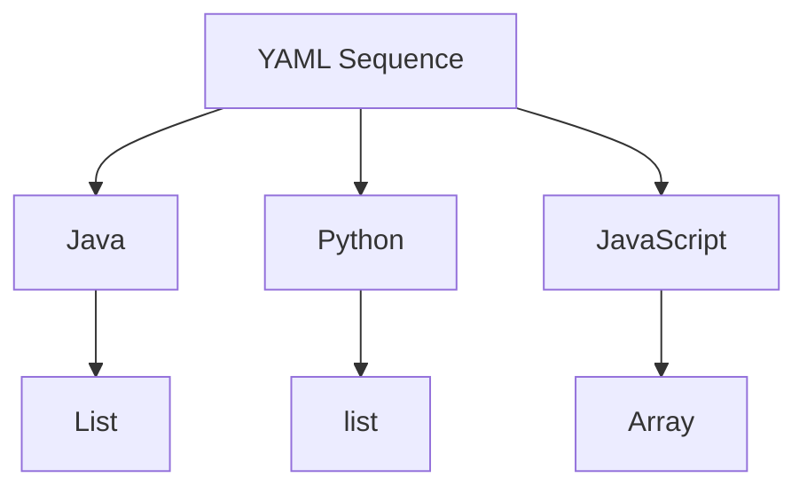

다만 YAML의 Sequence가 Java의 배열과 완전히 동일한 개념은 아니다.

Java 배열은 길이가 고정되어 있고 선언된 타입에 따라 요소의 타입이 제한된다.

반면 YAML Sequence는 데이터 표현 구조이므로 특정 프로그래밍 언어의 배열 크기나 제네릭 타입 같은 제약을 직접 정의하지 않는다.

---

### Sequence의 두 가지 표현 방식

YAML에서는 Sequence를 크게 두 가지 방식으로 표현할 수 있다.

1. Flow Style
2. Block Style

두 방식은 문법이 다르지만 동일한 데이터 구조를 표현한다.

#### Flow Style: 대괄호를 사용하는 방식

Flow Style은 대괄호(`[ ]`)를 사용하여 Sequence를 표현한다.

여러 요소는 쉼표(`,`)로 구분한다.

```yaml
days: [Monday, Tuesday, Wednesday, Thursday, Friday, Saturday, Sunday]
```

이 설정은 다음과 같이 해석할 수 있다.

```text
days
 ├── [0] Monday
 ├── [1] Tuesday
 ├── [2] Wednesday
 ├── [3] Thursday
 ├── [4] Friday
 ├── [5] Saturday
 └── [6] Sunday
```

문자열뿐 아니라 숫자도 저장할 수 있다.

```yaml
numbers: [1, 2, 3, 100]
```

Java로 표현하면 다음과 비슷하다.

```java
List<Integer> numbers = List.of(1, 2, 3, 100);
```

Boolean 값도 저장할 수 있다.

```yaml
flags: [true, false, true]
```

Mapping을 Sequence의 요소로 사용할 수도 있다.

```yaml
users: [{name: Hong, age: 30}, {name: Kim, age: 28}]
```

이처럼 Flow Style은 비교적 짧은 데이터를 한 줄로 표현할 때 유용하다.

하지만 요소가 많아지고 중첩 구조가 깊어지면 가독성이 떨어질 수 있다.

---

### Block Style: 하이픈을 사용하는 방식

Block Style은 하이픈(`-`)과 들여쓰기를 사용하여 Sequence를 표현한다.

```yaml
days:
  - Monday
  - Tuesday
  - Wednesday
  - Thursday
  - Friday
  - Saturday
  - Sunday
```

여기서 각 하이픈은 Sequence의 요소 하나를 의미한다.

다음과 같이 숫자 목록도 작성할 수 있다.

```yaml
numbers:
  - 1
  - 2
  - 3
  - 100
```

각 요소는 같은 수준으로 들여쓰기해야 한다.

```text
numbers
  ├── 1
  ├── 2
  ├── 3
  └── 100
```

Block Style은 데이터를 여러 줄에 걸쳐 표현하기 때문에 요소가 많거나 중첩 구조가 복잡할 때 가독성이 좋다.

특히 Kubernetes Manifest에서는 일반적으로 Block Style을 많이 사용한다.

#### Flow Style과 Block Style 비교

| 구분 | Flow Style | Block Style |
|---|---|---|
| 표현 기호 | `[ ]` | `-` |
| 요소 구분 | 쉼표 | 하이픈과 들여쓰기 |
| 여러 줄 작성 | 가능 | 일반적 |
| 간단한 목록 | 간결함 | 읽기 쉬움 |
| 복잡한 중첩 구조 | 가독성이 떨어질 수 있음 | 구조 파악에 유리 |
| Kubernetes 활용 | 짧은 목록 | 일반적인 리소스 설정 |

중요한 점은 **표현 방식이 다르더라도 파싱된 Sequence의 값과 순서는 동일하다는 것**이다.

---

### Flow Style과 Block Style은 정말 같은 데이터일까?

실제로 두 YAML이 같은 데이터 구조로 해석되는지 확인해보자.

먼저 다음 두 파일을 작성한다.

**days-flow.yaml**

```yaml
days: [Monday, Tuesday, Wednesday, Thursday, Friday, Saturday, Sunday]

numbers: [1, 2, 3, 100]
```

**days-block.yaml**

```yaml
days:
  - Monday
  - Tuesday
  - Wednesday
  - Thursday
  - Friday
  - Saturday
  - Sunday

numbers:
  - 1
  - 2
  - 3
  - 100
```

이 두 파일의 `days`와 `numbers`는 동일한 Sequence 데이터를 표현한다.

이를 yq를 이용해 확인할 수 있다.

---

### yq를 이용한 Sequence 데이터 조회

yq는 YAML 파일을 구조적으로 조회하거나 수정할 수 있는 CLI 도구이다.

여기서는 Mike Farah의 yq v4 계열을 기준으로 사용한다.

앞서 작성한 파일을 조회해보자.

```bash
yq '.' days-flow.yaml
```

이 명령어에서 `.`은 YAML 문서 전체를 선택한다는 의미이다.

Flow Style로 작성한 파일이 출력된다.

Block Style로 작성한 파일도 조회할 수 있다.

```bash
yq '.' days-block.yaml
```

특정 필드만 조회하려면 다음과 같이 작성한다.

```bash
yq '.days' days-block.yaml
```

예상 출력:

```yaml
- Monday
- Tuesday
- Wednesday
- Thursday
- Friday
- Saturday
- Sunday
```

숫자 목록도 조회할 수 있다.

```bash
yq '.numbers' days-block.yaml
```

출력:

```yaml
- 1
- 2
- 3
- 100
```

두 파일의 데이터 구조가 동일한지 확인하려면 JSON으로 변환하여 비교할 수도 있다.

```bash
yq -o=json '.' days-flow.yaml
```

```bash
yq -o=json '.' days-block.yaml
```

두 명령어는 동일한 JSON 데이터를 출력한다.

```json
{
  "days": [
    "Monday",
    "Tuesday",
    "Wednesday",
    "Thursday",
    "Friday",
    "Saturday",
    "Sunday"
  ],
  "numbers": [
    1,
    2,
    3,
    100
  ]
}
```

이를 통해 YAML의 Flow Style과 Block Style이 동일한 Sequence 구조를 표현한다는 사실을 확인할 수 있다.

---

### Sequence의 인덱스 이해하기

Sequence는 순서가 있는 데이터 구조이므로 인덱스를 사용하여 특정 요소에 접근할 수 있다.

중요한 점은 **인덱스가 0부터 시작한다는 것**이다.

다음 Sequence를 살펴보자.

```yaml
days:
  - Monday
  - Tuesday
  - Wednesday
  - Thursday
  - Friday
  - Saturday
  - Sunday
```

각 요소의 인덱스는 다음과 같다.

| 인덱스 | 값 | 의미 |
|---:|---|---|
| 0 | Monday | 첫 번째 요소 |
| 1 | Tuesday | 두 번째 요소 |
| 2 | Wednesday | 세 번째 요소 |
| 3 | Thursday | 네 번째 요소 |
| 4 | Friday | 다섯 번째 요소 |
| 5 | Saturday | 여섯 번째 요소 |
| 6 | Sunday | 일곱 번째 요소 |

배열이 0부터 시작하기 때문에 세 번째 요소를 조회하려면 인덱스 `2`를 사용해야 한다.

이 점은 Java나 JavaScript의 배열 인덱스와 동일하다.

---

### yq로 Sequence의 특정 인덱스 조회하기

#### 첫 번째 요소 조회

```bash
yq '.days[0]' days-block.yaml
```

출력:

```text
Monday
```

여기서 각 부분의 의미는 다음과 같다.

| 표현식 | 의미 |
|---|---|
| `.days` | days 필드 선택 |
| `[0]` | 첫 번째 요소 선택 |

#### 세 번째 요소 조회

```bash
yq '.days[2]' days-block.yaml
```

출력:

```text
Wednesday
```

#### 다섯 번째 요소 조회

```bash
yq '.days[4]' days-block.yaml
```

출력:

```text
Friday
```

#### 숫자 Sequence의 첫 번째 요소 조회

```bash
yq '.numbers[0]' days-block.yaml
```

출력:

```text
1
```

#### 숫자 Sequence의 마지막 요소 조회

```bash
yq '.numbers[3]' days-block.yaml
```

출력:

```text
100
```

`numbers`에는 네 개의 요소가 있으므로 마지막 요소의 인덱스는 `3`이다.

이처럼 Flow Style과 Block Style 모두 동일한 인덱스 접근 방식을 사용할 수 있다.

---

### yq에서 마지막 요소에 접근하기

Sequence의 마지막 요소를 조회할 때 항상 정확한 인덱스를 알고 있어야 하는 것은 아니다.

yq에서는 음수 인덱스를 사용하여 뒤에서부터 요소에 접근할 수 있다.

예를 들어 다음 명령어를 실행한다.

```bash
yq '.numbers[-1]' days-block.yaml
```

출력:

```text
100
```

`[-1]`은 마지막 요소를 의미한다.

마지막에서 두 번째 요소를 조회하려면 다음과 같이 작성한다.

```bash
yq '.numbers[-2]' days-block.yaml
```

출력:

```text
3
```

이를 정리하면 다음과 같다.

| 인덱스 | 의미 |
|---|---|
| `[0]` | 첫 번째 요소 |
| `[1]` | 두 번째 요소 |
| `[-1]` | 마지막 요소 |
| `[-2]` | 마지막에서 두 번째 요소 |

음수 인덱스는 Sequence의 길이가 변경될 수 있는 설정 파일에서 특히 유용하다.

다만 인덱스가 지원 범위를 벗어나면 기대한 값이 반환되지 않을 수 있으므로 자동화 스크립트에서는 해당 요소가 존재하는지도 검증하는 것이 좋다.

---

### Sequence의 길이 확인하기

yq의 `length` 연산자를 사용하면 Sequence의 요소 개수를 확인할 수 있다.

```bash
yq '.days | length' days-block.yaml
```

출력:

```text
7
```

요일이 일곱 개이기 때문이다.

숫자 목록의 길이도 확인해보자.

```bash
yq '.numbers | length' days-block.yaml
```

출력:

```text
4
```

`length`는 Sequence의 요소 개수를 반환한다.

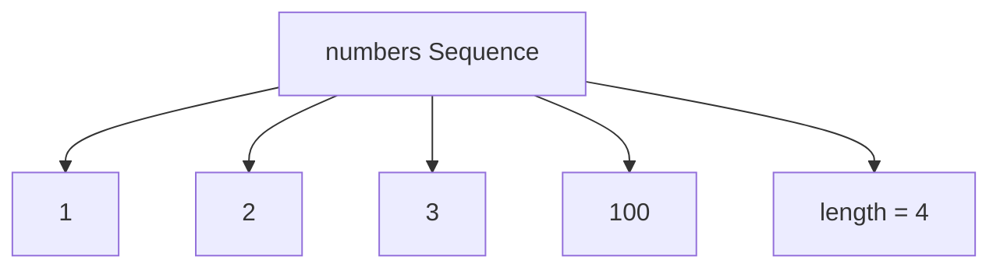

이 기능은 배열의 크기를 확인하거나 데이터 검증을 수행할 때 사용할 수 있다.

---

### Sequence의 모든 요소를 개별적으로 조회하기

특정 인덱스가 아니라 모든 요소를 하나씩 출력하고 싶을 수도 있다.

이때는 `[]`를 사용한다.

```bash
yq '.days[]' days-block.yaml
```

출력:

```text
Monday
Tuesday
Wednesday
Thursday
Friday
Saturday
Sunday
```

여기서 `.days[]`는 `days` Sequence의 각 요소를 순서대로 선택한다.

이는 다음과 같이 이해할 수 있다.

```text
days
  ↓
각 요소 순회
  ↓
Monday
Tuesday
Wednesday
...
Sunday
```

이 방식은 Sequence 안에 Mapping이 포함되어 있을 때 더욱 유용하다.

예를 들어 사용자 목록에서 모든 사용자의 이름만 조회하거나, Kubernetes Deployment의 모든 컨테이너 이미지를 조회할 때 사용할 수 있다.

---

### Sequence 안에 Mapping 포함하기

지금까지는 문자열이나 숫자를 Sequence의 요소로 사용했다.

하지만 YAML Sequence에는 Mapping도 포함할 수 있다.

예를 들어 여러 개의 앨범 정보를 저장한다고 가정하자.

각 앨범은 다음 정보를 가진다.

- 앨범 이름
- 타이틀곡

이를 YAML로 표현하면 다음과 같다.

**albums-simple.yaml**

```yaml
albums:
  - name: First Single
    title: Happy

  - name: Second Single
    title: Smile
```

이 구조를 자세히 살펴보자.

```yaml
albums:
```

`albums`는 Key이다.

그 Value는 Sequence이다.

```yaml
  - name: First Single
    title: Happy
```

첫 번째 하이픈은 Sequence의 첫 번째 요소를 의미한다.

그 요소는 `name`과 `title`이라는 두 개의 Key를 포함하는 Mapping이다.

두 번째 요소 역시 Mapping이다.

```yaml
  - name: Second Single
    title: Smile
```

전체 구조를 표현하면 다음과 같다.

```text
albums
│
├── [0] Mapping
│    ├── name: First Single
│    └── title: Happy
│
└── [1] Mapping
     ├── name: Second Single
     └── title: Smile
```

Mermaid로 표현하면 다음과 같다.

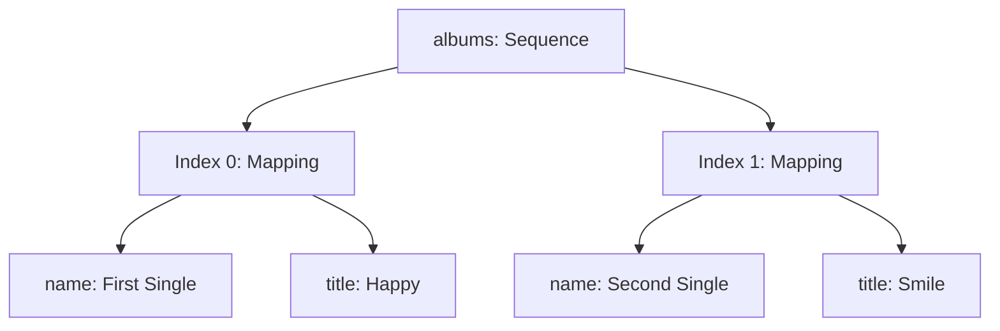

이처럼 Sequence 안에 Mapping을 포함하면 여러 객체를 하나의 목록으로 관리할 수 있다.

---

### yq로 Sequence 내부의 Mapping 조회하기

앞서 작성한 `albums-simple.yaml`을 사용해보자.

#### 첫 번째 앨범 조회

```bash
yq '.albums[0]' albums-simple.yaml
```

출력:

```yaml
name: First Single
title: Happy
```

`albums[0]`은 첫 번째 앨범을 의미한다.

첫 번째 앨범은 Mapping이므로 `name`과 `title`이 함께 출력된다.

#### 두 번째 앨범 조회

```bash
yq '.albums[1]' albums-simple.yaml
```

출력:

```yaml
name: Second Single
title: Smile
```

#### 두 번째 앨범의 타이틀 조회

두 번째 앨범에서 타이틀만 조회하려면 다음과 같이 작성한다.

```bash
yq '.albums[1].title' albums-simple.yaml
```

출력:

```text
Smile
```

이 표현식을 단계적으로 해석하면 다음과 같다.

```text
.albums
    ↓
앨범 목록 선택

[1]
    ↓
두 번째 앨범 선택

.title
    ↓
해당 앨범의 title 값 선택
```

즉 다음 경로를 따라 데이터에 접근하는 것이다.

```text
albums → index 1 → title
```

이 방식은 Mapping과 Sequence가 조합된 데이터를 조회할 때 기본적으로 사용하는 방법이다.

---

### Sequence의 모든 Mapping에서 특정 필드 조회하기

앨범이 두 개가 아니라 수십 개라면 모든 앨범의 타이틀을 하나씩 조회하기 번거로울 수 있다.

이때는 `[]`를 사용하면 된다.

```bash
yq '.albums[].title' albums-simple.yaml
```

출력:

```text
Happy
Smile
```

이 명령어는 다음 과정을 수행한다.

1. `albums` Sequence를 선택한다.
2. `[]`를 통해 모든 요소에 접근한다.
3. 각 Mapping에서 `title` 필드를 선택한다.

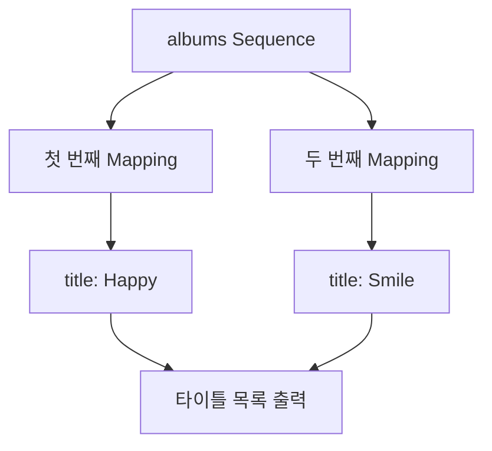

이처럼 yq에서는 Sequence의 각 요소에 대해 동일한 경로 표현식을 적용할 수 있다.

---

### Mapping 안에 Sequence, Sequence 안에 Mapping 조합하기

실제 데이터는 단순히 Mapping 또는 Sequence 하나만으로 구성되지 않는다.

여러 데이터 구조가 중첩되는 경우가 많다.

예를 들어 앨범 정보를 관리하는 시스템을 생각해보자.

하나의 음악 그룹에는 여러 앨범이 존재한다.

각 앨범에는 앨범명과 타이틀곡이 있다.

또한 하나의 앨범에는 여러 수록곡이 존재한다.

각 수록곡에는 곡명과 작사가 정보가 있다.

이를 구조적으로 표현하면 다음과 같다.

```text
Group
│
└── Albums
     │
     ├── Album 1
     │    ├── Name
     │    ├── Title
     │    │
     │    └── Songs
     │         ├── Song 1
     │         │    ├── Name
     │         │    └── Writer
     │         │
     │         └── Song 2
     │              ├── Name
     │              └── Writer
     │
     └── Album 2
          ├── Name
          ├── Title
          │
          └── Songs
               ├── Song 1
               └── Song 2
```

이 구조에는 다음 데이터가 포함되어 있다.

| 항목 | 데이터 구조 |
|---|---|
| Group | Mapping |
| Albums | Sequence |
| Album | Mapping |
| Name | Scalar |
| Title | Scalar |
| Songs | Sequence |
| Song | Mapping |
| Writer | Scalar 또는 Sequence |

이처럼 Mapping과 Sequence를 자유롭게 조합할 수 있다는 점이 YAML의 중요한 특징이다.

---

### 실제 앨범 정보를 이용한 중첩 YAML 작성

이번에는 TWICE의 앨범 정보를 이용하여 중첩된 YAML을 작성해보자.

예제에서는 다음 두 앨범을 사용한다.

- THE STORY BEGINS
- PAGE TWO

각 앨범에는 타이틀곡과 일부 수록곡을 포함한다.

전체 수록곡을 모두 작성하는 대신, 중첩 구조를 이해하기 쉽도록 일부 곡만 사용한다.

**albums.yaml**

```yaml
group: TWICE

albums:
  - name: THE STORY BEGINS
    title: OOH-AHH하게

    songs:
      - name: OOH-AHH하게
        writer: 블랙아이드필승, Sam Lewis

      - name: 다시 해줘
        writer: 박진영

  - name: PAGE TWO
    title: CHEER UP

    songs:
      - name: CHEER UP
        writer: Sam Lewis

      - name: 소중한 사랑
        writer: 박진영, 채영
```

이 YAML에는 여러 데이터 구조가 중첩되어 있다.

먼저 최상위 데이터를 살펴보자.

```yaml
group: TWICE
```

`group`은 Scalar 문자열을 Value로 가지는 Mapping 항목이다.

다음으로 `albums`를 살펴보자.

```yaml
albums:
```

`albums`의 Value는 Sequence이다.

이 Sequence에는 두 개의 Mapping이 포함되어 있다.

첫 번째 Mapping은 다음과 같다.

```yaml
  - name: THE STORY BEGINS
    title: OOH-AHH하게

    songs:
      - name: OOH-AHH하게
        writer: 블랙아이드필승, Sam Lewis

      - name: 다시 해줘
        writer: 박진영
```

여기서 `name`과 `title`은 Scalar이다.

반면 `songs`는 또 다른 Sequence이다.

`songs`의 각 요소는 곡명과 작사가를 나타내는 Mapping이다.

이 구조는 다음과 같이 표현할 수 있다.

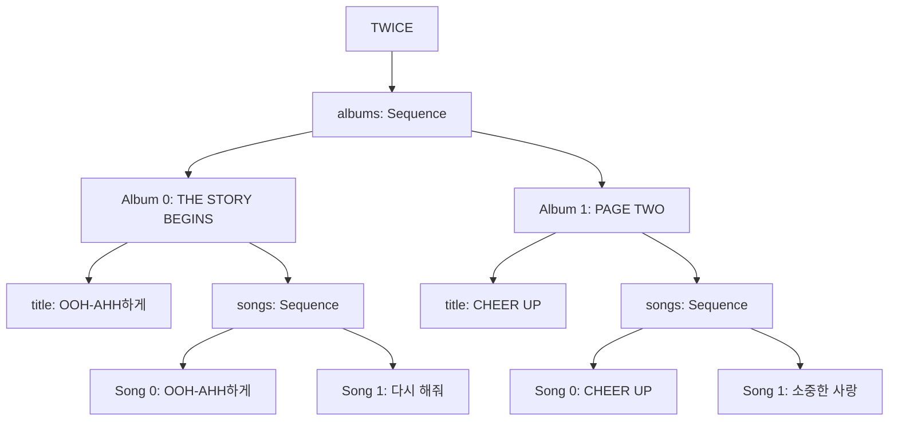

이처럼 복잡해 보이는 YAML도 Mapping과 Sequence의 관계를 이해하면 구조를 쉽게 파악할 수 있다.

---

### yq로 중첩된 앨범 데이터 조회하기

이제 작성한 `albums.yaml`을 사용하여 중첩된 데이터에 접근해보자.

#### 전체 데이터 조회

```bash
yq '.' albums.yaml
```

문서 전체를 조회한다.

#### 그룹 이름 조회

```bash
yq '.group' albums.yaml
```

출력:

```text
TWICE
```

#### 모든 앨범 조회

```bash
yq '.albums' albums.yaml
```

`albums` Sequence 전체를 조회한다.

#### 첫 번째 앨범 이름 조회

```bash
yq '.albums[0].name' albums.yaml
```

출력:

```text
THE STORY BEGINS
```

#### 두 번째 앨범 이름 조회

```bash
yq '.albums[1].name' albums.yaml
```

출력:

```text
PAGE TWO
```

#### 첫 번째 앨범의 타이틀곡 조회

```bash
yq '.albums[0].title' albums.yaml
```

출력:

```text
OOH-AHH하게
```

#### 두 번째 앨범의 타이틀곡 조회

```bash
yq '.albums[1].title' albums.yaml
```

출력:

```text
CHEER UP
```

이러한 접근 방식은 앞에서 살펴본 Sequence 인덱스 조회와 동일하다.

---

### 중첩 Sequence의 특정 요소 조회하기

이번에는 첫 번째 앨범의 수록곡 목록을 조회해보자.

```bash
yq '.albums[0].songs' albums.yaml
```

출력:

```yaml
- name: OOH-AHH하게
  writer: 블랙아이드필승, Sam Lewis
- name: 다시 해줘
  writer: 박진영
```

여기서 `.albums[0]`은 첫 번째 앨범을 의미한다.

그 뒤의 `.songs`는 해당 앨범에 속한 수록곡 목록이다.

#### 첫 번째 앨범의 첫 번째 수록곡

```bash
yq '.albums[0].songs[0]' albums.yaml
```

출력:

```yaml
name: OOH-AHH하게
writer: 블랙아이드필승, Sam Lewis
```

#### 첫 번째 앨범의 두 번째 수록곡

```bash
yq '.albums[0].songs[1]' albums.yaml
```

출력:

```yaml
name: 다시 해줘
writer: 박진영
```

#### 첫 번째 앨범의 두 번째 수록곡 이름

```bash
yq '.albums[0].songs[1].name' albums.yaml
```

출력:

```text
다시 해줘
```

이 명령어의 동작을 구조적으로 살펴보자.

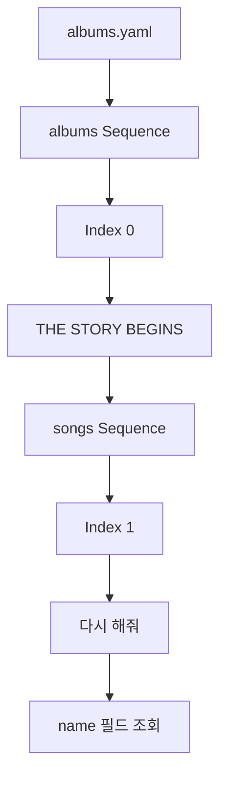

각 경로의 의미는 다음과 같다.

| 표현식 | 의미 |
|---|---|
| `.albums` | 앨범 목록 선택 |
| `[0]` | 첫 번째 앨범 선택 |
| `.songs` | 해당 앨범의 수록곡 목록 선택 |
| `[1]` | 두 번째 수록곡 선택 |
| `.name` | 수록곡 이름 선택 |

즉 다음 경로를 따라 데이터에 접근한다.

```text
albums
  → 첫 번째 앨범
    → songs
      → 두 번째 곡
        → name
```

이러한 구조는 Kubernetes Manifest에서 중첩된 배열을 조회할 때도 동일하게 사용된다.

---

### 모든 앨범의 타이틀곡 조회하기

특정 앨범 하나가 아니라 모든 앨범의 타이틀곡을 조회하고 싶을 수 있다.

이때 `[]`를 사용한다.

```bash
yq '.albums[].title' albums.yaml
```

출력:

```text
OOH-AHH하게
CHEER UP
```

`.albums[]`는 앨범 목록의 모든 요소를 의미한다.

각 앨범 Mapping에서 `title`을 조회한다.

이 방식은 앨범 개수가 늘어나더라도 동일하게 사용할 수 있다.

예를 들어 앨범이 2개에서 10개로 증가해도 명령어를 수정할 필요가 없다.

---

### 모든 앨범의 수록곡 이름 조회하기

이번에는 모든 앨범에 포함된 모든 수록곡의 이름을 조회해보자.

```bash
yq '.albums[].songs[].name' albums.yaml
```

출력:

```text
OOH-AHH하게
다시 해줘
CHEER UP
소중한 사랑
```

이 명령어는 두 개의 Sequence를 순회한다.

첫 번째 Sequence는 `albums`이다.

두 번째 Sequence는 각 앨범의 `songs`이다.

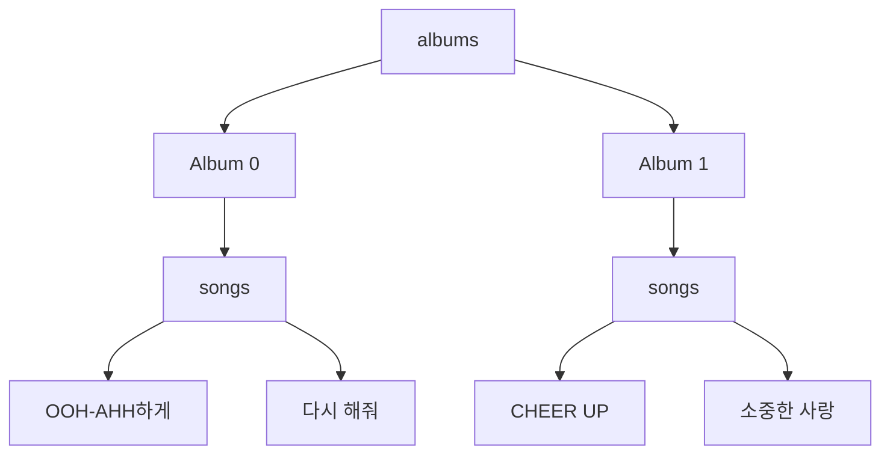

이를 단계적으로 해석하면 다음과 같다.

```text
.albums[]
    ↓
모든 앨범을 순회

.songs[]
    ↓
각 앨범의 모든 수록곡을 순회

.name
    ↓
각 수록곡의 이름을 출력
```

즉 `[]`를 여러 번 사용하면 중첩된 Sequence를 순회할 수 있다.

이 기능은 YAML 데이터가 복잡해질수록 활용도가 높아진다.

---

### yq의 select를 이용해 특정 앨범 검색하기

지금까지는 인덱스를 기준으로 특정 앨범에 접근했다.

하지만 실제 데이터에서는 앨범의 순서보다 이름을 기준으로 검색하는 것이 더 적절할 수 있다.

예를 들어 `PAGE TWO` 앨범의 정보를 조회한다고 가정하자.

```bash
yq '.albums[] | select(.name == "PAGE TWO")' albums.yaml
```

이 명령어의 의미는 다음과 같다.

1. 모든 앨범을 순회한다.
2. 앨범 이름이 `PAGE TWO`인지 확인한다.
3. 조건을 만족하는 앨범만 출력한다.

예상 출력:

```yaml
name: PAGE TWO
title: CHEER UP
songs:
  - name: CHEER UP
    writer: Sam Lewis
  - name: 소중한 사랑
    writer: 박진영, 채영
```

이를 Mermaid로 표현하면 다음과 같다.

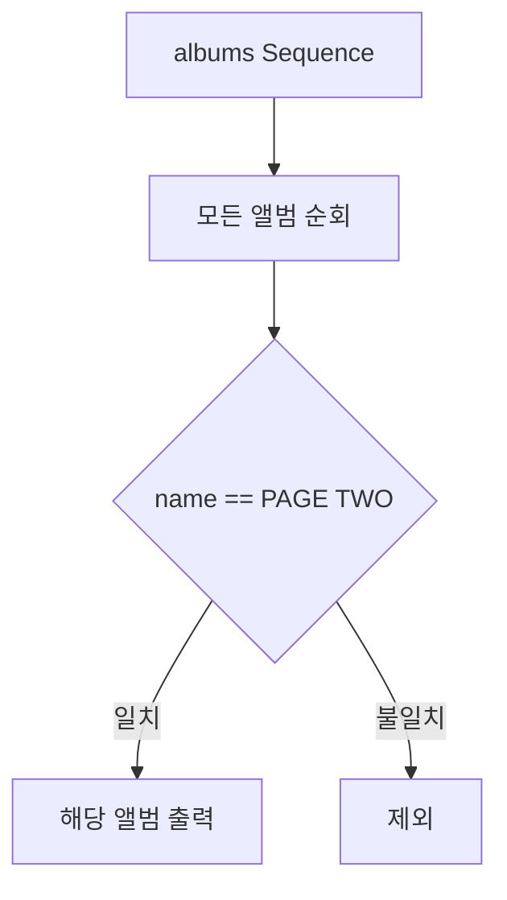

#### 특정 앨범의 타이틀곡만 조회하기

다음과 같이 조건 검색과 필드 조회를 조합할 수 있다.

```bash
yq '.albums[] | select(.name == "PAGE TWO") | .title' albums.yaml
```

출력:

```text
CHEER UP
```

이 방식은 인덱스를 직접 지정하는 것보다 데이터 순서 변경에 강하다.

예를 들어 앨범 목록의 순서가 바뀌더라도 이름이 동일하다면 같은 데이터를 조회할 수 있다.

다만 이름이 중복될 수 있는 데이터라면 고유 식별자를 별도로 사용하는 것이 더 안전하다.

---

### 특정 조건에 맞는 수록곡 조회하기

이번에는 모든 앨범의 수록곡 중 이름이 `CHEER UP`인 곡을 검색해보자.

```bash
yq '.albums[].songs[] | select(.name == "CHEER UP")' albums.yaml
```

예상 출력:

```yaml
name: CHEER UP
writer: Sam Lewis
```

특정 작사가의 곡을 검색할 수도 있다.

```bash
yq '.albums[].songs[] | select(.writer == "박진영")' albums.yaml
```

예상 출력:

```yaml
name: 다시 해줘
writer: 박진영
```

다만 이 예제의 `writer`는 문자열이므로 완전히 일치하는 값만 검색한다.

```yaml
writer: 박진영, 채영
```

처럼 여러 이름을 하나의 문자열로 저장했다면 `"박진영"`과 정확히 같지 않기 때문에 위 조건에는 포함되지 않는다.

이러한 한계는 실제 데이터 모델을 설계할 때 중요하다.

한 곡에 여러 작사가가 참여할 수 있다면 `writer`를 단일 문자열보다 Sequence로 정의하는 것이 더 적절할 수 있다.

---

### 하나의 Mapping 안에 여러 Sequence 포함하기

YAML에서는 하나의 Mapping에 여러 Sequence를 포함할 수도 있다.

예를 들어 다음과 같은 음악 정보가 있다고 가정하자.

```yaml
song:
  name: CHEER UP

  writers:
    - Sam Lewis

  composers:
    - 블랙아이드필승

  genres:
    - Dance
    - Pop
```

여기서 `song`은 Mapping이다.

그 안에는 다음 필드가 존재한다.

| 필드 | 데이터 타입 |
|---|---|
| `name` | Scalar |
| `writers` | Sequence |
| `composers` | Sequence |
| `genres` | Sequence |

이처럼 Mapping은 하나의 고정된 타입만 Value로 가져야 하는 구조가 아니다.

여러 종류의 데이터 구조를 조합하여 하나의 객체를 표현할 수 있다.

#### 작사가 정보를 Sequence로 표현하는 이유

예를 들어 여러 작사가가 참여한 곡을 다음처럼 표현할 수 있다.

```yaml
song:
  name: Example Song

  writers:
    - Writer A
    - Writer B
    - Writer C
```

이렇게 하면 특정 작사가가 포함되어 있는지 구조적으로 검색할 수 있다.

```bash
yq '.song.writers[]' song.yaml
```

출력:

```text
Writer A
Writer B
Writer C
```

이 구조는 여러 값을 쉼표로 연결한 하나의 문자열보다 프로그램에서 처리하기 쉽다.

예를 들어 다음 값은 하나의 문자열이다.

```yaml
writers: "Writer A, Writer B, Writer C"
```

반면 다음 값은 세 개의 문자열로 이루어진 Sequence이다.

```yaml
writers:
  - Writer A
  - Writer B
  - Writer C
```

데이터의 의미가 여러 독립적인 값이라면 Sequence로 표현하는 것이 적절하다.

---

### Sequence 안에 Sequence 포함하기

Sequence의 요소가 반드시 Scalar나 Mapping일 필요는 없다.

다른 Sequence를 포함할 수도 있다.

예를 들어 좌석 배치를 표현한다고 가정하자.

```yaml
seats:
  - [A1, A2, A3]
  - [B1, B2, B3]
  - [C1, C2, C3]
```

여기서 `seats`는 Sequence이다.

각 요소 역시 Sequence이다.

```text
seats
│
├── [0]
│    ├── [0] A1
│    ├── [1] A2
│    └── [2] A3
│
├── [1]
│    ├── [0] B1
│    ├── [1] B2
│    └── [2] B3
│
└── [2]
     ├── [0] C1
     ├── [1] C2
     └── [2] C3
```

이를 Java의 이차원 배열과 비슷하게 이해할 수 있다.

```java
String[][] seats = {
    {"A1", "A2", "A3"},
    {"B1", "B2", "B3"},
    {"C1", "C2", "C3"}
};
```

#### yq로 중첩 Sequence 조회하기

두 번째 행의 세 번째 좌석을 조회한다고 가정하자.

```bash
yq '.seats[1][2]' seats.yaml
```

출력:

```text
B3
```

첫 번째 인덱스 `[1]`은 두 번째 행을 의미한다.

두 번째 인덱스 `[2]`는 해당 행의 세 번째 요소를 의미한다.

이처럼 YAML에서는 Sequence 안에 Sequence를 포함하여 다차원 구조도 표현할 수 있다.

---

### yq로 Sequence 데이터 수정하기

yq는 데이터를 조회하는 기능뿐 아니라 수정하는 기능도 제공한다.

앞서 작성한 `albums.yaml`을 사용한다고 가정하자.

#### 특정 앨범의 타이틀 변경

다음 명령어는 첫 번째 앨범의 타이틀을 변경한 결과를 출력한다.

```bash
yq '.albums[0].title = "New Title"' albums.yaml
```

하지만 이 명령어만 실행하면 원본 파일은 변경되지 않는다.

실제 파일에 변경 사항을 적용하려면 `-i` 옵션을 사용해야 한다.

```bash
yq -i '.albums[0].title = "New Title"' albums.yaml
```

변경된 값을 확인한다.

```bash
yq '.albums[0].title' albums.yaml
```

출력:

```text
New Title
```

`-i`는 원본 파일을 직접 수정하는 옵션이다.

실제 운영 설정이나 중요한 데이터 파일에 사용하기 전에는 변경 이력을 관리하거나 백업해 두는 것이 좋다.

이후 예제는 수정 이전의 `albums.yaml`을 기준으로 설명한다.

---

### yq로 Sequence에 새로운 요소 추가하기

Sequence에 새로운 요소를 추가할 수도 있다.

예를 들어 다음과 같은 데이터가 있다고 가정하자.

**skills.yaml**

```yaml
skills:
  - Java
  - Spring Boot
```

여기에 `Kubernetes`를 추가하려면 다음과 같이 작성할 수 있다.

```bash
yq -i '.skills += ["Kubernetes"]' skills.yaml
```

변경 후 YAML은 다음과 같다.

```yaml
skills:
  - Java
  - Spring Boot
  - Kubernetes
```

`+=`는 기존 Sequence에 새로운 요소를 추가하는 데 사용할 수 있다.

#### Mapping 요소 추가하기

Sequence에 Mapping을 추가할 수도 있다.

다음과 같은 파일이 있다고 가정하자.

```yaml
albums:
  - name: First Single
    title: Happy
```

여기에 두 번째 앨범을 추가한다.

```bash
yq -i '.albums += [{"name": "Second Single", "title": "Smile"}]' albums-simple.yaml
```

변경 후 다음과 같은 구조가 된다.

```yaml
albums:
  - name: First Single
    title: Happy

  - name: Second Single
    title: Smile
```

실제 파일의 공백이나 줄바꿈 스타일은 yq의 출력 방식에 따라 달라질 수 있지만, 데이터 구조는 동일하다.

---

### yq로 Sequence 요소 삭제하기

Sequence에서 특정 요소를 제거할 수도 있다.

다음 파일을 사용한다고 가정하자.

```yaml
skills:
  - Java
  - Spring Boot
  - Kubernetes
```

두 번째 요소인 `Spring Boot`를 삭제하려면 다음과 같이 작성한다.

```bash
yq -i 'del(.skills[1])' skills.yaml
```

변경 결과:

```yaml
skills:
  - Java
  - Kubernetes
```

이때 인덱스 기반 삭제는 주의해야 한다.

요소를 삭제하면 뒤에 있던 요소의 인덱스가 변경되기 때문이다.

예를 들어 기존에는 `Kubernetes`가 인덱스 `2`였지만, `Spring Boot`를 삭제한 후에는 인덱스 `1`이 된다.

따라서 실제 운영 데이터에서는 고정 인덱스보다 명시적인 Key나 조건을 기준으로 요소를 선택하는 것이 더 안전할 수 있다.

---

### Kubernetes에서 Sequence가 중요한 이유

지금까지 살펴본 Sequence와 Mapping의 조합은 Kubernetes Manifest에서 반복적으로 사용된다.

특히 다음 필드에서 자주 등장한다.

- `containers`
- `initContainers`
- `ports`
- `env`
- `volumeMounts`
- `volumes`
- `imagePullSecrets`
- `tolerations`

이러한 필드는 대부분 여러 개의 요소를 저장할 수 있는 Sequence 구조이다.

예를 들어 Deployment에는 하나 이상의 컨테이너를 정의할 수 있다.

각 컨테이너는 환경 변수 목록, 포트 목록, Volume Mount 목록 등을 가질 수 있다.

이 때문에 Kubernetes YAML을 처음 접하면 들여쓰기가 복잡하게 느껴질 수 있다.

하지만 각 필드가 Mapping인지 Sequence인지 구분하면 구조를 훨씬 쉽게 이해할 수 있다.

---

### Kubernetes Deployment에서 Sequence 활용하기

다음은 Nginx 컨테이너를 실행하는 Deployment 예제이다.

**deployment.yaml**

```yaml
apiVersion: apps/v1
kind: Deployment

metadata:
  name: web-app

  labels:
    app: web-app

spec:
  replicas: 2

  selector:
    matchLabels:
      app: web-app

  template:
    metadata:
      labels:
        app: web-app

    spec:
      containers:
        - name: web
          image: nginx:1.27

          ports:
            - name: http
              containerPort: 80

          env:
            - name: APP_ENV
              value: "production"

            - name: LOG_LEVEL
              value: "INFO"

          resources:
            requests:
              cpu: "100m"
              memory: "128Mi"

            limits:
              cpu: "500m"
              memory: "256Mi"
```

이 Manifest에는 Mapping과 Sequence가 함께 사용된다.

#### containers는 Sequence이다

다음 설정을 살펴보자.

```yaml
containers:
  - name: web
    image: nginx:1.27
```

`containers`는 Sequence이다.

그 안에는 `name`과 `image`를 포함하는 Mapping이 존재한다.

컨테이너가 하나만 있더라도 `containers`는 Sequence이므로 하이픈을 사용해야 한다.

#### ports도 Sequence이다

```yaml
ports:
  - name: http
    containerPort: 80
```

컨테이너는 여러 포트를 선언할 수 있으므로 `ports` 역시 Sequence이다.

각 요소는 포트에 대한 정보를 담은 Mapping이다.

#### env도 Sequence이다

```yaml
env:
  - name: APP_ENV
    value: "production"

  - name: LOG_LEVEL
    value: "INFO"
```

`env`는 환경 변수 목록이다.

각 요소는 환경 변수 이름과 값을 포함하는 Mapping이다.

#### resources는 Mapping이다

반면 다음 설정을 살펴보자.

```yaml
resources:
  requests:
    cpu: "100m"
    memory: "128Mi"

  limits:
    cpu: "500m"
    memory: "256Mi"
```

`resources`는 Sequence가 아니라 Mapping이다.

`requests`와 `limits` 역시 Mapping이다.

여기서는 하이픈을 사용하지 않는다.

이처럼 Kubernetes Manifest에서는 필드가 의미하는 데이터 구조에 따라 하이픈 사용 여부가 달라진다.

---

### Kubernetes Deployment의 YAML 구조 분석

앞서 작성한 Deployment를 계층적으로 표현하면 다음과 같다.

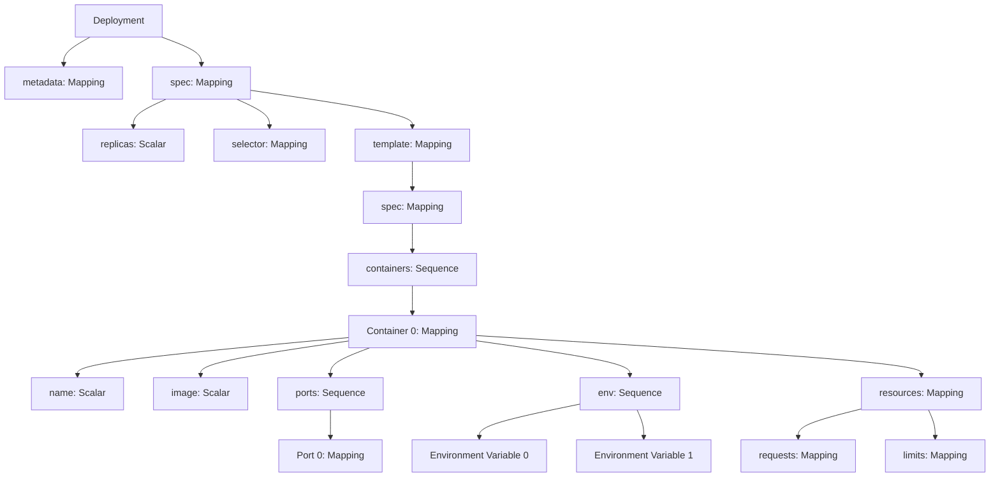

이 구조를 보면 Kubernetes Manifest가 특별한 데이터 구조를 사용하는 것은 아니라는 사실을 알 수 있다.

결국 YAML의 기본 구성 요소인 Mapping, Sequence, Scalar를 조합한 것이다.

Kubernetes API는 각 필드에 어떤 타입의 데이터가 들어가야 하는지를 정의한다.

따라서 YAML 문법이 올바르더라도 API에서 Mapping을 기대하는 위치에 Sequence를 작성하면 오류가 발생할 수 있다.

---

### yq로 Kubernetes Sequence 조회하기

앞서 작성한 `deployment.yaml`을 이용해보자.

#### 첫 번째 컨테이너 이름 조회

```bash
yq '.spec.template.spec.containers[0].name' deployment.yaml
```

출력:

```text
web
```

#### 첫 번째 컨테이너 이미지 조회

```bash
yq '.spec.template.spec.containers[0].image' deployment.yaml
```

출력:

```text
nginx:1.27
```

#### 첫 번째 컨테이너 포트 조회

```bash
yq '.spec.template.spec.containers[0].ports[0].containerPort' deployment.yaml
```

출력:

```text
80
```

#### 첫 번째 환경 변수 이름 조회

```bash
yq '.spec.template.spec.containers[0].env[0].name' deployment.yaml
```

출력:

```text
APP_ENV
```

#### 두 번째 환경 변수 값 조회

```bash
yq '.spec.template.spec.containers[0].env[1].value' deployment.yaml
```

출력:

```text
INFO
```

#### 모든 환경 변수 이름 조회

```bash
yq '.spec.template.spec.containers[0].env[].name' deployment.yaml
```

출력:

```text
APP_ENV
LOG_LEVEL
```

이처럼 중첩된 Kubernetes Manifest에서도 Sequence의 인덱스를 사용하거나 모든 요소를 순회할 수 있다.

---

### 컨테이너 이름을 기준으로 이미지 조회하기

컨테이너가 여러 개 존재하는 Pod에서는 인덱스를 이용해 이미지를 조회하는 것보다 이름을 기준으로 검색하는 것이 더 안전할 수 있다.

예를 들어 다음과 같이 두 개의 컨테이너가 있다고 가정하자.

```yaml
containers:
  - name: web
    image: nginx:1.27

  - name: redis
    image: redis:7
```

첫 번째 컨테이너 이미지는 다음과 같이 조회할 수 있다.

```bash
yq '.spec.template.spec.containers[0].image' deployment.yaml
```

하지만 컨테이너의 순서가 변경되면 다른 이미지가 조회될 수 있다.

따라서 다음처럼 이름을 기준으로 검색하는 방법을 사용할 수 있다.

```bash
yq '.spec.template.spec.containers[] | select(.name == "web") | .image' deployment.yaml
```

예상 출력:

```text
nginx:1.27
```

`select`는 조건을 만족하는 요소를 선택한다.

이 명령어의 실행 흐름은 다음과 같다.

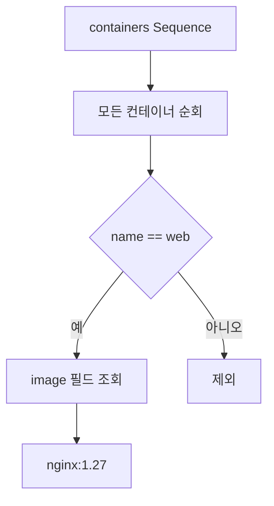

이러한 방식은 실제 운영 환경에서 컨테이너 이미지 버전을 확인하거나 수정하는 자동화 스크립트를 작성할 때 유용하다.

---

### Kubernetes Manifest에서 자주 발생하는 Sequence 오류

YAML의 Mapping과 Sequence를 혼동하면 문법 오류 또는 Kubernetes API 검증 오류가 발생할 수 있다.

대표적인 사례를 살펴보자.

#### 1. Sequence에서 하이픈을 빠뜨린 경우

다음 설정은 잘못된 예시이다.

```yaml
containers:
  name: nginx
  image: nginx:1.27
```

YAML 문법만 보면 `containers`의 Value는 Mapping이다.

하지만 Kubernetes의 Pod Spec에서 `containers`는 Sequence를 기대한다.

따라서 Kubernetes API 검증에서 오류가 발생할 수 있다.

올바른 구조는 다음과 같다.

```yaml
containers:
  - name: nginx
    image: nginx:1.27
```

하이픈을 추가함으로써 하나의 컨테이너 Mapping을 Sequence의 요소로 표현한다.

#### 2. 같은 Mapping의 Key를 다른 요소처럼 작성하는 경우

다음 설정도 주의해야 한다.

```yaml
containers:
  - name: nginx
  - image: nginx:1.27
```

이 YAML은 Sequence에 두 개의 Mapping을 정의한 것이다.

첫 번째 Mapping에는 `name`만 존재한다.

두 번째 Mapping에는 `image`만 존재한다.

즉 다음과 같이 해석된다.

```text
containers
│
├── [0]
│    └── name: nginx
│
└── [1]
     └── image: nginx:1.27
```

하지만 의도한 구조는 하나의 컨테이너에 이름과 이미지를 함께 정의하는 것이다.

따라서 다음과 같이 작성해야 한다.

```yaml
containers:
  - name: nginx
    image: nginx:1.27
```

이 차이는 Kubernetes Manifest에서 매우 자주 발생하는 실수이다.

**하이픈 하나는 새로운 Sequence 요소가 시작된다는 의미이므로, 같은 객체에 속한 필드마다 하이픈을 붙이면 안 된다.**

#### 3. 들여쓰기가 잘못된 경우

다음 예시는 잘못된 YAML이다.

```yaml
containers:
  - name: nginx
    image: nginx:1.27
     ports:
       - containerPort: 80
```

`ports`의 들여쓰기 수준이 잘못되어 있다.

올바른 설정은 다음과 같다.

```yaml
containers:
  - name: nginx
    image: nginx:1.27

    ports:
      - containerPort: 80
```

같은 Mapping에 속하는 `name`, `image`, `ports`는 동일한 계층에 있어야 한다.

---

### YAML 문법 검증과 Kubernetes API 검증은 다르다

앞에서 살펴본 다음 YAML은 문법적으로 유효할 수 있다.

```yaml
containers:
  name: nginx
  image: nginx:1.27
```

하지만 Kubernetes는 `containers`에 Sequence가 들어오기를 기대한다.

따라서 실제 Kubernetes Manifest를 작성할 때는 두 가지를 모두 검증해야 한다.

첫 번째는 YAML 문법이다.

두 번째는 Kubernetes 리소스의 API 구조이다.

#### yq로 YAML 문법 확인

```bash
yq '.' deployment.yaml
```

YAML 파싱에 성공하면 내용을 출력한다.

#### kubectl로 Kubernetes API 검증

```bash
kubectl apply --dry-run=server -f deployment.yaml
```

서버 측 Dry Run은 실제 리소스를 저장하지 않고 Kubernetes API Server에서 설정을 검증한다.

예를 들어 `containers`를 Mapping으로 잘못 작성했다면 Kubernetes API가 요구하는 데이터 구조와 일치하지 않아 오류가 발생할 수 있다.

다만 서버 측 Dry Run은 리소스가 실제로 실행될 때 발생할 수 있는 모든 장애를 검증하는 것은 아니다.

예를 들어 Node 리소스 부족이나 이미지 다운로드 실패는 실제 배포 단계에서 나타날 수 있다.

---

### 실무에서 Sequence를 사용할 때 고려해야 할 사항

#### 1. 순서가 의미 있는 데이터에 Sequence를 사용한다

Sequence는 순서를 유지하는 데이터 구조이다.

따라서 순서가 중요한 목록이나 여러 값을 저장하는 용도로 적합하다.

예를 들어 다음과 같은 데이터가 있다.

```yaml
processingSteps:
  - validate
  - authorize
  - execute
  - notify
```

이 구조는 작업 단계의 순서를 표현한다.

단, 이 YAML 자체가 작업을 실행하는 것은 아니다.

해당 설정을 읽는 애플리케이션이 순서에 따라 작업을 처리하도록 구현되어 있어야 한다.

#### 2. 객체가 여러 개라면 Sequence 안에 Mapping을 사용한다

예를 들어 여러 데이터베이스 연결 정보를 관리한다고 가정하자.

```yaml
databases:
  - name: primary
    host: primary-db
    port: 3306

  - name: replica
    host: replica-db
    port: 3306
```

`databases`는 Sequence이다.

각 데이터베이스는 Mapping이다.

이렇게 표현하면 하나의 데이터베이스에 여러 속성을 부여할 수 있다.

#### 3. 인덱스보다 고유한 Key를 활용하는 것이 안전할 수 있다

예를 들어 `containers[0]`에 접근하면 첫 번째 컨테이너를 선택할 수 있다.

하지만 컨테이너 순서가 바뀌면 다른 컨테이너가 선택된다.

따라서 운영 자동화에서는 다음처럼 이름을 기준으로 검색하는 방식을 고려할 수 있다.

```bash
yq '.spec.template.spec.containers[] | select(.name == "web")' deployment.yaml
```

특히 여러 컨테이너가 존재하는 Pod에서는 이러한 접근 방식이 유용하다.

#### 4. 데이터 타입을 일관되게 관리한다

YAML은 하나의 Sequence에 서로 다른 타입의 값을 포함할 수 있다.

```yaml
values:
  - 100
  - "hello"
  - true
```

YAML 문법상 허용되는 구조이다.

하지만 이를 Java의 `List<Integer>`와 같은 타입으로 바인딩하려고 하면 문제가 발생할 수 있다.

따라서 실제 애플리케이션에서 사용할 데이터라면 Sequence 요소의 타입을 일관되게 설계하는 것이 좋다.

#### 5. Mapping과 Sequence를 지나치게 깊게 중첩하지 않는다

YAML은 여러 단계의 중첩 구조를 지원한다.

하지만 중첩이 지나치게 깊어지면 읽기와 수정이 어려워진다.

특히 Kubernetes Manifest에서는 Pod Template 내부에 여러 Mapping과 Sequence가 반복되므로 데이터 구조를 이해한 후 수정하는 것이 중요하다.

#### 6. yq로 파일을 직접 수정할 때 주의한다

`yq -i`는 원본 YAML 파일을 변경한다.

따라서 운영 설정 파일에 사용하기 전에는 변경 사항을 검증하고 Git으로 이력을 관리하는 것이 좋다.

또한 특정 인덱스에 의존한 수정은 배열 요소의 순서가 변경될 때 잘못된 데이터를 수정할 가능성이 있다.

---

### Sequence와 Mapping을 구분하는 방법

YAML을 읽을 때 특정 필드가 Mapping인지 Sequence인지 빠르게 구분하는 방법을 정리해보자.

다음 YAML을 살펴보자.

```yaml
application:
  name: payment-service

  servers:
    - name: server-1
      port: 8080

    - name: server-2
      port: 8081

  database:
    host: mysql
    port: 3306
```

여기서 `application`은 Mapping이다.

`name`은 Scalar 문자열이다.

`servers`는 Sequence이다.

`servers`의 각 요소는 Mapping이다.

`database`는 Mapping이다.

이를 정리하면 다음과 같다.

| 필드 | 데이터 구조 | 이유 |
|---|---|---|
| `application` | Mapping | 여러 Key-Value 포함 |
| `name` | Scalar | 하나의 문자열 값 |
| `servers` | Sequence | 하이픈으로 여러 요소 정의 |
| `servers[0]` | Mapping | name과 port 포함 |
| `servers[1]` | Mapping | name과 port 포함 |
| `database` | Mapping | host와 port 포함 |
| `database.host` | Scalar | 하나의 문자열 값 |

이러한 구분을 반복해서 연습하면 복잡한 YAML도 구조적으로 이해할 수 있다.

---

### 정리

YAML의 Sequence는 여러 개의 값을 순서대로 저장하는 데이터 구조이다.

일반적인 프로그래밍 언어의 Array나 List와 비슷한 개념이며, 하이픈 또는 대괄호를 사용하여 표현할 수 있다.

Sequence의 핵심적인 특징은 다음과 같다.

| 항목 | 핵심 내용 |
|---|---|
| Sequence | 여러 값을 순서대로 저장하는 구조 |
| Flow Style | `[ ]`를 사용한 표현 |
| Block Style | `-`를 사용한 표현 |
| 인덱스 | 0부터 시작 |
| `[0]` | 첫 번째 요소 |
| `[-1]` | 마지막 요소 |
| `[]` | 모든 요소 순회 |
| `length` | Sequence의 요소 개수 조회 |
| Sequence 안의 Mapping | 여러 객체를 목록으로 저장 |
| Mapping 안의 Sequence | 하나의 객체에 여러 값을 포함 |
| 중첩 Sequence | Sequence 안에 다른 Sequence 포함 |

또한 yq를 이용하면 Sequence의 특정 요소를 조회하거나 조건을 만족하는 데이터를 검색할 수 있다.

대표적인 명령어는 다음과 같다.


| 명령어 | 의미 |
|---|---|
| `yq '.days' days.yaml` | days Sequence 전체 조회 |
| `yq '.days[0]' days.yaml` | 첫 번째 요소 조회 |
| `yq '.days[-1]' days.yaml` | 마지막 요소 조회 |
| `yq '.days[]' days.yaml` | 모든 요소 순회 |
| `yq '.days \| length' days.yaml` | 요소 개수 조회 |
| `yq '.albums[0].name' albums.yaml` | 첫 번째 앨범 이름 조회 |
| `yq '.albums[1].title' albums.yaml` | 두 번째 앨범 타이틀 조회 |
| `yq '.albums[0].songs[1].name' albums.yaml` | 첫 번째 앨범의 두 번째 곡 조회 |
| `yq '.albums[].title' albums.yaml` | 모든 앨범의 타이틀 조회 |
| `yq '.albums[].songs[].name' albums.yaml` | 모든 앨범의 수록곡 이름 조회 |

YAML에서 가장 중요한 것은 각 기호가 의미하는 데이터 구조를 정확하게 이해하는 것이다.

콜론(`:`)은 Mapping의 Key와 Value를 구분한다.

하이픈(`-`)은 Block Style Sequence의 새로운 요소를 나타낸다.

대괄호(`[ ]`)는 Flow Style Sequence를 나타낸다.

중괄호(`{ }`)는 Flow Style Mapping을 나타낸다.

그리고 들여쓰기는 데이터 사이의 계층 관계를 결정한다.

이러한 기본 문법을 이해하면 Mapping 안에 Sequence가 포함되거나, Sequence 안에 또 다른 Mapping과 Sequence가 중첩된 복잡한 구조도 읽을 수 있다.

특히 Kubernetes Manifest에서는 `containers`, `ports`, `env`, `volumes` 등 많은 필드가 Sequence로 구성되어 있다.

따라서 Mapping과 Sequence의 관계를 이해하는 것은 Kubernetes YAML을 정확하게 작성하고 분석하기 위한 핵심적인 기초 지식이다.

#### 한 줄 요약

> YAML의 Sequence는 여러 값을 순서대로 저장하는 데이터 구조로, 대괄호나 하이픈을 사용해 표현한다. Mapping과 Sequence를 조합하면 복잡한 중첩 데이터를 구성할 수 있으며, yq를 활용하면 특정 인덱스에 접근하거나 조건에 맞는 데이터를 구조적으로 조회하고 수정할 수 있다.
