# Ch 3. Yaml 파싱

# Ch 3. Yaml 파싱
* toc
{:toc}

---

## 01. yq란?

### yq란? YAML 파싱을 위한 CLI 도구의 설치와 기본 사용법

Kubernetes에서는 Pod, Deployment, Service, ConfigMap, Secret 등 다양한 리소스를 YAML 파일로 정의하고 관리한다.

YAML은 사람이 읽고 작성하기 쉬운 데이터 직렬화 형식이지만, 파일의 크기가 커지고 중첩 구조가 복잡해지면 원하는 설정을 찾거나 수정하는 작업이 어려워질 수 있다.

예를 들어 다음과 같은 Kubernetes Deployment가 있다고 가정하자.

```yaml
apiVersion: apps/v1
kind: Deployment

metadata:
  name: payment-service

spec:
  replicas: 3

  selector:
    matchLabels:
      app: payment-service

  template:
    metadata:
      labels:
        app: payment-service

    spec:
      containers:
        - name: payment-service
          image: nginx:1.27

          ports:
            - containerPort: 80

          resources:
            requests:
              cpu: "100m"
              memory: "128Mi"

            limits:
              cpu: "500m"
              memory: "256Mi"
```

이 파일에서 컨테이너 이미지나 CPU requests 값을 확인하려면 YAML의 계층 구조를 따라 해당 필드를 찾아야 한다.

파일 하나라면 직접 확인하는 것도 어렵지 않다.

하지만 실제 운영 환경에서는 상황이 다르다.

- 수십 개의 Deployment에서 사용 중인 컨테이너 이미지를 조회해야 할 수 있다.
- 여러 환경의 YAML 파일에서 특정 설정만 비교해야 할 수 있다.
- CI/CD 파이프라인에서 이미지 태그를 자동으로 변경해야 할 수 있다.
- Kubernetes 리소스에서 requests와 limits가 누락된 컨테이너를 찾아야 할 수 있다.
- 여러 개의 YAML 문서 중 특정 조건을 만족하는 리소스만 추출해야 할 수 있다.

이러한 작업을 매번 파일을 열어서 수동으로 처리하는 것은 비효율적이다.

또한 `grep`, `sed`, `awk`와 같은 일반적인 텍스트 처리 명령어만 사용하면 YAML의 계층 구조를 정확하게 고려하기 어렵다.

이러한 문제를 해결하기 위해 사용할 수 있는 도구가 **yq**이다.

yq는 YAML 파일을 구조적으로 해석하고, 원하는 데이터를 조회하거나 수정할 수 있는 CLI 도구이다.

이번에는 yq의 기본 개념을 이해하고, 설치부터 동작 확인까지 진행한 뒤 Kubernetes 환경에서 어떻게 활용할 수 있는지 살펴본다.

---

### yq란?

yq는 YAML, JSON 등 구조화된 데이터 형식을 처리할 수 있는 명령줄 도구이다.

특히 YAML 파일을 대상으로 특정 필드를 조회하거나, 조건에 맞는 데이터를 검색하고, 기존 값을 변경하는 작업에 유용하다.

대표적으로 Mike Farah가 개발한 Go 기반의 yq가 널리 사용된다.

이 도구는 Linux, macOS, Windows 등 다양한 운영체제에서 실행할 수 있도록 사전 빌드된 바이너리를 제공한다.

따라서 별도의 Go 개발 환경을 구성하지 않고도 운영체제에 맞는 실행 파일을 다운로드하여 사용할 수 있다.

yq가 제공하는 대표적인 기능은 다음과 같다.

| 기능 | 설명 |
|---|---|
| YAML 파싱 | YAML 파일을 읽고 데이터 구조 해석 |
| 특정 값 조회 | Mapping의 Key나 Sequence의 인덱스를 이용해 값 조회 |
| 조건 검색 | 특정 조건을 만족하는 데이터 선택 |
| 데이터 수정 | 특정 Key의 Value 변경 |
| 데이터 추가 | Mapping이나 Sequence에 새로운 데이터 추가 |
| 데이터 삭제 | 특정 필드나 요소 제거 |
| 형식 변환 | YAML과 JSON 등 서로 다른 데이터 형식 변환 |
| 파일 병합 | 여러 YAML 파일의 설정 병합 |
| 표준 입력 처리 | 다른 명령어의 출력 결과를 받아 처리 |
| 자동화 | Shell Script 및 CI/CD 파이프라인에서 활용 |

yq는 단순히 YAML 파일을 보기 좋게 출력하는 도구가 아니다.

**YAML을 문자열이 아닌 데이터 구조로 해석하고 조작할 수 있다는 점**이 핵심이다.

---

### YAML 파싱이란?

yq의 동작을 이해하려면 먼저 파싱(Parsing)이 무엇인지 알아야 한다.

파싱은 일정한 문법으로 작성된 데이터를 분석하여 프로그램에서 처리할 수 있는 구조로 해석하는 과정이다.

예를 들어 다음과 같은 YAML이 있다고 가정하자.

```yaml
application:
  name: payment-service

  server:
    port: 8080
    enabled: true
```

사람이 읽으면 다음과 같은 구조임을 알 수 있다.

```text
application
│
├── name: payment-service
│
└── server
    ├── port: 8080
    └── enabled: true
```

YAML 파서 역시 들여쓰기와 Key-Value 관계를 분석하여 이러한 구조를 해석한다.

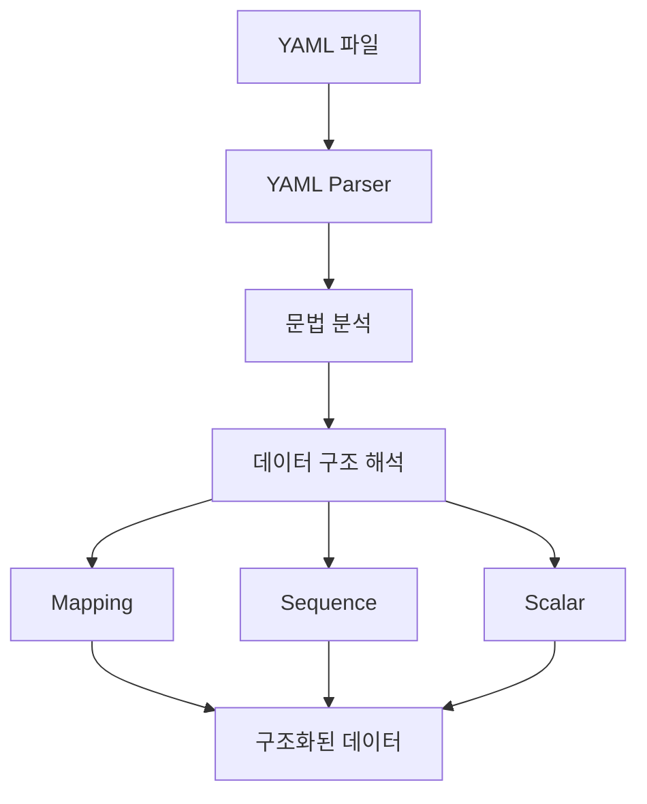

여기서 각 데이터 구조의 의미는 다음과 같다.

| 데이터 구조 | 의미 |
|---|---|
| Mapping | Key-Value 관계 |
| Sequence | 순서가 있는 데이터 목록 |
| Scalar | 문자열, 숫자, Boolean 등 단일 값 |

yq는 이처럼 파싱된 데이터 구조를 기준으로 원하는 값을 조회한다.

예를 들어 다음 명령어를 실행할 수 있다.

```bash
yq '.application.server.port' application.yaml
```

출력:

```text
8080
```

이 명령어는 `port`라는 문자열을 단순 검색하는 것이 아니다.

다음 경로를 따라 이동하여 데이터를 조회한다.

```text
application
    ↓
server
    ↓
port
    ↓
8080
```

따라서 같은 이름의 Key가 다른 위치에 존재하더라도 정확한 경로를 지정하여 원하는 값을 조회할 수 있다.

---

### grep과 yq의 차이

Linux에서는 파일에서 특정 문자열을 검색할 때 `grep`을 자주 사용한다.

그렇다면 YAML 파일을 처리할 때도 `grep`을 사용하면 충분하지 않을까?

간단한 문자열 검색에는 가능하지만, YAML의 중첩 구조를 고려해야 하는 경우에는 한계가 있다.

다음 YAML을 살펴보자.

**application.yaml**

```yaml
application:
  name: payment-service

  server:
    port: 8080

database:
  host: mysql
  port: 3306
```

여기에는 `port`라는 Key가 두 번 등장한다.

하나는 애플리케이션 서버의 포트이고, 다른 하나는 데이터베이스의 포트이다.

#### grep으로 검색하기

```bash
grep port application.yaml
```

출력:

```text
    port: 8080
  port: 3306
```

두 값이 모두 출력된다.

하지만 검색 결과만으로는 각 포트가 어떤 상위 설정에 속하는지 명확하지 않다.

#### yq로 검색하기

애플리케이션 서버의 포트만 조회한다.

```bash
yq '.application.server.port' application.yaml
```

출력:

```text
8080
```

데이터베이스 포트만 조회한다.

```bash
yq '.database.port' application.yaml
```

출력:

```text
3306
```

이처럼 yq는 YAML의 계층 구조를 기준으로 데이터를 조회한다.

두 도구의 차이를 정리하면 다음과 같다.

| 비교 항목 | grep | yq |
|---|---|---|
| 주요 목적 | 텍스트 검색 | 구조화된 데이터 처리 |
| YAML 구조 이해 | 지원하지 않음 | 지원 |
| Key 경로 접근 | 직접 지원하지 않음 | 지원 |
| Sequence 인덱스 접근 | 직접 지원하지 않음 | 지원 |
| 데이터 타입 구분 | 어려움 | 가능 |
| 조건 검색 | 문자열 패턴 중심 | 데이터 구조와 값 중심 |
| YAML 값 수정 | 직접 지원하지 않음 | 지원 |
| 대표 사용처 | 로그 및 텍스트 검색 | YAML 설정 관리 |

따라서 단순히 특정 문자열이 포함되어 있는지 확인하려면 `grep`을 사용할 수 있다.

반면 YAML의 특정 Key를 정확하게 조회하거나 변경해야 한다면 yq가 더 적합하다.

---

### jq와 yq의 관계

yq를 이해할 때 함께 알아두면 좋은 도구가 jq이다.

jq는 JSON 데이터를 처리하기 위한 CLI 도구이다.

예를 들어 다음 JSON이 있다고 가정하자.

```json
{
  "application": {
    "name": "payment-service",
    "port": 8080
  }
}
```

jq를 사용하면 다음처럼 특정 값을 조회할 수 있다.

```bash
jq '.application.name' application.json
```

출력:

```text
payment-service
```

yq에서도 비슷한 방식으로 YAML 데이터를 조회할 수 있다.

```bash
yq '.application.name' application.yaml
```

두 도구의 공통점은 구조화된 데이터에 경로 표현식을 적용한다는 것이다.

| 구분 | jq | yq |
|---|---|---|
| 주요 대상 | JSON | YAML 및 여러 데이터 형식 |
| 대표 용도 | JSON 조회 및 변환 | YAML 조회 및 변환 |
| 경로 표현식 | `.application.name` | `.application.name` |
| 조건 검색 | 지원 | 지원 |
| 데이터 수정 | 지원 | 지원 |
| 자동화 | Shell Script, CI/CD | Shell Script, CI/CD |

Mike Farah의 yq는 jq와 유사한 표현식을 사용한다.

다만 **yq와 jq의 문법이 완전히 동일한 것은 아니다.**

각 도구에서 지원하는 연산자와 함수에는 차이가 있을 수 있으므로 사용 중인 yq의 공식 문법을 기준으로 작성해야 한다.

또한 `yq`라는 이름을 사용하는 구현체가 여러 개 존재한다.

여기서는 **Mike Farah의 Go 기반 yq v4 계열**을 기준으로 설명한다.

---

### yq의 처리 구조

yq는 YAML 파일을 입력받아 표현식을 평가한 후 결과를 출력한다.

기본적인 흐름은 다음과 같다.

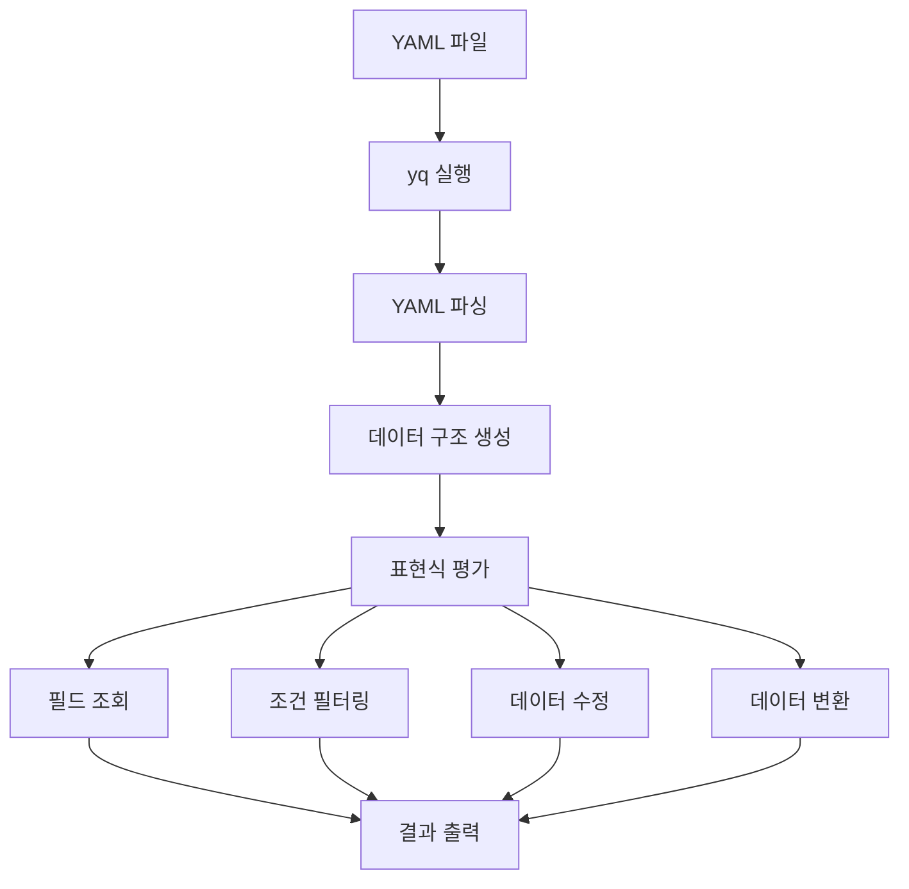

예를 들어 다음과 같은 명령어가 있다.

```bash
yq '.application.name' application.yaml
```

명령어의 각 요소는 다음과 같은 의미를 가진다.

| 요소 | 의미 |
|---|---|
| `yq` | 실행할 CLI 프로그램 |
| `.application.name` | 조회할 데이터 경로를 나타내는 표현식 |
| `application.yaml` | 입력으로 사용할 YAML 파일 |

여기서 표현식은 작은따옴표로 감싸는 것이 좋다.

Shell이 `$`, `*`, `|` 등의 문자를 먼저 해석하는 상황을 방지할 수 있기 때문이다.

특히 복잡한 yq 표현식은 작은따옴표로 감싸서 사용하는 것이 일반적이다.

---

### yq의 버전과 명령어 문법

yq를 사용하기 전에 반드시 확인해야 하는 것이 버전이다.

yq는 버전에 따라 명령어 구조와 일부 기능이 달라질 수 있다.

특히 Mike Farah의 yq는 v3와 v4 사이에 명령어 문법 차이가 크다.

또한 v4 내부에서도 일부 사용 방식이 변경되었다.

이번에는 **v4.19.1**을 기준으로 설치하고 사용한다.

이 버전은 특정 명령어의 동작을 일관되게 재현하기 위한 기준이며, 현재 제공되는 최신 버전이라는 의미는 아니다.

#### v4.18.1부터 변경된 기본 명령어

yq v4에서 YAML을 조회하는 대표적인 명령어는 `eval`이다.

```bash
yq eval '.application.name' application.yaml
```

`eval`은 표현식을 YAML 데이터에 적용하는 명령어이다.

그런데 **v4.18.1부터 `eval`이 기본 명령어로 처리되도록 변경되었다.**

따라서 다음과 같이 `eval`을 생략할 수 있다.

```bash
yq '.application.name' application.yaml
```

두 명령어는 동일한 목적으로 사용할 수 있다.

```bash
yq eval '.application.name' application.yaml
```

```bash
yq e '.application.name' application.yaml
```

```bash
yq '.application.name' application.yaml
```

여기서 `e`는 `eval`의 축약형이다.

v4.18.1 이전의 일부 버전에서는 `eval` 또는 `e`를 명시해야 했다.

따라서 기존 스크립트를 분석하거나 오래된 실행 환경을 사용하는 경우에는 버전 차이를 확인하는 것이 좋다.

---

### yq 설치 전 운영체제 및 아키텍처 확인

yq는 운영체제와 CPU 아키텍처에 따라 서로 다른 실행 파일을 제공한다.

따라서 설치하기 전에 자신의 환경을 확인해야 한다.

Ubuntu Linux를 기준으로 진행한다.

#### 운영체제 확인

```bash
uname -s
```

Ubuntu에서는 다음과 같이 출력된다.

```text
Linux
```

#### CPU 아키텍처 확인

```bash
uname -m
```

일반적인 x86-64 서버에서는 다음과 같이 출력된다.

```text
x86_64
```

ARM64 서버에서는 다음과 같이 출력될 수 있다.

```text
aarch64
```

출력 결과에 따라 적절한 yq 바이너리를 선택해야 한다.

| 운영체제 | CPU 아키텍처 | 바이너리 |
|---|---|---|
| Linux | x86-64 | `yq_linux_amd64` |
| Linux | ARM64 | `yq_linux_arm64` |
| macOS | Intel | `yq_darwin_amd64` |
| macOS | Apple Silicon | `yq_darwin_arm64` |
| Windows | x86-64 | `yq_windows_amd64.exe` |

예를 들어 Ubuntu x86-64 환경이라면 다음 바이너리를 사용한다.

```text
yq_linux_amd64
```

Apple Silicon Mac이라면 다음 바이너리를 선택한다.

```text
yq_darwin_arm64
```

이처럼 운영체제와 아키텍처에 맞는 파일을 다운로드해야 정상적으로 실행할 수 있다.

---

### Ubuntu에서 yq v4.19.1 설치하기

Ubuntu 환경에서 GitHub Releases에 제공되는 바이너리를 직접 다운로드하여 설치해보자.

전체 설치 과정은 다음과 같다.

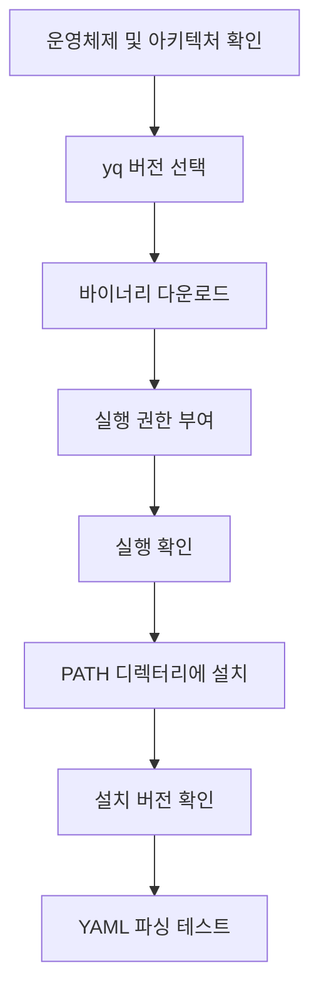

#### 1. 설치할 버전과 바이너리 지정

먼저 다음 변수를 선언한다.

```bash
VERSION=v4.19.1
BINARY=yq_linux_amd64
```

각 변수의 의미는 다음과 같다.

| 변수 | 값 | 설명 |
|---|---|---|
| `VERSION` | `v4.19.1` | 설치할 yq 버전 |
| `BINARY` | `yq_linux_amd64` | Linux x86-64 바이너리 |

이렇게 변수를 선언하면 다운로드 명령어에서 버전과 바이너리 이름을 재사용할 수 있다.

예를 들어 다른 버전을 설치하려면 `VERSION` 값을 변경하면 된다.

ARM64 환경에서는 다음과 같이 변경할 수 있다.

```bash
BINARY=yq_linux_arm64
```

#### 2. wget으로 바이너리 다운로드

다음 명령어를 실행한다.

```bash
wget \
  "https://github.com/mikefarah/yq/releases/download/${VERSION}/${BINARY}" \
  -O yq
```

이 명령어는 GitHub Releases에서 지정한 버전의 yq 바이너리를 다운로드한다.

여기서 `-O yq`는 다운로드한 파일을 `yq`라는 이름으로 저장하겠다는 의미이다.

각 요소를 살펴보면 다음과 같다.

| 요소 | 의미 |
|---|---|
| `wget` | 파일 다운로드 |
| `https://github.com/mikefarah/yq/releases/download/` | GitHub Releases 다운로드 경로 |
| `${VERSION}` | 설치할 버전 |
| `${BINARY}` | 다운로드할 바이너리 |
| `-O yq` | 결과 파일 이름을 `yq`로 지정 |

실제 다운로드 경로는 다음과 같은 형태이다.

```text
https://github.com/mikefarah/yq/releases/download/v4.19.1/yq_linux_amd64
```

정상적으로 다운로드되면 현재 디렉터리에 다음 파일이 생성된다.

```text
yq
```

파일이 존재하는지 확인한다.

```bash
ls -lh yq
```

다운로드한 파일의 크기와 권한 등을 확인할 수 있다.

운영 환경에서는 실행 전에 공식 릴리스의 체크섬이나 서명 검증 자료를 이용해 파일의 출처와 무결성을 확인하는 것이 좋다.

#### 3. 실행 권한 부여

다운로드한 바이너리를 실행하려면 실행 권한이 필요하다.

```bash
chmod +x yq
```

`chmod`는 파일의 권한을 변경하는 명령어이다.

`+x`는 실행 권한을 추가한다는 의미이다.

권한이 변경되었는지 확인한다.

```bash
ls -l yq
```

출력 예시:

```text
-rwxr-xr-x 1 user user 10M Nov 20 17:00 yq
```

파일 권한에서 `x`는 실행 권한을 의미한다.

#### 4. 현재 디렉터리에서 실행하기

이제 yq를 실행해보자.

```bash
./yq --version
```

예상 출력:

```text
yq (https://github.com/mikefarah/yq/) version v4.19.1
```

이 출력이 나타나면 바이너리가 정상적으로 실행된 것이다.

여기서 중요한 점은 명령어 앞에 `./`가 붙어 있다는 것이다.

```bash
./yq
```

이 명령어는 현재 디렉터리에 존재하는 `yq` 파일을 실행한다는 의미이다.

반면 다음 명령어는 다르게 동작한다.

```bash
yq
```

이 경우 Shell은 `PATH` 환경 변수에 등록된 디렉터리에서 `yq` 실행 파일을 검색한다.

현재 디렉터리가 PATH에 포함되어 있지 않다면 다운로드한 yq를 찾지 못할 수 있다.

따라서 어디서든 yq를 실행하려면 적절한 디렉터리에 설치해야 한다.

---

### yq를 모든 디렉터리에서 실행하도록 설정하기

Linux에서는 일반적으로 `/usr/local/bin`을 사용자 또는 관리자가 설치한 실행 파일을 배치하는 용도로 사용한다.

해당 디렉터리가 PATH에 포함되어 있다면 어떤 디렉터리에서도 프로그램을 실행할 수 있다.

먼저 PATH를 확인한다.

```bash
echo "$PATH"
```

출력 예시:

```text
/usr/local/sbin:/usr/local/bin:/usr/sbin:/usr/bin:/bin
```

여기에 `/usr/local/bin`이 포함되어 있다.

따라서 yq 실행 파일을 해당 디렉터리에 설치하면 된다.

#### 1. 실행 파일 이동

```bash
sudo mv ./yq /usr/local/bin/yq
```

이 명령어는 현재 디렉터리의 yq 파일을 `/usr/local/bin`으로 이동한다.

각 요소의 의미는 다음과 같다.

| 요소 | 의미 |
|---|---|
| `sudo` | 관리자 권한으로 명령 실행 |
| `mv` | 파일 이동 |
| `./yq` | 현재 디렉터리의 yq 실행 파일 |
| `/usr/local/bin/yq` | 최종 설치 경로 |

이미 해당 경로에 yq가 설치되어 있다면 기존 실행 파일을 덮어쓸 수 있으므로 먼저 확인하는 것이 좋다.

```bash
command -v yq
```

기존에 설치된 yq가 있다면 사용 중인 버전과 설치 경로를 확인한 뒤 교체 여부를 결정해야 한다.

#### 2. 설치 경로 확인

```bash
which yq
```

예상 출력:

```text
/usr/local/bin/yq
```

이제 현재 디렉터리와 관계없이 `yq`를 실행할 수 있다.

#### 3. 설치 버전 확인

```bash
yq --version
```

출력:

```text
yq (https://github.com/mikefarah/yq/) version v4.19.1
```

이제 yq 설치가 완료되었다.

다음과 같이 다른 디렉터리로 이동한 후에도 실행할 수 있다.

```bash
cd /tmp
```

```bash
yq --version
```

동일한 버전 정보가 출력된다면 PATH 설정이 정상적으로 동작하는 것이다.

---

### Linux의 PATH는 어떻게 동작할까?

프로그램을 설치할 때 PATH가 왜 중요한지 이해해두면 도움이 된다.

Linux에서 다음 명령어를 입력했다고 가정하자.

```bash
yq --version
```

Shell은 `yq`라는 실행 파일을 찾기 위해 PATH에 등록된 디렉터리를 순서대로 검색한다.

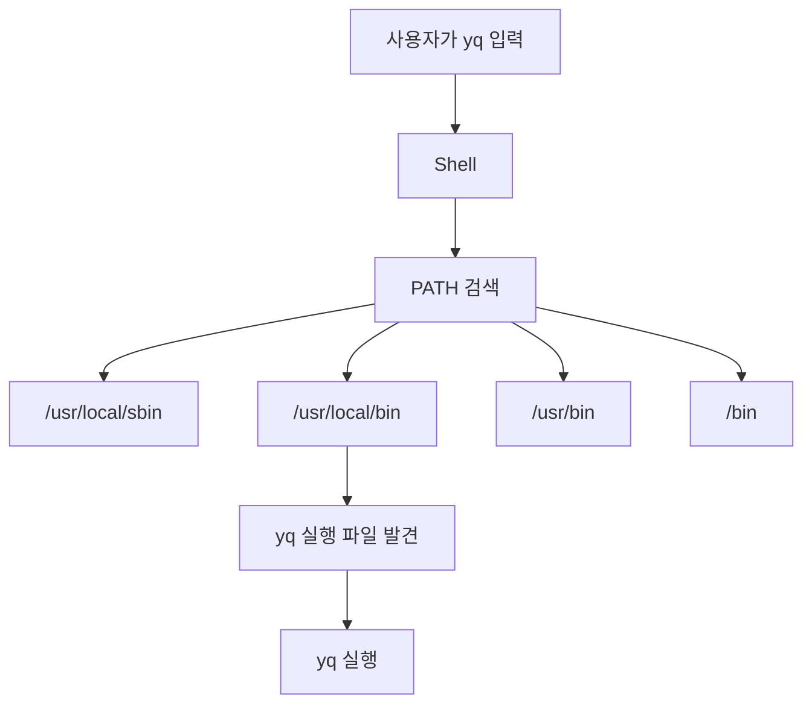

실행 파일을 찾으면 해당 프로그램을 실행한다.

반면 어떤 디렉터리에서도 찾지 못하면 다음과 같은 오류가 발생할 수 있다.

```text
yq: command not found
```

이 경우 다음 항목을 확인해야 한다.

- yq 파일이 실제로 설치되어 있는가?
- 파일에 실행 권한이 있는가?
- 실행 파일이 있는 디렉터리가 PATH에 포함되어 있는가?
- 동일한 이름의 다른 yq가 먼저 검색되고 있지는 않은가?

특히 여러 버전의 yq를 설치한 환경에서는 실행되는 바이너리가 예상과 다를 수 있다.

다음 명령어로 확인할 수 있다.

```bash
type -a yq
```

여러 경로에 yq가 존재한다면 각각의 위치가 출력될 수 있다.

---

### macOS에서 yq 설치하기

macOS에서도 yq를 사용할 수 있다.

Homebrew가 설치되어 있다면 다음 명령어로 설치할 수 있다.

```bash
brew install yq
```

설치 후 버전을 확인한다.

```bash
yq --version
```

다만 Homebrew를 사용하면 일반적으로 패키지 관리자가 제공하는 버전이 설치된다.

따라서 v4.19.1과 정확하게 일치하지 않을 수 있다.

특정 버전을 기준으로 명령어를 테스트해야 한다면 해당 버전의 바이너리를 직접 다운로드하는 방식이 적절하다.

Apple Silicon 환경에서는 다음 바이너리를 사용한다.

```text
yq_darwin_arm64
```

Intel Mac에서는 다음 바이너리를 사용한다.

```text
yq_darwin_amd64
```

예를 들어 Apple Silicon 환경에서 v4.19.1을 다운로드하려면 다음과 같이 작성할 수 있다.

```bash
VERSION=v4.19.1
BINARY=yq_darwin_arm64
```

```bash
curl -fL \
  "https://github.com/mikefarah/yq/releases/download/${VERSION}/${BINARY}" \
  -o yq
```

실행 권한을 부여한다.

```bash
chmod +x yq
```

이후 실행 파일을 사용할 수 있다.

```bash
./yq --version
```

이처럼 yq는 운영체제에 맞는 바이너리를 선택하면 동일한 방식으로 사용할 수 있다.

---

### yq 설치가 정상적으로 완료되었는지 확인하기

버전 확인에 성공했다면 실제 YAML 파일을 파싱해보자.

먼저 테스트 파일을 작성한다.

**application.yaml**

```yaml
application:
  name: payment-service
  version: "1.0.0"

  server:
    port: 8080
    enabled: true

  environments:
    - development
    - staging
    - production

database:
  host: mysql
  port: 3306
```

이 파일에는 다음 데이터 구조가 포함되어 있다.

| 항목 | 데이터 구조 |
|---|---|
| `application` | Mapping |
| `application.name` | Scalar |
| `application.version` | Scalar |
| `application.server` | Mapping |
| `application.server.port` | Scalar |
| `application.environments` | Sequence |
| `database` | Mapping |

이제 다음 명령어를 실행한다.

```bash
yq '.' application.yaml
```

여기서 `.`은 YAML 문서 전체를 의미한다.

따라서 파일의 전체 내용이 출력된다.

예상 출력:

```yaml
application:
  name: payment-service
  version: "1.0.0"
  server:
    port: 8080
    enabled: true
  environments:
    - development
    - staging
    - production
database:
  host: mysql
  port: 3306
```

출력 형식이나 따옴표 유지 여부는 yq의 버전과 스타일 처리 방식에 따라 일부 차이가 있을 수 있다.

중요한 점은 **YAML 파일의 구조를 정상적으로 해석하여 출력할 수 있다는 것**이다.

이 결과가 정상적으로 나타난다면 기본적인 yq 실행 환경이 준비된 것이다.

---

### yq의 컬러 하이라이팅

yq는 YAML 데이터를 터미널에 출력할 때 컬러 하이라이팅을 지원한다.

예를 들어 다음 명령어를 실행한다.

```bash
yq '.' application.yaml
```

일반적인 터미널에서는 Key와 Value가 서로 다른 색상으로 표시될 수 있다.

이를 통해 데이터의 구조를 더욱 쉽게 구분할 수 있다.

다만 모든 환경에서 자동으로 컬러가 표시되는 것은 아니다.

yq는 기본적으로 출력 대상이 터미널인지 판단하여 컬러 사용 여부를 결정한다.

따라서 다음과 같은 환경에서는 컬러가 나타나지 않을 수 있다.

- 다른 명령어로 출력을 전달하는 경우
- 파일로 출력 결과를 저장하는 경우
- CI/CD 환경에서 실행하는 경우
- 터미널의 색상 설정에 제한이 있는 경우

컬러 출력을 강제로 활성화하려면 `-C` 옵션을 사용할 수 있다.

```bash
yq -C '.' application.yaml
```

반대로 컬러 출력을 비활성화하려면 `-M` 옵션을 사용한다.

```bash
yq -M '.' application.yaml
```

각 옵션의 의미는 다음과 같다.

| 옵션 | 의미 |
|---|---|
| `-C` | 컬러 출력 활성화 |
| `--colors` | `-C`와 동일 |
| `-M` | 컬러 출력 비활성화 |
| `--no-colors` | `-M`과 동일 |

컬러 하이라이팅은 가독성을 높이는 편의 기능이다.

따라서 색상이 출력되지 않는다고 해서 yq 설치에 실패한 것은 아니다.

정상 설치 여부는 `yq --version`과 실제 YAML 파싱 명령어의 실행 결과를 기준으로 확인하는 것이 정확하다.

---

### yq의 기본 명령어 구조

yq의 기본적인 사용 형태는 다음과 같다.

```bash
yq [옵션] '표현식' 파일명
```

예를 들어 다음과 같다.

```bash
yq '.application.name' application.yaml
```

이 명령어는 YAML 파일에서 `application.name`에 해당하는 값을 조회한다.

출력:

```text
payment-service
```

yq에서 가장 많이 사용하는 기본 표현식을 정리하면 다음과 같다.

| 표현식 | 의미 |
|---|---|
| `.` | 전체 문서 |
| `.application` | application Mapping 조회 |
| `.application.name` | application 내부의 name 조회 |
| `.application.server.port` | 중첩된 port 값 조회 |
| `.application.environments` | Sequence 전체 조회 |
| `.application.environments[0]` | Sequence 첫 번째 요소 조회 |
| `.application.environments[]` | Sequence의 모든 요소 조회 |

이러한 표현식은 앞에서 살펴본 YAML의 Mapping과 Sequence 구조를 기반으로 한다.

따라서 YAML의 기본 문법을 이해하고 있다면 yq의 경로 표현식도 쉽게 이해할 수 있다.

---

### 특정 Key의 Value 조회하기

먼저 애플리케이션 이름을 조회해보자.

```bash
yq '.application.name' application.yaml
```

출력:

```text
payment-service
```

애플리케이션 버전을 조회한다.

```bash
yq '.application.version' application.yaml
```

출력:

```text
1.0.0
```

서버 포트를 조회한다.

```bash
yq '.application.server.port' application.yaml
```

출력:

```text
8080
```

데이터베이스 호스트를 조회한다.

```bash
yq '.database.host' application.yaml
```

출력:

```text
mysql
```

이처럼 Mapping은 점(`.`)으로 연결된 경로를 사용하여 접근할 수 있다.

---

### Sequence의 특정 요소 조회하기

이번에는 `environments`를 조회해보자.

```yaml
environments:
  - development
  - staging
  - production
```

이 데이터는 Sequence이다.

Sequence의 인덱스는 0부터 시작한다.

| 인덱스 | 값 |
|---|---|
| 0 | development |
| 1 | staging |
| 2 | production |

첫 번째 요소를 조회한다.

```bash
yq '.application.environments[0]' application.yaml
```

출력:

```text
development
```

두 번째 요소를 조회한다.

```bash
yq '.application.environments[1]' application.yaml
```

출력:

```text
staging
```

마지막 요소를 조회한다.

```bash
yq '.application.environments[-1]' application.yaml
```

출력:

```text
production
```

이처럼 yq는 YAML의 Sequence를 일반적인 배열처럼 인덱스로 접근할 수 있다.

---

### yq에서 Pipeline 사용하기

yq는 여러 표현식을 파이프(`|`)로 연결할 수 있다.

예를 들어 다음 명령어를 살펴보자.

```bash
yq '.application.environments | length' application.yaml
```

이 명령어는 다음 두 단계를 수행한다.

첫 번째는 `application.environments`를 선택하는 것이다.

```text
application.environments
```

두 번째는 선택된 Sequence의 길이를 계산하는 것이다.

```text
length
```

출력:

```text
3
```

실행 구조는 다음과 같다.


여기서 사용하는 파이프(`|`)는 yq 표현식 내부의 연산자이다.

Linux Shell의 파이프와 비슷한 개념이지만 동작하는 위치가 다르다.

예를 들어 다음 명령어는 Shell Pipeline이다.

```bash
cat application.yaml | yq '.application.name'
```

반면 다음 명령어의 파이프는 yq 내부의 표현식 연산자이다.

```bash
yq '.application.environments | length' application.yaml
```

두 가지 개념을 구분하면 복잡한 자동화 명령어를 이해하는 데 도움이 된다.

---

### yq로 YAML 파일 수정하기

yq는 데이터를 조회하는 것뿐 아니라 값을 수정할 수도 있다.

예를 들어 다음 설정이 있다고 가정하자.

```yaml
application:
  name: payment-service

  server:
    port: 8080
```

서버 포트를 9090으로 변경하려면 다음 명령어를 사용할 수 있다.

```bash
yq '.application.server.port = 9090' application.yaml
```

이 명령어는 변경된 YAML을 표준 출력으로 출력한다.

하지만 원본 파일을 직접 수정하지는 않는다.

실제로 파일을 변경하려면 `-i` 옵션을 사용한다.

```bash
yq -i '.application.server.port = 9090' application.yaml
```

변경된 값을 확인한다.

```bash
yq '.application.server.port' application.yaml
```

출력:

```text
9090
```

각 표현식의 의미는 다음과 같다.

| 표현식 | 의미 |
|---|---|
| `.application.server.port` | 수정할 필드 |
| `=` | 값 할당 |
| `9090` | 변경할 값 |
| `-i` | 원본 파일에 변경 내용 반영 |

운영 환경에서는 원본 파일을 직접 수정하기 전에 변경 이력을 관리하는 것이 좋다.

예를 들어 Git으로 관리되는 설정 파일이라면 변경 후 `git diff`로 결과를 확인할 수 있다.

---

### yq의 eval과 eval-all 차이

yq v4에는 `eval`과 `eval-all`이라는 명령어가 있다.

이 두 명령어는 이름이 비슷하지만 처리 방식이 다르다.

#### eval

`eval`은 입력된 YAML 문서들을 순서대로 평가한다.

예를 들어 다음과 같이 작성한다.

```bash
yq eval '.application.name' application.yaml
```

v4.18.1 이상에서는 다음처럼 생략할 수 있다.

```bash
yq '.application.name' application.yaml
```

일반적인 조회와 수정 작업에서는 `eval`을 사용한다.

#### eval-all

`eval-all`은 여러 YAML 문서를 함께 읽어 하나의 표현식에서 처리할 수 있도록 한다.

대표적으로 여러 YAML 파일을 병합할 때 활용한다.

다음과 같은 두 파일이 있다고 가정하자.

**base.yaml**

```yaml
application:
  name: payment-service
  port: 8080

logging:
  level: INFO
```

**production.yaml**

```yaml
application:
  port: 9090

logging:
  level: WARN
```

두 파일을 병합하려면 다음과 같이 작성할 수 있다.

```bash
yq eval-all \
  'select(fileIndex == 0) * select(fileIndex == 1)' \
  base.yaml production.yaml
```

출력:

```yaml
application:
  name: payment-service
  port: 9090
logging:
  level: WARN
```

여기서는 `production.yaml`의 설정이 겹치는 필드를 덮어쓴다.

반면 `production.yaml`에 없는 `application.name`은 기존 값을 유지한다.

이처럼 `eval-all`은 여러 문서나 파일을 동시에 고려해야 하는 작업에서 유용하다.

다만 모든 파일을 메모리로 읽어 처리하므로 매우 큰 파일을 다룰 때는 메모리 사용량도 고려해야 한다.

---

### Kubernetes에서 yq 활용하기

이제 yq를 Kubernetes와 함께 사용하는 방법을 살펴보자.

Kubernetes에서는 `kubectl`을 이용해 리소스를 YAML 형식으로 조회할 수 있다.

예를 들어 다음과 같다.

```bash
kubectl get deployment payment-service -o yaml
```

이 명령어는 API Server에 저장된 Deployment 정보를 YAML로 출력한다.

하지만 실제 출력에는 많은 필드가 포함되어 있다.

대표적으로 다음과 같은 정보가 있다.

- metadata
- labels
- annotations
- spec
- replicas
- containers
- resources
- status
- conditions

이러한 출력에서 필요한 정보만 추출하기 위해 yq를 사용할 수 있다.

#### Deployment 이름 확인

```bash
kubectl get deployment payment-service -o yaml |
  yq '.metadata.name'
```

출력 예시:

```text
payment-service
```

#### replicas 확인

```bash
kubectl get deployment payment-service -o yaml |
  yq '.spec.replicas'
```

출력 예시:

```text
3
```

#### 컨테이너 이미지 확인

```bash
kubectl get deployment payment-service -o yaml |
  yq '.spec.template.spec.containers[].image'
```

출력 예시:

```text
nginx:1.27
```

이 명령어에서는 `containers[]`를 사용하므로 모든 컨테이너의 이미지가 출력된다.

#### CPU requests 확인

```bash
kubectl get deployment payment-service -o yaml |
  yq '.spec.template.spec.containers[].resources.requests.cpu'
```

출력 예시:

```text
100m
```

#### Memory limits 확인

```bash
kubectl get deployment payment-service -o yaml |
  yq '.spec.template.spec.containers[].resources.limits.memory'
```

출력 예시:

```text
256Mi
```

이러한 명령어는 Kubernetes 리소스의 설정을 빠르게 확인하는 데 유용하다.

특히 컨테이너 이미지나 리소스 설정을 자동으로 점검하는 스크립트를 작성할 때 활용할 수 있다.

---

### ConfigMap과 yq를 함께 사용하기

앞에서 ConfigMap은 애플리케이션 설정 데이터를 Key-Value 형태로 저장하는 리소스라는 점을 살펴보았다.

예를 들어 다음과 같은 ConfigMap이 있다고 가정하자.

```yaml
apiVersion: v1
kind: ConfigMap

metadata:
  name: game-demo

data:
  player_initial_lives: "3"
  ui_properties_file_name: "user-interface.properties"

  game.properties: |
    enemy.types=aliens,monsters
    player.maximum-lives=5
```

이 ConfigMap이 Kubernetes에 생성되어 있다면 다음 명령어로 조회할 수 있다.

```bash
kubectl get configmap game-demo -o yaml
```

특정 값만 확인하려면 yq를 사용할 수 있다.

```bash
kubectl get configmap game-demo -o yaml |
  yq '.data.player_initial_lives'
```

출력:

```text
3
```

`game.properties`의 내용을 확인하려면 다음처럼 작성한다.

```bash
kubectl get configmap game-demo -o yaml |
  yq '.data["game.properties"]'
```

출력 내용:

```properties
enemy.types=aliens,monsters
player.maximum-lives=5
```

여기서 주의해야 할 점은 `game.properties`가 하나의 Key라는 것이다.

따라서 다음과 같이 작성하면 의도한 값에 접근하지 못한다.

```bash
yq '.data.game.properties' game-demo-configmap.yaml
```

대신 대괄호를 사용해 정확한 Key 이름을 지정한다.

```bash
yq '.data["game.properties"]' game-demo-configmap.yaml
```

이러한 방식은 Key 이름에 점(`.`)이나 특수문자가 포함된 YAML을 처리할 때 유용하다.

---

### yq는 Kubernetes 리소스를 직접 수정할까?

여기서 반드시 구분해야 할 개념이 있다.

yq는 YAML 데이터를 처리하는 도구이고, kubectl은 Kubernetes API와 통신하는 도구이다.

예를 들어 다음 명령어를 실행한다고 가정하자.

```bash
yq -i '.spec.replicas = 5' deployment.yaml
```

이 명령어는 로컬의 `deployment.yaml` 파일을 수정한다.

하지만 Kubernetes 클러스터에 존재하는 Deployment의 replicas가 즉시 5로 변경되는 것은 아니다.

클러스터에 반영하려면 다음과 같이 별도로 적용해야 한다.

```bash
kubectl apply -f deployment.yaml
```

전체 과정은 다음과 같다.

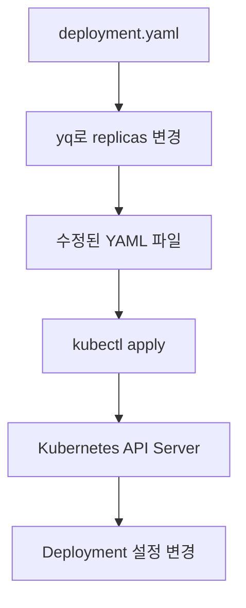

이러한 구조는 배포 자동화에서 자주 사용된다.

예를 들어 새로운 애플리케이션 버전이 빌드되었을 때 yq로 이미지 태그를 변경하고, 변경된 Manifest를 Kubernetes에 적용하는 방식이다.

다만 GitOps로 관리하는 환경에서는 실행 중인 클러스터 리소스를 직접 변경하기보다 Git에 저장된 Manifest를 수정하고 동기화하는 방식을 사용하는 것이 적절하다.

---

### YAML 파일을 JSON으로 변환하기

yq는 YAML 파일을 JSON 형식으로 변환할 수도 있다.

예를 들어 다음 파일을 사용한다고 가정하자.

**application.yaml**

```yaml
application:
  name: payment-service
  port: 8080
  enabled: true
```

다음 명령어를 실행한다.

```bash
yq -o=json '.' application.yaml
```

출력:

```json
{
  "application": {
    "name": "payment-service",
    "port": 8080,
    "enabled": true
  }
}
```

여기서 `-o=json`은 출력 형식을 JSON으로 지정한다는 의미이다.

반대로 JSON을 YAML로 변환할 수도 있다.

```bash
yq -P -o=yaml '.' application.json
```

이러한 기능은 서로 다른 시스템이 사용하는 데이터 형식을 변환하거나 자동화 파이프라인을 구성할 때 활용할 수 있다.

단, YAML에 포함된 주석이나 Anchor 같은 표현 정보는 JSON에 직접 대응하는 구조가 없으므로 변환 과정에서 일부 정보가 유지되지 않을 수 있다.

---

### yq를 이용한 YAML 문법 검증

YAML 파일은 들여쓰기에 민감하다.

따라서 공백이 잘못되면 문법 오류가 발생할 수 있다.

예를 들어 다음 YAML을 살펴보자.

```yaml
application:
  name: payment-service
   port: 8080
```

`name`과 `port`의 들여쓰기가 일치하지 않는다.

이러한 파일은 정상적으로 파싱되지 않을 수 있다.

yq를 사용하면 YAML 파싱 가능 여부를 확인할 수 있다.

```bash
yq '.' application.yaml
```

정상적인 YAML이라면 내용을 출력한다.

문법 오류가 있다면 파싱 오류를 반환한다.

자동화 스크립트에서는 출력 내용을 확인할 필요 없이 종료 코드만 검사할 수도 있다.

```bash
yq '.' application.yaml > /dev/null
```

이후 종료 코드를 확인한다.

```bash
echo $?
```

정상적으로 파싱되었다면 일반적으로 다음과 같이 출력된다.

```text
0
```

반대로 문법 오류가 발생했다면 0이 아닌 종료 코드가 반환된다.

다만 여기서 중요한 점이 있다.

**YAML 문법이 올바르다는 것과 Kubernetes Manifest가 올바르다는 것은 다른 문제이다.**

예를 들어 다음 YAML을 살펴보자.

```yaml
spec:
  containers:
    name: nginx
    image: nginx:1.27
```

이 데이터는 YAML 문법으로는 유효한 Mapping일 수 있다.

하지만 Kubernetes의 Pod Spec에서는 `containers` 필드에 Sequence가 필요하다.

따라서 실제 Kubernetes Manifest에서는 다음과 같이 작성해야 한다.

```yaml
spec:
  containers:
    - name: nginx
      image: nginx:1.27
```

Kubernetes API의 검증까지 확인하려면 다음 명령어를 사용할 수 있다.

```bash
kubectl apply --dry-run=server -f pod.yaml
```

이처럼 검증 단계를 구분하는 것이 중요하다.

| 검증 단계 | 도구 | 확인 내용 |
|---|---|---|
| YAML 문법 검증 | yq | YAML을 정상적으로 파싱할 수 있는가? |
| YAML 스타일 검증 | yamllint | 들여쓰기와 스타일 규칙이 적절한가? |
| Kubernetes API 검증 | kubectl | 리소스의 필드와 데이터 타입이 올바른가? |
| 실제 실행 검증 | kubectl | Pod가 정상적으로 생성되고 실행되는가? |

실제 운영에서는 이러한 단계를 조합하여 설정 오류를 사전에 발견할 수 있다.

---

### yq 설치 및 실행 과정에서 발생할 수 있는 문제

yq는 단일 바이너리로 사용할 수 있어 설치가 간단한 편이다.

하지만 운영체제와 실행 환경에 따라 몇 가지 문제가 발생할 수 있다.

#### 1. command not found

다음 명령어를 실행했을 때 오류가 발생할 수 있다.

```bash
yq --version
```

오류:

```text
yq: command not found
```

이 경우 다음 항목을 확인한다.

```bash
which yq
```

또는 다음 명령어를 실행한다.

```bash
command -v yq
```

아무 경로도 출력되지 않는다면 yq가 PATH에서 검색되지 않는다는 의미이다.

설치 파일이 `/usr/local/bin/yq`에 존재하는지 확인한다.

```bash
ls -l /usr/local/bin/yq
```

PATH에 해당 디렉터리가 포함되어 있는지도 확인한다.

```bash
echo "$PATH"
```

#### 2. Permission denied

다음과 같은 오류가 발생할 수 있다.

```text
Permission denied
```

실행 파일의 권한이 부족한 경우이다.

권한을 확인한다.

```bash
ls -l yq
```

필요하다면 실행 권한을 추가한다.

```bash
chmod +x yq
```

이후 다시 실행한다.

```bash
./yq --version
```

#### 3. Exec format error

다음과 같은 오류가 발생할 수 있다.

```text
cannot execute binary file: Exec format error
```

운영체제나 CPU 아키텍처와 바이너리가 일치하지 않는 경우에 발생할 수 있다.

예를 들어 ARM64 환경에서 x86-64 전용 바이너리를 실행하려고 했을 수 있다.

먼저 아키텍처를 확인한다.

```bash
uname -m
```

다음으로 다운로드한 파일의 형식을 확인한다.

```bash
file yq
```

실행 환경에 맞는 바이너리를 다시 다운로드해야 한다.

#### 4. 예상과 다른 yq 문법이 실행되는 경우

시스템에 다른 구현체의 yq가 설치되어 있을 수도 있다.

이 경우 다음 명령어로 확인한다.

```bash
yq --version
```

그리고 실제 실행 파일의 위치를 확인한다.

```bash
type -a yq
```

Mike Farah의 yq v4와 다른 구현체의 yq는 명령어 문법이 다를 수 있다.

따라서 오류 메시지가 예상과 다르다면 현재 실행 중인 yq의 구현체와 버전을 먼저 확인하는 것이 좋다.

#### 5. 컬러 하이라이팅이 출력되지 않는 경우

컬러 출력이 없더라도 YAML이 정상적으로 파싱된다면 yq는 사용할 수 있다.

필요하다면 다음 옵션으로 컬러 출력을 강제할 수 있다.

```bash
yq -C '.' application.yaml
```

반대로 자동화 환경에서는 컬러 코드를 제거하는 것이 유리할 수 있다.

```bash
yq -M '.' application.yaml
```

CI/CD 로그나 다른 프로그램의 입력으로 전달할 때는 불필요한 ANSI 컬러 코드가 포함되지 않도록 관리하는 것이 좋다.

---

### yq를 자동화 스크립트에서 사용할 때 주의사항

yq는 CI/CD 파이프라인에서 활용도가 높은 도구이다.

하지만 자동화에서 사용할 때는 몇 가지 주의사항이 있다.

#### 1. 버전을 고정한다

로컬 개발 환경과 CI/CD 환경에서 서로 다른 yq 버전을 사용하면 예상하지 못한 문제가 발생할 수 있다.

예를 들어 다음과 같은 상황이다.

```text
Local Environment
  └── yq v4.19.1

CI/CD Environment
  └── 다른 yq 버전
```

특정 버전의 문법이나 동작에 의존하는 스크립트라면 버전 차이가 오류로 이어질 수 있다.

따라서 자동화 환경에서는 사용하는 yq 버전을 명확하게 관리하는 것이 좋다.

#### 2. 원본 파일을 직접 수정할 때는 변경 결과를 확인한다

다음 명령어는 YAML 파일을 직접 수정한다.

```bash
yq -i '.application.server.port = 9090' application.yaml
```

변경 후에는 다음과 같이 결과를 확인하는 것이 좋다.

```bash
git diff -- application.yaml
```

실무에서는 Git을 통해 설정 변경 이력을 관리하면 예상하지 못한 수정 사항을 쉽게 확인할 수 있다.

#### 3. 존재하지 않는 Key를 조회하는 경우를 고려한다

예를 들어 다음 명령어를 실행한다고 가정하자.

```bash
yq '.application.database.password' application.yaml
```

해당 경로가 존재하지 않더라도 yq가 반드시 오류 종료 코드를 반환하는 것은 아니다.

경로에 따라 `null`과 같은 결과가 출력될 수 있다.

따라서 자동화 스크립트에서 특정 값의 존재 여부가 중요하다면 별도의 검증이 필요하다.

yq에는 결과에 따라 종료 상태를 판단하도록 하는 `-e` 옵션도 있다.

```bash
yq -e '.application.name' application.yaml
```

이 옵션은 결과가 없거나 `null`, `false` 등인 상황을 종료 상태에 반영할 수 있다.

다만 Boolean `false` 자체가 정상적인 비즈니스 값인 경우도 있으므로, 단순히 종료 코드만으로 데이터의 유효성을 판단하지 않도록 주의해야 한다.

#### 4. Shell 변수와 YAML 데이터 타입을 구분한다

배포 자동화에서는 환경 변수 값을 YAML에 전달해야 하는 경우가 있다.

예를 들어 이미지 태그를 변경한다고 가정하자.

```bash
IMAGE_TAG=1.2.0
```

이 값을 YAML에 반영할 때는 `strenv()`를 사용할 수 있다.

```bash
IMAGE_TAG="$IMAGE_TAG" \
yq -i \
  '.image.tag = strenv(IMAGE_TAG)' \
  application.yaml
```

`strenv()`는 환경 변수 값을 문자열로 가져온다.

버전이나 태그처럼 문자열로 관리해야 하는 값에 유용하다.

실제 운영 환경에서는 이렇게 변경된 YAML을 검증한 뒤 배포하는 과정까지 자동화할 수 있다.

---

### 실무에서 yq가 유용한 대표적인 상황

yq는 단순히 YAML 문법을 확인하는 도구가 아니라 실제 운영 작업을 자동화하는 데 활용할 수 있다.

#### 1. Kubernetes 이미지 버전 확인

```bash
kubectl get deployment payment-service -o yaml |
  yq '.spec.template.spec.containers[].image'
```

현재 Deployment에 정의된 컨테이너 이미지들을 확인한다.

#### 2. Kubernetes 리소스 설정 점검

```bash
kubectl get deployment payment-service -o yaml |
  yq '.spec.template.spec.containers[].resources'
```

컨테이너의 requests와 limits 설정을 확인한다.

#### 3. ConfigMap 데이터 조회

```bash
kubectl get configmap game-demo -o yaml |
  yq '.data'
```

ConfigMap에 저장된 설정을 구조적으로 확인한다.

#### 4. 배포 파일에서 이미지 태그 수정

```bash
yq -i \
  '.spec.template.spec.containers[0].image = "nginx:1.28"' \
  deployment.yaml
```

로컬 Deployment Manifest의 이미지 설정을 변경한다.

#### 5. 여러 환경의 설정 비교

```bash
yq '.application.server.port' application-dev.yaml
```

```bash
yq '.application.server.port' application-prod.yaml
```

개발 환경과 운영 환경의 서버 포트 설정을 각각 확인할 수 있다.

이러한 명령어를 Shell Script로 조합하면 여러 환경의 설정을 자동으로 점검할 수 있다.

---

### yq와 Kubernetes 관리 도구의 역할 구분

Kubernetes 환경에서는 여러 도구가 YAML을 사용한다.

따라서 각 도구가 어떤 역할을 담당하는지 구분해두는 것이 좋다.

| 도구 | 주요 역할 |
|---|---|
| yq | YAML 데이터를 조회·수정·변환 |
| kubectl | Kubernetes API를 통해 리소스 조회·관리 |
| Helm | Kubernetes 애플리케이션 패키징 및 배포 |
| Kustomize | Kubernetes Manifest 사용자 정의 및 구성 |
| Argo CD | Git에 정의된 리소스 상태와 클러스터 동기화 |
| yamllint | YAML 문법 및 스타일 검증 |

이 도구들은 모두 YAML을 사용할 수 있지만 목적은 다르다.

예를 들어 다음과 같은 작업 흐름을 구성할 수 있다.

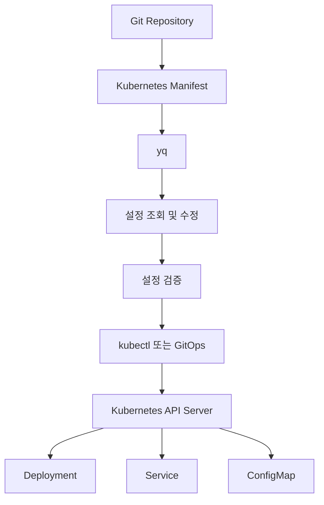

여기서 yq는 YAML 데이터를 처리하는 역할을 한다.

반면 kubectl이나 GitOps 도구는 Kubernetes 클러스터에 원하는 상태를 반영하는 역할을 한다.

이처럼 서로 다른 도구의 책임을 구분하면 배포 자동화 구조를 더 명확하게 설계할 수 있다.

---

### 정리

yq는 YAML 파일을 구조적으로 해석하고 원하는 값을 조회하거나 수정할 수 있는 CLI 도구이다.

Kubernetes에서는 YAML을 사용해 다양한 리소스를 정의하므로 yq를 활용하면 설정 관리와 운영 자동화 작업을 효율적으로 수행할 수 있다.

이번에 살펴본 핵심 내용을 정리하면 다음과 같다.

| 항목 | 핵심 내용 |
|---|---|
| yq | YAML 등의 구조화된 데이터를 처리하는 CLI |
| 구현체 | Mike Farah의 Go 기반 yq |
| 기준 버전 | v4.19.1 |
| 지원 환경 | Linux, macOS, Windows 등 |
| `yq --version` | 설치 버전 확인 |
| `yq '.' file.yaml` | YAML 문서 전체 조회 |
| `yq '.key' file.yaml` | 특정 Key 조회 |
| `yq '.parent.child' file.yaml` | 중첩된 Mapping 조회 |
| `yq '.items[0]' file.yaml` | Sequence의 특정 요소 조회 |
| `yq '.items[]' file.yaml` | Sequence의 모든 요소 조회 |
| `yq eval` | YAML 표현식 평가 |
| `yq eval-all` | 여러 문서를 함께 평가 |
| `-i` | 원본 YAML 파일 직접 수정 |
| `-C` | 컬러 출력 활성화 |
| `-M` | 컬러 출력 비활성화 |
| `-o=json` | JSON 형식으로 출력 |
| `kubectl ... \| yq` | Kubernetes 리소스 출력 결과 파싱 |

또한 yq를 설치할 때는 운영체제와 CPU 아키텍처에 맞는 바이너리를 선택해야 한다.

Ubuntu x86-64 환경에서는 `yq_linux_amd64`를 사용할 수 있으며, 실행 권한을 부여한 후 `/usr/local/bin`에 설치하면 어느 디렉터리에서든 실행할 수 있다.

특히 yq v4.18.1부터는 `eval`이 기본 명령어로 처리되므로 다음과 같이 간단하게 작성할 수 있다.

```bash
yq '.application.name' application.yaml
```

설치 후에는 다음 두 가지를 확인하면 된다.

**첫째, yq 바이너리가 정상적으로 실행되는지 확인한다.**

```bash
yq --version
```

**둘째, 실제 YAML 파일을 정상적으로 파싱할 수 있는지 확인한다.**

```bash
yq '.' application.yaml
```

정상적인 결과가 출력된다면 yq를 활용할 준비가 완료된 것이다.

이후에는 Mapping의 Key 조회, Sequence 인덱스 접근, 조건 검색, 데이터 수정 등의 기능을 조합하여 복잡한 YAML 파일도 효율적으로 처리할 수 있다.

특히 Kubernetes 운영에서는 Deployment의 이미지와 자원 설정을 조회하거나 ConfigMap 데이터를 확인하는 작업에 활용할 수 있다.

다만 yq는 YAML 데이터를 처리하는 도구이므로 Kubernetes 리소스를 직접 관리하는 kubectl과 역할을 구분해야 한다.

**YAML 파일을 수정하는 것과 실제 Kubernetes 클러스터에 변경 사항을 반영하는 것은 별도의 과정**이다.

이러한 차이를 이해하고 사용하면 yq를 단순한 조회 도구뿐 아니라 Kubernetes 설정 관리와 배포 자동화에 활용할 수 있다.

#### 한 줄 요약

> yq는 YAML 파일을 구조적으로 파싱하여 특정 데이터를 조회·수정·변환할 수 있는 CLI 도구로, Kubernetes Manifest와 ConfigMap 등의 설정을 분석하고 자동화하는 데 유용하다.

## 02. yq를 이용한 Yaml 파싱

### yq를 이용한 YAML 파싱: 데이터 조회, 조건 검색, 정렬, 타입 검증 및 수정

Kubernetes와 Spring Boot에서는 YAML을 사용하여 애플리케이션과 인프라의 설정을 관리한다.

YAML은 사람이 읽기 쉬운 데이터 직렬화 형식이지만, 설정 파일이 복잡해질수록 원하는 데이터를 찾거나 변경하는 작업은 어려워질 수 있다.

예를 들어 다음과 같은 상황을 생각해보자.

- YAML 파일에서 특정 Key의 값을 조회해야 한다.
- 여러 개의 Mapping 중 원하는 항목만 추출해야 한다.
- Sequence의 모든 요소를 순회해야 한다.
- 특정 문자열로 시작하는 데이터만 검색해야 한다.
- 입력값이 숫자인지 문자열인지 검증해야 한다.
- YAML의 Key를 알파벳순으로 정렬해야 한다.
- 특정 설정값을 변경한 후 파일에 저장해야 한다.

이러한 작업은 일반적인 텍스트 검색만으로 처리하기에는 한계가 있다.

특히 YAML은 들여쓰기를 사용하여 계층 구조를 표현하기 때문에 단순한 문자열 검색으로는 데이터가 어느 Mapping에 속하는지 정확하게 구분하기 어렵다.

이때 사용할 수 있는 도구가 **yq**이다.

yq는 YAML을 구조적으로 파싱하고, 특정 데이터를 조회하거나 조건에 따라 필터링하고, 필요한 값을 수정할 수 있는 CLI 도구이다.

이번에는 하나의 YAML 파일을 사용하여 yq의 주요 기능을 단계적으로 살펴본다.

전체적으로 다음과 같은 흐름을 이해하는 것이 목표이다.

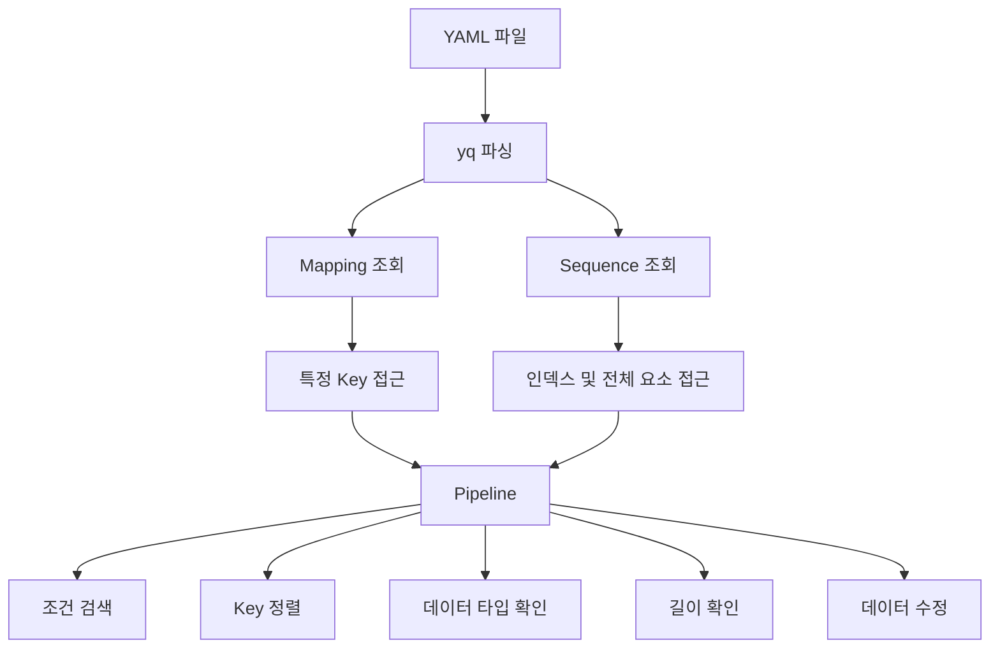

---

### yq의 기본 구조

yq는 YAML 파일을 입력받고, 지정한 표현식을 평가하여 결과를 출력한다.

기본적인 명령어 구조는 다음과 같다.

```bash
yq '표현식' 파일명
```

예를 들어 다음과 같은 명령어가 있다.

```bash
yq '.name' person.yaml
```

각 요소의 의미는 다음과 같다.

| 요소 | 설명 |
|---|---|
| `yq` | YAML 데이터를 처리하는 CLI 프로그램 |
| `.name` | 조회할 데이터 경로 |
| `person.yaml` | 입력으로 사용할 YAML 파일 |

여기서 `.name`과 같은 표현식을 **경로 표현식(Path Expression)** 이라고 이해할 수 있다.

YAML 데이터의 구조를 따라 원하는 값에 접근하는 방식이다.

#### eval 명령어

yq에서는 `eval` 명령어를 명시적으로 사용할 수도 있다.

```bash
yq eval '.name' person.yaml
```

`eval`은 지정한 표현식을 YAML 문서에 적용한다.

축약형인 `e`도 사용할 수 있다.

```bash
yq e '.name' person.yaml
```

yq v4.18.1부터는 `eval`이 기본 명령어로 처리되므로 생략할 수 있다.

```bash
yq '.name' person.yaml
```

따라서 다음 세 명령어는 동일한 목적으로 사용된다.

```bash
yq eval '.name' person.yaml
```

```bash
yq e '.name' person.yaml
```

```bash
yq '.name' person.yaml
```

이후에는 가장 간결한 세 번째 방식을 사용한다.

예제는 Mike Farah의 yq v4.19.1을 기준으로 설명하며, 다른 v4 버전에서도 기본적인 사용 방식은 유사하다.

---

### YAML 파싱을 위한 예제 파일 작성

먼저 사람에 대한 정보를 저장한 YAML 파일을 작성해보자.

이름과 나이뿐 아니라 좋아하는 것, 직업, 싫어하는 것에 대한 정보도 포함한다.

**person.yaml**

```yaml
name: 길동
age: 30

favorite:
  food: Steak
  musician: The Weeknd

jobs:
  - title: artist
    experience: 10

  - title: teacher
    experience: 4

dislikes:
  - talk
  - travel
  - smoking
```

이 YAML에는 여러 데이터 구조가 함께 사용되고 있다.

각 필드의 의미는 다음과 같다.

| 필드 | 값 | 데이터 구조 |
|---|---|---|
| `name` | 길동 | Scalar |
| `age` | 30 | Scalar |
| `favorite` | 좋아하는 것 | Mapping |
| `favorite.food` | Steak | Scalar |
| `favorite.musician` | The Weeknd | Scalar |
| `jobs` | 직업 목록 | Sequence |
| `jobs[0]` | artist, 10 | Mapping |
| `jobs[1]` | teacher, 4 | Mapping |
| `dislikes` | 싫어하는 것 목록 | Sequence |

전체 데이터 구조를 표현하면 다음과 같다.

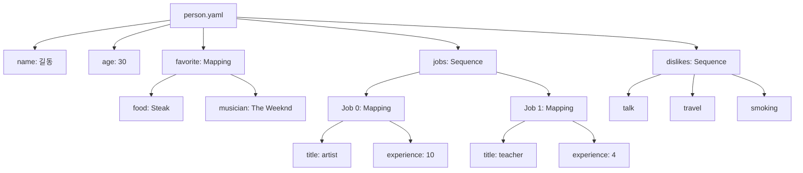

이제 yq를 사용하여 해당 데이터를 다양한 방식으로 조회해보자.

---

### 전체 YAML 데이터 조회하기

가장 먼저 전체 YAML을 조회하는 방법이다.

```bash
yq '.' person.yaml
```

출력:

```yaml
name: 길동
age: 30
favorite:
  food: Steak
  musician: The Weeknd
jobs:
  - title: artist
    experience: 10
  - title: teacher
    experience: 4
dislikes:
  - talk
  - travel
  - smoking
```

여기서 사용한 표현식은 점 하나이다.

```text
.
```

yq에서 `.`은 **현재 입력 데이터 전체를 의미한다.**

YAML 문서 전체를 대상으로 실행했다면 최상위 문서가 선택된다.

따라서 파일의 전체 내용이 출력된다.

이는 단순히 파일 내용을 문자열로 출력하는 것과는 차이가 있다.

yq는 YAML을 파싱하여 Mapping, Sequence, Scalar 구조를 해석한 후 다시 출력한다.

이 때문에 정상적으로 파싱할 수 없는 YAML이 입력되면 오류가 발생할 수 있다.

#### 전체 조회 명령어 비교

다음 명령어도 동일하게 사용할 수 있다.

```bash
yq eval '.' person.yaml
```

```bash
yq e '.' person.yaml
```

```bash
yq '.' person.yaml
```

또한 다음처럼 파일명만 전달하여 전체 내용을 조회할 수도 있다.

```bash
yq person.yaml
```

다만 명령어의 목적을 명확하게 표현하려면 `.`을 지정하는 방식이 이해하기 쉽다.

---

### 특정 Key의 Value 조회하기

이번에는 YAML 전체가 아니라 특정 값만 조회해보자.

예를 들어 나이만 확인하고 싶다고 가정하자.

YAML에는 다음과 같이 정의되어 있다.

```yaml
age: 30
```

이 값을 조회하려면 다음 명령어를 실행한다.

```bash
yq '.age' person.yaml
```

출력:

```text
30
```

이 명령어는 다음과 같이 동작한다.


즉 `.age`는 최상위 Mapping에서 `age`라는 Key를 선택한다는 의미이다.

이름도 같은 방식으로 조회할 수 있다.

```bash
yq '.name' person.yaml
```

출력:

```text
길동
```

이러한 방식은 YAML의 Key-Value 구조에 접근하는 가장 기본적인 방법이다.

---

### 중첩된 Mapping 조회하기

이번에는 Mapping 안에 또 다른 Mapping이 있는 경우를 살펴보자.

예제 파일에는 다음과 같은 데이터가 존재한다.

```yaml
favorite:
  food: Steak
  musician: The Weeknd
```

여기서 `favorite`는 Mapping이다.

그 안에는 `food`와 `musician`이라는 Key가 존재한다.

#### favorite 전체 조회

```bash
yq '.favorite' person.yaml
```

출력:

```yaml
food: Steak
musician: The Weeknd
```

이 명령어는 `favorite` Mapping 전체를 조회한다.

#### favorite.food 조회

좋아하는 음식만 확인하려면 다음과 같이 작성한다.

```bash
yq '.favorite.food' person.yaml
```

출력:

```text
Steak
```

#### favorite.musician 조회

```bash
yq '.favorite.musician' person.yaml
```

출력:

```text
The Weeknd
```

이처럼 중첩된 Mapping에 접근할 때는 점(`.`)으로 경로를 연결한다.

```text
.favorite.food
```

각 부분의 의미는 다음과 같다.

| 표현식 | 의미 |
|---|---|
| `.` | 최상위 데이터 |
| `.favorite` | favorite Mapping 선택 |
| `.favorite.food` | favorite 내부의 food 선택 |

이를 계층 구조로 표현하면 다음과 같다.

```text
Root
 │
 └── favorite
       │
       ├── food: Steak
       │
       └── musician: The Weeknd
```

중첩 수준이 증가하더라도 동일한 원리를 사용할 수 있다.

예를 들어 다음과 같은 설정이 있다면,

```yaml
application:
  server:
    connection:
      timeout: 30
```

다음 명령어로 접근할 수 있다.

```bash
yq '.application.server.connection.timeout' application.yaml
```

이처럼 yq는 Mapping의 계층 구조를 따라 원하는 데이터를 조회할 수 있다.

---

### Sequence 데이터 조회하기

이번에는 Sequence를 조회해보자.

예제 YAML에는 다음과 같은 직업 목록이 있다.

```yaml
jobs:
  - title: artist
    experience: 10

  - title: teacher
    experience: 4
```

`jobs`는 Sequence이다.

각 요소는 `title`과 `experience`라는 Key를 가진 Mapping이다.

먼저 전체 직업 목록을 조회해보자.

```bash
yq '.jobs' person.yaml
```

출력:

```yaml
- title: artist
  experience: 10
- title: teacher
  experience: 4
```

이 결과에서 하이픈(`-`)은 Sequence의 요소를 나타낸다.

각 요소는 하나의 Mapping이므로 `title`과 `experience`가 함께 포함되어 있다.

```text
jobs
 │
 ├── [0]
 │    ├── title: artist
 │    └── experience: 10
 │
 └── [1]
      ├── title: teacher
      └── experience: 4
```

이처럼 Sequence 안에 Mapping이 포함된 구조는 Kubernetes Manifest에서도 자주 사용된다.

---

### Sequence의 특정 인덱스 조회하기

Sequence는 순서가 있는 데이터 구조이므로 인덱스를 이용하여 특정 요소에 접근할 수 있다.

인덱스는 0부터 시작한다.

현재 `jobs`에는 두 개의 요소가 있다.

| 인덱스 | title | experience |
|---|---|---:|
| 0 | artist | 10 |
| 1 | teacher | 4 |

#### 첫 번째 직업 조회

```bash
yq '.jobs[0]' person.yaml
```

출력:

```yaml
title: artist
experience: 10
```

`[0]`은 Sequence의 첫 번째 요소를 의미한다.

#### 두 번째 직업 조회

```bash
yq '.jobs[1]' person.yaml
```

출력:

```yaml
title: teacher
experience: 4
```

#### 첫 번째 직업의 title 조회

```bash
yq '.jobs[0].title' person.yaml
```

출력:

```text
artist
```

#### 두 번째 직업의 experience 조회

```bash
yq '.jobs[1].experience' person.yaml
```

출력:

```text
4
```

이 명령어는 다음 과정을 거친다.

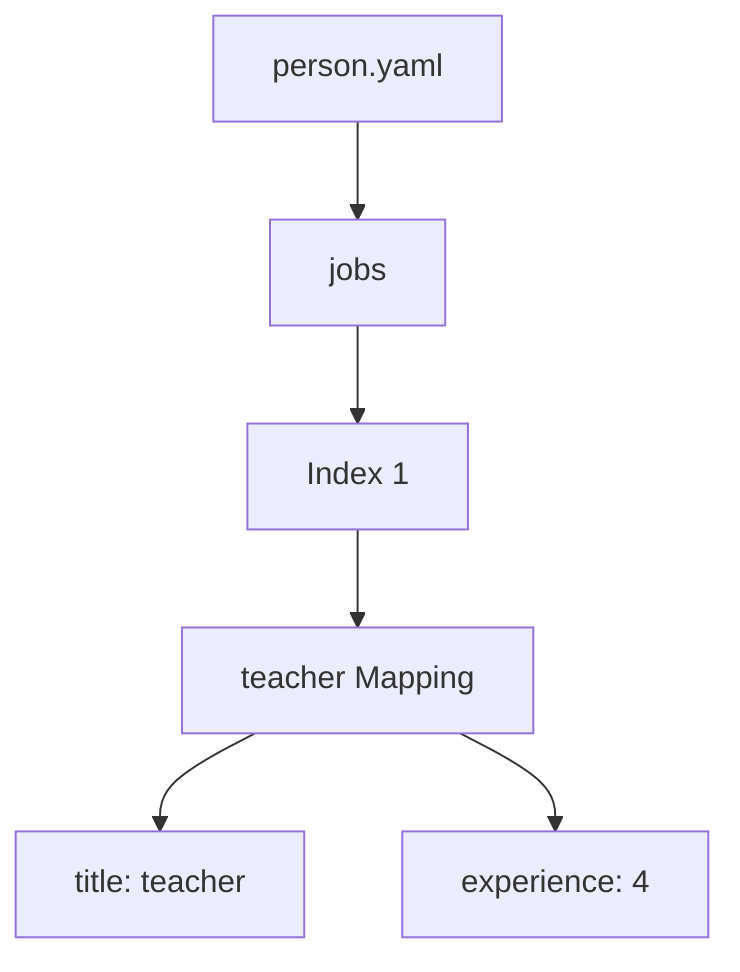

`Mapping → Sequence → Mapping` 구조를 이해하면 이러한 표현식을 쉽게 해석할 수 있다.

---

### Sequence의 모든 요소 조회하기

특정 인덱스만 선택하는 것이 아니라 모든 요소를 개별적으로 조회할 수도 있다.

이때 사용하는 표현식은 빈 대괄호이다.

```text
[]
```

예를 들어 다음 명령어를 실행한다.

```bash
yq '.jobs[]' person.yaml
```

이 명령어는 `jobs` Sequence의 모든 요소를 각각 선택한다.

개념적으로 다음과 같은 데이터가 순서대로 출력된다.

```yaml
title: artist
experience: 10
```

```yaml
title: teacher
experience: 4
```

실제 yq 출력에서는 여러 결과를 구분하기 위해 `---`가 표시될 수 있다.

여기서 중요한 점이 있다.

**`[]`는 단순히 YAML의 들여쓰기를 제거하는 기능이 아니다.**

`[]`의 실제 역할은 Sequence를 순회하면서 각 요소를 개별적으로 선택하는 것이다.

따라서 다음 두 표현식의 의미는 다르다.

| 표현식 | 의미 |
|---|---|
| `.jobs` | jobs Sequence 자체를 선택 |
| `.jobs[]` | jobs Sequence의 모든 요소를 개별적으로 선택 |

이를 Mermaid로 표현하면 다음과 같다.

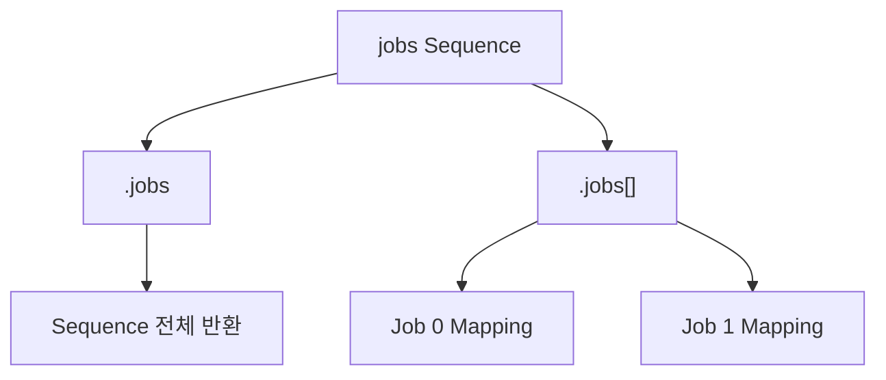

이 차이를 이해하는 것이 중요하다.

이후 조건 검색이나 특정 필드 추출에서는 `[]`를 자주 사용하기 때문이다.

---

### 모든 직업의 title 조회하기

이번에는 모든 직업의 이름만 조회해보자.

현재 YAML에는 다음 데이터가 존재한다.

```yaml
jobs:
  - title: artist
    experience: 10

  - title: teacher
    experience: 4
```

다음 명령어를 실행한다.

```bash
yq '.jobs[].title' person.yaml
```

출력:

```text
artist
teacher
```

이 표현식은 다음 순서로 해석된다.

```text
.jobs
   ↓
jobs Sequence 선택

[]
   ↓
모든 요소 순회

.title
   ↓
각 Mapping에서 title 추출
```

즉 모든 직업을 순회하면서 `title`이라는 Key의 값만 출력하는 것이다.

경력도 같은 방식으로 조회할 수 있다.

```bash
yq '.jobs[].experience' person.yaml
```

출력:

```text
10
4
```

이러한 방식은 여러 객체에서 공통된 필드만 추출할 때 유용하다.

예를 들어 Kubernetes Deployment의 모든 컨테이너 이미지도 다음과 같은 구조로 조회할 수 있다.

```bash
yq '.spec.template.spec.containers[].image' deployment.yaml
```

---

### Scalar Sequence 조회하기

Sequence가 반드시 Mapping을 포함해야 하는 것은 아니다.

문자열이나 숫자처럼 Scalar 값만 포함할 수도 있다.

다음 데이터를 살펴보자.

```yaml
dislikes:
  - talk
  - travel
  - smoking
```

`dislikes`는 문자열을 요소로 가지는 Sequence이다.

전체 목록을 조회한다.

```bash
yq '.dislikes' person.yaml
```

출력:

```yaml
- talk
- travel
- smoking
```

각 요소를 개별적으로 조회하려면 다음과 같이 작성한다.

```bash
yq '.dislikes[]' person.yaml
```

출력:

```text
talk
travel
smoking
```

여기서도 `[]`는 Sequence의 모든 요소를 선택한다.

특정 인덱스로 접근할 수도 있다.

```bash
yq '.dislikes[0]' person.yaml
```

출력:

```text
talk
```

```bash
yq '.dislikes[1]' person.yaml
```

출력:

```text
travel
```

```bash
yq '.dislikes[2]' person.yaml
```

출력:

```text
smoking
```

여기까지 이해했다면 Mapping과 Sequence에 접근하는 기본적인 방법을 익힌 것이다.

이제 조회된 데이터를 다시 가공하는 방법을 살펴보자.

---

### Pipeline이란?

yq에서는 파이프(`|`)를 사용하여 여러 표현식을 연결할 수 있다.

Pipeline은 앞의 표현식에서 선택된 데이터를 다음 표현식으로 전달하는 구조이다.

예를 들어 다음 명령어를 살펴보자.

```bash
yq '.jobs[] | .title' person.yaml
```

이 명령어는 두 단계로 나누어 이해할 수 있다.

첫 번째 단계는 모든 직업을 선택하는 것이다.

```text
.jobs[]
```

두 번째 단계는 각 직업의 `title`을 선택하는 것이다.

```text
.title
```

두 표현식을 파이프로 연결한다.

```text
.jobs[] | .title
```

실행 흐름은 다음과 같다.


실행 결과:

```text
artist
teacher
```

앞에서 사용한 다음 표현식과 동일한 값을 조회한다.

```bash
yq '.jobs[].title' person.yaml
```

즉 다음 두 방식은 동일한 목적에 사용할 수 있다.

```bash
yq '.jobs[].title' person.yaml
```

```bash
yq '.jobs[] | .title' person.yaml
```

다만 Pipeline을 사용하면 표현식을 단계별로 나누어 작성할 수 있다.

따라서 복잡한 조건 검색이나 데이터 변환을 수행할 때 활용도가 높다.

---

### yq Pipeline과 Linux Shell Pipeline의 차이

여기서 파이프(`|`)를 정확하게 구분할 필요가 있다.

Linux에서도 파이프를 사용한다.

예를 들어 다음과 같다.

```bash
cat person.yaml | yq '.name'
```

이 경우 파이프는 Shell에서 동작한다.

`cat` 명령어의 표준 출력을 yq의 표준 입력으로 전달한다.

반면 다음 명령어에서는 yq 표현식 내부의 파이프가 사용된다.

```bash
yq '.jobs[] | .title' person.yaml
```

이 경우 파이프는 yq 내부에서 동작한다.

`jobs`의 요소를 선택한 결과가 `.title` 표현식으로 전달된다.

| 구분 | Shell Pipeline | yq Pipeline |
|---|---|---|
| 사용 위치 | Shell 명령어 사이 | yq 표현식 내부 |
| 연결 대상 | 프로세스의 표준 출력과 입력 | yq 표현식의 평가 결과 |
| 데이터 처리 | 바이트 스트림 중심 | YAML 노드 중심 |
| 예시 | `cat file.yaml \| yq '.'` | `.jobs[] \| .title` |

두 방식을 함께 사용할 수도 있다.

```bash
cat person.yaml | yq '.jobs[] | .title'
```

여기서는 외부 Shell Pipeline과 yq 내부 Pipeline을 함께 사용한다.

이처럼 파이프의 위치에 따라 역할이 달라진다.

---

### select를 이용한 조건 검색

지금까지는 특정 Key나 Sequence를 조회하는 방법을 살펴보았다.

하지만 실제 데이터를 처리하다 보면 전체 데이터를 조회하는 것이 아니라 특정 조건을 만족하는 값만 검색해야 하는 상황이 발생한다.

예를 들어 다음 목록이 있다고 가정하자.

```yaml
dislikes:
  - talk
  - travel
  - smoking
```

여기서 `t`로 시작하는 값만 조회하고 싶다고 해보자.

원하는 결과는 다음과 같다.

```text
talk
travel
```

이러한 작업에 사용하는 연산자가 `select`이다.

`select`는 조건식을 평가하여 **조건을 만족하는 데이터만 선택하는 필터링 연산자**이다.

기본적인 형태는 다음과 같다.

```text
select(조건식)
```

예를 들어 다음처럼 사용할 수 있다.

```bash
yq '.dislikes[] | select(. == "talk")' person.yaml
```

출력:

```text
talk
```

이 명령어는 다음과 같이 동작한다.

1. `dislikes` Sequence의 모든 요소를 조회한다.
2. 각 요소가 `"talk"`와 같은지 비교한다.
3. 조건이 참인 요소만 출력한다.

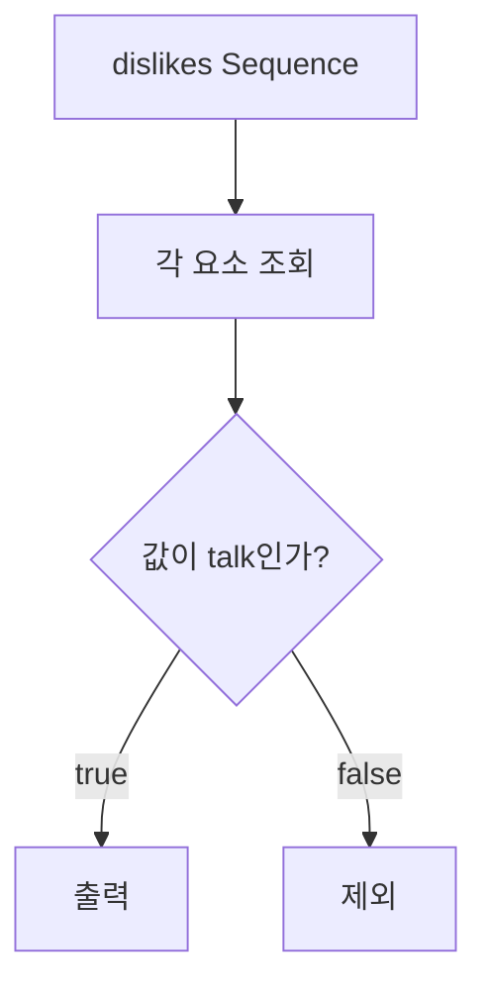

이제 문자열의 시작 패턴을 기준으로 검색해보자.

---

### 특정 문자로 시작하는 값 검색하기

`t`로 시작하는 문자열만 조회하려면 정규표현식과 `select`를 조합할 수 있다.

```bash
yq '.dislikes[] | select(test("^t"))' person.yaml
```

출력:

```text
talk
travel
```

여기서 사용하는 `test()`는 문자열이 지정한 정규표현식에 일치하는지 검사하는 연산자이다.

```text
test("^t")
```

정규표현식에서 `^`는 문자열의 시작을 의미한다.

따라서 `^t`는 다음 조건을 나타낸다.

> 문자열이 t로 시작하는가?

각 요소에 대한 검사 결과는 다음과 같다.

| 값 | `test("^t")` | 출력 여부 |
|---|---|---|
| talk | true | 출력 |
| travel | true | 출력 |
| smoking | false | 제외 |

전체 실행 과정을 표현하면 다음과 같다.

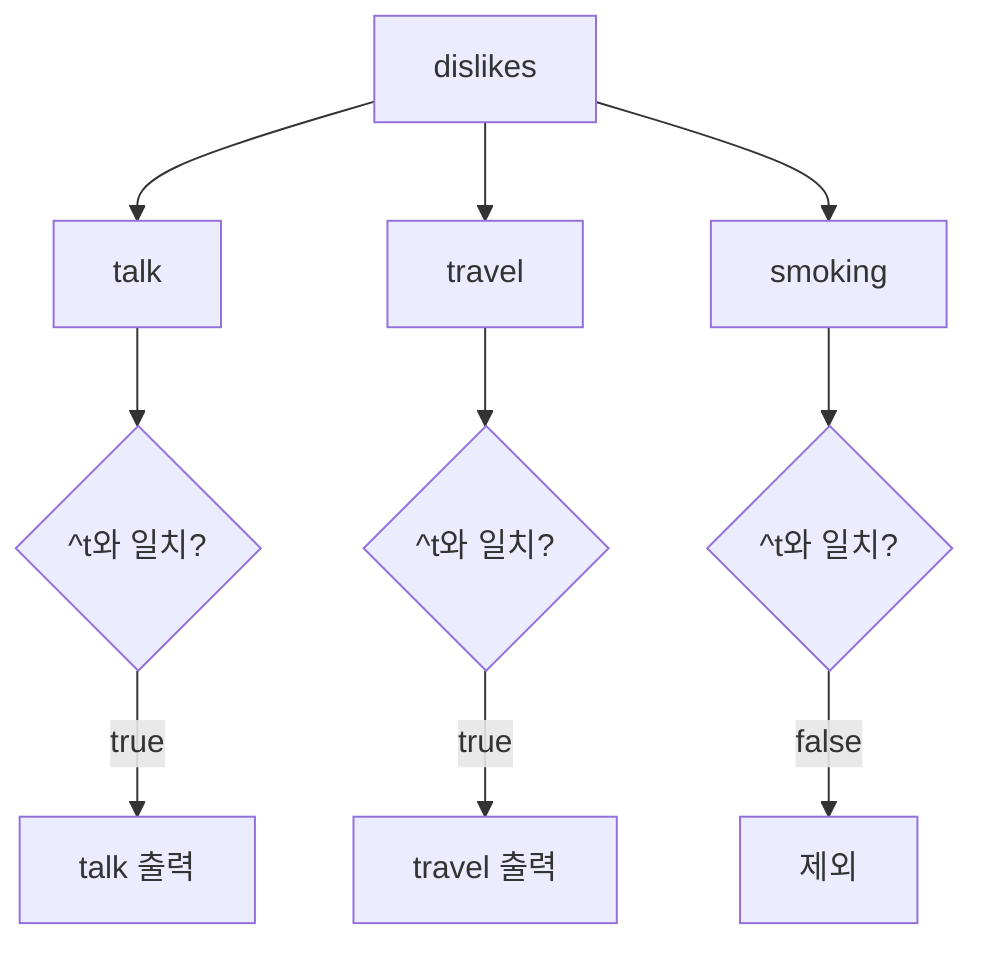

이 방식은 단순한 문자열 비교보다 복잡한 검색 조건에 사용할 수 있다.

---

### Wildcard를 이용한 접두어 검색

yq는 문자열 비교에서 Wildcard 패턴을 활용하는 방식도 지원한다.

예를 들어 다음과 같이 작성할 수 있다.

```bash
yq '.dislikes[] | select(. == "t*")' person.yaml
```

출력:

```text
talk
travel
```

여기서 `"t*"`는 `t`로 시작하는 문자열에 일치하는 패턴이다.

다만 Wildcard와 정규표현식은 서로 다른 개념이다.

| 방식 | 표현식 | 의미 |
|---|---|---|
| Wildcard | `"t*"` | t로 시작 |
| 정규표현식 | `"^t"` | t로 시작 |
| Wildcard | `"*ing"` | ing로 끝남 |
| 정규표현식 | `"ing$"` | ing로 끝남 |

복잡한 문자열 검색을 수행해야 한다면 정규표현식을 사용하는 `test()`가 더 유연하다.

반면 단순한 접두어와 접미어 검색에서는 Wildcard를 이용할 수도 있다.

---

### 특정 문자로 시작하지 않는 값 검색하기

이번에는 반대로 `t`로 시작하지 않는 값만 조회해보자.

현재 데이터는 다음과 같다.

```yaml
dislikes:
  - talk
  - travel
  - smoking
```

조건에 맞는 값은 `smoking`이다.

다음 명령어를 실행한다.

```bash
yq '.dislikes[] | select(test("^t") == false)' person.yaml
```

출력:

```text
smoking
```

여기서는 먼저 `test("^t")`를 평가한다.

그 결과가 `false`인 요소만 선택한다.

각 요소에 대한 판단은 다음과 같다.

| 값 | t로 시작하는가? | 최종 선택 |
|---|---|---|
| talk | true | 제외 |
| travel | true | 제외 |
| smoking | false | 선택 |

정규표현식은 다음과 같이 다양하게 활용할 수 있다.

| 표현식 | 의미 |
|---|---|
| `^t` | t로 시작 |
| `^s` | s로 시작 |
| `ing$` | ing로 끝남 |
| `^t.*l$` | t로 시작하고 l로 끝남 |
| `^[a-z]+$` | 소문자 알파벳으로만 구성 |
| `^[0-9]+$` | 숫자로만 구성 |

예를 들어 `ing`로 끝나는 값을 검색하려면 다음과 같이 작성한다.

```bash
yq '.dislikes[] | select(test("ing$"))' person.yaml
```

출력:

```text
smoking
```

이처럼 `select`와 `test`를 조합하면 문자열 패턴을 기반으로 데이터를 필터링할 수 있다.

---

### 여러 조건을 조합하여 검색하기

조건 검색은 문자열에만 적용되는 것이 아니다.

숫자나 Boolean 값을 기준으로도 데이터를 선택할 수 있다.

예제 YAML의 `jobs`를 살펴보자.

```yaml
jobs:
  - title: artist
    experience: 10

  - title: teacher
    experience: 4
```

여기서 경력이 5년 이상인 직업만 조회하고 싶다고 가정하자.

다음 명령어를 실행한다.

```bash
yq '.jobs[] | select(.experience >= 5)' person.yaml
```

출력:

```yaml
title: artist
experience: 10
```

현재 직업 정보는 다음과 같다.

| title | experience | 5년 이상 |
|---|---:|---|
| artist | 10 | true |
| teacher | 4 | false |

따라서 `artist`만 출력된다.

#### 경력이 5년 미만인 직업 조회

```bash
yq '.jobs[] | select(.experience < 5)' person.yaml
```

출력:

```yaml
title: teacher
experience: 4
```

#### 조건에 맞는 직업의 title만 조회

```bash
yq '.jobs[] | select(.experience >= 5) | .title' person.yaml
```

출력:

```text
artist
```

이 명령어는 다음 세 단계를 수행한다.


이처럼 yq의 Pipeline은 여러 연산자를 순서대로 적용할 수 있도록 한다.

---

### and와 or를 이용한 복합 조건

복잡한 검색에서는 여러 조건을 함께 검사해야 할 수 있다.

예를 들어 다음 두 조건을 모두 만족하는 직업을 조회한다고 가정하자.

- 경력이 5년 이상이다.
- 직업 이름이 artist이다.

다음과 같이 작성할 수 있다.

```bash
yq '.jobs[] | select(.experience >= 5 and .title == "artist")' person.yaml
```

출력:

```yaml
title: artist
experience: 10
```

여기서 `and`는 두 조건을 모두 만족해야 한다는 의미이다.

반대로 둘 중 하나만 만족하면 선택하고 싶다면 `or`를 사용할 수 있다.

```bash
yq '.jobs[] | select(.experience >= 5 or .title == "teacher")' person.yaml
```

이 경우 두 직업이 모두 조건을 만족한다.

| title | experience | 조건 만족 이유 |
|---|---:|---|
| artist | 10 | 경력이 5년 이상 |
| teacher | 4 | title이 teacher |

따라서 두 Mapping이 모두 출력된다.

조건 검색에 사용하는 주요 연산자는 다음과 같다.

| 연산자 | 의미 |
|---|---|
| `==` | 같다 |
| `!=` | 다르다 |
| `>` | 크다 |
| `<` | 작다 |
| `>=` | 크거나 같다 |
| `<=` | 작거나 같다 |
| `and` | 두 조건 모두 만족 |
| `or` | 두 조건 중 하나 이상 만족 |

이러한 연산자를 조합하면 복잡한 YAML 데이터에서도 원하는 항목을 추출할 수 있다.

---

### sort_keys를 이용한 Mapping 정렬

YAML은 사람이 이해하기 쉬운 순서로 Key를 작성할 수 있다.

하지만 여러 설정 파일을 비교하거나 일정한 형태로 정리해야 할 때는 Key를 정렬하고 싶을 수 있다.

예제 YAML의 최상위 Key는 다음 순서로 작성되어 있다.

```text
name
age
favorite
jobs
dislikes
```

알파벳순으로 정렬되어 있지는 않다.

이러한 Mapping을 정렬할 때 사용하는 연산자가 `sort_keys`이다.

기본적인 사용법은 다음과 같다.

```bash
yq 'sort_keys(.)' person.yaml
```

`sort_keys(.)`는 최상위 Mapping의 Key를 정렬한다.

정렬 후 최상위 Key는 다음 순서가 된다.

```text
age
dislikes
favorite
jobs
name
```

예를 들어 출력은 다음과 같은 구조가 된다.

```yaml
age: 30

dislikes:
  - talk
  - travel
  - smoking

favorite:
  food: Steak
  musician: The Weeknd

jobs:
  - title: artist
    experience: 10

  - title: teacher
    experience: 4

name: 길동
```

여기서 중요한 점은 **`sort_keys(.)`가 최상위 Mapping의 Key를 정렬한다는 것**이다.

`jobs` 내부의 `title`, `experience` 순서까지 모두 정렬하는 것은 아니다.

---

### sort_keys와 Sequence 정렬의 차이

`sort_keys`라는 이름만 보면 모든 데이터를 정렬한다고 생각할 수 있다.

하지만 `sort_keys`는 Mapping의 Key를 정렬하는 연산자이다.

Sequence의 요소 순서를 변경하는 연산자가 아니다.

예를 들어 다음 데이터가 있다고 가정하자.

```yaml
numbers:
  - 30
  - 10
  - 20
```

여기에 `sort_keys`를 적용한다고 해서 다음처럼 숫자가 정렬되는 것은 아니다.

```yaml
numbers:
  - 10
  - 20
  - 30
```

Sequence의 값을 정렬하려면 `sort`나 `sort_by`와 같은 별도의 연산자를 사용해야 한다.

```bash
yq '.numbers | sort' numbers.yaml
```

출력:

```yaml
- 10
- 20
- 30
```

두 연산자의 차이를 정리하면 다음과 같다.

| 연산자 | 정렬 대상 |
|---|---|
| `sort_keys` | Mapping의 Key |
| `sort` | Sequence의 값 |
| `sort_by` | 지정한 기준에 따른 Sequence 요소 |

따라서 Mapping 정렬과 Sequence 정렬을 구분해야 한다.

---

### 중첩된 Mapping의 Key 정렬하기

이번에는 최상위 Mapping뿐 아니라 중첩된 Mapping까지 정렬해보자.

현재 `jobs`의 첫 번째 요소는 다음과 같다.

```yaml
- title: artist
  experience: 10
```

알파벳순으로 Key를 정렬하면 다음과 같다.

```yaml
- experience: 10
  title: artist
```

이처럼 중첩된 모든 Mapping의 Key를 정렬하고 싶다면 다음 표현식을 사용할 수 있다.

```bash
yq 'sort_keys(..)' person.yaml
```

여기서 `..`는 재귀적으로 하위 노드에 접근하는 표현식이다.

`sort_keys(..)`는 YAML 구조를 탐색하면서 Mapping에 해당하는 노드들의 Key를 정렬한다.

정렬 결과는 다음과 같은 형태가 된다.

```yaml
age: 30

dislikes:
  - talk
  - travel
  - smoking

favorite:
  food: Steak
  musician: The Weeknd

jobs:
  - experience: 10
    title: artist

  - experience: 4
    title: teacher

name: 길동
```

여기서 확인해야 할 부분은 다음과 같다.

첫째, 최상위 Key가 정렬되었다.

둘째, `jobs`에 포함된 Mapping의 Key도 정렬되었다.

셋째, `jobs` Sequence의 요소 순서는 변경되지 않았다.

즉 `artist`가 첫 번째 직업이고 `teacher`가 두 번째 직업이라는 사실은 그대로 유지된다.

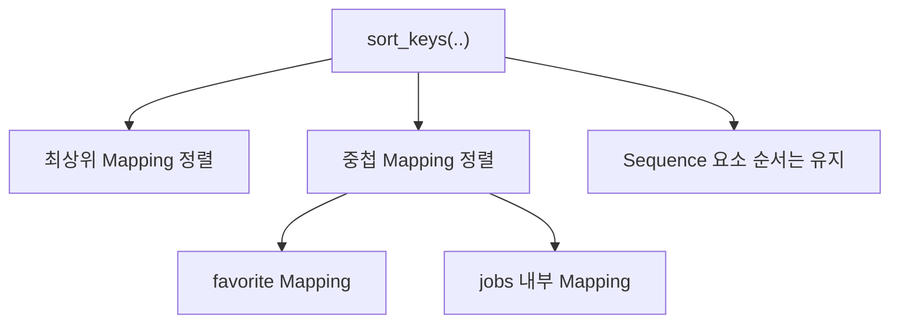

이 기능은 여러 YAML 파일의 Key 순서를 통일하거나 설정 변경 사항을 비교할 때 유용하다.

다만 Anchor와 Alias를 사용하는 복잡한 YAML에서는 정렬 과정이 참조 관계에 영향을 줄 수 있으므로 주의해야 한다.

---

### Pipeline과 sort_keys 조합하기

yq에서는 `sort_keys`도 Pipeline으로 연결할 수 있다.

예를 들어 다음 명령어를 살펴보자.

```bash
yq 'sort_keys(.) | .jobs[] | sort_keys(.)' person.yaml
```

이 명령어는 다음과 같이 동작한다.

1. 최상위 Mapping의 Key를 정렬한다.
2. `jobs` Sequence의 각 요소를 선택한다.
3. 각 직업 Mapping의 Key를 정렬한다.
4. 정렬된 직업 정보를 출력한다.

출력되는 데이터는 다음과 같은 구조이다.

```yaml
experience: 10
title: artist
```

```yaml
experience: 4
title: teacher
```

여기서 주의할 점은 Pipeline의 중간에서 `.jobs[]`를 사용했다는 것이다.

따라서 출력 대상은 YAML 전체가 아니라 직업 Mapping들이다.

전체 YAML의 Mapping을 재귀적으로 정렬하려면 앞에서 살펴본 다음 명령어가 더 간결하다.

```bash
yq 'sort_keys(..)' person.yaml
```

**Pipeline은 표현식을 연결하는 도구이며, 중간에 어떤 데이터를 선택하느냐에 따라 최종 출력 범위가 달라진다.**

이 점을 이해하는 것이 중요하다.

---

### tag를 이용한 데이터 타입 확인

YAML은 문자열, 숫자, Boolean, Null, Mapping, Sequence 등 여러 데이터 타입을 표현할 수 있다.

그런데 실제 설정 파일을 처리할 때 값이 의도한 데이터 타입으로 해석되는지 확인해야 하는 경우가 있다.

예를 들어 다음 데이터를 살펴보자.

```yaml
age: 30
```

여기서 `30`은 정수이다.

반면 다음 데이터는 문자열이다.

```yaml
age: "30"
```

사람이 읽으면 두 값이 비슷하게 보이지만 실제 데이터 타입은 다르다.

이러한 차이를 확인할 때 사용하는 연산자가 `tag`이다.

#### age의 데이터 타입 조회

```bash
yq '.age | tag' person.yaml
```

출력:

```text
!!int
```

`!!int`는 정수 타입을 의미한다.

#### name의 데이터 타입 조회

```bash
yq '.name | tag' person.yaml
```

출력:

```text
!!str
```

`!!str`은 문자열 타입이다.

#### favorite의 데이터 타입 조회

```bash
yq '.favorite | tag' person.yaml
```

출력:

```text
!!map
```

`favorite`는 Mapping이므로 `!!map`이 반환된다.

#### jobs의 데이터 타입 조회

```bash
yq '.jobs | tag' person.yaml
```

출력:

```text
!!seq
```

`jobs`는 Sequence이므로 `!!seq`가 반환된다.

주요 타입 태그는 다음과 같다.

| 태그 | 의미 |
|---|---|
| `!!str` | 문자열 |
| `!!int` | 정수 |
| `!!float` | 실수 |
| `!!bool` | Boolean |
| `!!null` | Null |
| `!!map` | Mapping |
| `!!seq` | Sequence |

이처럼 `tag`를 사용하면 YAML 데이터를 읽는 과정에서 어떤 타입으로 해석되었는지 확인할 수 있다.

---

### tag를 이용한 타입 검증

단순히 타입을 출력하는 것뿐 아니라 특정 타입과 일치하는지 검사할 수도 있다.

예를 들어 `age`는 반드시 정수여야 한다고 가정하자.

다음 명령어를 실행한다.

```bash
yq '.age | tag == "!!int"' person.yaml
```

출력:

```text
true
```

현재 `age`는 정수이므로 조건을 만족한다.

반대로 문자열인지 검사해보자.

```bash
yq '.age | tag == "!!str"' person.yaml
```

출력:

```text
false
```

현재 `age`는 문자열이 아니므로 `false`가 출력된다.

이러한 검사를 통해 YAML 설정값의 타입을 검증할 수 있다.

#### 문자열로 잘못 입력한 경우

다음처럼 YAML을 변경했다고 가정하자.

```yaml
age: "30"
```

이 경우 다음 명령어를 실행하면,

```bash
yq '.age | tag' person.yaml
```

출력:

```text
!!str
```

정수가 아니라 문자열로 해석된다.

따라서 다음 타입 검사는 실패한다.

```bash
yq '.age | tag == "!!int"' person.yaml
```

출력:

```text
false
```

이처럼 `tag`는 데이터 유효성 검사에서 활용할 수 있다.

---

### 타입 검증을 Shell Script에 적용하기

실제 자동화 작업에서는 단순히 `true`나 `false`를 출력하는 것보다 조건에 따라 작업을 중단해야 할 수 있다.

예를 들어 `age`가 정수가 아니면 오류를 반환하도록 만들 수 있다.

```bash
if yq -e '.age | tag == "!!int"' person.yaml > /dev/null; then
    echo "올바른 정수 값입니다."
else
    echo "age는 정수여야 합니다."
    exit 1
fi
```

여기서 `-e` 옵션은 평가 결과에 따라 종료 상태를 판단하도록 한다.

조건이 참이면 정상적으로 진행한다.

조건이 거짓이면 오류 메시지를 출력하고 스크립트를 종료한다.

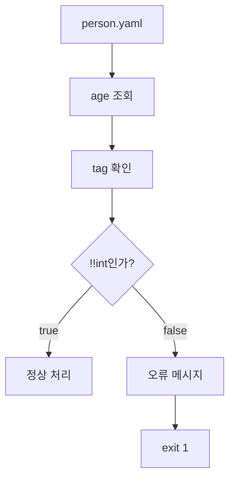

이 방식은 다음과 같은 상황에서 활용할 수 있다.

- 정수 설정값 검증
- Boolean 설정값 검증
- 필수 Mapping 구조 검증
- Sequence 타입 검증
- CI/CD 환경의 배포 설정 사전 검사

다만 실제 서비스에서는 타입만 맞는다고 유효한 데이터가 되는 것은 아니다.

예를 들어 `age: -100`은 정수이지만 비즈니스 규칙상 허용되지 않을 수 있다.

따라서 타입 검증과 값의 범위 검증을 함께 적용해야 한다.

---

### length를 이용한 데이터 길이 확인

yq에서는 `length`를 사용하여 데이터의 길이를 확인할 수 있다.

다만 `length`는 데이터 타입에 따라 의미가 달라진다.

대표적으로 다음과 같다.

| 데이터 타입 | length의 의미 |
|---|---|
| String | 문자열의 길이 |
| Sequence | 요소 개수 |
| Mapping | Key-Value 항목 개수 |
| Null | 0 |

이를 실제 예제로 확인해보자.

---

### 문자열의 길이 확인하기

먼저 이름의 길이를 확인해보자.

```yaml
name: 길동
```

다음 명령어를 실행한다.

```bash
yq '.name | length' person.yaml
```

**yq v4.19.1에서는 다음과 같이 출력된다.**

```text
6
```

그런데 `길동`은 사람이 보기에는 두 글자이다.

왜 6이 출력될까?

이는 yq v4.19.1의 문자열 길이 계산 방식과 관련이 있다.

해당 버전의 `length` 구현은 문자열에 대해 Go의 `len()`을 사용한다.

Go에서 문자열의 `len()`은 UTF-8 인코딩된 바이트 수를 반환한다.

한글의 완성형 음절은 일반적으로 UTF-8에서 3바이트를 사용한다.

따라서 다음과 같이 계산된다.

```text
길 → 3바이트
동 → 3바이트

총 6바이트
```

반면 다음 영문 문자열을 생각해보자.

```yaml
name: Gildong
```

이 경우 다음 명령어를 실행하면,

```bash
yq '.name | length' person.yaml
```

출력:

```text
7
```

영문 알파벳 7개가 각각 1바이트로 표현되기 때문이다.

따라서 **yq의 문자열 `length`를 항상 사람이 인식하는 글자 수라고 생각해서는 안 된다.**

특히 한글, 특수문자, 이모지 등이 포함된 문자열에서는 바이트 길이와 실제 글자 수가 다를 수 있다.

이 점은 입력값의 최대 길이를 검증할 때 중요하다.

#### Linux에서 바이트 수와 문자 수 비교하기

Linux에서는 다음과 같이 비교할 수 있다.

```bash
printf '길동' | wc -c
```

출력:

```text
6
```

`wc -c`는 바이트 수를 계산한다.

반면 UTF-8 로케일 환경에서 다음 명령어를 실행하면,

```bash
printf '길동' | wc -m
```

출력:

```text
2
```

`wc -m`은 문자 수를 계산한다.

따라서 입력값 검증에서는 바이트 수를 제한하려는 것인지, 문자 수를 제한하려는 것인지 명확하게 정의해야 한다.

---

### Sequence의 길이 확인하기

이번에는 Sequence의 길이를 확인해보자.

현재 YAML에는 다음과 같은 데이터가 있다.

```yaml
dislikes:
  - talk
  - travel
  - smoking
```

다음 명령어를 실행한다.

```bash
yq '.dislikes | length' person.yaml
```

출력:

```text
3
```

Sequence에 세 개의 요소가 존재하기 때문이다.

`jobs`도 확인해보자.

```bash
yq '.jobs | length' person.yaml
```

출력:

```text
2
```

현재 직업이 두 개이므로 2가 반환된다.

이처럼 Sequence의 `length`는 문자열의 길이가 아니라 요소의 개수를 나타낸다.

---

### Sequence 내부의 모든 문자열 길이 확인하기

이번에는 `dislikes`의 각 요소에 대한 길이를 확인해보자.

먼저 다음 명령어를 실행한다.

```bash
yq '.dislikes[]' person.yaml
```

출력:

```text
talk
travel
smoking
```

각 문자열의 길이를 확인하려면 `length`를 연결하면 된다.

```bash
yq '.dislikes[] | length' person.yaml
```

출력:

```text
4
6
7
```

각 결과의 의미는 다음과 같다.

| 문자열 | 길이 |
|---|---:|
| talk | 4 |
| travel | 6 |
| smoking | 7 |

이 표현식은 다음과 같은 과정을 수행한다.

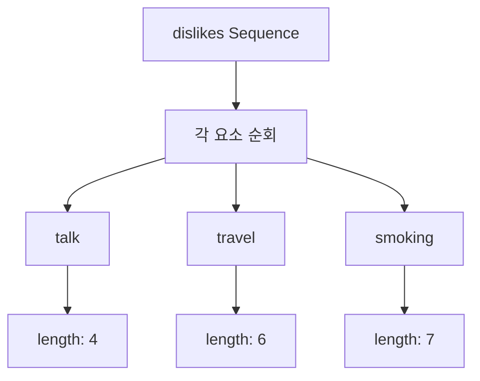

여기서 중요한 차이를 정리하면 다음과 같다.

```bash
yq '.dislikes | length' person.yaml
```

결과:

```text
3
```

반면 다음 명령어는,

```bash
yq '.dislikes[] | length' person.yaml
```

결과:

```text
4
6
7
```

첫 번째는 Sequence 전체의 요소 개수를 반환한다.

두 번째는 Sequence의 각 문자열에 대한 길이를 반환한다.

즉 `[]`를 사용하는 위치에 따라 `length`가 계산되는 대상이 달라진다.

---

### Mapping의 길이 확인하기

Mapping에서도 `length`를 사용할 수 있다.

예를 들어 다음 데이터를 살펴보자.

```yaml
favorite:
  food: Steak
  musician: The Weeknd
```

다음 명령어를 실행한다.

```bash
yq '.favorite | length' person.yaml
```

출력:

```text
2
```

`favorite`에는 두 개의 Key-Value 항목이 있기 때문이다.

최상위 Mapping의 길이도 확인할 수 있다.

```bash
yq '. | length' person.yaml
```

출력:

```text
5
```

현재 최상위 Key는 다음 다섯 개이다.

```text
name
age
favorite
jobs
dislikes
```

따라서 Mapping의 길이는 5이다.

이를 정리하면 다음과 같다.

| 표현식 | 대상 | 결과 |
|---|---|---:|
| `.name \| length` | 한글 문자열 | 6바이트 |
| `.age \| length` | 숫자 30의 텍스트 표현 | 2 |
| `.favorite \| length` | Mapping | 2 |
| `.jobs \| length` | Sequence | 2 |
| `.dislikes \| length` | Sequence | 3 |
| `.dislikes[] \| length` | 각 문자열 | 4, 6, 7 |
| `. \| length` | 최상위 Mapping | 5 |

숫자 Scalar에 `length`를 적용하면 yq의 값 표현을 기준으로 길이가 계산된다.

따라서 숫자의 자릿수 검증이나 범위 검증이 필요한 경우에는 `length`만 사용하는 것보다 타입과 값의 범위를 직접 검사하는 편이 명확하다.

---

### select와 length를 조합한 데이터 검증

`length`는 `select`와 함께 사용할 수도 있다.

예를 들어 싫어하는 것의 목록에서 문자열 길이가 5 이상인 값만 조회한다고 가정하자.

```bash
yq '.dislikes[] | select(length >= 5)' person.yaml
```

출력:

```text
travel
smoking
```

각 문자열의 길이는 다음과 같다.

| 값 | 길이 | 조건 만족 |
|---|---:|---|
| talk | 4 | false |
| travel | 6 | true |
| smoking | 7 | true |

따라서 `travel`과 `smoking`이 출력된다.

#### 길이가 5 미만인 값만 조회

```bash
yq '.dislikes[] | select(length < 5)' person.yaml
```

출력:

```text
talk
```

#### 영문 소문자 t로 시작하면서 길이가 5 이상인 값

```bash
yq '.dislikes[] | select(test("^t") and length >= 5)' person.yaml
```

출력:

```text
travel
```

이처럼 조건을 조합하면 문자열의 내용과 길이를 동시에 검사할 수 있다.

실무에서는 다음과 같은 상황에 활용할 수 있다.

- 특정 접두어로 시작하는 설정 조회
- 일정 길이 이상의 문자열 검색
- 비어 있는 문자열 검출
- 설정값의 형식 검사
- 필수 데이터의 길이 확인

다만 앞서 살펴본 것처럼 yq의 문자열 길이는 버전과 구현 방식에 따라 바이트 수를 기준으로 계산될 수 있으므로, 사용자에게 보이는 글자 수 검증에는 별도의 주의가 필요하다.

---

### 값을 변경하는 Assignment 연산자

지금까지는 YAML 데이터를 조회하고 조건에 따라 선택하는 방법을 살펴보았다.

이번에는 실제 값을 변경해보자.

예제 YAML에는 다음과 같은 값이 존재한다.

```yaml
age: 30
```

이를 45로 변경하고 싶다고 가정하자.

yq에서는 할당 연산자인 `=`을 사용할 수 있다.

```bash
yq '.age = 45' person.yaml
```

이 명령어는 `age`의 값을 45로 변경한 YAML을 출력한다.

결과는 다음과 같은 형태이다.

```yaml
name: 길동
age: 45

favorite:
  food: Steak
  musician: The Weeknd

jobs:
  - title: artist
    experience: 10

  - title: teacher
    experience: 4

dislikes:
  - talk
  - travel
  - smoking
```

여기서 중요한 점이 있다.

**이 명령어는 원본 YAML 파일을 직접 변경하지 않는다.**

변경된 결과를 표준 출력으로 보여주는 것이다.

---

### 표준 출력과 파일 수정의 차이

다음 명령어를 다시 살펴보자.

```bash
yq '.age = 45' person.yaml
```

이 명령어의 동작은 다음과 같다.

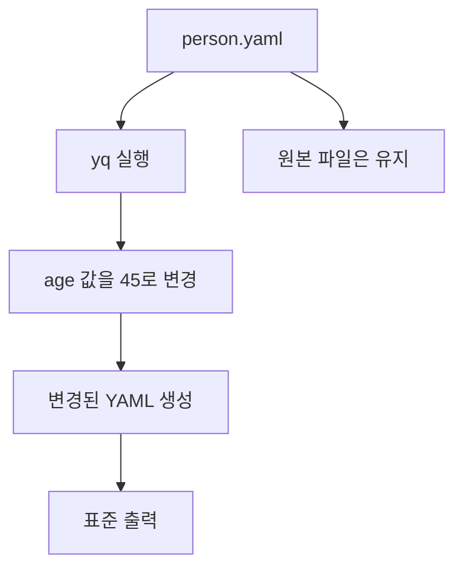

즉 yq는 파일을 읽고 변경된 데이터 구조를 생성한 후 출력한다.

원본 파일은 그대로 유지된다.

따라서 다음 명령어를 실행하면,

```bash
yq '.age' person.yaml
```

여전히 다음 값이 출력된다.

```text
30
```

이 차이는 yq를 처음 사용할 때 반드시 이해해야 하는 부분이다.

단순히 할당 연산자를 사용했다고 해서 원본 파일이 변경되는 것은 아니다.

---

### -i 옵션을 이용한 원본 파일 수정

원본 YAML 파일을 직접 변경하려면 `-i` 옵션을 사용한다.

`-i`는 `--inplace`의 축약형이다.

다음 명령어를 실행해보자.

```bash
yq -i '.age = 45' person.yaml
```

이 명령어는 `person.yaml` 파일의 `age` 값을 직접 변경한다.

수정이 완료되면 일반적인 경우 변경된 YAML 전체가 표준 출력으로 표시되지 않는다.

이제 다시 값을 조회해보자.

```bash
yq '.age' person.yaml
```

출력:

```text
45
```

실제 파일에 변경 사항이 반영되었다.

```mermaid
flowchart TD
    A["person.yaml"] --> B["yq -i 실행"]
    B --> C["age 값을 45로 변경"]
    C --> D["원본 YAML 파일 갱신"]

    D --> E["person.yaml"]
    E --> F["age: 45"]
```

두 방식의 차이를 정리하면 다음과 같다.

| 명령어 | 동작 |
|---|---|
| `yq '.age = 45' person.yaml` | 변경 결과만 출력 |
| `yq -i '.age = 45' person.yaml` | 원본 파일 직접 수정 |

실제 운영 환경에서는 `-i`를 사용하기 전에 변경 사항을 충분히 검증하는 것이 좋다.

---

### 원본 YAML을 안전하게 수정하는 방법

운영 설정 파일을 수정할 때는 기존 데이터를 보존할 수 있어야 한다.

따라서 다음과 같은 순서로 작업하는 것이 좋다.

#### 1. 원본 파일 백업

```bash
cp person.yaml person.backup.yaml
```

#### 2. 변경 결과 미리 확인

```bash
yq '.age = 45' person.yaml
```

이 단계에서는 실제 파일이 변경되지 않는다.

출력 결과가 의도한 형태인지 확인한다.

#### 3. 원본 파일 수정

```bash
yq -i '.age = 45' person.yaml
```

#### 4. 수정된 값 확인

```bash
yq '.age' person.yaml
```

출력:

```text
45
```

#### 5. 원본과 변경 파일 비교

```bash
diff -u person.backup.yaml person.yaml
```

변경 사항을 확인할 수 있다.

예상되는 핵심 차이는 다음과 같다.

```diff
-age: 30
+age: 45
```

YAML 파일을 Git으로 관리하고 있다면 다음 명령어도 사용할 수 있다.

```bash
git diff -- person.yaml
```

이렇게 하면 예상하지 못한 필드 변경이나 구조 변경을 확인할 수 있다.

---

### = 연산자와 |= 연산자의 차이

yq에서는 값을 변경할 때 `=`뿐 아니라 `|=`도 사용할 수 있다.

두 연산자는 비슷해 보이지만 오른쪽 표현식을 평가하는 기준에 차이가 있다.

#### = 연산자

`=`은 왼쪽에서 선택한 노드에 오른쪽 값을 할당한다.

예를 들어 다음과 같다.

```bash
yq '.age = 45' person.yaml
```

이 명령어는 `age` 값을 45로 변경한다.

#### |= 연산자

`|=`은 왼쪽에서 선택한 노드를 기준으로 오른쪽 표현식을 평가한다.

따라서 기존 값을 사용하여 새로운 값을 계산할 때 유용하다.

예를 들어 다음 명령어를 살펴보자.

```bash
yq '.age |= . + 1' person.yaml
```

현재 `age`가 30이라면 결과는 31이다.

```yaml
age: 31
```

여기서 `.`은 `|=`의 왼쪽에서 선택한 현재 값인 30을 의미한다.

따라서 다음과 같이 계산된다.

```text
기존 age = 30

30 + 1 = 31
```

반면 다음 명령어는 다른 의미를 가진다.

```bash
yq '.age = 31' person.yaml
```

기존 값과 관계없이 31이라는 값을 할당한다.

이를 정리하면 다음과 같다.

| 연산자 | 주요 목적 |
|---|---|
| `=` | 특정 값 할당 |
| `\|=` | 기존 값을 기준으로 계산하거나 변환 |

이 차이는 배열의 각 요소를 변경하거나 기존 문자열을 변환할 때 유용하다.

---

### Sequence 내부의 값 변경하기

예를 들어 첫 번째 직업의 경력을 변경한다고 가정하자.

현재 데이터는 다음과 같다.

```yaml
jobs:
  - title: artist
    experience: 10

  - title: teacher
    experience: 4
```

첫 번째 직업의 경력을 12로 변경하려면 다음과 같이 작성한다.

```bash
yq '.jobs[0].experience = 12' person.yaml
```

변경 결과에서 첫 번째 직업은 다음과 같이 나타난다.

```yaml
- title: artist
  experience: 12
```

원본 파일을 변경하려면 `-i`를 사용한다.

```bash
yq -i '.jobs[0].experience = 12' person.yaml
```

이처럼 Mapping과 Sequence가 중첩된 구조에서도 경로 표현식을 이용하여 특정 값을 변경할 수 있다.

---

### 특정 조건을 만족하는 Mapping의 값 수정하기

인덱스로 접근하는 방식에는 한 가지 단점이 있다.

Sequence의 요소 순서가 변경되면 다른 데이터를 수정할 수 있다는 점이다.

예를 들어 현재 첫 번째 직업이 `artist`이지만 이후 순서가 바뀔 수도 있다.

따라서 실제 운영에서는 인덱스보다 명시적인 Key를 기준으로 수정하는 것이 더 안전할 수 있다.

다음과 같이 작성할 수 있다.

```bash
yq '(.jobs[] | select(.title == "artist") | .experience) = 12' person.yaml
```

이 명령어는 다음 과정을 수행한다.

1. 모든 직업을 순회한다.
2. `title`이 `artist`인 Mapping을 선택한다.
3. 해당 Mapping의 `experience` 필드를 선택한다.
4. 값을 12로 변경한다.

```mermaid
flowchart TD
    A["jobs Sequence"] --> B["모든 직업 순회"]
    B --> C{"title == artist"}

    C -->|"true"| D["experience 선택"]
    C -->|"false"| E["변경하지 않음"]

    D --> F["12 할당"]
```

원본 파일을 수정하려면 다음과 같이 작성한다.

```bash
yq -i '(.jobs[] | select(.title == "artist") | .experience) = 12' person.yaml
```

이 방식은 Kubernetes의 여러 컨테이너 중 특정 이름의 컨테이너 이미지를 수정하는 작업에서도 활용할 수 있다.

---

### Kubernetes Manifest에서의 활용

지금까지 살펴본 기능은 Kubernetes 환경에서도 그대로 활용할 수 있다.

예를 들어 다음 Deployment Manifest가 있다고 가정하자.

**deployment.yaml**

```yaml
apiVersion: apps/v1
kind: Deployment

metadata:
  name: web-server

spec:
  replicas: 3

  selector:
    matchLabels:
      app: web-server

  template:
    metadata:
      labels:
        app: web-server

    spec:
      containers:
        - name: web
          image: nginx:1.27

          ports:
            - containerPort: 80

          resources:
            requests:
              cpu: "100m"
              memory: "128Mi"

            limits:
              cpu: "500m"
              memory: "256Mi"
```

이 Manifest에는 여러 Mapping과 Sequence가 중첩되어 있다.

앞서 살펴본 yq 표현식으로 필요한 값을 조회할 수 있다.

#### Deployment 이름 조회

```bash
yq '.metadata.name' deployment.yaml
```

출력:

```text
web-server
```

#### replicas 조회

```bash
yq '.spec.replicas' deployment.yaml
```

출력:

```text
3
```

#### 컨테이너 이미지 조회

```bash
yq '.spec.template.spec.containers[].image' deployment.yaml
```

출력:

```text
nginx:1.27
```

#### CPU requests 조회

```bash
yq '.spec.template.spec.containers[].resources.requests.cpu' deployment.yaml
```

출력:

```text
100m
```

#### Memory limits 조회

```bash
yq '.spec.template.spec.containers[].resources.limits.memory' deployment.yaml
```

출력:

```text
256Mi
```

이처럼 Kubernetes Manifest에서도 동일한 표현식을 사용할 수 있다.

---

### Kubernetes 컨테이너 이미지 변경하기

이번에는 Deployment의 컨테이너 이미지를 변경해보자.

현재 이미지는 다음과 같다.

```yaml
image: nginx:1.27
```

이를 `nginx:1.28`로 변경하고 싶다고 가정하자.

다음 명령어를 실행할 수 있다.

```bash
yq -i \
  '.spec.template.spec.containers[0].image = "nginx:1.28"' \
  deployment.yaml
```

이 명령어는 첫 번째 컨테이너의 이미지 값을 변경한다.

수정된 값을 확인한다.

```bash
yq '.spec.template.spec.containers[0].image' deployment.yaml
```

출력:

```text
nginx:1.28
```

다만 컨테이너가 여러 개 존재한다면 인덱스가 아니라 이름을 기준으로 수정하는 것이 더 안전할 수 있다.

```bash
yq -i \
  '(.spec.template.spec.containers[] | select(.name == "web") | .image) = "nginx:1.28"' \
  deployment.yaml
```

이 명령어는 `name`이 `web`인 컨테이너의 이미지 필드만 변경한다.

여기서 중요한 점이 있다.

**yq로 Deployment Manifest를 변경했다고 해서 Kubernetes 클러스터에 변경 사항이 자동으로 반영되는 것은 아니다.**

yq는 로컬 YAML 파일을 수정하는 도구이다.

변경된 설정을 Kubernetes에 적용하려면 별도의 작업이 필요하다.

```bash
kubectl apply -f deployment.yaml
```

전체 과정은 다음과 같다.

```mermaid
flowchart TD
    A["deployment.yaml"] --> B["yq로 이미지 변경"]
    B --> C["수정된 YAML"]
    C --> D["kubectl apply"]
    D --> E["Kubernetes API Server"]
    E --> F["Deployment 업데이트"]
    F --> G["새로운 Pod 배포"]
```

따라서 yq와 kubectl의 역할을 구분해야 한다.

| 도구 | 역할 |
|---|---|
| yq | YAML 데이터 조회 및 수정 |
| kubectl | Kubernetes API를 통한 리소스 생성 및 변경 |

실제 CI/CD 환경에서는 이러한 두 도구를 함께 사용하여 배포 자동화를 구현할 수 있다.

---

### 실제 Kubernetes 리소스를 yq로 조회하기

yq는 로컬 YAML 파일뿐 아니라 다른 명령어의 출력 결과도 처리할 수 있다.

예를 들어 Kubernetes에 배포된 Deployment의 설정을 조회한다고 가정하자.

```bash
kubectl get deployment web-server -o yaml
```

이 명령어는 클러스터에 저장된 Deployment 객체를 YAML로 출력한다.

여기에 yq를 연결하면 필요한 정보만 추출할 수 있다.

#### 현재 배포된 이미지 조회

```bash
kubectl get deployment web-server -o yaml |
  yq '.spec.template.spec.containers[].image'
```

#### 현재 replicas 조회

```bash
kubectl get deployment web-server -o yaml |
  yq '.spec.replicas'
```

#### 실제 Ready Replica 수량 조회

```bash
kubectl get deployment web-server -o yaml |
  yq '.status.readyReplicas'
```

여기서 `spec.replicas`와 `status.readyReplicas`는 서로 다른 의미를 가진다.

| 필드 | 의미 |
|---|---|
| `spec.replicas` | 원하는 Pod 수량 |
| `status.readyReplicas` | 현재 Ready 상태인 Pod 수량 |

따라서 다음과 같은 상황을 확인할 수 있다.

```text
원하는 Pod 수량: 3
Ready Pod 수량: 2
```

이 경우 원하는 수량과 실제 Ready 수량에 차이가 있음을 알 수 있다.

다만 `readyReplicas`가 아직 기록되지 않은 상황에서는 해당 필드가 `null`로 출력될 수 있으므로 자동화에서는 존재 여부까지 고려해야 한다.

---

### yq 활용 시 자주 발생하는 실수

#### 1. Mapping과 Sequence를 혼동하는 경우

다음 데이터가 있다고 가정하자.

```yaml
jobs:
  - title: artist
    experience: 10
```

`jobs`는 Sequence이다.

따라서 다음처럼 접근해야 한다.

```bash
yq '.jobs[0].title' person.yaml
```

반면 다음 표현식은 의도한 결과를 반환하지 않을 수 있다.

```bash
yq '.jobs.title' person.yaml
```

`jobs` 자체는 Mapping이 아니라 Sequence이기 때문이다.

모든 요소의 `title`을 조회하려면 다음과 같이 작성한다.

```bash
yq '.jobs[].title' person.yaml
```

#### 2. select의 입력 데이터를 잘못 선택하는 경우

다음 명령어를 생각해보자.

```bash
yq '.jobs | select(.experience >= 5)' person.yaml
```

여기서는 `jobs` Sequence 전체를 대상으로 `experience`라는 필드를 검사하려고 한다.

하지만 `experience`는 Sequence 자체의 필드가 아니라 각 요소인 Mapping의 필드이다.

따라서 먼저 Sequence를 순회해야 한다.

```bash
yq '.jobs[] | select(.experience >= 5)' person.yaml
```

이처럼 `select`를 적용하기 전에 어떤 데이터가 선택되는지 확인해야 한다.

#### 3. 값이 존재하지 않는 경우

다음 명령어를 실행한다고 가정하자.

```bash
yq '.address' person.yaml
```

현재 예제 YAML에는 `address`가 없다.

이 경우 `null`이 출력될 수 있다.

```text
null
```

하지만 이러한 결과는 YAML 문법 오류와는 다르다.

단순히 조회한 경로에 값이 존재하지 않는 상황일 수 있다.

따라서 자동화 작업에서는 Key의 존재 여부를 확인하는 것이 좋다.

예를 들어 다음과 같이 작성할 수 있다.

```bash
yq 'has("address")' person.yaml
```

출력:

```text
false
```

#### 4. yq 출력 결과와 원본 파일의 상태를 혼동하는 경우

다음 명령어는 결과만 출력한다.

```bash
yq '.age = 45' person.yaml
```

반면 다음 명령어는 원본 파일을 변경한다.

```bash
yq -i '.age = 45' person.yaml
```

이 차이를 이해하지 못하면 실제 파일에 변경 사항이 반영되지 않았는데도 수정되었다고 판단할 수 있다.

#### 5. sort_keys가 Sequence까지 정렬한다고 생각하는 경우

`sort_keys`는 Mapping의 Key를 정렬한다.

Sequence의 값이나 요소 순서를 정렬하려면 `sort`, `sort_by` 등의 연산자를 사용해야 한다.

#### 6. length를 사람에게 보이는 글자 수로 판단하는 경우

문자열에 한글이나 이모지가 포함되어 있다면 바이트 길이와 사람이 인식하는 글자 수가 다를 수 있다.

특히 yq v4.19.1에서는 문자열 길이가 UTF-8 바이트 수를 기준으로 계산되므로 입력값 검증 시 주의해야 한다.

---

### 실무에서 yq를 활용하는 10가지 방법

지금까지 살펴본 기능은 실제 개발 및 운영 업무에서도 다양하게 활용할 수 있다.

#### 1. 애플리케이션 설정값 조회

```bash
yq '.server.port' application.yaml
```

Spring Boot 애플리케이션의 서버 포트 설정을 확인할 수 있다.

#### 2. Kubernetes Deployment의 replicas 확인

```bash
yq '.spec.replicas' deployment.yaml
```

배포하려는 Pod 수량을 확인한다.

#### 3. 모든 컨테이너 이미지 확인

```bash
yq '.spec.template.spec.containers[].image' deployment.yaml
```

Deployment에 정의된 모든 컨테이너 이미지를 조회한다.

#### 4. 특정 컨테이너만 검색

```bash
yq '.spec.template.spec.containers[] | select(.name == "web")' deployment.yaml
```

컨테이너 이름을 기준으로 설정을 조회한다.

#### 5. CPU requests 설정 확인

```bash
yq '.spec.template.spec.containers[].resources.requests.cpu' deployment.yaml
```

컨테이너에 정의된 CPU requests 값을 조회한다.

#### 6. 필수 데이터 타입 검증

```bash
yq '.age | tag == "!!int"' person.yaml
```

특정 설정값이 정수인지 검사한다.

#### 7. Sequence 요소 개수 확인

```bash
yq '.jobs | length' person.yaml
```

설정된 직업의 개수를 확인한다.

#### 8. 특정 조건에 맞는 데이터 검색

```bash
yq '.jobs[] | select(.experience >= 5)' person.yaml
```

조건을 만족하는 Mapping만 조회한다.

#### 9. YAML Key 정렬

```bash
yq 'sort_keys(..)' person.yaml
```

중첩된 Mapping의 Key를 정렬하여 비교하기 쉬운 형태로 출력한다.

#### 10. 배포 이미지 버전 자동 변경

```bash
yq -i \
  '.spec.template.spec.containers[0].image = "nginx:1.28"' \
  deployment.yaml
```

배포 Manifest의 컨테이너 이미지 버전을 변경한다.

이러한 기능을 조합하면 단순한 YAML 조회를 넘어 설정 검증과 배포 자동화까지 구현할 수 있다.

---

### 실무에서 yq를 안전하게 사용하는 방법

yq는 YAML 파일을 간편하게 변경할 수 있다는 장점이 있다.

하지만 운영 환경에서는 이러한 편리함이 오히려 실수의 원인이 될 수 있다.

특히 `-i` 옵션을 사용하면 실제 설정 파일을 직접 수정하므로 주의해야 한다.

운영 환경에서는 다음과 같은 절차를 권장한다.

**첫째, 변경할 대상이 정확한지 조회한다.**

```bash
yq '.spec.template.spec.containers[].name' deployment.yaml
```

**둘째, 수정할 값을 확인한다.**

```bash
yq '.spec.template.spec.containers[].image' deployment.yaml
```

**셋째, 파일을 변경하지 않고 수정 결과를 미리 확인한다.**

```bash
yq \
  '(.spec.template.spec.containers[] | select(.name == "web") | .image) = "nginx:1.28"' \
  deployment.yaml
```

**넷째, 원본 파일을 수정한다.**

```bash
yq -i \
  '(.spec.template.spec.containers[] | select(.name == "web") | .image) = "nginx:1.28"' \
  deployment.yaml
```

**다섯째, 변경 사항을 확인한다.**

```bash
git diff -- deployment.yaml
```

**여섯째, Kubernetes API 기준으로 설정을 검증한다.**

```bash
kubectl apply --dry-run=server -f deployment.yaml
```

**일곱째, 실제 배포를 수행한다.**

```bash
kubectl apply -f deployment.yaml
```

이러한 절차를 적용하면 YAML을 수정하는 과정에서 발생할 수 있는 문제를 줄일 수 있다.

다만 실제 운영에서 GitOps를 사용하고 있다면 클러스터에 직접 `kubectl apply`를 실행하는 방식보다 Git에 변경 사항을 반영하고 GitOps Controller를 통해 동기화하는 방식을 사용하는 것이 적절할 수 있다.

또한 `kubectl apply --dry-run=server`는 Kubernetes API 관점에서 설정을 검증하지만 실제 이미지 다운로드, 스케줄링, 애플리케이션 시작까지 보장하지는 않는다.

따라서 실제 배포 후에는 Pod 상태와 Deployment의 Rollout 상태도 함께 확인해야 한다.

---

### 정리

yq는 YAML 파일을 구조적으로 파싱하고, 특정 데이터를 조회하거나 조건에 따라 검색하고, 값을 변경할 수 있는 CLI 도구이다.

YAML에서 사용하는 Mapping과 Sequence를 이해하고 있다면 yq의 경로 표현식도 쉽게 이해할 수 있다.

Mapping에 접근할 때는 점(`.`)을 사용하고, Sequence에 접근할 때는 인덱스 또는 빈 대괄호(`[]`)를 사용한다.

예를 들어 다음 표현식이 있다.

```bash
yq '.favorite.food' person.yaml
```

이 명령어는 중첩된 Mapping의 값을 조회한다.

반면 다음 표현식은,

```bash
yq '.jobs[0].title' person.yaml
```

Sequence의 첫 번째 Mapping에 접근한다.

또한 다음과 같이 작성하면,

```bash
yq '.jobs[].title' person.yaml
```

Sequence의 모든 요소에서 동일한 Key의 값을 추출할 수 있다.

여기에 Pipeline을 사용하면 여러 연산자를 연결할 수 있다.

```bash
yq '.jobs[] | select(.experience >= 5) | .title' person.yaml
```

이 명령어는 모든 직업을 조회한 후 경력이 5년 이상인 직업의 이름만 출력한다.

이번에 살펴본 주요 연산자를 정리하면 다음과 같다.

| 연산자 | 역할 | 예시 |
|---|---|---|
| `.` | 전체 문서 조회 | `yq '.' file.yaml` |
| `.key` | 특정 Key 조회 | `yq '.age' file.yaml` |
| `.parent.child` | 중첩 Mapping 조회 | `yq '.favorite.food' file.yaml` |
| `[0]` | Sequence의 첫 번째 요소 | `.jobs[0]` |
| `[]` | Sequence의 모든 요소 | `.jobs[]` |
| `\|` | 여러 표현식 연결 | `.jobs[] \| .title` |
| `select()` | 조건에 맞는 데이터 선택 | `select(.age >= 20)` |
| `test()` | 정규표현식 검사 | `test("^t")` |
| `sort_keys(.)` | 최상위 Mapping Key 정렬 | `sort_keys(.)` |
| `sort_keys(..)` | 중첩 Mapping Key 정렬 | `sort_keys(..)` |
| `tag` | 데이터 타입 조회 | `.age \| tag` |
| `length` | 데이터 길이 또는 요소 개수 | `.jobs \| length` |
| `=` | 특정 값 할당 | `.age = 45` |
| `\|=` | 기존 값을 기준으로 변경 | `.age \|= . + 1` |
| `-i` | 원본 파일 직접 수정 | `yq -i '.age = 45' file.yaml` |
| `-e` | 평가 결과를 종료 상태에 반영 | `yq -e '조건식' file.yaml` |

특히 다음 네 가지 개념을 구분하는 것이 중요하다.

**첫째, `[]`는 단순히 들여쓰기를 제거하는 것이 아니라 Sequence의 각 요소를 선택하는 연산자이다.**

**둘째, Pipeline은 앞에서 선택된 데이터를 다음 표현식으로 전달한다.**

**셋째, `sort_keys`는 Mapping의 Key를 정렬하며, Sequence 요소의 순서를 정렬하는 기능과는 다르다.**

**넷째, 값을 할당하는 것과 원본 YAML 파일을 수정하는 것은 별도의 동작이다.**

또한 `tag`와 `length`는 단순한 조회뿐 아니라 데이터 검증에도 활용할 수 있다.

타입 검증을 통해 문자열과 숫자를 구분할 수 있고, Sequence의 길이를 확인하여 데이터 개수를 검사할 수도 있다.

다만 문자열의 길이는 바이트 수와 문자 수의 차이를 고려해야 하며, 실제 유효성 검증에서는 값의 타입뿐 아니라 허용 범위와 필수 여부도 함께 확인하는 것이 좋다.

결국 yq를 이해하는 핵심은 많은 명령어를 암기하는 것이 아니다.

**YAML의 Mapping과 Sequence 구조를 이해하고, 원하는 데이터를 선택한 후 필요한 연산자를 단계적으로 조합하는 것**이다.

이러한 방식을 익히면 복잡한 Kubernetes Manifest에서도 원하는 설정을 빠르게 찾고, 안전하게 수정하며, 배포 자동화 작업에 활용할 수 있다.

#### 한 줄 요약

> yq는 YAML의 Mapping과 Sequence를 구조적으로 탐색하는 CLI 도구로, 경로 표현식과 Pipeline을 활용하여 데이터를 조회·필터링·정렬·검증·수정할 수 있으며, Kubernetes 설정 관리와 CI/CD 자동화에 유용하게 활용할 수 있다.
