# Ch 1. Helm이란

# Ch 1. Helm이란  
* toc
{:toc}

---

## Helm 소개


### Helm이란? Kubernetes 패키지 관리자의 개념과 구조, Chart·Values·Release 이해하기

Kubernetes에서 애플리케이션 하나를 실행하려면 일반적으로 여러 리소스가 필요하다.

예를 들어 Spring Boot 기반의 결제 서비스를 Kubernetes에 배포한다고 가정하자.

애플리케이션을 실행하기 위해 Deployment를 생성해야 하고, 외부 또는 내부 서비스와 통신하기 위해 Service를 생성해야 한다.

환경별 설정값을 분리하려면 ConfigMap이 필요하며, 데이터베이스 비밀번호와 같은 민감한 정보를 관리하려면 Secret이 필요할 수 있다.

또한 외부 HTTP 요청을 전달하기 위한 Ingress, 데이터 저장을 위한 PersistentVolumeClaim, 접근 권한을 관리하기 위한 ServiceAccount와 Role 등의 리소스가 추가될 수 있다.

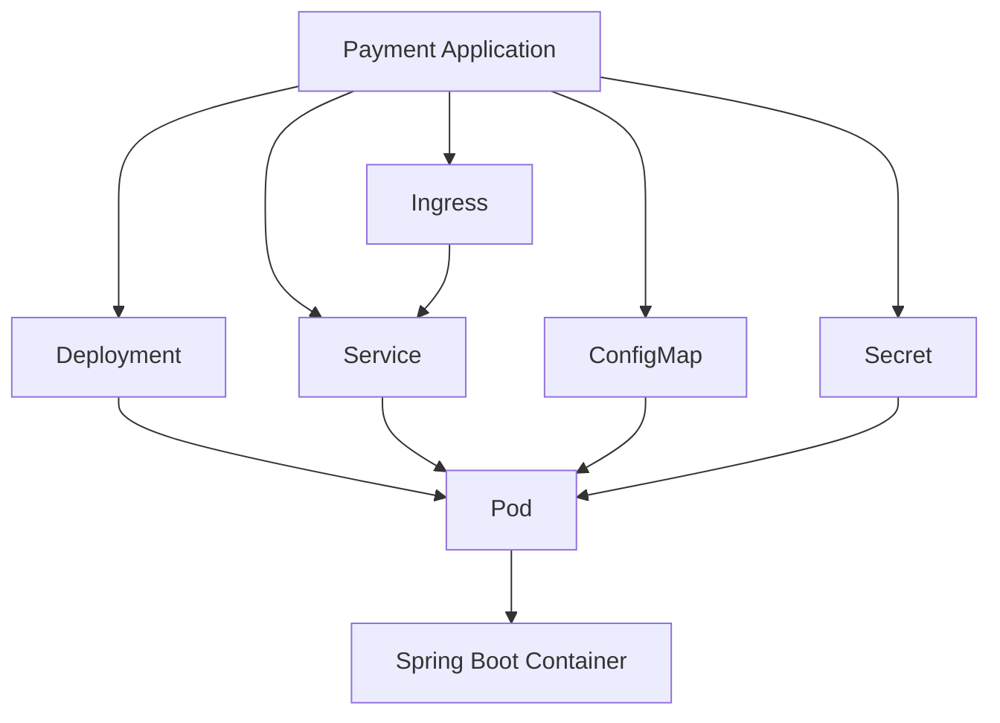

이러한 리소스들은 각각 별도의 Kubernetes 객체로 관리된다.

따라서 애플리케이션을 배포하려면 필요한 리소스들을 올바른 설정으로 생성해야 한다.

문제는 애플리케이션이 복잡해질수록 관리해야 할 리소스도 증가한다는 것이다.

단순히 애플리케이션을 설치하는 것뿐 아니라 버전을 업그레이드하고, 설정을 변경하고, 문제가 발생했을 때 이전 상태로 되돌리는 작업까지 수행해야 한다.

이러한 작업을 모두 개별 YAML 파일과 `kubectl` 명령어로 관리한다면 운영 과정이 복잡해질 수밖에 없다.

**Helm은 Kubernetes 애플리케이션을 하나의 패키지로 정의하고, 설치·업그레이드·롤백·삭제를 일관된 방식으로 관리하기 위한 도구이다.**

이번에는 Helm의 필요성부터 핵심 구성 요소, 내부 동작 원리, 실제 Chart 작성과 Release 관리 방법까지 살펴본다.

---

### Helm이란?

Helm은 Kubernetes용 패키지 관리자(Package Manager)이다.

Kubernetes에서 애플리케이션을 배포하는 데 필요한 리소스들을 하나의 패키지로 구성하고 관리할 수 있도록 지원한다.

Helm에서 이러한 패키지를 **Chart**라고 부른다.

예를 들어 MariaDB를 Kubernetes에 설치한다고 가정하자.

MariaDB를 실행하려면 다음과 같은 Kubernetes 리소스가 필요할 수 있다.

- StatefulSet
- Service
- Secret
- PersistentVolumeClaim
- ConfigMap
- ServiceAccount

Helm Chart는 이러한 리소스의 정의와 설정 가능한 값을 하나의 패키지로 구성한다.

사용자는 Chart를 이용하여 필요한 리소스를 일관된 방식으로 생성하고 관리할 수 있다.

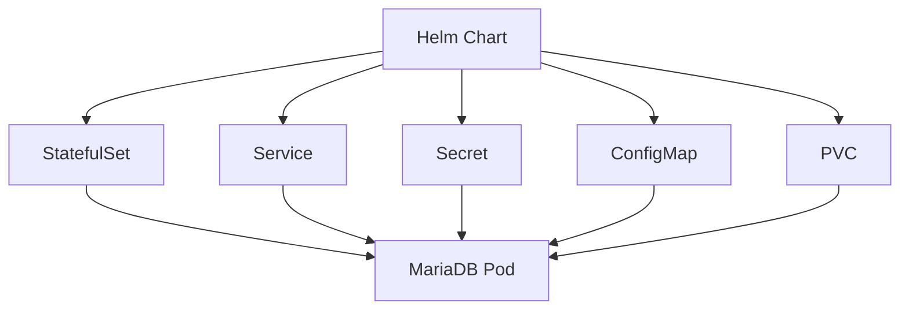

Helm이라는 이름은 배의 방향을 조종하는 키를 의미하는 영어 단어에서 유래한다.

Kubernetes라는 이름 역시 그리스어로 조타수 또는 항해사를 의미하는 단어에서 유래했다.

이러한 이름은 Kubernetes 생태계에서 Helm이 수행하는 역할과도 연결된다.

Kubernetes가 컨테이너 기반 시스템의 원하는 상태를 관리한다면, Helm은 Kubernetes에 배포할 애플리케이션을 패키지 단위로 구성하고 관리하는 역할을 담당한다.

---

### 패키지 관리자가 필요한 이유

Helm의 필요성을 이해하기 위해 먼저 Linux에서 패키지 관리자가 어떤 문제를 해결하는지 살펴보자.

Linux에서 애플리케이션을 설치하는 방법은 다양하다.

그중 하나는 소스 코드를 직접 다운로드하여 빌드하는 방식이다.

이 경우 다음과 같은 작업이 필요할 수 있다.

1. 소스 코드 다운로드
2. 빌드에 필요한 의존성 설치
3. 소스 코드 컴파일
4. 실행 파일 생성
5. 실행 파일을 적절한 경로에 배치
6. 환경 설정
7. 서비스 실행

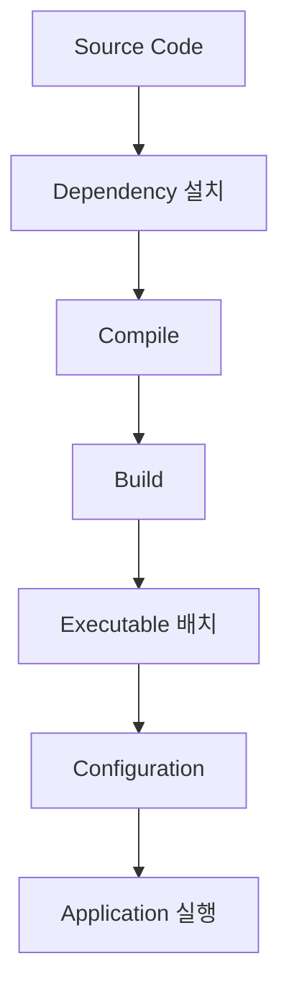

이러한 방식은 애플리케이션의 빌드 및 설치 과정을 직접 제어할 수 있다는 장점이 있다.

하지만 사용자가 의존성, 설치 경로, 실행 환경 등을 직접 관리해야 한다는 부담도 존재한다.

이러한 문제를 해결하기 위해 Linux 배포판에서는 패키지 관리자를 제공한다.

대표적으로 다음과 같은 도구들이 있다.

| Linux 배포판 | 패키지 관리자 |
|---|---|
| Ubuntu | APT |
| Debian | APT |
| RHEL 계열 | DNF |
| CentOS Linux 7 등 기존 환경 | YUM |
| Fedora | DNF |

Ubuntu에서는 다음 명령어로 Nginx를 설치할 수 있다.

```bash
sudo apt update
sudo apt install nginx
```

설치된 패키지를 제거할 때는 다음 명령어를 사용할 수 있다.

```bash
sudo apt remove nginx
```

패키지 관리자는 패키지 저장소에서 필요한 파일과 메타데이터를 가져오고, 의존성을 해결하며, 설치된 패키지의 상태를 관리한다.

덕분에 사용자는 애플리케이션을 설치할 때마다 모든 소스 코드를 직접 컴파일할 필요가 없다.

단, 패키지 제거 명령어가 관련 데이터와 설정을 항상 완전히 삭제하는 것은 아니다.

패키지 관리자의 역할은 패키지에 포함된 파일과 설치 상태를 관리하는 것이며, 사용자 데이터나 별도로 생성한 파일은 남을 수 있다.

이러한 개념은 Helm에도 적용된다.

---

### Kubernetes에도 패키지 관리자가 필요한 이유

Linux에서 패키지 관리자가 애플리케이션 설치를 단순화했다면, Kubernetes에서는 어떤 문제를 해결해야 할까?

Kubernetes 애플리케이션은 여러 리소스의 조합으로 구성된다.

예를 들어 일반적인 백엔드 애플리케이션을 배포한다고 가정하자.

다음과 같은 YAML 파일을 관리할 수 있다.

```text
kubernetes/
├── deployment.yaml
├── service.yaml
├── configmap.yaml
├── secret.yaml
├── ingress.yaml
├── serviceaccount.yaml
└── pvc.yaml
```

각 파일은 서로 다른 Kubernetes 리소스를 정의한다.

리소스를 생성하려면 다음과 같이 명령어를 실행할 수 있다.

```bash
kubectl apply -f deployment.yaml
kubectl apply -f service.yaml
kubectl apply -f configmap.yaml
kubectl apply -f secret.yaml
kubectl apply -f ingress.yaml
kubectl apply -f serviceaccount.yaml
kubectl apply -f pvc.yaml
```

물론 하나의 디렉터리에 있는 Manifest를 함께 적용하는 것도 가능하다.

```bash
kubectl apply -f kubernetes/
```

따라서 Helm이 없으면 여러 리소스를 한 번에 생성할 수 없다는 의미는 아니다.

문제는 리소스 생성 자체보다 **애플리케이션 단위의 변경 이력과 설정, 버전, 배포 상태를 관리하는 것**에 있다.

예를 들어 다음과 같은 상황을 생각해보자.

기존에는 Deployment의 Replica를 2개 사용했다.

새로운 버전을 배포하면서 Replica를 3개로 늘리고, 컨테이너 이미지를 변경하고, ConfigMap의 설정도 변경했다.

그런데 배포 이후 문제가 발생했다.

이때는 어떤 설정이 변경되었는지 파악하고 이전 상태로 되돌려야 한다.

단순히 여러 YAML 파일을 적용하는 것만으로는 애플리케이션의 배포 이력이 별도의 Release 단위로 관리되지 않는다.

Helm은 이러한 문제를 해결하기 위해 **애플리케이션을 패키지와 Release 단위로 관리하는 기능**을 제공한다.

---

### kubectl과 Helm의 차이

`kubectl`과 Helm은 모두 Kubernetes 리소스를 관리할 수 있지만 역할이 다르다.

`kubectl`은 Kubernetes API Server와 통신하여 리소스를 직접 조회하거나 생성하고 수정하는 CLI 도구이다.

반면 Helm은 Chart를 기반으로 여러 Kubernetes 리소스를 하나의 애플리케이션 패키지로 관리한다.

| 구분 | kubectl | Helm |
|---|---|---|
| 주요 목적 | Kubernetes 리소스 관리 | Kubernetes 애플리케이션 패키지 관리 |
| 관리 단위 | 개별 리소스 또는 Manifest 집합 | Chart와 Release |
| 리소스 생성 | `kubectl apply` | `helm install` |
| 설정 변경 | YAML 수정 후 적용 | Values 변경 후 Upgrade |
| 배포 이력 | 별도 관리 체계 필요 | Release Revision 제공 |
| 롤백 | 이전 Manifest 등을 활용 | `helm rollback` |
| 삭제 | `kubectl delete` | `helm uninstall` |
| 설정 재사용 | Kustomize 등과 조합 가능 | Values와 Template 사용 |

Helm이 `kubectl`을 대체하는 것은 아니다.

Helm으로 설치한 애플리케이션의 Pod 상태를 확인할 때도 `kubectl`을 사용할 수 있다.

```bash
kubectl get pods
```

Helm은 Kubernetes API를 활용하여 애플리케이션을 관리하는 상위 수준의 도구라고 이해할 수 있다.

---

### Helm의 핵심 개념: Chart, Values, Release

Helm을 이해하기 위해 반드시 알아야 하는 개념은 세 가지이다.

**Chart, Values, Release이다.**

| 개념 | 의미 |
|---|---|
| Chart | Kubernetes 애플리케이션을 구성하는 패키지 |
| Values | Chart에 적용할 설정값 |
| Release | Chart와 설정값을 이용해 설치한 애플리케이션 인스턴스 |

이 세 가지 개념은 서로 연결되어 있다.

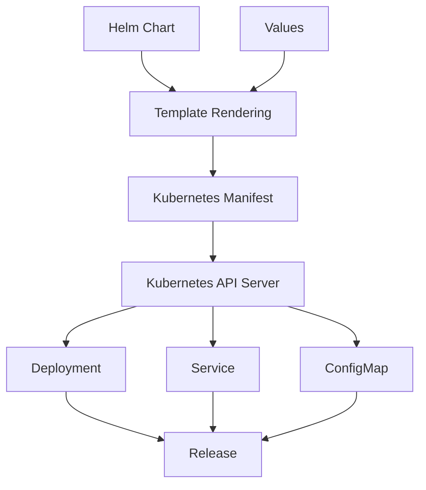

이 구조를 수식처럼 표현하면 다음과 같다.

**Chart + Values → Kubernetes Manifest → Release**

다만 Release는 단순한 Kubernetes 리소스들의 묶음이 아니라, Helm이 설치 결과와 변경 이력을 관리하기 위해 사용하는 논리적인 관리 단위이다.

각 개념을 자세히 살펴보자.

---

### Chart란?

Chart는 Kubernetes 애플리케이션을 설치하기 위한 패키지이다.

애플리케이션 실행에 필요한 Kubernetes 리소스의 Template과 기본 설정, 패키지 메타데이터 등을 포함한다.

예를 들어 Nginx를 설치하기 위한 Helm Chart가 있다고 가정하자.

이 Chart에는 다음과 같은 리소스 정의가 포함될 수 있다.

```text
Nginx Chart
│
├── Deployment Template
├── Service Template
├── ConfigMap Template
└── Values
```

이러한 Chart를 이용하면 사용자는 각 리소스의 YAML을 매번 직접 작성하지 않고도 애플리케이션을 배포할 수 있다.

또한 Chart는 특정 애플리케이션 전용으로 작성할 수도 있고, 공통적인 배포 패턴을 재사용하도록 구성할 수도 있다.

예를 들어 조직 내부의 모든 Spring Boot 서비스가 다음과 같은 공통 구성을 사용한다고 가정하자.

- Deployment
- Service
- ConfigMap
- Secret 참조
- Resource Requests 및 Limits
- Health Check
- ServiceAccount

이러한 구성을 Helm Chart로 표준화하면 각 서비스는 필요한 설정값만 변경하여 동일한 배포 구조를 사용할 수 있다.

이것이 Helm Chart가 제공하는 중요한 가치이다.

**Chart는 단순히 여러 YAML 파일을 압축한 것이 아니라, 설정값에 따라 Kubernetes 리소스를 생성할 수 있는 재사용 가능한 패키지이다.**

---

### Helm Chart의 기본 디렉터리 구조

일반적인 Helm Chart는 다음과 같은 구조를 가진다.

```text
my-chart/
├── Chart.yaml
├── values.yaml
├── charts/
├── crds/
└── templates/
    ├── deployment.yaml
    ├── service.yaml
    ├── configmap.yaml
    ├── _helpers.tpl
    └── NOTES.txt
```

각 파일과 디렉터리는 다음과 같은 역할을 한다.

| 항목 | 역할 |
|---|---|
| `Chart.yaml` | Chart 이름과 버전 등 메타데이터 정의 |
| `values.yaml` | Chart의 기본 설정값 |
| `templates/` | Kubernetes Manifest Template 저장 |
| `charts/` | 의존하는 다른 Chart 저장 |
| `crds/` | CustomResourceDefinition 정의 |
| `_helpers.tpl` | 재사용 가능한 Template 함수 |
| `NOTES.txt` | 설치 후 표시할 안내 메시지 |

모든 Chart가 위 파일을 전부 포함해야 하는 것은 아니다.

Chart의 목적과 구조에 따라 일부 파일은 생략할 수 있다.

#### Chart.yaml

다음은 Chart 메타데이터의 예시이다.

```yaml
apiVersion: v2
name: payment-service
description: Payment Service Helm Chart
type: application
version: 1.0.0
appVersion: "2.3.0"
```

각 필드의 의미는 다음과 같다.

| 필드 | 의미 |
|---|---|
| `apiVersion` | Helm Chart API 버전 |
| `name` | Chart 이름 |
| `description` | Chart 설명 |
| `type` | Chart 종류 |
| `version` | Chart 자체의 버전 |
| `appVersion` | Chart가 배포하는 애플리케이션의 버전 |

여기서 `version`과 `appVersion`은 서로 다른 개념이다.

예를 들어 다음과 같은 상황이 있을 수 있다.

```yaml
version: 1.0.0
appVersion: "2.3.0"
```

이는 Chart 버전이 `1.0.0`이고 애플리케이션 버전이 `2.3.0`이라는 의미이다.

애플리케이션의 버전과 Chart의 버전은 반드시 동일할 필요가 없다.

또한 `appVersion`은 메타데이터로서의 버전 정보이며, 반드시 컨테이너 이미지 태그를 결정하는 것은 아니다.

실제 이미지 태그는 Template에서 어떤 Values를 참조하도록 작성했는지에 따라 결정된다.

Chart의 파일 구조와 메타데이터 규칙은 Helm 공식 문서에서 정의하고 있다.

---

### Values란?

Values는 Chart에 적용할 설정값이다.

동일한 애플리케이션이라도 개발 환경과 운영 환경에서는 서로 다른 설정이 필요할 수 있다.

예를 들어 다음과 같은 차이가 존재할 수 있다.

| 설정 | 개발 환경 | 운영 환경 |
|---|---|---|
| Replica | 1 | 3 |
| 로그 레벨 | DEBUG | INFO |
| CPU Requests | 100m | 500m |
| Memory Requests | 128Mi | 512Mi |
| Service Type | ClusterIP | ClusterIP |
| 외부 도메인 | dev.example.com | example.com |

이러한 환경별 차이를 관리하기 위해 Values를 사용할 수 있다.

기본 Values 파일은 일반적으로 `values.yaml`이다.

```yaml
replicaCount: 1

image:
  repository: nginx
  tag: "stable"
  pullPolicy: IfNotPresent

service:
  type: ClusterIP
  port: 80

resources:
  requests:
    cpu: "100m"
    memory: "128Mi"
  limits:
    cpu: "500m"
    memory: "256Mi"
```

Helm Template에서는 이러한 값을 다음과 같이 참조한다.

```yaml
spec:
  replicas: {{ .Values.replicaCount }}
```

`{{ .Values.replicaCount }}`는 Helm의 Template 표현식이다.

Helm은 Chart를 렌더링하면서 해당 표현식을 실제 설정값으로 치환한다.

예를 들어 `replicaCount`가 3이라면 최종 Manifest는 다음과 같이 생성된다.

```yaml
spec:
  replicas: 3
```

이러한 방식으로 하나의 Chart를 여러 실행 환경에서 재사용할 수 있다.

---

### Config와 Values의 관계

Helm에서는 Chart에 적용하는 설정을 넓은 의미에서 Configuration 또는 Config라고 표현하기도 한다.

실제 CLI와 Chart 구성에서는 일반적으로 **Values**라는 용어를 사용한다.

Values는 다음과 같은 방법으로 지정할 수 있다.

기본적으로 Chart의 `values.yaml`을 사용한다.

환경별 설정 파일을 추가할 수도 있다.

```bash
helm install my-app ./my-chart -f values-production.yaml
```

CLI에서 직접 값을 전달할 수도 있다.

```bash
helm install my-app ./my-chart --set replicaCount=3
```

문자열 타입을 명시해야 한다면 `--set-string`을 사용할 수 있다.

```bash
helm install my-app ./my-chart --set-string image.tag=1.2.0
```

일반적으로 Values는 다음 순서로 설정을 구성한다.

1. Chart의 기본 Values
2. 사용자가 전달한 Values 파일
3. CLI의 `--set` 등을 통해 전달한 값

동일한 Key가 여러 곳에서 지정되었다면 우선순위와 병합 규칙에 따라 최종 값이 결정된다.

따라서 환경별 설정 파일과 CLI 옵션을 함께 사용할 때는 최종적으로 어떤 값이 적용되는지 확인하는 것이 중요하다.

---

### Release란?

Release는 Helm Chart를 사용하여 Kubernetes에 설치한 애플리케이션 인스턴스이다.

예를 들어 동일한 Chart를 개발 환경과 운영 환경에 각각 설치한다고 가정하자.

```text
Chart: payment-service
```

개발 환경에서는 다음과 같이 설치한다.

```bash
helm install payment-dev ./payment-service \
  -n development
```

운영 환경에서는 다음과 같이 설치한다.

```bash
helm install payment-prod ./payment-service \
  -n production
```

두 명령어는 동일한 Chart를 사용할 수 있다.

하지만 생성되는 Release는 서로 다르다.

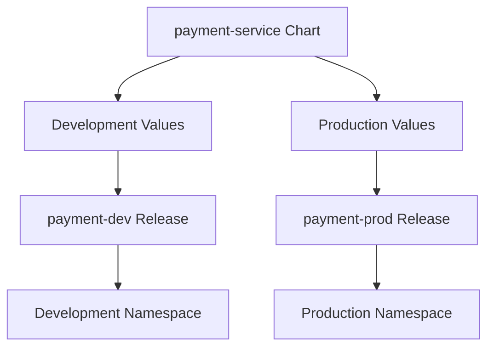

여기서 중요한 점은 다음과 같다.

**Chart는 배포에 사용할 패키지이고, Release는 그 Chart를 사용하여 설치한 실제 인스턴스이다.**

하나의 Chart에서 여러 Release를 생성할 수 있다.

Release는 설치 이후에도 Helm에서 관리된다.

예를 들어 Release에는 다음과 같은 정보가 연결된다.

- Release 이름
- Namespace
- Chart 정보
- 적용된 Values
- 렌더링된 Manifest
- 설치 및 변경 이력
- Revision
- 배포 상태

이러한 정보가 있기 때문에 Helm은 설치뿐 아니라 업그레이드와 롤백 기능도 제공할 수 있다.

---

### Chart Version, App Version, Release Revision의 차이

Helm을 사용하다 보면 서로 다른 세 가지 버전 정보를 접하게 된다.

첫 번째는 Chart Version이다.

두 번째는 App Version이다.

세 번째는 Release Revision이다.

이 세 가지는 구분해야 한다.

| 구분 | 의미 | 예시 |
|---|---|---|
| Chart Version | Chart 패키지 버전 | `1.2.0` |
| App Version | 애플리케이션 버전 메타데이터 | `2.3.0` |
| Release Revision | Release의 변경 이력 번호 | `3` |

예를 들어 다음과 같은 Chart가 있다고 가정하자.

```yaml
apiVersion: v2
name: payment-service
version: 1.2.0
appVersion: "2.3.0"
```

이 Chart를 처음 설치하면 Release Revision은 일반적으로 1이 된다.

이후 Values를 변경하여 업그레이드하면 Revision이 증가한다.

```text
Revision 1
    ↓
Revision 2
    ↓
Revision 3
```

같은 Chart 버전을 사용하더라도 설정을 변경하여 업그레이드하면 새로운 Revision이 생성될 수 있다.

따라서 다음 세 가지 질문은 서로 다른 질문이다.

- 어떤 버전의 Chart를 사용하고 있는가?
- 어떤 버전의 애플리케이션을 배포하고 있는가?
- 현재 Release는 몇 번째 변경 이력인가?

이 차이를 이해하면 Helm의 배포 이력을 더 정확하게 분석할 수 있다.

---

### Helm의 아키텍처

Helm의 아키텍처는 버전에 따라 변화해 왔다.

특히 Helm 2와 Helm 3 사이에는 중요한 차이가 있다.

Helm 2에서는 Kubernetes 클러스터 내부에 Tiller라는 서버 측 컴포넌트가 필요했다.

반면 Helm 3에서는 Tiller가 제거되었다.

Helm 4에서도 Helm 3 이후의 클라이언트 중심 구조가 유지된다.

이러한 변화를 이해하면 Helm의 배포 동작과 보안 구조를 더 명확하게 이해할 수 있다.

---

### Helm 2 아키텍처: Tiller

Helm 2는 크게 두 가지 구성 요소를 사용했다.

- Helm Client
- Tiller Server

Helm Client는 사용자가 실행하는 CLI 도구이다.

Tiller는 Kubernetes 클러스터 내부에 배포되는 서버 측 컴포넌트였다.

Helm Client가 설치 요청을 전달하면 Tiller가 Kubernetes API Server와 통신하여 리소스를 생성하거나 변경했다.

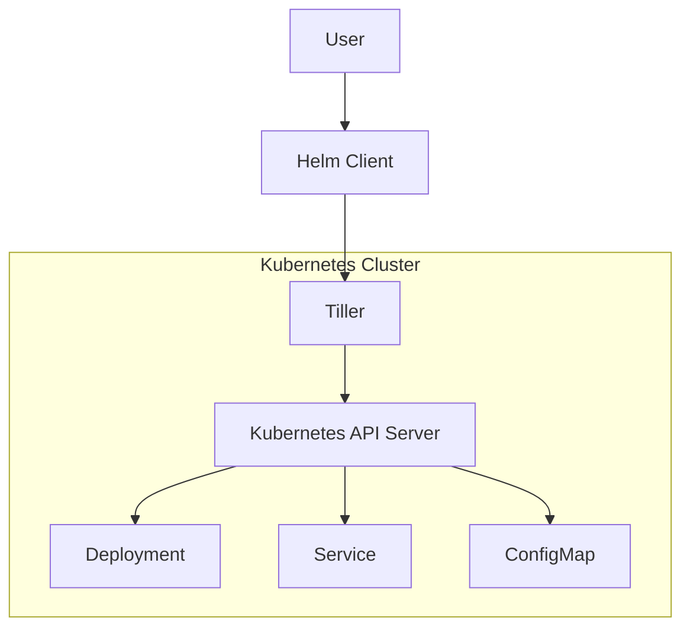

이 구조에서는 Tiller가 Kubernetes 리소스를 관리하기 위한 권한을 가져야 했다.

문제는 Tiller에 광범위한 권한이 부여될 경우 보안 위험이 커질 수 있다는 점이었다.

또한 서버 측 컴포넌트를 별도로 설치하고 운영해야 하므로 관리 부담이 존재했다.

이러한 구조적 문제는 Helm 3에서 중요한 변경이 이루어지는 계기가 되었다.

---

### Helm 3 아키텍처: Tiller 제거

Helm 3에서는 Tiller가 제거되었다.

이후 Helm Client가 Kubernetes API Server와 직접 통신하는 구조로 변경되었다.

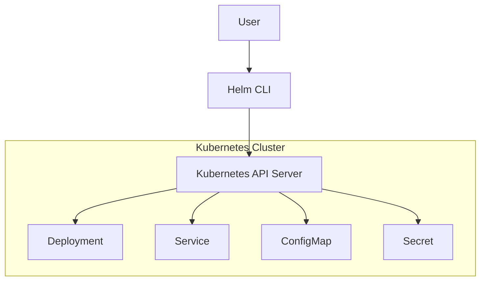

이 구조에서는 별도의 Tiller를 설치할 필요가 없다.

Helm Client는 Kubernetes의 인증 정보와 권한 체계를 이용하여 API Server에 접근한다.

일반적으로 현재 Kubernetes Context 및 Kubeconfig 설정에 따라 대상 클러스터가 결정된다.

따라서 Helm을 실행하는 사용자에게 Kubernetes 리소스를 관리할 수 있는 적절한 RBAC 권한이 필요하다.

여기서 중요한 점이 있다.

**Tiller가 제거되었다고 해서 Helm이 Kubernetes의 권한 제어를 우회하는 것은 아니다.**

Helm은 Kubernetes API를 사용하여 리소스를 생성하고 수정한다.

따라서 Kubernetes에서 해당 작업을 수행할 권한이 없다면 Helm 역시 작업에 실패할 수 있다.

---

### Helm Release 정보는 어디에 저장될까?

Helm은 Release를 관리하기 위해 설치 이력과 설정 정보를 저장해야 한다.

예를 들어 다음과 같은 작업을 수행한다고 가정하자.

```bash
helm install payment-service ./payment-service
```

Helm은 Chart와 Values를 바탕으로 Kubernetes Manifest를 생성하고 리소스를 설치한다.

동시에 설치된 Release에 관한 정보를 저장한다.

이후 업그레이드를 수행한다.

```bash
helm upgrade payment-service ./payment-service
```

Helm은 새로운 Revision에 대한 정보를 저장한다.

이러한 이력이 있어야 이전 Revision으로 되돌릴 수 있다.

Helm 3부터는 기본적으로 Kubernetes Secret을 이용하여 Release 정보를 저장한다.

일반적인 Release Secret 이름은 다음과 같은 형태이다.

```text
sh.helm.release.v1.<release-name>.v<revision>
```

예를 들어 다음과 같은 Secret이 생성될 수 있다.

```text
sh.helm.release.v1.payment-service.v1
sh.helm.release.v1.payment-service.v2
```

이름에서 마지막 `v1`, `v2`는 Release Revision을 의미한다.

Chart Version이나 Kubernetes API Version과는 다른 개념이다.

Release 정보를 확인하려면 다음 명령어를 사용할 수 있다.

```bash
kubectl get secrets -A -l owner=helm
```

이 명령어는 Helm Release 저장용 Secret을 조회하는 데 사용할 수 있다.

다만 Helm은 Secret 외에도 설정에 따라 다른 저장 백엔드를 사용할 수 있으므로 모든 환경에서 동일한 결과가 나타나는 것은 아니다.

또한 Secret의 데이터는 기본적으로 암호화된 비밀 데이터라는 의미가 아니다.

Kubernetes Secret은 접근 제어와 저장 시 암호화 설정을 적절하게 구성해야 한다.

특히 Helm Release 정보에는 Chart와 Values가 포함될 수 있으므로 민감한 설정값이 포함되지 않도록 주의해야 한다.

---

### Helm의 발전 과정

Helm은 2015년에 시작되어 Kubernetes 생태계의 대표적인 패키지 관리 도구로 발전했다.

주요 변화를 정리하면 다음과 같다.

| 시기 | 주요 변화 |
|---|---|
| 2015년 | Deis에서 Helm Classic 프로젝트 시작 |
| 2016년 1월 | Kubernetes Deployment Manager와 통합 |
| 2016년 | Helm 2 출시 및 Tiller 기반 구조 도입 |
| 2018년 6월 | CNCF 프로젝트로 편입 |
| 2019년 11월 | Helm 3 출시, Tiller 제거 |
| 2020년 4월 | CNCF Graduated 프로젝트로 승격 |
| 2020년 10월 | Helm Hub가 Artifact Hub로 대체 |
| 2025년 11월 | Helm 4 출시 |
| 2026년 | Helm 3에서 Helm 4로의 전환 진행 |

Helm 프로젝트는 2015년 Deis에서 Helm Classic이라는 이름으로 시작되었다.

이후 Kubernetes Deployment Manager와 통합되면서 Helm 2로 발전했다.

Helm 2에서는 Tiller를 통해 클러스터의 Release를 관리했다.

2019년 Helm 3에서는 Tiller가 제거되면서 클라이언트 중심 구조가 되었다.

2020년에는 CNCF의 Graduated 프로젝트가 되었으며, Helm Chart를 검색하는 Helm Hub는 Artifact Hub로 대체되었다.

2025년 11월 12일에는 Helm 4.0.0이 출시되었다.

Helm 4에서는 플러그인 아키텍처와 리소스 상태 추적 방식 등 여러 영역이 개선되었다.

---

### Helm 3와 Helm 4의 차이

Helm 3는 오랫동안 Kubernetes 환경에서 널리 사용된 주요 버전이다.

하지만 현재는 Helm 4가 출시되어 있다.

Helm 4에서도 Chart, Values, Release라는 핵심 개념은 유지된다.

기존 Helm 3 Chart와의 호환성 역시 중요한 설계 목표이다.

다만 내부 구조와 일부 기능은 변경되었다.

| 항목 | Helm 3 | Helm 4 |
|---|---|---|
| Tiller | 없음 | 없음 |
| 기본 구조 | 클라이언트 중심 | 클라이언트 중심 |
| Chart·Values·Release | 지원 | 지원 |
| Chart 호환성 | Helm 3 Chart 사용 | 기존 Chart와의 호환성 유지 |
| 플러그인 구조 | 기존 플러그인 구조 | 재설계된 플러그인 구조 |
| WebAssembly 플러그인 | 기본 구조에 없음 | 선택적으로 지원 |
| 리소스 상태 추적 | 기존 방식 | kstatus 기반 기능 도입 |
| OCI 지원 | 지원 | Digest 기반 활용 등 개선 |
| SDK | Helm 3 SDK | Helm 4 SDK 구조 변경 |

Helm 4는 기존 사용 방식을 최대한 유지하면서 새로운 기능을 도입했지만, SDK와 플러그인을 직접 사용하는 환경에서는 호환성을 검토해야 한다.

일반적인 Chart 설치와 업그레이드 작업에서는 기존의 핵심 명령어들을 계속 사용할 수 있다.

Helm 공식 일정에 따르면 Helm 3의 마지막 기능 릴리스는 2026년 9월이며, 보안 수정 지원은 2027년 2월 10일까지 제공될 예정이다.

따라서 장기적으로 운영할 환경이라면 Helm 4 전환을 검토하는 것이 적절하다.

---

### Helm Chart가 실제 Kubernetes Manifest로 변환되는 과정

Helm은 Chart에 포함된 Kubernetes Template과 Values를 조합하여 최종 Manifest를 생성한다.

예를 들어 Deployment Template에 다음 설정이 있다고 가정하자.

```yaml
apiVersion: apps/v1
kind: Deployment

metadata:
  name: {{ .Release.Name }}

spec:
  replicas: {{ .Values.replicaCount }}
```

여기에는 일반적인 YAML에서는 사용하지 않는 표현식이 있다.

```text
{{ .Release.Name }}
```

```text
{{ .Values.replicaCount }}
```

이들은 Helm의 Template 표현식이다.

`.Release.Name`은 설치할 Release의 이름을 나타낸다.

`.Values.replicaCount`는 Values에서 설정한 Replica 수량을 나타낸다.

예를 들어 다음과 같은 Values가 있다.

```yaml
replicaCount: 3
```

그리고 다음 명령어로 설치한다고 가정하자.

```bash
helm install web-service ./web-chart
```

그러면 Helm은 Template을 렌더링하여 다음과 같은 Manifest를 생성할 수 있다.

```yaml
apiVersion: apps/v1
kind: Deployment

metadata:
  name: web-service

spec:
  replicas: 3
```

이러한 과정을 Template Rendering이라고 한다.

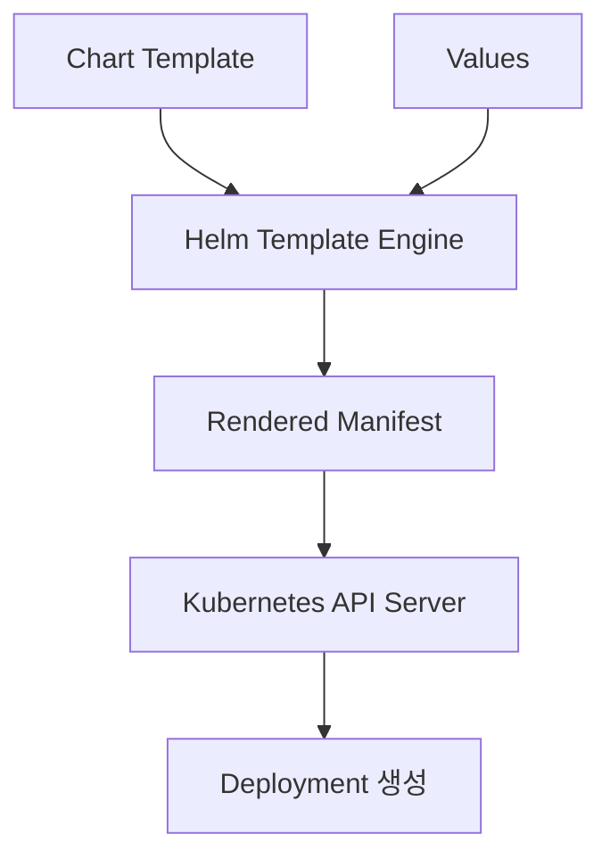

Helm은 Go Template 문법을 기반으로 Template을 처리한다.

따라서 단순한 값 치환뿐 아니라 조건문, 반복문, 함수 등을 활용하여 Manifest를 동적으로 생성할 수 있다.

---

### Helm Chart를 직접 작성해보기

이번에는 간단한 Nginx 애플리케이션을 배포하는 Helm Chart를 작성해보자.

다음 세 가지 Kubernetes 리소스를 생성한다.

- Deployment
- Service
- ConfigMap

또한 Values를 이용해 Replica 수량과 이미지, 애플리케이션 실행 환경을 변경할 수 있도록 구성한다.

전체 구성은 다음과 같다.

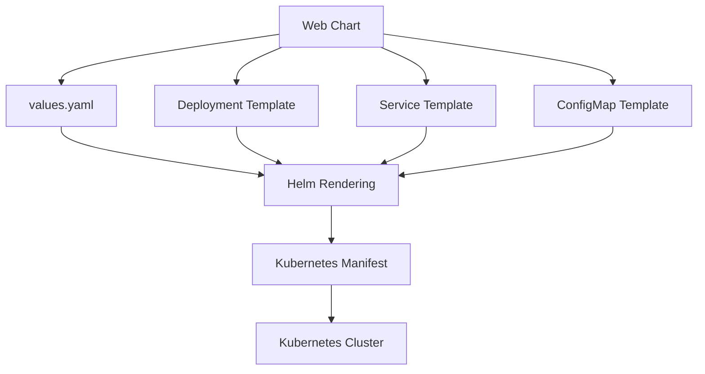

#### Chart 디렉터리 생성

먼저 디렉터리를 생성한다.

```bash
mkdir -p web-chart/templates
```

생성할 파일 구조는 다음과 같다.

```text
web-chart/
├── Chart.yaml
├── values.yaml
└── templates/
    ├── deployment.yaml
    ├── service.yaml
    └── configmap.yaml
```

`helm create` 명령어로 기본 Chart 구조를 자동 생성할 수도 있지만, 여기서는 각 파일의 역할을 명확하게 이해하기 위해 필요한 파일만 직접 작성한다.

---

### Chart.yaml 작성하기

먼저 Chart의 메타데이터를 정의한다.

**web-chart/Chart.yaml**

```yaml
apiVersion: v2
name: web-chart
description: Nginx application Helm chart
type: application
version: 0.1.0
appVersion: "1.0.0"
```

여기서는 Chart 이름을 `web-chart`로 지정했다.

Chart Version은 `0.1.0`이다.

App Version은 예제 애플리케이션의 메타데이터 버전인 `1.0.0`이다.

이 파일은 Helm Chart의 기본적인 식별 정보를 제공한다.

---

### values.yaml 작성하기

다음으로 기본 설정값을 작성한다.

**web-chart/values.yaml**

```yaml
replicaCount: 1

image:
  repository: nginx
  tag: "stable"
  pullPolicy: IfNotPresent

service:
  type: ClusterIP
  port: 80
  targetPort: 80

app:
  mode: development

resources:
  requests:
    cpu: "100m"
    memory: "128Mi"

  limits:
    cpu: "500m"
    memory: "256Mi"
```

이 파일에는 다음과 같은 설정이 존재한다.

| Key | 의미 |
|---|---|
| `replicaCount` | 생성할 Pod 수량 |
| `image.repository` | 컨테이너 이미지 저장소 |
| `image.tag` | 이미지 태그 |
| `image.pullPolicy` | 이미지 다운로드 정책 |
| `service.type` | Service 타입 |
| `service.port` | Service 포트 |
| `service.targetPort` | 컨테이너 포트 |
| `app.mode` | 애플리케이션 실행 환경 |
| `resources.requests` | 컨테이너 요청 자원 |
| `resources.limits` | 컨테이너 제한 자원 |

이러한 설정은 Template에서 `.Values`를 통해 참조할 수 있다.

운영 환경에서는 `stable`처럼 변경 가능한 이미지 태그보다 검증된 버전 또는 이미지 Digest를 고정하는 것이 좋다.

---

### Deployment Template 작성하기

이제 Deployment Template을 작성한다.

**web-chart/templates/deployment.yaml**

```yaml
apiVersion: apps/v1
kind: Deployment

metadata:
  name: {{ .Release.Name }}

  labels:
    app.kubernetes.io/name: {{ .Chart.Name }}
    app.kubernetes.io/instance: {{ .Release.Name }}

spec:
  replicas: {{ .Values.replicaCount }}

  selector:
    matchLabels:
      app.kubernetes.io/instance: {{ .Release.Name }}

  template:
    metadata:
      labels:
        app.kubernetes.io/name: {{ .Chart.Name }}
        app.kubernetes.io/instance: {{ .Release.Name }}

    spec:
      containers:
        - name: nginx

          image: "{{ .Values.image.repository }}:{{ .Values.image.tag }}"
          imagePullPolicy: {{ .Values.image.pullPolicy }}

          ports:
            - name: http
              containerPort: {{ .Values.service.targetPort }}

          env:
            - name: APP_MODE
              valueFrom:
                configMapKeyRef:
                  name: {{ .Release.Name }}-config
                  key: APP_MODE

          resources:
            requests:
              cpu: {{ .Values.resources.requests.cpu | quote }}
              memory: {{ .Values.resources.requests.memory | quote }}

            limits:
              cpu: {{ .Values.resources.limits.cpu | quote }}
              memory: {{ .Values.resources.limits.memory | quote }}
```

이 Template에는 여러 Helm 표현식이 사용된다.

대표적으로 다음과 같다.

```text
{{ .Release.Name }}
```

Release 이름을 가져온다.

```text
{{ .Chart.Name }}
```

Chart 이름을 가져온다.

```text
{{ .Values.replicaCount }}
```

Values에 정의된 Replica 수량을 가져온다.

```text
{{ .Values.image.repository }}
```

컨테이너 이미지 저장소를 가져온다.

```text
{{ .Values.image.tag }}
```

컨테이너 이미지 태그를 가져온다.

여기서 `quote`는 값을 YAML 문자열로 표현하도록 처리하는 Helm Template 함수이다.

예를 들어 다음 설정이 있다고 가정하자.

```yaml
cpu: "100m"
```

Template에서 다음과 같이 사용하면,

```yaml
cpu: {{ .Values.resources.requests.cpu | quote }}
```

렌더링된 결과는 다음과 같은 형태가 된다.

```yaml
cpu: "100m"
```

이처럼 Helm은 Values의 설정을 Kubernetes Manifest에 적절한 형태로 적용할 수 있다.

---

### Service Template 작성하기

다음은 Service Template이다.

**web-chart/templates/service.yaml**

```yaml
apiVersion: v1
kind: Service

metadata:
  name: {{ .Release.Name }}

  labels:
    app.kubernetes.io/name: {{ .Chart.Name }}
    app.kubernetes.io/instance: {{ .Release.Name }}

spec:
  type: {{ .Values.service.type }}

  selector:
    app.kubernetes.io/instance: {{ .Release.Name }}

  ports:
    - name: http
      port: {{ .Values.service.port }}
      targetPort: {{ .Values.service.targetPort }}
```

Service는 Deployment에서 생성한 Pod로 네트워크 요청을 전달한다.

여기서 중요한 것은 Selector이다.

```yaml
selector:
  app.kubernetes.io/instance: {{ .Release.Name }}
```

Deployment의 Pod Template에도 동일한 Label이 존재한다.

```yaml
labels:
  app.kubernetes.io/instance: {{ .Release.Name }}
```

따라서 Service는 해당 Label을 가진 Pod를 대상으로 요청을 전달할 수 있다.

또한 Release 이름을 Label에 사용했기 때문에 같은 Chart를 여러 Release로 설치하더라도 각 Release의 Pod를 구분할 수 있다.

---

### ConfigMap Template 작성하기

마지막으로 ConfigMap Template을 작성한다.

**web-chart/templates/configmap.yaml**

```yaml
apiVersion: v1
kind: ConfigMap

metadata:
  name: {{ .Release.Name }}-config

  labels:
    app.kubernetes.io/name: {{ .Chart.Name }}
    app.kubernetes.io/instance: {{ .Release.Name }}

data:
  APP_MODE: {{ .Values.app.mode | quote }}
```

ConfigMap은 Values의 `app.mode`를 문자열로 저장한다.

기본 Values에서는 다음과 같이 정의했다.

```yaml
app:
  mode: development
```

따라서 실제 ConfigMap은 다음과 같은 값을 가진다.

```yaml
data:
  APP_MODE: "development"
```

Deployment에서는 이 ConfigMap의 값을 환경 변수로 사용한다.

```yaml
env:
  - name: APP_MODE
    valueFrom:
      configMapKeyRef:
        name: {{ .Release.Name }}-config
        key: APP_MODE
```

이렇게 하면 Chart에 정의된 설정값을 컨테이너 환경 변수로 전달할 수 있다.

다만 Nginx 자체가 `APP_MODE`라는 환경 변수를 자동으로 활용하는 것은 아니다.

이 예제에서는 ConfigMap이 컨테이너에 전달되는 과정을 확인하기 위해 사용한다.

---

### Helm Template 렌더링 확인하기

Chart를 작성했다면 실제 Kubernetes에 설치하기 전에 Template이 올바르게 렌더링되는지 확인하는 것이 좋다.

먼저 Chart를 검사한다.

```bash
helm lint ./web-chart
```

정상적인 Chart라면 다음과 유사한 결과가 나타날 수 있다.

```text
==> Linting ./web-chart
[INFO] Chart.yaml: icon is recommended

1 chart(s) linted, 0 chart(s) failed
```

Helm 버전에 따라 메시지는 달라질 수 있다.

이 명령어는 Chart의 기본적인 형식과 Template 문제를 검사한다.

다음으로 Template을 렌더링한다.

```bash
helm template web-demo ./web-chart
```

이 명령어는 Release 이름을 `web-demo`로 가정하고 Template을 렌더링한다.

하지만 Kubernetes에 리소스를 실제로 생성하지는 않는다.

렌더링 결과에는 다음과 같은 Manifest가 포함된다.

```yaml
apiVersion: v1
kind: ConfigMap

metadata:
  name: web-demo-config

data:
  APP_MODE: "development"
```

Deployment의 이름은 다음과 같이 생성된다.

```yaml
metadata:
  name: web-demo
```

Replica 수량은 기본 Values에 따라 다음과 같이 설정된다.

```yaml
spec:
  replicas: 1
```

즉 다음 과정을 확인할 수 있다.

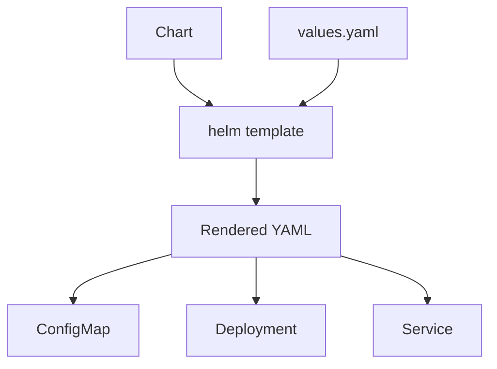

이처럼 `helm template`은 실제 배포 전에 최종 Kubernetes Manifest를 확인하는 데 유용하다.

---

### Helm으로 애플리케이션 설치하기

이제 작성한 Chart를 Kubernetes에 설치해보자.

먼저 클러스터에 연결할 수 있는지 확인한다.

```bash
kubectl get nodes
```

정상적으로 연결된다면 Node 목록이 출력된다.

다음으로 Helm을 이용해 설치한다.

```bash
helm install web-demo ./web-chart \
  --namespace helm-demo \
  --create-namespace \
  --wait \
  --timeout 3m
```

각 옵션의 의미는 다음과 같다.

| 옵션 | 의미 |
|---|---|
| `web-demo` | Release 이름 |
| `./web-chart` | 설치할 Chart 경로 |
| `--namespace helm-demo` | 대상 Namespace |
| `--create-namespace` | Namespace가 없으면 생성 |
| `--wait` | 관련 리소스의 준비 상태를 기다림 |
| `--timeout 3m` | 최대 대기 시간 설정 |

정상적으로 설치되면 다음과 유사한 결과가 나타날 수 있다.

```text
NAME: web-demo
NAMESPACE: helm-demo
STATUS: deployed
REVISION: 1
```

실제 출력 형식은 Helm 버전에 따라 달라질 수 있다.

이제 Kubernetes 리소스를 확인한다.

```bash
kubectl get deployment,service,configmap -n helm-demo
```

예상되는 주요 결과는 다음과 같다.

```text
deployment.apps/web-demo
service/web-demo
configmap/web-demo-config
```

이처럼 Helm은 하나의 Chart를 통해 여러 Kubernetes 리소스를 생성할 수 있다.

---

### Helm Release 확인하기

설치된 Release 목록은 다음 명령어로 조회할 수 있다.

```bash
helm list -n helm-demo
```

출력 예시:

```text
NAME       NAMESPACE   REVISION   STATUS     CHART
web-demo   helm-demo   1          deployed   web-chart-0.1.0
```

Release의 상세 상태를 확인하려면 다음 명령어를 사용한다.

```bash
helm status web-demo -n helm-demo
```

Release에 적용된 Values를 확인할 수도 있다.

```bash
helm get values web-demo -n helm-demo
```

기본값까지 포함하여 확인하려면 다음과 같이 작성한다.

```bash
helm get values web-demo -n helm-demo --all
```

Helm이 실제로 설치에 사용한 Manifest도 확인할 수 있다.

```bash
helm get manifest web-demo -n helm-demo
```

이러한 명령어를 활용하면 Chart가 어떤 설정으로 설치되었는지 파악할 수 있다.

---

### Helm Upgrade: 애플리케이션 설정 변경하기

Helm은 설치된 Release를 업그레이드할 수 있다.

이번에는 Replica 수량을 1개에서 2개로 변경해보자.

기본 `values.yaml`을 직접 수정하는 대신 별도의 운영 설정 파일을 작성한다.

**values-production.yaml**

```yaml
replicaCount: 2

app:
  mode: production
```

이 파일에는 변경하고 싶은 값만 작성했다.

나머지 설정은 Chart의 기본 Values를 사용한다.

이제 다음 명령어로 업그레이드한다.

```bash
helm upgrade web-demo ./web-chart \
  --namespace helm-demo \
  --values values-production.yaml \
  --wait \
  --timeout 3m
```

정상적으로 업그레이드되면 Release Revision이 증가한다.

```text
Revision 1
    ↓
Revision 2
```

Replica 수량을 확인한다.

```bash
kubectl get deployment web-demo -n helm-demo \
  -o jsonpath='{.spec.replicas}{"\n"}'
```

출력:

```text
2
```

ConfigMap 값도 확인할 수 있다.

```bash
kubectl get configmap web-demo-config -n helm-demo \
  -o jsonpath='{.data.APP_MODE}{"\n"}'
```

출력:

```text
production
```

단, 기존에 실행 중인 컨테이너에 주입된 환경 변수가 ConfigMap 변경만으로 자동으로 갱신되는 것은 아니다.

이번 업그레이드에서는 Replica 변경으로 Pod 구성이 달라지지만, 모든 Pod의 환경 변수 갱신 여부를 확실하게 보장하려면 재시작 또는 Pod Template 변경을 포함하는 배포 전략이 필요하다.

실무에서는 ConfigMap의 변경에 따라 Pod를 재시작할 수 있도록 Checksum Annotation 등의 방식을 활용하기도 한다.

---

### Helm Rollback: 이전 버전으로 되돌리기

업그레이드 이후 문제가 발생했다고 가정하자.

예를 들어 새로운 설정이 적용된 이후 애플리케이션에 오류가 발생할 수 있다.

이때 Helm은 이전 Revision으로 되돌리는 기능을 제공한다.

먼저 Release 이력을 확인한다.

```bash
helm history web-demo -n helm-demo
```

예상 결과는 다음과 같다.

```text
REVISION   STATUS       CHART
1          superseded   web-chart-0.1.0
2          deployed     web-chart-0.1.0
```

Revision 1은 처음 설치한 상태이다.

Revision 2는 운영 설정으로 업그레이드한 상태이다.

이제 첫 번째 Revision으로 되돌려보자.

```bash
helm rollback web-demo 1 \
  --namespace helm-demo \
  --wait \
  --timeout 3m
```

정상적으로 롤백되면 Release는 이전 Revision의 설정을 기준으로 다시 적용된다.

여기서 중요한 점이 있다.

**Rollback을 실행했다고 해서 Release Revision 번호가 이전 번호로 감소하는 것은 아니다.**

기존 Revision으로 롤백하는 작업 자체가 새로운 Revision으로 기록된다.

따라서 다음과 같은 이력이 만들어질 수 있다.

```text
Revision 1: 최초 설치
Revision 2: 설정 변경
Revision 3: Revision 1로 롤백
```

이를 구조적으로 표현하면 다음과 같다.

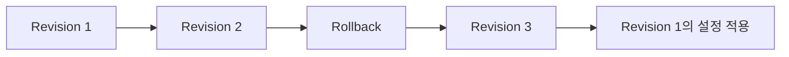

롤백 이후 Replica 수량을 조회하면 다시 1이 적용될 수 있다.

```bash
kubectl get deployment web-demo -n helm-demo \
  -o jsonpath='{.spec.replicas}{"\n"}'
```

출력:

```text
1
```

Helm의 Revision은 설치, 업그레이드, 롤백을 수행하면서 증가하며, 이력을 조회해 특정 Revision으로 되돌릴 수 있다.

---

### Helm Uninstall: 애플리케이션 삭제하기

설치한 Release를 삭제하려면 다음 명령어를 사용한다.

```bash
helm uninstall web-demo -n helm-demo
```

정상적으로 삭제되면 다음과 같은 메시지가 출력될 수 있다.

```text
release "web-demo" uninstalled
```

이 명령어는 해당 Release가 관리하는 Kubernetes 리소스를 삭제한다.

이번 Chart에서는 다음 리소스가 삭제 대상이다.

- Deployment
- Service
- ConfigMap

삭제 여부를 확인한다.

```bash
kubectl get deployment,service,configmap -n helm-demo
```

Release에 해당하는 리소스가 더 이상 존재하지 않는지 확인할 수 있다.

다만 `helm uninstall`이 모든 연관 데이터를 반드시 완전히 삭제하는 것은 아니다.

Helm에서 관리하지 않는 리소스는 삭제 대상이 아닐 수 있다.

또한 다음과 같은 리소스는 별도의 처리가 필요할 수 있다.

- `helm.sh/resource-policy: keep`으로 보존하도록 설정한 리소스
- Chart의 `crds/` 디렉터리로 설치한 CRD
- Hook을 통해 생성되어 Helm의 일반적인 삭제 대상에 포함되지 않는 리소스
- 스토리지 정책에 따라 보존되는 PersistentVolume
- 별도로 생성한 Namespace
- 외부 시스템에 저장된 데이터

특히 데이터베이스 Chart를 삭제할 때는 PVC와 PV의 보존 정책을 확인해야 한다.

Helm 공식 문서에서도 보존 정책 및 Hook에 의해 생성된 리소스는 별도의 삭제 처리가 필요할 수 있음을 설명한다.

---

### Helm Repository와 Artifact Hub

Helm Chart는 직접 작성할 수도 있지만, 다른 개발자나 조직이 제공하는 Chart를 사용할 수도 있다.

이러한 Chart를 공유하기 위한 저장소가 Chart Repository이다.

Helm에서는 다음과 같은 명령어를 사용하여 Chart를 검색할 수 있다.

```bash
helm search hub nginx
```

이 명령어는 Artifact Hub에서 관련 Chart를 검색하는 데 사용할 수 있다.

Artifact Hub는 Kubernetes 생태계의 여러 패키지와 구성 요소를 검색하고 탐색할 수 있는 서비스이다.

Helm Chart 역시 Artifact Hub를 통해 검색할 수 있다.

다만 Artifact Hub 자체가 모든 Chart 파일을 직접 제공하는 저장소인 것은 아니다.

Chart의 실제 배포 위치는 개별 Chart Repository 또는 OCI Registry일 수 있다.

#### Chart Repository 등록

일반적인 등록 명령어는 다음과 같다.

```bash
helm repo add <repository-name> <repository-url>
```

등록된 Repository를 확인한다.

```bash
helm repo list
```

Repository의 인덱스 정보를 갱신한다.

```bash
helm repo update
```

등록된 Repository에서 Chart를 검색한다.

```bash
helm search repo <chart-name>
```

특정 Chart의 설정값을 확인하려면 다음과 같이 작성할 수 있다.

```bash
helm show values <repository-name>/<chart-name>
```

이러한 명령어를 통해 Chart 설치 전에 어떤 설정을 지원하는지 확인할 수 있다.

Helm은 일반적인 Chart Repository뿐 아니라 OCI Registry를 통한 Chart 배포도 지원한다.

---

### Helm과 Docker Image의 차이

Helm을 처음 접하면 Chart와 Docker Image를 비슷한 개념으로 혼동할 수 있다.

하지만 두 개념은 서로 다른 역할을 담당한다.

Docker Image는 컨테이너 실행에 필요한 애플리케이션과 의존성을 포함한다.

반면 Helm Chart는 해당 이미지를 Kubernetes에서 어떤 방식으로 실행할지 정의한다.

예를 들어 다음과 같은 구성이 있다고 가정하자.

```text
Docker Image
└── payment-service:1.0.0
```

이 이미지를 Kubernetes에서 실행하려면 Deployment 등의 리소스가 필요하다.

Helm Chart는 다음과 같은 설정을 제공할 수 있다.

```text
Helm Chart
├── Deployment
├── Service
├── ConfigMap
├── Secret 참조
├── Resource 설정
└── Health Check
```

즉 Docker Image와 Helm Chart의 역할은 다음과 같다.

| 구분 | Docker Image | Helm Chart |
|---|---|---|
| 주요 목적 | 컨테이너 실행 환경 패키징 | Kubernetes 배포 설정 패키징 |
| 포함 내용 | 애플리케이션, 런타임, 의존성 | Kubernetes Template, Values, 메타데이터 |
| 실행 대상 | Container Runtime | Helm |
| 관리 대상 | 컨테이너 이미지 | Kubernetes 리소스 |
| 대표 도구 | Docker, BuildKit | Helm |

Helm은 일반적으로 애플리케이션의 소스 코드를 컴파일하거나 Docker Image를 빌드하지 않는다.

이미 빌드된 컨테이너 이미지를 Kubernetes에 배포하기 위한 리소스를 관리하는 역할에 가깝다.

이러한 차이를 이해하면 CI/CD 파이프라인의 책임을 더 명확하게 분리할 수 있다.

---

### Helm을 실무에서 활용하는 10가지 방법

Helm은 단순히 외부 애플리케이션을 설치할 때만 사용하는 도구가 아니다.

내부 백엔드 시스템의 배포 표준화와 운영 자동화에도 활용할 수 있다.

대표적인 활용 방법을 정리하면 다음과 같다.

| 활용 방법 | 구현 방향 | 기대 효과 |
|---|---|---|
| 1. Spring Boot 배포 표준화 | 공통 Deployment Chart 작성 | 서비스별 배포 설정 일관성 확보 |
| 2. 개발·운영 환경 분리 | 환경별 Values 파일 사용 | 중복 Manifest 감소 |
| 3. Replica 관리 | `replicaCount` 설정 | 환경별 Pod 수량 제어 |
| 4. 이미지 버전 관리 | 이미지 Repository·Tag를 Values로 관리 | 배포 버전 추적 |
| 5. ConfigMap 관리 | ConfigMap Template 구성 | 설정 관리 방식 표준화 |
| 6. Secret 연동 | 기존 Secret 참조 설정 | 민감 정보와 배포 설정 분리 |
| 7. 리소스 정책 관리 | Requests·Limits 설정 | 자원 사용 정책 일관성 확보 |
| 8. 배포 이력 관리 | Release Revision 활용 | 변경 이력 추적 |
| 9. 장애 발생 시 롤백 | `helm rollback` 활용 | 이전 배포 설정 복구 |
| 10. CI/CD 자동화 | `helm upgrade --install` 활용 | 반복 배포 작업 자동화 |

예를 들어 여러 Spring Boot 서비스를 운영한다고 가정하자.

서비스마다 Deployment, Service, ConfigMap, HPA를 직접 작성하는 대신 공통 Helm Chart를 구성할 수 있다.

각 서비스는 서로 다른 Values만 사용한다.

```text
Common Spring Boot Chart
│
├── payment-service-values.yaml
├── coupon-service-values.yaml
├── notification-service-values.yaml
└── membership-service-values.yaml
```

이렇게 구성하면 서비스마다 동일한 배포 정책을 적용할 수 있다.

또한 공통 Chart를 개선하면 다른 서비스에서도 변경된 배포 구조를 재사용할 수 있다.

다만 공통 Chart를 변경했다고 해서 기존 Release들이 자동으로 모두 업그레이드되는 것은 아니다.

각 Release에 새로운 Chart 버전을 적용하는 배포 과정이 필요하다.

---

### Helm을 사용할 때 주의해야 할 사항

Helm은 Kubernetes 애플리케이션 관리를 단순화하지만 모든 운영 문제를 자동으로 해결하지는 않는다.

특히 다음 사항들을 고려해야 한다.

#### Helm은 Kubernetes Controller가 아니다

Helm은 Chart를 렌더링하고 Kubernetes API에 원하는 리소스 상태를 전달한다.

하지만 일반적인 Helm 설치 이후에도 계속 실행되면서 리소스를 감시하는 서버 측 Controller가 존재하는 것은 아니다.

실제 Pod 수량을 유지하거나 장애가 발생한 Pod를 재생성하는 작업은 Kubernetes Controller가 수행한다.

#### Chart Version과 Release Revision은 다르다

Chart Version은 패키지 자체의 버전이다.

Release Revision은 특정 설치 인스턴스의 변경 이력이다.

같은 Chart를 사용하더라도 Values를 변경하여 업그레이드하면 Revision이 증가할 수 있다.

#### Values에 민감한 정보를 직접 저장하지 않는다

Helm Release 정보에는 Chart와 Values가 포함될 수 있다.

따라서 비밀번호나 API Key를 일반 Values 파일에 직접 저장하면 보안 문제가 발생할 수 있다.

실무에서는 기존 Secret을 참조하거나 External Secrets Operator, 별도의 Secret 관리 시스템 등을 활용하는 방식을 고려해야 한다.

#### Rollback이 모든 상태를 복구하는 것은 아니다

Helm Rollback은 이전 Release의 Kubernetes 리소스 구성을 다시 적용하는 기능이다.

하지만 데이터베이스 스키마 변경이나 외부 시스템 데이터까지 자동으로 되돌리지는 않는다.

예를 들어 애플리케이션 배포와 함께 데이터베이스 Migration을 수행했다면 Helm Rollback만으로 이전 상태가 완전히 복구되지 않을 수 있다.

따라서 애플리케이션의 롤백과 데이터의 롤백은 별도로 고려해야 한다.

#### Helm Uninstall은 모든 데이터를 삭제하지 않을 수 있다

PVC, PV, CRD, Hook 리소스, 외부 시스템의 데이터 등은 삭제 이후에도 남을 수 있다.

특히 StatefulSet을 사용하는 데이터베이스 시스템에서는 스토리지 보존 정책을 확인해야 한다.

#### Chart를 설치하기 전에 내용을 확인한다

외부 Chart를 사용할 때는 Chart가 어떤 Kubernetes 리소스를 생성하는지 확인하는 것이 좋다.

다음 명령어를 활용할 수 있다.

```bash
helm show values <repository-name>/<chart-name>
```

```bash
helm template my-release <repository-name>/<chart-name>
```

또한 Chart와 Container Image의 공급망 신뢰성을 검토하는 것이 중요하다.

---

### 정리

Helm은 Kubernetes용 패키지 관리자이다.

Kubernetes 애플리케이션을 실행하는 데 필요한 여러 리소스를 하나의 Chart로 구성하고, 이를 설치·업그레이드·롤백·삭제할 수 있도록 지원한다.

Helm을 이해하기 위해서는 세 가지 핵심 개념을 구분해야 한다.

**Chart는 Kubernetes 애플리케이션 패키지이다.**

애플리케이션을 구성하는 Kubernetes 리소스의 Template과 기본 설정을 포함한다.

**Values는 Chart에 적용할 설정값이다.**

Replica 수량, 이미지 태그, Service 설정, Resource 설정 등을 환경에 맞게 변경할 수 있다.

**Release는 Chart와 Values를 이용해 설치한 애플리케이션 인스턴스이다.**

설치 이후에도 Helm은 Release의 설정과 변경 이력을 관리한다.

이 세 가지 개념은 다음과 같이 연결된다.

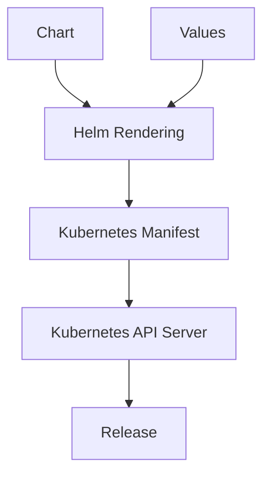

Helm의 주요 명령어는 다음과 같다.

| 명령어 | 역할 |
|---|---|
| `helm version` | Helm 버전 확인 |
| `helm create` | 기본 Chart 생성 |
| `helm lint` | Chart 검사 |
| `helm template` | Template 렌더링 |
| `helm install` | Chart 설치 |
| `helm list` | Release 목록 확인 |
| `helm status` | Release 상태 확인 |
| `helm get values` | 적용된 Values 확인 |
| `helm get manifest` | Release Manifest 확인 |
| `helm upgrade` | Release 업그레이드 |
| `helm history` | Release 변경 이력 확인 |
| `helm rollback` | 이전 Revision으로 롤백 |
| `helm uninstall` | Release 삭제 |
| `helm search hub` | Artifact Hub에서 Chart 검색 |
| `helm repo add` | Chart Repository 등록 |
| `helm repo update` | Repository 정보 갱신 |

Helm의 아키텍처 역시 중요한 변화를 거쳤다.

Helm 2에서는 Tiller라는 서버 측 컴포넌트를 사용했다.

Helm 3에서는 Tiller를 제거하고 Helm Client가 Kubernetes API Server와 직접 통신하도록 변경했다.

Helm 4에서는 이러한 클라이언트 중심 구조를 유지하면서 플러그인 시스템과 리소스 관리 기능 등을 개선했다.

Kubernetes에서 Helm을 사용하는 중요한 이유는 단순히 여러 YAML 파일을 한 번에 실행할 수 있기 때문만은 아니다.

**애플리케이션을 하나의 관리 단위로 구성하고, 환경별 설정과 배포 이력을 체계적으로 관리할 수 있기 때문**이다.

특히 다수의 백엔드 서비스를 운영하는 환경에서는 공통 Helm Chart를 활용하여 배포 정책을 표준화할 수 있다.

이를 통해 애플리케이션마다 반복적으로 작성하던 Kubernetes Manifest를 줄이고, 환경별 설정과 Release 이력을 일관되게 관리할 수 있다.

#### 한 줄 요약

> Helm은 Kubernetes 애플리케이션을 Chart라는 패키지로 구성하고, Values를 적용하여 Release 단위로 설치·업그레이드·롤백·삭제할 수 있도록 지원하는 패키지 관리자이다. 여러 Kubernetes 리소스를 하나의 애플리케이션으로 관리하고 배포 설정을 표준화하는 데 핵심적인 역할을 수행한다.
