# Ch 1. Helm이란

# Ch 1. Helm이란  
* toc
{:toc}

---

## Helm 소개


### Helm이란? Kubernetes 패키지 관리자의 개념과 구조, Chart·Values·Release 이해하기

Kubernetes에서 애플리케이션 하나를 실행하려면 일반적으로 여러 리소스가 필요하다.

예를 들어 Spring Boot 기반의 결제 서비스를 Kubernetes에 배포한다고 가정하자.

애플리케이션을 실행하기 위해 Deployment를 생성해야 하고, 외부 또는 내부 서비스와 통신하기 위해 Service를 생성해야 한다.

환경별 설정값을 분리하려면 ConfigMap이 필요하며, 데이터베이스 비밀번호와 같은 민감한 정보를 관리하려면 Secret이 필요할 수 있다.

또한 외부 HTTP 요청을 전달하기 위한 Ingress, 데이터 저장을 위한 PersistentVolumeClaim, 접근 권한을 관리하기 위한 ServiceAccount와 Role 등의 리소스가 추가될 수 있다.

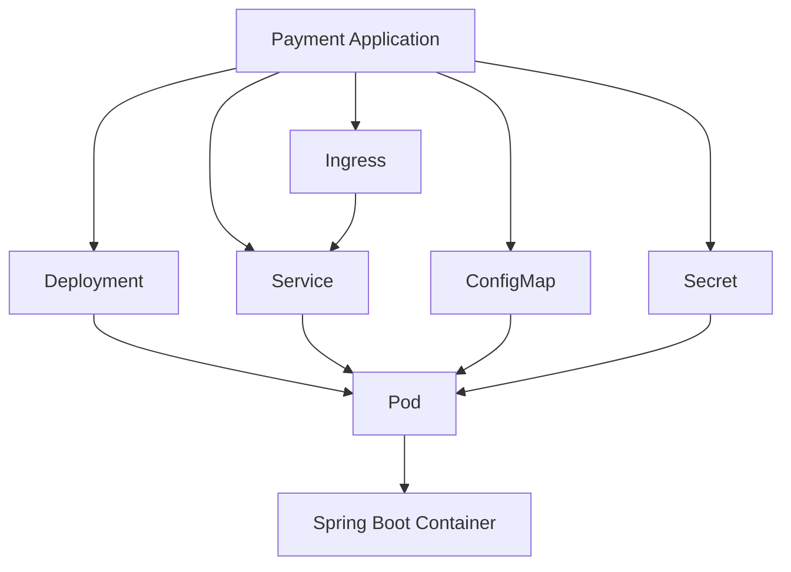

이러한 리소스들은 각각 별도의 Kubernetes 객체로 관리된다.

따라서 애플리케이션을 배포하려면 필요한 리소스들을 올바른 설정으로 생성해야 한다.

문제는 애플리케이션이 복잡해질수록 관리해야 할 리소스도 증가한다는 것이다.

단순히 애플리케이션을 설치하는 것뿐 아니라 버전을 업그레이드하고, 설정을 변경하고, 문제가 발생했을 때 이전 상태로 되돌리는 작업까지 수행해야 한다.

이러한 작업을 모두 개별 YAML 파일과 `kubectl` 명령어로 관리한다면 운영 과정이 복잡해질 수밖에 없다.

**Helm은 Kubernetes 애플리케이션을 하나의 패키지로 정의하고, 설치·업그레이드·롤백·삭제를 일관된 방식으로 관리하기 위한 도구이다.**

이번에는 Helm의 필요성부터 핵심 구성 요소, 내부 동작 원리, 실제 Chart 작성과 Release 관리 방법까지 살펴본다.

---

### Helm이란?

Helm은 Kubernetes용 패키지 관리자(Package Manager)이다.

Kubernetes에서 애플리케이션을 배포하는 데 필요한 리소스들을 하나의 패키지로 구성하고 관리할 수 있도록 지원한다.

Helm에서 이러한 패키지를 **Chart**라고 부른다.

예를 들어 MariaDB를 Kubernetes에 설치한다고 가정하자.

MariaDB를 실행하려면 다음과 같은 Kubernetes 리소스가 필요할 수 있다.

- StatefulSet
- Service
- Secret
- PersistentVolumeClaim
- ConfigMap
- ServiceAccount

Helm Chart는 이러한 리소스의 정의와 설정 가능한 값을 하나의 패키지로 구성한다.

사용자는 Chart를 이용하여 필요한 리소스를 일관된 방식으로 생성하고 관리할 수 있다.

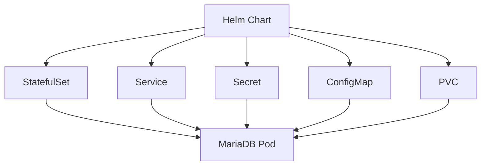

Helm이라는 이름은 배의 방향을 조종하는 키를 의미하는 영어 단어에서 유래한다.

Kubernetes라는 이름 역시 그리스어로 조타수 또는 항해사를 의미하는 단어에서 유래했다.

이러한 이름은 Kubernetes 생태계에서 Helm이 수행하는 역할과도 연결된다.

Kubernetes가 컨테이너 기반 시스템의 원하는 상태를 관리한다면, Helm은 Kubernetes에 배포할 애플리케이션을 패키지 단위로 구성하고 관리하는 역할을 담당한다.

---

### 패키지 관리자가 필요한 이유

Helm의 필요성을 이해하기 위해 먼저 Linux에서 패키지 관리자가 어떤 문제를 해결하는지 살펴보자.

Linux에서 애플리케이션을 설치하는 방법은 다양하다.

그중 하나는 소스 코드를 직접 다운로드하여 빌드하는 방식이다.

이 경우 다음과 같은 작업이 필요할 수 있다.

1. 소스 코드 다운로드
2. 빌드에 필요한 의존성 설치
3. 소스 코드 컴파일
4. 실행 파일 생성
5. 실행 파일을 적절한 경로에 배치
6. 환경 설정
7. 서비스 실행

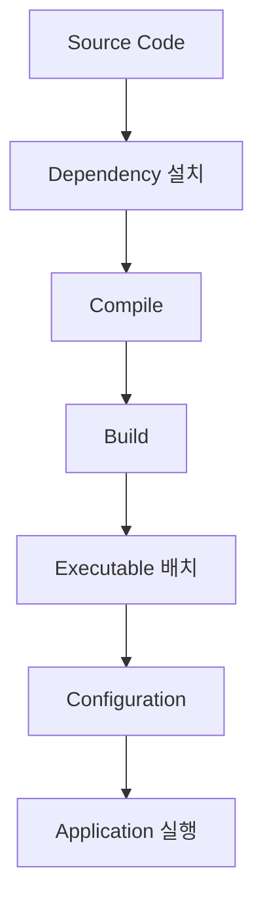

이러한 방식은 애플리케이션의 빌드 및 설치 과정을 직접 제어할 수 있다는 장점이 있다.

하지만 사용자가 의존성, 설치 경로, 실행 환경 등을 직접 관리해야 한다는 부담도 존재한다.

이러한 문제를 해결하기 위해 Linux 배포판에서는 패키지 관리자를 제공한다.

대표적으로 다음과 같은 도구들이 있다.

| Linux 배포판 | 패키지 관리자 |
|---|---|
| Ubuntu | APT |
| Debian | APT |
| RHEL 계열 | DNF |
| CentOS Linux 7 등 기존 환경 | YUM |
| Fedora | DNF |

Ubuntu에서는 다음 명령어로 Nginx를 설치할 수 있다.

```bash
sudo apt update
sudo apt install nginx
```

설치된 패키지를 제거할 때는 다음 명령어를 사용할 수 있다.

```bash
sudo apt remove nginx
```

패키지 관리자는 패키지 저장소에서 필요한 파일과 메타데이터를 가져오고, 의존성을 해결하며, 설치된 패키지의 상태를 관리한다.

덕분에 사용자는 애플리케이션을 설치할 때마다 모든 소스 코드를 직접 컴파일할 필요가 없다.

단, 패키지 제거 명령어가 관련 데이터와 설정을 항상 완전히 삭제하는 것은 아니다.

패키지 관리자의 역할은 패키지에 포함된 파일과 설치 상태를 관리하는 것이며, 사용자 데이터나 별도로 생성한 파일은 남을 수 있다.

이러한 개념은 Helm에도 적용된다.

---

### Kubernetes에도 패키지 관리자가 필요한 이유

Linux에서 패키지 관리자가 애플리케이션 설치를 단순화했다면, Kubernetes에서는 어떤 문제를 해결해야 할까?

Kubernetes 애플리케이션은 여러 리소스의 조합으로 구성된다.

예를 들어 일반적인 백엔드 애플리케이션을 배포한다고 가정하자.

다음과 같은 YAML 파일을 관리할 수 있다.

```text
kubernetes/
├── deployment.yaml
├── service.yaml
├── configmap.yaml
├── secret.yaml
├── ingress.yaml
├── serviceaccount.yaml
└── pvc.yaml
```

각 파일은 서로 다른 Kubernetes 리소스를 정의한다.

리소스를 생성하려면 다음과 같이 명령어를 실행할 수 있다.

```bash
kubectl apply -f deployment.yaml
kubectl apply -f service.yaml
kubectl apply -f configmap.yaml
kubectl apply -f secret.yaml
kubectl apply -f ingress.yaml
kubectl apply -f serviceaccount.yaml
kubectl apply -f pvc.yaml
```

물론 하나의 디렉터리에 있는 Manifest를 함께 적용하는 것도 가능하다.

```bash
kubectl apply -f kubernetes/
```

따라서 Helm이 없으면 여러 리소스를 한 번에 생성할 수 없다는 의미는 아니다.

문제는 리소스 생성 자체보다 **애플리케이션 단위의 변경 이력과 설정, 버전, 배포 상태를 관리하는 것**에 있다.

예를 들어 다음과 같은 상황을 생각해보자.

기존에는 Deployment의 Replica를 2개 사용했다.

새로운 버전을 배포하면서 Replica를 3개로 늘리고, 컨테이너 이미지를 변경하고, ConfigMap의 설정도 변경했다.

그런데 배포 이후 문제가 발생했다.

이때는 어떤 설정이 변경되었는지 파악하고 이전 상태로 되돌려야 한다.

단순히 여러 YAML 파일을 적용하는 것만으로는 애플리케이션의 배포 이력이 별도의 Release 단위로 관리되지 않는다.

Helm은 이러한 문제를 해결하기 위해 **애플리케이션을 패키지와 Release 단위로 관리하는 기능**을 제공한다.

---

### kubectl과 Helm의 차이

`kubectl`과 Helm은 모두 Kubernetes 리소스를 관리할 수 있지만 역할이 다르다.

`kubectl`은 Kubernetes API Server와 통신하여 리소스를 직접 조회하거나 생성하고 수정하는 CLI 도구이다.

반면 Helm은 Chart를 기반으로 여러 Kubernetes 리소스를 하나의 애플리케이션 패키지로 관리한다.

| 구분 | kubectl | Helm |
|---|---|---|
| 주요 목적 | Kubernetes 리소스 관리 | Kubernetes 애플리케이션 패키지 관리 |
| 관리 단위 | 개별 리소스 또는 Manifest 집합 | Chart와 Release |
| 리소스 생성 | `kubectl apply` | `helm install` |
| 설정 변경 | YAML 수정 후 적용 | Values 변경 후 Upgrade |
| 배포 이력 | 별도 관리 체계 필요 | Release Revision 제공 |
| 롤백 | 이전 Manifest 등을 활용 | `helm rollback` |
| 삭제 | `kubectl delete` | `helm uninstall` |
| 설정 재사용 | Kustomize 등과 조합 가능 | Values와 Template 사용 |

Helm이 `kubectl`을 대체하는 것은 아니다.

Helm으로 설치한 애플리케이션의 Pod 상태를 확인할 때도 `kubectl`을 사용할 수 있다.

```bash
kubectl get pods
```

Helm은 Kubernetes API를 활용하여 애플리케이션을 관리하는 상위 수준의 도구라고 이해할 수 있다.

---

### Helm의 핵심 개념: Chart, Values, Release

Helm을 이해하기 위해 반드시 알아야 하는 개념은 세 가지이다.

**Chart, Values, Release이다.**

| 개념 | 의미 |
|---|---|
| Chart | Kubernetes 애플리케이션을 구성하는 패키지 |
| Values | Chart에 적용할 설정값 |
| Release | Chart와 설정값을 이용해 설치한 애플리케이션 인스턴스 |

이 세 가지 개념은 서로 연결되어 있다.

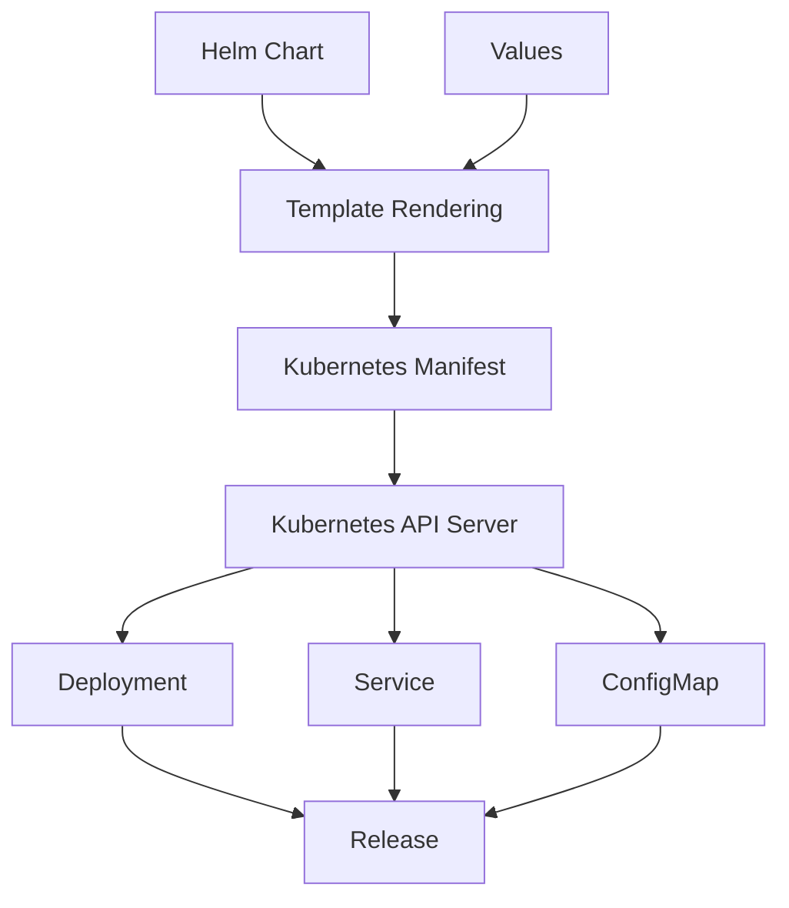

이 구조를 수식처럼 표현하면 다음과 같다.

**Chart + Values → Kubernetes Manifest → Release**

다만 Release는 단순한 Kubernetes 리소스들의 묶음이 아니라, Helm이 설치 결과와 변경 이력을 관리하기 위해 사용하는 논리적인 관리 단위이다.

각 개념을 자세히 살펴보자.

---

### Chart란?

Chart는 Kubernetes 애플리케이션을 설치하기 위한 패키지이다.

애플리케이션 실행에 필요한 Kubernetes 리소스의 Template과 기본 설정, 패키지 메타데이터 등을 포함한다.

예를 들어 Nginx를 설치하기 위한 Helm Chart가 있다고 가정하자.

이 Chart에는 다음과 같은 리소스 정의가 포함될 수 있다.

```text
Nginx Chart
│
├── Deployment Template
├── Service Template
├── ConfigMap Template
└── Values
```

이러한 Chart를 이용하면 사용자는 각 리소스의 YAML을 매번 직접 작성하지 않고도 애플리케이션을 배포할 수 있다.

또한 Chart는 특정 애플리케이션 전용으로 작성할 수도 있고, 공통적인 배포 패턴을 재사용하도록 구성할 수도 있다.

예를 들어 조직 내부의 모든 Spring Boot 서비스가 다음과 같은 공통 구성을 사용한다고 가정하자.

- Deployment
- Service
- ConfigMap
- Secret 참조
- Resource Requests 및 Limits
- Health Check
- ServiceAccount

이러한 구성을 Helm Chart로 표준화하면 각 서비스는 필요한 설정값만 변경하여 동일한 배포 구조를 사용할 수 있다.

이것이 Helm Chart가 제공하는 중요한 가치이다.

**Chart는 단순히 여러 YAML 파일을 압축한 것이 아니라, 설정값에 따라 Kubernetes 리소스를 생성할 수 있는 재사용 가능한 패키지이다.**

---

### Helm Chart의 기본 디렉터리 구조

일반적인 Helm Chart는 다음과 같은 구조를 가진다.

```text
my-chart/
├── Chart.yaml
├── values.yaml
├── charts/
├── crds/
└── templates/
    ├── deployment.yaml
    ├── service.yaml
    ├── configmap.yaml
    ├── _helpers.tpl
    └── NOTES.txt
```

각 파일과 디렉터리는 다음과 같은 역할을 한다.

| 항목 | 역할 |
|---|---|
| `Chart.yaml` | Chart 이름과 버전 등 메타데이터 정의 |
| `values.yaml` | Chart의 기본 설정값 |
| `templates/` | Kubernetes Manifest Template 저장 |
| `charts/` | 의존하는 다른 Chart 저장 |
| `crds/` | CustomResourceDefinition 정의 |
| `_helpers.tpl` | 재사용 가능한 Template 함수 |
| `NOTES.txt` | 설치 후 표시할 안내 메시지 |

모든 Chart가 위 파일을 전부 포함해야 하는 것은 아니다.

Chart의 목적과 구조에 따라 일부 파일은 생략할 수 있다.

#### Chart.yaml

다음은 Chart 메타데이터의 예시이다.

```yaml
apiVersion: v2
name: payment-service
description: Payment Service Helm Chart
type: application
version: 1.0.0
appVersion: "2.3.0"
```

각 필드의 의미는 다음과 같다.

| 필드 | 의미 |
|---|---|
| `apiVersion` | Helm Chart API 버전 |
| `name` | Chart 이름 |
| `description` | Chart 설명 |
| `type` | Chart 종류 |
| `version` | Chart 자체의 버전 |
| `appVersion` | Chart가 배포하는 애플리케이션의 버전 |

여기서 `version`과 `appVersion`은 서로 다른 개념이다.

예를 들어 다음과 같은 상황이 있을 수 있다.

```yaml
version: 1.0.0
appVersion: "2.3.0"
```

이는 Chart 버전이 `1.0.0`이고 애플리케이션 버전이 `2.3.0`이라는 의미이다.

애플리케이션의 버전과 Chart의 버전은 반드시 동일할 필요가 없다.

또한 `appVersion`은 메타데이터로서의 버전 정보이며, 반드시 컨테이너 이미지 태그를 결정하는 것은 아니다.

실제 이미지 태그는 Template에서 어떤 Values를 참조하도록 작성했는지에 따라 결정된다.

Chart의 파일 구조와 메타데이터 규칙은 Helm 공식 문서에서 정의하고 있다.

---

### Values란?

Values는 Chart에 적용할 설정값이다.

동일한 애플리케이션이라도 개발 환경과 운영 환경에서는 서로 다른 설정이 필요할 수 있다.

예를 들어 다음과 같은 차이가 존재할 수 있다.

| 설정 | 개발 환경 | 운영 환경 |
|---|---|---|
| Replica | 1 | 3 |
| 로그 레벨 | DEBUG | INFO |
| CPU Requests | 100m | 500m |
| Memory Requests | 128Mi | 512Mi |
| Service Type | ClusterIP | ClusterIP |
| 외부 도메인 | dev.example.com | example.com |

이러한 환경별 차이를 관리하기 위해 Values를 사용할 수 있다.

기본 Values 파일은 일반적으로 `values.yaml`이다.

```yaml
replicaCount: 1

image:
  repository: nginx
  tag: "stable"
  pullPolicy: IfNotPresent

service:
  type: ClusterIP
  port: 80

resources:
  requests:
    cpu: "100m"
    memory: "128Mi"
  limits:
    cpu: "500m"
    memory: "256Mi"
```

Helm Template에서는 이러한 값을 다음과 같이 참조한다.

```yaml
spec:
  replicas: {{ .Values.replicaCount }}
```

`{{ .Values.replicaCount }}`는 Helm의 Template 표현식이다.

Helm은 Chart를 렌더링하면서 해당 표현식을 실제 설정값으로 치환한다.

예를 들어 `replicaCount`가 3이라면 최종 Manifest는 다음과 같이 생성된다.

```yaml
spec:
  replicas: 3
```

이러한 방식으로 하나의 Chart를 여러 실행 환경에서 재사용할 수 있다.

---

### Config와 Values의 관계

Helm에서는 Chart에 적용하는 설정을 넓은 의미에서 Configuration 또는 Config라고 표현하기도 한다.

실제 CLI와 Chart 구성에서는 일반적으로 **Values**라는 용어를 사용한다.

Values는 다음과 같은 방법으로 지정할 수 있다.

기본적으로 Chart의 `values.yaml`을 사용한다.

환경별 설정 파일을 추가할 수도 있다.

```bash
helm install my-app ./my-chart -f values-production.yaml
```

CLI에서 직접 값을 전달할 수도 있다.

```bash
helm install my-app ./my-chart --set replicaCount=3
```

문자열 타입을 명시해야 한다면 `--set-string`을 사용할 수 있다.

```bash
helm install my-app ./my-chart --set-string image.tag=1.2.0
```

일반적으로 Values는 다음 순서로 설정을 구성한다.

1. Chart의 기본 Values
2. 사용자가 전달한 Values 파일
3. CLI의 `--set` 등을 통해 전달한 값

동일한 Key가 여러 곳에서 지정되었다면 우선순위와 병합 규칙에 따라 최종 값이 결정된다.

따라서 환경별 설정 파일과 CLI 옵션을 함께 사용할 때는 최종적으로 어떤 값이 적용되는지 확인하는 것이 중요하다.

---

### Release란?

Release는 Helm Chart를 사용하여 Kubernetes에 설치한 애플리케이션 인스턴스이다.

예를 들어 동일한 Chart를 개발 환경과 운영 환경에 각각 설치한다고 가정하자.

```text
Chart: payment-service
```

개발 환경에서는 다음과 같이 설치한다.

```bash
helm install payment-dev ./payment-service \
  -n development
```

운영 환경에서는 다음과 같이 설치한다.

```bash
helm install payment-prod ./payment-service \
  -n production
```

두 명령어는 동일한 Chart를 사용할 수 있다.

하지만 생성되는 Release는 서로 다르다.

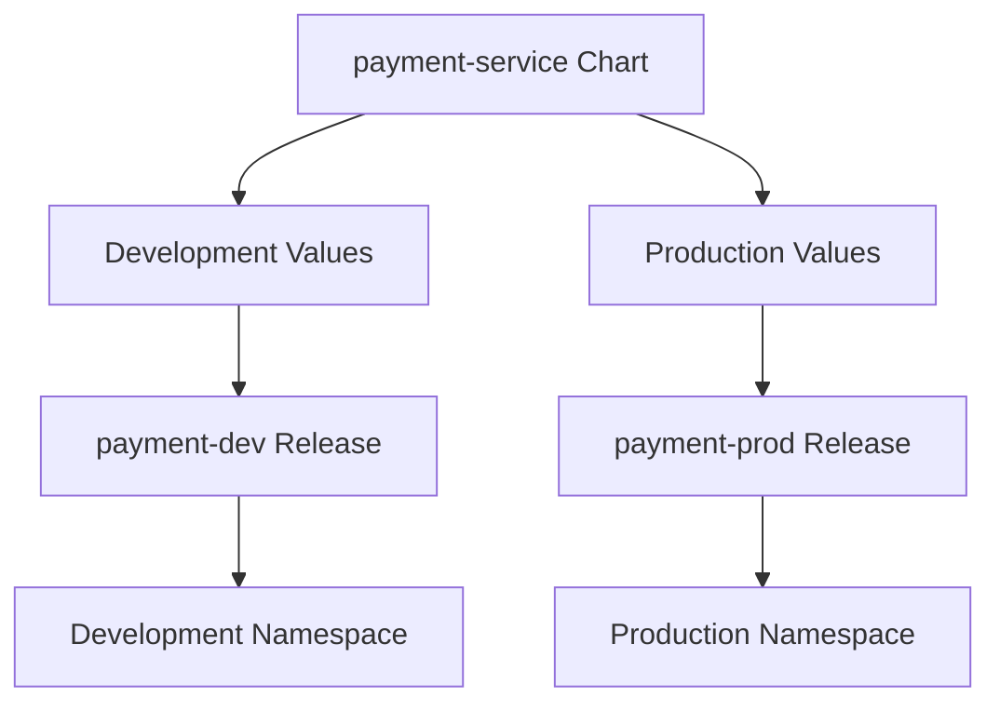

여기서 중요한 점은 다음과 같다.

**Chart는 배포에 사용할 패키지이고, Release는 그 Chart를 사용하여 설치한 실제 인스턴스이다.**

하나의 Chart에서 여러 Release를 생성할 수 있다.

Release는 설치 이후에도 Helm에서 관리된다.

예를 들어 Release에는 다음과 같은 정보가 연결된다.

- Release 이름
- Namespace
- Chart 정보
- 적용된 Values
- 렌더링된 Manifest
- 설치 및 변경 이력
- Revision
- 배포 상태

이러한 정보가 있기 때문에 Helm은 설치뿐 아니라 업그레이드와 롤백 기능도 제공할 수 있다.

---

### Chart Version, App Version, Release Revision의 차이

Helm을 사용하다 보면 서로 다른 세 가지 버전 정보를 접하게 된다.

첫 번째는 Chart Version이다.

두 번째는 App Version이다.

세 번째는 Release Revision이다.

이 세 가지는 구분해야 한다.

| 구분 | 의미 | 예시 |
|---|---|---|
| Chart Version | Chart 패키지 버전 | `1.2.0` |
| App Version | 애플리케이션 버전 메타데이터 | `2.3.0` |
| Release Revision | Release의 변경 이력 번호 | `3` |

예를 들어 다음과 같은 Chart가 있다고 가정하자.

```yaml
apiVersion: v2
name: payment-service
version: 1.2.0
appVersion: "2.3.0"
```

이 Chart를 처음 설치하면 Release Revision은 일반적으로 1이 된다.

이후 Values를 변경하여 업그레이드하면 Revision이 증가한다.

```text
Revision 1
    ↓
Revision 2
    ↓
Revision 3
```

같은 Chart 버전을 사용하더라도 설정을 변경하여 업그레이드하면 새로운 Revision이 생성될 수 있다.

따라서 다음 세 가지 질문은 서로 다른 질문이다.

- 어떤 버전의 Chart를 사용하고 있는가?
- 어떤 버전의 애플리케이션을 배포하고 있는가?
- 현재 Release는 몇 번째 변경 이력인가?

이 차이를 이해하면 Helm의 배포 이력을 더 정확하게 분석할 수 있다.

---

### Helm의 아키텍처

Helm의 아키텍처는 버전에 따라 변화해 왔다.

특히 Helm 2와 Helm 3 사이에는 중요한 차이가 있다.

Helm 2에서는 Kubernetes 클러스터 내부에 Tiller라는 서버 측 컴포넌트가 필요했다.

반면 Helm 3에서는 Tiller가 제거되었다.

Helm 4에서도 Helm 3 이후의 클라이언트 중심 구조가 유지된다.

이러한 변화를 이해하면 Helm의 배포 동작과 보안 구조를 더 명확하게 이해할 수 있다.

---

### Helm 2 아키텍처: Tiller

Helm 2는 크게 두 가지 구성 요소를 사용했다.

- Helm Client
- Tiller Server

Helm Client는 사용자가 실행하는 CLI 도구이다.

Tiller는 Kubernetes 클러스터 내부에 배포되는 서버 측 컴포넌트였다.

Helm Client가 설치 요청을 전달하면 Tiller가 Kubernetes API Server와 통신하여 리소스를 생성하거나 변경했다.

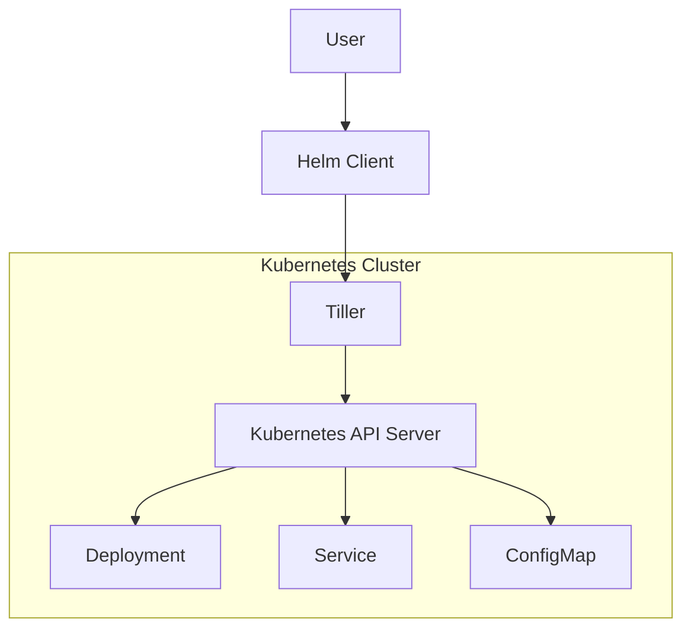

이 구조에서는 Tiller가 Kubernetes 리소스를 관리하기 위한 권한을 가져야 했다.

문제는 Tiller에 광범위한 권한이 부여될 경우 보안 위험이 커질 수 있다는 점이었다.

또한 서버 측 컴포넌트를 별도로 설치하고 운영해야 하므로 관리 부담이 존재했다.

이러한 구조적 문제는 Helm 3에서 중요한 변경이 이루어지는 계기가 되었다.

---

### Helm 3 아키텍처: Tiller 제거

Helm 3에서는 Tiller가 제거되었다.

이후 Helm Client가 Kubernetes API Server와 직접 통신하는 구조로 변경되었다.

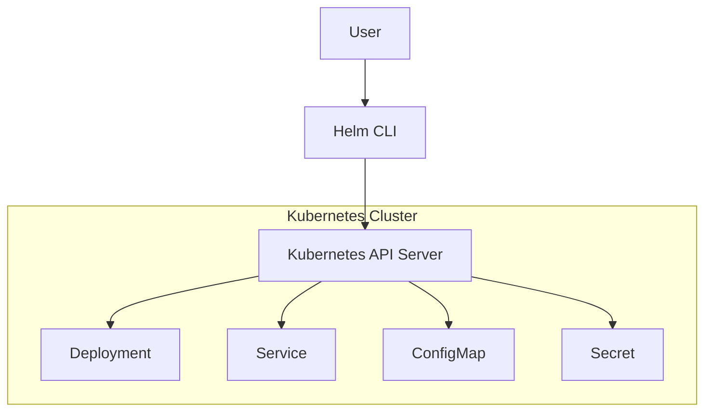

이 구조에서는 별도의 Tiller를 설치할 필요가 없다.

Helm Client는 Kubernetes의 인증 정보와 권한 체계를 이용하여 API Server에 접근한다.

일반적으로 현재 Kubernetes Context 및 Kubeconfig 설정에 따라 대상 클러스터가 결정된다.

따라서 Helm을 실행하는 사용자에게 Kubernetes 리소스를 관리할 수 있는 적절한 RBAC 권한이 필요하다.

여기서 중요한 점이 있다.

**Tiller가 제거되었다고 해서 Helm이 Kubernetes의 권한 제어를 우회하는 것은 아니다.**

Helm은 Kubernetes API를 사용하여 리소스를 생성하고 수정한다.

따라서 Kubernetes에서 해당 작업을 수행할 권한이 없다면 Helm 역시 작업에 실패할 수 있다.

---

### Helm Release 정보는 어디에 저장될까?

Helm은 Release를 관리하기 위해 설치 이력과 설정 정보를 저장해야 한다.

예를 들어 다음과 같은 작업을 수행한다고 가정하자.

```bash
helm install payment-service ./payment-service
```

Helm은 Chart와 Values를 바탕으로 Kubernetes Manifest를 생성하고 리소스를 설치한다.

동시에 설치된 Release에 관한 정보를 저장한다.

이후 업그레이드를 수행한다.

```bash
helm upgrade payment-service ./payment-service
```

Helm은 새로운 Revision에 대한 정보를 저장한다.

이러한 이력이 있어야 이전 Revision으로 되돌릴 수 있다.

Helm 3부터는 기본적으로 Kubernetes Secret을 이용하여 Release 정보를 저장한다.

일반적인 Release Secret 이름은 다음과 같은 형태이다.

```text
sh.helm.release.v1.<release-name>.v<revision>
```

예를 들어 다음과 같은 Secret이 생성될 수 있다.

```text
sh.helm.release.v1.payment-service.v1
sh.helm.release.v1.payment-service.v2
```

이름에서 마지막 `v1`, `v2`는 Release Revision을 의미한다.

Chart Version이나 Kubernetes API Version과는 다른 개념이다.

Release 정보를 확인하려면 다음 명령어를 사용할 수 있다.

```bash
kubectl get secrets -A -l owner=helm
```

이 명령어는 Helm Release 저장용 Secret을 조회하는 데 사용할 수 있다.

다만 Helm은 Secret 외에도 설정에 따라 다른 저장 백엔드를 사용할 수 있으므로 모든 환경에서 동일한 결과가 나타나는 것은 아니다.

또한 Secret의 데이터는 기본적으로 암호화된 비밀 데이터라는 의미가 아니다.

Kubernetes Secret은 접근 제어와 저장 시 암호화 설정을 적절하게 구성해야 한다.

특히 Helm Release 정보에는 Chart와 Values가 포함될 수 있으므로 민감한 설정값이 포함되지 않도록 주의해야 한다.

---

### Helm의 발전 과정

Helm은 2015년에 시작되어 Kubernetes 생태계의 대표적인 패키지 관리 도구로 발전했다.

주요 변화를 정리하면 다음과 같다.

| 시기 | 주요 변화 |
|---|---|
| 2015년 | Deis에서 Helm Classic 프로젝트 시작 |
| 2016년 1월 | Kubernetes Deployment Manager와 통합 |
| 2016년 | Helm 2 출시 및 Tiller 기반 구조 도입 |
| 2018년 6월 | CNCF 프로젝트로 편입 |
| 2019년 11월 | Helm 3 출시, Tiller 제거 |
| 2020년 4월 | CNCF Graduated 프로젝트로 승격 |
| 2020년 10월 | Helm Hub가 Artifact Hub로 대체 |
| 2025년 11월 | Helm 4 출시 |
| 2026년 | Helm 3에서 Helm 4로의 전환 진행 |

Helm 프로젝트는 2015년 Deis에서 Helm Classic이라는 이름으로 시작되었다.

이후 Kubernetes Deployment Manager와 통합되면서 Helm 2로 발전했다.

Helm 2에서는 Tiller를 통해 클러스터의 Release를 관리했다.

2019년 Helm 3에서는 Tiller가 제거되면서 클라이언트 중심 구조가 되었다.

2020년에는 CNCF의 Graduated 프로젝트가 되었으며, Helm Chart를 검색하는 Helm Hub는 Artifact Hub로 대체되었다.

2025년 11월 12일에는 Helm 4.0.0이 출시되었다.

Helm 4에서는 플러그인 아키텍처와 리소스 상태 추적 방식 등 여러 영역이 개선되었다.

---

### Helm 3와 Helm 4의 차이

Helm 3는 오랫동안 Kubernetes 환경에서 널리 사용된 주요 버전이다.

하지만 현재는 Helm 4가 출시되어 있다.

Helm 4에서도 Chart, Values, Release라는 핵심 개념은 유지된다.

기존 Helm 3 Chart와의 호환성 역시 중요한 설계 목표이다.

다만 내부 구조와 일부 기능은 변경되었다.

| 항목 | Helm 3 | Helm 4 |
|---|---|---|
| Tiller | 없음 | 없음 |
| 기본 구조 | 클라이언트 중심 | 클라이언트 중심 |
| Chart·Values·Release | 지원 | 지원 |
| Chart 호환성 | Helm 3 Chart 사용 | 기존 Chart와의 호환성 유지 |
| 플러그인 구조 | 기존 플러그인 구조 | 재설계된 플러그인 구조 |
| WebAssembly 플러그인 | 기본 구조에 없음 | 선택적으로 지원 |
| 리소스 상태 추적 | 기존 방식 | kstatus 기반 기능 도입 |
| OCI 지원 | 지원 | Digest 기반 활용 등 개선 |
| SDK | Helm 3 SDK | Helm 4 SDK 구조 변경 |

Helm 4는 기존 사용 방식을 최대한 유지하면서 새로운 기능을 도입했지만, SDK와 플러그인을 직접 사용하는 환경에서는 호환성을 검토해야 한다.

일반적인 Chart 설치와 업그레이드 작업에서는 기존의 핵심 명령어들을 계속 사용할 수 있다.

Helm 공식 일정에 따르면 Helm 3의 마지막 기능 릴리스는 2026년 9월이며, 보안 수정 지원은 2027년 2월 10일까지 제공될 예정이다.

따라서 장기적으로 운영할 환경이라면 Helm 4 전환을 검토하는 것이 적절하다.

---

### Helm Chart가 실제 Kubernetes Manifest로 변환되는 과정

Helm은 Chart에 포함된 Kubernetes Template과 Values를 조합하여 최종 Manifest를 생성한다.

예를 들어 Deployment Template에 다음 설정이 있다고 가정하자.

```yaml
apiVersion: apps/v1
kind: Deployment

metadata:
  name: {{ .Release.Name }}

spec:
  replicas: {{ .Values.replicaCount }}
```

여기에는 일반적인 YAML에서는 사용하지 않는 표현식이 있다.

```text
{{ .Release.Name }}
```

```text
{{ .Values.replicaCount }}
```

이들은 Helm의 Template 표현식이다.

`.Release.Name`은 설치할 Release의 이름을 나타낸다.

`.Values.replicaCount`는 Values에서 설정한 Replica 수량을 나타낸다.

예를 들어 다음과 같은 Values가 있다.

```yaml
replicaCount: 3
```

그리고 다음 명령어로 설치한다고 가정하자.

```bash
helm install web-service ./web-chart
```

그러면 Helm은 Template을 렌더링하여 다음과 같은 Manifest를 생성할 수 있다.

```yaml
apiVersion: apps/v1
kind: Deployment

metadata:
  name: web-service

spec:
  replicas: 3
```

이러한 과정을 Template Rendering이라고 한다.

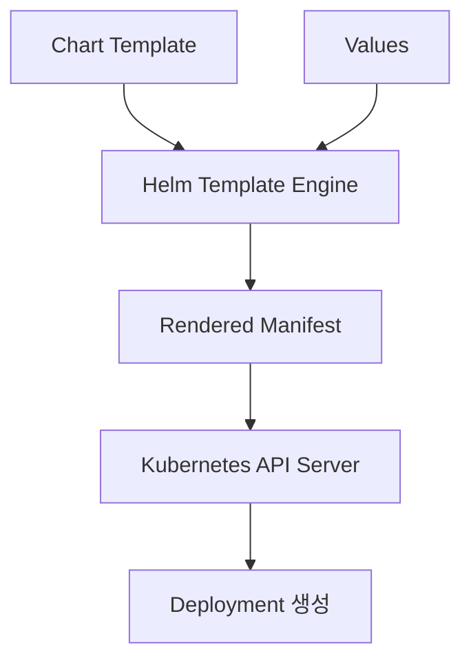

Helm은 Go Template 문법을 기반으로 Template을 처리한다.

따라서 단순한 값 치환뿐 아니라 조건문, 반복문, 함수 등을 활용하여 Manifest를 동적으로 생성할 수 있다.

---

### Helm Chart를 직접 작성해보기

이번에는 간단한 Nginx 애플리케이션을 배포하는 Helm Chart를 작성해보자.

다음 세 가지 Kubernetes 리소스를 생성한다.

- Deployment
- Service
- ConfigMap

또한 Values를 이용해 Replica 수량과 이미지, 애플리케이션 실행 환경을 변경할 수 있도록 구성한다.

전체 구성은 다음과 같다.

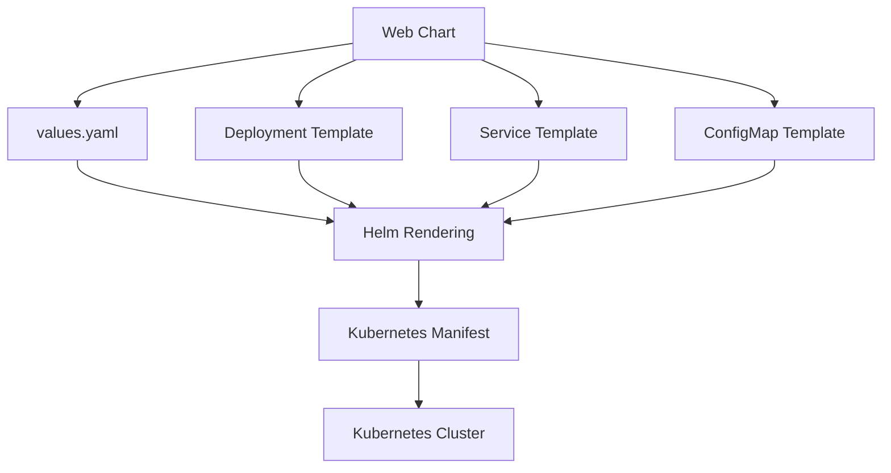

#### Chart 디렉터리 생성

먼저 디렉터리를 생성한다.

```bash
mkdir -p web-chart/templates
```

생성할 파일 구조는 다음과 같다.

```text
web-chart/
├── Chart.yaml
├── values.yaml
└── templates/
    ├── deployment.yaml
    ├── service.yaml
    └── configmap.yaml
```

`helm create` 명령어로 기본 Chart 구조를 자동 생성할 수도 있지만, 여기서는 각 파일의 역할을 명확하게 이해하기 위해 필요한 파일만 직접 작성한다.

---

### Chart.yaml 작성하기

먼저 Chart의 메타데이터를 정의한다.

**web-chart/Chart.yaml**

```yaml
apiVersion: v2
name: web-chart
description: Nginx application Helm chart
type: application
version: 0.1.0
appVersion: "1.0.0"
```

여기서는 Chart 이름을 `web-chart`로 지정했다.

Chart Version은 `0.1.0`이다.

App Version은 예제 애플리케이션의 메타데이터 버전인 `1.0.0`이다.

이 파일은 Helm Chart의 기본적인 식별 정보를 제공한다.

---

### values.yaml 작성하기

다음으로 기본 설정값을 작성한다.

**web-chart/values.yaml**

```yaml
replicaCount: 1

image:
  repository: nginx
  tag: "stable"
  pullPolicy: IfNotPresent

service:
  type: ClusterIP
  port: 80
  targetPort: 80

app:
  mode: development

resources:
  requests:
    cpu: "100m"
    memory: "128Mi"

  limits:
    cpu: "500m"
    memory: "256Mi"
```

이 파일에는 다음과 같은 설정이 존재한다.

| Key | 의미 |
|---|---|
| `replicaCount` | 생성할 Pod 수량 |
| `image.repository` | 컨테이너 이미지 저장소 |
| `image.tag` | 이미지 태그 |
| `image.pullPolicy` | 이미지 다운로드 정책 |
| `service.type` | Service 타입 |
| `service.port` | Service 포트 |
| `service.targetPort` | 컨테이너 포트 |
| `app.mode` | 애플리케이션 실행 환경 |
| `resources.requests` | 컨테이너 요청 자원 |
| `resources.limits` | 컨테이너 제한 자원 |

이러한 설정은 Template에서 `.Values`를 통해 참조할 수 있다.

운영 환경에서는 `stable`처럼 변경 가능한 이미지 태그보다 검증된 버전 또는 이미지 Digest를 고정하는 것이 좋다.

---

### Deployment Template 작성하기

이제 Deployment Template을 작성한다.

**web-chart/templates/deployment.yaml**

```yaml
apiVersion: apps/v1
kind: Deployment

metadata:
  name: {{ .Release.Name }}

  labels:
    app.kubernetes.io/name: {{ .Chart.Name }}
    app.kubernetes.io/instance: {{ .Release.Name }}

spec:
  replicas: {{ .Values.replicaCount }}

  selector:
    matchLabels:
      app.kubernetes.io/instance: {{ .Release.Name }}

  template:
    metadata:
      labels:
        app.kubernetes.io/name: {{ .Chart.Name }}
        app.kubernetes.io/instance: {{ .Release.Name }}

    spec:
      containers:
        - name: nginx

          image: "{{ .Values.image.repository }}:{{ .Values.image.tag }}"
          imagePullPolicy: {{ .Values.image.pullPolicy }}

          ports:
            - name: http
              containerPort: {{ .Values.service.targetPort }}

          env:
            - name: APP_MODE
              valueFrom:
                configMapKeyRef:
                  name: {{ .Release.Name }}-config
                  key: APP_MODE

          resources:
            requests:
              cpu: {{ .Values.resources.requests.cpu | quote }}
              memory: {{ .Values.resources.requests.memory | quote }}

            limits:
              cpu: {{ .Values.resources.limits.cpu | quote }}
              memory: {{ .Values.resources.limits.memory | quote }}
```

이 Template에는 여러 Helm 표현식이 사용된다.

대표적으로 다음과 같다.

```text
{{ .Release.Name }}
```

Release 이름을 가져온다.

```text
{{ .Chart.Name }}
```

Chart 이름을 가져온다.

```text
{{ .Values.replicaCount }}
```

Values에 정의된 Replica 수량을 가져온다.

```text
{{ .Values.image.repository }}
```

컨테이너 이미지 저장소를 가져온다.

```text
{{ .Values.image.tag }}
```

컨테이너 이미지 태그를 가져온다.

여기서 `quote`는 값을 YAML 문자열로 표현하도록 처리하는 Helm Template 함수이다.

예를 들어 다음 설정이 있다고 가정하자.

```yaml
cpu: "100m"
```

Template에서 다음과 같이 사용하면,

```yaml
cpu: {{ .Values.resources.requests.cpu | quote }}
```

렌더링된 결과는 다음과 같은 형태가 된다.

```yaml
cpu: "100m"
```

이처럼 Helm은 Values의 설정을 Kubernetes Manifest에 적절한 형태로 적용할 수 있다.

---

### Service Template 작성하기

다음은 Service Template이다.

**web-chart/templates/service.yaml**

```yaml
apiVersion: v1
kind: Service

metadata:
  name: {{ .Release.Name }}

  labels:
    app.kubernetes.io/name: {{ .Chart.Name }}
    app.kubernetes.io/instance: {{ .Release.Name }}

spec:
  type: {{ .Values.service.type }}

  selector:
    app.kubernetes.io/instance: {{ .Release.Name }}

  ports:
    - name: http
      port: {{ .Values.service.port }}
      targetPort: {{ .Values.service.targetPort }}
```

Service는 Deployment에서 생성한 Pod로 네트워크 요청을 전달한다.

여기서 중요한 것은 Selector이다.

```yaml
selector:
  app.kubernetes.io/instance: {{ .Release.Name }}
```

Deployment의 Pod Template에도 동일한 Label이 존재한다.

```yaml
labels:
  app.kubernetes.io/instance: {{ .Release.Name }}
```

따라서 Service는 해당 Label을 가진 Pod를 대상으로 요청을 전달할 수 있다.

또한 Release 이름을 Label에 사용했기 때문에 같은 Chart를 여러 Release로 설치하더라도 각 Release의 Pod를 구분할 수 있다.

---

### ConfigMap Template 작성하기

마지막으로 ConfigMap Template을 작성한다.

**web-chart/templates/configmap.yaml**

```yaml
apiVersion: v1
kind: ConfigMap

metadata:
  name: {{ .Release.Name }}-config

  labels:
    app.kubernetes.io/name: {{ .Chart.Name }}
    app.kubernetes.io/instance: {{ .Release.Name }}

data:
  APP_MODE: {{ .Values.app.mode | quote }}
```

ConfigMap은 Values의 `app.mode`를 문자열로 저장한다.

기본 Values에서는 다음과 같이 정의했다.

```yaml
app:
  mode: development
```

따라서 실제 ConfigMap은 다음과 같은 값을 가진다.

```yaml
data:
  APP_MODE: "development"
```

Deployment에서는 이 ConfigMap의 값을 환경 변수로 사용한다.

```yaml
env:
  - name: APP_MODE
    valueFrom:
      configMapKeyRef:
        name: {{ .Release.Name }}-config
        key: APP_MODE
```

이렇게 하면 Chart에 정의된 설정값을 컨테이너 환경 변수로 전달할 수 있다.

다만 Nginx 자체가 `APP_MODE`라는 환경 변수를 자동으로 활용하는 것은 아니다.

이 예제에서는 ConfigMap이 컨테이너에 전달되는 과정을 확인하기 위해 사용한다.

---

### Helm Template 렌더링 확인하기

Chart를 작성했다면 실제 Kubernetes에 설치하기 전에 Template이 올바르게 렌더링되는지 확인하는 것이 좋다.

먼저 Chart를 검사한다.

```bash
helm lint ./web-chart
```

정상적인 Chart라면 다음과 유사한 결과가 나타날 수 있다.

```text
==> Linting ./web-chart
[INFO] Chart.yaml: icon is recommended

1 chart(s) linted, 0 chart(s) failed
```

Helm 버전에 따라 메시지는 달라질 수 있다.

이 명령어는 Chart의 기본적인 형식과 Template 문제를 검사한다.

다음으로 Template을 렌더링한다.

```bash
helm template web-demo ./web-chart
```

이 명령어는 Release 이름을 `web-demo`로 가정하고 Template을 렌더링한다.

하지만 Kubernetes에 리소스를 실제로 생성하지는 않는다.

렌더링 결과에는 다음과 같은 Manifest가 포함된다.

```yaml
apiVersion: v1
kind: ConfigMap

metadata:
  name: web-demo-config

data:
  APP_MODE: "development"
```

Deployment의 이름은 다음과 같이 생성된다.

```yaml
metadata:
  name: web-demo
```

Replica 수량은 기본 Values에 따라 다음과 같이 설정된다.

```yaml
spec:
  replicas: 1
```

즉 다음 과정을 확인할 수 있다.

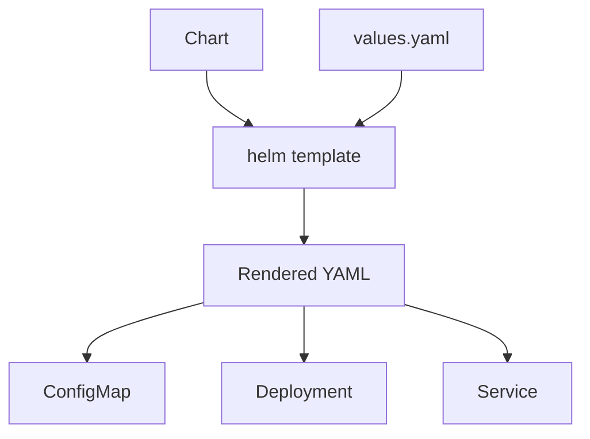

이처럼 `helm template`은 실제 배포 전에 최종 Kubernetes Manifest를 확인하는 데 유용하다.

---

### Helm으로 애플리케이션 설치하기

이제 작성한 Chart를 Kubernetes에 설치해보자.

먼저 클러스터에 연결할 수 있는지 확인한다.

```bash
kubectl get nodes
```

정상적으로 연결된다면 Node 목록이 출력된다.

다음으로 Helm을 이용해 설치한다.

```bash
helm install web-demo ./web-chart \
  --namespace helm-demo \
  --create-namespace \
  --wait \
  --timeout 3m
```

각 옵션의 의미는 다음과 같다.

| 옵션 | 의미 |
|---|---|
| `web-demo` | Release 이름 |
| `./web-chart` | 설치할 Chart 경로 |
| `--namespace helm-demo` | 대상 Namespace |
| `--create-namespace` | Namespace가 없으면 생성 |
| `--wait` | 관련 리소스의 준비 상태를 기다림 |
| `--timeout 3m` | 최대 대기 시간 설정 |

정상적으로 설치되면 다음과 유사한 결과가 나타날 수 있다.

```text
NAME: web-demo
NAMESPACE: helm-demo
STATUS: deployed
REVISION: 1
```

실제 출력 형식은 Helm 버전에 따라 달라질 수 있다.

이제 Kubernetes 리소스를 확인한다.

```bash
kubectl get deployment,service,configmap -n helm-demo
```

예상되는 주요 결과는 다음과 같다.

```text
deployment.apps/web-demo
service/web-demo
configmap/web-demo-config
```

이처럼 Helm은 하나의 Chart를 통해 여러 Kubernetes 리소스를 생성할 수 있다.

---

### Helm Release 확인하기

설치된 Release 목록은 다음 명령어로 조회할 수 있다.

```bash
helm list -n helm-demo
```

출력 예시:

```text
NAME       NAMESPACE   REVISION   STATUS     CHART
web-demo   helm-demo   1          deployed   web-chart-0.1.0
```

Release의 상세 상태를 확인하려면 다음 명령어를 사용한다.

```bash
helm status web-demo -n helm-demo
```

Release에 적용된 Values를 확인할 수도 있다.

```bash
helm get values web-demo -n helm-demo
```

기본값까지 포함하여 확인하려면 다음과 같이 작성한다.

```bash
helm get values web-demo -n helm-demo --all
```

Helm이 실제로 설치에 사용한 Manifest도 확인할 수 있다.

```bash
helm get manifest web-demo -n helm-demo
```

이러한 명령어를 활용하면 Chart가 어떤 설정으로 설치되었는지 파악할 수 있다.

---

### Helm Upgrade: 애플리케이션 설정 변경하기

Helm은 설치된 Release를 업그레이드할 수 있다.

이번에는 Replica 수량을 1개에서 2개로 변경해보자.

기본 `values.yaml`을 직접 수정하는 대신 별도의 운영 설정 파일을 작성한다.

**values-production.yaml**

```yaml
replicaCount: 2

app:
  mode: production
```

이 파일에는 변경하고 싶은 값만 작성했다.

나머지 설정은 Chart의 기본 Values를 사용한다.

이제 다음 명령어로 업그레이드한다.

```bash
helm upgrade web-demo ./web-chart \
  --namespace helm-demo \
  --values values-production.yaml \
  --wait \
  --timeout 3m
```

정상적으로 업그레이드되면 Release Revision이 증가한다.

```text
Revision 1
    ↓
Revision 2
```

Replica 수량을 확인한다.

```bash
kubectl get deployment web-demo -n helm-demo \
  -o jsonpath='{.spec.replicas}{"\n"}'
```

출력:

```text
2
```

ConfigMap 값도 확인할 수 있다.

```bash
kubectl get configmap web-demo-config -n helm-demo \
  -o jsonpath='{.data.APP_MODE}{"\n"}'
```

출력:

```text
production
```

단, 기존에 실행 중인 컨테이너에 주입된 환경 변수가 ConfigMap 변경만으로 자동으로 갱신되는 것은 아니다.

이번 업그레이드에서는 Replica 변경으로 Pod 구성이 달라지지만, 모든 Pod의 환경 변수 갱신 여부를 확실하게 보장하려면 재시작 또는 Pod Template 변경을 포함하는 배포 전략이 필요하다.

실무에서는 ConfigMap의 변경에 따라 Pod를 재시작할 수 있도록 Checksum Annotation 등의 방식을 활용하기도 한다.

---

### Helm Rollback: 이전 버전으로 되돌리기

업그레이드 이후 문제가 발생했다고 가정하자.

예를 들어 새로운 설정이 적용된 이후 애플리케이션에 오류가 발생할 수 있다.

이때 Helm은 이전 Revision으로 되돌리는 기능을 제공한다.

먼저 Release 이력을 확인한다.

```bash
helm history web-demo -n helm-demo
```

예상 결과는 다음과 같다.

```text
REVISION   STATUS       CHART
1          superseded   web-chart-0.1.0
2          deployed     web-chart-0.1.0
```

Revision 1은 처음 설치한 상태이다.

Revision 2는 운영 설정으로 업그레이드한 상태이다.

이제 첫 번째 Revision으로 되돌려보자.

```bash
helm rollback web-demo 1 \
  --namespace helm-demo \
  --wait \
  --timeout 3m
```

정상적으로 롤백되면 Release는 이전 Revision의 설정을 기준으로 다시 적용된다.

여기서 중요한 점이 있다.

**Rollback을 실행했다고 해서 Release Revision 번호가 이전 번호로 감소하는 것은 아니다.**

기존 Revision으로 롤백하는 작업 자체가 새로운 Revision으로 기록된다.

따라서 다음과 같은 이력이 만들어질 수 있다.

```text
Revision 1: 최초 설치
Revision 2: 설정 변경
Revision 3: Revision 1로 롤백
```

이를 구조적으로 표현하면 다음과 같다.

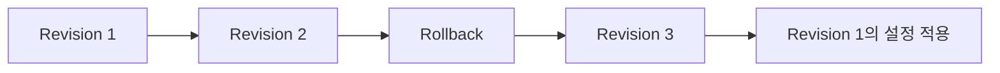

롤백 이후 Replica 수량을 조회하면 다시 1이 적용될 수 있다.

```bash
kubectl get deployment web-demo -n helm-demo \
  -o jsonpath='{.spec.replicas}{"\n"}'
```

출력:

```text
1
```

Helm의 Revision은 설치, 업그레이드, 롤백을 수행하면서 증가하며, 이력을 조회해 특정 Revision으로 되돌릴 수 있다.

---

### Helm Uninstall: 애플리케이션 삭제하기

설치한 Release를 삭제하려면 다음 명령어를 사용한다.

```bash
helm uninstall web-demo -n helm-demo
```

정상적으로 삭제되면 다음과 같은 메시지가 출력될 수 있다.

```text
release "web-demo" uninstalled
```

이 명령어는 해당 Release가 관리하는 Kubernetes 리소스를 삭제한다.

이번 Chart에서는 다음 리소스가 삭제 대상이다.

- Deployment
- Service
- ConfigMap

삭제 여부를 확인한다.

```bash
kubectl get deployment,service,configmap -n helm-demo
```

Release에 해당하는 리소스가 더 이상 존재하지 않는지 확인할 수 있다.

다만 `helm uninstall`이 모든 연관 데이터를 반드시 완전히 삭제하는 것은 아니다.

Helm에서 관리하지 않는 리소스는 삭제 대상이 아닐 수 있다.

또한 다음과 같은 리소스는 별도의 처리가 필요할 수 있다.

- `helm.sh/resource-policy: keep`으로 보존하도록 설정한 리소스
- Chart의 `crds/` 디렉터리로 설치한 CRD
- Hook을 통해 생성되어 Helm의 일반적인 삭제 대상에 포함되지 않는 리소스
- 스토리지 정책에 따라 보존되는 PersistentVolume
- 별도로 생성한 Namespace
- 외부 시스템에 저장된 데이터

특히 데이터베이스 Chart를 삭제할 때는 PVC와 PV의 보존 정책을 확인해야 한다.

Helm 공식 문서에서도 보존 정책 및 Hook에 의해 생성된 리소스는 별도의 삭제 처리가 필요할 수 있음을 설명한다.

---

### Helm Repository와 Artifact Hub

Helm Chart는 직접 작성할 수도 있지만, 다른 개발자나 조직이 제공하는 Chart를 사용할 수도 있다.

이러한 Chart를 공유하기 위한 저장소가 Chart Repository이다.

Helm에서는 다음과 같은 명령어를 사용하여 Chart를 검색할 수 있다.

```bash
helm search hub nginx
```

이 명령어는 Artifact Hub에서 관련 Chart를 검색하는 데 사용할 수 있다.

Artifact Hub는 Kubernetes 생태계의 여러 패키지와 구성 요소를 검색하고 탐색할 수 있는 서비스이다.

Helm Chart 역시 Artifact Hub를 통해 검색할 수 있다.

다만 Artifact Hub 자체가 모든 Chart 파일을 직접 제공하는 저장소인 것은 아니다.

Chart의 실제 배포 위치는 개별 Chart Repository 또는 OCI Registry일 수 있다.

#### Chart Repository 등록

일반적인 등록 명령어는 다음과 같다.

```bash
helm repo add <repository-name> <repository-url>
```

등록된 Repository를 확인한다.

```bash
helm repo list
```

Repository의 인덱스 정보를 갱신한다.

```bash
helm repo update
```

등록된 Repository에서 Chart를 검색한다.

```bash
helm search repo <chart-name>
```

특정 Chart의 설정값을 확인하려면 다음과 같이 작성할 수 있다.

```bash
helm show values <repository-name>/<chart-name>
```

이러한 명령어를 통해 Chart 설치 전에 어떤 설정을 지원하는지 확인할 수 있다.

Helm은 일반적인 Chart Repository뿐 아니라 OCI Registry를 통한 Chart 배포도 지원한다.

---

### Helm과 Docker Image의 차이

Helm을 처음 접하면 Chart와 Docker Image를 비슷한 개념으로 혼동할 수 있다.

하지만 두 개념은 서로 다른 역할을 담당한다.

Docker Image는 컨테이너 실행에 필요한 애플리케이션과 의존성을 포함한다.

반면 Helm Chart는 해당 이미지를 Kubernetes에서 어떤 방식으로 실행할지 정의한다.

예를 들어 다음과 같은 구성이 있다고 가정하자.

```text
Docker Image
└── payment-service:1.0.0
```

이 이미지를 Kubernetes에서 실행하려면 Deployment 등의 리소스가 필요하다.

Helm Chart는 다음과 같은 설정을 제공할 수 있다.

```text
Helm Chart
├── Deployment
├── Service
├── ConfigMap
├── Secret 참조
├── Resource 설정
└── Health Check
```

즉 Docker Image와 Helm Chart의 역할은 다음과 같다.

| 구분 | Docker Image | Helm Chart |
|---|---|---|
| 주요 목적 | 컨테이너 실행 환경 패키징 | Kubernetes 배포 설정 패키징 |
| 포함 내용 | 애플리케이션, 런타임, 의존성 | Kubernetes Template, Values, 메타데이터 |
| 실행 대상 | Container Runtime | Helm |
| 관리 대상 | 컨테이너 이미지 | Kubernetes 리소스 |
| 대표 도구 | Docker, BuildKit | Helm |

Helm은 일반적으로 애플리케이션의 소스 코드를 컴파일하거나 Docker Image를 빌드하지 않는다.

이미 빌드된 컨테이너 이미지를 Kubernetes에 배포하기 위한 리소스를 관리하는 역할에 가깝다.

이러한 차이를 이해하면 CI/CD 파이프라인의 책임을 더 명확하게 분리할 수 있다.

---

### Helm을 실무에서 활용하는 10가지 방법

Helm은 단순히 외부 애플리케이션을 설치할 때만 사용하는 도구가 아니다.

내부 백엔드 시스템의 배포 표준화와 운영 자동화에도 활용할 수 있다.

대표적인 활용 방법을 정리하면 다음과 같다.

| 활용 방법 | 구현 방향 | 기대 효과 |
|---|---|---|
| 1. Spring Boot 배포 표준화 | 공통 Deployment Chart 작성 | 서비스별 배포 설정 일관성 확보 |
| 2. 개발·운영 환경 분리 | 환경별 Values 파일 사용 | 중복 Manifest 감소 |
| 3. Replica 관리 | `replicaCount` 설정 | 환경별 Pod 수량 제어 |
| 4. 이미지 버전 관리 | 이미지 Repository·Tag를 Values로 관리 | 배포 버전 추적 |
| 5. ConfigMap 관리 | ConfigMap Template 구성 | 설정 관리 방식 표준화 |
| 6. Secret 연동 | 기존 Secret 참조 설정 | 민감 정보와 배포 설정 분리 |
| 7. 리소스 정책 관리 | Requests·Limits 설정 | 자원 사용 정책 일관성 확보 |
| 8. 배포 이력 관리 | Release Revision 활용 | 변경 이력 추적 |
| 9. 장애 발생 시 롤백 | `helm rollback` 활용 | 이전 배포 설정 복구 |
| 10. CI/CD 자동화 | `helm upgrade --install` 활용 | 반복 배포 작업 자동화 |

예를 들어 여러 Spring Boot 서비스를 운영한다고 가정하자.

서비스마다 Deployment, Service, ConfigMap, HPA를 직접 작성하는 대신 공통 Helm Chart를 구성할 수 있다.

각 서비스는 서로 다른 Values만 사용한다.

```text
Common Spring Boot Chart
│
├── payment-service-values.yaml
├── coupon-service-values.yaml
├── notification-service-values.yaml
└── membership-service-values.yaml
```

이렇게 구성하면 서비스마다 동일한 배포 정책을 적용할 수 있다.

또한 공통 Chart를 개선하면 다른 서비스에서도 변경된 배포 구조를 재사용할 수 있다.

다만 공통 Chart를 변경했다고 해서 기존 Release들이 자동으로 모두 업그레이드되는 것은 아니다.

각 Release에 새로운 Chart 버전을 적용하는 배포 과정이 필요하다.

---

### Helm을 사용할 때 주의해야 할 사항

Helm은 Kubernetes 애플리케이션 관리를 단순화하지만 모든 운영 문제를 자동으로 해결하지는 않는다.

특히 다음 사항들을 고려해야 한다.

#### Helm은 Kubernetes Controller가 아니다

Helm은 Chart를 렌더링하고 Kubernetes API에 원하는 리소스 상태를 전달한다.

하지만 일반적인 Helm 설치 이후에도 계속 실행되면서 리소스를 감시하는 서버 측 Controller가 존재하는 것은 아니다.

실제 Pod 수량을 유지하거나 장애가 발생한 Pod를 재생성하는 작업은 Kubernetes Controller가 수행한다.

#### Chart Version과 Release Revision은 다르다

Chart Version은 패키지 자체의 버전이다.

Release Revision은 특정 설치 인스턴스의 변경 이력이다.

같은 Chart를 사용하더라도 Values를 변경하여 업그레이드하면 Revision이 증가할 수 있다.

#### Values에 민감한 정보를 직접 저장하지 않는다

Helm Release 정보에는 Chart와 Values가 포함될 수 있다.

따라서 비밀번호나 API Key를 일반 Values 파일에 직접 저장하면 보안 문제가 발생할 수 있다.

실무에서는 기존 Secret을 참조하거나 External Secrets Operator, 별도의 Secret 관리 시스템 등을 활용하는 방식을 고려해야 한다.

#### Rollback이 모든 상태를 복구하는 것은 아니다

Helm Rollback은 이전 Release의 Kubernetes 리소스 구성을 다시 적용하는 기능이다.

하지만 데이터베이스 스키마 변경이나 외부 시스템 데이터까지 자동으로 되돌리지는 않는다.

예를 들어 애플리케이션 배포와 함께 데이터베이스 Migration을 수행했다면 Helm Rollback만으로 이전 상태가 완전히 복구되지 않을 수 있다.

따라서 애플리케이션의 롤백과 데이터의 롤백은 별도로 고려해야 한다.

#### Helm Uninstall은 모든 데이터를 삭제하지 않을 수 있다

PVC, PV, CRD, Hook 리소스, 외부 시스템의 데이터 등은 삭제 이후에도 남을 수 있다.

특히 StatefulSet을 사용하는 데이터베이스 시스템에서는 스토리지 보존 정책을 확인해야 한다.

#### Chart를 설치하기 전에 내용을 확인한다

외부 Chart를 사용할 때는 Chart가 어떤 Kubernetes 리소스를 생성하는지 확인하는 것이 좋다.

다음 명령어를 활용할 수 있다.

```bash
helm show values <repository-name>/<chart-name>
```

```bash
helm template my-release <repository-name>/<chart-name>
```

또한 Chart와 Container Image의 공급망 신뢰성을 검토하는 것이 중요하다.

---

### 정리

Helm은 Kubernetes용 패키지 관리자이다.

Kubernetes 애플리케이션을 실행하는 데 필요한 여러 리소스를 하나의 Chart로 구성하고, 이를 설치·업그레이드·롤백·삭제할 수 있도록 지원한다.

Helm을 이해하기 위해서는 세 가지 핵심 개념을 구분해야 한다.

**Chart는 Kubernetes 애플리케이션 패키지이다.**

애플리케이션을 구성하는 Kubernetes 리소스의 Template과 기본 설정을 포함한다.

**Values는 Chart에 적용할 설정값이다.**

Replica 수량, 이미지 태그, Service 설정, Resource 설정 등을 환경에 맞게 변경할 수 있다.

**Release는 Chart와 Values를 이용해 설치한 애플리케이션 인스턴스이다.**

설치 이후에도 Helm은 Release의 설정과 변경 이력을 관리한다.

이 세 가지 개념은 다음과 같이 연결된다.

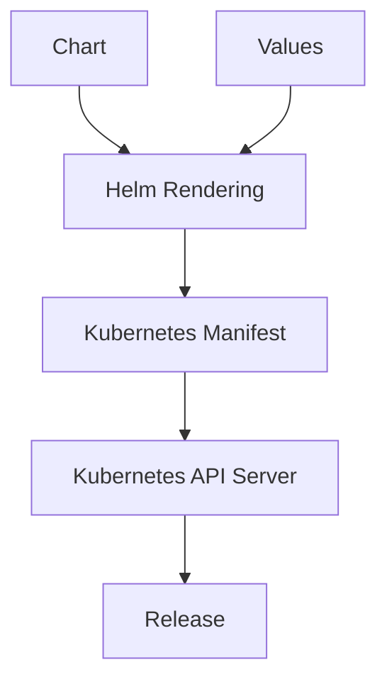

Helm의 주요 명령어는 다음과 같다.

| 명령어 | 역할 |
|---|---|
| `helm version` | Helm 버전 확인 |
| `helm create` | 기본 Chart 생성 |
| `helm lint` | Chart 검사 |
| `helm template` | Template 렌더링 |
| `helm install` | Chart 설치 |
| `helm list` | Release 목록 확인 |
| `helm status` | Release 상태 확인 |
| `helm get values` | 적용된 Values 확인 |
| `helm get manifest` | Release Manifest 확인 |
| `helm upgrade` | Release 업그레이드 |
| `helm history` | Release 변경 이력 확인 |
| `helm rollback` | 이전 Revision으로 롤백 |
| `helm uninstall` | Release 삭제 |
| `helm search hub` | Artifact Hub에서 Chart 검색 |
| `helm repo add` | Chart Repository 등록 |
| `helm repo update` | Repository 정보 갱신 |

Helm의 아키텍처 역시 중요한 변화를 거쳤다.

Helm 2에서는 Tiller라는 서버 측 컴포넌트를 사용했다.

Helm 3에서는 Tiller를 제거하고 Helm Client가 Kubernetes API Server와 직접 통신하도록 변경했다.

Helm 4에서는 이러한 클라이언트 중심 구조를 유지하면서 플러그인 시스템과 리소스 관리 기능 등을 개선했다.

Kubernetes에서 Helm을 사용하는 중요한 이유는 단순히 여러 YAML 파일을 한 번에 실행할 수 있기 때문만은 아니다.

**애플리케이션을 하나의 관리 단위로 구성하고, 환경별 설정과 배포 이력을 체계적으로 관리할 수 있기 때문**이다.

특히 다수의 백엔드 서비스를 운영하는 환경에서는 공통 Helm Chart를 활용하여 배포 정책을 표준화할 수 있다.

이를 통해 애플리케이션마다 반복적으로 작성하던 Kubernetes Manifest를 줄이고, 환경별 설정과 Release 이력을 일관되게 관리할 수 있다.

#### 한 줄 요약

> Helm은 Kubernetes 애플리케이션을 Chart라는 패키지로 구성하고, Values를 적용하여 Release 단위로 설치·업그레이드·롤백·삭제할 수 있도록 지원하는 패키지 관리자이다. 여러 Kubernetes 리소스를 하나의 애플리케이션으로 관리하고 배포 설정을 표준화하는 데 핵심적인 역할을 수행한다.

## Helm 구조

### Helm 아키텍처 완벽 이해: CLI, Release 저장 구조, Chart Repository와 Kubernetes 배포 과정

Helm은 Kubernetes 애플리케이션을 설치하고 관리하기 위한 패키지 관리자이다.

Kubernetes 애플리케이션은 일반적으로 Deployment, Service, ConfigMap, Secret, StatefulSet, PersistentVolumeClaim 등 여러 리소스의 조합으로 구성된다.

이러한 리소스를 개별적으로 관리할 수도 있지만, 애플리케이션 규모가 커질수록 설치와 업그레이드, 롤백, 삭제 과정이 복잡해진다.

Helm은 Kubernetes 리소스들을 Chart라는 패키지로 구성하고, 이를 Release 단위로 관리하여 이러한 문제를 해결한다.

그렇다면 Helm은 내부적으로 어떻게 동작할까?

예를 들어 다음과 같은 명령어를 실행했다고 가정하자.

```bash
helm install my-nginx example/nginx
```

이 명령어는 `example`이라는 이름으로 등록된 Chart Repository에서 `nginx` Chart를 찾아 `my-nginx`라는 Release로 설치하는 형태이다. 실제 실행하려면 해당 Repository가 등록되어 있고 `nginx` Chart를 제공해야 한다.

이 과정에서는 여러 작업이 이루어진다.

- Helm은 설치할 Chart를 찾는다.
- Chart를 다운로드하거나 로컬에서 읽는다.
- Chart의 Template과 Values를 조합한다.
- 최종 Kubernetes Manifest를 생성한다.
- Kubernetes API Server에 리소스 생성 요청을 전달한다.
- 설치된 Release의 정보를 저장한다.
- 이후 Upgrade와 Rollback에 필요한 변경 이력을 관리한다.

단순한 설치 명령어 뒤에는 이러한 과정들이 존재한다.

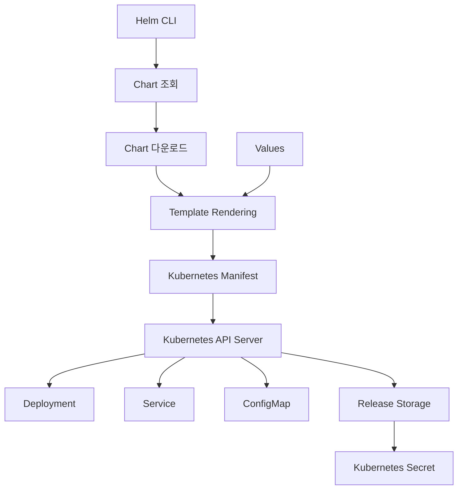

Helm의 아키텍처를 이해하려면 크게 네 가지를 알아야 한다.

첫째, Helm CLI와 내부 라이브러리가 어떤 역할을 담당하는가?

둘째, Helm은 Kubernetes API Server와 어떻게 통신하는가?

셋째, Helm은 설치한 Release의 정보를 어디에 저장하는가?

넷째, Helm Chart는 어떤 저장소에서 가져오며 어떻게 배포되는가?

이 네 가지를 이해하면 Helm을 사용하는 방법뿐 아니라 설치 실패, 권한 오류, Release 충돌, 저장소 접근 문제 등의 원인을 파악하는 데에도 도움이 된다.

---

### Helm의 전체 아키텍처

Helm 3 이후의 아키텍처는 클라이언트 중심 구조이다.

Helm 2에서는 Tiller라는 서버 측 컴포넌트가 존재했지만, Helm 3에서는 Tiller가 제거되었다.

Helm 4에서도 이러한 클라이언트 중심 구조는 유지된다.

일반적인 Helm 구성은 다음과 같다.

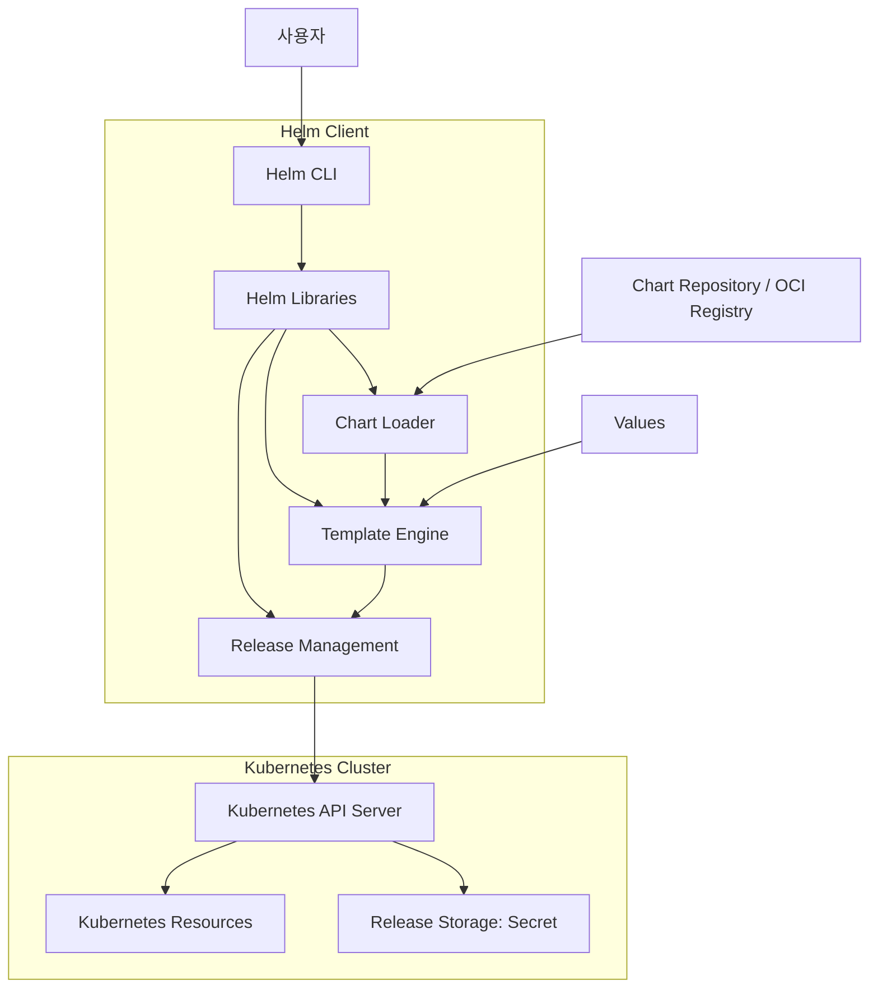

이 구조에서 중요한 점은 Helm을 실행하기 위해 별도의 Helm 서버를 Kubernetes 클러스터에 설치할 필요가 없다는 것이다.

일반적인 Helm 설치와 업그레이드 작업은 Helm CLI에서 시작된다.

Helm CLI는 내부 라이브러리를 사용해 Chart를 처리한 뒤 Kubernetes API Server에 직접 요청한다.

Release에 대한 정보는 기본적으로 Kubernetes Secret을 통해 저장된다.

따라서 Helm CLI 프로세스가 종료되어도 설치된 애플리케이션과 Release 정보는 Kubernetes 클러스터에 남아 있다.

이것이 Helm 3 이후 아키텍처의 핵심이다.

---

### Helm CLI란?

Helm CLI는 사용자가 Helm의 기능을 실행하기 위해 사용하는 명령줄 프로그램이다.

대표적으로 다음과 같은 명령어가 있다.

```bash
helm install
```

```bash
helm upgrade
```

```bash
helm rollback
```

```bash
helm uninstall
```

```bash
helm list
```

```bash
helm repo list
```

Helm CLI는 Go 언어로 구현되어 있으며, 실행 파일 형태로 제공된다.

따라서 사용자는 운영체제와 CPU 아키텍처에 맞는 Helm 바이너리를 설치하면 된다.

Helm 3와 Helm 4에서는 일반적인 사용을 위해 Kubernetes 클러스터 내부에 Tiller와 같은 별도의 Helm 서버를 설치하지 않는다.

다만 Helm CLI만 설치했다고 모든 기능을 즉시 사용할 수 있는 것은 아니다.

실제로 Kubernetes에 애플리케이션을 설치하려면 다음 조건이 필요하다.

1. Helm CLI가 설치되어 있어야 한다.
2. 접근 가능한 Kubernetes 클러스터가 있어야 한다.
3. Kubernetes API Server에 접근할 인증 정보가 있어야 한다.
4. 리소스를 생성하고 관리할 수 있는 적절한 권한이 있어야 한다.

즉 Helm은 독립적인 실행 파일이지만, Kubernetes에 리소스를 설치하는 작업은 Kubernetes API와 인증 체계에 의존한다.

---

### Helm CLI와 Helm Library의 관계

Helm은 CLI만 존재하는 단순한 명령어 모음이 아니다.

내부에는 Chart를 처리하고 Kubernetes 리소스를 관리하기 위한 여러 라이브러리가 포함되어 있다.

대표적으로 다음과 같은 기능들이 있다.

| 구성 요소 | 주요 역할 |
|---|---|
| CLI | 사용자 명령어 해석 및 실행 |
| Chart Loader | Chart 파일 및 디렉터리 읽기 |
| Template Engine | Chart Template과 Values 렌더링 |
| Action | Install, Upgrade, Rollback, Uninstall 등의 작업 |
| Kubernetes Client | Kubernetes API Server와 통신 |
| Storage | Release 정보 저장 및 조회 |

여기서 중요한 역할을 담당하는 것이 Action 계층이다.

Helm의 내부 Go 라이브러리에는 설치, 업그레이드, 삭제 등의 동작을 구현한 기능이 존재한다.

CLI는 이러한 라이브러리를 호출하는 사용자 인터페이스이다.

예를 들어 다음 명령어를 실행하면,

```bash
helm install web-app ./web-chart
```

Helm CLI는 설치에 필요한 옵션을 해석하고 내부 설치 로직을 실행한다.

반면 다음 명령어를 실행하면,

```bash
helm upgrade web-app ./web-chart
```

기존 Release를 조회하고 새로운 Chart 및 Values를 바탕으로 변경 작업을 수행한다.

이 구조는 Helm이 CLI 외에 Go SDK도 제공한다는 점과 연결된다.

Go 프로그램에서 Helm 라이브러리를 직접 사용하여 배포 시스템을 구현하는 것도 가능하다.

다만 Helm 4에서는 SDK 패키지 구조와 일부 API가 변경되었으므로 Helm 3 SDK를 사용하는 프로그램은 버전 전환 시 호환성을 검토해야 한다.

---

### Helm 1, Helm 2, Helm 3의 아키텍처 변화

Helm의 현재 구조를 이해하려면 과거 버전에서 어떤 변화가 있었는지 알아볼 필요가 있다.

Helm은 여러 번의 구조적 변화를 거쳤다.

특히 가장 중요한 변화는 Helm 2에서 Tiller가 도입되었고, Helm 3에서 다시 제거되었다는 것이다.

| 구분 | Helm 1 | Helm 2 | Helm 3 이후 |
|---|---|---|---|
| 주요 구조 | 클라이언트 중심의 초기 구현 | Client + Tiller | Client 중심 |
| 서버 컴포넌트 | 없음 | Tiller | 없음 |
| API 요청 | 클라이언트 중심 | Tiller가 수행 | Helm Client가 직접 수행 |
| Release 관리 | 초기 구현 방식 | Tiller 중심 | 클라이언트와 Storage Driver |
| 인증·인가 | 구현 방식에 따름 | Tiller 권한이 중요 | Kubernetes 사용자 권한 활용 |
| 보안 및 운영 | 초기 구조 | Tiller 관리 필요 | 서버 컴포넌트 관리 부담 감소 |

Helm 1과 Helm 3가 모두 클라이언트 중심이라는 공통점은 있지만 내부 구현과 기능이 동일하다는 의미는 아니다.

Helm 3는 Helm 2의 경험을 바탕으로 Release 관리, Kubernetes API 연동, 권한 처리 등을 재설계한 버전이다.

---

### Helm 2 아키텍처: Tiller의 역할

Helm 2에서는 Helm Client와 Tiller가 서로 다른 역할을 담당했다.

Helm Client는 사용자의 명령어를 받아들이는 프로그램이었다.

반면 Tiller는 Kubernetes 클러스터 내부에 배포되는 서버 컴포넌트였다.

사용자가 Helm Client를 이용하여 Chart 설치를 요청하면 Tiller가 이를 처리했다.

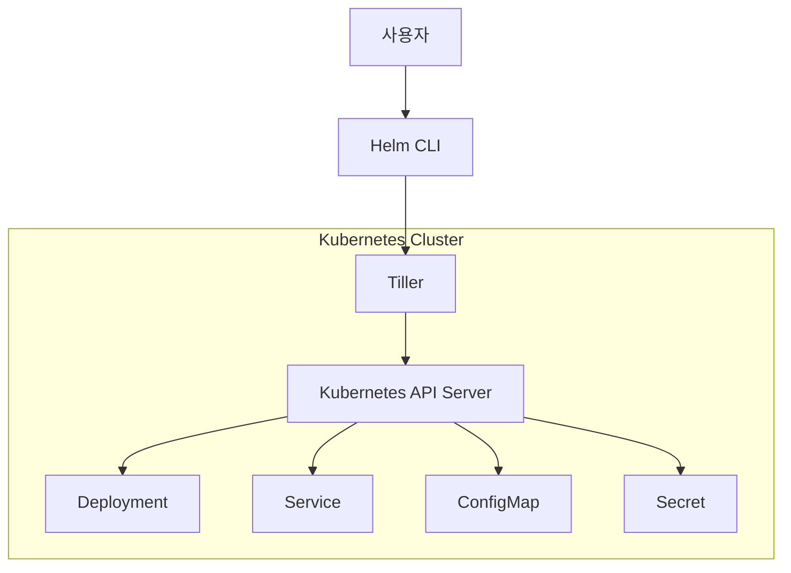

이 구조에서 Tiller는 일종의 중간 관리자 역할을 담당했다.

사용자가 Kubernetes 리소스를 직접 생성하는 것이 아니라, Helm Client가 Tiller에 요청을 전달했다.

Tiller는 요청을 받아 Kubernetes API Server와 통신했다.

이 과정에서 Tiller는 다음과 같은 작업을 담당했다.

- Chart 설치
- Kubernetes 리소스 생성
- Release 상태 관리
- Upgrade
- Rollback
- Uninstall

하지만 이러한 구조에는 문제가 있었다.

---

### Helm 2의 Tiller가 가지고 있던 문제점

#### 1. 보안 문제

Tiller는 Kubernetes 리소스를 생성하고 수정하기 위해 적절한 권한이 필요했다.

문제는 Tiller에 광범위한 권한이 부여된 환경에서 발생했다.

예를 들어 Tiller가 클러스터 전체에 대한 강력한 권한을 가지고 있다면, Tiller에 접근할 수 있는 사용자가 자신의 원래 권한보다 넓은 범위의 작업을 수행할 위험이 있었다.

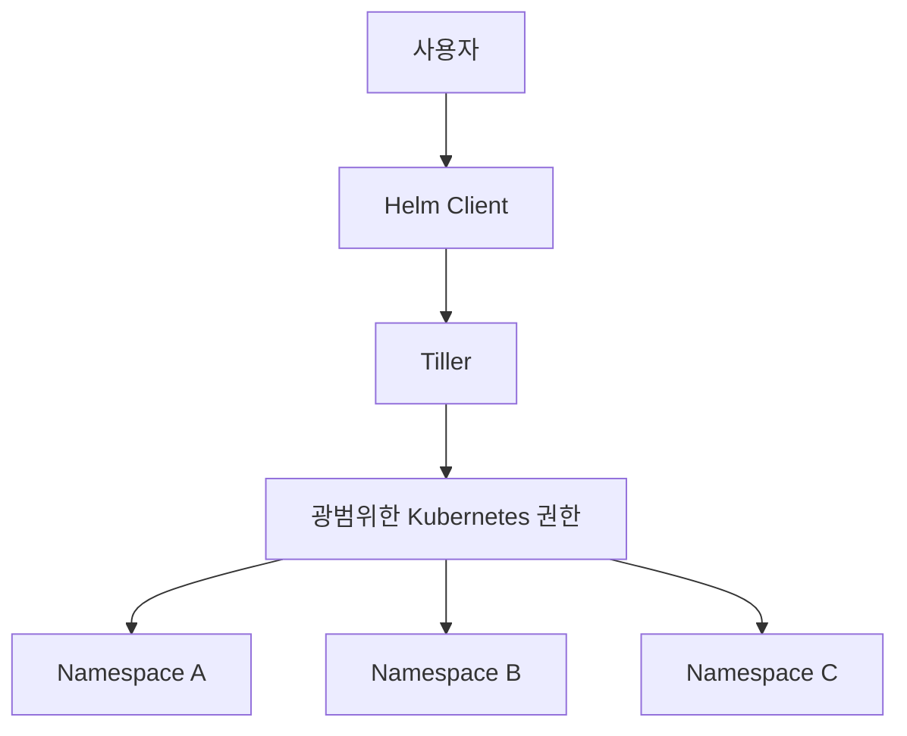

이 문제는 모든 Helm 2 환경이 무조건 취약했다는 의미는 아니다.

Tiller의 권한과 접근 방식을 적절하게 제한하면 위험을 줄일 수 있었다.

하지만 별도의 서버 컴포넌트에 권한을 부여하고 관리해야 한다는 사실 자체가 보안 구성을 복잡하게 만들었다.

#### 2. 관리 복잡성

Tiller는 Kubernetes 클러스터 내부에서 실행되는 컴포넌트였다.

따라서 Helm을 운영하려면 Tiller의 배포 상태와 버전, 권한 등을 관리해야 했다.

예를 들어 다음과 같은 문제가 발생할 수 있었다.

- Helm Client와 Tiller의 버전 차이
- Tiller의 ServiceAccount 권한 문제
- Tiller Pod의 실행 오류
- Tiller와 Kubernetes API Server 사이의 통신 문제

즉 애플리케이션을 배포하기 위한 도구 자체도 별도로 운영해야 했다.

#### 3. 문제 분석 과정의 복잡성

Helm Client가 Tiller를 통해 요청을 수행했기 때문에 배포 문제가 발생했을 때 원인을 여러 단계에서 확인해야 했다.

예를 들어 다음과 같은 흐름이다.

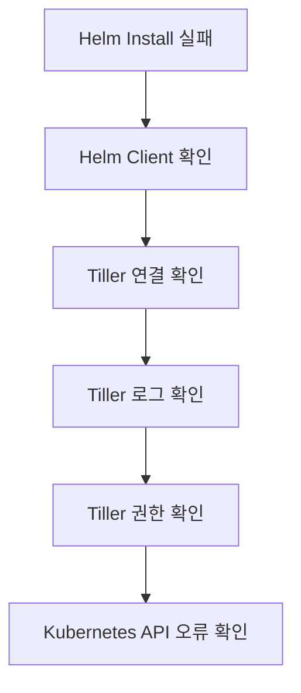

오류의 원인이 사용자 명령어에 있는지, Tiller에 있는지, Kubernetes API에 있는지 구분해야 했다.

Tiller는 디버깅을 위한 로그를 제공했지만, 중간 서버 계층이 존재한다는 사실 자체가 문제 분석 경로를 늘리는 요인이었다.

이러한 문제를 해결하기 위해 Helm 3에서는 아키텍처가 변경되었다.

---

### Helm 3 아키텍처: Tiller 제거

Helm 3의 가장 중요한 변화는 Tiller의 제거이다.

Helm Client가 Kubernetes API Server와 직접 통신하도록 변경되었다.

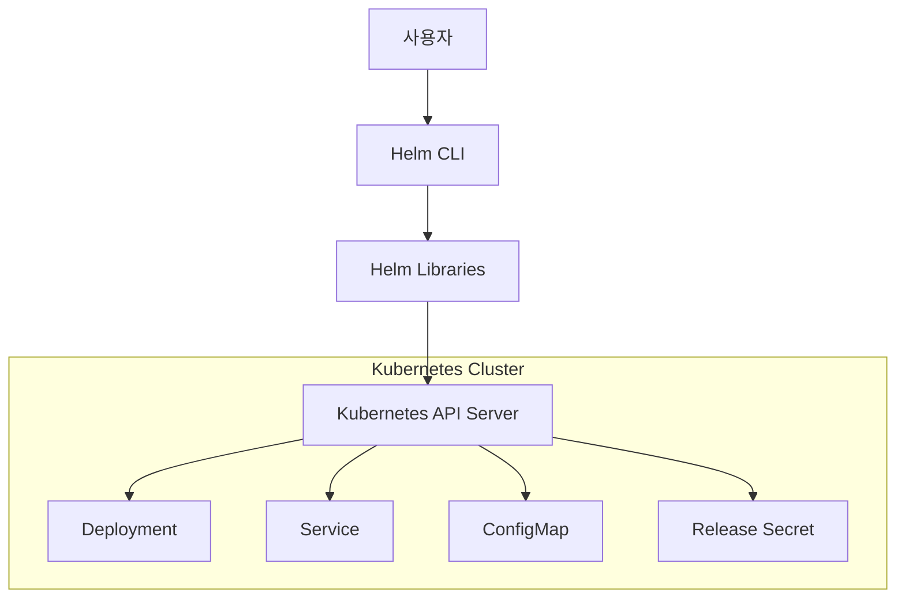

이 구조에서는 사용자와 Kubernetes API Server 사이에 별도의 Tiller가 존재하지 않는다.

Helm CLI는 Kubernetes의 인증 정보와 권한을 사용하여 API Server에 요청한다.

따라서 Kubernetes에 리소스를 생성할 권한이 없다면 Helm을 사용하더라도 해당 리소스를 생성할 수 없다.

이러한 변화로 다음과 같은 장점을 얻었다.

| 개선 사항 | 설명 |
|---|---|
| Tiller 제거 | 별도 서버 컴포넌트 불필요 |
| 권한 체계 단순화 | Kubernetes RBAC 활용 |
| 운영 부담 감소 | Tiller 설치 및 관리 작업 제거 |
| Namespace 기반 Release 관리 | Release 이름의 Namespace 범위 적용 |
| Release Storage 변경 | Secret을 기본 저장소로 사용 |
| 문제 분석 경로 단순화 | 중간 서버 계층 제거 |

Helm 3의 이러한 구조는 현재 Helm 4에서도 기본적으로 유지되고 있다.

---

### Helm은 Kubernetes API Server와 어떻게 통신할까?

Helm 3 이후에는 Helm CLI가 Kubernetes API Server와 직접 통신한다.

그렇다면 Helm은 어떤 Kubernetes 클러스터에 접속해야 하는지 어떻게 알 수 있을까?

일반적으로 **Kubeconfig**를 사용한다.

Kubeconfig는 Kubernetes 클러스터에 접근하기 위한 설정 정보를 포함한다.

대표적으로 다음 정보가 포함된다.

- 클러스터 API Server 주소
- 클러스터 인증서 정보
- 사용자 인증 정보
- Context
- 기본 Namespace

예를 들어 다음 명령어로 현재 Context를 확인할 수 있다.

```bash
kubectl config current-context
```

출력 예시:

```text
production-cluster
```

현재 Context의 상세 정보도 확인할 수 있다.

```bash
kubectl config view --minify
```

이 명령어는 현재 선택된 Context와 관련된 Kubernetes 연결 정보를 표시한다.

Helm은 일반적으로 현재 Kubernetes Context를 사용한다.

따라서 다음 명령어를 실행하면,

```bash
helm list
```

현재 Context가 가리키는 Kubernetes 클러스터에서 Release 정보를 조회한다.

---

### Helm에서 별도의 Kubeconfig 사용하기

Helm은 기본 Kubeconfig 대신 다른 파일을 지정할 수도 있다.

예를 들어 개발 환경과 운영 환경에 서로 다른 설정 파일이 있다고 가정하자.

```text
~/.kube/
├── development-config
└── production-config
```

개발 환경에 연결하려면 다음과 같이 작성할 수 있다.

```bash
helm list --kubeconfig ~/.kube/development-config
```

운영 환경에서는 다음과 같이 실행할 수 있다.

```bash
helm list --kubeconfig ~/.kube/production-config
```

또는 특정 Context를 명시적으로 지정할 수도 있다.

```bash
helm list --kube-context production-cluster
```

이러한 기능은 여러 Kubernetes 클러스터를 운영하는 환경에서 중요하다.

특히 개발 환경에 배포하려던 애플리케이션이 운영 환경에 설치되는 실수를 방지하려면 배포 대상 Context를 명확하게 관리하는 것이 좋다.

#### Kubeconfig와 RBAC의 관계

Kubeconfig는 API Server에 어떻게 접근할지 결정하는 데 사용된다.

반면 RBAC는 인증된 사용자가 어떤 Kubernetes 작업을 수행할 수 있는지 제한한다.

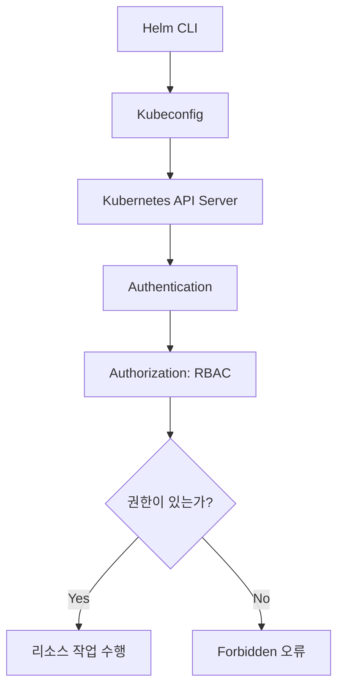

예를 들어 특정 Namespace에서 Deployment를 생성할 권한이 없다면 Helm으로 Chart를 설치할 때도 권한 오류가 발생할 수 있다.

따라서 Helm 설치 실패가 항상 Chart 문법 오류 때문인 것은 아니다.

Kubernetes 인증 및 인가 문제도 함께 확인해야 한다.

---

### Kubernetes RBAC와 Helm의 관계

Kubernetes에서는 RBAC를 통해 사용자의 작업 권한을 제한할 수 있다.

예를 들어 다음과 같은 권한을 생각해보자.

```text
사용자 A
 └── development Namespace
      ├── Deployment 생성 가능
      ├── Service 생성 가능
      └── ConfigMap 조회 가능
```

반면 운영 Namespace에 대한 권한은 없을 수 있다.

```text
사용자 A
 └── production Namespace
      └── 접근 권한 없음
```

이 경우 사용자가 Helm으로 개발 환경에 Chart를 설치할 수는 있지만 운영 환경에는 설치하지 못할 수 있다.

특정 작업에 대한 권한을 확인하려면 다음과 같은 명령어를 사용할 수 있다.

```bash
kubectl auth can-i create deployments -n development
```

출력 예시:

```text
yes
```

운영 환경에 대한 권한도 확인한다.

```bash
kubectl auth can-i create deployments -n production
```

출력 예시:

```text
no
```

다만 Helm Chart에는 Deployment 외에도 Service, Secret, Role, ClusterRole 등 다양한 리소스가 포함될 수 있다.

따라서 Deployment 생성 권한만 있다고 해서 해당 Chart 전체를 설치할 수 있는 것은 아니다.

**Helm은 Kubernetes RBAC를 기반으로 동작하므로 Chart에 포함된 리소스에 필요한 권한을 함께 검토해야 한다.**

---

### Helm Release는 어떻게 관리될까?

Helm에서 중요한 개념 중 하나는 Release이다.

Release는 특정 Chart를 Values와 함께 설치한 애플리케이션 인스턴스이다.

예를 들어 다음 명령어를 실행했다고 가정하자.

```bash
helm install my-nginx ./nginx-chart
```

Helm은 `nginx-chart`를 사용하여 `my-nginx`라는 Release를 생성한다.

이후 사용자는 Release 이름을 통해 설치된 애플리케이션을 관리할 수 있다.

```bash
helm status my-nginx
```

```bash
helm history my-nginx
```

```bash
helm upgrade my-nginx ./nginx-chart
```

```bash
helm rollback my-nginx 1
```

```bash
helm uninstall my-nginx
```

여기서 궁금한 점이 있다.

Helm 3 이후에는 Tiller가 존재하지 않는다.

Helm CLI는 명령어를 실행한 후 종료된다.

그렇다면 Helm은 이전에 설치한 Release를 어떻게 기억할까?

정답은 **Release Storage**에 있다.

---

### Helm Release Storage란?

Helm은 설치된 Release의 정보를 저장하기 위해 Storage Backend를 사용한다.

Release 정보에는 다음과 같은 데이터가 포함될 수 있다.

| 정보 | 설명 |
|---|---|
| Release Name | 설치된 Release 이름 |
| Namespace | Release가 속한 Namespace |
| Chart | 설치에 사용한 Chart |
| Values | 적용된 설정값 |
| Manifest | 렌더링된 Kubernetes Manifest |
| Revision | Release 변경 이력 번호 |
| Status | 배포 상태 |
| Hooks | Chart에 정의된 Hook 정보 |
| Deployment Time | 설치 또는 변경 시각 관련 정보 |

이러한 정보가 저장되어 있기 때문에 Helm은 이전 설치 상태를 확인할 수 있다.

예를 들어 다음과 같은 과정이 가능하다.

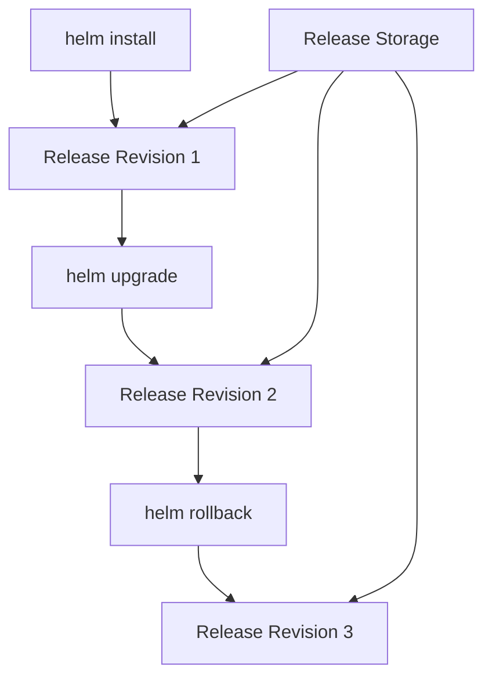

Rollback은 이전 Revision의 정보를 기반으로 Kubernetes 리소스 구성을 다시 적용하는 작업이다.

따라서 이전 배포 상태를 기억할 수 있는 저장소가 필요하다.

---

### Helm은 기본적으로 Kubernetes Secret을 사용한다

Helm 3 이후에는 Kubernetes Secret이 기본 Release Storage로 사용된다.

Secret은 Kubernetes에서 데이터를 저장하는 리소스이다.

Helm은 Release의 메타데이터와 설정, 렌더링된 Manifest 등을 인코딩하여 Secret에 저장한다.

```mermaid
flowchart TD
    A["Helm Install"] --> B["Release 정보 생성"]

    B --> C["Release Metadata"]
    B --> D["Chart 및 Values"]
    B --> E["Rendered Manifest"]

    C --> F["Release 데이터"]
    D --> F
    E --> F

    F --> G["인코딩 및 압축"]

    G --> H["Kubernetes Secret"]
    H --> I["Kubernetes API Server"]
```

여기서 Secret은 Helm이 Release 이력을 저장하는 기본적인 저장소 역할을 한다.

즉 Helm은 별도의 전용 데이터베이스 서버를 필수적으로 운영하지 않아도 Kubernetes의 저장 기능을 활용하여 Release 정보를 관리할 수 있다.

다만 Secret을 사용한다고 해서 데이터가 자동으로 안전하게 암호화되는 것은 아니다.

Kubernetes Secret의 안전한 운영을 위해서는 적절한 RBAC와 저장 시 암호화 등의 보안 설정이 필요하다.

---

### Helm Release Secret의 이름 규칙

Helm이 생성하는 Release Secret은 일반적으로 다음과 같은 이름 규칙을 가진다.

```text
sh.helm.release.v1.<release-name>.v<revision>
```

예를 들어 다음 Release가 있다고 가정하자.

```text
Release Name: my-nginx
Revision: 1
```

Helm이 생성하는 Secret의 이름은 다음과 같은 형태가 된다.

```text
sh.helm.release.v1.my-nginx.v1
```

Release를 업그레이드하여 Revision이 증가하면 다음과 같은 Secret이 생성될 수 있다.

```text
sh.helm.release.v1.my-nginx.v1
sh.helm.release.v1.my-nginx.v2
```

세 번째 Revision이 생성되면 다음과 같은 형태가 된다.

```text
sh.helm.release.v1.my-nginx.v3
```

여기서 주의해야 할 점은 이름에 포함된 두 가지 버전 정보이다.

```text
sh.helm.release.v1.my-nginx.v3
                ^^          ^^
           저장 형식 식별   Revision
```

앞부분의 `release.v1`은 Helm Release 저장 형식의 식별자이다.

마지막의 `v3`는 해당 Release의 Revision이다.

따라서 마지막 숫자가 애플리케이션 버전이나 Chart 버전을 의미하는 것은 아니다.

---

### Helm Release Secret 조회하기

Helm이 설치한 Release Secret은 `kubectl`로 직접 확인할 수 있다.

예를 들어 `default` Namespace에 저장된 Helm Release Secret을 조회하려면 다음 명령어를 사용할 수 있다.

```bash
kubectl get secrets -n default -l owner=helm
```

출력 예시:

```text
NAME                               TYPE                 DATA   AGE
sh.helm.release.v1.my-nginx.v1     helm.sh/release.v1   1      10m
sh.helm.release.v1.my-nginx.v2     helm.sh/release.v1   1      5m
```

이 결과는 Helm이 Release 정보를 Secret으로 관리한다는 사실을 보여준다.

특정 Secret의 메타데이터를 조회할 수도 있다.

```bash
kubectl describe secret \
  sh.helm.release.v1.my-nginx.v2 \
  -n default
```

Release Secret에는 일반적으로 다음과 같은 Label이 포함된다.

```yaml
metadata:
  labels:
    owner: helm
    name: my-nginx
    status: deployed
    version: "2"
```

각 Label의 의미는 다음과 같다.

| Label | 의미 |
|---|---|
| `owner` | Helm에서 관리하는 저장 객체임을 나타냄 |
| `name` | Release 이름 |
| `status` | 해당 Revision의 상태 |
| `version` | Release Revision |

이러한 Label을 이용하면 특정 Release의 저장 정보를 검색할 수 있다.

```bash
kubectl get secrets -n default \
  -l owner=helm,name=my-nginx
```

이 명령어는 `my-nginx`와 관련된 Release Secret을 조회한다.

---

### Release Secret에는 어떤 데이터가 저장될까?

Release Secret의 주요 데이터는 `data.release`에 저장된다.

예를 들어 다음 명령어로 Secret을 YAML 형식으로 조회할 수 있다.

```bash
kubectl get secret \
  sh.helm.release.v1.my-nginx.v1 \
  -n default \
  -o yaml
```

실제 출력은 대략 다음과 같은 구조를 가진다.

```yaml
apiVersion: v1
kind: Secret

metadata:
  name: sh.helm.release.v1.my-nginx.v1
  namespace: default

  labels:
    owner: helm
    name: my-nginx
    status: deployed
    version: "1"

type: helm.sh/release.v1

data:
  release: <encoded-release-data>
```

여기서 `release` 값은 사람이 바로 읽을 수 있는 일반 JSON이나 YAML이 아니다.

Helm은 Release 정보를 직렬화하고 압축 및 인코딩하여 저장한다.

Secret의 `data` 필드 자체도 Kubernetes API에서 Base64로 인코딩된 형태로 표현된다.

따라서 이 값을 직접 조회하면 긴 문자열이 출력된다.

Helm 3 계열의 일반적인 Secret 저장 형식에서는 압축된 Release 데이터를 인코딩하고, Kubernetes Secret에 저장하면서 Base64 계층이 추가된다.

이러한 데이터는 직접 해석할 수 있지만, 일상적인 운영에서는 Helm CLI를 통해 조회하는 것이 더 적절하다.

예를 들어 다음 명령어를 사용할 수 있다.

```bash
helm get values my-nginx -n default
```

```bash
helm get manifest my-nginx -n default
```

```bash
helm status my-nginx -n default
```

```bash
helm history my-nginx -n default
```

이러한 명령어는 Release 정보에서 필요한 데이터를 사람이 이해하기 쉬운 형태로 제공한다.

---

### Helm Release Secret을 직접 수정하면 안 되는 이유

Release Secret에는 Helm이 관리하는 설치 상태와 변경 이력이 포함되어 있다.

따라서 일반적인 애플리케이션 Secret처럼 직접 수정하는 것은 위험하다.

예를 들어 Release Secret을 삭제하거나 수정하면 Helm이 설치된 Release를 정상적으로 조회하지 못할 수 있다.

또한 Kubernetes에 실제로 생성된 리소스와 Helm이 기억하는 Release 상태 사이에 불일치가 발생할 수 있다.

```mermaid
flowchart TD
    A["Kubernetes Resources"] --> C["실제 애플리케이션 상태"]
    B["Helm Release Secret"] --> D["Helm이 기억하는 배포 상태"]

    D --> E{"상태 정보가 일치하는가?"}
    C --> E

    E -->|"Yes"| F["정상적인 Release 관리"]
    E -->|"No"| G["Upgrade / Rollback 문제 가능"]
```

따라서 Release 상태를 변경하려면 일반적으로 Helm의 공식 명령어를 사용해야 한다.

```bash
helm upgrade
```

```bash
helm rollback
```

```bash
helm uninstall
```

Release Secret을 직접 수정하는 작업은 일반적인 운영 절차가 아니라 장애 복구 등 매우 제한적인 상황에서 신중하게 검토해야 할 작업이다.

---

### Helm은 Secret 외에 다른 Storage Backend도 지원한다

Helm은 Kubernetes Secret 외에도 다른 저장 방식을 지원한다.

대표적으로 다음과 같다.

| Storage Backend | 설명 |
|---|---|
| Secret | 기본 저장 방식 |
| ConfigMap | Kubernetes ConfigMap에 Release 정보 저장 |
| SQL | 외부 SQL 데이터베이스에 Release 정보 저장 |
| Memory | 메모리 기반 저장 방식 |

일반적인 환경에서는 Secret을 기본값으로 사용하는 것이 적절하다.

필요한 경우 `HELM_DRIVER` 환경 변수를 통해 저장 방식을 변경할 수 있다.

예를 들어 ConfigMap을 사용하려면 다음과 같이 설정한다.

```bash
export HELM_DRIVER=configmap
```

다시 Secret을 사용하려면 다음과 같이 설정한다.

```bash
export HELM_DRIVER=secret
```

SQL 저장 방식을 사용하려면 다음과 같이 지정할 수 있다.

```bash
export HELM_DRIVER=sql
```

SQL Backend에서는 PostgreSQL을 사용할 수 있다.

이 경우 별도의 데이터베이스와 연결 정보가 필요하다.

예를 들어 다음과 같은 환경 변수를 사용한다.

```bash
export HELM_DRIVER_SQL_CONNECTION_STRING="postgresql://helm-postgres:5432/helm?user=helm"
```

이 문자열은 연결 형식을 설명하기 위한 예시이다. 실제 환경에서는 PostgreSQL의 접근 권한과 인증 정보, TLS 등을 적절하게 구성해야 한다.

SQL Backend는 별도의 저장 시스템이 필요한 환경에서 고려할 수 있지만, 데이터베이스의 가용성 및 보안 관리 부담이 추가된다.

또한 Storage Backend를 변경한다고 해서 기존 Release 정보가 자동으로 다른 저장소로 이전되는 것은 아니다.

기존 Release를 유지하려면 별도의 데이터 이전 절차가 필요하다.

Helm 공식 문서에서도 Secret을 기본 저장 방식으로 설명하며 ConfigMap과 SQL Backend의 사용 방법을 제공한다.

---

### Helm Release와 Namespace의 관계

Helm Release는 Namespace를 기준으로 관리된다.

예를 들어 다음과 같은 상황을 생각해보자.

```text
development Namespace
 └── Release: my-nginx

production Namespace
 └── Release: my-nginx
```

두 Release는 이름이 같다.

하지만 서로 다른 Namespace에 존재하므로 별개의 Release로 관리할 수 있다.

이를 구조적으로 표현하면 다음과 같다.

```mermaid
flowchart TD
    A["Kubernetes Cluster"] --> B["development Namespace"]
    A --> C["production Namespace"]

    B --> D["Release: my-nginx"]
    C --> E["Release: my-nginx"]

    D --> F["Helm Release Secret"]
    E --> G["Helm Release Secret"]
```

예를 들어 개발 환경에 설치하려면 다음과 같이 작성한다.

```bash
helm install my-nginx ./nginx-chart \
  -n development \
  --create-namespace
```

운영 환경에도 같은 이름으로 설치할 수 있다.

```bash
helm install my-nginx ./nginx-chart \
  -n production \
  --create-namespace
```

각 Release는 서로 독립된 설치 인스턴스로 취급된다.

이러한 Namespace 기반 Release 관리 구조는 Helm 3에서 도입된 중요한 변화 중 하나이다.

Helm 2에서는 Tiller의 저장 방식과 Release 이름 관리 구조 때문에 동일한 이름의 Release를 여러 Namespace에서 독립적으로 사용하는 데 제약이 있었다.

Helm 3부터는 Release 정보가 해당 Namespace에 저장되면서 이러한 구조가 개선되었다.

---

### Namespace별 Release 조회하기

개발 환경에 설치한 Release만 조회하려면 다음 명령어를 실행한다.

```bash
helm list -n development
```

운영 환경의 Release를 조회한다.

```bash
helm list -n production
```

모든 Namespace의 Release를 조회하려면 다음과 같이 작성한다.

```bash
helm list -A
```

여기서 `-A`는 `--all-namespaces`의 축약형이다.

예상 출력은 다음과 같다.

```text
NAME       NAMESPACE     REVISION   STATUS     CHART
my-nginx   development   1          deployed   nginx-chart-0.1.0
my-nginx   production    2          deployed   nginx-chart-0.1.0
```

동일한 Release 이름이지만 Namespace와 Revision이 다르다.

이처럼 Helm은 Namespace를 기준으로 Release를 구분한다.

다만 Helm Chart가 ClusterRole, ClusterRoleBinding, CRD처럼 클러스터 전체 범위의 리소스를 생성한다면 주의해야 한다.

이러한 리소스는 Namespace에 종속되지 않으므로, 같은 Chart를 서로 다른 Namespace에 설치하더라도 이름 충돌이나 소유권 충돌이 발생할 수 있다.

따라서 **Release가 Namespace별로 구분된다는 것과 Chart가 생성하는 모든 Kubernetes 리소스가 Namespace별로 독립적이라는 것은 서로 다른 의미**이다.

---

### Helm Chart란?

Helm Chart는 Kubernetes 애플리케이션을 설치하기 위한 패키지이다.

Chart에는 Kubernetes 리소스를 생성하는 데 필요한 Template과 기본 Values, 메타데이터 등이 포함된다.

대표적인 Chart 구조는 다음과 같다.

```text
nginx-chart/
├── Chart.yaml
├── values.yaml
├── charts/
└── templates/
    ├── deployment.yaml
    ├── service.yaml
    └── configmap.yaml
```

각 항목의 역할은 다음과 같다.

| 항목 | 설명 |
|---|---|
| `Chart.yaml` | Chart 메타데이터 |
| `values.yaml` | 기본 설정값 |
| `charts/` | 의존 Chart |
| `templates/` | Kubernetes Manifest Template |

예를 들어 다음과 같은 Values가 있다고 가정하자.

```yaml
replicaCount: 2

image:
  repository: nginx
  tag: "stable"

service:
  type: ClusterIP
  port: 80
```

Deployment Template에서는 다음과 같이 사용할 수 있다.

```yaml
spec:
  replicas: {{ .Values.replicaCount }}
```

Helm은 Template을 렌더링하면서 실제 값을 적용한다.

```yaml
spec:
  replicas: 2
```

이렇게 생성된 Manifest가 Kubernetes API Server에 전달된다.

Chart를 사용하면 같은 Template을 여러 환경에서 재사용할 수 있다.

---

### Helm Chart는 어디에서 가져올까?

Helm Chart는 크게 세 가지 형태로 사용할 수 있다.

첫 번째는 로컬 Chart 디렉터리이다.

```text
./nginx-chart
```

두 번째는 패키징된 Chart 파일이다.

```text
nginx-chart-0.1.0.tgz
```

세 번째는 원격 저장소에 공개된 Chart이다.

원격 Chart는 HTTP 기반 Chart Repository 또는 OCI Registry에서 가져올 수 있다.

```mermaid
flowchart TD
    A["Helm CLI"] --> B["Local Chart"]
    A --> C["HTTP Chart Repository"]
    A --> D["OCI Registry"]

    B --> E["Chart 로딩"]
    C --> E
    D --> E

    E --> F["Template Rendering"]
    F --> G["Kubernetes API Server"]
```

이러한 구조 덕분에 Helm은 로컬에서 직접 작성한 Chart뿐 아니라 외부에서 제공하는 Chart도 사용할 수 있다.

---

### Helm Chart Repository란?

Chart Repository는 Helm Chart를 저장하고 배포하기 위한 저장소이다.

전통적인 Helm Chart Repository는 HTTP 또는 HTTPS를 통해 접근할 수 있다.

기본적으로 다음과 같은 구조를 가진다.

```text
chart-repository/
├── index.yaml
├── nginx-0.1.0.tgz
├── nginx-0.2.0.tgz
└── mariadb-1.0.0.tgz
```

여기서 중요한 파일은 `index.yaml`이다.

`index.yaml`에는 Repository에서 제공하는 Chart의 메타데이터와 다운로드 위치가 기록된다.

예를 들어 다음과 같은 구조를 가질 수 있다.

```yaml
apiVersion: v1

entries:
  nginx:
    - name: nginx
      version: 0.2.0
      urls:
        - nginx-0.2.0.tgz

    - name: nginx
      version: 0.1.0
      urls:
        - nginx-0.1.0.tgz
```

이 파일을 통해 Helm은 어떤 Chart가 존재하는지, 어떤 버전이 제공되는지, Chart 파일을 어디에서 다운로드해야 하는지 확인할 수 있다.

따라서 HTTP Chart Repository는 단순히 `.tgz` 파일만 저장하는 디렉터리가 아니라, Chart를 검색하고 다운로드할 수 있는 인덱스를 제공하는 저장소이다.

Helm 공식 문서에서도 HTTP Chart Repository의 핵심 구성으로 `index.yaml`과 패키징된 Chart를 설명한다.

---

### Helm Repository 등록하기

Helm은 Repository에 이름을 부여하여 로컬에 등록할 수 있다.

예를 들어 Helm 프로젝트의 예제 Repository를 등록해보자.

```bash
helm repo add examples https://helm.github.io/examples
```

이 명령어는 `examples`라는 이름으로 Chart Repository를 등록한다.

등록된 Repository를 확인한다.

```bash
helm repo list
```

예상 출력:

```text
NAME       URL
examples   https://helm.github.io/examples
```

여기서 중요한 점이 있다.

`helm repo list`는 현재 Helm Client에 등록된 Repository 정보를 보여준다.

클러스터에 설치된 Release를 보여주는 명령어가 아니다.

또한 Repository를 등록했다고 해서 그 안에 있는 모든 Chart가 로컬에 다운로드되는 것도 아니다.

등록된 Repository 정보를 이용해 필요한 Chart를 찾고, 해당 Chart를 실제로 사용할 때 다운로드한다.

이 예제 Repository는 Helm 프로젝트에서 제공하는 공개 저장소이다.

---

### helm repo list와 helm list의 차이

두 명령어는 이름이 비슷하지만 완전히 다른 정보를 조회한다.

#### helm repo list

```bash
helm repo list
```

현재 Helm Client에 등록된 Chart Repository 목록을 조회한다.

#### helm list

```bash
helm list
```

Kubernetes 클러스터에 설치된 Release 목록을 조회한다.

차이를 정리하면 다음과 같다.

| 명령어 | 조회 대상 | 데이터 위치 |
|---|---|---|
| `helm repo list` | 등록된 Chart Repository | 로컬 Helm 설정 |
| `helm list` | 설치된 Release | Kubernetes Release Storage |
| `helm list -A` | 모든 Namespace의 Release | Kubernetes 클러스터 |
| `helm search repo` | 등록된 Repository의 Chart | 로컬 Repository 인덱스 캐시 |
| `helm search hub` | Artifact Hub에 등록된 패키지 | Artifact Hub 검색 서비스 |

즉 Helm Repository와 Release는 서로 다른 관리 대상이다.

Repository는 설치할 Chart를 제공하는 저장소이다.

Release는 해당 Chart를 이용해 Kubernetes에 설치한 애플리케이션 인스턴스이다.

---

### Helm Repository의 정보를 갱신하는 방법

Repository를 등록한 후 새로운 Chart가 배포되었을 수 있다.

이 경우 Repository의 인덱스 정보를 갱신해야 한다.

```bash
helm repo update
```

특정 Repository만 갱신할 수도 있다.

```bash
helm repo update examples
```

Helm은 Repository의 `index.yaml`을 가져와 로컬 캐시에 저장한다.

Repository의 설정과 캐시 파일은 구분된다.

대표적인 Linux 환경에서는 다음 경로가 사용될 수 있다.

```text
~/.config/helm/repositories.yaml
```

```text
~/.cache/helm/repository/
```

첫 번째 경로는 Repository 이름과 URL 등 등록 정보를 저장한다.

두 번째 경로는 Repository의 인덱스 캐시를 저장한다.

실제 경로는 운영체제와 Helm 환경 변수 설정에 따라 달라질 수 있다.

현재 Helm Client의 설정 경로를 확인하려면 다음 명령어를 사용한다.

```bash
helm env
```

Repository 관련 환경 정보만 확인하려면 다음과 같이 실행할 수 있다.

```bash
helm env | grep HELM_REPOSITORY
```

Helm의 Repository 설정과 캐시 구조는 공식 문서에 명시되어 있다.

---

### Helm Repository에서 Chart 검색하기

앞서 등록한 Repository에서 Chart를 검색해보자.

```bash
helm search repo examples
```

Repository에서 제공하는 Chart 목록이 출력된다.

특정 Chart를 검색할 수도 있다.

```bash
helm search repo examples/hello-world
```

예제 Repository에는 `hello-world`라는 Chart가 존재한다.

Chart의 메타데이터를 확인하려면 다음 명령어를 사용한다.

```bash
helm show chart examples/hello-world
```

기본 설정값을 확인하려면 다음과 같이 작성한다.

```bash
helm show values examples/hello-world
```

여기서 `helm show values`는 Chart의 기본 설정값을 확인할 때 유용하다.

실제 Chart를 설치하기 전에 어떤 값을 변경할 수 있는지 파악할 수 있기 때문이다.

---

### Chart를 다운로드하는 방법

Chart를 설치하지 않고 파일만 다운로드할 수도 있다.

```bash
helm pull examples/hello-world
```

정상적으로 실행되면 현재 디렉터리에 Chart 패키지가 다운로드된다.

예를 들어 다음과 같은 형태이다.

```text
hello-world-<chart-version>.tgz
```

Chart를 다운로드하면서 압축을 해제하려면 다음과 같이 작성한다.

```bash
helm pull examples/hello-world --untar
```

압축을 해제하면 일반적으로 다음과 같은 디렉터리가 생성된다.

```text
hello-world/
├── Chart.yaml
├── values.yaml
└── templates/
```

이렇게 다운로드한 Chart의 내용을 직접 확인할 수 있다.

실제 운영에서 외부 Chart를 설치하기 전에 Template과 Values를 검토하는 과정은 중요하다.

Chart가 생성하는 Kubernetes 리소스, RBAC 권한, Secret 처리 방식 등을 확인할 수 있기 때문이다.

---

### Helm Chart가 Kubernetes에 설치되는 전체 과정

이제 Chart Repository부터 Kubernetes 배포까지의 전체 흐름을 살펴보자.

```mermaid
flowchart TD
    USER["사용자"] --> CLI["helm install"]

    CLI --> REPO["Chart Repository"]

    REPO --> INDEX["index.yaml"]
    INDEX --> CHART["Chart Package"]

    CHART --> LOADER["Helm Chart Loader"]

    VALUES["Values"] --> TEMPLATE["Template Engine"]
    LOADER --> TEMPLATE

    TEMPLATE --> MANIFEST["Rendered Manifest"]

    MANIFEST --> API["Kubernetes API Server"]

    API --> RESOURCES["Kubernetes Resources"]
    API --> STORAGE["Release Storage"]

    STORAGE --> SECRET["Release Secret"]
```

이 과정을 단계별로 정리하면 다음과 같다.

#### 1. Helm CLI가 설치 요청을 받는다

```bash
helm install my-app examples/hello-world
```

Helm은 Release 이름과 Chart 위치를 확인한다.

#### 2. Chart Repository에서 Chart 정보를 확인한다

등록된 Repository의 인덱스를 이용하여 해당 Chart의 위치를 확인한다.

#### 3. Chart를 다운로드한다

필요한 Chart 패키지를 가져온다.

#### 4. Chart와 Values를 결합한다

Chart Template에서 참조하는 값을 적용한다.

#### 5. Kubernetes Manifest를 생성한다

Template Rendering을 수행하여 Kubernetes API가 처리할 수 있는 Manifest를 생성한다.

#### 6. Kubernetes API Server에 요청한다

Helm Client가 Kubernetes API를 통해 리소스 생성 또는 수정 작업을 수행한다.

#### 7. Release 정보를 저장한다

Helm은 배포에 사용한 Chart, 설정값, Manifest, Revision 등의 정보를 Release Storage에 저장한다.

#### 8. Kubernetes Controller가 실제 리소스를 관리한다

Deployment Controller, StatefulSet Controller 등의 Kubernetes 컴포넌트가 원하는 상태를 유지한다.

여기서 주의해야 할 점이 있다.

Helm 자체가 지속적으로 Pod 상태를 감시하며 유지하는 것은 아니다.

Helm은 배포 작업을 수행하고, 실제 리소스의 지속적인 상태 관리는 Kubernetes Controller가 담당한다.

---

### Artifact Hub란?

Helm 생태계에는 다양한 공개 Chart가 존재한다.

예를 들어 다음과 같은 애플리케이션의 Chart를 찾을 수 있다.

- Nginx
- MariaDB
- PostgreSQL
- MongoDB
- Redis
- Prometheus
- Grafana
- Crossplane

이러한 패키지를 검색하고 정보를 확인할 수 있는 서비스가 Artifact Hub이다.

Artifact Hub는 Helm Chart뿐 아니라 Kubernetes 생태계에서 사용되는 다양한 패키지와 아티팩트의 메타데이터를 제공한다.

사용자는 Artifact Hub에서 Chart를 검색하고 다음 정보를 확인할 수 있다.

| 항목 | 설명 |
|---|---|
| Chart 이름 | 패키지 이름 |
| Chart Version | Chart 버전 |
| App Version | 애플리케이션 버전 |
| Repository | Chart가 제공되는 위치 |
| 설치 방법 | Helm 설치 명령어 |
| Values | 설정 가능한 항목 |
| Template | Chart에 포함된 리소스 구성 |
| 문서 | Chart 사용법 및 설정 설명 |

하지만 Artifact Hub의 역할을 정확하게 이해해야 한다.

**Artifact Hub는 일반적으로 Chart 파일을 직접 저장하는 Repository가 아니라, 여러 Repository에 존재하는 패키지를 검색하고 탐색할 수 있도록 메타데이터를 제공하는 서비스이다.**

```mermaid
flowchart TD
    USER["사용자"] --> HUB["Artifact Hub"]

    HUB --> A["Chart A 정보"]
    HUB --> B["Chart B 정보"]
    HUB --> C["Chart C 정보"]

    A --> REPO1["Repository A"]
    B --> REPO2["Repository B"]
    C --> OCI["OCI Registry"]

    REPO1 --> CHART1["Chart Package"]
    REPO2 --> CHART2["Chart Package"]
    OCI --> CHART3["OCI Artifact"]
```

Artifact Hub는 사용자가 원하는 Chart를 찾고 설치 방법을 확인할 수 있도록 도와준다.

실제 Chart 콘텐츠는 해당 Chart를 게시한 Repository나 OCI Registry에서 제공된다.

Artifact Hub 공식 FAQ에서도 Repository의 콘텐츠를 직접 저장하거나 프록시하지 않는다고 명시하고 있다.

---

### Artifact Hub와 Chart Repository의 차이

두 개념을 정리하면 다음과 같다.

| 구분 | Artifact Hub | Chart Repository |
|---|---|---|
| 주요 목적 | 패키지 검색 및 탐색 | Chart 파일 저장 및 제공 |
| 저장 정보 | 패키지 메타데이터 | Chart 패키지 및 인덱스 |
| 설치 기능 | 설치 방법 안내 | 실제 Chart 다운로드 제공 |
| 사용 방식 | 웹 UI, 검색 기능 | Helm CLI |
| 대표 명령어 | `helm search hub` | `helm repo add`, `helm pull` |

예를 들어 다음 명령어는 Artifact Hub에서 Chart를 검색한다.

```bash
helm search hub nginx
```

반면 다음 명령어는 로컬에 등록된 Repository에서 Chart를 검색한다.

```bash
helm search repo nginx
```

두 명령어는 모두 Chart를 검색하는 데 사용되지만 검색 대상이 다르다.

---

### Bitnami Chart Repository

Bitnami는 다양한 오픈소스 애플리케이션을 Kubernetes에 배포할 수 있도록 Helm Chart를 제공해 온 프로젝트이다.

대표적으로 다음과 같은 애플리케이션의 Chart를 제공해 왔다.

- Nginx
- MariaDB
- PostgreSQL
- Redis
- MongoDB

전통적인 HTTP Chart Repository는 다음과 같은 방식으로 등록할 수 있다.

```bash
helm repo add bitnami https://charts.bitnami.com/bitnami
```

등록된 Repository를 확인한다.

```bash
helm repo list
```

이후 Repository의 Chart 정보를 검색할 수 있다.

```bash
helm search repo bitnami
```

여기서 `bitnami/nginx`와 같은 표현은 다음과 같이 구분된다.

```text
bitnami/nginx
   │      │
   │      └── Chart 이름
   │
   └── Repository 별칭
```

`bitnami`는 Helm Client에 등록된 Repository 이름이다.

`nginx`는 해당 Repository에서 제공하는 Chart 이름이다.

다만 Bitnami는 2025년에 공개 컨테이너 이미지 카탈로그와 배포 정책을 크게 변경했다.

일부 기존 이미지는 Legacy Repository로 이동했고, 유지보수 및 배포 정책도 변경되었다.

따라서 기존 Bitnami Chart를 사용할 때는 **Chart를 다운로드할 수 있는지와 실제 컨테이너 이미지를 다운로드할 수 있는지를 별도로 확인해야 한다.**

Chart Repository 접근이 가능하더라도 Chart에서 참조하는 이미지가 더 이상 기존 위치에 제공되지 않는다면 Pod가 `ImagePullBackOff` 상태에 빠질 수 있다.

이러한 변경 사항은 Bitnami 프로젝트의 공지에서도 확인할 수 있다.

---

### OCI Registry를 이용한 Helm Chart 관리

최근 Helm에서는 전통적인 HTTP Chart Repository뿐 아니라 OCI Registry를 이용하는 방식도 중요해졌다.

OCI Registry는 컨테이너 이미지 등의 아티팩트를 저장하고 배포하기 위한 표준 기반 저장소이다.

Helm은 OCI Registry를 이용해 Chart를 저장하거나 다운로드할 수 있다.

예를 들어 다음과 같은 형태로 Chart를 참조할 수 있다.

```text
oci://ghcr.io/example/charts/my-app
```

OCI Registry는 Chart Repository의 `index.yaml` 방식과는 다른 구조를 사용한다.

| 구분 | HTTP Chart Repository | OCI Registry |
|---|---|---|
| 접근 방식 | HTTP/HTTPS | OCI Registry API |
| 주요 메타데이터 | `index.yaml` | OCI Manifest |
| Chart 참조 | `repo/chart` | `oci://registry/path/chart` |
| 버전 관리 | Chart Version | OCI Tag 및 Digest |
| Chart 다운로드 | `helm pull repo/chart` | `helm pull oci://...` |
| 배포 | `helm install` | `helm install` |

OCI Registry에서는 Chart를 컨테이너 이미지와 유사한 방식으로 관리할 수 있다.

예를 들어 다음과 같은 Registry에 Chart를 저장할 수 있다.

- GitHub Container Registry
- Docker Hub
- Amazon ECR
- Google Artifact Registry
- Azure Container Registry

Helm 공식 문서에서도 OCI 기반 Chart 저장소 사용 방법을 지원한다.

---

### OCI Registry에서 Chart 다운로드하기

Helm 공식 Quickstart에서는 OCI Registry를 이용한 Chart 예제를 제공한다.

예를 들어 다음과 같이 Chart 정보를 확인할 수 있다.

```bash
helm show chart \
  oci://ghcr.io/stefanprodan/charts/podinfo \
  --version 6.11.2
```

Chart를 다운로드하려면 다음과 같이 작성한다.

```bash
helm pull \
  oci://ghcr.io/stefanprodan/charts/podinfo \
  --version 6.11.2
```

이 명령어는 OCI Registry에서 지정한 버전의 Chart를 다운로드한다.

Chart를 설치하려면 다음과 같은 형식을 사용할 수 있다.

```bash
helm install my-podinfo \
  oci://ghcr.io/stefanprodan/charts/podinfo \
  --version 6.11.2 \
  --namespace demo \
  --create-namespace
```

실행 전에 해당 Chart 버전과 Kubernetes 버전의 호환성을 확인해야 한다.

OCI Registry가 인증을 요구한다면 다음과 같이 로그인할 수 있다.

```bash
helm registry login <registry-host>
```

일반적으로 자동화 환경에서는 비밀번호를 명령어 인자로 직접 노출하지 않고 표준 입력을 사용하는 방법을 고려하는 것이 좋다.

Helm 공식 문서는 OCI Registry 인증과 Chart 다운로드 기능을 제공한다.

---

### ChartMuseum이란?

ChartMuseum은 Helm Chart Repository를 직접 구축할 수 있도록 지원하는 오픈소스 서버이다.

전통적인 HTTP 기반 Helm Chart Repository를 운영하려는 경우 사용할 수 있다.

ChartMuseum은 다음과 같은 기능을 제공한다.

- Chart 패키지 저장
- Chart 다운로드
- Chart Repository API 제공
- Chart 업로드
- Chart 메타데이터 관리
- 다양한 Storage Backend 지원

ChartMuseum을 이용하면 자체적인 Helm Chart Repository를 구축할 수 있다.

```mermaid
flowchart TD
    DEV["Developer"] --> CHART["Helm Chart"]

    CHART --> CM["ChartMuseum"]

    CM --> STORAGE["Storage Backend"]

    STORAGE --> LOCAL["Local File System"]
    STORAGE --> S3["Amazon S3"]
    STORAGE --> GCS["Google Cloud Storage"]
    STORAGE --> OTHER["Other Object Storage"]

    HELM["Helm CLI"] --> CM
```

ChartMuseum은 로컬 파일 시스템뿐 아니라 다양한 외부 스토리지 시스템을 지원한다.

대표적인 Storage Backend는 다음과 같다.

| Storage Backend | 설명 |
|---|---|
| Local File System | 서버의 로컬 디스크 |
| Amazon S3 | AWS Object Storage |
| Google Cloud Storage | Google Cloud Object Storage |
| Azure Blob Storage | Azure Object Storage |
| OpenStack Object Storage | OpenStack Swift 등 |
| MinIO | S3 호환 Object Storage |

이러한 구조를 이용하면 조직 내부에서 사용할 Chart를 별도의 저장소에 보관할 수 있다.

예를 들어 다음과 같은 상황에 활용할 수 있다.

```text
Company Helm Repository
├── payment-service
├── coupon-service
├── notification-service
└── membership-service
```

각 서비스의 Chart를 중앙에서 관리하고, 개발 환경이나 운영 환경에서 필요한 버전을 다운로드하여 배포할 수 있다.

다만 ChartMuseum이 모든 환경에서 반드시 필요한 것은 아니다.

이미 조직에서 OCI Registry를 운영하고 있다면 Helm Chart도 해당 Registry에 저장하는 방식을 고려할 수 있다.

ChartMuseum의 지원 Storage Backend와 운영 방식은 프로젝트 문서에서 확인할 수 있다.

---

### 직접 Helm Chart Repository 구축하기

이번에는 Helm의 구조를 이해하기 위해 간단한 Chart Repository를 직접 구축해보자.

이번 실습에서는 ChartMuseum 대신 Python의 HTTP 서버를 사용한다.

실제 운영 환경의 Repository를 구축하기 위한 방식이 아니라, HTTP Chart Repository가 어떤 구조로 동작하는지 확인하기 위한 간단한 예제이다.

다음 과정을 진행한다.

1. Helm Chart 작성
2. Chart 패키징
3. Repository 인덱스 생성
4. HTTP 서버 실행
5. Helm Repository 등록
6. Chart 검색 및 다운로드
7. Kubernetes에 설치
8. Release Secret 확인

---

### Helm Chart 작성하기

먼저 다음 디렉터리를 생성한다.

```bash
mkdir -p helm-lab/hello-chart/templates
```

Chart를 저장할 Repository 디렉터리도 생성한다.

```bash
mkdir -p helm-lab/repository
```

다음 구조를 만든다.

```text
helm-lab/
├── hello-chart/
│   ├── Chart.yaml
│   ├── values.yaml
│   └── templates/
│       └── configmap.yaml
│
└── repository/
```

이번에는 Chart와 Release 저장 구조를 확인하는 것이 목적이므로 ConfigMap 하나만 생성하는 간단한 Chart를 사용한다.

---

### Chart.yaml 작성하기

**helm-lab/hello-chart/Chart.yaml**

```yaml
apiVersion: v2
name: hello-chart
description: Simple Helm repository example
type: application
version: 0.1.0
appVersion: "1.0.0"
```

여기서는 Chart 이름을 `hello-chart`로 지정했다.

Chart Version은 `0.1.0`이다.

---

### values.yaml 작성하기

**helm-lab/hello-chart/values.yaml**

```yaml
message: "Hello from Helm"
environment: development
```

이 파일은 Chart에서 사용할 기본 설정값을 정의한다.

---

### ConfigMap Template 작성하기

**helm-lab/hello-chart/templates/configmap.yaml**

```yaml
apiVersion: v1
kind: ConfigMap

metadata:
  name: {{ .Release.Name }}-settings

  labels:
    app.kubernetes.io/name: {{ .Chart.Name }}
    app.kubernetes.io/instance: {{ .Release.Name }}

data:
  MESSAGE: {{ .Values.message | quote }}
  ENVIRONMENT: {{ .Values.environment | quote }}
```

이 Template은 Release 이름과 Values를 사용하여 ConfigMap을 생성한다.

예를 들어 Release 이름이 `demo-app`이라면 다음과 같이 렌더링된다.

```yaml
apiVersion: v1
kind: ConfigMap

metadata:
  name: demo-app-settings

data:
  MESSAGE: "Hello from Helm"
  ENVIRONMENT: "development"
```

실제 렌더링 결과에는 Label도 포함된다.

---

### Chart 검사하기

작성한 Chart의 기본적인 유효성을 확인한다.

`helm-lab` 디렉터리에서 다음 명령어를 실행한다.

```bash
helm lint ./hello-chart
```

정상적으로 검사되면 다음과 유사한 결과가 출력된다.

```text
1 chart(s) linted, 0 chart(s) failed
```

이제 Template을 렌더링한다.

```bash
helm template demo-app ./hello-chart
```

이 명령어는 Release 이름을 `demo-app`으로 가정하고 Chart Template을 렌더링한다.

하지만 Kubernetes에 리소스를 생성하지는 않는다.

따라서 실제 설치 전에 어떤 Manifest가 생성되는지 확인할 수 있다.

---

### Helm Chart 패키징하기

Chart Repository에 게시하기 위해 Chart를 패키징한다.

```bash
helm package ./hello-chart --destination ./repository
```

정상적으로 실행되면 다음과 같은 파일이 생성된다.

```text
repository/
└── hello-chart-0.1.0.tgz
```

`.tgz` 파일은 압축된 Chart 패키지이다.

이 패키지 안에는 `Chart.yaml`, `values.yaml`, Template 파일 등이 포함된다.

패키지를 생성한 후 Repository 인덱스를 작성해야 한다.

---

### Helm Repository 인덱스 생성하기

다음 명령어를 실행한다.

```bash
helm repo index ./repository \
  --url http://127.0.0.1:8879
```

이 명령어는 `repository` 디렉터리에 존재하는 Chart 패키지를 검사하여 `index.yaml`을 생성한다.

결과적으로 다음 구조가 만들어진다.

```text
repository/
├── index.yaml
└── hello-chart-0.1.0.tgz
```

생성된 `index.yaml`에는 Chart 이름과 버전, 패키지 다운로드 위치 등이 포함된다.

예를 들어 다음과 같은 정보가 포함될 수 있다.

```yaml
entries:
  hello-chart:
    - name: hello-chart
      version: 0.1.0
      urls:
        - http://127.0.0.1:8879/hello-chart-0.1.0.tgz
```

이제 Repository는 Chart 패키지와 인덱스를 모두 가지고 있다.

하지만 아직 HTTP 서버를 실행하지 않았으므로 원격에서 접근할 수는 없다.

---

### HTTP 서버 실행하기

로컬 Repository를 HTTP로 제공해보자.

첫 번째 터미널에서 다음 명령어를 실행한다.

```bash
python3 -m http.server 8879 \
  --bind 127.0.0.1 \
  --directory ./repository
```

이 명령어는 8879 포트에서 HTTP 서버를 실행한다.

다음 URL을 통해 Repository 인덱스에 접근할 수 있다.

```text
http://127.0.0.1:8879/index.yaml
```

두 번째 터미널에서 다음 명령어를 실행한다.

```bash
curl http://127.0.0.1:8879/index.yaml
```

정상적으로 실행되면 Repository 인덱스의 YAML이 출력된다.

이제 Helm Chart Repository를 사용할 준비가 완료되었다.

이번 예제는 로컬 환경에서만 접근하도록 구성했으며, 실제 운영에서는 HTTPS, 인증, 접근 제어 등을 별도로 구성해야 한다.

---

### 로컬 Helm Repository 등록하기

이제 Helm CLI에 Repository를 등록한다.

```bash
helm repo add local-demo http://127.0.0.1:8879
```

여기서 `local-demo`는 Repository의 별칭이다.

등록된 Repository를 확인한다.

```bash
helm repo list
```

출력 예시:

```text
NAME         URL
local-demo   http://127.0.0.1:8879
```

Repository의 Chart를 검색한다.

```bash
helm search repo local-demo
```

출력 예시:

```text
NAME                     CHART VERSION   APP VERSION
local-demo/hello-chart   0.1.0           1.0.0
```

이제 Helm은 `local-demo/hello-chart`라는 이름으로 Chart에 접근할 수 있다.

---

### Repository에서 Chart 다운로드하기

등록된 Repository에서 Chart를 다운로드한다.

```bash
helm pull local-demo/hello-chart
```

현재 디렉터리에 다음 파일이 생성된다.

```text
hello-chart-0.1.0.tgz
```

압축을 해제하면서 다운로드할 수도 있다.

```bash
helm pull local-demo/hello-chart --untar
```

이렇게 하면 Chart의 내부 파일들을 확인할 수 있다.

```text
hello-chart/
├── Chart.yaml
├── values.yaml
└── templates/
    └── configmap.yaml
```

이 과정에서 Helm은 Repository의 인덱스를 이용하여 Chart 위치를 확인하고 패키지를 다운로드한다.

---

### Helm Chart 설치하기

이제 작성한 Chart를 Kubernetes에 설치해보자.

```bash
helm install demo-app local-demo/hello-chart \
  --namespace demo-one \
  --create-namespace
```

정상적으로 설치되면 다음과 같은 결과가 출력될 수 있다.

```text
NAME: demo-app
NAMESPACE: demo-one
STATUS: deployed
REVISION: 1
```

이번 Chart는 ConfigMap 하나만 생성한다.

따라서 설치 이후 다음 명령어로 확인할 수 있다.

```bash
kubectl get configmap -n demo-one
```

예상 출력:

```text
NAME                DATA   AGE
demo-app-settings   2      10s
```

ConfigMap의 내용을 확인한다.

```bash
kubectl get configmap demo-app-settings \
  -n demo-one \
  -o yaml
```

여기에는 다음 설정이 포함된다.

```yaml
data:
  MESSAGE: Hello from Helm
  ENVIRONMENT: development
```

이처럼 Chart Repository에서 가져온 Chart가 Kubernetes Manifest로 렌더링되고 실제 리소스로 생성되었다.

---

### Release Secret 확인하기

이제 가장 중요한 부분이다.

방금 Helm을 사용하여 `demo-app` Release를 생성했다.

Helm은 이 Release의 정보를 Kubernetes Secret에 저장한다.

다음 명령어를 실행한다.

```bash
kubectl get secrets -n demo-one -l owner=helm
```

예상 출력:

```text
NAME                                TYPE                 DATA   AGE
sh.helm.release.v1.demo-app.v1      helm.sh/release.v1   1      20s
```

이 Secret은 `demo-app` Release의 첫 번째 Revision에 해당한다.

여기서 다시 이름 규칙을 확인할 수 있다.

```text
sh.helm.release.v1.demo-app.v1
```

Release 이름은 `demo-app`이다.

Revision은 1이다.

다음 명령어로 메타데이터를 확인할 수도 있다.

```bash
kubectl get secret \
  sh.helm.release.v1.demo-app.v1 \
  -n demo-one \
  -o jsonpath='{.metadata.labels}{"\n"}'
```

이렇게 하면 Release Secret의 Label 정보를 확인할 수 있다.

실제 Release 상태는 Helm 명령어로 확인하는 것이 더 편리하다.

```bash
helm status demo-app -n demo-one
```

또한 다음 명령어로 설치된 Manifest를 확인할 수 있다.

```bash
helm get manifest demo-app -n demo-one
```

이 과정을 통해 Helm이 별도의 서버 컴포넌트 없이도 Release 정보를 관리할 수 있는 이유를 확인할 수 있다.

---

### Helm Upgrade와 Revision 확인하기

이번에는 Release의 설정을 변경해보자.

현재 Values에는 다음과 같은 값이 존재한다.

```yaml
message: "Hello from Helm"
```

이 값을 변경하려면 다음과 같이 실행할 수 있다.

```bash
helm upgrade demo-app local-demo/hello-chart \
  -n demo-one \
  --set-string message="Hello from Helm v2"
```

업그레이드 후 ConfigMap의 값을 확인한다.

```bash
kubectl get configmap demo-app-settings \
  -n demo-one \
  -o jsonpath='{.data.MESSAGE}{"\n"}'
```

출력:

```text
Hello from Helm v2
```

Release 이력도 확인한다.

```bash
helm history demo-app -n demo-one
```

예상 결과:

```text
REVISION   STATUS       CHART
1          superseded   hello-chart-0.1.0
2          deployed     hello-chart-0.1.0
```

여기서 중요한 점은 Chart Version은 그대로 `0.1.0`이지만 Release Revision은 2로 증가했다는 것이다.

다시 Secret을 조회해보자.

```bash
kubectl get secrets -n demo-one -l owner=helm
```

예상 출력:

```text
NAME                                TYPE                 DATA   AGE
sh.helm.release.v1.demo-app.v1      helm.sh/release.v1   1      5m
sh.helm.release.v1.demo-app.v2      helm.sh/release.v1   1      10s
```

Helm은 새로운 Revision에 대한 정보를 추가로 저장한다.

이러한 구조가 Helm의 배포 이력 관리와 Rollback 기능을 가능하게 한다.

---

### 같은 이름의 Release를 다른 Namespace에 설치하기

이번에는 동일한 Chart를 다른 Namespace에 설치해보자.

```bash
helm install demo-app local-demo/hello-chart \
  --namespace demo-two \
  --create-namespace
```

여기서 Release 이름은 앞에서 사용한 이름과 동일하다.

```text
demo-app
```

하지만 Namespace가 다르다.

따라서 별개의 Release로 설치할 수 있다.

모든 Namespace의 Release를 조회한다.

```bash
helm list -A
```

예상 출력:

```text
NAME       NAMESPACE   REVISION   STATUS
demo-app   demo-one    2          deployed
demo-app   demo-two    1          deployed
```

Release Secret도 Namespace별로 저장된다.

```text
demo-one Namespace
└── sh.helm.release.v1.demo-app.v2

demo-two Namespace
└── sh.helm.release.v1.demo-app.v1
```

이 구조를 통해 Helm Release가 Namespace 범위에서 관리된다는 점을 확인할 수 있다.

---

### 실습 리소스 정리하기

모든 확인을 마쳤다면 설치한 Release를 삭제한다.

첫 번째 Namespace의 Release를 삭제한다.

```bash
helm uninstall demo-app -n demo-one
```

두 번째 Namespace의 Release도 삭제한다.

```bash
helm uninstall demo-app -n demo-two
```

Release가 삭제되었는지 확인한다.

```bash
helm list -A
```

기본적으로 `helm uninstall`은 해당 Release가 관리하는 리소스를 삭제한다.

또한 별도의 `--keep-history` 옵션을 사용하지 않았다면 일반적으로 Release 이력도 제거한다.

하지만 Helm이 생성한 Namespace가 자동으로 삭제되는 것은 아니다.

따라서 실습용 Namespace가 더 이상 필요하지 않다면 별도로 삭제할 수 있다.

```bash
kubectl delete namespace demo-one
```

```bash
kubectl delete namespace demo-two
```

로컬 Repository 등록 정보도 제거할 수 있다.

```bash
helm repo remove local-demo
```

이 명령어는 Helm Client에 등록된 Repository 정보를 제거한다.

HTTP 서버나 Repository의 실제 파일을 삭제하는 명령어는 아니다.

실행 중인 Python HTTP 서버는 해당 터미널에서 종료하면 된다.

---

### Helm 아키텍처에서 실무적으로 중요한 10가지 사항

Helm의 구조를 이해하면 실제 운영 환경에서 다양한 문제를 예방할 수 있다.

#### 1. Helm은 별도의 상주 서버 없이 동작한다

Helm 3 이후에는 Tiller가 존재하지 않는다.

따라서 일반적인 Helm 배포를 위해 별도의 Helm 서버를 운영할 필요가 없다.

Helm CLI가 Kubernetes API와 직접 통신한다.

#### 2. Kubernetes 인증과 권한을 그대로 활용한다

Helm은 Kubernetes의 Kubeconfig와 RBAC를 사용한다.

따라서 Helm에 별도의 클러스터 관리자 권한을 부여하는 구조가 아니라, 작업을 수행하는 사용자의 Kubernetes 권한을 적절하게 관리해야 한다.

#### 3. Release 정보는 기본적으로 Secret에 저장된다

Helm은 Release의 Chart, Values, Manifest, Revision 등의 정보를 저장한다.

이러한 정보는 Helm이 설치 이력을 관리하는 핵심 데이터이다.

#### 4. Release Secret은 직접 수정하지 않는다

Release Secret을 임의로 수정하거나 삭제하면 Helm의 Release 관리 상태에 문제가 발생할 수 있다.

설정 변경과 복구에는 공식 Helm 명령어를 사용하는 것이 좋다.

#### 5. Release는 Namespace를 기준으로 관리된다

같은 Release 이름을 서로 다른 Namespace에 사용할 수 있다.

하지만 Chart가 클러스터 범위의 리소스를 생성한다면 별도의 충돌 문제가 발생할 수 있다.

#### 6. Repository와 Release를 구분한다

Repository는 Chart를 제공하는 저장소이다.

Release는 Chart를 사용하여 Kubernetes에 설치한 인스턴스이다.

따라서 `helm repo list`와 `helm list`는 서로 다른 정보를 보여준다.

#### 7. Artifact Hub는 Chart의 검색과 탐색을 지원한다

Artifact Hub는 여러 Repository의 패키지를 검색할 수 있도록 메타데이터를 제공한다.

실제 Chart 파일은 원래의 Chart Repository나 OCI Registry에서 제공된다.

#### 8. 외부 Chart를 설치할 때는 실제 이미지를 확인한다

Chart를 다운로드할 수 있다고 해서 컨테이너 이미지까지 정상적으로 다운로드할 수 있다는 의미는 아니다.

특히 이미지 Repository와 배포 정책이 변경된 프로젝트에서는 주의해야 한다.

#### 9. Storage Backend 변경에는 데이터 이전이 필요하다

Secret에서 SQL 등 다른 Storage Backend로 변경한다고 해서 기존 Release 정보가 자동으로 이전되는 것은 아니다.

기존 Release를 유지하려면 별도의 이전 절차를 고려해야 한다.

#### 10. Helm과 Kubernetes Controller의 역할을 구분한다

Helm은 Chart를 Kubernetes Manifest로 변환하고 배포 작업을 수행한다.

반면 실제 Pod 수량 유지와 장애 복구는 Kubernetes Controller가 담당한다.

이러한 역할을 이해하면 배포 실패와 런타임 장애를 구분하는 데 도움이 된다.

---

### 실무에서 Helm 배포 문제를 분석하는 방법

Helm으로 애플리케이션을 설치하다가 문제가 발생했다면 단계별로 원인을 분석할 수 있다.

```mermaid
flowchart TD
    A["Helm Install 실패"] --> B{"Chart 조회 가능?"}

    B -->|"No"| C["Repository / OCI Registry 확인"]
    B -->|"Yes"| D{"Template 정상?"}

    D -->|"No"| E["helm lint / helm template"]
    D -->|"Yes"| F{"API 접근 및 권한 정상?"}

    F -->|"No"| G["Kubeconfig / RBAC 확인"]
    F -->|"Yes"| H{"Kubernetes 리소스 생성 정상?"}

    H -->|"No"| I["API 오류 / Events 확인"]
    H -->|"Yes"| J{"애플리케이션 실행 정상?"}

    J -->|"No"| K["Pod / Container 로그 확인"]
    J -->|"Yes"| L["정상 배포"]
```

예를 들어 다음 순서로 확인할 수 있다.

**첫째, Helm이 정상적으로 설치되어 있는지 확인한다.**

```bash
helm version
```

**둘째, Kubernetes 클러스터에 접근할 수 있는지 확인한다.**

```bash
kubectl cluster-info
```

**셋째, 현재 Kubernetes Context를 확인한다.**

```bash
kubectl config current-context
```

**넷째, Chart의 Template을 확인한다.**

```bash
helm lint ./my-chart
```

```bash
helm template my-release ./my-chart
```

**다섯째, Release 상태를 확인한다.**

```bash
helm status my-release -n default
```

**여섯째, Release 이력을 확인한다.**

```bash
helm history my-release -n default
```

**일곱째, Kubernetes 리소스와 이벤트를 확인한다.**

```bash
kubectl get pods -n default
```

```bash
kubectl get events -n default --sort-by=.metadata.creationTimestamp
```

이러한 과정을 통해 Chart 문제, Helm Release 문제, Kubernetes API 문제, 실제 애플리케이션 실행 문제를 구분할 수 있다.

---

### 정리

Helm은 Kubernetes 애플리케이션을 Chart 단위로 패키징하고 Release 단위로 관리하는 도구이다.

Helm의 아키텍처는 버전이 발전하면서 변화해 왔다.

Helm 2에서는 Tiller라는 서버 측 컴포넌트를 사용했다.

Tiller는 Helm Client의 요청을 받아 Kubernetes API Server와 통신하고 Release를 관리했다.

하지만 Tiller의 권한 관리와 운영 복잡성 등의 문제가 있었다.

Helm 3에서는 Tiller가 제거되고 Helm Client가 Kubernetes API Server와 직접 통신하는 구조로 변경되었다.

현재 Helm 4에서도 이러한 클라이언트 중심 구조가 유지된다.

또한 Helm은 설치한 Release의 정보를 기본적으로 Kubernetes Secret에 저장한다.

이러한 저장 구조 덕분에 별도의 Helm 서버가 실행되고 있지 않아도 이전 배포 정보를 조회하고 Upgrade와 Rollback을 수행할 수 있다.

Helm Release Secret은 일반적으로 다음과 같은 이름 규칙을 가진다.

```text
sh.helm.release.v1.<release-name>.v<revision>
```

여기서 마지막 Revision 번호는 Release의 변경 이력을 나타낸다.

Helm은 이러한 Release 정보를 Namespace 단위로 관리하므로 서로 다른 Namespace에 동일한 이름의 Release를 설치할 수도 있다.

또한 Helm Chart는 다양한 저장소를 통해 배포할 수 있다.

대표적으로 HTTP Chart Repository와 OCI Registry를 사용할 수 있다.

HTTP Chart Repository는 `index.yaml`을 이용하여 Chart 목록과 다운로드 위치를 제공한다.

OCI Registry는 OCI 아티팩트 형식으로 Chart를 저장하고 관리한다.

Artifact Hub는 이러한 다양한 저장소에서 제공하는 Chart를 검색하고 탐색할 수 있도록 지원한다.

직접 Chart Repository를 구축하고 싶다면 ChartMuseum 등을 활용할 수 있다.

이번에 살펴본 핵심 내용을 정리하면 다음과 같다.

| 구성 요소 | 핵심 역할 |
|---|---|
| Helm CLI | 사용자 명령어 실행 |
| Helm Libraries | Chart 처리 및 Release 관리 |
| Kubeconfig | Kubernetes 클러스터 접근 정보 |
| Kubernetes RBAC | Kubernetes 리소스 접근 권한 제어 |
| Kubernetes API Server | 리소스 생성 및 수정 요청 처리 |
| Chart | Kubernetes 애플리케이션 패키지 |
| Values | Chart에 적용할 설정값 |
| Template Engine | 최종 Kubernetes Manifest 생성 |
| Release | 설치된 애플리케이션 인스턴스 |
| Release Storage | Release 정보 및 변경 이력 저장 |
| Kubernetes Secret | 기본 Release Storage |
| Chart Repository | Chart 패키지 제공 |
| `index.yaml` | HTTP Repository의 Chart 인덱스 |
| OCI Registry | OCI 형식의 Chart 저장 및 배포 |
| Artifact Hub | 패키지 검색 및 탐색 |
| ChartMuseum | 자체 Chart Repository 구축 |

Helm의 주요 명령어도 함께 정리해보자.

| 명령어 | 목적 |
|---|---|
| `helm version` | Helm 버전 확인 |
| `helm env` | Helm 환경 설정 확인 |
| `helm repo add` | Chart Repository 등록 |
| `helm repo list` | 등록된 Repository 조회 |
| `helm repo update` | Repository 인덱스 갱신 |
| `helm search repo` | 등록된 Repository에서 Chart 검색 |
| `helm search hub` | Artifact Hub에서 Chart 검색 |
| `helm pull` | Chart 다운로드 |
| `helm show chart` | Chart 메타데이터 확인 |
| `helm show values` | Chart의 기본 Values 확인 |
| `helm lint` | Chart 검사 |
| `helm template` | Kubernetes Manifest 렌더링 |
| `helm install` | Release 설치 |
| `helm list` | Release 목록 조회 |
| `helm status` | Release 상태 조회 |
| `helm get manifest` | 설치에 사용한 Manifest 조회 |
| `helm upgrade` | Release 업그레이드 |
| `helm history` | Release 변경 이력 조회 |
| `helm rollback` | 이전 Revision으로 롤백 |
| `helm uninstall` | Release 삭제 |

결국 Helm의 아키텍처를 이해하는 핵심은 다음과 같다.

**Helm CLI는 Chart를 다운로드하고 Values를 적용하여 Kubernetes Manifest를 생성한다.**

**생성된 Manifest는 Kubernetes API Server에 전달되고, 실제 리소스는 Kubernetes Controller에 의해 관리된다.**

**Helm은 설치된 애플리케이션을 Release 단위로 관리하며, 기본적으로 Kubernetes Secret에 Release 정보를 저장한다.**

이러한 구조를 이해하면 Helm으로 애플리케이션을 설치하는 것뿐 아니라 배포 과정에서 발생하는 문제를 분석하고, 다수의 Kubernetes 애플리케이션을 체계적으로 관리하는 데에도 도움이 된다.

#### 한 줄 요약

> Helm은 CLI와 내부 라이브러리를 통해 Chart를 Kubernetes Manifest로 변환하고 API Server에 직접 배포하는 클라이언트 중심의 패키지 관리자이다. 설치된 애플리케이션은 Namespace별 Release로 관리되며, 기본적으로 Kubernetes Secret에 변경 이력이 저장된다. Chart Repository와 OCI Registry는 이러한 Chart를 저장하고 배포하기 위한 역할을 담당한다.
