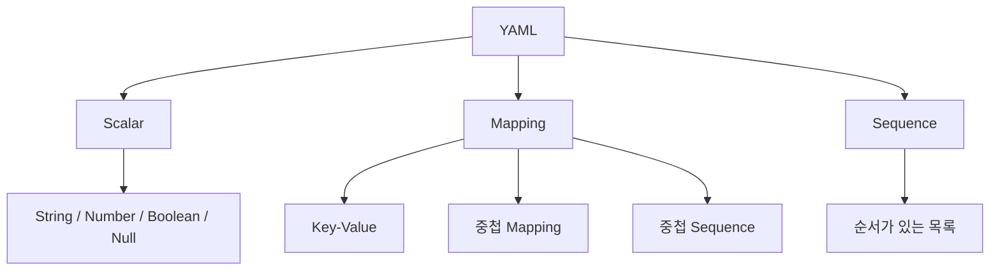
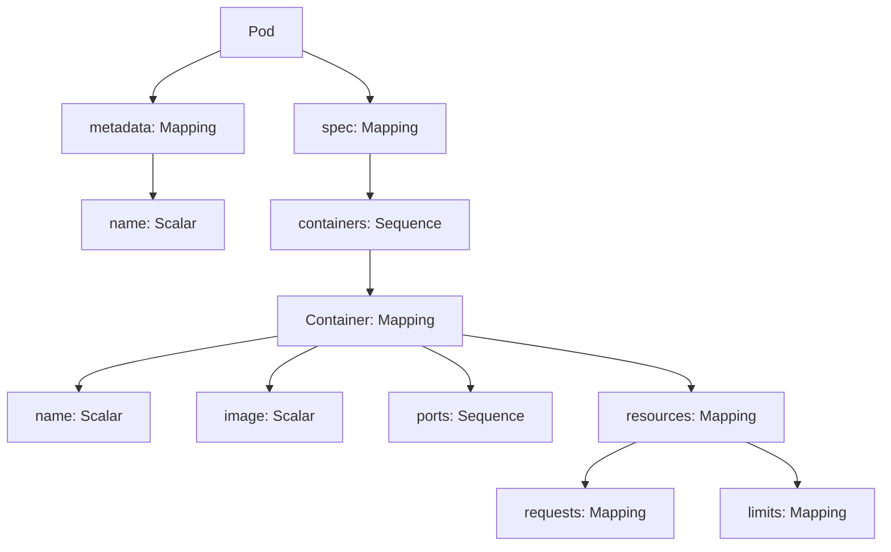
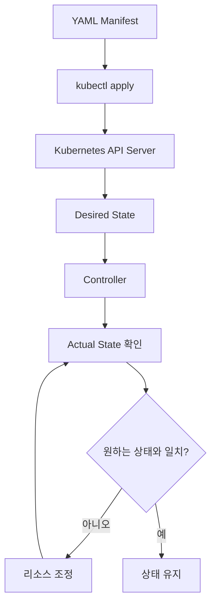
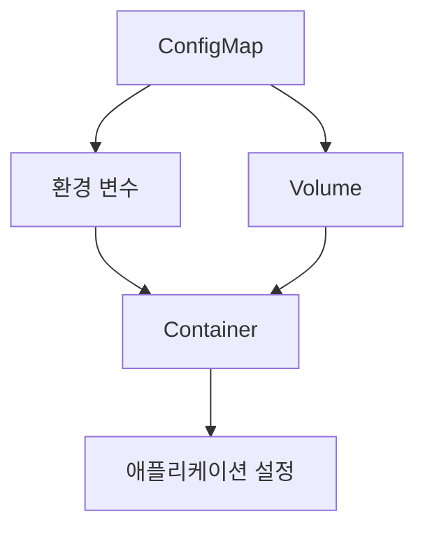
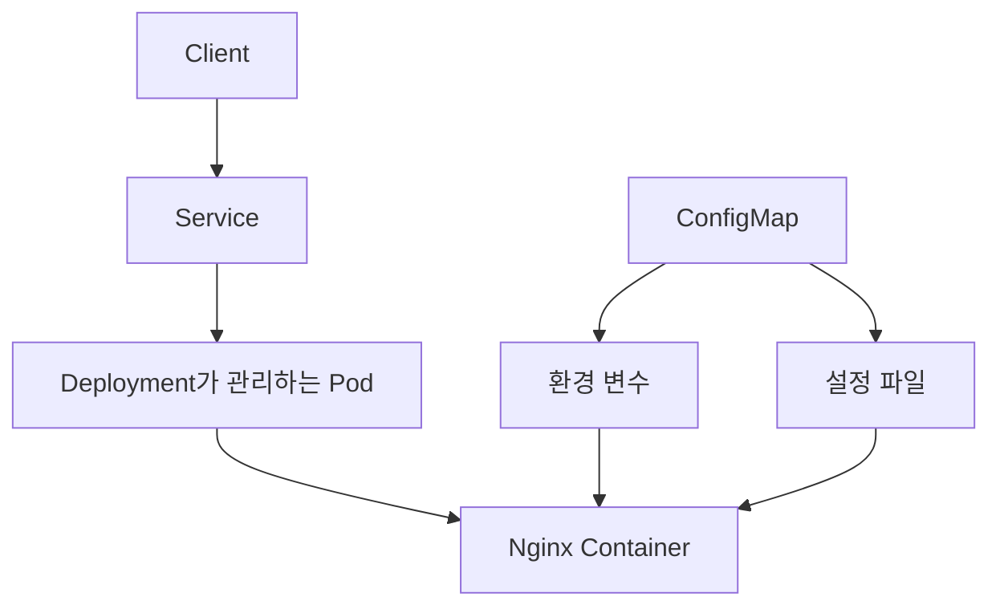
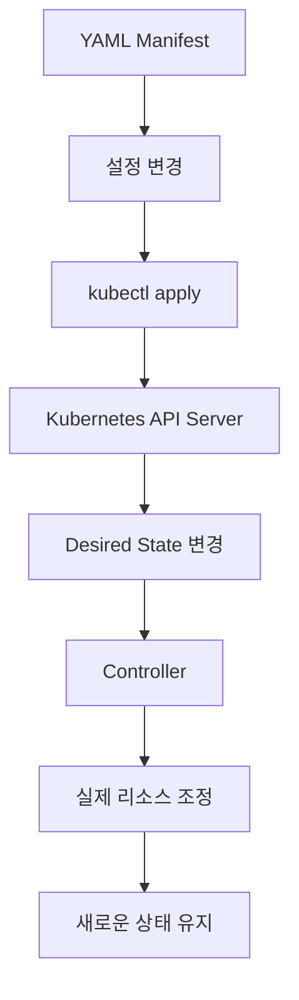
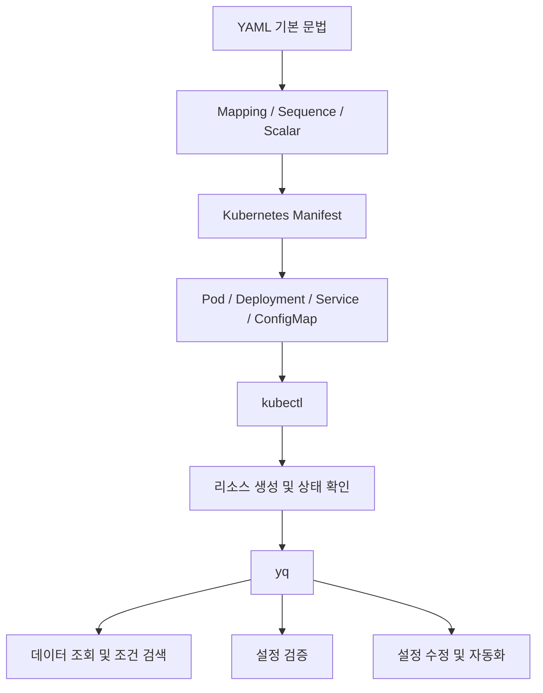

# Ch 4. Yaml_Wrap-up

# Ch 4. Yaml_Wrap-up
* toc
{:toc}

---

## Wrapup


### YAML 완벽 정리: 핵심 문법부터 Kubernetes 리소스 관리와 yq 활용까지

Kubernetes를 사용하다 보면 수많은 YAML 파일을 접하게 된다.

Pod를 생성하거나 Deployment를 수정할 때도 YAML을 사용하며, Service와 ConfigMap을 정의할 때도 YAML을 사용한다.

처음에는 YAML 파일에 등장하는 다양한 Key와 들여쓰기 때문에 복잡하게 느껴질 수 있다.

하지만 Kubernetes에서 사용하는 YAML도 결국 몇 가지 기본적인 데이터 구조를 조합한 것이다.

**Mapping, Sequence, Scalar의 개념을 이해하면 대부분의 Kubernetes Manifest를 구조적으로 읽을 수 있다.**

여기에 yq를 활용하면 YAML 파일을 직접 열어보지 않고도 원하는 정보를 조회하거나 수정할 수 있다.

이번에는 YAML의 주요 개념을 종합적으로 정리하고, Kubernetes에서 실제로 어떻게 활용되는지 살펴본다.

핵심은 다음 세 가지이다.

첫째, YAML은 데이터를 사람이 읽고 작성하기 쉬운 형식으로 표현한다.

둘째, Kubernetes는 YAML로 작성한 리소스 정의를 사용하여 원하는 시스템 상태를 관리한다.

셋째, yq를 활용하면 복잡한 YAML 데이터도 구조적으로 검색하고 수정할 수 있다.

---

### YAML이란?

YAML은 **YAML Ain't Markup Language**의 약자이다.

사람이 읽기 쉬운 형태로 데이터를 표현하기 위해 설계된 데이터 직렬화 언어이다.

데이터 직렬화란 프로그램에서 사용하는 데이터를 저장하거나 전송할 수 있는 형식으로 변환하는 과정을 의미한다.

반대로 직렬화된 데이터를 다시 프로그램에서 사용할 수 있는 객체나 자료구조로 복원하는 과정을 역직렬화라고 한다.

예를 들어 Java 애플리케이션에서 다음과 같은 객체를 사용한다고 가정하자.

```java
public record Person(
        String name,
        int age,
        boolean active
) {
}
```

이 객체의 데이터를 YAML로 표현하면 다음과 같다.

```yaml
name: 홍길동
age: 30
active: true
```

JSON으로 표현하면 다음과 같다.

```json
{
  "name": "홍길동",
  "age": 30,
  "active": true
}
```

두 형식 모두 동일한 데이터 구조를 표현할 수 있다.

다만 표현 방법에는 차이가 있다.

| 구분 | YAML | JSON |
|---|---|---|
| 주요 목적 | 데이터 직렬화 | 데이터 교환 및 직렬화 |
| 계층 표현 | 들여쓰기 | 중괄호와 대괄호 |
| Key-Value 표현 | `key: value` | `"key": value` |
| 배열 표현 | `-` 또는 `[]` | `[]` |
| 주석 | 지원 | 표준 JSON에서는 지원하지 않음 |
| 여러 줄 문자열 | `\|`, `>` 등 지원 | 이스케이프 문자 사용 |
| 대표 사용처 | 설정 파일, Kubernetes Manifest | REST API, 시스템 간 데이터 교환 |

YAML은 상대적으로 읽기 쉬운 구조를 제공하기 때문에 사람이 직접 작성하고 관리하는 설정 파일에 적합하다.

반면 JSON은 문법이 단순하고 다양한 프로그래밍 언어에서 널리 지원되므로 시스템 간 데이터 교환에 자주 사용된다.

중요한 것은 두 형식의 우열을 결정하는 것이 아니라 사용 목적에 맞게 선택하는 것이다.

---

### YAML의 세 가지 기본 데이터 구조

YAML을 이해하기 위해 반드시 알아야 하는 구조는 세 가지이다.

| 데이터 구조 | 의미 | 대표 문법 |
|---|---|---|
| Scalar | 하나의 값 | `name: Hong` |
| Mapping | Key와 Value의 관계 | `server: {port: 8080}` |
| Sequence | 순서가 있는 값의 목록 | `- Java` |

이 세 가지 구조를 조합하면 복잡한 데이터도 표현할 수 있다.



예를 들어 다음 YAML을 살펴보자.

```yaml
application:
  name: payment-service
  version: "1.0.0"

  server:
    port: 8080
    enabled: true

  profiles:
    - development
    - staging
    - production
```

이 YAML은 다음과 같은 구조를 가진다.

```text
application
│
├── name: payment-service
├── version: "1.0.0"
│
├── server
│   ├── port: 8080
│   └── enabled: true
│
└── profiles
    ├── development
    ├── staging
    └── production
```

`application`은 Mapping이다.

`server`도 Mapping이다.

`profiles`는 Sequence이다.

나머지 문자열, 숫자, Boolean은 Scalar에 해당한다.

즉 복잡해 보이는 YAML도 기본 데이터 구조로 분해하면 이해하기 쉽다.

---

### Mapping: Key와 Value로 데이터 표현하기

Mapping은 Key와 Value를 연결하는 구조이다.

Java의 `Map`, Python의 `dict`, JavaScript의 객체와 유사한 개념이다.

기본 문법은 다음과 같다.

```yaml
key: value
```

예를 들어 다음과 같이 사용할 수 있다.

```yaml
name: 홍길동
age: 30
```

Value에 또 다른 Mapping을 포함할 수도 있다.

```yaml
favorite:
  food: Steak
  musician: The Weeknd
```

여기서 `favorite`의 Value는 하나의 문자열이 아니라 또 다른 Mapping이다.

Mapping은 중괄호를 이용해 한 줄로 표현할 수도 있다.

```yaml
favorite: {food: Steak, musician: The Weeknd}
```

두 표현은 동일한 데이터 구조를 나타낸다.

다만 Kubernetes처럼 계층이 깊은 설정을 작성할 때는 들여쓰기를 사용하는 Block Style이 일반적으로 읽기 쉽다.

#### Mapping에서 주의할 점

YAML에서는 들여쓰기가 데이터의 계층을 결정한다.

```yaml
application:
  name: payment-service
  port: 8080
```

여기서는 `name`과 `port`가 `application`에 속한다.

하지만 다음과 같이 작성하면 구조가 달라진다.

```yaml
application:
  name: payment-service

port: 8080
```

이 경우 `port`는 최상위 Mapping에 속한다.

**YAML에서는 들여쓰기 자체가 데이터 구조를 표현하는 문법이라는 점을 기억해야 한다.**

---

### Sequence: 여러 데이터를 순서대로 표현하기

Sequence는 여러 개의 데이터를 순서대로 저장하는 구조이다.

프로그래밍 언어의 Array나 List와 비슷하다.

대표적으로 하이픈(`-`)을 사용한다.

```yaml
skills:
  - Java
  - Spring Boot
  - Kubernetes
```

대괄호로 표현할 수도 있다.

```yaml
skills: [Java, Spring Boot, Kubernetes]
```

두 표현은 동일한 Sequence를 나타낸다.

Sequence의 인덱스는 0부터 시작한다.

```text
skills
│
├── [0] Java
├── [1] Spring Boot
└── [2] Kubernetes
```

Sequence 안에는 단순한 문자열뿐 아니라 Mapping도 포함할 수 있다.

```yaml
containers:
  - name: application
    image: nginx:stable

  - name: sidecar
    image: busybox:stable
```

여기서 `containers`는 Sequence이며, 각 요소는 Mapping이다.

이러한 형태는 Kubernetes에서 자주 등장한다.

---

### Kubernetes YAML의 핵심은 Mapping과 Sequence의 조합이다

Kubernetes Manifest는 Mapping과 Sequence가 반복적으로 중첩되는 구조를 가진다.

다음 Pod Manifest를 살펴보자.

```yaml
apiVersion: v1
kind: Pod

metadata:
  name: nginx

spec:
  containers:
    - name: nginx
      image: nginx:stable

      ports:
        - containerPort: 80

      resources:
        requests:
          cpu: "100m"
          memory: "128Mi"

        limits:
          cpu: "500m"
          memory: "256Mi"
```

이 YAML의 구조를 분석하면 다음과 같다.

| 필드 | 데이터 구조 | 의미 |
|---|---|---|
| `apiVersion` | Scalar | Kubernetes API 버전 |
| `kind` | Scalar | 리소스 종류 |
| `metadata` | Mapping | 리소스 메타데이터 |
| `metadata.name` | Scalar | 리소스 이름 |
| `spec` | Mapping | 원하는 리소스 상태 |
| `containers` | Sequence | 컨테이너 목록 |
| `containers[0]` | Mapping | 첫 번째 컨테이너 |
| `ports` | Sequence | 포트 목록 |
| `resources` | Mapping | 자원 설정 |
| `requests` | Mapping | 요청 자원 |
| `limits` | Mapping | 제한 자원 |

이를 구조적으로 표현하면 다음과 같다.



이 구조를 이해하면 Kubernetes YAML이 특별히 어려운 문법을 사용하는 것이 아니라는 점을 알 수 있다.

결국 일반적인 YAML의 Mapping과 Sequence를 조합하고, Kubernetes API에서 정의한 Key를 사용하는 것이다.

다만 어떤 Key를 사용할 수 있고 어떤 데이터 타입이 필요한지는 리소스 종류에 따라 다르다.

예를 들어 `containers`는 Sequence여야 하며, `resources.requests`는 Mapping이어야 한다.

따라서 YAML 문법과 Kubernetes API 스키마를 구분해서 이해해야 한다.

---

### Kubernetes에서 YAML을 사용하는 이유

Kubernetes는 선언형 방식으로 리소스를 관리할 수 있는 시스템이다.

선언형 방식에서는 사용자가 원하는 상태를 정의한다.

예를 들어 다음과 같은 Deployment를 생각해보자.

```yaml
apiVersion: apps/v1
kind: Deployment

metadata:
  name: web-server

spec:
  replicas: 3

  selector:
    matchLabels:
      app: web-server

  template:
    metadata:
      labels:
        app: web-server

    spec:
      containers:
        - name: nginx
          image: nginx:stable

          ports:
            - containerPort: 80
```

여기서 중요한 설정은 다음과 같다.

```yaml
replicas: 3
```

사용자는 원하는 Pod 수량을 3개로 선언한다.

Kubernetes는 Deployment Controller 등을 통해 실제 상태를 확인하고 원하는 상태에 가깝게 유지하도록 동작한다.



예를 들어 Pod 하나가 장애로 종료되면 Deployment와 ReplicaSet이 원하는 수량을 유지하기 위해 새로운 Pod를 생성할 수 있다.

이러한 동작은 YAML 파일 자체가 수행하는 것이 아니다.

YAML은 원하는 상태를 표현하고, Kubernetes의 Controller가 실제 리소스를 관리하는 것이다.

이것이 Kubernetes의 선언형 관리 방식에서 중요한 개념이다.

Kubernetes는 `spec`에 정의된 원하는 상태와 실제 상태를 지속적으로 비교하며 관리한다.

---

### 명령형과 선언형의 차이

Kubernetes에서는 명령형 방식과 선언형 방식을 모두 사용할 수 있다.

명령형 방식은 특정 작업을 실행하도록 명령하는 것이다.

예를 들어 다음 명령어는 Pod를 생성한다.

```bash
kubectl run nginx --image=nginx:stable
```

동일한 이름의 Pod가 이미 존재한다면 생성 요청이 실패할 수 있다.

반면 선언형 방식에서는 YAML 파일을 작성하고 `apply`를 사용한다.

```bash
kubectl apply -f pod.yaml
```

`apply`는 파일에 정의된 상태를 클러스터에 반영한다.

동일한 리소스가 이미 존재하고 변경할 내용이 없다면 다음과 같은 메시지가 나타날 수 있다.

```text
pod/nginx unchanged
```

두 방식의 차이를 정리하면 다음과 같다.

| 구분 | 명령형 | 선언형 |
|---|---|---|
| 핵심 관심사 | 어떤 작업을 실행할 것인가? | 어떤 상태를 유지할 것인가? |
| 대표 명령어 | `kubectl create`, `kubectl run` | `kubectl apply` |
| 설정 관리 | 명령어 중심 | Manifest 중심 |
| 반복 실행 | 명령어에 따라 충돌 가능 | 변경 사항을 비교하여 적용 |
| 버전 관리 | 명령어 이력 관리 필요 | Git으로 Manifest 관리 가능 |
| 적합한 상황 | 임시 테스트, 단발성 작업 | 지속적인 배포 및 운영 |

선언형 관리가 항상 모든 변경을 허용하는 것은 아니다.

리소스의 변경 불가능한 필드를 수정하려는 경우에는 `kubectl apply`도 오류를 반환할 수 있다.

따라서 선언형 관리를 단순히 어떤 명령어를 반복해도 항상 성공하는 방식이라고 이해해서는 안 된다.

핵심은 **사용자가 원하는 상태를 정의하고, Kubernetes가 실제 상태를 그에 맞게 관리한다는 점**이다.

---

### ConfigMap을 이용한 애플리케이션 설정 관리

Kubernetes에서는 애플리케이션의 설정 데이터를 컨테이너 이미지와 분리할 수 있다.

이때 사용하는 대표적인 리소스가 ConfigMap이다.

예를 들어 다음과 같은 설정이 있다고 가정하자.

```yaml
apiVersion: v1
kind: ConfigMap

metadata:
  name: application-config

data:
  APP_MODE: "production"
  LOG_LEVEL: "INFO"

  application.properties: |
    server.port=8080
    feature.enabled=true
```

이 ConfigMap에는 세 개의 Key가 존재한다.

| Key | Value | 사용 목적 |
|---|---|---|
| `APP_MODE` | `"production"` | 실행 환경 |
| `LOG_LEVEL` | `"INFO"` | 로그 레벨 |
| `application.properties` | 여러 줄 문자열 | 애플리케이션 설정 파일 |

ConfigMap의 `data`는 문자열 값을 저장하는 Mapping이다.

따라서 숫자나 Boolean 값을 저장할 때도 문자열 형태로 작성해야 한다.

Pod는 ConfigMap을 다음과 같은 방식으로 사용할 수 있다.



환경 변수는 `env`와 `valueFrom.configMapKeyRef`를 사용하여 주입할 수 있다.

설정 파일은 `volumes`와 `volumeMounts`를 이용하여 컨테이너 내부에 마운트할 수 있다.

여기서 중요한 운영상의 차이가 있다.

**ConfigMap을 환경 변수로 주입한 경우, 이미 실행 중인 컨테이너의 환경 변수는 ConfigMap을 변경해도 자동으로 갱신되지 않는다.**

반면 ConfigMap을 Volume으로 마운트했다면 Kubernetes의 갱신 과정을 거쳐 파일 내용이 변경될 수 있다.

다만 애플리케이션이 변경된 파일을 다시 읽어야 실제 설정에 반영된다.

또한 `subPath`로 마운트한 ConfigMap 파일에는 일반적인 자동 갱신이 적용되지 않는다.

---

### yq란?

YAML은 사람이 읽고 작성하기 쉬운 형식이지만 데이터가 많아지면 원하는 설정을 찾기 어려울 수 있다.

예를 들어 수십 개의 Deployment에서 특정 이미지를 사용하는 컨테이너를 찾아야 할 수도 있다.

이러한 상황에서 사용할 수 있는 도구가 yq이다.

yq는 YAML 데이터를 구조적으로 조회하고 수정할 수 있는 CLI 도구이다.

여기서는 Mike Farah의 yq v4 계열을 기준으로 설명한다.

기본적인 명령어 형식은 다음과 같다.

```bash
yq '표현식' 파일명
```

예를 들어 다음 YAML이 있다고 가정하자.

**person.yaml**

```yaml
name: 길동
age: 30

favorite:
  food: Steak
  musician: The Weeknd

jobs:
  - title: artist
    experience: 10

  - title: teacher
    experience: 4

dislikes:
  - talk
  - travel
  - smoking
```

전체 YAML을 조회하려면 다음 명령어를 실행한다.

```bash
yq '.' person.yaml
```

이름만 조회하려면 다음과 같이 작성한다.

```bash
yq '.name' person.yaml
```

출력:

```text
길동
```

나이를 조회한다.

```bash
yq '.age' person.yaml
```

출력:

```text
30
```

중첩된 Mapping에서도 원하는 값에 접근할 수 있다.

```bash
yq '.favorite.food' person.yaml
```

출력:

```text
Steak
```

이처럼 점(`.`)을 사용하여 YAML의 계층 구조를 따라 이동할 수 있다.

---

### yq로 Mapping과 Sequence 조회하기

Sequence는 인덱스를 이용해 특정 요소에 접근할 수 있다.

예를 들어 첫 번째 직업을 조회한다.

```bash
yq '.jobs[0]' person.yaml
```

출력:

```yaml
title: artist
experience: 10
```

두 번째 직업의 이름을 조회한다.

```bash
yq '.jobs[1].title' person.yaml
```

출력:

```text
teacher
```

모든 직업의 이름을 조회하려면 빈 대괄호(`[]`)를 사용한다.

```bash
yq '.jobs[].title' person.yaml
```

출력:

```text
artist
teacher
```

여기서 `[]`는 Sequence의 모든 요소를 선택한다.

단순히 들여쓰기를 제거하는 기능이 아니라, 배열의 각 요소를 개별적으로 순회하는 역할이다.

이러한 방식은 Kubernetes Manifest에서도 동일하게 활용된다.

예를 들어 Deployment의 모든 컨테이너 이미지는 다음 경로로 조회할 수 있다.

```bash
yq '.spec.template.spec.containers[].image' deployment.yaml
```

---

### yq의 주요 연산자 정리

yq는 다양한 연산자를 제공한다.

그중 Kubernetes 설정을 분석할 때 활용도가 높은 연산자는 다음과 같다.

| 연산자 | 역할 | 예시 |
|---|---|---|
| `.` | 현재 문서 전체 조회 | `yq '.' file.yaml` |
| `.key` | 특정 Key 조회 | `.age` |
| `.parent.child` | 중첩 Mapping 조회 | `.favorite.food` |
| `[0]` | 첫 번째 Sequence 요소 선택 | `.jobs[0]` |
| `[]` | 모든 Sequence 요소 선택 | `.jobs[]` |
| `\|` | 표현식 연결 | `.jobs[] \| .title` |
| `select()` | 조건에 맞는 데이터 선택 | `select(.age >= 20)` |
| `has()` | Key 존재 여부 검사 | `has("data")` |
| `test()` | 정규표현식 검사 | `test("^t")` |
| `keys` | Mapping의 Key 목록 추출 | `.spec \| keys` |
| `tag` | YAML 데이터 타입 확인 | `.age \| tag` |
| `length` | 요소 개수 또는 값의 길이 확인 | `.jobs \| length` |
| `sort_keys()` | Mapping Key 정렬 | `sort_keys(.)` |
| `=` | 값 할당 | `.age = 45` |
| `-i` | 원본 파일 수정 | `yq -i '.age = 45' file.yaml` |

이러한 연산자를 조합하면 원하는 데이터를 단계적으로 추출할 수 있다.

예를 들어 경력이 5년 이상인 직업의 이름만 조회하려면 다음과 같이 작성한다.

```bash
yq '.jobs[] | select(.experience >= 5) | .title' person.yaml
```

출력:

```text
artist
```

이 명령어는 다음 순서로 동작한다.


즉 yq를 활용하는 핵심은 **먼저 필요한 데이터를 선택하고, 선택한 데이터에 조건과 변환 연산자를 적용하는 것**이다.

yq에서 지원하는 연산자의 종류와 동작은 공식 문서에서 확인할 수 있다.

---

### kubectl과 yq를 함께 사용하는 방법

Kubernetes에서 yq의 활용도를 높이는 방법은 `kubectl`과 함께 사용하는 것이다.

예를 들어 다음 명령어를 실행하면 모든 Namespace에 존재하는 Pod를 YAML로 조회할 수 있다.

```bash
kubectl get pods -A -o yaml
```

여기에 yq를 연결한다.

```bash
kubectl get pods -A -o yaml |
  yq '.items[].metadata.name'
```

이 명령어는 모든 Pod의 이름을 출력한다.

여기서 중요한 부분은 다음과 같다.

```text
.items[]
```

`kubectl get pods -o yaml`처럼 여러 리소스를 조회하면 일반적으로 최상위에 `items`라는 Sequence가 존재한다.

각 Pod는 이 Sequence의 요소이다.

따라서 개별 Pod의 설정에 접근하려면 `.items[]`를 이용하면 된다.

#### 모든 Pod의 컨테이너 이미지 조회

```bash
kubectl get pods -A -o yaml |
  yq '.items[].spec.containers[].image'
```

#### LoadBalancer Service 검색

```bash
kubectl get services -A -o yaml |
  yq '
    .items[]
    | select(.spec.type == "LoadBalancer")
    | .metadata.namespace + "/" + .metadata.name
  '
```

#### data Key가 있는 ConfigMap 검색

```bash
kubectl get configmaps -A -o yaml |
  yq '
    .items[]
    | select(has("data"))
    | .metadata.namespace + "/" + .metadata.name
  '
```

#### 특정 Pod의 Spec Key 확인

```bash
kubectl get pod <pod-name> -n <namespace> -o yaml |
  yq '.spec | keys'
```

이러한 방식으로 Kubernetes의 다양한 리소스를 조건에 따라 검색할 수 있다.

다만 `keys`는 현재 객체에 존재하는 Key를 보여주는 것이지 Kubernetes API에서 허용하는 모든 필드를 보여주는 것은 아니다.

지원하는 필드 전체를 확인하려면 `kubectl explain`을 사용하는 것이 적절하다.

---

### 종합 예제: ConfigMap, Deployment, Service 구성하기

지금까지 살펴본 YAML과 Kubernetes, yq의 관계를 하나의 예제로 연결해보자.

다음과 같은 구성을 만든다고 가정하자.



이번 예제에서는 세 가지 Kubernetes 리소스를 사용한다.

| 리소스 | 역할 |
|---|---|
| ConfigMap | 애플리케이션 설정 데이터 저장 |
| Deployment | 컨테이너 실행과 Pod 관리 |
| Service | Pod에 대한 네트워크 접근 경로 제공 |

하나의 YAML 파일에 세 리소스를 함께 작성한다.

YAML에서는 `---`를 이용해 여러 문서를 구분할 수 있다.

#### 전체 Kubernetes Manifest

**k8s-lab.yaml**

```yaml
apiVersion: v1
kind: ConfigMap

metadata:
  name: yaml-lab-config

data:
  APP_MODE: "development"

  message.txt: |
    Hello Kubernetes.
    This file is provided by ConfigMap.

---
apiVersion: apps/v1
kind: Deployment

metadata:
  name: yaml-lab

spec:
  replicas: 1

  selector:
    matchLabels:
      app: yaml-lab

  template:
    metadata:
      labels:
        app: yaml-lab

    spec:
      containers:
        - name: nginx
          image: nginx:stable

          ports:
            - containerPort: 80

          env:
            - name: APP_MODE
              valueFrom:
                configMapKeyRef:
                  name: yaml-lab-config
                  key: APP_MODE

          volumeMounts:
            - name: config-volume
              mountPath: /etc/demo-config
              readOnly: true

          resources:
            requests:
              cpu: "50m"
              memory: "64Mi"

            limits:
              cpu: "200m"
              memory: "128Mi"

      volumes:
        - name: config-volume
          configMap:
            name: yaml-lab-config

            items:
              - key: message.txt
                path: message.txt

---
apiVersion: v1
kind: Service

metadata:
  name: yaml-lab-service

spec:
  type: ClusterIP

  selector:
    app: yaml-lab

  ports:
    - name: http
      port: 80
      targetPort: 80
```

이 파일에는 세 개의 YAML 문서가 존재한다.

첫 번째 문서는 ConfigMap이다.

두 번째 문서는 Deployment이다.

세 번째 문서는 Service이다.

각 리소스는 서로 다른 역할을 수행하지만 YAML의 Mapping과 Sequence라는 동일한 문법으로 구성되어 있다.

참고로 `nginx:stable`은 예제의 편의를 위한 태그이며, 실제 운영 환경에서는 검증된 이미지 버전이나 Digest로 고정하는 것이 좋다.

또한 Nginx가 `APP_MODE` 환경 변수나 `message.txt`를 자동으로 활용하는 것은 아니다. 이번 예제에서는 설정값이 컨테이너에 정상적으로 전달되는지 확인한다.

---

### yq로 여러 YAML 문서 분석하기

앞서 작성한 파일에는 세 개의 YAML 문서가 포함되어 있다.

먼저 전체 내용을 확인한다.

```bash
yq '.' k8s-lab.yaml
```

이 명령어는 여러 문서를 순서대로 파싱하여 출력한다.

#### ConfigMap 이름 조회하기

```bash
yq '
  select(.kind == "ConfigMap")
  | .metadata.name
' k8s-lab.yaml
```

출력:

```text
yaml-lab-config
```

#### Deployment의 replicas 조회하기

```bash
yq '
  select(.kind == "Deployment")
  | .spec.replicas
' k8s-lab.yaml
```

출력:

```text
1
```

#### Deployment의 컨테이너 이미지 조회하기

```bash
yq '
  select(.kind == "Deployment")
  | .spec.template.spec.containers[].image
' k8s-lab.yaml
```

출력:

```text
nginx:stable
```

#### Service 타입 조회하기

```bash
yq '
  select(.kind == "Service")
  | .spec.type
' k8s-lab.yaml
```

출력:

```text
ClusterIP
```

이처럼 `select(.kind == "...")`를 사용하면 하나의 파일에 여러 YAML 문서가 존재하더라도 원하는 Kubernetes 리소스만 선택할 수 있다.

---

### Kubernetes 리소스 생성하기

먼저 YAML 문법이 올바른지 확인한다.

```bash
yq '.' k8s-lab.yaml > /dev/null
```

정상적으로 파싱되면 일반적으로 종료 코드가 0이 된다.

다음 명령어로 확인할 수 있다.

```bash
echo $?
```

출력:

```text
0
```

이제 Kubernetes API 기준으로 Manifest를 검증한다.

```bash
kubectl apply --dry-run=server -f k8s-lab.yaml
```

서버 측 Dry Run이 정상적으로 수행되면 리소스를 저장하지 않고 API 검증 결과를 확인할 수 있다.

이후 실제 리소스를 생성한다.

```bash
kubectl apply -f k8s-lab.yaml
```

처음 생성하는 경우 다음과 같은 결과가 나타날 수 있다.

```text
configmap/yaml-lab-config created
deployment.apps/yaml-lab created
service/yaml-lab-service created
```

이제 생성된 리소스를 확인한다.

```bash
kubectl get configmap yaml-lab-config
```

```bash
kubectl get deployment yaml-lab
```

```bash
kubectl get service yaml-lab-service
```

Deployment가 준비되었는지 확인한다.

```bash
kubectl rollout status deployment/yaml-lab --timeout=120s
```

정상적으로 배포되면 다음과 같은 메시지가 출력될 수 있다.

```text
deployment "yaml-lab" successfully rolled out
```

실행 결과는 클러스터 환경, 이미지 다운로드 상태, 리소스 사용량 등에 따라 달라질 수 있다.

---

### 컨테이너 내부에서 ConfigMap 확인하기

이제 ConfigMap의 값이 컨테이너 내부에 실제로 전달되었는지 확인해보자.

먼저 환경 변수를 조회한다.

```bash
kubectl exec deployment/yaml-lab -- printenv APP_MODE
```

출력:

```text
development
```

이 값은 ConfigMap에서 가져온 것이다.

```yaml
data:
  APP_MODE: "development"
```

다음으로 ConfigMap을 통해 마운트한 파일을 확인한다.

```bash
kubectl exec deployment/yaml-lab -- \
  cat /etc/demo-config/message.txt
```

출력:

```text
Hello Kubernetes.
This file is provided by ConfigMap.
```

이 파일은 ConfigMap에 정의된 여러 줄 문자열을 Volume으로 전달받은 것이다.

```yaml
message.txt: |
  Hello Kubernetes.
  This file is provided by ConfigMap.
```

이 과정을 통해 YAML에 정의한 설정이 Kubernetes 리소스를 거쳐 실제 컨테이너에 전달되는 것을 확인할 수 있다.

---

### 실행 중인 Kubernetes 리소스를 yq로 분석하기

이번에는 로컬 YAML 파일이 아니라 Kubernetes API Server에 저장된 리소스를 직접 조회해보자.

#### Deployment의 이미지 확인

```bash
kubectl get deployment yaml-lab -o yaml |
  yq '.spec.template.spec.containers[].image'
```

출력:

```text
nginx:stable
```

#### Deployment의 replicas 확인

```bash
kubectl get deployment yaml-lab -o yaml |
  yq '.spec.replicas'
```

출력:

```text
1
```

#### Deployment의 requests 확인

```bash
kubectl get deployment yaml-lab -o yaml |
  yq '.spec.template.spec.containers[].resources.requests'
```

출력:

```yaml
cpu: 50m
memory: 64Mi
```

#### Deployment의 limits 확인

```bash
kubectl get deployment yaml-lab -o yaml |
  yq '.spec.template.spec.containers[].resources.limits'
```

출력:

```yaml
cpu: 200m
memory: 128Mi
```

#### Pod 이름 조회

```bash
kubectl get pods -l app=yaml-lab -o yaml |
  yq '.items[].metadata.name'
```

출력 예시:

```text
yaml-lab-7c9d8b6d5f-abcde
```

Pod 이름에는 ReplicaSet이 생성한 식별자가 포함되므로 실제 출력은 달라질 수 있다.

이처럼 `kubectl`과 yq를 함께 사용하면 클러스터의 실제 리소스 상태를 구조적으로 확인할 수 있다.

---

### YAML 파일을 수정하면 Kubernetes 리소스도 변경될까?

yq를 이용하면 YAML 파일의 값을 수정할 수 있다.

하지만 여기서 반드시 구분해야 할 개념이 있다.

**yq로 로컬 YAML 파일을 수정하는 것과 Kubernetes 클러스터의 리소스를 변경하는 것은 서로 다른 작업이다.**

예를 들어 Deployment의 replicas를 1에서 2로 변경한다고 가정하자.

로컬 YAML 파일에서 다음 설정을 수정한다.

```yaml
replicas: 2
```

이때 파일에 정의된 원하는 상태는 2개로 변경되지만, Kubernetes 클러스터에는 아직 변경 사항이 반영되지 않았다.

실제로 클러스터에 적용하려면 다음 명령어를 실행해야 한다.

```bash
kubectl apply -f k8s-lab.yaml
```

이후 Deployment의 replicas를 확인한다.

```bash
kubectl get deployment yaml-lab -o yaml |
  yq '.spec.replicas'
```

출력:

```text
2
```

Kubernetes의 Deployment Controller는 새로운 원하는 상태에 맞춰 Pod 수량을 조정한다.

이 전체 과정을 표현하면 다음과 같다.



이처럼 YAML, yq, kubectl, Kubernetes Controller는 각각 다른 역할을 담당한다.

| 구성 요소 | 역할 |
|---|---|
| YAML | 원하는 리소스와 설정을 표현 |
| yq | YAML 데이터 조회 및 수정 |
| kubectl | Kubernetes API Server와 통신 |
| API Server | 리소스 정의를 검증하고 저장 |
| Controller | 실제 상태를 원하는 상태에 맞게 조정 |

이러한 역할을 구분하면 Kubernetes에서 설정을 변경했는데도 실제 리소스가 바뀌지 않는 문제를 분석하기 쉬워진다.

---

### Kubernetes YAML을 효과적으로 분석하는 방법

처음 보는 Kubernetes Manifest를 분석할 때는 모든 필드의 의미를 한꺼번에 이해하려고 하기보다 구조를 단계적으로 확인하는 것이 좋다.

예를 들어 다음과 같은 Deployment가 있다고 가정하자.

```yaml
apiVersion: apps/v1
kind: Deployment

metadata:
  name: payment-service

spec:
  replicas: 3

  selector:
    matchLabels:
      app: payment-service

  template:
    metadata:
      labels:
        app: payment-service

    spec:
      containers:
        - name: payment-service
          image: example/payment-service:1.0.0
```

먼저 리소스의 종류를 확인한다.

```yaml
kind: Deployment
```

다음으로 리소스의 이름을 확인한다.

```yaml
metadata:
  name: payment-service
```

그다음에는 원하는 상태를 확인한다.

```yaml
spec:
  replicas: 3
```

이후 Pod Template과 컨테이너의 구성을 확인한다.

```yaml
template:
  spec:
    containers:
      - name: payment-service
        image: example/payment-service:1.0.0
```

이러한 순서로 분석하면 복잡한 Manifest에서도 핵심적인 설정을 놓치지 않을 수 있다.

특히 `spec`이 복잡하다면 다음 명령어로 현재 존재하는 Key 목록을 확인할 수 있다.

```bash
kubectl get deployment payment-service -o yaml |
  yq '.spec | keys'
```

새로운 필드의 의미가 궁금하다면 Kubernetes API 스키마를 확인할 수 있다.

```bash
kubectl explain deployment.spec
```

더 깊은 필드를 확인하려면 다음과 같이 작성한다.

```bash
kubectl explain deployment.spec.template.spec.containers
```

이처럼 yq와 `kubectl explain`을 함께 사용하면 현재 리소스에 적용된 설정과 API에서 지원하는 설정을 구분해서 이해할 수 있다.

---

### 실무에서 YAML과 yq를 활용하는 10가지 방법

YAML과 yq를 활용하면 단순한 설정 조회를 넘어 Kubernetes 운영 작업을 자동화할 수 있다.

다음은 실제 개발 및 운영에서 고려할 수 있는 활용 방법이다.

| 활용 방법 | 구현 방향 | 기대 효과 |
|---|---|---|
| 1. Deployment 이미지 점검 | `containers[].image` 조회 | 사용 중인 이미지 파악 |
| 2. 오래된 이미지 검색 | `select()`, `test()` 조합 | 이미지 교체 대상 식별 |
| 3. 리소스 설정 검증 | `requests`, `limits` 조회 | 자원 설정 누락 탐지 |
| 4. ConfigMap 설정 검사 | `has()` 사용 | 필수 설정 Key 확인 |
| 5. Service 타입 분석 | `spec.type` 필터링 | 외부 노출 리소스 파악 |
| 6. 환경별 설정 비교 | 서로 다른 YAML의 Key 조회 | 환경 간 설정 차이 분석 |
| 7. 배포 Manifest 자동 수정 | yq의 할당 연산자 활용 | 반복적인 수정 작업 감소 |
| 8. YAML 문법 검증 | yq 파싱 및 yamllint 적용 | 문법 오류 조기 발견 |
| 9. 리소스 설정 문서화 | `keys`, `tag` 사용 | 설정 구조 파악 및 문서화 |
| 10. CI/CD 검증 자동화 | yq와 kubectl 결합 | 배포 전 설정 점검 |

이러한 자동화에서는 단순히 값을 조회할 수 있다는 사실보다 **어떤 조건을 검증할 것이며, 조건을 만족하지 않을 때 어떻게 처리할 것인지**를 정의하는 것이 중요하다.

예를 들어 모든 Deployment에서 이미지 태그가 `latest`인 컨테이너를 검색한다고 가정하자.

```bash
kubectl get deployments -A -o yaml |
  yq '
    .items[]
    | select(
        .spec.template.spec.containers
        | any_c(.image | test(":latest$"))
      )
    | .metadata.namespace + "/" + .metadata.name
  '
```

이 명령어는 일반 컨테이너 이미지 문자열이 `:latest`로 끝나는 Deployment를 검색한다.

다만 이미지 태그를 생략한 경우에도 일반적으로 `latest`가 적용될 수 있으므로, 실제 이미지 정책 검증에서는 태그 생략 여부까지 함께 확인해야 한다.

이러한 검색을 CI/CD 파이프라인과 결합하면 배포 정책을 준수하지 않는 설정을 사전에 발견하는 데 활용할 수 있다.

---

### YAML을 사용할 때 주의해야 할 사항

YAML은 사람이 읽기 쉬운 형식이지만 문법이 간결한 만큼 실수하기 쉬운 부분도 있다.

특히 다음 사항들을 고려해야 한다.

#### 1. 들여쓰기는 공백으로 작성한다

YAML에서 들여쓰기는 데이터의 계층 관계를 결정한다.

Tab을 들여쓰기로 사용하지 않고 공백을 사용해야 한다.

일반적으로 공백 2칸을 사용하면 가독성을 유지하기 좋다.

#### 2. Mapping과 Sequence를 구분한다

다음 설정은 Mapping이다.

```yaml
resources:
  requests:
    cpu: "100m"
```

반면 다음 설정은 Sequence이다.

```yaml
containers:
  - name: nginx
    image: nginx:stable
```

하이픈이 새로운 Sequence 요소를 의미한다는 점을 기억해야 한다.

#### 3. 데이터 타입을 명확하게 작성한다

다음 두 설정은 서로 다르다.

```yaml
enabled: true
```

```yaml
enabled: "true"
```

첫 번째는 Boolean으로 해석할 수 있다.

두 번째는 문자열이다.

이러한 차이는 Spring Boot 설정 바인딩이나 Kubernetes API 검증에서 중요할 수 있다.

#### 4. Null과 Key의 부재를 구분한다

다음 두 설정도 서로 다른 구조이다.

```yaml
experience: null
```

```yaml
name: 홍길동
```

첫 번째는 `experience`라는 Key가 존재하지만 값이 Null이다.

두 번째는 `experience`라는 Key가 존재하지 않는다.

#### 5. 여러 줄 문자열의 줄바꿈 규칙을 이해한다

줄바꿈을 유지하려면 `|`를 사용한다.

```yaml
message: |
  Hello
  Kubernetes
```

일반적인 줄바꿈을 공백으로 접어 하나의 문장처럼 표현하려면 `>`를 사용한다.

```yaml
message: >
  Hello
  Kubernetes
```

두 방식은 최종 문자열이 다르게 해석될 수 있다.

#### 6. 중복 Key를 사용하지 않는다

동일한 Mapping 안에서 같은 Key를 중복해서 작성하면 안 된다.

```yaml
port: 8080
port: 9090
```

일부 YAML 파서는 중복 Key에 대해 오류를 반환하고, 일부 구현에서는 특정 값이 선택될 수 있다.

따라서 중복 Key가 발생하지 않도록 검증하는 것이 안전하다.

#### 7. YAML 문법과 Kubernetes API 검증을 구분한다

다음 YAML은 문법적으로 유효할 수 있다.

```yaml
containers:
  name: nginx
  image: nginx:stable
```

하지만 Kubernetes Pod Spec에서 `containers`는 Sequence여야 한다.

따라서 올바른 구조는 다음과 같다.

```yaml
containers:
  - name: nginx
    image: nginx:stable
```

YAML 문법이 유효하다고 해서 Kubernetes Manifest도 반드시 유효한 것은 아니다.

#### 8. 민감한 정보를 일반 ConfigMap에 저장하지 않는다

ConfigMap은 일반 설정 데이터를 관리하기 위한 리소스이다.

비밀번호, API Key, 인증 토큰 등은 Secret이나 별도의 Secret 관리 시스템을 사용하는 것이 적절하다.

#### 9. yq로 수정한 파일의 변경 사항을 확인한다

다음 명령어는 원본 파일을 직접 수정한다.

```bash
yq -i '.spec.replicas = 3' deployment.yaml
```

따라서 실제 운영에서는 변경 사항을 Git으로 관리하고 수정 결과를 검증하는 것이 좋다.

#### 10. 선언한 상태와 실제 실행 상태를 구분한다

Kubernetes Manifest에는 사용자가 원하는 상태가 정의된다.

반면 클러스터에는 실제 실행 상태가 존재한다.

Deployment의 다음 두 값은 서로 다른 의미를 가진다.

```text
spec.replicas
status.readyReplicas
```

`spec.replicas`는 원하는 Pod 수량이다.

`status.readyReplicas`는 현재 Ready 상태인 Pod 수량이다.

따라서 운영 문제를 분석할 때는 원하는 상태뿐 아니라 실제 상태도 함께 확인해야 한다.

---

### Kubernetes YAML 학습의 핵심 흐름

YAML을 이해하는 과정은 크게 네 단계로 정리할 수 있다.

**첫 번째 단계는 데이터 구조를 이해하는 것이다.**

Mapping, Sequence, Scalar를 구분한다.

**두 번째 단계는 Kubernetes Manifest를 읽는 것이다.**

각 필드의 계층 관계를 이해하고 Kubernetes API가 요구하는 구조를 확인한다.

**세 번째 단계는 실제 리소스를 생성하고 확인하는 것이다.**

`kubectl apply`, `kubectl get`, `kubectl describe` 등을 사용한다.

**네 번째 단계는 yq를 활용해 분석과 자동화를 수행하는 것이다.**

복잡한 YAML에서 필요한 정보를 추출하고 조건에 따라 검증하거나 수정한다.

이를 표현하면 다음과 같다.



이 과정을 반복하면 YAML 파일을 단순히 읽을 수 있는 수준에서 벗어나, Kubernetes 리소스의 구조와 동작을 이해하고 운영 작업에 활용할 수 있게 된다.

---

### 종합 예제 리소스 정리하기

실습을 마쳤다면 생성한 Kubernetes 리소스를 삭제한다.

앞서 작성한 `k8s-lab.yaml`에는 ConfigMap, Deployment, Service가 포함되어 있다.

다음 명령어로 삭제할 수 있다.

```bash
kubectl delete -f k8s-lab.yaml
```

출력 예시:

```text
configmap "yaml-lab-config" deleted
deployment.apps "yaml-lab" deleted
service "yaml-lab-service" deleted
```

이 명령어는 YAML에 정의된 리소스를 삭제한다.

실제 삭제 대상은 Manifest의 `kind`, `metadata.name`, Namespace 등을 기준으로 결정된다.

삭제 후에는 다음 명령어로 리소스가 남아 있는지 확인할 수 있다.

```bash
kubectl get deployment yaml-lab
```

```bash
kubectl get service yaml-lab-service
```

```bash
kubectl get configmap yaml-lab-config
```

삭제가 완료되었다면 해당 리소스를 찾을 수 없다는 메시지가 나타날 수 있다.

실제 운영 환경에서는 다른 서비스가 참조하는 ConfigMap이나 Service를 삭제하지 않도록 리소스 간 의존성을 먼저 확인해야 한다.

---

### 정리

YAML은 사람이 읽고 작성하기 쉬운 데이터 직렬화 언어이다.

주요 데이터 구조인 Mapping, Sequence, Scalar를 조합하여 단순한 설정부터 복잡한 계층 구조까지 표현할 수 있다.

Kubernetes는 이러한 YAML을 사용하여 다양한 리소스의 원하는 상태를 정의한다.

Pod, Deployment, Service, ConfigMap 등 각 리소스는 서로 다른 목적을 가지지만 공통적으로 YAML의 기본 문법을 사용한다.

따라서 Kubernetes Manifest를 이해하기 위해서는 먼저 Mapping과 Sequence의 관계를 파악하는 것이 중요하다.

특히 다음과 같은 구조는 Kubernetes에서 반복적으로 사용된다.

```yaml
spec:
  containers:
    - name: application
      image: nginx:stable
```

여기서 `spec`은 Mapping이다.

`containers`는 Sequence이다.

그 안에 포함된 각 컨테이너는 Mapping이다.

이러한 관계를 이해하면 처음 보는 Kubernetes Manifest도 구조적으로 분석할 수 있다.

또한 Kubernetes에서는 선언형 방식으로 리소스를 관리할 수 있다.

YAML에 원하는 상태를 정의하고 `kubectl apply`를 통해 클러스터에 반영하면 Kubernetes의 Controller가 실제 상태를 원하는 상태에 맞게 조정한다.

하지만 YAML 파일에 정의된 상태와 클러스터에서 실제 실행 중인 상태는 다를 수 있다.

따라서 Manifest의 설정뿐 아니라 Kubernetes API에서 반환하는 실제 리소스 정보도 확인해야 한다.

이때 활용할 수 있는 도구가 yq이다.

yq는 YAML 데이터를 구조적으로 파싱하여 원하는 값을 조회하거나 조건에 따라 필터링하고 수정할 수 있다.

특히 `kubectl get -o yaml`과 조합하면 Kubernetes의 다양한 리소스를 검색하고 점검하는 작업에 활용할 수 있다.

이번에 살펴본 핵심 개념을 다시 정리하면 다음과 같다.

| 주제 | 핵심 내용 |
|---|---|
| YAML | 사람이 읽기 쉬운 데이터 직렬화 언어 |
| Scalar | 문자열, 숫자, Boolean, Null 등의 단일 값 |
| Mapping | Key-Value 관계 |
| Sequence | 순서가 있는 데이터 목록 |
| 들여쓰기 | 데이터의 계층 구조 표현 |
| `---` | YAML 문서 구분 |
| `\|` | 여러 줄 문자열의 줄바꿈 유지 |
| `>` | 일반적인 줄바꿈을 공백으로 접기 |
| Kubernetes Manifest | Kubernetes 리소스의 원하는 상태 정의 |
| 선언형 관리 | 원하는 상태를 정의하고 시스템이 그 상태를 유지하도록 관리 |
| ConfigMap | 일반 설정 데이터 저장 |
| `kubectl apply` | Manifest를 Kubernetes 클러스터에 반영 |
| `kubectl get -o yaml` | Kubernetes 리소스를 YAML 형식으로 조회 |
| yq | YAML 데이터 조회·검색·수정 |
| `select()` | 조건에 맞는 데이터 필터링 |
| `has()` | 특정 Key 존재 여부 확인 |
| `keys` | Mapping Key 목록 확인 |
| `tag` | YAML 데이터 타입 확인 |
| `length` | 데이터의 길이 또는 요소 개수 확인 |
| `-i` | YAML 원본 파일 수정 |

결국 YAML을 이해한다는 것은 단순히 들여쓰기와 문법을 암기하는 것이 아니다.

**데이터가 어떤 계층 구조를 가지며, 각 설정이 시스템에서 어떤 의미로 해석되는지 이해하는 것**이다.

Kubernetes에서는 이러한 이해를 바탕으로 리소스를 정확하게 정의하고, 실제 상태를 조회하고, 변경 사항을 안정적으로 관리할 수 있다.

여기에 yq를 활용하면 반복적인 조회와 수정 작업을 자동화할 수 있으며, 복잡한 Kubernetes 환경에서도 필요한 정보를 효율적으로 추출할 수 있다.

따라서 YAML의 기본 문법을 이해하고 Kubernetes Manifest를 직접 작성하며 yq를 이용해 리소스를 분석하는 경험은 Kubernetes를 운영하고 관리하는 데 중요한 기반이 된다.

#### 한 줄 요약

> YAML은 Mapping, Sequence, Scalar를 조합하여 데이터를 표현하는 직렬화 언어이며, Kubernetes는 YAML을 통해 리소스의 원하는 상태를 정의하고 관리한다. 여기에 yq를 활용하면 Kubernetes 리소스를 구조적으로 조회·검증·수정하여 설정 관리와 운영 자동화를 더욱 효율적으로 수행할 수 있다.
