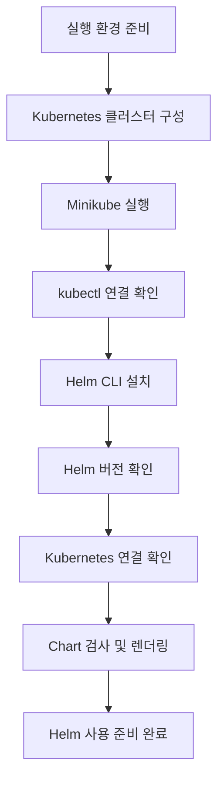
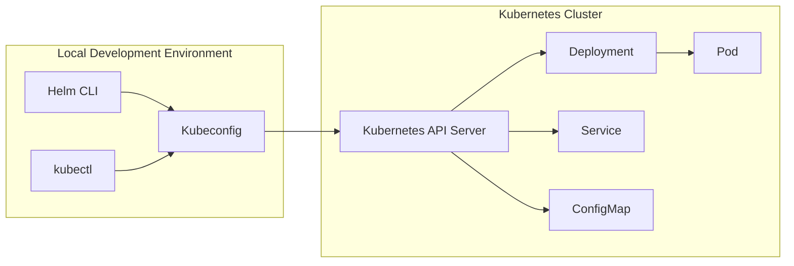
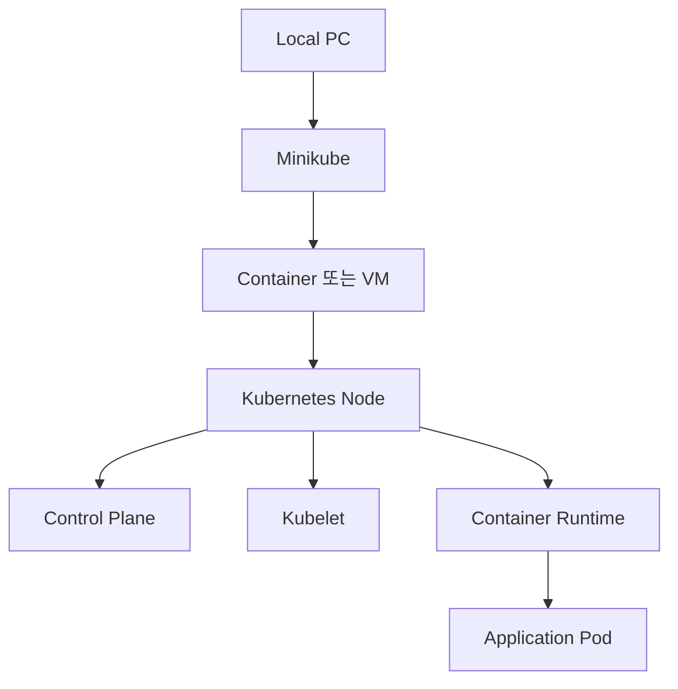
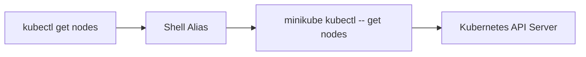
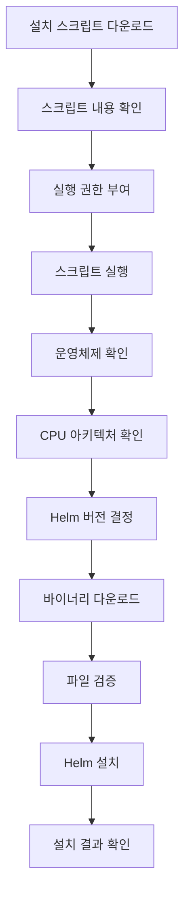
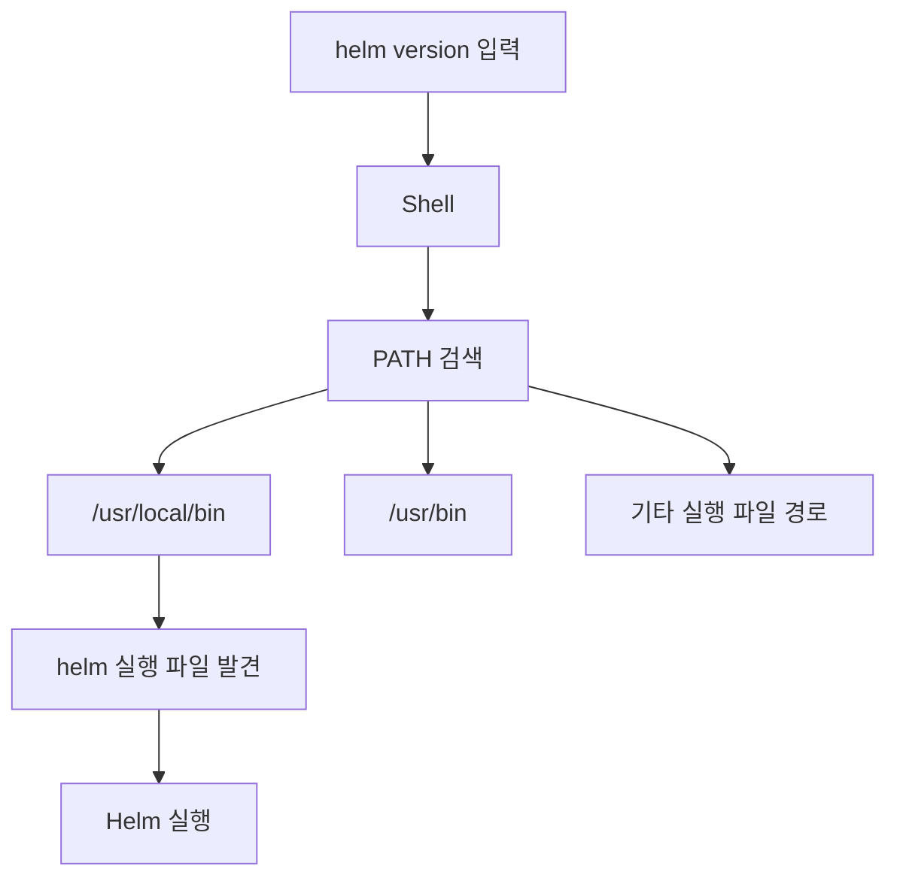
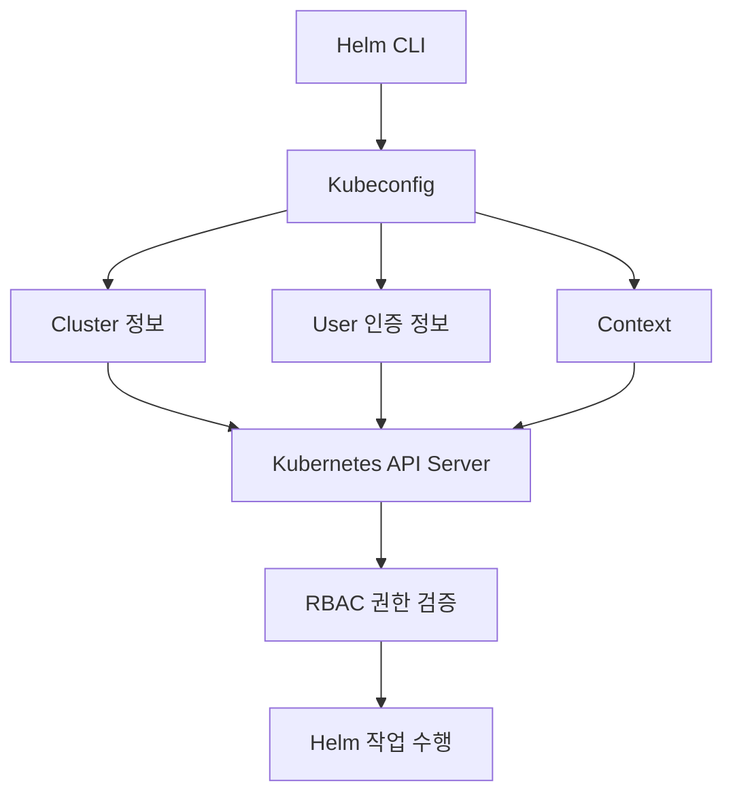
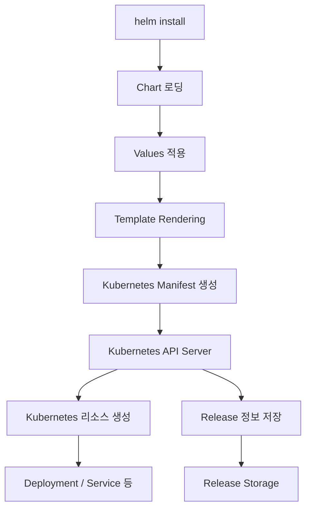
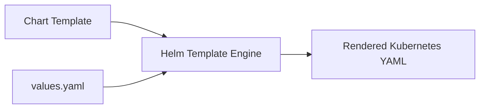
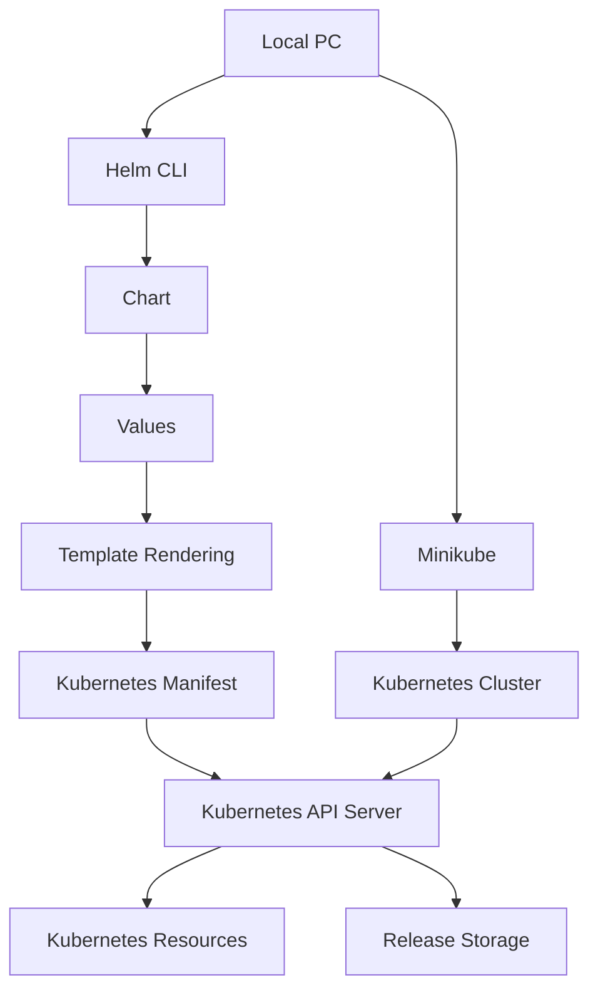

# Ch 2. Helm 설치 및 실습

# Ch 2. Helm 설치 및 실습
* toc
{:toc}

---

## Helm 설치하기

### Helm CLI 설치 완벽 가이드: Minikube 환경 구성부터 Kubernetes 연결 및 실행 확인까지

Helm은 Kubernetes 애플리케이션을 설치하고 관리하기 위한 패키지 관리자이다.

Kubernetes에서는 일반적으로 Deployment, Service, ConfigMap, Secret, StatefulSet 등의 리소스를 조합하여 애플리케이션을 실행한다.

이러한 리소스들을 개별적으로 생성하고 관리할 수도 있지만, 애플리케이션이 복잡해질수록 설치와 변경, 삭제 과정에서 관리해야 하는 요소가 증가한다.

Helm은 이러한 Kubernetes 리소스들을 Chart라는 패키지로 구성하고, Release라는 단위로 관리한다.

대표적으로 다음과 같은 기능을 제공한다.

| 명령어 | 주요 기능 |
|---|---|
| `helm install` | Chart를 이용하여 애플리케이션 설치 |
| `helm upgrade` | 설치된 Release의 Chart 또는 설정 변경 |
| `helm rollback` | 이전 Release Revision으로 복구 |
| `helm uninstall` | Release 삭제 |
| `helm list` | 설치된 Release 조회 |
| `helm history` | Release 변경 이력 확인 |
| `helm template` | Chart를 Kubernetes Manifest로 렌더링 |
| `helm lint` | Chart의 구조와 Template 검사 |

이러한 기능을 사용하려면 먼저 Helm CLI를 설치해야 한다.

다행히 Helm은 Go 언어로 개발된 실행 파일을 제공하므로 복잡한 런타임 환경을 별도로 구성할 필요가 없다.

운영체제에 맞는 Helm CLI를 설치하고 Kubernetes 클러스터에 접근할 수 있도록 설정하면 된다.

전체 준비 과정은 다음과 같다.



여기서는 Minikube를 이용하여 로컬 Kubernetes 환경을 구성하고 Helm CLI를 설치하는 과정을 살펴본다.

다만 Minikube는 필수 조건이 아니다.

이미 Kubernetes 클러스터를 사용하고 있다면 Minikube 설치 과정을 생략하고 Helm CLI 설치부터 진행할 수 있다.

---

### Helm 설치에 필요한 환경

Helm을 사용하기 위해 필요한 요소는 크게 세 가지이다.

첫 번째는 Helm CLI이다.

두 번째는 Kubernetes 클러스터이다.

세 번째는 Kubernetes API Server에 접근하기 위한 인증 및 권한 정보이다.

각 요소의 역할은 다음과 같다.

| 구성 요소 | 역할 |
|---|---|
| Helm CLI | Chart 설치 및 Release 관리 |
| Kubernetes Cluster | 애플리케이션이 실행되는 환경 |
| kubectl | Kubernetes 리소스 관리 및 상태 확인 |
| Kubeconfig | Kubernetes 클러스터 연결 정보 |
| Kubernetes API Server | Kubernetes 리소스 생성 및 관리 요청 처리 |
| RBAC | 사용자가 수행할 수 있는 Kubernetes 작업 제한 |

Helm은 Kubernetes 클러스터 외부에서 실행할 수 있다.

예를 들어 개발자의 로컬 PC에 Helm을 설치하고 원격 Kubernetes 클러스터에 애플리케이션을 배포할 수 있다.



Helm 3 이후에는 클러스터 내부에 별도의 Tiller 서버를 설치하지 않는다.

Helm CLI가 Kubernetes API Server와 직접 통신하기 때문이다.

따라서 Helm CLI 설치 자체는 Kubernetes 클러스터에 새로운 리소스를 생성하지 않는다.

실제 애플리케이션을 배포하는 명령어를 실행할 때 Kubernetes API Server에 요청을 전달한다.

---

### Minikube란?

Minikube는 로컬 환경에서 Kubernetes 클러스터를 실행할 수 있도록 지원하는 도구이다.

일반적으로 Kubernetes 클러스터를 구축하려면 Control Plane과 Worker Node, Container Runtime, 네트워크 구성 요소 등을 설정해야 한다.

하지만 Helm의 동작을 확인하기 위해 처음부터 복잡한 Kubernetes 인프라를 구축할 필요는 없다.

Minikube를 사용하면 로컬 PC에서 Kubernetes 환경을 비교적 간편하게 구성할 수 있다.



Minikube는 Docker와 같은 Container Runtime 환경이나 가상 머신 기반 Driver를 이용하여 Kubernetes 클러스터를 실행한다.

개발자가 별도의 클라우드 Kubernetes 서비스를 구성하지 않고도 Pod, Deployment, Service 등의 리소스를 생성하고 관리할 수 있다는 장점이 있다.

공식적으로 안내되는 기본 요구사항은 다음과 같다.

| 항목 | 기본 요구사항 |
|---|---|
| CPU | 2개 이상의 CPU |
| Memory | 2GB 이상의 사용 가능한 메모리 |
| Disk | 20GB 이상의 사용 가능한 공간 |
| Network | 필요한 이미지 및 구성 요소 다운로드를 위한 네트워크 |
| 실행 환경 | Docker 또는 호환 가능한 Container/VM Driver |

이는 기본적인 시작 요구사항이다.

Helm Chart를 설치하고 여러 Pod를 실행할 예정이라면 4GB 이상의 메모리를 사용할 수 있도록 구성하는 편이 유리하다.

실제 필요한 자원은 배포하는 애플리케이션의 종류와 개수에 따라 달라진다.

---

### Minikube 설치하기

Minikube는 Linux, macOS, Windows 등 다양한 운영체제를 지원한다.

운영체제와 아키텍처에 따라 설치 방법이 다르다.

대표적인 설치 방법은 다음과 같다.

| 환경 | 설치 방법 |
|---|---|
| macOS | Homebrew 또는 바이너리 설치 |
| Ubuntu | 바이너리 또는 DEB 패키지 설치 |
| Fedora/RHEL 계열 | 바이너리 또는 RPM 패키지 설치 |
| Windows | Windows Package Manager 또는 실행 파일 설치 |

여기서는 macOS와 Ubuntu를 기준으로 설명한다.

#### macOS에서 Minikube 설치하기

Homebrew가 설치되어 있다면 다음 명령어로 Minikube를 설치할 수 있다.

```bash
brew install minikube
```

설치 후 버전을 확인한다.

```bash
minikube version
```

출력 예시:

```text
minikube version: v1.x.x
```

실제 버전은 설치 시점에 따라 달라진다.

Mac에서 Homebrew를 사용하는 경우 설치 경로는 CPU 아키텍처에 따라 달라질 수 있다.

일반적으로 Apple Silicon 환경에서는 다음 경로를 사용한다.

```text
/opt/homebrew/bin
```

Intel Mac에서는 다음 경로가 사용될 수 있다.

```text
/usr/local/bin
```

실제 설치된 위치는 다음 명령어로 확인한다.

```bash
command -v minikube
```

#### Ubuntu에서 Minikube 설치하기

Ubuntu x86-64 환경에서는 공식 바이너리를 다운로드할 수 있다.

```bash
curl -LO \
  https://github.com/kubernetes/minikube/releases/latest/download/minikube-linux-amd64
```

다운로드한 파일을 실행 가능한 위치에 설치한다.

```bash
sudo install minikube-linux-amd64 /usr/local/bin/minikube
```

설치가 완료되었다면 다운로드한 파일을 정리한다.

```bash
rm minikube-linux-amd64
```

버전을 확인한다.

```bash
minikube version
```

여기서 `install`은 Linux에서 제공하는 파일 설치 명령어이다.

실행 파일을 적절한 위치에 복사하고 권한을 설정하는 데 사용할 수 있다.

ARM64 Linux 환경에서는 `minikube-linux-arm64` 바이너리를 선택해야 한다.

운영체제와 CPU 아키텍처에 맞는 실행 파일을 선택하는 것이 중요하다.

---

### Minikube 실행하기

Minikube 설치가 완료되었다면 Kubernetes 클러스터를 실행해보자.

다음 명령어를 실행한다.

```bash
minikube start
```

이 명령어는 필요한 Kubernetes 구성 요소를 준비하고 로컬 Kubernetes 클러스터를 시작한다.

최초 실행 시에는 다음 작업이 이루어질 수 있다.

- Kubernetes 실행에 필요한 이미지 다운로드
- Container 또는 Virtual Machine 생성
- Kubernetes Control Plane 설정
- Kubelet 및 Container Runtime 구성
- Kubernetes 네트워크 구성
- Kubeconfig 설정

따라서 최초 실행은 이미 설치된 클러스터를 시작하는 경우보다 많은 준비 작업이 필요할 수 있다.

Docker Driver를 명시적으로 사용하려면 다음과 같이 실행할 수 있다.

```bash
minikube start --driver=docker
```

이 명령어를 사용하려면 Docker가 설치되어 있고 정상적으로 실행 중이어야 한다.

자원을 지정하여 실행할 수도 있다.

```bash
minikube start \
  --driver=docker \
  --cpus=2 \
  --memory=4096
```

각 옵션의 의미는 다음과 같다.

| 옵션 | 설명 |
|---|---|
| `--driver=docker` | Docker Driver 사용 |
| `--cpus=2` | CPU 2개 할당 |
| `--memory=4096` | 메모리 4096MiB 할당 |

이미 생성된 Minikube 클러스터가 있다면 기존 구성과 Driver 설정에 따라 별도의 조정이 필요할 수 있다.

정상적으로 시작되면 Minikube는 Kubernetes 클러스터와 연결할 수 있도록 Kubeconfig를 설정한다.

---

### Minikube 실행 상태 확인하기

클러스터가 정상적으로 실행 중인지 확인하려면 다음 명령어를 사용한다.

```bash
minikube status
```

정상적인 경우 다음과 유사한 결과가 출력될 수 있다.

```text
minikube
type: Control Plane
host: Running
kubelet: Running
apiserver: Running
kubeconfig: Configured
```

각 항목의 의미를 살펴보자.

| 항목 | 의미 |
|---|---|
| `host` | Minikube 실행 환경의 상태 |
| `kubelet` | Kubernetes Node Agent 상태 |
| `apiserver` | Kubernetes API Server 상태 |
| `kubeconfig` | 클러스터 연결 설정 상태 |

여기서 중요한 것은 API Server와 Kubeconfig 상태이다.

Helm은 Kubernetes API Server에 접근하여 리소스를 관리하기 때문이다.

Minikube가 정상적으로 실행되고 API Server에 접근할 수 있다면 Helm을 사용할 수 있는 기본적인 클러스터 환경이 준비된 것이다.

---

### kubectl로 Kubernetes 클러스터 확인하기

Minikube를 실행했다면 실제 Kubernetes API Server에 접근할 수 있는지 확인해야 한다.

먼저 다음 명령어를 실행한다.

```bash
kubectl get nodes
```

정상적인 경우 다음과 유사한 결과가 출력된다.

```text
NAME       STATUS   ROLES           AGE   VERSION
minikube   Ready    control-plane   2m    v1.xx.x
```

여기서 `STATUS`가 `Ready`인지 확인한다.

각 필드의 의미는 다음과 같다.

| 필드 | 설명 |
|---|---|
| NAME | Kubernetes Node 이름 |
| STATUS | Node 상태 |
| ROLES | Node가 수행하는 역할 |
| AGE | Node가 생성된 이후 경과 시간 |
| VERSION | Kubelet의 Kubernetes 버전 |

Minikube를 기본 구성으로 시작하면 하나의 Node에서 Control Plane과 애플리케이션 실행 기능을 함께 제공하는 경우가 일반적이다.

하지만 Minikube는 다중 Node 구성도 지원하므로 반드시 Node가 하나만 존재하는 것은 아니다.

시스템 Pod도 확인할 수 있다.

```bash
kubectl get pods -n kube-system
```

이 명령어는 Kubernetes 시스템 구성 요소들이 사용하는 Pod를 조회한다.

환경에 따라 CoreDNS, 네트워크 관련 구성 요소 등이 표시될 수 있다.

---

### kubectl이 설치되어 있지 않은 경우

Minikube를 사용하기 위해 반드시 별도의 `kubectl` 바이너리를 설치해야 하는 것은 아니다.

Minikube는 Kubernetes 클러스터와 호환되는 kubectl을 사용할 수 있도록 기능을 제공한다.

다음 명령어를 실행하면 된다.

```bash
minikube kubectl -- get nodes
```

출력 예시:

```text
NAME       STATUS   ROLES           AGE   VERSION
minikube   Ready    control-plane   2m    v1.xx.x
```

여기서 명령어의 구조를 이해해보자.

```text
minikube kubectl -- get nodes
│        │       │  │
│        │       │  └── kubectl에 전달할 명령어
│        │       │
│        │       └── Minikube 옵션과 kubectl 인자 구분
│        │
│        └── kubectl 실행 기능
│
└── Minikube CLI
```

`--` 뒤에 작성한 인자는 kubectl에 전달된다.

따라서 다음 명령어도 사용할 수 있다.

```bash
minikube kubectl -- get pods -A
```

```bash
minikube kubectl -- get services
```

```bash
minikube kubectl -- cluster-info
```

Minikube 공식 문서에서도 이 방식을 안내하고 있다.

---

### kubectl Alias 설정하기

매번 다음과 같이 입력하는 것은 번거로울 수 있다.

```bash
minikube kubectl -- get nodes
```

이를 간단하게 사용하기 위해 Shell Alias를 설정할 수 있다.

```bash
alias kubectl="minikube kubectl --"
```

이제 다음 명령어를 실행하면,

```bash
kubectl get nodes
```

Shell은 내부적으로 다음 명령어를 실행한다.

```bash
minikube kubectl -- get nodes
```

Alias의 동작을 구조적으로 표현하면 다음과 같다.



이렇게 하면 별도의 kubectl을 직접 설치하지 않고도 Minikube에서 제공하는 kubectl을 사용할 수 있다.

#### Alias를 영구적으로 적용하기

앞에서 실행한 Alias 명령어는 현재 Shell 세션에서만 적용될 수 있다.

새로운 터미널을 열었을 때도 사용하려면 Shell 설정 파일에 추가해야 한다.

macOS에서 기본적으로 사용하는 Zsh 환경이라면 다음 파일을 수정한다.

```bash
vi ~/.zshrc
```

다음 내용을 추가한다.

```bash
alias kubectl="minikube kubectl --"
```

변경된 설정을 현재 터미널에 반영한다.

```bash
source ~/.zshrc
```

Bash를 사용한다면 일반적으로 다음 파일을 사용한다.

```bash
vi ~/.bashrc
```

설정 반영:

```bash
source ~/.bashrc
```

이후 다음 명령어로 Alias가 정상적으로 설정되었는지 확인한다.

```bash
type kubectl
```

Alias가 적용되어 있다면 관련 정보가 출력된다.

다만 이 Alias는 Shell에서 `kubectl` 명령어를 입력할 때 적용되는 기능이다.

**Helm이 Kubernetes API Server에 접근할 때 이 Alias를 호출하는 것은 아니다.**

Helm은 자체 Kubernetes Client와 Kubeconfig를 사용하여 API Server에 접근한다.

따라서 kubectl Alias 설정과 Helm의 Kubernetes 연결 설정은 서로 구분해야 한다.

---

### Kubernetes Context 확인하기

Helm을 설치하기 전에 현재 어떤 Kubernetes 클러스터에 연결되어 있는지 확인하는 것이 좋다.

Kubernetes에서는 Kubeconfig를 통해 여러 클러스터에 접근할 수 있다.

현재 Context를 확인한다.

```bash
kubectl config current-context
```

Minikube를 사용하는 경우 다음과 같이 출력될 수 있다.

```text
minikube
```

현재 Context의 연결 정보를 확인할 수도 있다.

```bash
kubectl config view --minify
```

이 명령어는 현재 선택된 클러스터와 사용자, Context 설정을 확인하는 데 사용한다.

일반적으로 Kubeconfig는 다음 위치에 존재한다.

```text
~/.kube/config
```

Helm 역시 기본적으로 Kubernetes 연결 설정을 이용한다.

따라서 현재 Context가 운영 클러스터를 가리키고 있다면 Helm 명령어도 운영 클러스터를 대상으로 실행될 수 있다.

실무에서는 Helm 명령어를 실행하기 전에 대상 클러스터와 Namespace를 확인하는 습관이 중요하다.

---

### Helm CLI 설치 방법

이제 Helm CLI를 설치해보자.

Helm은 여러 설치 방식을 제공한다.

대표적으로 다음과 같다.

| 설치 방법 | 특징 |
|---|---|
| 공식 설치 스크립트 | OS와 아키텍처를 판단하여 바이너리 설치 |
| 공식 바이너리 | 원하는 버전과 아키텍처를 직접 선택 |
| Homebrew | macOS에서 간편하게 설치 및 업데이트 |
| APT | Ubuntu/Debian 계열의 패키지 관리 |
| DNF | Fedora 계열의 패키지 관리 |
| Windows Package Manager | Windows에서 설치 |

이 중 공식 프로젝트에서 직접 제공하는 방식은 바이너리 설치와 설치 스크립트 방식이다.

운영체제별 패키지 관리자를 통한 설치 방식은 별도의 패키지 유지관리 주체가 관여할 수 있다.

따라서 버전 고정이나 바이너리 공급망 검증이 중요한 환경에서는 공식 바이너리를 직접 사용하는 방식도 고려할 수 있다.

---

### Helm 버전 선택하기

Helm을 설치하기 전에 먼저 버전을 결정해야 한다.

Helm은 주요 버전에 따라 내부 구조와 일부 기능이 달라질 수 있다.

Helm 3은 2019년에 출시되었으며, Helm 4는 2025년 11월에 출시되었다.

2026년 11월 기준으로 Helm 4가 현재 주력 버전이다.

다만 기존 Kubernetes 운영 환경에서는 Helm 3을 사용하고 있을 수 있다.

Helm 3의 보안 수정 지원 종료 예정일은 2027년 2월 10일이다.

주요 차이는 다음과 같다.

| 항목 | Helm 3 | Helm 4 |
|---|---|---|
| Tiller | 사용하지 않음 | 사용하지 않음 |
| Kubernetes API 통신 | Helm CLI에서 직접 수행 | Helm CLI에서 직접 수행 |
| Chart 설치 | 지원 | 지원 |
| Upgrade 및 Rollback | 지원 | 지원 |
| Release 관리 | 지원 | 지원 |
| 새로운 기능 개발 | 유지보수 단계 | 주력 개발 버전 |
| 설치 스크립트 | `get-helm-3` | `get-helm-4` |

기존 Helm 3.8.2 환경과 동일한 버전을 재현해야 한다면 해당 버전을 명시적으로 설치할 수 있다.

하지만 새로운 환경을 구성한다면 최신 안정 버전의 Helm 4를 기준으로 시작하는 것이 합리적이다.

이후 예제에서는 Helm 4를 기본으로 사용하며, 필요한 경우 Helm 3 설치 방법도 구분하여 설명한다.

---

### 공식 설치 스크립트로 Helm 설치하기

Helm 프로젝트는 운영체제와 CPU 아키텍처를 확인하고 적절한 바이너리를 설치할 수 있는 스크립트를 제공한다.

공식 설치 스크립트를 이용하면 사용자가 직접 바이너리 파일 이름을 선택하고 압축을 해제하는 과정을 줄일 수 있다.

Helm 4에서는 다음 스크립트를 사용한다.

```text
get-helm-4
```

공식 설치 과정은 다음과 같다.



#### 1. 설치 스크립트 다운로드

다음 명령어를 실행한다.

```bash
curl -fsSL -o get_helm.sh \
  https://raw.githubusercontent.com/helm/helm/main/scripts/get-helm-4
```

각 옵션은 다음과 같은 의미를 가진다.

| 옵션 | 의미 |
|---|---|
| `-f` | HTTP 오류 응답을 실패로 처리 |
| `-s` | 진행 정보 등을 간략하게 표시 |
| `-S` | 오류가 발생하면 메시지 표시 |
| `-L` | HTTP Redirect를 따라 이동 |
| `-o get_helm.sh` | 다운로드한 파일을 지정한 이름으로 저장 |

이 명령어를 실행하면 현재 디렉터리에 다음 파일이 생성된다.

```text
get_helm.sh
```

다운로드 여부를 확인한다.

```bash
ls -lh get_helm.sh
```

정상적으로 다운로드되었다면 파일의 크기와 권한 정보가 표시된다.

#### 2. 설치 스크립트 확인

다운로드한 스크립트를 실행하기 전에 내용을 확인하는 것이 좋다.

```bash
less get_helm.sh
```

또는 다음과 같이 앞부분을 확인할 수 있다.

```bash
head -n 60 get_helm.sh
```

스크립트에는 운영체제 확인, 버전 확인, 바이너리 다운로드, 설치 및 검증 등을 위한 Shell 함수와 명령어가 포함되어 있다.

공식 설치 스크립트는 이러한 절차를 자동화하지만, 외부 스크립트를 실행한다는 점은 동일하다.

따라서 특히 운영 서버나 CI/CD 환경에서는 스크립트를 검토하고 버전을 고정하는 방식을 고려하는 것이 좋다.

Helm 공식 문서에서도 설치 스크립트를 실행하기 전에 내용을 확인하도록 안내한다.

#### 3. 실행 권한 부여

다운로드한 파일은 Shell Script이다.

실행 권한을 부여한다.

```bash
chmod 700 get_helm.sh
```

여기서 `700`은 파일 소유자에게 읽기, 쓰기, 실행 권한을 부여하고 다른 사용자에게는 권한을 부여하지 않는 설정이다.

권한을 확인한다.

```bash
ls -l get_helm.sh
```

출력 예시:

```text
-rwx------ 1 user staff 15000 Nov 27 18:00 get_helm.sh
```

실제 파일 크기와 날짜는 환경에 따라 달라진다.

#### 4. 설치 스크립트 실행

이제 스크립트를 실행한다.

```bash
./get_helm.sh
```

스크립트는 운영체제와 아키텍처를 판단하고 적절한 Helm 바이너리를 다운로드하여 설치한다.

일반적인 설치 과정에서는 다음 작업이 이루어진다.

1. 설치 환경 확인
2. Helm 버전 확인
3. 플랫폼에 적합한 바이너리 다운로드
4. 다운로드한 파일 검증
5. 바이너리 압축 해제
6. 설치 디렉터리에 Helm 실행 파일 배치
7. 설치 결과 확인
8. 임시 파일 정리

설치 위치에 따라 관리자 권한이 필요할 수 있다.

예를 들어 `/usr/local/bin`에 파일을 설치하려면 `sudo` 권한이 필요할 수 있다.

설치가 완료되면 다음 명령어로 Helm을 실행할 수 있다.

```bash
helm version
```

정상적으로 실행되면 설치된 Helm 버전이 출력된다.

---

### Helm 3 설치 스크립트와의 차이

Helm 3 환경을 재현하려면 설치 스크립트가 다르다.

Helm 3의 설치 스크립트는 다음과 같다.

```bash
curl -fsSL -o get_helm_3.sh \
  https://raw.githubusercontent.com/helm/helm/main/scripts/get-helm-3
```

실행 권한을 부여한다.

```bash
chmod 700 get_helm_3.sh
```

특정 버전을 설치할 수도 있다.

예를 들어 Helm 3.8.2를 설치하려면 다음과 같이 작성한다.

```bash
./get_helm_3.sh --version v3.8.2
```

이는 기존 실행 환경을 재현하기 위한 예시이다.

Helm 3.8.2는 오래된 버전이므로 새로운 운영 환경에 사용하는 것은 적절하지 않다.

또한 Helm 3과 Helm 4의 설치 스크립트는 동일한 `helm` 실행 파일 이름을 사용한다.

따라서 같은 설치 경로에 설치하면 기존 바이너리가 교체될 수 있다.

여러 버전을 병행해야 한다면 실행 파일 이름과 설치 경로를 분리하거나 별도의 컨테이너 환경을 활용하는 것이 좋다.

---

### Helm 설치 스크립트는 운영체제를 어떻게 판단할까?

Helm 설치 스크립트는 실행 환경의 정보를 확인하여 적절한 바이너리를 선택한다.

대표적으로 다음 두 가지 정보가 중요하다.

첫 번째는 운영체제이다.

두 번째는 CPU 아키텍처이다.

사용자도 직접 확인할 수 있다.

#### 운영체제 확인

```bash
uname -s
```

macOS에서는 다음과 같이 출력된다.

```text
Darwin
```

Linux에서는 다음과 같이 출력된다.

```text
Linux
```

#### CPU 아키텍처 확인

```bash
uname -m
```

Apple Silicon Mac에서는 일반적으로 다음과 같이 출력된다.

```text
arm64
```

Linux x86-64 환경에서는 다음과 같이 출력된다.

```text
x86_64
```

Linux ARM64 환경에서는 다음과 같이 출력될 수 있다.

```text
aarch64
```

Helm은 이 정보를 바탕으로 적절한 바이너리를 선택한다.

대표적인 플랫폼 이름은 다음과 같다.

| 운영체제 | 아키텍처 | Helm 바이너리 플랫폼 |
|---|---|---|
| Linux | x86-64 | `linux-amd64` |
| Linux | ARM64 | `linux-arm64` |
| macOS | Intel | `darwin-amd64` |
| macOS | Apple Silicon | `darwin-arm64` |
| Windows | x86-64 | `windows-amd64` |

예를 들어 Apple Silicon Mac에서는 다음과 같은 이름의 패키지를 사용한다.

```text
helm-v4.x.x-darwin-arm64.tar.gz
```

Ubuntu x86-64 환경에서는 다음과 같은 패키지를 사용한다.

```text
helm-v4.x.x-linux-amd64.tar.gz
```

운영체제와 CPU 아키텍처가 맞지 않는 바이너리를 다운로드하면 실행할 수 없거나 호환성 문제가 발생할 수 있다.

이러한 이유로 공식 설치 스크립트를 사용하면 환경에 맞는 바이너리를 자동으로 선택할 수 있다는 장점이 있다.

---

### 공식 바이너리로 Helm 직접 설치하기

자동 설치 스크립트를 사용하는 대신 바이너리를 직접 다운로드할 수도 있다.

이 방식은 설치할 버전과 플랫폼을 명시적으로 관리할 수 있다는 장점이 있다.

특히 CI/CD 환경이나 운영 서버에서 동일한 Helm 버전을 재현해야 하는 경우 유용하다.

예를 들어 Helm 4.3.2를 Linux x86-64 환경에 설치한다고 가정하자.

먼저 버전을 지정한다.

```bash
HELM_VERSION=v4.3.2
```

플랫폼을 지정한다.

```bash
HELM_PLATFORM=linux-amd64
```

다운로드한다.

```bash
curl -fLO \
  "https://get.helm.sh/helm-${HELM_VERSION}-${HELM_PLATFORM}.tar.gz"
```

다운로드한 파일은 다음과 같은 이름이다.

```text
helm-v4.3.2-linux-amd64.tar.gz
```

이후 공식 릴리스의 체크섬과 서명을 검증한 뒤 압축을 해제한다.

```bash
tar -zxvf helm-v4.3.2-linux-amd64.tar.gz
```

압축을 해제하면 일반적으로 다음과 같은 구조가 생성된다.

```text
linux-amd64/
├── helm
├── LICENSE
└── README.md
```

여기서 `helm`이 실제 실행 파일이다.

다음 명령어로 설치할 수 있다.

```bash
sudo install -m 755 linux-amd64/helm /usr/local/bin/helm
```

각 요소의 의미는 다음과 같다.

| 요소 | 설명 |
|---|---|
| `sudo` | 관리자 권한으로 실행 |
| `install` | 파일 설치 |
| `-m 755` | 설치할 파일 권한 지정 |
| `linux-amd64/helm` | 원본 실행 파일 |
| `/usr/local/bin/helm` | 최종 설치 경로 |

설치 후 버전을 확인한다.

```bash
helm version
```

이처럼 직접 설치하면 어떤 버전의 바이너리를 사용하고 있는지 명확하게 관리할 수 있다.

공식 Helm 설치 문서는 바이너리 다운로드 후 체크섬과 PGP 서명을 검증하는 방법도 제공한다.

---

### macOS에서 Homebrew로 Helm 설치하기

macOS에서는 Homebrew를 이용하는 방법도 간단하다.

다음 명령어를 실행한다.

```bash
brew install helm
```

설치 후 버전을 확인한다.

```bash
helm version
```

Helm 실행 파일의 위치도 확인할 수 있다.

```bash
command -v helm
```

Apple Silicon Mac에서는 일반적으로 다음 경로가 출력될 수 있다.

```text
/opt/homebrew/bin/helm
```

정확한 위치는 Homebrew 설치 방식과 환경 설정에 따라 달라질 수 있다.

Homebrew로 설치된 Helm을 업그레이드하려면 다음 명령어를 사용할 수 있다.

```bash
brew upgrade helm
```

설치된 Helm 패키지의 정보를 확인하려면 다음 명령어를 사용한다.

```bash
brew info helm
```

Homebrew를 사용하면 설치와 업데이트가 간단하다는 장점이 있다.

다만 일반적인 `brew upgrade`는 패키지 관리자가 제공하는 버전으로 업그레이드하므로, 특정 패치 버전을 장기간 고정해야 하는 환경에서는 별도의 버전 관리 전략이 필요하다.

---

### Helm 설치 경로 확인하기

설치가 완료되었다면 실제 Helm 실행 파일이 어디에 존재하는지 확인해야 한다.

다음 명령어를 실행한다.

```bash
command -v helm
```

출력 예시:

```text
/usr/local/bin/helm
```

실행 파일에 대한 상세 정보도 확인할 수 있다.

```bash
ls -lh "$(command -v helm)"
```

이 명령어는 현재 Shell에서 검색되는 Helm 실행 파일의 경로를 이용하여 파일 정보를 출력한다.

Helm 바이너리가 여러 위치에 존재하는지도 확인할 수 있다.

```bash
type -a helm
```

예를 들어 다음과 같은 상황이 있을 수 있다.

```text
helm is /opt/homebrew/bin/helm
helm is /usr/local/bin/helm
```

이 경우 실제 실행되는 Helm은 Shell의 PATH 검색 순서에 영향을 받는다.

따라서 원하는 버전을 설치했는데도 다른 버전이 실행된다면 PATH와 설치 경로를 확인해야 한다.

---

### PATH 환경 변수 이해하기

운영체제에 프로그램을 설치할 때 PATH는 중요한 역할을 한다.

예를 들어 다음 명령어를 입력했다고 가정하자.

```bash
helm version
```

Shell은 `helm`이라는 실행 파일을 찾기 위해 PATH에 등록된 디렉터리를 검색한다.



현재 PATH는 다음 명령어로 확인할 수 있다.

```bash
echo "$PATH"
```

예를 들어 다음과 같은 값이 출력될 수 있다.

```text
/usr/local/bin:/usr/bin:/bin
```

여기서 각 경로는 콜론(`:`)으로 구분된다.

Helm 실행 파일을 `/usr/local/bin`에 설치했다면 해당 디렉터리가 PATH에 포함되어 있어야 `helm` 명령어를 바로 사용할 수 있다.

반면 PATH에 포함되지 않은 디렉터리에 설치했다면 다음과 같은 오류가 발생할 수 있다.

```text
helm: command not found
```

이 경우 설치 파일의 위치와 PATH 환경 변수를 확인해야 한다.

---

### Helm 설치 확인하기

Helm 바이너리가 정상적으로 설치되었는지 확인하는 가장 기본적인 명령어는 다음과 같다.

```bash
helm version
```

정상적으로 설치되었다면 Helm의 버전과 빌드 정보가 출력된다.

출력 형태는 Helm 버전에 따라 달라질 수 있다.

예를 들어 Helm 3에서는 다음과 유사한 정보가 표시된다.

```text
version.BuildInfo{Version:"v3.x.x", GitCommit:"...", GoVersion:"..."}
```

Helm 4에서는 버전 정보의 출력 형식이 다를 수 있다.

중요한 것은 설치한 Helm의 Major Version과 실제 실행 버전이 의도한 버전인지 확인하는 것이다.

#### Helm 기본 명령어 확인

다음 명령어를 실행한다.

```bash
helm
```

또는 다음과 같이 실행한다.

```bash
helm help
```

Helm에서 사용할 수 있는 주요 명령어와 설명이 출력된다.

대표적인 명령어는 다음과 같다.

| 명령어 | 기능 |
|---|---|
| `helm install` | Chart 설치 |
| `helm upgrade` | Release 업그레이드 |
| `helm rollback` | 이전 Revision으로 롤백 |
| `helm uninstall` | Release 삭제 |
| `helm list` | Release 목록 확인 |
| `helm status` | Release 상태 확인 |
| `helm repo` | Chart Repository 관리 |
| `helm search` | Chart 검색 |
| `helm create` | Chart 기본 구조 생성 |
| `helm lint` | Chart 검사 |
| `helm template` | Chart Template 렌더링 |
| `helm get` | 설치된 Release 정보 조회 |
| `helm history` | Release 변경 이력 조회 |

특정 명령어의 상세 옵션도 확인할 수 있다.

```bash
helm install --help
```

```bash
helm upgrade --help
```

```bash
helm rollback --help
```

각 명령어의 옵션과 사용 방법을 확인할 수 있다.

---

### Helm이 Kubernetes와 정상적으로 연결되는지 확인하기

Helm CLI가 설치되었다고 해서 Kubernetes 연결까지 검증된 것은 아니다.

Helm은 로컬에서 버전 정보를 출력하는 기능과 실제 Kubernetes API를 사용하는 기능을 모두 제공하기 때문이다.

예를 들어 다음 명령어는 Helm 바이너리만 정상적으로 실행되면 사용할 수 있다.

```bash
helm version
```

하지만 다음 명령어는 Kubernetes 클러스터에 접근해야 한다.

```bash
helm list
```

Helm은 Kubernetes API Server와 통신하여 설치된 Release 정보를 조회한다.

정상적으로 연결되었다면 Release 목록이 출력된다.

아직 설치된 Release가 없다면 빈 목록이 나타날 수 있다.

```text
NAME    NAMESPACE    REVISION    UPDATED    STATUS    CHART    APP VERSION
```

출력 형식은 Helm 버전에 따라 달라질 수 있다.

여기서 중요한 점은 **Release가 없어서 목록이 비어 있는 상황과 Kubernetes 연결 자체가 실패한 상황을 구분해야 한다는 것**이다.

Kubernetes API에 접근할 수 없다면 연결 관련 오류 메시지가 출력될 수 있다.

---

### Helm과 Kubeconfig의 관계

Helm은 Kubernetes 클러스터에 접근하기 위해 Kubeconfig를 사용한다.

일반적으로 kubectl과 동일한 Kubernetes Context를 활용할 수 있다.



현재 Context를 확인한다.

```bash
kubectl config current-context
```

Minikube를 사용한다면 다음과 같이 출력될 수 있다.

```text
minikube
```

Helm에서도 특정 Context를 명시적으로 사용할 수 있다.

```bash
helm list --kube-context minikube
```

별도의 Kubeconfig 파일을 지정할 수도 있다.

```bash
helm list --kubeconfig ~/.kube/config
```

이러한 옵션은 여러 Kubernetes 클러스터를 운영하는 환경에서 유용하다.

예를 들어 개발 환경과 운영 환경을 동시에 관리하고 있다면 명령어를 실행하는 시점에 대상 클러스터를 명확하게 지정할 수 있다.

---

### Helm CLI 설치와 Kubernetes 배포의 차이

Helm을 설치하는 과정과 Helm으로 애플리케이션을 배포하는 과정은 별개이다.

예를 들어 다음 명령어는 Helm 바이너리의 버전을 확인한다.

```bash
helm version
```

이 명령어는 Kubernetes 클러스터에 애플리케이션을 설치하지 않는다.

반면 다음 명령어는 Chart를 이용하여 Release를 설치한다.

```bash
helm install my-app ./my-chart
```

이때 Helm은 다음과 같은 작업을 수행한다.



따라서 Helm CLI만 설치한 상태에서는 Kubernetes에 별도의 Release가 생성되지 않는다.

실제 Chart를 설치해야 Release가 생성된다.

---

### Helm 설치 후 간단한 Chart 생성해보기

이제 Helm CLI가 정상적으로 실행되는지 추가로 확인해보자.

Helm은 기본 Chart 구조를 생성하는 기능을 제공한다.

다음 명령어를 실행한다.

```bash
helm create hello-helm
```

이 명령어는 `hello-helm`이라는 디렉터리에 Chart의 기본 구조를 생성한다.

Helm 4에서는 Chart API v3를 사용할 수 있으며, Helm 3과의 호환성을 고려해야 하는 환경에서는 Chart API 버전을 명시적으로 선택할 필요가 있다.

생성된 파일을 확인한다.

```bash
ls -R hello-helm
```

일반적으로 다음과 같은 파일들이 생성된다.

```text
hello-helm/
├── Chart.yaml
├── values.yaml
├── charts/
└── templates/
    ├── deployment.yaml
    ├── service.yaml
    ├── serviceaccount.yaml
    └── ...
```

실제 파일 구성은 Helm 버전에 따라 달라질 수 있다.

여기서 `Chart.yaml`은 Chart의 메타데이터를 정의한다.

`values.yaml`은 기본 설정값을 저장한다.

`templates` 디렉터리에는 Kubernetes Manifest를 생성하기 위한 Template이 포함된다.

이러한 구조를 통해 Helm은 Chart를 렌더링하고 Kubernetes에 배포할 수 있다.

---

### Helm Chart 유효성 검사하기

Chart를 생성했다면 `helm lint`를 이용하여 기본적인 구조를 확인할 수 있다.

```bash
helm lint ./hello-helm
```

정상적으로 검사되면 다음과 유사한 메시지가 출력될 수 있다.

```text
1 chart(s) linted, 0 chart(s) failed
```

이 명령어는 Chart의 메타데이터와 Template 구성 등에서 발생할 수 있는 문제를 검사한다.

하지만 실제 Kubernetes 클러스터에 리소스를 생성하지는 않는다.

따라서 Chart를 개발할 때 실제 배포 이전에 실행하기 좋은 명령어이다.

---

### Helm Template 렌더링 확인하기

Chart가 Kubernetes Manifest로 어떻게 변환되는지도 확인할 수 있다.

다음 명령어를 실행한다.

```bash
helm template hello-release ./hello-helm
```

이 명령어는 `hello-release`라는 Release 이름을 사용한다고 가정하고 Chart를 렌더링한다.

Chart에 포함된 Template과 Values를 이용하여 최종 Kubernetes Manifest를 생성한다.



출력에는 Deployment, Service 등 여러 Kubernetes 리소스의 YAML이 포함될 수 있다.

중요한 점은 다음과 같다.

**`helm template`은 Kubernetes Manifest를 생성하여 출력할 뿐, 실제 클러스터에 리소스를 설치하지 않는다.**

따라서 Helm이 정상적으로 설치되었는지 확인하는 동시에 Chart의 렌더링 결과도 분석할 수 있다.

설치 이후에는 다음과 같은 명령어를 사용할 수 있다.

```bash
helm install hello-release ./hello-helm
```

다만 실제 설치를 수행하려면 클러스터 연결과 권한, 생성할 리소스의 유효성이 모두 충족되어야 한다.

---

### Helm 설치 과정에서 발생하는 주요 오류

Helm은 단일 실행 파일 형태로 제공되므로 설치가 비교적 간단하지만, 환경에 따라 다양한 문제가 발생할 수 있다.

대표적인 오류를 살펴보자.

#### 1. helm: command not found

다음 명령어를 실행했다고 가정하자.

```bash
helm version
```

그런데 다음 오류가 발생한다.

```text
helm: command not found
```

이 경우 Shell이 Helm 실행 파일을 찾지 못한 것이다.

먼저 실행 파일의 위치를 확인한다.

```bash
command -v helm
```

아무 결과도 출력되지 않는다면 PATH에서 Helm을 찾지 못하는 상황이다.

설치 디렉터리를 확인한다.

```bash
ls -l /usr/local/bin/helm
```

Apple Silicon Mac에서 Homebrew로 설치했다면 다음 경로도 확인할 수 있다.

```bash
ls -l /opt/homebrew/bin/helm
```

실행 파일이 존재하지만 명령어를 사용할 수 없다면 PATH 설정을 확인해야 한다.

#### 2. Permission denied

다운로드한 바이너리를 실행하려는데 권한 오류가 발생할 수 있다.

```text
Permission denied
```

이 경우 실행 권한을 확인한다.

```bash
ls -l ./helm
```

필요하다면 실행 권한을 부여한다.

```bash
chmod +x ./helm
```

이후 다시 실행한다.

```bash
./helm version
```

#### 3. Exec format error

운영체제와 아키텍처에 맞지 않는 바이너리를 다운로드했다면 실행에 실패할 수 있다.

예를 들어 Linux ARM64 환경에서 Linux AMD64 바이너리를 실행하려는 경우이다.

먼저 현재 아키텍처를 확인한다.

```bash
uname -m
```

다운로드한 실행 파일도 확인한다.

```bash
file ./helm
```

두 정보를 비교하여 적절한 바이너리를 사용하고 있는지 확인해야 한다.

#### 4. Kubernetes API Server 연결 오류

Helm은 정상적으로 설치되었지만 다음 명령어가 실패할 수 있다.

```bash
helm list
```

이 경우 Helm 바이너리의 설치 문제와 Kubernetes 연결 문제를 구분해야 한다.

먼저 다음 명령어를 실행한다.

```bash
kubectl cluster-info
```

API Server에 접근할 수 있는지 확인한다.

현재 Context도 확인한다.

```bash
kubectl config current-context
```

Minikube 환경이라면 실행 상태를 확인한다.

```bash
minikube status
```

필요하다면 Minikube를 시작한다.

```bash
minikube start
```

이처럼 Helm 설치가 완료되었더라도 Kubernetes 클러스터의 상태와 연결 설정을 함께 확인해야 한다.

#### 5. Kubernetes RBAC 권한 오류

다음과 같은 오류가 발생할 수 있다.

```text
Error: forbidden
```

이는 Helm이 Kubernetes API Server에 요청했지만 해당 작업을 수행할 권한이 없는 경우에 발생할 수 있다.

예를 들어 Deployment 생성 권한을 확인하려면 다음과 같이 실행한다.

```bash
kubectl auth can-i create deployments -n default
```

출력 예시:

```text
yes
```

또는 다음과 같이 출력될 수 있다.

```text
no
```

Helm Chart는 Deployment 외에도 Service, ConfigMap, Secret, ClusterRole 등 다양한 Kubernetes 리소스를 생성할 수 있다.

따라서 특정 리소스 하나에 대한 권한만 확인하는 것으로는 Chart 전체의 설치 가능 여부를 보장할 수 없다.

---

### Helm 설치 시 고려해야 할 보안 사항

Helm은 Kubernetes 클러스터의 리소스를 생성하거나 변경할 수 있는 도구이다.

따라서 설치 과정뿐 아니라 실행 환경의 보안도 고려해야 한다.

#### 공식 배포 경로 사용

Helm 바이너리는 공식적으로 제공되는 배포 경로를 사용하는 것이 좋다.

공식 릴리스의 체크섬과 서명을 확인하면 다운로드한 파일의 무결성과 출처를 검증하는 데 도움이 된다.

#### 설치 스크립트 확인

설치 스크립트는 운영체제에서 명령어를 실행한다.

따라서 외부 스크립트를 다운로드한 후 곧바로 실행하는 것보다는 내용을 검토하는 편이 안전하다.

특히 다음과 같은 형태는 신중하게 사용해야 한다.

```bash
curl -fsSL <script-url> | bash
```

이 방식은 다운로드한 스크립트를 곧바로 Shell에 전달한다.

따라서 스크립트를 별도로 저장하고 내용을 확인한 후 실행하는 방식이 더 적절할 수 있다.

#### Helm 버전 고정

운영 환경에서는 설치 시점마다 서로 다른 Helm 버전이 설치되지 않도록 관리하는 것이 중요하다.

예를 들어 개발 환경과 CI/CD 환경에서 사용하는 Helm 버전이 다르면 Chart 렌더링이나 명령어의 일부 동작에서 차이가 발생할 수 있다.

따라서 자동화 환경에서는 검증된 버전을 명시적으로 사용하는 것이 좋다.

#### Kubeconfig 접근 권한 관리

Helm은 Kubeconfig를 이용해 Kubernetes API Server에 접근한다.

따라서 Kubeconfig에는 클러스터 접근에 필요한 인증 정보가 포함될 수 있다.

해당 파일이 불필요하게 외부로 노출되지 않도록 관리해야 한다.

또한 Helm을 실행하는 계정에는 필요한 최소한의 Kubernetes 권한을 부여하는 것이 적절하다.

---

### 실무에서 Helm CLI 설치를 관리하는 10가지 방법

Helm은 개발자 개인 PC뿐 아니라 CI/CD 서버, 운영 자동화 환경, 클라우드 기반 Kubernetes 관리 시스템에서도 사용된다.

따라서 단순히 명령어가 실행되는 것만 확인하기보다는 설치 방식과 운영 환경을 표준화하는 것이 중요하다.

다음은 Helm을 안정적으로 사용하기 위해 고려할 수 있는 주요 항목이다.

| 항목 | 관리 방법 | 기대 효과 |
|---|---|---|
| 1. Helm 버전 고정 | 검증된 버전을 명시적으로 설치 | 환경 간 동작 차이 감소 |
| 2. OS·아키텍처 확인 | `uname -s`, `uname -m` 활용 | 잘못된 바이너리 설치 방지 |
| 3. 바이너리 검증 | Checksum 및 서명 검증 | 공급망 위험 감소 |
| 4. 설치 경로 표준화 | PATH와 실행 파일 위치 관리 | 버전 충돌 예방 |
| 5. Kubernetes Context 확인 | 배포 전 대상 클러스터 확인 | 잘못된 클러스터 배포 방지 |
| 6. Kubeconfig 분리 | 개발·운영 환경의 인증 정보 구분 | 환경 간 접근 통제 |
| 7. RBAC 최소 권한 적용 | 필요한 리소스에 대한 권한만 부여 | 보안 위험 감소 |
| 8. Chart 사전 검증 | `helm lint` 실행 | 기본적인 Chart 오류 탐지 |
| 9. Template 사전 확인 | `helm template` 실행 | 실제 Manifest 구조 확인 |
| 10. CI/CD 환경 표준화 | 동일한 Helm 바이너리 사용 | 배포 재현성 향상 |
| 11. 설치 방식 문서화 | 설치 버전과 명령어 기록 | 신규 환경 구성 단순화 |
| 12. Helm과 Kubernetes 버전 호환성 확인 | 공식 지원 정책 기준 점검 | API 호환성 문제 예방 |

특히 여러 백엔드 서비스를 운영하는 환경에서는 개발자가 사용하는 Helm 버전과 CI/CD에서 사용하는 Helm 버전이 서로 다르지 않도록 관리하는 것이 좋다.

예를 들어 다음과 같은 구성을 생각할 수 있다.

```text
Developer Local
    └── Helm 4.x

CI/CD Pipeline
    └── Helm 4.x

Kubernetes Cluster
    └── 지원되는 Kubernetes Version
```

여기서 중요한 것은 단순히 Major Version이 같다는 사실만이 아니다.

실제 배포에 사용하는 Helm의 정확한 버전과 Kubernetes 호환성, Chart의 API 버전까지 검증하는 것이 바람직하다.

---

### Helm 설치와 Chart 배포의 전체 구조

지금까지 살펴본 내용을 하나로 연결해보자.

먼저 Minikube를 실행한다.

```bash
minikube start
```

Kubernetes Node를 확인한다.

```bash
kubectl get nodes
```

그다음 Helm CLI를 설치한다.

```bash
curl -fsSL -o get_helm.sh \
  https://raw.githubusercontent.com/helm/helm/main/scripts/get-helm-4
```

```bash
chmod 700 get_helm.sh
```

```bash
./get_helm.sh
```

Helm 버전을 확인한다.

```bash
helm version
```

Kubernetes와의 연결 상태를 확인한다.

```bash
helm list
```

이제 Chart를 생성할 수 있다.

```bash
helm create hello-helm
```

Chart를 검사한다.

```bash
helm lint ./hello-helm
```

최종 Kubernetes Manifest를 확인한다.

```bash
helm template hello-release ./hello-helm
```

여기까지 정상적으로 실행되었다면 Helm CLI 설치와 기본적인 Chart 처리 기능을 사용할 준비가 된 것이다.

전체 관계를 표현하면 다음과 같다.



이 구조에서 각각의 책임은 명확하다.

Minikube는 Kubernetes 클러스터를 제공한다.

kubectl은 Kubernetes API를 이용해 리소스를 관리하고 상태를 확인한다.

Helm은 Chart를 렌더링하고 Release 단위로 애플리케이션을 관리한다.

실제 Kubernetes 리소스의 지속적인 상태 관리는 Kubernetes Controller가 담당한다.

이러한 역할을 구분하면 Helm 설치부터 실제 애플리케이션 배포까지의 동작을 쉽게 이해할 수 있다.

---

### 정리

Helm은 Kubernetes 애플리케이션을 패키지 단위로 설치하고 관리하기 위한 도구이다.

Helm을 사용하기 위해서는 Helm CLI와 접근 가능한 Kubernetes 클러스터가 필요하다.

로컬 환경에서는 Minikube를 이용하여 Kubernetes 클러스터를 구성할 수 있다.

Minikube는 Docker 또는 Virtual Machine 기반으로 Kubernetes를 실행하며, kubectl을 통해 리소스를 조회하고 관리할 수 있도록 지원한다.

Minikube가 제공하는 kubectl 기능을 사용하면 별도의 kubectl 설치 없이도 Kubernetes API Server에 접근할 수 있다.

```bash
minikube kubectl -- get nodes
```

또한 Alias를 설정하면 일반적인 kubectl 명령어와 유사한 형태로 사용할 수 있다.

```bash
alias kubectl="minikube kubectl --"
```

Helm CLI는 공식 설치 스크립트나 바이너리, 운영체제별 패키지 관리자를 통해 설치할 수 있다.

Helm 4의 공식 설치 스크립트는 다음과 같다.

```bash
curl -fsSL -o get_helm.sh \
  https://raw.githubusercontent.com/helm/helm/main/scripts/get-helm-4
```

스크립트를 확인한 후 실행 권한을 부여한다.

```bash
chmod 700 get_helm.sh
```

설치를 수행한다.

```bash
./get_helm.sh
```

설치가 완료되면 다음 명령어로 버전을 확인할 수 있다.

```bash
helm version
```

이후 Kubernetes 연결 상태를 확인한다.

```bash
helm list
```

여기서 중요한 점은 Helm CLI 설치와 Kubernetes 클러스터 연결이 별도의 단계라는 것이다.

Helm은 로컬에서 단독으로 실행되는 CLI이지만 실제 Chart를 설치하려면 Kubernetes API Server에 접근할 수 있어야 한다.

따라서 Kubeconfig와 Kubernetes Context, RBAC 권한을 함께 확인해야 한다.

또한 Helm 버전은 설치 시점과 배포 환경에 따라 명시적으로 관리하는 것이 좋다.

현재 Helm 4가 주력 버전이므로 새로운 환경에서는 Helm 4를 기준으로 구성할 수 있다.

다만 기존 Helm 3 환경을 운영하고 있다면 Chart와 CLI, SDK의 호환성을 검토하여 업그레이드해야 한다.

이번에 살펴본 주요 명령어를 정리하면 다음과 같다.

| 명령어 | 역할 |
|---|---|
| `minikube version` | Minikube 버전 확인 |
| `minikube start` | Kubernetes 클러스터 시작 |
| `minikube status` | Minikube 상태 확인 |
| `minikube kubectl -- get nodes` | Minikube에서 kubectl 실행 |
| `kubectl get nodes` | Kubernetes Node 확인 |
| `kubectl config current-context` | 현재 Kubernetes Context 확인 |
| `helm version` | Helm 버전 확인 |
| `helm help` | Helm 명령어 확인 |
| `helm list` | 현재 Namespace의 Release 조회 |
| `helm list -A` | 모든 Namespace의 Release 조회 |
| `helm create` | Chart 기본 구조 생성 |
| `helm lint` | Chart 유효성 검사 |
| `helm template` | Chart의 Kubernetes Manifest 렌더링 |
| `helm install` | Chart 설치 |
| `helm upgrade` | Release 업그레이드 |
| `helm rollback` | 이전 Revision으로 복구 |
| `helm uninstall` | Release 삭제 |

결국 Helm 설치에서 가장 중요한 것은 바이너리 설치 자체가 아니다.

**올바른 Helm 버전을 사용하고 있는지, Kubernetes 클러스터에 정상적으로 접근할 수 있는지, 실제 배포에 필요한 권한이 준비되어 있는지를 함께 확인하는 것**이다.

이러한 환경을 구성하면 Helm Chart를 이용한 애플리케이션 설치뿐 아니라 Upgrade, Rollback, Release 관리 등의 기능도 안정적으로 활용할 수 있다.

#### 한 줄 요약

> Helm은 운영체제에 맞는 CLI 바이너리를 설치하면 사용할 수 있는 Kubernetes 패키지 관리자이다. Minikube로 Kubernetes 클러스터를 구성하고 Kubeconfig를 통해 API Server 연결을 확인한 뒤, `helm version`, `helm list`, `helm lint`, `helm template` 등의 명령어로 설치 및 실행 환경을 검증할 수 있다.
