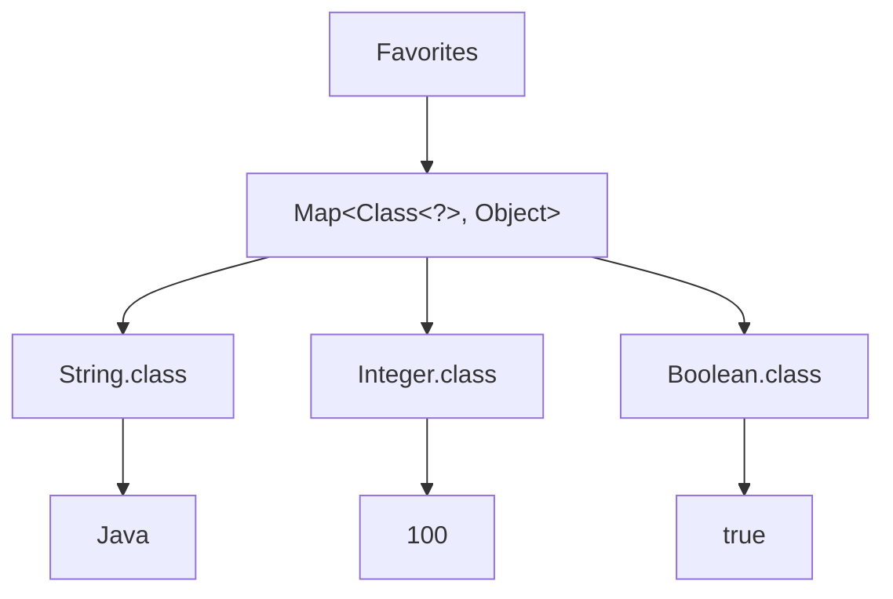
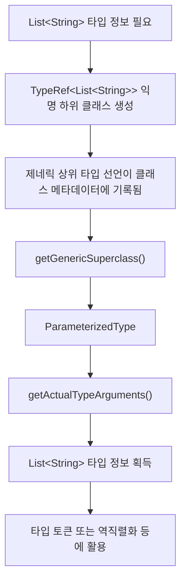
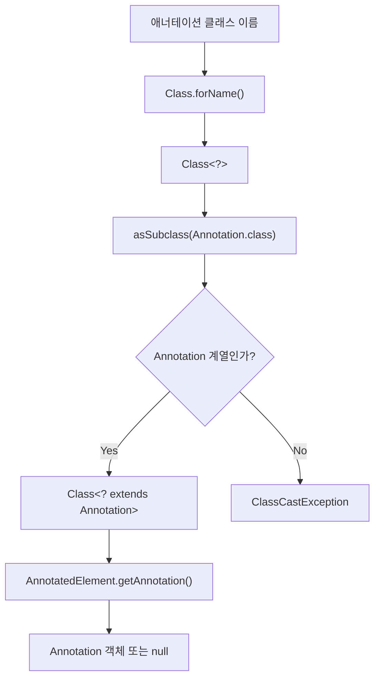

# 아이템 33. 타입 안전 인종 컨테이너를 고려하라

# 아이템 33. 타입 안전 인종 컨테이너를 고려하라

* toc
{:toc}

---

## 아이템 33. 핵심 정리 - 타입 토큰을 사용한 타입 안전 이종 컨테이너

### 아이템 33. 타입 안전 이종 컨테이너를 고려하라

지금까지 제네릭을 사용하면서 가장 많이 접했던 형태는 `List<T>`, `Set<T>`, `Map<K, V>`와 같은 컨테이너였다.

```java
List<String> names = new ArrayList<>();

Set<Integer> numbers = new HashSet<>();

Map<String, Integer> scores = new HashMap<>();
```

이러한 컨테이너에는 공통점이 있다.

**컨테이너를 선언하는 시점에 어떤 타입을 저장할 것인지 결정한다는 것**이다.

예를 들어 다음과 같이 선언하면

```java
List<String> names = new ArrayList<>();
```

해당 리스트에는 `String` 타입의 값만 추가할 수 있다.

```java
names.add("Java");
names.add("Spring");
```

반면 다음 코드는 컴파일되지 않는다.

```java
names.add(100); // 컴파일 오류
```

`List<String>`의 원소 타입은 `String`이기 때문이다.

이처럼 제네릭은 컴파일 시점에 타입을 검사하여 잘못된 값이 저장되는 것을 방지한다.

그런데 여기서 한 가지 궁금증이 생긴다.

**하나의 컨테이너에 서로 다른 타입의 값을 저장하면서도 타입 안전성을 유지할 수는 없을까?**

예를 들어 다음과 같은 값을 하나의 저장소에서 관리하고 싶다고 생각해보자.

```text
String 타입  → "Java"

Integer 타입 → 100

Boolean 타입 → true

LocalDate 타입 → 2026-10-13
```

단순히 여러 타입을 저장하는 것만으로는 어렵지 않다.

`Object`를 사용하면 된다.

하지만 값을 꺼낼 때마다 직접 형변환해야 하거나, 잘못된 타입의 값을 저장해도 컴파일러가 발견하지 못한다면 제네릭을 사용하는 의미가 줄어든다.

이번 아이템에서는 이러한 문제를 해결하는 **타입 안전 이종 컨테이너(Type Safe Heterogeneous Container)** 패턴을 살펴본다.

---

### 이종 컨테이너란 무엇인가?

먼저 이름부터 이해해보자.

이종(Heterogeneous)은 서로 다른 종류를 의미한다.

반대로 동종(Homogeneous)은 같은 종류를 의미한다.

따라서 이종 컨테이너는 말 그대로 **서로 다른 타입의 값을 함께 저장할 수 있는 컨테이너**다.

예를 들어 다음과 같은 구조를 생각할 수 있다.

```text
Favorites
    │
    ├── String  → "Java"
    │
    ├── Integer → 100
    │
    ├── Boolean → true
    │
    └── LocalDate → 2026-10-13
```

일반적인 제네릭 컨테이너는 컨테이너의 타입 매개변수를 기준으로 저장 가능한 값을 제한한다.

```java
List<String>
```

반면 타입 안전 이종 컨테이너는 각각의 항목이 서로 다른 타입을 가질 수 있도록 설계한다.

여기서 중요한 것은 단순히 여러 타입을 담는다는 사실이 아니다.

**각 항목에 저장하는 값의 타입과 꺼내는 값의 타입을 컴파일러가 연결할 수 있어야 한다.**

이 조건까지 만족해야 타입 안전 이종 컨테이너라고 부를 수 있다.

---

### 기존 제네릭 컨테이너와의 차이

일반적인 제네릭 클래스를 하나 만들어보자.

```java
public class Favorites<T> {

    private T favorite;

    public void setFavorite(T favorite) {
        this.favorite = favorite;
    }

    public T getFavorite() {
        return favorite;
    }
}
```

사용 방법은 간단하다.

```java
Favorites<String> favorites = new Favorites<>();

favorites.setFavorite("Java");

String favorite = favorites.getFavorite();
```

문제는 이 `Favorites` 객체가 `String` 타입으로 고정되어 있다는 점이다.

```java
favorites.setFavorite(100); // 컴파일 오류
```

숫자를 저장하고 싶다면 새로운 객체가 필요하다.

```java
Favorites<Integer> numberFavorites = new Favorites<>();

numberFavorites.setFavorite(100);
```

결과적으로 다음과 같은 구조가 만들어진다.

```text
Favorites<String>
    └── "Java"

Favorites<Integer>
    └── 100

Favorites<Boolean>
    └── true
```

각각의 컨테이너는 타입 안전하다.

하지만 하나의 컨테이너에 여러 타입을 함께 저장하는 구조는 아니다.

이번에는 하나의 `Favorites` 객체가 여러 타입의 값을 저장하도록 만들어보자.

---

### 가장 먼저 생각할 수 있는 방법은 Map이다

서로 다른 타입의 값을 하나의 컨테이너에 저장하려면 `Map`을 떠올릴 수 있다.

예를 들어 다음과 같다.

```java
public class Favorites {

    private final Map<Class<?>, Object> favorites =
            new HashMap<>();
}
```

여기에서 처음 보는 형태가 등장한다.

```java
Map<Class<?>, Object>
```

구조를 하나씩 살펴보자.

`Map`은 Key와 Value를 저장한다.

```text
Key → Value
```

우리는 각 타입별로 하나의 값을 저장하고 싶다.

따라서 Key는 타입을 나타내는 `Class` 객체로 정한다.

```java
Class<?>
```

Value는 `String`, `Integer`, `Boolean` 등 여러 타입이 올 수 있으므로 `Object`를 사용한다.

```java
Object
```

결국 다음과 같은 구조다.

```text
Map<Class<?>, Object>
        │
        ├── String.class  → "Java"
        │
        ├── Integer.class → 100
        │
        └── Boolean.class → true
```

이렇게 하면 하나의 `Map`에 서로 다른 타입의 값을 저장할 수 있다.

그런데 아직 문제가 남아 있다.

---

### Map<Class<?>, Object>만으로는 타입 안전하지 않다

다음과 같이 저장 메서드를 만들어보자.

```java
public void putFavorite(Class<?> type, Object value) {
    favorites.put(type, value);
}
```

사용할 때는 다음과 같다.

```java
favorites.putFavorite(String.class, "Java");

favorites.putFavorite(Integer.class, 100);
```

여기까지는 정상적으로 동작한다.

그런데 다음 코드도 허용된다.

```java
favorites.putFavorite(String.class, 100);
```

`String.class`를 Key로 전달했는데 실제 Value는 `Integer`다.

컴파일러는 이 코드를 막지 못한다.

왜냐하면 메서드의 매개변수가 다음과 같기 때문이다.

```java
Class<?> type

Object value
```

첫 번째 매개변수는 어떤 타입을 나타내는 `Class` 객체든 받을 수 있다.

두 번째 매개변수는 어떤 객체든 받을 수 있다.

**두 매개변수 사이에 아무런 타입 관계가 선언되어 있지 않다.**

따라서 `String.class`와 `Integer`가 함께 전달되어도 컴파일러는 잘못된 호출이라는 사실을 알 수 없다.

---

### 조회할 때도 문제가 발생한다

다음과 같은 조회 메서드를 생각해보자.

```java
public Object getFavorite(Class<?> type) {
    return favorites.get(type);
}
```

호출하는 쪽에서는 원하는 타입으로 직접 형변환해야 한다.

```java
String favorite =
        (String) favorites.getFavorite(String.class);
```

매번 형변환이 필요하다.

더 큰 문제는 잘못된 형변환도 컴파일할 수 있다는 것이다.

```java
Integer favorite =
        (Integer) favorites.getFavorite(String.class);
```

컴파일은 가능하지만 실제 값이 문자열이라면 런타임에 `ClassCastException`이 발생한다.

따라서 단순히

```java
Map<Class<?>, Object>
```

를 사용한다고 해서 타입 안전 이종 컨테이너가 완성되는 것은 아니다.

**Key와 Value 사이에 타입 관계를 만들어주는 과정이 필요하다.**

---

### 해결 방법은 제네릭 타입을 컨테이너가 아닌 메서드에 선언하는 것이다

지금까지 많이 사용했던 방법은 클래스 자체에 타입 매개변수를 선언하는 방식이었다.

```java
public class Favorites<T> {
}
```

이렇게 하면 `Favorites<String>`처럼 객체 전체가 하나의 타입으로 고정된다.

하지만 이번에는 다르게 접근한다.

`Favorites` 클래스 자체에는 타입 매개변수를 선언하지 않는다.

대신 값을 저장하거나 조회하는 **각각의 메서드에 타입 매개변수를 선언한다.**

```java
public <T> void putFavorite(Class<T> type, T instance)
```

이 코드가 이번 패턴에서 가장 중요한 부분이다.

처음 보면 조금 복잡하지만 우리가 이미 익숙하게 사용했던 제네릭 메서드다.

---

### Class<T>와 T의 관계를 이해하자

다음 선언을 다시 보자.

```java
public <T> void putFavorite(
        Class<T> type,
        T instance
)
```

여기에는 같은 타입 매개변수 `T`가 두 번 등장한다.

```java
Class<T> type
```

그리고

```java
T instance
```

이다.

이 둘은 서로 독립적인 타입이 아니다.

**같은 `T`를 공유한다는 것이 중요하다.**

예를 들어 다음과 같이 호출한다.

```java
putFavorite(String.class, "Java");
```

`String.class`의 타입은 `Class<String>`이다.

따라서 컴파일러는 `T`를 `String`으로 추론한다.

개념적으로 다음과 같다.

```text
putFavorite(
    Class<String>,
    String
)
```

반대로 `Integer.class`를 전달하면 다음 관계가 만들어진다.

```text
putFavorite(
    Class<Integer>,
    Integer
)
```

즉 첫 번째 매개변수로 전달하는 타입과 두 번째 값의 타입이 연결된다.

이제 다음 코드를 보자.

```java
putFavorite(String.class, 100);
```

첫 번째 매개변수는 `Class<String>`이다.

따라서 `T`는 `String`이어야 한다.

그런데 두 번째 매개변수는 `Integer`다.

타입이 맞지 않는다.

따라서 컴파일 오류가 발생한다.

이렇게 **제네릭 메서드의 타입 매개변수를 이용해 서로 다른 인자 사이의 타입 관계를 강제할 수 있다.**

---

### Class<T>는 어떤 클래스일까?

여기서 `Class<T>`를 조금 더 자세히 알아볼 필요가 있다.

Java의 모든 객체는 런타임에 자신이 어떤 클래스의 인스턴스인지에 관한 정보를 가지고 있다.

이러한 클래스 정보를 표현하는 객체가 `Class`다.

예를 들어 다음과 같다.

```java
Class<String> stringClass = String.class;

Class<Integer> integerClass = Integer.class;

Class<Boolean> booleanClass = Boolean.class;
```

여기서

```java
String.class
```

는 문자열 `"String"`을 반환하는 것이 아니다.

`String`이라는 클래스에 대한 정보를 표현하는 `Class` 객체다.

그리고 그 표현식의 컴파일타임 타입은 다음과 같다.

```java
Class<String>
```

`Integer.class` 역시 다음 타입을 가진다.

```java
Class<Integer>
```

이러한 클래스 리터럴을 타입 정보로 활용할 수 있다.

---

### 타입 토큰(Type Token)이란?

다음 코드를 생각해보자.

```java
favorites.putFavorite(String.class, "Java");
```

여기서 `String.class`는 단순히 Map의 Key로만 사용되는 것이 아니다.

메서드에 다음 사실을 알려준다.

> 내가 지금 저장하려는 값의 타입은 String이다.

이처럼 **타입을 나타내는 객체를 전달해 타입 정보를 표현하는 방식**을 타입 토큰(Type Token)이라고 한다.

이번 예제에서 타입 토큰은 다음과 같다.

```java
String.class
Integer.class
Boolean.class
```

타입 토큰을 매개변수로 받으면 메서드가 어떤 타입을 다루어야 하는지 알 수 있다.

```java
public <T> void putFavorite(
        Class<T> type,
        T instance
)
```

여기서 `Class<T>`는 타입 토큰의 역할을 하고, `T instance`는 해당 타입의 값을 나타낸다.

---

### 타입 토큰을 사용한 Favorites 구현

이제 실제 클래스를 만들어보자.

```java
import java.util.HashMap;
import java.util.Map;

public class Favorites {

    private final Map<Class<?>, Object> favorites =
            new HashMap<>();

    public <T> void putFavorite(
            Class<T> type,
            T instance
    ) {
        favorites.put(type, instance);
    }

    public <T> T getFavorite(Class<T> type) {
        // 구현 예정
        return null;
    }
}
```

저장 메서드부터 살펴보자.

```java
public <T> void putFavorite(
        Class<T> type,
        T instance
)
```

메서드 선언에서 Key와 Value의 타입 관계를 표현했다.

하지만 실제 Map은 여전히 다음과 같다.

```java
Map<Class<?>, Object>
```

이것이 가능한 이유는 `Class<T>`를 `Class<?>`로 사용할 수 있고, 모든 참조 타입의 객체를 `Object`로 저장할 수 있기 때문이다.

```text
putFavorite(String.class, "Java")
             │             │
             ▼             ▼
      Class<String>       String
             │             │
             ▼             ▼
         Class<?>        Object
             │             │
             └──────┬──────┘
                    ▼
                 Map 저장
```

여기서 중요한 특징이 있다.

Map 자체는 Key와 Value의 타입 관계를 표현하지 못한다.

하지만 Map에 접근하는 메서드가 그 관계를 검사하도록 만들면 외부에서 사용할 때 타입 안전성을 확보할 수 있다.

---

### 값을 조회할 때는 어떻게 해야 할까?

이번에는 저장한 값을 조회하는 메서드를 구현해보자.

```java
public <T> T getFavorite(Class<T> type) {
    return favorites.get(type);
}
```

이렇게 작성하면 컴파일되지 않는다.

왜냐하면

```java
favorites.get(type)
```

의 반환 타입은 `Object`이기 때문이다.

반면 메서드의 반환 타입은

```java
T
```

다.

Java 컴파일러는 `Object`를 무조건 `T`로 반환해도 안전하다고 판단할 수 없다.

우리는 앞에서 `Class<T>`에 맞는 값만 저장했으니 안전할 것이라고 생각할 수 있다.

하지만 컴파일러는 `Map<Class<?>, Object>` 내부에 어떤 관계가 유지되는지 알지 못한다.

따라서 명시적으로 타입을 처리해야 한다.

---

### 첫 번째 방법: 직접 형변환하기

가장 단순한 방법은 형변환이다.

```java
@SuppressWarnings("unchecked")
public <T> T getFavorite(Class<T> type) {
    return (T) favorites.get(type);
}
```

이 코드는 동작할 수 있다.

하지만 다음 부분에서 비검사 형변환 경고가 발생한다.

```java
(T) favorites.get(type)
```

컴파일러가 실제 객체가 `T` 타입인지 검사할 수 없기 때문이다.

여기서 주의할 점이 있다.

`T`의 상위 경계가 없는 경우 타입 소거 후 `T`는 기본적으로 `Object`로 다뤄진다.

따라서 `(T)`라는 코드를 작성했다고 해서 런타임에 반드시 우리가 기대하는 `String`, `Integer` 등의 구체적인 타입으로 검사하는 것은 아니다.

잘못된 객체가 저장되어 있다면 이후 호출자가 반환값을 사용하는 과정에서 `ClassCastException`이 발생할 수도 있다.

이런 비검사 형변환을 피하는 더 좋은 방법이 있다.

---

### 두 번째 방법: Class.cast() 사용하기

`Class`에는 다음 메서드가 있다.

```java
public T cast(Object obj)
```

이 메서드는 전달받은 객체를 해당 `Class`가 표현하는 타입으로 형변환한다.

예를 들어 다음과 같다.

```java
Object value = "Java";

String result = String.class.cast(value);
```

`String.class`는 `String` 타입을 나타내는 `Class` 객체다.

따라서 `cast()`는 전달된 객체가 `String`으로 변환 가능한지 런타임에 확인한다.

실제 값이 문자열이므로 정상적으로 반환한다.

반면 다음 코드를 보자.

```java
Object value = 100;

String result = String.class.cast(value);
```

이 경우에는 `ClassCastException`이 발생한다.

실제 객체는 `Integer`인데 `String`으로 변환하려고 했기 때문이다.

`Class.cast()`는 타입 토큰을 이용해 런타임 형변환 검사를 수행한다.

---

### getFavorite()에 Class.cast()를 적용해보자

이제 조회 메서드를 다음처럼 수정할 수 있다.

```java
public <T> T getFavorite(Class<T> type) {
    return type.cast(favorites.get(type));
}
```

코드는 짧지만 중요한 동작이 들어 있다.

먼저 Map에서 값을 꺼낸다.

```java
favorites.get(type)
```

반환 타입은 `Object`다.

그다음

```java
type.cast(...)
```

를 호출한다.

`type`이 `String.class`라면 실제 객체를 `String`으로 변환할 수 있는지 검사한다.

`type`이 `Integer.class`라면 `Integer`로 변환할 수 있는지 검사한다.

그리고 `Class<T>.cast()`의 반환 타입은 `T`이므로 메서드에서도 그대로 반환할 수 있다.

결과적으로 다음처럼 사용할 수 있다.

```java
String language =
        favorites.getFavorite(String.class);

Integer number =
        favorites.getFavorite(Integer.class);
```

호출자가 직접 형변환할 필요가 없다.

---

### 지금까지의 Favorites 전체 코드

여기까지 구현하면 다음과 같다.

```java
import java.util.HashMap;
import java.util.Map;
import java.util.Objects;

public class Favorites {

    private final Map<Class<?>, Object> favorites =
            new HashMap<>();

    public <T> void putFavorite(
            Class<T> type,
            T instance
    ) {
        Objects.requireNonNull(type);

        favorites.put(type, instance);
    }

    public <T> T getFavorite(Class<T> type) {
        Objects.requireNonNull(type);

        return type.cast(favorites.get(type));
    }
}
```

`Objects.requireNonNull(type)`은 타입 토큰으로 `null`이 전달되는 것을 방지한다.

```java
Objects.requireNonNull(type);
```

`null`을 전달하면 즉시 `NullPointerException`이 발생한다.

타입 토큰은 저장과 조회의 기준이 되므로 유효한 `Class` 객체를 전달하도록 제한하는 편이 명확하다.

---

### 실제로 사용해보자

다음과 같이 다양한 타입의 값을 하나의 `Favorites`에 저장할 수 있다.

```java
Favorites favorites = new Favorites();

favorites.putFavorite(
        String.class,
        "Java"
);

favorites.putFavorite(
        Integer.class,
        100
);

favorites.putFavorite(
        Boolean.class,
        true
);
```

조회할 때도 타입을 직접 지정할 필요가 없다.

```java
String language =
        favorites.getFavorite(String.class);

Integer number =
        favorites.getFavorite(Integer.class);

Boolean enabled =
        favorites.getFavorite(Boolean.class);
```

출력하면 다음과 같다.

```text
Java
100
true
```

여기서 중요한 것은 다음 세 가지다.

첫 번째는 **하나의 컨테이너에 서로 다른 타입을 저장했다는 것**이다.

두 번째는 **값을 저장할 때 타입이 일치하는지 컴파일러가 검사한다는 것**이다.

세 번째는 **값을 조회할 때 명시적인 형변환 없이 원하는 타입으로 반환받는다는 것**이다.

이 세 가지가 타입 안전 이종 컨테이너의 핵심이다.

---

### 그런데 Map은 여전히 Object를 사용한다

여기서 한 가지 의문이 들 수 있다.

타입 안전하게 만들었다고 했는데 실제 내부 구현은 여전히 다음과 같다.

```java
Map<Class<?>, Object>
```

Map의 Value가 `Object`라면 결국 타입 안전하지 않은 것 아닐까?

이 부분이 이번 패턴을 이해하는 데 가장 중요하다.

일반적으로 `Map<K, V>`는 모든 Entry에 대해 같은 `K`, `V` 타입 관계를 적용한다.

```java
Map<String, Integer>
```

라면 모든 Key가 `String`이고 모든 Value가 `Integer`다.

하지만 우리가 원하는 구조는 다음과 같다.

```text
String.class  → String

Integer.class → Integer

Boolean.class → Boolean
```

Entry마다 Value 타입이 달라진다.

일반적인 `Map<K, V>` 선언만으로는

> Key가 `Class<String>`이면 Value는 String이고, Key가 `Class<Integer>`이면 Value는 Integer여야 한다.

라는 관계를 표현하기 어렵다.

그래서 내부 저장소에는 `Object`를 사용한다.

대신 외부에서 접근할 수 있는 메서드에 제네릭 타입 관계를 선언한다.

```java
<T> void putFavorite(Class<T> type, T instance)
```

```java
<T> T getFavorite(Class<T> type)
```

즉 **타입 안전성은 Map 선언 자체가 아니라 Map을 감싸고 있는 제네릭 API에서 확보한다.**

---

### 컨테이너가 아니라 Key를 매개변수화한다

일반적인 제네릭 컨테이너는 다음과 같다.

```java
Favorites<String>
```

`Favorites` 전체의 타입이 `String`으로 결정된다.

반면 타입 안전 이종 컨테이너는 다음과 같다.

```java
Favorites favorites = new Favorites();
```

컨테이너 자체에는 타입 매개변수가 없다.

대신 각각의 저장과 조회 작업에서 타입 토큰을 전달한다.

```java
favorites.putFavorite(String.class, "Java");

favorites.putFavorite(Integer.class, 100);
```

관계는 다음과 같다.



하나의 컨테이너에 여러 타입의 값이 들어 있지만, 각 항목의 Key는 어떤 타입의 값을 저장해야 하는지 나타낸다.

이것이 일반적인 제네릭 컨테이너와의 가장 큰 차이다.

---

### 타입 안전성을 깨뜨릴 수 있는 방법도 있다

여기까지 보면 완벽한 구조처럼 느껴질 수 있다.

하지만 Java 제네릭에는 타입 안전성을 우회할 수 있는 방법이 존재한다.

대표적인 것이 Raw Type이다.

앞에서 다음 호출은 컴파일되지 않는다고 했다.

```java
favorites.putFavorite(String.class, 100);
```

`String.class`는 `Class<String>`이고, 두 번째 인자는 `Integer`이기 때문이다.

그런데 다음처럼 작성하면 어떨까?

```java
Class rawType = String.class;

favorites.putFavorite(rawType, 100);
```

`Class<String>` 대신 Raw Type인 `Class`를 사용했다.

이 경우 컴파일러가 비검사 호출 경고를 발생시키지만, 컴파일 자체는 허용할 수 있다.

즉 Raw Type을 통해 제네릭의 타입 관계를 우회한 것이다.

이제 내부 Map에는 다음과 같은 값이 저장될 수 있다.

```text
String.class → 100
```

원래 의도했던 관계가 깨졌다.

---

### Raw Type이 왜 위험할까?

다음 코드를 다시 보자.

```java
Class rawType = String.class;
```

원래 `String.class`는 다음 타입을 가진다.

```java
Class<String>
```

하지만 Raw Type으로 사용하면 제네릭 타입 인수에 관한 검사를 우회할 수 있다.

따라서 다음 호출도 컴파일 경고와 함께 허용될 수 있다.

```java
favorites.putFavorite(rawType, 100);
```

이것은 Java 제네릭이 잘못 설계되었다는 의미가 아니다.

Java는 오래된 코드와의 호환성을 위해 Raw Type을 허용한다.

다만 Raw Type을 사용하는 순간 제네릭이 제공하는 일부 타입 안전성을 포기하게 된다.

타입 안전 이종 컨테이너 역시 이런 우회까지 컴파일 시점에 완전히 막을 수는 없다.

---

### 잘못된 값은 언제 문제가 될까?

현재 저장 메서드는 다음과 같다.

```java
public <T> void putFavorite(
        Class<T> type,
        T instance
) {
    Objects.requireNonNull(type);

    favorites.put(type, instance);
}
```

Raw Type을 통해 다음 값을 저장했다고 생각해보자.

```text
Key   = String.class

Value = Integer(100)
```

저장하는 순간에는 단순히 Map에 값을 넣는다.

```java
favorites.put(type, instance);
```

따라서 잘못된 값이 그대로 저장될 수 있다.

그런 다음 조회한다.

```java
String favorite =
        favorites.getFavorite(String.class);
```

조회 메서드는 다음과 같다.

```java
public <T> T getFavorite(Class<T> type) {
    return type.cast(favorites.get(type));
}
```

이때 Map에서 반환한 실제 객체는 `Integer`다.

하지만 타입 토큰은 `String.class`다.

따라서 다음 과정에서 문제가 발생한다.

```text
String.class로 조회
         │
         ▼
Map에서 Object 반환
         │
         ▼
실제 객체는 Integer
         │
         ▼
String.class.cast(...)
         │
         ▼
ClassCastException
```

즉 저장할 때 발생한 잘못된 타입 관계가 조회하는 순간에 드러난다.

---

### 잘못된 값을 저장할 때 바로 확인할 수는 없을까?

가능하다.

앞에서 조회할 때 사용했던 `Class.cast()`를 저장할 때도 사용하면 된다.

기존 코드는 다음과 같았다.

```java
public <T> void putFavorite(
        Class<T> type,
        T instance
) {
    Objects.requireNonNull(type);

    favorites.put(type, instance);
}
```

이제 다음처럼 변경해보자.

```java
public <T> void putFavorite(
        Class<T> type,
        T instance
) {
    Objects.requireNonNull(type);

    favorites.put(
            type,
            type.cast(instance)
    );
}
```

차이는 단 한 줄이다.

```java
type.cast(instance)
```

값을 저장하기 전에 실제 객체가 타입 토큰과 호환되는지 검사한다.

---

### 저장 시점에 검사하면 무엇이 좋아질까?

다음과 같은 잘못된 호출을 생각해보자.

```java
Class rawType = String.class;

favorites.putFavorite(rawType, 100);
```

이번에는 저장 메서드 내부에서 먼저 다음 코드가 실행된다.

```java
type.cast(instance)
```

실제 값은 `Integer`다.

타입 토큰은 `String.class`다.

따라서 저장 시점에 `ClassCastException`이 발생한다.

```text
putFavorite(...)
       │
       ▼
String.class
       │
       ▼
Integer(100)
       │
       ▼
String.class.cast(100)
       │
       ▼
ClassCastException
```

잘못된 값이 Map에 저장되기 전에 오류를 발견할 수 있다.

이전에는 조회할 때 문제가 드러났지만 이제는 저장하는 시점에 확인할 수 있는 것이다.

---

### 오류는 가능한 한 빨리 발견하는 편이 좋다

실무에서 오류가 발생한 시점과 원인이 만들어진 시점이 멀어지면 문제를 추적하기 어려워진다.

예를 들어 잘못된 값을 저장한 코드와 조회하는 코드가 서로 다른 계층에 있다고 생각해보자.

```text
Service A

잘못된 값 저장
        │
        │
        ▼
여러 비즈니스 로직 수행
        │
        │
        ▼
Service B

값 조회
        │
        ▼
ClassCastException
```

실제로는 Service A가 잘못된 값을 저장했는데 예외는 Service B에서 발생한다.

반면 저장할 때 바로 검사한다면 문제를 만든 위치에서 오류를 발견할 수 있다.

```text
Service A

잘못된 값 저장 시도
        │
        ▼
Class.cast()
        │
        ▼
즉시 ClassCastException
```

따라서 타입 안전성의 관점뿐 아니라 장애 원인을 빠르게 파악하는 관점에서도 저장 시점의 검사가 도움이 된다.

---

### 조금 더 안전하게 개선한 Favorites

이제 지금까지 살펴본 내용을 모두 적용해보자.

```java
import java.util.HashMap;
import java.util.Map;
import java.util.Objects;

public final class Favorites {

    private final Map<Class<?>, Object> favorites =
            new HashMap<>();

    public <T> void putFavorite(
            Class<T> type,
            T instance
    ) {
        Objects.requireNonNull(type);

        favorites.put(
                type,
                type.cast(instance)
        );
    }

    public <T> T getFavorite(Class<T> type) {
        Objects.requireNonNull(type);

        return type.cast(
                favorites.get(type)
        );
    }
}
```

이 구현에서 중요한 부분은 세 가지다.

첫 번째는 다음 Map이다.

```java
Map<Class<?>, Object>
```

서로 다른 타입의 값을 하나의 저장소에 보관한다.

두 번째는 제네릭 메서드다.

```java
<T> void putFavorite(Class<T> type, T instance)
```

Key가 나타내는 타입과 Value 타입의 관계를 컴파일러가 검사하도록 만든다.

세 번째는 `Class.cast()`다.

```java
type.cast(instance)
```

```java
type.cast(favorites.get(type))
```

Raw Type 등으로 정적 타입 검사가 우회된 경우에도 런타임에 실제 객체 타입을 검사할 수 있다.

물론 이것이 모든 잘못된 코드의 컴파일을 막는다는 뜻은 아니다.

Raw Type을 사용하면 여전히 컴파일 경고와 함께 타입 검사를 우회할 수 있다.

다만 잘못된 값이 저장되거나 반환되는 상황을 런타임에 확인하여 위험을 줄일 수 있다.

---

### Class.cast()와 일반 형변환은 무엇이 다를까?

다음 두 코드를 비교해보자.

```java
(T) value
```

그리고

```java
type.cast(value)
```

둘 다 형변환처럼 보이지만 차이가 있다.

`(T)`는 제네릭 타입 매개변수에 대한 형변환이다.

Java의 타입 소거 때문에 컴파일러가 `T`의 구체적인 런타임 타입을 항상 확인할 수 있는 것은 아니다.

따라서 비검사 형변환 경고가 발생할 수 있다.

반면

```java
type.cast(value)
```

는 실제 `Class` 객체를 이용한다.

예를 들어

```java
String.class.cast(value)
```

라면 `String.class`라는 런타임 타입 정보가 존재한다.

이 정보를 이용해 객체가 `String` 인스턴스인지 검사할 수 있다.

| 구분         | `(T) value`             | `type.cast(value)`       |
| ---------- | ----------------------- | ------------------------ |
| 타입 정보      | 타입 매개변수 `T`             | 실제 `Class<T>` 객체         |
| 타입 소거 영향   | 구체적인 T를 검사하지 못할 수 있음    | Class가 표현하는 런타임 타입 검사 가능 |
| 비검사 형변환 경고 | 발생 가능                   | 일반적으로 필요 없음              |
| 잘못된 객체 처리  | 이후 사용 지점에서 오류가 드러날 수 있음 | `cast()` 호출 지점에서 오류 발생   |
| 대표 용도      | 타입 관계가 별도로 보장되는 내부 코드   | 런타임 타입 토큰을 이용한 형변환       |

따라서 타입 토큰을 이미 가지고 있다면 단순한 비검사 형변환보다 `Class.cast()`를 사용하는 편이 의도를 명확하게 표현할 수 있다.

---

### 그런데 타입 안전 이종 컨테이너에도 한계가 있다

여기까지 구현하면 상당히 유연한 컨테이너를 얻을 수 있다.

하지만 아직 해결하지 못한 문제가 하나 있다.

바로 **매개변수화 타입(Parameterized Type)** 이다.

예를 들어 다음 두 타입을 생각해보자.

```java
List<String>
```

```java
List<Integer>
```

둘 다 `List`지만 원소 타입이 다르다.

우리는 다음과 같은 값을 저장하고 싶을 수 있다.

```text
List<String>  → ["Java", "Spring"]

List<Integer> → [1, 2, 3]
```

서로 다른 타입이므로 각각 구분해서 저장하고 싶다.

그런데 현재 `Favorites` 구조에서는 문제가 생긴다.

---

### List.class는 사용할 수 있다

다음 코드는 가능하다.

```java
Class<List> listType = List.class;
```

그리고 다음처럼 사용할 수도 있다.

```java
favorites.putFavorite(
        List.class,
        List.of("Java", "Spring")
);
```

문제는 다른 원소 타입을 가진 리스트도 똑같은 타입 토큰을 사용한다는 것이다.

```java
favorites.putFavorite(
        List.class,
        List.of(1, 2, 3)
);
```

두 호출의 Key는 모두 다음과 같다.

```java
List.class
```

따라서 두 번째 값이 첫 번째 값을 덮어쓴다.

```text
첫 번째 저장

List.class
    → ["Java", "Spring"]


두 번째 저장

List.class
    → [1, 2, 3]
```

Map에서는 동일한 Key에 새로운 값을 저장하면 기존 값이 교체된다.

따라서 `List<String>`과 `List<Integer>`를 구분하지 못한다.

---

### List<String>.class를 사용하면 되지 않을까?

가장 먼저 떠오르는 방법은 다음과 같다.

```java
List<String>.class
```

그리고

```java
List<Integer>.class
```

를 서로 다른 Key로 사용하는 것이다.

하지만 Java에서는 이런 문법을 허용하지 않는다.

```java
Class<List<String>> stringListType =
        List<String>.class; // 컴파일 오류
```

Java의 클래스 리터럴 문법은 매개변수화 타입에 대해 이러한 형태를 지원하지 않는다.

사용할 수 있는 것은 다음과 같은 형태다.

```java
List.class
```

왜 그럴까?

이 부분은 Java 제네릭의 타입 소거와 관련이 있다.

---

### 타입 소거 때문에 두 List는 같은 런타임 클래스를 가진다

다음 두 객체를 생각해보자.

```java
List<String> strings =
        new ArrayList<>();

List<Integer> integers =
        new ArrayList<>();
```

컴파일러는 두 변수의 제네릭 타입이 다르다는 사실을 알고 있다.

```text
List<String>

List<Integer>
```

하지만 런타임에 다음과 같이 확인해보면 어떨까?

```java
System.out.println(
        strings.getClass() == integers.getClass()
);
```

결과는 다음과 같다.

```text
true
```

두 객체 모두 실제로는 `ArrayList` 인스턴스이기 때문이다.

Java는 일반적인 제네릭 타입 인수를 런타임에 서로 다른 클래스 객체로 실체화하지 않는다.

따라서 `List<String>`과 `List<Integer>`라는 차이를 `Class` 객체 하나만으로 표현할 수 없다.

---

### Class<?>는 모든 제네릭 타입 정보를 표현하지 못한다

현재 우리가 사용한 타입 토큰은 다음과 같다.

```java
Class<T>
```

이 방식은 `String`, `Integer`, `Boolean` 같은 타입을 표현하기에 적합하다.

하지만 다음처럼 타입 인수를 포함하는 전체 타입 구조를 표현하기에는 한계가 있다.

```java
List<String>
```

```java
Map<String, Integer>
```

```java
List<Map<String, Integer>>
```

이런 타입은 단순히 클래스 하나만으로는 충분히 구분할 수 없다.

예를 들어

```java
Map<String, Integer>
```

와

```java
Map<String, Long>
```

은 둘 다 `Map.class`라는 클래스 리터럴을 공유한다.

하지만 논리적으로는 서로 다른 제네릭 타입이다.

이 차이를 표현하려면 `Class`보다 더 풍부한 타입 정보가 필요하다.

---

### Class.cast()도 제네릭 원소 타입까지 검사하지는 못한다

여기서 한 가지 더 구분해야 한다.

앞에서는 `Class.cast()`를 사용하면 런타임에 타입을 검사할 수 있다고 했다.

하지만 그 검사는 `Class` 객체가 표현할 수 있는 수준까지만 가능하다.

예를 들어 다음과 같다.

```java
Object value =
        List.of(1, 2, 3);

List result =
        List.class.cast(value);
```

이 코드는 정상적으로 동작한다.

실제 객체가 `List`이기 때문이다.

하지만 이 List의 원소가 `String`인지 `Integer`인지까지 검사한 것은 아니다.

```java
List.class
```

에는 원소 타입에 대한 정보가 없다.

따라서 `Class.cast()`를 사용한다고 해서 `List<String>`과 `List<Integer>`를 런타임에 구분할 수 있게 되는 것은 아니다.

**타입 토큰의 표현 능력 자체에 한계가 있는 것이다.**

---

### 더 풍부한 타입 정보를 표현하려면?

우리가 정말 원하는 것은 다음과 같은 구분이다.

```text
List<String>
    ≠
List<Integer>
```

단순히 `List.class`라는 클래스 객체만 사용하는 것이 아니라

```text
List
  └── String
```

과

```text
List
  └── Integer
```

라는 전체 타입 구조를 표현하고 싶은 것이다.

이 문제를 해결하는 대표적인 아이디어가 **슈퍼 타입 토큰(Super Type Token)** 이다.

슈퍼 타입 토큰은 제네릭 타입 정보가 선언된 상위 타입의 메타데이터를 활용해 `List<String>`처럼 타입 인수가 포함된 구조를 표현하는 방식이다.

다만 이 방식 역시 Java의 타입 소거 자체를 없애는 것은 아니다.

런타임에 객체를 검사할 때 `List<String>`의 모든 원소가 실제로 `String`인지 자동으로 검증해준다는 의미도 아니다.

슈퍼 타입 토큰이 제공하는 것은 **`Class`만으로 표현하기 어려웠던 제네릭 타입 구조를 표현하고 전달할 수 있는 수단**이라고 이해하는 것이 좋다.

구체적인 사용 방법은 별도로 살펴볼 수 있다.

---

### 타입 안전 이종 컨테이너가 실무에서 유용한 경우

이 패턴은 모든 데이터를 저장하는 범용 저장소를 만들기 위한 기술이라기보다, **타입별로 서로 다른 객체를 등록하고 다시 조회해야 하는 상황**에서 유용하다.

예를 들어 애플리케이션 내부에 여러 종류의 설정값이 있다고 해보자.

```text
String  → 서비스 이름

Integer → 재시도 횟수

Boolean → 특정 기능 사용 여부
```

이 값들을 하나의 컨테이너에 저장하면서 조회할 때는 각 타입으로 안전하게 반환받고 싶을 수 있다.

또 다른 예로, 서로 다른 타입의 컴포넌트나 메타데이터를 등록하고 해당 클래스 타입을 기준으로 조회하는 레지스트리(Registry)를 생각해볼 수도 있다.

핵심은 Key로 사용하는 타입 정보가 해당 Value의 타입을 결정한다는 점이다.

물론 실제 업무에서는 같은 타입의 값을 여러 개 저장해야 하거나, 저장소의 생명주기 및 동시성 관리가 필요할 수도 있다.

그런 경우에는 단순히 `Favorites` 구조를 그대로 사용하기보다 Key 설계를 확장하거나 별도의 Registry 구조를 고려해야 한다.

---

### 타입 안전 이종 컨테이너를 사용할 때 주의할 점

#### 1. 하나의 타입당 하나의 값만 저장할 수 있다

현재 구현은 다음과 같다.

```java
Map<Class<?>, Object>
```

Key가 `Class` 객체이므로 같은 타입의 값을 다시 저장하면 이전 값이 덮어써진다.

```java
favorites.putFavorite(String.class, "Java");

favorites.putFavorite(String.class, "Spring");
```

이후 조회하면 다음 값이 나온다.

```java
favorites.getFavorite(String.class);
```

```text
Spring
```

따라서 이 컨테이너는 여러 타입을 저장할 수 있지만, 기본 구현에서는 각 타입당 하나의 값만 보관한다.

#### 2. Raw Type을 사용하면 타입 검사를 우회할 수 있다

다음 코드는 제네릭 타입 검사를 우회할 수 있다.

```java
Class rawType = String.class;

favorites.putFavorite(rawType, 100);
```

따라서 외부 API에서 제네릭 타입을 올바르게 사용하는 것이 중요하다.

추가로 `Class.cast()`를 이용하면 잘못된 값이 들어오는 상황을 런타임에 확인할 수 있다.

#### 3. Class 타입 토큰에는 한계가 있다

```java
List<String>
```

과

```java
List<Integer>
```

는 서로 다른 제네릭 타입이지만 둘을 구분하는 클래스 리터럴을 직접 사용할 수 없다.

따라서 매개변수화 타입 전체를 구분해야 하는 경우에는 다른 형태의 타입 토큰이 필요하다.

#### 4. 현재 구현은 동시성까지 보장하지 않는다

우리가 사용한 저장소는 다음과 같다.

```java
private final Map<Class<?>, Object> favorites =
        new HashMap<>();
```

`HashMap`은 동시 변경에 대해 스레드 안전성을 제공하지 않는다.

따라서 여러 스레드가 하나의 `Favorites` 객체를 동시에 수정하는 환경에서는 별도의 동시성 설계가 필요하다.

여기서 말하는 **타입 안전성(Type Safety)** 과 **스레드 안전성(Thread Safety)** 은 다른 개념이다.

---

### 일반 제네릭 컨테이너와 타입 안전 이종 컨테이너 비교

| 구분        | 일반 제네릭 컨테이너            | 타입 안전 이종 컨테이너           |
| --------- | ---------------------- | ----------------------- |
| 대표 형태     | `List<T>`, `Map<K, V>` | `Favorites`             |
| 타입 결정 기준  | 컨테이너의 타입 매개변수          | 항목별 타입 토큰               |
| 여러 타입 저장  | 선언된 타입 범위 내에서 가능       | 각 항목별로 다른 타입을 연결 가능     |
| 내부 저장소    | `List<T>` 등            | `Map<Class<?>, Object>` |
| 타입 관계 표현  | 컨테이너 선언                | 제네릭 메서드                 |
| 타입 안전성 확보 | 제네릭 타입 검사              | 제네릭 메서드와 타입 토큰          |
| 조회 시 형변환  | 일반적으로 불필요              | `Class.cast()`로 내부에서 처리 |
| 주요 제약     | 선언된 원소 타입으로 제한         | `Class`로 표현 가능한 타입에 제한  |

두 방식 중 하나가 무조건 더 좋은 것은 아니다.

일반적인 데이터 목록이나 집합을 다룰 때는 `List<T>`, `Set<T>` 같은 제네릭 컨테이너가 자연스럽다.

반면 서로 다른 타입을 하나의 저장소에 등록하고 타입을 Key로 조회하는 요구사항이 있다면 타입 안전 이종 컨테이너 패턴을 고려할 수 있다.

---

### 이번 패턴에서 기억해야 할 핵심

타입 안전 이종 컨테이너의 핵심은 단순히 `Map`을 사용했다는 사실이 아니다.

다음 코드에 있다.

```java
public <T> void putFavorite(
        Class<T> type,
        T instance
)
```

그리고

```java
public <T> T getFavorite(Class<T> type)
```

이다.

일반적인 제네릭 컨테이너에서는 타입 매개변수를 컨테이너에 선언한다.

```java
class Favorites<T>
```

반면 타입 안전 이종 컨테이너에서는 컨테이너 자체를 특정 타입으로 고정하지 않는다.

대신 각각의 메서드 호출에서 타입 매개변수를 결정한다.

```java
<T> void putFavorite(...)
```

이렇게 하면 같은 컨테이너에 `String`, `Integer`, `Boolean` 등 서로 다른 타입의 값을 저장할 수 있다.

그리고 `Class<T>` 타입 토큰을 이용해 각 값이 어떤 타입에 속하는지 표현한다.

결국 타입 안전 이종 컨테이너는 **제네릭 메서드, 타입 토큰, 런타임 타입 검사를 결합한 패턴**이라고 이해할 수 있다.

---

### 핵심 정리

* 일반적인 제네릭 컨테이너는 `List<T>`, `Set<T>`, `Map<K, V>`처럼 컨테이너 선언에서 타입 매개변수를 결정한다.
* 타입 안전 이종 컨테이너는 하나의 저장소에서 서로 다른 타입의 값을 관리하면서 각 항목의 타입 관계를 유지하도록 설계한 패턴이다.
* 이종(Heterogeneous)은 서로 다른 종류를 의미하며, 이종 컨테이너는 `String`, `Integer`, `Boolean` 등 서로 다른 타입의 값을 함께 저장할 수 있다.
* 단순히 `Map<Class<?>, Object>`를 사용하는 것만으로는 타입 안전성을 확보할 수 없다.
* `Class<?>`와 `Object`만 매개변수로 받으면 Key가 나타내는 타입과 Value 타입 사이의 관계가 없어 잘못된 값을 저장할 수 있다.
* 타입 안전 이종 컨테이너에서는 클래스 자체가 아니라 각각의 메서드에 타입 매개변수를 선언한다.
* `<T> void putFavorite(Class<T> type, T instance)`는 첫 번째 매개변수가 나타내는 타입과 두 번째 매개변수의 타입을 연결한다.
* `String.class`의 타입은 `Class<String>`이고 `Integer.class`의 타입은 `Class<Integer>`이므로 컴파일러는 각 호출의 `T`를 추론할 수 있다.
* `String.class`, `Integer.class`처럼 타입 정보를 나타내는 객체를 타입 토큰(Type Token)이라고 부른다.
* 타입 토큰을 이용하면 컴파일 시점의 제네릭 타입 관계를 표현하는 동시에 런타임에 실제 클래스 정보를 사용할 수 있다.
* 내부 저장소는 `Map<Class<?>, Object>`이므로 조회할 때 반환되는 값의 타입은 `Object`다.
* `getFavorite(Class<T> type)`에서는 `type.cast()`를 이용해 런타임 타입을 검사하고 `T`로 반환할 수 있다.
* `Class.cast()`를 사용하면 단순한 비검사 형변환보다 타입 검사 의도를 명확하게 표현할 수 있다.
* Raw Type을 사용하면 제네릭 타입 검사를 우회할 수 있으므로 타입 안전 이종 컨테이너 역시 잘못된 값의 저장을 컴파일 시점에 완전히 막을 수는 없다.
* 저장 메서드에 `type.cast(instance)`를 추가하면 잘못된 값이 들어오는 상황을 저장 시점에 발견할 수 있다.
* `Objects.requireNonNull(type)`을 사용하면 유효하지 않은 null 타입 토큰을 방지할 수 있다.
* 현재 구조는 타입을 Key로 사용하는 Map이므로 하나의 타입당 하나의 값만 저장하며, 같은 타입으로 다시 저장하면 기존 값이 덮어써진다.
* `List<String>`과 `List<Integer>`는 서로 다른 제네릭 타입이지만 둘을 구분하는 `List<String>.class`, `List<Integer>.class` 같은 클래스 리터럴은 사용할 수 없다.
* `Class` 기반 타입 토큰은 매개변수화 타입 전체를 표현하지 못하므로 `List<String>`과 `List<Integer>`를 각각 독립적인 Key로 구분하기 어렵다.
* `Class.cast()`도 클래스 수준의 런타임 타입을 검사할 뿐 `List` 내부 원소의 제네릭 타입까지 자동으로 검증하지는 않는다.
* 이러한 한계를 보완하기 위해 제네릭 타입 구조를 표현하는 슈퍼 타입 토큰(Super Type Token) 같은 접근 방법을 사용할 수 있다.
* 타입 안전성은 스레드 안전성과 다른 개념이며 `HashMap`을 사용하는 현재 구현은 여러 스레드의 동시 수정까지 보장하지 않는다.
* 타입 안전 이종 컨테이너의 핵심은 컨테이너 전체를 하나의 `T`로 제한하는 대신, **각 항목의 Key에 타입 정보를 담고 제네릭 메서드로 해당 Key와 Value의 타입 관계를 표현하는 것**이다.

### 한 줄 요약

> 타입 안전 이종 컨테이너는 `Map<Class<?>, Object>`를 저장소로 사용하면서 `Class<T>` 타입 토큰과 제네릭 메서드로 Key와 Value의 타입 관계를 연결해 하나의 컨테이너에서 여러 타입의 값을 안전하게 관리하는 패턴이며, Raw Type에 의한 타입 검사 우회와 `List<String>` 같은 매개변수화 타입을 `Class`만으로 구분할 수 없다는 한계까지 이해하는 것이 중요하다.

## 아이템 33. 완벽 공략 - 수퍼 타입 토큰

### 아이템 33. 슈퍼 타입 토큰으로 제네릭 타입 정보를 보존하는 방법

앞에서는 타입 안전 이종 컨테이너(Type Safe Heterogeneous Container)를 살펴봤다.

타입 안전 이종 컨테이너는 하나의 컨테이너에 서로 다른 타입의 값을 저장하면서도, 값을 저장하거나 조회할 때 타입 안전성을 확보하는 패턴이다.

가장 대표적인 구현은 다음과 같다.

```java
public class Favorites {

    private final Map<Class<?>, Object> favorites =
            new HashMap<>();

    public <T> void putFavorite(Class<T> type, T instance) {
        favorites.put(type, type.cast(instance));
    }

    public <T> T getFavorite(Class<T> type) {
        return type.cast(favorites.get(type));
    }
}
```

이렇게 만들면 하나의 컨테이너에 서로 다른 타입을 저장할 수 있다.

```java
Favorites favorites = new Favorites();

favorites.putFavorite(String.class, "Java");
favorites.putFavorite(Integer.class, 100);
favorites.putFavorite(Boolean.class, true);
```

조회할 때도 별도의 형변환이 필요하지 않다.

```java
String language = favorites.getFavorite(String.class);

Integer number = favorites.getFavorite(Integer.class);

Boolean enabled = favorites.getFavorite(Boolean.class);
```

그런데 이 방식에는 한 가지 한계가 있다.

바로 `List<String>`, `List<Integer>`처럼 **제네릭 타입 인수를 포함하는 타입을 구분하기 어렵다는 것**이다.

이번에는 이 문제를 해결하기 위한 슈퍼 타입 토큰(Super Type Token) 패턴을 살펴보자.

---

### 기존 타입 토큰의 한계

먼저 타입 토큰(Type Token)이 무엇이었는지 다시 생각해보자.

Java에서는 다음과 같은 클래스 리터럴을 사용할 수 있다.

```java
String.class
Integer.class
Boolean.class
```

이들은 각각 해당 클래스를 나타내는 `Class` 객체다.

예를 들어 다음 코드는 정상적으로 컴파일된다.

```java
Class<String> stringType = String.class;

Class<Integer> integerType = Integer.class;
```

이러한 `Class` 객체를 메서드에 전달하여 특정 타입을 표현할 수 있다.

```java
favorites.putFavorite(String.class, "Java");
```

여기서 `String.class`는 단순히 Map의 Key로 사용되는 것이 아니라, 함께 전달한 값이 `String`이어야 한다는 타입 관계를 표현한다.

그런데 다음 코드를 생각해보자.

```java
List<String> strings = List.of("A", "B", "C");

List<Integer> integers = List.of(1, 2, 3);
```

두 리스트는 서로 다른 제네릭 타입이다.

따라서 이 둘을 각각 독립적인 타입의 값으로 저장하고 싶을 수 있다.

```text
List<String>
    → ["A", "B", "C"]

List<Integer>
    → [1, 2, 3]
```

하지만 기존 타입 토큰 방식에서는 문제가 발생한다.

---

### List<String>.class는 사용할 수 없다

`String` 타입은 다음과 같이 표현할 수 있다.

```java
String.class
```

그렇다면 `List<String>`은 다음과 같이 표현하면 되지 않을까?

```java
List<String>.class
```

하지만 Java에서는 이러한 문법을 허용하지 않는다.

```java
Class<List<String>> type = List<String>.class;
```

컴파일 오류가 발생한다.

실제로 사용할 수 있는 클래스 리터럴은 다음과 같다.

```java
List.class
```

문제는 `List<String>`과 `List<Integer>` 모두 같은 `List.class`를 사용한다는 것이다.

```java
favorites.putFavorite(
        List.class,
        List.of("A", "B")
);

favorites.putFavorite(
        List.class,
        List.of(1, 2)
);
```

두 호출 모두 Key가 `List.class`이므로 두 번째 값이 첫 번째 값을 덮어쓴다.

```text
첫 번째 저장

List.class → ["A", "B"]


두 번째 저장

List.class → [1, 2]
```

우리가 원하는 것은 `List<String>`과 `List<Integer>`를 서로 다른 타입으로 구분하는 것이다.

그런데 `Class` 기반 타입 토큰만으로는 이러한 제네릭 타입 인수까지 구분할 수 없다.

왜 이런 제약이 발생할까?

---

### 원인은 Java의 타입 소거에 있다

Java 제네릭은 타입 소거(Type Erasure)를 기반으로 구현되어 있다.

예를 들어 다음 클래스를 보자.

```java
public class Box<T> {

    private T value;

    public Box(T value) {
        this.value = value;
    }

    public T getValue() {
        return value;
    }
}
```

`Box<T>`의 `T`는 타입 매개변수다.

우리는 다음처럼 사용할 수 있다.

```java
Box<String> stringBox = new Box<>("Java");

Box<Integer> integerBox = new Box<>(100);
```

소스 코드 수준에서는 서로 다른 타입을 사용하는 것처럼 보인다.

하지만 JVM이 `Box<String>`과 `Box<Integer>`를 각각 별도의 클래스로 생성하는 것은 아니다.

두 객체는 같은 `Box` 클래스를 기반으로 만들어진다.

```java
System.out.println(
        stringBox.getClass() == integerBox.getClass()
);
```

실행 결과는 다음과 같다.

```text
true
```

두 객체 모두 런타임 클래스가 `Box`이기 때문이다.

그렇다면 `Box<String>`에 전달했던 `String` 타입 정보는 완전히 사라진 것일까?

여기서 조금 더 정확하게 구분할 필요가 있다.

---

### 타입 소거는 모든 제네릭 정보를 없애는 것이 아니다

Java의 타입 소거를 설명할 때 흔히 다음처럼 표현한다.

> 제네릭 타입 정보는 컴파일 과정에서 사라진다.

큰 흐름을 이해하기에는 도움이 되지만 정확한 설명은 아니다.

Java 컴파일러는 타입 매개변수를 소거하면서 메서드나 필드의 JVM 수준 타입을 변환한다.

하지만 **클래스가 어떤 제네릭 상위 타입을 상속하는지, 메서드가 어떤 제네릭 타입을 선언하는지에 대한 메타데이터는 클래스 파일에 남을 수 있다.**

이 정보는 리플렉션(Reflection)을 통해 확인할 수 있다.

즉 다음 두 가지는 구분해야 한다.

| 구분                      | 의미                         |
| ----------------------- | -------------------------- |
| 객체의 구체적인 제네릭 타입 인수      | 일반적으로 런타임 객체 자체에서 복원할 수 없음 |
| 클래스나 메서드에 선언된 제네릭 타입 정보 | 클래스 파일의 메타데이터를 통해 조회할 수 있음 |

슈퍼 타입 토큰은 바로 두 번째 특징을 활용한다.

**제네릭 타입을 가진 객체에서 타입을 알아내는 것이 아니라, 제네릭 타입을 명시한 클래스 선언의 메타데이터를 읽어오는 것이다.**

---

### 일반적인 제네릭 필드의 타입을 확인해보자

앞에서 사용했던 `Box<T>`를 다시 살펴보자.

```java
public class Box<T> {

    private T value;
}
```

리플렉션을 사용하면 필드 정보를 가져올 수 있다.

```java
Field field = Box.class.getDeclaredField("value");
```

그리고 필드 타입을 조회한다.

```java
System.out.println(field.getType());
```

실행 결과는 다음과 같다.

```text
class java.lang.Object
```

왜 `Object`가 나올까?

`T`에는 별도의 상위 경계가 없기 때문이다.

이 경우 타입 소거가 적용되면 `T`의 소거 타입은 `Object`가 된다.

따라서 필드의 런타임 타입은 `Object`로 표현된다.

그런데 다음 메서드를 호출해보면 결과가 달라진다.

```java
System.out.println(field.getGenericType());
```

결과는 다음과 같다.

```text
T
```

여기서 `getGenericType()`은 제네릭 선언에 관한 정보를 읽어온다.

하지만 `T`라는 이름만 알 수 있을 뿐이다.

실제 객체가

```java
new Box<String>("Java")
```

로 생성되었는지

```java
new Box<Integer>(100)
```

으로 생성되었는지까지 알아낸 것은 아니다.

이 차이가 중요하다.

**리플렉션으로 타입 변수의 선언은 조회할 수 있지만, 일반적인 제네릭 객체에 전달된 구체적인 타입 인수를 자동으로 복원할 수는 없다.**

---

### 그런데 상속을 사용하면 이야기가 달라진다

이번에는 `Box<T>`를 상속하는 클래스를 만들어보자.

```java
public class StringBox extends Box<String> {
}
```

여기서는 중요한 차이가 생긴다.

`StringBox`라는 클래스 자체에 다음 정보가 명시되어 있기 때문이다.

```java
extends Box<String>
```

즉 `StringBox`는 `Box`를 상속하면서 타입 인수를 `String`으로 고정했다.

```text
Box<T>
  ↑
  │ T = String
  │
StringBox
```

이 상속 관계는 클래스 선언에 포함되어 있다.

그리고 Java 컴파일러는 이러한 제네릭 상속 관계를 클래스 파일의 메타데이터에 기록할 수 있다.

따라서 리플렉션을 통해 해당 정보를 읽어올 수 있다.

---

### getGenericSuperclass() 사용하기

다음 코드를 보자.

```java
Type type =
        StringBox.class.getGenericSuperclass();

System.out.println(type);
```

출력 결과는 다음과 같다.

```text
Box<java.lang.String>
```

이전에는 `Box<String>` 객체에서 구체적인 `String` 타입 인수를 알아내기 어려웠다.

하지만 이번에는 `StringBox`의 상위 타입 선언을 통해 알아낼 수 있다.

왜냐하면 클래스 자체가 다음과 같이 선언되어 있기 때문이다.

```java
class StringBox extends Box<String>
```

이 정보는 런타임에 클래스 메타데이터로 조회할 수 있다.

여기서 슈퍼 타입 토큰의 핵심 아이디어가 등장한다.

> 구체적인 제네릭 타입을 상위 타입으로 선언한 하위 클래스를 만들고, 그 하위 클래스의 제네릭 상위 타입 정보를 리플렉션으로 읽어온다.

---

### 이름에 Super가 들어가는 이유

슈퍼 타입 토큰이라는 이름에서 `Super`는 단순히 더 강력하다는 의미가 아니다.

다음 관계를 활용하기 때문이다.

```text
Super Type
    ↑
    │ extends
    │
Sub Type
```

하위 클래스가 어떤 제네릭 상위 타입을 상속했는지 확인한다.

```java
getGenericSuperclass()
```

이 메서드가 반환하는 정보를 이용해 실제 타입 인수를 알아낸다.

따라서 슈퍼 타입 토큰이라는 이름은 **상위 타입에 선언된 제네릭 정보를 활용한다는 특징**에서 비롯되었다.

이 패턴은 Neal Gafter가 2006년 12월에 소개한 방법으로 알려져 있다.

---

### ParameterizedType이란?

지금까지 다음 코드를 사용했다.

```java
Type type =
        StringBox.class.getGenericSuperclass();
```

여기서 반환 타입은 `Type`이다.

`Type`은 Java의 타입 정보를 표현하는 상위 인터페이스다.

대표적으로 다음과 같은 타입 정보가 있다.

| 타입                  | 의미                    | 예시                  |
| ------------------- | --------------------- | ------------------- |
| `Class`             | 일반 클래스 또는 인터페이스 등의 타입 | `String`, `Integer` |
| `ParameterizedType` | 타입 인수를 가진 매개변수화 타입    | `List<String>`      |
| `TypeVariable`      | 타입 변수                 | `T`, `E`            |
| `WildcardType`      | 와일드카드 타입              | `? extends Number`  |
| `GenericArrayType`  | 제네릭 배열 타입             | `T[]`               |

이 중에서 `Box<String>`은 타입 인수를 가진 매개변수화 타입이다.

따라서 `ParameterizedType`으로 다룰 수 있다.

```java
ParameterizedType parameterizedType =
        (ParameterizedType)
                StringBox.class.getGenericSuperclass();
```

이제 `ParameterizedType`이 제공하는 메서드를 사용할 수 있다.

---

### getActualTypeArguments()로 타입 인수 추출하기

`ParameterizedType`에는 다음 메서드가 있다.

```java
Type[] getActualTypeArguments()
```

이 메서드는 선언된 타입 인수들을 배열로 반환한다.

예를 들어 다음과 같다.

```java
ParameterizedType parameterizedType =
        (ParameterizedType)
                StringBox.class.getGenericSuperclass();

Type[] arguments =
        parameterizedType.getActualTypeArguments();

System.out.println(arguments[0]);
```

결과는 다음과 같다.

```text
class java.lang.String
```

`Box<String>`에는 타입 인수가 하나뿐이다.

따라서 첫 번째 타입 인수를 가져오면 `String`을 얻을 수 있다.

전체 과정을 정리하면 다음과 같다.

```text
StringBox.class
       │
       ▼
getGenericSuperclass()
       │
       ▼
Box<String>
       │
       ▼
ParameterizedType
       │
       ▼
getActualTypeArguments()
       │
       ▼
String
```

여기서 `getActualTypeArguments()`가 배열을 반환하는 이유는 제네릭 타입 매개변수가 여러 개일 수도 있기 때문이다.

예를 들어 다음과 같은 클래스가 있다.

```java
public class Pair<K, V> {
}
```

이를 상속하면

```java
public class StringIntegerPair
        extends Pair<String, Integer> {
}
```

다음 두 타입 인수를 모두 조회할 수 있다.

```java
ParameterizedType type =
        (ParameterizedType)
                StringIntegerPair.class.getGenericSuperclass();

Type[] arguments =
        type.getActualTypeArguments();

System.out.println(arguments[0]);
System.out.println(arguments[1]);
```

실행 결과는 다음과 같다.

```text
class java.lang.String
class java.lang.Integer
```

즉 상속 선언에 남아 있는 제네릭 타입 인수를 리플렉션으로 가져오는 것이다.

`ParameterizedType`은 이런 매개변수화 타입의 타입 인수를 표현하도록 설계되어 있다.

---

### 매번 하위 클래스를 직접 만들어야 할까?

여기까지 이해했다면 한 가지 불편한 점이 보인다.

`Box<String>`의 타입 정보를 얻기 위해 다음 클래스를 만들었다.

```java
public class StringBox extends Box<String> {
}
```

그러면 `Box<Integer>`의 타입 정보를 알아내려면 또 다른 클래스를 만들어야 할까?

```java
public class IntegerBox extends Box<Integer> {
}
```

`List<String>`, `List<Integer>`, `Map<String, Integer>`마다 하위 클래스를 일일이 정의하는 것은 번거롭다.

다행히 그럴 필요는 없다.

Java의 **익명 클래스(Anonymous Class)** 를 사용하면 된다.

---

### 익명 클래스를 이용하면 훨씬 간단해진다

다음 코드를 살펴보자.

```java
Box<String> box = new Box<String>("Java") {
};
```

끝에 `{}`가 추가되었다.

일반적으로 객체를 생성한다면 다음과 같이 작성한다.

```java
new Box<String>("Java");
```

하지만 `{}`를 붙이면 단순히 `Box` 객체를 생성하는 것이 아니다.

**`Box<String>`을 상속하는 익명 하위 클래스를 정의하고 그 클래스의 인스턴스를 생성한다.**

개념적으로 다음과 비슷하다.

```java
class AnonymousBox extends Box<String> {

    public AnonymousBox() {
        super("Java");
    }
}
```

그리고 해당 객체를 생성하는 것이다.

따라서 다음 코드를 실행하면

```java
Box<String> box = new Box<String>("Java") {
};

System.out.println(
        box.getClass().getGenericSuperclass()
);
```

익명 클래스의 제네릭 상위 타입 정보를 조회할 수 있다.

```text
Box<java.lang.String>
```

즉 별도의 이름 있는 하위 클래스를 선언하지 않아도 동일한 원리를 사용할 수 있다.

---

### 이 구조를 타입 정보 저장 전용으로 만들자

우리가 정말 원하는 것은 `Box`의 값을 저장하는 기능이 아니다.

다음과 같은 타입 정보를 얻는 것이다.

```java
List<String>
```

```java
List<Integer>
```

```java
Map<String, Integer>
```

따라서 타입 정보만 저장하는 별도의 추상 클래스를 만들 수 있다.

```java
public abstract class TypeRef<T> {
}
```

이 클래스는 실제 비즈니스 데이터를 저장하지 않는다.

목적은 하나다.

**하위 클래스가 어떤 제네릭 타입 인수를 전달했는지 알아내는 것**이다.

예를 들어 다음처럼 사용할 수 있다.

```java
TypeRef<List<String>> stringListType =
        new TypeRef<List<String>>() {
        };
```

이 코드가 실행되면 익명 하위 클래스가 생성된다.

그리고 그 익명 클래스는 다음 타입을 상속한다.

```java
TypeRef<List<String>>
```

따라서 `getGenericSuperclass()`를 호출하면 `List<String>`에 대한 타입 정보를 알아낼 수 있다.

---

### TypeRef를 직접 구현해보자

이제 실제로 동작하는 `TypeRef<T>`를 만들어보자.

```java
import java.lang.reflect.ParameterizedType;
import java.lang.reflect.Type;

public abstract class TypeRef<T> {

    private final Type type;

    protected TypeRef() {
        Type superType =
                getClass().getGenericSuperclass();

        if (!(superType instanceof ParameterizedType)) {
            throw new IllegalStateException(
                    "Type parameter is required"
            );
        }

        ParameterizedType parameterizedType =
                (ParameterizedType) superType;

        this.type =
                parameterizedType.getActualTypeArguments()[0];
    }

    public Type getType() {
        return type;
    }
}
```

코드를 하나씩 살펴보자.

먼저 생성자에서 다음 코드를 실행한다.

```java
Type superType =
        getClass().getGenericSuperclass();
```

`getClass()`는 현재 객체의 실제 런타임 클래스를 반환한다.

여기서 객체는 우리가 직접 정의한 `TypeRef<T>`가 아니라 익명 하위 클래스의 인스턴스다.

따라서 익명 클래스가 상속한 다음 정보를 가져올 수 있다.

```java
TypeRef<List<String>>
```

그다음 매개변수화 타입인지 확인한다.

```java
if (!(superType instanceof ParameterizedType)) {
    throw new IllegalStateException(
            "Type parameter is required"
    );
}
```

이 검사는 타입 인수를 지정하지 않은 잘못된 상속 형태 등을 방지하기 위한 것이다.

이후 `ParameterizedType`으로 변환한다.

```java
ParameterizedType parameterizedType =
        (ParameterizedType) superType;
```

마지막으로 첫 번째 타입 인수를 가져온다.

```java
this.type =
        parameterizedType.getActualTypeArguments()[0];
```

이 값이 우리가 원하는 타입 정보다.

이 구현은 `TypeRef<T>`를 직접 상속하는 하위 클래스 형태를 기준으로 한다. 중간에 다른 상속 계층이 존재하는 경우에는 그 계층까지 탐색하는 처리가 추가로 필요할 수 있다.

---

### 실제로 List<String>을 알아낼 수 있을까?

다음 코드를 실행해보자.

```java
TypeRef<List<String>> typeRef =
        new TypeRef<List<String>>() {
        };

System.out.println(typeRef.getType());
```

실행 결과는 다음과 같다.

```text
java.util.List<java.lang.String>
```

이번에는 `Integer`로 변경해보자.

```java
TypeRef<List<Integer>> typeRef =
        new TypeRef<List<Integer>>() {
        };

System.out.println(typeRef.getType());
```

결과는 다음과 같다.

```text
java.util.List<java.lang.Integer>
```

우리가 원하던 결과다.

일반적인 클래스 리터럴로는 다음 두 타입을 구분하기 어려웠다.

```java
List<String>
List<Integer>
```

하지만 이제 서로 다른 타입 정보를 얻을 수 있다.

```text
List<String>
    ↓
java.util.List<java.lang.String>


List<Integer>
    ↓
java.util.List<java.lang.Integer>
```

이것이 슈퍼 타입 토큰의 핵심이다.

---

### TypeRef는 타입 정보를 만들어내는 것이 아니다

여기서 한 가지 오해하지 않아야 할 부분이 있다.

슈퍼 타입 토큰이 Java의 타입 소거를 없애는 것은 아니다.

익명 하위 클래스를 생성할 때 다음 타입 정보를 명시한다.

```java
new TypeRef<List<String>>() {
};
```

컴파일러는 해당 익명 클래스가

```java
TypeRef<List<String>>
```

을 상속한다는 제네릭 선언 정보를 클래스 파일에 기록한다.

그리고 실행 중에 리플렉션으로 그 정보를 읽어오는 것이다.

즉 다음과 같은 과정이다.

```text
컴파일 시점

TypeRef<List<String>>을 상속하는
익명 클래스 정의
        │
        ▼
클래스 파일에 제네릭 상위 타입 정보 기록
        │
        ▼
런타임

익명 클래스의 메타데이터 조회
        │
        ▼
List<String> 타입 정보 획득
```

**런타임에 사라진 타입을 추측하는 것이 아니라, 컴파일 시점에 명시적으로 남겨둔 타입 정보를 활용하는 것**이다.

이 차이를 이해해야 이후에 등장하는 슈퍼 타입 토큰의 한계도 제대로 이해할 수 있다.

---

### 이제 Favorites에 적용해보자

앞에서 만들었던 `Favorites`는 다음 Map을 사용했다.

```java
Map<Class<?>, Object>
```

Key로 `Class` 객체를 사용했기 때문에 `List<String>`과 `List<Integer>`를 구분하지 못했다.

이번에는 Key를 `TypeRef`로 변경해보자.

```java
Map<TypeRef<?>, Object>
```

`TypeRef<?>`는 어떤 타입을 표현하는 `TypeRef` 객체든 Key로 사용할 수 있다는 뜻이다.

그리고 `TypeRef`가 가지고 있는 실제 `Type` 정보를 기준으로 Key를 구분하면 된다.

그러려면 `equals()`와 `hashCode()`를 구현해야 한다.

---

### TypeRef의 equals()와 hashCode()

현재 `TypeRef`에는 `Type` 필드가 있다.

```java
private final Type type;
```

이 타입 정보를 기준으로 동등성을 판단하도록 만들자.

```java
@Override
public final boolean equals(Object obj) {

    if (this == obj) {
        return true;
    }

    if (!(obj instanceof TypeRef<?> other)) {
        return false;
    }

    return type.equals(other.type);
}

@Override
public final int hashCode() {
    return type.hashCode();
}
```

이제 두 `TypeRef` 객체가 서로 다른 객체이더라도 내부 타입 정보가 같으면 동일한 Key로 취급한다.

예를 들어 다음 두 객체를 만들었다.

```java
TypeRef<List<String>> first =
        new TypeRef<List<String>>() {
        };

TypeRef<List<String>> second =
        new TypeRef<List<String>>() {
        };
```

객체 자체는 서로 다르다.

```java
System.out.println(first == second);
```

결과는 다음과 같다.

```text
false
```

하지만 내부에서 표현하는 타입은 동일하다.

```java
System.out.println(first.equals(second));
```

결과는 다음과 같다.

```text
true
```

반면 다음 두 객체는 다르다.

```java
TypeRef<List<String>> strings =
        new TypeRef<List<String>>() {
        };

TypeRef<List<Integer>> integers =
        new TypeRef<List<Integer>>() {
        };
```

```java
System.out.println(strings.equals(integers));
```

결과는 다음과 같다.

```text
false
```

`List<String>`과 `List<Integer>`는 서로 다른 매개변수화 타입이기 때문이다.

`ParameterizedType`은 동일한 제네릭 선언과 동일한 타입 인수를 가진 경우 동등하게 비교하도록 정의되어 있다.

따라서 `Type` 자체의 `equals()`와 `hashCode()`를 활용할 수 있다.

---

### 완성된 TypeRef

지금까지 살펴본 코드를 하나로 합치면 다음과 같다.

```java
import java.lang.reflect.ParameterizedType;
import java.lang.reflect.Type;

public abstract class TypeRef<T> {

    private final Type type;

    protected TypeRef() {
        Type superType =
                getClass().getGenericSuperclass();

        if (!(superType instanceof ParameterizedType parameterizedType)) {
            throw new IllegalStateException(
                    "Type parameter is required"
            );
        }

        this.type =
                parameterizedType.getActualTypeArguments()[0];
    }

    public final Type getType() {
        return type;
    }

    @Override
    public final boolean equals(Object obj) {
        if (this == obj) {
            return true;
        }

        if (!(obj instanceof TypeRef<?> other)) {
            return false;
        }

        return type.equals(other.type);
    }

    @Override
    public final int hashCode() {
        return type.hashCode();
    }

    @Override
    public String toString() {
        return type.getTypeName();
    }
}
```

이제 이 클래스를 Map의 Key로 사용할 준비가 되었다.

단, 현재 구현은 타입 정보를 저장하는 기본 구현이다. 뒤에서 살펴볼 `TypeVariable` 검증까지 포함한 것은 아니다.

---

### TypeRef를 사용하는 Favorites

기존 `Favorites`를 다음과 같이 변경해보자.

```java
import java.util.HashMap;
import java.util.Map;
import java.util.Objects;

public final class Favorites {

    private final Map<TypeRef<?>, Object> favorites =
            new HashMap<>();

    public <T> void putFavorite(
            TypeRef<T> type,
            T instance
    ) {
        Objects.requireNonNull(type);

        favorites.put(type, instance);
    }

    public <T> T getFavorite(TypeRef<T> type) {
        Objects.requireNonNull(type);

        @SuppressWarnings("unchecked")
        T result = (T) favorites.get(type);

        return result;
    }
}
```

여기서 중요한 것은 클래스에 타입 매개변수를 선언하지 않았다는 점이다.

```java
public final class Favorites
```

대신 메서드 수준에 타입 매개변수를 선언했다.

```java
public <T> void putFavorite(
        TypeRef<T> type,
        T instance
)
```

그리고

```java
public <T> T getFavorite(
        TypeRef<T> type
)
```

이다.

앞에서 사용했던 `Class<T>`를 `TypeRef<T>`로 교체한 구조라고 생각하면 된다.

---

### List<String>과 List<Integer>를 구분할 수 있다

이제 실제로 사용해보자.

```java
Favorites favorites = new Favorites();
```

먼저 문자열 리스트를 저장한다.

```java
TypeRef<List<String>> stringListType =
        new TypeRef<List<String>>() {
        };

favorites.putFavorite(
        stringListType,
        List.of("Java", "Spring")
);
```

이번에는 정수 리스트를 저장한다.

```java
TypeRef<List<Integer>> integerListType =
        new TypeRef<List<Integer>>() {
        };

favorites.putFavorite(
        integerListType,
        List.of(1, 2, 3)
);
```

두 값의 Key는 서로 다르다.

```text
TypeRef<List<String>>
        │
        ▼
["Java", "Spring"]


TypeRef<List<Integer>>
        │
        ▼
[1, 2, 3]
```

따라서 서로 덮어쓰지 않는다.

조회도 가능하다.

```java
List<String> languages =
        favorites.getFavorite(stringListType);

List<Integer> numbers =
        favorites.getFavorite(integerListType);
```

결과는 다음과 같다.

```text
[Java, Spring]

[1, 2, 3]
```

여기서 우리가 얻은 가장 큰 장점은 다음과 같다.

**단순한 클래스 타입뿐 아니라 제네릭 타입 인수를 포함하는 복잡한 타입도 서로 구분하여 Key로 사용할 수 있게 되었다.**

---

### 그런데 조회할 때 왜 Class.cast()를 사용하지 않을까?

이 부분은 앞에서 살펴본 타입 안전 이종 컨테이너와 중요한 차이가 있다.

이전에는 다음과 같은 코드가 가능했다.

```java
public <T> T getFavorite(Class<T> type) {
    return type.cast(favorites.get(type));
}
```

`Class<T>`에는 `cast()` 메서드가 있기 때문이다.

하지만 지금은 다음을 사용한다.

```java
TypeRef<T>
```

그리고 내부에 저장된 값의 타입은 다음과 같다.

```java
Type
```

`Type`은 `Class`보다 더 넓은 종류의 타입 정보를 표현한다.

예를 들어 `List<String>`은 `ParameterizedType`으로 표현될 수 있다.

그런데 `ParameterizedType`은 다음 연산을 직접 제공하지 않는다.

```java
cast(Object value)
```

따라서 `Class.cast()`처럼 간단하게 런타임 타입을 확인할 수 없다.

---

### getType().getClass()로 해결할 수 있을까?

다음과 같은 코드를 생각할 수도 있다.

```java
type.getType().getClass()
```

하지만 이것은 우리가 원하는 `List<String>`의 클래스를 가져오는 코드가 아니다.

`getType()`은 타입 정보를 표현하는 객체를 반환한다.

그리고 `getClass()`는 **그 타입 정보 객체의 구현 클래스**를 반환한다.

즉 `List<String>`의 인스턴스인지를 검사할 수 있는 `Class<List<String>>`를 얻는 것이 아니다.

다음 두 개념을 구분해야 한다.

```text
List<String>이라는 타입을 나타내는 정보

≠

List<String> 객체를 검사하는 Class 객체
```

Java에서는 `Class<List<String>>`에 해당하는 클래스 리터럴을 직접 만들 수도 없다.

따라서 슈퍼 타입 토큰은 타입 정보를 표현할 수 있지만, 그 자체로 모든 타입에 대한 런타임 형변환 검사를 제공하는 것은 아니다.

---

### 결국 비검사 형변환이 필요하다

현재 Favorites에서는 다음과 같은 코드를 사용했다.

```java
@SuppressWarnings("unchecked")
T result = (T) favorites.get(type);
```

왜 경고가 발생할까?

Map에서 꺼낸 값은 `Object`다.

하지만 반환하려는 타입은 `T`다.

```text
Map 조회

↓

Object

↓

T로 형변환
```

컴파일러는 Map에 저장된 객체가 정말 `T`인지 확인할 수 없다.

우리는 `putFavorite()`가 다음과 같은 타입 관계를 가지고 있다는 사실을 알고 있다.

```java
<T> void putFavorite(TypeRef<T> type, T instance)
```

따라서 올바른 호출만 이루어진다면 같은 `TypeRef<T>`로 조회했을 때 해당 타입의 값이 반환될 것이라고 기대할 수 있다.

그러나 컴파일러는 `Map<TypeRef<?>, Object>` 내부의 모든 항목이 이러한 관계를 만족한다고 증명할 수 없다.

그래서 비검사 형변환 경고를 발생시킨다.

이때 `@SuppressWarnings("unchecked")`는 해당 형변환이 안전하다고 판단했다는 개발자의 선언일 뿐이다.

**애너테이션을 붙였다고 실제 타입 검사가 추가되는 것은 아니다.**

그리고 슈퍼 타입 토큰에서는 이 차이가 생각보다 중요하다.

---

### 슈퍼 타입 토큰도 완벽하게 타입 안전하지는 않다

여기까지의 구현을 보면 문제가 없어 보인다.

`List<String>`과 `List<Integer>`를 구분할 수 있고, 제네릭 메서드를 통해 타입 관계도 표현했기 때문이다.

하지만 특정 상황에서는 타입 안전성이 깨질 수 있다.

이 문제를 이해하려면 앞에서 살펴본 타입 소거를 다시 떠올려야 한다.

**슈퍼 타입 토큰은 클래스 선언에 남아 있는 제네릭 타입 정보를 읽어올 뿐, 일반적인 타입 변수 `T`에 전달된 실제 타입을 언제나 알아내는 것은 아니다.**

이 차이를 이용하면 예상하지 못한 문제가 발생한다.

---

### 문제가 발생하는 예제를 만들어보자

다음 메서드를 생각해보자.

```java
private static final Favorites favorites =
        new Favorites();

public static <T> List<T> favoriteList() {

    TypeRef<List<T>> typeRef =
            new TypeRef<List<T>>() {
            };

    List<T> result =
            favorites.getFavorite(typeRef);

    if (result == null) {
        result = new ArrayList<>();

        favorites.putFavorite(typeRef, result);
    }

    return result;
}
```

이 메서드는 제네릭 메서드다.

```java
public static <T> List<T> favoriteList()
```

사용자는 원하는 타입으로 호출할 수 있다.

```java
List<String> strings = favoriteList();

List<Integer> integers = favoriteList();
```

표면적으로는 문제가 없어 보인다.

첫 번째 호출에서는 `T`가 `String`이고, 두 번째 호출에서는 `T`가 `Integer`로 결정되기 때문이다.

그러면 다음 두 타입 토큰도 서로 다르게 만들어질 것 같다.

```text
첫 번째 호출

TypeRef<List<String>>


두 번째 호출

TypeRef<List<Integer>>
```

하지만 실제로는 그렇지 않다.

---

### 실제 타입 정보는 List<T>다

문제의 코드를 다시 보자.

```java
TypeRef<List<T>> typeRef =
        new TypeRef<List<T>>() {
        };
```

여기서 익명 클래스의 상위 타입 선언은 무엇일까?

바로 다음과 같다.

```java
TypeRef<List<T>>
```

여기서 `T`는 `favoriteList()` 메서드가 선언한 타입 변수다.

이 타입 변수는 메서드 호출 시점에 컴파일러가 추론하는 타입에 따라 사용되지만, 익명 클래스의 상위 타입 선언 자체가 호출할 때마다 새롭게 변경되는 것은 아니다.

따라서 다음 코드를 실행하면

```java
System.out.println(typeRef.getType());
```

출력되는 정보는 다음과 같다.

```text
java.util.List<T>
```

`List<String>`도 아니고

```text
java.util.List<java.lang.String>
```

`List<Integer>`도 아니다.

```text
java.util.List<java.lang.Integer>
```

그냥

```text
java.util.List<T>
```

다.

이것이 문제의 출발점이다.

---

### 왜 String과 Integer를 구분하지 못할까?

다음 두 호출을 다시 보자.

```java
List<String> strings = favoriteList();

List<Integer> integers = favoriteList();
```

컴파일 시점에는 두 호출의 결과 타입이 다르다.

하지만 `favoriteList()` 내부에서 생성되는 익명 클래스의 타입 선언은 동일하다.

```java
new TypeRef<List<T>>() {
}
```

따라서 두 번 생성한 타입 토큰 모두 다음 정보를 가진다.

```text
List<T>
```

그런데 앞에서 `TypeRef`의 동등성을 다음과 같이 구현했다.

```java
@Override
public final boolean equals(Object obj) {
    if (this == obj) {
        return true;
    }

    if (!(obj instanceof TypeRef<?> other)) {
        return false;
    }

    return type.equals(other.type);
}
```

두 객체가 가지고 있는 `Type` 정보가 같으면 동일한 Key로 취급한다.

현재 두 객체는 모두 동일한 선언의 타입 변수 `T`를 참조하는 `List<T>` 정보를 가지고 있다.

따라서 같은 Key로 판단된다.

```text
첫 번째 호출

TypeRef<List<T>>
        │
        ▼
Map Key A


두 번째 호출

TypeRef<List<T>>
        │
        ▼
Map Key A
```

서로 다른 타입으로 사용하고 싶었지만 실제 Map에서는 같은 Key가 되어버린 것이다.

---

### 이 문제는 실제 ClassCastException으로 이어진다

이제 다음 코드를 실행한다고 생각해보자.

```java
List<String> strings = favoriteList();

List<Integer> integers = favoriteList();
```

첫 번째 호출에서는 Map에 아무 값도 없다.

따라서 새로운 리스트를 생성해 저장한다.

```java
result = new ArrayList<>();

favorites.putFavorite(typeRef, result);
```

이때 저장된 Key는 다음과 같다.

```text
List<T>
```

두 번째 호출에서도 동일한 타입 토큰이 만들어진다.

```text
List<T>
```

따라서 새로운 리스트를 생성하지 않고 첫 번째 호출에서 저장한 리스트를 그대로 가져온다.

결과적으로 다음 두 변수는 같은 리스트 객체를 참조하게 된다.

```text
List<String> strings
          │
          │
          ▼
     ArrayList
          ▲
          │
          │
List<Integer> integers
```

이제 정수를 추가해보자.

```java
integers.add(100);
```

컴파일러는 `integers`를 `List<Integer>`로 알고 있으므로 아무 문제가 없다고 판단한다.

하지만 실제 리스트 객체는 `strings`와 공유하고 있다.

이제 다음 코드를 실행한다.

```java
String value = strings.get(0);
```

컴파일러는 `strings`가 `List<String>`이므로 반환값을 `String`으로 사용할 수 있다고 판단한다.

그런데 실제로 들어 있는 값은 `Integer`다.

따라서 런타임에 다음 예외가 발생한다.

```text
ClassCastException
```

전체 흐름을 정리하면 다음과 같다.

```text
favoriteList<String>()
        │
        ▼
TypeRef<List<T>>
        │
        ▼
새로운 ArrayList 저장
        │
        ▼
Map Key = List<T>


favoriteList<Integer>()
        │
        ▼
TypeRef<List<T>>
        │
        ▼
동일한 Key로 판단
        │
        ▼
기존 ArrayList 반환
        │
        ▼
Integer 추가
        │
        ▼
String으로 읽기 시도
        │
        ▼
ClassCastException
```

제네릭 메서드를 사용했고, 타입 토큰도 만들었으며, 외부에서 Raw Type을 사용하지 않았는데도 문제가 발생했다.

이것이 슈퍼 타입 토큰 패턴의 중요한 한계다.

---

### 왜 이런 문제가 발생했을까?

원인은 **컴파일 시점에 선언된 타입 정보와 메서드 호출마다 결정되는 타입 인수를 동일하게 취급했기 때문**이다.

다음 코드를 다시 보자.

```java
new TypeRef<List<T>>() {
}
```

여기서 슈퍼 타입 토큰이 확보한 정보는

```text
List<T>
```

라는 정적인 타입 선언이다.

하지만 우리가 실제로 구분하고 싶었던 것은 다음과 같은 구체적인 타입이다.

```text
List<String>

List<Integer>
```

일반적인 Java 제네릭에서는 메서드 호출 시 결정된 `T`의 타입 인수를 익명 클래스의 상위 타입 정보에 자동으로 반영하지 않는다.

따라서 `List<T>`라는 정보만 가지고는 두 호출을 구분할 수 없다.

Neal Gafter는 2007년 5월에 이러한 한계를 별도로 설명하면서, 타입 변수에 의존하는 슈퍼 타입 토큰이 타입 안전성을 깨뜨릴 수 있음을 지적했다.

---

### TypeVariable을 구분해서 이해하자

우리가 앞에서 살펴본 `Type`에는 여러 종류가 있었다.

그중 하나가 `TypeVariable`이다.

```java
public class Box<T> {
}
```

여기에서 `T`는 타입 변수다.

리플렉션으로 조회하면 `TypeVariable`로 표현될 수 있다.

반면 다음과 같이 구체적인 타입 인수를 사용했다면

```java
new TypeRef<List<String>>() {
}
```

`List<String>` 전체는 `ParameterizedType`으로 표현되고, 그 안의 타입 인수인 `String`은 `Class`로 표현될 수 있다.

두 경우를 비교해보자.

| 선언                       | 리플렉션으로 얻는 정보    | 특징             |
| ------------------------ | --------------- | -------------- |
| `TypeRef<List<String>>`  | `List<String>`  | 구체적인 타입 인수 존재  |
| `TypeRef<List<Integer>>` | `List<Integer>` | 구체적인 타입 인수 존재  |
| `TypeRef<List<T>>`       | `List<T>`       | 타입 변수 T가 남아 있음 |

문제는 세 번째다.

`T`라는 변수는 실제 호출에서 `String`이나 `Integer`로 사용될 수 있지만, 타입 토큰 내부에서는 구체적인 타입으로 결정되지 않은 상태다.

이 정보를 그대로 Map의 Key로 사용하면 앞에서 본 문제가 발생할 수 있다.

---

### TypeRef 생성 시 TypeVariable을 검사할 수 있다

이 문제를 줄이기 위한 한 가지 방법은 `TypeRef`를 생성할 때 타입 정보 안에 타입 변수가 포함되어 있는지 검사하는 것이다.

예를 들어 다음 두 타입 토큰은 허용한다.

```java
new TypeRef<List<String>>() {
};

new TypeRef<List<Integer>>() {
};
```

반면 제네릭 메서드 안에서 다음 형태가 사용된다면

```java
new TypeRef<List<T>>() {
};
```

`T`가 구체적으로 결정되지 않았으므로 생성 단계에서 예외를 발생시키는 것이다.

다만 단순히 바깥 타입이 `TypeVariable`인지 검사하는 것만으로는 부족하다.

```java
List<T>
```

는 바깥쪽이 `ParameterizedType`이고, 그 내부 타입 인수가 `TypeVariable`이기 때문이다.

따라서 내부 타입까지 확인해야 한다.

---

### 타입 변수 포함 여부를 재귀적으로 검사하기

다음은 타입 정보 안에 `TypeVariable`이 존재하는지 확인하는 예제다.

```java
private static boolean containsTypeVariable(Type type) {

    if (type instanceof TypeVariable<?>) {
        return true;
    }

    if (type instanceof ParameterizedType parameterizedType) {

        Type ownerType = parameterizedType.getOwnerType();

        if (ownerType != null && containsTypeVariable(ownerType)) {
            return true;
        }

        for (Type argument :
                parameterizedType.getActualTypeArguments()) {

            if (containsTypeVariable(argument)) {
                return true;
            }
        }

        return false;
    }

    if (type instanceof GenericArrayType arrayType) {
        return containsTypeVariable(
                arrayType.getGenericComponentType()
        );
    }

    if (type instanceof WildcardType wildcardType) {

        for (Type upperBound : wildcardType.getUpperBounds()) {
            if (containsTypeVariable(upperBound)) {
                return true;
            }
        }

        for (Type lowerBound : wildcardType.getLowerBounds()) {
            if (containsTypeVariable(lowerBound)) {
                return true;
            }
        }
    }

    return false;
}
```

이 코드는 단순히 가장 바깥쪽 타입만 검사하지 않는다.

다음처럼 중첩된 구조도 확인한다.

```java
List<T>
```

```java
Map<String, List<T>>
```

```java
List<? extends T>
```

모두 내부에 타입 변수 `T`가 포함되어 있는지 재귀적으로 확인한다.

그리고 `TypeRef` 생성자에서 다음 검사를 추가할 수 있다.

```java
this.type =
        parameterizedType.getActualTypeArguments()[0];

if (containsTypeVariable(this.type)) {
    throw new IllegalArgumentException(
            "Unresolved type variable: " + this.type
    );
}
```

이렇게 하면 타입 변수가 남아 있는 슈퍼 타입 토큰을 생성하는 순간 문제를 발견할 수 있다.

```java
new TypeRef<List<T>>() {
};
```

는 구체적인 타입 정보가 없다는 이유로 거부할 수 있다.

다만 모든 프레임워크가 타입 변수를 무조건 거부하는 것은 아니다. 일부 타입 처리 라이브러리는 타입 변수와 해당 변수를 해석할 상위 타입 문맥을 함께 받아 구체적인 타입으로 치환하는 기능을 제공한다.

여기서 구현한 것은 **구체적으로 결정된 타입만 Key로 허용하는 단순한 이종 컨테이너를 위한 방어 방법**이다.

---

### 그렇다면 이제 완전히 타입 안전할까?

타입 변수를 검사한다고 해서 모든 문제가 사라지는 것은 아니다.

앞에서 구현한 `Favorites`에는 여전히 다음 코드가 있다.

```java
@SuppressWarnings("unchecked")
T result = (T) favorites.get(type);
```

이는 비검사 형변환이다.

제네릭 타입 인수는 런타임에 완전히 실체화되지 않기 때문에 다음과 같은 객체를 자동으로 검증할 수 없다.

```java
List<String>
```

예를 들어 실제로는 `Integer`가 들어 있는 리스트를 Raw Type이나 비검사 형변환을 이용해 `List<String>`으로 위장한 뒤 저장한다면 문제가 발생할 수 있다.

또한 슈퍼 타입 토큰은 다음 정보를 표현할 수 있다.

```text
List<String>
```

하지만 해당 리스트에 실제로 들어 있는 모든 원소가 `String`인지 자동으로 확인해주는 것은 아니다.

따라서 다음 두 가지를 구분해야 한다.

**타입 정보를 표현하는 것**

```text
이 객체는 List<String>으로 사용될 예정이다.
```

**실제 값이 타입 조건을 만족하는지 검증하는 것**

```text
이 리스트의 모든 원소가 정말 String인가?
```

슈퍼 타입 토큰은 첫 번째 문제를 해결하기 위한 도구다.

두 번째 문제까지 해결하려면 별도의 런타임 검증이나 역직렬화 과정에서의 타입 검사가 필요할 수 있다.

---

### Class<T>와 TypeRef<T>를 비교해보자

지금까지의 차이를 정리하면 다음과 같다.

| 구분                                 | `Class<T>`        | `TypeRef<T>`                     |
| ---------------------------------- | ----------------- | -------------------------------- |
| 대표 예제                              | `String.class`    | `new TypeRef<List<String>>() {}` |
| 일반 클래스 타입 표현                       | 가능                | 가능                               |
| 매개변수화 타입 표현                        | 제한적               | 가능                               |
| 타입 정보 획득                           | 클래스 리터럴           | 제네릭 상위 타입 메타데이터                  |
| 내부 정보                              | `Class`           | `Type`                           |
| 런타임 타입 검사                          | `Class.cast()` 제공 | 별도의 검증 필요                        |
| `List<String>`과 `List<Integer>` 구분 | 불가능               | 가능                               |
| 미해결 타입 변수 문제                       | 상대적으로 단순          | 주의 필요                            |

따라서 단순한 클래스 타입을 다룬다면 굳이 슈퍼 타입 토큰을 사용할 필요가 없다.

```java
String.class
```

처럼 `Class<T>`를 사용하는 편이 훨씬 간단하다.

하지만 다음과 같은 타입 구조를 정확히 표현해야 한다면

```java
List<String>
```

```java
Map<String, List<Integer>>
```

슈퍼 타입 토큰이 유용할 수 있다.

---

### 실무에서도 사용되는 패턴이다

슈퍼 타입 토큰은 단순히 제네릭을 이해하기 위한 실험적인 아이디어에 그치지 않는다.

실제로 여러 Java 라이브러리에서 비슷한 구조를 사용한다.

대표적인 예가 Spring의 `ParameterizedTypeReference`다.

---

### Spring의 ParameterizedTypeReference

Spring에서는 다음과 같은 코드를 볼 수 있다.

```java
ParameterizedTypeReference<List<String>> typeRef =
        new ParameterizedTypeReference<List<String>>() {
        };
```

앞에서 우리가 만들었던 코드와 거의 같은 형태다.

```java
TypeRef<List<String>> typeRef =
        new TypeRef<List<String>>() {
        };
```

Spring의 `ParameterizedTypeReference`도 하위 클래스에 선언된 제네릭 상위 타입 정보를 활용한다.

즉 우리가 직접 만든 `TypeRef<T>`와 핵심 아이디어가 같다.

---

### 왜 HTTP 응답을 처리할 때 유용할까?

예를 들어 외부 API가 다음과 같은 JSON 배열을 반환한다고 생각해보자.

```json
[
  {
    "id": 1,
    "name": "Java"
  },
  {
    "id": 2,
    "name": "Spring"
  }
]
```

우리가 원하는 반환 타입은 다음과 같다.

```java
List<BookResponse>
```

그런데 `List.class`만 전달하면 다음 정보만 표현할 수 있다.

```text
List
```

리스트 안에 들어 있는 객체가 `BookResponse`인지 알 수 없다.

반면 다음처럼 선언하면

```java
new ParameterizedTypeReference<List<BookResponse>>() {
}
```

전체 타입 구조를 전달할 수 있다.

```text
List
  │
  └── BookResponse
```

예를 들어 Spring의 `RestClient`에서 다음과 같이 사용할 수 있다.

```java
List<BookResponse> books = restClient.get()
        .uri("/books")
        .retrieve()
        .body(
                new ParameterizedTypeReference<List<BookResponse>>() {
                }
        );
```

이렇게 전달된 타입 정보를 HTTP 응답 역직렬화 과정에서 활용할 수 있다.

여기서 중요한 점은 Spring이 마법처럼 타입 소거를 없앤 것이 아니라는 사실이다.

**개발자가 익명 하위 클래스를 통해 구체적인 제네릭 타입 정보를 명시적으로 전달했고, Spring은 그 정보를 이용해 응답 객체를 생성하는 것**이다.

이 구조를 이해하면 제네릭 응답을 처리할 때 왜 `ParameterizedTypeReference`가 필요한지도 자연스럽게 이해할 수 있다.

---

### Jackson의 TypeReference와도 연결된다

JSON을 객체로 변환할 때 사용하는 Jackson에도 비슷한 형태가 존재한다.

```java
TypeReference<List<BookResponse>> typeRef =
        new TypeReference<List<BookResponse>>() {
        };
```

그리고 다음처럼 사용할 수 있다.

```java
List<BookResponse> books =
        objectMapper.readValue(
                json,
                new TypeReference<List<BookResponse>>() {
                }
        );
```

여기서도 목적은 같다.

```text
JSON
  │
  ▼
List<BookResponse> 타입 정보 전달
  │
  ▼
Jackson이 타입 구조 분석
  │
  ▼
List<BookResponse> 역직렬화
```

단순히 `List.class`만 전달하면 원소 타입에 관한 정보가 부족하지만, `TypeReference<List<BookResponse>>`를 전달하면 `BookResponse`라는 타입 인수까지 표현할 수 있다.

따라서 슈퍼 타입 토큰의 원리를 이해하면 Spring이나 Jackson에서 익명 클래스를 생성하는 낯선 문법을 마주하더라도 그 이유를 쉽게 파악할 수 있다.

---

### 슈퍼 타입 토큰은 언제 사용하는 것이 좋을까?

모든 제네릭 코드를 슈퍼 타입 토큰으로 만들 필요는 없다.

예를 들어 다음과 같이 단순한 객체 목록을 사용한다면

```java
List<String> names = new ArrayList<>();
```

슈퍼 타입 토큰이 필요하지 않다.

컴파일러가 이미 필요한 타입 정보를 알고 있고, 해당 타입을 다른 시스템에 런타임 정보로 전달할 이유도 없기 때문이다.

반면 다음과 같은 상황에서는 고려할 수 있다.

**첫 번째는 복잡한 제네릭 타입을 런타임에 표현해야 하는 경우다.**

```java
Map<String, List<Order>>
```

이처럼 타입 구조가 중첩되어 있을 때 단순한 `Class` 객체만으로는 전체 타입 정보를 표현하기 어렵다.

**두 번째는 직렬화나 역직렬화 과정에서 타입 인수를 전달해야 하는 경우다.**

```java
List<OrderResponse>
```

형태로 JSON을 변환하고 싶다면 리스트의 원소 타입을 프레임워크에 알려줘야 한다.

**세 번째는 타입 자체를 Key로 사용하는 Registry나 이종 컨테이너를 구현하는 경우다.**

```text
List<String>  → Value A

List<Integer> → Value B
```

이 두 타입을 별도의 Key로 구분하고 싶다면 `TypeRef<T>`와 같은 구조를 고려할 수 있다.

다만 타입 안전성을 반드시 확보해야 하는 라이브러리라면 `TypeVariable`, Raw Type, 중첩 제네릭 구조, 런타임 데이터 검증 등까지 함께 검토해야 한다.

---

### 슈퍼 타입 토큰을 사용할 때 가장 중요한 주의사항

이번 내용을 이해했다면 다음 두 코드를 구분할 수 있어야 한다.

먼저 다음 코드는 구체적인 타입 정보를 가지고 있다.

```java
TypeRef<List<String>> typeRef =
        new TypeRef<List<String>>() {
        };
```

실제 타입 정보는 다음과 같다.

```text
java.util.List<java.lang.String>
```

반면 다음 코드를 보자.

```java
public static <T> TypeRef<List<T>> createTypeRef() {
    return new TypeRef<List<T>>() {
    };
}
```

이 경우 런타임에 캡처되는 정보는 다음과 같다.

```text
java.util.List<T>
```

`T`가 `String`인지 `Integer`인지 자동으로 구체화되지 않는다.

따라서 이 타입 토큰을 그대로 이종 컨테이너의 Key로 사용하면 서로 다른 타입이 같은 Key로 취급되는 문제가 생길 수 있다.

결국 슈퍼 타입 토큰을 사용할 때 가장 중요한 질문은 다음과 같다.

> **지금 캡처한 타입 정보가 실제로 구체적인 타입인가, 아니면 아직 해석되지 않은 타입 변수를 포함하고 있는가?**

이 질문을 확인하지 않으면 타입 안전성을 확보했다고 생각한 코드에서도 런타임 오류가 발생할 수 있다.

---

### 타입 소거와 슈퍼 타입 토큰의 관계를 다시 정리해보자

Java 제네릭의 타입 소거는 일반적인 제네릭 객체의 런타임 타입을 매개변수화 타입별로 구분하지 않는다.

따라서 다음 두 객체는 같은 런타임 클래스를 가진다.

```java
new ArrayList<String>()

new ArrayList<Integer>()
```

하지만 컴파일러는 클래스의 제네릭 선언 정보를 메타데이터로 기록할 수 있다.

예를 들어 다음과 같다.

```java
class StringList extends ArrayList<String> {
}
```

여기에는 다음 상속 관계가 명시되어 있다.

```text
StringList

extends

ArrayList<String>
```

이 정보는 리플렉션으로 조회할 수 있다.

슈퍼 타입 토큰은 이 특성을 익명 클래스로 활용한다.

```java
new TypeRef<List<String>>() {
}
```

전체 흐름은 다음과 같다.



따라서 슈퍼 타입 토큰은 타입 소거와 충돌하는 기술이 아니다.

오히려 **타입 소거가 적용되는 Java에서 클래스 선언에 남겨진 제네릭 메타데이터를 활용해 필요한 타입 정보를 전달하는 패턴**이다.

---

### 핵심 정리

* 일반적인 타입 토큰은 `String.class`, `Integer.class`처럼 `Class<T>` 객체를 이용해 타입 정보를 표현한다.
* `Class<T>`는 타입 안전 이종 컨테이너에서 Key와 Value의 타입 관계를 표현하는 데 유용하다.
* 하지만 Java에서는 `List<String>.class`, `List<Integer>.class` 같은 매개변수화 타입의 클래스 리터럴을 사용할 수 없다.
* 따라서 단순한 `Class<?>` 기반 타입 토큰으로는 `List<String>`과 `List<Integer>`를 독립적인 타입 Key로 구분하기 어렵다.
* Java 제네릭은 타입 소거를 사용하므로 일반적인 객체의 런타임 클래스만 확인해서는 구체적인 제네릭 타입 인수를 복원할 수 없다.
* 타입 소거가 적용되더라도 클래스가 선언한 제네릭 상속 관계 등의 정보는 클래스 파일의 메타데이터에 남을 수 있다.
* `getGenericSuperclass()`를 사용하면 클래스가 선언한 제네릭 상위 타입 정보를 조회할 수 있다.
* `ParameterizedType`은 `List<String>`, `Map<String, Integer>`처럼 타입 인수를 가진 매개변수화 타입을 표현한다.
* `getActualTypeArguments()`를 사용하면 매개변수화 타입에 선언된 타입 인수들을 조회할 수 있다.
* 슈퍼 타입 토큰은 구체적인 제네릭 타입을 상속하는 하위 클래스를 만들고, 그 클래스의 제네릭 상위 타입 정보를 리플렉션으로 읽어오는 패턴이다.
* 슈퍼 타입 토큰이라는 이름의 `Super`는 상위 타입의 제네릭 선언 정보를 활용한다는 의미와 관련이 있다.
* 익명 클래스를 활용하면 `StringBox extends Box<String>` 같은 별도의 이름 있는 하위 클래스를 매번 직접 선언할 필요가 없다.
* `new TypeRef<List<String>>() {}` 형태는 `TypeRef<List<String>>`을 상속하는 익명 클래스를 정의하고 인스턴스를 생성한다.
* `TypeRef<T>` 생성자에서 `getGenericSuperclass()`와 `getActualTypeArguments()`를 이용하면 타입 인수에 해당하는 `Type` 정보를 보관할 수 있다.
* `TypeRef<List<String>>`과 `TypeRef<List<Integer>>`는 서로 다른 `Type` 정보를 가지므로 별도의 Map Key로 구분할 수 있다.
* `TypeRef`를 Map의 Key로 사용하려면 내부 `Type` 정보를 기준으로 `equals()`와 `hashCode()`를 구현하는 것이 중요하다.
* `Map<TypeRef<?>, Object>`를 사용하면 하나의 컨테이너에서 서로 다른 제네릭 타입의 값을 구분해 저장할 수 있다.
* `TypeRef<T>`는 `Class<T>`와 달리 `Class.cast()`처럼 모든 매개변수화 타입을 검사하는 기능을 직접 제공하지 않는다.
* `TypeRef<T>` 기반 이종 컨테이너에서는 조회 시 비검사 형변환이 필요할 수 있으며, 이러한 형변환은 타입 안전성을 자동으로 보장하지 않는다.
* 슈퍼 타입 토큰은 제네릭 타입 정보를 표현하는 수단이지 해당 타입의 실제 객체와 내부 원소가 모두 올바른 타입인지 검증해주는 기능은 아니다.
* `new TypeRef<List<String>>() {}`는 구체적인 타입을 캡처하지만 제네릭 메서드 내부의 `new TypeRef<List<T>>() {}`는 구체화되지 않은 타입 변수 `T`를 포함할 수 있다.
* 이러한 타입 변수를 포함한 토큰을 Map의 Key로 사용하면 서로 다른 메서드 호출이 동일한 Key로 취급되는 문제가 발생할 수 있다.
* 그 결과 `List<String>`과 `List<Integer>`가 동일한 리스트를 참조하면서 `ClassCastException`으로 이어질 수 있다.
* 타입 안전성을 강화하려면 `TypeRef` 생성 시 내부에 `TypeVariable`이 포함되어 있는지 재귀적으로 검사하고, 구체적으로 결정되지 않은 타입 토큰을 거부하는 방법을 고려할 수 있다.
* Spring의 `ParameterizedTypeReference`, Jackson의 `TypeReference`는 슈퍼 타입 토큰과 같은 핵심 원리를 활용하는 대표적인 사례다.
* 슈퍼 타입 토큰은 JSON 역직렬화, 제네릭 HTTP 응답 처리, 타입별 Registry 등 복잡한 제네릭 타입 정보를 런타임에 전달해야 하는 상황에서 유용하다.
* 슈퍼 타입 토큰의 핵심은 **타입 소거를 없애는 것이 아니라 클래스의 제네릭 상위 타입 선언에 남겨진 메타데이터를 이용해 복잡한 타입 정보를 표현하는 것**이다.

### 한 줄 요약

> 슈퍼 타입 토큰은 `new TypeRef<List<String>>() {}`처럼 구체적인 제네릭 타입을 상속하는 익명 클래스를 만들고 `getGenericSuperclass()`로 그 상위 타입의 메타데이터를 조회하여 `List<String>`과 `List<Integer>`를 구분할 수 있게 하는 패턴이지만, 제네릭 메서드 내부의 `List<T>`처럼 구체화되지 않은 타입 변수까지 자동으로 해결하는 것은 아니므로 타입 안전성을 확보하려면 캡처한 타입 정보가 실제로 완전히 결정된 타입인지 확인해야 한다.

## 아이템 33. 핵심 정리 - 한정적 타입 토큰

### 아이템 33. 한정적 타입 토큰과 Class.asSubclass() 활용
앞에서는 타입 안전 이종 컨테이너를 구현하면서 타입 토큰(Type Token)을 살펴봤다.

타입 토큰은 특정 타입을 나타내는 객체를 이용해 메서드에 타입 정보를 전달하는 방법이다.

가장 대표적인 형태는 클래스 리터럴이다.

```java
String.class
Integer.class
Boolean.class
```

이러한 클래스 리터럴을 메서드에 전달하면 컴파일러는 어떤 타입을 다뤄야 하는지 알 수 있다.

예를 들어 다음과 같은 메서드가 있었다.

```java
public <T> void putFavorite(Class<T> type, T instance) {
    favorites.put(type, type.cast(instance));
}
```

이 메서드는 `Class<T>`를 이용해 타입 토큰과 실제 값의 타입을 연결한다.

```java
favorites.putFavorite(String.class, "Java");

favorites.putFavorite(Integer.class, 100);
```

`String.class`를 전달하면 함께 전달하는 값 역시 `String`이어야 한다.

`Integer.class`를 전달하면 `Integer` 값을 전달해야 한다.

이것이 타입 토큰을 사용하는 이유였다.

그런데 타입 토큰이 반드시 모든 타입을 허용해야 하는 것은 아니다.

어떤 API에서는 특정한 타입 계층에 속하는 클래스만 전달받고 싶을 수 있다.

예를 들어 **애너테이션 타입만 전달할 수 있는 메서드**를 생각해보자.

`String.class`나 `Integer.class`는 받을 필요가 없고, `@Deprecated`, `@Override` 또는 직접 정의한 애너테이션 타입만 허용하고 싶은 것이다.

이처럼 타입 토큰에 제약을 추가하는 방법이 **한정적 타입 토큰(Bounded Type Token)** 이다.

---

### 타입 토큰에도 타입 제한을 걸 수 있다
먼저 지금까지 사용했던 일반적인 타입 토큰을 살펴보자.

```java
Class<?>
```

`Class<?>`는 정확히 어떤 타입을 나타내는지 알 수 없는 `Class` 객체다.

따라서 다음과 같은 클래스 리터럴을 모두 참조할 수 있다.

```java
Class<?> stringType = String.class;

Class<?> integerType = Integer.class;

Class<?> listType = List.class;
```

여기서 `?`는 비한정적 와일드카드다.

특정한 상위 타입이나 하위 타입을 명시하지 않았기 때문에 다양한 클래스 정보를 표현할 수 있다.

그런데 다음과 같은 요구사항이 있다고 생각해보자.

> 아무 클래스나 전달받는 것이 아니라, 애너테이션에 해당하는 클래스만 전달받고 싶다.

이 경우에는 다음처럼 제한할 수 있다.

```java
Class<? extends Annotation>
```

처음 보면 조금 복잡하지만 이전에 학습했던 한정적 와일드카드와 같은 문법이다.

```java
? extends Annotation
```

의 의미는 다음과 같다.

> Annotation 타입이거나 Annotation의 하위 타입인 어떤 타입

Java에서 애너테이션 타입은 `java.lang.annotation.Annotation` 인터페이스와 연결되어 있다.

따라서 다음과 같은 애너테이션 클래스 리터럴을 사용할 수 있다.

```java
Class<? extends Annotation> type = Deprecated.class;
```

반면 다음 코드는 컴파일되지 않는다.

```java
Class<? extends Annotation> type = String.class;
```

`String`은 `Annotation`의 하위 타입이 아니기 때문이다.

이렇게 `Class<?>`보다 허용하는 범위를 좁힐 수 있다.

---

### Class<Annotation>을 사용하면 안 될까?
여기서 한 가지 의문이 생길 수 있다.

애너테이션만 받으려는 것이니까 다음처럼 선언하면 되지 않을까?

```java
Class<Annotation>
```

하지만 이것은 우리가 원하는 타입이 아니다.

Java 제네릭은 기본적으로 불공변이다.

즉 `Deprecated`가 `Annotation`의 하위 타입이라고 해서 다음 관계가 성립하는 것은 아니다.

```text
Class<Deprecated> → Class<Annotation>
```

실제로 다음 코드는 컴파일되지 않는다.

```java
Class<Annotation> type = Deprecated.class;
```

`Deprecated.class`의 타입은 `Class<Deprecated>`이기 때문이다.

반면 다음은 가능하다.

```java
Class<? extends Annotation> type = Deprecated.class;
```

`? extends Annotation`은 `Annotation`의 하위 타입을 허용한다.

따라서 `Deprecated`, `Override` 또는 사용자가 직접 정의한 애너테이션 타입 등을 전달할 수 있다.

정리하면 다음과 같다.

| 타입                            | 의미                  | `Deprecated.class` 전달 |
| ----------------------------- | ------------------- | --------------------- |
| `Class<?>`                    | 어떤 타입이든 허용          | 가능                    |
| `Class<Annotation>`           | 정확히 Annotation 타입   | 불가능                   |
| `Class<? extends Annotation>` | Annotation 또는 하위 타입 | 가능                    |
| `Class<T>`                    | T라는 특정 타입           | T에 따라 다름              |

즉 한정적 와일드카드를 사용하면 타입 안전성을 유지하면서 특정 타입 계층에 속하는 클래스들을 유연하게 받을 수 있다.

---

### AnnotatedElement란?
한정적 타입 토큰이 실제로 사용되는 대표적인 사례가 `AnnotatedElement`다.

Java에서는 클래스, 메서드, 필드 등 다양한 요소에 애너테이션을 선언할 수 있다.

예를 들어 다음과 같다.

```java
@Deprecated
public class LegacyService {
}
```

메서드에도 선언할 수 있다.

```java
public class OrderService {

    @Deprecated
    public void oldProcess() {
    }
}
```

필드에도 선언할 수 있다.

```java
public class Member {

    @Deprecated
    private String oldName;
}
```

이처럼 애너테이션을 가질 수 있는 요소를 리플렉션으로 다룰 때 사용하는 인터페이스가 `AnnotatedElement`다.

대표적으로 다음과 같은 리플렉션 객체들이 `AnnotatedElement`를 구현한다.

| 구현 타입         | 의미                    |
| ------------- | --------------------- |
| `Class`       | 클래스 또는 인터페이스 등의 타입 정보 |
| `Method`      | 메서드 정보                |
| `Field`       | 필드 정보                 |
| `Constructor` | 생성자 정보                |
| `Parameter`   | 메서드나 생성자의 매개변수 정보     |

따라서 `AnnotatedElement`를 이용하면 클래스뿐 아니라 메서드나 필드 등에 선언된 애너테이션도 조회할 수 있다.

---

### getAnnotation()은 어떻게 동작할까?
`AnnotatedElement`에는 다음 메서드가 있다.

```java
<T extends Annotation> T getAnnotation(
        Class<T> annotationClass
);
```

이 메서드가 바로 한정적 타입 토큰을 활용한 대표적인 API다.

하나씩 살펴보자.

먼저 다음 부분이다.

```java
<T extends Annotation>
```

이것은 한정적 타입 매개변수다.

`T`가 아무 타입이나 될 수 있는 것이 아니라 반드시 `Annotation`을 상속하거나 구현하는 타입이어야 한다.

다음 매개변수도 살펴보자.

```java
Class<T> annotationClass
```

우리가 찾으려는 애너테이션의 타입 정보를 전달한다.

마지막으로 반환 타입은 다음과 같다.

```java
T
```

즉 전달한 애너테이션 타입과 동일한 타입으로 반환한다.

이렇게 메서드 전체를 해석하면 다음과 같다.

> 찾으려는 애너테이션 타입을 전달하면, 해당 요소에 존재하는 애너테이션을 그 타입으로 반환한다.

이 과정에서 타입 토큰이 중요한 역할을 한다.

---

### 직접 만든 애너테이션으로 확인해보자
먼저 다음과 같은 애너테이션을 만들어보자.

```java
import java.lang.annotation.ElementType;
import java.lang.annotation.Retention;
import java.lang.annotation.RetentionPolicy;
import java.lang.annotation.Target;

@Retention(RetentionPolicy.RUNTIME)
@Target(ElementType.TYPE)
public @interface FeatureInfo {

    String name();
}
```

`FeatureInfo`는 문자열 속성 하나를 가지는 애너테이션이다.

```java
String name();
```

그리고 다음 설정을 사용했다.

```java
@Retention(RetentionPolicy.RUNTIME)
```

이 설정은 애너테이션 정보를 런타임에도 유지하도록 한다.

이번에는 리플렉션으로 애너테이션을 조회할 것이므로 중요하다.

`RetentionPolicy.RUNTIME`으로 유지되지 않는 애너테이션은 일반적인 런타임 리플렉션 API로 조회할 수 없다.

다음 설정은 애너테이션을 클래스나 인터페이스 같은 타입 선언에 사용할 수 있도록 제한한다.

```java
@Target(ElementType.TYPE)
```

이제 실제 클래스에 애너테이션을 선언해보자.

```java
@FeatureInfo(name = "payment")
public class PaymentService {
}
```

`PaymentService`에는 `FeatureInfo` 애너테이션이 선언되어 있다.

이 정보를 리플렉션으로 조회해보자.

---

### getAnnotation()으로 애너테이션 조회하기
다음과 같이 사용할 수 있다.

```java
FeatureInfo annotation =
        PaymentService.class.getAnnotation(
                FeatureInfo.class
        );

System.out.println(annotation.name());
```

출력 결과는 다음과 같다.

```text
payment
```

여기서 중요한 부분은 다음 코드다.

```java
FeatureInfo.class
```

이것이 타입 토큰이다.

`FeatureInfo.class`의 타입은 다음과 같다.

```java
Class<FeatureInfo>
```

따라서 `getAnnotation()`을 호출하면 타입 매개변수 `T`가 `FeatureInfo`로 결정된다.

메서드의 원래 선언은 다음과 같았다.

```java
<T extends Annotation> T getAnnotation(Class<T> annotationClass)
```

이번 호출에서는 개념적으로 다음과 같이 사용된다.

```java
FeatureInfo getAnnotation(
        Class<FeatureInfo> annotationClass
)
```

그러므로 반환값을 바로 `FeatureInfo`로 받을 수 있다.

```java
FeatureInfo annotation = ...
```

별도의 형변환도 필요하지 않다.

---

### 여기서 타입 토큰은 두 가지 역할을 한다
`FeatureInfo.class`는 단순히 어떤 애너테이션을 찾을지 알려주는 것뿐 아니라, 반환 타입을 결정하는 데에도 사용된다.

```text
FeatureInfo.class 전달
          │
          ▼
Class<FeatureInfo>
          │
          ▼
T = FeatureInfo
          │
          ▼
getAnnotation()
          │
          ▼
FeatureInfo 반환
```

이렇게 타입 토큰을 이용하면 호출자가 원하는 타입의 객체를 타입 안전하게 반환할 수 있다.

앞에서 만들었던 `Favorites`의 동작과 비슷하다.

```java
String favorite =
        favorites.getFavorite(String.class);
```

```java
FeatureInfo annotation =
        element.getAnnotation(FeatureInfo.class);
```

두 경우 모두 `Class<T>`가 반환 타입 `T`를 결정하는 데 사용된다.

다만 `getAnnotation()`은 아무 타입이나 허용하지 않는다.

`T extends Annotation`이라는 제약이 있으므로 애너테이션 타입만 전달할 수 있다.

이것이 한정적 타입 토큰의 핵심이다.

---

### 동적으로 애너테이션을 조회하려면 어떻게 해야 할까?
지금까지는 어떤 애너테이션을 조회할지 소스 코드에서 직접 알고 있었다.

```java
PaymentService.class.getAnnotation(FeatureInfo.class);
```

그런데 어떤 애너테이션을 조회할지 실행 시점에 결정해야 하는 상황도 있다.

예를 들어 애너테이션 클래스 이름을 문자열로 전달받는다고 생각해보자.

```text
com.example.FeatureInfo
```

이 문자열을 이용해 클래스를 조회한 뒤 해당 애너테이션을 찾아야 한다.

이런 상황에서는 다음 메서드를 사용할 수 있다.

```java
Class.forName(...)
```

`Class.forName()`은 주어진 클래스 이름으로 클래스를 찾아 `Class` 객체를 반환한다.

---

### Class.forName()의 반환 타입
다음 코드를 살펴보자.

```java
Class<?> type =
        Class.forName("java.lang.String");
```

`Class.forName()`의 반환 타입은 다음과 같다.

```java
Class<?>
```

왜 `Class<String>`이 아닐까?

메서드에 전달된 문자열이 어떤 클래스를 나타낼지 컴파일 시점에는 알 수 없기 때문이다.

```java
Class.forName("java.lang.String");
```

일 수도 있고,

```java
Class.forName("java.lang.Integer");
```

일 수도 있다.

사용자 정의 클래스의 이름이 전달될 수도 있다.

따라서 반환 타입을 특정 클래스로 고정할 수 없다.

그래서 `Class<?>`를 반환한다.

여기까지는 자연스럽다.

문제는 이 값을 `getAnnotation()`에 전달하려고 할 때 발생한다.

---

### Class<?>를 getAnnotation()에 바로 전달할 수 있을까?
다음 코드를 생각해보자.

```java
Class<?> type =
        Class.forName(
                "com.example.FeatureInfo"
        );
```

그리고 다음처럼 호출한다.

```java
PaymentService.class.getAnnotation(type);
```

이 코드는 컴파일되지 않는다.

왜일까?

`getAnnotation()`의 선언을 다시 보자.

```java
<T extends Annotation> T getAnnotation(
        Class<T> annotationClass
);
```

이 메서드는 `Annotation` 타입 계층에 속하는 클래스만 받을 수 있다.

하지만 우리가 가지고 있는 타입은 다음과 같다.

```java
Class<?>
```

`Class<?>`는 아무 클래스나 나타낼 수 있다.

예를 들어

```java
String.class
```

일 수도 있고,

```java
Integer.class
```

일 수도 있다.

그렇다면 `getAnnotation()` 입장에서는 이 값이 정말 애너테이션 타입인지 확인할 수 없다.

따라서 컴파일러가 호출을 허용하지 않는 것이다.

---

### 타입 제한이 없어서 발생하는 문제
현재 상황을 정리하면 다음과 같다.

우리가 가지고 있는 값은

```java
Class<?>
```

이다.

하지만 `getAnnotation()`은 다음 타입 관계를 요구한다.

```java
Class<T>
```

여기서

```java
T extends Annotation
```

이라는 제약이 있다.

즉 다음과 같은 차이가 있다.

```text
Class<?>

어떤 클래스인지 모른다.
애너테이션인지도 확실하지 않다.
```

반면

```text
Class<? extends Annotation>

정확히 어떤 타입인지는 모른다.
하지만 Annotation 계열이라는 것은 안다.
```

우리가 원하는 것은 두 번째다.

그렇다면 `Class<?>`를 안전하게 `Class<? extends Annotation>`으로 바꿀 수 있는 방법이 필요하다.

여기서 `Class.asSubclass()`가 등장한다.

---

### Class.asSubclass()란?
`Class`에는 다음 메서드가 있다.

```java
public <U> Class<? extends U> asSubclass(Class<U> clazz)
```

처음 보면 제네릭 문법이 조금 복잡하다.

하지만 동작은 단순하다.

> 현재 Class 객체가 지정한 타입의 하위 타입인지 런타임에 확인하고, 조건을 만족하면 타입이 한정된 Class 객체로 반환한다.

예를 들어 다음과 같은 코드가 있다.

```java
Class<?> type =
        String.class;
```

이 타입은 현재 `Class<?>`다.

우리는 `String`이 `CharSequence`를 구현한다는 사실을 알고 있다.

따라서 다음과 같이 사용할 수 있다.

```java
Class<? extends CharSequence> result =
        type.asSubclass(CharSequence.class);
```

`String`은 `CharSequence`의 하위 타입이므로 정상적으로 동작한다.

반면 다음은 어떨까?

```java
Class<?> type =
        Integer.class;

Class<? extends CharSequence> result =
        type.asSubclass(CharSequence.class);
```

`Integer`는 `CharSequence`의 하위 타입이 아니다.

따라서 런타임에 `ClassCastException`이 발생한다.

즉 `asSubclass()`는 단순히 타입을 바꾸는 것이 아니라 **실제 상속 관계를 확인한 뒤 타입을 좁히는 메서드**다.

---

### asSubclass()의 제네릭 선언을 해석해보자
다시 메서드 선언을 살펴보자.

```java
public <U> Class<? extends U> asSubclass(Class<U> clazz)
```

여기서 `U`는 기준이 되는 타입이다.

예를 들어 다음 코드를 호출하면

```java
type.asSubclass(Annotation.class)
```

전달한 타입 토큰은 다음과 같다.

```java
Class<Annotation>
```

따라서 `U`는 `Annotation`으로 결정된다.

메서드의 반환 타입은 다음과 같다.

```java
Class<? extends U>
```

`U`가 `Annotation`이므로 최종적으로 다음 타입이 된다.

```java
Class<? extends Annotation>
```

즉 다음 코드가 가능해진다.

```java
Class<?> type =
        Class.forName("com.example.FeatureInfo");

Class<? extends Annotation> annotationType =
        type.asSubclass(Annotation.class);
```

처음에는 어떤 클래스인지 알 수 없었다.

```java
Class<?>
```

그런데 `asSubclass()`를 호출하면서 실제로 `Annotation` 계열인지 검사했다.

검사에 성공한 뒤에는 다음 타입으로 다룰 수 있다.

```java
Class<? extends Annotation>
```

바로 우리가 필요했던 타입이다.

---

### asSubclass()가 실제 클래스를 변경하는 것은 아니다
여기서 주의할 점이 있다.

다음 코드를 실행했다고 해서

```java
Class<? extends Annotation> annotationType =
        type.asSubclass(Annotation.class);
```

실제 클래스가 다른 클래스로 변환되거나 새로운 하위 클래스가 생성되는 것은 아니다.

예를 들어 `type`이 `FeatureInfo.class`를 가리키고 있었다면 반환된 `annotationType` 역시 같은 클래스 정보를 가리킨다.

바뀐 것은 **컴파일러가 해당 참조에 대해 보장할 수 있는 타입의 범위**다.

기존에는 다음 정보만 있었다.

```java
Class<?>
```

이제는 다음 사실까지 확인한 것이다.

```java
Class<? extends Annotation>
```

따라서 `asSubclass()`는 새로운 클래스 객체를 만드는 기능이라기보다 **런타임 검사에 성공한 클래스 객체를 더 구체적인 타입 제약으로 다룰 수 있게 해주는 기능**이라고 이해하는 것이 정확하다.

---

### getAnnotation()과 연결해보자
이제 앞에서 막혔던 코드를 다시 살펴보자.

```java
Class<?> type =
        Class.forName("com.example.FeatureInfo");
```

이 상태에서는 `getAnnotation()`에 전달할 수 없었다.

하지만 다음 코드를 추가한다.

```java
Class<? extends Annotation> annotationType =
        type.asSubclass(Annotation.class);
```

이제 다음과 같이 호출할 수 있다.

```java
Annotation annotation =
        PaymentService.class.getAnnotation(annotationType);
```

왜 가능할까?

`getAnnotation()`은 다음과 같은 제약을 가지고 있다.

```java
<T extends Annotation> T getAnnotation(Class<T> annotationClass)
```

그리고 우리가 전달하는 타입은 다음과 같다.

```java
Class<? extends Annotation>
```

컴파일러는 와일드카드 캡처를 통해 이 클래스 토큰이 나타내는 특정한 하위 타입을 메서드 호출에 사용할 수 있다.

정확한 애너테이션 타입이 무엇인지는 모르지만, 적어도 `Annotation`을 구현하는 타입이라는 사실은 보장된다.

따라서 `getAnnotation()`의 타입 제약을 만족한다.

반환값은 최소한 `Annotation` 타입으로 받을 수 있다.

---

### 전체 동작 흐름
지금까지의 내용을 연결하면 다음과 같다.



이 과정에서 각각의 메서드는 서로 다른 역할을 한다.

`Class.forName()`은 클래스 이름을 통해 클래스 정보를 찾아온다.

`asSubclass()`는 해당 클래스가 특정 타입 계층에 속하는지 검사한다.

`getAnnotation()`은 타입 토큰을 이용해 실제 애너테이션을 조회한다.

세 가지를 연결하면 실행 시점에 결정되는 애너테이션도 안전하게 조회할 수 있다.

---

### 전체 예제 코드
지금까지 살펴본 내용을 하나의 실행 가능한 예제로 정리해보자.

```java
import java.lang.annotation.Annotation;
import java.lang.annotation.ElementType;
import java.lang.annotation.Retention;
import java.lang.annotation.RetentionPolicy;
import java.lang.annotation.Target;
import java.lang.reflect.AnnotatedElement;

public class BoundedTypeTokenExample {

    @Retention(RetentionPolicy.RUNTIME)
    @Target(ElementType.TYPE)
    public @interface FeatureInfo {

        String name();
    }

    @FeatureInfo(name = "payment")
    public static class PaymentService {
    }

    public static Annotation findAnnotation(
            AnnotatedElement element,
            String annotationClassName
    ) throws ClassNotFoundException {

        Class<?> type =
                Class.forName(annotationClassName);

        Class<? extends Annotation> annotationType =
                type.asSubclass(Annotation.class);

        return element.getAnnotation(annotationType);
    }

    public static void main(String[] args)
            throws ClassNotFoundException {

        Annotation annotation =
                findAnnotation(
                        PaymentService.class,
                        FeatureInfo.class.getName()
                );

        if (annotation != null) {
            System.out.println(
                    annotation.annotationType().getSimpleName()
            );
        }

        FeatureInfo featureInfo =
                PaymentService.class.getAnnotation(
                        FeatureInfo.class
                );

        System.out.println(featureInfo.name());
    }
}
```

실행 결과는 다음과 같다.

```text
FeatureInfo
payment
```

먼저 `findAnnotation()` 메서드를 살펴보자.

```java
public static Annotation findAnnotation(
        AnnotatedElement element,
        String annotationClassName
) throws ClassNotFoundException
```

첫 번째 매개변수는 애너테이션을 조회할 대상이다.

```java
AnnotatedElement element
```

클래스나 메서드 등 애너테이션을 가질 수 있는 요소를 전달한다.

두 번째 매개변수는 찾으려는 애너테이션의 클래스 이름이다.

```java
String annotationClassName
```

그리고 다음 코드로 실제 클래스 정보를 조회한다.

```java
Class<?> type =
        Class.forName(annotationClassName);
```

이때는 아직 애너테이션 타입인지 확실하지 않다.

따라서 `asSubclass()`를 호출한다.

```java
Class<? extends Annotation> annotationType =
        type.asSubclass(Annotation.class);
```

이후에는 한정된 타입 토큰을 이용해 실제 애너테이션을 조회한다.

```java
return element.getAnnotation(annotationType);
```

이처럼 런타임에 얻은 클래스 정보를 한정적 타입 토큰으로 변경하면 `getAnnotation()`처럼 타입 제약이 있는 API에도 전달할 수 있다.

---

### 클래스 이름이 잘못되면 어떻게 될까?
이번 예제는 문자열을 이용해 클래스를 조회한다.

```java
Class.forName(annotationClassName)
```

따라서 몇 가지 예외 상황을 고려해야 한다.

#### 클래스 자체가 존재하지 않는 경우
다음과 같이 호출했다고 해보자.

```java
Class.forName("com.example.NotExists");
```

해당 클래스를 찾을 수 없다면 `ClassNotFoundException`이 발생한다.

이것은 타입 제한과는 관계없이 클래스 로딩 과정에서 발생하는 문제다.

#### 클래스는 존재하지만 애너테이션 타입이 아닌 경우
이번에는 다음과 같이 호출한다고 해보자.

```java
Class<?> type =
        Class.forName("java.lang.String");
```

`String` 클래스는 존재한다.

따라서 `Class.forName()`은 성공한다.

하지만 다음 코드를 실행하면 문제가 발생한다.

```java
type.asSubclass(Annotation.class);
```

`String`은 `Annotation`의 하위 타입이 아니기 때문이다.

따라서 `ClassCastException`이 발생한다.

#### 애너테이션 타입이지만 대상에 선언되지 않은 경우
마지막으로 올바른 애너테이션 타입을 전달했지만 조회 대상에 해당 애너테이션이 없다고 생각해보자.

이 경우 `getAnnotation()`은 일반적으로 `null`을 반환한다.

즉 다음 세 상황을 구분해야 한다.

| 상황                           | 결과                       |
| ---------------------------- | ------------------------ |
| 클래스 이름으로 클래스를 찾지 못함          | `ClassNotFoundException` |
| 찾은 클래스가 Annotation 계열이 아님    | `ClassCastException`     |
| 올바른 애너테이션 타입이지만 대상에서 발견되지 않음 | `null`                   |

이 차이를 구분해두면 동적으로 애너테이션을 조회하는 코드를 작성할 때 예외 처리가 훨씬 명확해진다.

---

### asSubclass()는 애너테이션 여부를 완전히 검사할까?
조금 더 정확히 살펴볼 부분도 있다.

다음 코드는

```java
type.asSubclass(Annotation.class);
```

현재 클래스가 `Annotation` 인터페이스에 할당 가능한 타입인지를 확인한다.

하지만 이것이 반드시 해당 클래스가 Java의 실제 애너테이션 선언이라는 사실까지 검증한다는 의미는 아니다.

예를 들어 `Annotation.class` 자체도 `Annotation` 타입에 할당 가능한 클래스 객체다.

그러나 `Annotation.class`는 특정 애너테이션 선언을 나타내는 클래스 리터럴이 아니다.

따라서 정말로 애너테이션 선언인지 확인해야 한다면 다음 메서드도 활용할 수 있다.

```java
type.isAnnotation()
```

예를 들어 다음과 같이 검증할 수 있다.

```java
Class<?> type =
        Class.forName(annotationClassName);

if (!type.isAnnotation()) {
    throw new IllegalArgumentException(
            "Not an annotation type: " + annotationClassName
    );
}

Class<? extends Annotation> annotationType =
        type.asSubclass(Annotation.class);
```

여기서 각각의 역할은 다르다.

```java
type.isAnnotation()
```

은 실제 애너테이션 타입인지 확인한다.

```java
type.asSubclass(Annotation.class)
```

는 런타임에 상위 타입과의 할당 가능성을 확인하고, 컴파일러가 사용할 수 있는 한정적 `Class` 타입을 반환한다.

이처럼 목적에 따라 두 메서드를 함께 사용할 수도 있다.

---

### 한정적 타입 매개변수와 한정적 와일드카드는 다르다
이번 내용에서 헷갈리기 쉬운 부분이 하나 있다.

다음 두 문법은 비슷하지만 의미가 다르다.

```java
<T extends Annotation>
```

그리고

```java
Class<? extends Annotation>
```

첫 번째는 한정적 타입 매개변수다.

```java
<T extends Annotation>
```

`T`라는 이름을 가진 타입 변수를 선언하고, 그 타입이 `Annotation`의 하위 타입이어야 한다는 조건을 부여한다.

예를 들어 다음과 같다.

```java
public static <T extends Annotation> T find(
        AnnotatedElement element,
        Class<T> type
) {
    return element.getAnnotation(type);
}
```

이 메서드는 반환 타입과 매개변수의 타입 관계를 `T`로 연결한다.

```java
FeatureInfo info =
        find(PaymentService.class, FeatureInfo.class);
```

`FeatureInfo.class`를 전달했으므로 반환 타입도 `FeatureInfo`다.

반면 다음 코드를 보자.

```java
Class<? extends Annotation> type;
```

이 코드는 새로운 타입 변수 `T`를 선언하지 않는다.

정확히 어떤 애너테이션 타입인지는 모르지만 `Annotation` 계열의 클래스 객체라는 사실만 표현한다.

따라서 두 문법의 차이는 다음과 같다.

| 구분              | `<T extends Annotation>` | `Class<? extends Annotation>` |
| --------------- | ------------------------ | ----------------------------- |
| 종류              | 한정적 타입 매개변수              | 한정적 와일드카드 타입                  |
| 타입 이름           | `T`라는 이름이 있음             | 정확한 타입 이름이 없음                 |
| 타입 범위           | Annotation 또는 하위 타입      | Annotation 또는 하위 타입           |
| 다른 위치와 타입 관계 연결 | 가능                       | 직접 이름 붙여 연결하지 않음              |
| 대표 활용           | 제네릭 메서드                  | 다양한 하위 타입의 Class 객체 참조        |

이 차이를 이해하면 `getAnnotation()`과 `asSubclass()`의 선언도 훨씬 쉽게 읽을 수 있다.

---

### Class.cast()와 Class.asSubclass()의 차이
앞에서 타입 안전 이종 컨테이너를 구현할 때 `Class.cast()`를 사용했다.

```java
String value =
        String.class.cast(object);
```

이번에는 `Class.asSubclass()`를 사용했다.

```java
Class<? extends Annotation> type =
        clazz.asSubclass(Annotation.class);
```

두 메서드 모두 런타임에 타입 관계를 검사한다는 공통점이 있다.

하지만 무엇을 검사하는지가 다르다.

#### Class.cast()
```java
public T cast(Object obj)
```

이 메서드는 일반 객체가 해당 클래스 타입으로 변환 가능한지 검사한다.

예를 들어 다음과 같다.

```java
Object value = "Java";

String result =
        String.class.cast(value);
```

`String.class`가 나타내는 타입으로 객체를 변환할 수 있는지 확인한다.

#### Class.asSubclass()
```java
public <U> Class<? extends U> asSubclass(Class<U> clazz)
```

이 메서드는 현재 `Class` 객체가 특정 상위 타입의 하위 타입을 나타내는지 검사한다.

예를 들어 다음과 같다.

```java
Class<?> type = String.class;

Class<? extends CharSequence> result =
        type.asSubclass(CharSequence.class);
```

`String`이 `CharSequence`의 하위 타입인지 확인한다.

정리하면 다음과 같다.

| 구분    | `Class.cast()`       | `Class.asSubclass()` |
| ----- | -------------------- | -------------------- |
| 검사 대상 | 일반 객체                | 클래스 객체가 나타내는 타입      |
| 주요 목적 | 객체 형변환               | Class 타입 토큰의 범위 축소   |
| 반환 타입 | `T`                  | `Class<? extends U>` |
| 실패 시  | `ClassCastException` | `ClassCastException` |
| 대표 활용 | 타입 안전 이종 컨테이너        | 한정적 타입 토큰            |

두 메서드 모두 `Class`가 제공하는 런타임 타입 정보를 활용하지만, 사용 목적은 서로 다르다.

---

### 슈퍼 타입 토큰과는 어떤 차이가 있을까?
앞에서는 슈퍼 타입 토큰도 살펴봤다.

슈퍼 타입 토큰은 다음과 같은 형태였다.

```java
new TypeRef<List<String>>() {
}
```

이 방식은 `List<String>`처럼 타입 인수를 포함하는 복잡한 제네릭 타입 정보를 표현하기 위한 것이다.

반면 이번에 살펴본 한정적 타입 토큰은 다음과 같다.

```java
Class<? extends Annotation>
```

이 방식은 `Class` 객체가 나타낼 수 있는 타입의 범위를 제한하기 위한 것이다.

목적이 다르다.

슈퍼 타입 토큰은

> List<String>처럼 복잡한 제네릭 타입을 어떻게 표현할 것인가?

에 초점이 있다.

한정적 타입 토큰은

> 전달받을 수 있는 클래스 타입을 어디까지 허용할 것인가?

에 초점이 있다.

따라서 두 개념은 이름이 비슷하지만 서로 다른 문제를 해결한다.

| 구분    | 한정적 타입 토큰                     | 슈퍼 타입 토큰                      |
| ----- | ----------------------------- | ----------------------------- |
| 대표 형태 | `Class<? extends Annotation>` | `TypeRef<List<String>>`       |
| 핵심 목적 | 허용할 타입 범위 제한                  | 복잡한 제네릭 타입 정보 표현              |
| 사용 정보 | `Class`                       | `Type`, `ParameterizedType` 등 |
| 대표 기술 | 한정적 제네릭 타입                    | 상속 메타데이터와 리플렉션                |
| 대표 활용 | 애너테이션 조회                      | JSON 역직렬화, 제네릭 타입 Registry    |

이번 아이템에서는 한정적 타입 토큰을 이해하는 것이 핵심이다.

---

### 실무에서 한정적 타입 토큰을 사용하는 경우
실제 Java나 Spring 애플리케이션을 개발하다 보면 클래스 정보를 매개변수로 전달하는 API를 자주 접한다.

예를 들어 다음과 같은 구조가 있다.

```java
public <T> T findBean(Class<T> requiredType) {
    // ...
}
```

이러한 API는 전달한 클래스 타입과 반환 타입을 연결한다.

반면 특정 종류의 클래스만 허용해야 한다면 타입 매개변수에 경계를 추가할 수 있다.

```java
public <T extends Annotation> T findAnnotation(
        AnnotatedElement element,
        Class<T> annotationType
) {
    return element.getAnnotation(annotationType);
}
```

이렇게 하면 일반 객체의 클래스는 전달할 수 없고 애너테이션 타입만 전달할 수 있다.

동적으로 타입을 조회하는 경우에도 마찬가지다.

```java
Class<?> loadedType =
        Class.forName(className);
```

여기서 얻은 클래스가 특정 타입 계층에 속해야 한다면 다음처럼 런타임 검사를 수행할 수 있다.

```java
Class<? extends Annotation> annotationType =
        loadedType.asSubclass(Annotation.class);
```

이는 리플렉션을 사용하는 프레임워크나 애너테이션 기반 확장 기능 등을 구현할 때 응용할 수 있는 패턴이다.

다만 모든 상황에서 `asSubclass()`를 사용할 필요는 없다.

이미 소스 코드에서 정확한 클래스 타입을 알고 있다면 다음처럼 직접 전달하는 편이 훨씬 간단하다.

```java
FeatureInfo info =
        PaymentService.class.getAnnotation(
                FeatureInfo.class
        );
```

**실행 시점에 얻은 `Class<?>`를 특정 타입 계층으로 안전하게 제한해야 할 때 `asSubclass()`가 특히 유용하다.**

---

### API에 타입 제한을 거는 것이 중요한 이유
타입 토큰을 제한하지 않으면 다음처럼 아무 클래스나 전달받을 수 있다.

```java
public void register(Class<?> type) {
    // ...
}
```

하지만 이 메서드가 실제로 처리할 수 있는 타입이 애너테이션뿐이라면 API가 지나치게 넓게 선언되어 있다.

```java
register(String.class);
register(Integer.class);
register(Deprecated.class);
```

메서드 내부에서는 `String`이나 `Integer`를 처리할 수 없는데도 호출을 허용하는 것이다.

이런 경우에는 처음부터 다음처럼 선언할 수 있다.

```java
public void register(
        Class<? extends Annotation> type
) {
    // ...
}
```

이제 다음과 같은 호출은 가능하다.

```java
register(Deprecated.class);
```

반면 다음은 컴파일되지 않는다.

```java
register(String.class);
```

이는 API가 실제로 지원하는 타입의 범위를 선언에 명확하게 표현한 것이다.

타입 안전성을 높이는 것뿐 아니라 해당 메서드를 사용하는 개발자가 **어떤 클래스를 전달할 수 있는지** 쉽게 이해하도록 만드는 효과도 있다.

---

### 타입 토큰을 설계할 때 생각할 것
타입 토큰을 사용하는 API를 만들 때는 먼저 어떤 타입까지 허용해야 하는지 생각하는 것이 좋다.

다양한 종류의 클래스를 모두 받아야 한다면 다음과 같이 선언할 수 있다.

```java
Class<?>
```

정확한 타입과 반환값의 관계를 연결해야 한다면 제네릭 메서드를 사용할 수 있다.

```java
<T> T create(Class<T> type)
```

특정 타입 계층만 허용하고 싶다면 다음처럼 한정적 타입 토큰을 사용할 수 있다.

```java
Class<? extends Annotation>
```

또는 반환 타입과 매개변수의 관계까지 표현하고 싶다면 다음과 같이 선언할 수 있다.

```java
<T extends Annotation> T find(Class<T> type)
```

선택 기준은 단순하다.

**API가 실제로 처리할 수 있는 타입의 범위와, 입력과 출력 사이에서 유지해야 하는 타입 관계를 선언에 정확하게 표현하는 것**이다.

이렇게 하면 컴파일러가 더 많은 오류를 미리 발견할 수 있다.

---

### 아이템 33 전체를 연결해보자
아이템 33에서는 제네릭을 조금 다른 관점에서 활용했다.

처음에는 타입 안전 이종 컨테이너를 구현했다.

```java
Map<Class<?>, Object>
```

를 내부 저장소로 사용하면서

```java
<T> void putFavorite(Class<T> type, T instance)
```

와 같은 제네릭 메서드로 Key와 Value의 타입 관계를 연결했다.

이후 `Class<T>`만으로는 `List<String>`과 `List<Integer>`를 구분하기 어렵다는 한계를 살펴봤다.

이를 보완하는 방법으로 슈퍼 타입 토큰을 활용했다.

```java
new TypeRef<List<String>>() {
}
```

마지막으로 이번에는 타입 토큰의 허용 범위를 제한하는 방법을 살펴봤다.

```java
Class<? extends Annotation>
```

그리고 런타임에 얻은 `Class<?>`를 제한된 타입 토큰으로 변환하기 위한 방법으로 `asSubclass()`를 사용했다.

```java
Class<?> type =
        Class.forName(className);

Class<? extends Annotation> annotationType =
        type.asSubclass(Annotation.class);
```

이 모든 과정은 결국 같은 방향을 가진다.

> **제네릭을 이용해 타입 관계와 제약을 가능한 한 명확하게 표현하고, 컴파일러가 확인할 수 없는 부분은 필요한 런타임 검사를 통해 보완하는 것**이다.

제네릭은 단순히 `List<String>`처럼 컬렉션에 들어가는 타입을 제한하는 기능에서 끝나지 않는다.

타입 정보를 객체처럼 전달하거나, 타입 간의 관계를 API에 표현하거나, 리플렉션과 결합해 런타임 타입 검사를 수행하는 데에도 활용할 수 있다.

이번 아이템은 이러한 제네릭의 활용 범위를 보여주는 사례라고 할 수 있다.

---

#### 핵심 정리
* 타입 토큰은 `String.class`, `Integer.class`처럼 특정 타입을 나타내는 `Class` 객체를 메서드에 전달하는 방식이다.
* `Class<?>`는 정확히 어떤 타입인지 알 수 없는 클래스 객체를 표현하는 비한정적 와일드카드 타입이다.
* 타입 토큰이 반드시 모든 클래스를 허용할 필요는 없으며 특정 타입 계층만 허용하도록 제한할 수 있다.
* `Class<? extends Annotation>`은 `Annotation` 또는 그 하위 타입에 해당하는 클래스 정보를 표현한다.
* `Class<Annotation>`은 `Class<Deprecated>`와 같은 타입을 받을 수 없지만 `Class<? extends Annotation>`은 받을 수 있다.
* 이러한 차이가 발생하는 이유는 Java 제네릭이 기본적으로 불공변이기 때문이다.
* `AnnotatedElement`는 클래스, 메서드, 필드, 생성자, 매개변수처럼 애너테이션을 가질 수 있는 요소를 리플렉션으로 표현하는 인터페이스다.
* `AnnotatedElement.getAnnotation()`은 `<T extends Annotation> T getAnnotation(Class<T> annotationClass)` 형태로 선언되어 있다.
* `<T extends Annotation>`은 타입 변수 T가 반드시 Annotation 계층에 속해야 한다는 조건을 표현한다.
* `getAnnotation()`은 `Class<T>` 타입 토큰을 이용해 찾으려는 애너테이션 타입과 반환 타입을 연결한다.
* `FeatureInfo.class`를 전달하면 컴파일러는 T를 FeatureInfo로 추론하므로 별도의 형변환 없이 `FeatureInfo`를 반환받을 수 있다.
* 런타임에 애너테이션을 조회하려면 대상 애너테이션이 `RetentionPolicy.RUNTIME`으로 유지되어야 한다.
* `Class.forName()`은 클래스 이름을 문자열로 전달받아 클래스 정보를 조회하며 반환 타입은 `Class<?>`다.
* `Class<?>`는 어떤 클래스든 나타낼 수 있으므로 애너테이션 타입만 허용하는 `getAnnotation()`에 바로 전달할 수 없다.
* `Class.asSubclass()`는 현재 클래스가 지정한 상위 타입에 할당 가능한지 런타임에 검사한다.
* `asSubclass()`의 선언은 `<U> Class<? extends U> asSubclass(Class<U> clazz)` 형태다.
* `type.asSubclass(Annotation.class)`를 호출하면 Annotation 계층에 속하는지 확인한 뒤 `Class<? extends Annotation>` 타입으로 반환받을 수 있다.
* `asSubclass()`는 새로운 클래스를 만들거나 실제 클래스를 변경하지 않고 런타임 검사에 성공한 클래스 정보를 더 좁은 정적 타입으로 다루게 해준다.
* `Class<? extends Annotation>`은 `getAnnotation()`의 한정적 타입 조건을 만족하므로 동적으로 조회한 애너테이션 클래스도 전달할 수 있다.
* `Class.forName()`에서 클래스를 찾지 못하면 `ClassNotFoundException`이 발생할 수 있다.
* `asSubclass()`에서 지정한 상위 타입과 호환되지 않으면 `ClassCastException`이 발생한다.
* 올바른 애너테이션 타입이지만 조회 대상에 해당 애너테이션이 존재하지 않으면 `getAnnotation()`은 일반적으로 null을 반환한다.
* `asSubclass(Annotation.class)`는 Annotation 인터페이스에 대한 할당 가능성을 검사하며, 실제 애너테이션 선언인지 확인하려면 `Class.isAnnotation()`을 활용할 수 있다.
* `<T extends Annotation>`은 이름이 있는 한정적 타입 매개변수이고, `Class<? extends Annotation>`은 이름이 없는 한정적 와일드카드 타입이다.
* 타입 매개변수 T는 입력과 반환 타입 사이의 관계를 표현하는 데 사용할 수 있지만 와일드카드는 정확한 타입 이름을 직접 표현하지 않는다.
* `Class.cast()`는 일반 객체를 특정 클래스 타입으로 변환할 수 있는지 검사하고, `Class.asSubclass()`는 Class 객체가 나타내는 타입이 특정 상위 타입의 하위 타입인지 검사한다.
* 한정적 타입 토큰과 슈퍼 타입 토큰은 서로 다른 개념이며 한정적 타입 토큰은 허용 타입 범위를 제한하고 슈퍼 타입 토큰은 복잡한 제네릭 타입 정보를 표현한다.
* 한정적 타입 토큰은 리플렉션, 애너테이션 처리, 타입 기반 Registry 등 특정 종류의 클래스만 받도록 설계해야 하는 API에서 유용하다.
* API를 설계할 때는 무조건 `Class<?>`를 사용하는 것보다 실제로 허용해야 하는 타입 범위를 제네릭으로 표현하면 컴파일 시점에 더 많은 오류를 발견할 수 있다.
* 타입 토큰의 핵심은 단순히 클래스 정보를 전달하는 것이 아니라 **해당 클래스가 나타내는 타입과 메서드의 입력·출력 사이에 필요한 타입 관계를 표현하는 것**이다.

#### 한 줄 요약
> 한정적 타입 토큰은 `Class<? extends Annotation>`처럼 타입 토큰이 나타낼 수 있는 클래스의 범위를 제한하는 방법이며, `Class.forName()`으로 얻은 `Class<?>`를 `asSubclass()`로 런타임 검사하여 한정된 타입으로 다루면 `AnnotatedElement.getAnnotation()`처럼 특정 타입 계층만 허용하는 제네릭 API에서도 타입 안전성을 유지하며 활용할 수 있다.
