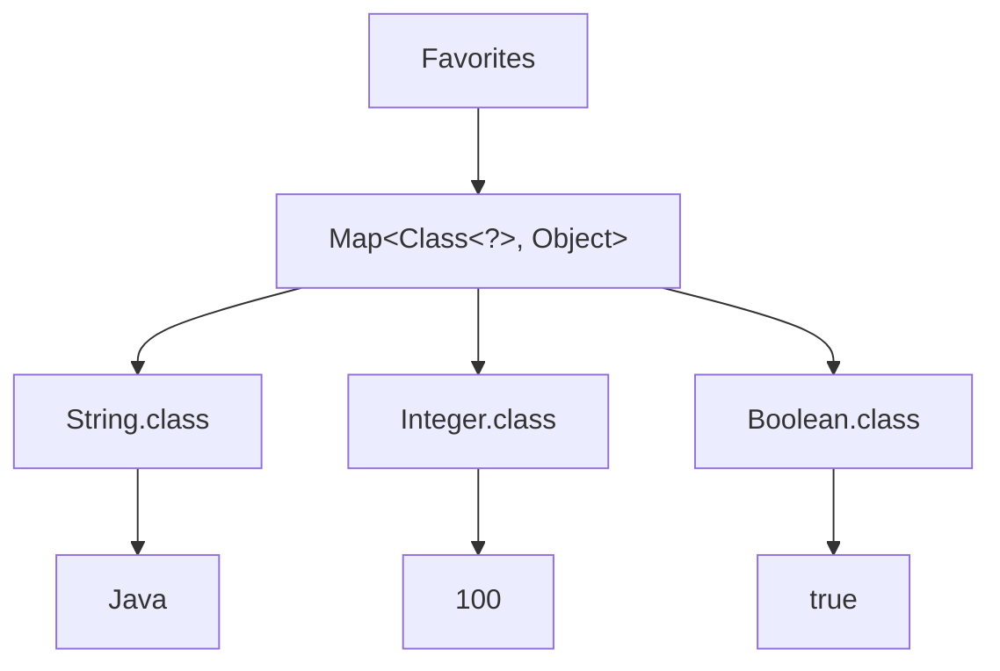

# 아이템 33. 타입 안전 인종 컨테이너를 고려하라

# 아이템 33. 타입 안전 인종 컨테이너를 고려하라

* toc
{:toc}

---

## 아이템 33. 핵심 정리 - 타입 토큰을 사용한 타입 안전 이종 컨테이너

### 아이템 33. 타입 안전 이종 컨테이너를 고려하라

지금까지 제네릭을 사용하면서 가장 많이 접했던 형태는 `List<T>`, `Set<T>`, `Map<K, V>`와 같은 컨테이너였다.

```java
List<String> names = new ArrayList<>();

Set<Integer> numbers = new HashSet<>();

Map<String, Integer> scores = new HashMap<>();
```

이러한 컨테이너에는 공통점이 있다.

**컨테이너를 선언하는 시점에 어떤 타입을 저장할 것인지 결정한다는 것**이다.

예를 들어 다음과 같이 선언하면

```java
List<String> names = new ArrayList<>();
```

해당 리스트에는 `String` 타입의 값만 추가할 수 있다.

```java
names.add("Java");
names.add("Spring");
```

반면 다음 코드는 컴파일되지 않는다.

```java
names.add(100); // 컴파일 오류
```

`List<String>`의 원소 타입은 `String`이기 때문이다.

이처럼 제네릭은 컴파일 시점에 타입을 검사하여 잘못된 값이 저장되는 것을 방지한다.

그런데 여기서 한 가지 궁금증이 생긴다.

**하나의 컨테이너에 서로 다른 타입의 값을 저장하면서도 타입 안전성을 유지할 수는 없을까?**

예를 들어 다음과 같은 값을 하나의 저장소에서 관리하고 싶다고 생각해보자.

```text
String 타입  → "Java"

Integer 타입 → 100

Boolean 타입 → true

LocalDate 타입 → 2026-10-13
```

단순히 여러 타입을 저장하는 것만으로는 어렵지 않다.

`Object`를 사용하면 된다.

하지만 값을 꺼낼 때마다 직접 형변환해야 하거나, 잘못된 타입의 값을 저장해도 컴파일러가 발견하지 못한다면 제네릭을 사용하는 의미가 줄어든다.

이번 아이템에서는 이러한 문제를 해결하는 **타입 안전 이종 컨테이너(Type Safe Heterogeneous Container)** 패턴을 살펴본다.

---

### 이종 컨테이너란 무엇인가?

먼저 이름부터 이해해보자.

이종(Heterogeneous)은 서로 다른 종류를 의미한다.

반대로 동종(Homogeneous)은 같은 종류를 의미한다.

따라서 이종 컨테이너는 말 그대로 **서로 다른 타입의 값을 함께 저장할 수 있는 컨테이너**다.

예를 들어 다음과 같은 구조를 생각할 수 있다.

```text
Favorites
    │
    ├── String  → "Java"
    │
    ├── Integer → 100
    │
    ├── Boolean → true
    │
    └── LocalDate → 2026-10-13
```

일반적인 제네릭 컨테이너는 컨테이너의 타입 매개변수를 기준으로 저장 가능한 값을 제한한다.

```java
List<String>
```

반면 타입 안전 이종 컨테이너는 각각의 항목이 서로 다른 타입을 가질 수 있도록 설계한다.

여기서 중요한 것은 단순히 여러 타입을 담는다는 사실이 아니다.

**각 항목에 저장하는 값의 타입과 꺼내는 값의 타입을 컴파일러가 연결할 수 있어야 한다.**

이 조건까지 만족해야 타입 안전 이종 컨테이너라고 부를 수 있다.

---

### 기존 제네릭 컨테이너와의 차이

일반적인 제네릭 클래스를 하나 만들어보자.

```java
public class Favorites<T> {

    private T favorite;

    public void setFavorite(T favorite) {
        this.favorite = favorite;
    }

    public T getFavorite() {
        return favorite;
    }
}
```

사용 방법은 간단하다.

```java
Favorites<String> favorites = new Favorites<>();

favorites.setFavorite("Java");

String favorite = favorites.getFavorite();
```

문제는 이 `Favorites` 객체가 `String` 타입으로 고정되어 있다는 점이다.

```java
favorites.setFavorite(100); // 컴파일 오류
```

숫자를 저장하고 싶다면 새로운 객체가 필요하다.

```java
Favorites<Integer> numberFavorites = new Favorites<>();

numberFavorites.setFavorite(100);
```

결과적으로 다음과 같은 구조가 만들어진다.

```text
Favorites<String>
    └── "Java"

Favorites<Integer>
    └── 100

Favorites<Boolean>
    └── true
```

각각의 컨테이너는 타입 안전하다.

하지만 하나의 컨테이너에 여러 타입을 함께 저장하는 구조는 아니다.

이번에는 하나의 `Favorites` 객체가 여러 타입의 값을 저장하도록 만들어보자.

---

### 가장 먼저 생각할 수 있는 방법은 Map이다

서로 다른 타입의 값을 하나의 컨테이너에 저장하려면 `Map`을 떠올릴 수 있다.

예를 들어 다음과 같다.

```java
public class Favorites {

    private final Map<Class<?>, Object> favorites =
            new HashMap<>();
}
```

여기에서 처음 보는 형태가 등장한다.

```java
Map<Class<?>, Object>
```

구조를 하나씩 살펴보자.

`Map`은 Key와 Value를 저장한다.

```text
Key → Value
```

우리는 각 타입별로 하나의 값을 저장하고 싶다.

따라서 Key는 타입을 나타내는 `Class` 객체로 정한다.

```java
Class<?>
```

Value는 `String`, `Integer`, `Boolean` 등 여러 타입이 올 수 있으므로 `Object`를 사용한다.

```java
Object
```

결국 다음과 같은 구조다.

```text
Map<Class<?>, Object>
        │
        ├── String.class  → "Java"
        │
        ├── Integer.class → 100
        │
        └── Boolean.class → true
```

이렇게 하면 하나의 `Map`에 서로 다른 타입의 값을 저장할 수 있다.

그런데 아직 문제가 남아 있다.

---

### Map<Class<?>, Object>만으로는 타입 안전하지 않다

다음과 같이 저장 메서드를 만들어보자.

```java
public void putFavorite(Class<?> type, Object value) {
    favorites.put(type, value);
}
```

사용할 때는 다음과 같다.

```java
favorites.putFavorite(String.class, "Java");

favorites.putFavorite(Integer.class, 100);
```

여기까지는 정상적으로 동작한다.

그런데 다음 코드도 허용된다.

```java
favorites.putFavorite(String.class, 100);
```

`String.class`를 Key로 전달했는데 실제 Value는 `Integer`다.

컴파일러는 이 코드를 막지 못한다.

왜냐하면 메서드의 매개변수가 다음과 같기 때문이다.

```java
Class<?> type

Object value
```

첫 번째 매개변수는 어떤 타입을 나타내는 `Class` 객체든 받을 수 있다.

두 번째 매개변수는 어떤 객체든 받을 수 있다.

**두 매개변수 사이에 아무런 타입 관계가 선언되어 있지 않다.**

따라서 `String.class`와 `Integer`가 함께 전달되어도 컴파일러는 잘못된 호출이라는 사실을 알 수 없다.

---

### 조회할 때도 문제가 발생한다

다음과 같은 조회 메서드를 생각해보자.

```java
public Object getFavorite(Class<?> type) {
    return favorites.get(type);
}
```

호출하는 쪽에서는 원하는 타입으로 직접 형변환해야 한다.

```java
String favorite =
        (String) favorites.getFavorite(String.class);
```

매번 형변환이 필요하다.

더 큰 문제는 잘못된 형변환도 컴파일할 수 있다는 것이다.

```java
Integer favorite =
        (Integer) favorites.getFavorite(String.class);
```

컴파일은 가능하지만 실제 값이 문자열이라면 런타임에 `ClassCastException`이 발생한다.

따라서 단순히

```java
Map<Class<?>, Object>
```

를 사용한다고 해서 타입 안전 이종 컨테이너가 완성되는 것은 아니다.

**Key와 Value 사이에 타입 관계를 만들어주는 과정이 필요하다.**

---

### 해결 방법은 제네릭 타입을 컨테이너가 아닌 메서드에 선언하는 것이다

지금까지 많이 사용했던 방법은 클래스 자체에 타입 매개변수를 선언하는 방식이었다.

```java
public class Favorites<T> {
}
```

이렇게 하면 `Favorites<String>`처럼 객체 전체가 하나의 타입으로 고정된다.

하지만 이번에는 다르게 접근한다.

`Favorites` 클래스 자체에는 타입 매개변수를 선언하지 않는다.

대신 값을 저장하거나 조회하는 **각각의 메서드에 타입 매개변수를 선언한다.**

```java
public <T> void putFavorite(Class<T> type, T instance)
```

이 코드가 이번 패턴에서 가장 중요한 부분이다.

처음 보면 조금 복잡하지만 우리가 이미 익숙하게 사용했던 제네릭 메서드다.

---

### Class<T>와 T의 관계를 이해하자

다음 선언을 다시 보자.

```java
public <T> void putFavorite(
        Class<T> type,
        T instance
)
```

여기에는 같은 타입 매개변수 `T`가 두 번 등장한다.

```java
Class<T> type
```

그리고

```java
T instance
```

이다.

이 둘은 서로 독립적인 타입이 아니다.

**같은 `T`를 공유한다는 것이 중요하다.**

예를 들어 다음과 같이 호출한다.

```java
putFavorite(String.class, "Java");
```

`String.class`의 타입은 `Class<String>`이다.

따라서 컴파일러는 `T`를 `String`으로 추론한다.

개념적으로 다음과 같다.

```text
putFavorite(
    Class<String>,
    String
)
```

반대로 `Integer.class`를 전달하면 다음 관계가 만들어진다.

```text
putFavorite(
    Class<Integer>,
    Integer
)
```

즉 첫 번째 매개변수로 전달하는 타입과 두 번째 값의 타입이 연결된다.

이제 다음 코드를 보자.

```java
putFavorite(String.class, 100);
```

첫 번째 매개변수는 `Class<String>`이다.

따라서 `T`는 `String`이어야 한다.

그런데 두 번째 매개변수는 `Integer`다.

타입이 맞지 않는다.

따라서 컴파일 오류가 발생한다.

이렇게 **제네릭 메서드의 타입 매개변수를 이용해 서로 다른 인자 사이의 타입 관계를 강제할 수 있다.**

---

### Class<T>는 어떤 클래스일까?

여기서 `Class<T>`를 조금 더 자세히 알아볼 필요가 있다.

Java의 모든 객체는 런타임에 자신이 어떤 클래스의 인스턴스인지에 관한 정보를 가지고 있다.

이러한 클래스 정보를 표현하는 객체가 `Class`다.

예를 들어 다음과 같다.

```java
Class<String> stringClass = String.class;

Class<Integer> integerClass = Integer.class;

Class<Boolean> booleanClass = Boolean.class;
```

여기서

```java
String.class
```

는 문자열 `"String"`을 반환하는 것이 아니다.

`String`이라는 클래스에 대한 정보를 표현하는 `Class` 객체다.

그리고 그 표현식의 컴파일타임 타입은 다음과 같다.

```java
Class<String>
```

`Integer.class` 역시 다음 타입을 가진다.

```java
Class<Integer>
```

이러한 클래스 리터럴을 타입 정보로 활용할 수 있다.

---

### 타입 토큰(Type Token)이란?

다음 코드를 생각해보자.

```java
favorites.putFavorite(String.class, "Java");
```

여기서 `String.class`는 단순히 Map의 Key로만 사용되는 것이 아니다.

메서드에 다음 사실을 알려준다.

> 내가 지금 저장하려는 값의 타입은 String이다.

이처럼 **타입을 나타내는 객체를 전달해 타입 정보를 표현하는 방식**을 타입 토큰(Type Token)이라고 한다.

이번 예제에서 타입 토큰은 다음과 같다.

```java
String.class
Integer.class
Boolean.class
```

타입 토큰을 매개변수로 받으면 메서드가 어떤 타입을 다루어야 하는지 알 수 있다.

```java
public <T> void putFavorite(
        Class<T> type,
        T instance
)
```

여기서 `Class<T>`는 타입 토큰의 역할을 하고, `T instance`는 해당 타입의 값을 나타낸다.

---

### 타입 토큰을 사용한 Favorites 구현

이제 실제 클래스를 만들어보자.

```java
import java.util.HashMap;
import java.util.Map;

public class Favorites {

    private final Map<Class<?>, Object> favorites =
            new HashMap<>();

    public <T> void putFavorite(
            Class<T> type,
            T instance
    ) {
        favorites.put(type, instance);
    }

    public <T> T getFavorite(Class<T> type) {
        // 구현 예정
        return null;
    }
}
```

저장 메서드부터 살펴보자.

```java
public <T> void putFavorite(
        Class<T> type,
        T instance
)
```

메서드 선언에서 Key와 Value의 타입 관계를 표현했다.

하지만 실제 Map은 여전히 다음과 같다.

```java
Map<Class<?>, Object>
```

이것이 가능한 이유는 `Class<T>`를 `Class<?>`로 사용할 수 있고, 모든 참조 타입의 객체를 `Object`로 저장할 수 있기 때문이다.

```text
putFavorite(String.class, "Java")
             │             │
             ▼             ▼
      Class<String>       String
             │             │
             ▼             ▼
         Class<?>        Object
             │             │
             └──────┬──────┘
                    ▼
                 Map 저장
```

여기서 중요한 특징이 있다.

Map 자체는 Key와 Value의 타입 관계를 표현하지 못한다.

하지만 Map에 접근하는 메서드가 그 관계를 검사하도록 만들면 외부에서 사용할 때 타입 안전성을 확보할 수 있다.

---

### 값을 조회할 때는 어떻게 해야 할까?

이번에는 저장한 값을 조회하는 메서드를 구현해보자.

```java
public <T> T getFavorite(Class<T> type) {
    return favorites.get(type);
}
```

이렇게 작성하면 컴파일되지 않는다.

왜냐하면

```java
favorites.get(type)
```

의 반환 타입은 `Object`이기 때문이다.

반면 메서드의 반환 타입은

```java
T
```

다.

Java 컴파일러는 `Object`를 무조건 `T`로 반환해도 안전하다고 판단할 수 없다.

우리는 앞에서 `Class<T>`에 맞는 값만 저장했으니 안전할 것이라고 생각할 수 있다.

하지만 컴파일러는 `Map<Class<?>, Object>` 내부에 어떤 관계가 유지되는지 알지 못한다.

따라서 명시적으로 타입을 처리해야 한다.

---

### 첫 번째 방법: 직접 형변환하기

가장 단순한 방법은 형변환이다.

```java
@SuppressWarnings("unchecked")
public <T> T getFavorite(Class<T> type) {
    return (T) favorites.get(type);
}
```

이 코드는 동작할 수 있다.

하지만 다음 부분에서 비검사 형변환 경고가 발생한다.

```java
(T) favorites.get(type)
```

컴파일러가 실제 객체가 `T` 타입인지 검사할 수 없기 때문이다.

여기서 주의할 점이 있다.

`T`의 상위 경계가 없는 경우 타입 소거 후 `T`는 기본적으로 `Object`로 다뤄진다.

따라서 `(T)`라는 코드를 작성했다고 해서 런타임에 반드시 우리가 기대하는 `String`, `Integer` 등의 구체적인 타입으로 검사하는 것은 아니다.

잘못된 객체가 저장되어 있다면 이후 호출자가 반환값을 사용하는 과정에서 `ClassCastException`이 발생할 수도 있다.

이런 비검사 형변환을 피하는 더 좋은 방법이 있다.

---

### 두 번째 방법: Class.cast() 사용하기

`Class`에는 다음 메서드가 있다.

```java
public T cast(Object obj)
```

이 메서드는 전달받은 객체를 해당 `Class`가 표현하는 타입으로 형변환한다.

예를 들어 다음과 같다.

```java
Object value = "Java";

String result = String.class.cast(value);
```

`String.class`는 `String` 타입을 나타내는 `Class` 객체다.

따라서 `cast()`는 전달된 객체가 `String`으로 변환 가능한지 런타임에 확인한다.

실제 값이 문자열이므로 정상적으로 반환한다.

반면 다음 코드를 보자.

```java
Object value = 100;

String result = String.class.cast(value);
```

이 경우에는 `ClassCastException`이 발생한다.

실제 객체는 `Integer`인데 `String`으로 변환하려고 했기 때문이다.

`Class.cast()`는 타입 토큰을 이용해 런타임 형변환 검사를 수행한다.

---

### getFavorite()에 Class.cast()를 적용해보자

이제 조회 메서드를 다음처럼 수정할 수 있다.

```java
public <T> T getFavorite(Class<T> type) {
    return type.cast(favorites.get(type));
}
```

코드는 짧지만 중요한 동작이 들어 있다.

먼저 Map에서 값을 꺼낸다.

```java
favorites.get(type)
```

반환 타입은 `Object`다.

그다음

```java
type.cast(...)
```

를 호출한다.

`type`이 `String.class`라면 실제 객체를 `String`으로 변환할 수 있는지 검사한다.

`type`이 `Integer.class`라면 `Integer`로 변환할 수 있는지 검사한다.

그리고 `Class<T>.cast()`의 반환 타입은 `T`이므로 메서드에서도 그대로 반환할 수 있다.

결과적으로 다음처럼 사용할 수 있다.

```java
String language =
        favorites.getFavorite(String.class);

Integer number =
        favorites.getFavorite(Integer.class);
```

호출자가 직접 형변환할 필요가 없다.

---

### 지금까지의 Favorites 전체 코드

여기까지 구현하면 다음과 같다.

```java
import java.util.HashMap;
import java.util.Map;
import java.util.Objects;

public class Favorites {

    private final Map<Class<?>, Object> favorites =
            new HashMap<>();

    public <T> void putFavorite(
            Class<T> type,
            T instance
    ) {
        Objects.requireNonNull(type);

        favorites.put(type, instance);
    }

    public <T> T getFavorite(Class<T> type) {
        Objects.requireNonNull(type);

        return type.cast(favorites.get(type));
    }
}
```

`Objects.requireNonNull(type)`은 타입 토큰으로 `null`이 전달되는 것을 방지한다.

```java
Objects.requireNonNull(type);
```

`null`을 전달하면 즉시 `NullPointerException`이 발생한다.

타입 토큰은 저장과 조회의 기준이 되므로 유효한 `Class` 객체를 전달하도록 제한하는 편이 명확하다.

---

### 실제로 사용해보자

다음과 같이 다양한 타입의 값을 하나의 `Favorites`에 저장할 수 있다.

```java
Favorites favorites = new Favorites();

favorites.putFavorite(
        String.class,
        "Java"
);

favorites.putFavorite(
        Integer.class,
        100
);

favorites.putFavorite(
        Boolean.class,
        true
);
```

조회할 때도 타입을 직접 지정할 필요가 없다.

```java
String language =
        favorites.getFavorite(String.class);

Integer number =
        favorites.getFavorite(Integer.class);

Boolean enabled =
        favorites.getFavorite(Boolean.class);
```

출력하면 다음과 같다.

```text
Java
100
true
```

여기서 중요한 것은 다음 세 가지다.

첫 번째는 **하나의 컨테이너에 서로 다른 타입을 저장했다는 것**이다.

두 번째는 **값을 저장할 때 타입이 일치하는지 컴파일러가 검사한다는 것**이다.

세 번째는 **값을 조회할 때 명시적인 형변환 없이 원하는 타입으로 반환받는다는 것**이다.

이 세 가지가 타입 안전 이종 컨테이너의 핵심이다.

---

### 그런데 Map은 여전히 Object를 사용한다

여기서 한 가지 의문이 들 수 있다.

타입 안전하게 만들었다고 했는데 실제 내부 구현은 여전히 다음과 같다.

```java
Map<Class<?>, Object>
```

Map의 Value가 `Object`라면 결국 타입 안전하지 않은 것 아닐까?

이 부분이 이번 패턴을 이해하는 데 가장 중요하다.

일반적으로 `Map<K, V>`는 모든 Entry에 대해 같은 `K`, `V` 타입 관계를 적용한다.

```java
Map<String, Integer>
```

라면 모든 Key가 `String`이고 모든 Value가 `Integer`다.

하지만 우리가 원하는 구조는 다음과 같다.

```text
String.class  → String

Integer.class → Integer

Boolean.class → Boolean
```

Entry마다 Value 타입이 달라진다.

일반적인 `Map<K, V>` 선언만으로는

> Key가 `Class<String>`이면 Value는 String이고, Key가 `Class<Integer>`이면 Value는 Integer여야 한다.

라는 관계를 표현하기 어렵다.

그래서 내부 저장소에는 `Object`를 사용한다.

대신 외부에서 접근할 수 있는 메서드에 제네릭 타입 관계를 선언한다.

```java
<T> void putFavorite(Class<T> type, T instance)
```

```java
<T> T getFavorite(Class<T> type)
```

즉 **타입 안전성은 Map 선언 자체가 아니라 Map을 감싸고 있는 제네릭 API에서 확보한다.**

---

### 컨테이너가 아니라 Key를 매개변수화한다

일반적인 제네릭 컨테이너는 다음과 같다.

```java
Favorites<String>
```

`Favorites` 전체의 타입이 `String`으로 결정된다.

반면 타입 안전 이종 컨테이너는 다음과 같다.

```java
Favorites favorites = new Favorites();
```

컨테이너 자체에는 타입 매개변수가 없다.

대신 각각의 저장과 조회 작업에서 타입 토큰을 전달한다.

```java
favorites.putFavorite(String.class, "Java");

favorites.putFavorite(Integer.class, 100);
```

관계는 다음과 같다.



하나의 컨테이너에 여러 타입의 값이 들어 있지만, 각 항목의 Key는 어떤 타입의 값을 저장해야 하는지 나타낸다.

이것이 일반적인 제네릭 컨테이너와의 가장 큰 차이다.

---

### 타입 안전성을 깨뜨릴 수 있는 방법도 있다

여기까지 보면 완벽한 구조처럼 느껴질 수 있다.

하지만 Java 제네릭에는 타입 안전성을 우회할 수 있는 방법이 존재한다.

대표적인 것이 Raw Type이다.

앞에서 다음 호출은 컴파일되지 않는다고 했다.

```java
favorites.putFavorite(String.class, 100);
```

`String.class`는 `Class<String>`이고, 두 번째 인자는 `Integer`이기 때문이다.

그런데 다음처럼 작성하면 어떨까?

```java
Class rawType = String.class;

favorites.putFavorite(rawType, 100);
```

`Class<String>` 대신 Raw Type인 `Class`를 사용했다.

이 경우 컴파일러가 비검사 호출 경고를 발생시키지만, 컴파일 자체는 허용할 수 있다.

즉 Raw Type을 통해 제네릭의 타입 관계를 우회한 것이다.

이제 내부 Map에는 다음과 같은 값이 저장될 수 있다.

```text
String.class → 100
```

원래 의도했던 관계가 깨졌다.

---

### Raw Type이 왜 위험할까?

다음 코드를 다시 보자.

```java
Class rawType = String.class;
```

원래 `String.class`는 다음 타입을 가진다.

```java
Class<String>
```

하지만 Raw Type으로 사용하면 제네릭 타입 인수에 관한 검사를 우회할 수 있다.

따라서 다음 호출도 컴파일 경고와 함께 허용될 수 있다.

```java
favorites.putFavorite(rawType, 100);
```

이것은 Java 제네릭이 잘못 설계되었다는 의미가 아니다.

Java는 오래된 코드와의 호환성을 위해 Raw Type을 허용한다.

다만 Raw Type을 사용하는 순간 제네릭이 제공하는 일부 타입 안전성을 포기하게 된다.

타입 안전 이종 컨테이너 역시 이런 우회까지 컴파일 시점에 완전히 막을 수는 없다.

---

### 잘못된 값은 언제 문제가 될까?

현재 저장 메서드는 다음과 같다.

```java
public <T> void putFavorite(
        Class<T> type,
        T instance
) {
    Objects.requireNonNull(type);

    favorites.put(type, instance);
}
```

Raw Type을 통해 다음 값을 저장했다고 생각해보자.

```text
Key   = String.class

Value = Integer(100)
```

저장하는 순간에는 단순히 Map에 값을 넣는다.

```java
favorites.put(type, instance);
```

따라서 잘못된 값이 그대로 저장될 수 있다.

그런 다음 조회한다.

```java
String favorite =
        favorites.getFavorite(String.class);
```

조회 메서드는 다음과 같다.

```java
public <T> T getFavorite(Class<T> type) {
    return type.cast(favorites.get(type));
}
```

이때 Map에서 반환한 실제 객체는 `Integer`다.

하지만 타입 토큰은 `String.class`다.

따라서 다음 과정에서 문제가 발생한다.

```text
String.class로 조회
         │
         ▼
Map에서 Object 반환
         │
         ▼
실제 객체는 Integer
         │
         ▼
String.class.cast(...)
         │
         ▼
ClassCastException
```

즉 저장할 때 발생한 잘못된 타입 관계가 조회하는 순간에 드러난다.

---

### 잘못된 값을 저장할 때 바로 확인할 수는 없을까?

가능하다.

앞에서 조회할 때 사용했던 `Class.cast()`를 저장할 때도 사용하면 된다.

기존 코드는 다음과 같았다.

```java
public <T> void putFavorite(
        Class<T> type,
        T instance
) {
    Objects.requireNonNull(type);

    favorites.put(type, instance);
}
```

이제 다음처럼 변경해보자.

```java
public <T> void putFavorite(
        Class<T> type,
        T instance
) {
    Objects.requireNonNull(type);

    favorites.put(
            type,
            type.cast(instance)
    );
}
```

차이는 단 한 줄이다.

```java
type.cast(instance)
```

값을 저장하기 전에 실제 객체가 타입 토큰과 호환되는지 검사한다.

---

### 저장 시점에 검사하면 무엇이 좋아질까?

다음과 같은 잘못된 호출을 생각해보자.

```java
Class rawType = String.class;

favorites.putFavorite(rawType, 100);
```

이번에는 저장 메서드 내부에서 먼저 다음 코드가 실행된다.

```java
type.cast(instance)
```

실제 값은 `Integer`다.

타입 토큰은 `String.class`다.

따라서 저장 시점에 `ClassCastException`이 발생한다.

```text
putFavorite(...)
       │
       ▼
String.class
       │
       ▼
Integer(100)
       │
       ▼
String.class.cast(100)
       │
       ▼
ClassCastException
```

잘못된 값이 Map에 저장되기 전에 오류를 발견할 수 있다.

이전에는 조회할 때 문제가 드러났지만 이제는 저장하는 시점에 확인할 수 있는 것이다.

---

### 오류는 가능한 한 빨리 발견하는 편이 좋다

실무에서 오류가 발생한 시점과 원인이 만들어진 시점이 멀어지면 문제를 추적하기 어려워진다.

예를 들어 잘못된 값을 저장한 코드와 조회하는 코드가 서로 다른 계층에 있다고 생각해보자.

```text
Service A

잘못된 값 저장
        │
        │
        ▼
여러 비즈니스 로직 수행
        │
        │
        ▼
Service B

값 조회
        │
        ▼
ClassCastException
```

실제로는 Service A가 잘못된 값을 저장했는데 예외는 Service B에서 발생한다.

반면 저장할 때 바로 검사한다면 문제를 만든 위치에서 오류를 발견할 수 있다.

```text
Service A

잘못된 값 저장 시도
        │
        ▼
Class.cast()
        │
        ▼
즉시 ClassCastException
```

따라서 타입 안전성의 관점뿐 아니라 장애 원인을 빠르게 파악하는 관점에서도 저장 시점의 검사가 도움이 된다.

---

### 조금 더 안전하게 개선한 Favorites

이제 지금까지 살펴본 내용을 모두 적용해보자.

```java
import java.util.HashMap;
import java.util.Map;
import java.util.Objects;

public final class Favorites {

    private final Map<Class<?>, Object> favorites =
            new HashMap<>();

    public <T> void putFavorite(
            Class<T> type,
            T instance
    ) {
        Objects.requireNonNull(type);

        favorites.put(
                type,
                type.cast(instance)
        );
    }

    public <T> T getFavorite(Class<T> type) {
        Objects.requireNonNull(type);

        return type.cast(
                favorites.get(type)
        );
    }
}
```

이 구현에서 중요한 부분은 세 가지다.

첫 번째는 다음 Map이다.

```java
Map<Class<?>, Object>
```

서로 다른 타입의 값을 하나의 저장소에 보관한다.

두 번째는 제네릭 메서드다.

```java
<T> void putFavorite(Class<T> type, T instance)
```

Key가 나타내는 타입과 Value 타입의 관계를 컴파일러가 검사하도록 만든다.

세 번째는 `Class.cast()`다.

```java
type.cast(instance)
```

```java
type.cast(favorites.get(type))
```

Raw Type 등으로 정적 타입 검사가 우회된 경우에도 런타임에 실제 객체 타입을 검사할 수 있다.

물론 이것이 모든 잘못된 코드의 컴파일을 막는다는 뜻은 아니다.

Raw Type을 사용하면 여전히 컴파일 경고와 함께 타입 검사를 우회할 수 있다.

다만 잘못된 값이 저장되거나 반환되는 상황을 런타임에 확인하여 위험을 줄일 수 있다.

---

### Class.cast()와 일반 형변환은 무엇이 다를까?

다음 두 코드를 비교해보자.

```java
(T) value
```

그리고

```java
type.cast(value)
```

둘 다 형변환처럼 보이지만 차이가 있다.

`(T)`는 제네릭 타입 매개변수에 대한 형변환이다.

Java의 타입 소거 때문에 컴파일러가 `T`의 구체적인 런타임 타입을 항상 확인할 수 있는 것은 아니다.

따라서 비검사 형변환 경고가 발생할 수 있다.

반면

```java
type.cast(value)
```

는 실제 `Class` 객체를 이용한다.

예를 들어

```java
String.class.cast(value)
```

라면 `String.class`라는 런타임 타입 정보가 존재한다.

이 정보를 이용해 객체가 `String` 인스턴스인지 검사할 수 있다.

| 구분         | `(T) value`             | `type.cast(value)`       |
| ---------- | ----------------------- | ------------------------ |
| 타입 정보      | 타입 매개변수 `T`             | 실제 `Class<T>` 객체         |
| 타입 소거 영향   | 구체적인 T를 검사하지 못할 수 있음    | Class가 표현하는 런타임 타입 검사 가능 |
| 비검사 형변환 경고 | 발생 가능                   | 일반적으로 필요 없음              |
| 잘못된 객체 처리  | 이후 사용 지점에서 오류가 드러날 수 있음 | `cast()` 호출 지점에서 오류 발생   |
| 대표 용도      | 타입 관계가 별도로 보장되는 내부 코드   | 런타임 타입 토큰을 이용한 형변환       |

따라서 타입 토큰을 이미 가지고 있다면 단순한 비검사 형변환보다 `Class.cast()`를 사용하는 편이 의도를 명확하게 표현할 수 있다.

---

### 그런데 타입 안전 이종 컨테이너에도 한계가 있다

여기까지 구현하면 상당히 유연한 컨테이너를 얻을 수 있다.

하지만 아직 해결하지 못한 문제가 하나 있다.

바로 **매개변수화 타입(Parameterized Type)** 이다.

예를 들어 다음 두 타입을 생각해보자.

```java
List<String>
```

```java
List<Integer>
```

둘 다 `List`지만 원소 타입이 다르다.

우리는 다음과 같은 값을 저장하고 싶을 수 있다.

```text
List<String>  → ["Java", "Spring"]

List<Integer> → [1, 2, 3]
```

서로 다른 타입이므로 각각 구분해서 저장하고 싶다.

그런데 현재 `Favorites` 구조에서는 문제가 생긴다.

---

### List.class는 사용할 수 있다

다음 코드는 가능하다.

```java
Class<List> listType = List.class;
```

그리고 다음처럼 사용할 수도 있다.

```java
favorites.putFavorite(
        List.class,
        List.of("Java", "Spring")
);
```

문제는 다른 원소 타입을 가진 리스트도 똑같은 타입 토큰을 사용한다는 것이다.

```java
favorites.putFavorite(
        List.class,
        List.of(1, 2, 3)
);
```

두 호출의 Key는 모두 다음과 같다.

```java
List.class
```

따라서 두 번째 값이 첫 번째 값을 덮어쓴다.

```text
첫 번째 저장

List.class
    → ["Java", "Spring"]


두 번째 저장

List.class
    → [1, 2, 3]
```

Map에서는 동일한 Key에 새로운 값을 저장하면 기존 값이 교체된다.

따라서 `List<String>`과 `List<Integer>`를 구분하지 못한다.

---

### List<String>.class를 사용하면 되지 않을까?

가장 먼저 떠오르는 방법은 다음과 같다.

```java
List<String>.class
```

그리고

```java
List<Integer>.class
```

를 서로 다른 Key로 사용하는 것이다.

하지만 Java에서는 이런 문법을 허용하지 않는다.

```java
Class<List<String>> stringListType =
        List<String>.class; // 컴파일 오류
```

Java의 클래스 리터럴 문법은 매개변수화 타입에 대해 이러한 형태를 지원하지 않는다.

사용할 수 있는 것은 다음과 같은 형태다.

```java
List.class
```

왜 그럴까?

이 부분은 Java 제네릭의 타입 소거와 관련이 있다.

---

### 타입 소거 때문에 두 List는 같은 런타임 클래스를 가진다

다음 두 객체를 생각해보자.

```java
List<String> strings =
        new ArrayList<>();

List<Integer> integers =
        new ArrayList<>();
```

컴파일러는 두 변수의 제네릭 타입이 다르다는 사실을 알고 있다.

```text
List<String>

List<Integer>
```

하지만 런타임에 다음과 같이 확인해보면 어떨까?

```java
System.out.println(
        strings.getClass() == integers.getClass()
);
```

결과는 다음과 같다.

```text
true
```

두 객체 모두 실제로는 `ArrayList` 인스턴스이기 때문이다.

Java는 일반적인 제네릭 타입 인수를 런타임에 서로 다른 클래스 객체로 실체화하지 않는다.

따라서 `List<String>`과 `List<Integer>`라는 차이를 `Class` 객체 하나만으로 표현할 수 없다.

---

### Class<?>는 모든 제네릭 타입 정보를 표현하지 못한다

현재 우리가 사용한 타입 토큰은 다음과 같다.

```java
Class<T>
```

이 방식은 `String`, `Integer`, `Boolean` 같은 타입을 표현하기에 적합하다.

하지만 다음처럼 타입 인수를 포함하는 전체 타입 구조를 표현하기에는 한계가 있다.

```java
List<String>
```

```java
Map<String, Integer>
```

```java
List<Map<String, Integer>>
```

이런 타입은 단순히 클래스 하나만으로는 충분히 구분할 수 없다.

예를 들어

```java
Map<String, Integer>
```

와

```java
Map<String, Long>
```

은 둘 다 `Map.class`라는 클래스 리터럴을 공유한다.

하지만 논리적으로는 서로 다른 제네릭 타입이다.

이 차이를 표현하려면 `Class`보다 더 풍부한 타입 정보가 필요하다.

---

### Class.cast()도 제네릭 원소 타입까지 검사하지는 못한다

여기서 한 가지 더 구분해야 한다.

앞에서는 `Class.cast()`를 사용하면 런타임에 타입을 검사할 수 있다고 했다.

하지만 그 검사는 `Class` 객체가 표현할 수 있는 수준까지만 가능하다.

예를 들어 다음과 같다.

```java
Object value =
        List.of(1, 2, 3);

List result =
        List.class.cast(value);
```

이 코드는 정상적으로 동작한다.

실제 객체가 `List`이기 때문이다.

하지만 이 List의 원소가 `String`인지 `Integer`인지까지 검사한 것은 아니다.

```java
List.class
```

에는 원소 타입에 대한 정보가 없다.

따라서 `Class.cast()`를 사용한다고 해서 `List<String>`과 `List<Integer>`를 런타임에 구분할 수 있게 되는 것은 아니다.

**타입 토큰의 표현 능력 자체에 한계가 있는 것이다.**

---

### 더 풍부한 타입 정보를 표현하려면?

우리가 정말 원하는 것은 다음과 같은 구분이다.

```text
List<String>
    ≠
List<Integer>
```

단순히 `List.class`라는 클래스 객체만 사용하는 것이 아니라

```text
List
  └── String
```

과

```text
List
  └── Integer
```

라는 전체 타입 구조를 표현하고 싶은 것이다.

이 문제를 해결하는 대표적인 아이디어가 **슈퍼 타입 토큰(Super Type Token)** 이다.

슈퍼 타입 토큰은 제네릭 타입 정보가 선언된 상위 타입의 메타데이터를 활용해 `List<String>`처럼 타입 인수가 포함된 구조를 표현하는 방식이다.

다만 이 방식 역시 Java의 타입 소거 자체를 없애는 것은 아니다.

런타임에 객체를 검사할 때 `List<String>`의 모든 원소가 실제로 `String`인지 자동으로 검증해준다는 의미도 아니다.

슈퍼 타입 토큰이 제공하는 것은 **`Class`만으로 표현하기 어려웠던 제네릭 타입 구조를 표현하고 전달할 수 있는 수단**이라고 이해하는 것이 좋다.

구체적인 사용 방법은 별도로 살펴볼 수 있다.

---

### 타입 안전 이종 컨테이너가 실무에서 유용한 경우

이 패턴은 모든 데이터를 저장하는 범용 저장소를 만들기 위한 기술이라기보다, **타입별로 서로 다른 객체를 등록하고 다시 조회해야 하는 상황**에서 유용하다.

예를 들어 애플리케이션 내부에 여러 종류의 설정값이 있다고 해보자.

```text
String  → 서비스 이름

Integer → 재시도 횟수

Boolean → 특정 기능 사용 여부
```

이 값들을 하나의 컨테이너에 저장하면서 조회할 때는 각 타입으로 안전하게 반환받고 싶을 수 있다.

또 다른 예로, 서로 다른 타입의 컴포넌트나 메타데이터를 등록하고 해당 클래스 타입을 기준으로 조회하는 레지스트리(Registry)를 생각해볼 수도 있다.

핵심은 Key로 사용하는 타입 정보가 해당 Value의 타입을 결정한다는 점이다.

물론 실제 업무에서는 같은 타입의 값을 여러 개 저장해야 하거나, 저장소의 생명주기 및 동시성 관리가 필요할 수도 있다.

그런 경우에는 단순히 `Favorites` 구조를 그대로 사용하기보다 Key 설계를 확장하거나 별도의 Registry 구조를 고려해야 한다.

---

### 타입 안전 이종 컨테이너를 사용할 때 주의할 점

#### 1. 하나의 타입당 하나의 값만 저장할 수 있다

현재 구현은 다음과 같다.

```java
Map<Class<?>, Object>
```

Key가 `Class` 객체이므로 같은 타입의 값을 다시 저장하면 이전 값이 덮어써진다.

```java
favorites.putFavorite(String.class, "Java");

favorites.putFavorite(String.class, "Spring");
```

이후 조회하면 다음 값이 나온다.

```java
favorites.getFavorite(String.class);
```

```text
Spring
```

따라서 이 컨테이너는 여러 타입을 저장할 수 있지만, 기본 구현에서는 각 타입당 하나의 값만 보관한다.

#### 2. Raw Type을 사용하면 타입 검사를 우회할 수 있다

다음 코드는 제네릭 타입 검사를 우회할 수 있다.

```java
Class rawType = String.class;

favorites.putFavorite(rawType, 100);
```

따라서 외부 API에서 제네릭 타입을 올바르게 사용하는 것이 중요하다.

추가로 `Class.cast()`를 이용하면 잘못된 값이 들어오는 상황을 런타임에 확인할 수 있다.

#### 3. Class 타입 토큰에는 한계가 있다

```java
List<String>
```

과

```java
List<Integer>
```

는 서로 다른 제네릭 타입이지만 둘을 구분하는 클래스 리터럴을 직접 사용할 수 없다.

따라서 매개변수화 타입 전체를 구분해야 하는 경우에는 다른 형태의 타입 토큰이 필요하다.

#### 4. 현재 구현은 동시성까지 보장하지 않는다

우리가 사용한 저장소는 다음과 같다.

```java
private final Map<Class<?>, Object> favorites =
        new HashMap<>();
```

`HashMap`은 동시 변경에 대해 스레드 안전성을 제공하지 않는다.

따라서 여러 스레드가 하나의 `Favorites` 객체를 동시에 수정하는 환경에서는 별도의 동시성 설계가 필요하다.

여기서 말하는 **타입 안전성(Type Safety)** 과 **스레드 안전성(Thread Safety)** 은 다른 개념이다.

---

### 일반 제네릭 컨테이너와 타입 안전 이종 컨테이너 비교

| 구분        | 일반 제네릭 컨테이너            | 타입 안전 이종 컨테이너           |
| --------- | ---------------------- | ----------------------- |
| 대표 형태     | `List<T>`, `Map<K, V>` | `Favorites`             |
| 타입 결정 기준  | 컨테이너의 타입 매개변수          | 항목별 타입 토큰               |
| 여러 타입 저장  | 선언된 타입 범위 내에서 가능       | 각 항목별로 다른 타입을 연결 가능     |
| 내부 저장소    | `List<T>` 등            | `Map<Class<?>, Object>` |
| 타입 관계 표현  | 컨테이너 선언                | 제네릭 메서드                 |
| 타입 안전성 확보 | 제네릭 타입 검사              | 제네릭 메서드와 타입 토큰          |
| 조회 시 형변환  | 일반적으로 불필요              | `Class.cast()`로 내부에서 처리 |
| 주요 제약     | 선언된 원소 타입으로 제한         | `Class`로 표현 가능한 타입에 제한  |

두 방식 중 하나가 무조건 더 좋은 것은 아니다.

일반적인 데이터 목록이나 집합을 다룰 때는 `List<T>`, `Set<T>` 같은 제네릭 컨테이너가 자연스럽다.

반면 서로 다른 타입을 하나의 저장소에 등록하고 타입을 Key로 조회하는 요구사항이 있다면 타입 안전 이종 컨테이너 패턴을 고려할 수 있다.

---

### 이번 패턴에서 기억해야 할 핵심

타입 안전 이종 컨테이너의 핵심은 단순히 `Map`을 사용했다는 사실이 아니다.

다음 코드에 있다.

```java
public <T> void putFavorite(
        Class<T> type,
        T instance
)
```

그리고

```java
public <T> T getFavorite(Class<T> type)
```

이다.

일반적인 제네릭 컨테이너에서는 타입 매개변수를 컨테이너에 선언한다.

```java
class Favorites<T>
```

반면 타입 안전 이종 컨테이너에서는 컨테이너 자체를 특정 타입으로 고정하지 않는다.

대신 각각의 메서드 호출에서 타입 매개변수를 결정한다.

```java
<T> void putFavorite(...)
```

이렇게 하면 같은 컨테이너에 `String`, `Integer`, `Boolean` 등 서로 다른 타입의 값을 저장할 수 있다.

그리고 `Class<T>` 타입 토큰을 이용해 각 값이 어떤 타입에 속하는지 표현한다.

결국 타입 안전 이종 컨테이너는 **제네릭 메서드, 타입 토큰, 런타임 타입 검사를 결합한 패턴**이라고 이해할 수 있다.

---

### 핵심 정리

* 일반적인 제네릭 컨테이너는 `List<T>`, `Set<T>`, `Map<K, V>`처럼 컨테이너 선언에서 타입 매개변수를 결정한다.
* 타입 안전 이종 컨테이너는 하나의 저장소에서 서로 다른 타입의 값을 관리하면서 각 항목의 타입 관계를 유지하도록 설계한 패턴이다.
* 이종(Heterogeneous)은 서로 다른 종류를 의미하며, 이종 컨테이너는 `String`, `Integer`, `Boolean` 등 서로 다른 타입의 값을 함께 저장할 수 있다.
* 단순히 `Map<Class<?>, Object>`를 사용하는 것만으로는 타입 안전성을 확보할 수 없다.
* `Class<?>`와 `Object`만 매개변수로 받으면 Key가 나타내는 타입과 Value 타입 사이의 관계가 없어 잘못된 값을 저장할 수 있다.
* 타입 안전 이종 컨테이너에서는 클래스 자체가 아니라 각각의 메서드에 타입 매개변수를 선언한다.
* `<T> void putFavorite(Class<T> type, T instance)`는 첫 번째 매개변수가 나타내는 타입과 두 번째 매개변수의 타입을 연결한다.
* `String.class`의 타입은 `Class<String>`이고 `Integer.class`의 타입은 `Class<Integer>`이므로 컴파일러는 각 호출의 `T`를 추론할 수 있다.
* `String.class`, `Integer.class`처럼 타입 정보를 나타내는 객체를 타입 토큰(Type Token)이라고 부른다.
* 타입 토큰을 이용하면 컴파일 시점의 제네릭 타입 관계를 표현하는 동시에 런타임에 실제 클래스 정보를 사용할 수 있다.
* 내부 저장소는 `Map<Class<?>, Object>`이므로 조회할 때 반환되는 값의 타입은 `Object`다.
* `getFavorite(Class<T> type)`에서는 `type.cast()`를 이용해 런타임 타입을 검사하고 `T`로 반환할 수 있다.
* `Class.cast()`를 사용하면 단순한 비검사 형변환보다 타입 검사 의도를 명확하게 표현할 수 있다.
* Raw Type을 사용하면 제네릭 타입 검사를 우회할 수 있으므로 타입 안전 이종 컨테이너 역시 잘못된 값의 저장을 컴파일 시점에 완전히 막을 수는 없다.
* 저장 메서드에 `type.cast(instance)`를 추가하면 잘못된 값이 들어오는 상황을 저장 시점에 발견할 수 있다.
* `Objects.requireNonNull(type)`을 사용하면 유효하지 않은 null 타입 토큰을 방지할 수 있다.
* 현재 구조는 타입을 Key로 사용하는 Map이므로 하나의 타입당 하나의 값만 저장하며, 같은 타입으로 다시 저장하면 기존 값이 덮어써진다.
* `List<String>`과 `List<Integer>`는 서로 다른 제네릭 타입이지만 둘을 구분하는 `List<String>.class`, `List<Integer>.class` 같은 클래스 리터럴은 사용할 수 없다.
* `Class` 기반 타입 토큰은 매개변수화 타입 전체를 표현하지 못하므로 `List<String>`과 `List<Integer>`를 각각 독립적인 Key로 구분하기 어렵다.
* `Class.cast()`도 클래스 수준의 런타임 타입을 검사할 뿐 `List` 내부 원소의 제네릭 타입까지 자동으로 검증하지는 않는다.
* 이러한 한계를 보완하기 위해 제네릭 타입 구조를 표현하는 슈퍼 타입 토큰(Super Type Token) 같은 접근 방법을 사용할 수 있다.
* 타입 안전성은 스레드 안전성과 다른 개념이며 `HashMap`을 사용하는 현재 구현은 여러 스레드의 동시 수정까지 보장하지 않는다.
* 타입 안전 이종 컨테이너의 핵심은 컨테이너 전체를 하나의 `T`로 제한하는 대신, **각 항목의 Key에 타입 정보를 담고 제네릭 메서드로 해당 Key와 Value의 타입 관계를 표현하는 것**이다.

### 한 줄 요약

> 타입 안전 이종 컨테이너는 `Map<Class<?>, Object>`를 저장소로 사용하면서 `Class<T>` 타입 토큰과 제네릭 메서드로 Key와 Value의 타입 관계를 연결해 하나의 컨테이너에서 여러 타입의 값을 안전하게 관리하는 패턴이며, Raw Type에 의한 타입 검사 우회와 `List<String>` 같은 매개변수화 타입을 `Class`만으로 구분할 수 없다는 한계까지 이해하는 것이 중요하다.
