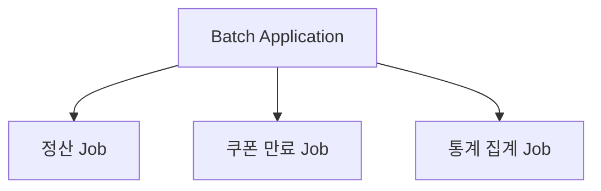
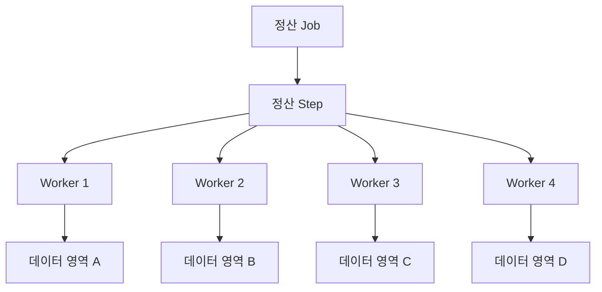
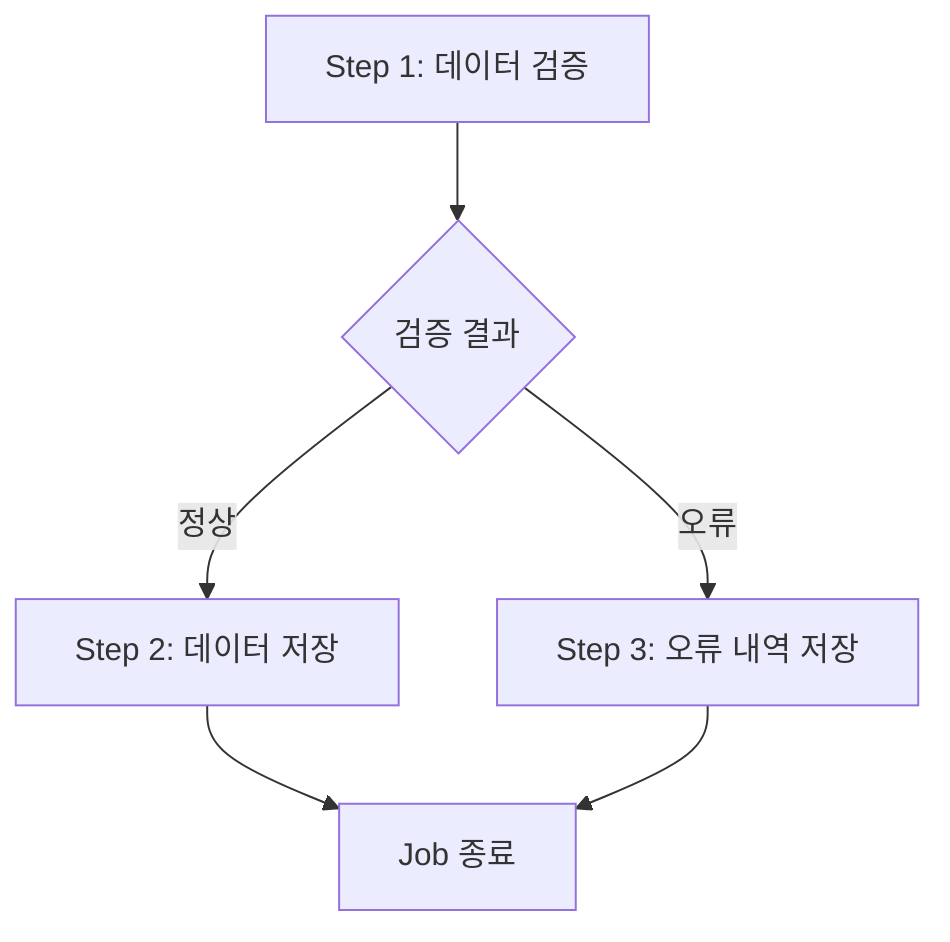
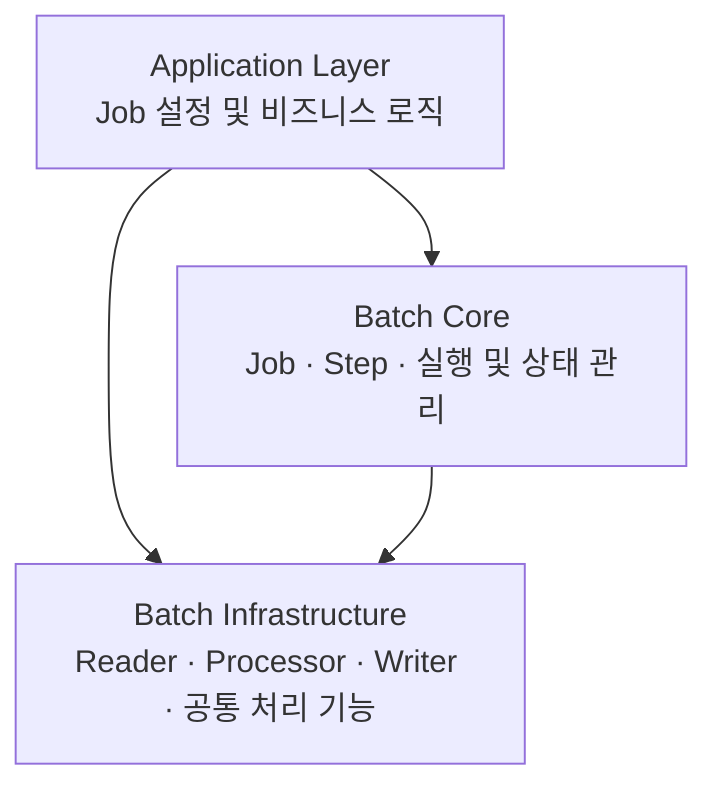
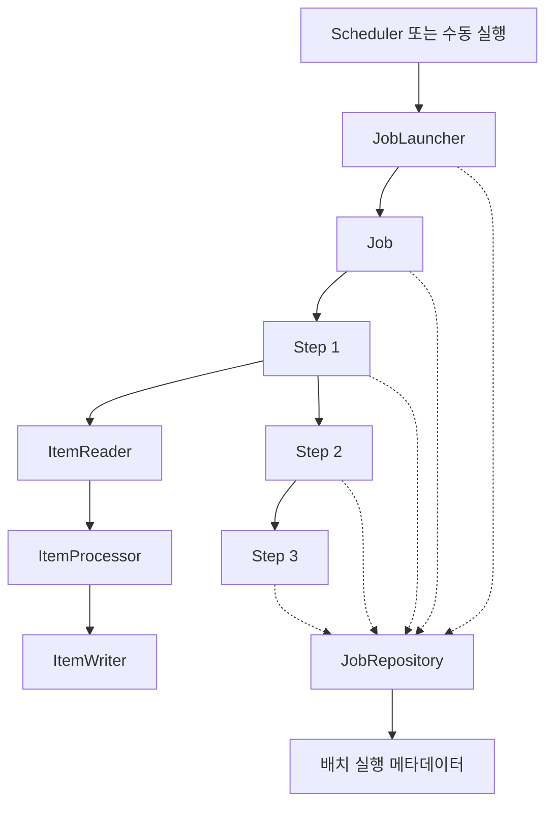

# 2. 스프링 배치 소개

# 2. 스프링 배치 소개

* toc
{:toc}

---

## 개요 및 아키텍처

## Spring Batch 개요: 등장 배경부터 핵심 기능과 아키텍처까지

백엔드 애플리케이션을 개발하다 보면 사용자의 요청에 즉시 응답하는 API 외에도 다양한 데이터 처리 작업이 필요하다.

매일 새벽 전날 발생한 결제 내역을 정산하거나, 수백만 건의 데이터를 분석해 통계를 생성하거나, 외부 시스템에서 전달받은 파일을 읽어 데이터베이스에 저장하는 작업이 대표적이다.

이러한 작업은 일반적인 REST API와는 성격이 다르다.

REST API는 사용자의 요청에 가능한 한 빠르게 응답하는 것이 중요하다. 반면 대량의 데이터를 처리하는 작업은 일정한 시간이 걸리더라도 **안정적으로 작업을 완료하고, 실패했을 때 복구할 수 있는 구조**가 중요하다.

예를 들어 하루 동안 발생한 결제 내역 100만 건을 정산한다고 생각해보자.

단순히 반복문으로 데이터를 조회하고 정산 결과를 저장하는 기능만 구현한다면 처음에는 어렵지 않을 수 있다.

하지만 실제 운영 환경에서는 여러 문제가 발생한다.

작업 도중 서버가 종료되면 어떻게 해야 할까? 70만 건까지 처리했다면 처음부터 다시 실행해야 할까? 외부 시스템에서 일시적인 오류가 발생하면 전체 작업을 실패시켜야 할까? 데이터가 1,000만 건으로 증가한다면 기존 구조로 감당할 수 있을까?

이러한 문제를 해결하기 위한 다양한 공통 기능을 제공하는 프레임워크가 **Spring Batch**다.

Spring Batch는 대량의 데이터를 안정적으로 처리하기 위해 만들어진 배치 처리 프레임워크로, Spring Framework의 프로그래밍 모델을 기반으로 트랜잭션 관리, 작업 실행, 재시작, 예외 처리, 병렬 처리 등의 기능을 제공한다.

이번에는 Spring Batch가 등장하게 된 배경부터 핵심 처리 패턴과 주요 기능, 그리고 전체 아키텍처까지 살펴보자.

---

## 배치 처리란 무엇인가?

배치 처리(Batch Processing)는 일정한 범위의 데이터를 모아서 일괄적으로 처리하는 방식을 의미한다.

일반적인 온라인 요청 처리와 비교하면 차이를 이해하기 쉽다.

### 온라인 처리

온라인 처리는 사용자의 요청에 따라 작업이 실행되는 방식이다.

예를 들어 사용자가 상품을 구매하면 서버는 결제 요청을 처리하고 결과를 반환한다.

```text
사용자
   │
   │ 결제 요청
   ▼
REST API
   │
   ▼
결제 처리
   │
   ▼
데이터베이스 저장
   │
   ▼
결제 결과 반환
```

이러한 작업에서는 응답 시간이 중요하다.

사용자가 결제를 요청했는데 결과를 확인하기까지 몇 분씩 걸린다면 서비스 사용성이 크게 떨어진다.

### 배치 처리

반면 배치 처리는 미리 정의된 작업을 실행하여 일정한 범위의 데이터를 처리한다.

예를 들어 매일 새벽 2시에 전날 발생한 결제를 정산한다고 생각해보자.

```text
매일 새벽 2시
      │
      ▼
정산 작업 시작
      │
      ▼
전날 결제 내역 조회
      │
      ▼
정산 금액 계산
      │
      ▼
정산 결과 저장
      │
      ▼
작업 종료
```

사용자가 직접 요청하지 않아도 작업이 실행될 수 있다.

또한 한 건의 데이터를 처리하는 것이 아니라 수천 건에서 수백만 건에 이르는 데이터를 처리할 수 있다.

다만 배치 처리가 반드시 특정 시간에만 실행되어야 한다는 의미는 아니다.

관리자의 수동 요청, 메시지 수신, 외부 시스템의 이벤트 등 다양한 조건에 따라 실행될 수도 있다.

핵심은 **정해진 범위의 데이터를 일정한 처리 절차에 따라 안정적으로 처리하는 작업**이라는 점이다.

### 온라인 처리와 배치 처리 비교

| 구분    | 온라인 처리       | 배치 처리                |
| ----- | ------------ | -------------------- |
| 실행 시점 | 사용자 요청 발생 시  | 정해진 시간 또는 실행 조건 충족 시 |
| 주요 목적 | 요청에 대한 빠른 응답 | 일정 범위의 데이터 처리        |
| 처리 단위 | 개별 요청 중심     | 다수의 데이터 또는 일괄 작업     |
| 중요 요소 | 응답 시간, 가용성   | 처리량, 안정성, 재시작 가능성    |
| 트랜잭션  | 일반적으로 요청 단위  | 전체 작업 또는 Chunk 단위    |
| 대표 사례 | 결제 요청, 회원 가입 | 정산, 통계 집계, 데이터 동기화   |

두 방식은 서로 대체하는 관계가 아니다.

대부분의 백엔드 시스템에서는 온라인 처리와 배치 처리를 함께 사용한다.

예를 들어 결제가 발생하면 온라인 API가 결제 정보를 저장하고, 이후 배치 작업이 해당 데이터를 집계하여 정산하는 구조를 만들 수 있다.

---

## Spring Batch는 왜 등장했을까?

Spring Batch가 등장하기 전에도 Java를 사용해 배치 프로그램을 개발할 수 있었다.

JDBC로 데이터를 조회하고 반복문으로 처리한 뒤 다시 데이터베이스에 저장하면 된다.

예를 들어 다음과 같은 코드다.

```java
public void processOrders() {

    List<Order> orders = orderRepository.findAll();

    for (Order order : orders) {
        Settlement settlement = calculateSettlement(order);

        settlementRepository.save(settlement);
    }
}
```

기능 자체는 단순하다.

하지만 이런 코드를 실제 대용량 처리 환경에서 사용하려면 많은 부분을 추가로 구현해야 한다.

### 대용량 데이터를 한 번에 조회하는 문제

다음 코드를 보자.

```java
List<Order> orders = orderRepository.findAll();
```

조회 대상이 1,000건이라면 문제가 없을 수 있다.

하지만 조회 대상이 1,000만 건이라면 어떨까?

모든 데이터를 메모리에 적재하면서 메모리 사용량이 급격히 증가할 수 있다.

심한 경우 `OutOfMemoryError`로 이어질 수도 있다.

따라서 대용량 작업에서는 데이터를 일정한 단위로 읽고 처리하는 전략이 필요하다.

### 트랜잭션 관리 문제

다음처럼 전체 작업을 하나의 트랜잭션으로 처리한다고 생각해보자.

```java
@Transactional
public void processOrders() {

    List<Order> orders = orderRepository.findAll();

    for (Order order : orders) {
        process(order);
    }
}
```

작업 대상이 매우 많다면 하나의 트랜잭션이 오랫동안 유지된다.

그 결과 데이터베이스의 락 유지 시간, 트랜잭션 로그, 커넥션 사용 시간 등이 증가할 수 있다.

또한 마지막 데이터에서 오류가 발생했을 때 전체 작업을 롤백해야 하는 상황도 생긴다.

대량의 데이터를 처리할 때는 전체를 하나의 트랜잭션으로 묶기보다 적절한 단위로 나누어 커밋하는 전략이 필요하다.

### 작업 재시작 문제

배치가 100만 건 중 70만 건을 처리하고 실패했다고 생각해보자.

단순한 반복문으로 구현했다면 다음 실행에서 어디부터 처리해야 하는지 알기 어렵다.

이미 처리한 데이터를 다시 처리하면 중복 정산이나 중복 발송 같은 문제가 발생할 수도 있다.

따라서 배치 시스템에는 작업의 실행 상태와 처리 위치를 관리하는 기능이 필요하다.

### 반복적인 공통 기능 개발 문제

배치 프로그램마다 다음과 같은 기능을 별도로 구현해야 한다면 어떻게 될까?

* 데이터 분할 및 트랜잭션 관리
* 작업 실행 상태 기록
* 실패한 작업의 재시작
* 재시도 및 예외 처리
* 여러 작업 단계의 실행 순서 관리
* 병렬 처리 및 실행 결과 집계

프로젝트마다 비슷한 코드를 반복해서 작성해야 한다.

또한 개발자마다 구현 방식이 달라지면서 코드의 일관성이 떨어지고 유지보수가 어려워질 수 있다.

Spring Batch는 이러한 공통 기능을 표준화된 프로그래밍 모델로 제공하여 개발자가 실제 비즈니스 로직에 집중할 수 있도록 한다.

---

## Spring Batch의 탄생 배경

Spring Batch가 등장하던 당시 Java에는 이미 다양한 분야에서 활용할 수 있는 표준 기술들이 존재했다.

대표적으로 다음과 같은 기술들이 있다.

| 기술                   | 역할                 |
| -------------------- | ------------------ |
| Java I/O             | 파일 및 데이터 입출력       |
| JDBC                 | 데이터베이스 연결 및 SQL 실행 |
| Java Networking      | TCP, UDP 등 네트워크 통신 |
| Java Thread          | 멀티스레드 기반 병렬 처리     |
| Java Transaction API | 트랜잭션 관리            |

이러한 기술을 활용하면 Java로 배치 프로그램을 직접 개발할 수 있었다.

하지만 **기업 환경에서 요구하는 대규모 일괄 처리를 일관된 방식으로 구현하기 위한 공통적인 배치 아키텍처는 충분히 정립되어 있지 않았다.**

배치 작업마다 데이터 조회, 트랜잭션 관리, 오류 처리, 재시작 등의 기능을 반복적으로 구현해야 했던 것이다.

이러한 배경에서 Spring Batch 프로젝트가 시작되었다.

### SpringSource와 Accenture의 협력

Spring Batch는 SpringSource와 Accenture의 협력을 통해 탄생했다.

Accenture는 다양한 기업 환경에서 배치 처리 아키텍처를 구현하면서 쌓은 경험과 기술적 노하우를 제공했다.

SpringSource는 Spring Framework의 프로그래밍 모델과 기술적 기반을 제공했다.

두 조직의 역할을 정리하면 다음과 같다.

| 조직           | 주요 역할                                    |
| ------------ | ---------------------------------------- |
| Accenture    | 기업용 배치 처리 아키텍처 경험과 기반 기술 제공              |
| SpringSource | Spring Framework 기반의 프로그래밍 모델과 기술적 기반 제공 |

즉 Spring Batch는 기업 환경에서 축적된 배치 처리 경험과 Spring Framework의 기술적 장점을 결합한 프레임워크라고 볼 수 있다.

Spring Batch의 중요한 설계 방향은 개발자가 비즈니스 로직에 집중할 수 있도록 배치 실행에 필요한 공통 기능을 프레임워크가 제공하는 것이다.

### Java 배치 표준과의 관계

Spring Batch가 처음 등장할 당시에는 기업용 Java 배치 처리를 위한 표준화된 모델이 부족했다.

이후 Java 배치 처리를 표준화하기 위한 `JSR 352`가 등장했다.

JSR 352는 Java EE 환경의 배치 처리 명세이며, Spring Batch도 과거 버전에서 해당 명세를 지원한 이력이 있다.

따라서 Java에 배치 처리 관련 표준이 현재까지 전혀 존재하지 않는다고 이해하면 안 된다.

Spring Batch가 등장한 배경에는 **배치 처리를 위한 재사용 가능한 아키텍처와 공통 프로그래밍 모델이 필요했다는 점**이 있었다.

---

## Spring Batch의 핵심 처리 패턴

Spring Batch의 가장 대표적인 데이터 처리 패턴은 다음 세 단계다.

**Read → Process → Write**

데이터를 읽고, 필요한 작업을 수행한 뒤, 결과를 저장한다.


이 패턴은 Spring Batch의 핵심적인 설계 방식 중 하나다.

각 단계의 역할이 명확하게 분리되어 있기 때문에 데이터가 어디에서 왔는지, 어떤 방식으로 가공되는지, 어디에 저장되는지를 쉽게 파악할 수 있다.

### Read: 데이터 읽기

Read 단계에서는 처리할 데이터를 가져온다.

데이터 소스는 다양할 수 있다.

데이터베이스, CSV 파일, JSON 파일, 외부 시스템 등에서 데이터를 읽을 수 있다.

Spring Batch에서는 이러한 역할을 `ItemReader`가 담당한다.

Spring Batch 5.2 기준으로 핵심 인터페이스는 다음과 같다.

```java
public interface ItemReader<T> {

    T read() throws Exception;
}
```

핵심은 `read()` 메서드다.

이 메서드는 처리할 데이터를 한 항목씩 반환한다.

더 이상 읽을 데이터가 없다면 `null`을 반환하여 입력이 끝났음을 알린다.

예를 들어 데이터베이스에서 주문을 읽는다면 다음과 같은 흐름이다.

```text
Database
   │
   ▼
Order 1
   │
   ▼
Order 2
   │
   ▼
Order 3
   │
   ▼
...
```

Spring Batch는 데이터 소스에 따라 다양한 Reader 구현체를 제공한다.

따라서 개발자가 매번 파일 파싱이나 데이터 조회 구조를 처음부터 구현할 필요가 줄어든다.

다만 Reader가 모든 데이터를 한 번에 메모리에 가져오지 않는다고 보장되는 것은 아니다.

실제로 데이터를 어떻게 읽는지는 선택한 Reader의 구현 방식에 따라 달라진다.

대용량 데이터를 처리할 때는 Paging, Cursor 등의 조회 방식과 Reader의 메모리 사용 특성을 함께 고려해야 한다.

### Process: 데이터 가공

Process 단계에서는 읽어온 데이터를 비즈니스 요구사항에 맞게 가공한다.

예를 들어 주문 정보를 읽어 정산 정보를 생성한다고 생각해보자.

```text
Order
  │
  ▼
정산 대상 여부 확인
  │
  ▼
수수료 계산
  │
  ▼
Settlement
```

Spring Batch에서는 `ItemProcessor<I, O>`가 이 역할을 담당한다.

```java
public interface ItemProcessor<I, O> {

    O process(I item) throws Exception;
}
```

여기서 `I`는 입력 타입이고 `O`는 출력 타입이다.

입력과 출력 타입이 같을 필요는 없다.

예를 들어 `Order`를 입력받아 `Settlement`를 반환할 수 있다.

```java
public class SettlementProcessor
        implements ItemProcessor<Order, Settlement> {

    @Override
    public Settlement process(Order order) {

        long fee = calculateFee(order);

        return new Settlement(
                order.getId(),
                order.getAmount() - fee
        );
    }

    private long calculateFee(Order order) {
        return order.getAmount() * 3 / 100;
    }
}
```

이처럼 Reader는 데이터를 읽는 역할에 집중하고, Processor는 비즈니스 로직을 수행하도록 분리할 수 있다.

또한 `ItemProcessor`는 필수 구성요소가 아니다.

별도의 데이터 가공이 필요하지 않다면 Reader에서 가져온 데이터를 Writer로 바로 전달할 수도 있다.

참고로 Processor가 `null`을 반환하면 해당 항목은 필터링되어 Writer로 전달되지 않는다.

이 기능은 처리 대상에서 특정 데이터를 제외해야 하는 경우에 활용할 수 있다.

### Write: 데이터 저장

Write 단계에서는 가공된 결과를 목적지에 저장한다.

예를 들어 정산 결과를 데이터베이스에 저장하거나 CSV 파일을 생성할 수 있다.

Spring Batch에서는 `ItemWriter`가 이 역할을 담당한다.

Spring Batch 5.2 기준으로 핵심 인터페이스는 다음과 같다.

```java
public interface ItemWriter<T> {

    void write(Chunk<? extends T> chunk) throws Exception;
}
```

Writer는 처리된 항목들을 `Chunk` 단위로 전달받는다.

예를 들어 다음과 같은 데이터가 있다고 해보자.

```text
Settlement 1
Settlement 2
Settlement 3
Settlement 4
Settlement 5
```

Writer는 설정된 처리 단위에 따라 여러 데이터를 모아 저장할 수 있다.

이러한 구조는 대량 데이터를 한 건씩 저장하는 방식보다 효율적으로 처리할 수 있는 기반을 제공한다.

---

## Read, Process, Write와 ETL의 관계

Spring Batch의 처리 패턴은 데이터 엔지니어링에서 사용하는 ETL과도 비슷하다.

ETL은 다음 세 단어의 약자다.

**Extract → Transform → Load**

Extract는 데이터를 추출하는 과정이다.

Transform은 데이터를 필요한 형태로 변환하는 과정이다.

Load는 변환된 데이터를 목적지에 적재하는 과정이다.

두 패턴을 비교하면 다음과 같다.

| Spring Batch | ETL       | 역할              |
| ------------ | --------- | --------------- |
| Read         | Extract   | 원본 데이터 조회 또는 추출 |
| Process      | Transform | 데이터 검증 및 변환     |
| Write        | Load      | 처리 결과 저장 또는 적재  |

예를 들어 외부 물류 시스템의 운송 데이터를 수집하는 작업을 생각해보자.

원본 데이터를 API로 가져오고, 날짜 형식과 항구 코드를 표준화한 뒤, 가공된 데이터를 데이터베이스에 저장할 수 있다.

```text
외부 API
   │
   ▼
Read
운송 데이터 수집
   │
   ▼
Process
날짜 및 코드 표준화
   │
   ▼
Write
데이터베이스 저장
```

Spring Batch의 처리 구조를 ETL 관점으로 이해하면 대량 데이터 수집과 변환 작업을 설계할 때 도움이 된다.

다만 모든 Spring Batch 작업이 반드시 ETL 형태여야 하는 것은 아니다.

파일 삭제, 오래된 데이터 정리, 특정 상태 변경처럼 단일 작업을 수행하는 배치도 구현할 수 있다.

---

## Spring Batch의 주요 특징

Spring Batch는 단순히 데이터를 읽고 저장하는 기능만 제공하지 않는다.

대량 데이터 처리 과정에서 반복적으로 필요한 다양한 기능을 제공한다.

대표적으로 Chunk 기반 커밋, 여러 Job의 동시 실행, 병렬 처리, 작업 재시작, 순차 실행, 조건부 흐름, 반복 처리, 재시도, Skip 등이 있다.

이러한 기능이 왜 필요한지 구체적인 상황을 통해 살펴보자.

### Chunk 기반의 주기적인 커밋 처리

Spring Batch에서 중요한 개념 중 하나가 **Chunk 기반 처리(Chunk-oriented Processing)** 다.

Chunk는 데이터를 일정한 단위로 묶어 처리하는 것을 의미한다.

앞에서 살펴본 Read, Process, Write 패턴이 실제 대용량 작업에서 어떻게 실행되는지를 이해하려면 Chunk 개념이 필요하다.

예를 들어 1,000건의 데이터를 저장해야 한다고 생각해보자.

전체 데이터를 하나의 트랜잭션으로 처리하면 실패했을 때 전체 작업에 영향을 줄 수 있다.

반대로 한 건씩 커밋하면 트랜잭션을 시작하고 종료하는 비용이 반복적으로 발생한다.

따라서 적절한 단위로 데이터를 나누어 처리할 수 있다.

**Chunk 크기가 3인 경우**

다음과 같은 데이터가 있다고 생각해보자.

```text
1, 2, 3, 4, 5, 6, 7
```

Chunk 크기를 3으로 설정한다면 개념적으로 다음과 같이 처리된다.

```text
Chunk 1
[1, 2, 3]
    │
    ▼
Write
    │
    ▼
Commit


Chunk 2
[4, 5, 6]
    │
    ▼
Write
    │
    ▼
Commit


Chunk 3
[7]
    │
    ▼
Write
    │
    ▼
Commit
```

7건의 데이터를 3개씩 나누어 처리한다.

첫 번째 Chunk에서 3건을 처리하고 커밋한다.

두 번째 Chunk에서도 3건을 처리하고 커밋한다.

마지막 Chunk에서는 남은 1건을 처리하고 커밋한다.

이렇게 하면 대량 데이터를 적절한 단위로 나누어 처리할 수 있다.

### Chunk는 단순한 메모리 분할이 아니다

Chunk를 단순히 데이터를 일정한 개수로 나누는 기능이라고만 이해하면 부족하다.

Spring Batch의 Chunk 기반 처리는 **트랜잭션과 연결되어 있다.**

일반적인 트랜잭션 기반 Chunk 처리에서는 다음 흐름이 반복된다.

```text
트랜잭션 시작
      │
      ▼
데이터 읽기
      │
      ▼
데이터 가공
      │
      ▼
일정 단위까지 반복
      │
      ▼
데이터 쓰기
      │
      ▼
트랜잭션 커밋
```

처리 중 예외가 발생하면 해당 트랜잭션을 롤백할 수 있다.

예를 들어 1,000건 단위로 처리하는 정산 배치에서 3,000건까지 정상적으로 커밋한 뒤 3,500번째 데이터에서 오류가 발생했다고 생각해보자.

트랜잭션 기반으로 처리했다면 이미 커밋된 앞선 Chunk는 유지하고, 현재 실패한 Chunk의 변경 사항을 롤백하는 구조를 만들 수 있다.

다만 실제 롤백 범위는 사용한 트랜잭션 매니저와 Reader, Writer, 외부 시스템의 트랜잭션 지원 여부에 따라 달라진다.

예를 들어 데이터베이스 트랜잭션은 롤백할 수 있지만 이미 발송한 이메일이나 외부 API 호출까지 자동으로 되돌릴 수 있는 것은 아니다.

또한 Chunk 크기가 클수록 무조건 성능이 좋은 것은 아니다.

Chunk 크기를 크게 설정하면 트랜잭션 횟수는 줄어들 수 있지만 메모리 사용량, 락 유지 시간, 실패 시 재처리 범위 등이 증가할 수 있다.

따라서 적절한 Chunk 크기는 데이터 특성과 처리 환경에 따라 결정해야 한다.

---

### 여러 Job의 동시 실행

Spring Batch는 여러 배치 Job을 관리하고 실행할 수 있는 구조를 제공한다.

여기서 Job은 하나의 배치 작업 전체를 의미한다.

예를 들어 다음과 같은 배치 작업이 있다고 생각해보자.

```text
정산 Job

쿠폰 만료 Job

일별 통계 Job
```

이 작업들은 서로 다른 비즈니스 목적을 가진다.

정산 Job은 결제 내역을 집계하고 정산 금액을 계산한다.

쿠폰 만료 Job은 사용 기한이 지난 쿠폰의 상태를 변경한다.

일별 통계 Job은 서비스 이용 데이터를 집계한다.

여러 Job을 각각 독립적인 작업으로 정의하면 같은 애플리케이션에서 관리할 수 있다.



필요하다면 여러 Job을 동시에 실행하도록 구성할 수도 있다.

다만 여기서 중요한 점이 있다.

**Spring Batch가 여러 Job을 정의하고 실행할 수 있다는 사실이 모든 Job을 자동으로 병렬 실행한다는 의미는 아니다.**

실제로 동시에 실행할 것인지는 Job을 시작하는 실행 환경, 스케줄러, TaskExecutor 등의 구성에 따라 달라진다.

또한 여러 Job이 동시에 실행되더라도 서로 같은 데이터를 수정한다면 데이터베이스 락 경합이나 정합성 문제가 발생할 수 있다.

따라서 Job을 독립적으로 정의하는 것과 실제 실행 시 서로 간섭하지 않도록 설계하는 것은 별개의 문제다.

---

### 하나의 Job 내부 병렬 처리

여러 Job을 동시에 실행하는 것과 하나의 Job 내부에서 병렬로 처리하는 것은 서로 다른 개념이다.

예를 들어 정산해야 할 데이터가 100만 건이라고 생각해보자.

단일 스레드가 모든 데이터를 순차적으로 처리한다면 작업 시간이 길어질 수 있다.

```text
정산 Job
    │
    ▼
단일 스레드
    │
    ▼
100만 건 처리
```

반면 데이터를 여러 영역으로 나눌 수 있다면 여러 실행 단위로 분리할 수 있다.



Spring Batch는 이러한 병렬 처리를 구현하기 위한 여러 기능을 제공한다.

대표적으로 Multi-threaded Step, Parallel Steps, Partitioning, Remote Chunking 등이 있다.

각 방식은 병렬 처리의 범위와 목적이 다르다.

예를 들어 Multi-threaded Step은 하나의 Step을 여러 스레드로 처리하는 방식이다.

Partitioning은 전체 데이터를 여러 영역으로 나누고 각 영역을 독립적으로 처리하도록 구성하는 방식이다.

하지만 스레드 개수를 늘린다고 처리 성능이 비례해서 향상되는 것은 아니다.

데이터베이스 커넥션 수, 디스크 I/O, 네트워크 처리량, Reader와 Writer의 스레드 안전성 등이 병목이 될 수 있다.

특히 여러 스레드가 같은 데이터를 중복으로 처리하지 않도록 작업 범위를 명확하게 분리하는 것이 중요하다.

### 동시 Job 실행과 Job 내부 병렬 처리의 차이

| 구분      | 여러 Job의 동시 실행        | 하나의 Job 내부 병렬 처리                    |
| ------- | -------------------- | ----------------------------------- |
| 처리 대상   | 서로 다른 Job            | 하나의 Job이 처리하는 작업                    |
| 주요 목적   | 여러 배치 작업의 동시 수행      | 단일 배치 작업의 처리 시간 단축                  |
| 대표 사례   | 정산 Job과 통계 Job 동시 실행 | 정산 데이터 100만 건을 분할 처리                |
| 주요 고려사항 | Job 간 자원 경합 및 데이터 충돌 | 데이터 분할, 스레드 안전성, 중복 처리              |
| 대표 기술   | 스케줄러, 비동기 Job 실행     | Multi-threaded Step, Partitioning 등 |

이 두 가지를 구분하면 배치 시스템의 병렬 처리 구조를 설계할 때 어떤 문제를 해결하려는 것인지 명확하게 판단할 수 있다.

---

### 실패한 작업의 재시작

배치가 실행되는 도중 장애가 발생할 수 있다.

예를 들어 다음과 같은 상황이다.

```text
정산 배치 시작
       │
       ▼
10만 건 처리 완료
       │
       ▼
20만 건 처리 완료
       │
       ▼
서버 장애 발생
```

이 경우 처음부터 다시 처리하는 것은 비효율적일 수 있다.

또한 이미 정산이 완료된 데이터를 다시 처리한다면 중복 정산 문제가 발생할 수 있다.

Spring Batch는 실행 상태와 작업 문맥을 관리하여 실패한 작업의 재시작을 지원한다.

대표적으로 `JobRepository`와 `ExecutionContext`가 중요한 역할을 한다.

`JobRepository`는 Job과 Step의 실행 메타데이터를 관리한다.

`ExecutionContext`는 작업을 재시작할 때 필요한 상태 정보를 저장하는 데 사용할 수 있다.

예를 들어 특정 Reader가 마지막으로 처리한 위치를 저장할 수 있다면 실패 이후 해당 위치를 기준으로 다시 데이터를 읽도록 구성할 수 있다.

하지만 여기서 주의해야 할 점이 있다.

**Spring Batch를 사용한다고 해서 모든 배치가 자동으로 마지막 처리 위치부터 재시작되는 것은 아니다.**

재시작 가능한 Reader와 Writer를 사용해야 하고, 실행 메타데이터가 적절하게 저장되어야 하며, 트랜잭션 경계도 함께 고려해야 한다.

또한 이미 처리한 데이터가 중복으로 반영되지 않도록 비즈니스 차원의 멱등성도 확보해야 한다.

---

### 여러 Step의 순차 실행

배치 작업은 여러 단계로 구성될 수 있다.

예를 들어 정산 배치가 다음 단계로 구성된다고 생각해보자.

```text
Step 1
정산 대상 조회
    │
    ▼
Step 2
정산 금액 계산
    │
    ▼
Step 3
정산 결과 저장
    │
    ▼
Step 4
정산 완료 알림
```

이렇게 여러 단계를 하나의 Job으로 구성할 수 있다.

Spring Batch에서는 이러한 실행 단위를 `Step`이라고 한다.

각 Step은 독립적인 작업 단위이며, Job은 여러 Step의 실행 흐름을 관리한다.

위 구조에서는 Step 1이 정상적으로 완료되면 Step 2를 실행하고, 이후 Step 3과 Step 4를 순차적으로 실행하도록 구성할 수 있다.

이러한 실행 흐름은 여러 작업 사이에 의존관계가 존재할 때 유용하다.

예를 들어 정산 금액이 계산되기 전에 정산 완료 알림을 발송해서는 안 된다.

이때 각 작업을 Step으로 분리하고 실행 순서를 명시하면 작업의 의존관계를 명확하게 표현할 수 있다.

---

### 조건에 따른 Flow 구성

모든 배치 작업이 항상 같은 순서로 실행되어야 하는 것은 아니다.

예를 들어 데이터 검증 결과에 따라 서로 다른 Step을 실행해야 할 수도 있다.



이처럼 실행 결과에 따라 다음 Step을 결정하는 구조를 Flow라고 한다.

Spring Batch는 Step의 종료 상태 등을 기준으로 실행 흐름을 제어할 수 있다.

예를 들어 정산 대상 데이터가 없을 때 불필요한 계산 Step을 건너뛰거나, 데이터 검증에 실패하면 오류 처리 Step으로 이동하도록 구성할 수 있다.

이를 활용하면 단순히 Step을 순서대로 실행하는 것보다 유연한 배치 작업을 구성할 수 있다.

---

## Repeat, Retry, Skip의 차이

Spring Batch에서 자주 등장하는 개념 중 하나가 `Repeat`, `Retry`, `Skip`이다.

세 기능 모두 작업의 실행을 제어한다는 공통점이 있지만 해결하려는 문제는 다르다.

Repeat는 **작업을 반복적으로 실행하는 것**이다.

Retry는 **실패한 작업을 다시 시도하는 것**이다.

Skip은 **처리할 수 없는 특정 항목을 건너뛰고 나머지 작업을 계속 진행하는 것**이다.

각각의 차이를 살펴보자.

### Repeat: 반복 처리

배치 작업에서는 여러 데이터를 반복적으로 처리해야 하는 경우가 많다.

예를 들어 주문 데이터 1,000건을 처리한다고 생각해보자.

```text
주문 1 처리
    │
    ▼
주문 2 처리
    │
    ▼
주문 3 처리
    │
    ▼
...
    │
    ▼
주문 1,000 처리
```

이처럼 작업을 반복적으로 실행하는 구조가 필요하다.

Spring Batch는 반복적인 작업 실행을 관리하기 위한 기능을 제공한다.

대표적으로 `RepeatTemplate`과 같은 반복 실행 컴포넌트를 활용한다.

다만 Repeat가 단순히 Java의 `for` 문을 대신한다는 의미는 아니다.

Spring Batch에서는 반복 종료 조건과 예외 처리 등을 고려하여 작업의 반복 실행을 제어할 수 있다.

예를 들어 Tasklet 기반 Step에서는 반환하는 `RepeatStatus`에 따라 작업을 계속 반복할지 종료할지 결정할 수 있다.

```text
RepeatStatus.CONTINUABLE
        │
        ▼
작업을 다시 실행


RepeatStatus.FINISHED
        │
        ▼
반복 종료
```

Chunk 기반 처리에서도 내부적으로 반복 실행 모델이 활용된다.

따라서 Repeat는 **배치 작업이 일정한 조건을 만족할 때까지 반복적으로 실행되는 구조**라고 이해할 수 있다.

---

### Retry: 일시적인 장애 재시도

외부 시스템과 통신하는 배치를 생각해보자.

데이터를 조회하는 과정에서 일시적인 네트워크 오류가 발생할 수 있다.

이때 오류가 한 번 발생했다고 전체 배치를 실패시키는 것은 비효율적일 수 있다.

예를 들어 다음과 같은 상황이다.

```text
외부 API 호출
      │
      ▼
네트워크 오류
      │
      ▼
재시도
      │
      ▼
정상 응답
```

Spring Batch에서는 특정 예외에 대해 재시도 정책을 적용할 수 있다.

재시도 횟수와 재시도 대상 예외 등을 설정해 일시적인 장애에 대응할 수 있다.

하지만 모든 예외를 재시도하는 것이 좋은 것은 아니다.

예를 들어 데이터 형식 자체가 잘못된 경우에는 동일한 데이터를 다시 처리해도 계속 실패할 가능성이 높다.

반면 일시적인 네트워크 장애나 데이터베이스 경합처럼 시간이 지나면 해결될 수 있는 문제는 재시도를 고려할 수 있다.

또한 재시도가 외부 시스템에 중복 요청을 발생시키지 않도록 주의해야 한다.

예를 들어 외부 결제 API를 호출하는 과정에서 네트워크 타임아웃이 발생했다고 생각해보자.

클라이언트는 응답을 받지 못했지만 실제 결제 요청은 이미 처리되었을 수 있다.

이때 무조건 재시도하면 중복 결제가 발생할 가능성이 있다.

따라서 Retry를 적용할 때는 재시도 대상 예외뿐 아니라 요청의 멱등성도 함께 고려해야 한다.

---

### Skip: 특정 오류를 건너뛰고 계속 처리

일부 데이터에 오류가 있더라도 나머지 데이터를 정상적으로 처리해야 하는 상황이 있다.

예를 들어 10만 건의 데이터를 처리하는데 1건의 날짜 형식이 잘못되었다고 해보자.

전체 배치를 실패시키는 대신 해당 데이터만 건너뛰고 나머지를 계속 처리할 수 있다.

```text
데이터 1 → 정상 처리

데이터 2 → 정상 처리

데이터 3 → 형식 오류
               │
               ▼
             Skip

데이터 4 → 정상 처리

데이터 5 → 정상 처리
```

이러한 기능이 Skip이다.

하지만 Skip은 매우 신중하게 사용해야 한다.

정산 시스템에서 금액 계산 오류를 무조건 건너뛰면 전체 정산 결과가 잘못될 수 있다.

따라서 Skip을 적용할 때는 어떤 예외를 허용할 것인지, 얼마나 많은 데이터를 건너뛸 수 있는지, 건너뛴 데이터는 어떻게 관리할 것인지를 함께 설계해야 한다.

### 세 기능을 비교하면

| 구분    | Repeat        | Retry        | Skip          |
| ----- | ------------- | ------------ | ------------- |
| 핵심 목적 | 작업 반복         | 실패한 작업 재시도   | 실패한 항목 건너뛰기   |
| 실행 조건 | 반복 조건에 따라 실행  | 재시도 대상 오류 발생 | Skip 대상 오류 발생 |
| 대표 사례 | 다수의 데이터 반복 처리 | 일시적인 네트워크 장애 | 잘못된 데이터 형식    |
| 핵심 질문 | 계속 처리할 것인가?   | 다시 시도할 것인가?  | 제외하고 계속할 것인가? |

실무에서는 이 세 가지 기능을 서로 독립적으로만 사용하는 것은 아니다.

예를 들어 여러 데이터를 반복적으로 처리하는 과정에서 일시적인 오류가 발생하면 Retry를 시도하고, 재시도로도 해결되지 않는 특정 오류에 대해서는 Skip을 적용할 수 있다.

이처럼 Spring Batch는 반복과 예외 처리를 조합하여 작업을 유연하게 제어할 수 있다.

---

## Spring Batch의 핵심 구성 요소

이제 Spring Batch의 아키텍처를 이해하기 위해 가장 기본적인 구성 요소를 살펴보자.

핵심 개념은 다음과 같다.

| 구성 요소           | 역할                   |
| --------------- | -------------------- |
| `Job`           | 하나의 배치 작업 전체를 정의     |
| `Step`          | Job을 구성하는 개별 처리 단계   |
| `Tasklet`       | Step에서 수행하는 단일 작업 로직 |
| `ItemReader`    | 데이터를 읽는 역할           |
| `ItemProcessor` | 데이터를 가공하는 역할         |
| `ItemWriter`    | 데이터를 저장하는 역할         |
| `JobRepository` | 배치 실행 상태와 메타데이터 관리   |
| `JobLauncher`   | Job 실행을 요청하는 인터페이스   |
| `JobExecution`  | Job의 개별 실행 기록        |
| `StepExecution` | Step의 개별 실행 기록       |

여기서 가장 먼저 이해해야 할 관계는 `Job`과 `Step`이다.

```text
Job
 │
 ├── Step 1
 │
 ├── Step 2
 │
 └── Step 3
```

Job은 배치 작업의 전체 실행 단위다.

Step은 Job을 구성하는 실제 처리 단계다.

그리고 Step 내부에서는 업무 특성에 따라 서로 다른 처리 방식을 선택할 수 있다.

대표적인 방식은 **Tasklet 기반 처리와 Chunk 기반 처리**다.

### Tasklet 기반 처리

Tasklet 기반 처리는 특정 작업을 수행하는 방식이다.

예를 들어 오래된 파일을 삭제하거나 특정 테이블의 상태를 변경하는 작업처럼 단일 작업을 처리할 때 사용할 수 있다.

```text
Job
 │
 ▼
Step
 │
 ▼
Tasklet
 │
 ▼
파일 삭제
```

Tasklet은 반복 여부를 제어할 수 있으며, 일반적으로 단일 작업을 완료한 뒤 종료하도록 구성할 수 있다.

### Chunk 기반 처리

Chunk 기반 처리는 대량의 데이터를 일정한 단위로 나누어 처리하는 방식이다.

```text
Job
 │
 ▼
Step
 │
 ├── ItemReader
 │
 ├── ItemProcessor
 │
 └── ItemWriter
```

Reader를 통해 데이터를 읽고, Processor에서 가공한 뒤, Writer를 통해 결과를 저장한다.

이러한 처리를 설정한 Chunk 크기에 맞추어 반복한다.

두 방식을 비교하면 다음과 같다.

| 구분    | Tasklet 기반           | Chunk 기반               |
| ----- | -------------------- | ---------------------- |
| 주요 목적 | 특정 작업 수행             | 대량 데이터 처리              |
| 처리 방식 | Tasklet 로직 실행        | Read → Process → Write |
| 대표 사례 | 파일 삭제, 상태 변경         | 정산, 데이터 이관, 통계 처리      |
| 반복 처리 | RepeatStatus 등으로 제어  | Chunk 기반 반복 실행         |
| 트랜잭션  | Tasklet 실행 단위에 맞춰 관리 | Chunk 단위로 관리           |

어떤 방식이 더 좋은지는 작업의 성격에 따라 달라진다.

단순한 작업에 복잡한 Chunk 구조를 적용할 필요는 없다.

반대로 대량의 데이터를 안정적으로 처리해야 한다면 Chunk 기반 처리를 적극적으로 고려할 수 있다.

---

## Spring Batch 아키텍처

Spring Batch의 전체 구조는 크게 세 개의 레이어로 이해할 수 있다.

**Application, Batch Core, Batch Infrastructure**다.



이 구조는 Spring Batch의 관심사를 구분하기 위한 논리적인 아키텍처다.

개발자는 Application에서 배치 작업을 구성하고 비즈니스 로직을 구현한다.

Batch Core는 Job과 Step의 실행 및 상태 관리를 담당한다.

Batch Infrastructure는 데이터 처리에 필요한 공통 기능을 제공한다.

각 영역을 조금 더 자세히 살펴보자.

### Application Layer

Application Layer는 개발자가 직접 작성하는 배치 애플리케이션 영역이다.

예를 들어 정산 배치를 구현한다면 다음과 같은 코드가 포함된다.

```text
SettlementJobConfig

SettlementReader

SettlementProcessor

SettlementWriter

SettlementService
```

개발자는 어떤 데이터를 조회할지, 정산 금액을 어떻게 계산할지, 처리 결과를 어디에 저장할지 정의한다.

핵심은 **업무 규칙을 구현하는 영역**이라는 점이다.

물론 Application에서도 Job과 Step을 조립하기 위해 Spring Batch API를 사용한다.

하지만 Job 실행 기록을 데이터베이스에 어떻게 저장할지, 실패 상태를 어떻게 관리할지와 같은 공통 기능을 매번 직접 구현할 필요는 없다.

Spring Batch가 제공하는 공통 기능을 활용하여 업무 로직 구현에 집중할 수 있다.

---

### Batch Core

Batch Core는 Job과 Step을 실행하고 관리하는 핵심 영역이다.

대표적으로 다음과 같은 구성 요소가 있다.

```text
Job

Step

Flow

JobRepository

JobLauncher
```

예를 들어 다음과 같은 정산 Job을 정의했다고 생각해보자.

```text
SettlementJob
    │
    ├── ReadSettlementStep
    │
    ├── CalculateSettlementStep
    │
    └── SaveSettlementStep
```

Batch Core는 이러한 Job의 실행 흐름과 상태를 관리하는 역할을 담당한다.

어떤 Step이 실행 중인지, Job이 정상적으로 완료되었는지, 실패했다면 다시 실행할 수 있는지와 같은 정보를 관리한다.

이 과정에서 `JobRepository`는 배치 실행 메타데이터를 관리하는 중요한 역할을 담당한다.

또한 Spring Batch 5.2에서는 `JobLauncher`를 통해 Job 실행을 요청할 수 있다.

즉 Batch Core는 배치 작업을 구성하는 핵심 개념과 실행 제어 기능을 제공하는 영역이다.

---

### Batch Infrastructure

Batch Infrastructure는 실제 데이터 처리와 관련된 공통 기능을 제공하는 영역이다.

대표적으로 다음과 같은 구성 요소가 있다.

```text
ItemReader

ItemProcessor

ItemWriter

ItemStream

Repeat 관련 기능

Retry 관련 기능
```

또한 데이터베이스, 파일, 메시징 시스템 등의 다양한 데이터 소스를 처리하기 위한 구현체들을 제공한다.

예를 들어 CSV 파일에서 데이터를 읽는 배치를 만든다고 해보자.

파일을 열고 데이터를 읽고 파싱하는 기능을 처음부터 직접 구현할 수도 있다.

하지만 Spring Batch가 제공하는 Reader 구현체를 사용하면 공통적인 입출력 처리 구조를 재사용할 수 있다.

개발자는 각 데이터가 어떤 의미를 갖고 있으며 어떻게 처리해야 하는지에 더 집중할 수 있다.

### 세 레이어를 비교하면

| 레이어                  | 주요 역할                 | 대표 구성 요소                                      |
| -------------------- | --------------------- | --------------------------------------------- |
| Application          | 개발자가 작성하는 업무 로직       | Job 설정, Processor, Service                    |
| Batch Core           | Job과 Step의 실행 및 상태 관리 | Job, Step, JobRepository, JobLauncher         |
| Batch Infrastructure | 데이터 처리 및 공통 기반 기능     | ItemReader, ItemProcessor, ItemWriter, Repeat |

이처럼 역할이 분리되어 있기 때문에 개발자는 업무 로직을 구현하면서도 배치 실행과 관련된 공통 기능을 활용할 수 있다.

---

## 실제 모듈 구조와 아키텍처의 관계

Spring Batch는 핵심 기능과 인프라 기능을 별도의 모듈로 구분한다.

대표적으로 다음 모듈이 있다.

```text
spring-batch-core

spring-batch-infrastructure
```

Spring Batch 5.2 기준으로 두 모듈의 주요 패키지를 살펴보면 다음과 같다.

| 모듈                            | 대표 패키지                                      | 주요 역할                     |
| ----------------------------- | ------------------------------------------- | ------------------------- |
| `spring-batch-core`           | `org.springframework.batch.core.job`        | Job 관련 기능                 |
| `spring-batch-core`           | `org.springframework.batch.core.step`       | Step 관련 기능                |
| `spring-batch-core`           | `org.springframework.batch.core.repository` | 실행 메타데이터 관리               |
| `spring-batch-infrastructure` | `org.springframework.batch.item`            | Reader, Processor, Writer |
| `spring-batch-infrastructure` | `org.springframework.batch.item.file`       | 파일 입출력 관련 기능              |
| `spring-batch-infrastructure` | `org.springframework.batch.repeat`          | 반복 처리                     |

이러한 구분을 알고 있으면 Spring Batch 내부 코드를 살펴볼 때 각 클래스의 역할을 파악하기 쉽다.

다만 논리적인 아키텍처와 실제 Java 패키지가 반드시 완벽하게 일대일로 대응하는 것은 아니다.

또한 Spring Batch는 버전이 발전하면서 일부 API와 패키지 구조가 변경되었다.

따라서 실제 소스 코드를 확인할 때는 사용 중인 버전을 기준으로 살펴봐야 한다.

---

## Spring Batch 버전에 따른 주요 차이

Spring Batch의 핵심 개념은 버전이 달라져도 크게 변하지 않는다.

하지만 실제 구현 코드는 버전에 따라 차이가 발생한다.

예를 들어 Spring Batch 4에서는 `JobBuilderFactory`, `StepBuilderFactory`를 사용하여 Job과 Step을 구성하는 방식이 일반적이었다.

Spring Batch 5에서는 `JobRepository`를 전달하여 `JobBuilder`, `StepBuilder`를 직접 생성하는 방식이 사용된다.

Spring Batch 6에서는 일부 핵심 API와 패키지 구조가 다시 변경되었다.

따라서 다음과 같이 버전을 구분해서 이해하는 것이 좋다.

| 구분                | Spring Batch 4.x      | Spring Batch 5.x  | Spring Batch 6.x  |
| ----------------- | --------------------- | ----------------- | ----------------- |
| Spring Boot 주요 조합 | 2.x                   | 3.x               | 4.x               |
| Java 기준           | Java 8 기반 사용 가능       | Java 17 이상        | Java 17 이상        |
| Job 생성            | JobBuilderFactory 중심  | JobBuilder 직접 생성  | JobBuilder 직접 생성  |
| Step 생성           | StepBuilderFactory 중심 | StepBuilder 직접 생성 | StepBuilder 직접 생성 |
| Job 실행 API        | JobLauncher           | JobLauncher       | JobOperator 중심    |
| 데이터 처리 API        | 기존 item 패키지           | 기존 item 패키지       | 일부 패키지 재구성        |

Spring Batch 6에서는 `JobLauncher`가 deprecated 처리되고 `JobOperator` 중심으로 API가 정리되었다.

따라서 서로 다른 버전의 코드를 그대로 혼합해서 사용하면 컴파일 오류나 설정 문제가 발생할 수 있다.

이후 예제에서는 **Spring Boot 3.4 / Spring Batch 5.2 / Java 17 이상**을 기준으로 코드를 작성한다.

이 조합에서는 `JobLauncher`, `JobBuilder`, `StepBuilder`, `ItemReader`, `ItemProcessor`, `ItemWriter` 등의 API를 사용할 수 있다.

버전 차이가 실제 동작이나 설정에 영향을 주는 경우에는 해당 내용을 별도로 구분하여 설명한다.

---

## 간단한 Spring Batch 예제

지금까지 살펴본 내용을 간단한 코드로 연결해보자.

여러 문자열을 읽어 대문자로 변환한 뒤 출력하는 작업을 만든다고 생각해보자.

데이터의 흐름은 다음과 같다.

```text
["spring", "batch", "java", "redis"]
                │
                ▼
             Reader
                │
                ▼
             Processor
                │
                ▼
["SPRING", "BATCH", "JAVA", "REDIS"]
                │
                ▼
             Writer
```

다음 코드는 Spring Batch 5.2 기준으로 작성한 구성 예제다.

Spring Boot의 Batch 자동 설정과 `JobRepository`, 트랜잭션 매니저가 구성되어 있다는 전제에서 사용한다.

```java
import java.util.List;

import org.springframework.batch.core.Job;
import org.springframework.batch.core.Step;
import org.springframework.batch.core.configuration.annotation.StepScope;
import org.springframework.batch.core.job.builder.JobBuilder;
import org.springframework.batch.core.repository.JobRepository;
import org.springframework.batch.core.step.builder.StepBuilder;

import org.springframework.batch.item.ItemProcessor;
import org.springframework.batch.item.ItemReader;
import org.springframework.batch.item.ItemWriter;
import org.springframework.batch.item.support.ListItemReader;

import org.springframework.context.annotation.Bean;
import org.springframework.context.annotation.Configuration;

import org.springframework.transaction.PlatformTransactionManager;

@Configuration
public class SampleBatchConfig {

    @Bean
    @StepScope
    public ItemReader<String> stringReader() {
        return new ListItemReader<>(
                List.of(
                        "spring",
                        "batch",
                        "java",
                        "redis"
                )
        );
    }

    @Bean
    public ItemProcessor<String, String> stringProcessor() {
        return String::toUpperCase;
    }

    @Bean
    public ItemWriter<String> stringWriter() {
        return chunk -> {
            for (String item : chunk) {
                System.out.println(item);
            }
        };
    }

    @Bean
    public Step stringStep(
            JobRepository jobRepository,
            PlatformTransactionManager transactionManager,
            ItemReader<String> stringReader,
            ItemProcessor<String, String> stringProcessor,
            ItemWriter<String> stringWriter
    ) {
        return new StepBuilder("stringStep", jobRepository)
                .<String, String>chunk(2, transactionManager)
                .reader(stringReader)
                .processor(stringProcessor)
                .writer(stringWriter)
                .build();
    }

    @Bean
    public Job stringJob(
            JobRepository jobRepository,
            Step stringStep
    ) {
        return new JobBuilder("stringJob", jobRepository)
                .start(stringStep)
                .build();
    }
}
```

각 구성 요소를 살펴보자.

### Reader

```java
@Bean
@StepScope
public ItemReader<String> stringReader() {
    return new ListItemReader<>(
            List.of(
                    "spring",
                    "batch",
                    "java",
                    "redis"
            )
    );
}
```

Reader는 처리할 데이터를 제공한다.

`ListItemReader`는 메모리에 있는 리스트에서 데이터를 읽는 구현체다.

`@StepScope`는 Step 실행 단위로 Reader 인스턴스를 생성하기 위해 사용했다.

Reader는 내부적으로 현재 어디까지 읽었는지와 같은 상태를 가질 수 있으므로, 여러 실행이 동일한 상태를 잘못 공유하지 않도록 생명주기를 고려해야 한다.

다만 `ListItemReader` 자체는 영속적인 체크포인트를 관리하는 대용량 데이터 Reader가 아니다.

이 예제는 기본 흐름을 확인하기 위한 것이며, 운영 환경의 재시작 가능한 데이터 조회에는 적절한 Reader를 선택해야 한다.

### Processor

```java
@Bean
public ItemProcessor<String, String> stringProcessor() {
    return String::toUpperCase;
}
```

Processor는 데이터를 가공한다.

이번 예제에서는 소문자를 대문자로 변경한다.

```text
spring → SPRING

batch → BATCH

java → JAVA

redis → REDIS
```

입력 타입과 출력 타입은 모두 `String`이다.

하지만 실제 업무에서는 `Order`를 입력받아 `Settlement`를 반환하는 것처럼 서로 다른 타입을 사용할 수도 있다.

### Writer

```java
@Bean
public ItemWriter<String> stringWriter() {
    return chunk -> {
        for (String item : chunk) {
            System.out.println(item);
        }
    };
}
```

Writer는 가공된 데이터를 출력한다.

실제 업무에서는 콘솔 출력 대신 데이터베이스 저장, 파일 생성 등의 작업을 수행할 수 있다.

여기서 콘솔 출력은 트랜잭션으로 롤백할 수 없는 외부 효과라는 점에 주의해야 한다.

이번 예제는 처리 결과를 쉽게 확인하기 위한 것이다.

### Step

가장 중요한 부분은 다음 코드다.

```java
return new StepBuilder("stringStep", jobRepository)
        .<String, String>chunk(2, transactionManager)
        .reader(stringReader)
        .processor(stringProcessor)
        .writer(stringWriter)
        .build();
```

여기서

```java
.<String, String>chunk(2, transactionManager)
```

는 Chunk 기반 처리 방식을 사용하면서 Chunk 크기를 2로 설정한다는 의미다.

따라서 데이터 네 건이 다음과 같이 처리된다.

```text
Chunk 1
["spring", "batch"]
      │
      ▼
["SPRING", "BATCH"]
      │
      ▼
Writer 호출


Chunk 2
["java", "redis"]
      │
      ▼
["JAVA", "REDIS"]
      │
      ▼
Writer 호출
```

Reader, Processor, Writer를 하나의 Step으로 구성한 것이다.

### Job

마지막으로 Job을 정의한다.

```java
@Bean
public Job stringJob(
        JobRepository jobRepository,
        Step stringStep
) {
    return new JobBuilder("stringJob", jobRepository)
            .start(stringStep)
            .build();
}
```

`stringJob`이라는 배치 작업을 정의하고 `stringStep`을 첫 번째 실행 단계로 지정했다.

나중에 Step을 추가하면 하나의 Job 안에서 여러 작업 단계를 구성할 수 있다.

이 예제에서 기억해야 할 부분은 개별 API의 세부 옵션보다 **Job 안에 Step이 있고, Step 안에서 Reader, Processor, Writer가 실행된다는 구조**다.

---

## Spring Batch에서 JobRepository가 중요한 이유

Spring Batch를 단순한 데이터 처리 프레임워크와 구분하는 중요한 구성 요소 중 하나가 `JobRepository`다.

`JobRepository`는 Job과 Step의 실행 메타데이터를 관리한다.

대표적으로 다음과 같은 정보를 다룬다.

```text
Job이 언제 실행되었는가?

현재 실행 상태는 무엇인가?

정상 종료되었는가?

실패했는가?

Step은 어디까지 실행되었는가?

재시작에 필요한 상태는 무엇인가?
```

이러한 정보는 배치 작업을 안정적으로 운영하는 데 필요하다.

일반적인 JDBC 기반 JobRepository에서는 다음과 같은 메타데이터를 데이터베이스에 저장한다.

```text
BATCH_JOB_INSTANCE

BATCH_JOB_EXECUTION

BATCH_JOB_EXECUTION_PARAMS

BATCH_STEP_EXECUTION

BATCH_JOB_EXECUTION_CONTEXT

BATCH_STEP_EXECUTION_CONTEXT
```

이 테이블들은 비즈니스 데이터 자체를 저장하는 용도가 아니라 배치 실행 정보를 관리하기 위한 것이다.

예를 들어 정산 결과는 별도의 정산 테이블에 저장하고, 정산 배치의 실행 성공 여부와 처리 상태는 JobRepository에서 관리할 수 있다.

### Job과 JobExecution은 다르다

여기서 한 가지 중요한 개념을 구분할 필요가 있다.

`Job`은 실행할 배치 작업의 정의다.

반면 `JobExecution`은 특정 Job을 실제로 실행한 기록이다.

예를 들어 매일 정산하는 Job이 있다고 생각해보자.

```text
SettlementJob
      │
      ├── 10월 1일 정산 실행
      │
      ├── 10월 2일 정산 실행
      │
      └── 10월 3일 정산 실행
```

Job 정의는 하나지만 실제 실행 기록은 여러 개가 만들어질 수 있다.

Spring Batch는 Job 이름과 식별용 JobParameters 등을 이용해 논리적인 실행 단위인 `JobInstance`를 구분하고, 각 실행 시도에 대한 `JobExecution`을 관리한다.

이 구조 덕분에 동일한 Job을 여러 번 실행하거나 실패한 작업을 재시작하는 과정을 체계적으로 관리할 수 있다.

다만 같은 JobInstance를 다시 실행할 수 있는지는 이전 실행 상태와 재시작 가능 여부 등에 따라 달라진다.

이러한 실행 도메인의 관계와 메타데이터 구조는 이후 별도로 자세히 살펴보는 것이 좋다.

---

## Spring Batch와 스케줄러의 차이

배치라는 단어를 들으면 자연스럽게 스케줄링을 떠올리게 된다.

예를 들어 다음과 같은 요구사항이다.

```text
매일 새벽 2시에 정산 배치를 실행한다.
```

하지만 중요한 사실이 있다.

**Spring Batch 자체는 스케줄러 프레임워크가 아니다.**

Spring Batch는 배치 작업이 실행되었을 때 데이터를 어떻게 처리하고 실행 상태를 어떻게 관리할지에 집중한다.

반면 스케줄러는 언제 작업을 시작할지 결정한다.

```text
Scheduler
   │
   │ 실행 요청
   ▼
Spring Batch
   │
   ▼
Job 실행
   │
   ▼
Step 처리
   │
   ▼
작업 완료
```

따라서 Spring Batch는 Spring의 `@Scheduled`, Quartz 또는 외부 스케줄링 시스템과 함께 사용할 수 있다.

이 차이를 알아두면 배치 시스템의 역할을 더 명확하게 구분할 수 있다.

예를 들어 Quartz는 정해진 시간에 정산 Job을 실행하도록 요청하는 역할을 담당할 수 있다.

Spring Batch는 요청받은 Job을 실행하면서 데이터 처리, 트랜잭션 관리, 실행 상태 기록, 재시작 등을 담당한다.

물론 Job이 시작되었다고 해서 반드시 정상적으로 완료되는 것은 아니다.

따라서 스케줄러가 작업 실행을 요청하는 것과 Spring Batch가 작업의 성공 여부를 관리하는 것은 별도로 생각해야 한다.

---

## 실무에서 Spring Batch를 활용하는 방법

Spring Batch는 대량의 데이터를 정해진 절차에 따라 처리해야 하는 다양한 업무에서 활용할 수 있다.

### 결제 및 정산 시스템

결제 시스템에서는 하루 동안 발생한 결제 내역을 집계하고 정산 금액을 계산하는 작업이 필요할 수 있다.

```text
결제 내역 조회
      │
      ▼
취소 및 환불 내역 반영
      │
      ▼
수수료 계산
      │
      ▼
정산 금액 산출
      │
      ▼
정산 결과 저장
```

이런 작업에서는 정확성이 중요하다.

특히 실패 후 재시작할 때 이미 정산한 거래가 중복 반영되지 않도록 설계해야 한다.

Spring Batch의 JobRepository와 Chunk 기반 트랜잭션 처리를 활용할 수 있지만, 비즈니스 차원의 중복 방지는 별도로 고려해야 한다.

예를 들어 정산 대상 거래 ID와 정산 기간을 기준으로 유니크 제약을 설정하거나, 이미 처리한 거래인지 확인하는 방식이 필요할 수 있다.

### 쿠폰 및 포인트 시스템

사용하지 않은 쿠폰의 만료 처리나 포인트 소멸 작업에도 활용할 수 있다.

```text
만료 대상 조회
      │
      ▼
사용 여부 확인
      │
      ▼
만료 상태 변경
      │
      ▼
처리 이력 저장
```

이런 작업은 매일 반복적으로 실행되는 경우가 많다.

한 번의 작업에서 처리해야 할 데이터가 많아질 수 있으므로 Chunk 단위 처리와 적절한 조회 전략이 중요하다.

또한 배치가 실행되는 동안 사용자가 쿠폰을 사용할 가능성도 있으므로 동시성 문제를 고려해야 한다.

### 외부 데이터 수집 및 동기화

외부 API나 파일을 통해 데이터를 수집하고 내부 데이터베이스에 저장하는 작업에도 적합하다.

```text
외부 데이터 수집
      │
      ▼
데이터 검증
      │
      ▼
표준 데이터 형식 변환
      │
      ▼
기존 데이터와 비교
      │
      ▼
변경된 데이터 저장
```

이 경우에는 외부 API의 응답 속도와 호출 제한, 네트워크 장애 등을 고려해야 한다.

또한 동일한 데이터를 반복해서 수집할 수 있으므로 변경 여부를 판단하거나 중복 저장을 방지하는 로직이 필요하다.

### 통계 및 집계 시스템

서비스의 일별 이용 현황이나 매출 데이터를 집계하는 작업에도 활용할 수 있다.

예를 들어 다음과 같다.

```text
원본 이벤트 데이터
       │
       ▼
기간별 데이터 조회
       │
       ▼
집계 및 계산
       │
       ▼
일별 통계 테이블 저장
```

이런 작업에서는 대량 데이터 조회 성능이 중요한 요소가 된다.

필요한 컬럼만 조회하거나 인덱스를 활용하고, 처리 대상 데이터를 적절하게 분리하는 것이 도움이 된다.

---

## Spring Batch를 도입하기 전에 고려할 점

Spring Batch가 여러 기능을 제공한다고 해서 모든 반복 작업에 반드시 적용해야 하는 것은 아니다.

예를 들어 매일 한 번 특정 테이블의 상태값 하나를 변경하는 작업이라면 단순한 스케줄러와 서비스 메서드만으로도 충분할 수 있다.

반면 데이터 처리량이 많고, 실패 시 재시작이 필요하고, 여러 단계로 구성되어 있으며, 처리 이력을 관리해야 한다면 Spring Batch의 장점이 커진다.

실무에서는 다음과 같은 기준을 검토하면 좋다.

| 검토 항목  | 확인할 내용                            |
| ------ | --------------------------------- |
| 데이터 규모 | 한 번에 몇 건을 처리하는가?                  |
| 트랜잭션   | 전체 처리와 부분 커밋 중 어떤 방식이 적절한가?       |
| 재시작    | 실패한 작업을 어디에서 다시 시작해야 하는가?         |
| 중복 처리  | 같은 데이터를 다시 처리해도 안전한가?             |
| 처리 순서  | 단계 사이에 의존성이 존재하는가?                |
| 예외 처리  | 어떤 오류를 재시도하거나 건너뛸 수 있는가?          |
| 병렬 처리  | 데이터를 독립적인 작업 단위로 분리할 수 있는가?       |
| 운영 관리  | 실행 이력과 실패 원인을 어떻게 확인할 것인가?        |
| 외부 연동  | 외부 시스템의 장애와 호출 제한을 어떻게 처리할 것인가?   |
| 모니터링   | 처리 건수, 실패 건수, 소요 시간을 어떻게 관리할 것인가? |

특히 **재시작 가능성과 멱등성(Idempotency)** 은 반드시 함께 생각해야 한다.

배치가 실패한 뒤 다시 실행할 수 있다는 사실만으로 동일한 데이터가 두 번 처리되지 않는다고 보장되는 것은 아니다.

예를 들어 정산 결과를 데이터베이스에 저장한 직후 작업이 실패했다고 해보자.

재시작 시 동일한 정산 결과를 다시 저장한다면 중복 정산이 발생할 수 있다.

따라서 배치 프레임워크의 실행 상태 관리와 별개로 비즈니스 데이터의 중복 처리 방지 전략이 필요하다.

이런 관점에서 Spring Batch는 비즈니스 정합성을 자동으로 보장해주는 도구라기보다, **정합성을 유지할 수 있는 배치 처리 구조를 구현하도록 돕는 프레임워크**라고 이해하는 것이 적절하다.

---

## Spring Batch 전체 실행 구조

지금까지 살펴본 내용을 하나의 그림으로 연결해보자.

다음은 Spring Batch 5.2를 기준으로 한 개념적인 실행 구조다.



스케줄러나 외부 시스템이 배치 실행을 요청한다.

Spring Batch는 Job을 실행하고, Job은 정의된 흐름에 따라 Step을 실행한다.

각 Step은 업무 특성에 따라 데이터를 읽고 가공하고 저장하거나, 독립적인 Tasklet 작업을 수행한다.

JobRepository는 실행 상태와 관련 메타데이터를 관리한다.

이 구조를 기반으로 Spring Batch는 대량 데이터 처리에 필요한 트랜잭션 관리, 재시작, 예외 처리, 병렬 처리 등의 기능을 제공한다.

---

## 정리

Spring Batch는 단순히 데이터를 반복문으로 처리하는 기능을 제공하는 프레임워크가 아니다.

대량 데이터 처리 과정에서 반복적으로 필요한 **실행 관리, 트랜잭션 제어, 오류 대응, 재시작, 병렬 처리** 등을 공통화한 배치 처리 프레임워크다.

Spring Batch의 가장 기본적인 데이터 처리 패턴은 다음과 같다.

```text
Read → Process → Write
```

데이터를 읽고, 비즈니스 로직에 따라 가공하고, 결과를 저장한다.

이 과정은 Chunk 단위로 수행될 수 있으며, Chunk는 트랜잭션과 연결되어 대량 데이터를 적절한 단위로 처리하는 기반을 제공한다.

또한 Spring Batch는 여러 Job의 동시 실행과 하나의 Job 내부 병렬 처리를 지원할 수 있는 구조를 제공한다.

두 방식은 서로 다른 문제를 해결한다.

여러 Job의 동시 실행은 서로 다른 배치 작업을 동시에 수행하는 것이고, Job 내부 병렬 처리는 하나의 작업을 여러 실행 단위로 분리하여 처리하는 것이다.

작업 실행을 제어할 때는 Repeat, Retry, Skip의 차이도 이해해야 한다.

| 기능     | 핵심 역할                |
| ------ | -------------------- |
| Repeat | 작업을 반복적으로 실행         |
| Retry  | 실패한 작업을 다시 시도        |
| Skip   | 특정 오류 항목을 건너뛰고 계속 처리 |

그리고 Spring Batch는 다음 세 가지 레이어를 중심으로 구성된다.

| 레이어                  | 핵심 역할                     |
| -------------------- | ------------------------- |
| Application          | 개발자가 작성하는 Job 구성과 비즈니스 로직 |
| Batch Core           | Job과 Step의 실행 및 상태 관리     |
| Batch Infrastructure | 데이터 읽기·가공·쓰기 및 공통 처리 기능   |

이처럼 역할이 구분되어 있기 때문에 개발자는 업무 로직에 집중하면서도 안정적인 배치 실행 구조를 활용할 수 있다.

Spring Batch를 이해할 때 가장 먼저 기억해야 할 개념은 `Job`, `Step`, `Chunk`, `ItemReader`, `ItemProcessor`, `ItemWriter`, `JobRepository`다.

이들 사이의 관계를 이해하면 복잡해 보이는 배치 설정도 어떤 역할을 담당하는지 쉽게 구분할 수 있다.

궁극적으로 중요한 것은 단순히 빠르게 데이터를 처리하는 것이 아니다.

**데이터가 많아져도 안정적으로 처리할 수 있어야 하고, 오류가 발생했을 때 복구할 수 있어야 하며, 동일한 작업을 반복하더라도 데이터의 정합성이 유지되어야 한다.**

Spring Batch는 이러한 요구사항을 체계적으로 구현하기 위한 기반을 제공한다.

### 한 줄 요약

> Spring Batch는 대량 데이터를 `Read → Process → Write` 패턴으로 처리하면서 Chunk 기반 트랜잭션, Job과 Step의 실행 관리, 재시작, Repeat·Retry·Skip, 병렬 처리 등을 제공하는 프레임워크이며, Application·Batch Core·Batch Infrastructure의 역할 분리를 통해 개발자가 비즈니스 로직에 집중하면서 안정적인 배치 시스템을 구현할 수 있도록 돕는다.
