# 3. 스프링 배치 시작

# 3. 스프링 배치 시작

* toc
{:toc}

---

## 프로젝트 구성 및 의존성 설치

### Spring Batch 시작하기: 프로젝트 생성부터 의존성 설정과 자동 구성까지

Spring Batch를 이용해 배치 애플리케이션을 개발하려면 먼저 프로젝트 환경을 구성해야 한다.

일반적인 Spring Boot 애플리케이션과 크게 다르지 않지만, Spring Batch에는 몇 가지 중요한 특징이 있다.

대표적으로 배치 실행 정보를 관리하기 위한 `JobRepository`가 필요하며, 데이터베이스를 사용하는 경우 배치 메타데이터 테이블도 준비되어야 한다.

또한 Spring Boot는 Spring Batch 관련 라이브러리가 존재하면 자동 설정(Auto Configuration)을 통해 필요한 구성 요소를 생성할 수 있다.

개발자가 직접 모든 객체를 생성하지 않아도 `JobRepository`, `JobLauncher` 등의 주요 컴포넌트를 사용할 수 있도록 지원하는 것이다.

이번에는 Spring Boot 기반으로 Spring Batch 프로젝트를 생성하고, 필요한 의존성을 설치한 뒤, 실제로 어떤 과정을 거쳐 Spring Batch가 초기화되는지 살펴보자.

전체 과정은 다음과 같다.

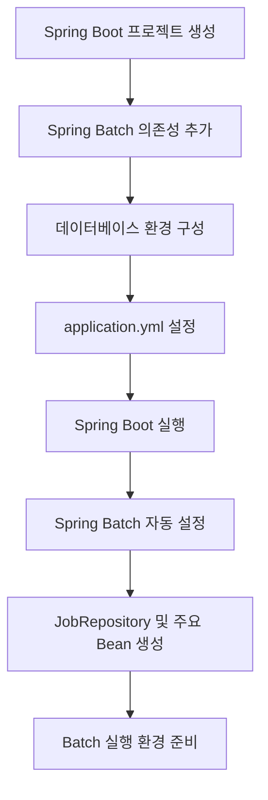

이 과정에서 중요한 것은 단순히 프로젝트를 실행하는 방법을 아는 것이 아니다.

**Spring Boot가 어떤 설정을 자동으로 처리하고, Spring Batch가 어떤 구성 요소를 생성하는지 이해하는 것**이다.

이 구조를 알아두면 이후 Job과 Step을 정의하거나, 실행 환경을 변경하거나, 배치 초기화 과정에서 오류가 발생했을 때 원인을 파악하기 쉬워진다.

---

### Spring Batch 개발 환경

먼저 사용할 개발 환경을 정리해보자.

| 구분              | 사용 기술                   |
| --------------- | ----------------------- |
| Language        | Java 17                 |
| Framework       | Spring Boot 3.4.13      |
| Batch Framework | Spring Batch 5.2.4      |
| Build Tool      | Maven                   |
| Database        | MySQL 8.4, H2           |
| IDE             | IntelliJ IDEA           |
| Packaging       | Jar                     |
| Database 실행     | Docker Compose 또는 직접 설치 |

Spring Batch와 Spring Boot는 버전별로 설정 방식이 다르다.

예를 들어 Spring Batch 4에서는 `JobBuilderFactory`, `StepBuilderFactory`를 이용해 Job과 Step을 생성하는 방식이 일반적이었다.

반면 Spring Batch 5에서는 `JobRepository`를 전달하여 `JobBuilder`, `StepBuilder`를 직접 생성한다.

Spring Boot 3.4에서는 Spring Batch 5.2 계열을 사용하며, Spring Boot 3.x의 최소 Java 요구 버전은 17이다.

따라서 인터넷에서 찾은 예제를 그대로 복사하기보다는 사용하는 Spring Batch 버전에 맞게 설정해야 한다.

이후 설명에서는 Spring Batch 5.2를 기준으로 진행한다.

---

### Spring Boot 프로젝트 생성

Spring Boot 프로젝트를 생성하는 방법은 크게 두 가지가 있다.

IntelliJ IDEA에서 Spring Initializr를 이용하는 방법과 Spring Initializr 웹사이트를 이용하는 방법이다.

두 방법 모두 동일한 Spring Boot 프로젝트를 생성할 수 있다.

#### IntelliJ IDEA에서 프로젝트 생성

IntelliJ IDEA의 프로젝트 생성 기능을 이용하면 Spring Boot 프로젝트를 쉽게 만들 수 있다.

Spring Initializr를 지원하는 IDE 환경이라면 새로운 프로젝트를 생성하면서 Spring Boot를 선택할 수 있다.

프로젝트 생성 화면에서는 다음 정보를 설정한다.

| 항목           | 설정값               | 설명           |
| ------------ | ----------------- | ------------ |
| Name         | spring-batch-demo | 프로젝트 이름      |
| Language     | Java              | 개발 언어        |
| Type         | Maven             | 빌드 도구        |
| Group        | com.example       | 프로젝트 그룹      |
| Artifact     | spring-batch-demo | 생성되는 아티팩트 이름 |
| Package Name | com.example.batch | 기본 패키지       |
| JDK          | Java 17           | 사용할 JDK      |
| Packaging    | Jar               | 패키징 방식       |

여기서 Group과 Artifact는 프로젝트를 식별하는 데 사용된다.

Maven 프로젝트에서는 이 두 값이 중요한 식별 정보가 된다.

예를 들어 다음과 같다.

```xml
<groupId>com.example</groupId>
<artifactId>spring-batch-demo</artifactId>
```

Group은 일반적으로 조직이나 프로젝트의 네임스페이스를 나타낸다.

Artifact는 해당 그룹 안에서 생성되는 프로젝트의 이름이다.

#### Jar와 War의 차이

Spring Boot 프로젝트를 생성할 때 패키징 방식도 선택해야 한다.

대표적으로 `Jar`와 `War`가 있다.

Jar는 Java 애플리케이션을 하나의 실행 가능한 아카이브로 패키징하는 방식이다.

Spring Boot 애플리케이션에서는 다음과 같이 실행할 수 있다.

```bash
java -jar spring-batch-demo.jar
```

반면 War는 일반적으로 외부 Servlet Container에 배포하기 위한 패키징 방식이다.

배치 애플리케이션은 반드시 웹 서버를 통해 실행할 필요가 없다.

따라서 일반적인 독립 실행형 Spring Batch 애플리케이션이라면 Jar 패키징으로 충분하다.

#### Spring Initializr 웹사이트 이용

IntelliJ IDEA의 Spring Boot 프로젝트 생성 기능을 사용할 수 없다면 Spring Initializr를 이용하면 된다.

Spring Initializr는 Spring Boot 프로젝트를 생성할 수 있는 공식 서비스다.

웹사이트에서 Maven, Java, 프로젝트 이름, 패키징 방식 등을 설정한 뒤 프로젝트를 생성할 수 있다.

생성된 프로젝트는 ZIP 파일 형태로 내려받을 수 있으며, 압축을 해제한 뒤 IntelliJ IDEA, Eclipse, STS 등 원하는 IDE에서 열면 된다.

다만 Spring Initializr에서는 지원 중인 Spring Boot 버전 위주로 선택지를 제공하므로, 특정 이전 버전으로 프로젝트를 구성하려면 생성 후 `pom.xml`의 Spring Boot 버전을 조정해야 할 수 있다.

---

### 프로젝트 생성 시 Spring Batch 의존성 선택

Spring Initializr에서 프로젝트를 생성할 때는 필요한 의존성을 함께 선택할 수 있다.

Spring Batch를 사용하기 위해 가장 먼저 필요한 것은 다음 의존성이다.

```text
Spring Batch
```

이 항목을 선택하면 Maven 프로젝트에 다음 의존성이 추가된다.

```xml
<dependency>
    <groupId>org.springframework.boot</groupId>
    <artifactId>spring-boot-starter-batch</artifactId>
</dependency>
```

이것이 Spring Boot에서 Spring Batch를 사용하기 위한 기본 Starter다.

Spring Batch 관련 모든 라이브러리를 하나씩 직접 추가할 필요는 없다.

Starter가 필요한 주요 라이브러리를 전이 의존성(Transitive Dependency)으로 가져오기 때문이다.

여기서 Starter가 무엇인지 이해해두면 좋다.

---

### Spring Boot Starter란?

Spring Boot Starter는 특정 기능을 사용하는 데 필요한 의존성을 묶어서 제공하는 모듈이다.

예를 들어 Spring MVC를 사용하려면 Spring MVC 관련 라이브러리뿐 아니라 여러 부가적인 라이브러리가 필요하다.

하지만 Spring Boot에서는 다음과 같은 Starter를 제공한다.

```xml
<dependency>
    <groupId>org.springframework.boot</groupId>
    <artifactId>spring-boot-starter-web</artifactId>
</dependency>
```

이 의존성 하나로 웹 애플리케이션에 필요한 기본 구성을 가져올 수 있다.

Spring Batch도 마찬가지다.

```xml
<dependency>
    <groupId>org.springframework.boot</groupId>
    <artifactId>spring-boot-starter-batch</artifactId>
</dependency>
```

를 추가하면 Spring Batch를 사용하는 데 필요한 주요 라이브러리를 함께 가져온다.

대표적으로 다음 두 모듈이 포함된다.

```text
spring-batch-core

spring-batch-infrastructure
```

이 두 모듈은 Spring Batch의 핵심 구성 요소다.

#### spring-batch-core

`spring-batch-core`는 Job과 Step을 실행하고 관리하는 기능을 제공한다.

대표적인 구성 요소는 다음과 같다.

```text
Job

Step

JobExecution

StepExecution

JobRepository

JobLauncher
```

Job과 Step의 실행 흐름, 실행 상태, 배치 메타데이터 등을 다루는 데 필요한 핵심 API가 포함되어 있다.

#### spring-batch-infrastructure

`spring-batch-infrastructure`는 데이터 처리에 필요한 공통 기능을 제공한다.

대표적으로 다음과 같은 구성 요소가 있다.

```text
ItemReader

ItemProcessor

ItemWriter

ItemStream

RepeatTemplate
```

파일이나 데이터베이스에서 데이터를 읽고, 가공하고, 저장하는 데 필요한 다양한 구현체가 포함되어 있다.

전체 관계를 단순화하면 다음과 같다.

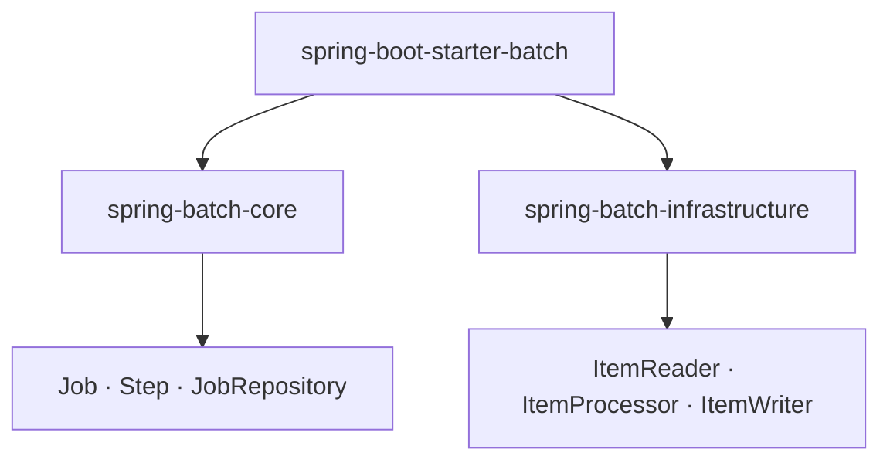

따라서 Spring Batch Starter를 추가하면 앞에서 살펴본 Batch Core와 Batch Infrastructure를 활용할 수 있는 기반이 준비된다.

---

### Maven 의존성 설정

이번에는 실제 `pom.xml`을 작성해보자.

Spring Batch뿐 아니라 이후 데이터베이스 연동과 테스트를 위한 의존성까지 포함한다.

#### pom.xml 전체 설정

```xml
<?xml version="1.0" encoding="UTF-8"?>
<project xmlns="http://maven.apache.org/POM/4.0.0"
         xmlns:xsi="http://www.w3.org/2001/XMLSchema-instance"
         xsi:schemaLocation="
             http://maven.apache.org/POM/4.0.0
             https://maven.apache.org/xsd/maven-4.0.0.xsd">

    <modelVersion>4.0.0</modelVersion>

    <parent>
        <groupId>org.springframework.boot</groupId>
        <artifactId>spring-boot-starter-parent</artifactId>
        <version>3.4.13</version>
        <relativePath/>
    </parent>

    <groupId>com.example</groupId>
    <artifactId>spring-batch-demo</artifactId>
    <version>0.0.1-SNAPSHOT</version>

    <name>spring-batch-demo</name>
    <description>Spring Batch Application</description>

    <properties>
        <java.version>17</java.version>
    </properties>

    <dependencies>

        <!-- Spring Batch -->
        <dependency>
            <groupId>org.springframework.boot</groupId>
            <artifactId>spring-boot-starter-batch</artifactId>
        </dependency>

        <!-- H2 Database -->
        <dependency>
            <groupId>com.h2database</groupId>
            <artifactId>h2</artifactId>
            <scope>runtime</scope>
        </dependency>

        <!-- MySQL JDBC Driver -->
        <dependency>
            <groupId>com.mysql</groupId>
            <artifactId>mysql-connector-j</artifactId>
            <scope>runtime</scope>
        </dependency>

        <!-- Spring Boot Test -->
        <dependency>
            <groupId>org.springframework.boot</groupId>
            <artifactId>spring-boot-starter-test</artifactId>
            <scope>test</scope>
        </dependency>

        <!-- Spring Batch Test -->
        <dependency>
            <groupId>org.springframework.batch</groupId>
            <artifactId>spring-batch-test</artifactId>
            <scope>test</scope>
        </dependency>

    </dependencies>

    <build>
        <plugins>
            <plugin>
                <groupId>org.springframework.boot</groupId>
                <artifactId>spring-boot-maven-plugin</artifactId>
            </plugin>
        </plugins>
    </build>

</project>
```

이 설정에서 중요한 부분을 살펴보자.

#### Spring Boot Parent

```xml
<parent>
    <groupId>org.springframework.boot</groupId>
    <artifactId>spring-boot-starter-parent</artifactId>
    <version>3.4.13</version>
    <relativePath/>
</parent>
```

Spring Boot Parent는 Spring Boot 애플리케이션에서 사용할 주요 라이브러리 버전과 Maven 플러그인 설정을 관리한다.

따라서 의존성을 추가할 때 매번 버전을 직접 작성하지 않아도 된다.

예를 들어 다음 의존성에는 버전이 없다.

```xml
<dependency>
    <groupId>org.springframework.boot</groupId>
    <artifactId>spring-boot-starter-batch</artifactId>
</dependency>
```

하지만 Maven은 Spring Boot가 관리하는 버전을 사용해 적절한 라이브러리를 가져온다.

버전 관리 대상이 되는 라이브러리는 Spring Batch뿐만 아니라 Spring Framework, JDBC Driver 등 다양하다.

이러한 방식은 서로 호환되는 라이브러리 버전을 유지하는 데 도움이 된다.

#### Java 버전 설정

```xml
<properties>
    <java.version>17</java.version>
</properties>
```

프로젝트에서 사용할 Java 버전을 설정한다.

이 설정과 실제 개발 환경의 JDK 버전이 일치하는지 확인해야 한다.

터미널에서 다음 명령어를 실행할 수 있다.

```bash
java -version
```

이 명령은 현재 실행 환경에서 사용되는 Java 버전을 출력한다.

Maven이 사용하는 Java 버전도 확인할 수 있다.

```bash
./mvnw -version
```

실행 결과에서 Java 버전과 Maven 버전을 확인하면 된다.

Java 버전을 설정했더라도 IDE와 Maven이 다른 JDK를 사용하면 컴파일 과정에서 문제가 발생할 수 있다.

따라서 IntelliJ IDEA의 Project SDK와 Maven Runner에 설정된 JDK도 확인하는 것이 좋다.

---

### Spring Batch 의존성 확인

Maven 의존성 설정을 완료했다면 실제로 어떤 라이브러리가 추가되었는지 확인해보자.

다음 명령어를 사용할 수 있다.

```bash
./mvnw dependency:tree -Dincludes=org.springframework.batch
```

이 명령어는 Maven의 의존성 트리를 출력하되 `org.springframework.batch` 그룹에 해당하는 라이브러리를 중심으로 보여준다.

Spring Boot 3.4.13을 기준으로 구성했다면 주요 Spring Batch 라이브러리는 5.2.4 버전으로 관리된다.

따라서 다음과 같은 의존성이 포함되는 것을 확인할 수 있다.

```text
spring-batch-core:5.2.4

spring-batch-infrastructure:5.2.4

spring-batch-test:5.2.4
```

여기서 `spring-batch-test`는 테스트 의존성이므로 실제 애플리케이션 실행을 위한 런타임 라이브러리와는 사용 범위가 다르다.

의존성 트리를 확인하는 습관은 실무에서도 유용하다.

특히 Spring Boot나 Spring Batch의 버전을 변경했을 때 의도하지 않은 버전이 포함되어 있지 않은지 확인할 수 있다.

---

### Spring Batch에서 데이터베이스가 필요한 이유

Spring Batch 프로젝트를 처음 구성할 때 가장 자주 혼동하는 부분 중 하나가 데이터베이스 설정이다.

일반적인 Spring Boot 애플리케이션에서는 데이터베이스를 사용하지 않는 프로젝트도 만들 수 있다.

하지만 Spring Batch 5.2의 기본 실행 인프라는 `JobRepository`를 중심으로 동작한다.

`JobRepository`는 Job과 Step의 실행 정보를 관리한다.

예를 들어 다음과 같은 정보를 기록한다.

```text
어떤 Job이 실행되었는가?

언제 실행되었는가?

현재 실행 상태는 무엇인가?

정상적으로 종료되었는가?

실패한 Step은 무엇인가?

재시작에 필요한 상태는 무엇인가?
```

Spring Batch는 이러한 정보를 메타데이터라고 부른다.

일반적인 JDBC 기반 구성에서는 배치 실행 메타데이터를 데이터베이스에 저장한다.

대표적인 테이블은 다음과 같다.

```text
BATCH_JOB_INSTANCE

BATCH_JOB_EXECUTION

BATCH_JOB_EXECUTION_PARAMS

BATCH_STEP_EXECUTION

BATCH_JOB_EXECUTION_CONTEXT

BATCH_STEP_EXECUTION_CONTEXT
```

이 테이블들은 배치에서 실제로 처리하는 비즈니스 데이터와는 목적이 다르다.

예를 들어 정산 배치를 실행한다고 생각해보자.

정산 결과는 `SETTLEMENT` 테이블에 저장할 수 있다.

하지만 정산 Job이 실행된 횟수나 실행 상태는 Spring Batch 메타데이터 테이블에서 관리한다.

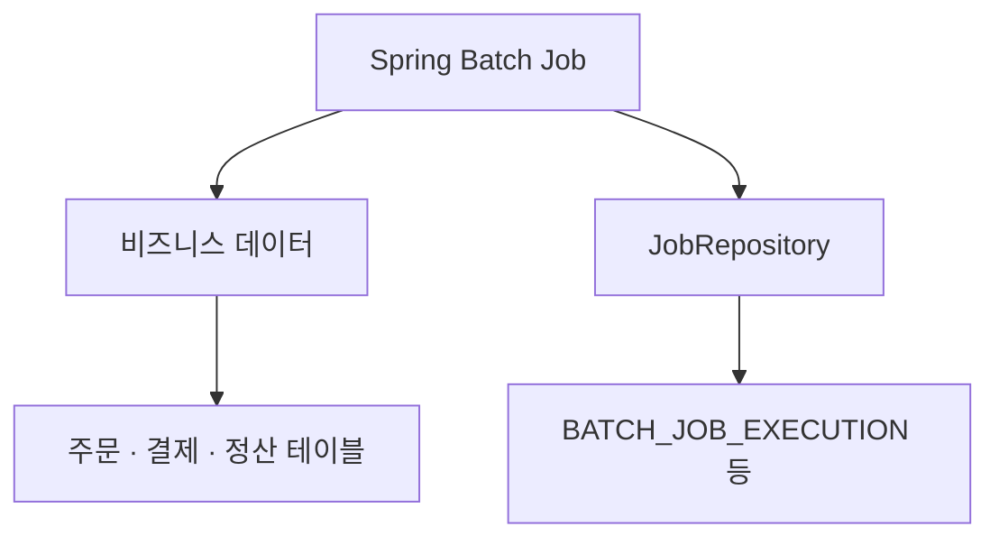

이처럼 Spring Batch에서는 **비즈니스 데이터를 저장하는 영역과 배치 실행 정보를 관리하는 영역을 구분**한다.

---

### H2와 MySQL 중 어떤 데이터베이스를 사용할까?

Spring Batch를 처음 실행해보는 단계에서는 H2가 편리하다.

H2는 Java 기반 데이터베이스이며 메모리 모드로 실행할 수 있다.

따라서 별도의 데이터베이스 서버를 설치하지 않아도 Spring Batch 초기화와 간단한 실행 흐름을 확인할 수 있다.

반면 실제 운영 환경과 유사한 데이터베이스 동작을 확인하려면 MySQL 같은 외부 데이터베이스를 사용하는 편이 유리하다.

| 구분     | H2            | MySQL          |
| ------ | ------------- | -------------- |
| 설치     | 의존성 추가로 사용 가능 | 별도 서버 필요       |
| 실행 방식  | 메모리 또는 파일 기반  | 독립 데이터베이스 서버   |
| 개발 편의성 | 높음            | 상대적으로 설정이 많음   |
| 데이터 유지 | 설정에 따라 다름     | 영속 저장 가능       |
| 주요 용도  | 간단한 개발·테스트    | 운영 환경 및 통합 테스트 |

이번에는 H2와 MySQL을 모두 사용할 수 있도록 구성한다.

단, 한 번 실행할 때는 하나의 데이터베이스 환경을 선택한다.

이를 위해 Spring Profile을 활용한다.

---

### Spring Profile로 데이터베이스 환경 구분하기

Spring Boot에서는 Profile을 이용해 환경별 설정을 구분할 수 있다.

예를 들어 개발 환경에서는 H2를 사용하고, MySQL 연동이 필요한 경우에는 별도의 Profile을 활성화할 수 있다.

프로젝트의 설정 파일을 다음과 같이 구성해보자.

```text
src/main/resources
    │
    ├── application.yml
    │
    ├── application-local.yml
    │
    └── application-mysql.yml
```

각 파일의 역할은 다음과 같다.

| 파일                      | 역할       |
| ----------------------- | -------- |
| `application.yml`       | 공통 설정    |
| `application-local.yml` | H2 설정    |
| `application-mysql.yml` | MySQL 설정 |

#### application.yml

먼저 공통 설정을 작성한다.

```yaml
spring:
  application:
    name: spring-batch-demo

  profiles:
    default: local

  batch:
    job:
      enabled: true
```

`spring.application.name`은 애플리케이션 이름이다.

```yaml
spring:
  application:
    name: spring-batch-demo
```

이 이름은 로그나 모니터링 환경에서 애플리케이션을 구분하는 데 활용할 수 있다.

다음 설정은 활성화된 Profile이 별도로 없다면 `local`을 기본 Profile로 사용하도록 한다.

```yaml
spring:
  profiles:
    default: local
```

따라서 Profile을 지정하지 않고 애플리케이션을 실행하면 H2 환경을 사용하게 된다.

마지막으로 다음 설정이 있다.

```yaml
spring:
  batch:
    job:
      enabled: true
```

이 설정은 Spring Boot가 애플리케이션 시작 과정에서 Job을 자동 실행할 수 있도록 한다.

기본값 역시 `true`이므로 생략할 수 있지만, 설정의 의미를 확인하기 위해 명시했다.

다만 아직 Job을 정의하지 않았다면 실행할 Job이 없으므로 배치 작업이 수행되지는 않는다.

---

### H2 데이터베이스 설정

이번에는 `application-local.yml`을 작성한다.

```yaml
spring:
  datasource:
    url: jdbc:h2:mem:batchdb;DB_CLOSE_DELAY=-1
    driver-class-name: org.h2.Driver
    username: sa
    password:

  batch:
    jdbc:
      initialize-schema: always
```

하나씩 살펴보자.

#### spring.datasource.url

```yaml
url: jdbc:h2:mem:batchdb;DB_CLOSE_DELAY=-1
```

H2를 메모리 모드로 실행하도록 설정한다.

`batchdb`는 데이터베이스 이름이다.

`DB_CLOSE_DELAY=-1`은 데이터베이스 연결이 모두 종료되어도 JVM이 살아 있는 동안 해당 메모리 데이터베이스가 사라지지 않도록 설정한다.

다만 JVM 자체가 종료되면 메모리 데이터베이스의 내용은 유지되지 않는다.

따라서 이 설정은 간단한 실행 확인이나 테스트에 적합하다.

#### driver-class-name

```yaml
driver-class-name: org.h2.Driver
```

H2 JDBC Driver를 지정한다.

Spring Boot는 JDBC Driver를 자동으로 감지할 수 있지만, 여기서는 어떤 드라이버를 사용하는지 명확하게 보여주기 위해 작성했다.

#### initialize-schema

```yaml
spring:
  batch:
    jdbc:
      initialize-schema: always
```

이 설정은 Spring Batch가 사용하는 메타데이터 스키마를 초기화하도록 한다.

Spring Boot 3.4에서는 `spring.batch.jdbc.initialize-schema`를 통해 메타데이터 스키마 초기화 방식을 지정할 수 있다.

기본값은 `embedded`이며, 외부 데이터베이스까지 초기화하려면 `always`를 명시할 수 있다.

H2처럼 매번 새롭게 생성되는 개발용 데이터베이스에서는 테이블을 자동 생성하도록 설정하면 편리하다.

---

### MySQL 데이터베이스 구성

이번에는 MySQL을 사용해보자.

MySQL은 직접 설치할 수도 있고 Docker를 이용해 실행할 수도 있다.

개발 환경에서는 Docker를 사용하면 데이터베이스를 실행하고 종료하기 편리하다.

특히 프로젝트별로 독립적인 데이터베이스 환경을 구성할 수 있다는 장점이 있다.

이번에는 Docker Compose를 이용해 MySQL을 실행한다.

#### docker-compose.yml 전체 코드

프로젝트 루트에 다음 파일을 생성한다.

```text
spring-batch-demo
    │
    ├── pom.xml
    │
    ├── docker-compose.yml
    │
    └── src
```

`docker-compose.yml`의 내용은 다음과 같다.

```yaml
services:
  mysql:
    image: mysql:8.4
    container_name: spring-batch-mysql

    restart: unless-stopped

    environment:
      MYSQL_ROOT_PASSWORD: localrootpass
      MYSQL_DATABASE: batch_db
      MYSQL_USER: batch_user
      MYSQL_PASSWORD: localpass
      TZ: Asia/Seoul

    ports:
      - "3307:3306"

    volumes:
      - batch-mysql-data:/var/lib/mysql

volumes:
  batch-mysql-data:
```

이 설정은 로컬 개발 환경에서 사용할 MySQL 컨테이너를 생성한다.

#### image

```yaml
image: mysql:8.4
```

MySQL 8.4 이미지를 사용한다.

태그를 명시하면 무조건 최신 버전의 MySQL을 가져오는 것이 아니라 지정한 버전 계열을 사용한다.

이를 통해 개발 환경에서 사용하는 데이터베이스 버전을 일정하게 유지할 수 있다.

#### container_name

```yaml
container_name: spring-batch-mysql
```

컨테이너 이름을 지정한다.

이후 Docker 명령어에서 해당 이름으로 컨테이너를 확인하거나 접속할 수 있다.

#### restart

```yaml
restart: unless-stopped
```

Docker 데몬이나 컨테이너가 재시작되는 상황에서 자동 재시작 정책을 적용한다.

단, 명시적으로 중지한 컨테이너에 대해서는 자동 재시작하지 않는다.

#### environment

```yaml
environment:
  MYSQL_ROOT_PASSWORD: localrootpass
  MYSQL_DATABASE: batch_db
  MYSQL_USER: batch_user
  MYSQL_PASSWORD: localpass
  TZ: Asia/Seoul
```

MySQL 초기화에 필요한 환경변수를 지정한다.

`MYSQL_DATABASE`는 생성할 데이터베이스 이름이다.

`MYSQL_USER`와 `MYSQL_PASSWORD`는 애플리케이션에서 사용할 계정을 생성하는 데 사용한다.

여기 작성한 비밀번호는 로컬 개발을 위한 예시다.

실제 운영 환경에서는 비밀번호를 설정 파일에 직접 작성하지 않고 환경변수나 별도의 비밀정보 관리 시스템을 이용해야 한다.

또한 MySQL 컨테이너의 이러한 초기화 변수는 일반적으로 데이터 디렉터리가 처음 초기화될 때 적용된다.

이미 생성된 데이터 볼륨이 있다면 환경변수를 변경해도 기존 사용자나 데이터베이스 설정이 자동으로 변경되는 것은 아니다.

#### ports

```yaml
ports:
  - "3307:3306"
```

호스트의 3307 포트를 컨테이너의 3306 포트에 연결한다.

MySQL은 기본적으로 3306 포트를 사용한다.

하지만 로컬 개발 환경에 이미 MySQL이 설치되어 있다면 포트 충돌이 발생할 수 있다.

이를 방지하기 위해 호스트에서는 3307 포트를 사용한다.

따라서 Spring Boot에서 접속할 주소는 다음과 같다.

```text
localhost:3307
```

#### volumes

```yaml
volumes:
  - batch-mysql-data:/var/lib/mysql
```

MySQL 데이터를 Docker Volume에 저장한다.

이 설정이 없다면 컨테이너를 삭제했을 때 데이터까지 함께 사라질 수 있다.

Volume을 사용하면 컨테이너를 다시 생성하더라도 기존 데이터를 유지할 수 있다.

---

### Docker Compose로 MySQL 실행하기

설정 파일을 작성했다면 다음 명령어를 실행한다.

```bash
docker compose up -d
```

이 명령어는 `docker-compose.yml`에 정의된 서비스를 생성하고 백그라운드에서 실행한다.

옵션을 살펴보면 다음과 같다.

| 옵션   | 의미           |
| ---- | ------------ |
| `up` | 서비스를 생성하고 실행 |
| `-d` | 백그라운드 실행     |

정상적으로 실행되었다면 다음 명령어로 상태를 확인할 수 있다.

```bash
docker compose ps
```

실행 중인 서비스와 포트 매핑 상태를 확인할 수 있다.

다음과 같은 형태로 표시된다.

```text
NAME                 IMAGE       STATUS       PORTS
spring-batch-mysql   mysql:8.4   Up           0.0.0.0:3307->3306/tcp
```

실제 상태와 출력 형식은 Docker 환경에 따라 달라질 수 있다.

#### 로그 확인

MySQL 초기화 과정을 확인하려면 다음 명령어를 사용한다.

```bash
docker compose logs -f mysql
```

`logs`는 컨테이너 로그를 출력한다.

`-f`는 새로운 로그가 발생할 때마다 계속 출력하도록 하는 옵션이다.

MySQL이 초기화되는 과정에서 사용자와 데이터베이스가 생성되며, 정상적으로 준비되면 접속을 받을 수 있는 상태가 된다.

#### MySQL 접속

다음 명령어로 MySQL 컨테이너 안에서 MySQL 클라이언트를 실행할 수 있다.

```bash
docker exec -it spring-batch-mysql \
  mysql -u batch_user -p batch_db
```

비밀번호 입력 메시지가 나타나면 설정한 비밀번호를 입력한다.

접속에 성공하면 다음 SQL을 실행할 수 있다.

```sql
SHOW DATABASES;
```

생성된 데이터베이스 목록을 확인한다.

```sql
SHOW TABLES;
```

현재 데이터베이스에 생성된 테이블 목록을 확인한다.

아직 Spring Batch 애플리케이션을 실행하지 않았다면 Spring Batch 메타데이터 테이블이 생성되지 않았을 수 있다.

---

### MySQL용 application.yml 설정

이번에는 MySQL 접속 설정을 작성해보자.

`application-mysql.yml` 파일을 생성한다.

```yaml
spring:
  datasource:
    url: jdbc:mysql://localhost:3307/batch_db
    driver-class-name: com.mysql.cj.jdbc.Driver
    username: ${BATCH_DB_USERNAME:batch_user}
    password: ${BATCH_DB_PASSWORD:localpass}

  batch:
    jdbc:
      initialize-schema: always
```

H2와 다른 부분은 데이터베이스 접속 정보다.

```yaml
url: jdbc:mysql://localhost:3307/batch_db
```

Docker Compose에서 설정한 호스트 포트인 3307을 사용한다.

또한 계정 정보는 환경변수를 통해 변경할 수 있도록 구성했다.

```yaml
username: ${BATCH_DB_USERNAME:batch_user}
password: ${BATCH_DB_PASSWORD:localpass}
```

환경변수가 존재하면 해당 값을 사용하고, 존재하지 않으면 뒤에 지정된 기본값을 사용한다.

단, 이 기본값은 개발용 설정이며 운영 환경에서는 반드시 별도의 안전한 자격증명 관리 방식이 필요하다.

#### MySQL에서 스키마 자동 생성

```yaml
spring:
  batch:
    jdbc:
      initialize-schema: always
```

MySQL 환경에서도 Spring Batch 메타데이터 테이블을 생성하도록 설정했다.

다만 실제 운영 환경에서는 `always`를 무조건 사용하는 것을 권장하지 않는다.

운영 데이터베이스에서는 테이블 구조 변경을 Flyway나 Liquibase 같은 스키마 마이그레이션 도구로 관리하는 편이 일반적이다.

따라서 개발 환경에서는 `always`로 편리하게 초기화할 수 있지만 운영 환경에서는 별도로 스키마를 관리하고 필요에 따라 `never`를 사용하도록 구성하는 것이 좋다.

---

### Spring Batch 메타데이터 테이블 확인

MySQL 설정을 완료했다면 Spring Boot 애플리케이션을 실행해보자.

다음 명령어를 사용할 수 있다.

```bash
./mvnw spring-boot:run \
  -Dspring-boot.run.profiles=mysql
```

이 명령어는 Spring Boot 애플리케이션을 실행하면서 `mysql` Profile을 활성화한다.

따라서 다음 파일의 설정이 적용된다.

```text
application-mysql.yml
```

데이터베이스 연결과 스키마 초기화가 정상적으로 완료되었다면 MySQL에 Spring Batch 메타데이터 테이블이 생성된다.

MySQL에 접속하여 다음 명령어를 실행한다.

```sql
SHOW TABLES;
```

정상적으로 초기화되었다면 다음과 같은 테이블을 확인할 수 있다.

```text
BATCH_JOB_INSTANCE

BATCH_JOB_EXECUTION

BATCH_JOB_EXECUTION_PARAMS

BATCH_STEP_EXECUTION

BATCH_JOB_EXECUTION_CONTEXT

BATCH_STEP_EXECUTION_CONTEXT
```

테이블의 이름과 실제 출력 대소문자는 데이터베이스 환경에 따라 다르게 표시될 수 있다.

이러한 테이블이 생성되었다는 것은 Spring Batch가 실행 메타데이터를 관리할 수 있는 데이터베이스 기반을 준비했다는 의미다.

단, 아직 Job을 직접 정의하지 않았다면 Job 실행 기록은 존재하지 않을 수 있다.

---

### Spring Batch를 활성화하는 방법

Spring Batch 프로젝트를 구성할 때 중요한 부분이 바로 Spring Batch 활성화 방식이다.

Spring Batch에는 다음과 같은 애너테이션이 존재한다.

```java
@EnableBatchProcessing
```

이름에서 알 수 있듯 Spring Batch 관련 기본 구성 요소를 생성하도록 활성화하는 애너테이션이다.

그런데 Spring Boot를 사용하는 경우에는 이 애너테이션을 어떻게 사용해야 할까?

이 부분은 반드시 Spring Batch와 Spring Boot의 역할을 구분해서 이해해야 한다.

#### @EnableBatchProcessing의 역할

일반적인 Spring Framework 환경에서 Spring Batch를 직접 구성한다면 다음과 같이 사용할 수 있다.

```java
@Configuration
@EnableBatchProcessing
public class BatchConfiguration {
}
```

`@EnableBatchProcessing`은 Spring Batch를 실행하기 위한 기본 인프라 구성을 제공한다.

예를 들어 다음과 같은 객체들이 필요하다.

```text
JobRepository

JobLauncher

JobExplorer

JobRegistry
```

이들은 Job을 실행하고 실행 상태를 관리하는 데 필요한 중요한 구성 요소다.

Spring Batch 5.2에서는 `@EnableBatchProcessing` 또는 `DefaultBatchConfiguration`을 이용해 이러한 배치 인프라를 구성할 수 있다.

하지만 Spring Boot 기반 애플리케이션이라면 상황이 달라진다.

---

### Spring Boot에서는 @EnableBatchProcessing이 필수가 아니다

Spring Boot에서는 Starter를 통한 자동 설정을 제공한다.

앞에서 다음 의존성을 추가했다.

```xml
<dependency>
    <groupId>org.springframework.boot</groupId>
    <artifactId>spring-boot-starter-batch</artifactId>
</dependency>
```

Spring Boot는 클래스패스에 Spring Batch 관련 라이브러리가 있는지 확인한다.

그리고 필요한 조건을 만족하면 `BatchAutoConfiguration`을 통해 Spring Batch 관련 설정을 자동으로 구성한다.

따라서 Spring Boot 3.4 기반의 일반적인 Spring Batch 애플리케이션에서는 다음과 같이 작성하면 된다.

```java
package com.example.batch;

import org.springframework.boot.SpringApplication;
import org.springframework.boot.autoconfigure.SpringBootApplication;

@SpringBootApplication
public class SpringBatchApplication {

    public static void main(String[] args) {
        SpringApplication.run(
                SpringBatchApplication.class,
                args
        );
    }
}
```

여기에는 `@EnableBatchProcessing`이 없다.

하지만 Spring Boot의 자동 설정 기능을 통해 Spring Batch 실행 환경이 구성될 수 있다.

오히려 Spring Boot 3.4에서는 `@EnableBatchProcessing`을 직접 추가하거나 `DefaultBatchConfiguration`을 상속하면 Spring Boot의 Batch 자동 설정을 비활성화하고 직접 설정을 제어하는 방식으로 전환된다.

따라서 다음 두 방식은 동일하지 않다.

```java
@SpringBootApplication
public class SpringBatchApplication {
}
```

```java
@SpringBootApplication
@EnableBatchProcessing
public class SpringBatchApplication {
}
```

첫 번째는 Spring Boot의 자동 설정을 활용하는 방식이다.

두 번째는 Spring Batch 인프라 구성을 명시적으로 활성화하는 방식이며, Spring Boot가 제공하는 자동 설정 일부가 적용되지 않을 수 있다.

**일반적인 Spring Boot 기반 배치 프로젝트에서는 `@EnableBatchProcessing`을 불필요하게 추가하지 않는 편이 좋다.**

특별한 목적이 있어 직접 배치 인프라를 구성해야 한다면 그때 사용을 검토하면 된다.

---

### Spring Batch 자동 설정은 어떻게 동작할까?

Spring Boot의 자동 설정을 이해하려면 먼저 `@SpringBootApplication`을 살펴볼 필요가 있다.

이 애너테이션은 여러 기능을 조합한 애너테이션이다.

대표적으로 다음과 같은 애너테이션이 포함된다.

```java
@SpringBootConfiguration

@EnableAutoConfiguration

@ComponentScan
```

각각의 역할을 살펴보자.

`@SpringBootConfiguration`은 Spring Boot 애플리케이션의 설정 클래스임을 나타낸다.

`@ComponentScan`은 지정된 패키지 범위에서 Spring Bean을 탐색한다.

그리고 `@EnableAutoConfiguration`은 클래스패스와 설정 정보를 기반으로 필요한 자동 설정을 적용한다.

여기서 Spring Batch와 관련된 자동 설정이 동작한다.

#### BatchAutoConfiguration

Spring Boot에는 다음과 같은 자동 설정 클래스가 있다.

```java
BatchAutoConfiguration
```

이 클래스는 Spring Batch를 실행하기 위한 환경을 자동으로 구성하는 역할을 담당한다.

대표적으로 다음 기능과 관련된다.

* Spring Batch 실행 인프라 구성
* JobRepository 관련 설정
* 배치 메타데이터 스키마 초기화
* 애플리케이션 시작 시 Job 자동 실행

Spring Boot에서 제공하는 이러한 자동 설정 덕분에 개발자는 필요한 의존성과 데이터베이스 설정을 준비하는 것만으로 Spring Batch를 사용할 수 있다.

---

### Spring Batch 초기화 과정

Spring Boot 애플리케이션이 시작된다고 생각해보자.

다음 메서드가 실행된다.

```java
SpringApplication.run(
        SpringBatchApplication.class,
        args
);
```

그러면 Spring Boot는 애플리케이션 실행에 필요한 설정을 처리한다.

Spring Batch 관점에서 중요한 흐름을 단순화하면 다음과 같다.

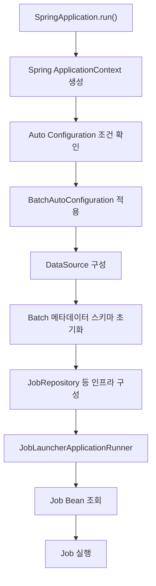

실제 Spring Bean 생성과 초기화는 의존관계 및 자동 설정 조건에 따라 수행되므로, 이 그림은 모든 내부 객체가 생성되는 정확한 순서를 표현한 것은 아니다.

전체 흐름을 이해하기 위한 개념적인 구조다.

이제 주요 구성 요소를 살펴보자.

---

### JobRepository 초기화

`JobRepository`는 Spring Batch의 중요한 구성 요소 중 하나다.

Spring Batch는 Job을 실행할 때 실행과 관련된 정보를 관리해야 한다.

예를 들어 다음과 같은 정보다.

```text
Job 실행 요청

JobInstance 생성

JobExecution 생성

StepExecution 생성

실행 상태 갱신
```

이러한 작업을 관리하는 것이 `JobRepository`다.

Spring Boot는 설정된 DataSource와 Spring Batch 인프라 구성을 이용해 `JobRepository`를 준비할 수 있다.

이때 데이터베이스 스키마가 올바르게 생성되어 있어야 한다.

따라서 Spring Batch 프로젝트에서 데이터베이스 연결과 메타데이터 테이블 구성이 중요한 이유를 알 수 있다.

---

### JobLauncher의 역할

`JobLauncher`는 Job 실행을 요청하는 역할을 담당한다.

개념적으로 다음과 같다.

```text
Job 실행 요청
      │
      ▼
JobLauncher
      │
      ▼
Job 실행
```

Spring Batch 5.2에서 `JobLauncher` 인터페이스의 핵심 메서드는 다음과 같다.

```java
JobExecution run(
        Job job,
        JobParameters jobParameters
) throws JobExecutionException;
```

첫 번째 매개변수는 실행할 Job이다.

```java
Job job
```

두 번째 매개변수는 Job 실행에 필요한 파라미터다.

```java
JobParameters jobParameters
```

Job 실행 결과는 `JobExecution`으로 반환된다.

`JobLauncher`는 Job을 실행하기 위한 진입점이라고 이해하면 된다.

---

### JobLauncherApplicationRunner란?

Spring Boot에서는 애플리케이션 시작 시 Job을 자동으로 실행하는 기능을 제공한다.

이 역할과 관련된 클래스가 다음과 같다.

```java
JobLauncherApplicationRunner
```

이 클래스는 Spring Boot의 `ApplicationRunner`를 구현한다.

`ApplicationRunner`는 Spring Boot 애플리케이션의 컨텍스트가 준비된 이후 실행할 작업을 정의하는 인터페이스다.

따라서 `JobLauncherApplicationRunner`를 이용하면 애플리케이션 시작 과정에서 등록된 Job을 실행할 수 있다.

Spring Boot의 `BatchAutoConfiguration`은 관련 조건을 만족할 때 이 Runner를 Bean으로 등록한다.

#### 실행 흐름

전체 과정을 단순화하면 다음과 같다.

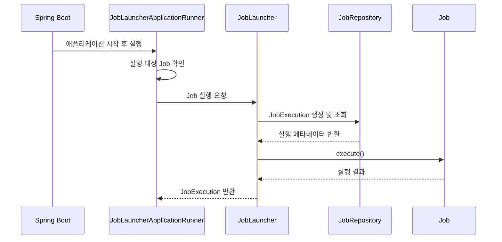

이 구조에서 중요한 점은 Spring Boot가 단순히 Job 객체를 생성하는 것에 그치지 않는다는 사실이다.

설정에 따라 애플리케이션 시작 후 등록된 Job을 자동으로 실행할 수도 있다.

---

### Job을 자동 실행하지 않으려면?

Spring Boot는 기본적으로 등록된 Job을 시작 시 실행할 수 있도록 구성한다.

하지만 항상 자동 실행이 필요한 것은 아니다.

예를 들어 다음과 같은 배치 시스템을 생각해보자.

```text
배치 애플리케이션 시작
       │
       ▼
작업 대기
       │
       ▼
스케줄러가 실행 요청
       │
       ▼
특정 Job 실행
```

이런 경우 애플리케이션이 시작되자마자 모든 Job이 실행되는 것은 원하지 않을 수 있다.

이때 다음 설정을 사용한다.

```yaml
spring:
  batch:
    job:
      enabled: false
```

이 설정은 Spring Boot가 애플리케이션 시작 시 Job을 자동으로 실행하는 기능을 비활성화한다.

단, Spring Batch 자체를 비활성화하는 것은 아니다.

Job을 정의하거나 `JobLauncher`를 이용해 수동으로 실행하는 기능은 여전히 사용할 수 있다.

즉 다음 두 개념은 다르다.

```text
Spring Batch 활성화

≠

Job 시작 시 자동 실행
```

이 차이를 알아두는 것이 중요하다.

---

### 여러 Job이 등록되어 있다면?

하나의 Spring Batch 애플리케이션에서 여러 Job을 정의할 수 있다.

예를 들어 다음과 같다.

```text
settlementJob

couponExpireJob

statisticsJob
```

이때 Spring Boot가 어떤 Job을 자동으로 실행해야 할지 결정해야 한다.

Spring Boot 3.4에서는 `spring.batch.job.name` 속성을 이용해 시작 시 실행할 Job을 선택할 수 있다.

```yaml
spring:
  batch:
    job:
      name: settlementJob
```

이렇게 설정하면 시작 시 실행 대상으로 `settlementJob`을 지정한다.

반대로 자동 실행을 원하지 않는다면 다음 설정을 사용한다.

```yaml
spring:
  batch:
    job:
      enabled: false
```

일반적으로 여러 종류의 배치를 운영하는 애플리케이션에서는 배치 실행 시점을 스케줄러나 별도의 실행 요청으로 통제하는 구조가 필요할 수 있다.

따라서 자동 실행 정책은 애플리케이션의 운영 방식에 맞게 결정해야 한다.

---

### Spring Batch 초기화 설정의 버전별 차이

Spring Batch의 설정 구조는 버전이 올라가면서 달라졌다.

이전 버전의 Spring Batch에서는 다음과 같은 클래스들이 중요한 역할을 담당했다.

```text
SimpleBatchConfiguration

BatchConfigurerConfiguration

BasicBatchConfigurer

JpaBatchConfigurer
```

또한 다음과 같은 Factory를 사용해 Job과 Step을 생성했다.

```java
JobBuilderFactory

StepBuilderFactory
```

이러한 구조에서는 `@EnableBatchProcessing`과 여러 설정 클래스가 Spring Batch 실행에 필요한 기본 객체들을 생성했다.

하지만 Spring Batch 5에서는 설정 방식이 변경되었다.

대표적으로 다음과 같은 차이가 있다.

| 항목                | Spring Batch 4.x     | Spring Batch 5.2                                        |
| ----------------- | -------------------- | ------------------------------------------------------- |
| Job 생성            | `JobBuilderFactory`  | `JobBuilder`                                            |
| Step 생성           | `StepBuilderFactory` | `StepBuilder`                                           |
| Batch 인프라 구성      | 기존 설정 클래스 중심         | `@EnableBatchProcessing`, `DefaultBatchConfiguration` 등 |
| Spring Boot 자동 설정 | Boot 2.x 기반          | Boot 3.x 기반                                             |
| Java 기준           | Java 8·11 사용 가능      | Java 17 이상                                              |

특히 `JobBuilderFactory`와 `StepBuilderFactory`는 Spring Batch 5에서 더 이상 권장되지 않는 방식이다.

새로운 코드를 작성할 때는 `JobRepository`를 전달하여 직접 Builder를 생성하는 방식이 적절하다.

예를 들어 다음과 같다.

```java
new JobBuilder("exampleJob", jobRepository)
```

Step도 같은 방식이다.

```java
new StepBuilder("exampleStep", jobRepository)
```

따라서 Spring Batch 내부 구조를 살펴볼 때는 현재 프로젝트에서 사용하는 버전을 기준으로 이해해야 한다.

기존 버전의 초기화 클래스 이름과 실행 흐름을 현대적인 Spring Boot 환경에 그대로 적용하면 실제 동작과 차이가 발생할 수 있다.

---

### Spring Batch 주요 Bean 확인하기

Spring Batch가 정상적으로 초기화되었다면 주요 구성 요소들이 Spring Bean으로 등록된다.

예를 들어 다음과 같은 객체들이다.

```text
JobRepository

JobLauncher

JobExplorer

JobRegistry
```

이러한 객체는 의존성 주입을 통해 사용할 수 있다.

예를 들어 다음과 같이 작성할 수 있다.

```java
import org.springframework.batch.core.launch.JobLauncher;
import org.springframework.batch.core.repository.JobRepository;
import org.springframework.context.annotation.Configuration;

@Configuration
public class BatchComponentConfiguration {

    private final JobRepository jobRepository;
    private final JobLauncher jobLauncher;

    public BatchComponentConfiguration(
            JobRepository jobRepository,
            JobLauncher jobLauncher
    ) {
        this.jobRepository = jobRepository;
        this.jobLauncher = jobLauncher;
    }
}
```

Spring은 생성자에 선언된 타입에 해당하는 Bean을 찾아 주입한다.

따라서 별도로 객체를 생성하지 않아도 Spring Batch의 주요 구성 요소를 사용할 수 있다.

#### 왜 직접 new 하지 않을까?

다음처럼 단순히 객체를 생성하는 것이 가능할 것처럼 생각할 수 있다.

```java
new JobRepository();
```

하지만 `JobRepository`는 인터페이스이므로 직접 인스턴스를 생성할 수 없다.

실제로는 이를 구현한 객체가 필요하며, 데이터베이스 연결과 트랜잭션 관리 등의 의존성도 함께 설정되어야 한다.

Spring Boot는 이러한 구성을 자동 설정으로 지원한다.

따라서 개발자는 Spring Bean을 의존성 주입받아 필요한 기능을 사용할 수 있다.

---

### 프로젝트 구조 정리

지금까지 구성한 프로젝트의 전체 구조를 정리하면 다음과 같다.

```text
spring-batch-demo
│
├── pom.xml
│
├── docker-compose.yml
│
├── mvnw
├── mvnw.cmd
│
└── src
    │
    ├── main
    │   │
    │   ├── java
    │   │   └── com
    │   │       └── example
    │   │           └── batch
    │   │               │
    │   │               └── SpringBatchApplication.java
    │   │
    │   └── resources
    │       │
    │       ├── application.yml
    │       ├── application-local.yml
    │       └── application-mysql.yml
    │
    └── test
        │
        └── java
```

각 파일의 역할은 다음과 같다.

| 파일                            | 역할                 |
| ----------------------------- | ------------------ |
| `pom.xml`                     | Maven 의존성 및 빌드 설정  |
| `docker-compose.yml`          | MySQL 실행 환경        |
| `SpringBatchApplication.java` | Spring Boot 시작 클래스 |
| `application.yml`             | 공통 설정              |
| `application-local.yml`       | H2 데이터베이스 설정       |
| `application-mysql.yml`       | MySQL 데이터베이스 설정    |

아직 실제 Job과 Step을 정의하지 않았기 때문에 프로젝트 구조는 단순하다.

이후 배치 작업을 추가하면서 Job 설정, Reader, Processor, Writer 등을 목적에 맞게 구성할 수 있다.

---

### 프로젝트 실행 및 확인

이제 실제로 애플리케이션을 실행해보자.

#### H2 환경 실행

별도의 Profile을 지정하지 않았다면 `local` Profile이 적용된다.

```bash
./mvnw spring-boot:run
```

정상적으로 실행되면 Spring Boot가 애플리케이션 컨텍스트를 초기화하고 Spring Batch 실행 환경을 구성한다.

이 과정에서 H2 데이터베이스와 Batch 메타데이터 스키마가 준비된다.

아직 Job을 정의하지 않았다면 실행할 Job이 없으므로 실제 배치 작업은 수행되지 않는다.

또한 웹 서버 의존성이 없는 독립 실행형 애플리케이션이므로 초기화가 끝난 뒤 JVM이 종료될 수 있다.

이것은 반드시 오류를 의미하는 것은 아니다.

#### MySQL 환경 실행

MySQL을 사용하려면 먼저 Docker Compose로 데이터베이스를 실행한다.

```bash
docker compose up -d
```

그다음 `mysql` Profile을 활성화한다.

```bash
./mvnw spring-boot:run \
  -Dspring-boot.run.profiles=mysql
```

MySQL에 정상적으로 연결되었다면 Spring Batch 스키마가 초기화된다.

이후 MySQL에 접속해 메타데이터 테이블이 생성되었는지 확인할 수 있다.

#### Maven 빌드

다음 명령어로 프로젝트를 빌드할 수 있다.

```bash
./mvnw clean package
```

`clean`은 이전 빌드 결과를 정리한다.

`package`는 소스 코드를 컴파일하고 테스트를 수행한 뒤 패키징한다.

빌드가 정상적으로 완료되면 `target` 디렉터리에 Jar 파일이 생성된다.

이후 다음과 같이 실행할 수 있다.

```bash
java -jar target/spring-batch-demo-0.0.1-SNAPSHOT.jar
```

MySQL 환경으로 실행하려면 다음과 같이 Profile을 전달할 수 있다.

```bash
java -jar target/spring-batch-demo-0.0.1-SNAPSHOT.jar \
  --spring.profiles.active=mysql
```

이처럼 Spring Batch 애플리케이션은 일반적인 Spring Boot 애플리케이션과 동일하게 Jar 형태로 빌드하고 실행할 수 있다.

---

### 자주 발생하는 초기화 오류

Spring Batch 프로젝트를 처음 구성할 때는 몇 가지 오류가 발생할 수 있다.

대표적인 상황을 살펴보자.

#### 데이터베이스에 연결할 수 없는 경우

다음과 같은 상황이다.

```text
CannotGetJdbcConnectionException

Communications link failure

Connection refused
```

이러한 오류가 발생한다면 먼저 데이터베이스 연결 정보를 확인해야 한다.

MySQL 컨테이너가 실행 중인지 확인한다.

```bash
docker compose ps
```

데이터베이스 로그를 확인한다.

```bash
docker compose logs mysql
```

그리고 다음 정보를 확인한다.

```text
Host

Port

Database Name

Username

Password
```

특히 Docker Compose에서 호스트 포트를 3307로 설정했으므로 Spring Boot 역시 3307 포트로 접속해야 한다.

#### 배치 메타데이터 테이블이 없는 경우

다음과 같은 오류가 발생할 수도 있다.

```text
Table 'BATCH_JOB_INSTANCE' doesn't exist
```

Spring Batch가 배치 실행 정보를 조회하려고 했지만 필요한 테이블이 존재하지 않는 상황이다.

이 경우 다음 설정을 확인한다.

```yaml
spring:
  batch:
    jdbc:
      initialize-schema: always
```

개발 환경이라면 스키마 자동 초기화를 사용할 수 있다.

반면 운영 환경에서는 스키마가 미리 생성되었는지 확인해야 한다.

또한 메타데이터 테이블과 관련된 설정을 확인할 때는 실제 Spring Batch가 사용 중인 DataSource가 올바른 데이터베이스를 가리키고 있는지도 확인하는 것이 좋다.

#### Job이 자동으로 실행되는 경우

애플리케이션을 실행했는데 등록된 Job이 예상하지 못한 시점에 실행될 수 있다.

이 경우 다음 설정을 확인한다.

```yaml
spring:
  batch:
    job:
      enabled: true
```

자동 실행을 원하지 않는다면 다음처럼 변경한다.

```yaml
spring:
  batch:
    job:
      enabled: false
```

Spring Batch 자체를 비활성화하지 않고 Job의 자동 실행만 제어할 수 있다.

#### @EnableBatchProcessing을 추가한 뒤 동작이 달라진 경우

Spring Boot 기반 애플리케이션에서 다음 애너테이션을 추가했다고 생각해보자.

```java
@EnableBatchProcessing
```

Spring Boot 3.4에서는 이 설정으로 인해 Boot가 제공하던 Batch 자동 설정이 비활성화될 수 있다.

그 결과 이전에는 정상적으로 적용되던 Job 자동 실행이나 일부 설정이 달라질 수 있다.

이런 경우에는 `@EnableBatchProcessing`이 정말 필요한지 먼저 확인해야 한다.

Spring Boot의 기본 자동 설정만으로 충분하다면 해당 애너테이션을 제거하는 것이 적절할 수 있다.

---

### 실무에서 프로젝트를 구성할 때 고려할 점

지금까지는 Spring Batch를 실행하기 위한 기본 환경을 구성했다.

하지만 실제 서비스를 운영한다면 몇 가지 사항을 추가로 고려해야 한다.

#### 배치 실행 메타데이터는 영속적으로 관리하는 것이 좋다

Spring Batch의 장점 중 하나는 실패한 작업을 재시작할 수 있다는 것이다.

그러나 재시작을 위해서는 실행 상태가 유지되어야 한다.

H2를 메모리 모드로 사용하는 경우 JVM이 종료되면 데이터가 사라진다.

따라서 재시작 기능을 실제로 활용해야 하는 운영 환경에서는 MySQL처럼 영속적인 데이터베이스를 사용해 JobRepository의 실행 정보를 관리하는 것이 적절하다.

#### 배치 메타데이터와 업무 데이터를 분리할 수 있다

작은 프로젝트에서는 동일한 데이터베이스에 비즈니스 테이블과 배치 메타데이터 테이블을 함께 저장할 수 있다.

하지만 대규모 시스템에서는 다음과 같이 분리할 수도 있다.

```text
Spring Batch
    │
    ├── Batch Metadata DB
    │       │
    │       ├── BATCH_JOB_INSTANCE
    │       ├── BATCH_JOB_EXECUTION
    │       └── BATCH_STEP_EXECUTION
    │
    └── Business DB
            │
            ├── ORDER
            ├── PAYMENT
            └── SETTLEMENT
```

이러한 구조는 배치 실행 정보와 비즈니스 데이터의 관리 책임을 분리하는 데 도움이 된다.

다만 여러 DataSource를 사용하는 경우에는 어떤 DataSource를 JobRepository에 사용할지 명시적으로 구성해야 하므로 설정이 더 복잡해진다.

따라서 프로젝트의 규모와 운영 요구사항에 따라 결정하는 것이 좋다.

#### Job 자동 실행 정책을 명확하게 정한다

Spring Boot 기반 배치 애플리케이션에서는 Job이 시작 시 자동 실행될 수 있다.

하지만 운영 시스템에서 모든 Job을 애플리케이션 시작과 동시에 실행하는 것이 적절한 것은 아니다.

예를 들어 정산 Job은 매일 새벽 2시에 실행하고, 쿠폰 만료 Job은 매일 자정에 실행해야 할 수 있다.

이런 경우에는 Job 자동 실행을 비활성화하고 Quartz나 별도의 스케줄러를 통해 실행 시점을 제어하는 구조를 고려할 수 있다.

#### 설정 파일에 민감한 정보를 직접 저장하지 않는다

개발 환경에서는 간단한 계정과 비밀번호를 설정 파일에 작성할 수 있다.

하지만 실제 운영 환경에서는 데이터베이스 비밀번호 같은 민감한 정보를 소스 코드 저장소에 직접 포함하지 않는 것이 좋다.

환경변수나 비밀정보 관리 시스템을 통해 값을 주입받도록 구성하면 환경별 설정을 관리하기 쉬워진다.

---

### Spring Batch 초기화 구조 정리

지금까지의 내용을 하나의 흐름으로 연결해보자.

먼저 Maven에서 Spring Batch Starter를 추가한다.

```xml
<dependency>
    <groupId>org.springframework.boot</groupId>
    <artifactId>spring-boot-starter-batch</artifactId>
</dependency>
```

그러면 Spring Batch의 주요 라이브러리가 클래스패스에 포함된다.

Spring Boot 애플리케이션이 시작되면 자동 설정 조건을 확인한다.

그리고 필요한 DataSource와 Spring Batch 인프라를 구성한다.

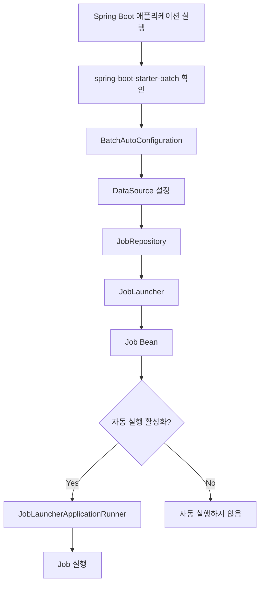

이 구조에서 중요한 점은 각각의 역할이 분리되어 있다는 것이다.

Spring Boot는 필요한 설정과 Bean 생성을 지원한다.

Spring Batch는 Job과 Step의 실행 및 상태 관리를 담당한다.

개발자는 실제 수행할 배치 작업을 정의한다.

이러한 역할 분리 덕분에 배치 실행에 필요한 공통 기능을 반복해서 구현하지 않고 비즈니스 로직에 집중할 수 있다.

---

### 정리

Spring Batch 프로젝트는 일반적인 Spring Boot 애플리케이션과 비슷한 방식으로 생성할 수 있다.

Spring Initializr를 이용해 Maven 기반 프로젝트를 만들고 `spring-boot-starter-batch` 의존성을 추가하면 Spring Batch를 사용할 수 있는 기본 환경이 준비된다.

여기에 데이터베이스를 연결하면 JobRepository가 배치 실행 메타데이터를 관리할 수 있다.

개발 환경에서는 H2를 이용해 간단하게 실행할 수 있고, 실제 데이터베이스와 연동하는 환경에서는 MySQL을 사용할 수 있다.

Spring Profile을 활용하면 두 환경을 분리하여 관리할 수 있다.

또한 Spring Boot의 자동 설정 기능을 이해하는 것이 중요하다.

Spring Boot는 필요한 조건을 만족하면 `BatchAutoConfiguration`을 통해 Spring Batch 실행에 필요한 구성 요소를 자동으로 준비한다.

따라서 일반적인 Spring Boot 환경에서는 `@EnableBatchProcessing`을 직접 추가하지 않아도 된다.

오히려 직접 추가하면 Spring Boot가 제공하는 Batch 자동 설정 동작이 달라질 수 있으므로, 별도의 인프라 구성이 필요한 경우에만 사용을 검토하는 것이 좋다.

마지막으로 Spring Batch의 주요 구성 요소를 정리하면 다음과 같다.

| 구성 요소                                 | 역할                          |
| ------------------------------------- | --------------------------- |
| `spring-boot-starter-batch`           | Spring Batch 사용에 필요한 의존성 제공 |
| `BatchAutoConfiguration`              | Spring Boot의 배치 자동 설정       |
| `DataSource`                          | 배치 메타데이터 저장소 연결             |
| `JobRepository`                       | Job과 Step의 실행 메타데이터 관리      |
| `JobLauncher`                         | Job 실행 요청                   |
| `JobLauncherApplicationRunner`        | 애플리케이션 시작 시 Job 자동 실행       |
| `@EnableBatchProcessing`              | Spring Batch 인프라의 명시적 구성    |
| `spring.batch.job.enabled`            | 시작 시 Job 자동 실행 여부 제어        |
| `spring.batch.jdbc.initialize-schema` | Batch 메타데이터 스키마 초기화 방식 설정   |

이러한 구성 요소가 어떻게 연결되는지 이해했다면 Spring Batch 프로젝트를 실행하기 위한 기본적인 준비가 완료된 것이다.

이후에는 실제 `Job`과 `Step`을 정의하고, 각각의 Step 안에서 어떤 비즈니스 로직을 실행할 것인지 구현할 수 있다.

#### 한 줄 요약

> Spring Batch 프로젝트는 `spring-boot-starter-batch` 의존성과 데이터베이스 설정을 통해 실행 환경을 구성할 수 있으며, Spring Boot의 `BatchAutoConfiguration`이 JobRepository와 JobLauncher 등의 주요 구성 요소를 자동으로 준비하므로 일반적인 Spring Boot 애플리케이션에서는 `@EnableBatchProcessing`을 직접 선언할 필요 없이 배치 작업 개발에 집중할 수 있다.

## Hello Spring Batch 시작하기

### Spring Batch 시작하기: Job, Step, Tasklet을 이용한 첫 번째 배치 실행

Spring Batch 프로젝트를 생성하고 필요한 의존성을 설정했다면 이제 실제 배치 작업을 만들어볼 차례다.

Spring Batch는 대량의 데이터를 안정적으로 처리하기 위한 프레임워크지만, 기본적인 배치 작업을 생성하는 과정 자체는 복잡하지 않다.

개발자가 수행하려는 작업을 정의하고, 해당 작업을 구성하는 단계를 설정한 뒤, 각 단계에서 실행할 비즈니스 로직을 구현하면 된다.

이 과정에서 가장 먼저 이해해야 할 개념이 **Job, Step, Tasklet**이다.

예를 들어 매일 새벽 정산 작업을 실행한다고 생각해보자.

정산 대상 데이터를 조회하고, 정산 금액을 계산하고, 정산 결과를 저장한 뒤, 최종적으로 완료 알림을 발송해야 할 수 있다.

이러한 작업 전체를 하나의 Job으로 정의하고 각각의 처리 단계를 Step으로 나눌 수 있다.

그리고 각 Step 안에는 실제로 수행할 작업 로직을 구현한다.

Spring Batch에서는 이러한 구조를 일관된 방식으로 구성할 수 있도록 여러 API를 제공한다.

이번에는 가장 간단한 형태의 배치 작업을 만들어보자.

첫 번째 Step에서는 `Hello Spring Batch`를 출력하고, 두 번째 Step에서는 `Step 2 executed`를 출력하도록 구성한다.

최종적인 실행 흐름은 다음과 같다.

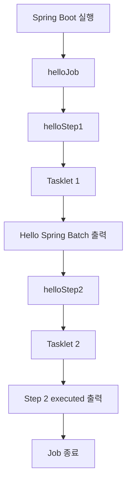

이 구조를 이해하면 이후 여러 Step을 연결하거나 조건에 따라 다른 작업을 실행하는 배치도 자연스럽게 구성할 수 있다.

---

### Job, Step, Tasklet이란?

Spring Batch에서 가장 기본이 되는 구성 요소는 `Job`, `Step`, `Tasklet`이다.

이 세 가지는 서로 다른 역할을 담당한다.

| 구성 요소   | 의미       | 역할                        |
| ------- | -------- | ------------------------- |
| Job     | 작업 전체    | 하나의 배치 작업을 정의하고 실행 흐름을 구성 |
| Step    | 작업 단계    | Job을 구성하는 개별 실행 단위        |
| Tasklet | 실제 작업 내용 | Step에서 수행할 비즈니스 로직 구현     |

이 관계를 먼저 이해하는 것이 중요하다.

#### Job: 배치 작업 전체

Job은 하나의 배치 작업 전체를 의미한다.

예를 들어 다음과 같은 작업을 생각해보자.

```text
일별 정산 배치
```

이 작업은 내부적으로 여러 단계로 구성될 수 있다.

```text
정산 대상 조회
      │
      ▼
정산 금액 계산
      │
      ▼
정산 결과 저장
      │
      ▼
정산 완료 처리
```

이러한 단계들을 하나의 작업으로 묶은 것이 Job이다.

Spring Batch에서는 `Job` 인터페이스를 제공하며, 일반적으로 `JobBuilder`를 이용해 Job을 구성한다.

대표적인 Job 구현체로는 `SimpleJob`과 `FlowJob` 등이 있다.

`SimpleJob`은 여러 Step을 순차적으로 실행하는 기본적인 Job 구현체다.

반면 `FlowJob`은 보다 복잡한 실행 흐름을 구성할 때 사용된다.

이번에는 가장 기본적인 순차 실행 방식의 Job을 사용한다.

#### Step: Job을 구성하는 실행 단계

Step은 Job 안에서 실행되는 개별 작업 단위다.

하나의 Job은 하나 이상의 Step으로 구성할 수 있다.

예를 들어 다음과 같다.

```text
SettlementJob
      │
      ├── ReadSettlementStep
      │
      ├── CalculateSettlementStep
      │
      └── SaveSettlementStep
```

각 Step은 자신의 처리 로직을 가지고 있으며 실행 결과도 별도로 관리된다.

Spring Batch에서는 Step이 실행되면 `StepExecution`이라는 실행 메타데이터를 생성하고 관리한다.

따라서 하나의 Job 안에 여러 Step이 존재할 때 어떤 Step이 성공했고 어떤 Step이 실패했는지 확인할 수 있다.

이러한 구조는 단순히 코드를 여러 메서드로 분리하는 것과는 다르다.

**Step은 Spring Batch가 실행 상태와 트랜잭션 등을 관리하는 독립적인 처리 단위**이기 때문이다.

#### Tasklet: Step에서 실행하는 작업 로직

Tasklet은 Step 안에서 실제로 수행할 작업 내용을 구현하는 인터페이스다.

예를 들어 다음과 같은 작업을 구현할 수 있다.

```text
파일 삭제

정산 상태 변경

임시 테이블 초기화

외부 API 호출

특정 SQL 실행
```

이러한 작업은 반드시 대량의 데이터를 읽고 가공하고 저장하는 구조를 가질 필요가 없다.

하나의 작업을 수행하고 종료할 수도 있다.

Spring Batch에서는 이러한 형태의 처리를 위해 `Tasklet` 인터페이스를 제공한다.

관계를 정리하면 다음과 같다.

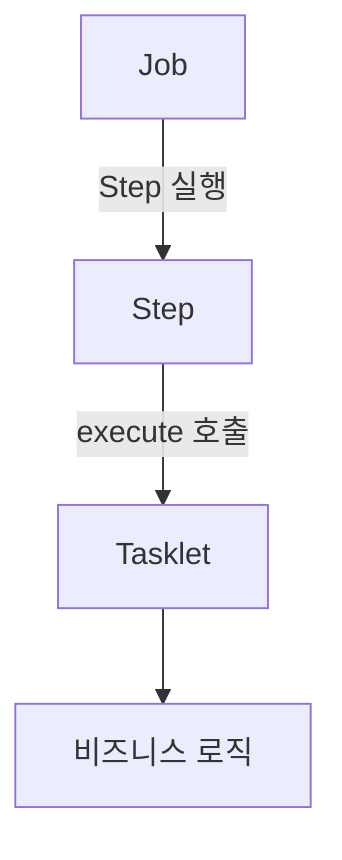

즉 Job은 작업 전체를 관리하고, Step은 실행 단위를 구성하며, Tasklet은 실제 작업 내용을 수행한다.

---

### Spring Batch 프로젝트 환경

앞에서 구성한 Spring Boot 프로젝트를 그대로 사용한다.

개발 환경은 다음과 같다.

| 구분           | 버전 및 기술       |
| ------------ | ------------- |
| Java         | Java 17       |
| Spring Boot  | 3.4.13        |
| Spring Batch | 5.2.4         |
| Build Tool   | Maven         |
| Database     | H2            |
| IDE          | IntelliJ IDEA |

이번 예제에서는 배치 실행 흐름을 확인하는 것이 목적이므로 H2 데이터베이스를 사용한다.

Spring Batch는 실행 상태를 관리하기 위한 메타데이터 저장소를 필요로 한다.

H2를 이용하면 별도의 데이터베이스 서버를 실행하지 않아도 기본적인 배치 동작을 확인할 수 있다.

MySQL을 사용해도 동일한 예제를 실행할 수 있다.

다만 MySQL처럼 실행 기록이 유지되는 데이터베이스에서는 동일한 Job을 다시 실행할 때 JobParameters와 기존 실행 상태를 고려해야 한다.

이 부분도 뒤에서 살펴본다.

---

### Maven 의존성 설정

Spring Batch를 사용하기 위해 필요한 기본 의존성은 다음과 같다.

```xml
<dependency>
    <groupId>org.springframework.boot</groupId>
    <artifactId>spring-boot-starter-batch</artifactId>
</dependency>
```

그리고 H2 데이터베이스를 사용하기 위해 다음 의존성을 추가한다.

```xml
<dependency>
    <groupId>com.h2database</groupId>
    <artifactId>h2</artifactId>
    <scope>runtime</scope>
</dependency>
```

이 두 의존성만으로도 기본적인 Spring Batch 애플리케이션을 만들 수 있다.

이번에는 편리한 생성자 주입과 로깅을 위해 Lombok도 추가해보자.

---

### Lombok이란?

Lombok은 Java에서 반복적으로 작성하는 코드를 줄여주는 라이브러리다.

예를 들어 다음과 같은 클래스가 있다고 생각해보자.

```java
public class Member {

    private String name;
    private int age;

    public String getName() {
        return name;
    }

    public void setName(String name) {
        this.name = name;
    }

    public int getAge() {
        return age;
    }

    public void setAge(int age) {
        this.age = age;
    }
}
```

필드가 늘어나면 Getter와 Setter도 함께 증가한다.

Lombok을 사용하면 이러한 코드를 애너테이션으로 간단하게 작성할 수 있다.

```java
@Getter
@Setter
public class Member {

    private String name;
    private int age;
}
```

Lombok은 Getter와 Setter뿐 아니라 생성자와 로깅 관련 코드도 생성할 수 있다.

Spring Batch에서는 Job을 구성하는 설정 클래스에서 여러 Bean을 의존성 주입받아 사용할 수 있다.

이때 Lombok의 `@RequiredArgsConstructor`를 활용하면 생성자 코드를 줄일 수 있다.

#### Lombok 의존성 추가

`pom.xml`에 다음 의존성을 추가한다.

```xml
<dependency>
    <groupId>org.projectlombok</groupId>
    <artifactId>lombok</artifactId>
    <optional>true</optional>
</dependency>
```

Spring Boot Parent에서 관리하는 Lombok 버전을 사용한다면 별도로 버전을 명시할 필요가 없다.

#### IntelliJ IDEA에서 Annotation Processing 설정

Lombok은 컴파일 과정에서 애너테이션을 처리하여 필요한 코드를 생성한다.

따라서 IntelliJ IDEA에서 애너테이션 처리가 정상적으로 동작하는지 확인해야 한다.

설정 화면에서 다음 경로를 확인한다.

```text
Settings
    │
    ▼
Build, Execution, Deployment
    │
    ▼
Compiler
    │
    ▼
Annotation Processors
```

여기에서 `Enable annotation processing` 항목이 활성화되어 있는지 확인한다.

IDE와 빌드 도구의 버전에 따라 Lombok 설정이 자동으로 처리될 수도 있다.

중요한 것은 **IDE에서 Lombok을 인식하는 것과 Maven 컴파일 과정에서 Lombok이 정상적으로 동작하는 것을 모두 확인하는 것**이다.

참고로 Lombok은 Spring Batch를 사용하는 데 반드시 필요한 라이브러리는 아니다.

생성자를 직접 작성하거나 `@Bean` 메서드의 매개변수로 의존성을 전달받는 방식만으로도 동일한 기능을 구현할 수 있다.

---

### pom.xml 전체 설정

이번 예제에서 사용하는 Maven 설정은 다음과 같다.

```xml
<?xml version="1.0" encoding="UTF-8"?>
<project xmlns="http://maven.apache.org/POM/4.0.0"
         xmlns:xsi="http://www.w3.org/2001/XMLSchema-instance"
         xsi:schemaLocation="
             http://maven.apache.org/POM/4.0.0
             https://maven.apache.org/xsd/maven-4.0.0.xsd">

    <modelVersion>4.0.0</modelVersion>

    <parent>
        <groupId>org.springframework.boot</groupId>
        <artifactId>spring-boot-starter-parent</artifactId>
        <version>3.4.13</version>
        <relativePath/>
    </parent>

    <groupId>com.example</groupId>
    <artifactId>spring-batch-demo</artifactId>
    <version>0.0.1-SNAPSHOT</version>

    <name>spring-batch-demo</name>

    <properties>
        <java.version>17</java.version>
    </properties>

    <dependencies>

        <!-- Spring Batch -->
        <dependency>
            <groupId>org.springframework.boot</groupId>
            <artifactId>spring-boot-starter-batch</artifactId>
        </dependency>

        <!-- H2 Database -->
        <dependency>
            <groupId>com.h2database</groupId>
            <artifactId>h2</artifactId>
            <scope>runtime</scope>
        </dependency>

        <!-- Lombok -->
        <dependency>
            <groupId>org.projectlombok</groupId>
            <artifactId>lombok</artifactId>
            <optional>true</optional>
        </dependency>

        <!-- Spring Boot Test -->
        <dependency>
            <groupId>org.springframework.boot</groupId>
            <artifactId>spring-boot-starter-test</artifactId>
            <scope>test</scope>
        </dependency>

        <!-- Spring Batch Test -->
        <dependency>
            <groupId>org.springframework.batch</groupId>
            <artifactId>spring-batch-test</artifactId>
            <scope>test</scope>
        </dependency>

    </dependencies>

    <build>
        <plugins>
            <plugin>
                <groupId>org.springframework.boot</groupId>
                <artifactId>spring-boot-maven-plugin</artifactId>
                <configuration>
                    <excludes>
                        <exclude>
                            <groupId>org.projectlombok</groupId>
                            <artifactId>lombok</artifactId>
                        </exclude>
                    </excludes>
                </configuration>
            </plugin>
        </plugins>
    </build>

</project>
```

Lombok은 컴파일 과정에서 코드를 생성하기 위해 사용하는 라이브러리이므로 실행 가능한 Jar에 포함할 필요가 없다.

따라서 Spring Boot Maven Plugin의 `excludes` 설정을 통해 패키징 대상에서 제외했다.

---

### Spring Batch 기본 설정

이번에는 H2 데이터베이스를 사용하도록 설정한다.

`application.yml`은 다음과 같다.

```yaml
spring:
  application:
    name: spring-batch-demo

  profiles:
    default: local

  batch:
    job:
      enabled: true
```

이 설정에서 중요한 부분은 다음과 같다.

```yaml
spring:
  batch:
    job:
      enabled: true
```

Spring Boot가 애플리케이션 시작 시 등록된 Job을 자동으로 실행하도록 설정한다.

단, 이 설정을 활성화했다고 해서 모든 Job이 무조건 실행되는 것은 아니다.

Spring Boot의 Batch 자동 설정이 활성화되어 있어야 하며, 실행 가능한 Job Bean이 등록되어 있어야 한다.

또한 여러 Job이 존재하는 경우에는 실행할 Job을 명시적으로 선택해야 할 수 있다.

이번 예제에서는 `helloJob` 하나만 등록하므로 애플리케이션 시작 시 자동 실행되는 구조를 사용한다.

#### application-local.yml

H2 데이터베이스 설정은 다음과 같다.

```yaml
spring:
  datasource:
    url: jdbc:h2:mem:batchdb;DB_CLOSE_DELAY=-1
    driver-class-name: org.h2.Driver
    username: sa
    password:

  batch:
    jdbc:
      initialize-schema: always
```

`spring.batch.jdbc.initialize-schema`는 Spring Batch가 사용하는 메타데이터 테이블을 초기화하는 설정이다.

H2를 메모리 데이터베이스로 사용하기 때문에 애플리케이션을 다시 시작하면 데이터베이스가 새롭게 생성된다.

따라서 간단한 배치 실행 흐름을 반복적으로 확인하기에 적합하다.

---

### Spring Boot 시작 클래스

Spring Boot 애플리케이션을 실행할 메인 클래스를 작성한다.

```java
package com.example.batch;

import org.springframework.boot.SpringApplication;
import org.springframework.boot.autoconfigure.SpringBootApplication;

@SpringBootApplication
public class SpringBatchApplication {

    public static void main(String[] args) {

        SpringApplication.run(
                SpringBatchApplication.class,
                args
        );
    }
}
```

여기서 중요한 부분은 `@SpringBootApplication`이다.

이 애너테이션은 Spring Boot의 자동 설정과 컴포넌트 스캔 등을 활성화한다.

앞에서 추가한 `spring-boot-starter-batch` 의존성이 존재하면 Spring Boot는 자동 설정 조건을 확인하여 필요한 Batch 인프라를 구성한다.

#### @EnableBatchProcessing은 필요할까?

Spring Batch 4 기반의 기존 구성에서는 다음과 같은 설정을 많이 사용했다.

```java
@SpringBootApplication
@EnableBatchProcessing
public class SpringBatchApplication {
}
```

하지만 Spring Boot 3.4 기반의 일반적인 배치 애플리케이션에서는 `@EnableBatchProcessing`을 직접 선언하지 않아도 된다.

Spring Boot의 `BatchAutoConfiguration`이 배치 인프라 구성을 지원하기 때문이다.

오히려 직접 선언하면 Spring Boot가 제공하는 Batch 자동 설정 동작이 달라질 수 있다.

따라서 이번 예제에서는 `@EnableBatchProcessing`을 추가하지 않는다.

---

### HelloJobConfiguration 생성하기

이제 실제 배치 Job을 정의할 차례다.

다음 클래스를 생성한다.

```text
HelloJobConfiguration.java
```

이 클래스는 `helloJob`이라는 Job과 두 개의 Step을 정의한다.

전체 구조는 다음과 같다.

```text
HelloJobConfiguration
        │
        ├── helloJob
        │      │
        │      ├── helloStep1
        │      │      │
        │      │      └── Tasklet 1
        │      │
        │      └── helloStep2
        │             │
        │             └── Tasklet 2
        │
        └── JobRepository, TransactionManager
```

Spring Batch에서는 `JobBuilder`, `StepBuilder`를 이용해 Job과 Step을 구성한다.

그리고 각각의 Step에는 실제 실행할 Tasklet을 지정한다.

---

### HelloJobConfiguration 전체 코드

먼저 실행 가능한 전체 코드를 살펴보자.

```java
package com.example.batch;

import lombok.RequiredArgsConstructor;

import org.springframework.batch.core.Job;
import org.springframework.batch.core.Step;
import org.springframework.batch.core.job.builder.JobBuilder;
import org.springframework.batch.core.repository.JobRepository;
import org.springframework.batch.core.step.builder.StepBuilder;
import org.springframework.batch.repeat.RepeatStatus;

import org.springframework.beans.factory.annotation.Qualifier;
import org.springframework.context.annotation.Bean;
import org.springframework.context.annotation.Configuration;

import org.springframework.transaction.PlatformTransactionManager;

@Configuration
@RequiredArgsConstructor
public class HelloJobConfiguration {

    private final JobRepository jobRepository;
    private final PlatformTransactionManager transactionManager;

    @Bean
    public Job helloJob(
            @Qualifier("helloStep1") Step helloStep1,
            @Qualifier("helloStep2") Step helloStep2
    ) {
        return new JobBuilder("helloJob", jobRepository)
                .start(helloStep1)
                .next(helloStep2)
                .build();
    }

    @Bean
    public Step helloStep1() {

        return new StepBuilder("helloStep1", jobRepository)
                .tasklet((contribution, chunkContext) -> {

                    System.out.println(
                            "Hello Spring Batch"
                    );

                    return RepeatStatus.FINISHED;

                }, transactionManager)
                .build();
    }

    @Bean
    public Step helloStep2() {

        return new StepBuilder("helloStep2", jobRepository)
                .tasklet((contribution, chunkContext) -> {

                    System.out.println(
                            "Step 2 executed"
                    );

                    return RepeatStatus.FINISHED;

                }, transactionManager)
                .build();
    }
}
```

코드는 비교적 단순하지만 Spring Batch의 핵심 실행 구조가 모두 들어 있다.

각각의 설정이 어떤 의미인지 자세히 살펴보자.

---

### @Configuration의 역할

클래스 상단을 보면 다음 애너테이션이 선언되어 있다.

```java
@Configuration
```

`@Configuration`은 해당 클래스가 Spring의 설정 클래스임을 나타낸다.

Spring은 이 클래스 안에 선언된 `@Bean` 메서드들을 처리하여 반환된 객체를 Spring Bean으로 등록한다.

예를 들어 다음 메서드가 있다.

```java
@Bean
public Step helloStep1() {
    // ...
}
```

이 메서드는 `Step` 객체를 생성하여 반환한다.

Spring은 반환된 객체를 Bean으로 등록한다.

마찬가지로 다음 메서드도 있다.

```java
@Bean
public Job helloJob(...) {
    // ...
}
```

이 메서드는 `Job` 객체를 생성하여 반환한다.

따라서 Spring Container 안에는 다음과 같은 Bean이 등록된다.

```text
Spring ApplicationContext
        │
        ├── helloJob
        │
        ├── helloStep1
        │
        └── helloStep2
```

여기서 중요한 점이 있다.

**Job을 Bean으로 생성하는 것과 Job을 실제로 실행하는 것은 서로 다른 과정이다.**

`@Bean` 메서드가 호출되면 Job 객체가 생성된다.

하지만 Job 객체가 생성되었다고 해서 곧바로 Tasklet이 실행되는 것은 아니다.

실제 Tasklet 실행은 이후 Job을 실행하는 과정에서 이루어진다.

---

### @RequiredArgsConstructor와 생성자 주입

다음 애너테이션을 살펴보자.

```java
@RequiredArgsConstructor
```

이 애너테이션은 Lombok에서 제공한다.

`final` 필드 등을 초기화하는 생성자를 자동으로 생성한다.

현재 클래스에는 다음 두 필드가 있다.

```java
private final JobRepository jobRepository;

private final PlatformTransactionManager transactionManager;
```

따라서 Lombok은 개념적으로 다음과 같은 생성자를 생성한다.

```java
public HelloJobConfiguration(
        JobRepository jobRepository,
        PlatformTransactionManager transactionManager
) {
    this.jobRepository = jobRepository;
    this.transactionManager = transactionManager;
}
```

Spring은 이 생성자를 이용해 필요한 Bean을 주입한다.

여기서 주입받는 두 객체의 역할을 알아보자.

#### JobRepository

`JobRepository`는 Job과 Step의 실행 메타데이터를 관리한다.

예를 들어 Job이 언제 실행되었는지, 실행 상태가 무엇인지, 특정 Step이 성공했는지 등을 관리한다.

`JobBuilder`와 `StepBuilder`에서는 이러한 실행 메타데이터를 관리하기 위해 `JobRepository`를 전달받는다.

#### PlatformTransactionManager

`PlatformTransactionManager`는 Spring의 트랜잭션 관리 인터페이스다.

이번 예제에서는 Tasklet이 실행될 때 사용할 트랜잭션 관리자를 전달한다.

```java
.tasklet(tasklet, transactionManager)
```

Tasklet 기반 Step은 작업 실행을 트랜잭션 경계 안에서 수행하도록 구성할 수 있다.

따라서 데이터베이스를 변경하는 Tasklet이라면 트랜잭션 관리가 중요하다.

이번 예제는 단순히 문자열을 출력하기 때문에 트랜잭션 효과가 눈에 보이지 않는다.

하지만 실제로 정산 상태를 변경하거나 데이터를 삭제하는 작업을 구현한다면 트랜잭션 경계가 중요한 역할을 한다.

---

### Lombok 없이도 구현할 수 있다

앞에서는 `@RequiredArgsConstructor`를 이용해 생성자 주입을 처리했다.

하지만 Lombok이 필수는 아니다.

예를 들어 다음처럼 `@Bean` 메서드의 매개변수로 필요한 객체를 전달받을 수도 있다.

```java
@Bean
public Step helloStep1(
        JobRepository jobRepository,
        PlatformTransactionManager transactionManager
) {
    return new StepBuilder("helloStep1", jobRepository)
            .tasklet((contribution, chunkContext) -> {

                System.out.println("Hello Spring Batch");

                return RepeatStatus.FINISHED;

            }, transactionManager)
            .build();
}
```

Spring은 `@Bean` 메서드의 매개변수에 해당하는 Bean을 찾아 전달한다.

이 방법은 설정 클래스에 별도의 필드를 만들지 않아도 된다는 장점이 있다.

따라서 간단한 설정이라면 `@Bean` 메서드의 매개변수 주입만으로도 충분하다.

반면 여러 메서드에서 같은 의존성을 반복적으로 사용한다면 생성자 주입 방식도 편리하다.

두 방식 중 프로젝트에 맞는 방법을 선택하면 된다.

---

### JobBuilder를 이용한 Job 생성

이제 가장 중요한 Job 생성 부분을 살펴보자.

```java
@Bean
public Job helloJob(
        @Qualifier("helloStep1") Step helloStep1,
        @Qualifier("helloStep2") Step helloStep2
) {
    return new JobBuilder("helloJob", jobRepository)
            .start(helloStep1)
            .next(helloStep2)
            .build();
}
```

코드가 짧지만 각 메서드에는 명확한 의미가 있다.

#### new JobBuilder()

```java
new JobBuilder("helloJob", jobRepository)
```

`JobBuilder`는 Job을 생성하기 위한 빌더 클래스다.

첫 번째 인자로 Job 이름을 전달한다.

```java
"helloJob"
```

두 번째 인자로 `JobRepository`를 전달한다.

```java
jobRepository
```

따라서 이 코드는 `helloJob`이라는 이름을 가진 Job을 만들기 위한 빌더를 생성한다.

여기서 Job 이름은 단순히 로그 출력에만 사용되는 값이 아니다.

Spring Batch는 Job 이름과 JobParameters 등을 이용해 Job의 실행을 구분한다.

따라서 운영 환경에서는 Job 이름을 명확하게 정의하는 것이 중요하다.

#### start()

다음은 `start()`다.

```java
.start(helloStep1)
```

이 메서드는 Job이 실행될 때 가장 먼저 수행할 Step을 지정한다.

이번에는 `helloStep1`을 첫 번째 Step으로 설정했다.

즉 다음과 같은 의미다.

```text
helloJob 실행
      │
      ▼
helloStep1 실행
```

#### next()

다음은 `next()`다.

```java
.next(helloStep2)
```

이 메서드는 앞선 Step 다음에 실행할 Step을 지정한다.

기본적인 순차 실행 구성에서는 앞선 Step이 정상적으로 완료되면 다음 Step으로 진행한다.

따라서 이번 Job의 실행 순서는 다음과 같다.

```text
helloJob
    │
    ▼
helloStep1
    │
    ▼
helloStep2
```

만약 `helloStep1`에서 예외가 발생해 Step이 실패한다면 기본적인 순차 실행 흐름에서는 `helloStep2`로 진행하지 않는다.

즉 `next()`는 단순히 메서드를 연속해서 호출하는 문법이 아니라 **Job의 실행 흐름을 정의하는 API**다.

#### build()

마지막으로 다음 메서드를 호출한다.

```java
.build();
```

지금까지 설정한 내용을 바탕으로 Job 객체를 생성한다.

`JobBuilder`를 사용해 여러 Step을 순차적으로 구성하면 일반적으로 `SimpleJob` 형태의 Job이 만들어진다.

전체 과정을 정리하면 다음과 같다.

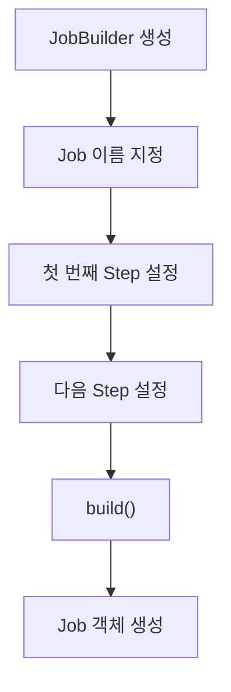

---

### @Qualifier를 사용하는 이유

Job을 생성하는 메서드를 다시 살펴보자.

```java
@Bean
public Job helloJob(
        @Qualifier("helloStep1") Step helloStep1,
        @Qualifier("helloStep2") Step helloStep2
)
```

여기서는 `@Qualifier`를 사용했다.

왜 필요할까?

현재 Spring Container에는 `Step` 타입의 Bean이 두 개 등록된다.

```text
helloStep1

helloStep2
```

두 객체 모두 `Step` 인터페이스를 구현하는 Bean이다.

따라서 Spring이 단순히 `Step` 타입만으로 의존성을 주입하려고 하면 어떤 Bean을 선택해야 하는지 모호할 수 있다.

이를 명확하게 지정하기 위해 `@Qualifier`를 사용할 수 있다.

```java
@Qualifier("helloStep1")
```

은 `helloStep1`이라는 이름의 Bean을 사용하겠다는 의미다.

```java
@Qualifier("helloStep2")
```

는 `helloStep2`라는 이름의 Bean을 사용하겠다는 의미다.

물론 Spring은 매개변수 이름 등을 이용해 Bean을 선택할 수도 있다.

하지만 동일한 타입의 Bean이 여러 개 존재한다면 `@Qualifier`를 사용해 의존성을 명시하는 것이 코드를 이해하기 쉽고 안전하게 만든다.

---

### StepBuilder를 이용한 Step 생성

이번에는 Step 생성 코드를 살펴보자.

```java
@Bean
public Step helloStep1() {

    return new StepBuilder("helloStep1", jobRepository)
            .tasklet((contribution, chunkContext) -> {

                System.out.println("Hello Spring Batch");

                return RepeatStatus.FINISHED;

            }, transactionManager)
            .build();
}
```

Job을 생성했던 코드와 비슷한 형태다.

먼저 `StepBuilder`를 생성한다.

```java
new StepBuilder("helloStep1", jobRepository)
```

첫 번째 인자는 Step 이름이다.

두 번째 인자는 `JobRepository`다.

이후 Step에서 실행할 작업을 설정한다.

```java
.tasklet(...)
```

그리고 마지막으로 `build()`를 호출한다.

```java
.build();
```

이렇게 하면 Step 객체가 생성된다.

여기서 중요한 것은 **Step 자체가 비즈니스 로직을 의미하지는 않는다는 것**이다.

Step은 작업을 실행하는 단위이며, 실제 로직은 Tasklet에 구현한다.

---

### Tasklet 인터페이스

Spring Batch의 `Tasklet` 인터페이스는 다음과 같은 메서드를 제공한다.

```java
public interface Tasklet {

    RepeatStatus execute(
            StepContribution contribution,
            ChunkContext chunkContext
    ) throws Exception;
}
```

핵심은 `execute()`다.

Step이 실행되면 등록된 Tasklet의 `execute()` 메서드가 호출된다.

이 메서드 안에 실제 수행할 작업을 구현한다.

#### StepContribution

첫 번째 매개변수는 다음과 같다.

```java
StepContribution contribution
```

`StepContribution`은 Step의 실행 결과와 관련된 정보를 관리하는 데 사용된다.

예를 들어 처리 건수, Skip 건수, ExitStatus 등에 관한 정보를 반영하는 데 활용할 수 있다.

이번 예제처럼 문자열만 출력하는 경우에는 직접 사용할 필요가 없다.

#### ChunkContext

두 번째 매개변수는 다음과 같다.

```java
ChunkContext chunkContext
```

`ChunkContext`는 현재 작업 실행과 관련된 문맥 정보를 제공한다.

내부적으로 `StepContext`에 접근할 수 있으며, 이를 통해 Step 실행 정보나 JobParameters 등에 접근할 수 있다.

예를 들어 다음과 같이 사용할 수 있다.

```java
Map<String, Object> jobParameters =
        chunkContext
                .getStepContext()
                .getJobParameters();
```

이렇게 하면 현재 Job 실행에 전달된 파라미터에 접근할 수 있다.

이번 예제에서는 이러한 실행 문맥을 사용하지 않지만, 실제 배치에서는 정산 기준일이나 처리 대상 구분값 등을 전달받을 때 활용할 수 있다.

---

### Tasklet을 람다 표현식으로 구현하기

앞에서 Tasklet은 인터페이스라고 했다.

그렇다면 직접 구현 클래스를 만들어야 할까?

물론 가능하다.

```java
public class HelloTasklet implements Tasklet {

    @Override
    public RepeatStatus execute(
            StepContribution contribution,
            ChunkContext chunkContext
    ) throws Exception {

        System.out.println("Hello Spring Batch");

        return RepeatStatus.FINISHED;
    }
}
```

이 클래스를 Step에 연결하면 된다.

하지만 Tasklet은 추상 메서드가 하나인 함수형 인터페이스이므로 람다 표현식으로 구현할 수도 있다.

```java
.tasklet((contribution, chunkContext) -> {

    System.out.println("Hello Spring Batch");

    return RepeatStatus.FINISHED;

}, transactionManager)
```

별도의 클래스를 만들지 않고 Tasklet의 `execute()` 메서드를 구현한 것이다.

간단한 로직이라면 람다 표현식이 코드를 짧고 직관적으로 만들어준다.

반면 복잡한 비즈니스 로직을 수행하거나 여러 의존성이 필요한 경우에는 별도의 Tasklet 구현 클래스로 분리하는 편이 좋다.

---

### RepeatStatus란?

Tasklet 구현에서 중요한 부분은 다음 코드다.

```java
return RepeatStatus.FINISHED;
```

왜 반환값이 필요할까?

Spring Batch의 Tasklet은 한 번만 실행하도록 고정되어 있지 않기 때문이다.

Tasklet은 `execute()`의 반환 상태에 따라 반복 실행될 수 있다.

Spring Batch는 이러한 반복 여부를 표현하기 위해 `RepeatStatus`를 제공한다.

대표적인 상태는 다음과 같다.

```java
RepeatStatus.FINISHED
```

```java
RepeatStatus.CONTINUABLE
```

각각의 의미를 살펴보자.

#### RepeatStatus.FINISHED

```java
return RepeatStatus.FINISHED;
```

현재 Tasklet의 반복 실행을 종료하겠다는 의미다.

따라서 이번 예제에서는 `execute()`가 한 번 실행된 뒤 종료된다.

```text
Tasklet 실행
      │
      ▼
Hello Spring Batch 출력
      │
      ▼
RepeatStatus.FINISHED
      │
      ▼
Step 종료
```

#### RepeatStatus.CONTINUABLE

```java
return RepeatStatus.CONTINUABLE;
```

현재 Tasklet을 계속 실행할 수 있다는 의미다.

따라서 Spring Batch는 Tasklet을 다시 실행한다.

```text
Tasklet 실행
      │
      ▼
RepeatStatus.CONTINUABLE
      │
      ▼
Tasklet 재실행
      │
      ▼
RepeatStatus.CONTINUABLE
      │
      ▼
Tasklet 재실행
      │
      ▼
...
```

만약 계속해서 `CONTINUABLE`만 반환한다면 반복이 종료되지 않을 수 있다.

따라서 실제로 반복 작업을 구현할 때는 적절한 종료 조건이 필요하다.

예를 들어 다음과 같이 작성할 수 있다.

```java
AtomicInteger count = new AtomicInteger();

Tasklet tasklet = (contribution, chunkContext) -> {

    int current = count.incrementAndGet();

    System.out.println("Tasklet 실행: " + current);

    if (current >= 3) {
        return RepeatStatus.FINISHED;
    }

    return RepeatStatus.CONTINUABLE;
};
```

이 예제에서는 Tasklet이 세 번 실행된 뒤 종료된다.

실행 결과는 다음과 같다.

```text
Tasklet 실행: 1
Tasklet 실행: 2
Tasklet 실행: 3
```

다만 이 코드는 반복 동작을 설명하기 위한 예제다.

실제 운영 배치에서는 메모리 변수만으로 반복 상태를 관리하면 재시작 시 상태가 복원되지 않을 수 있다.

재시작이 필요한 작업이라면 `ExecutionContext` 등을 이용해 처리 상태를 관리하는 방법을 고려해야 한다.

#### null을 반환하면 어떻게 될까?

Tasklet은 `null`을 반환하는 경우에도 반복을 종료할 수 있다.

하지만 의도를 명확하게 표현하기 위해서는 다음과 같이 작성하는 것이 좋다.

```java
return RepeatStatus.FINISHED;
```

단순히 반복을 종료하려는 것인지, 별도의 반환 상태를 의도한 것인지 코드만으로 명확하게 알 수 있기 때문이다.

또한 `FINISHED`는 **Tasklet의 반복 종료**를 나타내며, 모든 상황에서 Step이나 Job의 최종 성공을 보장한다는 의미는 아니다.

예를 들어 Tasklet 실행 이후 트랜잭션 커밋 과정에서 오류가 발생하면 Step이 실패할 수 있다.

따라서 Tasklet의 반복 종료와 Step의 최종 실행 상태는 구분해야 한다.

---

### Tasklet과 트랜잭션의 관계

Tasklet을 설정하는 코드를 다시 보자.

```java
.tasklet(
        (contribution, chunkContext) -> {

            System.out.println("Hello Spring Batch");

            return RepeatStatus.FINISHED;

        },
        transactionManager
)
```

Spring Batch 5.2에서는 Tasklet을 구성할 때 트랜잭션 매니저를 전달할 수 있다.

```java
.tasklet(tasklet, transactionManager)
```

Tasklet 기반 Step에서는 일반적으로 Tasklet의 `execute()` 호출을 트랜잭션으로 감싼다.

예를 들어 Tasklet에서 데이터베이스의 정산 상태를 변경한다고 생각해보자.

```text
트랜잭션 시작
       │
       ▼
Tasklet.execute()
       │
       ▼
정산 상태 변경
       │
       ▼
RepeatStatus.FINISHED
       │
       ▼
트랜잭션 커밋
```

정상적으로 실행되면 트랜잭션을 커밋한다.

반면 처리 과정에서 예외가 발생하면 트랜잭션을 롤백할 수 있다.

물론 실제 롤백 여부와 범위는 사용하는 트랜잭션 매니저 및 외부 시스템의 트랜잭션 지원 여부에 따라 달라진다.

이번 예제의 `System.out.println()`은 데이터베이스 트랜잭션으로 롤백할 수 없다.

즉 Tasklet이 실패했다고 해서 이미 콘솔에 출력한 문자열이 사라지는 것은 아니다.

이처럼 **Spring Batch가 관리하는 트랜잭션과 외부 시스템에서 발생하는 작업 결과는 반드시 구분해야 한다.**

---

### 두 번째 Step 구성하기

첫 번째 Step과 동일한 방법으로 두 번째 Step도 생성할 수 있다.

```java
@Bean
public Step helloStep2() {

    return new StepBuilder("helloStep2", jobRepository)
            .tasklet((contribution, chunkContext) -> {

                System.out.println("Step 2 executed");

                return RepeatStatus.FINISHED;

            }, transactionManager)
            .build();
}
```

첫 번째 Step과 비교하면 이름과 출력하는 문자열만 다르다.

첫 번째 Step은 다음과 같다.

```java
new StepBuilder("helloStep1", jobRepository)
```

두 번째 Step은 다음과 같다.

```java
new StepBuilder("helloStep2", jobRepository)
```

그리고 실제 실행되는 작업 내용도 다르다.

```text
helloStep1
    │
    ▼
Hello Spring Batch 출력


helloStep2
    │
    ▼
Step 2 executed 출력
```

이 두 Step을 Job에 연결하면 순차적으로 실행할 수 있다.

---

### Job에서 두 Step을 순차적으로 실행하기

이제 다시 Job 설정을 살펴보자.

```java
@Bean
public Job helloJob(
        @Qualifier("helloStep1") Step helloStep1,
        @Qualifier("helloStep2") Step helloStep2
) {
    return new JobBuilder("helloJob", jobRepository)
            .start(helloStep1)
            .next(helloStep2)
            .build();
}
```

여기서 핵심은 다음 두 메서드다.

```java
.start(helloStep1)
```

그리고

```java
.next(helloStep2)
```

첫 번째 Step이 정상적으로 완료되면 두 번째 Step을 실행하도록 구성한다.

전체적인 실행 흐름은 다음과 같다.

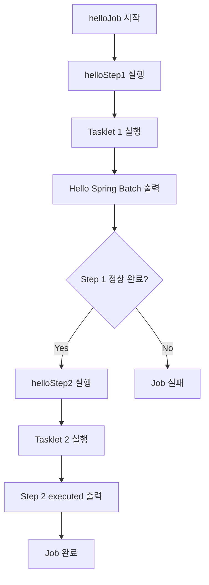

여기서 중요한 사실은 각 Step이 자신의 Tasklet을 가지고 있다는 점이다.

Job은 전체 실행 흐름을 관리한다.

그리고 Step은 자신의 작업 로직을 실행한다.

이렇게 역할이 구분되어 있기 때문에 나중에 Step을 추가하거나 실행 순서를 변경하기도 편리하다.

---

### Job 객체 생성과 실제 실행은 다르다

앞에서 Job을 설정할 때 다음 코드를 작성했다.

```java
@Bean
public Job helloJob(...) {
    return new JobBuilder("helloJob", jobRepository)
            .start(helloStep1)
            .next(helloStep2)
            .build();
}
```

이 메서드가 실행되면 Job 객체가 생성된다.

하지만 실제 비즈니스 로직이 실행되는 것은 아니다.

즉 다음 코드는

```java
.build();
```

Job 객체를 구성하는 역할을 한다.

반면 다음 작업은 별도의 실행 과정에서 이루어진다.

```text
helloStep1 실행

Tasklet 1 실행

helloStep2 실행

Tasklet 2 실행
```

Spring Boot 기반의 기본 실행 환경에서는 `JobLauncherApplicationRunner`가 등록된 Job을 찾아 실행할 수 있다.

내부적으로는 `JobLauncher`를 통해 Job 실행을 요청한다.

따라서 전체 흐름은 다음과 같이 구분할 수 있다.

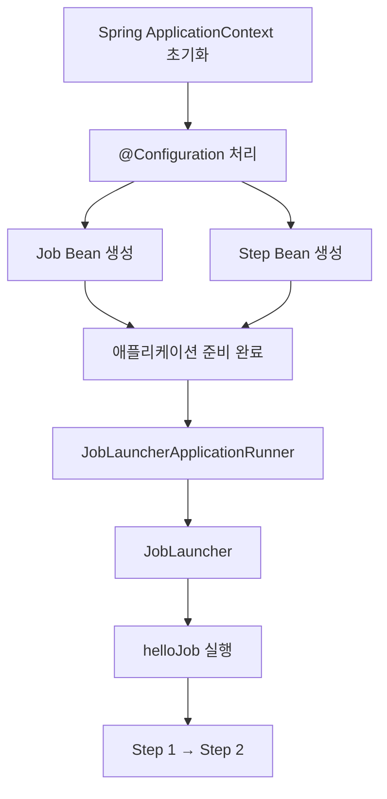

Spring Batch에서 설정과 실행을 구분하는 것은 중요하다.

이후 Job을 수동으로 실행하거나 스케줄러를 통해 실행할 때도 같은 개념이 적용되기 때문이다.

---

### Hello Spring Batch 실행하기

이제 실제로 애플리케이션을 실행해보자.

프로젝트 루트에서 다음 명령어를 실행한다.

```bash
./mvnw spring-boot:run
```

이 명령어는 Maven을 이용해 Spring Boot 애플리케이션을 실행한다.

앞에서 `application.yml`에 다음 설정을 추가했다.

```yaml
spring:
  batch:
    job:
      enabled: true
```

따라서 Spring Boot가 시작되면서 `helloJob`이 자동으로 실행될 수 있다.

#### 실행 결과

정상적으로 실행되면 다음과 같은 흐름의 로그를 확인할 수 있다.

```text
Job: [SimpleJob: [name=helloJob]]
launched with the following parameters: [{}]

Executing step: [helloStep1]

Hello Spring Batch

Step: [helloStep1] executed

Executing step: [helloStep2]

Step 2 executed

Step: [helloStep2] executed

Job: [SimpleJob: [name=helloJob]]
completed with status: [COMPLETED]
```

위 출력은 핵심 메시지를 중심으로 정리한 예시이며, 실제 로그에는 시간, 스레드 이름, 로거 이름 등의 정보가 함께 표시된다.

여기서 중요한 부분을 하나씩 살펴보자.

---

### SimpleJob이란?

실행 로그에서 다음 내용을 확인할 수 있다.

```text
SimpleJob: [name=helloJob]
```

우리는 직접 `SimpleJob` 객체를 생성하지 않았다.

대신 다음과 같이 JobBuilder를 사용했다.

```java
new JobBuilder("helloJob", jobRepository)
        .start(helloStep1)
        .next(helloStep2)
        .build();
```

Spring Batch는 이러한 설정을 바탕으로 실제 Job 구현체를 생성한다.

이번처럼 여러 Step을 순차적으로 실행하는 기본적인 Job은 `SimpleJob`으로 구성된다.

`Job`은 인터페이스다.

그리고 `SimpleJob`은 해당 인터페이스의 구현체 중 하나다.

관계를 단순화하면 다음과 같다.

```text
Job 인터페이스
      │
      ▼
AbstractJob
      │
      ├── SimpleJob
      │
      └── FlowJob
```

이 구조 덕분에 개발자는 구체적인 Job 구현체의 생성 과정을 모두 직접 처리하지 않아도 된다.

빌더 API를 이용해 실행 흐름을 정의할 수 있다.

---

### JobParameters란?

실행 로그를 보면 다음과 같은 부분이 있다.

```text
launched with the following parameters: [{}]
```

여기에서 `parameters`는 JobParameters를 의미한다.

JobParameters는 Job을 실행할 때 함께 전달하는 파라미터다.

예를 들어 정산 배치를 실행할 때 다음과 같은 값이 필요할 수 있다.

```text
정산 기준일: 2026-10-14

정산 대상: PAYMENT

실행 구분: DAILY
```

이러한 값들을 JobParameters로 전달할 수 있다.

이번 예제에서는 별도의 JobParameters를 전달하지 않았다.

따라서 실행 로그에 빈 파라미터가 표시된다.

```text
{}
```

#### JobParameters가 중요한 이유

JobParameters는 단순히 작업에 필요한 데이터를 전달하기 위한 용도로만 사용되는 것이 아니다.

Spring Batch는 Job 이름과 식별용 JobParameters를 이용해 `JobInstance`를 구분한다.

예를 들어 다음과 같은 두 실행을 생각해보자.

```text
helloJob
    │
    ├── run.id=1
    │
    └── run.id=2
```

두 실행은 Job 이름은 같지만 식별용 JobParameters가 다르다.

따라서 서로 다른 JobInstance로 관리될 수 있다.

반면 같은 Job 이름과 같은 식별용 JobParameters로 이미 성공한 작업을 다시 실행하려고 하면 Spring Batch는 해당 JobInstance가 이미 완료되었다고 판단할 수 있다.

이것은 중복 실행을 방지하기 위한 Spring Batch의 중요한 특징이다.

---

### 동일한 Job을 다시 실행하면 어떻게 될까?

이번 예제는 H2 메모리 데이터베이스를 사용한다.

애플리케이션이 종료되면 데이터베이스도 사라지므로 다음 실행에서는 새로운 배치 메타데이터가 생성된다.

따라서 간단한 실행 확인에서는 같은 Job을 여러 번 실행해도 문제가 드러나지 않을 수 있다.

하지만 MySQL처럼 실행 기록이 영속적으로 저장되는 데이터베이스에서는 상황이 다르다.

첫 번째 실행이 성공했다고 생각해보자.

```text
Job Name: helloJob

JobParameters: {}

Status: COMPLETED
```

이 상태에서 동일한 Job을 같은 파라미터로 다시 실행하면 이미 완료된 JobInstance라는 이유로 실행이 거부될 수 있다.

대표적으로 다음 예외가 발생한다.

```text
JobInstanceAlreadyCompleteException
```

이런 상황에서는 새로운 JobInstance를 생성하기 위해 식별용 JobParameters를 다르게 전달할 수 있다.

예를 들어 다음과 같이 실행할 수 있다.

```bash
java -jar target/spring-batch-demo-0.0.1-SNAPSHOT.jar \
  run.id=1
```

다음 실행에서는 값을 변경한다.

```bash
java -jar target/spring-batch-demo-0.0.1-SNAPSHOT.jar \
  run.id=2
```

Spring Boot의 배치 실행 인자에는 `--` 없이 `이름=값` 형태로 전달하는 것이 중요하다.

`--`로 시작하는 인자는 Spring Boot의 환경 설정 속성으로 처리되기 때문이다.

예를 들어 다음 두 명령은 의미가 다르다.

```bash
java -jar spring-batch-demo.jar run.id=1
```

```bash
java -jar spring-batch-demo.jar --run.id=1
```

첫 번째는 JobParameters로 전달될 수 있는 일반 인자다.

두 번째는 Spring Boot 환경 속성으로 처리된다.

따라서 JobParameters와 애플리케이션 설정값을 구분해야 한다.

---

### Job이 성공하면 어떤 상태가 될까?

Spring Batch는 Job과 Step의 실행 상태를 관리한다.

대표적인 실행 상태는 다음과 같다.

| 상태        | 의미                           |
| --------- | ---------------------------- |
| STARTING  | 실행을 시작하는 중                   |
| STARTED   | 실행 중                         |
| COMPLETED | 정상 완료                        |
| FAILED    | 실행 실패                        |
| STOPPING  | 중지 진행 중                      |
| STOPPED   | 중지됨                          |
| ABANDONED | 더 이상 정상적인 재시작 대상으로 다루지 않는 상태 |

이번 예제에서는 두 Step이 모두 정상적으로 실행되면 Job이 완료된다.

```text
helloJob
    │
    ▼
helloStep1
    │
    ▼
COMPLETED
    │
    ▼
helloStep2
    │
    ▼
COMPLETED
    │
    ▼
helloJob
    │
    ▼
COMPLETED
```

반면 첫 번째 Step에서 예외가 발생하면 Job의 실행 흐름이 중단될 수 있다.

이 경우 Job은 실패 상태로 종료될 수 있으며, 적절한 재시작 설정이 되어 있다면 이후 다시 실행할 수 있다.

---

### JobExecution과 StepExecution

Spring Batch는 Job과 Step을 실행할 때 각각 실행 기록을 생성한다.

Job의 실행 기록은 `JobExecution`이다.

Step의 실행 기록은 `StepExecution`이다.

이번 예제에서는 Job 하나와 Step 두 개가 실행된다.

따라서 실행 메타데이터도 다음 관계로 생성된다.

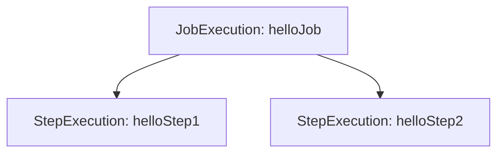

JobExecution에는 Job의 실행 상태, 시작 시간, 종료 시간 등의 정보가 기록된다.

StepExecution에는 각 Step의 실행 상태와 처리 건수 등의 정보가 기록된다.

따라서 배치가 실패했을 때 어떤 Step에서 문제가 발생했는지 확인하는 데 도움이 된다.

#### 데이터베이스에서 실행 결과 확인하기

Spring Batch 메타데이터 테이블이 생성되어 있다면 다음 SQL을 실행할 수 있다.

```sql
SELECT
    JOB_EXECUTION_ID,
    STATUS,
    EXIT_CODE,
    START_TIME,
    END_TIME
FROM BATCH_JOB_EXECUTION
ORDER BY JOB_EXECUTION_ID DESC;
```

Job 실행 기록을 조회한다.

정상적으로 완료되었다면 `STATUS`가 `COMPLETED`로 기록될 수 있다.

Step 실행 기록은 다음과 같이 확인할 수 있다.

```sql
SELECT
    STEP_EXECUTION_ID,
    STEP_NAME,
    STATUS,
    READ_COUNT,
    WRITE_COUNT
FROM BATCH_STEP_EXECUTION
ORDER BY STEP_EXECUTION_ID;
```

이번에는 Tasklet 기반 Step이므로 Reader와 Writer를 이용해 항목을 처리하지 않았다.

따라서 `READ_COUNT`, `WRITE_COUNT` 등이 0으로 기록되는 것은 자연스러운 결과다.

이는 Step에서 아무 작업도 수행하지 않았다는 의미가 아니다.

Tasklet이 실행되었지만 Chunk 기반의 항목 읽기와 쓰기를 수행하지 않았기 때문이다.

---

### Tasklet 방식과 Chunk 방식의 차이

Spring Batch의 Step은 크게 두 가지 처리 방식으로 구분해서 이해할 수 있다.

Tasklet 기반 처리와 Chunk 기반 처리다.

#### Tasklet 기반 처리

Tasklet 기반 처리는 특정 작업을 수행하는 방식이다.

```text
Step
 │
 ▼
Tasklet
 │
 ▼
작업 수행
 │
 ▼
종료
```

대표적인 예는 다음과 같다.

* 오래된 파일 삭제
* 특정 상태값 변경
* 배치 실행 전 임시 테이블 초기화
* 외부 시스템에 작업 요청

이러한 작업은 데이터 한 건을 읽을 때마다 가공하고 저장하는 구조가 필요하지 않을 수 있다.

따라서 Tasklet으로 간단하게 구현할 수 있다.

#### Chunk 기반 처리

Chunk 기반 처리는 대량의 데이터를 일정한 단위로 나누어 처리하는 방식이다.

```text
Step
 │
 ▼
ItemReader
 │
 ▼
ItemProcessor
 │
 ▼
ItemWriter
 │
 ▼
Commit
```

대표적으로 다음과 같은 작업에서 사용한다.

* 대량 결제 내역 정산
* 쿠폰 만료 처리
* 데이터 이관
* 통계 집계
* 외부 데이터 동기화

Tasklet과 Chunk 방식의 차이를 정리하면 다음과 같다.

| 구분       | Tasklet 기반          | Chunk 기반                  |
| -------- | ------------------- | ------------------------- |
| 처리 중심    | 특정 작업 실행            | 다수의 데이터 처리                |
| 주요 구성 요소 | Tasklet             | Reader, Processor, Writer |
| 반복 처리    | RepeatStatus 등으로 제어 | Chunk 처리 구조에 따라 반복        |
| 트랜잭션     | Tasklet 실행 단위       | Chunk 단위                  |
| 대표 사례    | 파일 삭제, 초기화 작업       | 정산, 데이터 이관                |

이번 예제는 Tasklet 기반 Step을 사용했다.

참고로 하나의 Step을 구성할 때 Tasklet 방식과 Chunk 방식의 설정을 동시에 사용하는 것은 아니다.

Step이 수행해야 하는 작업의 특성에 따라 적절한 처리 방식을 선택해야 한다.

단, 하나의 Job 안에서는 Tasklet 기반 Step과 Chunk 기반 Step을 함께 사용할 수 있다.

예를 들어 다음과 같은 구성이 가능하다.

```text
정산 Job
   │
   ▼
Step 1
Tasklet: 임시 데이터 초기화
   │
   ▼
Step 2
Chunk: 결제 내역 정산
   │
   ▼
Step 3
Tasklet: 정산 완료 처리
```

이처럼 각 Step의 목적에 맞게 처리 방식을 선택하면 된다.

---

### Tasklet은 언제 별도 클래스로 분리해야 할까?

이번 예제에서는 간단한 문자열 출력만 수행했기 때문에 람다 표현식을 사용했다.

```java
.tasklet((contribution, chunkContext) -> {

    System.out.println("Hello Spring Batch");

    return RepeatStatus.FINISHED;

}, transactionManager)
```

하지만 실제 업무에서는 Tasklet의 로직이 더 복잡해질 수 있다.

예를 들어 정산 완료 처리를 수행하는 Tasklet이 있다고 생각해보자.

```text
정산 완료 대상 조회
        │
        ▼
정산 상태 변경
        │
        ▼
정산 결과 검증
        │
        ▼
알림 발송 요청
```

이러한 로직을 모두 설정 클래스의 람다 표현식에 작성하면 코드가 복잡해진다.

이 경우 별도의 Tasklet 클래스로 분리하는 편이 좋다.

예를 들어 다음과 같다.

```java
@Component
@RequiredArgsConstructor
public class SettlementCompleteTasklet implements Tasklet {

    private final SettlementService settlementService;

    @Override
    public RepeatStatus execute(
            StepContribution contribution,
            ChunkContext chunkContext
    ) throws Exception {

        settlementService.completeSettlements();

        return RepeatStatus.FINISHED;
    }
}
```

그리고 설정 클래스에서는 해당 Tasklet을 주입받아 사용한다.

```java
@Bean
public Step settlementCompleteStep(
        SettlementCompleteTasklet tasklet
) {
    return new StepBuilder(
            "settlementCompleteStep",
            jobRepository
    )
            .tasklet(tasklet, transactionManager)
            .build();
}
```

이렇게 하면 설정 클래스는 Step을 구성하는 역할에 집중할 수 있다.

반면 Tasklet 클래스는 실제 비즈니스 로직을 실행하는 역할에 집중한다.

결과적으로 역할이 명확하게 분리된다.

---

### Spring Batch에서 Bean 이름과 Job 이름은 같을까?

이번 예제에서는 다음과 같이 작성했다.

```java
@Bean
public Job helloJob(...) {

    return new JobBuilder("helloJob", jobRepository)
            .start(helloStep1)
            .next(helloStep2)
            .build();
}
```

여기에는 두 가지 이름이 등장한다.

먼저 Spring Bean의 이름이다.

```java
@Bean
public Job helloJob(...)
```

별도의 Bean 이름을 지정하지 않았다면 일반적으로 메서드 이름인 `helloJob`이 Bean 이름이 된다.

반면 다음 부분은 Spring Batch의 Job 이름이다.

```java
new JobBuilder("helloJob", jobRepository)
```

Spring Batch에서 실행을 식별하는 데 사용하는 Job 이름이다.

두 이름은 반드시 같아야 하는 것은 아니다.

예를 들어 다음과 같이 작성할 수도 있다.

```java
@Bean
public Job settlementJobBean(
        @Qualifier("helloStep1") Step step
) {
    return new JobBuilder("dailySettlementJob", jobRepository)
            .start(step)
            .build();
}
```

이 경우 Spring Bean 이름은 `settlementJobBean`이고 Job 이름은 `dailySettlementJob`이다.

실제 운영에서는 이러한 이름을 혼동하지 않도록 일관되게 관리하는 것이 좋다.

Step도 마찬가지다.

```java
@Bean
public Step helloStep1() {

    return new StepBuilder("helloStep1", jobRepository)
            // ...
            .build();
}
```

Spring Bean 이름과 Step 이름은 서로 다른 개념이지만, 일반적으로 같은 이름을 사용하면 코드를 이해하기 편리하다.

---

### 실무에서 주의해야 할 부분

첫 번째 배치 Job을 만들어보면 구조 자체는 단순하다.

하지만 실제 운영 환경에서는 몇 가지 사항을 고려해야 한다.

#### Tasklet의 재실행 가능성

Tasklet은 특정 작업을 한 번 실행하고 종료하도록 구현할 수 있다.

하지만 배치가 실패한 뒤 재시작되는 과정에서는 Tasklet이 다시 실행될 수 있다.

예를 들어 다음 작업을 생각해보자.

```java
paymentService.requestSettlement();
```

외부 정산 API를 호출한 직후 네트워크 오류가 발생했다고 가정해보자.

외부 시스템에서는 이미 정산 요청을 처리했지만 Spring Batch에서는 실패로 판단했을 수 있다.

이 상태에서 Job을 재시작하면 동일한 정산 요청이 다시 발생할 수 있다.

따라서 외부 시스템과 연동하는 Tasklet에서는 재실행 시 중복 처리 문제가 발생하지 않도록 설계해야 한다.

#### Tasklet 내부에 모든 비즈니스 로직을 작성하지 않기

Tasklet은 Spring Batch의 실행 진입점 역할을 담당하도록 만들고, 실제 비즈니스 로직은 별도의 Service로 분리하는 것이 좋다.

```text
Tasklet
   │
   ▼
Application Service
   │
   ▼
Domain Logic
   │
   ▼
Repository
```

이렇게 하면 배치 실행 방식과 비즈니스 로직을 분리할 수 있다.

또한 동일한 로직을 다른 API나 관리 기능에서도 재사용하기 편리하다.

#### 로그를 남길 때 System.out 대신 로거 사용하기

이번 예제에서는 실행 흐름을 쉽게 확인하기 위해 다음 코드를 사용했다.

```java
System.out.println("Hello Spring Batch");
```

하지만 실제 운영 환경에서는 로깅 프레임워크를 사용하는 편이 좋다.

예를 들어 Lombok의 `@Slf4j`를 사용할 수 있다.

```java
@Slf4j
@Configuration
@RequiredArgsConstructor
public class HelloJobConfiguration {

    // ...
}
```

이후 Tasklet에서 다음과 같이 로그를 출력할 수 있다.

```java
log.info("Hello Spring Batch");
```

로깅 프레임워크를 사용하면 로그 레벨, 출력 형식, 수집 시스템과의 연동 등을 관리하기 편리하다.

운영 환경에서는 Job 이름, Step 이름, 실행 ID 등도 함께 기록하면 문제를 추적하는 데 도움이 된다.

---

### 전체 실행 흐름 다시 살펴보기

이번에 작성한 코드를 Spring Batch의 실제 실행 흐름과 연결해보자.

먼저 Spring Boot 애플리케이션이 시작된다.

```java
SpringApplication.run(
        SpringBatchApplication.class,
        args
);
```

Spring은 설정 클래스를 읽고 필요한 Bean을 생성한다.

```java
@Configuration
public class HelloJobConfiguration {
}
```

이 과정에서 Job과 Step 객체가 등록된다.

```text
helloJob

helloStep1

helloStep2
```

이후 Spring Boot의 자동 실행 기능이 활성화되어 있다면 `JobLauncherApplicationRunner`가 Job 실행을 요청한다.

`JobLauncher`는 Job을 실행한다.

Job은 설정된 실행 흐름에 따라 Step을 실행한다.

Step은 자신에게 등록된 Tasklet을 실행한다.

Tasklet의 `execute()` 메서드가 실행되고 `RepeatStatus.FINISHED`를 반환하면 해당 Tasklet의 반복이 종료된다.

Step이 정상적으로 완료되면 다음 Step으로 진행한다.

모든 Step이 정상적으로 완료되면 Job이 완료된다.

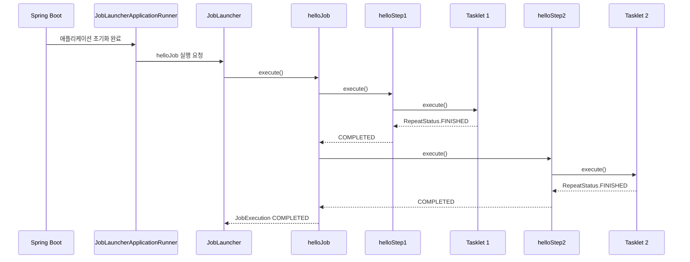

이 흐름이 Spring Batch의 가장 기본적인 실행 구조다.

---

### 정리

Spring Batch에서 하나의 배치 작업을 만들기 위해 가장 먼저 이해해야 할 개념은 `Job`, `Step`, `Tasklet`이다.

Job은 배치 작업 전체를 정의한다.

Step은 Job 안에서 실행되는 개별 작업 단위다.

Tasklet은 Step에서 실제로 수행할 작업 내용을 구현한다.

세 구성 요소의 관계는 다음과 같다.

```text
Job
 │
 ├── Step 1
 │      │
 │      └── Tasklet 1
 │
 └── Step 2
        │
        └── Tasklet 2
```

이번 예제에서는 `helloJob`을 생성하고 `helloStep1`, `helloStep2`를 순차적으로 실행하도록 구성했다.

```java
return new JobBuilder("helloJob", jobRepository)
        .start(helloStep1)
        .next(helloStep2)
        .build();
```

각 Step은 `StepBuilder`를 이용해 생성했다.

```java
return new StepBuilder("helloStep1", jobRepository)
        .tasklet(tasklet, transactionManager)
        .build();
```

그리고 Tasklet에서는 실제 작업 내용을 구현했다.

```java
(contribution, chunkContext) -> {

    System.out.println("Hello Spring Batch");

    return RepeatStatus.FINISHED;
}
```

이러한 구조를 통해 Spring Batch는 Job과 Step의 실행 흐름을 관리하고, 실제 비즈니스 로직은 Tasklet을 통해 수행할 수 있다.

또한 Tasklet은 `RepeatStatus`를 이용해 반복 여부를 제어할 수 있다.

`FINISHED`를 반환하면 반복을 종료하고, `CONTINUABLE`을 반환하면 반복을 계속할 수 있다.

Spring Boot 기반 환경에서는 별도의 실행 코드를 직접 작성하지 않아도 설정에 따라 등록된 Job을 자동으로 실행할 수 있다.

이때 `JobLauncherApplicationRunner`, `JobLauncher`, `JobRepository` 등의 구성 요소가 함께 동작한다.

실제 운영 환경에서는 JobParameters를 이용한 실행 식별, 재시작 가능성, 중복 처리 방지, 트랜잭션 범위 등을 함께 고려해야 한다.

이번 예제는 문자열 두 개를 출력하는 단순한 작업이지만, 이후 정산이나 데이터 동기화 같은 복잡한 배치 작업도 같은 기본 구조를 바탕으로 구현할 수 있다.

**Job은 전체 작업을 관리하고, Step은 실행 단위를 구분하며, Tasklet은 실제 비즈니스 로직을 수행한다는 관계를 이해하는 것이 가장 중요하다.**

#### 한 줄 요약

> Spring Batch는 `Job → Step → Tasklet` 구조로 배치 작업을 정의하며, `JobBuilder`와 `StepBuilder`를 이용해 실행 흐름을 구성하고 Tasklet의 `execute()` 메서드에서 실제 비즈니스 로직을 수행한다. 여러 Step은 `start()`와 `next()`를 통해 순차적으로 연결할 수 있고, Spring Boot의 자동 설정을 이용하면 애플리케이션 시작 시 Job을 실행할 수 있다.

## DB 스키마 생성 및 이해 (1)

### Spring Batch DB 스키마 생성과 메타데이터 관리

Spring Batch에서는 Job을 정의하고 실행하면 내부적으로 다양한 정보가 생성된다.

예를 들어 다음과 같은 배치 작업을 생각해보자.

```text
helloJob
    │
    ├── helloStep1
    │      │
    │      └── Hello Spring Batch 출력
    │
    └── helloStep2
           │
           └── Step 2 executed 출력
```

Job이 실행되면 첫 번째 Step이 실행되고, 첫 번째 Step이 정상적으로 완료되면 두 번째 Step이 실행된다.

여기서 중요한 점은 Spring Batch가 단순히 비즈니스 로직만 실행하는 것이 아니라는 것이다.

Spring Batch는 Job과 Step이 실행되는 동안 **실행 상태, 시작 시간, 종료 시간, 실패 여부, 재시작에 필요한 정보 등을 관리한다.**

예를 들어 다음과 같은 정보를 생각해볼 수 있다.

```text
Job 이름: helloJob

Job 시작 시간: 2026-10-16 02:00:00

Job 종료 시간: 2026-10-16 02:00:05

Job 실행 상태: COMPLETED

Step 1 실행 상태: COMPLETED

Step 2 실행 상태: COMPLETED
```

이러한 정보는 단순히 로그에 출력하는 것만으로는 충분하지 않을 수 있다.

애플리케이션이 종료된 이후에도 실행 이력을 확인해야 할 수 있고, 실패한 작업을 다시 실행할 때 이전 실행 상태를 참조해야 할 수도 있기 때문이다.

이처럼 Spring Batch가 실행과 운영을 위해 관리하는 정보를 **배치 메타데이터(Batch Metadata)** 라고 한다.

Spring Batch는 이러한 메타데이터를 저장하고 조회하기 위한 데이터베이스 스키마를 제공한다.

이번에는 Spring Batch의 메타데이터가 무엇인지, 왜 필요한지, 실제로 어떻게 테이블을 생성하는지 살펴보자.

---

### Spring Batch 메타데이터란?

메타데이터(Metadata)는 일반적으로 데이터를 설명하는 데이터를 의미한다.

Spring Batch에서는 Job과 Step의 실행 및 관리에 필요한 정보가 메타데이터에 해당한다.

예를 들어 정산 배치를 생각해보자.

정산 배치에서는 결제 내역을 조회하고 정산 금액을 계산한 뒤 결과를 데이터베이스에 저장한다.

이때 실제 정산 금액이나 정산 대상 결제 내역은 비즈니스 데이터다.

반면 다음 정보들은 배치 메타데이터다.

```text
정산 Job이 언제 실행되었는가?

어떤 파라미터로 실행되었는가?

현재 실행 중인가?

정상적으로 완료되었는가?

어떤 Step에서 실패했는가?

실패한 작업을 재시작할 수 있는가?
```

즉 Spring Batch에서는 비즈니스 데이터와 배치 실행 메타데이터를 구분한다.

| 구분     | 비즈니스 데이터            | 배치 메타데이터                    |
| ------ | ------------------- | --------------------------- |
| 목적     | 실제 업무 정보 저장         | 배치 실행 및 운영 정보 관리            |
| 대표 데이터 | 결제 내역, 정산 금액, 쿠폰 정보 | Job 이름, 실행 상태, 시작·종료 시간     |
| 관리 주체  | 애플리케이션 비즈니스 로직      | Spring Batch의 JobRepository |
| 활용     | 서비스 기능 제공           | 실행 이력 조회, 실패 분석, 재시작        |
| 대표 테이블 | PAYMENT, SETTLEMENT | BATCH_JOB_EXECUTION 등       |

Spring Batch는 이러한 메타데이터를 관리하기 위해 `JobRepository`라는 핵심 인터페이스를 제공한다.

---

### JobRepository는 어떤 역할을 할까?

Spring Batch에서 `JobRepository`는 Job과 Step의 실행 메타데이터를 저장하고 조회하는 역할을 담당한다.

예를 들어 Job을 실행하면 다음과 같은 객체들이 생성되거나 사용된다.

```text
JobInstance

JobExecution

StepExecution

ExecutionContext
```

각 객체는 서로 다른 목적을 가진다.

`JobInstance`는 Job 이름과 식별용 JobParameters를 기준으로 구분되는 논리적인 실행 단위다.

`JobExecution`은 특정 JobInstance에 대한 개별 실행 시도를 나타낸다.

`StepExecution`은 Step의 개별 실행 정보를 나타낸다.

`ExecutionContext`는 재시작이나 실행 과정에서 필요한 상태 정보를 저장하는 데 사용된다.

이러한 객체의 정보는 JobRepository를 통해 데이터베이스에 저장할 수 있다.

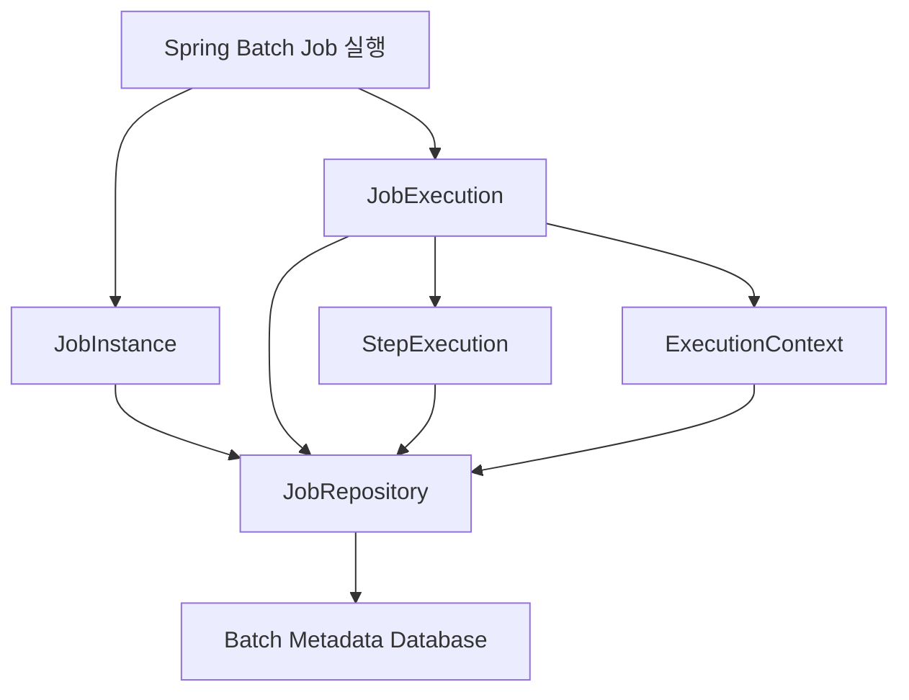

이 구조가 중요한 이유는 배치 실행 정보의 생명주기와 관련이 있다.

애플리케이션 메모리에만 실행 정보를 저장한다면 JVM이 종료되었을 때 정보가 사라질 수 있다.

반면 실행 메타데이터를 영속적인 데이터베이스에 저장하면 애플리케이션이 재시작된 이후에도 이전 실행 정보를 확인할 수 있다.

특히 실패한 배치를 재시작해야 하는 시스템에서는 이러한 실행 상태 관리가 중요하다.

---

### Spring Batch는 왜 별도의 메타데이터 테이블을 사용할까?

일반적인 Spring Boot 애플리케이션에서도 데이터베이스 테이블을 생성해 실행 이력을 저장할 수 있다.

예를 들어 다음과 같은 테이블을 직접 만들 수도 있다.

```sql
CREATE TABLE BATCH_HISTORY (
    ID BIGINT PRIMARY KEY,
    JOB_NAME VARCHAR(100),
    STATUS VARCHAR(20),
    START_TIME DATETIME,
    END_TIME DATETIME
);
```

하지만 실제 배치 시스템에서 필요한 정보는 단순한 실행 이력보다 복잡하다.

Job이 여러 Step으로 구성되어 있다면 각 Step의 실행 상태도 관리해야 한다.

또한 하나의 Job이 실패한 뒤 재시작될 수 있으므로 최초 실행과 재시작을 구분해야 한다.

재시작 시 이전에 어디까지 처리했는지 알아야 하는 경우도 있다.

이러한 기능을 프로젝트마다 직접 구현하면 상당한 양의 코드가 필요하다.

Spring Batch는 이를 위해 미리 정의된 메타데이터 스키마를 제공한다.

개발자는 해당 스키마를 생성하고 Spring Batch가 제공하는 JobRepository를 사용하면 된다.

여기서 중요한 것은 **테이블을 직접 설계하지 않아도 된다는 점뿐 아니라, Spring Batch 내부의 실행 모델과 데이터베이스 구조가 연결되어 있다는 것**이다.

---

### Spring Batch 메타데이터 테이블 구조

Spring Batch는 Job과 Step의 실행 정보를 관리하기 위한 메타데이터 테이블을 제공한다.

Spring Batch 5.2의 기본 JDBC 스키마를 기준으로 주요 메타데이터 테이블은 6개다.

| 테이블                            | 역할                                 |
| ------------------------------ | ---------------------------------- |
| `BATCH_JOB_INSTANCE`           | JobInstance 정보 저장                  |
| `BATCH_JOB_EXECUTION`          | Job의 개별 실행 정보 저장                   |
| `BATCH_JOB_EXECUTION_PARAMS`   | JobParameters 정보 저장                |
| `BATCH_JOB_EXECUTION_CONTEXT`  | JobExecution의 ExecutionContext 저장  |
| `BATCH_STEP_EXECUTION`         | Step의 개별 실행 정보 저장                  |
| `BATCH_STEP_EXECUTION_CONTEXT` | StepExecution의 ExecutionContext 저장 |

이 테이블들은 크게 Job 관련 테이블과 Step 관련 테이블로 구분할 수 있다.

#### Job 관련 테이블

Job과 관련된 테이블은 다음 네 개다.

```text
BATCH_JOB_INSTANCE

BATCH_JOB_EXECUTION

BATCH_JOB_EXECUTION_PARAMS

BATCH_JOB_EXECUTION_CONTEXT
```

`BATCH_JOB_INSTANCE`는 Job의 논리적인 인스턴스 정보를 저장한다.

`BATCH_JOB_EXECUTION`은 Job의 개별 실행 정보를 저장한다.

`BATCH_JOB_EXECUTION_PARAMS`는 해당 실행에 전달된 JobParameters를 저장한다.

`BATCH_JOB_EXECUTION_CONTEXT`는 Job 실행에 필요한 상태 정보를 저장한다.

#### Step 관련 테이블

Step과 관련된 테이블은 다음 두 개다.

```text
BATCH_STEP_EXECUTION

BATCH_STEP_EXECUTION_CONTEXT
```

`BATCH_STEP_EXECUTION`은 Step의 실행 결과와 처리 건수 등을 관리한다.

`BATCH_STEP_EXECUTION_CONTEXT`는 특정 Step 실행에 필요한 상태 정보를 저장한다.

이러한 테이블들은 서로 독립적으로 존재하는 것이 아니라 관계를 가지고 있다.

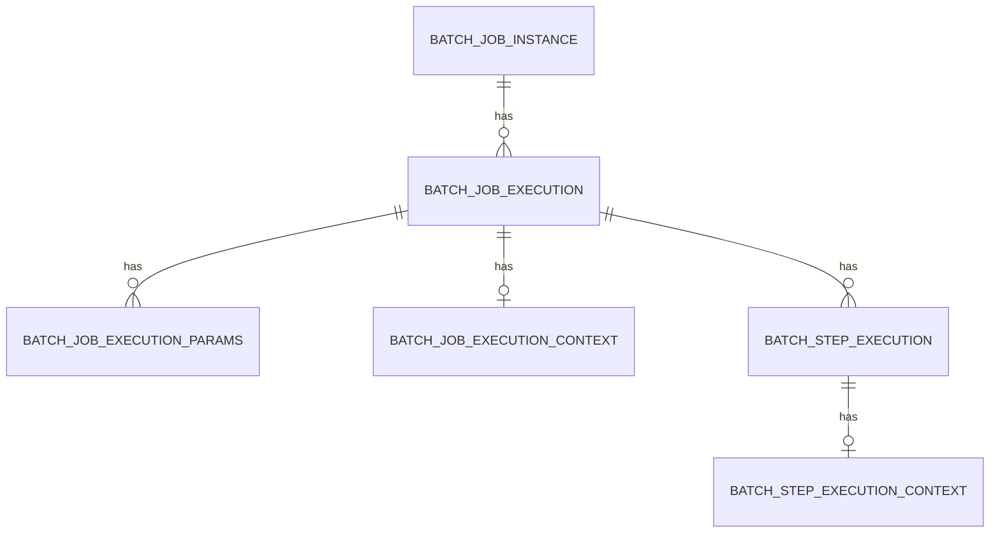

예를 들어 하나의 JobExecution에는 여러 StepExecution이 연결될 수 있다.

그리고 각 StepExecution은 자신의 실행 상태와 ExecutionContext를 가질 수 있다.

이러한 구조를 이해하면 이후 Job과 Step의 실행 정보를 조회할 때 테이블을 어떻게 연결해야 하는지도 쉽게 파악할 수 있다.

---

### MySQL에서는 왜 9개의 테이블이 생성될까?

Spring Batch의 주요 메타데이터 테이블은 6개라고 했다.

그런데 MySQL에서 Spring Batch 스키마를 생성하면 9개의 테이블이 만들어지는 것을 확인할 수 있다.

왜 그럴까?

Spring Batch가 실행 메타데이터의 ID를 생성하기 위해 추가적인 테이블을 사용하기 때문이다.

Spring Batch 5.2.4의 MySQL 스키마에는 다음 세 개의 테이블이 추가된다.

```text
BATCH_JOB_SEQ

BATCH_JOB_EXECUTION_SEQ

BATCH_STEP_EXECUTION_SEQ
```

따라서 전체 구조는 다음과 같다.

```text
Spring Batch Metadata
        │
        ├── 실행 메타데이터 테이블: 6개
        │
        │   ├── BATCH_JOB_INSTANCE
        │   ├── BATCH_JOB_EXECUTION
        │   ├── BATCH_JOB_EXECUTION_PARAMS
        │   ├── BATCH_JOB_EXECUTION_CONTEXT
        │   ├── BATCH_STEP_EXECUTION
        │   └── BATCH_STEP_EXECUTION_CONTEXT
        │
        └── ID 생성용 테이블: 3개
            │
            ├── BATCH_JOB_SEQ
            ├── BATCH_JOB_EXECUTION_SEQ
            └── BATCH_STEP_EXECUTION_SEQ
```

여기서 세 개의 `_SEQ` 테이블은 Job과 Step의 실행 정보를 직접 저장하는 테이블이 아니다.

메타데이터 레코드에 부여할 식별자를 생성하기 위한 목적으로 사용된다.

데이터베이스마다 시퀀스를 처리하는 방법은 다르다.

예를 들어 PostgreSQL이나 Oracle은 시퀀스 객체를 사용할 수 있다.

반면 Spring Batch 5.2.4의 MySQL 스키마에서는 테이블을 이용해 ID 생성 기능을 구현한다.

따라서 **6개의 메타데이터 테이블과 3개의 ID 생성용 테이블을 구분해서 이해하는 것이 중요하다.**

Spring Batch 5.2.4의 실제 MySQL 스키마에서도 이러한 구성을 확인할 수 있다.

---

### Spring Batch 스키마 파일은 어디에 있을까?

Spring Batch는 주요 데이터베이스에서 사용할 수 있는 스키마 생성 SQL을 제공한다.

이러한 파일들은 `spring-batch-core` 모듈에 포함되어 있다.

Spring Batch 5.2 기준으로 다음 경로에서 확인할 수 있다.

```text
org/springframework/batch/core/
```

해당 경로에는 데이터베이스 종류에 따른 스키마 파일이 존재한다.

예를 들어 다음과 같다.

```text
schema-mysql.sql

schema-h2.sql

schema-postgresql.sql

schema-oracle.sql
```

이 중 MySQL을 사용한다면 다음 파일을 이용하면 된다.

```text
org/springframework/batch/core/schema-mysql.sql
```

H2를 사용한다면 다음 파일을 사용한다.

```text
org/springframework/batch/core/schema-h2.sql
```

이러한 SQL 파일은 데이터베이스 종류에 맞게 테이블과 제약조건, ID 생성 구조 등을 정의한다.

중요한 점은 **프로젝트에서 사용하는 Spring Batch 버전에 맞는 스키마 파일을 사용해야 한다는 것**이다.

Spring Batch는 버전이 변경되면서 메타데이터 테이블의 컬럼과 구조가 변경된 이력이 있다.

따라서 Spring Batch 4에서 사용하던 SQL 스크립트를 Spring Batch 5 프로젝트에 그대로 적용하는 것은 적절하지 않을 수 있다.

이번에는 Spring Batch 5.2.4에 포함된 스키마 파일을 사용한다.

---

### Spring Batch 스키마를 생성하는 두 가지 방법

Spring Batch 메타데이터 테이블을 생성하는 방법은 크게 두 가지로 나눌 수 있다.

**수동 생성과 자동 생성**이다.

수동 생성은 개발자가 스키마 SQL을 직접 실행하는 방법이다.

자동 생성은 Spring Boot가 설정에 따라 적절한 스키마 SQL을 실행하도록 하는 방법이다.

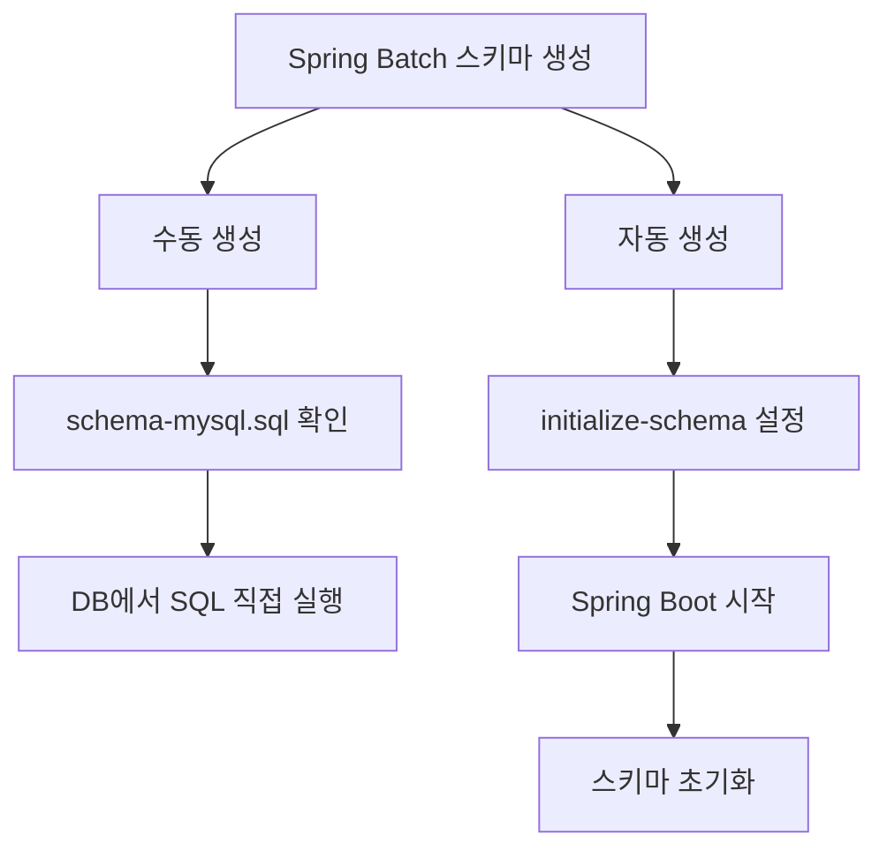

두 방법 모두 최종적으로는 Spring Batch가 제공하는 메타데이터 구조를 생성한다는 점에서 목적이 같다.

하지만 언제, 누가, 어떤 방식으로 SQL을 실행하는지가 다르다.

---

### MySQL 개발 환경 준비

먼저 MySQL을 이용해 메타데이터 테이블을 생성해보자.

앞에서 구성한 Docker Compose 환경을 그대로 사용한다.

설정은 다음과 같다.

```yaml
services:
  mysql:
    image: mysql:8.4
    container_name: spring-batch-mysql

    restart: unless-stopped

    environment:
      MYSQL_ROOT_PASSWORD: localrootpass
      MYSQL_DATABASE: batch_db
      MYSQL_USER: batch_user
      MYSQL_PASSWORD: localpass
      TZ: Asia/Seoul

    ports:
      - "3307:3306"

    volumes:
      - batch-mysql-data:/var/lib/mysql

volumes:
  batch-mysql-data:
```

이 설정은 로컬 개발 환경에서 사용할 MySQL 컨테이너를 생성한다.

MySQL 컨테이너 내부에서는 3306 포트를 사용한다.

호스트에서는 3307 포트를 통해 접속할 수 있도록 설정했다.

이제 다음 명령어를 실행한다.

```bash
docker compose up -d
```

컨테이너가 정상적으로 실행되었는지 확인한다.

```bash
docker compose ps
```

다음과 같이 실행 상태를 확인할 수 있다.

```text
NAME                 IMAGE       STATUS
spring-batch-mysql   mysql:8.4   Up
```

이제 MySQL에 접속해보자.

```bash
docker exec -it spring-batch-mysql \
  mysql -u batch_user -p batch_db
```

비밀번호 입력 메시지가 나타나면 Docker Compose에서 설정한 비밀번호를 입력한다.

MySQL에 접속한 뒤 다음 SQL을 실행한다.

```sql
SHOW TABLES;
```

새롭게 생성한 데이터베이스라면 아직 Spring Batch 메타데이터 테이블이 존재하지 않을 것이다.

이 상태에서 스키마를 생성해보자.

---

### Spring Batch 스키마 수동 생성

수동 생성은 Spring Batch가 제공하는 SQL 파일을 직접 실행하는 방식이다.

중요한 것은 SQL 파일을 임의로 작성하는 것이 아니라 **현재 프로젝트에서 사용하는 Spring Batch 버전의 공식 스키마 파일을 사용하는 것**이다.

#### spring-batch-core JAR 확인

Maven 프로젝트에서는 의존성을 내려받으면 로컬 Maven 저장소에 JAR 파일이 저장된다.

Spring Batch 5.2.4를 사용한다면 일반적으로 다음 경로에서 확인할 수 있다.

```text
~/.m2/repository/org/springframework/batch/
    spring-batch-core/5.2.4/
```

해당 디렉터리에는 다음 파일이 존재한다.

```text
spring-batch-core-5.2.4.jar
```

JAR 파일은 Java 클래스와 리소스를 포함하는 압축 파일이다.

따라서 내부에 어떤 파일이 포함되어 있는지 확인할 수 있다.

터미널에서 다음 명령어를 실행해보자.

```bash
jar tf \
  ~/.m2/repository/org/springframework/batch/spring-batch-core/5.2.4/spring-batch-core-5.2.4.jar \
  | grep schema
```

`jar tf`는 JAR 파일 내부의 파일 목록을 출력한다.

`grep schema`는 출력 결과 중 `schema`라는 문자열이 포함된 항목을 검색한다.

정상적으로 실행되면 Spring Batch가 제공하는 여러 스키마 파일을 확인할 수 있다.

#### schema-mysql.sql 추출하기

이번에는 MySQL 스키마 파일을 추출해보자.

다음 명령어를 실행한다.

```bash
unzip -p \
  ~/.m2/repository/org/springframework/batch/spring-batch-core/5.2.4/spring-batch-core-5.2.4.jar \
  org/springframework/batch/core/schema-mysql.sql \
  > schema-mysql.sql
```

이 명령어는 JAR 내부에 포함된 `schema-mysql.sql` 파일의 내용을 현재 디렉터리의 파일로 저장한다.

이렇게 하면 별도의 SQL 스크립트를 직접 작성하지 않아도 된다.

추출한 파일은 다음 명령어로 확인할 수 있다.

```bash
cat schema-mysql.sql
```

실제 파일에는 Spring Batch 메타데이터 테이블과 ID 생성용 테이블을 생성하는 SQL이 포함되어 있다.

Spring Batch 5.2.4의 전체 원본 SQL은 공식 저장소에서도 확인할 수 있다.

[Spring Batch 5.2.4 schema-mysql.sql](https://github.com/spring-projects/spring-batch/blob/v5.2.4/spring-batch-core/src/main/resources/org/springframework/batch/core/schema-mysql.sql)

#### MySQL에 스키마 적용하기

이제 추출한 SQL 파일을 MySQL 컨테이너로 복사한다.

```bash
docker cp schema-mysql.sql \
  spring-batch-mysql:/tmp/schema-mysql.sql
```

이 명령어는 로컬의 SQL 파일을 컨테이너 내부로 복사한다.

다음으로 MySQL에 접속한다.

```bash
docker exec -it spring-batch-mysql \
  mysql -u batch_user -p batch_db
```

MySQL에 접속했다면 다음 명령을 실행한다.

```sql
SOURCE /tmp/schema-mysql.sql;
```

`SOURCE`는 MySQL 클라이언트에서 SQL 파일을 읽어 실행하는 명령이다.

따라서 파일 내부에 포함된 `CREATE TABLE`, `INSERT` 등의 SQL이 실행된다.

이 과정에서 메타데이터 테이블 6개와 ID 생성용 테이블 3개가 생성된다.

#### 생성 결과 확인

다음 SQL을 실행해보자.

```sql
SHOW TABLES;
```

Spring Batch 5.2.4의 MySQL 스키마가 정상적으로 적용되었다면 다음과 같은 테이블을 확인할 수 있다.

```text
BATCH_JOB_INSTANCE

BATCH_JOB_EXECUTION

BATCH_JOB_EXECUTION_PARAMS

BATCH_JOB_EXECUTION_CONTEXT

BATCH_STEP_EXECUTION

BATCH_STEP_EXECUTION_CONTEXT

BATCH_JOB_SEQ

BATCH_JOB_EXECUTION_SEQ

BATCH_STEP_EXECUTION_SEQ
```

총 9개의 테이블이다.

데이터베이스에서 표시되는 대소문자는 운영체제와 MySQL 설정에 따라 달라질 수 있다.

이렇게 하면 Spring Batch 메타데이터 스키마를 수동으로 생성한 것이다.

---

### 스키마 자동 생성

이번에는 Spring Boot가 자동으로 메타데이터 테이블을 생성하도록 설정해보자.

Spring Boot는 Spring Batch용 스키마 초기화 기능을 제공한다.

설정에 따라 데이터베이스 종류를 확인하고 해당 데이터베이스에 적합한 스키마 SQL을 실행할 수 있다.

이때 사용하는 설정은 다음과 같다.

```yaml
spring:
  batch:
    jdbc:
      initialize-schema: always
```

핵심 속성은 다음이다.

```text
spring.batch.jdbc.initialize-schema
```

이 설정은 Spring Batch의 메타데이터 스키마를 자동으로 초기화할지 결정한다.

사용할 수 있는 값은 세 가지다.

| 설정값        | 의미                            |
| ---------- | ----------------------------- |
| `always`   | 데이터베이스 종류와 관계없이 초기화 SQL 실행 시도 |
| `embedded` | 내장 데이터베이스에서만 자동 초기화           |
| `never`    | 스키마 자동 초기화 비활성화               |

Spring Boot 3.4에서도 동일한 속성을 사용한다.

Spring Boot는 내장 데이터베이스에 대해서 기본적으로 스키마 초기화를 지원하며, 외부 데이터베이스는 별도의 설정으로 초기화를 활성화할 수 있다.

이제 각 설정이 어떤 차이를 가지는지 살펴보자.

---

### ALWAYS: 스키마 자동 생성

먼저 다음 설정을 살펴보자.

```yaml
spring:
  batch:
    jdbc:
      initialize-schema: always
```

`always`를 사용하면 Spring Boot가 시작될 때 Spring Batch 메타데이터 스키마 초기화를 시도한다.

여기서 중요한 것은 내장 데이터베이스뿐 아니라 MySQL 같은 외부 데이터베이스에서도 초기화를 시도한다는 점이다.

예를 들어 다음 설정을 사용한다고 생각해보자.

```yaml
spring:
  datasource:
    url: jdbc:mysql://localhost:3307/batch_db
    driver-class-name: com.mysql.cj.jdbc.Driver
    username: batch_user
    password: localpass

  batch:
    jdbc:
      initialize-schema: always
```

Spring Boot는 MySQL DataSource를 구성하고 Spring Batch 스키마 초기화 기능을 수행할 수 있다.

이때 사용하는 SQL은 MySQL에 맞는 Spring Batch 스키마 파일이다.

```text
schema-mysql.sql
```

따라서 개발자가 해당 SQL을 직접 실행하지 않아도 스키마를 생성할 수 있다.

#### 자동 생성 흐름

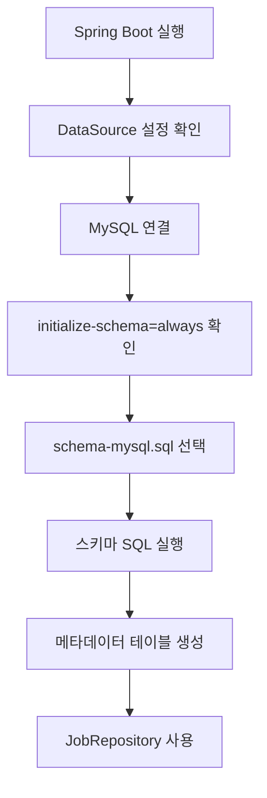

다만 이 흐름은 Spring Boot의 일반적인 자동 설정이 활성화되어 있다는 전제다.

`@EnableBatchProcessing` 등을 통해 배치 인프라를 직접 구성하는 경우에는 자동 설정이 달라질 수 있다.

#### ALWAYS를 사용할 때 주의할 점

`always`는 데이터베이스에 테이블이 없을 때 한 번만 실행한다는 의미가 아니다.

**애플리케이션 시작 시 스키마 초기화를 시도하도록 하는 설정**이다.

따라서 이미 메타데이터 테이블이 생성되어 있다면 SQL 실행 과정에서 `Table already exists`와 같은 오류가 발생할 수 있다.

오류를 어떻게 처리할지는 초기화 구성에 따라 달라질 수 있지만, 운영 환경에서 매번 스키마 생성을 시도하도록 만드는 것은 적절하지 않다.

따라서 MySQL 환경에서는 개발 및 초기 구성 과정에서 필요할 때만 사용하고, 스키마가 준비된 이후에는 `never`로 변경하거나 별도의 마이그레이션 도구를 사용하는 편이 좋다.

---

### EMBEDDED: 내장 데이터베이스에서만 자동 생성

다음 설정을 살펴보자.

```yaml
spring:
  batch:
    jdbc:
      initialize-schema: embedded
```

`embedded`는 내장 데이터베이스를 사용하는 경우에만 스키마를 자동으로 초기화하는 설정이다.

Spring Boot 3.4의 기본 설정도 `embedded`다.

대표적인 내장 데이터베이스로는 H2, HSQLDB, Derby 등이 있다.

이번에는 H2를 사용해보자.

```yaml
spring:
  datasource:
    url: jdbc:h2:mem:batchdb;DB_CLOSE_DELAY=-1
    driver-class-name: org.h2.Driver
    username: sa
    password:

  batch:
    jdbc:
      initialize-schema: embedded
```

이렇게 설정하면 H2 데이터베이스를 사용하는 환경에서 Spring Batch 메타데이터 스키마가 자동으로 생성될 수 있다.

별도의 SQL 파일을 직접 실행할 필요가 없다.

#### H2에서는 왜 자동 생성이 편리할까?

H2를 메모리 모드로 실행하면 일반적으로 JVM이 종료될 때 데이터베이스 내용도 사라진다.

따라서 애플리케이션을 다시 시작하면 이전에 생성했던 테이블이 존재하지 않는다.

이러한 환경에서는 Spring Batch 메타데이터 테이블을 매번 자동으로 생성하도록 구성하는 것이 편리하다.

예를 들어 다음과 같은 흐름이다.

```text
애플리케이션 시작
        │
        ▼
H2 메모리 DB 생성
        │
        ▼
Spring Batch 스키마 생성
        │
        ▼
Job 실행
        │
        ▼
애플리케이션 종료
        │
        ▼
메모리 DB 종료
```

이러한 특성 때문에 H2는 개발 환경이나 간단한 테스트에서 사용하기 편리하다.

다만 메모리 데이터베이스는 애플리케이션이 종료되면 실행 기록도 사라지므로, 여러 실행에 걸친 재시작 테스트에는 영속적인 저장소를 사용하는 것이 적절하다.

---

### NEVER: 스키마 자동 생성 비활성화

마지막으로 다음 설정을 살펴보자.

```yaml
spring:
  batch:
    jdbc:
      initialize-schema: never
```

`never`는 Spring Boot가 Spring Batch 메타데이터 스키마를 자동으로 생성하지 않도록 한다.

이 설정을 사용하면 애플리케이션이 시작되어도 자동 초기화 SQL을 실행하지 않는다.

따라서 JDBC 기반 JobRepository를 사용한다면 필요한 메타데이터 테이블을 별도로 준비해야 한다.

예를 들어 MySQL에 이미 Spring Batch 스키마를 수동으로 생성한 경우에는 다음과 같이 설정할 수 있다.

```yaml
spring:
  datasource:
    url: jdbc:mysql://localhost:3307/batch_db
    driver-class-name: com.mysql.cj.jdbc.Driver
    username: batch_user
    password: localpass

  batch:
    jdbc:
      initialize-schema: never
```

이제 Spring Boot가 시작되어도 스키마 초기화 SQL을 실행하지 않는다.

이미 생성된 메타데이터 테이블을 사용해 Job 실행 정보를 관리한다.

이러한 방식은 운영 환경에서 유용하다.

운영 데이터베이스의 스키마는 애플리케이션이 시작될 때마다 임의로 변경하기보다 별도의 배포 절차나 마이그레이션 도구를 통해 관리하는 편이 안전하기 때문이다.

---

### ALWAYS, EMBEDDED, NEVER 비교

세 가지 설정을 다시 비교해보자.

| 구분           | ALWAYS       | EMBEDDED       | NEVER         |
| ------------ | ------------ | -------------- | ------------- |
| 내장 DB 자동 초기화 | 시도           | 시도             | 하지 않음         |
| MySQL 자동 초기화 | 시도           | 하지 않음          | 하지 않음         |
| SQL 직접 실행    | 일반적으로 불필요    | 내장 DB에서는 불필요   | 별도로 필요        |
| 주요 활용        | 초기 개발 환경     | H2 개발·테스트      | 운영 환경         |
| 기존 스키마 존재 시  | 중복 생성 시도에 주의 | 내장 DB 재사용 시 주의 | 기존 스키마 그대로 사용 |

이 설정은 **Spring Batch 메타데이터 스키마를 자동으로 생성할지 여부**를 제어한다.

Spring Batch의 Job 실행 여부를 제어하는 설정과는 다르다.

예를 들어 다음 설정은 Job의 자동 실행 여부를 제어한다.

```yaml
spring:
  batch:
    job:
      enabled: false
```

반면 다음 설정은 메타데이터 스키마 초기화 여부를 제어한다.

```yaml
spring:
  batch:
    jdbc:
      initialize-schema: never
```

두 설정은 서로 다른 목적을 가진다.

```text
spring.batch.job.enabled

→ 애플리케이션 시작 시 Job 자동 실행 여부
```

```text
spring.batch.jdbc.initialize-schema

→ Spring Batch 메타데이터 스키마 초기화 여부
```

따라서 초기화 문제를 해결할 때 이 두 설정을 혼동하지 않아야 한다.

---

### Spring Profile을 이용해 데이터베이스 환경 구분하기

앞에서 작성한 Spring Boot 프로젝트에서는 H2와 MySQL을 모두 사용할 수 있도록 Spring Profile을 구성했다.

이번에도 같은 구조를 사용하자.

```text
src/main/resources
    │
    ├── application.yml
    │
    ├── application-local.yml
    │
    └── application-mysql.yml
```

#### application.yml

공통 설정은 다음과 같다.

```yaml
spring:
  application:
    name: spring-batch-demo

  profiles:
    default: local

  batch:
    job:
      enabled: true
```

별도의 Profile을 지정하지 않으면 `local`을 사용한다.

#### application-local.yml

H2 환경은 다음과 같이 설정한다.

```yaml
spring:
  datasource:
    url: jdbc:h2:mem:batchdb;DB_CLOSE_DELAY=-1
    driver-class-name: org.h2.Driver
    username: sa
    password:

  batch:
    jdbc:
      initialize-schema: embedded
```

H2는 내장 데이터베이스이므로 `embedded`를 사용한다.

#### application-mysql.yml

MySQL 환경은 다음과 같이 설정한다.

```yaml
spring:
  datasource:
    url: jdbc:mysql://localhost:3307/batch_db
    driver-class-name: com.mysql.cj.jdbc.Driver
    username: ${BATCH_DB_USERNAME:batch_user}
    password: ${BATCH_DB_PASSWORD:localpass}

  batch:
    jdbc:
      initialize-schema: never
```

이 설정은 메타데이터 스키마가 이미 생성된 MySQL 데이터베이스를 사용하는 경우에 적합하다.

자동 생성 기능을 확인하려면 **아직 메타데이터 테이블이 없는 별도의 개발용 데이터베이스**에서 `initialize-schema: always`로 변경하여 테스트할 수 있다.

이미 스키마가 존재하는 데이터베이스에서 자동 생성 기능을 확인하기 위해 무조건 테이블을 삭제하는 것은 권장하지 않는다.

---

### 실제로 자동 스키마 생성을 확인해보자

이번에는 스키마 자동 생성 동작을 확인하는 과정을 정리해보자.

먼저 메타데이터 테이블이 없는 새로운 MySQL 데이터베이스를 준비한다.

그리고 다음 설정을 사용한다.

```yaml
spring:
  batch:
    jdbc:
      initialize-schema: always
```

이 상태에서 Spring Boot 애플리케이션을 실행한다.

```bash
./mvnw spring-boot:run \
  -Dspring-boot.run.profiles=mysql
```

Spring Boot는 MySQL 연결 정보를 확인하고 Spring Batch 스키마 초기화를 수행한다.

정상적으로 초기화되었다면 MySQL에서 다음 SQL을 실행할 수 있다.

```sql
SHOW TABLES;
```

결과는 다음과 같은 구조다.

```text
BATCH_JOB_INSTANCE
BATCH_JOB_EXECUTION
BATCH_JOB_EXECUTION_PARAMS
BATCH_JOB_EXECUTION_CONTEXT
BATCH_STEP_EXECUTION
BATCH_STEP_EXECUTION_CONTEXT
BATCH_JOB_SEQ
BATCH_JOB_EXECUTION_SEQ
BATCH_STEP_EXECUTION_SEQ
```

이것이 Spring Batch의 자동 스키마 초기화 기능이다.

수동 방식에서는 SQL을 직접 실행했다.

자동 방식에서는 Spring Boot가 해당 SQL을 실행했다.

하지만 최종적으로 생성되는 스키마의 목적은 동일하다.

---

### 메타데이터 테이블이 없으면 어떻게 될까?

이번에는 반대 상황을 살펴보자.

MySQL에 Spring Batch 메타데이터 테이블이 존재하지 않는다고 가정하자.

그리고 다음 설정을 사용한다.

```yaml
spring:
  batch:
    jdbc:
      initialize-schema: never
```

자동 생성이 비활성화되어 있으므로 Spring Boot는 메타데이터 테이블을 생성하지 않는다.

이 상태에서 `helloJob`을 실행하면 어떻게 될까?

Job 실행 과정에서 `JobRepository`는 실행 정보를 데이터베이스에 저장하거나 조회하려고 한다.

예를 들어 기존 JobInstance를 확인하기 위해 다음과 같은 테이블을 사용한다.

```text
BATCH_JOB_INSTANCE
```

하지만 해당 테이블이 존재하지 않는다.

따라서 데이터베이스에서 오류가 발생할 수 있다.

MySQL 환경에서는 다음과 유사한 메시지가 나타날 수 있다.

```text
Table 'batch_db.BATCH_JOB_INSTANCE' doesn't exist
```

Spring Batch는 실행 메타데이터를 관리하려고 했지만 필요한 테이블이 없으므로 정상적인 Job 실행을 진행할 수 없는 것이다.

전체 흐름은 다음과 같다.

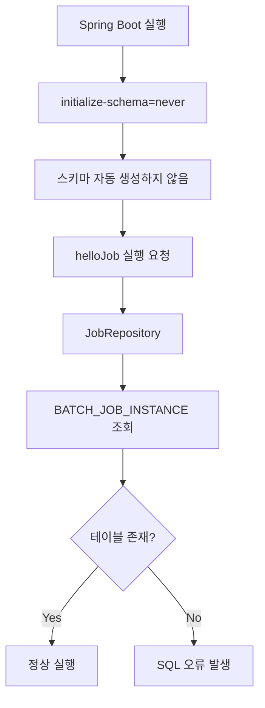

이러한 상황은 실제 운영 환경에서도 발생할 수 있다.

예를 들어 새로운 배치 애플리케이션을 배포했지만 메타데이터 스키마를 생성하지 않았다면 Job 실행 과정에서 오류가 발생할 수 있다.

따라서 **Spring Batch 애플리케이션을 배포할 때는 JobRepository가 사용하는 메타데이터 스키마가 준비되어 있는지 확인해야 한다.**

---

### H2에서는 왜 동일한 오류가 발생하지 않을까?

이번에는 H2를 사용한다고 생각해보자.

다음과 같이 설정한다.

```yaml
spring:
  datasource:
    url: jdbc:h2:mem:batchdb;DB_CLOSE_DELAY=-1
    driver-class-name: org.h2.Driver
    username: sa
    password:

  batch:
    jdbc:
      initialize-schema: embedded
```

이 상태에서 애플리케이션을 실행하면 Spring Boot는 H2가 내장 데이터베이스라는 사실을 확인하고 Spring Batch 메타데이터 스키마를 초기화할 수 있다.

따라서 JobRepository가 필요한 테이블을 사용할 수 있게 된다.

```text
Spring Boot 시작
        │
        ▼
H2 메모리 DB 생성
        │
        ▼
Spring Batch 스키마 자동 생성
        │
        ▼
JobRepository 초기화
        │
        ▼
helloJob 실행
        │
        ▼
정상 완료
```

반면 H2에서도 다음처럼 설정한다면

```yaml
spring:
  batch:
    jdbc:
      initialize-schema: never
```

메타데이터 테이블이 자동으로 생성되지 않는다.

그리고 별도로 스키마를 생성하지 않았다면 Job 실행 시 테이블이 존재하지 않는 오류가 발생할 수 있다.

즉 H2라서 특별히 메타데이터 테이블이 필요 없는 것은 아니다.

**H2에서는 기본적으로 자동 스키마 초기화가 적용될 수 있기 때문에 개발자가 직접 테이블을 생성하지 않아도 되는 것**이다.

---

### 메타데이터 테이블에 실제로 어떤 값이 저장될까?

지금까지는 스키마를 생성하는 방법을 살펴봤다.

그렇다면 실제로 Job을 실행하면 어떤 데이터가 저장될까?

앞에서 만든 `helloJob`을 다시 생각해보자.

```text
helloJob
    │
    ├── helloStep1
    │
    └── helloStep2
```

이 Job을 실행하면 JobInstance와 JobExecution, StepExecution 등에 해당하는 실행 메타데이터가 생성된다.

영속적인 MySQL 데이터베이스를 사용한다면 실행 종료 후에도 이러한 정보를 확인할 수 있다.

#### JobInstance 조회

먼저 다음 SQL을 실행해보자.

```sql
SELECT
    JOB_INSTANCE_ID,
    JOB_NAME,
    JOB_KEY,
    VERSION
FROM BATCH_JOB_INSTANCE;
```

이 테이블에는 Job 이름과 Job을 식별하기 위한 정보가 저장된다.

여기서 `JOB_KEY`는 식별용 JobParameters를 바탕으로 생성되는 값이다.

따라서 같은 Job 이름이더라도 식별용 JobParameters가 다르면 서로 다른 JobInstance로 관리될 수 있다.

#### JobExecution 조회

다음 SQL을 실행해보자.

```sql
SELECT
    JOB_EXECUTION_ID,
    JOB_INSTANCE_ID,
    CREATE_TIME,
    START_TIME,
    END_TIME,
    STATUS,
    EXIT_CODE,
    EXIT_MESSAGE
FROM BATCH_JOB_EXECUTION
ORDER BY JOB_EXECUTION_ID DESC;
```

이 테이블에서는 Job의 실제 실행 정보를 확인할 수 있다.

대표적으로 다음과 같은 값이 저장된다.

| 컬럼                 | 의미               |
| ------------------ | ---------------- |
| `JOB_EXECUTION_ID` | JobExecution 식별자 |
| `JOB_INSTANCE_ID`  | 연결된 JobInstance  |
| `CREATE_TIME`      | 실행 정보 생성 시점      |
| `START_TIME`       | 실행 시작 시점         |
| `END_TIME`         | 실행 종료 시점         |
| `STATUS`           | 실행 상태            |
| `EXIT_CODE`        | 종료 코드            |
| `EXIT_MESSAGE`     | 종료 메시지           |

Job이 정상적으로 완료되면 `STATUS`에 `COMPLETED`가 저장될 수 있다.

실행 중 오류가 발생했다면 `FAILED` 같은 상태와 오류 관련 정보가 기록될 수 있다.

#### StepExecution 조회

이번에는 Step 실행 정보를 조회해보자.

```sql
SELECT
    STEP_EXECUTION_ID,
    JOB_EXECUTION_ID,
    STEP_NAME,
    STATUS,
    COMMIT_COUNT,
    ROLLBACK_COUNT,
    READ_COUNT,
    WRITE_COUNT
FROM BATCH_STEP_EXECUTION
ORDER BY STEP_EXECUTION_ID;
```

여기서는 `helloStep1`과 `helloStep2`의 실행 정보를 확인할 수 있다.

각 Step에 대해 실행 상태와 트랜잭션 관련 건수 등이 기록된다.

이번 예제는 Tasklet 기반으로 문자열을 출력하므로 Reader와 Writer를 이용한 데이터 처리는 수행하지 않았다.

따라서 `READ_COUNT`, `WRITE_COUNT`가 0으로 기록되더라도 정상적인 결과다.

반면 Chunk 기반 Step을 사용한다면 실제 읽고 쓴 데이터 건수를 확인할 수 있다.

---

### Job과 Step 실행 정보를 함께 조회하기

실무에서는 Job과 Step 실행 정보를 함께 조회해야 하는 경우가 많다.

예를 들어 특정 정산 Job이 실패했다면 어떤 Step에서 문제가 발생했는지 확인해야 한다.

이때 다음과 같이 테이블을 연결할 수 있다.

```sql
SELECT
    ji.JOB_NAME,
    je.JOB_EXECUTION_ID,
    je.STATUS AS JOB_STATUS,
    je.START_TIME,
    je.END_TIME,
    se.STEP_NAME,
    se.STATUS AS STEP_STATUS,
    se.COMMIT_COUNT,
    se.ROLLBACK_COUNT
FROM BATCH_JOB_INSTANCE ji
JOIN BATCH_JOB_EXECUTION je
    ON ji.JOB_INSTANCE_ID = je.JOB_INSTANCE_ID
JOIN BATCH_STEP_EXECUTION se
    ON je.JOB_EXECUTION_ID = se.JOB_EXECUTION_ID
WHERE ji.JOB_NAME = 'helloJob'
ORDER BY
    je.JOB_EXECUTION_ID DESC,
    se.STEP_EXECUTION_ID;
```

이 쿼리는 다음 정보를 연결한다.

```text
JobInstance
     │
     ▼
JobExecution
     │
     ▼
StepExecution
```

따라서 하나의 Job 실행에 속한 Step들의 상태를 함께 확인할 수 있다.

실무에서는 여기에 실패한 Step의 종료 메시지나 처리 건수 등을 추가해 운영용 모니터링 화면을 구성할 수도 있다.

다만 Spring Batch의 메타데이터 테이블을 직접 수정하는 것은 주의해야 한다.

JobRepository가 실행 상태와 버전 정보를 관리하기 때문에 임의로 값을 변경하면 실제 실행 상태와 데이터베이스 정보 사이의 불일치가 발생할 수 있다.

따라서 운영에서는 메타데이터를 조회 목적으로 활용하고, 실행 상태 변경은 Spring Batch가 제공하는 API와 정상적인 운영 절차를 사용하는 것이 좋다.

---

### 메타데이터 스키마를 운영 환경에서 관리할 때 주의할 점

개발 환경에서는 다음 설정을 사용하는 것이 편리하다.

```yaml
spring:
  batch:
    jdbc:
      initialize-schema: always
```

하지만 운영 환경에서는 다른 접근이 필요하다.

운영 중인 데이터베이스에는 이전 Job의 실행 이력과 재시작에 필요한 정보가 저장되어 있을 수 있다.

따라서 애플리케이션을 배포할 때마다 자동으로 스키마 생성 SQL을 실행하는 것은 적절하지 않을 수 있다.

이런 경우에는 다음처럼 설정한다.

```yaml
spring:
  batch:
    jdbc:
      initialize-schema: never
```

그리고 Spring Batch 메타데이터 스키마는 별도의 배포 절차에서 관리한다.

예를 들어 Flyway나 Liquibase 같은 데이터베이스 마이그레이션 도구를 사용할 수 있다.

```text
애플리케이션 배포
       │
       ▼
DB 마이그레이션 확인
       │
       ▼
필요한 스키마 변경 적용
       │
       ▼
Spring Batch 애플리케이션 시작
       │
       ▼
JobRepository 초기화
       │
       ▼
Job 실행
```

이렇게 하면 스키마 변경을 애플리케이션의 실행 과정과 분리할 수 있다.

또한 Spring Batch 버전을 업그레이드할 때는 기존 메타데이터 테이블과 새 버전에서 요구하는 스키마가 호환되는지 확인해야 한다.

Spring Batch 버전이 달라지면 테이블 컬럼이나 제약조건이 변경될 수 있으므로, 단순히 새로운 스키마 SQL을 기존 데이터베이스에 다시 실행하는 것으로 해결해서는 안 된다.

Spring Batch에서 제공하는 마이그레이션 스크립트와 공식 업그레이드 가이드를 확인하는 것이 중요하다.

---

### 정리

Spring Batch는 Job과 Step의 실행 및 관리를 위해 메타데이터를 사용한다.

메타데이터에는 Job의 실행 상태, 시작 시간, 종료 시간, 실행 파라미터, Step의 처리 정보, 재시작에 필요한 상태 등이 포함된다.

이러한 정보는 `JobRepository`를 통해 관리된다.

Spring Batch는 이를 위한 메타데이터 스키마를 제공하며, JDBC 기반 JobRepository를 사용하는 경우 필요한 테이블이 준비되어 있어야 한다.

Spring Batch 5.2.4의 MySQL 스키마에서는 주요 메타데이터 테이블 6개와 ID 생성용 테이블 3개를 사용한다.

```text
메타데이터 테이블: 6개

ID 생성용 테이블: 3개

총 9개
```

스키마를 생성하는 방법은 크게 수동 생성과 자동 생성으로 구분할 수 있다.

수동 생성은 Spring Batch에서 제공하는 SQL 스크립트를 직접 실행하는 방식이다.

자동 생성은 Spring Boot의 스키마 초기화 설정을 사용하는 방식이다.

설정값의 차이는 다음과 같다.

| 설정값        | 핵심 의미                  |
| ---------- | ---------------------- |
| `always`   | 내장·외부 DB 모두 스키마 초기화 시도 |
| `embedded` | 내장 DB에서만 자동 초기화        |
| `never`    | 스키마 자동 초기화 비활성화        |

개발 환경에서는 H2와 `embedded` 설정을 조합하면 편리하게 테스트할 수 있다.

반면 운영 환경에서는 MySQL 같은 영속적인 데이터베이스를 사용하고, 메타데이터 스키마를 별도의 마이그레이션 절차로 관리하는 것이 적절하다.

특히 Spring Batch 메타데이터는 단순한 로그성 데이터가 아니다.

**배치 실행 상태를 관리하고 실패한 작업을 재시작하는 데 필요한 중요한 운영 데이터**이기 때문이다.

따라서 스키마를 생성하는 방법뿐 아니라 실행 메타데이터가 어떤 의미를 가지고 있으며 어떤 목적으로 저장되는지 함께 이해하는 것이 중요하다.

#### 한 줄 요약

> Spring Batch는 Job과 Step의 실행 상태 및 재시작 정보를 관리하기 위해 메타데이터 스키마를 사용하며, `spring.batch.jdbc.initialize-schema`의 `always`, `embedded`, `never` 설정으로 자동 초기화 여부를 제어할 수 있다. 개발 환경에서는 자동 생성을 활용할 수 있지만 운영 환경에서는 스키마를 별도로 관리하는 것이 안정적인 배치 운영에 유리하다.


## DB 스키마 생성 및 이해 (2)

### Spring Batch 메타데이터 테이블 구조와 실행 정보 분석

Spring Batch에서는 Job과 Step을 실행할 때 단순히 비즈니스 로직만 수행하는 것이 아니라, 실행 과정에서 발생하는 다양한 정보를 관리한다.

예를 들어 다음과 같은 Job을 실행한다고 생각해보자.

```text
helloJob
    │
    ├── helloStep1
    │      └── Hello Spring Batch 출력
    │
    └── helloStep2
           └── Step 2 executed 출력
```

Job이 실행되면 Spring Batch는 내부적으로 Job과 Step의 실행 상태를 관리하기 위한 객체들을 생성한다.

대표적으로 다음과 같은 객체들이 있다.

* `JobInstance`
* `JobExecution`
* `JobParameters`
* `StepExecution`
* `ExecutionContext`

이 객체들은 서로 다른 역할을 담당하며, JDBC 기반 `JobRepository`를 사용하는 경우 실행 메타데이터가 데이터베이스에 저장된다.

예를 들어 `JobExecution`에는 Job의 시작 시간, 종료 시간, 실행 상태 등이 저장된다. `StepExecution`에는 각 Step의 실행 정보뿐 아니라 읽기, 쓰기, 커밋, 롤백 등의 처리 건수도 저장된다.

이러한 정보는 배치 실행이 종료된 이후에도 중요한 의미를 가진다.

정산 배치가 실패했다면 어느 단계에서 실패했는지 확인해야 한다. 또한 재시작이 필요한 경우에는 이전 실행 정보를 이용해 어디부터 작업을 다시 처리할 것인지 판단해야 한다.

이처럼 **Spring Batch의 메타데이터 테이블은 단순한 실행 로그 저장소가 아니라 Job의 실행 상태와 재시작을 관리하기 위한 핵심 구성 요소**다.

이번에는 Spring Batch가 제공하는 6개의 주요 메타데이터 테이블을 각각 살펴보고, 테이블 간 관계와 주요 컬럼의 의미를 알아보자.

또한 실제 배치를 실행한 뒤 데이터베이스에 어떤 값이 저장되는지도 확인해보자.

> **버전 기준:** Spring Boot 3.4.13 / Spring Batch 5.2.4 / Java 17 / MySQL 8.4
>
> Spring Batch 4.x와 5.x는 일부 메타데이터 컬럼 구조가 다르다. 특히 `BATCH_JOB_EXECUTION_PARAMS`의 구조가 크게 변경되었으므로, 실제 SQL과 컬럼 설명은 Spring Batch 5.2.4를 기준으로 한다.

---

### Spring Batch 메타데이터의 전체 구조

Spring Batch의 메타데이터 테이블은 크게 Job 관련 테이블과 Step 관련 테이블로 구분할 수 있다.

#### Job 관련 테이블

| 테이블                           | 역할                          |
| ----------------------------- | --------------------------- |
| `BATCH_JOB_INSTANCE`          | JobInstance의 식별 정보 관리       |
| `BATCH_JOB_EXECUTION`         | Job의 개별 실행 정보 관리            |
| `BATCH_JOB_EXECUTION_PARAMS`  | Job 실행 시 전달된 파라미터 저장        |
| `BATCH_JOB_EXECUTION_CONTEXT` | Job 실행 중 필요한 상태 및 공유 데이터 저장 |

#### Step 관련 테이블

| 테이블                            | 역할                       |
| ------------------------------ | ------------------------ |
| `BATCH_STEP_EXECUTION`         | Step의 개별 실행 정보와 처리 건수 관리 |
| `BATCH_STEP_EXECUTION_CONTEXT` | Step 실행 중 필요한 상태 정보 저장   |

이러한 테이블들은 서로 관계를 가지고 있다.


가장 상위에는 `BATCH_JOB_INSTANCE`가 존재한다.

하나의 JobInstance에는 여러 JobExecution이 연결될 수 있다.

그리고 하나의 JobExecution에는 실행에 사용된 JobParameters와 JobExecutionContext가 연결된다.

또한 하나의 JobExecution은 여러 StepExecution을 가질 수 있으며, 각 StepExecution은 자신의 ExecutionContext를 관리한다.

여기서 가장 중요한 관계는 다음과 같다.

```text
JobInstance
     │
     │ 1:N
     ▼
JobExecution
     │
     │ 1:N
     ▼
StepExecution
```

이 관계를 이해하면 Spring Batch의 메타데이터 구조를 훨씬 쉽게 파악할 수 있다.

---

### JobInstance와 JobExecution은 무엇이 다를까?

테이블을 살펴보기 전에 먼저 두 객체의 차이를 이해할 필요가 있다.

`JobInstance`와 `JobExecution`은 이름이 비슷하지만 의미는 다르다.

**JobInstance는 논리적인 Job 실행 대상을 나타내고, JobExecution은 해당 JobInstance에 대한 실제 실행 시도를 나타낸다.**

예를 들어 매일 정산하는 Job이 있다고 생각해보자.

```text
Job 이름: settlementJob
```

이 Job을 다음과 같은 파라미터로 실행한다.

```text
businessDate=2026-10-15
```

Spring Batch는 Job 이름과 식별용 JobParameters를 이용해 JobInstance를 구분한다.

이때 생성된 JobInstance가 실패했다고 생각해보자.

```text
settlementJob
businessDate=2026-10-15
        │
        ▼
JobInstance 1
        │
        ▼
JobExecution 1
        │
        ▼
FAILED
```

이후 동일한 JobParameters로 실패한 작업을 재시작할 수 있다.

```text
settlementJob
businessDate=2026-10-15
        │
        ▼
JobInstance 1
        │
        ├── JobExecution 1
        │       └── FAILED
        │
        └── JobExecution 2
                └── COMPLETED
```

여기서 중요한 점은 JobInstance가 새로 생성되지 않았다는 것이다.

동일한 Job 이름과 식별용 JobParameters를 사용했기 때문에 동일한 JobInstance에 속한다.

반면 실행 시도는 새롭게 발생했으므로 JobExecution이 추가된다.

이번에는 정산 기준일을 변경해보자.

```text
businessDate=2026-10-16
```

이 경우 식별용 JobParameters가 달라졌으므로 새로운 JobInstance가 생성된다.

```text
settlementJob
    │
    ├── JobInstance 1
    │      businessDate=2026-10-15
    │
    └── JobInstance 2
           businessDate=2026-10-16
```

따라서 다음 관계를 기억하면 된다.

| 구분       | JobInstance                | JobExecution |
| -------- | -------------------------- | ------------ |
| 의미       | 논리적인 Job 실행 단위             | 실제 실행 시도     |
| 식별 기준    | Job 이름 + 식별용 JobParameters | 개별 실행 ID     |
| 실패 후 재시작 | 동일한 인스턴스 사용 가능             | 새로운 실행 기록 생성 |
| 파라미터 변경  | 식별용 파라미터가 달라지면 새 인스턴스      | 새로운 실행 기록 생성 |

이 차이는 이후 `BATCH_JOB_INSTANCE`와 `BATCH_JOB_EXECUTION` 테이블을 이해하는 데 중요한 기반이 된다.

---

### BATCH_JOB_INSTANCE

`BATCH_JOB_INSTANCE`는 JobInstance의 정보를 저장하는 테이블이다.

Spring Batch 메타데이터 구조에서 가장 상위에 위치한다.

Spring Batch 5.2.4의 MySQL 스키마는 다음과 같다.

```sql
CREATE TABLE BATCH_JOB_INSTANCE (
    JOB_INSTANCE_ID BIGINT NOT NULL PRIMARY KEY,
    VERSION BIGINT,
    JOB_NAME VARCHAR(100) NOT NULL,
    JOB_KEY VARCHAR(32) NOT NULL,

    CONSTRAINT JOB_INST_UN
        UNIQUE (JOB_NAME, JOB_KEY)
) ENGINE=InnoDB;
```

각 컬럼의 의미를 살펴보자.

| 컬럼                | 의미                               |
| ----------------- | -------------------------------- |
| `JOB_INSTANCE_ID` | JobInstance를 고유하게 식별하는 기본 키      |
| `VERSION`         | 낙관적 락을 위한 버전 정보                  |
| `JOB_NAME`        | Job을 정의할 때 지정한 이름                |
| `JOB_KEY`         | 식별용 JobParameters를 기반으로 생성한 식별 키 |

#### JOB_INSTANCE_ID

`JOB_INSTANCE_ID`는 JobInstance를 고유하게 식별하는 기본 키다.

예를 들어 다음과 같은 데이터가 저장될 수 있다.

| JOB_INSTANCE_ID | JOB_NAME      | JOB_KEY |
| --------------- | ------------- | ------- |
| 1               | settlementJob | 해시값 A   |
| 2               | settlementJob | 해시값 B   |

두 JobInstance는 Job 이름은 같지만 식별용 JobParameters가 다르므로 서로 다른 인스턴스다.

#### JOB_NAME

`JOB_NAME`은 Job을 생성할 때 지정한 이름이다.

예를 들어 다음과 같다.

```java
@Bean
public Job settlementJob(
        JobRepository jobRepository,
        Step settlementStep
) {
    return new JobBuilder("settlementJob", jobRepository)
            .start(settlementStep)
            .build();
}
```

여기서 지정한 이름이 저장된다.

```java
new JobBuilder("settlementJob", jobRepository)
```

따라서 `JOB_NAME`에는 다음 값이 들어간다.

```text
settlementJob
```

#### JOB_KEY

`JOB_KEY`는 JobInstance를 식별하기 위한 값이다.

Spring Batch는 **식별용 JobParameters를 기반으로 JobKey를 생성**한다.

예를 들어 다음과 같은 파라미터를 사용한다고 생각해보자.

```text
businessDate=2026-10-15
```

이 값이 식별용 파라미터라면 JobKey 생성에 반영된다.

반면 다음과 같이 변경하면

```text
businessDate=2026-10-16
```

다른 JobKey가 생성된다.

여기서 한 가지 정확하게 구분할 부분이 있다.

JobInstance의 논리적인 식별 기준은 다음과 같다.

```text
Job 이름 + 식별용 JobParameters
```

데이터베이스에서는 이를 다음 두 컬럼의 조합으로 관리한다.

```sql
UNIQUE (JOB_NAME, JOB_KEY)
```

따라서 동일한 `JOB_NAME`과 `JOB_KEY`를 가진 레코드는 중복 생성할 수 없다.

**JobKey 하나만으로 모든 Job을 식별하는 것이 아니라 Job 이름과 JobKey의 조합으로 JobInstance를 구분한다.**

---

### VERSION은 왜 필요할까?

Spring Batch의 여러 메타데이터 테이블에는 `VERSION` 컬럼이 존재한다.

이 컬럼은 단순히 데이터가 몇 번 변경되었는지를 기록하기 위한 용도만 있는 것은 아니다.

Spring Batch는 메타데이터를 갱신할 때 **낙관적 락(Optimistic Locking)** 을 활용한다.

예를 들어 어떤 레코드의 현재 버전이 다음과 같다고 생각해보자.

```text
VERSION = 3
```

두 실행 주체가 동시에 같은 데이터를 조회했다.

```text
Thread A → VERSION 3 조회

Thread B → VERSION 3 조회
```

Thread A가 먼저 데이터를 수정한다.

개념적으로 다음과 같은 SQL을 실행할 수 있다.

```sql
UPDATE BATCH_JOB_EXECUTION
SET
    STATUS = 'COMPLETED',
    VERSION = VERSION + 1
WHERE JOB_EXECUTION_ID = 1
  AND VERSION = 3;
```

업데이트가 성공하면 버전은 4가 된다.

그런데 Thread B도 이전 버전인 3을 기준으로 업데이트하려고 한다면 어떻게 될까?

```sql
UPDATE BATCH_JOB_EXECUTION
SET
    STATUS = 'FAILED',
    VERSION = VERSION + 1
WHERE JOB_EXECUTION_ID = 1
  AND VERSION = 3;
```

현재 버전은 이미 4이므로 업데이트 대상이 존재하지 않는다.

Spring Batch는 이러한 충돌을 감지해 `OptimisticLockingFailureException` 등의 예외를 발생시킬 수 있다.

이는 동시에 실행되는 여러 배치 작업이 같은 메타데이터를 잘못 갱신하는 문제를 방지하기 위한 방식이다. ([Home][1])

다만 `VERSION` 컬럼이 존재한다고 모든 메타데이터 레코드가 실행 중 계속 갱신되는 것은 아니다.

실제로 버전이 증가하는 시점과 횟수는 해당 레코드가 어떤 방식으로 갱신되는지에 따라 달라진다.

---

### BATCH_JOB_EXECUTION

`BATCH_JOB_EXECUTION`은 JobExecution의 정보를 저장하는 테이블이다.

JobInstance가 논리적인 실행 단위였다면 JobExecution은 실제로 Job을 실행한 기록이다.

Spring Batch 5.2.4의 테이블 구조는 다음과 같다.

```sql
CREATE TABLE BATCH_JOB_EXECUTION (
    JOB_EXECUTION_ID BIGINT NOT NULL PRIMARY KEY,
    VERSION BIGINT,
    JOB_INSTANCE_ID BIGINT NOT NULL,
    CREATE_TIME DATETIME(6) NOT NULL,
    START_TIME DATETIME(6) DEFAULT NULL,
    END_TIME DATETIME(6) DEFAULT NULL,
    STATUS VARCHAR(10),
    EXIT_CODE VARCHAR(2500),
    EXIT_MESSAGE VARCHAR(2500),
    LAST_UPDATED DATETIME(6),

    CONSTRAINT JOB_INST_EXEC_FK
        FOREIGN KEY (JOB_INSTANCE_ID)
        REFERENCES BATCH_JOB_INSTANCE(JOB_INSTANCE_ID)
) ENGINE=InnoDB;
```

각 컬럼의 의미는 다음과 같다.

| 컬럼                 | 의미                  |
| ------------------ | ------------------- |
| `JOB_EXECUTION_ID` | JobExecution의 기본 키  |
| `VERSION`          | 낙관적 락을 위한 버전        |
| `JOB_INSTANCE_ID`  | 연결된 JobInstance의 ID |
| `CREATE_TIME`      | 실행 메타데이터가 생성된 시점    |
| `START_TIME`       | Job 실행 시작 시점        |
| `END_TIME`         | Job 실행 종료 시점        |
| `STATUS`           | 현재 또는 최종 실행 상태      |
| `EXIT_CODE`        | Job 실행 종료 코드        |
| `EXIT_MESSAGE`     | 종료와 관련된 상세 메시지      |
| `LAST_UPDATED`     | 마지막 메타데이터 갱신 시점     |

#### JOB_EXECUTION_ID

`JOB_EXECUTION_ID`는 개별 실행을 식별하는 기본 키다.

예를 들어 Job이 실패한 뒤 재시작되었다면 다음과 같은 데이터가 생성될 수 있다.

| JOB_EXECUTION_ID | JOB_INSTANCE_ID | STATUS    |
| ---------------- | --------------- | --------- |
| 1                | 1               | FAILED    |
| 2                | 1               | COMPLETED |

두 레코드는 동일한 `JOB_INSTANCE_ID`를 가지고 있다.

하지만 `JOB_EXECUTION_ID`는 다르다.

실행 시도가 서로 다르기 때문이다.

이것이 JobInstance와 JobExecution의 일대다 관계다.

#### CREATE_TIME, START_TIME, END_TIME

Spring Batch는 실행 시점을 구분해서 관리한다.

`CREATE_TIME`은 JobExecution이 생성된 시점이다.

`START_TIME`은 실제 Job 실행이 시작된 시점이다.

`END_TIME`은 실행이 종료된 시점이다.

예를 들어 다음과 같은 값이 저장될 수 있다.

| CREATE_TIME | START_TIME | END_TIME |
| ----------- | ---------- | -------- |
| 02:00:00    | 02:00:01   | 02:00:08 |

이 경우 JobExecution이 생성된 뒤 실제 실행이 시작되었고, 약 7초 동안 작업이 수행된 것으로 해석할 수 있다.

단, `END_TIME`이 `NULL`이라고 해서 반드시 실패했다고 판단해서는 안 된다.

실제로 아직 실행 중일 수도 있고, JVM이 비정상적으로 종료되어 최종 상태가 저장되지 못했을 수도 있다.

따라서 실행 상태를 확인할 때는 `STATUS`, `START_TIME`, `END_TIME`, `LAST_UPDATED` 등을 함께 살펴보는 것이 좋다.

---

### STATUS와 EXIT_CODE의 차이

`BATCH_JOB_EXECUTION`에는 실행 상태와 관련된 두 컬럼이 있다.

```text
STATUS

EXIT_CODE
```

이 둘은 비슷해 보이지만 서로 다른 정보를 표현한다.

#### STATUS

`STATUS`는 `BatchStatus`에 해당하는 실행 상태를 저장한다.

대표적인 값은 다음과 같다.

| 상태          | 의미                            |
| ----------- | ----------------------------- |
| `STARTING`  | 실행 시작을 준비하는 상태                |
| `STARTED`   | 실행 중                          |
| `COMPLETED` | 정상적으로 완료                      |
| `FAILED`    | 실행 실패                         |
| `STOPPING`  | 중지 진행 중                       |
| `STOPPED`   | 중지됨                           |
| `ABANDONED` | 더 이상 정상적인 재시작 대상으로 취급하지 않는 상태 |

예를 들어 정상적으로 종료되면 다음과 같은 값이 저장될 수 있다.

```text
STATUS = COMPLETED
```

반면 실행 도중 예외가 발생하면 다음과 같은 상태로 종료될 수 있다.

```text
STATUS = FAILED
```

#### EXIT_CODE

`EXIT_CODE`는 `ExitStatus`에 해당하는 종료 코드를 저장한다.

일반적으로 다음과 같은 값을 사용할 수 있다.

```text
COMPLETED

FAILED

STOPPED
```

또한 개발자가 직접 종료 코드를 정의할 수도 있다.

예를 들어 다음과 같다.

```java
return new ExitStatus("NO_DATA");
```

이처럼 `EXIT_CODE`는 Job이나 Step이 어떤 결과로 종료되었는지를 표현하는 데 사용한다.

따라서 다음 두 개념을 구분할 필요가 있다.

| 구분    | STATUS            | EXIT_CODE                  |
| ----- | ----------------- | -------------------------- |
| 대응 객체 | BatchStatus       | ExitStatus                 |
| 의미    | 실행 상태             | 종료 결과 코드                   |
| 커스텀 값 | 정해진 상태 값 사용       | 사용자 정의 가능                  |
| 대표 값  | COMPLETED, FAILED | COMPLETED, FAILED, NO_DATA |

일반적으로 정상적으로 완료된 Job은 `STATUS`와 `EXIT_CODE`가 모두 `COMPLETED`로 기록될 수 있다.

하지만 항상 동일한 값이어야 하는 것은 아니다.

특히 종료 코드를 이용해 다음 Step을 결정하는 Flow를 구성할 때는 이 차이가 중요하다.

---

### EXIT_MESSAGE와 LAST_UPDATED

`EXIT_MESSAGE`는 실행 종료와 관련된 상세 메시지를 저장한다.

예를 들어 정산 배치가 실패했다면 다음과 같은 메시지가 저장될 수 있다.

```text
java.lang.IllegalStateException:
Settlement amount mismatch
```

실패 원인이나 예외 메시지를 확인할 때 활용할 수 있다.

다만 `EXIT_MESSAGE`가 반드시 전체 예외 스택 트레이스를 보존하는 것은 아니다.

저장 가능한 길이와 Spring Batch의 설정에 따라 일부 내용이 잘릴 수 있다.

또한 상세한 원인 분석을 위해서는 애플리케이션 로그나 별도의 모니터링 시스템을 함께 확인하는 것이 좋다.

`LAST_UPDATED`는 해당 JobExecution 정보가 마지막으로 갱신된 시점을 기록한다.

따라서 실행 중인 Job의 상태를 파악할 때 참고할 수 있다.

---

### BATCH_JOB_EXECUTION_PARAMS

`BATCH_JOB_EXECUTION_PARAMS`는 Job 실행 시 전달한 JobParameters를 저장한다.

예를 들어 다음과 같은 파라미터로 Job을 실행한다고 생각해보자.

```text
businessDate=2026-10-15

region=KR

run.id=1
```

Spring Batch는 이러한 값을 `JobParameters` 객체로 관리한다.

그리고 JDBC 기반 JobRepository에서는 해당 파라미터 정보를 `BATCH_JOB_EXECUTION_PARAMS` 테이블에 저장한다.

#### Spring Batch 5에서 변경된 테이블 구조

Spring Batch 4.x에서는 대표적으로 다음 컬럼을 사용했다.

```text
TYPE_CD

KEY_NAME

STRING_VAL

DATE_VAL

LONG_VAL

DOUBLE_VAL

IDENTIFYING
```

문자열, 날짜, 정수, 실수 등을 저장하기 위한 컬럼이 각각 존재했다.

하지만 Spring Batch 5부터 JobParameters의 타입 처리 방식이 변경되면서 테이블 구조도 단순화되었다.

Spring Batch 5.2.4에서는 다음과 같은 구조를 사용한다.

```sql
CREATE TABLE BATCH_JOB_EXECUTION_PARAMS (
    JOB_EXECUTION_ID BIGINT NOT NULL,
    PARAMETER_NAME VARCHAR(100) NOT NULL,
    PARAMETER_TYPE VARCHAR(100) NOT NULL,
    PARAMETER_VALUE VARCHAR(2500),
    IDENTIFYING CHAR(1) NOT NULL,

    CONSTRAINT JOB_EXEC_PARAMS_FK
        FOREIGN KEY (JOB_EXECUTION_ID)
        REFERENCES BATCH_JOB_EXECUTION(JOB_EXECUTION_ID)
) ENGINE=InnoDB;
```

컬럼의 의미를 살펴보자.

| 컬럼                 | 의미                             |
| ------------------ | ------------------------------ |
| `JOB_EXECUTION_ID` | 파라미터가 속한 JobExecution의 ID      |
| `PARAMETER_NAME`   | 파라미터 이름                        |
| `PARAMETER_TYPE`   | 파라미터 값의 타입                     |
| `PARAMETER_VALUE`  | 파라미터 값                         |
| `IDENTIFYING`      | JobInstance 식별에 사용하는 파라미터인지 여부 |

예를 들어 다음과 같은 데이터가 저장될 수 있다.

| JOB_EXECUTION_ID | PARAMETER_NAME | PARAMETER_TYPE   | PARAMETER_VALUE | IDENTIFYING |
| ---------------- | -------------- | ---------------- | --------------- | ----------- |
| 1                | businessDate   | java.lang.String | 2026-10-15      | Y           |
| 1                | region         | java.lang.String | KR              | Y           |
| 1                | requestId      | java.lang.String | request-001     | N           |

이처럼 하나의 JobExecution에는 여러 JobParameters가 연결될 수 있다.

**Spring Batch 5에서는 파라미터 타입별 컬럼을 분리하지 않고 타입 정보와 값을 함께 저장하는 구조를 사용한다.** ([Home][2])

---

### IDENTIFYING은 무엇을 의미할까?

`IDENTIFYING`은 JobParameters 중에서 JobInstance를 식별하는 데 사용할 파라미터인지 나타낸다.

이 컬럼은 JobInstance와 JobExecution의 차이를 이해할 때 특히 중요하다.

예를 들어 다음과 같은 파라미터가 있다고 생각해보자.

```text
businessDate=2026-10-15

requestId=request-001
```

여기서 `businessDate`는 정산 기준일이다.

반면 `requestId`는 작업을 요청한 시스템에서 전달하는 추적용 ID다.

정산 기준일은 작업을 구분하는 데 중요하지만 요청 ID는 매번 달라질 수 있다.

이 경우 다음과 같이 설정할 수 있다.

```java
JobParameters parameters =
        new JobParametersBuilder()
                .addString(
                        "businessDate",
                        "2026-10-15",
                        true
                )
                .addString(
                        "requestId",
                        "request-001",
                        false
                )
                .toJobParameters();
```

여기서 세 번째 인자가 식별 여부다.

```java
.addString("businessDate", "2026-10-15", true)
```

는 JobInstance를 식별하는 파라미터다.

반면 다음 코드는

```java
.addString("requestId", "request-001", false)
```

JobInstance 식별에 사용하지 않는 파라미터다.

따라서 동일한 `businessDate`에 대해 `requestId`만 변경한다면 논리적으로 같은 JobInstance를 나타낸다.

```text
첫 번째 실행

businessDate=2026-10-15  → Identifying
requestId=request-001   → Non-identifying


두 번째 실행

businessDate=2026-10-15  → Identifying
requestId=request-002   → Non-identifying
```

두 실행은 식별용 파라미터가 같기 때문에 같은 JobInstance에 속한다.

이미 성공적으로 완료된 JobInstance라면 `requestId`를 변경해도 새로운 작업으로 실행되지 않을 수 있다.

반면 `businessDate`를 변경한다면 새로운 JobInstance가 생성된다.

이것이 `IDENTIFYING` 컬럼의 핵심적인 역할이다.

---

### BATCH_JOB_EXECUTION_CONTEXT

`BATCH_JOB_EXECUTION_CONTEXT`는 JobExecution의 ExecutionContext를 저장한다.

ExecutionContext는 실행 과정에서 필요한 상태 정보를 Key-Value 형태로 관리하는 객체다.

예를 들어 다음과 같은 값을 저장할 수 있다.

```text
businessDate = 2026-10-15

targetCount = 15000

settlementStatus = READY
```

이러한 정보는 Job 실행 과정에서 필요한 상태를 유지하거나 Step 사이에 데이터를 전달하는 데 사용할 수 있다.

Spring Batch 5.2.4의 MySQL 테이블 구조는 다음과 같다.

```sql
CREATE TABLE BATCH_JOB_EXECUTION_CONTEXT (
    JOB_EXECUTION_ID BIGINT NOT NULL PRIMARY KEY,
    SHORT_CONTEXT VARCHAR(2500) NOT NULL,
    SERIALIZED_CONTEXT TEXT,

    CONSTRAINT JOB_EXEC_CTX_FK
        FOREIGN KEY (JOB_EXECUTION_ID)
        REFERENCES BATCH_JOB_EXECUTION(JOB_EXECUTION_ID)
) ENGINE=InnoDB;
```

각 컬럼의 의미는 다음과 같다.

| 컬럼                   | 의미                         |
| -------------------- | -------------------------- |
| `JOB_EXECUTION_ID`   | 연결된 JobExecution의 ID       |
| `SHORT_CONTEXT`      | 직렬화된 컨텍스트의 문자열 표현          |
| `SERIALIZED_CONTEXT` | 전체 직렬화 데이터가 필요한 경우 저장되는 영역 |

여기서 중요한 점은 `JOB_EXECUTION_ID`가 기본 키라는 것이다.

따라서 하나의 JobExecution에 대해 하나의 JobExecutionContext 레코드가 대응한다.

---

### JobExecutionContext는 Step 사이에서 공유할 수 있다

JobExecution에 속한 ExecutionContext는 같은 Job 실행에 속한 여러 Step에서 접근할 수 있다.

예를 들어 정산 Job에 두 개의 Step이 있다고 생각해보자.

```text
settlementJob
    │
    ├── prepareStep
    │      └── 정산 대상 기간 계산
    │
    └── settlementStep
           └── 정산 대상 기간 조회
```

첫 번째 Step에서 계산한 값을 두 번째 Step에서 사용해야 할 수 있다.

이런 경우 JobExecutionContext를 활용할 수 있다.

#### JobExecutionContext에 값 저장하기

다음은 Tasklet에서 JobExecutionContext에 값을 저장하는 코드다.

```java
.tasklet((contribution, chunkContext) -> {

    JobExecution jobExecution =
            contribution
                    .getStepExecution()
                    .getJobExecution();

    ExecutionContext context =
            jobExecution.getExecutionContext();

    context.putString(
            "businessDate",
            "2026-10-15"
    );

    return RepeatStatus.FINISHED;

}, transactionManager)
```

여기서는 다음과 같은 값을 저장했다.

```text
Key   = businessDate

Value = 2026-10-15
```

#### 다른 Step에서 값 조회하기

두 번째 Step에서는 동일한 JobExecutionContext에 접근할 수 있다.

```java
.tasklet((contribution, chunkContext) -> {

    JobExecution jobExecution =
            contribution
                    .getStepExecution()
                    .getJobExecution();

    ExecutionContext context =
            jobExecution.getExecutionContext();

    String businessDate =
            context.getString("businessDate");

    System.out.println(businessDate);

    return RepeatStatus.FINISHED;

}, transactionManager)
```

출력 결과는 다음과 같다.

```text
2026-10-15
```

두 Step이 같은 JobExecution에 속하므로 JobExecutionContext를 통해 데이터를 공유할 수 있는 것이다.

이때 JobExecutionContext는 일반적인 Java 객체 참조를 이용한 공유뿐 아니라, 적절한 시점에 데이터베이스에 저장되어 재시작 과정에서 복원될 수도 있다.

Spring Batch는 일반적으로 JobExecutionContext를 Step 실행 경계에서 저장하고, StepExecutionContext는 커밋 시점에 저장한다. ([Home][3])

---

### ExecutionContext는 반드시 JSON으로 저장될까?

ExecutionContext는 내부적으로 Key-Value 형태의 데이터를 관리한다.

하지만 데이터베이스에 저장할 때는 직렬화(Serialization) 과정을 거친다.

여기서 주의할 부분이 있다.

**ExecutionContext가 항상 JSON으로 저장되는 것은 아니다.**

Spring Batch 5에서는 기본 ExecutionContext 직렬화 방식이 변경되었다.

Spring Batch 5.2의 기본 구현인 `DefaultExecutionContextSerializer`는 Base64 형태의 직렬화 데이터를 사용한다.

따라서 `SHORT_CONTEXT` 컬럼을 조회했을 때 JSON 형태가 아니라 Base64 문자열이 나타날 수 있다.

JSON 형태로 저장하려면 별도의 직렬화 구현체를 설정해야 한다. ([GitHub][4])

또한 ExecutionContext에는 단순한 값만 저장하는 것이 좋다.

예를 들어 다음과 같은 데이터는 관리하기 쉽다.

```java
context.putString("businessDate", "2026-10-15");

context.putLong("lastProcessedId", 15000L);
```

반면 대량의 엔티티나 복잡한 객체 그래프를 통째로 저장하는 것은 권장하지 않는다.

ExecutionContext는 대용량 데이터를 보관하는 저장소가 아니라 **실행 상태와 재시작에 필요한 정보를 저장하는 공간**이기 때문이다.

---

### BATCH_STEP_EXECUTION

`BATCH_STEP_EXECUTION`은 StepExecution의 정보를 저장하는 테이블이다.

JobExecution이 Job의 개별 실행 정보를 관리한다면 StepExecution은 각각의 Step 실행 정보를 관리한다.

예를 들어 다음과 같은 Job을 실행한다고 생각해보자.

```text
helloJob
    │
    ├── helloStep1
    │
    └── helloStep2
```

두 Step이 실제로 실행되었다면 각각에 대한 StepExecution 정보가 생성된다.

개념적으로 다음과 같은 데이터가 저장될 수 있다.

| STEP_EXECUTION_ID | JOB_EXECUTION_ID | STEP_NAME  | STATUS    |
| ----------------- | ---------------- | ---------- | --------- |
| 1                 | 1                | helloStep1 | COMPLETED |
| 2                 | 1                | helloStep2 | COMPLETED |

두 StepExecution은 같은 JobExecution에 속한다.

따라서 `JOB_EXECUTION_ID`가 동일하다.

하지만 서로 다른 Step 실행 기록이므로 `STEP_EXECUTION_ID`는 다르다.

#### 테이블 구조

Spring Batch 5.2.4의 MySQL 스키마는 다음과 같다.

```sql
CREATE TABLE BATCH_STEP_EXECUTION (
    STEP_EXECUTION_ID BIGINT NOT NULL PRIMARY KEY,
    VERSION BIGINT NOT NULL,
    STEP_NAME VARCHAR(100) NOT NULL,
    JOB_EXECUTION_ID BIGINT NOT NULL,
    CREATE_TIME DATETIME(6) NOT NULL,
    START_TIME DATETIME(6) DEFAULT NULL,
    END_TIME DATETIME(6) DEFAULT NULL,
    STATUS VARCHAR(10),
    COMMIT_COUNT BIGINT,
    READ_COUNT BIGINT,
    FILTER_COUNT BIGINT,
    WRITE_COUNT BIGINT,
    READ_SKIP_COUNT BIGINT,
    WRITE_SKIP_COUNT BIGINT,
    PROCESS_SKIP_COUNT BIGINT,
    ROLLBACK_COUNT BIGINT,
    EXIT_CODE VARCHAR(2500),
    EXIT_MESSAGE VARCHAR(2500),
    LAST_UPDATED DATETIME(6),

    CONSTRAINT JOB_EXEC_STEP_FK
        FOREIGN KEY (JOB_EXECUTION_ID)
        REFERENCES BATCH_JOB_EXECUTION(JOB_EXECUTION_ID)
) ENGINE=InnoDB;
```

JobExecution 테이블과 비슷한 컬럼들이 존재한다.

하지만 StepExecution에는 한 가지 중요한 차이가 있다.

**Step에서 처리한 데이터의 수와 트랜잭션 처리 횟수까지 관리한다는 점**이다.

---

### BATCH_STEP_EXECUTION 주요 컬럼

컬럼은 크게 실행 정보와 처리 통계 정보로 구분할 수 있다.

#### 실행 정보

| 컬럼                  | 의미                   |
| ------------------- | -------------------- |
| `STEP_EXECUTION_ID` | StepExecution의 기본 키  |
| `VERSION`           | 낙관적 락을 위한 버전         |
| `STEP_NAME`         | Step 이름              |
| `JOB_EXECUTION_ID`  | 연결된 JobExecution의 ID |
| `CREATE_TIME`       | StepExecution 생성 시점  |
| `START_TIME`        | Step 실행 시작 시점        |
| `END_TIME`          | Step 실행 종료 시점        |
| `STATUS`            | Step 실행 상태           |
| `EXIT_CODE`         | Step 종료 코드           |
| `EXIT_MESSAGE`      | Step 종료 관련 상세 메시지    |
| `LAST_UPDATED`      | 마지막 메타데이터 갱신 시점      |

이러한 컬럼들은 JobExecution의 실행 정보와 유사하다.

#### 처리 통계 정보

| 컬럼                   | 의미                       |
| -------------------- | ------------------------ |
| `COMMIT_COUNT`       | 해당 Step 실행에서 발생한 커밋 횟수   |
| `READ_COUNT`         | 읽은 Item 수                |
| `FILTER_COUNT`       | Processor에서 필터링한 Item 수  |
| `WRITE_COUNT`        | Writer를 통해 쓰기 처리한 Item 수 |
| `READ_SKIP_COUNT`    | 읽기 과정에서 Skip한 Item 수     |
| `PROCESS_SKIP_COUNT` | 가공 과정에서 Skip한 Item 수     |
| `WRITE_SKIP_COUNT`   | 쓰기 과정에서 Skip한 Item 수     |
| `ROLLBACK_COUNT`     | 롤백이 발생한 횟수               |

이러한 값들은 Chunk 기반 배치를 운영할 때 특히 유용하다.

이제 주요 컬럼을 조금 더 자세히 살펴보자.

---

### COMMIT_COUNT

`COMMIT_COUNT`는 해당 Step 실행에서 발생한 커밋 횟수를 기록한다.

예를 들어 1,000건의 데이터를 100건씩 처리한다고 생각해보자.

```java
.<Order, Settlement>chunk(100, transactionManager)
```

정상적으로 모든 데이터를 처리했다면 개념적으로 다음과 같은 흐름이 발생한다.

```text
1 ~ 100건
    │
    ▼
Commit 1


101 ~ 200건
    │
    ▼
Commit 2


201 ~ 300건
    │
    ▼
Commit 3


...

901 ~ 1,000건
    │
    ▼
Commit 10
```

따라서 `COMMIT_COUNT`는 10이 될 수 있다.

여기서 중요한 것은 `COMMIT_COUNT`가 **트랜잭션당 처리한 데이터 수를 의미하는 것이 아니라 해당 Step 실행에서 커밋한 횟수**라는 점이다.

또한 실제 커밋 횟수는 Chunk의 종료 처리, Retry, Skip, Reader 동작 등에 따라 단순히 전체 데이터 수를 Chunk 크기로 나눈 값과 달라질 수 있다.

따라서 단순한 계산값보다는 실제 메타데이터를 확인하는 것이 정확하다.

---

### READ_COUNT

`READ_COUNT`는 Reader를 통해 읽은 Item 수를 기록한다.

예를 들어 다음과 같은 데이터를 읽는다고 생각해보자.

```text
Order 1

Order 2

Order 3

Order 4

Order 5
```

Reader가 다섯 개의 Item을 정상적으로 읽었다면 다음과 같은 값이 기록될 수 있다.

```text
READ_COUNT = 5
```

이 값은 데이터베이스에서 실행한 SQL의 수를 의미하지 않는다.

**Reader가 반환한 Item의 수**를 의미한다.

예를 들어 Paging Reader가 한 번의 쿼리로 100건을 조회했더라도 읽은 Item의 수는 100건으로 계산될 수 있다.

---

### FILTER_COUNT

`FILTER_COUNT`는 Processor에서 필터링한 Item 수를 기록한다.

Spring Batch에서 ItemProcessor가 `null`을 반환하면 해당 Item은 필터링된다.

예를 들어 다음과 같은 Processor가 있다고 생각해보자.

```java
public class OrderProcessor
        implements ItemProcessor<Order, Order> {

    @Override
    public Order process(Order order) {

        if (order.isCancelled()) {
            return null;
        }

        return order;
    }
}
```

취소된 주문은 Writer로 전달되지 않는다.

예를 들어 100건의 주문을 읽었는데 그중 10건이 취소된 주문이었다면 다음과 같은 결과가 나올 수 있다.

```text
READ_COUNT = 100

FILTER_COUNT = 10

WRITE_COUNT = 90
```

이렇게 필터링된 Item은 별도의 예외가 발생한 것이 아니다.

따라서 Skip과는 의미가 다르다.

---

### WRITE_COUNT

`WRITE_COUNT`는 Writer를 통해 쓰기 처리한 Item 수를 기록한다.

예를 들어 Reader가 100건을 읽었다고 생각해보자.

```text
READ_COUNT = 100
```

그중 10건이 필터링되었다.

```text
FILTER_COUNT = 10
```

나머지 90건이 Writer로 전달되어 정상적으로 처리되었다면 다음과 같은 값이 기록될 수 있다.

```text
WRITE_COUNT = 90
```

다만 `WRITE_COUNT`가 90이라는 사실만으로 실제 외부 시스템에 정확히 90건이 영구적으로 반영되었다고 단정해서는 안 된다.

데이터베이스 트랜잭션, 외부 API, 파일 출력 등 Writer가 사용하는 저장 방식에 따라 실제 반영 여부를 별도로 확인해야 할 수 있기 때문이다.

Spring Batch의 `WRITE_COUNT`는 Spring Batch가 관리하는 Item 처리 결과를 이해하기 위한 실행 통계다.

---

### READ_SKIP_COUNT, PROCESS_SKIP_COUNT, WRITE_SKIP_COUNT

Spring Batch에서는 특정 오류가 발생했을 때 해당 Item을 건너뛰고 작업을 계속 진행하도록 설정할 수 있다.

이를 Skip이라고 한다.

Skip은 오류가 발생한 단계에 따라 구분된다.

#### READ_SKIP_COUNT

Reader가 데이터를 읽는 과정에서 특정 예외가 발생했고 해당 예외를 Skip하도록 설정했다면 `READ_SKIP_COUNT`가 증가할 수 있다.

예를 들어 CSV 파일에서 잘못된 형식의 데이터를 읽는 경우다.

```text
Row 1 → 정상

Row 2 → 정상

Row 3 → 형식 오류 → Skip

Row 4 → 정상
```

이 경우 읽기 과정의 Skip 건수가 기록될 수 있다.

#### PROCESS_SKIP_COUNT

Processor에서 데이터를 가공하는 과정에 예외가 발생한 경우다.

예를 들어 정산 금액을 계산하는 과정에서 잘못된 데이터가 발견되었다고 생각해보자.

```text
Order 1 → 정상 계산

Order 2 → 정상 계산

Order 3 → 계산 오류 → Skip

Order 4 → 정상 계산
```

이 경우 `PROCESS_SKIP_COUNT`가 증가할 수 있다.

#### WRITE_SKIP_COUNT

Writer에서 데이터를 저장하는 과정에 예외가 발생한 경우다.

예를 들어 특정 데이터에 제약조건 위반이 발생했고 해당 예외를 Skip하도록 설정했다면 쓰기 과정의 Skip 건수가 기록될 수 있다.

세 컬럼을 정리하면 다음과 같다.

| 컬럼                   | 오류 발생 단계      |
| -------------------- | ------------- |
| `READ_SKIP_COUNT`    | ItemReader    |
| `PROCESS_SKIP_COUNT` | ItemProcessor |
| `WRITE_SKIP_COUNT`   | ItemWriter    |

다만 Skip은 모든 예외에 자동으로 적용되지 않는다.

개발자가 Skip 가능한 예외와 허용 범위 등을 설정해야 한다.

---

### ROLLBACK_COUNT

`ROLLBACK_COUNT`는 Step 실행 중 트랜잭션 롤백이 발생한 횟수를 기록한다.

예를 들어 Chunk 기반 Step에서 데이터를 처리하다 예외가 발생했다고 생각해보자.

```text
트랜잭션 시작
       │
       ▼
데이터 읽기
       │
       ▼
데이터 가공
       │
       ▼
데이터 저장
       │
       ▼
예외 발생
       │
       ▼
Rollback
```

이 경우 롤백 횟수가 증가할 수 있다.

여기서 한 가지 주의해야 할 부분이 있다.

`ROLLBACK_COUNT`가 증가했다고 해서 반드시 해당 Step이 최종적으로 실패한 것은 아니다.

Spring Batch에서 Retry나 Skip을 처리하는 과정에서도 롤백이 발생할 수 있기 때문이다.

예를 들어 다음과 같은 흐름을 생각해보자.

```text
첫 번째 처리
    │
    ▼
일시적인 오류
    │
    ▼
Rollback
    │
    ▼
Retry
    │
    ▼
정상 처리
    │
    ▼
Commit
```

최종적으로 Step은 성공할 수 있다.

하지만 중간에 롤백이 발생했으므로 `ROLLBACK_COUNT`가 1 이상일 수 있다.

따라서 `ROLLBACK_COUNT`는 실패 여부를 나타내는 값이 아니라 **실행 중 발생한 트랜잭션 롤백 횟수**로 이해해야 한다. ([Home][1])

---

### BATCH_STEP_EXECUTION_CONTEXT

마지막 테이블은 `BATCH_STEP_EXECUTION_CONTEXT`다.

이 테이블은 StepExecution의 ExecutionContext를 저장한다.

구조는 JobExecutionContext와 유사하다.

```sql
CREATE TABLE BATCH_STEP_EXECUTION_CONTEXT (
    STEP_EXECUTION_ID BIGINT NOT NULL PRIMARY KEY,
    SHORT_CONTEXT VARCHAR(2500) NOT NULL,
    SERIALIZED_CONTEXT TEXT,

    CONSTRAINT STEP_EXEC_CTX_FK
        FOREIGN KEY (STEP_EXECUTION_ID)
        REFERENCES BATCH_STEP_EXECUTION(STEP_EXECUTION_ID)
) ENGINE=InnoDB;
```

각 컬럼의 의미는 다음과 같다.

| 컬럼                   | 의미                         |
| -------------------- | -------------------------- |
| `STEP_EXECUTION_ID`  | 연결된 StepExecution의 ID      |
| `SHORT_CONTEXT`      | 직렬화된 컨텍스트의 문자열 표현          |
| `SERIALIZED_CONTEXT` | 전체 직렬화 데이터가 필요한 경우 저장되는 영역 |

JobExecutionContext와 가장 큰 차이는 관리 범위다.

JobExecutionContext는 JobExecution에 속한다.

StepExecutionContext는 StepExecution에 속한다.

따라서 각각의 Step이 자신의 ExecutionContext를 가진다.

---

### JobExecutionContext와 StepExecutionContext의 차이

두 ExecutionContext는 모두 Key-Value 형태로 데이터를 저장할 수 있다.

하지만 데이터를 공유할 수 있는 범위가 다르다.

| 구분            | JobExecutionContext | StepExecutionContext |
| ------------- | ------------------- | -------------------- |
| 소속            | JobExecution        | StepExecution        |
| 관리 범위         | Job 실행 단위           | Step 실행 단위           |
| Step 간 데이터 공유 | 가능                  | 자동 공유되지 않음           |
| 주요 목적         | Step 간 공유 상태        | 개별 Step의 처리 상태       |
| 대표 데이터        | 정산 기준일, 공통 처리 정보    | 마지막 처리 ID, Reader 위치 |
| 일반적인 저장 시점    | Step 실행 경계          | 커밋 시점                |

예를 들어 다음과 같은 상황을 생각해보자.

```text
settlementJob
    │
    ├── prepareStep
    │      │
    │      ├── JobExecutionContext
    │      │      businessDate=2026-10-15
    │      │
    │      └── StepExecutionContext
    │             lastProcessedId=100
    │
    └── settlementStep
           │
           ├── JobExecutionContext
           │      businessDate=2026-10-15
           │
           └── StepExecutionContext
                  별도의 상태 정보
```

`businessDate`는 JobExecutionContext에 저장되었으므로 두 Step에서 접근할 수 있다.

반면 `lastProcessedId`는 `prepareStep`의 StepExecutionContext에 저장되었다.

따라서 `settlementStep`이 자신의 StepExecutionContext를 조회한다고 해서 이 값이 자동으로 전달되는 것은 아니다.

이러한 차이는 실제 배치 개발에서 중요하다.

---

### StepExecutionContext에 처리 위치 저장하기

StepExecutionContext는 재시작 기능과 밀접하게 연결되어 있다.

예를 들어 100만 건의 데이터를 처리하는 배치를 생각해보자.

배치가 50만 건까지 처리한 뒤 서버 장애로 중단되었다.

```text
1건
 │
 ▼
100,000건
 │
 ▼
200,000건
 │
 ▼
300,000건
 │
 ▼
400,000건
 │
 ▼
500,000건
 │
 ▼
서버 장애
```

이때 처리 위치를 저장하지 않았다면 어디부터 다시 시작해야 하는지 알기 어렵다.

StepExecutionContext에는 다음과 같은 상태 정보를 저장할 수 있다.

```text
lastProcessedId = 500000
```

예를 들어 다음과 같이 사용할 수 있다.

```java
StepExecution stepExecution =
        contribution.getStepExecution();

ExecutionContext context =
        stepExecution.getExecutionContext();

context.putLong(
        "lastProcessedId",
        500000L
);
```

이 값이 적절한 시점에 영속적으로 저장되었다면 재시작 과정에서 복원하여 활용할 수 있다.

다만 이 코드를 작성했다고 해서 Spring Batch가 자동으로 해당 ID부터 비즈니스 데이터를 다시 조회하는 것은 아니다.

실제로 어느 위치부터 데이터를 처리할지는 Reader와 비즈니스 로직이 결정해야 한다.

예를 들어 다음과 같은 SQL을 사용할 수 있다.

```sql
SELECT *
FROM PAYMENT
WHERE PAYMENT_ID > :lastProcessedId
ORDER BY PAYMENT_ID
LIMIT 1000;
```

여기서 `lastProcessedId`에는 저장된 처리 위치를 전달한다.

이런 방식으로 재시작 가능한 Reader를 구현할 수 있다.

하지만 처리 위치를 저장하는 시점과 데이터베이스 커밋 시점이 일치하지 않으면 중복 처리나 데이터 누락이 발생할 수 있다.

따라서 실제 운영에서는 Spring Batch가 제공하는 재시작 가능한 Reader를 우선적으로 검토하는 것이 좋다.

---

### StepExecutionContext의 값을 다른 Step으로 전달하려면?

StepExecutionContext는 Step마다 별도로 관리된다.

따라서 Step 1에서 다음 값을 저장했다고 생각해보자.

```java
stepExecution
        .getExecutionContext()
        .putString(
                "resultFileName",
                "settlement.csv"
        );
```

Step 2에서 자신의 StepExecutionContext를 조회한다고 해서 이 값을 바로 가져올 수 있는 것은 아니다.

그렇다면 Step 1에서 생성한 값을 Step 2에 전달하려면 어떻게 해야 할까?

가장 일반적인 방법 중 하나는 필요한 값을 JobExecutionContext로 옮기는 것이다.

Spring Batch는 이를 위한 `ExecutionContextPromotionListener`를 제공한다.

이 Listener는 StepExecutionContext에 저장된 특정 값을 JobExecutionContext로 전달할 수 있다. ([Home][5])

예를 들어 다음과 같이 구성할 수 있다.

```java
@Bean
public ExecutionContextPromotionListener promotionListener() {

    ExecutionContextPromotionListener listener =
            new ExecutionContextPromotionListener();

    listener.setKeys(
            new String[]{"resultFileName"}
    );

    return listener;
}
```

그리고 해당 Listener를 Step에 등록하면 지정한 키를 JobExecutionContext로 승격시킬 수 있다.

이렇게 하면 다음과 같은 흐름을 구현할 수 있다.

```text
Step 1
    │
    ▼
StepExecutionContext
    │
    │ resultFileName 저장
    ▼
ExecutionContextPromotionListener
    │
    ▼
JobExecutionContext
    │
    ▼
Step 2
    │
    ▼
resultFileName 조회
```

이처럼 ExecutionContext는 단순히 값을 저장하는 기능뿐 아니라 Step 사이의 데이터 전달과 재시작을 위한 상태 관리에도 활용할 수 있다.

---

### 실제 Job을 실행하고 메타데이터 확인하기

지금까지 살펴본 개념을 실제 코드로 연결해보자.

앞에서 만든 `helloJob`을 이용할 수도 있지만, 이번에는 ExecutionContext에 값을 직접 저장하고 확인할 수 있도록 별도의 예제를 구성한다.

단, 기존 `helloJob`과 함께 등록한다면 자동 실행 대상을 명시해야 하므로 이번 예제에서는 `metadataJob`을 실행 대상으로 지정한다.

#### MetadataJobConfiguration

다음과 같은 설정 클래스를 작성한다.

```java
package com.example.batch;

import org.springframework.batch.core.Job;
import org.springframework.batch.core.JobExecution;
import org.springframework.batch.core.Step;
import org.springframework.batch.core.StepExecution;
import org.springframework.batch.core.job.builder.JobBuilder;
import org.springframework.batch.core.repository.JobRepository;
import org.springframework.batch.core.step.builder.StepBuilder;
import org.springframework.batch.item.ExecutionContext;
import org.springframework.batch.repeat.RepeatStatus;

import org.springframework.beans.factory.annotation.Qualifier;
import org.springframework.context.annotation.Bean;
import org.springframework.context.annotation.Configuration;
import org.springframework.transaction.PlatformTransactionManager;

@Configuration
public class MetadataJobConfiguration {

    @Bean
    public Job metadataJob(
            JobRepository jobRepository,
            @Qualifier("prepareStep") Step prepareStep,
            @Qualifier("checkStep") Step checkStep
    ) {
        return new JobBuilder("metadataJob", jobRepository)
                .start(prepareStep)
                .next(checkStep)
                .build();
    }

    @Bean
    public Step prepareStep(
            JobRepository jobRepository,
            PlatformTransactionManager transactionManager
    ) {
        return new StepBuilder("prepareStep", jobRepository)
                .tasklet((contribution, chunkContext) -> {

                    StepExecution stepExecution =
                            contribution.getStepExecution();

                    JobExecution jobExecution =
                            stepExecution.getJobExecution();

                    ExecutionContext jobContext =
                            jobExecution.getExecutionContext();

                    ExecutionContext stepContext =
                            stepExecution.getExecutionContext();

                    String businessDate =
                            jobExecution
                                    .getJobParameters()
                                    .getString("businessDate");

                    jobContext.putString(
                            "businessDate",
                            businessDate
                    );

                    stepContext.putString(
                            "processedStatus",
                            "PREPARED"
                    );

                    System.out.println(
                            "prepareStep 실행"
                    );

                    return RepeatStatus.FINISHED;

                }, transactionManager)
                .build();
    }

    @Bean
    public Step checkStep(
            JobRepository jobRepository,
            PlatformTransactionManager transactionManager
    ) {
        return new StepBuilder("checkStep", jobRepository)
                .tasklet((contribution, chunkContext) -> {

                    StepExecution stepExecution =
                            contribution.getStepExecution();

                    JobExecution jobExecution =
                            stepExecution.getJobExecution();

                    ExecutionContext jobContext =
                            jobExecution.getExecutionContext();

                    ExecutionContext stepContext =
                            stepExecution.getExecutionContext();

                    String businessDate =
                            jobContext.getString("businessDate");

                    boolean hasProcessedStatus =
                            stepContext.containsKey("processedStatus");

                    System.out.println(
                            "businessDate = " + businessDate
                    );

                    System.out.println(
                            "processedStatus 존재 여부 = "
                                    + hasProcessedStatus
                    );

                    return RepeatStatus.FINISHED;

                }, transactionManager)
                .build();
    }
}
```

이 예제에서 중요한 부분은 `prepareStep`이다.

먼저 JobExecutionContext에 정산 기준일을 저장한다.

```java
jobContext.putString(
        "businessDate",
        businessDate
);
```

그리고 StepExecutionContext에는 해당 Step만 사용할 상태를 저장한다.

```java
stepContext.putString(
        "processedStatus",
        "PREPARED"
);
```

두 번째 Step에서는 JobExecutionContext의 값을 조회한다.

```java
String businessDate =
        jobContext.getString("businessDate");
```

반면 자신의 StepExecutionContext에서 `processedStatus`를 조회하면 해당 키가 존재하지 않는다.

```java
boolean hasProcessedStatus =
        stepContext.containsKey("processedStatus");
```

두 Step의 ExecutionContext는 서로 다른 객체이기 때문이다.

이 코드를 통해 JobExecutionContext와 StepExecutionContext의 차이를 확인할 수 있다.

---

### MySQL 환경 설정

이번에는 실행 메타데이터를 실제로 확인해야 하므로 MySQL을 사용한다.

`application-mysql.yml`을 다음과 같이 설정한다.

```yaml
spring:
  datasource:
    url: jdbc:mysql://localhost:3307/batch_db
    driver-class-name: com.mysql.cj.jdbc.Driver
    username: ${BATCH_DB_USERNAME:batch_user}
    password: ${BATCH_DB_PASSWORD:localpass}

  batch:
    jdbc:
      initialize-schema: never

    job:
      enabled: true
      name: metadataJob
```

여기서 다음 설정은 배치 메타데이터 스키마를 자동으로 생성하지 않도록 한다.

```yaml
spring:
  batch:
    jdbc:
      initialize-schema: never
```

따라서 이전에 Spring Batch 5.2.4의 MySQL 스키마가 생성되어 있어야 한다.

이번에는 실행 결과를 확인하는 것이 목적이므로 기존 메타데이터 테이블을 유지한다.

그리고 다음 설정을 통해 자동 실행할 Job을 지정한다.

```yaml
spring:
  batch:
    job:
      name: metadataJob
```

---

### metadataJob 실행하기

먼저 Maven으로 프로젝트를 빌드한다.

```bash
./mvnw clean package
```

정상적으로 빌드가 완료되었다면 Jar 파일이 생성된다.

이제 다음과 같이 실행한다.

```bash
java -jar target/spring-batch-demo-0.0.1-SNAPSHOT.jar \
  --spring.profiles.active=mysql \
  businessDate=2026-10-15
```

여기서 다음 값은 Spring Boot의 Profile 설정이다.

```text
--spring.profiles.active=mysql
```

반면 다음 값은 Spring Batch의 JobParameters로 전달된다.

```text
businessDate=2026-10-15
```

실행이 정상적으로 완료되었다면 다음과 같은 결과를 확인할 수 있다.

```text
prepareStep 실행

businessDate = 2026-10-15

processedStatus 존재 여부 = false
```

첫 번째 Step에서 JobExecutionContext에 저장한 `businessDate`는 두 번째 Step에서도 조회할 수 있다.

하지만 첫 번째 Step의 StepExecutionContext에 저장한 `processedStatus`는 두 번째 Step의 StepExecutionContext에 존재하지 않는다.

이것이 두 ExecutionContext의 차이다.

---

### BATCH_JOB_INSTANCE 확인

이제 MySQL에서 다음 SQL을 실행해보자.

```sql
SELECT
    JOB_INSTANCE_ID,
    VERSION,
    JOB_NAME,
    JOB_KEY
FROM BATCH_JOB_INSTANCE
WHERE JOB_NAME = 'metadataJob';
```

정상적으로 실행되었다면 `metadataJob`에 해당하는 JobInstance가 생성되어 있을 것이다.

예를 들어 다음과 같은 형태다.

| JOB_INSTANCE_ID | VERSION | JOB_NAME    | JOB_KEY |
| --------------- | ------- | ----------- | ------- |
| 1               | 0       | metadataJob | 생성된 해시값 |

실제 ID와 JobKey는 실행 환경에 따라 달라진다.

여기서 Job 이름은 다음과 같다.

```text
metadataJob
```

그리고 JobKey는 식별용 JobParameters를 기반으로 생성된다.

이번에는 다음 파라미터를 사용했다.

```text
businessDate=2026-10-15
```

따라서 해당 파라미터가 JobInstance를 식별하는 데 사용된다.

---

### BATCH_JOB_EXECUTION 확인

이번에는 JobExecution을 조회해보자.

```sql
SELECT
    JOB_EXECUTION_ID,
    JOB_INSTANCE_ID,
    CREATE_TIME,
    START_TIME,
    END_TIME,
    STATUS,
    EXIT_CODE,
    EXIT_MESSAGE
FROM BATCH_JOB_EXECUTION
ORDER BY JOB_EXECUTION_ID DESC;
```

Job이 정상적으로 완료되었다면 다음과 같은 정보를 확인할 수 있다.

```text
STATUS = COMPLETED

EXIT_CODE = COMPLETED
```

또한 Job의 생성 시점과 시작·종료 시점도 확인할 수 있다.

이 테이블을 이용하면 배치가 정상적으로 완료되었는지, 실패했는지, 어느 시점에 실행되었는지를 파악할 수 있다.

---

### BATCH_JOB_EXECUTION_PARAMS 확인

이번에는 JobParameters가 저장되었는지 확인해보자.

```sql
SELECT
    JOB_EXECUTION_ID,
    PARAMETER_NAME,
    PARAMETER_TYPE,
    PARAMETER_VALUE,
    IDENTIFYING
FROM BATCH_JOB_EXECUTION_PARAMS
ORDER BY JOB_EXECUTION_ID DESC;
```

이번에는 다음 파라미터를 전달했다.

```text
businessDate=2026-10-15
```

따라서 다음과 같은 데이터가 저장될 수 있다.

| PARAMETER_NAME | PARAMETER_TYPE   | PARAMETER_VALUE | IDENTIFYING |
| -------------- | ---------------- | --------------- | ----------- |
| businessDate   | java.lang.String | 2026-10-15      | Y           |

여기서 `IDENTIFYING`이 `Y`인 이유는 기본적인 JobParameters 변환 과정에서 해당 값을 식별용 파라미터로 사용하기 때문이다.

---

### BATCH_JOB_EXECUTION_CONTEXT 확인

이번에는 JobExecutionContext를 조회해보자.

```sql
SELECT
    JOB_EXECUTION_ID,
    SHORT_CONTEXT,
    SERIALIZED_CONTEXT
FROM BATCH_JOB_EXECUTION_CONTEXT;
```

첫 번째 Step에서 다음 값을 저장했다.

```java
jobContext.putString(
        "businessDate",
        businessDate
);
```

따라서 JobExecutionContext에는 `businessDate`에 해당하는 정보가 포함된다.

다만 기본 직렬화 방식에서는 `SHORT_CONTEXT`가 사람이 읽기 쉬운 JSON으로 출력되지 않을 수 있다.

Spring Batch 5.2의 기본 직렬화 방식은 Base64 기반이므로, 실제 컬럼 값이 인코딩된 문자열 형태로 보일 수 있다.

이러한 데이터는 일반적인 애플리케이션 설정값이라기보다 Spring Batch가 실행 상태를 저장하고 복원하기 위한 정보로 이해하면 된다.

---

### BATCH_STEP_EXECUTION 확인

이번에는 StepExecution 정보를 조회해보자.

```sql
SELECT
    STEP_EXECUTION_ID,
    JOB_EXECUTION_ID,
    STEP_NAME,
    STATUS,
    COMMIT_COUNT,
    READ_COUNT,
    FILTER_COUNT,
    WRITE_COUNT,
    ROLLBACK_COUNT
FROM BATCH_STEP_EXECUTION
ORDER BY STEP_EXECUTION_ID;
```

이번 Job에는 두 개의 Step이 있다.

```text
prepareStep

checkStep
```

따라서 정상적으로 모두 실행되었다면 각각의 StepExecution 정보가 저장된다.

예를 들어 다음과 같은 결과를 확인할 수 있다.

| STEP_NAME   | STATUS    | COMMIT_COUNT | READ_COUNT | WRITE_COUNT |
| ----------- | --------- | -----------: | ---------: | ----------: |
| prepareStep | COMPLETED |            1 |          0 |           0 |
| checkStep   | COMPLETED |            1 |          0 |           0 |

위 값은 일반적인 단일 실행 Tasklet을 가정한 예시이며, 실제 커밋 횟수는 실행 구성에 따라 달라질 수 있다.

이번에는 Tasklet 기반 Step이므로 ItemReader나 ItemWriter를 사용하지 않았다.

따라서 다음 값은 0일 수 있다.

```text
READ_COUNT = 0

WRITE_COUNT = 0
```

반면 Tasklet은 정상적으로 실행되었으며, 해당 실행 단위에서 트랜잭션 커밋이 발생할 수 있다.

이러한 결과를 통해 StepExecution의 처리 통계 컬럼이 어떤 역할을 하는지 이해할 수 있다.

---

### BATCH_STEP_EXECUTION_CONTEXT 확인

마지막으로 StepExecutionContext를 조회해보자.

```sql
SELECT
    se.STEP_NAME,
    sec.SHORT_CONTEXT,
    sec.SERIALIZED_CONTEXT
FROM BATCH_STEP_EXECUTION_CONTEXT sec
JOIN BATCH_STEP_EXECUTION se
    ON sec.STEP_EXECUTION_ID = se.STEP_EXECUTION_ID
ORDER BY se.STEP_EXECUTION_ID;
```

이번 예제에서는 `prepareStep`의 StepExecutionContext에 다음 값을 저장했다.

```java
stepContext.putString(
        "processedStatus",
        "PREPARED"
);
```

따라서 `prepareStep`에 해당하는 컨텍스트에는 이 정보가 포함된다.

반면 `checkStep`은 자신의 StepExecutionContext를 가지므로 같은 키가 자동으로 존재하지 않는다.

이렇게 각각의 StepExecutionContext가 독립적으로 저장되는 것을 확인할 수 있다.

---

### Job과 Step의 실행 이력을 함께 조회하기

실제 운영 환경에서는 Job과 Step의 실행 정보를 함께 확인해야 하는 경우가 많다.

예를 들어 특정 정산 Job이 실패했다고 생각해보자.

운영자는 다음 정보를 확인해야 한다.

```text
어떤 Job이 실패했는가?

언제 실행되었는가?

어떤 Step에서 실패했는가?

몇 건의 데이터를 처리했는가?

몇 번 롤백되었는가?
```

이때 다음과 같은 SQL을 사용할 수 있다.

```sql
SELECT
    ji.JOB_NAME,
    ji.JOB_INSTANCE_ID,

    je.JOB_EXECUTION_ID,
    je.STATUS AS JOB_STATUS,
    je.START_TIME AS JOB_START_TIME,
    je.END_TIME AS JOB_END_TIME,

    se.STEP_EXECUTION_ID,
    se.STEP_NAME,
    se.STATUS AS STEP_STATUS,

    se.READ_COUNT,
    se.FILTER_COUNT,
    se.WRITE_COUNT,

    se.READ_SKIP_COUNT,
    se.PROCESS_SKIP_COUNT,
    se.WRITE_SKIP_COUNT,

    se.COMMIT_COUNT,
    se.ROLLBACK_COUNT,

    se.EXIT_CODE,
    se.EXIT_MESSAGE

FROM BATCH_JOB_INSTANCE ji

JOIN BATCH_JOB_EXECUTION je
    ON ji.JOB_INSTANCE_ID = je.JOB_INSTANCE_ID

LEFT JOIN BATCH_STEP_EXECUTION se
    ON je.JOB_EXECUTION_ID = se.JOB_EXECUTION_ID

WHERE ji.JOB_NAME = 'metadataJob'

ORDER BY
    je.JOB_EXECUTION_ID DESC,
    se.STEP_EXECUTION_ID;
```

이 쿼리는 다음 관계를 이용한다.

```text
BATCH_JOB_INSTANCE
        │
        ▼
BATCH_JOB_EXECUTION
        │
        ▼
BATCH_STEP_EXECUTION
```

결과적으로 하나의 Job에 대한 실행 이력과 각 Step의 처리 정보를 함께 확인할 수 있다.

이러한 쿼리는 배치 모니터링이나 장애 분석을 위한 관리 기능을 구현할 때 유용하다.

---

### 실패한 Job을 재시작하면 테이블은 어떻게 변경될까?

지금까지는 정상적으로 완료된 Job을 기준으로 살펴봤다.

이번에는 실패한 Job을 재시작한다고 생각해보자.

첫 번째 실행에서 Job이 실패했다.

```text
JobInstance 1
      │
      ▼
JobExecution 1
      │
      ▼
FAILED
```

이후 동일한 JobInstance를 재시작하면 새로운 JobExecution이 생성될 수 있다.

```text
JobInstance 1
      │
      ├── JobExecution 1
      │       └── FAILED
      │
      └── JobExecution 2
              └── COMPLETED
```

데이터베이스에서는 다음과 같은 관계를 확인할 수 있다.

#### BATCH_JOB_INSTANCE

| JOB_INSTANCE_ID | JOB_NAME      | JOB_KEY |
| --------------- | ------------- | ------- |
| 1               | settlementJob | 해시값 A   |

JobInstance는 하나다.

#### BATCH_JOB_EXECUTION

| JOB_EXECUTION_ID | JOB_INSTANCE_ID | STATUS    |
| ---------------- | --------------- | --------- |
| 1                | 1               | FAILED    |
| 2                | 1               | COMPLETED |

JobExecution은 두 개다.

이렇게 Spring Batch는 실패한 실행 기록을 삭제하지 않고 새로운 실행 시도를 추가로 관리한다.

다만 실패한 Job을 재시작할 때 모든 Step이 처음부터 다시 실행되는 것은 아니다.

기본적인 재시작 동작에서는 이미 성공적으로 완료된 Step을 건너뛰고 실패했던 Step부터 실행을 이어갈 수 있다.

또한 재시작 가능한 Reader를 사용했다면 ExecutionContext를 통해 이전 처리 상태를 복원할 수 있다.

따라서 재시작을 이해하려면 다음 세 가지를 함께 고려해야 한다.

**JobInstance는 논리적인 실행 대상을 식별한다. JobExecution은 실행 시도를 구분한다. ExecutionContext는 필요한 실행 상태를 저장하고 복원하는 데 사용한다.**

---

### 메타데이터 테이블을 직접 수정해도 될까?

Spring Batch의 메타데이터 테이블은 일반적인 업무 테이블과는 성격이 다르다.

JobRepository가 내부적으로 해당 데이터를 관리하기 때문이다.

예를 들어 Job이 실행 중일 때 다음과 같이 직접 상태를 변경한다고 생각해보자.

```sql
UPDATE BATCH_JOB_EXECUTION
SET STATUS = 'COMPLETED'
WHERE JOB_EXECUTION_ID = 1;
```

데이터베이스의 상태는 `COMPLETED`로 변경될 수 있다.

하지만 실제 Job이 정상적으로 종료된 것은 아닐 수 있다.

또한 Spring Batch가 관리하는 객체의 상태와 데이터베이스의 상태가 일치하지 않을 수 있다.

이러한 불일치는 재시작이나 실행 관리 과정에서 문제를 발생시킬 수 있다.

따라서 Spring Batch 메타데이터는 임의로 수정하지 않는 것이 좋다.

실행 상태를 변경해야 한다면 Spring Batch가 제공하는 API나 운영 절차를 통해 처리하는 것이 적절하다.

---

### 운영 환경에서는 메타데이터도 관리 대상이다

Spring Batch 메타데이터는 실행할 때마다 계속 누적된다.

예를 들어 매일 100개의 Job을 실행한다고 생각해보자.

하루에 100개의 JobExecution이 생성되고, 각 Job에 5개의 Step이 있다면 많은 StepExecution도 함께 생성된다.

이러한 실행 기록이 수개월, 수년 동안 쌓이면 메타데이터 테이블의 크기가 증가할 수 있다.

따라서 운영 환경에서는 다음 사항을 고려해야 한다.

#### 메타데이터 보관 기간

모든 실행 기록을 영구적으로 저장해야 하는 것은 아닐 수 있다.

예를 들어 완료된 배치의 상세 실행 기록은 일정 기간 이후 보관용 데이터베이스로 이동할 수 있다.

하지만 아직 재시작이 필요한 Job의 실행 정보는 삭제하지 않아야 한다.

특히 `ExecutionContext`를 삭제하면 실패한 배치가 이전 상태를 복원하지 못할 수 있다.

#### 모니터링과 알림

메타데이터에는 Job과 Step의 실행 상태가 저장된다.

따라서 다음과 같은 모니터링을 구성할 수 있다.

```text
FAILED Job 탐지

장시간 실행 중인 Job 탐지

Step별 처리 건수 확인

Rollback 횟수 증가 확인

Skip 건수 증가 확인
```

이러한 지표를 이용하면 배치 장애를 더 빠르게 발견할 수 있다.

#### 데이터베이스 성능

많은 Job이 동시에 실행되면 동일한 메타데이터 테이블에 대한 접근도 증가한다.

특히 JobRepository는 실행 정보의 정합성을 관리하기 위해 트랜잭션과 낙관적 락을 사용한다.

따라서 대규모 환경에서는 메타데이터 테이블의 인덱스, 커넥션 풀 크기, 트랜잭션 처리량 등도 함께 검토해야 한다.

Spring Batch 공식 문서 역시 메타데이터 보관과 삭제가 재시작 동작에 영향을 줄 수 있다는 점을 설명하고 있다. ([Home][1])

---

### Spring Batch 4와 5의 주요 스키마 차이

마지막으로 버전 차이를 다시 정리해보자.

Spring Batch 4.x에서 사용하던 메타데이터 스키마와 Spring Batch 5.2.4의 구조는 완전히 동일하지 않다.

특히 JobParameters 관련 테이블에서 차이가 크다.

| 항목                   | Spring Batch 4.x             | Spring Batch 5.2.4 |
| -------------------- | ---------------------------- | ------------------ |
| JobParameter 타입      | String, Long, Double, Date 등 | 확장된 타입 처리 지원       |
| 파라미터 타입 컬럼           | `TYPE_CD`                    | `PARAMETER_TYPE`   |
| 파라미터 이름 컬럼           | `KEY_NAME`                   | `PARAMETER_NAME`   |
| 파라미터 값 컬럼            | 타입별 개별 컬럼                    | `PARAMETER_VALUE`  |
| StepExecution 생성 시점  | 사용한 스키마 버전에 따라 구조 차이         | `CREATE_TIME` 존재   |
| ExecutionContext 직렬화 | 과거 기본 JSON 기반 설정 사용          | 기본 Base64 기반 직렬화   |

특히 다음과 같은 SQL은 Spring Batch 4.x의 구조를 기준으로 작성된 것이다.

```sql
SELECT
    TYPE_CD,
    KEY_NAME,
    STRING_VAL,
    DATE_VAL,
    LONG_VAL,
    DOUBLE_VAL
FROM BATCH_JOB_EXECUTION_PARAMS;
```

Spring Batch 5.2.4에서는 이러한 컬럼이 존재하지 않는다.

대신 다음과 같이 조회해야 한다.

```sql
SELECT
    PARAMETER_NAME,
    PARAMETER_TYPE,
    PARAMETER_VALUE,
    IDENTIFYING
FROM BATCH_JOB_EXECUTION_PARAMS;
```

따라서 Spring Batch를 업그레이드할 때는 Java 코드뿐 아니라 메타데이터 스키마도 함께 확인해야 한다.

기존 스키마를 사용 중이라면 현재 버전에 맞는 마이그레이션 절차가 필요할 수 있다.

---

### 정리

Spring Batch는 Job과 Step의 실행 정보를 관리하기 위해 메타데이터 테이블을 사용한다.

주요 메타데이터 테이블은 6개이며 크게 Job 관련 테이블과 Step 관련 테이블로 구분된다.

#### Job 관련 테이블

| 테이블                           | 핵심 역할                                 |
| ----------------------------- | ------------------------------------- |
| `BATCH_JOB_INSTANCE`          | Job 이름과 식별용 파라미터를 기준으로 JobInstance 구분 |
| `BATCH_JOB_EXECUTION`         | 실제 Job 실행 시도와 상태 관리                   |
| `BATCH_JOB_EXECUTION_PARAMS`  | Job 실행 시 전달한 파라미터 저장                  |
| `BATCH_JOB_EXECUTION_CONTEXT` | Job 실행 중 필요한 상태 및 Step 간 공유 데이터 저장    |

#### Step 관련 테이블

| 테이블                            | 핵심 역할                   |
| ------------------------------ | ----------------------- |
| `BATCH_STEP_EXECUTION`         | Step 실행 상태와 처리 통계 관리    |
| `BATCH_STEP_EXECUTION_CONTEXT` | Step별 실행 상태 및 재시작 정보 저장 |

이러한 테이블들은 서로 관계를 가지고 있다.

가장 기본적인 구조는 다음과 같다.

```text
JobInstance
     │
     │ 1:N
     ▼
JobExecution
     │
     │ 1:N
     ▼
StepExecution
```

하나의 JobInstance에는 여러 JobExecution이 존재할 수 있다.

예를 들어 실패한 Job을 재시작한다면 동일한 JobInstance에 새로운 JobExecution이 추가된다.

그리고 각각의 JobExecution에는 여러 StepExecution이 연결될 수 있다.

또한 Spring Batch는 JobExecutionContext와 StepExecutionContext를 구분한다.

JobExecutionContext는 같은 Job 실행에 속한 Step 사이에서 데이터를 공유하는 데 사용할 수 있다.

반면 StepExecutionContext는 Step별로 독립적으로 관리되며, 마지막 처리 위치 같은 재시작 관련 정보를 저장하는 데 활용된다.

특히 `BATCH_STEP_EXECUTION`의 `READ_COUNT`, `WRITE_COUNT`, `COMMIT_COUNT`, `ROLLBACK_COUNT`, `SKIP_COUNT` 관련 컬럼은 배치 운영 시 중요한 지표가 된다.

이러한 정보를 활용하면 배치가 단순히 성공했는지 실패했는지를 넘어 **어떤 데이터를 얼마나 처리했고, 어느 단계에서 문제가 발생했으며, 재시작 시 어떤 상태를 복원해야 하는지** 파악할 수 있다.

결국 Spring Batch의 메타데이터 스키마는 단순한 실행 이력 저장 구조가 아니다.

**Job과 Step의 실행을 식별하고, 실행 상태를 관리하며, 실패한 작업을 안정적으로 재시작하기 위한 핵심적인 저장 구조**다.

#### 한 줄 요약

> Spring Batch는 `JobInstance → JobExecution → StepExecution` 계층을 중심으로 6개의 메타데이터 테이블을 관리하며, 실행 상태·처리 건수·JobParameters·ExecutionContext 등을 저장해 배치 실행 이력 조회, 장애 분석, 재시작 및 운영 관리를 지원한다.

[1]: https://www.springframework.org/spring-batch/reference/5.2/schema-appendix.html "Meta-Data Schema :: Spring Batch Reference"
[2]: https://www.springframework.org/spring-batch/reference/5.2/schema-appendix.html?utm_source=chatgpt.com "Meta-Data Schema :: Spring Batch Reference"
[3]: https://docs.spring.io/spring-batch/reference/5.2/domain.html?utm_source=chatgpt.com "The Domain Language of Batch :: Spring Batch Reference"
[4]: https://github.com/spring-projects/spring-batch/wiki/Spring-Batch-5.0-Migration-Guide?utm_source=chatgpt.com "Spring Batch 5.0 Migration Guide · spring-projects/spring-batch Wiki · GitHub"
[5]: https://docs.spring.io/spring-batch/docs/current/api/org/springframework/batch/core/listener/ExecutionContextPromotionListener.html?utm_source=chatgpt.com "ExecutionContextPromotionListener (Spring Batch 5.2.6 API)"
