# 4. 스프링 배치 도메인 이해

# 4. 스프링 배치 도메인 이해  

* toc
{:toc}

---

## Job

### Spring Batch Job 도메인 객체 이해: SimpleJob과 FlowJob의 구조 및 실행 원리

Spring Batch에서 배치 작업을 개발할 때 가장 먼저 정의하는 객체는 `Job`이다.

앞에서는 `helloJob`이라는 배치 작업을 생성하고, 그 안에 `helloStep1`과 `helloStep2`를 구성해 순차적으로 실행했다.

당시에는 `JobBuilder`와 `StepBuilder`를 이용해 객체를 생성하고 실행하는 방법에 집중했다면, 이번에는 **Job이 내부적으로 어떤 구조를 가지고 있으며, 실제 실행 과정에서 Step을 어떻게 관리하는지** 살펴보자.

Spring Batch에서 Job은 단순히 여러 Step을 묶어놓은 객체가 아니다.

배치 작업의 실행 흐름을 정의하고, 실행 상태를 관리하며, 재시작 가능 여부와 실행 이벤트 등을 제어하는 최상위 도메인 객체다.

예를 들어 다음과 같은 정산 배치를 생각해보자.

```text
일별 정산 배치
    │
    ├── Step 1. 정산 대상 데이터 조회
    │
    ├── Step 2. 정산 금액 계산
    │
    ├── Step 3. 정산 결과 저장
    │
    └── Step 4. 정산 완료 처리
```

Spring Batch에서는 이러한 작업 전체를 하나의 Job으로 정의한다.

그리고 Job에 포함된 각각의 처리 단계를 Step으로 구분한다.

Job이 실행되면 미리 정의된 실행 흐름에 따라 Step이 호출되고, 각 Step 안에서 실제 비즈니스 로직이 수행된다.

여기서 중요한 질문이 생긴다.

**우리가 정의한 Job은 어떤 객체로 생성되며, Spring Batch는 그 객체를 어떻게 실행하는 것일까?**

이 질문을 이해하려면 `Job` 인터페이스부터 `AbstractJob`, `SimpleJob`, `FlowJob`까지 이어지는 클래스 구조를 살펴봐야 한다.

이번에는 다음 관계를 중심으로 Job의 내부 동작을 이해해보자.

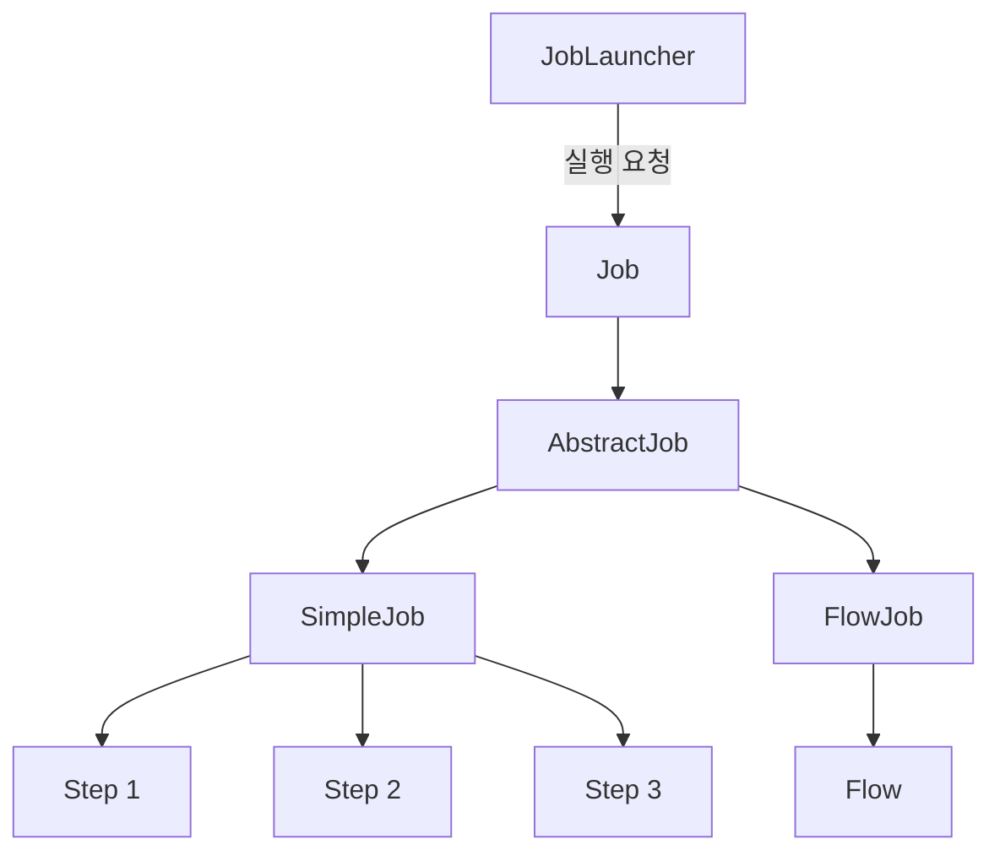

**개발 환경:** Spring Boot 3.4 / Spring Batch 5.2 / Java 17 기준으로 설명한다.

Spring Batch 4에서 사용하던 일부 API와 실제 코드 구성 방식은 Spring Batch 5에서 변경되었으므로, 현재 사용되는 방식에 맞춰 예제를 작성한다.

---

### Job이란 무엇인가?

Job은 Spring Batch에서 배치 작업을 구성하는 가장 상위 개념이다.

하나의 배치 작업 자체를 나타내며, 해당 작업을 어떤 단계로 구성하고 어떤 순서로 실행할지 정의한다.

예를 들어 API 서버에 쌓인 접속 로그를 통계 서버로 전송하는 배치가 있다고 생각해보자.

이 작업은 다음과 같은 단계로 구성할 수 있다.

```text
API 서버 접속 로그 수집
          │
          ▼
로그 데이터 정제
          │
          ▼
통계 데이터 생성
          │
          ▼
통계 서버로 데이터 전송
```

이러한 작업 전체가 하나의 Job이다.

Spring Batch에서는 Job을 구성하는 Step과 실행 순서를 설정하여 하나의 배치 작업으로 정의한다.

#### Job은 배치 작업의 설계도다

Job을 이해할 때 가장 중요한 개념은 **Job이 배치 작업의 명세서이자 설계도 역할을 한다는 것**이다.

예를 들어 건물을 건설할 때는 먼저 설계도를 작성한다.

설계도에는 건물의 구조와 각 공간의 배치 등이 정의되어 있다.

하지만 설계도가 존재한다고 해서 건물이 실제로 건설되는 것은 아니다.

Job도 마찬가지다.

```java
@Bean
public Job settlementJob(
        JobRepository jobRepository,
        Step calculateStep,
        Step saveStep
) {
    return new JobBuilder("settlementJob", jobRepository)
            .start(calculateStep)
            .next(saveStep)
            .build();
}
```

이 코드는 정산 작업을 어떤 순서로 실행할지 정의한다.

먼저 `calculateStep`을 실행하고, 정상적으로 완료되면 `saveStep`을 실행하도록 설정한 것이다.

하지만 이 코드가 실행되어 Job 객체가 생성되었다고 해서 실제 정산 작업이 시작되는 것은 아니다.

Job 객체를 생성하는 과정과 실제 배치를 실행하는 과정은 구분된다.

```text
Job 설정
   │
   ▼
Job 객체 생성
   │
   ▼
Spring Bean 등록
   │
   ▼
실행 요청 대기
   │
   ▼
JobLauncher 실행 요청
   │
   ▼
Job 실행
```

이러한 구분은 Spring Batch의 전체 실행 구조를 이해하는 데 중요하다.

#### Job은 여러 Step을 관리하는 컨테이너다

Job은 하나 이상의 Step을 포함하는 구조로 구성된다.

예를 들어 다음과 같다.

```text
SettlementJob
    │
    ├── PrepareStep
    │
    ├── CalculateStep
    │
    └── CompleteStep
```

각 Step은 자신의 처리 로직을 가지고 있다.

Job은 이러한 Step들을 관리하면서 실행 흐름을 제어한다.

따라서 Job은 단순한 데이터 저장 객체가 아니라 **여러 Step을 실행하는 컨테이너이자 실행 흐름을 관리하는 객체**라고 이해할 수 있다.

다만 모든 Job이 내부적으로 동일한 방식으로 Step을 저장하는 것은 아니다.

대표적인 구현체인 `SimpleJob`은 Step 목록을 관리하지만, `FlowJob`은 실행 흐름을 나타내는 `Flow` 객체를 중심으로 동작한다.

이 차이는 뒤에서 자세히 살펴보자.

---

### Job 인터페이스

Spring Batch는 Job을 정의하기 위한 최상위 인터페이스를 제공한다.

```java
public interface Job {

    // ...
}
```

실제 인터페이스에는 여러 메서드가 정의되어 있지만, Job의 실행 원리를 이해할 때 가장 중요한 메서드는 다음과 같다.

```java
void execute(JobExecution execution);
```

이 메서드는 Job을 실행하는 역할을 담당한다.

매개변수로 전달되는 `JobExecution`은 해당 Job의 실행 정보를 나타내는 객체다.

여기에는 Job의 실행 상태, 시작 시간, 종료 시간, 실행 파라미터 등의 정보가 포함된다.

따라서 Job은 단순히 `execute()`만 호출하여 비즈니스 로직을 수행하는 것이 아니라, **특정 JobExecution에 해당하는 실행을 수행한다**고 이해하는 것이 정확하다.

#### Job 인터페이스가 직접 실행 로직을 구현할까?

Job은 인터페이스이므로 구체적인 실행 로직을 직접 구현하지 않는다.

실제 실행은 Job 인터페이스를 구현한 클래스에서 수행된다.

Spring Batch에서는 이를 위한 기본 구현체를 제공한다.

대표적인 구현체는 다음 두 가지다.

| 구현체         | 역할                        |
| ----------- | ------------------------- |
| `SimpleJob` | 등록된 Step을 순차적으로 실행        |
| `FlowJob`   | Flow에 정의된 실행 흐름에 따라 작업 수행 |

이 두 구현체는 공통적으로 `AbstractJob`이라는 추상 클래스를 상속한다.

클래스 구조를 살펴보자.

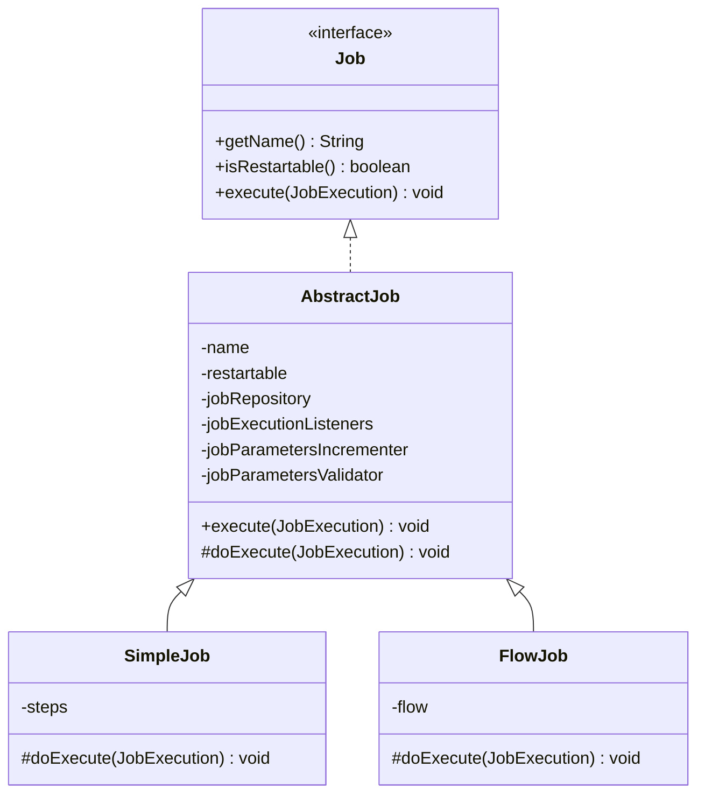

이 구조를 이해하면 Spring Batch의 Job 실행 과정이 조금 더 명확해진다.

`AbstractJob`은 Job 실행에 공통으로 필요한 기능을 담당한다.

`SimpleJob`과 `FlowJob`은 실제 Step을 어떤 방식으로 실행할 것인지 결정한다.

즉, **공통적인 실행 관리는 AbstractJob이 담당하고, 구체적인 실행 흐름은 하위 구현체가 담당하는 구조**다.

---

### AbstractJob의 역할

`AbstractJob`은 `Job` 인터페이스를 구현하는 추상 클래스다.

Spring Batch는 Job 실행 과정에서 반복적으로 필요한 공통 기능을 `AbstractJob`에 정의해두었다.

대표적으로 다음과 같은 속성과 기능이 있다.

| 구성 요소                      | 역할                          |
| -------------------------- | --------------------------- |
| `name`                     | Job 이름                      |
| `restartable`              | Job 재시작 가능 여부               |
| `JobRepository`            | 실행 메타데이터 관리                 |
| `JobExecutionListener`     | Job 실행 전후 이벤트 처리            |
| `JobParametersIncrementer` | 다음 실행에 사용할 JobParameters 생성 |
| `JobParametersValidator`   | JobParameters 유효성 검증        |
| Step 실행 처리                 | Step 실행 및 실행 상태 관리          |

각각의 의미를 살펴보자.

#### name: Job의 이름

Job은 고유한 이름을 가진다.

예를 들어 다음과 같이 생성할 수 있다.

```java
new JobBuilder("settlementJob", jobRepository)
```

여기서 `settlementJob`이 Job의 이름이다.

Spring Batch는 이 이름을 실행 메타데이터에 저장한다.

또한 Job 이름은 JobParameters와 함께 JobInstance를 식별할 때 사용된다.

따라서 Job 이름은 단순한 표시용 문자열이 아니다.

배치의 논리적인 실행 대상을 구분하는 중요한 값이다.

#### restartable: 재시작 가능 여부

Spring Batch는 Job의 재시작 가능 여부를 설정할 수 있다.

기본적으로 Job은 재시작 가능한 구조를 지원한다.

예를 들어 정산 배치가 실행 도중 실패했다고 생각해보자.

```text
정산 Job 실행
      │
      ▼
Step 1 완료
      │
      ▼
Step 2 실행
      │
      ▼
오류 발생
      │
      ▼
FAILED
```

이 경우 재시작 가능한 Job이라면 동일한 JobInstance에 대해 새로운 JobExecution을 생성하여 실행을 다시 시도할 수 있다.

하지만 모든 Job이 재시작을 허용해야 하는 것은 아니다.

예를 들어 외부 시스템의 특성상 동일한 작업을 다시 실행하면 문제가 발생하는 경우 재시작을 제한할 수도 있다.

Spring Batch 5에서는 다음과 같이 설정한다.

```java
@Bean
public Job settlementJob(
        JobRepository jobRepository,
        Step settlementStep
) {
    return new JobBuilder("settlementJob", jobRepository)
            .start(settlementStep)
            .preventRestart()
            .build();
}
```

여기서 중요한 부분은 다음이다.

```java
.preventRestart()
```

이 설정은 Job의 재시작을 허용하지 않도록 한다.

동일한 JobInstance에 대한 재시작을 시도하면 `JobRestartException`이 발생할 수 있다.

다만 `restartable=true`라고 해서 모든 Job을 무조건 다시 실행할 수 있다는 의미는 아니다.

이미 `COMPLETED` 상태로 종료된 JobInstance는 일반적으로 동일한 식별용 JobParameters로 다시 실행할 수 없다.

따라서 재시작 가능 여부와 중복 실행 가능 여부는 구분해서 이해해야 한다.

#### JobRepository: 실행 메타데이터 관리

`JobRepository`는 Job과 Step의 실행 정보를 관리한다.

대표적으로 다음과 같은 정보를 저장한다.

```text
JobInstance

JobExecution

StepExecution

ExecutionContext
```

예를 들어 Job 실행 시 새로운 JobExecution이 생성되면 해당 실행 정보는 JobRepository를 통해 관리된다.

Spring Batch는 이러한 정보를 사용해 실행 상태와 재시작 여부를 판단한다.

따라서 JobRepository는 단순한 이력 저장소가 아니라 Job 실행의 정합성을 유지하기 위한 핵심 구성 요소다.

#### JobExecutionListener: 실행 이벤트 처리

`JobExecutionListener`는 Job 실행 전후에 특정 작업을 수행할 수 있도록 지원한다.

대표적인 메서드는 다음과 같다.

```java
void beforeJob(JobExecution jobExecution);

void afterJob(JobExecution jobExecution);
```

예를 들어 정산 Job이 시작되기 전에 로그를 남기거나, 작업이 완료된 뒤 실행 결과를 기록할 수 있다.

```java
public class SettlementJobListener
        implements JobExecutionListener {

    @Override
    public void beforeJob(JobExecution jobExecution) {

        System.out.println("정산 Job 시작");
    }

    @Override
    public void afterJob(JobExecution jobExecution) {

        System.out.println(
                "정산 Job 종료: "
                        + jobExecution.getStatus()
        );
    }
}
```

이러한 Listener는 비즈니스 로직 자체와는 별개로 실행 전후에 필요한 공통 처리를 수행할 때 유용하다.

예를 들어 Slack 알림, 실행 시간 측정, 감사 로그 기록 등에 활용할 수 있다.

#### JobParametersIncrementer

`JobParametersIncrementer`는 새로운 실행에 사용할 JobParameters를 생성할 때 활용할 수 있다.

대표적인 구현체로 `RunIdIncrementer`가 있다.

```java
new JobBuilder("settlementJob", jobRepository)
        .incrementer(new RunIdIncrementer())
        .start(settlementStep)
        .build();
```

이 설정은 증가하는 실행 식별값을 생성하는 데 활용할 수 있다.

다만 Incrementer를 등록했다고 해서 Job이 실행될 때마다 자동으로 새로운 파라미터가 반드시 전달되는 것은 아니다.

Incrementer를 사용하는 실행 API나 호출 방식이 적용되어야 한다.

#### JobParametersValidator

`JobParametersValidator`는 Job 실행에 필요한 파라미터가 올바르게 전달되었는지 검증한다.

예를 들어 일별 정산 Job에서는 정산 기준일이 반드시 필요할 수 있다.

```text
settlementJob

필수 파라미터:
businessDate
```

이러한 파라미터가 전달되지 않았다면 배치 작업을 시작하기 전에 오류로 처리하는 편이 좋다.

JobParametersValidator는 이런 요구사항을 검증하는 역할을 담당한다.

---

### AbstractJob의 execute()와 doExecute()

Job의 내부 실행 구조에서 중요한 부분은 `execute()`와 `doExecute()`의 관계다.

`AbstractJob`은 Job 실행에 필요한 공통 처리를 담당하는 `execute()`를 제공한다.

그리고 구체적인 Step 실행 방식은 하위 클래스의 `doExecute()`에 위임한다.

개념적으로 다음과 같은 구조다.

```java
public abstract class AbstractJob implements Job {

    @Override
    public final void execute(JobExecution execution) {

        // Job 실행 전 공통 처리
        // 실행 상태 관리
        // Listener 호출
        // 예외 처리

        doExecute(execution);

        // Job 실행 후 공통 처리
        // 실행 결과 및 메타데이터 갱신
    }

    protected abstract void doExecute(
            JobExecution execution
    );
}
```

위 코드는 내부 구조를 이해하기 위한 개념적인 예제다.

실제 Spring Batch 소스에서는 더 많은 예외 처리와 실행 상태 관리 로직이 수행된다.

핵심은 다음과 같다.

```text
AbstractJob.execute()
         │
         ▼
공통 실행 처리
         │
         ▼
doExecute()
         │
         ▼
하위 Job 구현체의 실행 로직
```

`SimpleJob`과 `FlowJob`은 각각 자신의 방식으로 `doExecute()`를 구현한다.

따라서 공통적인 실행 관리 로직을 중복해서 작성하지 않으면서도 서로 다른 방식의 Job을 구현할 수 있다.

이러한 구조는 객체지향 설계에서 사용하는 **템플릿 메서드 패턴(Template Method Pattern)** 과 연결된다.

상위 클래스가 전체 실행 흐름을 정의하고, 실제로 달라지는 부분을 하위 클래스에 위임하는 방식이다.

Spring Batch의 `AbstractJob`도 이러한 설계 방식으로 이해할 수 있다.

---

### SimpleJob이란?

`SimpleJob`은 등록된 Step을 순차적으로 실행하는 Job 구현체다.

Spring Batch에서 가장 기본적인 형태의 Job이라고 볼 수 있다.

예를 들어 다음과 같은 배치를 생각해보자.

```text
SimpleJob
    │
    ▼
Step 1
    │
    ▼
Step 2
    │
    ▼
Step 3
    │
    ▼
Job 완료
```

Step 1이 정상적으로 완료되면 Step 2를 실행한다.

Step 2가 정상적으로 완료되면 Step 3을 실행한다.

등록된 Step이 모두 완료되면 Job도 정상적으로 종료된다.

반면 중간에 Step이 실패하면 기본적인 순차 실행 흐름에서는 이후 Step으로 진행하지 않는다.

#### SimpleJob은 Step 목록을 관리한다

`SimpleJob`의 중요한 특징은 내부적으로 Step 목록을 관리한다는 것이다.

개념적으로 다음과 같이 이해할 수 있다.

```java
public class SimpleJob extends AbstractJob {

    private List<Step> steps;

    // ...
}
```

실제 구현에는 추가적인 메서드와 실행 로직이 존재하지만, 여기서는 Step 목록을 가지고 있다는 사실이 중요하다.

예를 들어 두 개의 Step을 가진 Job을 정의했다면 다음과 같은 구조가 된다.

```text
SimpleJob
    │
    └── steps
          │
          ├── Step 1
          │
          └── Step 2
```

Job이 실행되면 이 목록에 등록된 Step을 순서대로 처리한다.

이것이 SimpleJob을 Step의 컨테이너라고 설명하는 이유다.

---

### FlowJob이란?

`FlowJob`은 단순한 순차 실행을 넘어 실행 조건과 흐름에 따라 Step을 처리하는 Job 구현체다.

예를 들어 정산 배치에서 먼저 데이터 검증을 수행한다고 생각해보자.

검증에 성공했다면 정산 작업을 진행하고, 실패했다면 오류 처리 Step을 실행해야 할 수 있다.

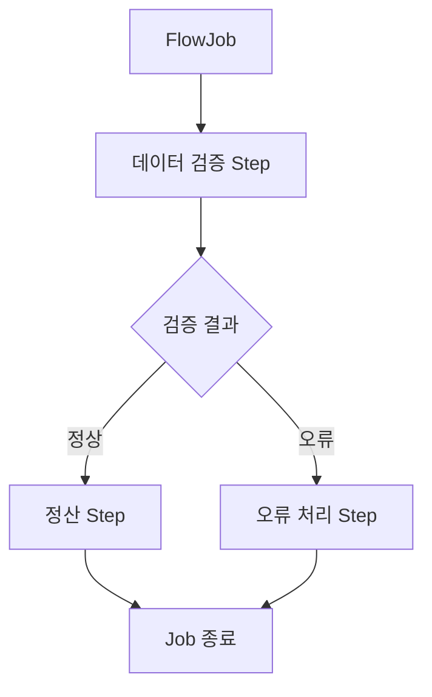

이처럼 FlowJob은 실행 결과에 따라 다음에 실행할 Step을 다르게 구성할 수 있다.

#### FlowJob은 Flow 객체를 중심으로 실행된다

SimpleJob이 Step 목록을 가지고 있었다면 FlowJob은 Flow 객체를 중심으로 실행 흐름을 관리한다.

개념적으로 다음과 같다.

```text
FlowJob
    │
    └── Flow
          │
          ├── State 1
          │
          ├── State 2
          │
          └── State 3
```

Flow에는 Step뿐 아니라 실행 상태에 따른 전이(Transition) 정보도 포함될 수 있다.

이러한 구조를 통해 Spring Batch는 조건부 실행, 분기, 병렬 흐름 등을 구성할 수 있다.

#### SimpleJob과 FlowJob 비교

| 구분       | SimpleJob         | FlowJob           |
| -------- | ----------------- | ----------------- |
| 주요 목적    | Step 순차 실행        | 실행 흐름 제어          |
| 내부 관리 대상 | Step 목록           | Flow              |
| 실행 방식    | 등록된 Step을 순서대로 실행 | 상태 및 전이 조건에 따라 실행 |
| 조건부 분기   | 기본 순차 실행 구조       | 지원                |
| 대표 활용    | 단순 정산, 데이터 정리     | 검증 결과에 따른 처리 분기   |

여기서 기억할 점은 **SimpleJob과 FlowJob이 완전히 별개의 배치 개념이 아니라 Job 인터페이스를 구현한 서로 다른 실행 전략**이라는 사실이다.

두 구현체 모두 Job으로서 실행되지만 내부적으로 작업을 처리하는 방식이 다르다.

---

### JobBuilder를 이용한 SimpleJob 구성

지금까지 Job의 개념과 구현체를 살펴봤다.

이번에는 실제로 SimpleJob을 생성해보자.

앞에서 만든 Spring Batch 프로젝트를 그대로 사용한다.

이번 예제에서는 다음과 같은 Job을 생성한다.

```text
jobDomainJob
    │
    ├── jobDomainStep1
    │      └── Step 1 executed 출력
    │
    └── jobDomainStep2
           └── Step 2 executed 출력
```

Job 하나와 Step 두 개를 구성한다.

두 Step은 각각 Tasklet 기반으로 실행된다.

#### Spring Batch 4와 5의 Job 생성 방식 차이

Spring Batch 4에서는 일반적으로 다음 클래스를 사용했다.

```java
JobBuilderFactory

StepBuilderFactory
```

예를 들어 다음과 같은 방식이었다.

```java
jobBuilderFactory.get("jobDomainJob")
        .start(step1)
        .next(step2)
        .build();
```

하지만 Spring Batch 5에서는 `JobBuilder`와 `StepBuilder`를 직접 사용하는 방식이 권장된다.

```java
new JobBuilder("jobDomainJob", jobRepository)
        .start(step1)
        .next(step2)
        .build();
```

두 방식의 목적은 같다.

Job을 구성하고 생성하는 것이다.

다만 Spring Batch 5에서는 JobRepository를 명시적으로 전달하는 구조를 사용한다.

이후 코드는 Spring Batch 5.2 기준으로 작성한다.

---

### JobDomainConfiguration 전체 코드

다음과 같이 설정 클래스를 작성한다.

```java
package com.example.batch;

import org.springframework.batch.core.Job;
import org.springframework.batch.core.Step;
import org.springframework.batch.core.job.builder.JobBuilder;
import org.springframework.batch.core.repository.JobRepository;
import org.springframework.batch.core.step.builder.StepBuilder;
import org.springframework.batch.repeat.RepeatStatus;

import org.springframework.beans.factory.annotation.Qualifier;
import org.springframework.context.annotation.Bean;
import org.springframework.context.annotation.Configuration;

import org.springframework.transaction.PlatformTransactionManager;

@Configuration
public class JobDomainConfiguration {

    @Bean
    public Job jobDomainJob(
            JobRepository jobRepository,
            @Qualifier("jobDomainStep1") Step step1,
            @Qualifier("jobDomainStep2") Step step2
    ) {

        return new JobBuilder("jobDomainJob", jobRepository)
                .start(step1)
                .next(step2)
                .build();
    }

    @Bean
    public Step jobDomainStep1(
            JobRepository jobRepository,
            PlatformTransactionManager transactionManager
    ) {

        return new StepBuilder(
                "jobDomainStep1",
                jobRepository
        )
                .tasklet((contribution, chunkContext) -> {

                    System.out.println("Step 1 executed");

                    return RepeatStatus.FINISHED;

                }, transactionManager)
                .build();
    }

    @Bean
    public Step jobDomainStep2(
            JobRepository jobRepository,
            PlatformTransactionManager transactionManager
    ) {

        return new StepBuilder(
                "jobDomainStep2",
                jobRepository
        )
                .tasklet((contribution, chunkContext) -> {

                    System.out.println("Step 2 executed");

                    return RepeatStatus.FINISHED;

                }, transactionManager)
                .build();
    }
}
```

이 코드에서 가장 중요한 부분은 Job을 생성하는 메서드다.

```java
@Bean
public Job jobDomainJob(
        JobRepository jobRepository,
        Step step1,
        Step step2
) {

    return new JobBuilder("jobDomainJob", jobRepository)
            .start(step1)
            .next(step2)
            .build();
}
```

실제 전체 코드에서는 동일한 `Step` 타입의 Bean이 두 개이므로 `@Qualifier`를 사용해 각각의 Step을 명확하게 구분했다.

이 메서드가 호출되면 Job 객체가 생성되고 Spring Bean으로 등록된다.

그런데 이때 실제로 생성되는 Job의 구현체는 무엇일까?

바로 `SimpleJob`이다.

---

### JobBuilder 내부에서는 어떤 일이 발생할까?

JobBuilder를 사용하면 개발자는 비교적 간단하게 Job을 구성할 수 있다.

```java
new JobBuilder("jobDomainJob", jobRepository)
        .start(step1)
        .next(step2)
        .build();
```

하지만 내부에서는 단순히 Job 객체 하나를 생성하는 것보다 조금 더 많은 과정이 발생한다.

#### 1. JobBuilder 생성

먼저 다음 코드가 실행된다.

```java
new JobBuilder("jobDomainJob", jobRepository)
```

Job 이름과 JobRepository를 가지고 Builder를 생성한다.

이 단계에서는 Job 설정에 필요한 기본 정보가 준비된다.

#### 2. start() 호출

다음 코드가 실행된다.

```java
.start(step1)
```

첫 번째로 실행할 Step을 지정한다.

이 과정에서 순차 실행 Job을 구성하기 위한 `SimpleJobBuilder`가 사용된다.

#### 3. next() 호출

다음 코드를 실행한다.

```java
.next(step2)
```

두 번째 Step을 실행 목록에 추가한다.

개념적으로 Builder의 상태는 다음과 같이 변경된다.

```text
SimpleJobBuilder
       │
       └── steps
             │
             ├── step1
             │
             └── step2
```

#### 4. build() 호출

마지막으로 다음 메서드를 실행한다.

```java
.build();
```

이때 지금까지 Builder에 등록한 설정을 기반으로 실제 Job 객체가 생성된다.

순차적으로 Step을 실행하는 구성에서는 `SimpleJob`이 생성된다.

Builder에서 관리하던 Step 목록도 생성된 SimpleJob에 설정된다.

전체 흐름은 다음과 같다.

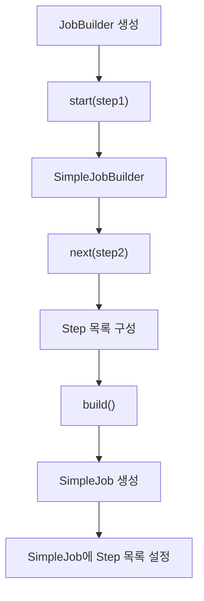

여기서 중요한 사실은 **개발자가 직접 SimpleJob을 생성하지 않아도 Builder가 적절한 Job 구현체를 생성한다는 것**이다.

또한 Builder에 등록한 Step들은 단순히 메서드 호출 과정에서 사라지는 것이 아니라 최종 Job 객체의 실행 구성으로 전달된다.

---

### 실제로 생성된 Job 구현체 확인하기

이번에는 생성된 Job이 정말 SimpleJob인지 확인해보자.

Spring Container에서 Job Bean을 주입받은 뒤 실제 클래스 정보를 출력하면 된다.

```java
package com.example.batch;

import org.springframework.batch.core.Job;
import org.springframework.batch.core.job.SimpleJob;

import org.springframework.beans.factory.annotation.Qualifier;
import org.springframework.boot.ApplicationRunner;
import org.springframework.context.annotation.Bean;
import org.springframework.context.annotation.Configuration;

@Configuration
public class JobInspectionConfiguration {

    @Bean
    public ApplicationRunner inspectJob(
            @Qualifier("jobDomainJob") Job job
    ) {

        return args -> {

            System.out.println(
                    "Job 구현체: " + job.getClass().getSimpleName()
            );

            if (job instanceof SimpleJob simpleJob) {

                System.out.println(
                        "등록된 Step: " + simpleJob.getStepNames()
                );
            }
        };
    }
}
```

실행 결과는 다음과 같은 형태다.

```text
Job 구현체: SimpleJob

등록된 Step: [jobDomainStep1, jobDomainStep2]
```

이 코드를 통해 두 가지 사실을 확인할 수 있다.

첫 번째는 JobBuilder가 생성한 실제 Job 구현체가 SimpleJob이라는 것이다.

두 번째는 SimpleJob이 등록된 Step들의 정보를 가지고 있다는 것이다.

이처럼 Job은 단순히 실행할 메서드 하나를 가지고 있는 객체가 아니라 **여러 Step의 실행 구성을 보관하는 객체**다.

---

### Job 설정과 Job 실행은 서로 다른 과정이다

Spring Batch를 처음 접할 때 가장 헷갈릴 수 있는 부분이다.

앞에서 다음 코드를 작성했다.

```java
@Bean
public Job jobDomainJob(
        JobRepository jobRepository,
        Step step1,
        Step step2
) {

    return new JobBuilder("jobDomainJob", jobRepository)
            .start(step1)
            .next(step2)
            .build();
}
```

이 코드는 Job을 생성한다.

하지만 Step 내부의 Tasklet을 실행하는 코드는 아니다.

실제 Job의 실행은 별도의 실행 요청이 발생했을 때 수행된다.

#### Job 생성 과정

```text
Spring Boot 시작
       │
       ▼
ApplicationContext 초기화
       │
       ▼
JobDomainConfiguration 처리
       │
       ▼
Step Bean 생성
       │
       ▼
Job Bean 생성
       │
       ▼
SimpleJob 구성 완료
```

이 과정은 Spring Bean을 등록하는 단계다.

Job 객체가 생성되고 실행에 필요한 Step들이 연결된다.

#### Job 실행 과정

```text
JobLauncher 실행 요청
       │
       ▼
SimpleJob 실행
       │
       ▼
Step 1 실행
       │
       ▼
Tasklet 1 실행
       │
       ▼
Step 2 실행
       │
       ▼
Tasklet 2 실행
       │
       ▼
Job 종료
```

이 과정에서 실제 비즈니스 로직이 실행된다.

두 과정을 구분하면 Spring Batch의 실행 구조를 훨씬 명확하게 이해할 수 있다.

---

### JobLauncher는 Job을 어떻게 실행할까?

Spring Batch에서 Job 실행을 요청하는 대표적인 인터페이스는 `JobLauncher`다.

Spring Batch 5.2에서는 다음 메서드를 제공한다.

```java
JobExecution run(
        Job job,
        JobParameters jobParameters
) throws JobExecutionException;
```

이 메서드는 두 개의 중요한 객체를 전달받는다.

첫 번째는 실행할 Job이다.

```java
Job job
```

두 번째는 실행에 필요한 JobParameters다.

```java
JobParameters jobParameters
```

JobParameters는 정산 기준일이나 처리 대상 등의 값을 전달하는 데 사용할 수 있다.

그리고 JobLauncher는 해당 실행에 대한 JobExecution을 반환한다.

#### JobLauncher와 Job의 관계

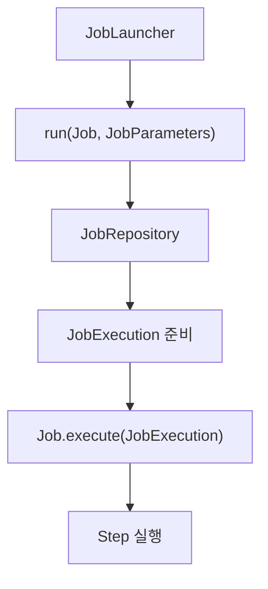

JobLauncher는 Job 실행을 위한 진입점이다.

실행 요청을 받으면 JobRepository를 통해 실행 메타데이터를 준비하고 Job의 `execute()` 메서드에 실행을 위임한다.

따라서 JobLauncher가 실제 Step의 비즈니스 로직을 직접 수행하는 것은 아니다.

JobLauncher는 Job을 실행하고, Job은 자신의 실행 흐름에 따라 Step을 실행한다.

---

### Spring Boot에서는 Job을 자동으로 실행할 수 있다

앞에서 작성한 프로젝트는 Spring Boot 기반이다.

Spring Boot에서는 배치 자동 설정이 활성화되어 있다면 애플리케이션 시작 시 등록된 Job을 자동으로 실행할 수 있다.

Spring Boot 3.4에서는 `JobLauncherApplicationRunner`가 이러한 역할을 담당한다.

```text
Spring Boot 시작
       │
       ▼
JobLauncherApplicationRunner
       │
       ▼
JobLauncher
       │
       ▼
Job 실행
```

이번 예제에서는 다음 설정을 사용할 수 있다.

```yaml
spring:
  batch:
    job:
      enabled: true
      name: jobDomainJob

    jdbc:
      initialize-schema: embedded
```

`spring.batch.job.enabled`는 애플리케이션 시작 시 Job 자동 실행 여부를 설정한다.

`spring.batch.job.name`은 자동 실행할 Job의 이름을 지정한다.

`spring.batch.jdbc.initialize-schema`는 메타데이터 테이블 초기화 방식을 지정한다.

이번에는 H2를 사용하므로 `embedded` 설정을 사용할 수 있다.

앞에서 작성했던 `helloJob`이나 `metadataJob`이 함께 등록되어 있더라도 `jobDomainJob`을 실행 대상으로 지정할 수 있다.

단, 이 자동 실행 구조는 Spring Boot의 Batch 자동 설정을 사용한다는 전제다.

일반적인 Spring Boot 3.4 프로젝트에서는 별도로 `@EnableBatchProcessing`을 선언하지 않아도 된다.

---

### SimpleJob은 Step을 어떻게 실행할까?

이번에는 Job이 실제로 Step을 실행하는 내부 구조를 살펴보자.

SimpleJob은 Step 목록을 관리한다고 했다.

예를 들어 다음과 같은 Step을 가지고 있다.

```text
SimpleJob
    │
    └── steps
          │
          ├── jobDomainStep1
          │
          └── jobDomainStep2
```

JobLauncher가 SimpleJob의 실행을 요청하면 Job은 자신의 실행 로직을 수행한다.

이 과정에서 `AbstractJob.execute()`가 먼저 실행된다.

이후 구체적인 Step 실행은 `SimpleJob.doExecute()`에서 수행된다.

#### AbstractJob.execute()

`AbstractJob`은 Job 실행에 필요한 공통 처리를 담당한다.

예를 들어 Job 실행 상태를 관리하고 Listener를 호출하며 실행 결과를 처리한다.

그다음 실제 Job 구현체의 실행 로직을 호출한다.

```text
AbstractJob.execute()
          │
          ▼
공통 실행 처리
          │
          ▼
SimpleJob.doExecute()
```

#### SimpleJob.doExecute()

`SimpleJob`은 등록된 Step을 순서대로 실행한다.

개념적으로 다음과 같은 형태다.

```java
for (Step step : steps) {

    // 현재 Step 실행
    // 실행 결과 확인
    // 실패 시 다음 Step 진행 여부 결정
}
```

실제 내부 구현은 재시작 처리와 실행 상태 관리 등을 포함하므로 더 복잡하지만, 핵심은 Step 목록을 순회하면서 각 Step의 실행을 처리한다는 것이다.

예를 들어 두 개의 Step이 있다면 다음과 같다.

```text
Step 목록
    │
    ▼
jobDomainStep1
    │
    ▼
실행 결과 확인
    │
    ▼
jobDomainStep2
    │
    ▼
실행 결과 확인
    │
    ▼
Job 종료
```

여기서 주의해야 할 점은 Step을 무조건 모두 실행하는 것은 아니라는 사실이다.

첫 번째 Step이 실패하면 이후 Step으로 진행하지 않을 수 있다.

또한 Job을 재시작하는 경우에는 이미 정상적으로 완료된 Step을 다시 실행하지 않고 건너뛸 수 있다.

따라서 SimpleJob은 단순히 `for` 문으로 Step을 호출하는 객체라고 이해하기보다 **Step 목록을 기반으로 실행 순서와 진행 여부를 관리하는 Job 구현체**라고 이해하는 것이 정확하다.

---

### SimpleStepHandler의 역할

SimpleJob이 Step을 실행할 때 중요한 역할을 담당하는 클래스가 있다.

바로 `SimpleStepHandler`다.

SimpleJob은 Step을 직접 실행하는 대신 Step 실행을 처리하는 핸들러를 통해 실행을 위임할 수 있다.

전체적인 흐름은 다음과 같다.

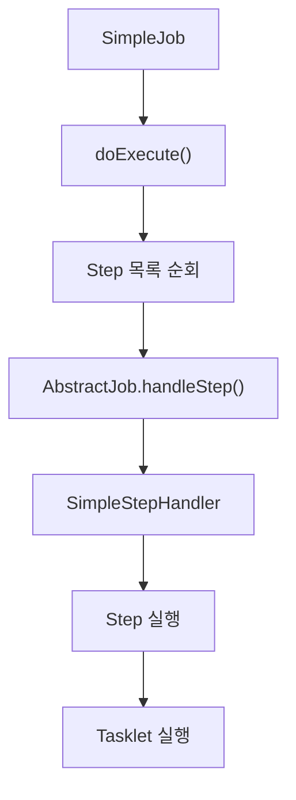

여기서 각 객체의 역할을 구분해야 한다.

| 구성 요소               | 역할                        |
| ------------------- | ------------------------- |
| `SimpleJob`         | Step 실행 순서 관리             |
| `AbstractJob`       | Job 공통 실행 처리 및 Step 실행 위임 |
| `SimpleStepHandler` | Step 실행과 관련된 공통 처리        |
| `Step`              | 실제 Step 실행 단위             |
| `Tasklet`           | 비즈니스 로직 수행                |

Step 실행 과정에서는 새로운 `StepExecution`을 준비하거나 이전 실행 상태를 확인하는 등의 처리가 필요할 수 있다.

또한 실행 상태에 따라 Step을 새로 실행할지, 재시작할지, 건너뛸지 판단해야 하는 경우도 있다.

이처럼 Step을 실행하는 과정에는 단순한 메서드 호출 이상의 관리 기능이 필요하다.

Spring Batch는 이러한 기능을 별도의 실행 처리 구조로 분리해두었다.

따라서 Job은 전체 실행 흐름에 집중하고, Step 실행과 관련된 세부적인 처리는 다른 구성 요소에 위임할 수 있다.

---

### Job 실행의 전체 내부 흐름

지금까지 살펴본 구조를 하나로 연결해보자.

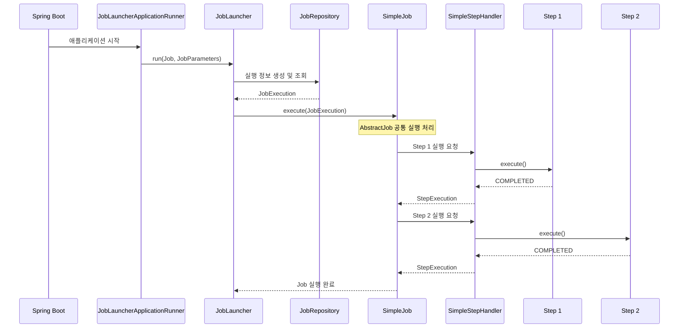

이 그림에서 가장 중요한 것은 실행 책임이 단계별로 분리되어 있다는 것이다.

Spring Boot는 자동 실행을 요청할 수 있다.

JobLauncher는 Job 실행을 시작한다.

JobRepository는 실행 메타데이터를 관리한다.

SimpleJob은 Step의 실행 순서를 관리한다.

SimpleStepHandler는 각 Step의 실행을 처리한다.

Step은 자신에게 정의된 Tasklet 또는 Chunk 처리 로직을 수행한다.

이러한 구조를 통해 Spring Batch는 공통적인 실행 관리 기능과 실제 비즈니스 로직을 분리한다.

---

### 실제 실행 결과 확인하기

앞에서 작성한 `JobDomainConfiguration`을 실행해보자.

프로젝트에서 H2를 사용하고 있다면 다음 명령어를 실행할 수 있다.

```bash
./mvnw spring-boot:run
```

실행 결과는 다음과 같은 형태다.

```text
Job: [SimpleJob: [name=jobDomainJob]]
launched with the following parameters: [{}]

Executing step: [jobDomainStep1]

Step 1 executed

Step: [jobDomainStep1] executed

Executing step: [jobDomainStep2]

Step 2 executed

Step: [jobDomainStep2] executed

Job: [SimpleJob: [name=jobDomainJob]]
completed with status: [COMPLETED]
```

위 출력은 중요한 부분을 중심으로 정리한 예시다.

실제 로그에는 실행 시각, 스레드 이름, 로거 이름 등의 정보가 함께 표시된다.

#### SimpleJob 확인

다음 로그를 살펴보자.

```text
SimpleJob: [name=jobDomainJob]
```

이 로그는 `jobDomainJob`이 SimpleJob 구현체로 구성되었음을 보여준다.

우리가 직접 `new SimpleJob()`을 호출하지 않았더라도 JobBuilder를 통해 SimpleJob 객체가 생성된 것이다.

#### 첫 번째 Step 실행

다음 로그를 보자.

```text
Executing step: [jobDomainStep1]
```

그리고 첫 번째 Tasklet에서 작성한 문구가 출력된다.

```text
Step 1 executed
```

#### 두 번째 Step 실행

첫 번째 Step이 정상적으로 완료되면 두 번째 Step이 실행된다.

```text
Executing step: [jobDomainStep2]
```

두 번째 Tasklet에서 다음 내용이 출력된다.

```text
Step 2 executed
```

#### Job 완료

모든 Step이 정상적으로 완료되면 Job도 완료된다.

```text
completed with status: [COMPLETED]
```

따라서 실제 실행 결과를 통해 SimpleJob이 등록된 Step을 순서대로 실행한다는 사실을 확인할 수 있다.

---

### 디버깅으로 Job 실행 구조 확인하기

Spring Batch의 내부 구조를 조금 더 깊이 이해하고 싶다면 디버깅을 활용하는 것이 좋다.

단순히 로그를 보는 것보다 실제 객체가 생성되는 시점과 메서드가 호출되는 순서를 확인할 수 있기 때문이다.

#### 확인하면 좋은 클래스와 메서드

| 클래스                 | 확인할 메서드                              | 확인할 내용                     |
| ------------------- | ------------------------------------ | -------------------------- |
| `SimpleJobBuilder`  | `start()`, `next()`, `build()` 관련 흐름 | Step 목록 구성 및 SimpleJob 생성  |
| `AbstractJob`       | `execute()`                          | Job 공통 실행 처리               |
| `SimpleJob`         | `doExecute()`                        | Step 목록 순회                 |
| `AbstractJob`       | `handleStep()`                       | Step 실행 위임                 |
| `SimpleStepHandler` | `handleStep()`                       | StepExecution 처리 및 Step 실행 |
| `TaskletStep`       | `doExecute()`                        | Tasklet 기반 Step 실행         |
| `Tasklet`           | `execute()`                          | 실제 비즈니스 로직                 |

IDE에서 이러한 메서드에 브레이크포인트를 설정하고 애플리케이션을 실행하면 다음 두 과정을 구분해서 볼 수 있다.

첫 번째는 Job 객체를 구성하는 과정이다.

```text
JobBuilder
    │
    ▼
SimpleJobBuilder
    │
    ▼
SimpleJob 생성
    │
    ▼
Step 목록 설정
```

두 번째는 구성된 Job을 실제로 실행하는 과정이다.

```text
JobLauncher
    │
    ▼
AbstractJob.execute()
    │
    ▼
SimpleJob.doExecute()
    │
    ▼
SimpleStepHandler
    │
    ▼
Step
    │
    ▼
Tasklet
```

이 두 과정을 각각 확인하면 Spring Batch가 객체를 구성하는 방식과 실행하는 방식이 어떻게 분리되어 있는지 이해할 수 있다.

---

### Job과 JobInstance, JobExecution의 차이

Spring Batch의 Job을 이해할 때 반드시 함께 구분해야 하는 객체들이 있다.

바로 `Job`, `JobInstance`, `JobExecution`이다.

이 세 객체는 이름이 비슷하지만 서로 다른 역할을 담당한다.

#### Job

Job은 배치 작업의 정의다.

```text
settlementJob
```

어떤 Step으로 구성되는지, 어떤 순서로 실행되는지 등의 설정이 포함된다.

#### JobInstance

JobInstance는 Job 이름과 식별용 JobParameters를 기준으로 구분되는 논리적인 실행 단위다.

예를 들어 다음과 같다.

```text
settlementJob
businessDate=2026-10-15
```

같은 Job이라도 식별용 파라미터가 달라지면 새로운 JobInstance가 생성될 수 있다.

#### JobExecution

JobExecution은 JobInstance의 실제 실행 시도다.

예를 들어 다음과 같다.

```text
JobInstance 1
    │
    ├── JobExecution 1
    │      └── FAILED
    │
    └── JobExecution 2
           └── COMPLETED
```

같은 JobInstance라도 실패 후 재시작하면 새로운 JobExecution이 생성될 수 있다.

따라서 전체 관계는 다음과 같다.

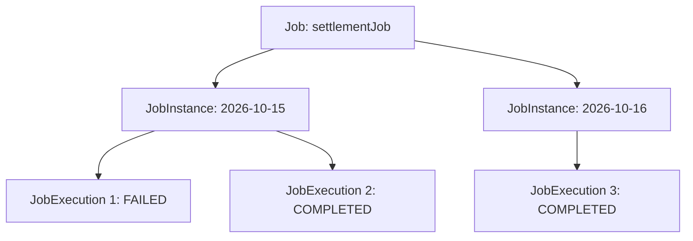

세 객체를 비교하면 다음과 같다.

| 구분     | Job          | JobInstance                | JobExecution    |
| ------ | ------------ | -------------------------- | --------------- |
| 의미     | 배치 작업 정의     | 논리적인 실행 단위                 | 실제 실행 시도        |
| 생성 시점  | Spring 설정 과정 | 새로운 식별용 파라미터 조합으로 실행 시     | 실행 시도마다         |
| 식별 기준  | Job 이름       | Job 이름 + 식별용 JobParameters | JobExecution ID |
| 역할     | 실행 흐름 구성     | 작업 실행 대상 구분                | 실행 상태 관리        |
| 재시작 관계 | 재시작 가능 여부 설정 | 동일 인스턴스 재사용 가능             | 새로운 실행 기록 생성    |

**Job은 무엇을 실행할 것인지 정의하고, JobInstance는 어떤 논리적 작업인지 구분하며, JobExecution은 실제 실행 결과를 기록한다.**

이 세 개념을 구분하면 이후 재시작이나 JobRepository의 메타데이터 구조를 이해하기 쉬워진다.

---

### 실무에서 Job을 어떻게 설계해야 할까?

지금까지는 Job의 개념과 내부 구조를 살펴봤다.

하지만 실제 백엔드 시스템에서는 Job을 어떤 기준으로 나누고 구성할지도 중요하다.

#### 하나의 Job은 명확한 업무 목적을 가져야 한다

예를 들어 다음과 같은 작업이 있다고 생각해보자.

```text
결제 정산

쿠폰 만료

일별 통계 생성

외부 물류 데이터 동기화
```

이 작업들은 서로 다른 업무 목적을 가지고 있다.

따라서 하나의 Job 안에 모든 작업을 넣기보다는 목적에 따라 Job을 분리하는 것이 적절할 수 있다.

```text
SettlementJob

CouponExpireJob

DailyStatisticsJob

LogisticsSyncJob
```

이렇게 분리하면 각 Job의 실행 시점과 실패 처리 정책을 독립적으로 관리하기 쉽다.

또한 특정 Job이 실패했을 때 다른 Job에 불필요한 영향을 주지 않도록 설계할 수 있다.

#### Step은 독립적으로 관리할 필요가 있는 단위로 분리한다

Job 안에 여러 Step을 정의할 수 있다고 해서 모든 메서드를 Step으로 분리하는 것은 적절하지 않다.

예를 들어 정산 계산을 수행하는 서비스 내부에 다음 메서드가 있다고 생각해보자.

```java
calculateFee();

calculateTax();

calculateAmount();
```

이 세 메서드가 반드시 각각의 Step이 되어야 하는 것은 아니다.

같은 트랜잭션 범위에서 하나의 비즈니스 처리를 구성한다면 하나의 Step 안에서 처리하는 편이 자연스러울 수 있다.

반면 다음 작업들은 별도의 Step으로 분리할 가치가 있다.

```text
정산 대상 확정
      │
      ▼
정산 데이터 생성
      │
      ▼
정산 결과 검증
      │
      ▼
외부 시스템 전송
```

각 단계가 독립적인 실행 상태와 실패 처리 정책을 가질 수 있기 때문이다.

따라서 Step을 나누는 기준은 메서드의 개수가 아니라 **독립적인 실행·트랜잭션·재시작 관리가 필요한가**에 두는 것이 좋다.

#### SimpleJob으로 충분한지 먼저 판단한다

배치 작업을 설계할 때 처음부터 복잡한 FlowJob을 구성할 필요는 없다.

예를 들어 모든 작업이 정해진 순서대로 실행된다면 SimpleJob으로 충분하다.

```text
Step 1 → Step 2 → Step 3
```

반면 다음과 같이 분기가 필요하다면 FlowJob을 고려할 수 있다.

```text
Step 1
   │
   ▼
실행 결과 확인
   │
   ├── 정상 → Step 2
   │
   └── 오류 → Step 3
```

중요한 것은 기능이 많은 구현체를 선택하는 것이 아니라 요구사항에 적합한 실행 구조를 선택하는 것이다.

단순한 순차 실행이라면 SimpleJob이 오히려 이해하기 쉽고 유지보수하기 편리할 수 있다.

#### 재시작 시 데이터 정합성을 고려한다

Spring Batch는 Job의 재시작을 지원한다.

하지만 재시작 기능이 비즈니스 데이터의 중복 처리를 자동으로 방지하는 것은 아니다.

예를 들어 정산 결과를 저장한 뒤 서버 장애가 발생했다고 생각해보자.

```text
정산 데이터 저장
       │
       ▼
외부 시스템 전송
       │
       ▼
서버 장애
```

배치를 다시 실행할 때 이전에 저장했던 정산 데이터를 중복 저장하거나 외부 시스템에 같은 요청을 다시 전송할 수 있다.

따라서 재시작 가능한 Job을 설계할 때는 멱등성을 함께 고려해야 한다.

예를 들어 정산 기간과 결제 ID를 조합한 유니크 제약을 활용하거나, 외부 API에 멱등성 키를 전달하는 방법을 고려할 수 있다.

Spring Batch는 실행을 관리하는 기반을 제공하지만 실제 비즈니스 데이터의 정합성은 개발자가 함께 설계해야 한다.

---

### 정리

Spring Batch에서 `Job`은 배치 작업을 구성하는 최상위 도메인 객체다.

Job은 어떤 Step을 어떤 순서로 실행할지 정의하는 **배치 작업의 설계도이자 실행 흐름을 관리하는 객체**다.

Spring Batch는 Job을 정의하기 위한 인터페이스를 제공하고, 기본 구현체로 `SimpleJob`과 `FlowJob`을 제공한다.

SimpleJob은 등록된 Step을 순차적으로 실행한다.

FlowJob은 Flow에 정의된 실행 상태와 전이 조건에 따라 Step을 실행한다.

두 구현체는 모두 `AbstractJob`을 상속하며, AbstractJob은 실행 상태 관리, Listener 호출, JobRepository 연동 등의 공통적인 실행 기능을 담당한다.

각 객체의 관계를 정리하면 다음과 같다.

```text
Job
 │
 ▼
AbstractJob
 │
 ├── SimpleJob
 │      │
 │      └── Step 목록 관리
 │
 └── FlowJob
        │
        └── Flow 관리
```

Job 실행 과정에서는 JobLauncher가 중요한 역할을 담당한다.

```text
JobLauncher
      │
      ▼
Job.execute()
      │
      ▼
AbstractJob.execute()
      │
      ▼
SimpleJob.doExecute()
      │
      ▼
SimpleStepHandler
      │
      ▼
Step.execute()
      │
      ▼
Tasklet.execute()
```

이러한 구조를 통해 Spring Batch는 Job의 실행 흐름과 Step의 실제 처리 로직을 구분한다.

또한 Job과 JobInstance, JobExecution은 서로 다른 개념이다.

Job은 배치 작업의 정의이며, JobInstance는 식별용 JobParameters를 기준으로 구분되는 논리적 실행 단위다. JobExecution은 실제 실행 시도를 나타낸다.

이러한 관계를 이해하면 JobRepository가 실행 메타데이터를 관리하는 방식과 배치가 실패했을 때 재시작하는 원리도 자연스럽게 연결된다.

실무에서는 Job을 구성할 때 다음 세 가지 관점이 중요하다.

첫째, Job은 하나의 명확한 비즈니스 목적을 가져야 한다.

둘째, Step은 독립적인 실행과 실패 관리가 필요한 기준으로 구분해야 한다.

셋째, Job의 재시작 가능성과 비즈니스 데이터의 멱등성을 함께 고려해야 한다.

결국 Spring Batch의 Job은 단순히 여러 Step을 묶어놓은 객체가 아니다.

**실행할 작업의 전체 구조를 정의하고, 실행 흐름을 제어하며, Spring Batch가 제공하는 실행 관리 기능과 실제 비즈니스 로직을 연결하는 핵심 도메인 객체**다.

#### 한 줄 요약

> Spring Batch의 `Job`은 배치 작업 전체를 정의하는 최상위 도메인 객체이며, `AbstractJob`이 공통 실행 기능을 담당하고 `SimpleJob`과 `FlowJob`이 각각 순차 실행과 조건부 실행을 구현한다. JobLauncher가 Job의 실행을 요청하면 Job은 내부 실행 구조에 따라 Step을 실행하고, Step은 Tasklet 또는 Chunk 기반 비즈니스 로직을 수행한다.

## JobInstance

### Spring Batch JobInstance 이해: Job과 JobInstance의 차이부터 생성 원리 및 중복 실행 방지까지

Spring Batch에서 배치 작업을 개발할 때 가장 먼저 정의하는 객체는 `Job`이다.

Job은 하나의 배치 작업 전체를 나타내며, 여러 Step을 구성하고 실행 순서를 정의하는 역할을 담당한다.

그런데 실제 배치 작업을 실행하면 Spring Batch는 Job 외에도 여러 도메인 객체를 생성한다.

대표적으로 다음과 같은 객체가 있다.

* `JobInstance`
* `JobExecution`
* `JobParameters`
* `StepExecution`
* `ExecutionContext`

이 객체들은 Job이 실행되는 과정에서 서로 다른 역할을 담당한다.

예를 들어 매일 새벽 2시에 실행되는 정산 배치를 생각해보자.

```text
정산 Job
   │
   ├── 2026-10-15 정산
   │
   ├── 2026-10-16 정산
   │
   └── 2026-10-17 정산
```

위 작업은 모두 동일한 정산 Job을 실행한 것이다.

하지만 처리하는 데이터는 서로 다르다.

10월 15일에는 10월 15일에 해당하는 정산 데이터를 처리하고, 10월 16일에는 10월 16일에 해당하는 데이터를 처리한다.

Job의 설정과 구성은 동일하지만 **실행 대상이 다르기 때문에 각각의 작업을 구분할 필요가 있다.**

Spring Batch에서는 이러한 논리적인 실행 단위를 `JobInstance`라고 한다.

이번에는 JobInstance의 개념과 역할, JobParameters를 이용한 식별 방법, JobRepository의 생성 과정, 그리고 동일한 Job을 다시 실행할 때 발생하는 동작까지 자세히 살펴보자.

**개발 환경**

| 항목           | 기술                     |
| ------------ | ---------------------- |
| Java         | Java 17                |
| Spring Boot  | 3.4.13                 |
| Spring Batch | 5.2.4                  |
| Build Tool   | Maven                  |
| Database     | MySQL 8.4              |
| Job 실행 방식    | JobLauncher를 이용한 수동 실행 |

---

### Spring Batch 도메인 객체의 역할 구분

Spring Batch의 도메인 객체를 이해할 때는 먼저 객체들이 어떤 목적으로 존재하는지 구분하는 것이 좋다.

Spring Batch의 주요 도메인 객체는 크게 두 가지 관점으로 이해할 수 있다.

첫 번째는 **배치 작업을 정의하고 실행하는 객체**다.

두 번째는 **배치 실행 과정에서 발생하는 상태와 실행 정보를 관리하는 객체**다.

#### 배치 작업을 정의하고 실행하는 객체

대표적으로 다음과 같은 객체들이 있다.

| 객체        | 역할                   |
| --------- | -------------------- |
| `Job`     | 배치 작업 전체를 정의하고 실행    |
| `Step`    | Job을 구성하는 개별 실행 단계   |
| `Flow`    | 조건과 실행 결과에 따른 흐름 관리  |
| `Tasklet` | Step에서 실제 비즈니스 로직 수행 |

예를 들어 다음과 같은 정산 Job이 있다고 생각해보자.

```text
SettlementJob
      │
      ▼
PrepareStep
      │
      ▼
CalculateStep
      │
      ▼
SaveStep
```

Job은 작업 전체의 실행 흐름을 관리한다.

Step은 실제 작업 단위를 나타낸다.

Tasklet 또는 Chunk 기반 처리 구조는 각 Step에서 비즈니스 로직을 수행한다.

이러한 객체들은 개발자가 Spring 설정을 통해 정의하고 구성한다.

```java
@Bean
public Job settlementJob(
        JobRepository jobRepository,
        Step prepareStep,
        Step calculateStep
) {
    return new JobBuilder("settlementJob", jobRepository)
            .start(prepareStep)
            .next(calculateStep)
            .build();
}
```

위 코드는 Job을 정의하는 코드다.

이 과정에서 Spring Batch는 배치 작업을 실행하기 위한 Job 객체를 생성한다.

하지만 아직 실제 배치 작업이 실행된 것은 아니다.

#### 실행 상태와 메타데이터를 관리하는 객체

두 번째는 Job이 실제로 실행되는 과정에서 생성되거나 사용되는 객체들이다.

대표적으로 다음과 같다.

| 객체                 | 역할                          |
| ------------------ | --------------------------- |
| `JobInstance`      | 논리적인 Job 실행 단위 식별           |
| `JobExecution`     | Job의 개별 실행 시도 관리            |
| `StepExecution`    | Step의 개별 실행 상태 관리           |
| `JobParameters`    | 실행 파라미터 전달 및 JobInstance 식별 |
| `ExecutionContext` | 실행 상태 및 재시작 정보 관리           |

이 객체들은 실행 메타데이터와 밀접하게 연결되어 있다.

예를 들어 Job이 실행되면 Spring Batch는 JobInstance를 조회하거나 생성하고, 해당 실행에 대한 JobExecution을 생성한다.

그리고 Step이 실행될 때는 StepExecution을 생성한다.

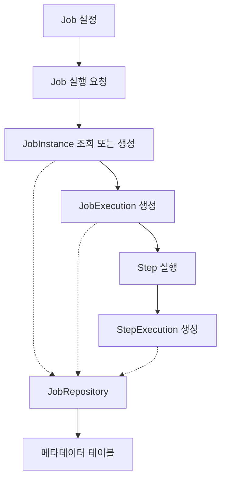

여기서 중요한 것은 **Job 객체와 JobInstance 객체는 서로 다른 개념**이라는 점이다.

Job은 실행할 작업을 정의한다.

반면 JobInstance는 특정 파라미터로 식별되는 논리적인 작업 단위를 나타낸다.

이 차이를 이해하면 Spring Batch의 실행 구조를 훨씬 명확하게 이해할 수 있다.

---

### JobInstance란 무엇인가?

`JobInstance`는 Spring Batch에서 하나의 Job을 논리적으로 식별하기 위한 도메인 객체다.

Spring Batch는 동일한 Job이라도 서로 다른 조건으로 실행할 수 있도록 지원한다.

예를 들어 매일 정산하는 Job이 있다고 생각해보자.

```text
Job 이름: dailySettlementJob
```

이 Job은 매일 실행되지만 정산 기준일은 달라진다.

```text
2026-10-15 정산

2026-10-16 정산

2026-10-17 정산
```

이때 각 정산 작업은 동일한 Job 설정을 사용한다.

하지만 서로 다른 정산일을 처리하기 때문에 별개의 논리적인 실행 단위로 구분해야 한다.

Spring Batch에서는 이를 JobInstance로 표현한다.

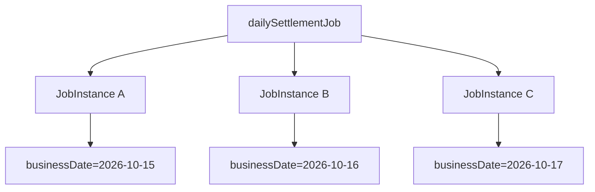

Job 정의는 하나지만 JobInstance는 여러 개가 생성될 수 있다.

즉 다음과 같은 관계가 성립한다.

```text
Job
 │
 │ 1:N
 ▼
JobInstance
```

다만 여기서 주의할 점이 있다.

**JobInstance는 Job이 실행될 때마다 무조건 새롭게 생성되는 객체가 아니다.**

Spring Batch는 실행하려는 Job과 JobParameters를 기준으로 기존 JobInstance가 존재하는지 확인한다.

이미 동일한 JobInstance가 존재한다면 새로운 JobInstance를 생성하지 않는다.

이러한 동작이 Spring Batch의 중복 실행 방지와 재시작 기능의 기반이 된다.

---

### JobInstance를 식별하는 기준

Spring Batch에서 JobInstance를 이해하기 위해 반드시 알아야 하는 공식이 있다.

**JobInstance = Job 이름 + 식별용 JobParameters**

이 공식은 Spring Batch의 논리적인 실행 단위를 정의하는 핵심 규칙이다.

예를 들어 다음과 같은 Job을 구성했다고 생각해보자.

```java
new JobBuilder("dailySettlementJob", jobRepository)
```

Job 이름은 다음과 같다.

```text
dailySettlementJob
```

그리고 Job을 실행할 때 다음 파라미터를 전달한다.

```text
businessDate=2026-10-15
```

이때 `businessDate`가 식별용 파라미터라면 Spring Batch는 두 정보를 이용해 JobInstance를 식별한다.

```text
Job Name
    │
    ▼
dailySettlementJob

JobParameters
    │
    ▼
businessDate=2026-10-15

       │
       ▼

JobInstance A
```

다음날 정산 기준일을 변경하면 어떻게 될까?

```text
businessDate=2026-10-16
```

식별용 JobParameters가 변경되었으므로 새로운 JobInstance가 생성된다.

```text
Job Name
    │
    ▼
dailySettlementJob

JobParameters
    │
    ▼
businessDate=2026-10-16

       │
       ▼

JobInstance B
```

두 Job은 같은 Job 정의를 사용하지만 서로 다른 JobInstance에 해당한다.

#### JobInstance 식별 예제

| Job 이름             | 식별용 JobParameters       | JobInstance |
| ------------------ | ----------------------- | ----------- |
| dailySettlementJob | businessDate=2026-10-15 | A           |
| dailySettlementJob | businessDate=2026-10-16 | B           |
| dailySettlementJob | businessDate=2026-10-17 | C           |
| dailySettlementJob | businessDate=2026-10-15 | A           |

마지막 행을 살펴보자.

이미 실행했던 `businessDate=2026-10-15`를 다시 전달했다.

이 경우 새로운 JobInstance D를 생성하는 것이 아니라 기존 JobInstance A를 식별한다.

따라서 **동일한 Job 이름과 동일한 식별용 JobParameters는 같은 JobInstance를 나타낸다.**

이것이 Spring Batch의 기본적인 식별 규칙이다.

---

### JobParameters란?

JobParameters는 Job을 실행할 때 전달하는 파라미터다.

일반적인 메서드의 매개변수와 비슷한 역할을 한다고 생각할 수 있다.

예를 들어 다음과 같은 정산 작업이 있다고 해보자.

```java
public void calculateSettlement(String businessDate) {
    // 정산 처리
}
```

`businessDate`는 정산 기준일이다.

호출할 때마다 다른 값을 전달할 수 있다.

```java
calculateSettlement("2026-10-15");

calculateSettlement("2026-10-16");
```

Spring Batch에서도 비슷하게 JobParameters를 이용해 실행에 필요한 정보를 전달한다.

다만 JobParameters는 일반적인 매개변수보다 중요한 역할을 하나 더 담당한다.

바로 **JobInstance를 식별하는 데 사용될 수 있다는 것**이다.

#### JobParametersBuilder

Spring Batch는 JobParameters를 생성하기 위한 `JobParametersBuilder`를 제공한다.

예를 들어 다음과 같이 사용할 수 있다.

```java
JobParameters parameters =
        new JobParametersBuilder()
                .addString("businessDate", "2026-10-15")
                .toJobParameters();
```

여기서 다음 코드는

```java
.addString("businessDate", "2026-10-15")
```

문자열 타입의 파라미터를 추가한다.

그리고 다음 메서드는

```java
.toJobParameters();
```

구성한 파라미터를 JobParameters 객체로 변환한다.

이렇게 생성한 객체를 JobLauncher에 전달할 수 있다.

```java
jobLauncher.run(
        settlementJob,
        parameters
);
```

이때 Spring Batch는 Job 이름과 식별용 JobParameters를 이용해 JobInstance를 조회하거나 생성한다.

#### 모든 JobParameters가 식별에 사용되는 것은 아니다

JobParameters에는 식별 여부를 설정할 수 있다.

예를 들어 다음과 같다.

```java
JobParameters parameters =
        new JobParametersBuilder()
                .addString(
                        "businessDate",
                        "2026-10-15",
                        true
                )
                .addString(
                        "requestId",
                        "request-001",
                        false
                )
                .toJobParameters();
```

여기서 세 번째 인자는 식별 여부다.

| 파라미터         | 값           | 식별 여부 |
| ------------ | ----------- | ----- |
| businessDate | 2026-10-15  | true  |
| requestId    | request-001 | false |

`businessDate`는 JobInstance를 식별하는 데 사용한다.

반면 `requestId`는 실행 추적을 위한 정보이므로 식별에 사용하지 않도록 설정했다.

따라서 다음 두 파라미터 조합은 동일한 JobInstance를 나타낸다.

```text
첫 번째 실행

businessDate=2026-10-15
requestId=request-001
```

```text
두 번째 실행

businessDate=2026-10-15
requestId=request-002
```

`requestId`는 변경되었지만 식별용 파라미터인 `businessDate`가 같기 때문이다.

이러한 기능은 JobInstance를 업무 기준으로 식별하면서 실행마다 달라질 수 있는 부가적인 정보를 함께 전달해야 할 때 유용하다.

---

### JobInstance가 생성되는 과정

이제 JobInstance가 실제로 어떻게 생성되는지 살펴보자.

Spring Batch에서 Job을 실행할 때는 `JobLauncher`를 사용할 수 있다.

Spring Batch 5.2의 JobLauncher는 다음과 같은 메서드를 제공한다.

```java
JobExecution run(
        Job job,
        JobParameters jobParameters
) throws JobExecutionException;
```

두 가지 객체를 전달받는다.

첫 번째는 실행할 Job이다.

두 번째는 JobParameters다.

JobLauncher는 이 정보를 이용해 Job 실행을 요청한다.

이 과정에서 JobRepository가 중요한 역할을 한다.

#### JobRepository의 역할

JobRepository는 Job과 Step의 실행 메타데이터를 관리하는 객체다.

JobLauncher가 실행을 요청하면 JobRepository는 해당 JobInstance가 이미 존재하는지 확인한다.

여기서 기준이 되는 것은 다음 두 값이다.

```text
Job 이름

식별용 JobParameters
```

Spring Batch의 JDBC 기반 저장소에서는 이 정보를 이용해 데이터베이스에 저장된 기존 JobInstance를 조회한다.

존재하지 않는다면 새로운 JobInstance를 생성한다.

존재한다면 기존 JobInstance를 사용해 실행 가능 여부를 판단한다.

전체 흐름을 살펴보자.

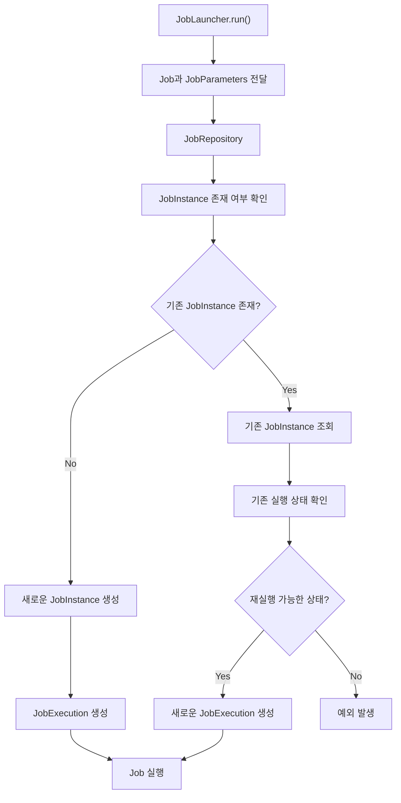

이 구조에서 중요한 점은 **기존 JobInstance가 있다는 사실만으로 무조건 실행이 실패하는 것은 아니라는 것**이다.

기존 JobInstance가 어떤 상태인지에 따라 동작이 달라진다.

이 부분은 반드시 정확하게 이해해야 한다.

---

### 동일한 Job과 JobParameters로 실행하면 어떻게 될까?

Spring Batch에서는 같은 Job 이름과 같은 식별용 JobParameters를 전달하면 기존 JobInstance를 식별한다.

하지만 이후 동작은 JobInstance의 실행 상태에 따라 달라진다.

대표적으로 세 가지 상황을 생각할 수 있다.

#### 첫 번째: 아직 실행한 적이 없는 JobInstance

다음과 같은 Job을 처음 실행한다고 생각해보자.

```text
Job Name: dailySettlementJob

JobParameters:
businessDate=2026-10-15
```

아직 해당 JobInstance가 존재하지 않는다.

따라서 Spring Batch는 새로운 JobInstance를 생성한다.

```text
JobInstance 1
      │
      ▼
JobExecution 1
      │
      ▼
COMPLETED
```

JobInstance와 JobExecution이 각각 생성된다.

#### 두 번째: 이미 정상적으로 완료된 JobInstance

이번에는 동일한 Job 이름과 파라미터로 다시 실행한다고 생각해보자.

```text
Job Name: dailySettlementJob

JobParameters:
businessDate=2026-10-15
```

이미 해당 JobInstance가 존재하며 마지막 실행이 `COMPLETED` 상태다.

이 경우 Spring Batch는 새로운 JobInstance를 생성하지 않는다.

그리고 이미 완료된 JobInstance에 대한 중복 실행을 허용하지 않는다.

대표적으로 다음 예외가 발생한다.

```text
JobInstanceAlreadyCompleteException
```

예외 메시지는 다음과 같은 형태다.

```text
A job instance already exists and is complete
for identifying parameters=...
```

즉 같은 논리적 작업이 이미 성공적으로 완료되었기 때문에 다시 실행하지 않는 것이다.

#### 세 번째: 이전 실행이 실패한 JobInstance

이번에는 첫 번째 실행이 실패했다고 생각해보자.

```text
JobInstance 1
      │
      ▼
JobExecution 1
      │
      ▼
FAILED
```

이 상태에서 동일한 Job 이름과 식별용 JobParameters로 다시 실행한다면 어떻게 될까?

Spring Batch는 기존 JobInstance를 식별한다.

하지만 이전 실행이 실패했기 때문에 재시작 가능한 Job이라면 새로운 JobExecution을 생성해 실행할 수 있다.

```text
JobInstance 1
      │
      ├── JobExecution 1
      │       │
      │       ▼
      │     FAILED
      │
      └── JobExecution 2
              │
              ▼
           COMPLETED
```

JobInstance는 하나다.

반면 JobExecution은 두 개다.

이것이 Spring Batch의 재시작 기능이 동작하는 기본 구조다.

따라서 동일한 Job과 JobParameters로 실행한다고 해서 항상 오류가 발생하는 것은 아니다.

**이미 완료된 작업은 중복 실행을 차단하지만, 실패한 작업은 재시작 조건을 만족하면 같은 JobInstance에서 다시 실행할 수 있다.**

Spring Batch의 JobRepository도 기존 JobInstance가 존재할 때 마지막 실행 상태와 재시작 가능 여부를 확인하도록 설계되어 있다. ([Home][1])

#### 실행 상태별 동작 비교

| 기존 상태           | 새로운 JobInstance 생성 | 새로운 JobExecution 생성 | 결과                  |
| --------------- | ------------------ | ------------------- | ------------------- |
| 실행 이력 없음        | O                  | O                   | 새로운 작업 실행           |
| COMPLETED       | X                  | X                   | 중복 실행 예외            |
| FAILED          | X                  | O                   | 재시작 가능 시 실행         |
| STOPPED         | X                  | O                   | 재시작 가능 시 실행         |
| STARTED         | X                  | X                   | 이미 실행 중이라는 예외       |
| 재시작 불가능한 실패 Job | X                  | X                   | JobRestartException |

이 표를 이해하면 JobInstance가 단순히 중복 실행을 막기 위한 객체가 아니라 **논리적인 작업 식별과 재시작을 위한 객체**라는 사실을 알 수 있다.

---

### JobInstance와 JobExecution의 관계

앞에서 JobInstance는 논리적인 실행 단위라고 설명했다.

반면 JobExecution은 실제 실행 시도를 나타낸다.

예를 들어 매일 실행하는 정산 Job이 있다고 생각해보자.

```text
dailySettlementJob
```

10월 15일 정산은 처음 실행했지만 실패했다.

이후 같은 날 정산을 재시작하여 정상적으로 완료했다.

10월 16일 정산은 한 번에 성공했다.

이를 표현하면 다음과 같다.

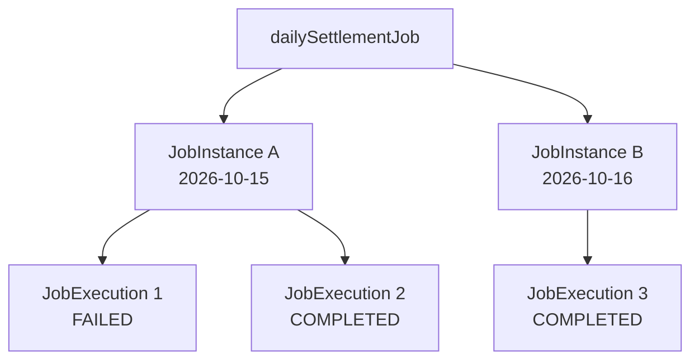

Job 정의는 하나다.

JobInstance는 날짜별로 두 개다.

JobExecution은 실행 시도에 따라 세 개다.

이러한 구조를 이용하면 Spring Batch는 어떤 논리적인 작업이 몇 번 실행되었으며 최종적으로 어떤 상태로 종료되었는지 관리할 수 있다.

---

### BATCH_JOB_INSTANCE 테이블

Spring Batch는 JobInstance의 정보를 `BATCH_JOB_INSTANCE` 테이블에 저장한다.

Spring Batch 5.2.4의 MySQL 스키마는 다음과 같다.

```sql
CREATE TABLE BATCH_JOB_INSTANCE (
    JOB_INSTANCE_ID BIGINT NOT NULL PRIMARY KEY,
    VERSION BIGINT,
    JOB_NAME VARCHAR(100) NOT NULL,
    JOB_KEY VARCHAR(32) NOT NULL,

    CONSTRAINT JOB_INST_UN
        UNIQUE (JOB_NAME, JOB_KEY)
) ENGINE=InnoDB;
```

이 테이블에는 네 개의 컬럼이 존재한다.

| 컬럼                | 역할                            |
| ----------------- | ----------------------------- |
| `JOB_INSTANCE_ID` | JobInstance의 고유 식별자           |
| `VERSION`         | 메타데이터 버전                      |
| `JOB_NAME`        | Job 이름                        |
| `JOB_KEY`         | 식별용 JobParameters를 기반으로 생성된 키 |

각 컬럼의 의미를 살펴보자.

#### JOB_INSTANCE_ID

JobInstance를 고유하게 식별하는 기본 키다.

예를 들어 다음과 같이 저장될 수 있다.

```text
JOB_INSTANCE_ID = 1

JOB_INSTANCE_ID = 2
```

Spring Batch는 JobInstance를 생성할 때 고유한 식별자를 부여한다.

이 값은 다른 메타데이터 테이블에서도 참조된다.

대표적으로 `BATCH_JOB_EXECUTION` 테이블에서 해당 JobInstance를 참조한다.

#### JOB_NAME

Job을 정의할 때 지정한 이름이다.

예를 들어 다음과 같다.

```java
new JobBuilder("dailySettlementJob", jobRepository)
```

이 경우 다음 값이 저장된다.

```text
JOB_NAME = dailySettlementJob
```

#### JOB_KEY

`JOB_KEY`는 식별용 JobParameters를 기반으로 생성되는 값이다.

Spring Batch는 식별용 파라미터를 이용해 JobKey를 생성하고, 데이터베이스에서 JobInstance를 식별하는 데 사용한다.

예를 들어 다음과 같은 파라미터가 있다.

```text
businessDate=2026-10-15
```

이 파라미터를 기반으로 JobKey가 생성된다.

다음날에는 파라미터가 변경된다.

```text
businessDate=2026-10-16
```

따라서 일반적으로 다른 JobKey가 생성된다.

다만 여기서 주의해야 할 점이 있다.

`JOB_KEY`는 식별용 파라미터를 해싱한 값이며, 해시값 자체만으로 모든 Job을 구분하는 것은 아니다.

테이블에서는 다음과 같은 유니크 제약조건을 사용한다.

```sql
CONSTRAINT JOB_INST_UN
    UNIQUE (JOB_NAME, JOB_KEY)
```

즉 다음 조합이 유일해야 한다.

```text
JOB_NAME + JOB_KEY
```

동일한 Job 이름과 동일한 JobKey를 가진 레코드는 중복 생성할 수 없다.

#### VERSION

`VERSION`은 Spring Batch가 메타데이터의 변경을 관리하기 위한 컬럼이다.

Spring Batch는 실행 메타데이터를 갱신할 때 낙관적 락(Optimistic Locking)을 사용한다.

낙관적 락은 데이터를 수정할 때 이전에 읽었던 버전과 현재 버전이 같은지 비교하여 동시 수정 충돌을 감지하는 방식이다.

다만 JobInstance 자체는 일반적으로 실행 중 반복해서 갱신되는 정보가 많지 않으므로, 실제 버전 변경 여부와 횟수는 해당 데이터의 갱신 방식에 따라 달라진다.

---

### 동일한 JobParameters로 JobInstance가 중복 생성되지 않는 이유

앞에서 살펴본 유니크 제약조건을 다시 보자.

```sql
UNIQUE (JOB_NAME, JOB_KEY)
```

이 제약조건은 동일한 JobInstance가 중복 저장되는 것을 방지한다.

예를 들어 다음과 같은 데이터가 있다고 생각해보자.

| JOB_INSTANCE_ID | JOB_NAME           | JOB_KEY |
| --------------- | ------------------ | ------- |
| 1               | dailySettlementJob | HASH_A  |
| 2               | dailySettlementJob | HASH_B  |

두 레코드의 Job 이름은 동일하다.

하지만 JobKey가 다르다.

따라서 서로 다른 JobInstance다.

그런데 다음과 같은 레코드를 추가하려고 한다면 어떻게 될까?

| JOB_INSTANCE_ID | JOB_NAME           | JOB_KEY |
| --------------- | ------------------ | ------- |
| 3               | dailySettlementJob | HASH_A  |

이미 동일한 Job 이름과 JobKey의 조합이 존재한다.

따라서 데이터베이스의 유니크 제약조건에 의해 중복 저장이 차단된다.

물론 정상적인 Spring Batch 실행에서는 새로운 레코드를 무조건 INSERT하는 것이 아니다.

JobRepository가 먼저 기존 JobInstance를 조회하고 실행 가능 여부를 판단한다.

즉 Spring Batch는 애플리케이션 수준의 실행 관리와 데이터베이스 수준의 무결성 제약을 함께 활용한다.

---

### 실제 JobInstance를 생성해보자

지금까지 개념적인 설명을 살펴봤다.

이번에는 직접 Job을 실행하면서 JobInstance가 어떻게 생성되는지 확인해보자.

예제에서는 다음 작업을 만든다.

```text
jobInstanceJob
      │
      ├── jobInstanceStep1
      │       │
      │       └── Step 1 실행
      │
      └── jobInstanceStep2
              │
              └── Step 2 실행
```

그리고 `JobLauncher`를 이용해 직접 실행한다.

실행할 때는 `businessDate`라는 JobParameters를 전달한다.

다음 세 가지 상황을 확인하는 것이 목적이다.

1. 처음 실행하는 JobParameters로 실행
2. 동일한 JobParameters로 다시 실행
3. 다른 JobParameters로 실행

이를 통해 JobInstance의 생성 및 조회 과정을 확인할 수 있다.

---

### JobInstanceConfiguration 작성

먼저 Job과 Step을 정의한다.

```java
package com.example.batch;

import org.springframework.batch.core.Job;
import org.springframework.batch.core.Step;
import org.springframework.batch.core.job.builder.JobBuilder;
import org.springframework.batch.core.repository.JobRepository;
import org.springframework.batch.core.step.builder.StepBuilder;
import org.springframework.batch.repeat.RepeatStatus;

import org.springframework.beans.factory.annotation.Qualifier;
import org.springframework.context.annotation.Bean;
import org.springframework.context.annotation.Configuration;
import org.springframework.transaction.PlatformTransactionManager;

@Configuration
public class JobInstanceConfiguration {

    @Bean
    public Job jobInstanceJob(
            JobRepository jobRepository,
            @Qualifier("jobInstanceStep1") Step step1,
            @Qualifier("jobInstanceStep2") Step step2
    ) {
        return new JobBuilder("jobInstanceJob", jobRepository)
                .start(step1)
                .next(step2)
                .build();
    }

    @Bean
    public Step jobInstanceStep1(
            JobRepository jobRepository,
            PlatformTransactionManager transactionManager
    ) {
        return new StepBuilder(
                "jobInstanceStep1",
                jobRepository
        )
                .tasklet((contribution, chunkContext) -> {

                    System.out.println("Step 1 executed");

                    return RepeatStatus.FINISHED;

                }, transactionManager)
                .build();
    }

    @Bean
    public Step jobInstanceStep2(
            JobRepository jobRepository,
            PlatformTransactionManager transactionManager
    ) {
        return new StepBuilder(
                "jobInstanceStep2",
                jobRepository
        )
                .tasklet((contribution, chunkContext) -> {

                    System.out.println("Step 2 executed");

                    return RepeatStatus.FINISHED;

                }, transactionManager)
                .build();
    }
}
```

이 코드에서 Job은 하나다.

```java
new JobBuilder("jobInstanceJob", jobRepository)
```

그리고 두 개의 Step이 존재한다.

```java
.start(step1)
.next(step2)
```

따라서 Job이 정상적으로 실행되면 첫 번째 Step과 두 번째 Step이 순차적으로 실행된다.

여기서 중요한 것은 **같은 Job 객체를 사용하더라도 JobParameters에 따라 서로 다른 JobInstance가 생성될 수 있다는 것**이다.

---

### JobLauncher를 이용해 직접 실행하기

앞에서는 Spring Boot가 애플리케이션 시작 시 Job을 자동으로 실행하는 방식을 사용했다.

이번에는 JobInstance의 생성 과정을 확인하기 위해 JobLauncher를 직접 사용한다.

Spring Boot는 `ApplicationRunner`라는 인터페이스를 제공한다.

이 인터페이스를 구현하거나 Bean으로 등록하면 Spring Boot 애플리케이션이 시작된 이후 특정 작업을 수행할 수 있다.

이번에는 ApplicationRunner를 이용해 Job을 실행한다.

#### JobInstanceRunner 전체 코드

```java
package com.example.batch;

import org.springframework.batch.core.Job;
import org.springframework.batch.core.JobExecution;
import org.springframework.batch.core.JobParameters;
import org.springframework.batch.core.JobParametersBuilder;
import org.springframework.batch.core.launch.JobLauncher;

import org.springframework.beans.factory.annotation.Qualifier;
import org.springframework.beans.factory.annotation.Value;
import org.springframework.boot.ApplicationRunner;
import org.springframework.context.annotation.Bean;
import org.springframework.context.annotation.Configuration;

@Configuration
public class JobInstanceRunner {

    @Bean
    public ApplicationRunner jobInstanceApplicationRunner(
            JobLauncher jobLauncher,
            @Qualifier("jobInstanceJob") Job job,
            @Value("${demo.business-date:2026-10-15}")
            String businessDate
    ) {
        return args -> {

            JobParameters jobParameters =
                    new JobParametersBuilder()
                            .addString(
                                    "businessDate",
                                    businessDate,
                                    true
                            )
                            .toJobParameters();

            JobExecution jobExecution =
                    jobLauncher.run(
                            job,
                            jobParameters
                    );

            System.out.println(
                    "JobInstance ID: "
                            + jobExecution
                                    .getJobInstance()
                                    .getInstanceId()
            );

            System.out.println(
                    "JobExecution ID: "
                            + jobExecution.getId()
            );

            System.out.println(
                    "Job Status: "
                            + jobExecution.getStatus()
            );
        };
    }
}
```

이 코드에서 가장 중요한 부분은 다음과 같다.

```java
jobLauncher.run(
        job,
        jobParameters
);
```

JobLauncher에 Job과 JobParameters를 전달하여 배치를 실행한다.

또한 반환된 JobExecution을 통해 JobInstance의 식별자와 실행 정보를 확인한다.

#### ApplicationRunner

ApplicationRunner는 Spring Boot가 애플리케이션을 시작한 후 실행하는 컴포넌트다.

이번 예제에서는 ApplicationRunner의 실행 로직 안에서 JobLauncher를 호출한다.

```text
Spring Boot 시작
       │
       ▼
ApplicationContext 초기화
       │
       ▼
ApplicationRunner 실행
       │
       ▼
JobLauncher.run()
       │
       ▼
JobInstance 조회 또는 생성
       │
       ▼
Job 실행
```

이처럼 Spring Boot 시작 이후 개발자가 직접 배치 작업을 실행할 수 있다.

다만 이번 예제의 ApplicationRunner는 실행을 확인하기 위한 구성이다.

실제 운영 환경에서는 스케줄러, 관리 API, 외부 작업 실행 시스템 등에서 JobLauncher를 호출하도록 구성할 수도 있다.

---

### Spring Boot의 Job 자동 실행 비활성화

이번 예제에서는 JobLauncher를 직접 호출한다.

따라서 Spring Boot가 등록된 Job을 자동으로 실행하지 않도록 설정해야 한다.

`application.yml`에 다음 설정을 추가한다.

```yaml
spring:
  batch:
    job:
      enabled: false
```

이 설정은 Spring Boot의 Job 자동 실행 기능을 비활성화한다.

중요한 것은 Spring Batch 자체가 비활성화되는 것은 아니라는 점이다.

JobRepository와 JobLauncher 등의 구성 요소는 그대로 사용할 수 있다.

즉 다음 두 기능은 서로 다르다.

```text
Spring Batch 활성화

≠

Spring Boot의 Job 자동 실행
```

`spring.batch.job.enabled=false`로 설정하면 Spring Boot가 자동으로 Job을 시작하지 않는다.

하지만 이번에 만든 ApplicationRunner는 별도로 등록된 컴포넌트이므로 실행된다.

따라서 ApplicationRunner 내부에서 JobLauncher를 호출해 배치를 실행할 수 있다.

Spring Boot 3.4에서도 Job 자동 실행을 비활성화하기 위한 설정으로 `spring.batch.job.enabled=false`를 사용한다. ([Home][2])

---

### MySQL 환경 설정

이번에는 JobInstance가 데이터베이스에 어떻게 저장되는지 확인해야 한다.

H2 메모리 데이터베이스를 사용하면 애플리케이션이 종료될 때 데이터가 사라질 수 있으므로 MySQL을 사용한다.

앞에서 구성한 MySQL 환경을 그대로 활용한다.

`application-mysql.yml`은 다음과 같다.

```yaml
spring:
  datasource:
    url: jdbc:mysql://localhost:3307/batch_db
    driver-class-name: com.mysql.cj.jdbc.Driver
    username: ${BATCH_DB_USERNAME:batch_user}
    password: ${BATCH_DB_PASSWORD:localpass}

  batch:
    jdbc:
      initialize-schema: never

    job:
      enabled: false
```

여기서는 이미 Spring Batch 메타데이터 테이블이 생성되어 있다고 가정한다.

따라서 다음 설정을 사용한다.

```yaml
spring:
  batch:
    jdbc:
      initialize-schema: never
```

이 설정은 Spring Boot가 메타데이터 테이블을 자동으로 생성하지 않도록 한다.

아직 테이블이 없다면 Spring Batch 5.2.4에 맞는 스키마를 먼저 생성해야 한다.

또한 기존에 작성한 다른 ApplicationRunner가 있다면 함께 실행되지 않도록 주의해야 한다.

이번에는 JobInstanceRunner만 실행되는 상황을 기준으로 살펴본다.

---

### 첫 번째 실행: 새로운 JobInstance 생성

먼저 애플리케이션을 빌드한다.

```bash
./mvnw clean package
```

정상적으로 빌드가 완료되었다면 실행 가능한 Jar 파일이 생성된다.

이제 다음 명령어로 실행해보자.

```bash
java -jar target/spring-batch-demo-0.0.1-SNAPSHOT.jar \
  --spring.profiles.active=mysql \
  --demo.business-date=2026-10-15
```

여기서 `--demo.business-date`는 ApplicationRunner에서 사용할 설정값이다.

```java
@Value("${demo.business-date:2026-10-15}")
String businessDate
```

전달한 값을 읽어 JobParameters를 생성한다.

```java
JobParameters jobParameters =
        new JobParametersBuilder()
                .addString(
                        "businessDate",
                        businessDate,
                        true
                )
                .toJobParameters();
```

따라서 실제 JobParameters는 다음과 같다.

```text
businessDate=2026-10-15
```

JobInstance가 아직 존재하지 않는다면 Spring Batch는 새로운 JobInstance를 생성한다.

실행 결과는 다음과 같은 형태다.

```text
Step 1 executed

Step 2 executed

JobInstance ID: 1

JobExecution ID: 1

Job Status: COMPLETED
```

위 ID는 처음 실행하는 빈 메타데이터 데이터베이스를 가정한 예시다.

실제 ID는 기존 실행 이력에 따라 달라질 수 있다.

#### BATCH_JOB_INSTANCE 확인

이제 MySQL에서 다음 SQL을 실행한다.

```sql
SELECT
    JOB_INSTANCE_ID,
    VERSION,
    JOB_NAME,
    JOB_KEY
FROM BATCH_JOB_INSTANCE
WHERE JOB_NAME = 'jobInstanceJob';
```

정상적으로 실행되었다면 다음과 같은 형태의 데이터가 저장된다.

| JOB_INSTANCE_ID | JOB_NAME       | JOB_KEY |
| --------------- | -------------- | ------- |
| 1               | jobInstanceJob | HASH_A  |

실제 `JOB_KEY`에는 Spring Batch가 생성한 해시 문자열이 저장된다.

이것이 첫 번째 JobInstance다.

---

### 두 번째 실행: 동일한 JobParameters로 실행

이번에는 앞에서 실행했던 명령어를 그대로 다시 실행해보자.

```bash
java -jar target/spring-batch-demo-0.0.1-SNAPSHOT.jar \
  --spring.profiles.active=mysql \
  --demo.business-date=2026-10-15
```

Job 이름도 동일하다.

```text
jobInstanceJob
```

식별용 JobParameters도 동일하다.

```text
businessDate=2026-10-15
```

따라서 Spring Batch는 기존 JobInstance를 식별한다.

그런데 앞선 JobExecution은 이미 정상적으로 완료되었다.

```text
STATUS = COMPLETED
```

이 경우 동일한 JobInstance를 다시 실행할 수 없다.

따라서 다음 예외가 발생한다.

```text
JobInstanceAlreadyCompleteException
```

Spring Batch는 이미 성공적으로 완료된 논리적 작업을 다시 실행하지 않도록 제어한다.

#### 두 번째 실행에서도 JobInstance가 생성될까?

아니다.

이미 동일한 JobInstance가 존재하므로 새로운 레코드가 생성되지 않는다.

```text
첫 번째 실행

JobInstance 1
      │
      ▼
JobExecution 1
      │
      ▼
COMPLETED
```

```text
두 번째 실행

Job 이름: 동일

JobParameters: 동일

      │
      ▼

기존 JobInstance 1 조회
      │
      ▼
이미 COMPLETED
      │
      ▼
JobInstanceAlreadyCompleteException
```

따라서 `BATCH_JOB_INSTANCE` 테이블에는 기존 레코드 하나만 존재한다.

중복 실행이 거부되었다면 새로운 JobExecution도 생성되지 않는다.

이번 예제에서는 예외를 별도로 처리하지 않았으므로 ApplicationRunner를 실행하는 과정에서 예외가 전파되어 애플리케이션 시작이 실패할 수 있다.

---

### 세 번째 실행: 다른 JobParameters로 실행

이번에는 정산 기준일을 변경해보자.

```bash
java -jar target/spring-batch-demo-0.0.1-SNAPSHOT.jar \
  --spring.profiles.active=mysql \
  --demo.business-date=2026-10-16
```

이전 실행과 비교하면 다음과 같다.

| 구분           | 첫 번째 실행        | 세 번째 실행        |
| ------------ | -------------- | -------------- |
| Job 이름       | jobInstanceJob | jobInstanceJob |
| businessDate | 2026-10-15     | 2026-10-16     |
| 식별용 파라미터     | 다름             | 다름             |
| JobInstance  | A              | B              |

이번에는 JobParameters가 달라졌다.

따라서 Spring Batch는 새로운 JobInstance를 생성한다.

실행 결과는 다음과 같은 형태다.

```text
Step 1 executed

Step 2 executed

JobInstance ID: 2

JobExecution ID: 2

Job Status: COMPLETED
```

데이터베이스를 조회해보자.

```sql
SELECT
    JOB_INSTANCE_ID,
    JOB_NAME,
    JOB_KEY
FROM BATCH_JOB_INSTANCE
WHERE JOB_NAME = 'jobInstanceJob'
ORDER BY JOB_INSTANCE_ID;
```

결과는 다음과 같은 형태다.

| JOB_INSTANCE_ID | JOB_NAME       | JOB_KEY |
| --------------- | -------------- | ------- |
| 1               | jobInstanceJob | HASH_A  |
| 2               | jobInstanceJob | HASH_B  |

Job 이름은 동일하다.

하지만 JobKey가 다르다.

따라서 서로 다른 JobInstance로 관리된다.

이것이 JobInstance가 JobParameters를 기준으로 생성되는 방식이다.

---

### BATCH_JOB_EXECUTION_PARAMS에서 파라미터 확인하기

이번에는 실제 JobParameters가 어떻게 저장되었는지 확인해보자.

Spring Batch 5.2에서는 `BATCH_JOB_EXECUTION_PARAMS` 테이블에 파라미터가 저장된다.

다음 SQL을 실행한다.

```sql
SELECT
    JOB_EXECUTION_ID,
    PARAMETER_NAME,
    PARAMETER_TYPE,
    PARAMETER_VALUE,
    IDENTIFYING
FROM BATCH_JOB_EXECUTION_PARAMS
ORDER BY JOB_EXECUTION_ID;
```

결과는 다음과 같은 형태다.

| JOB_EXECUTION_ID | PARAMETER_NAME | PARAMETER_TYPE   | PARAMETER_VALUE | IDENTIFYING |
| ---------------- | -------------- | ---------------- | --------------- | ----------- |
| 1                | businessDate   | java.lang.String | 2026-10-15      | Y           |
| 2                | businessDate   | java.lang.String | 2026-10-16      | Y           |

여기서 확인할 수 있는 것은 다음과 같다.

첫 번째 실행에서는 `2026-10-15`가 저장되었다.

두 번째로 성공한 실행에서는 `2026-10-16`이 저장되었다.

두 파라미터 모두 식별용이므로 `IDENTIFYING`에는 `Y`가 저장된다.

참고로 Spring Batch 4.x에서는 `TYPE_CD`, `KEY_NAME`, `STRING_VAL` 등의 컬럼을 사용했지만 Spring Batch 5에서는 컬럼 구조가 변경되었다.

따라서 Spring Batch 5.2에서는 위 SQL을 사용해야 한다.

---

### JobInstance와 JobExecution을 함께 조회하기

이번에는 JobInstance와 JobExecution의 관계를 확인해보자.

다음 SQL을 실행한다.

```sql
SELECT
    ji.JOB_INSTANCE_ID,
    ji.JOB_NAME,
    ji.JOB_KEY,

    je.JOB_EXECUTION_ID,
    je.STATUS,
    je.START_TIME,
    je.END_TIME

FROM BATCH_JOB_INSTANCE ji

JOIN BATCH_JOB_EXECUTION je
    ON ji.JOB_INSTANCE_ID = je.JOB_INSTANCE_ID

WHERE ji.JOB_NAME = 'jobInstanceJob'

ORDER BY
    ji.JOB_INSTANCE_ID,
    je.JOB_EXECUTION_ID;
```

실행 결과는 다음과 같은 형태다.

| JOB_INSTANCE_ID | JOB_NAME       | JOB_EXECUTION_ID | STATUS    |
| --------------- | -------------- | ---------------- | --------- |
| 1               | jobInstanceJob | 1                | COMPLETED |
| 2               | jobInstanceJob | 2                | COMPLETED |

첫 번째 JobInstance는 첫 번째 실행에 해당한다.

두 번째 JobInstance는 다른 파라미터로 실행한 작업에 해당한다.

만약 첫 번째 JobInstance가 실패한 뒤 재시작되었다면 다음과 같은 구조가 될 수 있다.

| JOB_INSTANCE_ID | JOB_NAME       | JOB_EXECUTION_ID | STATUS    |
| --------------- | -------------- | ---------------- | --------- |
| 1               | jobInstanceJob | 1                | FAILED    |
| 1               | jobInstanceJob | 2                | COMPLETED |
| 2               | jobInstanceJob | 3                | COMPLETED |

이 경우 JobInstance 1에는 두 개의 JobExecution이 존재한다.

반면 JobInstance 2에는 하나의 JobExecution이 존재한다.

이러한 구조가 JobInstance와 JobExecution의 일대다 관계를 나타낸다.

---

### JobInstance 생성과 재시작의 차이

Spring Batch를 사용할 때 가장 많이 혼동하는 개념 중 하나가 새로운 JobInstance 생성과 기존 JobInstance 재시작이다.

두 작업은 전혀 다른 의미를 가진다.

#### 새로운 JobInstance 생성

새로운 JobInstance를 생성한다는 것은 논리적으로 새로운 작업을 시작한다는 의미다.

예를 들어 다음과 같다.

```text
정산 기준일: 2026-10-15
```

이 작업이 완료된 뒤 다음날 정산을 수행한다.

```text
정산 기준일: 2026-10-16
```

서로 다른 정산 기준일이므로 새로운 JobInstance를 생성한다.

#### 기존 JobInstance 재시작

기존 JobInstance를 재시작한다는 것은 이전에 실패하거나 중지된 논리적 작업을 다시 실행한다는 의미다.

예를 들어 10월 15일 정산이 실패했다고 생각해보자.

```text
JobInstance A
businessDate=2026-10-15

      │
      ▼

JobExecution 1
      │
      ▼
FAILED
```

이 경우 재시작 가능한 Job이라면 같은 JobParameters로 다시 실행할 수 있다.

```text
JobInstance A
businessDate=2026-10-15

      │
      ├── JobExecution 1
      │       └── FAILED
      │
      └── JobExecution 2
              └── COMPLETED
```

JobInstance는 변경되지 않는다.

대신 새로운 JobExecution이 생성된다.

#### 두 개념의 차이

| 구분            | 새로운 JobInstance | 기존 JobInstance 재시작 |
| ------------- | --------------- | ------------------ |
| 목적            | 새로운 논리적 작업 처리   | 실패한 작업 재처리         |
| JobParameters | 식별용 파라미터가 다름    | 식별용 파라미터가 동일       |
| JobInstance   | 새로 생성           | 기존 객체 식별           |
| JobExecution  | 새로 생성           | 새로 생성              |
| 대표 사례         | 다음날 정산          | 실패한 전날 정산 재시작      |

이 차이를 이해하면 배치 운영 과정에서 새로운 작업을 실행해야 하는지, 실패한 작업을 재시작해야 하는지 판단하기 쉬워진다.

---

### JobParameters를 무조건 변경하는 것이 좋은 방법일까?

Spring Batch에서는 이미 완료된 JobInstance를 동일한 파라미터로 다시 실행할 수 없다.

따라서 JobParameters를 변경하면 새로운 JobInstance를 생성할 수 있다.

하지만 이것을 단순히 중복 실행 예외를 피하는 방법으로 사용해서는 안 된다.

예를 들어 정산 기준일이 다음과 같다고 생각해보자.

```text
businessDate=2026-10-15
```

해당 정산 작업은 이미 정상적으로 완료되었다.

그런데 동일한 날짜의 정산을 다시 실행하기 위해 다음과 같은 파라미터를 추가한다고 생각해보자.

```text
businessDate=2026-10-15

run.id=2
```

`run.id`가 식별용 파라미터라면 새로운 JobInstance가 생성된다.

하지만 비즈니스 관점에서는 여전히 같은 날짜의 정산을 다시 처리하는 것이다.

이때 중복 정산이 발생할 가능성이 있다.

즉 **Spring Batch의 JobInstance가 서로 다르다는 사실이 비즈니스 데이터의 중복 처리까지 방지한다는 의미는 아니다.**

#### 업무 식별 기준을 명확하게 정의해야 한다

정산 배치에서는 다음 값들이 논리적인 작업을 식별하는 데 중요할 수 있다.

```text
businessDate

merchantId

settlementType
```

예를 들어 특정 가맹점의 특정 날짜 정산을 수행한다고 생각해보자.

```text
businessDate=2026-10-15

merchantId=1001
```

이 경우 이 두 값을 식별용 파라미터로 사용할 수 있다.

```java
JobParameters parameters =
        new JobParametersBuilder()
                .addString(
                        "businessDate",
                        "2026-10-15",
                        true
                )
                .addLong(
                        "merchantId",
                        1001L,
                        true
                )
                .toJobParameters();
```

반면 실행 요청 ID나 로그 추적용 값은 식별용으로 사용하지 않을 수 있다.

```java
JobParameters parameters =
        new JobParametersBuilder()
                .addString(
                        "businessDate",
                        "2026-10-15",
                        true
                )
                .addLong(
                        "merchantId",
                        1001L,
                        true
                )
                .addString(
                        "requestId",
                        "request-001",
                        false
                )
                .toJobParameters();
```

이렇게 구성하면 업무상 동일한 정산 작업을 같은 JobInstance로 식별할 수 있다.

**JobInstance 식별 기준은 단순한 기술적 설정이 아니라 비즈니스에서 무엇을 하나의 작업으로 볼 것인지 결정하는 중요한 설계 요소**다.

---

### JobInstance는 데이터 중복 처리를 완전히 방지할까?

JobInstance는 중복 실행을 관리하는 데 도움이 된다.

하지만 실제 비즈니스 데이터의 중복 처리를 완전히 방지하는 기능은 아니다.

예를 들어 다음과 같은 상황을 생각해보자.

```text
정산 Job 실행
      │
      ▼
정산 결과 DB 저장
      │
      ▼
외부 정산 API 호출
      │
      ▼
네트워크 오류
      │
      ▼
Job FAILED
```

정산 결과는 이미 데이터베이스에 저장되었다.

그런데 외부 정산 API 호출 과정에서 실패가 발생했다.

이 상태에서 Job을 재시작하면 어떻게 될까?

재시작 구조에 따라 이미 처리한 데이터를 다시 처리할 가능성이 있다.

이때 비즈니스 로직에서 중복 정산을 방지하지 않았다면 문제가 발생할 수 있다.

따라서 배치 시스템에서는 JobInstance의 식별 규칙뿐 아니라 다음과 같은 요소도 함께 고려해야 한다.

* 비즈니스 키 기반 유니크 제약조건
* 멱등성 있는 데이터 저장
* 처리 완료 여부 확인
* 외부 API의 멱등성 키
* 재시작 시 처리 범위 복원
* Chunk와 트랜잭션 경계 설계

예를 들어 정산 결과 테이블에 다음과 같은 유니크 제약조건을 적용할 수 있다.

```sql
ALTER TABLE SETTLEMENT
ADD CONSTRAINT UK_SETTLEMENT_BUSINESS
UNIQUE (
    BUSINESS_DATE,
    MERCHANT_ID,
    PAYMENT_ID
);
```

이렇게 하면 동일한 정산 기준일과 가맹점, 결제 건에 대해 중복 레코드가 저장되는 것을 데이터베이스 수준에서 방지할 수 있다.

물론 실제 유니크 키는 비즈니스 요구사항에 따라 달라져야 한다.

이처럼 Spring Batch의 실행 식별과 비즈니스 데이터의 정합성은 별도로 설계해야 한다.

---

### JobInstance를 설계할 때 주의할 점

JobInstance는 단순히 실행할 때 자동으로 생성되는 객체라고 생각하기 쉽다.

하지만 실제로는 배치 작업의 실행 단위를 구분하는 중요한 개념이다.

따라서 다음 사항을 고려하는 것이 좋다.

#### 1. 실행 시각과 업무 기준일은 다를 수 있다

예를 들어 정산 배치가 매일 새벽 2시에 실행된다고 생각해보자.

```text
실행 시각: 2026-10-16 02:00

정산 기준일: 2026-10-15
```

이 경우 JobInstance를 식별할 때 실제 실행 시각보다는 정산 기준일이 더 중요할 수 있다.

실행 시각을 기준으로 JobInstance를 구분하면 동일한 정산 작업이 재실행될 때마다 새로운 JobInstance가 생성될 가능성이 있기 때문이다.

따라서 업무상 어떤 데이터를 처리하는 작업인지 명확하게 나타내는 파라미터를 사용하는 것이 좋다.

#### 2. 동일한 JobInstance가 항상 동일한 데이터를 의미하지는 않는다

JobInstance는 Job 이름과 식별용 JobParameters로 구분된다.

하지만 실제 비즈니스 데이터는 실행 시점에 따라 변경될 수 있다.

예를 들어 다음과 같은 파라미터로 정산 배치를 실행한다고 생각해보자.

```text
businessDate=2026-10-15
```

처음 실행했을 때는 정산 대상 결제가 1,000건이었다.

그런데 배치가 실패한 뒤 정산 대상 데이터가 수정되었다면 재시작 시 조회되는 데이터가 달라질 수 있다.

JobInstance는 동일하지만 실제 처리 대상 데이터는 변경된 것이다.

따라서 정산처럼 데이터 정합성이 중요한 작업에서는 처리 대상을 확정하거나 스냅샷을 관리하는 방식도 고려해야 한다.

#### 3. JobInstance는 실행 횟수와 다르다

JobInstance는 실행 횟수를 의미하지 않는다.

하나의 JobInstance가 여러 번 실행될 수 있기 때문이다.

예를 들어 다음과 같다.

```text
JobInstance 1
      │
      ├── 첫 번째 실행: FAILED
      │
      ├── 두 번째 실행: FAILED
      │
      └── 세 번째 실행: COMPLETED
```

이 경우 JobInstance는 하나지만 JobExecution은 세 개다.

따라서 배치의 실행 횟수를 집계하려면 JobInstance 개수가 아니라 JobExecution을 기준으로 확인해야 한다.

반면 논리적으로 서로 다른 작업의 수를 집계하려면 JobInstance를 기준으로 볼 수 있다.

---

### 정리

Spring Batch에서 `JobInstance`는 Job을 논리적으로 식별하기 위한 도메인 객체다.

Job은 배치 작업 전체를 정의하지만, 실제로 실행되는 작업은 JobParameters에 따라 서로 다른 논리적 실행 단위로 구분될 수 있다.

Spring Batch에서는 이러한 단위를 JobInstance로 표현한다.

가장 중요한 식별 규칙은 다음과 같다.

**JobInstance = Job 이름 + 식별용 JobParameters**

예를 들어 다음과 같은 정산 Job이 있다고 생각해보자.

```text
dailySettlementJob
```

이 Job을 서로 다른 날짜로 실행한다.

```text
businessDate=2026-10-15

businessDate=2026-10-16
```

식별용 JobParameters가 다르므로 각각 새로운 JobInstance가 생성된다.

반면 동일한 Job 이름과 동일한 식별용 JobParameters를 전달하면 기존 JobInstance를 식별한다.

이후 실행 가능 여부는 기존 JobInstance의 상태에 따라 달라진다.

| 상황                         | 동작                           |
| -------------------------- | ---------------------------- |
| 처음 실행하는 Job과 JobParameters | 새로운 JobInstance 생성           |
| 이미 완료된 JobInstance         | 중복 실행 예외                     |
| 실패한 JobInstance            | 재시작 가능 시 새로운 JobExecution 생성 |
| 실행 중인 JobInstance          | 중복 실행 제한                     |
| 식별용 JobParameters 변경       | 새로운 JobInstance 생성           |

또한 JobInstance는 `BATCH_JOB_INSTANCE` 테이블에 저장된다.

해당 테이블에서는 `JOB_NAME`과 `JOB_KEY`의 조합으로 중복 저장을 방지한다.

Spring Batch의 실행 구조를 이해할 때는 다음 관계를 기억하는 것이 좋다.

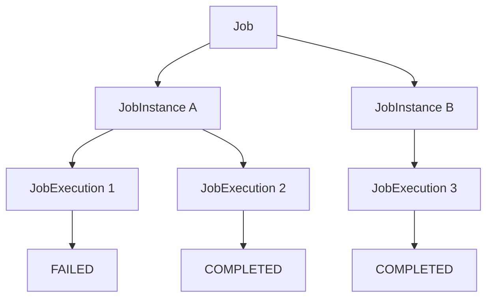

하나의 Job은 여러 JobInstance를 가질 수 있다.

그리고 하나의 JobInstance는 여러 JobExecution을 가질 수 있다.

이 구조를 통해 Spring Batch는 동일한 논리적 작업의 중복 실행을 제어하고, 실패한 작업을 재시작할 수 있는 기반을 제공한다.

실무에서는 JobInstance의 식별 기준을 신중하게 설계해야 한다.

특히 정산, 결제, 쿠폰 만료, 데이터 동기화처럼 중복 처리가 문제가 될 수 있는 시스템에서는 업무 기준일이나 처리 대상 ID 등을 활용해 논리적인 작업을 명확하게 구분하는 것이 중요하다.

또한 JobInstance가 다르다는 사실만으로 비즈니스 데이터의 정합성이 보장되는 것은 아니므로 멱등성 있는 처리 구조를 함께 설계해야 한다.

결국 **JobInstance는 단순한 실행 기록이 아니라 배치 시스템에서 무엇을 하나의 논리적 작업으로 볼 것인지 정의하는 핵심 개념**이다.

#### 한 줄 요약

> Spring Batch의 `JobInstance`는 Job 이름과 식별용 JobParameters로 구분되는 논리적인 실행 단위이며, 새로운 파라미터 조합에는 새로운 JobInstance가 생성되고, 동일한 조합은 기존 JobInstance로 식별된다. 이미 완료된 작업은 중복 실행을 제한하지만 실패한 작업은 재시작할 수 있으며, 실제 실행 시도는 각각 별도의 JobExecution으로 관리된다.

[1]: https://www.springframework.org/spring-batch/docs/5.2.0-M2/api/org/springframework/batch/core/repository/JobRepository.html?utm_source=chatgpt.com "JobRepository (Spring Batch 5.2.0-M2 API)"
[2]: https://docs.spring.io/spring-boot/3.4/how-to/batch.html?utm_source=chatgpt.com "Batch Applications :: Spring Boot"
