# 4. 스프링 배치 도메인 이해

# 4. 스프링 배치 도메인 이해  

* toc
{:toc}

---

## Job

### Spring Batch Job 도메인 객체 이해: SimpleJob과 FlowJob의 구조 및 실행 원리

Spring Batch에서 배치 작업을 개발할 때 가장 먼저 정의하는 객체는 `Job`이다.

앞에서는 `helloJob`이라는 배치 작업을 생성하고, 그 안에 `helloStep1`과 `helloStep2`를 구성해 순차적으로 실행했다.

당시에는 `JobBuilder`와 `StepBuilder`를 이용해 객체를 생성하고 실행하는 방법에 집중했다면, 이번에는 **Job이 내부적으로 어떤 구조를 가지고 있으며, 실제 실행 과정에서 Step을 어떻게 관리하는지** 살펴보자.

Spring Batch에서 Job은 단순히 여러 Step을 묶어놓은 객체가 아니다.

배치 작업의 실행 흐름을 정의하고, 실행 상태를 관리하며, 재시작 가능 여부와 실행 이벤트 등을 제어하는 최상위 도메인 객체다.

예를 들어 다음과 같은 정산 배치를 생각해보자.

```text
일별 정산 배치
    │
    ├── Step 1. 정산 대상 데이터 조회
    │
    ├── Step 2. 정산 금액 계산
    │
    ├── Step 3. 정산 결과 저장
    │
    └── Step 4. 정산 완료 처리
```

Spring Batch에서는 이러한 작업 전체를 하나의 Job으로 정의한다.

그리고 Job에 포함된 각각의 처리 단계를 Step으로 구분한다.

Job이 실행되면 미리 정의된 실행 흐름에 따라 Step이 호출되고, 각 Step 안에서 실제 비즈니스 로직이 수행된다.

여기서 중요한 질문이 생긴다.

**우리가 정의한 Job은 어떤 객체로 생성되며, Spring Batch는 그 객체를 어떻게 실행하는 것일까?**

이 질문을 이해하려면 `Job` 인터페이스부터 `AbstractJob`, `SimpleJob`, `FlowJob`까지 이어지는 클래스 구조를 살펴봐야 한다.

이번에는 다음 관계를 중심으로 Job의 내부 동작을 이해해보자.

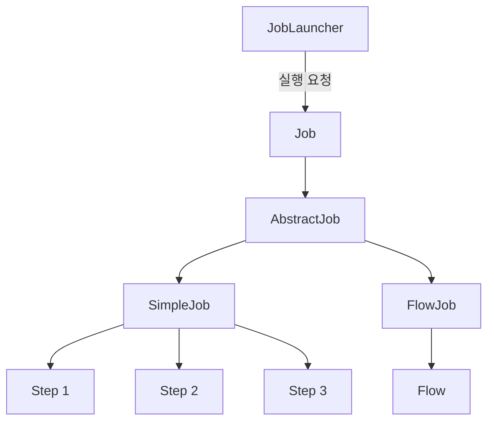

**개발 환경:** Spring Boot 3.4 / Spring Batch 5.2 / Java 17 기준으로 설명한다.

Spring Batch 4에서 사용하던 일부 API와 실제 코드 구성 방식은 Spring Batch 5에서 변경되었으므로, 현재 사용되는 방식에 맞춰 예제를 작성한다.

---

### Job이란 무엇인가?

Job은 Spring Batch에서 배치 작업을 구성하는 가장 상위 개념이다.

하나의 배치 작업 자체를 나타내며, 해당 작업을 어떤 단계로 구성하고 어떤 순서로 실행할지 정의한다.

예를 들어 API 서버에 쌓인 접속 로그를 통계 서버로 전송하는 배치가 있다고 생각해보자.

이 작업은 다음과 같은 단계로 구성할 수 있다.

```text
API 서버 접속 로그 수집
          │
          ▼
로그 데이터 정제
          │
          ▼
통계 데이터 생성
          │
          ▼
통계 서버로 데이터 전송
```

이러한 작업 전체가 하나의 Job이다.

Spring Batch에서는 Job을 구성하는 Step과 실행 순서를 설정하여 하나의 배치 작업으로 정의한다.

#### Job은 배치 작업의 설계도다

Job을 이해할 때 가장 중요한 개념은 **Job이 배치 작업의 명세서이자 설계도 역할을 한다는 것**이다.

예를 들어 건물을 건설할 때는 먼저 설계도를 작성한다.

설계도에는 건물의 구조와 각 공간의 배치 등이 정의되어 있다.

하지만 설계도가 존재한다고 해서 건물이 실제로 건설되는 것은 아니다.

Job도 마찬가지다.

```java
@Bean
public Job settlementJob(
        JobRepository jobRepository,
        Step calculateStep,
        Step saveStep
) {
    return new JobBuilder("settlementJob", jobRepository)
            .start(calculateStep)
            .next(saveStep)
            .build();
}
```

이 코드는 정산 작업을 어떤 순서로 실행할지 정의한다.

먼저 `calculateStep`을 실행하고, 정상적으로 완료되면 `saveStep`을 실행하도록 설정한 것이다.

하지만 이 코드가 실행되어 Job 객체가 생성되었다고 해서 실제 정산 작업이 시작되는 것은 아니다.

Job 객체를 생성하는 과정과 실제 배치를 실행하는 과정은 구분된다.

```text
Job 설정
   │
   ▼
Job 객체 생성
   │
   ▼
Spring Bean 등록
   │
   ▼
실행 요청 대기
   │
   ▼
JobLauncher 실행 요청
   │
   ▼
Job 실행
```

이러한 구분은 Spring Batch의 전체 실행 구조를 이해하는 데 중요하다.

#### Job은 여러 Step을 관리하는 컨테이너다

Job은 하나 이상의 Step을 포함하는 구조로 구성된다.

예를 들어 다음과 같다.

```text
SettlementJob
    │
    ├── PrepareStep
    │
    ├── CalculateStep
    │
    └── CompleteStep
```

각 Step은 자신의 처리 로직을 가지고 있다.

Job은 이러한 Step들을 관리하면서 실행 흐름을 제어한다.

따라서 Job은 단순한 데이터 저장 객체가 아니라 **여러 Step을 실행하는 컨테이너이자 실행 흐름을 관리하는 객체**라고 이해할 수 있다.

다만 모든 Job이 내부적으로 동일한 방식으로 Step을 저장하는 것은 아니다.

대표적인 구현체인 `SimpleJob`은 Step 목록을 관리하지만, `FlowJob`은 실행 흐름을 나타내는 `Flow` 객체를 중심으로 동작한다.

이 차이는 뒤에서 자세히 살펴보자.

---

### Job 인터페이스

Spring Batch는 Job을 정의하기 위한 최상위 인터페이스를 제공한다.

```java
public interface Job {

    // ...
}
```

실제 인터페이스에는 여러 메서드가 정의되어 있지만, Job의 실행 원리를 이해할 때 가장 중요한 메서드는 다음과 같다.

```java
void execute(JobExecution execution);
```

이 메서드는 Job을 실행하는 역할을 담당한다.

매개변수로 전달되는 `JobExecution`은 해당 Job의 실행 정보를 나타내는 객체다.

여기에는 Job의 실행 상태, 시작 시간, 종료 시간, 실행 파라미터 등의 정보가 포함된다.

따라서 Job은 단순히 `execute()`만 호출하여 비즈니스 로직을 수행하는 것이 아니라, **특정 JobExecution에 해당하는 실행을 수행한다**고 이해하는 것이 정확하다.

#### Job 인터페이스가 직접 실행 로직을 구현할까?

Job은 인터페이스이므로 구체적인 실행 로직을 직접 구현하지 않는다.

실제 실행은 Job 인터페이스를 구현한 클래스에서 수행된다.

Spring Batch에서는 이를 위한 기본 구현체를 제공한다.

대표적인 구현체는 다음 두 가지다.

| 구현체         | 역할                        |
| ----------- | ------------------------- |
| `SimpleJob` | 등록된 Step을 순차적으로 실행        |
| `FlowJob`   | Flow에 정의된 실행 흐름에 따라 작업 수행 |

이 두 구현체는 공통적으로 `AbstractJob`이라는 추상 클래스를 상속한다.

클래스 구조를 살펴보자.

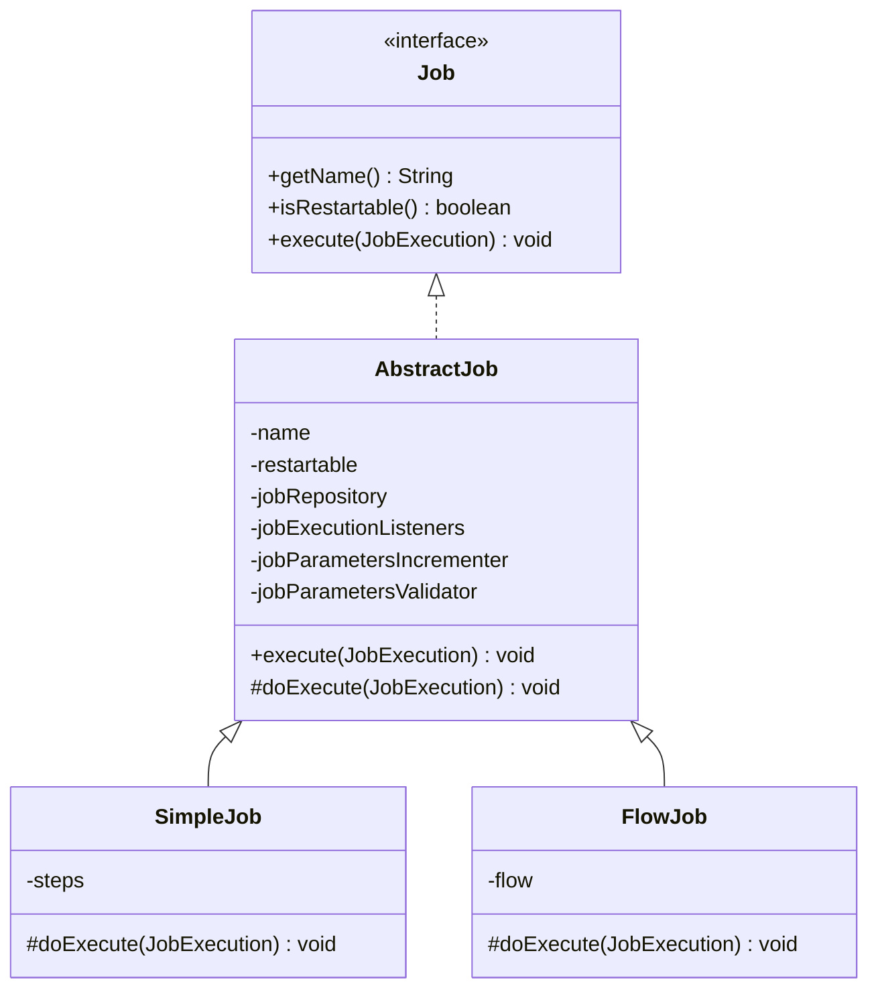

이 구조를 이해하면 Spring Batch의 Job 실행 과정이 조금 더 명확해진다.

`AbstractJob`은 Job 실행에 공통으로 필요한 기능을 담당한다.

`SimpleJob`과 `FlowJob`은 실제 Step을 어떤 방식으로 실행할 것인지 결정한다.

즉, **공통적인 실행 관리는 AbstractJob이 담당하고, 구체적인 실행 흐름은 하위 구현체가 담당하는 구조**다.

---

### AbstractJob의 역할

`AbstractJob`은 `Job` 인터페이스를 구현하는 추상 클래스다.

Spring Batch는 Job 실행 과정에서 반복적으로 필요한 공통 기능을 `AbstractJob`에 정의해두었다.

대표적으로 다음과 같은 속성과 기능이 있다.

| 구성 요소                      | 역할                          |
| -------------------------- | --------------------------- |
| `name`                     | Job 이름                      |
| `restartable`              | Job 재시작 가능 여부               |
| `JobRepository`            | 실행 메타데이터 관리                 |
| `JobExecutionListener`     | Job 실행 전후 이벤트 처리            |
| `JobParametersIncrementer` | 다음 실행에 사용할 JobParameters 생성 |
| `JobParametersValidator`   | JobParameters 유효성 검증        |
| Step 실행 처리                 | Step 실행 및 실행 상태 관리          |

각각의 의미를 살펴보자.

#### name: Job의 이름

Job은 고유한 이름을 가진다.

예를 들어 다음과 같이 생성할 수 있다.

```java
new JobBuilder("settlementJob", jobRepository)
```

여기서 `settlementJob`이 Job의 이름이다.

Spring Batch는 이 이름을 실행 메타데이터에 저장한다.

또한 Job 이름은 JobParameters와 함께 JobInstance를 식별할 때 사용된다.

따라서 Job 이름은 단순한 표시용 문자열이 아니다.

배치의 논리적인 실행 대상을 구분하는 중요한 값이다.

#### restartable: 재시작 가능 여부

Spring Batch는 Job의 재시작 가능 여부를 설정할 수 있다.

기본적으로 Job은 재시작 가능한 구조를 지원한다.

예를 들어 정산 배치가 실행 도중 실패했다고 생각해보자.

```text
정산 Job 실행
      │
      ▼
Step 1 완료
      │
      ▼
Step 2 실행
      │
      ▼
오류 발생
      │
      ▼
FAILED
```

이 경우 재시작 가능한 Job이라면 동일한 JobInstance에 대해 새로운 JobExecution을 생성하여 실행을 다시 시도할 수 있다.

하지만 모든 Job이 재시작을 허용해야 하는 것은 아니다.

예를 들어 외부 시스템의 특성상 동일한 작업을 다시 실행하면 문제가 발생하는 경우 재시작을 제한할 수도 있다.

Spring Batch 5에서는 다음과 같이 설정한다.

```java
@Bean
public Job settlementJob(
        JobRepository jobRepository,
        Step settlementStep
) {
    return new JobBuilder("settlementJob", jobRepository)
            .start(settlementStep)
            .preventRestart()
            .build();
}
```

여기서 중요한 부분은 다음이다.

```java
.preventRestart()
```

이 설정은 Job의 재시작을 허용하지 않도록 한다.

동일한 JobInstance에 대한 재시작을 시도하면 `JobRestartException`이 발생할 수 있다.

다만 `restartable=true`라고 해서 모든 Job을 무조건 다시 실행할 수 있다는 의미는 아니다.

이미 `COMPLETED` 상태로 종료된 JobInstance는 일반적으로 동일한 식별용 JobParameters로 다시 실행할 수 없다.

따라서 재시작 가능 여부와 중복 실행 가능 여부는 구분해서 이해해야 한다.

#### JobRepository: 실행 메타데이터 관리

`JobRepository`는 Job과 Step의 실행 정보를 관리한다.

대표적으로 다음과 같은 정보를 저장한다.

```text
JobInstance

JobExecution

StepExecution

ExecutionContext
```

예를 들어 Job 실행 시 새로운 JobExecution이 생성되면 해당 실행 정보는 JobRepository를 통해 관리된다.

Spring Batch는 이러한 정보를 사용해 실행 상태와 재시작 여부를 판단한다.

따라서 JobRepository는 단순한 이력 저장소가 아니라 Job 실행의 정합성을 유지하기 위한 핵심 구성 요소다.

#### JobExecutionListener: 실행 이벤트 처리

`JobExecutionListener`는 Job 실행 전후에 특정 작업을 수행할 수 있도록 지원한다.

대표적인 메서드는 다음과 같다.

```java
void beforeJob(JobExecution jobExecution);

void afterJob(JobExecution jobExecution);
```

예를 들어 정산 Job이 시작되기 전에 로그를 남기거나, 작업이 완료된 뒤 실행 결과를 기록할 수 있다.

```java
public class SettlementJobListener
        implements JobExecutionListener {

    @Override
    public void beforeJob(JobExecution jobExecution) {

        System.out.println("정산 Job 시작");
    }

    @Override
    public void afterJob(JobExecution jobExecution) {

        System.out.println(
                "정산 Job 종료: "
                        + jobExecution.getStatus()
        );
    }
}
```

이러한 Listener는 비즈니스 로직 자체와는 별개로 실행 전후에 필요한 공통 처리를 수행할 때 유용하다.

예를 들어 Slack 알림, 실행 시간 측정, 감사 로그 기록 등에 활용할 수 있다.

#### JobParametersIncrementer

`JobParametersIncrementer`는 새로운 실행에 사용할 JobParameters를 생성할 때 활용할 수 있다.

대표적인 구현체로 `RunIdIncrementer`가 있다.

```java
new JobBuilder("settlementJob", jobRepository)
        .incrementer(new RunIdIncrementer())
        .start(settlementStep)
        .build();
```

이 설정은 증가하는 실행 식별값을 생성하는 데 활용할 수 있다.

다만 Incrementer를 등록했다고 해서 Job이 실행될 때마다 자동으로 새로운 파라미터가 반드시 전달되는 것은 아니다.

Incrementer를 사용하는 실행 API나 호출 방식이 적용되어야 한다.

#### JobParametersValidator

`JobParametersValidator`는 Job 실행에 필요한 파라미터가 올바르게 전달되었는지 검증한다.

예를 들어 일별 정산 Job에서는 정산 기준일이 반드시 필요할 수 있다.

```text
settlementJob

필수 파라미터:
businessDate
```

이러한 파라미터가 전달되지 않았다면 배치 작업을 시작하기 전에 오류로 처리하는 편이 좋다.

JobParametersValidator는 이런 요구사항을 검증하는 역할을 담당한다.

---

### AbstractJob의 execute()와 doExecute()

Job의 내부 실행 구조에서 중요한 부분은 `execute()`와 `doExecute()`의 관계다.

`AbstractJob`은 Job 실행에 필요한 공통 처리를 담당하는 `execute()`를 제공한다.

그리고 구체적인 Step 실행 방식은 하위 클래스의 `doExecute()`에 위임한다.

개념적으로 다음과 같은 구조다.

```java
public abstract class AbstractJob implements Job {

    @Override
    public final void execute(JobExecution execution) {

        // Job 실행 전 공통 처리
        // 실행 상태 관리
        // Listener 호출
        // 예외 처리

        doExecute(execution);

        // Job 실행 후 공통 처리
        // 실행 결과 및 메타데이터 갱신
    }

    protected abstract void doExecute(
            JobExecution execution
    );
}
```

위 코드는 내부 구조를 이해하기 위한 개념적인 예제다.

실제 Spring Batch 소스에서는 더 많은 예외 처리와 실행 상태 관리 로직이 수행된다.

핵심은 다음과 같다.

```text
AbstractJob.execute()
         │
         ▼
공통 실행 처리
         │
         ▼
doExecute()
         │
         ▼
하위 Job 구현체의 실행 로직
```

`SimpleJob`과 `FlowJob`은 각각 자신의 방식으로 `doExecute()`를 구현한다.

따라서 공통적인 실행 관리 로직을 중복해서 작성하지 않으면서도 서로 다른 방식의 Job을 구현할 수 있다.

이러한 구조는 객체지향 설계에서 사용하는 **템플릿 메서드 패턴(Template Method Pattern)** 과 연결된다.

상위 클래스가 전체 실행 흐름을 정의하고, 실제로 달라지는 부분을 하위 클래스에 위임하는 방식이다.

Spring Batch의 `AbstractJob`도 이러한 설계 방식으로 이해할 수 있다.

---

### SimpleJob이란?

`SimpleJob`은 등록된 Step을 순차적으로 실행하는 Job 구현체다.

Spring Batch에서 가장 기본적인 형태의 Job이라고 볼 수 있다.

예를 들어 다음과 같은 배치를 생각해보자.

```text
SimpleJob
    │
    ▼
Step 1
    │
    ▼
Step 2
    │
    ▼
Step 3
    │
    ▼
Job 완료
```

Step 1이 정상적으로 완료되면 Step 2를 실행한다.

Step 2가 정상적으로 완료되면 Step 3을 실행한다.

등록된 Step이 모두 완료되면 Job도 정상적으로 종료된다.

반면 중간에 Step이 실패하면 기본적인 순차 실행 흐름에서는 이후 Step으로 진행하지 않는다.

#### SimpleJob은 Step 목록을 관리한다

`SimpleJob`의 중요한 특징은 내부적으로 Step 목록을 관리한다는 것이다.

개념적으로 다음과 같이 이해할 수 있다.

```java
public class SimpleJob extends AbstractJob {

    private List<Step> steps;

    // ...
}
```

실제 구현에는 추가적인 메서드와 실행 로직이 존재하지만, 여기서는 Step 목록을 가지고 있다는 사실이 중요하다.

예를 들어 두 개의 Step을 가진 Job을 정의했다면 다음과 같은 구조가 된다.

```text
SimpleJob
    │
    └── steps
          │
          ├── Step 1
          │
          └── Step 2
```

Job이 실행되면 이 목록에 등록된 Step을 순서대로 처리한다.

이것이 SimpleJob을 Step의 컨테이너라고 설명하는 이유다.

---

### FlowJob이란?

`FlowJob`은 단순한 순차 실행을 넘어 실행 조건과 흐름에 따라 Step을 처리하는 Job 구현체다.

예를 들어 정산 배치에서 먼저 데이터 검증을 수행한다고 생각해보자.

검증에 성공했다면 정산 작업을 진행하고, 실패했다면 오류 처리 Step을 실행해야 할 수 있다.

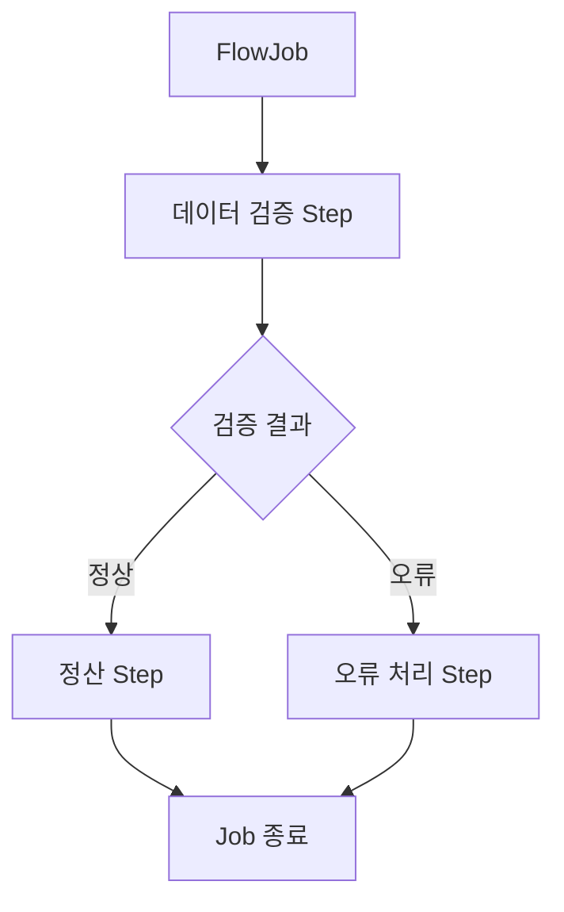

이처럼 FlowJob은 실행 결과에 따라 다음에 실행할 Step을 다르게 구성할 수 있다.

#### FlowJob은 Flow 객체를 중심으로 실행된다

SimpleJob이 Step 목록을 가지고 있었다면 FlowJob은 Flow 객체를 중심으로 실행 흐름을 관리한다.

개념적으로 다음과 같다.

```text
FlowJob
    │
    └── Flow
          │
          ├── State 1
          │
          ├── State 2
          │
          └── State 3
```

Flow에는 Step뿐 아니라 실행 상태에 따른 전이(Transition) 정보도 포함될 수 있다.

이러한 구조를 통해 Spring Batch는 조건부 실행, 분기, 병렬 흐름 등을 구성할 수 있다.

#### SimpleJob과 FlowJob 비교

| 구분       | SimpleJob         | FlowJob           |
| -------- | ----------------- | ----------------- |
| 주요 목적    | Step 순차 실행        | 실행 흐름 제어          |
| 내부 관리 대상 | Step 목록           | Flow              |
| 실행 방식    | 등록된 Step을 순서대로 실행 | 상태 및 전이 조건에 따라 실행 |
| 조건부 분기   | 기본 순차 실행 구조       | 지원                |
| 대표 활용    | 단순 정산, 데이터 정리     | 검증 결과에 따른 처리 분기   |

여기서 기억할 점은 **SimpleJob과 FlowJob이 완전히 별개의 배치 개념이 아니라 Job 인터페이스를 구현한 서로 다른 실행 전략**이라는 사실이다.

두 구현체 모두 Job으로서 실행되지만 내부적으로 작업을 처리하는 방식이 다르다.

---

### JobBuilder를 이용한 SimpleJob 구성

지금까지 Job의 개념과 구현체를 살펴봤다.

이번에는 실제로 SimpleJob을 생성해보자.

앞에서 만든 Spring Batch 프로젝트를 그대로 사용한다.

이번 예제에서는 다음과 같은 Job을 생성한다.

```text
jobDomainJob
    │
    ├── jobDomainStep1
    │      └── Step 1 executed 출력
    │
    └── jobDomainStep2
           └── Step 2 executed 출력
```

Job 하나와 Step 두 개를 구성한다.

두 Step은 각각 Tasklet 기반으로 실행된다.

#### Spring Batch 4와 5의 Job 생성 방식 차이

Spring Batch 4에서는 일반적으로 다음 클래스를 사용했다.

```java
JobBuilderFactory

StepBuilderFactory
```

예를 들어 다음과 같은 방식이었다.

```java
jobBuilderFactory.get("jobDomainJob")
        .start(step1)
        .next(step2)
        .build();
```

하지만 Spring Batch 5에서는 `JobBuilder`와 `StepBuilder`를 직접 사용하는 방식이 권장된다.

```java
new JobBuilder("jobDomainJob", jobRepository)
        .start(step1)
        .next(step2)
        .build();
```

두 방식의 목적은 같다.

Job을 구성하고 생성하는 것이다.

다만 Spring Batch 5에서는 JobRepository를 명시적으로 전달하는 구조를 사용한다.

이후 코드는 Spring Batch 5.2 기준으로 작성한다.

---

### JobDomainConfiguration 전체 코드

다음과 같이 설정 클래스를 작성한다.

```java
package com.example.batch;

import org.springframework.batch.core.Job;
import org.springframework.batch.core.Step;
import org.springframework.batch.core.job.builder.JobBuilder;
import org.springframework.batch.core.repository.JobRepository;
import org.springframework.batch.core.step.builder.StepBuilder;
import org.springframework.batch.repeat.RepeatStatus;

import org.springframework.beans.factory.annotation.Qualifier;
import org.springframework.context.annotation.Bean;
import org.springframework.context.annotation.Configuration;

import org.springframework.transaction.PlatformTransactionManager;

@Configuration
public class JobDomainConfiguration {

    @Bean
    public Job jobDomainJob(
            JobRepository jobRepository,
            @Qualifier("jobDomainStep1") Step step1,
            @Qualifier("jobDomainStep2") Step step2
    ) {

        return new JobBuilder("jobDomainJob", jobRepository)
                .start(step1)
                .next(step2)
                .build();
    }

    @Bean
    public Step jobDomainStep1(
            JobRepository jobRepository,
            PlatformTransactionManager transactionManager
    ) {

        return new StepBuilder(
                "jobDomainStep1",
                jobRepository
        )
                .tasklet((contribution, chunkContext) -> {

                    System.out.println("Step 1 executed");

                    return RepeatStatus.FINISHED;

                }, transactionManager)
                .build();
    }

    @Bean
    public Step jobDomainStep2(
            JobRepository jobRepository,
            PlatformTransactionManager transactionManager
    ) {

        return new StepBuilder(
                "jobDomainStep2",
                jobRepository
        )
                .tasklet((contribution, chunkContext) -> {

                    System.out.println("Step 2 executed");

                    return RepeatStatus.FINISHED;

                }, transactionManager)
                .build();
    }
}
```

이 코드에서 가장 중요한 부분은 Job을 생성하는 메서드다.

```java
@Bean
public Job jobDomainJob(
        JobRepository jobRepository,
        Step step1,
        Step step2
) {

    return new JobBuilder("jobDomainJob", jobRepository)
            .start(step1)
            .next(step2)
            .build();
}
```

실제 전체 코드에서는 동일한 `Step` 타입의 Bean이 두 개이므로 `@Qualifier`를 사용해 각각의 Step을 명확하게 구분했다.

이 메서드가 호출되면 Job 객체가 생성되고 Spring Bean으로 등록된다.

그런데 이때 실제로 생성되는 Job의 구현체는 무엇일까?

바로 `SimpleJob`이다.

---

### JobBuilder 내부에서는 어떤 일이 발생할까?

JobBuilder를 사용하면 개발자는 비교적 간단하게 Job을 구성할 수 있다.

```java
new JobBuilder("jobDomainJob", jobRepository)
        .start(step1)
        .next(step2)
        .build();
```

하지만 내부에서는 단순히 Job 객체 하나를 생성하는 것보다 조금 더 많은 과정이 발생한다.

#### 1. JobBuilder 생성

먼저 다음 코드가 실행된다.

```java
new JobBuilder("jobDomainJob", jobRepository)
```

Job 이름과 JobRepository를 가지고 Builder를 생성한다.

이 단계에서는 Job 설정에 필요한 기본 정보가 준비된다.

#### 2. start() 호출

다음 코드가 실행된다.

```java
.start(step1)
```

첫 번째로 실행할 Step을 지정한다.

이 과정에서 순차 실행 Job을 구성하기 위한 `SimpleJobBuilder`가 사용된다.

#### 3. next() 호출

다음 코드를 실행한다.

```java
.next(step2)
```

두 번째 Step을 실행 목록에 추가한다.

개념적으로 Builder의 상태는 다음과 같이 변경된다.

```text
SimpleJobBuilder
       │
       └── steps
             │
             ├── step1
             │
             └── step2
```

#### 4. build() 호출

마지막으로 다음 메서드를 실행한다.

```java
.build();
```

이때 지금까지 Builder에 등록한 설정을 기반으로 실제 Job 객체가 생성된다.

순차적으로 Step을 실행하는 구성에서는 `SimpleJob`이 생성된다.

Builder에서 관리하던 Step 목록도 생성된 SimpleJob에 설정된다.

전체 흐름은 다음과 같다.

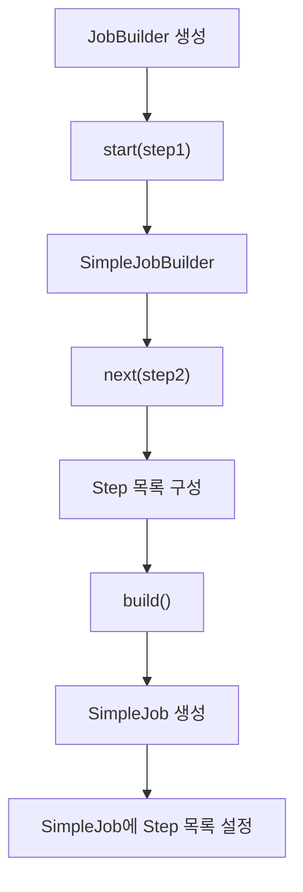

여기서 중요한 사실은 **개발자가 직접 SimpleJob을 생성하지 않아도 Builder가 적절한 Job 구현체를 생성한다는 것**이다.

또한 Builder에 등록한 Step들은 단순히 메서드 호출 과정에서 사라지는 것이 아니라 최종 Job 객체의 실행 구성으로 전달된다.

---

### 실제로 생성된 Job 구현체 확인하기

이번에는 생성된 Job이 정말 SimpleJob인지 확인해보자.

Spring Container에서 Job Bean을 주입받은 뒤 실제 클래스 정보를 출력하면 된다.

```java
package com.example.batch;

import org.springframework.batch.core.Job;
import org.springframework.batch.core.job.SimpleJob;

import org.springframework.beans.factory.annotation.Qualifier;
import org.springframework.boot.ApplicationRunner;
import org.springframework.context.annotation.Bean;
import org.springframework.context.annotation.Configuration;

@Configuration
public class JobInspectionConfiguration {

    @Bean
    public ApplicationRunner inspectJob(
            @Qualifier("jobDomainJob") Job job
    ) {

        return args -> {

            System.out.println(
                    "Job 구현체: " + job.getClass().getSimpleName()
            );

            if (job instanceof SimpleJob simpleJob) {

                System.out.println(
                        "등록된 Step: " + simpleJob.getStepNames()
                );
            }
        };
    }
}
```

실행 결과는 다음과 같은 형태다.

```text
Job 구현체: SimpleJob

등록된 Step: [jobDomainStep1, jobDomainStep2]
```

이 코드를 통해 두 가지 사실을 확인할 수 있다.

첫 번째는 JobBuilder가 생성한 실제 Job 구현체가 SimpleJob이라는 것이다.

두 번째는 SimpleJob이 등록된 Step들의 정보를 가지고 있다는 것이다.

이처럼 Job은 단순히 실행할 메서드 하나를 가지고 있는 객체가 아니라 **여러 Step의 실행 구성을 보관하는 객체**다.

---

### Job 설정과 Job 실행은 서로 다른 과정이다

Spring Batch를 처음 접할 때 가장 헷갈릴 수 있는 부분이다.

앞에서 다음 코드를 작성했다.

```java
@Bean
public Job jobDomainJob(
        JobRepository jobRepository,
        Step step1,
        Step step2
) {

    return new JobBuilder("jobDomainJob", jobRepository)
            .start(step1)
            .next(step2)
            .build();
}
```

이 코드는 Job을 생성한다.

하지만 Step 내부의 Tasklet을 실행하는 코드는 아니다.

실제 Job의 실행은 별도의 실행 요청이 발생했을 때 수행된다.

#### Job 생성 과정

```text
Spring Boot 시작
       │
       ▼
ApplicationContext 초기화
       │
       ▼
JobDomainConfiguration 처리
       │
       ▼
Step Bean 생성
       │
       ▼
Job Bean 생성
       │
       ▼
SimpleJob 구성 완료
```

이 과정은 Spring Bean을 등록하는 단계다.

Job 객체가 생성되고 실행에 필요한 Step들이 연결된다.

#### Job 실행 과정

```text
JobLauncher 실행 요청
       │
       ▼
SimpleJob 실행
       │
       ▼
Step 1 실행
       │
       ▼
Tasklet 1 실행
       │
       ▼
Step 2 실행
       │
       ▼
Tasklet 2 실행
       │
       ▼
Job 종료
```

이 과정에서 실제 비즈니스 로직이 실행된다.

두 과정을 구분하면 Spring Batch의 실행 구조를 훨씬 명확하게 이해할 수 있다.

---

### JobLauncher는 Job을 어떻게 실행할까?

Spring Batch에서 Job 실행을 요청하는 대표적인 인터페이스는 `JobLauncher`다.

Spring Batch 5.2에서는 다음 메서드를 제공한다.

```java
JobExecution run(
        Job job,
        JobParameters jobParameters
) throws JobExecutionException;
```

이 메서드는 두 개의 중요한 객체를 전달받는다.

첫 번째는 실행할 Job이다.

```java
Job job
```

두 번째는 실행에 필요한 JobParameters다.

```java
JobParameters jobParameters
```

JobParameters는 정산 기준일이나 처리 대상 등의 값을 전달하는 데 사용할 수 있다.

그리고 JobLauncher는 해당 실행에 대한 JobExecution을 반환한다.

#### JobLauncher와 Job의 관계

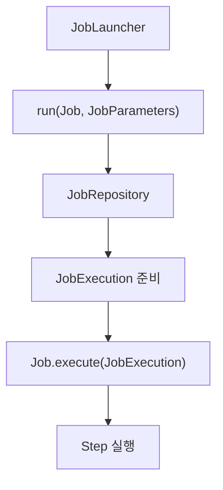

JobLauncher는 Job 실행을 위한 진입점이다.

실행 요청을 받으면 JobRepository를 통해 실행 메타데이터를 준비하고 Job의 `execute()` 메서드에 실행을 위임한다.

따라서 JobLauncher가 실제 Step의 비즈니스 로직을 직접 수행하는 것은 아니다.

JobLauncher는 Job을 실행하고, Job은 자신의 실행 흐름에 따라 Step을 실행한다.

---

### Spring Boot에서는 Job을 자동으로 실행할 수 있다

앞에서 작성한 프로젝트는 Spring Boot 기반이다.

Spring Boot에서는 배치 자동 설정이 활성화되어 있다면 애플리케이션 시작 시 등록된 Job을 자동으로 실행할 수 있다.

Spring Boot 3.4에서는 `JobLauncherApplicationRunner`가 이러한 역할을 담당한다.

```text
Spring Boot 시작
       │
       ▼
JobLauncherApplicationRunner
       │
       ▼
JobLauncher
       │
       ▼
Job 실행
```

이번 예제에서는 다음 설정을 사용할 수 있다.

```yaml
spring:
  batch:
    job:
      enabled: true
      name: jobDomainJob

    jdbc:
      initialize-schema: embedded
```

`spring.batch.job.enabled`는 애플리케이션 시작 시 Job 자동 실행 여부를 설정한다.

`spring.batch.job.name`은 자동 실행할 Job의 이름을 지정한다.

`spring.batch.jdbc.initialize-schema`는 메타데이터 테이블 초기화 방식을 지정한다.

이번에는 H2를 사용하므로 `embedded` 설정을 사용할 수 있다.

앞에서 작성했던 `helloJob`이나 `metadataJob`이 함께 등록되어 있더라도 `jobDomainJob`을 실행 대상으로 지정할 수 있다.

단, 이 자동 실행 구조는 Spring Boot의 Batch 자동 설정을 사용한다는 전제다.

일반적인 Spring Boot 3.4 프로젝트에서는 별도로 `@EnableBatchProcessing`을 선언하지 않아도 된다.

---

### SimpleJob은 Step을 어떻게 실행할까?

이번에는 Job이 실제로 Step을 실행하는 내부 구조를 살펴보자.

SimpleJob은 Step 목록을 관리한다고 했다.

예를 들어 다음과 같은 Step을 가지고 있다.

```text
SimpleJob
    │
    └── steps
          │
          ├── jobDomainStep1
          │
          └── jobDomainStep2
```

JobLauncher가 SimpleJob의 실행을 요청하면 Job은 자신의 실행 로직을 수행한다.

이 과정에서 `AbstractJob.execute()`가 먼저 실행된다.

이후 구체적인 Step 실행은 `SimpleJob.doExecute()`에서 수행된다.

#### AbstractJob.execute()

`AbstractJob`은 Job 실행에 필요한 공통 처리를 담당한다.

예를 들어 Job 실행 상태를 관리하고 Listener를 호출하며 실행 결과를 처리한다.

그다음 실제 Job 구현체의 실행 로직을 호출한다.

```text
AbstractJob.execute()
          │
          ▼
공통 실행 처리
          │
          ▼
SimpleJob.doExecute()
```

#### SimpleJob.doExecute()

`SimpleJob`은 등록된 Step을 순서대로 실행한다.

개념적으로 다음과 같은 형태다.

```java
for (Step step : steps) {

    // 현재 Step 실행
    // 실행 결과 확인
    // 실패 시 다음 Step 진행 여부 결정
}
```

실제 내부 구현은 재시작 처리와 실행 상태 관리 등을 포함하므로 더 복잡하지만, 핵심은 Step 목록을 순회하면서 각 Step의 실행을 처리한다는 것이다.

예를 들어 두 개의 Step이 있다면 다음과 같다.

```text
Step 목록
    │
    ▼
jobDomainStep1
    │
    ▼
실행 결과 확인
    │
    ▼
jobDomainStep2
    │
    ▼
실행 결과 확인
    │
    ▼
Job 종료
```

여기서 주의해야 할 점은 Step을 무조건 모두 실행하는 것은 아니라는 사실이다.

첫 번째 Step이 실패하면 이후 Step으로 진행하지 않을 수 있다.

또한 Job을 재시작하는 경우에는 이미 정상적으로 완료된 Step을 다시 실행하지 않고 건너뛸 수 있다.

따라서 SimpleJob은 단순히 `for` 문으로 Step을 호출하는 객체라고 이해하기보다 **Step 목록을 기반으로 실행 순서와 진행 여부를 관리하는 Job 구현체**라고 이해하는 것이 정확하다.

---

### SimpleStepHandler의 역할

SimpleJob이 Step을 실행할 때 중요한 역할을 담당하는 클래스가 있다.

바로 `SimpleStepHandler`다.

SimpleJob은 Step을 직접 실행하는 대신 Step 실행을 처리하는 핸들러를 통해 실행을 위임할 수 있다.

전체적인 흐름은 다음과 같다.

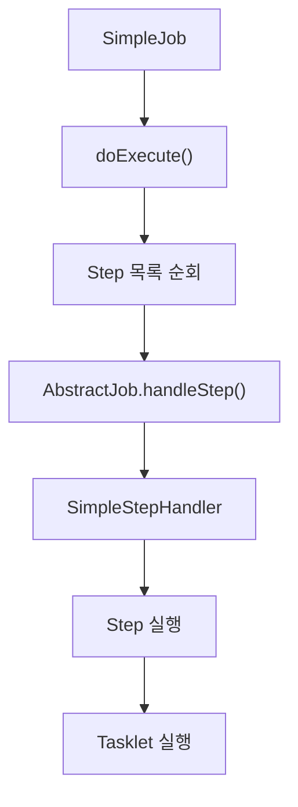

여기서 각 객체의 역할을 구분해야 한다.

| 구성 요소               | 역할                        |
| ------------------- | ------------------------- |
| `SimpleJob`         | Step 실행 순서 관리             |
| `AbstractJob`       | Job 공통 실행 처리 및 Step 실행 위임 |
| `SimpleStepHandler` | Step 실행과 관련된 공통 처리        |
| `Step`              | 실제 Step 실행 단위             |
| `Tasklet`           | 비즈니스 로직 수행                |

Step 실행 과정에서는 새로운 `StepExecution`을 준비하거나 이전 실행 상태를 확인하는 등의 처리가 필요할 수 있다.

또한 실행 상태에 따라 Step을 새로 실행할지, 재시작할지, 건너뛸지 판단해야 하는 경우도 있다.

이처럼 Step을 실행하는 과정에는 단순한 메서드 호출 이상의 관리 기능이 필요하다.

Spring Batch는 이러한 기능을 별도의 실행 처리 구조로 분리해두었다.

따라서 Job은 전체 실행 흐름에 집중하고, Step 실행과 관련된 세부적인 처리는 다른 구성 요소에 위임할 수 있다.

---

### Job 실행의 전체 내부 흐름

지금까지 살펴본 구조를 하나로 연결해보자.

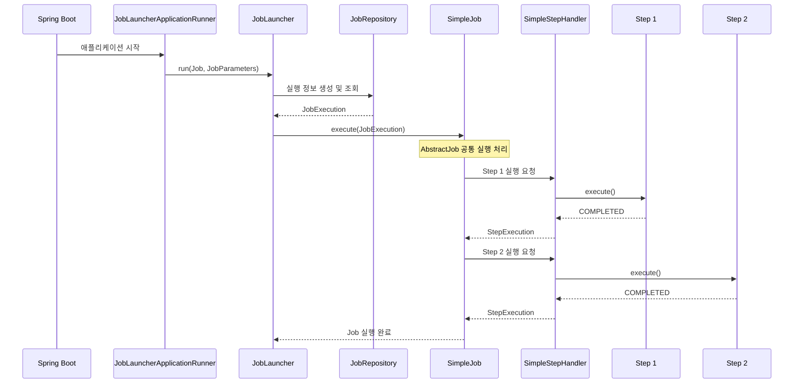

이 그림에서 가장 중요한 것은 실행 책임이 단계별로 분리되어 있다는 것이다.

Spring Boot는 자동 실행을 요청할 수 있다.

JobLauncher는 Job 실행을 시작한다.

JobRepository는 실행 메타데이터를 관리한다.

SimpleJob은 Step의 실행 순서를 관리한다.

SimpleStepHandler는 각 Step의 실행을 처리한다.

Step은 자신에게 정의된 Tasklet 또는 Chunk 처리 로직을 수행한다.

이러한 구조를 통해 Spring Batch는 공통적인 실행 관리 기능과 실제 비즈니스 로직을 분리한다.

---

### 실제 실행 결과 확인하기

앞에서 작성한 `JobDomainConfiguration`을 실행해보자.

프로젝트에서 H2를 사용하고 있다면 다음 명령어를 실행할 수 있다.

```bash
./mvnw spring-boot:run
```

실행 결과는 다음과 같은 형태다.

```text
Job: [SimpleJob: [name=jobDomainJob]]
launched with the following parameters: [{}]

Executing step: [jobDomainStep1]

Step 1 executed

Step: [jobDomainStep1] executed

Executing step: [jobDomainStep2]

Step 2 executed

Step: [jobDomainStep2] executed

Job: [SimpleJob: [name=jobDomainJob]]
completed with status: [COMPLETED]
```

위 출력은 중요한 부분을 중심으로 정리한 예시다.

실제 로그에는 실행 시각, 스레드 이름, 로거 이름 등의 정보가 함께 표시된다.

#### SimpleJob 확인

다음 로그를 살펴보자.

```text
SimpleJob: [name=jobDomainJob]
```

이 로그는 `jobDomainJob`이 SimpleJob 구현체로 구성되었음을 보여준다.

우리가 직접 `new SimpleJob()`을 호출하지 않았더라도 JobBuilder를 통해 SimpleJob 객체가 생성된 것이다.

#### 첫 번째 Step 실행

다음 로그를 보자.

```text
Executing step: [jobDomainStep1]
```

그리고 첫 번째 Tasklet에서 작성한 문구가 출력된다.

```text
Step 1 executed
```

#### 두 번째 Step 실행

첫 번째 Step이 정상적으로 완료되면 두 번째 Step이 실행된다.

```text
Executing step: [jobDomainStep2]
```

두 번째 Tasklet에서 다음 내용이 출력된다.

```text
Step 2 executed
```

#### Job 완료

모든 Step이 정상적으로 완료되면 Job도 완료된다.

```text
completed with status: [COMPLETED]
```

따라서 실제 실행 결과를 통해 SimpleJob이 등록된 Step을 순서대로 실행한다는 사실을 확인할 수 있다.

---

### 디버깅으로 Job 실행 구조 확인하기

Spring Batch의 내부 구조를 조금 더 깊이 이해하고 싶다면 디버깅을 활용하는 것이 좋다.

단순히 로그를 보는 것보다 실제 객체가 생성되는 시점과 메서드가 호출되는 순서를 확인할 수 있기 때문이다.

#### 확인하면 좋은 클래스와 메서드

| 클래스                 | 확인할 메서드                              | 확인할 내용                     |
| ------------------- | ------------------------------------ | -------------------------- |
| `SimpleJobBuilder`  | `start()`, `next()`, `build()` 관련 흐름 | Step 목록 구성 및 SimpleJob 생성  |
| `AbstractJob`       | `execute()`                          | Job 공통 실행 처리               |
| `SimpleJob`         | `doExecute()`                        | Step 목록 순회                 |
| `AbstractJob`       | `handleStep()`                       | Step 실행 위임                 |
| `SimpleStepHandler` | `handleStep()`                       | StepExecution 처리 및 Step 실행 |
| `TaskletStep`       | `doExecute()`                        | Tasklet 기반 Step 실행         |
| `Tasklet`           | `execute()`                          | 실제 비즈니스 로직                 |

IDE에서 이러한 메서드에 브레이크포인트를 설정하고 애플리케이션을 실행하면 다음 두 과정을 구분해서 볼 수 있다.

첫 번째는 Job 객체를 구성하는 과정이다.

```text
JobBuilder
    │
    ▼
SimpleJobBuilder
    │
    ▼
SimpleJob 생성
    │
    ▼
Step 목록 설정
```

두 번째는 구성된 Job을 실제로 실행하는 과정이다.

```text
JobLauncher
    │
    ▼
AbstractJob.execute()
    │
    ▼
SimpleJob.doExecute()
    │
    ▼
SimpleStepHandler
    │
    ▼
Step
    │
    ▼
Tasklet
```

이 두 과정을 각각 확인하면 Spring Batch가 객체를 구성하는 방식과 실행하는 방식이 어떻게 분리되어 있는지 이해할 수 있다.

---

### Job과 JobInstance, JobExecution의 차이

Spring Batch의 Job을 이해할 때 반드시 함께 구분해야 하는 객체들이 있다.

바로 `Job`, `JobInstance`, `JobExecution`이다.

이 세 객체는 이름이 비슷하지만 서로 다른 역할을 담당한다.

#### Job

Job은 배치 작업의 정의다.

```text
settlementJob
```

어떤 Step으로 구성되는지, 어떤 순서로 실행되는지 등의 설정이 포함된다.

#### JobInstance

JobInstance는 Job 이름과 식별용 JobParameters를 기준으로 구분되는 논리적인 실행 단위다.

예를 들어 다음과 같다.

```text
settlementJob
businessDate=2026-10-15
```

같은 Job이라도 식별용 파라미터가 달라지면 새로운 JobInstance가 생성될 수 있다.

#### JobExecution

JobExecution은 JobInstance의 실제 실행 시도다.

예를 들어 다음과 같다.

```text
JobInstance 1
    │
    ├── JobExecution 1
    │      └── FAILED
    │
    └── JobExecution 2
           └── COMPLETED
```

같은 JobInstance라도 실패 후 재시작하면 새로운 JobExecution이 생성될 수 있다.

따라서 전체 관계는 다음과 같다.

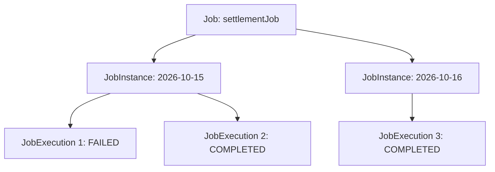

세 객체를 비교하면 다음과 같다.

| 구분     | Job          | JobInstance                | JobExecution    |
| ------ | ------------ | -------------------------- | --------------- |
| 의미     | 배치 작업 정의     | 논리적인 실행 단위                 | 실제 실행 시도        |
| 생성 시점  | Spring 설정 과정 | 새로운 식별용 파라미터 조합으로 실행 시     | 실행 시도마다         |
| 식별 기준  | Job 이름       | Job 이름 + 식별용 JobParameters | JobExecution ID |
| 역할     | 실행 흐름 구성     | 작업 실행 대상 구분                | 실행 상태 관리        |
| 재시작 관계 | 재시작 가능 여부 설정 | 동일 인스턴스 재사용 가능             | 새로운 실행 기록 생성    |

**Job은 무엇을 실행할 것인지 정의하고, JobInstance는 어떤 논리적 작업인지 구분하며, JobExecution은 실제 실행 결과를 기록한다.**

이 세 개념을 구분하면 이후 재시작이나 JobRepository의 메타데이터 구조를 이해하기 쉬워진다.

---

### 실무에서 Job을 어떻게 설계해야 할까?

지금까지는 Job의 개념과 내부 구조를 살펴봤다.

하지만 실제 백엔드 시스템에서는 Job을 어떤 기준으로 나누고 구성할지도 중요하다.

#### 하나의 Job은 명확한 업무 목적을 가져야 한다

예를 들어 다음과 같은 작업이 있다고 생각해보자.

```text
결제 정산

쿠폰 만료

일별 통계 생성

외부 물류 데이터 동기화
```

이 작업들은 서로 다른 업무 목적을 가지고 있다.

따라서 하나의 Job 안에 모든 작업을 넣기보다는 목적에 따라 Job을 분리하는 것이 적절할 수 있다.

```text
SettlementJob

CouponExpireJob

DailyStatisticsJob

LogisticsSyncJob
```

이렇게 분리하면 각 Job의 실행 시점과 실패 처리 정책을 독립적으로 관리하기 쉽다.

또한 특정 Job이 실패했을 때 다른 Job에 불필요한 영향을 주지 않도록 설계할 수 있다.

#### Step은 독립적으로 관리할 필요가 있는 단위로 분리한다

Job 안에 여러 Step을 정의할 수 있다고 해서 모든 메서드를 Step으로 분리하는 것은 적절하지 않다.

예를 들어 정산 계산을 수행하는 서비스 내부에 다음 메서드가 있다고 생각해보자.

```java
calculateFee();

calculateTax();

calculateAmount();
```

이 세 메서드가 반드시 각각의 Step이 되어야 하는 것은 아니다.

같은 트랜잭션 범위에서 하나의 비즈니스 처리를 구성한다면 하나의 Step 안에서 처리하는 편이 자연스러울 수 있다.

반면 다음 작업들은 별도의 Step으로 분리할 가치가 있다.

```text
정산 대상 확정
      │
      ▼
정산 데이터 생성
      │
      ▼
정산 결과 검증
      │
      ▼
외부 시스템 전송
```

각 단계가 독립적인 실행 상태와 실패 처리 정책을 가질 수 있기 때문이다.

따라서 Step을 나누는 기준은 메서드의 개수가 아니라 **독립적인 실행·트랜잭션·재시작 관리가 필요한가**에 두는 것이 좋다.

#### SimpleJob으로 충분한지 먼저 판단한다

배치 작업을 설계할 때 처음부터 복잡한 FlowJob을 구성할 필요는 없다.

예를 들어 모든 작업이 정해진 순서대로 실행된다면 SimpleJob으로 충분하다.

```text
Step 1 → Step 2 → Step 3
```

반면 다음과 같이 분기가 필요하다면 FlowJob을 고려할 수 있다.

```text
Step 1
   │
   ▼
실행 결과 확인
   │
   ├── 정상 → Step 2
   │
   └── 오류 → Step 3
```

중요한 것은 기능이 많은 구현체를 선택하는 것이 아니라 요구사항에 적합한 실행 구조를 선택하는 것이다.

단순한 순차 실행이라면 SimpleJob이 오히려 이해하기 쉽고 유지보수하기 편리할 수 있다.

#### 재시작 시 데이터 정합성을 고려한다

Spring Batch는 Job의 재시작을 지원한다.

하지만 재시작 기능이 비즈니스 데이터의 중복 처리를 자동으로 방지하는 것은 아니다.

예를 들어 정산 결과를 저장한 뒤 서버 장애가 발생했다고 생각해보자.

```text
정산 데이터 저장
       │
       ▼
외부 시스템 전송
       │
       ▼
서버 장애
```

배치를 다시 실행할 때 이전에 저장했던 정산 데이터를 중복 저장하거나 외부 시스템에 같은 요청을 다시 전송할 수 있다.

따라서 재시작 가능한 Job을 설계할 때는 멱등성을 함께 고려해야 한다.

예를 들어 정산 기간과 결제 ID를 조합한 유니크 제약을 활용하거나, 외부 API에 멱등성 키를 전달하는 방법을 고려할 수 있다.

Spring Batch는 실행을 관리하는 기반을 제공하지만 실제 비즈니스 데이터의 정합성은 개발자가 함께 설계해야 한다.

---

### 정리

Spring Batch에서 `Job`은 배치 작업을 구성하는 최상위 도메인 객체다.

Job은 어떤 Step을 어떤 순서로 실행할지 정의하는 **배치 작업의 설계도이자 실행 흐름을 관리하는 객체**다.

Spring Batch는 Job을 정의하기 위한 인터페이스를 제공하고, 기본 구현체로 `SimpleJob`과 `FlowJob`을 제공한다.

SimpleJob은 등록된 Step을 순차적으로 실행한다.

FlowJob은 Flow에 정의된 실행 상태와 전이 조건에 따라 Step을 실행한다.

두 구현체는 모두 `AbstractJob`을 상속하며, AbstractJob은 실행 상태 관리, Listener 호출, JobRepository 연동 등의 공통적인 실행 기능을 담당한다.

각 객체의 관계를 정리하면 다음과 같다.

```text
Job
 │
 ▼
AbstractJob
 │
 ├── SimpleJob
 │      │
 │      └── Step 목록 관리
 │
 └── FlowJob
        │
        └── Flow 관리
```

Job 실행 과정에서는 JobLauncher가 중요한 역할을 담당한다.

```text
JobLauncher
      │
      ▼
Job.execute()
      │
      ▼
AbstractJob.execute()
      │
      ▼
SimpleJob.doExecute()
      │
      ▼
SimpleStepHandler
      │
      ▼
Step.execute()
      │
      ▼
Tasklet.execute()
```

이러한 구조를 통해 Spring Batch는 Job의 실행 흐름과 Step의 실제 처리 로직을 구분한다.

또한 Job과 JobInstance, JobExecution은 서로 다른 개념이다.

Job은 배치 작업의 정의이며, JobInstance는 식별용 JobParameters를 기준으로 구분되는 논리적 실행 단위다. JobExecution은 실제 실행 시도를 나타낸다.

이러한 관계를 이해하면 JobRepository가 실행 메타데이터를 관리하는 방식과 배치가 실패했을 때 재시작하는 원리도 자연스럽게 연결된다.

실무에서는 Job을 구성할 때 다음 세 가지 관점이 중요하다.

첫째, Job은 하나의 명확한 비즈니스 목적을 가져야 한다.

둘째, Step은 독립적인 실행과 실패 관리가 필요한 기준으로 구분해야 한다.

셋째, Job의 재시작 가능성과 비즈니스 데이터의 멱등성을 함께 고려해야 한다.

결국 Spring Batch의 Job은 단순히 여러 Step을 묶어놓은 객체가 아니다.

**실행할 작업의 전체 구조를 정의하고, 실행 흐름을 제어하며, Spring Batch가 제공하는 실행 관리 기능과 실제 비즈니스 로직을 연결하는 핵심 도메인 객체**다.

#### 한 줄 요약

> Spring Batch의 `Job`은 배치 작업 전체를 정의하는 최상위 도메인 객체이며, `AbstractJob`이 공통 실행 기능을 담당하고 `SimpleJob`과 `FlowJob`이 각각 순차 실행과 조건부 실행을 구현한다. JobLauncher가 Job의 실행을 요청하면 Job은 내부 실행 구조에 따라 Step을 실행하고, Step은 Tasklet 또는 Chunk 기반 비즈니스 로직을 수행한다.

## JobInstance

### Spring Batch JobInstance 이해: Job과 JobInstance의 차이부터 생성 원리 및 중복 실행 방지까지

Spring Batch에서 배치 작업을 개발할 때 가장 먼저 정의하는 객체는 `Job`이다.

Job은 하나의 배치 작업 전체를 나타내며, 여러 Step을 구성하고 실행 순서를 정의하는 역할을 담당한다.

그런데 실제 배치 작업을 실행하면 Spring Batch는 Job 외에도 여러 도메인 객체를 생성한다.

대표적으로 다음과 같은 객체가 있다.

* `JobInstance`
* `JobExecution`
* `JobParameters`
* `StepExecution`
* `ExecutionContext`

이 객체들은 Job이 실행되는 과정에서 서로 다른 역할을 담당한다.

예를 들어 매일 새벽 2시에 실행되는 정산 배치를 생각해보자.

```text
정산 Job
   │
   ├── 2026-10-15 정산
   │
   ├── 2026-10-16 정산
   │
   └── 2026-10-17 정산
```

위 작업은 모두 동일한 정산 Job을 실행한 것이다.

하지만 처리하는 데이터는 서로 다르다.

10월 15일에는 10월 15일에 해당하는 정산 데이터를 처리하고, 10월 16일에는 10월 16일에 해당하는 데이터를 처리한다.

Job의 설정과 구성은 동일하지만 **실행 대상이 다르기 때문에 각각의 작업을 구분할 필요가 있다.**

Spring Batch에서는 이러한 논리적인 실행 단위를 `JobInstance`라고 한다.

이번에는 JobInstance의 개념과 역할, JobParameters를 이용한 식별 방법, JobRepository의 생성 과정, 그리고 동일한 Job을 다시 실행할 때 발생하는 동작까지 자세히 살펴보자.

**개발 환경**

| 항목           | 기술                     |
| ------------ | ---------------------- |
| Java         | Java 17                |
| Spring Boot  | 3.4.13                 |
| Spring Batch | 5.2.4                  |
| Build Tool   | Maven                  |
| Database     | MySQL 8.4              |
| Job 실행 방식    | JobLauncher를 이용한 수동 실행 |

---

### Spring Batch 도메인 객체의 역할 구분

Spring Batch의 도메인 객체를 이해할 때는 먼저 객체들이 어떤 목적으로 존재하는지 구분하는 것이 좋다.

Spring Batch의 주요 도메인 객체는 크게 두 가지 관점으로 이해할 수 있다.

첫 번째는 **배치 작업을 정의하고 실행하는 객체**다.

두 번째는 **배치 실행 과정에서 발생하는 상태와 실행 정보를 관리하는 객체**다.

#### 배치 작업을 정의하고 실행하는 객체

대표적으로 다음과 같은 객체들이 있다.

| 객체        | 역할                   |
| --------- | -------------------- |
| `Job`     | 배치 작업 전체를 정의하고 실행    |
| `Step`    | Job을 구성하는 개별 실행 단계   |
| `Flow`    | 조건과 실행 결과에 따른 흐름 관리  |
| `Tasklet` | Step에서 실제 비즈니스 로직 수행 |

예를 들어 다음과 같은 정산 Job이 있다고 생각해보자.

```text
SettlementJob
      │
      ▼
PrepareStep
      │
      ▼
CalculateStep
      │
      ▼
SaveStep
```

Job은 작업 전체의 실행 흐름을 관리한다.

Step은 실제 작업 단위를 나타낸다.

Tasklet 또는 Chunk 기반 처리 구조는 각 Step에서 비즈니스 로직을 수행한다.

이러한 객체들은 개발자가 Spring 설정을 통해 정의하고 구성한다.

```java
@Bean
public Job settlementJob(
        JobRepository jobRepository,
        Step prepareStep,
        Step calculateStep
) {
    return new JobBuilder("settlementJob", jobRepository)
            .start(prepareStep)
            .next(calculateStep)
            .build();
}
```

위 코드는 Job을 정의하는 코드다.

이 과정에서 Spring Batch는 배치 작업을 실행하기 위한 Job 객체를 생성한다.

하지만 아직 실제 배치 작업이 실행된 것은 아니다.

#### 실행 상태와 메타데이터를 관리하는 객체

두 번째는 Job이 실제로 실행되는 과정에서 생성되거나 사용되는 객체들이다.

대표적으로 다음과 같다.

| 객체                 | 역할                          |
| ------------------ | --------------------------- |
| `JobInstance`      | 논리적인 Job 실행 단위 식별           |
| `JobExecution`     | Job의 개별 실행 시도 관리            |
| `StepExecution`    | Step의 개별 실행 상태 관리           |
| `JobParameters`    | 실행 파라미터 전달 및 JobInstance 식별 |
| `ExecutionContext` | 실행 상태 및 재시작 정보 관리           |

이 객체들은 실행 메타데이터와 밀접하게 연결되어 있다.

예를 들어 Job이 실행되면 Spring Batch는 JobInstance를 조회하거나 생성하고, 해당 실행에 대한 JobExecution을 생성한다.

그리고 Step이 실행될 때는 StepExecution을 생성한다.

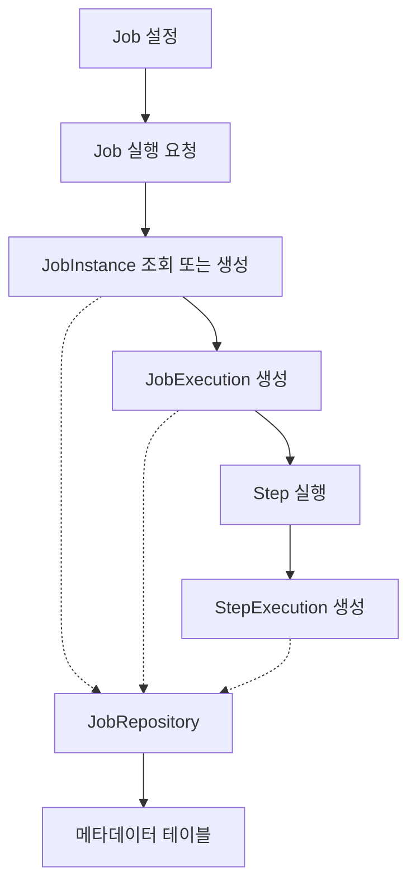

여기서 중요한 것은 **Job 객체와 JobInstance 객체는 서로 다른 개념**이라는 점이다.

Job은 실행할 작업을 정의한다.

반면 JobInstance는 특정 파라미터로 식별되는 논리적인 작업 단위를 나타낸다.

이 차이를 이해하면 Spring Batch의 실행 구조를 훨씬 명확하게 이해할 수 있다.

---

### JobInstance란 무엇인가?

`JobInstance`는 Spring Batch에서 하나의 Job을 논리적으로 식별하기 위한 도메인 객체다.

Spring Batch는 동일한 Job이라도 서로 다른 조건으로 실행할 수 있도록 지원한다.

예를 들어 매일 정산하는 Job이 있다고 생각해보자.

```text
Job 이름: dailySettlementJob
```

이 Job은 매일 실행되지만 정산 기준일은 달라진다.

```text
2026-10-15 정산

2026-10-16 정산

2026-10-17 정산
```

이때 각 정산 작업은 동일한 Job 설정을 사용한다.

하지만 서로 다른 정산일을 처리하기 때문에 별개의 논리적인 실행 단위로 구분해야 한다.

Spring Batch에서는 이를 JobInstance로 표현한다.

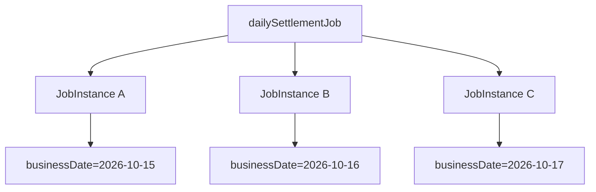

Job 정의는 하나지만 JobInstance는 여러 개가 생성될 수 있다.

즉 다음과 같은 관계가 성립한다.

```text
Job
 │
 │ 1:N
 ▼
JobInstance
```

다만 여기서 주의할 점이 있다.

**JobInstance는 Job이 실행될 때마다 무조건 새롭게 생성되는 객체가 아니다.**

Spring Batch는 실행하려는 Job과 JobParameters를 기준으로 기존 JobInstance가 존재하는지 확인한다.

이미 동일한 JobInstance가 존재한다면 새로운 JobInstance를 생성하지 않는다.

이러한 동작이 Spring Batch의 중복 실행 방지와 재시작 기능의 기반이 된다.

---

### JobInstance를 식별하는 기준

Spring Batch에서 JobInstance를 이해하기 위해 반드시 알아야 하는 공식이 있다.

**JobInstance = Job 이름 + 식별용 JobParameters**

이 공식은 Spring Batch의 논리적인 실행 단위를 정의하는 핵심 규칙이다.

예를 들어 다음과 같은 Job을 구성했다고 생각해보자.

```java
new JobBuilder("dailySettlementJob", jobRepository)
```

Job 이름은 다음과 같다.

```text
dailySettlementJob
```

그리고 Job을 실행할 때 다음 파라미터를 전달한다.

```text
businessDate=2026-10-15
```

이때 `businessDate`가 식별용 파라미터라면 Spring Batch는 두 정보를 이용해 JobInstance를 식별한다.

```text
Job Name
    │
    ▼
dailySettlementJob

JobParameters
    │
    ▼
businessDate=2026-10-15

       │
       ▼

JobInstance A
```

다음날 정산 기준일을 변경하면 어떻게 될까?

```text
businessDate=2026-10-16
```

식별용 JobParameters가 변경되었으므로 새로운 JobInstance가 생성된다.

```text
Job Name
    │
    ▼
dailySettlementJob

JobParameters
    │
    ▼
businessDate=2026-10-16

       │
       ▼

JobInstance B
```

두 Job은 같은 Job 정의를 사용하지만 서로 다른 JobInstance에 해당한다.

#### JobInstance 식별 예제

| Job 이름             | 식별용 JobParameters       | JobInstance |
| ------------------ | ----------------------- | ----------- |
| dailySettlementJob | businessDate=2026-10-15 | A           |
| dailySettlementJob | businessDate=2026-10-16 | B           |
| dailySettlementJob | businessDate=2026-10-17 | C           |
| dailySettlementJob | businessDate=2026-10-15 | A           |

마지막 행을 살펴보자.

이미 실행했던 `businessDate=2026-10-15`를 다시 전달했다.

이 경우 새로운 JobInstance D를 생성하는 것이 아니라 기존 JobInstance A를 식별한다.

따라서 **동일한 Job 이름과 동일한 식별용 JobParameters는 같은 JobInstance를 나타낸다.**

이것이 Spring Batch의 기본적인 식별 규칙이다.

---

### JobParameters란?

JobParameters는 Job을 실행할 때 전달하는 파라미터다.

일반적인 메서드의 매개변수와 비슷한 역할을 한다고 생각할 수 있다.

예를 들어 다음과 같은 정산 작업이 있다고 해보자.

```java
public void calculateSettlement(String businessDate) {
    // 정산 처리
}
```

`businessDate`는 정산 기준일이다.

호출할 때마다 다른 값을 전달할 수 있다.

```java
calculateSettlement("2026-10-15");

calculateSettlement("2026-10-16");
```

Spring Batch에서도 비슷하게 JobParameters를 이용해 실행에 필요한 정보를 전달한다.

다만 JobParameters는 일반적인 매개변수보다 중요한 역할을 하나 더 담당한다.

바로 **JobInstance를 식별하는 데 사용될 수 있다는 것**이다.

#### JobParametersBuilder

Spring Batch는 JobParameters를 생성하기 위한 `JobParametersBuilder`를 제공한다.

예를 들어 다음과 같이 사용할 수 있다.

```java
JobParameters parameters =
        new JobParametersBuilder()
                .addString("businessDate", "2026-10-15")
                .toJobParameters();
```

여기서 다음 코드는

```java
.addString("businessDate", "2026-10-15")
```

문자열 타입의 파라미터를 추가한다.

그리고 다음 메서드는

```java
.toJobParameters();
```

구성한 파라미터를 JobParameters 객체로 변환한다.

이렇게 생성한 객체를 JobLauncher에 전달할 수 있다.

```java
jobLauncher.run(
        settlementJob,
        parameters
);
```

이때 Spring Batch는 Job 이름과 식별용 JobParameters를 이용해 JobInstance를 조회하거나 생성한다.

#### 모든 JobParameters가 식별에 사용되는 것은 아니다

JobParameters에는 식별 여부를 설정할 수 있다.

예를 들어 다음과 같다.

```java
JobParameters parameters =
        new JobParametersBuilder()
                .addString(
                        "businessDate",
                        "2026-10-15",
                        true
                )
                .addString(
                        "requestId",
                        "request-001",
                        false
                )
                .toJobParameters();
```

여기서 세 번째 인자는 식별 여부다.

| 파라미터         | 값           | 식별 여부 |
| ------------ | ----------- | ----- |
| businessDate | 2026-10-15  | true  |
| requestId    | request-001 | false |

`businessDate`는 JobInstance를 식별하는 데 사용한다.

반면 `requestId`는 실행 추적을 위한 정보이므로 식별에 사용하지 않도록 설정했다.

따라서 다음 두 파라미터 조합은 동일한 JobInstance를 나타낸다.

```text
첫 번째 실행

businessDate=2026-10-15
requestId=request-001
```

```text
두 번째 실행

businessDate=2026-10-15
requestId=request-002
```

`requestId`는 변경되었지만 식별용 파라미터인 `businessDate`가 같기 때문이다.

이러한 기능은 JobInstance를 업무 기준으로 식별하면서 실행마다 달라질 수 있는 부가적인 정보를 함께 전달해야 할 때 유용하다.

---

### JobInstance가 생성되는 과정

이제 JobInstance가 실제로 어떻게 생성되는지 살펴보자.

Spring Batch에서 Job을 실행할 때는 `JobLauncher`를 사용할 수 있다.

Spring Batch 5.2의 JobLauncher는 다음과 같은 메서드를 제공한다.

```java
JobExecution run(
        Job job,
        JobParameters jobParameters
) throws JobExecutionException;
```

두 가지 객체를 전달받는다.

첫 번째는 실행할 Job이다.

두 번째는 JobParameters다.

JobLauncher는 이 정보를 이용해 Job 실행을 요청한다.

이 과정에서 JobRepository가 중요한 역할을 한다.

#### JobRepository의 역할

JobRepository는 Job과 Step의 실행 메타데이터를 관리하는 객체다.

JobLauncher가 실행을 요청하면 JobRepository는 해당 JobInstance가 이미 존재하는지 확인한다.

여기서 기준이 되는 것은 다음 두 값이다.

```text
Job 이름

식별용 JobParameters
```

Spring Batch의 JDBC 기반 저장소에서는 이 정보를 이용해 데이터베이스에 저장된 기존 JobInstance를 조회한다.

존재하지 않는다면 새로운 JobInstance를 생성한다.

존재한다면 기존 JobInstance를 사용해 실행 가능 여부를 판단한다.

전체 흐름을 살펴보자.

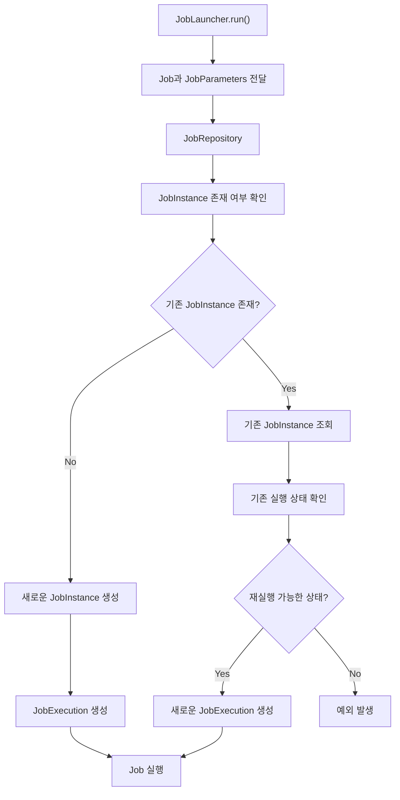

이 구조에서 중요한 점은 **기존 JobInstance가 있다는 사실만으로 무조건 실행이 실패하는 것은 아니라는 것**이다.

기존 JobInstance가 어떤 상태인지에 따라 동작이 달라진다.

이 부분은 반드시 정확하게 이해해야 한다.

---

### 동일한 Job과 JobParameters로 실행하면 어떻게 될까?

Spring Batch에서는 같은 Job 이름과 같은 식별용 JobParameters를 전달하면 기존 JobInstance를 식별한다.

하지만 이후 동작은 JobInstance의 실행 상태에 따라 달라진다.

대표적으로 세 가지 상황을 생각할 수 있다.

#### 첫 번째: 아직 실행한 적이 없는 JobInstance

다음과 같은 Job을 처음 실행한다고 생각해보자.

```text
Job Name: dailySettlementJob

JobParameters:
businessDate=2026-10-15
```

아직 해당 JobInstance가 존재하지 않는다.

따라서 Spring Batch는 새로운 JobInstance를 생성한다.

```text
JobInstance 1
      │
      ▼
JobExecution 1
      │
      ▼
COMPLETED
```

JobInstance와 JobExecution이 각각 생성된다.

#### 두 번째: 이미 정상적으로 완료된 JobInstance

이번에는 동일한 Job 이름과 파라미터로 다시 실행한다고 생각해보자.

```text
Job Name: dailySettlementJob

JobParameters:
businessDate=2026-10-15
```

이미 해당 JobInstance가 존재하며 마지막 실행이 `COMPLETED` 상태다.

이 경우 Spring Batch는 새로운 JobInstance를 생성하지 않는다.

그리고 이미 완료된 JobInstance에 대한 중복 실행을 허용하지 않는다.

대표적으로 다음 예외가 발생한다.

```text
JobInstanceAlreadyCompleteException
```

예외 메시지는 다음과 같은 형태다.

```text
A job instance already exists and is complete
for identifying parameters=...
```

즉 같은 논리적 작업이 이미 성공적으로 완료되었기 때문에 다시 실행하지 않는 것이다.

#### 세 번째: 이전 실행이 실패한 JobInstance

이번에는 첫 번째 실행이 실패했다고 생각해보자.

```text
JobInstance 1
      │
      ▼
JobExecution 1
      │
      ▼
FAILED
```

이 상태에서 동일한 Job 이름과 식별용 JobParameters로 다시 실행한다면 어떻게 될까?

Spring Batch는 기존 JobInstance를 식별한다.

하지만 이전 실행이 실패했기 때문에 재시작 가능한 Job이라면 새로운 JobExecution을 생성해 실행할 수 있다.

```text
JobInstance 1
      │
      ├── JobExecution 1
      │       │
      │       ▼
      │     FAILED
      │
      └── JobExecution 2
              │
              ▼
           COMPLETED
```

JobInstance는 하나다.

반면 JobExecution은 두 개다.

이것이 Spring Batch의 재시작 기능이 동작하는 기본 구조다.

따라서 동일한 Job과 JobParameters로 실행한다고 해서 항상 오류가 발생하는 것은 아니다.

**이미 완료된 작업은 중복 실행을 차단하지만, 실패한 작업은 재시작 조건을 만족하면 같은 JobInstance에서 다시 실행할 수 있다.**

Spring Batch의 JobRepository도 기존 JobInstance가 존재할 때 마지막 실행 상태와 재시작 가능 여부를 확인하도록 설계되어 있다. ([Home][1])

#### 실행 상태별 동작 비교

| 기존 상태           | 새로운 JobInstance 생성 | 새로운 JobExecution 생성 | 결과                  |
| --------------- | ------------------ | ------------------- | ------------------- |
| 실행 이력 없음        | O                  | O                   | 새로운 작업 실행           |
| COMPLETED       | X                  | X                   | 중복 실행 예외            |
| FAILED          | X                  | O                   | 재시작 가능 시 실행         |
| STOPPED         | X                  | O                   | 재시작 가능 시 실행         |
| STARTED         | X                  | X                   | 이미 실행 중이라는 예외       |
| 재시작 불가능한 실패 Job | X                  | X                   | JobRestartException |

이 표를 이해하면 JobInstance가 단순히 중복 실행을 막기 위한 객체가 아니라 **논리적인 작업 식별과 재시작을 위한 객체**라는 사실을 알 수 있다.

---

### JobInstance와 JobExecution의 관계

앞에서 JobInstance는 논리적인 실행 단위라고 설명했다.

반면 JobExecution은 실제 실행 시도를 나타낸다.

예를 들어 매일 실행하는 정산 Job이 있다고 생각해보자.

```text
dailySettlementJob
```

10월 15일 정산은 처음 실행했지만 실패했다.

이후 같은 날 정산을 재시작하여 정상적으로 완료했다.

10월 16일 정산은 한 번에 성공했다.

이를 표현하면 다음과 같다.

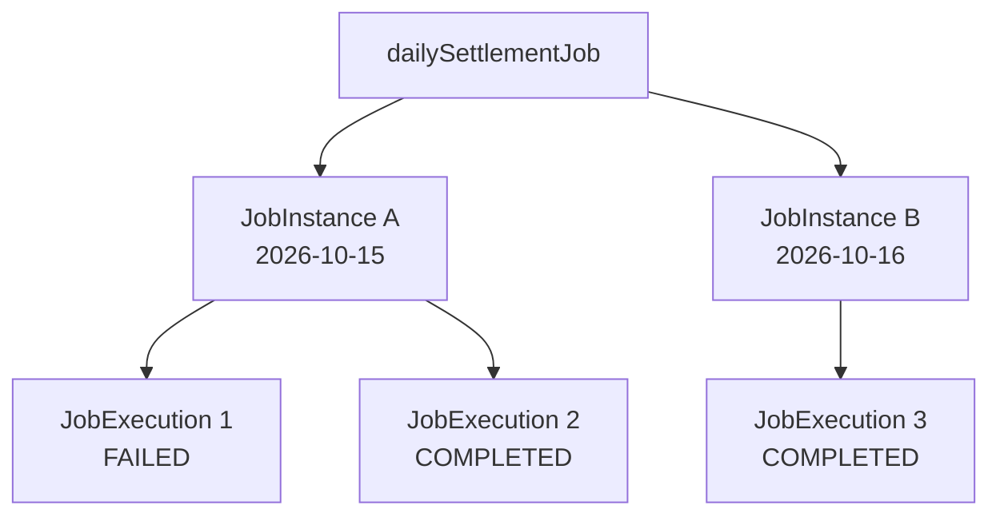

Job 정의는 하나다.

JobInstance는 날짜별로 두 개다.

JobExecution은 실행 시도에 따라 세 개다.

이러한 구조를 이용하면 Spring Batch는 어떤 논리적인 작업이 몇 번 실행되었으며 최종적으로 어떤 상태로 종료되었는지 관리할 수 있다.

---

### BATCH_JOB_INSTANCE 테이블

Spring Batch는 JobInstance의 정보를 `BATCH_JOB_INSTANCE` 테이블에 저장한다.

Spring Batch 5.2.4의 MySQL 스키마는 다음과 같다.

```sql
CREATE TABLE BATCH_JOB_INSTANCE (
    JOB_INSTANCE_ID BIGINT NOT NULL PRIMARY KEY,
    VERSION BIGINT,
    JOB_NAME VARCHAR(100) NOT NULL,
    JOB_KEY VARCHAR(32) NOT NULL,

    CONSTRAINT JOB_INST_UN
        UNIQUE (JOB_NAME, JOB_KEY)
) ENGINE=InnoDB;
```

이 테이블에는 네 개의 컬럼이 존재한다.

| 컬럼                | 역할                            |
| ----------------- | ----------------------------- |
| `JOB_INSTANCE_ID` | JobInstance의 고유 식별자           |
| `VERSION`         | 메타데이터 버전                      |
| `JOB_NAME`        | Job 이름                        |
| `JOB_KEY`         | 식별용 JobParameters를 기반으로 생성된 키 |

각 컬럼의 의미를 살펴보자.

#### JOB_INSTANCE_ID

JobInstance를 고유하게 식별하는 기본 키다.

예를 들어 다음과 같이 저장될 수 있다.

```text
JOB_INSTANCE_ID = 1

JOB_INSTANCE_ID = 2
```

Spring Batch는 JobInstance를 생성할 때 고유한 식별자를 부여한다.

이 값은 다른 메타데이터 테이블에서도 참조된다.

대표적으로 `BATCH_JOB_EXECUTION` 테이블에서 해당 JobInstance를 참조한다.

#### JOB_NAME

Job을 정의할 때 지정한 이름이다.

예를 들어 다음과 같다.

```java
new JobBuilder("dailySettlementJob", jobRepository)
```

이 경우 다음 값이 저장된다.

```text
JOB_NAME = dailySettlementJob
```

#### JOB_KEY

`JOB_KEY`는 식별용 JobParameters를 기반으로 생성되는 값이다.

Spring Batch는 식별용 파라미터를 이용해 JobKey를 생성하고, 데이터베이스에서 JobInstance를 식별하는 데 사용한다.

예를 들어 다음과 같은 파라미터가 있다.

```text
businessDate=2026-10-15
```

이 파라미터를 기반으로 JobKey가 생성된다.

다음날에는 파라미터가 변경된다.

```text
businessDate=2026-10-16
```

따라서 일반적으로 다른 JobKey가 생성된다.

다만 여기서 주의해야 할 점이 있다.

`JOB_KEY`는 식별용 파라미터를 해싱한 값이며, 해시값 자체만으로 모든 Job을 구분하는 것은 아니다.

테이블에서는 다음과 같은 유니크 제약조건을 사용한다.

```sql
CONSTRAINT JOB_INST_UN
    UNIQUE (JOB_NAME, JOB_KEY)
```

즉 다음 조합이 유일해야 한다.

```text
JOB_NAME + JOB_KEY
```

동일한 Job 이름과 동일한 JobKey를 가진 레코드는 중복 생성할 수 없다.

#### VERSION

`VERSION`은 Spring Batch가 메타데이터의 변경을 관리하기 위한 컬럼이다.

Spring Batch는 실행 메타데이터를 갱신할 때 낙관적 락(Optimistic Locking)을 사용한다.

낙관적 락은 데이터를 수정할 때 이전에 읽었던 버전과 현재 버전이 같은지 비교하여 동시 수정 충돌을 감지하는 방식이다.

다만 JobInstance 자체는 일반적으로 실행 중 반복해서 갱신되는 정보가 많지 않으므로, 실제 버전 변경 여부와 횟수는 해당 데이터의 갱신 방식에 따라 달라진다.

---

### 동일한 JobParameters로 JobInstance가 중복 생성되지 않는 이유

앞에서 살펴본 유니크 제약조건을 다시 보자.

```sql
UNIQUE (JOB_NAME, JOB_KEY)
```

이 제약조건은 동일한 JobInstance가 중복 저장되는 것을 방지한다.

예를 들어 다음과 같은 데이터가 있다고 생각해보자.

| JOB_INSTANCE_ID | JOB_NAME           | JOB_KEY |
| --------------- | ------------------ | ------- |
| 1               | dailySettlementJob | HASH_A  |
| 2               | dailySettlementJob | HASH_B  |

두 레코드의 Job 이름은 동일하다.

하지만 JobKey가 다르다.

따라서 서로 다른 JobInstance다.

그런데 다음과 같은 레코드를 추가하려고 한다면 어떻게 될까?

| JOB_INSTANCE_ID | JOB_NAME           | JOB_KEY |
| --------------- | ------------------ | ------- |
| 3               | dailySettlementJob | HASH_A  |

이미 동일한 Job 이름과 JobKey의 조합이 존재한다.

따라서 데이터베이스의 유니크 제약조건에 의해 중복 저장이 차단된다.

물론 정상적인 Spring Batch 실행에서는 새로운 레코드를 무조건 INSERT하는 것이 아니다.

JobRepository가 먼저 기존 JobInstance를 조회하고 실행 가능 여부를 판단한다.

즉 Spring Batch는 애플리케이션 수준의 실행 관리와 데이터베이스 수준의 무결성 제약을 함께 활용한다.

---

### 실제 JobInstance를 생성해보자

지금까지 개념적인 설명을 살펴봤다.

이번에는 직접 Job을 실행하면서 JobInstance가 어떻게 생성되는지 확인해보자.

예제에서는 다음 작업을 만든다.

```text
jobInstanceJob
      │
      ├── jobInstanceStep1
      │       │
      │       └── Step 1 실행
      │
      └── jobInstanceStep2
              │
              └── Step 2 실행
```

그리고 `JobLauncher`를 이용해 직접 실행한다.

실행할 때는 `businessDate`라는 JobParameters를 전달한다.

다음 세 가지 상황을 확인하는 것이 목적이다.

1. 처음 실행하는 JobParameters로 실행
2. 동일한 JobParameters로 다시 실행
3. 다른 JobParameters로 실행

이를 통해 JobInstance의 생성 및 조회 과정을 확인할 수 있다.

---

### JobInstanceConfiguration 작성

먼저 Job과 Step을 정의한다.

```java
package com.example.batch;

import org.springframework.batch.core.Job;
import org.springframework.batch.core.Step;
import org.springframework.batch.core.job.builder.JobBuilder;
import org.springframework.batch.core.repository.JobRepository;
import org.springframework.batch.core.step.builder.StepBuilder;
import org.springframework.batch.repeat.RepeatStatus;

import org.springframework.beans.factory.annotation.Qualifier;
import org.springframework.context.annotation.Bean;
import org.springframework.context.annotation.Configuration;
import org.springframework.transaction.PlatformTransactionManager;

@Configuration
public class JobInstanceConfiguration {

    @Bean
    public Job jobInstanceJob(
            JobRepository jobRepository,
            @Qualifier("jobInstanceStep1") Step step1,
            @Qualifier("jobInstanceStep2") Step step2
    ) {
        return new JobBuilder("jobInstanceJob", jobRepository)
                .start(step1)
                .next(step2)
                .build();
    }

    @Bean
    public Step jobInstanceStep1(
            JobRepository jobRepository,
            PlatformTransactionManager transactionManager
    ) {
        return new StepBuilder(
                "jobInstanceStep1",
                jobRepository
        )
                .tasklet((contribution, chunkContext) -> {

                    System.out.println("Step 1 executed");

                    return RepeatStatus.FINISHED;

                }, transactionManager)
                .build();
    }

    @Bean
    public Step jobInstanceStep2(
            JobRepository jobRepository,
            PlatformTransactionManager transactionManager
    ) {
        return new StepBuilder(
                "jobInstanceStep2",
                jobRepository
        )
                .tasklet((contribution, chunkContext) -> {

                    System.out.println("Step 2 executed");

                    return RepeatStatus.FINISHED;

                }, transactionManager)
                .build();
    }
}
```

이 코드에서 Job은 하나다.

```java
new JobBuilder("jobInstanceJob", jobRepository)
```

그리고 두 개의 Step이 존재한다.

```java
.start(step1)
.next(step2)
```

따라서 Job이 정상적으로 실행되면 첫 번째 Step과 두 번째 Step이 순차적으로 실행된다.

여기서 중요한 것은 **같은 Job 객체를 사용하더라도 JobParameters에 따라 서로 다른 JobInstance가 생성될 수 있다는 것**이다.

---

### JobLauncher를 이용해 직접 실행하기

앞에서는 Spring Boot가 애플리케이션 시작 시 Job을 자동으로 실행하는 방식을 사용했다.

이번에는 JobInstance의 생성 과정을 확인하기 위해 JobLauncher를 직접 사용한다.

Spring Boot는 `ApplicationRunner`라는 인터페이스를 제공한다.

이 인터페이스를 구현하거나 Bean으로 등록하면 Spring Boot 애플리케이션이 시작된 이후 특정 작업을 수행할 수 있다.

이번에는 ApplicationRunner를 이용해 Job을 실행한다.

#### JobInstanceRunner 전체 코드

```java
package com.example.batch;

import org.springframework.batch.core.Job;
import org.springframework.batch.core.JobExecution;
import org.springframework.batch.core.JobParameters;
import org.springframework.batch.core.JobParametersBuilder;
import org.springframework.batch.core.launch.JobLauncher;

import org.springframework.beans.factory.annotation.Qualifier;
import org.springframework.beans.factory.annotation.Value;
import org.springframework.boot.ApplicationRunner;
import org.springframework.context.annotation.Bean;
import org.springframework.context.annotation.Configuration;

@Configuration
public class JobInstanceRunner {

    @Bean
    public ApplicationRunner jobInstanceApplicationRunner(
            JobLauncher jobLauncher,
            @Qualifier("jobInstanceJob") Job job,
            @Value("${demo.business-date:2026-10-15}")
            String businessDate
    ) {
        return args -> {

            JobParameters jobParameters =
                    new JobParametersBuilder()
                            .addString(
                                    "businessDate",
                                    businessDate,
                                    true
                            )
                            .toJobParameters();

            JobExecution jobExecution =
                    jobLauncher.run(
                            job,
                            jobParameters
                    );

            System.out.println(
                    "JobInstance ID: "
                            + jobExecution
                                    .getJobInstance()
                                    .getInstanceId()
            );

            System.out.println(
                    "JobExecution ID: "
                            + jobExecution.getId()
            );

            System.out.println(
                    "Job Status: "
                            + jobExecution.getStatus()
            );
        };
    }
}
```

이 코드에서 가장 중요한 부분은 다음과 같다.

```java
jobLauncher.run(
        job,
        jobParameters
);
```

JobLauncher에 Job과 JobParameters를 전달하여 배치를 실행한다.

또한 반환된 JobExecution을 통해 JobInstance의 식별자와 실행 정보를 확인한다.

#### ApplicationRunner

ApplicationRunner는 Spring Boot가 애플리케이션을 시작한 후 실행하는 컴포넌트다.

이번 예제에서는 ApplicationRunner의 실행 로직 안에서 JobLauncher를 호출한다.

```text
Spring Boot 시작
       │
       ▼
ApplicationContext 초기화
       │
       ▼
ApplicationRunner 실행
       │
       ▼
JobLauncher.run()
       │
       ▼
JobInstance 조회 또는 생성
       │
       ▼
Job 실행
```

이처럼 Spring Boot 시작 이후 개발자가 직접 배치 작업을 실행할 수 있다.

다만 이번 예제의 ApplicationRunner는 실행을 확인하기 위한 구성이다.

실제 운영 환경에서는 스케줄러, 관리 API, 외부 작업 실행 시스템 등에서 JobLauncher를 호출하도록 구성할 수도 있다.

---

### Spring Boot의 Job 자동 실행 비활성화

이번 예제에서는 JobLauncher를 직접 호출한다.

따라서 Spring Boot가 등록된 Job을 자동으로 실행하지 않도록 설정해야 한다.

`application.yml`에 다음 설정을 추가한다.

```yaml
spring:
  batch:
    job:
      enabled: false
```

이 설정은 Spring Boot의 Job 자동 실행 기능을 비활성화한다.

중요한 것은 Spring Batch 자체가 비활성화되는 것은 아니라는 점이다.

JobRepository와 JobLauncher 등의 구성 요소는 그대로 사용할 수 있다.

즉 다음 두 기능은 서로 다르다.

```text
Spring Batch 활성화

≠

Spring Boot의 Job 자동 실행
```

`spring.batch.job.enabled=false`로 설정하면 Spring Boot가 자동으로 Job을 시작하지 않는다.

하지만 이번에 만든 ApplicationRunner는 별도로 등록된 컴포넌트이므로 실행된다.

따라서 ApplicationRunner 내부에서 JobLauncher를 호출해 배치를 실행할 수 있다.

Spring Boot 3.4에서도 Job 자동 실행을 비활성화하기 위한 설정으로 `spring.batch.job.enabled=false`를 사용한다. ([Home][2])

---

### MySQL 환경 설정

이번에는 JobInstance가 데이터베이스에 어떻게 저장되는지 확인해야 한다.

H2 메모리 데이터베이스를 사용하면 애플리케이션이 종료될 때 데이터가 사라질 수 있으므로 MySQL을 사용한다.

앞에서 구성한 MySQL 환경을 그대로 활용한다.

`application-mysql.yml`은 다음과 같다.

```yaml
spring:
  datasource:
    url: jdbc:mysql://localhost:3307/batch_db
    driver-class-name: com.mysql.cj.jdbc.Driver
    username: ${BATCH_DB_USERNAME:batch_user}
    password: ${BATCH_DB_PASSWORD:localpass}

  batch:
    jdbc:
      initialize-schema: never

    job:
      enabled: false
```

여기서는 이미 Spring Batch 메타데이터 테이블이 생성되어 있다고 가정한다.

따라서 다음 설정을 사용한다.

```yaml
spring:
  batch:
    jdbc:
      initialize-schema: never
```

이 설정은 Spring Boot가 메타데이터 테이블을 자동으로 생성하지 않도록 한다.

아직 테이블이 없다면 Spring Batch 5.2.4에 맞는 스키마를 먼저 생성해야 한다.

또한 기존에 작성한 다른 ApplicationRunner가 있다면 함께 실행되지 않도록 주의해야 한다.

이번에는 JobInstanceRunner만 실행되는 상황을 기준으로 살펴본다.

---

### 첫 번째 실행: 새로운 JobInstance 생성

먼저 애플리케이션을 빌드한다.

```bash
./mvnw clean package
```

정상적으로 빌드가 완료되었다면 실행 가능한 Jar 파일이 생성된다.

이제 다음 명령어로 실행해보자.

```bash
java -jar target/spring-batch-demo-0.0.1-SNAPSHOT.jar \
  --spring.profiles.active=mysql \
  --demo.business-date=2026-10-15
```

여기서 `--demo.business-date`는 ApplicationRunner에서 사용할 설정값이다.

```java
@Value("${demo.business-date:2026-10-15}")
String businessDate
```

전달한 값을 읽어 JobParameters를 생성한다.

```java
JobParameters jobParameters =
        new JobParametersBuilder()
                .addString(
                        "businessDate",
                        businessDate,
                        true
                )
                .toJobParameters();
```

따라서 실제 JobParameters는 다음과 같다.

```text
businessDate=2026-10-15
```

JobInstance가 아직 존재하지 않는다면 Spring Batch는 새로운 JobInstance를 생성한다.

실행 결과는 다음과 같은 형태다.

```text
Step 1 executed

Step 2 executed

JobInstance ID: 1

JobExecution ID: 1

Job Status: COMPLETED
```

위 ID는 처음 실행하는 빈 메타데이터 데이터베이스를 가정한 예시다.

실제 ID는 기존 실행 이력에 따라 달라질 수 있다.

#### BATCH_JOB_INSTANCE 확인

이제 MySQL에서 다음 SQL을 실행한다.

```sql
SELECT
    JOB_INSTANCE_ID,
    VERSION,
    JOB_NAME,
    JOB_KEY
FROM BATCH_JOB_INSTANCE
WHERE JOB_NAME = 'jobInstanceJob';
```

정상적으로 실행되었다면 다음과 같은 형태의 데이터가 저장된다.

| JOB_INSTANCE_ID | JOB_NAME       | JOB_KEY |
| --------------- | -------------- | ------- |
| 1               | jobInstanceJob | HASH_A  |

실제 `JOB_KEY`에는 Spring Batch가 생성한 해시 문자열이 저장된다.

이것이 첫 번째 JobInstance다.

---

### 두 번째 실행: 동일한 JobParameters로 실행

이번에는 앞에서 실행했던 명령어를 그대로 다시 실행해보자.

```bash
java -jar target/spring-batch-demo-0.0.1-SNAPSHOT.jar \
  --spring.profiles.active=mysql \
  --demo.business-date=2026-10-15
```

Job 이름도 동일하다.

```text
jobInstanceJob
```

식별용 JobParameters도 동일하다.

```text
businessDate=2026-10-15
```

따라서 Spring Batch는 기존 JobInstance를 식별한다.

그런데 앞선 JobExecution은 이미 정상적으로 완료되었다.

```text
STATUS = COMPLETED
```

이 경우 동일한 JobInstance를 다시 실행할 수 없다.

따라서 다음 예외가 발생한다.

```text
JobInstanceAlreadyCompleteException
```

Spring Batch는 이미 성공적으로 완료된 논리적 작업을 다시 실행하지 않도록 제어한다.

#### 두 번째 실행에서도 JobInstance가 생성될까?

아니다.

이미 동일한 JobInstance가 존재하므로 새로운 레코드가 생성되지 않는다.

```text
첫 번째 실행

JobInstance 1
      │
      ▼
JobExecution 1
      │
      ▼
COMPLETED
```

```text
두 번째 실행

Job 이름: 동일

JobParameters: 동일

      │
      ▼

기존 JobInstance 1 조회
      │
      ▼
이미 COMPLETED
      │
      ▼
JobInstanceAlreadyCompleteException
```

따라서 `BATCH_JOB_INSTANCE` 테이블에는 기존 레코드 하나만 존재한다.

중복 실행이 거부되었다면 새로운 JobExecution도 생성되지 않는다.

이번 예제에서는 예외를 별도로 처리하지 않았으므로 ApplicationRunner를 실행하는 과정에서 예외가 전파되어 애플리케이션 시작이 실패할 수 있다.

---

### 세 번째 실행: 다른 JobParameters로 실행

이번에는 정산 기준일을 변경해보자.

```bash
java -jar target/spring-batch-demo-0.0.1-SNAPSHOT.jar \
  --spring.profiles.active=mysql \
  --demo.business-date=2026-10-16
```

이전 실행과 비교하면 다음과 같다.

| 구분           | 첫 번째 실행        | 세 번째 실행        |
| ------------ | -------------- | -------------- |
| Job 이름       | jobInstanceJob | jobInstanceJob |
| businessDate | 2026-10-15     | 2026-10-16     |
| 식별용 파라미터     | 다름             | 다름             |
| JobInstance  | A              | B              |

이번에는 JobParameters가 달라졌다.

따라서 Spring Batch는 새로운 JobInstance를 생성한다.

실행 결과는 다음과 같은 형태다.

```text
Step 1 executed

Step 2 executed

JobInstance ID: 2

JobExecution ID: 2

Job Status: COMPLETED
```

데이터베이스를 조회해보자.

```sql
SELECT
    JOB_INSTANCE_ID,
    JOB_NAME,
    JOB_KEY
FROM BATCH_JOB_INSTANCE
WHERE JOB_NAME = 'jobInstanceJob'
ORDER BY JOB_INSTANCE_ID;
```

결과는 다음과 같은 형태다.

| JOB_INSTANCE_ID | JOB_NAME       | JOB_KEY |
| --------------- | -------------- | ------- |
| 1               | jobInstanceJob | HASH_A  |
| 2               | jobInstanceJob | HASH_B  |

Job 이름은 동일하다.

하지만 JobKey가 다르다.

따라서 서로 다른 JobInstance로 관리된다.

이것이 JobInstance가 JobParameters를 기준으로 생성되는 방식이다.

---

### BATCH_JOB_EXECUTION_PARAMS에서 파라미터 확인하기

이번에는 실제 JobParameters가 어떻게 저장되었는지 확인해보자.

Spring Batch 5.2에서는 `BATCH_JOB_EXECUTION_PARAMS` 테이블에 파라미터가 저장된다.

다음 SQL을 실행한다.

```sql
SELECT
    JOB_EXECUTION_ID,
    PARAMETER_NAME,
    PARAMETER_TYPE,
    PARAMETER_VALUE,
    IDENTIFYING
FROM BATCH_JOB_EXECUTION_PARAMS
ORDER BY JOB_EXECUTION_ID;
```

결과는 다음과 같은 형태다.

| JOB_EXECUTION_ID | PARAMETER_NAME | PARAMETER_TYPE   | PARAMETER_VALUE | IDENTIFYING |
| ---------------- | -------------- | ---------------- | --------------- | ----------- |
| 1                | businessDate   | java.lang.String | 2026-10-15      | Y           |
| 2                | businessDate   | java.lang.String | 2026-10-16      | Y           |

여기서 확인할 수 있는 것은 다음과 같다.

첫 번째 실행에서는 `2026-10-15`가 저장되었다.

두 번째로 성공한 실행에서는 `2026-10-16`이 저장되었다.

두 파라미터 모두 식별용이므로 `IDENTIFYING`에는 `Y`가 저장된다.

참고로 Spring Batch 4.x에서는 `TYPE_CD`, `KEY_NAME`, `STRING_VAL` 등의 컬럼을 사용했지만 Spring Batch 5에서는 컬럼 구조가 변경되었다.

따라서 Spring Batch 5.2에서는 위 SQL을 사용해야 한다.

---

### JobInstance와 JobExecution을 함께 조회하기

이번에는 JobInstance와 JobExecution의 관계를 확인해보자.

다음 SQL을 실행한다.

```sql
SELECT
    ji.JOB_INSTANCE_ID,
    ji.JOB_NAME,
    ji.JOB_KEY,

    je.JOB_EXECUTION_ID,
    je.STATUS,
    je.START_TIME,
    je.END_TIME

FROM BATCH_JOB_INSTANCE ji

JOIN BATCH_JOB_EXECUTION je
    ON ji.JOB_INSTANCE_ID = je.JOB_INSTANCE_ID

WHERE ji.JOB_NAME = 'jobInstanceJob'

ORDER BY
    ji.JOB_INSTANCE_ID,
    je.JOB_EXECUTION_ID;
```

실행 결과는 다음과 같은 형태다.

| JOB_INSTANCE_ID | JOB_NAME       | JOB_EXECUTION_ID | STATUS    |
| --------------- | -------------- | ---------------- | --------- |
| 1               | jobInstanceJob | 1                | COMPLETED |
| 2               | jobInstanceJob | 2                | COMPLETED |

첫 번째 JobInstance는 첫 번째 실행에 해당한다.

두 번째 JobInstance는 다른 파라미터로 실행한 작업에 해당한다.

만약 첫 번째 JobInstance가 실패한 뒤 재시작되었다면 다음과 같은 구조가 될 수 있다.

| JOB_INSTANCE_ID | JOB_NAME       | JOB_EXECUTION_ID | STATUS    |
| --------------- | -------------- | ---------------- | --------- |
| 1               | jobInstanceJob | 1                | FAILED    |
| 1               | jobInstanceJob | 2                | COMPLETED |
| 2               | jobInstanceJob | 3                | COMPLETED |

이 경우 JobInstance 1에는 두 개의 JobExecution이 존재한다.

반면 JobInstance 2에는 하나의 JobExecution이 존재한다.

이러한 구조가 JobInstance와 JobExecution의 일대다 관계를 나타낸다.

---

### JobInstance 생성과 재시작의 차이

Spring Batch를 사용할 때 가장 많이 혼동하는 개념 중 하나가 새로운 JobInstance 생성과 기존 JobInstance 재시작이다.

두 작업은 전혀 다른 의미를 가진다.

#### 새로운 JobInstance 생성

새로운 JobInstance를 생성한다는 것은 논리적으로 새로운 작업을 시작한다는 의미다.

예를 들어 다음과 같다.

```text
정산 기준일: 2026-10-15
```

이 작업이 완료된 뒤 다음날 정산을 수행한다.

```text
정산 기준일: 2026-10-16
```

서로 다른 정산 기준일이므로 새로운 JobInstance를 생성한다.

#### 기존 JobInstance 재시작

기존 JobInstance를 재시작한다는 것은 이전에 실패하거나 중지된 논리적 작업을 다시 실행한다는 의미다.

예를 들어 10월 15일 정산이 실패했다고 생각해보자.

```text
JobInstance A
businessDate=2026-10-15

      │
      ▼

JobExecution 1
      │
      ▼
FAILED
```

이 경우 재시작 가능한 Job이라면 같은 JobParameters로 다시 실행할 수 있다.

```text
JobInstance A
businessDate=2026-10-15

      │
      ├── JobExecution 1
      │       └── FAILED
      │
      └── JobExecution 2
              └── COMPLETED
```

JobInstance는 변경되지 않는다.

대신 새로운 JobExecution이 생성된다.

#### 두 개념의 차이

| 구분            | 새로운 JobInstance | 기존 JobInstance 재시작 |
| ------------- | --------------- | ------------------ |
| 목적            | 새로운 논리적 작업 처리   | 실패한 작업 재처리         |
| JobParameters | 식별용 파라미터가 다름    | 식별용 파라미터가 동일       |
| JobInstance   | 새로 생성           | 기존 객체 식별           |
| JobExecution  | 새로 생성           | 새로 생성              |
| 대표 사례         | 다음날 정산          | 실패한 전날 정산 재시작      |

이 차이를 이해하면 배치 운영 과정에서 새로운 작업을 실행해야 하는지, 실패한 작업을 재시작해야 하는지 판단하기 쉬워진다.

---

### JobParameters를 무조건 변경하는 것이 좋은 방법일까?

Spring Batch에서는 이미 완료된 JobInstance를 동일한 파라미터로 다시 실행할 수 없다.

따라서 JobParameters를 변경하면 새로운 JobInstance를 생성할 수 있다.

하지만 이것을 단순히 중복 실행 예외를 피하는 방법으로 사용해서는 안 된다.

예를 들어 정산 기준일이 다음과 같다고 생각해보자.

```text
businessDate=2026-10-15
```

해당 정산 작업은 이미 정상적으로 완료되었다.

그런데 동일한 날짜의 정산을 다시 실행하기 위해 다음과 같은 파라미터를 추가한다고 생각해보자.

```text
businessDate=2026-10-15

run.id=2
```

`run.id`가 식별용 파라미터라면 새로운 JobInstance가 생성된다.

하지만 비즈니스 관점에서는 여전히 같은 날짜의 정산을 다시 처리하는 것이다.

이때 중복 정산이 발생할 가능성이 있다.

즉 **Spring Batch의 JobInstance가 서로 다르다는 사실이 비즈니스 데이터의 중복 처리까지 방지한다는 의미는 아니다.**

#### 업무 식별 기준을 명확하게 정의해야 한다

정산 배치에서는 다음 값들이 논리적인 작업을 식별하는 데 중요할 수 있다.

```text
businessDate

merchantId

settlementType
```

예를 들어 특정 가맹점의 특정 날짜 정산을 수행한다고 생각해보자.

```text
businessDate=2026-10-15

merchantId=1001
```

이 경우 이 두 값을 식별용 파라미터로 사용할 수 있다.

```java
JobParameters parameters =
        new JobParametersBuilder()
                .addString(
                        "businessDate",
                        "2026-10-15",
                        true
                )
                .addLong(
                        "merchantId",
                        1001L,
                        true
                )
                .toJobParameters();
```

반면 실행 요청 ID나 로그 추적용 값은 식별용으로 사용하지 않을 수 있다.

```java
JobParameters parameters =
        new JobParametersBuilder()
                .addString(
                        "businessDate",
                        "2026-10-15",
                        true
                )
                .addLong(
                        "merchantId",
                        1001L,
                        true
                )
                .addString(
                        "requestId",
                        "request-001",
                        false
                )
                .toJobParameters();
```

이렇게 구성하면 업무상 동일한 정산 작업을 같은 JobInstance로 식별할 수 있다.

**JobInstance 식별 기준은 단순한 기술적 설정이 아니라 비즈니스에서 무엇을 하나의 작업으로 볼 것인지 결정하는 중요한 설계 요소**다.

---

### JobInstance는 데이터 중복 처리를 완전히 방지할까?

JobInstance는 중복 실행을 관리하는 데 도움이 된다.

하지만 실제 비즈니스 데이터의 중복 처리를 완전히 방지하는 기능은 아니다.

예를 들어 다음과 같은 상황을 생각해보자.

```text
정산 Job 실행
      │
      ▼
정산 결과 DB 저장
      │
      ▼
외부 정산 API 호출
      │
      ▼
네트워크 오류
      │
      ▼
Job FAILED
```

정산 결과는 이미 데이터베이스에 저장되었다.

그런데 외부 정산 API 호출 과정에서 실패가 발생했다.

이 상태에서 Job을 재시작하면 어떻게 될까?

재시작 구조에 따라 이미 처리한 데이터를 다시 처리할 가능성이 있다.

이때 비즈니스 로직에서 중복 정산을 방지하지 않았다면 문제가 발생할 수 있다.

따라서 배치 시스템에서는 JobInstance의 식별 규칙뿐 아니라 다음과 같은 요소도 함께 고려해야 한다.

* 비즈니스 키 기반 유니크 제약조건
* 멱등성 있는 데이터 저장
* 처리 완료 여부 확인
* 외부 API의 멱등성 키
* 재시작 시 처리 범위 복원
* Chunk와 트랜잭션 경계 설계

예를 들어 정산 결과 테이블에 다음과 같은 유니크 제약조건을 적용할 수 있다.

```sql
ALTER TABLE SETTLEMENT
ADD CONSTRAINT UK_SETTLEMENT_BUSINESS
UNIQUE (
    BUSINESS_DATE,
    MERCHANT_ID,
    PAYMENT_ID
);
```

이렇게 하면 동일한 정산 기준일과 가맹점, 결제 건에 대해 중복 레코드가 저장되는 것을 데이터베이스 수준에서 방지할 수 있다.

물론 실제 유니크 키는 비즈니스 요구사항에 따라 달라져야 한다.

이처럼 Spring Batch의 실행 식별과 비즈니스 데이터의 정합성은 별도로 설계해야 한다.

---

### JobInstance를 설계할 때 주의할 점

JobInstance는 단순히 실행할 때 자동으로 생성되는 객체라고 생각하기 쉽다.

하지만 실제로는 배치 작업의 실행 단위를 구분하는 중요한 개념이다.

따라서 다음 사항을 고려하는 것이 좋다.

#### 1. 실행 시각과 업무 기준일은 다를 수 있다

예를 들어 정산 배치가 매일 새벽 2시에 실행된다고 생각해보자.

```text
실행 시각: 2026-10-16 02:00

정산 기준일: 2026-10-15
```

이 경우 JobInstance를 식별할 때 실제 실행 시각보다는 정산 기준일이 더 중요할 수 있다.

실행 시각을 기준으로 JobInstance를 구분하면 동일한 정산 작업이 재실행될 때마다 새로운 JobInstance가 생성될 가능성이 있기 때문이다.

따라서 업무상 어떤 데이터를 처리하는 작업인지 명확하게 나타내는 파라미터를 사용하는 것이 좋다.

#### 2. 동일한 JobInstance가 항상 동일한 데이터를 의미하지는 않는다

JobInstance는 Job 이름과 식별용 JobParameters로 구분된다.

하지만 실제 비즈니스 데이터는 실행 시점에 따라 변경될 수 있다.

예를 들어 다음과 같은 파라미터로 정산 배치를 실행한다고 생각해보자.

```text
businessDate=2026-10-15
```

처음 실행했을 때는 정산 대상 결제가 1,000건이었다.

그런데 배치가 실패한 뒤 정산 대상 데이터가 수정되었다면 재시작 시 조회되는 데이터가 달라질 수 있다.

JobInstance는 동일하지만 실제 처리 대상 데이터는 변경된 것이다.

따라서 정산처럼 데이터 정합성이 중요한 작업에서는 처리 대상을 확정하거나 스냅샷을 관리하는 방식도 고려해야 한다.

#### 3. JobInstance는 실행 횟수와 다르다

JobInstance는 실행 횟수를 의미하지 않는다.

하나의 JobInstance가 여러 번 실행될 수 있기 때문이다.

예를 들어 다음과 같다.

```text
JobInstance 1
      │
      ├── 첫 번째 실행: FAILED
      │
      ├── 두 번째 실행: FAILED
      │
      └── 세 번째 실행: COMPLETED
```

이 경우 JobInstance는 하나지만 JobExecution은 세 개다.

따라서 배치의 실행 횟수를 집계하려면 JobInstance 개수가 아니라 JobExecution을 기준으로 확인해야 한다.

반면 논리적으로 서로 다른 작업의 수를 집계하려면 JobInstance를 기준으로 볼 수 있다.

---

### 정리

Spring Batch에서 `JobInstance`는 Job을 논리적으로 식별하기 위한 도메인 객체다.

Job은 배치 작업 전체를 정의하지만, 실제로 실행되는 작업은 JobParameters에 따라 서로 다른 논리적 실행 단위로 구분될 수 있다.

Spring Batch에서는 이러한 단위를 JobInstance로 표현한다.

가장 중요한 식별 규칙은 다음과 같다.

**JobInstance = Job 이름 + 식별용 JobParameters**

예를 들어 다음과 같은 정산 Job이 있다고 생각해보자.

```text
dailySettlementJob
```

이 Job을 서로 다른 날짜로 실행한다.

```text
businessDate=2026-10-15

businessDate=2026-10-16
```

식별용 JobParameters가 다르므로 각각 새로운 JobInstance가 생성된다.

반면 동일한 Job 이름과 동일한 식별용 JobParameters를 전달하면 기존 JobInstance를 식별한다.

이후 실행 가능 여부는 기존 JobInstance의 상태에 따라 달라진다.

| 상황                         | 동작                           |
| -------------------------- | ---------------------------- |
| 처음 실행하는 Job과 JobParameters | 새로운 JobInstance 생성           |
| 이미 완료된 JobInstance         | 중복 실행 예외                     |
| 실패한 JobInstance            | 재시작 가능 시 새로운 JobExecution 생성 |
| 실행 중인 JobInstance          | 중복 실행 제한                     |
| 식별용 JobParameters 변경       | 새로운 JobInstance 생성           |

또한 JobInstance는 `BATCH_JOB_INSTANCE` 테이블에 저장된다.

해당 테이블에서는 `JOB_NAME`과 `JOB_KEY`의 조합으로 중복 저장을 방지한다.

Spring Batch의 실행 구조를 이해할 때는 다음 관계를 기억하는 것이 좋다.

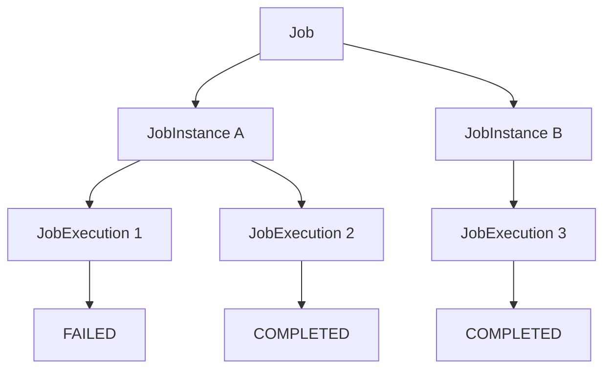

하나의 Job은 여러 JobInstance를 가질 수 있다.

그리고 하나의 JobInstance는 여러 JobExecution을 가질 수 있다.

이 구조를 통해 Spring Batch는 동일한 논리적 작업의 중복 실행을 제어하고, 실패한 작업을 재시작할 수 있는 기반을 제공한다.

실무에서는 JobInstance의 식별 기준을 신중하게 설계해야 한다.

특히 정산, 결제, 쿠폰 만료, 데이터 동기화처럼 중복 처리가 문제가 될 수 있는 시스템에서는 업무 기준일이나 처리 대상 ID 등을 활용해 논리적인 작업을 명확하게 구분하는 것이 중요하다.

또한 JobInstance가 다르다는 사실만으로 비즈니스 데이터의 정합성이 보장되는 것은 아니므로 멱등성 있는 처리 구조를 함께 설계해야 한다.

결국 **JobInstance는 단순한 실행 기록이 아니라 배치 시스템에서 무엇을 하나의 논리적 작업으로 볼 것인지 정의하는 핵심 개념**이다.

#### 한 줄 요약

> Spring Batch의 `JobInstance`는 Job 이름과 식별용 JobParameters로 구분되는 논리적인 실행 단위이며, 새로운 파라미터 조합에는 새로운 JobInstance가 생성되고, 동일한 조합은 기존 JobInstance로 식별된다. 이미 완료된 작업은 중복 실행을 제한하지만 실패한 작업은 재시작할 수 있으며, 실제 실행 시도는 각각 별도의 JobExecution으로 관리된다.

[1]: https://www.springframework.org/spring-batch/docs/5.2.0-M2/api/org/springframework/batch/core/repository/JobRepository.html?utm_source=chatgpt.com "JobRepository (Spring Batch 5.2.0-M2 API)"
[2]: https://docs.spring.io/spring-boot/3.4/how-to/batch.html?utm_source=chatgpt.com "Batch Applications :: Spring Boot"

## JobParameter

### Spring Batch JobParameters 이해: 생성, 전달, 조회 및 JobInstance 식별 원리

Spring Batch에서는 하나의 Job을 여러 번 실행할 수 있다.

예를 들어 매일 새벽 2시에 실행되는 정산 배치를 생각해보자.

정산 Job 자체는 동일하지만 실행할 때마다 정산 기준일이 달라진다.

```text
dailySettlementJob
       │
       ├── 2026-10-15 정산
       │
       ├── 2026-10-16 정산
       │
       └── 2026-10-17 정산
```

이러한 작업을 처리하려면 Job을 실행할 때 정산 기준일과 같은 정보를 전달할 수 있어야 한다.

또한 동일한 Job이라도 어떤 조건으로 실행했는지 구분해야 한다.

Spring Batch에서는 이러한 기능을 제공하기 위해 `JobParameters`라는 도메인 객체를 사용한다.

JobParameters는 단순히 실행에 필요한 값을 전달하는 객체가 아니다.

**Job의 실행 조건을 전달하는 동시에 JobInstance를 식별하는 기준으로 사용되는 핵심 객체**다.

예를 들어 다음 두 실행을 살펴보자.

```text
첫 번째 실행

Job: dailySettlementJob
businessDate: 2026-10-15


두 번째 실행

Job: dailySettlementJob
businessDate: 2026-10-16
```

두 실행은 같은 Job을 사용하지만 서로 다른 정산 기준일을 전달한다.

Spring Batch는 식별용 JobParameters가 다르기 때문에 서로 다른 JobInstance로 구분할 수 있다.

반대로 동일한 Job 이름과 동일한 식별용 JobParameters를 전달하면 기존 JobInstance를 식별한다.

이후 해당 JobInstance의 실행 상태에 따라 재시작하거나 중복 실행을 제한한다.

이번에는 JobParameters의 내부 구조와 생성 방법, 실제 Job 실행 시 파라미터를 전달하는 방법, Step에서 파라미터를 참조하는 방법까지 살펴보자.

---

### JobParameters란?

`JobParameters`는 Spring Batch에서 Job을 실행할 때 전달하는 파라미터를 관리하는 객체다.

Spring Batch의 `JobLauncher`는 다음과 같은 메서드를 제공한다.

```java
JobExecution run(
        Job job,
        JobParameters jobParameters
) throws JobExecutionException;
```

이 메서드는 두 개의 인자를 전달받는다.

첫 번째는 실행할 `Job` 객체다.

두 번째는 Job 실행에 사용할 `JobParameters` 객체다.

예를 들어 다음과 같이 사용할 수 있다.

```java
JobParameters parameters =
        new JobParametersBuilder()
                .addString(
                        "businessDate",
                        "2026-10-15"
                )
                .toJobParameters();

jobLauncher.run(
        settlementJob,
        parameters
);
```

이 코드는 `settlementJob`을 실행하면서 정산 기준일을 전달한다.

Spring Batch는 전달받은 파라미터를 이용해 JobInstance를 식별하고, 이후 실제 Job 실행 과정에서도 해당 값을 참조할 수 있도록 한다.

#### JobParameters의 두 가지 핵심 역할

JobParameters는 크게 두 가지 역할을 담당한다.

| 역할             | 설명                         |
| -------------- | -------------------------- |
| 실행 조건 전달       | Job과 Step에서 필요한 외부 입력값 전달  |
| JobInstance 식별 | 같은 Job의 서로 다른 논리적 실행 단위 구분 |

첫 번째는 일반적인 파라미터 전달 기능이다.

예를 들어 정산 Job을 실행할 때 다음과 같은 값을 전달할 수 있다.

```text
businessDate = 2026-10-15

merchantId = 1001

settlementType = DAILY
```

이러한 값들은 실제 비즈니스 로직에서 사용할 수 있다.

두 번째는 JobInstance 식별 기능이다.

Spring Batch는 Job 이름과 식별용 JobParameters를 기준으로 JobInstance를 구분한다.

```text
JobInstance = Job 이름 + 식별용 JobParameters
```

이때 어떤 파라미터를 식별 기준에 포함할 것인지도 설정할 수 있다.

---

### JobParameters와 JobInstance의 관계

JobParameters의 역할을 이해하기 위해 JobInstance와의 관계를 다시 살펴보자.

예를 들어 다음 Job이 존재한다고 가정하자.

```text
Job Name: settlementJob
```

첫 번째 실행에서는 다음 파라미터를 전달한다.

```text
businessDate=2026-10-15
```

두 번째 실행에서는 다음 파라미터를 전달한다.

```text
businessDate=2026-10-16
```

식별용 파라미터가 다르므로 서로 다른 JobInstance가 생성된다.

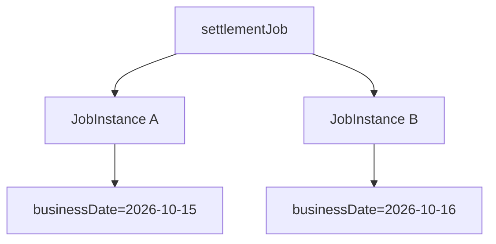

그렇다면 같은 파라미터로 다시 실행하면 어떻게 될까?

```text
Job Name: settlementJob

businessDate=2026-10-15
```

Spring Batch는 기존 JobInstance A를 식별한다.

하지만 여기서 중요한 것은 **기존 JobInstance가 존재한다는 사실만으로 무조건 실행에 실패하는 것은 아니라는 점**이다.

실제 동작은 이전 실행 상태에 따라 달라진다.

| 기존 실행 상태  | 동작                                |
| --------- | --------------------------------- |
| 실행 이력 없음  | 새로운 JobInstance 및 JobExecution 생성 |
| COMPLETED | 동일한 JobInstance의 중복 실행 거부         |
| FAILED    | 재시작이 허용되면 새로운 JobExecution 생성     |
| STOPPED   | 재시작이 허용되면 새로운 JobExecution 생성     |
| STARTED   | 이미 실행 중이므로 중복 실행 제한               |

따라서 JobParameters는 단순한 데이터 전달 수단이 아니라 Spring Batch의 실행 관리 정책과 직접 연결된다.

---

### JobParameters의 내부 구조

JobParameters는 여러 개의 `JobParameter`를 관리하는 객체다.

두 클래스는 이름이 비슷하지만 서로 다른 역할을 담당한다.

`JobParameters`는 여러 파라미터를 묶어서 관리한다.

`JobParameter<T>`는 개별 파라미터 하나의 값, 타입, 식별 여부를 나타낸다.

Spring Batch 5.2에서는 개념적으로 다음과 같은 구조를 가진다.

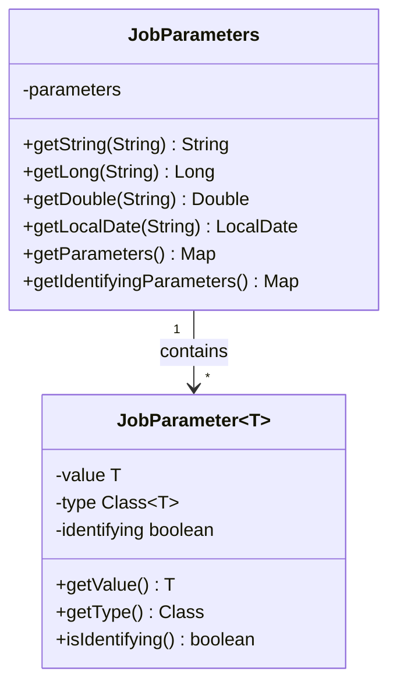

내부적인 데이터 구조를 단순화하면 다음과 같다.

```java
Map<String, JobParameter<?>> parameters;
```

Map의 Key는 파라미터 이름이다.

Value는 `JobParameter<?>` 객체다.

예를 들어 다음과 같은 파라미터가 있다고 생각해보자.

```text
name = user1

seq = 2

requestDate = 2026-10-15

score = 16.5
```

내부적으로는 다음과 같은 개념으로 관리된다.

```text
JobParameters
    │
    └── Map<String, JobParameter<?>>
            │
            ├── "name"
            │     └── JobParameter<String>
            │             value = "user1"
            │             type = String
            │             identifying = true
            │
            ├── "seq"
            │     └── JobParameter<Long>
            │             value = 2
            │             type = Long
            │             identifying = true
            │
            ├── "requestDate"
            │     └── JobParameter<LocalDate>
            │             value = 2026-10-15
            │             type = LocalDate
            │             identifying = true
            │
            └── "score"
                  └── JobParameter<Double>
                          value = 16.5
                          type = Double
                          identifying = false
```

여기서 중요한 부분은 `JobParameter`가 단순히 값만 저장하는 것이 아니라는 점이다.

각 파라미터는 다음 세 가지 정보를 가진다.

* 실제 값(Value)
* 값의 Java 타입(Type)
* JobInstance 식별 여부(Identifying)

특히 `identifying` 속성은 해당 파라미터를 JobInstance 식별에 사용할지 결정한다.

---

### Spring Batch 4와 5의 JobParameter 차이

Spring Batch는 버전에 따라 JobParameters에서 지원하는 타입과 내부 구조가 달라졌다.

Spring Batch 4에서는 기본적으로 다음 네 가지 타입을 지원했다.

| 타입     | Java 타입 | 용도  |
| ------ | ------- | --- |
| STRING | String  | 문자열 |
| LONG   | Long    | 정수  |
| DOUBLE | Double  | 실수  |
| DATE   | Date    | 날짜  |

예를 들어 이름은 String, 실행 번호는 Long, 날짜는 Date, 점수는 Double로 전달할 수 있었다.

하지만 **Spring Batch 5부터는 파라미터 타입 지원 방식이 확장되었다.**

기존 네 가지 타입으로 제한하지 않고, Spring의 변환 시스템을 통해 문자열과 상호 변환할 수 있는 타입을 사용할 수 있도록 변경되었다.

이러한 변화와 함께 `JobParameter`도 제네릭 기반 구조로 변경되었다.

#### Spring Batch 5의 JobParameter

Spring Batch 5.2에서는 다음과 같은 형태로 파라미터 객체를 생성할 수 있다.

```java
JobParameter<String> name =
        new JobParameter<>(
                "user1",
                String.class,
                true
        );
```

각 인자의 의미는 다음과 같다.

```java
new JobParameter<>(
        "user1",      // 실제 값
        String.class, // 값의 타입
        true          // 식별 여부
);
```

실제 값을 가져오려면 다음 메서드를 사용한다.

```java
String value = name.getValue();
```

타입은 다음과 같이 조회한다.

```java
Class<String> type = name.getType();
```

식별 여부도 확인할 수 있다.

```java
boolean identifying = name.isIdentifying();
```

이처럼 Spring Batch 5에서는 제네릭을 활용해 파라미터의 타입 정보를 관리한다.

#### 추가로 사용할 수 있는 타입

Spring Batch 5.2의 JobParametersBuilder는 다음과 같은 메서드도 제공한다.

```java
addLocalDate()

addLocalTime()

addLocalDateTime()
```

예를 들어 `LocalDate` 타입으로 날짜를 전달할 수 있다.

```java
JobParameters parameters =
        new JobParametersBuilder()
                .addLocalDate(
                        "businessDate",
                        LocalDate.of(2026, 10, 15)
                )
                .toJobParameters();
```

날짜만 필요한 경우에는 기존 `java.util.Date`보다 `LocalDate`가 의미를 명확하게 표현할 수 있다.

다만 모든 임의의 Java 객체가 별도 설정 없이 자동으로 저장되는 것은 아니다.

커스텀 타입을 사용하려면 문자열로 변환하고 다시 복원할 수 있는 Converter가 필요할 수 있다.

---

### JobParameters 생성 방법

Spring Batch에서는 JobParameters를 여러 방식으로 생성하거나 전달할 수 있다.

대표적으로 다음 방법들이 있다.

| 방식                            | 설명                           |
| ----------------------------- | ---------------------------- |
| JobParametersBuilder          | Java 코드에서 직접 파라미터 생성         |
| DefaultJobParametersConverter | 문자열 기반 설정을 JobParameters로 변환 |
| Command Line Arguments        | 애플리케이션 실행 시 외부에서 전달          |
| SpEL                          | 실행 시점의 파라미터 값을 Bean에 바인딩     |

이 중 가장 기본적인 방법은 `JobParametersBuilder`를 사용하는 것이다.

---

### JobParametersBuilder 사용하기

`JobParametersBuilder`는 JobParameters를 편리하게 생성하기 위한 Builder 클래스다.

개별 JobParameter를 직접 생성하고 Map에 넣는 과정을 간단하게 처리할 수 있다.

예를 들어 네 가지 타입의 파라미터를 만들어보자.

```java
import java.time.LocalDate;

import org.springframework.batch.core.JobParameters;
import org.springframework.batch.core.JobParametersBuilder;

public class JobParametersExample {

    public static void main(String[] args) {

        JobParameters parameters =
                new JobParametersBuilder()
                        .addString("name", "user1")
                        .addLong("seq", 2L)
                        .addLocalDate(
                                "requestDate",
                                LocalDate.of(2026, 10, 15)
                        )
                        .addDouble("score", 16.5)
                        .toJobParameters();

        System.out.println(parameters);
    }
}
```

각 메서드의 역할은 다음과 같다.

#### addString()

```java
.addString("name", "user1")
```

문자열 타입의 파라미터를 추가한다.

```text
Key: name

Type: java.lang.String

Value: user1
```

#### addLong()

```java
.addLong("seq", 2L)
```

Long 타입의 파라미터를 추가한다.

```text
Key: seq

Type: java.lang.Long

Value: 2
```

여기서 `2L`은 Long 리터럴이다.

#### addLocalDate()

```java
.addLocalDate(
        "requestDate",
        LocalDate.of(2026, 10, 15)
)
```

LocalDate 타입의 파라미터를 추가한다.

```text
Key: requestDate

Type: java.time.LocalDate

Value: 2026-10-15
```

#### addDouble()

```java
.addDouble("score", 16.5)
```

Double 타입의 파라미터를 추가한다.

```text
Key: score

Type: java.lang.Double

Value: 16.5
```

#### toJobParameters()

마지막으로 다음 메서드를 호출한다.

```java
.toJobParameters();
```

Builder에 추가한 파라미터를 하나의 JobParameters 객체로 생성한다.

이 객체를 JobLauncher에 전달하면 된다.

참고로 기존의 `Date` 타입을 사용하려면 다음과 같이 작성할 수 있다.

```java
import java.time.Instant;
import java.util.Date;

JobParameters parameters =
        new JobParametersBuilder()
                .addDate(
                        "requestDate",
                        Date.from(
                                Instant.parse(
                                        "2026-10-15T00:00:00Z"
                                )
                        )
                )
                .toJobParameters();
```

다만 `Date`는 시간 정보까지 포함하는 타입이다.

날짜만으로 작업을 구분하는 정산 Job이라면 `LocalDate`가 더 적합한 경우가 많다.

---

### JobParameters의 값을 조회하는 방법

JobParameters를 생성했다면 저장된 값을 조회할 수 있어야 한다.

Spring Batch는 타입에 맞는 Getter 메서드를 제공한다.

```java
JobParameters parameters =
        new JobParametersBuilder()
                .addString("name", "user1")
                .addLong("seq", 2L)
                .addLocalDate(
                        "requestDate",
                        LocalDate.of(2026, 10, 15)
                )
                .addDouble("score", 16.5)
                .toJobParameters();
```

문자열을 조회하려면 다음과 같이 작성한다.

```java
String name = parameters.getString("name");
```

Long 타입은 다음과 같다.

```java
Long seq = parameters.getLong("seq");
```

LocalDate는 다음과 같다.

```java
LocalDate requestDate =
        parameters.getLocalDate("requestDate");
```

Double은 다음과 같이 조회한다.

```java
Double score = parameters.getDouble("score");
```

전체 결과는 다음과 같다.

```text
name = user1

seq = 2

requestDate = 2026-10-15

score = 16.5
```

파라미터를 조회할 때는 저장된 타입과 Getter의 타입이 일치해야 한다.

예를 들어 Long 타입으로 저장한 값을 String Getter로 조회하면 타입 관련 예외가 발생할 수 있다.

또한 파라미터가 존재하지 않으면 Getter에 따라 `null`이 반환될 수 있으므로 필수 파라미터는 실행 전에 검증하는 것이 좋다.

---

### JobParameters와 Identifying의 관계

JobParameters를 생성할 때는 식별 여부를 설정할 수 있다.

앞에서 살펴본 다음 코드는 기본적으로 식별용 파라미터를 생성한다.

```java
.addString("name", "user1")
```

식별 여부를 직접 지정하려면 세 번째 인자를 사용한다.

```java
.addString("name", "user1", true)
```

```java
.addString("requestId", "request-001", false)
```

`true`는 JobInstance 식별에 사용한다는 의미다.

`false`는 JobInstance 식별에 사용하지 않는다는 의미다.

#### Identifying이 true인 경우

다음과 같이 실행한다고 생각해보자.

```java
JobParameters parameters =
        new JobParametersBuilder()
                .addString(
                        "businessDate",
                        "2026-10-15",
                        true
                )
                .toJobParameters();
```

`businessDate`는 JobInstance를 식별하는 값이다.

따라서 이 값이 변경되면 새로운 JobInstance를 식별하게 된다.

```text
businessDate=2026-10-15

        ↓

JobInstance A
```

```text
businessDate=2026-10-16

        ↓

JobInstance B
```

#### Identifying이 false인 경우

이번에는 요청 ID를 추가한다고 생각해보자.

```java
JobParameters parameters =
        new JobParametersBuilder()
                .addString(
                        "businessDate",
                        "2026-10-15",
                        true
                )
                .addString(
                        "requestId",
                        "request-001",
                        false
                )
                .toJobParameters();
```

이때 `requestId`는 식별에 사용하지 않는다.

따라서 `requestId`만 변경해도 새로운 JobInstance가 생성되지는 않는다.

```text
첫 번째 실행

businessDate = 2026-10-15
requestId = request-001
```

```text
두 번째 실행

businessDate = 2026-10-15
requestId = request-002
```

두 실행은 같은 JobInstance를 나타낸다.

이미 완료된 JobInstance라면 `requestId`를 변경해도 중복 실행 예외가 발생할 수 있다.

따라서 식별용 파라미터를 결정할 때는 **업무상 무엇을 하나의 작업으로 볼 것인지** 고려해야 한다.

---

### 실제 Spring Batch Job 구성하기

이번에는 JobParameters를 전달받는 Spring Batch Job을 만들어보자.

다음과 같은 구조를 구성한다.

```text
jobParameterJob
       │
       ├── jobParameterStep1
       │       │
       │       └── JobParameters 객체 조회
       │
       └── jobParameterStep2
               │
               └── ChunkContext에서 Map 조회
```

첫 번째 Step에서는 JobParameters 객체를 직접 조회한다.

두 번째 Step에서는 ChunkContext를 이용해 JobParameters 값을 조회한다.

이를 통해 두 접근 방식의 차이를 확인할 수 있다.

---

### JobParameterConfiguration 전체 코드

```java
package com.example.batch;

import java.time.LocalDate;
import java.util.Map;

import org.springframework.batch.core.Job;
import org.springframework.batch.core.JobParameters;
import org.springframework.batch.core.Step;

import org.springframework.batch.core.job.builder.JobBuilder;
import org.springframework.batch.core.repository.JobRepository;
import org.springframework.batch.core.step.builder.StepBuilder;

import org.springframework.batch.repeat.RepeatStatus;

import org.springframework.beans.factory.annotation.Qualifier;
import org.springframework.context.annotation.Bean;
import org.springframework.context.annotation.Configuration;

import org.springframework.transaction.PlatformTransactionManager;

@Configuration
public class JobParameterConfiguration {

    @Bean
    public Job jobParameterJob(
            JobRepository jobRepository,
            @Qualifier("jobParameterStep1") Step step1,
            @Qualifier("jobParameterStep2") Step step2
    ) {

        return new JobBuilder("jobParameterJob", jobRepository)
                .start(step1)
                .next(step2)
                .build();
    }

    @Bean
    public Step jobParameterStep1(
            JobRepository jobRepository,
            PlatformTransactionManager transactionManager
    ) {

        return new StepBuilder(
                "jobParameterStep1",
                jobRepository
        )
                .tasklet((contribution, chunkContext) -> {

                    JobParameters parameters =
                            contribution
                                    .getStepExecution()
                                    .getJobExecution()
                                    .getJobParameters();

                    String name =
                            parameters.getString("name");

                    Long seq =
                            parameters.getLong("seq");

                    LocalDate requestDate =
                            parameters.getLocalDate("requestDate");

                    Double score =
                            parameters.getDouble("score");

                    System.out.println(
                            "Step1 - name = " + name
                    );

                    System.out.println(
                            "Step1 - seq = " + seq
                    );

                    System.out.println(
                            "Step1 - requestDate = " + requestDate
                    );

                    System.out.println(
                            "Step1 - score = " + score
                    );

                    return RepeatStatus.FINISHED;

                }, transactionManager)
                .build();
    }

    @Bean
    public Step jobParameterStep2(
            JobRepository jobRepository,
            PlatformTransactionManager transactionManager
    ) {

        return new StepBuilder(
                "jobParameterStep2",
                jobRepository
        )
                .tasklet((contribution, chunkContext) -> {

                    Map<String, Object> parameters =
                            chunkContext
                                    .getStepContext()
                                    .getJobParameters();

                    System.out.println(
                            "Step2 - name = "
                                    + parameters.get("name")
                    );

                    System.out.println(
                            "Step2 - seq = "
                                    + parameters.get("seq")
                    );

                    System.out.println(
                            "Step2 - requestDate = "
                                    + parameters.get("requestDate")
                    );

                    System.out.println(
                            "Step2 - score = "
                                    + parameters.get("score")
                    );

                    return RepeatStatus.FINISHED;

                }, transactionManager)
                .build();
    }
}
```

이 코드에서 Job은 하나이며 두 개의 Step을 순차적으로 실행한다.

```java
return new JobBuilder("jobParameterJob", jobRepository)
        .start(step1)
        .next(step2)
        .build();
```

하지만 두 Step은 JobParameters를 조회하는 방식이 다르다.

이 차이를 자세히 살펴보자.

---

### StepContribution을 이용한 JobParameters 조회

첫 번째 방식은 `StepContribution`을 이용하는 것이다.

Tasklet은 다음과 같은 메서드를 제공한다.

```java
RepeatStatus execute(
        StepContribution contribution,
        ChunkContext chunkContext
) throws Exception;
```

첫 번째 매개변수가 `StepContribution`이다.

StepContribution은 현재 StepExecution에 접근할 수 있는 기능을 제공한다.

그리고 StepExecution은 자신이 속한 JobExecution을 참조할 수 있다.

JobExecution에는 JobParameters가 존재한다.

따라서 다음과 같은 접근 경로가 만들어진다.

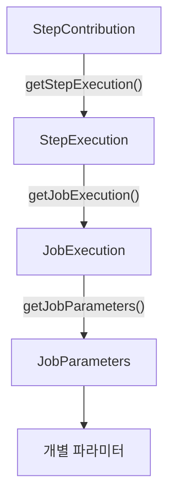

실제 코드는 다음과 같다.

```java
JobParameters parameters =
        contribution
                .getStepExecution()
                .getJobExecution()
                .getJobParameters();
```

이렇게 하면 JobLauncher에 전달했던 JobParameters 객체에 접근할 수 있다.

예를 들어 다음과 같이 조회한다.

```java
String name = parameters.getString("name");

Long seq = parameters.getLong("seq");

LocalDate requestDate =
        parameters.getLocalDate("requestDate");

Double score = parameters.getDouble("score");
```

이 방식은 원래의 JobParameters 객체를 통해 타입별 Getter를 사용할 수 있다는 장점이 있다.

또한 개별 JobParameter 객체의 타입이나 식별 여부를 확인할 수도 있다.

```java
JobParameter<?> parameter =
        parameters.getParameter("name");

if (parameter != null) {

    System.out.println(parameter.getValue());

    System.out.println(parameter.getType());

    System.out.println(parameter.isIdentifying());
}
```

이처럼 파라미터의 메타정보까지 확인해야 한다면 JobParameters 객체를 직접 사용하는 방법이 적합하다.

---

### ChunkContext를 이용한 JobParameters 조회

두 번째 방식은 `ChunkContext`를 이용하는 것이다.

Tasklet의 두 번째 매개변수는 ChunkContext다.

```java
(contribution, chunkContext) -> {
    // ...
}
```

ChunkContext는 내부적으로 StepContext를 참조한다.

StepContext는 현재 Step 실행에 필요한 여러 정보를 제공한다.

대표적으로 JobParameters에 접근하는 메서드가 있다.

```java
chunkContext
        .getStepContext()
        .getJobParameters();
```

이 메서드의 반환 타입은 다음과 같다.

```java
Map<String, Object>
```

따라서 다음과 같이 사용할 수 있다.

```java
Map<String, Object> parameters =
        chunkContext
                .getStepContext()
                .getJobParameters();
```

Map에서 값을 조회할 때는 파라미터 이름을 Key로 사용한다.

```java
Object name = parameters.get("name");

Object seq = parameters.get("seq");

Object requestDate = parameters.get("requestDate");

Object score = parameters.get("score");
```

타입이 필요한 경우에는 적절하게 형변환할 수 있다.

```java
String name =
        (String) parameters.get("name");

Long seq =
        (Long) parameters.get("seq");

LocalDate requestDate =
        (LocalDate) parameters.get("requestDate");

Double score =
        (Double) parameters.get("score");
```

이 방식은 다음 구조로 이해할 수 있다.

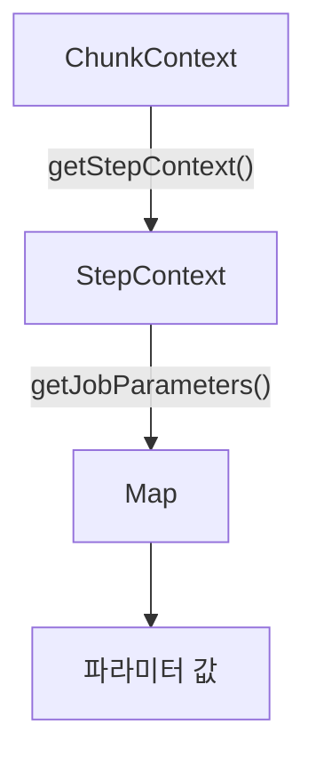

StepContribution을 이용한 방식보다 접근 경로가 짧다.

하지만 반환 타입이 JobParameters가 아니라 Map이라는 차이가 있다.

---

### StepContribution과 ChunkContext의 차이

두 방식은 같은 JobParameters에 담긴 값을 조회할 수 있지만 반환 객체의 형태가 다르다.

| 구분         | StepContribution 방식          | ChunkContext 방식     |
| ---------- | ---------------------------- | ------------------- |
| 접근 경로      | StepExecution → JobExecution | StepContext         |
| 반환 타입      | JobParameters                | Map<String, Object> |
| 타입별 Getter | 지원                           | 직접 형변환 필요           |
| 식별 여부 조회   | 가능                           | 일반적인 값 조회 중심        |
| 대표 사용      | 파라미터의 타입과 메타정보 활용            | 간단한 파라미터 값 참조       |

예를 들어 다음과 같다.

**JobParameters 객체를 직접 사용하는 경우**

```java
JobParameters parameters =
        contribution
                .getStepExecution()
                .getJobExecution()
                .getJobParameters();

String name = parameters.getString("name");
```

**Map으로 값을 조회하는 경우**

```java
Map<String, Object> parameters =
        chunkContext
                .getStepContext()
                .getJobParameters();

String name =
        (String) parameters.get("name");
```

두 방식 모두 사용할 수 있다.

다만 JobParameters의 타입과 식별 여부 같은 메타정보가 필요하다면 첫 번째 방법이 더 적합하다.

또한 `StepContext.getJobParameters()`가 반환하는 Map은 파라미터 값을 조회하기 위한 표현이며, 이를 수정한다고 해서 원래 JobParameters가 변경되는 것은 아니다.

**JobParameters는 실행 중 변경하는 데이터 저장소가 아니다.**

실행 중 변경되는 상태를 저장해야 한다면 ExecutionContext를 사용하는 것이 적절하다.

---

### JobLauncher를 이용해 JobParameters 전달하기

이제 실제로 JobParameters를 생성하고 Job을 실행해보자.

이번에는 Spring Boot의 자동 실행 기능을 사용하지 않고 `JobLauncher`를 직접 사용한다.

이렇게 하면 Java 코드에서 파라미터를 생성하는 과정을 명확하게 확인할 수 있다.

#### Job 자동 실행 비활성화

먼저 `application.yml`에 다음 설정을 추가한다.

```yaml
spring:
  batch:
    job:
      enabled: false
```

이 설정은 Spring Boot가 애플리케이션 시작 시 Job을 자동 실행하지 않도록 한다.

단, Spring Batch 자체가 비활성화되는 것은 아니다.

JobRepository와 JobLauncher는 계속 사용할 수 있다.

#### ApplicationRunner를 이용한 수동 실행

Spring Boot는 애플리케이션 시작 이후 특정 로직을 실행할 수 있도록 `ApplicationRunner`를 제공한다.

이를 이용해 JobLauncher를 호출해보자.

다음 예제에서는 수동 실행을 위한 `manual` Profile을 사용한다.

```java
package com.example.batch;

import java.time.LocalDate;

import org.springframework.batch.core.Job;
import org.springframework.batch.core.JobExecution;
import org.springframework.batch.core.JobParameters;
import org.springframework.batch.core.JobParametersBuilder;
import org.springframework.batch.core.launch.JobLauncher;

import org.springframework.beans.factory.annotation.Qualifier;
import org.springframework.boot.ApplicationArguments;
import org.springframework.boot.ApplicationRunner;
import org.springframework.context.annotation.Profile;
import org.springframework.stereotype.Component;

@Component
@Profile("manual")
public class JobParameterManualRunner implements ApplicationRunner {

    private final JobLauncher jobLauncher;
    private final Job job;

    public JobParameterManualRunner(
            JobLauncher jobLauncher,
            @Qualifier("jobParameterJob") Job job
    ) {
        this.jobLauncher = jobLauncher;
        this.job = job;
    }

    @Override
    public void run(ApplicationArguments args) throws Exception {

        JobParameters parameters =
                new JobParametersBuilder()
                        .addString("name", "user1")
                        .addLong("seq", 2L)
                        .addLocalDate(
                                "requestDate",
                                LocalDate.of(2026, 10, 15)
                        )
                        .addDouble("score", 16.5, false)
                        .toJobParameters();

        JobExecution execution =
                jobLauncher.run(
                        job,
                        parameters
                );

        System.out.println(
                "JobExecution ID: " + execution.getId()
        );

        System.out.println(
                "Job Status: " + execution.getStatus()
        );
    }
}
```

여기서 중요한 부분은 다음 코드다.

```java
JobParameters parameters =
        new JobParametersBuilder()
                .addString("name", "user1")
                .addLong("seq", 2L)
                .addLocalDate(
                        "requestDate",
                        LocalDate.of(2026, 10, 15)
                )
                .addDouble("score", 16.5, false)
                .toJobParameters();
```

이 코드는 네 개의 파라미터를 생성한다.

| Key         | Value      | Type      | Identifying |
| ----------- | ---------- | --------- | ----------- |
| name        | user1      | String    | Y           |
| seq         | 2          | Long      | Y           |
| requestDate | 2026-10-15 | LocalDate | Y           |
| score       | 16.5       | Double    | N           |

그리고 다음 메서드로 Job을 실행한다.

```java
jobLauncher.run(
        job,
        parameters
);
```

JobLauncher는 전달받은 Job과 JobParameters를 이용해 JobInstance를 조회하거나 생성하고 Job을 실행한다.

---

### 실행 결과 확인하기

수동 실행을 위해 Profile을 활성화한다.

```bash
java -jar target/spring-batch-demo-0.0.1-SNAPSHOT.jar \
  --spring.profiles.active=mysql,manual
```

여기서는 MySQL과 manual Profile을 함께 활성화했다.

`application-mysql.yml`에는 MySQL 연결 정보가 설정되어 있다고 가정한다.

또한 `spring.batch.job.enabled=false`로 설정되어 있어야 한다.

애플리케이션이 시작되면 ApplicationRunner가 실행되고 JobLauncher가 Job을 실행한다.

정상적으로 실행되었다면 다음과 유사한 결과를 확인할 수 있다.

```text
Step1 - name = user1
Step1 - seq = 2
Step1 - requestDate = 2026-10-15
Step1 - score = 16.5

Step2 - name = user1
Step2 - seq = 2
Step2 - requestDate = 2026-10-15
Step2 - score = 16.5

JobExecution ID: 1
Job Status: COMPLETED
```

위 결과는 새로운 JobInstance를 처음 실행하는 상황을 가정한 예시다.

실제 JobExecution ID는 기존 실행 이력에 따라 달라질 수 있다.

이 결과를 통해 두 Step 모두 JobParameters의 값을 정상적으로 조회했음을 확인할 수 있다.

---

### BATCH_JOB_EXECUTION_PARAMS 테이블 확인

Spring Batch는 Job을 실행할 때 전달받은 JobParameters를 데이터베이스에 저장한다.

이때 사용하는 테이블은 다음과 같다.

```text
BATCH_JOB_EXECUTION_PARAMS
```

Spring Batch 5.2에서는 다음 컬럼을 사용한다.

| 컬럼                 | 설명                |
| ------------------ | ----------------- |
| `JOB_EXECUTION_ID` | JobExecution 식별자  |
| `PARAMETER_NAME`   | 파라미터 이름           |
| `PARAMETER_TYPE`   | Java 타입           |
| `PARAMETER_VALUE`  | 실제 값              |
| `IDENTIFYING`      | JobInstance 식별 여부 |

JobParameters는 하나의 JobExecution에 여러 개가 저장될 수 있다.

따라서 JobExecution과 파라미터 레코드는 일대다 관계다.

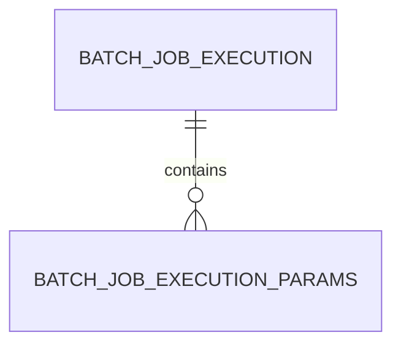

실제 데이터를 조회하려면 다음 SQL을 실행한다.

```sql
SELECT
    JOB_EXECUTION_ID,
    PARAMETER_NAME,
    PARAMETER_TYPE,
    PARAMETER_VALUE,
    IDENTIFYING
FROM BATCH_JOB_EXECUTION_PARAMS
ORDER BY
    JOB_EXECUTION_ID,
    PARAMETER_NAME;
```

앞의 예제를 실행했다면 다음과 같은 데이터가 저장될 수 있다.

| PARAMETER_NAME | PARAMETER_TYPE      | PARAMETER_VALUE | IDENTIFYING |
| -------------- | ------------------- | --------------- | ----------- |
| name           | java.lang.String    | user1           | Y           |
| seq            | java.lang.Long      | 2               | Y           |
| requestDate    | java.time.LocalDate | 2026-10-15      | Y           |
| score          | java.lang.Double    | 16.5            | N           |

이처럼 Java 코드에서 설정한 파라미터의 이름, 값, 타입, 식별 여부가 데이터베이스에 저장된다.

#### Spring Batch 4와 5의 스키마 차이

Spring Batch 4에서는 다음과 같은 컬럼을 사용했다.

```text
TYPE_CD

KEY_NAME

STRING_VAL

DATE_VAL

LONG_VAL

DOUBLE_VAL

IDENTIFYING
```

각 타입별로 값을 저장하는 컬럼이 구분되어 있었다.

반면 Spring Batch 5에서는 다음과 같이 변경되었다.

```text
PARAMETER_NAME

PARAMETER_TYPE

PARAMETER_VALUE

IDENTIFYING
```

타입별 컬럼을 구분하지 않고 타입 정보와 값을 함께 관리하는 방식이다.

따라서 Spring Batch 5에서는 JobParameters의 타입 확장성을 높일 수 있다.

---

### 애플리케이션 실행 시 JobParameters 전달하기

지금까지는 Java 코드에서 JobParameters를 생성했다.

하지만 실제 배치 운영 환경에서는 실행 시점에 파라미터를 전달하는 경우가 많다.

예를 들어 다음과 같은 작업이다.

```text
정산 Job

실행 시 전달할 값:
businessDate=2026-10-15
```

정산 날짜를 변경할 때마다 Java 코드를 수정하는 것은 비효율적이다.

따라서 실행 인자를 이용해 JobParameters를 전달하는 방식을 사용할 수 있다.

Spring Boot에서는 JAR 파일을 실행할 때 명령행 인자를 전달할 수 있다.

```bash
java -jar spring-batch-demo.jar \
  name=user1
```

여기서 `name=user1`은 JobParameters로 전달될 수 있는 일반 인자다.

다만 Spring Boot의 환경 설정 인자와 JobParameters 인자는 구분해야 한다.

---

### Spring Boot 환경 설정과 JobParameters의 차이

Spring Boot에서는 일반적으로 다음과 같은 방식으로 환경 설정을 전달한다.

```bash
java -jar spring-batch-demo.jar \
  --spring.profiles.active=mysql
```

이 인자는 Spring Boot의 Environment 속성으로 처리된다.

반면 다음 인자는 JobParameters로 전달된다.

```bash
java -jar spring-batch-demo.jar \
  name=user1
```

두 방식의 차이는 `--`에 있다.

| 인자                               | 처리 방식                      |
| -------------------------------- | -------------------------- |
| `--spring.profiles.active=mysql` | Spring Boot 환경 설정          |
| `name=user1`                     | Spring Batch JobParameters |
| `seq=2,java.lang.Long,true`      | 타입이 지정된 JobParameters      |

**Spring Boot에서 JobParameters를 전달할 때는 일반적으로 인자 앞에 `--`를 붙이지 않는다.**

예를 들어 다음 두 명령은 다르게 처리된다.

```bash
java -jar spring-batch-demo.jar \
  name=user1
```

```bash
java -jar spring-batch-demo.jar \
  --name=user1
```

첫 번째는 Batch JobParameters로 전달될 수 있다.

두 번째는 Spring Boot의 환경 설정 속성으로 처리된다.

따라서 명령행에서 JobParameters를 전달할 때는 인자 형식을 정확하게 이해해야 한다.

---

### Spring Batch 5의 명령행 파라미터 형식

Spring Batch 5에서는 JobParameters를 문자열로 전달할 때 다음 형식을 사용한다.

```text
parameterName=parameterValue,parameterType,identifying
```

각 항목의 의미는 다음과 같다.

| 항목             | 의미                 |
| -------------- | ------------------ |
| parameterName  | 파라미터 이름            |
| parameterValue | 실제 값               |
| parameterType  | Java 타입의 전체 클래스 이름 |
| identifying    | JobInstance 식별 여부  |

예를 들어 다음과 같다.

```text
seq=2,java.lang.Long,true
```

각 부분을 나누면 다음과 같다.

```text
Key         = seq

Value       = 2

Type        = java.lang.Long

Identifying = true
```

타입을 생략하면 기본적으로 문자열로 처리된다.

예를 들어 다음과 같다.

```text
name=user1
```

이 경우 기본 타입은 String이며 식별 여부는 true다.

LocalDate를 전달하려면 다음과 같이 작성할 수 있다.

```text
requestDate=2026-10-15,java.time.LocalDate,true
```

Double은 다음과 같다.

```text
score=16.5,java.lang.Double,false
```

여기서는 score를 JobInstance 식별에 사용하지 않도록 설정했다.

#### Spring Batch 4와 다른 점

Spring Batch 4에서는 다음과 같은 형태의 인자 표기법을 사용했다.

```text
seq(long)=2
```

하지만 Spring Batch 5에서는 기본 파라미터 표기법이 변경되었다.

```text
seq=2,java.lang.Long,true
```

따라서 Spring Batch 4에서 사용하던 명령행 인자를 Spring Batch 5 프로젝트에 그대로 적용해서는 안 된다.

Spring Batch 5.2의 `DefaultJobParametersConverter`는 `key=value,type,identifying` 형식을 지원한다.

---

### JAR 파일 실행으로 JobParameters 전달하기

이번에는 실제 JAR 파일을 실행하면서 JobParameters를 전달해보자.

앞에서는 수동으로 JobLauncher를 실행했지만, 이번에는 Spring Boot의 Job 자동 실행 기능을 사용한다.

두 방식을 혼동하지 않도록 실행 환경을 분리한다.

먼저 공통 설정에서 자동 실행을 비활성화했다면, 자동 실행용 Profile에서 다시 활성화한다.

`application-cli.yml`을 다음과 같이 작성한다.

```yaml
spring:
  batch:
    job:
      enabled: true
      name: jobParameterJob
```

이 설정은 Spring Boot가 애플리케이션 시작 시 `jobParameterJob`을 자동 실행하도록 한다.

앞에서 작성한 `JobParameterManualRunner`에는 다음 애너테이션이 있다.

```java
@Profile("manual")
```

따라서 `manual` Profile이 활성화되지 않으면 해당 ApplicationRunner는 등록되지 않는다.

이번에는 `mysql`과 `cli` Profile만 활성화한다.

#### JAR 파일 생성

Maven을 이용해 프로젝트를 빌드한다.

```bash
./mvnw clean package
```

이 명령은 이전 빌드 결과를 정리하고 프로젝트를 컴파일한 뒤 JAR 파일을 생성한다.

정상적으로 빌드되면 다음 파일이 생성된다.

```text
target/spring-batch-demo-0.0.1-SNAPSHOT.jar
```

#### JAR 실행

이번에는 네 개의 JobParameters를 전달한다.

```bash
java -jar target/spring-batch-demo-0.0.1-SNAPSHOT.jar \
  --spring.profiles.active=mysql,cli \
  name=user2 \
  'seq=3,java.lang.Long,true' \
  'requestDate=2026-10-16,java.time.LocalDate,true' \
  'score=16.5,java.lang.Double,false'
```

각 인자의 역할은 다음과 같다.

```text
name
    │
    └── user2 (String)


seq
    │
    └── 3 (Long)


requestDate
    │
    └── 2026-10-16 (LocalDate)


score
    │
    └── 16.5 (Double, Non-identifying)
```

Spring Boot의 자동 실행 기능은 이러한 일반 인자를 JobParameters로 변환하여 Job을 실행한다.

정상적으로 실행되면 다음과 유사한 결과를 확인할 수 있다.

```text
Step1 - name = user2
Step1 - seq = 3
Step1 - requestDate = 2026-10-16
Step1 - score = 16.5

Step2 - name = user2
Step2 - seq = 3
Step2 - requestDate = 2026-10-16
Step2 - score = 16.5
```

여기서 중요한 것은 Java 코드에서 직접 생성한 JobParameters와 명령행 인자로 전달한 JobParameters를 동일한 방식으로 조회할 수 있다는 점이다.

실행 방법이 다르더라도 최종적으로 Spring Batch는 JobParameters 객체를 통해 값을 관리한다.

---

### DefaultJobParametersConverter란?

Spring Batch에서 문자열로 전달된 파라미터를 JobParameters 객체로 변환하는 역할을 담당하는 클래스가 있다.

바로 `DefaultJobParametersConverter`다.

예를 들어 다음과 같은 문자열이 있다고 생각해보자.

```text
seq=3,java.lang.Long,true
```

이 문자열을 그대로 사용하면 단순한 문자열에 불과하다.

하지만 Spring Batch는 이 문자열에 포함된 타입 정보를 해석하여 다음과 같은 JobParameter를 생성할 수 있다.

```text
JobParameter<Long>
    │
    ├── value = 3
    ├── type = Long
    └── identifying = true
```

이러한 변환 기능을 제공하는 클래스가 DefaultJobParametersConverter다.

#### DefaultJobParametersConverter 사용 예제

```java
import java.util.Properties;

import org.springframework.batch.core.JobParameters;
import org.springframework.batch.core.converter.DefaultJobParametersConverter;

public class JobParametersConverterExample {

    public static void main(String[] args) {

        Properties properties = new Properties();

        properties.setProperty(
                "name",
                "user1"
        );

        properties.setProperty(
                "seq",
                "2,java.lang.Long,true"
        );

        properties.setProperty(
                "requestDate",
                "2026-10-15,java.time.LocalDate,true"
        );

        properties.setProperty(
                "score",
                "16.5,java.lang.Double,false"
        );

        DefaultJobParametersConverter converter =
                new DefaultJobParametersConverter();

        JobParameters parameters =
                converter.getJobParameters(properties);

        System.out.println(
                parameters.getString("name")
        );

        System.out.println(
                parameters.getLong("seq")
        );

        System.out.println(
                parameters.getLocalDate("requestDate")
        );

        System.out.println(
                parameters.getDouble("score")
        );
    }
}
```

실행 결과는 다음과 같다.

```text
user1

2

2026-10-15

16.5
```

이 예제에서는 Properties에 저장된 문자열이 타입 정보를 가진 JobParameters로 변환된다.

즉 다음 과정이 이루어진다.

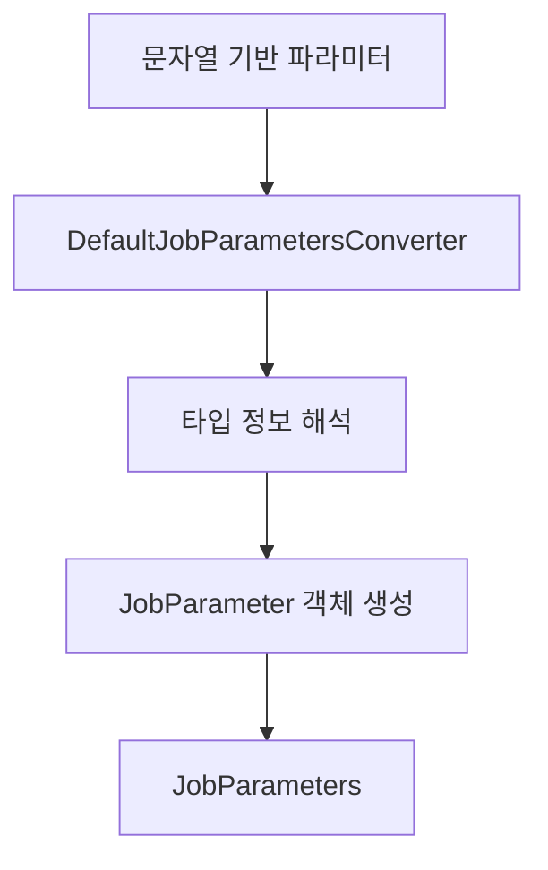

이러한 구조 덕분에 배치 실행 시스템에서는 문자열 형태로 실행 인자를 전달하면서도 내부에서는 타입이 있는 객체를 사용할 수 있다.

---

### SpEL을 이용한 JobParameters 바인딩

Spring Batch에서는 Spring Expression Language인 SpEL을 이용해 JobParameters를 참조할 수도 있다.

예를 들어 다음과 같은 표현식을 사용할 수 있다.

```java
@Value("#{jobParameters['requestDate']}")
```

이 표현식은 JobParameters에서 `requestDate`에 해당하는 값을 조회한다.

하지만 여기서 중요한 점이 있다.

**JobParameters는 Job이 실행되는 시점에 결정되므로 일반적인 Singleton Bean 생성 시점에는 해당 값이 존재하지 않을 수 있다.**

따라서 실행 시점에 값을 바인딩할 수 있는 Scope가 필요하다.

Spring Batch에서는 이를 위해 `@JobScope`와 `@StepScope`를 제공한다.

#### @StepScope 사용 예제

```java
@Bean
@StepScope
public Tasklet parameterTasklet(
        @Value("#{jobParameters['requestDate']}")
        LocalDate requestDate
) {

    return (contribution, chunkContext) -> {

        System.out.println(
                "requestDate = " + requestDate
        );

        return RepeatStatus.FINISHED;
    };
}
```

이 코드는 Step 실행 시점에 JobParameters에서 requestDate를 조회하여 Tasklet에 주입한다.

따라서 같은 Tasklet 정의를 사용하더라도 실행할 때마다 다른 값을 전달받을 수 있다.

이러한 방식을 Late Binding이라고 한다.

다만 `@StepScope`를 적용하는 대상은 일반적으로 Tasklet, Reader, Writer처럼 실행 시점에 값을 주입받아야 하는 컴포넌트다.

Step 자체에 무조건 `@StepScope`를 적용하는 것은 아니다.

Spring Batch의 Late Binding은 `@StepScope`, `@JobScope`와 밀접하게 연결되어 있다.

---

### JobParameters와 ExecutionContext의 차이

JobParameters를 이해할 때 함께 구분해야 하는 객체가 있다.

바로 `ExecutionContext`다.

두 객체 모두 Key-Value 형태의 데이터를 관리한다는 공통점이 있다.

하지만 목적이 다르다.

JobParameters는 실행할 때 전달하는 입력값이다.

ExecutionContext는 실행 과정에서 필요한 상태를 저장하는 공간이다.

예를 들어 다음과 같은 정산 배치를 생각해보자.

```text
정산 기준일: 2026-10-15

전체 대상 건수: 100만 건
```

정산 기준일은 Job 실행 전에 결정된다.

따라서 JobParameters로 전달하는 것이 적절하다.

```java
.addString(
        "businessDate",
        "2026-10-15"
)
```

반면 배치를 실행하면서 처리한 마지막 결제 ID는 계속 변경될 수 있다.

```text
lastProcessedId = 1000

lastProcessedId = 2000

lastProcessedId = 3000
```

이런 상태 정보는 ExecutionContext에 저장하는 것이 적절하다.

```java
executionContext.putLong(
        "lastProcessedId",
        3000L
);
```

두 객체의 차이를 정리하면 다음과 같다.

| 구분             | JobParameters  | ExecutionContext     |
| -------------- | -------------- | -------------------- |
| 목적             | Job 실행 조건 전달   | 실행 상태 저장             |
| 생성 시점          | Job 실행 요청 시    | Job 또는 Step 실행 과정    |
| 값 변경           | 변경하지 않는 값 객체   | 실행 과정에서 변경 가능        |
| JobInstance 식별 | 식별용 파라미터 사용    | 사용하지 않음              |
| 재시작 활용         | 동일한 논리적 작업 식별  | 처리 상태 복원             |
| 대표 데이터         | 정산 기준일, 가맹점 ID | 마지막 처리 ID, Reader 위치 |

실무에서는 이 두 객체를 명확하게 구분해야 한다.

JobParameters에 계속 변경되는 실행 상태를 저장하려고 하거나, ExecutionContext를 JobInstance 식별에 사용하려는 방식은 적절하지 않다.

---

### 실무에서 JobParameters를 설계하는 방법

JobParameters는 단순히 값을 전달하는 기능처럼 보이지만 실제 운영 환경에서는 JobInstance의 식별과 중복 실행에 영향을 준다.

따라서 어떤 값을 파라미터로 전달할지뿐 아니라 어떤 값을 식별용으로 사용할지도 중요하다.

#### 업무 기준일을 식별용 파라미터로 사용하기

정산 배치에서는 일반적으로 정산 기준일이 중요한 식별 기준이다.

```java
.addLocalDate(
        "businessDate",
        LocalDate.of(2026, 10, 15),
        true
)
```

이 값을 식별용으로 사용하면 동일한 날짜의 정산을 하나의 논리적인 작업으로 구분할 수 있다.

반면 날짜가 변경되면 새로운 JobInstance가 생성된다.

#### 실행 요청 ID는 식별용에서 제외하기

외부 시스템이 배치를 요청할 때마다 새로운 요청 ID를 전달할 수 있다.

```text
requestId=request-001

requestId=request-002
```

하지만 요청 ID가 변경된다고 해서 반드시 새로운 정산 작업이 되는 것은 아니다.

따라서 다음과 같이 식별 대상에서 제외할 수 있다.

```java
.addString(
        "requestId",
        "request-001",
        false
)
```

이렇게 하면 실행 추적을 위한 값과 논리적인 작업 식별 기준을 분리할 수 있다.

#### 실행 시각을 무조건 식별용으로 사용하지 않기

다음과 같은 코드를 생각해보자.

```java
.addLong(
        "timestamp",
        System.currentTimeMillis()
)
```

이 값은 실행할 때마다 달라진다.

따라서 식별용 파라미터로 사용하면 실행할 때마다 새로운 JobInstance가 생성될 가능성이 높다.

단순히 중복 실행 오류를 피하기 위해 이러한 방식을 사용하면 업무상 동일한 데이터를 반복 처리하는 문제가 발생할 수 있다.

예를 들어 같은 날짜의 정산을 여러 번 실행할 때마다 새로운 JobInstance가 생성된다면 중복 정산을 방지하기 어려워질 수 있다.

따라서 실행마다 새로운 JobInstance를 만드는 것이 정말 필요한지 먼저 판단해야 한다.

#### 파라미터의 타입을 일관되게 유지하기

JobInstance 식별에는 파라미터의 이름과 값뿐 아니라 타입도 영향을 줄 수 있다.

예를 들어 다음 두 파라미터를 생각해보자.

```java
.addString(
        "seq",
        "2"
)
```

```java
.addLong(
        "seq",
        2L
)
```

두 값은 사람이 보기에는 모두 2를 나타낸다.

하지만 첫 번째는 String이고 두 번째는 Long이다.

따라서 동일한 파라미터로 간주해서는 안 된다.

실제 운영 환경에서는 파라미터 이름과 타입에 대한 규칙을 정해두는 것이 좋다.

예를 들어 정산 기준일은 항상 LocalDate로 사용하고, 가맹점 ID는 항상 Long으로 사용하는 방식이다.

이렇게 하면 서로 다른 실행 경로에서 파라미터 타입이 달라져 의도하지 않은 JobInstance가 생성되는 문제를 줄일 수 있다.

---

### JobParameters 실행 흐름 정리

지금까지 살펴본 내용을 하나의 그림으로 연결해보자.

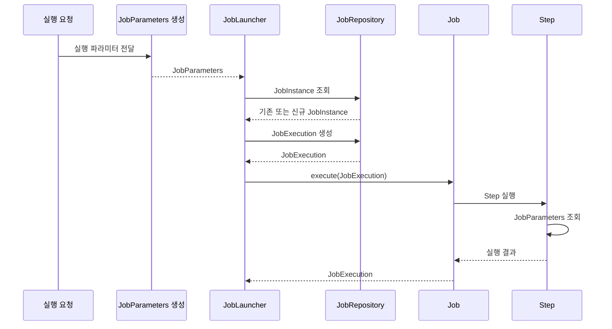

먼저 JobParameters를 생성한다.

JobParameters는 Java 코드에서 직접 생성할 수도 있고, 명령행 인자를 통해 전달할 수도 있다.

이후 JobLauncher가 Job과 JobParameters를 전달받아 실행을 요청한다.

JobRepository는 기존 JobInstance가 존재하는지 확인한다.

새로운 작업이라면 JobInstance를 생성한다.

이미 존재하는 작업이라면 이전 실행 상태를 확인해 실행 가능 여부를 판단한다.

그다음 JobExecution을 생성하고 Job을 실행한다.

Job 내부에서는 Step이 실행되며, 각 Step에서 JobParameters에 접근해 필요한 값을 사용할 수 있다.

이러한 구조를 통해 Spring Batch는 실행 조건 전달과 JobInstance 식별을 일관된 방식으로 관리한다.

---

### 정리

Spring Batch에서 JobParameters는 Job을 실행할 때 전달하는 입력값을 관리하는 도메인 객체다.

단순히 값을 전달하는 것뿐 아니라 JobInstance를 식별하는 데 중요한 역할을 담당한다.

JobParameters는 여러 개의 JobParameter를 포함한다.

각 JobParameter는 실제 값과 타입, 식별 여부를 관리한다.

Spring Batch 5에서는 제네릭 기반의 JobParameter 구조를 사용하며, Spring의 타입 변환 기능을 통해 다양한 타입을 지원한다.

JobParameters를 생성하는 대표적인 방법은 다음과 같다.

| 방법                            | 특징                          |
| ----------------------------- | --------------------------- |
| JobParametersBuilder          | Java 코드에서 타입별 파라미터 생성       |
| DefaultJobParametersConverter | 문자열을 타입이 있는 파라미터로 변환        |
| Command Line Arguments        | JAR 실행 시 외부 파라미터 전달         |
| SpEL                          | Job 또는 Step 실행 시점에 파라미터 바인딩 |

또한 Step에서는 JobParameters에 두 가지 방식으로 접근할 수 있다.

첫 번째는 StepContribution을 이용하는 것이다.

```java
JobParameters parameters =
        contribution
                .getStepExecution()
                .getJobExecution()
                .getJobParameters();
```

두 번째는 ChunkContext를 이용하는 것이다.

```java
Map<String, Object> parameters =
        chunkContext
                .getStepContext()
                .getJobParameters();
```

첫 번째 방식은 JobParameters 객체를 직접 사용한다.

두 번째 방식은 Map을 통해 값을 조회한다.

그리고 JobParameters와 ExecutionContext는 목적이 다르다.

JobParameters는 실행 조건과 JobInstance 식별을 위한 객체이며, ExecutionContext는 실행 중 변경되는 상태와 재시작에 필요한 정보를 저장하기 위한 객체다.

실무에서는 특히 식별용 파라미터를 신중하게 설계해야 한다.

정산 기준일이나 처리 대상 ID처럼 업무상 작업을 구분하는 값은 식별용으로 사용할 수 있다.

반면 요청 ID나 실행 로그 추적값처럼 매번 달라지는 부가 정보는 식별에서 제외하는 것이 적절할 수 있다.

결국 **JobParameters는 단순한 매개변수 전달 객체가 아니라 Spring Batch에서 하나의 논리적인 작업을 식별하고 실행 조건을 관리하는 핵심 도메인 객체**다.

#### 한 줄 요약

> Spring Batch의 `JobParameters`는 Job 실행 시 필요한 입력값을 전달하고 JobInstance를 식별하는 역할을 담당한다. `JobParametersBuilder`와 `DefaultJobParametersConverter` 등을 통해 생성할 수 있으며, Step에서는 `StepContribution`이나 `ChunkContext`를 이용해 값을 조회할 수 있다. 특히 식별용 파라미터의 구성은 JobInstance 생성, 중복 실행 및 재시작 동작에 직접적인 영향을 준다.


## JobExecution

### Spring Batch JobExecution 이해: 실행 상태와 JobInstance 관계 및 재시작 원리

Spring Batch에서 Job은 하나의 배치 작업 전체를 정의하는 최상위 도메인 객체다.

그리고 JobInstance는 Job 이름과 식별용 JobParameters를 기준으로 구분되는 논리적인 실행 단위다.

그렇다면 실제로 Job이 실행되었을 때 발생하는 정보는 어디에서 관리할까?

예를 들어 다음과 같은 정산 배치가 있다고 생각해보자.

```text
Job: dailySettlementJob

JobParameters:
businessDate=2026-10-15
```

해당 Job을 처음 실행했는데 데이터베이스 오류로 실패했다고 가정하자.

```text
dailySettlementJob
        │
        ▼
JobInstance 1
        │
        ▼
Job 실행
        │
        ▼
FAILED
```

이후 장애를 해결하고 동일한 JobParameters로 다시 실행한다.

이번에는 정상적으로 완료되었다.

```text
dailySettlementJob
        │
        ▼
JobInstance 1
        │
        ├── 첫 번째 실행: FAILED
        │
        └── 두 번째 실행: COMPLETED
```

여기서 중요한 점이 있다.

**두 번의 실행은 동일한 JobInstance에 속하지만, 실제 실행 기록은 서로 다르게 관리되어야 한다.**

첫 번째 실행이 실패했다는 사실과 두 번째 실행이 성공했다는 사실을 각각 기록해야 하기 때문이다.

Spring Batch에서는 이러한 개별 실행 시도를 `JobExecution`이라는 객체로 관리한다.

JobExecution은 Job을 실행할 때마다 해당 실행의 시작 시간, 종료 시간, 실행 상태, 종료 결과, 예외 정보 등을 관리하는 핵심 도메인 객체다.

이번에는 JobExecution의 구조를 살펴보고, 실행 결과가 성공 또는 실패인 경우 Spring Batch가 어떻게 동작하는지 알아보자.

또한 실제 Job을 실행하고 실패시키면서 JobInstance와 JobExecution의 관계가 데이터베이스에 어떻게 기록되는지 확인해보자.

---

### JobExecution이란?

JobExecution은 **JobInstance에 대한 한 번의 실제 실행 시도를 나타내는 도메인 객체**다.

Spring Batch에서는 Job이 실행될 때 실행 정보를 관리하기 위한 JobExecution을 생성한다.

예를 들어 다음과 같은 Job이 있다고 생각해보자.

```text
Job Name: settlementJob

JobParameters:
businessDate=2026-10-15
```

처음 실행하면 JobInstance와 JobExecution이 생성된다.

```text
JobInstance 1
      │
      ▼
JobExecution 1
```

JobExecution에는 해당 실행에서 발생하는 여러 정보가 포함된다.

대표적으로 다음과 같다.

| 속성                | 설명                         |
| ----------------- | -------------------------- |
| JobInstance       | 현재 실행이 속한 논리적인 JobInstance |
| JobParameters     | Job 실행에 사용된 파라미터           |
| ExecutionContext  | 실행 과정에서 유지해야 하는 상태 정보      |
| BatchStatus       | Job의 실행 상태                 |
| ExitStatus        | Job의 종료 결과                 |
| FailureExceptions | Job 실행 중 발생한 예외 정보         |
| CreateTime        | JobExecution 생성 시점         |
| StartTime         | Job 실행 시작 시점               |
| EndTime           | Job 실행 종료 시점               |
| LastUpdated       | JobExecution 마지막 갱신 시점     |

이러한 정보들은 Job이 실행되는 과정에서 생성되거나 변경된다.

그리고 JDBC 기반 JobRepository를 사용하는 경우 Spring Batch는 관련 실행 정보를 데이터베이스에 저장한다.

따라서 JobExecution은 단순히 실행 여부만 나타내는 객체가 아니다.

**하나의 Job 실행에서 무엇이 발생했고, 어떤 결과로 종료되었는지 관리하는 객체**라고 이해할 수 있다.

---

### JobInstance와 JobExecution의 차이

JobExecution을 이해할 때 가장 중요한 것은 JobInstance와의 차이다.

두 객체는 이름이 비슷하지만 역할이 명확하게 구분된다.

JobInstance는 논리적인 실행 단위를 나타낸다.

반면 JobExecution은 실제 실행 시도를 나타낸다.

#### JobInstance는 논리적인 실행 단위

Spring Batch는 다음 두 값을 기준으로 JobInstance를 구분한다.

```text
Job 이름 + 식별용 JobParameters
```

예를 들어 다음과 같은 Job을 실행한다고 생각해보자.

```text
Job Name: settlementJob

businessDate=2026-10-15
```

이 조합에 해당하는 JobInstance가 없다면 새로운 JobInstance가 생성된다.

```text
JobInstance 1
```

이후 같은 Job 이름과 식별용 JobParameters로 실행하면 새로운 JobInstance가 아니라 기존 JobInstance를 식별한다.

#### JobExecution은 실제 실행 시도

이번에는 첫 번째 실행이 실패했다고 생각해보자.

```text
JobInstance 1
      │
      ▼
JobExecution 1
      │
      ▼
FAILED
```

JobInstance는 이미 존재한다.

하지만 실패한 작업이므로 재시작 가능한 경우 동일한 JobInstance를 다시 실행할 수 있다.

이때 새로운 JobExecution이 생성된다.

```text
JobInstance 1
      │
      ├── JobExecution 1
      │       └── FAILED
      │
      └── JobExecution 2
              └── COMPLETED
```

JobInstance는 하나지만 JobExecution은 두 개다.

이것이 JobInstance와 JobExecution의 가장 중요한 차이다.

#### 두 객체의 관계

| 구분       | JobInstance               | JobExecution        |
| -------- | ------------------------- | ------------------- |
| 의미       | 논리적인 작업 실행 단위             | 실제 Job 실행 시도        |
| 생성 기준    | Job 이름과 식별용 JobParameters | 새로운 실행 시도           |
| 식별자      | JobInstance ID            | JobExecution ID     |
| 실패 후 재시작 | 기존 인스턴스 사용                | 새로운 실행 객체 생성        |
| 주요 역할    | 작업 식별 및 재시작 기준            | 실행 상태 및 결과 관리       |
| 저장 테이블   | BATCH_JOB_INSTANCE        | BATCH_JOB_EXECUTION |

따라서 두 객체는 일대다 관계를 가진다.

```mermaid
erDiagram
    BATCH_JOB_INSTANCE ||--o{ BATCH_JOB_EXECUTION : has
```

하나의 JobInstance에는 여러 JobExecution이 존재할 수 있다.

다만 모든 JobInstance가 반드시 여러 JobExecution을 가지는 것은 아니다.

첫 번째 실행에서 성공했다면 하나의 JobExecution만 존재할 수도 있다.

---

### JobExecution은 언제 새롭게 생성될까?

JobExecution은 Job을 실행하려는 새로운 시도가 허용될 때 생성된다.

여기서 중요한 것은 **Job 실행을 요청했다고 해서 항상 새로운 JobExecution이 생성되는 것은 아니라는 점**이다.

Spring Batch는 기존 JobInstance의 실행 상태를 확인해 새로운 실행을 허용할지 판단한다.

대표적으로 다음 세 가지 상황이 있다.

#### 첫 번째: 새로운 JobInstance를 실행하는 경우

다음과 같은 Job을 처음 실행한다고 생각해보자.

```text
Job: settlementJob

businessDate=2026-10-15
```

아직 같은 식별용 파라미터를 가진 JobInstance가 존재하지 않는다.

따라서 Spring Batch는 새로운 JobInstance를 생성한다.

그리고 첫 번째 JobExecution도 생성한다.

```text
JobInstance 1
      │
      ▼
JobExecution 1
      │
      ▼
COMPLETED
```

이 경우 JobInstance와 JobExecution이 각각 하나씩 생성된다.

#### 두 번째: 이미 완료된 JobInstance를 실행하는 경우

이번에는 동일한 파라미터로 다시 실행한다고 생각해보자.

```text
Job: settlementJob

businessDate=2026-10-15
```

기존 JobInstance가 존재하며, 이전 실행이 `COMPLETED` 상태다.

이 경우 Spring Batch는 새로운 JobExecution을 생성하지 않고 실행을 거부한다.

대표적으로 다음 예외가 발생한다.

```text
JobInstanceAlreadyCompleteException
```

이미 해당 논리적 작업이 정상적으로 완료되었다고 판단하기 때문이다.

```mermaid
flowchart TD
    A["Job 실행 요청"]
    B["기존 JobInstance 조회"]
    C["이전 실행 상태: COMPLETED"]
    D["JobInstanceAlreadyCompleteException"]

    A --> B
    B --> C
    C --> D
```

따라서 이 상황에서는 새로운 JobInstance도 생성되지 않고 새로운 JobExecution도 생성되지 않는다.

#### 세 번째: 실패한 JobInstance를 재시작하는 경우

이번에는 첫 번째 실행이 실패했다고 생각해보자.

```text
JobInstance 1
      │
      ▼
JobExecution 1
      │
      ▼
FAILED
```

동일한 JobParameters로 다시 실행을 요청한다.

Spring Batch는 기존 JobInstance를 조회한다.

하지만 이전 실행이 실패했고 Job이 재시작 가능하도록 설정되어 있다면 새로운 JobExecution을 생성한다.

```text
JobInstance 1
      │
      ├── JobExecution 1
      │       └── FAILED
      │
      └── JobExecution 2
              └── FAILED
```

다시 실행해 정상적으로 완료되었다고 생각해보자.

```text
JobInstance 1
      │
      ├── JobExecution 1
      │       └── FAILED
      │
      ├── JobExecution 2
      │       └── FAILED
      │
      └── JobExecution 3
              └── COMPLETED
```

JobInstance는 여전히 하나다.

하지만 실행 시도마다 JobExecution이 생성되었으므로 JobExecution은 세 개다.

이처럼 **실패한 JobInstance는 재시작 조건을 만족하면 여러 번 실행할 수 있으며, 실행 시도마다 새로운 JobExecution이 생성된다.**

---

### JobExecution의 실행 상태에 따른 동작

Spring Batch는 기존 JobExecution의 실행 상태를 기준으로 다음 실행을 허용할지 판단한다.

하지만 `COMPLETED`가 아니라고 해서 모든 상태에서 무조건 재시작할 수 있는 것은 아니다.

대표적인 상태별 동작을 정리하면 다음과 같다.

| 기존 상태     | 새로운 JobExecution 생성 | 설명                                |
| --------- | ------------------- | --------------------------------- |
| 실행 이력 없음  | 가능                  | 새로운 JobInstance 및 JobExecution 생성 |
| COMPLETED | 불가능                 | 이미 완료된 JobInstance                |
| FAILED    | 조건부 가능              | 재시작 가능한 Job이면 새로운 실행 시도           |
| STOPPED   | 조건부 가능              | 중지된 작업을 재시작할 수 있음                 |
| STARTED   | 일반적으로 불가능           | 이미 실행 중인 작업                       |
| STARTING  | 일반적으로 불가능           | 실행을 시작하는 중                        |
| STOPPING  | 일반적으로 불가능           | 중지 처리 중                           |
| ABANDONED | 불가능                 | 정상적인 재시작 대상으로 취급하지 않음             |
| UNKNOWN   | 직접 재시작을 신중하게 판단해야 함 | 실행 상태가 불확실함                       |

여기서 중요한 것은 Spring Batch가 단순히 성공과 실패만 관리하는 것이 아니라는 사실이다.

작업이 실행 중인지, 정상적으로 종료되었는지, 중지되었는지, 재시작 가능한지 등을 구분해서 관리한다.

이러한 역할을 담당하는 객체가 `BatchStatus`다.

---

### BatchStatus란?

`BatchStatus`는 Job이나 Step의 실행 상태를 나타내는 Enum이다.

Spring Batch 5.2에서는 다음과 같은 상태를 제공한다.

```java
public enum BatchStatus {

    COMPLETED,

    STARTING,

    STARTED,

    STOPPING,

    STOPPED,

    FAILED,

    ABANDONED,

    UNKNOWN
}
```

각 상태의 의미는 다음과 같다.

| BatchStatus | 의미                         |
| ----------- | -------------------------- |
| COMPLETED   | 정상적으로 완료                   |
| STARTING    | 실행 시작 준비 중                 |
| STARTED     | 실행 중                       |
| STOPPING    | 중지 요청을 처리하는 중              |
| STOPPED     | 중지됨                        |
| FAILED      | 실행 실패                      |
| ABANDONED   | 더 이상 정상적인 재시작 대상으로 취급하지 않음 |
| UNKNOWN     | 실행 상태를 확정하기 어려움            |

일반적으로 Job이 정상적으로 시작되고 완료된다면 다음과 같은 상태 변화를 거친다.

```text
STARTING
    │
    ▼
STARTED
    │
    ▼
COMPLETED
```

실행 도중 예외가 발생하면 다음과 같이 변경될 수 있다.

```text
STARTING
    │
    ▼
STARTED
    │
    ▼
FAILED
```

중지 요청이 발생하는 경우에는 다음과 같은 상태 흐름을 가질 수 있다.

```text
STARTED
    │
    ▼
STOPPING
    │
    ▼
STOPPED
```

다만 실제 상태 전이는 작업의 실행 방식과 종료 조건 등에 따라 달라질 수 있다.

#### BatchStatus 조회하기

JobExecution에서는 다음 메서드로 실행 상태를 확인할 수 있다.

```java
BatchStatus status =
        jobExecution.getStatus();
```

예를 들어 다음과 같이 사용할 수 있다.

```java
if (jobExecution.getStatus() == BatchStatus.COMPLETED) {

    System.out.println("Job 정상 완료");

} else if (jobExecution.getStatus() == BatchStatus.FAILED) {

    System.out.println("Job 실행 실패");
}
```

이처럼 BatchStatus는 실행 상태를 판단하는 데 사용된다.

---

### ExitStatus란?

JobExecution은 BatchStatus뿐 아니라 `ExitStatus`도 가지고 있다.

두 객체는 이름과 역할이 비슷해 보이지만 서로 다른 개념이다.

`BatchStatus`는 실제 실행 상태를 나타낸다.

반면 `ExitStatus`는 작업이 어떤 결과로 종료되었는지를 표현한다.

대표적인 ExitStatus 상수는 다음과 같다.

```java
ExitStatus.UNKNOWN;

ExitStatus.EXECUTING;

ExitStatus.COMPLETED;

ExitStatus.NOOP;

ExitStatus.FAILED;

ExitStatus.STOPPED;
```

여기서 중요한 차이가 있다.

**BatchStatus는 Enum이지만 ExitStatus는 Enum이 아니라 클래스다.**

따라서 ExitStatus는 개발자가 직접 종료 코드를 정의할 수도 있다.

예를 들어 다음과 같다.

```java
ExitStatus exitStatus =
        new ExitStatus("NO_DATA");
```

이 코드는 데이터가 존재하지 않는 경우를 나타내는 사용자 정의 종료 코드를 생성한다.

이러한 종료 코드는 조건부 Flow를 구성할 때 활용할 수 있다.

#### BatchStatus와 ExitStatus 비교

| 구분     | BatchStatus                | ExitStatus                 |
| ------ | -------------------------- | -------------------------- |
| 타입     | Enum                       | Class                      |
| 목적     | 실행 상태 표현                   | 종료 결과 표현                   |
| 사용자 정의 | 제공된 상태 사용                  | 커스텀 종료 코드 생성 가능            |
| 대표 값   | STARTED, COMPLETED, FAILED | COMPLETED, FAILED, NO_DATA |
| 주요 활용  | 실행 및 재시작 상태 판단             | 종료 결과 및 Flow 분기            |

정상적으로 완료된 Job에서는 다음과 같이 기록될 수 있다.

```text
BatchStatus = COMPLETED

ExitStatus = COMPLETED
```

실패한 Job에서는 다음과 같이 기록될 수 있다.

```text
BatchStatus = FAILED

ExitStatus = FAILED
```

하지만 두 값이 항상 동일해야 하는 것은 아니다.

예를 들어 Job의 실행은 정상적으로 완료되었지만 처리할 데이터가 없었다는 사실을 나타내기 위해 다음과 같이 구성할 수 있다.

```text
BatchStatus = COMPLETED

ExitStatus = NO_DATA
```

따라서 종료 결과와 실행 상태는 구분해서 이해해야 한다.

특히 중요한 사실은 **실제 Job의 재시작 가능 여부를 판단할 때 BatchStatus와 Job의 재시작 설정 등이 영향을 준다**는 점이다.

단순히 ExitStatus의 문자열만 변경한다고 해서 이미 완료된 JobInstance를 다시 실행할 수 있는 것은 아니다.

---

### JobExecution의 주요 속성

JobExecution은 Job 실행과 관련된 여러 속성을 가진다.

Spring Batch 5.2의 JobExecution은 `Entity`를 상속하며 실행 정보에 접근하기 위한 다양한 메서드를 제공한다.

대표적인 구조를 정리하면 다음과 같다.

```mermaid
classDiagram
    class Entity {
        -id
        -version
    }

    class JobExecution {
        -jobInstance
        -jobParameters
        -executionContext
        -status
        -exitStatus
        -failureExceptions
        -createTime
        -startTime
        -endTime
        -lastUpdated

        +getJobInstance()
        +getJobParameters()
        +getExecutionContext()
        +getStatus()
        +getExitStatus()
        +getFailureExceptions()
        +getStartTime()
        +getEndTime()
    }

    Entity <|-- JobExecution
```

각 속성의 의미를 살펴보자.

#### JobInstance

```java
JobInstance jobInstance =
        jobExecution.getJobInstance();
```

현재 JobExecution이 속한 JobInstance를 반환한다.

예를 들어 다음과 같이 JobInstance ID를 확인할 수 있다.

```java
long jobInstanceId =
        jobExecution
                .getJobInstance()
                .getInstanceId();
```

하나의 JobInstance에 여러 JobExecution이 존재할 수 있으므로, 서로 다른 JobExecution이 동일한 JobInstance ID를 가지는 것은 정상적인 동작이다.

#### JobParameters

```java
JobParameters parameters =
        jobExecution.getJobParameters();
```

현재 Job 실행에 사용된 JobParameters를 반환한다.

예를 들어 정산 기준일을 조회할 수 있다.

```java
String businessDate =
        parameters.getString("businessDate");
```

재시작 시에도 동일한 식별용 JobParameters를 사용하면 같은 JobInstance를 식별한다.

#### ExecutionContext

```java
ExecutionContext context =
        jobExecution.getExecutionContext();
```

Job 실행 과정에서 유지해야 하는 상태 정보를 관리한다.

예를 들어 다음과 같은 값을 저장할 수 있다.

```java
context.putString(
        "settlementStatus",
        "READY"
);
```

JobExecutionContext는 같은 Job 실행에 속한 Step 사이에서 필요한 데이터를 공유하는 용도로 활용할 수 있다.

다만 재시작에 필요한 데이터는 적절한 시점에 JobRepository를 통해 영속화되어야 한다.

#### FailureExceptions

JobExecution은 실행 중 발생한 예외 정보를 관리할 수 있다.

```java
List<Throwable> exceptions =
        jobExecution.getFailureExceptions();
```

또한 다음 메서드를 사용할 수 있다.

```java
List<Throwable> exceptions =
        jobExecution.getAllFailureExceptions();
```

`getAllFailureExceptions()`는 JobExecution 자체의 예외뿐 아니라 관련 StepExecution에 기록된 실패 예외도 함께 확인하는 데 사용할 수 있다.

예를 들어 다음과 같이 작성할 수 있다.

```java
for (Throwable exception
        : jobExecution.getAllFailureExceptions()) {

    System.out.println(exception.getMessage());
}
```

다만 예외 객체 목록 전체가 그대로 데이터베이스에 영구 저장되는 것은 아니다.

실행 메타데이터에는 종료 코드와 종료 메시지 등이 기록되며, 실제 상세 예외 분석에는 애플리케이션 로그를 함께 사용하는 것이 좋다.

---

### JobExecution의 시간 관련 속성

JobExecution에는 실행 시점을 관리하기 위한 여러 속성이 존재한다.

대표적으로 다음과 같다.

```text
CreateTime

StartTime

EndTime

LastUpdated
```

각각은 서로 다른 시점을 나타낸다.

| 속성          | 의미                               |
| ----------- | -------------------------------- |
| CreateTime  | JobExecution이 생성된 시점             |
| StartTime   | 실제 Job 실행이 시작된 시점                |
| EndTime     | Job 실행이 종료된 시점                   |
| LastUpdated | JobExecution 메타데이터가 마지막으로 갱신된 시점 |

Spring Batch 5.2에서는 이러한 시간 정보를 `LocalDateTime`으로 다룬다.

#### CreateTime과 StartTime의 차이

JobExecution이 생성되었다고 해서 실제 Job이 즉시 실행되는 것은 아니다.

예를 들어 다음과 같은 상황을 생각해보자.

```text
02:00:00 → JobExecution 생성

02:00:01 → Job 실행 시작

02:00:10 → Job 실행 종료
```

이 경우 개념적으로 다음과 같은 값이 저장될 수 있다.

```text
CREATE_TIME = 02:00:00

START_TIME  = 02:00:01

END_TIME    = 02:00:10
```

즉 CreateTime은 실행 메타데이터가 생성된 시점이고, StartTime은 실제 실행이 시작된 시점이다.

#### EndTime이 NULL인 경우

JobExecution의 `END_TIME`은 `NULL`일 수 있다.

예를 들어 아직 실행 중인 Job이라면 종료 시간이 존재하지 않는다.

```text
STATUS = STARTED

END_TIME = NULL
```

또한 애플리케이션이 비정상적으로 종료되어 최종 실행 상태를 저장하지 못한 경우에도 종료 시간이 남지 않을 수 있다.

따라서 `END_TIME`이 `NULL`이라고 해서 반드시 실패했다고 단정해서는 안 된다.

#### LastUpdated는 실행 중이라는 증거일까?

`LAST_UPDATED`는 JobExecution 메타데이터가 마지막으로 저장된 시점을 나타낸다.

하지만 이 값이 최근 시각이라고 해서 반드시 Job이 정상적으로 실행 중이라는 의미는 아니다.

반대로 오래된 값이라고 해서 무조건 Job이 중단되었다고 판단해서도 안 된다.

JobExecution 메타데이터 갱신이 일정한 주기의 Heartbeat처럼 동작하는 것은 아니기 때문이다.

실무에서는 Job의 실행 상태를 판단할 때 `STATUS`, `START_TIME`, `END_TIME`, `LAST_UPDATED`와 실제 애플리케이션 상태를 함께 확인해야 한다.

---

### JobExecution은 어디에 저장될까?

Spring Batch는 JobExecution 정보를 다음 테이블에 저장한다.

```text
BATCH_JOB_EXECUTION
```

Spring Batch 5.2의 주요 컬럼은 다음과 같다.

| 컬럼               | 의미                   |
| ---------------- | -------------------- |
| JOB_EXECUTION_ID | JobExecution의 고유 식별자 |
| VERSION          | 낙관적 락을 위한 버전         |
| JOB_INSTANCE_ID  | 연결된 JobInstance ID   |
| CREATE_TIME      | JobExecution 생성 시점   |
| START_TIME       | Job 실행 시작 시점         |
| END_TIME         | Job 실행 종료 시점         |
| STATUS           | BatchStatus          |
| EXIT_CODE        | ExitStatus의 종료 코드    |
| EXIT_MESSAGE     | 종료 결과와 관련된 상세 메시지    |
| LAST_UPDATED     | 마지막 메타데이터 갱신 시점      |

여기서 중요한 컬럼은 다음 두 개다.

```text
JOB_EXECUTION_ID

JOB_INSTANCE_ID
```

`JOB_EXECUTION_ID`는 개별 실행을 식별한다.

`JOB_INSTANCE_ID`는 해당 실행이 어떤 JobInstance에 속하는지 나타낸다.

예를 들어 다음과 같은 데이터가 저장될 수 있다.

| JOB_EXECUTION_ID | JOB_INSTANCE_ID | STATUS    |
| ---------------- | --------------- | --------- |
| 1                | 1               | FAILED    |
| 2                | 1               | FAILED    |
| 3                | 1               | COMPLETED |

세 개의 JobExecution은 모두 같은 JobInstance에 속한다.

하지만 실행 시도는 세 번 발생했다.

따라서 JobExecution ID는 각각 다르다.

이처럼 `BATCH_JOB_EXECUTION` 테이블에서는 하나의 논리적인 작업이 몇 번 실행되었는지, 그리고 각 실행이 어떤 결과로 종료되었는지 확인할 수 있다.

---

### JobExecution 생성 과정

이제 Spring Batch가 JobExecution을 생성하는 과정을 살펴보자.

Job을 실행하기 위해서는 `JobLauncher`를 사용한다.

```java
JobExecution execution =
        jobLauncher.run(
                job,
                jobParameters
        );
```

이때 JobLauncher는 JobRepository를 이용해 실행 정보를 관리한다.

먼저 Job 이름과 식별용 JobParameters를 기준으로 기존 JobInstance가 존재하는지 확인한다.

JobInstance가 존재하지 않는다면 새로운 JobInstance를 생성한다.

그리고 해당 JobInstance의 JobExecution을 생성한다.

반면 기존 JobInstance가 존재한다면 마지막 실행 상태와 Job의 재시작 가능 여부 등을 확인한다.

재시작이 허용되는 경우에는 기존 JobInstance에 새로운 JobExecution을 연결한다.

전체 흐름은 다음과 같다.

```mermaid
flowchart TD
    A["JobLauncher.run()"]
    B["JobRepository"]
    C["JobInstance 조회"]
    D{"기존 JobInstance 존재?"}
    E["새 JobInstance 생성"]
    F["이전 실행 상태 조회"]
    G{"재시작 가능한 상태?"}
    H["새 JobExecution 생성"]
    I["Job 실행"]
    J["실행 거부 및 예외 발생"]

    A --> B
    B --> C
    C --> D

    D -->|No| E
    E --> H

    D -->|Yes| F
    F --> G

    G -->|Yes| H
    G -->|No| J

    H --> I
```

이 그림에서 중요한 부분은 다음이다.

**JobExecution은 새로운 JobInstance가 생성될 때뿐 아니라 기존 JobInstance를 재시작할 때도 새롭게 생성될 수 있다.**

따라서 JobInstance와 JobExecution은 일대다 관계를 가진다.

---

### 실제 JobExecution 생성 및 재시작 확인하기

지금까지 살펴본 내용을 실제 코드로 확인해보자.

이번 예제에서는 다음과 같은 Job을 생성한다.

```text
jobExecutionJob
       │
       ├── executionStep1
       │       │
       │       └── Step 1 실행
       │
       └── executionStep2
               │
               └── Step 2 실행
```

두 번째 Step에서는 실행 파라미터에 따라 의도적으로 예외를 발생시킬 수 있도록 구성한다.

이를 통해 다음 상황을 확인한다.

| 상황                    | 확인할 내용                       |
| --------------------- | ---------------------------- |
| 첫 번째 정상 실행            | JobInstance와 JobExecution 생성 |
| 완료 후 동일 파라미터 재실행      | 중복 실행 거부                     |
| 두 번째 JobInstance에서 실패 | FAILED 상태 저장                 |
| 실패한 JobInstance 재시작   | 새로운 JobExecution 생성          |
| 재시작 후 정상 완료           | COMPLETED 상태 저장              |
| 완료 후 다시 실행            | 추가 실행 거부                     |

실행 이력을 비교해야 하므로 MySQL처럼 데이터가 유지되는 저장소를 사용한다.

H2 메모리 데이터베이스를 사용하면 애플리케이션 종료와 함께 실행 이력이 사라질 수 있기 때문이다.

---

### JobExecutionConfiguration 전체 코드

다음과 같이 설정 클래스를 작성한다.

```java
package com.example.batch;

import org.slf4j.Logger;
import org.slf4j.LoggerFactory;

import org.springframework.batch.core.Job;
import org.springframework.batch.core.JobExecution;
import org.springframework.batch.core.JobExecutionListener;
import org.springframework.batch.core.Step;

import org.springframework.batch.core.job.builder.JobBuilder;
import org.springframework.batch.core.repository.JobRepository;
import org.springframework.batch.core.step.builder.StepBuilder;
import org.springframework.batch.repeat.RepeatStatus;

import org.springframework.beans.factory.annotation.Qualifier;
import org.springframework.context.annotation.Bean;
import org.springframework.context.annotation.Configuration;

import org.springframework.transaction.PlatformTransactionManager;

@Configuration
public class JobExecutionConfiguration {

    private static final Logger log =
            LoggerFactory.getLogger(
                    JobExecutionConfiguration.class
            );

    @Bean
    public Job jobExecutionJob(
            JobRepository jobRepository,
            @Qualifier("executionStep1") Step step1,
            @Qualifier("executionStep2") Step step2,
            JobExecutionListener jobExecutionListener
    ) {
        return new JobBuilder(
                "jobExecutionJob",
                jobRepository
        )
                .listener(jobExecutionListener)
                .start(step1)
                .next(step2)
                .build();
    }

    @Bean
    public Step executionStep1(
            JobRepository jobRepository,
            PlatformTransactionManager transactionManager
    ) {
        return new StepBuilder(
                "executionStep1",
                jobRepository
        )
                .tasklet((contribution, chunkContext) -> {

                    JobExecution jobExecution =
                            contribution
                                    .getStepExecution()
                                    .getJobExecution();

                    log.info(
                            "Step 1 실행 - JobExecution ID: {}",
                            jobExecution.getId()
                    );

                    return RepeatStatus.FINISHED;

                }, transactionManager)
                .build();
    }

    @Bean
    public Step executionStep2(
            JobRepository jobRepository,
            PlatformTransactionManager transactionManager
    ) {
        return new StepBuilder(
                "executionStep2",
                jobRepository
        )
                .tasklet((contribution, chunkContext) -> {

                    JobExecution jobExecution =
                            contribution
                                    .getStepExecution()
                                    .getJobExecution();

                    String failStep2 =
                            jobExecution
                                    .getJobParameters()
                                    .getString("failStep2");

                    log.info(
                            "Step 2 실행 - JobExecution ID: {}",
                            jobExecution.getId()
                    );

                    if ("true".equalsIgnoreCase(failStep2)) {

                        throw new IllegalStateException(
                                "Step 2 의도적인 실패"
                        );
                    }

                    log.info("Step 2 정상 완료");

                    return RepeatStatus.FINISHED;

                }, transactionManager)
                .build();
    }

    @Bean
    public JobExecutionListener jobExecutionListener() {

        return new JobExecutionListener() {

            @Override
            public void beforeJob(JobExecution jobExecution) {

                log.info(
                        "Job 시작 - Instance ID: {}, Execution ID: {}",
                        jobExecution.getJobInstance().getInstanceId(),
                        jobExecution.getId()
                );
            }

            @Override
            public void afterJob(JobExecution jobExecution) {

                log.info(
                        "Job 종료 - Instance ID: {}, Execution ID: {}",
                        jobExecution.getJobInstance().getInstanceId(),
                        jobExecution.getId()
                );

                log.info(
                        "BatchStatus: {}",
                        jobExecution.getStatus()
                );

                log.info(
                        "ExitStatus: {}",
                        jobExecution.getExitStatus().getExitCode()
                );

                log.info(
                        "Failure Count: {}",
                        jobExecution.getAllFailureExceptions().size()
                );
            }
        };
    }
}
```

코드의 핵심은 두 번째 Step이다.

```java
String failStep2 =
        jobExecution
                .getJobParameters()
                .getString("failStep2");
```

JobParameters에서 `failStep2` 값을 조회한다.

그리고 다음 조건에 따라 실패 여부를 결정한다.

```java
if ("true".equalsIgnoreCase(failStep2)) {

    throw new IllegalStateException(
            "Step 2 의도적인 실패"
    );
}
```

`failStep2=true`라면 예외를 발생시킨다.

반대로 `failStep2=false`라면 정상적으로 종료한다.

따라서 동일한 Job 설정을 사용하면서 실행 파라미터에 따라 실패와 성공을 재현할 수 있다.

---

### JobExecutionListener의 역할

예제에서는 `JobExecutionListener`도 등록했다.

JobExecutionListener는 Job 실행 전후에 필요한 처리를 수행할 수 있도록 지원한다.

대표적으로 두 메서드를 제공한다.

```java
void beforeJob(JobExecution jobExecution);

void afterJob(JobExecution jobExecution);
```

`beforeJob()`은 Job 실행 전에 호출된다.

`afterJob()`은 Job 실행이 종료된 뒤 호출된다.

이번 예제에서는 JobInstance ID와 JobExecution ID를 출력하도록 구성했다.

```java
log.info(
        "Job 시작 - Instance ID: {}, Execution ID: {}",
        jobExecution.getJobInstance().getInstanceId(),
        jobExecution.getId()
);
```

따라서 재시작할 때 JobInstance ID는 유지되고 JobExecution ID는 변경되는지 확인할 수 있다.

또한 Job 종료 시에는 BatchStatus와 ExitStatus를 출력한다.

```java
log.info(
        "BatchStatus: {}",
        jobExecution.getStatus()
);
```

```java
log.info(
        "ExitStatus: {}",
        jobExecution.getExitStatus().getExitCode()
);
```

이처럼 JobExecutionListener는 Job 실행 이력을 기록하거나 운영 모니터링에 필요한 정보를 수집할 때 유용하다.

---

### Spring Boot 및 MySQL 설정

이번에는 Spring Boot가 Job을 자동 실행하도록 설정한다.

`application-mysql.yml`은 다음과 같이 작성할 수 있다.

```yaml
spring:
  datasource:
    url: jdbc:mysql://localhost:3307/batch_db
    driver-class-name: com.mysql.cj.jdbc.Driver
    username: ${BATCH_DB_USERNAME:batch_user}
    password: ${BATCH_DB_PASSWORD:localpass}

  batch:
    job:
      enabled: true
      name: jobExecutionJob

    jdbc:
      initialize-schema: never
```

여기서 중요한 설정은 다음이다.

```yaml
spring:
  batch:
    job:
      enabled: true
      name: jobExecutionJob
```

`enabled=true`는 Spring Boot가 애플리케이션 시작 시 Job을 자동 실행할 수 있도록 한다.

`name=jobExecutionJob`은 자동 실행할 Job을 지정한다.

앞에서 작성한 다른 Job들이 같은 애플리케이션에 등록되어 있더라도 이번 예제의 Job을 선택할 수 있다.

또한 다음 설정을 사용했다.

```yaml
spring:
  batch:
    jdbc:
      initialize-schema: never
```

이미 Spring Batch 메타데이터 테이블이 생성되어 있다는 전제다.

아직 스키마가 없다면 사용하는 Spring Batch 버전에 맞는 메타데이터 스키마를 먼저 준비해야 한다.

---

### 첫 번째 실행: 정상적으로 완료되는 경우

먼저 새로운 JobParameters로 정상 실행해보자.

Maven으로 프로젝트를 빌드한다.

```bash
./mvnw clean package
```

정상적으로 빌드되면 실행 가능한 JAR 파일이 생성된다.

이제 다음 명령어를 실행한다.

```bash
java -jar target/spring-batch-demo-0.0.1-SNAPSHOT.jar \
  --spring.profiles.active=mysql \
  businessDate=2026-10-15 \
  'failStep2=false,java.lang.String,false'
```

여기서 전달한 파라미터는 두 개다.

```text
businessDate=2026-10-15

failStep2=false
```

`businessDate`는 식별용 파라미터다.

`failStep2`는 테스트를 위한 실행 제어 값이므로 식별용에서 제외했다.

따라서 `businessDate`가 같다면 `failStep2`를 변경하더라도 동일한 JobInstance를 식별한다.

#### 실행 결과

정상적으로 실행되면 다음과 유사한 로그를 확인할 수 있다.

```text
Job 시작 - Instance ID: 1, Execution ID: 1

Step 1 실행 - JobExecution ID: 1

Step 2 실행 - JobExecution ID: 1

Step 2 정상 완료

Job 종료 - Instance ID: 1, Execution ID: 1

BatchStatus: COMPLETED

ExitStatus: COMPLETED
```

ID는 메타데이터가 없는 새로운 데이터베이스에서 실행했다고 가정한 예시다.

실제 ID는 기존 실행 이력에 따라 달라진다.

이번 실행에서는 JobInstance가 새롭게 생성되었다.

그리고 JobExecution도 하나 생성되었다.

```text
JobInstance 1
      │
      ▼
JobExecution 1
      │
      ▼
COMPLETED
```

---

### 데이터베이스에서 첫 번째 실행 확인하기

실행 후 MySQL에서 다음 SQL을 실행한다.

#### JobInstance 조회

```sql
SELECT
    JOB_INSTANCE_ID,
    JOB_NAME,
    JOB_KEY
FROM BATCH_JOB_INSTANCE
WHERE JOB_NAME = 'jobExecutionJob';
```

정상적으로 실행되었다면 새로운 JobInstance가 생성되어 있을 것이다.

| JOB_INSTANCE_ID | JOB_NAME        | JOB_KEY |
| --------------- | --------------- | ------- |
| 1               | jobExecutionJob | HASH_A  |

실제 JobKey에는 Spring Batch가 생성한 해시 문자열이 저장된다.

#### JobExecution 조회

```sql
SELECT
    JOB_EXECUTION_ID,
    JOB_INSTANCE_ID,
    STATUS,
    EXIT_CODE,
    START_TIME,
    END_TIME
FROM BATCH_JOB_EXECUTION
ORDER BY JOB_EXECUTION_ID;
```

다음과 같은 데이터를 확인할 수 있다.

| JOB_EXECUTION_ID | JOB_INSTANCE_ID | STATUS    | EXIT_CODE |
| ---------------- | --------------- | --------- | --------- |
| 1                | 1               | COMPLETED | COMPLETED |

JobInstance와 JobExecution이 각각 하나씩 생성되었다.

JobExecution의 최종 상태는 `COMPLETED`다.

---

### 두 번째 실행: 완료된 JobInstance를 다시 실행하면?

이번에는 동일한 명령어를 다시 실행해보자.

```bash
java -jar target/spring-batch-demo-0.0.1-SNAPSHOT.jar \
  --spring.profiles.active=mysql \
  businessDate=2026-10-15 \
  'failStep2=false,java.lang.String,false'
```

Job 이름은 동일하다.

```text
jobExecutionJob
```

식별용 JobParameters도 동일하다.

```text
businessDate=2026-10-15
```

따라서 Spring Batch는 기존 JobInstance를 식별한다.

그런데 해당 JobInstance는 이미 `COMPLETED` 상태로 종료되었다.

이 경우 다음 예외가 발생한다.

```text
JobInstanceAlreadyCompleteException
```

동일한 논리적 작업이 이미 완료되었기 때문이다.

#### JobExecution은 추가될까?

추가되지 않는다.

기존 JobInstance가 완료된 상태이므로 새로운 실행 시도가 허용되지 않는다.

```text
JobInstance 1
      │
      ▼
JobExecution 1
      │
      ▼
COMPLETED

다시 실행 요청
      │
      ▼
JobInstanceAlreadyCompleteException
```

따라서 데이터베이스의 `BATCH_JOB_EXECUTION` 테이블에도 새로운 실행 레코드가 추가되지 않는다.

이처럼 Spring Batch는 완료된 JobInstance에 대한 중복 실행을 제한한다.

---

### 세 번째 실행: 의도적으로 실패시키기

이번에는 새로운 JobInstance를 생성한 뒤 의도적으로 실패시켜보자.

식별용 파라미터인 `businessDate`를 변경한다.

```text
businessDate=2026-10-16
```

그리고 두 번째 Step에서 예외가 발생하도록 다음 값을 전달한다.

```text
failStep2=true
```

실행 명령어는 다음과 같다.

```bash
java -jar target/spring-batch-demo-0.0.1-SNAPSHOT.jar \
  --spring.profiles.active=mysql \
  businessDate=2026-10-16 \
  'failStep2=true,java.lang.String,false'
```

이번에는 새로운 식별용 JobParameters를 전달했으므로 새로운 JobInstance가 생성된다.

하지만 Step 2에서 의도적으로 예외가 발생한다.

```java
throw new IllegalStateException(
        "Step 2 의도적인 실패"
);
```

#### 실행 결과

다음과 같은 흐름을 확인할 수 있다.

```text
Job 시작 - Instance ID: 2, Execution ID: 2

Step 1 실행 - JobExecution ID: 2

Step 2 실행 - JobExecution ID: 2

IllegalStateException:
Step 2 의도적인 실패

Job 종료 - Instance ID: 2, Execution ID: 2

BatchStatus: FAILED

ExitStatus: FAILED
```

이번 실행에서는 JobInstance 2가 생성되었다.

그리고 JobExecution 2가 생성되었다.

하지만 최종 상태는 `FAILED`다.

```text
JobInstance 2
      │
      ▼
JobExecution 2
      │
      ▼
FAILED
```

이 상태에서는 Job이 정상적으로 완료되지 않았다.

따라서 재시작 가능한 Job이라면 동일한 JobInstance를 다시 실행할 수 있다.

---

### 네 번째 실행: 실패한 JobInstance 재시작하기

이번에는 앞에서 실패한 작업을 그대로 다시 실행해보자.

```bash
java -jar target/spring-batch-demo-0.0.1-SNAPSHOT.jar \
  --spring.profiles.active=mysql \
  businessDate=2026-10-16 \
  'failStep2=true,java.lang.String,false'
```

Job 이름은 동일하다.

식별용 JobParameters도 동일하다.

따라서 새로운 JobInstance를 생성하지 않는다.

기존 JobInstance 2를 사용한다.

하지만 이전 실행이 `FAILED`이므로 재시작이 허용된다.

이때 **새로운 JobExecution이 생성된다.**

예를 들어 다음과 같은 구조가 된다.

```text
JobInstance 2
      │
      ├── JobExecution 2
      │       └── FAILED
      │
      └── JobExecution 3
              └── FAILED
```

이번에도 `failStep2=true`이므로 두 번째 Step에서 실패한다.

따라서 JobExecution 3의 최종 상태 역시 `FAILED`다.

#### 이때 첫 번째 Step은 다시 실행될까?

기본 설정에서는 이전 실행에서 이미 `COMPLETED` 상태로 종료된 Step은 재시작 시 건너뛸 수 있다.

이번 예제의 첫 번째 Step은 이전 실행에서 정상적으로 완료되었다.

```text
executionStep1 → COMPLETED
```

두 번째 Step은 실패했다.

```text
executionStep2 → FAILED
```

따라서 재시작할 때는 기본적으로 완료된 Step 1을 건너뛰고 Step 2를 다시 실행한다.

```text
첫 번째 실행

Step 1 → COMPLETED
Step 2 → FAILED


두 번째 실행

Step 1 → SKIPPED
Step 2 → FAILED
```

여기서 `SKIPPED`는 설명을 위한 표현이며, 새로운 StepExecution이 `SKIPPED` 상태로 반드시 저장된다는 의미는 아니다.

완료된 Step을 건너뛰는 경우에는 해당 Step에 대한 새로운 실행 레코드가 생성되지 않을 수 있다.

이는 Spring Batch의 재시작 처리에서 중요한 특징이다.

---

### 다섯 번째 실행: 실패한 Job을 정상 완료시키기

이번에는 실패 조건을 제거하고 다시 실행해보자.

실행할 Job 이름과 식별용 JobParameters는 그대로 유지한다.

```text
businessDate=2026-10-16
```

하지만 비식별용 파라미터인 `failStep2`는 `false`로 변경한다.

```text
failStep2=false
```

다음 명령어를 실행한다.

```bash
java -jar target/spring-batch-demo-0.0.1-SNAPSHOT.jar \
  --spring.profiles.active=mysql \
  businessDate=2026-10-16 \
  'failStep2=false,java.lang.String,false'
```

이때 중요한 점은 `failStep2`가 비식별용 파라미터라는 사실이다.

따라서 `true`에서 `false`로 변경하더라도 JobInstance 식별 결과는 달라지지 않는다.

Spring Batch는 기존 JobInstance 2를 다시 실행한다.

그리고 새로운 JobExecution 4를 생성한다.

이번에는 Step 2에서 예외가 발생하지 않는다.

따라서 Job이 정상적으로 완료된다.

```text
JobInstance 2
      │
      ├── JobExecution 2
      │       └── FAILED
      │
      ├── JobExecution 3
      │       └── FAILED
      │
      └── JobExecution 4
              └── COMPLETED
```

여기서 JobInstance는 하나다.

하지만 JobExecution은 세 개다.

같은 논리적인 작업에 대해 세 번의 실행 시도가 발생했기 때문이다.

---

### 완료된 JobInstance를 다시 실행하면?

이제 JobInstance 2의 마지막 실행은 `COMPLETED` 상태다.

동일한 식별용 JobParameters로 다시 실행하면 어떻게 될까?

```text
businessDate=2026-10-16
```

Spring Batch는 JobInstance 2를 조회한다.

그리고 이미 완료된 JobInstance라는 사실을 확인한다.

따라서 새로운 JobExecution을 생성하지 않는다.

다음 예외가 발생한다.

```text
JobInstanceAlreadyCompleteException
```

최종적으로 JobInstance 2에는 세 개의 JobExecution만 남는다.

```text
JobInstance 2
      │
      ├── JobExecution 2 → FAILED
      │
      ├── JobExecution 3 → FAILED
      │
      └── JobExecution 4 → COMPLETED
```

이후 동일한 JobInstance에 대한 재실행은 제한된다.

---

### JobInstance와 JobExecution 결과 비교

지금까지 수행한 실행을 하나의 표로 정리해보자.

| 실행 | businessDate | failStep2 | JobInstance | JobExecution | 결과        |
| -- | ------------ | --------- | ----------- | ------------ | --------- |
| 1  | 2026-10-15   | false     | 1           | 1            | COMPLETED |
| 2  | 2026-10-15   | false     | 1           | 생성 안 됨       | 실행 거부     |
| 3  | 2026-10-16   | true      | 2           | 2            | FAILED    |
| 4  | 2026-10-16   | true      | 2           | 3            | FAILED    |
| 5  | 2026-10-16   | false     | 2           | 4            | COMPLETED |
| 6  | 2026-10-16   | false     | 2           | 생성 안 됨       | 실행 거부     |

여기서 확인할 수 있는 것은 다음과 같다.

JobInstance는 두 개만 생성되었다.

```text
JobInstance 1

JobInstance 2
```

반면 JobExecution은 네 개가 생성되었다.

```text
JobExecution 1

JobExecution 2

JobExecution 3

JobExecution 4
```

전체 관계는 다음과 같다.

```mermaid
flowchart TD
    A["jobExecutionJob"]

    B["JobInstance 1<br/>businessDate=2026-10-15"]
    C["JobInstance 2<br/>businessDate=2026-10-16"]

    D["JobExecution 1<br/>COMPLETED"]

    E["JobExecution 2<br/>FAILED"]
    F["JobExecution 3<br/>FAILED"]
    G["JobExecution 4<br/>COMPLETED"]

    A --> B
    A --> C

    B --> D

    C --> E
    C --> F
    C --> G
```

이 그림에서 JobInstance와 JobExecution의 일대다 관계를 확인할 수 있다.

---

### BATCH_JOB_EXECUTION 테이블 확인

이제 데이터베이스에서 실제 실행 이력을 조회해보자.

다음 SQL을 실행한다.

```sql
SELECT
    ji.JOB_INSTANCE_ID,
    ji.JOB_NAME,

    je.JOB_EXECUTION_ID,
    je.STATUS,
    je.EXIT_CODE,

    je.CREATE_TIME,
    je.START_TIME,
    je.END_TIME,
    je.LAST_UPDATED

FROM BATCH_JOB_INSTANCE ji

JOIN BATCH_JOB_EXECUTION je
    ON ji.JOB_INSTANCE_ID = je.JOB_INSTANCE_ID

WHERE ji.JOB_NAME = 'jobExecutionJob'

ORDER BY
    ji.JOB_INSTANCE_ID,
    je.JOB_EXECUTION_ID;
```

정상적으로 실행했다면 다음과 유사한 결과를 확인할 수 있다.

| JOB_INSTANCE_ID | JOB_EXECUTION_ID | STATUS    | EXIT_CODE |
| --------------- | ---------------- | --------- | --------- |
| 1               | 1                | COMPLETED | COMPLETED |
| 2               | 2                | FAILED    | FAILED    |
| 2               | 3                | FAILED    | FAILED    |
| 2               | 4                | COMPLETED | COMPLETED |

이 결과에서 중요한 사실은 JobInstance 2가 여러 JobExecution을 가지고 있다는 것이다.

그리고 JobExecution은 실행 결과가 다르더라도 기존 레코드를 덮어쓰는 것이 아니라 실행 시도마다 별도의 레코드로 관리된다.

따라서 이전 실행이 실패했다는 사실도 그대로 남아 있다.

---

### JobParameters는 실행할 때마다 저장될까?

JobInstance는 같은 식별용 JobParameters에 대해 하나만 존재한다.

그렇다면 JobParameters도 한 번만 저장될까?

그렇지 않다.

Spring Batch에서 JobParameters는 `BATCH_JOB_EXECUTION_PARAMS` 테이블에 저장된다.

이 테이블은 JobExecution과 연결되어 있다.

따라서 새로운 JobExecution이 생성되면 해당 실행에 사용된 JobParameters도 저장된다.

이번 예제에서는 JobInstance 2가 세 번 실행되었다.

```text
JobExecution 2

JobExecution 3

JobExecution 4
```

따라서 각 JobExecution에 연결된 파라미터 레코드가 존재한다.

다음 SQL로 확인할 수 있다.

```sql
SELECT
    je.JOB_EXECUTION_ID,

    p.PARAMETER_NAME,
    p.PARAMETER_TYPE,
    p.PARAMETER_VALUE,
    p.IDENTIFYING

FROM BATCH_JOB_EXECUTION je

JOIN BATCH_JOB_EXECUTION_PARAMS p
    ON je.JOB_EXECUTION_ID = p.JOB_EXECUTION_ID

WHERE je.JOB_INSTANCE_ID = 2

ORDER BY
    je.JOB_EXECUTION_ID,
    p.PARAMETER_NAME;
```

예를 들어 다음과 같은 결과가 저장될 수 있다.

| JOB_EXECUTION_ID | PARAMETER_NAME | PARAMETER_VALUE | IDENTIFYING |
| ---------------- | -------------- | --------------- | ----------- |
| 2                | businessDate   | 2026-10-16      | Y           |
| 2                | failStep2      | true            | N           |
| 3                | businessDate   | 2026-10-16      | Y           |
| 3                | failStep2      | true            | N           |
| 4                | businessDate   | 2026-10-16      | Y           |
| 4                | failStep2      | false           | N           |

이 데이터에서 두 가지 사실을 확인할 수 있다.

첫 번째는 재시작 과정에서 동일한 식별용 JobParameters가 사용되었다는 것이다.

두 번째는 비식별용 JobParameters는 실행 시도마다 다른 값을 전달할 수 있다는 것이다.

따라서 같은 JobInstance에 속한 JobExecution이라고 해서 모든 파라미터가 반드시 동일해야 하는 것은 아니다.

**JobInstance를 구분하는 것은 식별용 JobParameters이며, 비식별용 JobParameters는 각 실행에서 변경될 수 있다.**

---

### 실패한 Job을 재시작할 때 StepExecution은 어떻게 될까?

JobExecution은 Job의 개별 실행 시도를 나타낸다.

마찬가지로 StepExecution은 Step의 개별 실행 정보를 나타낸다.

예를 들어 다음과 같은 Job이 있다고 생각해보자.

```text
Job
 │
 ├── Step 1
 │
 └── Step 2
```

첫 번째 실행에서는 Step 1이 성공하고 Step 2가 실패했다.

```text
JobExecution 1
      │
      ├── Step 1 → COMPLETED
      │
      └── Step 2 → FAILED
```

이후 Job을 재시작했다.

Spring Batch는 이전 실행에서 Step 1이 성공했다는 정보를 확인할 수 있다.

따라서 기본 설정에서는 이미 완료된 Step을 건너뛴다.

```text
JobExecution 2
      │
      └── Step 2 → COMPLETED
```

이러한 동작은 Spring Batch의 재시작 기능에서 중요한 부분이다.

모든 Step을 처음부터 다시 실행한다면 이미 정상적으로 처리한 작업까지 반복될 수 있기 때문이다.

#### 완료된 Step도 다시 실행하려면?

Spring Batch는 다음 설정을 제공한다.

```java
.allowStartIfComplete(true)
```

예를 들어 다음과 같이 사용할 수 있다.

```java
@Bean
public Step executionStep1(
        JobRepository jobRepository,
        PlatformTransactionManager transactionManager
) {
    return new StepBuilder("executionStep1", jobRepository)
            .tasklet((contribution, chunkContext) -> {

                System.out.println("Step 1 실행");

                return RepeatStatus.FINISHED;

            }, transactionManager)
            .allowStartIfComplete(true)
            .build();
}
```

이렇게 설정하면 이전 실행에서 완료된 Step이라도 Job을 재시작할 때 다시 실행하도록 구성할 수 있다.

다만 실제 운영에서는 불필요한 중복 처리가 발생하지 않도록 신중하게 사용해야 한다.

---

### JobExecution과 StepExecution을 함께 조회하기

배치가 실패했을 때는 Job의 실행 상태만 확인하는 것보다 각 Step의 실행 상태를 함께 확인하는 것이 좋다.

다음 SQL을 사용할 수 있다.

```sql
SELECT
    ji.JOB_NAME,

    je.JOB_EXECUTION_ID,
    je.STATUS AS JOB_STATUS,

    se.STEP_EXECUTION_ID,
    se.STEP_NAME,
    se.STATUS AS STEP_STATUS,

    se.START_TIME,
    se.END_TIME,

    se.COMMIT_COUNT,
    se.ROLLBACK_COUNT,

    se.EXIT_CODE,
    se.EXIT_MESSAGE

FROM BATCH_JOB_INSTANCE ji

JOIN BATCH_JOB_EXECUTION je
    ON ji.JOB_INSTANCE_ID = je.JOB_INSTANCE_ID

LEFT JOIN BATCH_STEP_EXECUTION se
    ON je.JOB_EXECUTION_ID = se.JOB_EXECUTION_ID

WHERE ji.JOB_NAME = 'jobExecutionJob'

ORDER BY
    je.JOB_EXECUTION_ID,
    se.STEP_EXECUTION_ID;
```

이 쿼리를 이용하면 각 JobExecution에서 어떤 Step이 실행되었고 어떤 결과로 종료되었는지 확인할 수 있다.

특히 재시작 시 이미 완료된 Step이 건너뛰어졌는지도 확인할 수 있다.

---

### JobExecution 상태가 FAILED라면 무조건 재시작할 수 있을까?

여기서 한 가지 주의해야 할 부분이 있다.

일반적으로 실패한 Job은 재시작할 수 있다.

하지만 `FAILED` 상태라고 해서 모든 Job이 무조건 재시작 가능한 것은 아니다.

Job 자체가 재시작을 허용하지 않도록 설정되어 있을 수 있기 때문이다.

예를 들어 다음과 같다.

```java
@Bean
public Job settlementJob(
        JobRepository jobRepository,
        Step settlementStep
) {
    return new JobBuilder("settlementJob", jobRepository)
            .start(settlementStep)
            .preventRestart()
            .build();
}
```

여기서 다음 메서드가 재시작을 제한한다.

```java
.preventRestart()
```

이 Job이 실패한 뒤 동일한 JobInstance로 재시작을 시도하면 `JobRestartException`이 발생할 수 있다.

또한 Step의 실행 제한 설정이나 이전 실행 상태가 불확실한 경우에도 재시작이 제한될 수 있다.

따라서 재시작 가능 여부는 단순히 JobExecution의 상태 하나만으로 판단해서는 안 된다.

**JobExecution의 이전 실행 상태, Job의 재시작 설정, Step의 실행 이력 등을 함께 고려해야 한다.**

---

### 실행 중인 Job이 강제로 종료되면 어떻게 될까?

실무에서 중요하게 고려해야 하는 상황이 있다.

바로 애플리케이션이나 서버가 갑자기 종료되는 경우다.

예를 들어 다음과 같은 정산 Job이 실행 중이라고 생각해보자.

```text
JobExecution 1
      │
      ▼
STATUS = STARTED
      │
      ▼
서버 장애
      │
      ▼
JVM 종료
```

정상적인 종료 절차가 실행되지 못했다면 JobRepository에 최종 상태가 기록되지 않을 수 있다.

따라서 데이터베이스에는 다음과 같은 값이 남아 있을 수 있다.

```text
STATUS = STARTED

END_TIME = NULL
```

하지만 실제 프로세스는 이미 종료된 상태다.

즉 데이터베이스의 상태와 실제 애플리케이션의 상태가 일치하지 않는 것이다.

이런 경우 Spring Batch는 단순히 새로운 실행 요청이 들어왔다고 해서 해당 작업을 자동으로 안전하게 재시작할 수 있다고 판단하지 않는다.

기존 실행이 여전히 실행 중인 것으로 기록되어 있다면 중복 실행 예외가 발생할 수 있다.

따라서 운영자는 실제 프로세스가 종료되었는지 확인하고, 데이터 정합성과 재시작 가능성을 검토해야 한다.

이때 메타데이터를 무조건 `FAILED`로 변경하는 것은 적절하지 않다.

외부 시스템에서 이미 작업을 완료했거나 일부 데이터가 커밋된 상태일 수 있기 때문이다.

**서버 장애 이후 재시작에서 가장 중요한 것은 실행 상태뿐 아니라 실제 비즈니스 데이터가 어디까지 처리되었는지 확인하는 것**이다.

---

### JobLauncher에서 예외가 발생하는 경우와 Job이 FAILED로 종료되는 경우

Spring Batch를 사용할 때 혼동하기 쉬운 부분이 있다.

`JobLauncher.run()`을 호출하는 과정에서 예외가 발생하는 경우와 실제 Job이 실행된 뒤 `FAILED`로 종료되는 경우는 서로 다르다.

예를 들어 다음 코드를 살펴보자.

```java
JobExecution execution =
        jobLauncher.run(
                job,
                jobParameters
        );
```

#### JobLauncher가 실행을 거부하는 경우

이미 완료된 JobInstance에 대해 동일한 식별용 파라미터로 실행하려고 한다면 다음 예외가 발생할 수 있다.

```text
JobInstanceAlreadyCompleteException
```

이 경우 Job 자체가 실행되지 않는다.

따라서 새로운 JobExecution도 생성되지 않는다.

#### Job 실행 중 비즈니스 예외가 발생한 경우

반면 Job이 정상적으로 시작된 뒤 Step 내부에서 예외가 발생할 수도 있다.

```java
throw new IllegalStateException(
        "정산 처리 실패"
);
```

이 경우 Spring Batch는 예외를 처리하고 JobExecution의 상태를 `FAILED`로 기록할 수 있다.

동기식 JobLauncher에서는 이러한 실패가 반드시 `JobLauncher.run()` 호출 자체의 예외로 전파되는 것은 아니다.

실행이 종료된 JobExecution이 반환되고, 해당 객체의 상태가 `FAILED`일 수 있다.

따라서 직접 JobLauncher를 사용하는 경우에는 반환된 JobExecution의 상태를 확인하는 것이 중요하다.

```java
JobExecution execution =
        jobLauncher.run(
                job,
                jobParameters
        );

if (execution.getStatus() == BatchStatus.FAILED) {

    throw new IllegalStateException(
            "배치 실행 실패: "
                    + execution.getExitStatus().getExitCode()
    );
}
```

이 예제는 동기식 JobLauncher를 사용하는 경우를 전제로 한다.

비동기 실행 환경에서는 `run()`이 반환된 시점에 Job이 아직 실행 중일 수도 있으므로, 별도의 실행 상태 조회가 필요하다.

---

### 실무에서 JobExecution을 어떻게 활용할까?

JobExecution은 단순히 Spring Batch 내부에서 사용하는 객체가 아니다.

실제 배치 운영 시스템에서는 실행 이력 조회, 장애 분석, 재시작 관리, 모니터링 등의 기능을 구현할 때 중요한 역할을 담당한다.

#### 1. 배치 실행 이력 관리

예를 들어 매일 여러 종류의 배치가 실행되는 시스템을 생각해보자.

```text
정산 배치

쿠폰 만료 배치

통계 집계 배치

외부 데이터 동기화 배치
```

운영자는 각 Job이 언제 실행되었고 어떤 결과로 종료되었는지 확인할 필요가 있다.

이때 JobExecution 메타데이터를 활용할 수 있다.

예를 들어 다음과 같은 관리 화면을 구성할 수 있다.

| Job              | 실행 시각 | 종료 시각 | 상태        |
| ---------------- | ----- | ----- | --------- |
| settlementJob    | 02:00 | 02:05 | COMPLETED |
| couponExpireJob  | 03:00 | 03:01 | COMPLETED |
| statisticsJob    | 04:00 | 04:12 | FAILED    |
| logisticsSyncJob | 05:00 | 05:03 | COMPLETED |

이러한 정보를 통해 운영자는 배치 실행 상태를 쉽게 파악할 수 있다.

#### 2. 실패한 Job 탐지

JobExecution의 상태를 조회하면 실패한 작업을 확인할 수 있다.

```sql
SELECT
    JOB_EXECUTION_ID,
    JOB_INSTANCE_ID,
    STATUS,
    EXIT_CODE,
    EXIT_MESSAGE,
    END_TIME
FROM BATCH_JOB_EXECUTION
WHERE STATUS = 'FAILED'
ORDER BY JOB_EXECUTION_ID DESC;
```

이러한 정보를 모니터링 시스템과 연동하면 실패한 Job을 탐지할 수 있다.

다만 실제 알림 시스템에서는 데이터베이스를 단순히 주기적으로 조회하는 방식 외에도 JobExecutionListener나 이벤트 기반 구조를 함께 고려할 수 있다.

#### 3. 장시간 실행 중인 Job 확인

배치가 예상보다 오래 실행되는 경우도 있다.

예를 들어 정산 배치는 일반적으로 10분 이내에 완료되는데 특정 실행이 1시간 이상 지속되고 있다고 생각해보자.

이때 JobExecution의 시작 시간과 실행 상태를 이용해 장시간 실행 중인 작업을 확인할 수 있다.

```sql
SELECT
    JOB_EXECUTION_ID,
    JOB_INSTANCE_ID,
    START_TIME,
    STATUS
FROM BATCH_JOB_EXECUTION
WHERE STATUS = 'STARTED'
  AND START_TIME < NOW() - INTERVAL 1 HOUR;
```

다만 이 쿼리에 조회되었다고 해서 반드시 비정상 상태인 것은 아니다.

대량 데이터를 처리하는 정상적인 장기 실행 Job일 수도 있고, 프로세스가 종료되었지만 메타데이터 갱신이 이루어지지 않은 상황일 수도 있다.

따라서 실제 장애 여부는 배치의 예상 실행 시간과 애플리케이션 상태를 함께 확인해야 한다.

#### 4. 재시작 대상 판단

JobExecution을 이용하면 이전 실행이 실패한 작업을 확인할 수 있다.

하지만 실제 재시작 여부는 메타데이터뿐 아니라 비즈니스 데이터의 정합성을 고려해서 판단해야 한다.

예를 들어 결제 정산 배치에서는 이전 실행이 실패했다고 해서 단순히 다시 실행하는 것이 안전하지 않을 수 있다.

외부 결제 시스템에 이미 정산 요청이 전달되었을 가능성이 있기 때문이다.

따라서 재시작 가능한 구조를 설계할 때는 멱등성 있는 데이터 처리와 트랜잭션 경계를 함께 고려해야 한다.

---

### JobExecution과 재시작을 이해할 때 중요한 설계 관점

Spring Batch가 JobExecution을 개별 실행 시도로 관리하는 이유는 단순히 실행 횟수를 기록하기 위해서만은 아니다.

실패한 작업을 재시작할 때 이전 실행과 새로운 실행을 명확하게 구분하기 위한 목적도 있다.

예를 들어 다음과 같은 정산 Job이 있다고 생각해보자.

```text
정산 Job
    │
    ├── Step 1: 정산 대상 확정
    │
    ├── Step 2: 정산 데이터 생성
    │
    └── Step 3: 외부 정산 요청
```

Step 1과 Step 2가 정상적으로 완료되었다.

하지만 Step 3에서 외부 시스템의 네트워크 장애로 실패했다.

```text
Step 1 → COMPLETED

Step 2 → COMPLETED

Step 3 → FAILED
```

이때 재시작을 수행하면 Spring Batch는 이전 StepExecution 상태를 참고할 수 있다.

따라서 기본적으로 완료된 Step을 건너뛰고 실패한 Step부터 다시 실행하도록 구성할 수 있다.

하지만 Step 3의 외부 API 요청이 실제로 처리되었는지는 Spring Batch가 자동으로 보장하지 않는다.

네트워크 타임아웃이 발생했더라도 외부 시스템에서는 이미 요청을 정상 처리했을 수 있기 때문이다.

따라서 Step 3에서는 다음과 같은 멱등성 처리가 필요할 수 있다.

```text
정산 요청 ID 생성
        │
        ▼
외부 API 호출
        │
        ▼
응답 확인
        │
        ├── 성공 → 처리 완료
        │
        └── 타임아웃
                │
                ▼
        기존 요청 처리 여부 확인
```

이처럼 Spring Batch의 재시작 기능과 비즈니스 로직의 중복 처리 방지 기능은 별도로 설계해야 한다.

**JobExecution은 실행 이력을 구분하고 재시작을 관리하는 기반을 제공하지만, 실제 업무 데이터의 정합성까지 자동으로 보장하지는 않는다.**

---

### JobExecution 전체 실행 흐름

지금까지 살펴본 내용을 전체적인 실행 흐름으로 정리해보자.

```mermaid
sequenceDiagram
    participant User as 실행 요청
    participant Launcher as JobLauncher
    participant Repository as JobRepository
    participant Job as Job
    participant Step as Step
    participant DB as Metadata DB

    User->>Launcher: run(Job, JobParameters)

    Launcher->>Repository: JobInstance 조회
    Repository->>DB: 기존 JobInstance 확인
    DB-->>Repository: 조회 결과

    alt 새로운 JobInstance
        Repository->>DB: JobInstance 생성
    else 기존 JobInstance
        Repository->>DB: 마지막 JobExecution 확인
        Note over Repository: 실행 상태 및 재시작 가능 여부 판단
    end

    Repository->>DB: 새로운 JobExecution 생성
    Repository-->>Launcher: JobExecution

    Launcher->>Job: execute(JobExecution)

    Job->>Step: Step 실행
    Step-->>Job: Step 실행 결과

    Job->>Repository: JobExecution 상태 갱신
    Repository->>DB: 실행 결과 저장

    Job-->>Launcher: 실행 완료
```

이 과정에서 가장 중요한 역할은 다음과 같다.

| 구성 요소         | 역할               |
| ------------- | ---------------- |
| JobLauncher   | Job 실행 요청        |
| JobRepository | 실행 메타데이터 조회 및 저장 |
| JobInstance   | 논리적인 실행 단위 식별    |
| JobExecution  | 개별 실행 시도 및 상태 관리 |
| StepExecution | 각 Step의 실행 상태 관리 |
| BatchStatus   | 실행 상태 표현         |
| ExitStatus    | 종료 결과 표현         |

각 객체가 서로 다른 역할을 담당하기 때문에 Spring Batch는 Job의 생성, 실행, 실패, 재시작, 완료 과정을 체계적으로 관리할 수 있다.

---

### 정리

Spring Batch의 JobExecution은 **JobInstance에 대한 한 번의 실제 실행 시도를 나타내는 도메인 객체**다.

JobInstance는 Job 이름과 식별용 JobParameters를 기준으로 구분되는 논리적인 실행 단위다.

반면 JobExecution은 Job이 실행될 때마다 생성되는 개별 실행 기록이다.

따라서 하나의 JobInstance에는 여러 JobExecution이 존재할 수 있다.

예를 들어 다음과 같다.

```text
JobInstance 1
      │
      ├── JobExecution 1
      │       └── FAILED
      │
      ├── JobExecution 2
      │       └── FAILED
      │
      └── JobExecution 3
              └── COMPLETED
```

이 경우 JobInstance는 하나지만 JobExecution은 세 개다.

첫 번째 실행과 두 번째 실행은 실패했다.

하지만 세 번째 실행에서 정상적으로 완료되었다.

이후 동일한 식별용 JobParameters로 다시 실행하면 이미 완료된 JobInstance이므로 중복 실행이 제한된다.

JobExecution은 다음과 같은 정보를 관리한다.

| 속성                | 역할               |
| ----------------- | ---------------- |
| JobInstance       | 현재 실행이 속한 논리적 작업 |
| JobParameters     | 실행에 사용된 파라미터     |
| ExecutionContext  | 실행 중 필요한 상태 데이터  |
| BatchStatus       | Job 실행 상태        |
| ExitStatus        | Job 종료 결과        |
| FailureExceptions | 실행 중 발생한 예외      |
| CreateTime        | 실행 정보 생성 시점      |
| StartTime         | 실제 실행 시작 시점      |
| EndTime           | 실행 종료 시점         |
| LastUpdated       | 마지막 메타데이터 갱신 시점  |

특히 BatchStatus와 ExitStatus의 차이를 이해하는 것이 중요하다.

BatchStatus는 실행 상태를 나타내는 Enum이다.

ExitStatus는 실행 결과를 나타내는 클래스로, 사용자 정의 종료 코드를 사용할 수 있다.

또한 Spring Batch에서는 JobExecution의 상태에 따라 재실행 여부가 달라진다.

| 실행 상태     | 기본적인 처리                |
| --------- | ---------------------- |
| COMPLETED | 동일한 JobInstance 재실행 제한 |
| FAILED    | 재시작 가능 여부 확인 후 실행      |
| STOPPED   | 재시작 가능 여부 확인 후 실행      |
| STARTED   | 중복 실행 제한               |
| ABANDONED | 정상적인 재시작 대상으로 취급하지 않음  |

JobExecution은 `BATCH_JOB_EXECUTION` 테이블에 저장된다.

따라서 Job이 여러 번 실행되면 해당 실행 시도에 대한 기록이 누적된다.

이러한 실행 이력은 배치 운영 과정에서 장애를 분석하고 재시작 대상을 판단하는 데 활용할 수 있다.

마지막으로 실제 배치 시스템을 설계할 때는 JobExecution과 StepExecution의 관리 범위를 함께 이해해야 한다.

JobExecution은 Job 전체의 실행 상태를 관리한다.

StepExecution은 각 Step의 실행 상태와 처리 결과를 관리한다.

이러한 구조를 통해 Spring Batch는 실패한 Job을 재시작할 때 이전에 완료된 Step을 건너뛰고 실패한 Step부터 실행하는 등의 기능을 제공할 수 있다.

다만 실제 비즈니스 데이터의 중복 처리 방지와 멱등성은 별도로 고려해야 한다.

결국 **JobExecution은 단순한 실행 기록이 아니라 Job의 실행 상태를 관리하고 실패한 작업을 재시작하기 위한 핵심 도메인 객체**라고 이해할 수 있다.

#### 한 줄 요약

> Spring Batch의 `JobExecution`은 JobInstance에 대한 개별 실행 시도를 나타내며, Job 실행 시마다 생성되어 실행 상태와 결과를 관리한다. 동일한 JobInstance라도 실패한 작업을 재시작하면 새로운 JobExecution이 생성되고, 정상적으로 완료되면 동일한 식별용 JobParameters를 이용한 추가 실행이 제한된다.

## Step

### Spring Batch Step 이해: 주요 구현체와 TaskletStep 생성 및 실행 원리

Spring Batch에서 `Job`은 하나의 배치 작업 전체를 정의하는 최상위 도메인 객체다.

Job은 여러 작업 단계를 포함할 수 있으며, 각 작업이 어떤 순서로 실행될지 정의한다.

그렇다면 실제 비즈니스 로직은 어디에서 수행될까?

Spring Batch에서는 Job을 구성하는 각각의 작업 단위를 `Step`이라는 도메인 객체로 관리한다.

예를 들어 일별 정산 배치를 생각해보자.

```text
일별 정산 Job
       │
       ├── Step 1: 정산 대상 데이터 조회
       │
       ├── Step 2: 정산 금액 계산
       │
       ├── Step 3: 정산 결과 저장
       │
       └── Step 4: 정산 완료 처리
```

이러한 구조에서 Job은 전체 작업의 실행 순서를 관리한다.

반면 Step은 실제 작업을 수행하는 데 필요한 구체적인 설정과 실행 로직을 관리한다.

예를 들어 정산 데이터를 읽고 저장하는 과정에서는 데이터베이스 연결, 트랜잭션, 데이터 처리 단위, 예외 처리 등의 설정이 필요하다.

Spring Batch에서는 이러한 설정을 Step 단위로 구성할 수 있다.

또한 Step은 단순한 메서드 실행 단위가 아니다.

실행 상태와 처리 건수 등을 관리할 수 있고, 실패한 배치를 재시작할 때 이전 Step의 실행 결과를 활용할 수 있다.

이번에는 Step의 기본 개념과 주요 구현체를 살펴보고, 실제 Step 객체가 생성되는 과정부터 Job에 의해 실행되고 Tasklet의 비즈니스 로직이 호출되는 과정까지 알아보자.

**개발 환경**

| 구분           | 기술         |
| ------------ | ---------- |
| Java         | Java 17    |
| Spring Boot  | 3.4.13     |
| Spring Batch | 5.2.4      |
| Build Tool   | Maven      |
| Database     | H2         |
| Step 구성      | Tasklet 기반 |

---

### Step이란?

Step은 Spring Batch에서 Job을 구성하는 독립적인 실행 단계다.

Job이 배치 작업 전체를 정의한다면 Step은 해당 작업을 실제로 수행하기 위한 세부 실행 단위를 나타낸다.

예를 들어 다음과 같은 Job이 있다고 생각해보자.

```text
SettlementJob
       │
       ▼
PrepareStep
       │
       ▼
CalculateStep
       │
       ▼
SaveStep
```

세 개의 Step은 각각 다른 역할을 수행한다.

`PrepareStep`에서는 정산 대상 데이터를 준비한다.

`CalculateStep`에서는 정산 금액을 계산한다.

`SaveStep`에서는 계산된 정산 데이터를 저장한다.

Spring Batch는 이러한 작업을 각각의 Step으로 구분하여 실행할 수 있도록 지원한다.

#### Step의 주요 역할

Step은 다음과 같은 기능을 담당한다.

| 역할         | 설명                                   |
| ---------- | ------------------------------------ |
| 작업 단위 정의   | Job에서 실행할 개별 작업 정의                   |
| 비즈니스 로직 실행 | Tasklet 또는 Chunk 기반 처리               |
| 트랜잭션 관리    | 작업 단위의 트랜잭션 경계 구성                    |
| 실행 상태 관리   | StepExecution을 통한 실행 상태 기록           |
| 재시작 제어     | 완료된 Step의 재실행 여부 관리                  |
| 실행 제한      | Step의 최대 시작 횟수 제한                    |
| 이벤트 처리     | StepExecutionListener 등을 통한 실행 전후 처리 |

여기서 중요한 사실은 **Step이 실행할 작업을 정의하는 객체이면서 실제 실행 과정의 상태도 관리하는 구조를 가지고 있다는 점**이다.

다만 Step 객체 자체가 모든 실행 이력을 직접 저장하는 것은 아니다.

Step의 개별 실행 상태는 `StepExecution`이라는 별도의 도메인 객체를 통해 관리된다.

이 두 객체의 역할은 구분해야 한다.

---

### Job과 Step의 차이

Job과 Step은 모두 배치 작업을 구성하는 객체지만 담당하는 범위가 다르다.

Job은 작업 전체의 실행 흐름에 집중한다.

Step은 각 작업을 어떻게 수행할지에 집중한다.

예를 들어 다음과 같은 Job 설정이 있다고 생각해보자.

```java
@Bean
public Job settlementJob(
        JobRepository jobRepository,
        Step prepareStep,
        Step calculateStep,
        Step saveStep
) {
    return new JobBuilder("settlementJob", jobRepository)
            .start(prepareStep)
            .next(calculateStep)
            .next(saveStep)
            .build();
}
```

이 코드는 전체 정산 작업의 실행 순서를 정의한다.

먼저 `prepareStep`을 실행하고, 정상적으로 완료되면 `calculateStep`을 실행한다.

그다음 `saveStep`을 실행한다.

하지만 실제 정산 데이터를 조회하거나 계산하는 로직은 이 Job 설정에 포함되어 있지 않다.

실제 로직은 각 Step에 연결된 Tasklet이나 ItemReader, ItemProcessor, ItemWriter 등에서 수행된다.

두 객체의 차이를 정리하면 다음과 같다.

| 구분      | Job                   | Step                                 |
| ------- | --------------------- | ------------------------------------ |
| 개념      | 배치 작업 전체              | 배치를 구성하는 실행 단계                       |
| 주요 역할   | 실행 흐름 관리              | 개별 작업 실행                             |
| 관리 대상   | 여러 Step 또는 Flow       | Tasklet, Reader, Processor, Writer 등 |
| 실행 상태   | JobExecution          | StepExecution                        |
| 실행 설정   | Step 순서, Flow, 재시작 여부 | 트랜잭션, 처리 단위, 실행 제한 등                 |
| 비즈니스 로직 | 일반적으로 직접 구현하지 않음      | 연결된 처리 컴포넌트에서 수행                     |

따라서 다음과 같이 이해할 수 있다.

**Job은 어떤 작업을 어떤 순서로 실행할지 결정하고, Step은 각 작업을 어떤 방식으로 수행할지 정의한다.**

---

### Step은 독립적으로 실행된다

Step의 중요한 특징 중 하나는 각 Step이 독립적인 실행 단위라는 점이다.

예를 들어 하나의 Job에 세 개의 Step을 구성했다고 생각해보자.

```text
Job
 │
 ├── Step 1
 │
 ├── Step 2
 │
 └── Step 3
```

각 Step은 자신만의 실행 설정을 가진다.

또한 실제로 실행될 때는 해당 Step에 대한 `StepExecution`이 생성된다.

```mermaid
flowchart TD
    A["JobExecution"]

    B["Step 1"]
    C["Step 2"]
    D["Step 3"]

    E["StepExecution 1"]
    F["StepExecution 2"]
    G["StepExecution 3"]

    A --> B
    A --> C
    A --> D

    B --> E
    C --> F
    D --> G
```

따라서 Step 1과 Step 2는 서로 다른 실행 상태를 가질 수 있다.

예를 들어 다음과 같다.

```text
Step 1 → COMPLETED

Step 2 → FAILED

Step 3 → 실행되지 않음
```

Step 1은 정상적으로 완료되었다.

Step 2는 실패했다.

Step 3은 앞선 Step의 실패로 인해 실행되지 않았다.

이처럼 각 Step의 실행 결과는 별도로 관리된다.

#### Step이 독립적이라는 것은 데이터를 공유하지 못한다는 의미일까?

그렇지는 않다.

각 Step은 자신의 `StepExecution`과 `StepExecutionContext`를 가진다.

따라서 Step 1의 StepExecutionContext에 저장된 값이 Step 2의 StepExecutionContext로 자동 전달되지는 않는다.

하지만 Spring Batch는 Step 간 데이터를 공유할 수 있도록 `JobExecutionContext`를 제공한다.

```text
JobExecution
      │
      ├── JobExecutionContext
      │       │
      │       └── Step 간 공유 데이터
      │
      ├── Step 1
      │       └── StepExecutionContext 1
      │
      └── Step 2
              └── StepExecutionContext 2
```

따라서 Step의 독립성은 **각 Step이 별도의 실행 상태와 처리 책임을 가진다는 의미**로 이해하는 것이 정확하다.

또한 Step 객체가 독립적이라고 해서 반드시 별도 스레드에서 실행되는 것도 아니다.

일반적인 순차 실행 Job에서는 여러 Step이 같은 실행 스레드에서 차례대로 처리될 수 있다.

병렬 실행을 위해서는 별도의 병렬 처리 구성이 필요하다.

---

### Step 인터페이스

Spring Batch에서는 `Step`을 인터페이스로 정의한다.

핵심 메서드는 다음과 같다.

```java
public interface Step {

    String getName();

    void execute(
            StepExecution stepExecution
    ) throws JobInterruptedException;
}
```

위 코드는 핵심 메서드를 중심으로 단순화한 형태다.

실제 Spring Batch 5.2의 Step 인터페이스에는 `getStartLimit()`, `isAllowStartIfComplete()` 등의 기본 메서드도 존재한다.

#### getName()

`getName()`은 Step의 이름을 반환한다.

예를 들어 다음과 같이 Step을 생성했다고 생각해보자.

```java
new StepBuilder("calculateStep", jobRepository)
```

이 Step의 이름은 다음과 같다.

```text
calculateStep
```

Step 이름은 단순한 표시용 값이 아니다.

Spring Batch는 Step 이름을 실행 메타데이터에 기록하며, 재시작 시 동일한 Step의 이전 실행 이력을 찾는 데 사용한다.

따라서 Step 이름을 변경하면 기존 실행 이력과의 연결에 영향을 줄 수 있다.

특히 운영 중인 배치에서는 Step 이름을 신중하게 변경해야 한다.

#### execute()

Step의 핵심 메서드는 다음과 같다.

```java
void execute(
        StepExecution stepExecution
);
```

이 메서드는 실제 Step을 실행한다.

매개변수로 전달되는 `StepExecution`은 현재 실행에 대한 정보를 나타낸다.

예를 들어 실행 상태, 시작 시간, 종료 시간, 처리 건수 등의 정보를 관리한다.

여기서 중요한 점은 **Step 객체와 StepExecution 객체가 서로 다른 역할을 담당한다는 것**이다.

Step은 작업의 정의와 실행 로직을 가지고 있다.

StepExecution은 실제 실행 시도의 정보를 가지고 있다.

이러한 분리 덕분에 동일한 Step 정의가 여러 JobExecution에서 사용되더라도 개별 실행 기록을 구분할 수 있다.

---

### Step의 클래스 구조

Spring Batch는 Step 인터페이스를 직접 구현하지 않아도 사용할 수 있도록 여러 구현체를 제공한다.

가장 기본이 되는 추상 클래스는 `AbstractStep`이다.

그리고 AbstractStep을 상속하는 대표적인 구현체로 다음 클래스들이 있다.

* `TaskletStep`
* `PartitionStep`
* `JobStep`
* `FlowStep`

전체 구조는 다음과 같다.

```mermaid
classDiagram
    class Step {
        <<interface>>
        +getName() String
        +getStartLimit() int
        +isAllowStartIfComplete() boolean
        +execute(StepExecution) void
    }

    class AbstractStep {
        -name
        -startLimit
        -allowStartIfComplete
        -jobRepository
        -stepExecutionListeners
        +execute(StepExecution) void
        #doExecute(StepExecution) void
    }

    class TaskletStep {
        -tasklet
        #doExecute(StepExecution) void
    }

    class PartitionStep {
        -stepExecutionSplitter
        -partitionHandler
        #doExecute(StepExecution) void
    }

    class JobStep {
        -job
        -jobLauncher
        #doExecute(StepExecution) void
    }

    class FlowStep {
        -flow
        #doExecute(StepExecution) void
    }

    Step <|.. AbstractStep

    AbstractStep <|-- TaskletStep
    AbstractStep <|-- PartitionStep
    AbstractStep <|-- JobStep
    AbstractStep <|-- FlowStep
```

이 구조에서 중요한 부분은 `AbstractStep`이다.

AbstractStep은 Step을 실행할 때 필요한 공통 기능을 제공한다.

반면 하위 구현체는 실제 작업을 수행하는 방식을 결정한다.

즉 다음과 같은 역할 분리가 이루어진다.

```text
AbstractStep
      │
      ├── 공통 실행 상태 관리
      ├── Listener 처리
      ├── JobRepository 연동
      └── 실행 생명주기 관리

             │
             ▼

구체적인 Step 구현체
      │
      └── 실제 작업 실행 방식 결정
```

이러한 구조는 앞에서 살펴본 `AbstractJob`과 `SimpleJob`의 관계와 비슷하다.

상위 추상 클래스가 공통 실행 처리를 담당하고, 하위 구현체가 구체적인 실행 방법을 구현한다.

---

### AbstractStep의 역할

`AbstractStep`은 Step 인터페이스를 구현하는 추상 클래스다.

Spring Batch는 Step 실행에 공통적으로 필요한 기능을 AbstractStep에 정의해두었다.

대표적인 속성은 다음과 같다.

| 속성                     | 역할                     |
| ---------------------- | ---------------------- |
| name                   | Step 이름                |
| startLimit             | Step 시작 가능 횟수          |
| allowStartIfComplete   | 완료된 Step의 재시작 시 재실행 여부 |
| stepExecutionListeners | Step 실행 전후 이벤트 처리      |
| jobRepository          | 실행 메타데이터 저장 및 관리       |

이 중 재시작과 관련된 두 가지 설정은 실무에서도 중요하다.

#### startLimit

`startLimit`은 동일한 JobInstance에서 특정 Step을 시작할 수 있는 최대 횟수를 제한하는 설정이다.

기본값은 `Integer.MAX_VALUE`다.

예를 들어 다음과 같이 설정할 수 있다.

```java
@Bean
public Step settlementStep(
        JobRepository jobRepository,
        PlatformTransactionManager transactionManager
) {
    return new StepBuilder("settlementStep", jobRepository)
            .tasklet(
                    (contribution, chunkContext) ->
                            RepeatStatus.FINISHED,
                    transactionManager
            )
            .startLimit(2)
            .build();
}
```

여기서 다음 설정을 사용했다.

```java
.startLimit(2)
```

이 설정은 동일한 JobInstance에서 해당 Step의 시작 횟수를 최대 2회로 제한한다.

예를 들어 다음과 같은 상황을 생각해보자.

```text
JobInstance 1
      │
      ├── Step 실행 1회
      │       └── FAILED
      │
      ├── Step 실행 2회
      │       └── FAILED
      │
      └── Step 실행 3회 요청
              └── StartLimitExceededException
```

세 번째 실행을 시도하면 시작 횟수 제한으로 예외가 발생할 수 있다.

이러한 설정은 특정 작업을 무한정 재시작하지 못하도록 제한해야 하는 경우 유용하다.

예를 들어 외부 정산 시스템과 연동하는 Step에서 장애가 반복적으로 발생한다면 일정 횟수 이후 운영자의 확인을 요구하도록 설계할 수 있다.

다만 `startLimit`은 모든 JobInstance를 합산한 전역 실행 횟수 제한이 아니다.

**같은 JobInstance에서 특정 Step을 몇 번 시작했는지 관리하는 설정**이다.

#### allowStartIfComplete

Spring Batch는 실패한 Job을 재시작할 때 이전에 완료된 Step을 기본적으로 다시 실행하지 않는다.

예를 들어 다음과 같은 Job이 있다고 생각해보자.

```text
JobExecution 1
      │
      ├── Step 1 → COMPLETED
      │
      └── Step 2 → FAILED
```

이 상태에서 동일한 JobInstance를 재시작하면 일반적으로 다음과 같이 진행된다.

```text
JobExecution 2
      │
      ├── Step 1 → 실행 생략
      │
      └── Step 2 → 재실행
```

Step 1은 이미 정상적으로 완료되었으므로 다시 실행할 필요가 없다고 판단하는 것이다.

하지만 일부 Step은 재시작할 때마다 다시 실행해야 할 수도 있다.

예를 들어 정산 작업을 시작하기 전에 외부 시스템의 상태를 확인하거나 임시 데이터를 정리하는 Step이 있을 수 있다.

이런 경우 다음 설정을 사용할 수 있다.

```java
.allowStartIfComplete(true)
```

전체 코드는 다음과 같다.

```java
@Bean
public Step prepareStep(
        JobRepository jobRepository,
        PlatformTransactionManager transactionManager
) {
    return new StepBuilder("prepareStep", jobRepository)
            .tasklet(
                    (contribution, chunkContext) -> {

                        System.out.println("정산 준비 작업");

                        return RepeatStatus.FINISHED;

                    },
                    transactionManager
            )
            .allowStartIfComplete(true)
            .build();
}
```

이 설정을 사용하면 동일한 JobInstance를 재시작할 때 이전에 완료된 Step이라도 다시 실행하도록 구성할 수 있다.

다만 이미 `COMPLETED` 상태인 JobInstance 전체를 다시 실행할 수 있게 만드는 설정은 아니다.

Job 자체의 실행이 허용되는 상황에서 Step의 재실행 여부를 결정하는 옵션이다.

---

### Step의 주요 구현체

Spring Batch에서는 여러 형태의 작업을 수행할 수 있도록 다양한 Step 구현체를 제공한다.

대표적인 구현체는 네 가지다.

| 구현체           | 주요 역할                 | 대표 활용               |
| ------------- | --------------------- | ------------------- |
| TaskletStep   | Tasklet 실행            | 파일 정리, 정산, 데이터 처리   |
| PartitionStep | 작업을 여러 Partition으로 분할 | 대용량 데이터 병렬 처리       |
| JobStep       | Step 안에서 다른 Job 실행    | Job 재사용 및 작업 의존성 구성 |
| FlowStep      | Step 안에서 Flow 실행      | 복잡한 실행 흐름 구성        |

각 구현체를 살펴보자.

---

### TaskletStep

`TaskletStep`은 Spring Batch에서 가장 기본적으로 사용되는 Step 구현체다.

Tasklet이라는 작업 인터페이스를 실행하는 역할을 담당한다.

Tasklet은 실제 비즈니스 로직을 구현하는 인터페이스다.

대표적인 메서드는 다음과 같다.

```java
RepeatStatus execute(
        StepContribution contribution,
        ChunkContext chunkContext
) throws Exception;
```

TaskletStep은 이 메서드를 호출해 실제 작업을 수행한다.

예를 들어 다음과 같은 단일 작업을 수행할 수 있다.

```text
TaskletStep
      │
      ▼
Tasklet
      │
      ▼
오래된 임시 파일 삭제
      │
      ▼
작업 종료
```

이처럼 하나의 작업을 수행하는 경우 Tasklet 기반으로 Step을 구성할 수 있다.

#### TaskletStep 생성

Spring Batch 5.2에서는 `StepBuilder`를 이용해 생성한다.

```java
@Bean
public Step cleanupStep(
        JobRepository jobRepository,
        PlatformTransactionManager transactionManager
) {
    return new StepBuilder("cleanupStep", jobRepository)
            .tasklet((contribution, chunkContext) -> {

                System.out.println("임시 파일 정리");

                return RepeatStatus.FINISHED;

            }, transactionManager)
            .build();
}
```

여기서 중요한 부분은 다음이다.

```java
.tasklet(tasklet, transactionManager)
```

이 메서드는 Tasklet 기반 Step을 구성한다.

최종적으로 `build()`를 호출하면 `TaskletStep`이 생성된다.

즉 다음과 같은 관계다.

```mermaid
flowchart TD
    A["StepBuilder"]
    B["tasklet()"]
    C["TaskletStepBuilder"]
    D["build()"]
    E["TaskletStep 생성"]
    F["사용자 Tasklet 설정"]

    A --> B
    B --> C
    C --> D
    D --> E
    E --> F
```

여기서 핵심은 **StepBuilder가 직접 모든 종류의 Step을 생성하는 것이 아니라, 설정한 처리 방식에 적합한 하위 Builder를 이용해 Step을 생성한다는 것**이다.

---

### TaskletStep은 Chunk 기반 처리에도 사용된다

Spring Batch를 처음 사용할 때 혼동하기 쉬운 부분이 있다.

Tasklet 방식과 Chunk 방식은 서로 다른 Step 구현체를 사용하는 것처럼 보일 수 있다.

하지만 **Spring Batch 5.2에서는 Tasklet 기반 Step과 Chunk 기반 Step 모두 `TaskletStep`을 사용한다.**

차이는 내부에서 실행하는 Tasklet의 종류에 있다.

#### 직접 구현한 Tasklet을 사용하는 경우

개발자가 Tasklet을 직접 구현할 수 있다.

```java
public class CleanupTasklet implements Tasklet {

    @Override
    public RepeatStatus execute(
            StepContribution contribution,
            ChunkContext chunkContext
    ) throws Exception {

        System.out.println("임시 데이터 정리");

        return RepeatStatus.FINISHED;
    }
}
```

이 Tasklet을 Step에 등록하면 된다.

```java
new StepBuilder("cleanupStep", jobRepository)
        .tasklet(
                new CleanupTasklet(),
                transactionManager
        )
        .build();
```

이렇게 생성한 객체는 TaskletStep이다.

그리고 TaskletStep은 개발자가 직접 구현한 CleanupTasklet을 실행한다.

#### Chunk 기반 처리를 사용하는 경우

이번에는 대량의 데이터를 일정한 단위로 읽고 저장하는 Step을 생각해보자.

```text
데이터 읽기
    │
    ▼
데이터 가공
    │
    ▼
데이터 저장
    │
    ▼
Commit
```

이러한 구조를 Chunk 기반 처리라고 한다.

Spring Batch에서는 다음과 같이 설정한다.

```java
@Bean
public Step chunkStep(
        JobRepository jobRepository,
        PlatformTransactionManager transactionManager
) {
    return new StepBuilder("chunkStep", jobRepository)
            .<String, String>chunk(100, transactionManager)
            .reader(new ListItemReader<>(
                    List.of("A", "B", "C")
            ))
            .processor(String::toLowerCase)
            .writer(chunk ->
                    chunk.getItems().forEach(System.out::println)
            )
            .build();
}
```

여기서는 다음 메서드를 사용했다.

```java
.<String, String>chunk(100, transactionManager)
```

이 설정은 데이터를 100개 단위의 Chunk로 처리하도록 구성한다.

그리고 Reader, Processor, Writer를 연결한다.

```java
.reader(...)

.processor(...)

.writer(...)
```

이렇게 설정해도 최종적으로 생성되는 Step 구현체는 `TaskletStep`이다.

그렇다면 Reader와 Writer는 어떻게 실행될까?

Spring Batch는 Chunk 기반 처리를 위해 내부적으로 `ChunkOrientedTasklet`을 사용한다.

---

### ChunkOrientedTasklet의 역할

`ChunkOrientedTasklet`은 Chunk 기반 처리를 수행하는 Tasklet 구현체다.

일반적인 Tasklet과 마찬가지로 Tasklet 인터페이스를 구현한다.

차이점은 내부적으로 Reader, Processor, Writer를 이용한 데이터 처리 구조를 가지고 있다는 것이다.

전체 구조를 살펴보자.

```mermaid
flowchart TD
    A["TaskletStep"]
    B["ChunkOrientedTasklet"]
    C["ChunkProvider"]
    D["ItemReader"]
    E["ChunkProcessor"]
    F["ItemProcessor"]
    G["ItemWriter"]

    A --> B

    B --> C
    C --> D

    B --> E
    E --> F
    E --> G
```

여기서 `ChunkProvider`는 Reader를 이용해 데이터를 읽고 Chunk를 구성한다.

`ChunkProcessor`는 읽은 데이터를 가공하고 Writer에 전달한다.

즉 Chunk 기반 처리는 내부적으로 다음 흐름을 수행한다.

```text
TaskletStep
      │
      ▼
ChunkOrientedTasklet
      │
      ├── ChunkProvider
      │       │
      │       └── ItemReader
      │
      └── ChunkProcessor
              │
              ├── ItemProcessor
              │
              └── ItemWriter
```

따라서 개발자가 `chunk()` API를 사용하면 Spring Batch가 Chunk 기반 처리를 수행하기 위한 내부 Tasklet을 구성한다.

이것이 직접 구현한 Tasklet과 Chunk 기반 처리가 모두 TaskletStep을 사용하는 이유다.

두 방식의 차이를 정리하면 다음과 같다.

| 구분         | 직접 구현한 Tasklet | Chunk 기반 처리            |
| ---------- | -------------- | ---------------------- |
| Step 구현체   | TaskletStep    | TaskletStep            |
| 내부 Tasklet | 사용자 정의 Tasklet | ChunkOrientedTasklet   |
| 핵심 API     | `tasklet()`    | `chunk()`              |
| 처리 구조      | 사용자 정의 작업      | Read → Process → Write |
| 반복 제어      | RepeatStatus 등 | Chunk 반복 처리            |
| 대표 사례      | 파일 정리, 상태 변경   | 정산, 통계, 데이터 이관         |

단순한 작업은 직접 구현한 Tasklet으로 처리할 수 있다.

반면 대량의 데이터를 반복적으로 처리해야 한다면 Chunk 기반 구조를 활용하는 것이 적합하다.

---

### PartitionStep

`PartitionStep`은 하나의 작업을 여러 Partition으로 분할하여 처리하도록 지원하는 Step 구현체다.

예를 들어 1,000만 건의 결제 데이터를 정산해야 한다고 생각해보자.

하나의 Step에서 모든 데이터를 순차적으로 처리하면 시간이 오래 걸릴 수 있다.

이 경우 데이터를 여러 범위로 나누어 처리할 수 있다.

```text
전체 결제 데이터: 1,000만 건
              │
              ▼
          Partition
              │
      ┌───────┼───────┐
      ▼       ▼       ▼
   Partition1 P2      P3
      │       │       │
      ▼       ▼       ▼
   Worker1  Worker2 Worker3
```

각 Partition에는 서로 다른 처리 범위를 지정할 수 있다.

예를 들어 다음과 같다.

```text
Partition 1

paymentId: 1 ~ 3,000,000


Partition 2

paymentId: 3,000,001 ~ 6,000,000


Partition 3

paymentId: 6,000,001 ~ 10,000,000
```

이러한 범위 정보를 각 Worker Step에 전달하면 데이터를 분할해서 처리할 수 있다.

PartitionStep은 내부적으로 Partition을 생성하고 실행을 위임하는 구조를 가진다.

대표적인 구성 요소는 다음과 같다.

| 구성 요소                 | 역할                          |
| --------------------- | --------------------------- |
| Partitioner           | 작업을 여러 Partition으로 분할       |
| StepExecutionSplitter | Partition별 StepExecution 생성 |
| PartitionHandler      | Partition 실행 위임 및 결과 수집     |
| Worker Step           | 실제 데이터 처리                   |

여기서 주의해야 할 점이 있다.

**PartitionStep을 사용한다고 해서 무조건 멀티스레드로 실행되는 것은 아니다.**

실제 병렬 처리 여부는 PartitionHandler 및 TaskExecutor 등의 설정에 따라 달라진다.

로컬 멀티스레드 방식으로 구성할 수도 있고 원격 Worker를 이용한 분산 처리 방식으로 구성할 수도 있다.

PartitionStep은 대용량 배치 처리 시간을 줄이기 위한 확장 방법으로 활용할 수 있다.

다만 Partition 사이의 데이터 처리 범위가 중복되지 않도록 설계해야 한다.

---

### JobStep

`JobStep`은 Step 안에서 다른 Job을 실행하도록 지원하는 구현체다.

일반적으로 Job은 여러 Step을 포함한다.

하지만 JobStep을 사용하면 다음과 같은 구조도 구성할 수 있다.

```text
ParentJob
    │
    ├── Step 1
    │
    ├── JobStep
    │      │
    │      ▼
    │   ChildJob
    │      │
    │      ├── ChildStep 1
    │      └── ChildStep 2
    │
    └── Step 3
```

즉 부모 Job이 실행되고 그 안의 JobStep이 다시 다른 Job을 실행하는 구조다.

JobStep은 내부적으로 JobLauncher를 이용해 하위 Job을 실행한다.

이 구조는 여러 Job 사이의 의존성을 구성하거나 기존 Job을 다른 배치 작업에서 재사용할 때 활용할 수 있다.

예를 들어 정산 데이터를 생성하는 Job과 정산 결과를 검증하는 Job이 있다고 생각해보자.

```text
SettlementJob

ValidationJob
```

두 Job은 독립적으로 실행할 수도 있다.

하지만 특정 운영 작업에서는 정산 Job이 완료된 후 검증 Job을 실행해야 할 수 있다.

이러한 경우 JobStep을 이용해 다른 Job을 하나의 실행 단계로 포함하는 구조를 고려할 수 있다.

Spring Batch에서는 `StepBuilder`의 `job()` API를 이용해 JobStep을 구성할 수 있다.

개념적인 설정 흐름은 다음과 같다.

```java
new StepBuilder("childJobStep", jobRepository)
        .job(childJob)
        .launcher(jobLauncher)
        .build();
```

여기서 중요한 설정은 다음이다.

```java
.job(childJob)
```

Step 안에서 실행할 하위 Job을 지정한다.

그리고 다음 설정을 이용해 해당 Job을 실행할 JobLauncher를 전달한다.

```java
.launcher(jobLauncher)
```

JobStep은 Job을 실행하는 Step이므로 일반적인 TaskletStep과 실행 구조가 다르다.

---

### FlowStep

`FlowStep`은 Step 안에서 Flow를 실행하도록 지원하는 구현체다.

Flow는 여러 Step이나 실행 상태의 전이 관계를 하나의 흐름으로 정의한 객체다.

예를 들어 다음과 같은 실행 흐름이 있다고 생각해보자.

```text
데이터 검증
      │
      ▼
검증 결과 확인
      │
      ├── 성공 → 데이터 저장
      │
      └── 실패 → 오류 처리
```

이러한 조건부 실행 흐름을 Flow로 구성할 수 있다.

FlowStep은 해당 Flow를 하나의 Step 안에서 실행하도록 한다.

```text
ParentJob
    │
    ├── Step 1
    │
    ├── FlowStep
    │      │
    │      └── Flow
    │            │
    │            ├── Step A
    │            └── Step B
    │
    └── Step 3
```

Spring Batch에서는 다음과 같이 FlowStep을 구성할 수 있다.

```java
new StepBuilder("flowStep", jobRepository)
        .flow(myFlow)
        .build();
```

여기서 다음 설정을 사용한다.

```java
.flow(myFlow)
```

Step에서 실행할 Flow를 지정한다.

그리고 `build()`를 호출하면 FlowStep이 생성된다.

이처럼 JobStep과 FlowStep은 각각 Step 내부에서 Job 또는 Flow를 실행하도록 지원한다.

---

### StepBuilder를 이용한 구현체 생성

지금까지 네 가지 Step 구현체를 살펴봤다.

Spring Batch에서는 `StepBuilder`를 이용해 이러한 Step을 생성할 수 있다.

다만 어떤 API를 호출하는지에 따라 최종적으로 생성되는 Step 구현체가 달라진다.

Spring Batch 5.2 기준으로 정리하면 다음과 같다.

| StepBuilder API | Builder              | 최종 Step 구현체   |
| --------------- | -------------------- | ------------- |
| `tasklet()`     | TaskletStepBuilder   | TaskletStep   |
| `chunk()`       | SimpleStepBuilder    | TaskletStep   |
| `partitioner()` | PartitionStepBuilder | PartitionStep |
| `job()`         | JobStepBuilder       | JobStep       |
| `flow()`        | FlowStepBuilder      | FlowStep      |

여기서 특히 주목할 부분은 `tasklet()`과 `chunk()`다.

두 API는 서로 다른 Builder를 사용하지만 최종적으로 모두 TaskletStep을 생성한다.

차이는 내부적으로 실행되는 Tasklet의 구현 방식에 있다.

반면 PartitionStep, JobStep, FlowStep은 각각 별도의 Step 구현체를 생성한다.

전체 구조는 다음과 같다.

```mermaid
flowchart TD
    A["StepBuilder"]

    B["tasklet()"]
    C["chunk()"]
    D["partitioner()"]
    E["job()"]
    F["flow()"]

    G["TaskletStepBuilder"]
    H["SimpleStepBuilder"]
    I["PartitionStepBuilder"]
    J["JobStepBuilder"]
    K["FlowStepBuilder"]

    L["TaskletStep"]
    M["PartitionStep"]
    N["JobStep"]
    O["FlowStep"]

    A --> B
    A --> C
    A --> D
    A --> E
    A --> F

    B --> G
    C --> H
    D --> I
    E --> J
    F --> K

    G --> L
    H --> L
    I --> M
    J --> N
    K --> O
```

이 구조를 이해하면 StepBuilder를 통해 작성한 설정이 어떤 내부 객체를 생성하는지 파악할 수 있다.

---

### Spring Batch 4와 5의 Step 생성 방식 차이

Spring Batch 4 기반 프로젝트에서는 다음 클래스를 많이 사용했다.

```java
StepBuilderFactory
```

예를 들어 다음과 같은 방식이다.

```java
stepBuilderFactory.get("step1")
        .tasklet(tasklet)
        .build();
```

하지만 Spring Batch 5에서는 StepBuilderFactory 대신 StepBuilder를 직접 사용하는 방식이 권장된다.

```java
new StepBuilder("step1", jobRepository)
        .tasklet(tasklet, transactionManager)
        .build();
```

두 코드의 목적은 동일하다.

Step을 생성하고 Tasklet을 설정하는 것이다.

하지만 Spring Batch 5에서는 JobRepository와 TransactionManager를 명시적으로 전달하는 방식을 사용한다.

```java
new StepBuilder("step1", jobRepository)
```

이 코드는 StepBuilder를 생성한다.

그리고 다음 부분에서 Tasklet을 설정한다.

```java
.tasklet(tasklet, transactionManager)
```

최종적으로 `build()`를 호출하여 Step 객체를 생성한다.

```java
.build();
```

Spring Batch 5.2를 사용하는 프로젝트라면 이러한 API 구성을 기준으로 이해하면 된다.

---

### 실제 TaskletStep 생성하기

이번에는 Step이 생성되고 실행되는 과정을 실제 코드로 확인해보자.

다음과 같은 Job을 구성한다.

```text
stepDomainJob
       │
       ├── step1
       │      │
       │      └── CustomTasklet
       │
       └── step2
              │
              └── Lambda Tasklet
```

첫 번째 Step은 별도의 Tasklet 구현 클래스를 사용한다.

두 번째 Step은 람다 표현식을 이용해 Tasklet을 구성한다.

이를 통해 두 가지 방식 모두 TaskletStep을 생성한다는 사실을 확인할 수 있다.

---

### CustomTasklet 구현하기

먼저 Tasklet 인터페이스를 구현하는 클래스를 작성한다.

`CustomTasklet.java`

```java
package com.example.batch;

import org.slf4j.Logger;
import org.slf4j.LoggerFactory;

import org.springframework.batch.core.StepContribution;
import org.springframework.batch.core.scope.context.ChunkContext;
import org.springframework.batch.core.step.tasklet.Tasklet;
import org.springframework.batch.repeat.RepeatStatus;

import org.springframework.stereotype.Component;

@Component
public class CustomTasklet implements Tasklet {

    private static final Logger log =
            LoggerFactory.getLogger(CustomTasklet.class);

    @Override
    public RepeatStatus execute(
            StepContribution contribution,
            ChunkContext chunkContext
    ) throws Exception {

        log.info("CustomTasklet 실행");

        return RepeatStatus.FINISHED;
    }
}
```

이 클래스는 Tasklet 인터페이스를 구현한다.

실제 작업은 `execute()` 메서드에 작성한다.

```java
@Override
public RepeatStatus execute(
        StepContribution contribution,
        ChunkContext chunkContext
) throws Exception {

    log.info("CustomTasklet 실행");

    return RepeatStatus.FINISHED;
}
```

이번에는 단순히 로그를 출력한다.

그리고 다음 값을 반환한다.

```java
return RepeatStatus.FINISHED;
```

이 값은 현재 Tasklet의 반복 실행을 종료하겠다는 의미다.

TaskletStep은 Tasklet의 반환값에 따라 반복 실행 여부를 결정할 수 있다.

참고로 `@Component`를 선언했기 때문에 CustomTasklet은 Spring Bean으로 등록된다.

이후 Step 설정에서 의존성 주입을 받아 사용할 수 있다.

---

### StepConfiguration 전체 코드

이제 Job과 두 개의 Step을 구성한다.

`StepConfiguration.java`

```java
package com.example.batch;

import org.slf4j.Logger;
import org.slf4j.LoggerFactory;

import org.springframework.batch.core.Job;
import org.springframework.batch.core.Step;

import org.springframework.batch.core.job.builder.JobBuilder;
import org.springframework.batch.core.repository.JobRepository;
import org.springframework.batch.core.step.builder.StepBuilder;

import org.springframework.batch.repeat.RepeatStatus;

import org.springframework.beans.factory.annotation.Qualifier;
import org.springframework.context.annotation.Bean;
import org.springframework.context.annotation.Configuration;

import org.springframework.transaction.PlatformTransactionManager;

@Configuration
public class StepConfiguration {

    private static final Logger log =
            LoggerFactory.getLogger(StepConfiguration.class);

    @Bean
    public Job stepDomainJob(
            JobRepository jobRepository,
            @Qualifier("step1") Step step1,
            @Qualifier("step2") Step step2
    ) {
        return new JobBuilder("stepDomainJob", jobRepository)
                .start(step1)
                .next(step2)
                .build();
    }

    @Bean
    public Step step1(
            JobRepository jobRepository,
            PlatformTransactionManager transactionManager,
            CustomTasklet customTasklet
    ) {
        return new StepBuilder("step1", jobRepository)
                .tasklet(
                        customTasklet,
                        transactionManager
                )
                .build();
    }

    @Bean
    public Step step2(
            JobRepository jobRepository,
            PlatformTransactionManager transactionManager
    ) {
        return new StepBuilder("step2", jobRepository)
                .tasklet((contribution, chunkContext) -> {

                    log.info("Step 2 Tasklet 실행");

                    return RepeatStatus.FINISHED;

                }, transactionManager)
                .build();
    }
}
```

이 코드는 하나의 Job과 두 개의 Step을 생성한다.

Job은 다음과 같다.

```java
return new JobBuilder("stepDomainJob", jobRepository)
        .start(step1)
        .next(step2)
        .build();
```

첫 번째 Step은 다음과 같다.

```java
return new StepBuilder("step1", jobRepository)
        .tasklet(
                customTasklet,
                transactionManager
        )
        .build();
```

두 번째 Step은 다음과 같다.

```java
return new StepBuilder("step2", jobRepository)
        .tasklet((contribution, chunkContext) -> {

            log.info("Step 2 Tasklet 실행");

            return RepeatStatus.FINISHED;

        }, transactionManager)
        .build();
```

두 Step 모두 `tasklet()` API를 사용하므로 TaskletStep으로 생성된다.

다만 첫 번째 Step은 별도의 Tasklet 클래스를 사용하고, 두 번째 Step은 람다 표현식을 사용한다.

---

### Spring Boot 실행 설정

기존 Spring Boot 프로젝트에 다음 설정을 추가한다.

`application.yml`

```yaml
spring:
  application:
    name: spring-batch-demo

  batch:
    job:
      enabled: true
      name: stepDomainJob

    jdbc:
      initialize-schema: embedded

  datasource:
    url: jdbc:h2:mem:batchdb;DB_CLOSE_DELAY=-1
    driver-class-name: org.h2.Driver
    username: sa
    password:
```

이번에는 H2 메모리 데이터베이스를 사용한다.

그리고 다음 설정을 통해 실행할 Job을 선택한다.

```yaml
spring:
  batch:
    job:
      name: stepDomainJob
```

기존에 다른 Job이 함께 등록되어 있다면 실행할 Job을 명시적으로 선택하는 것이 좋다.

또한 이전 예제에서 수동 실행을 위해 별도의 ApplicationRunner를 등록했다면, 해당 Runner가 함께 실행되지 않도록 Profile 등을 이용해 분리해야 한다.

Spring Boot 3.4의 일반적인 Batch 자동 설정을 사용한다면 별도로 `@EnableBatchProcessing`을 선언할 필요는 없다.

---

### 애플리케이션 실행하기

프로젝트 루트에서 다음 명령어를 실행한다.

```bash
./mvnw spring-boot:run
```

애플리케이션이 시작되면 Spring Boot가 등록된 Job을 실행한다.

정상적으로 실행되면 다음과 같은 흐름을 확인할 수 있다.

```text
Job: [SimpleJob: [name=stepDomainJob]]
launched with the following parameters: [{}]

Executing step: [step1]

CustomTasklet 실행

Step: [step1] executed

Executing step: [step2]

Step 2 Tasklet 실행

Step: [step2] executed

Job: [SimpleJob: [name=stepDomainJob]]
completed with status: [COMPLETED]
```

위 로그는 핵심 내용을 중심으로 정리한 예시다.

실제 로그에는 시간, 스레드 이름, 로거 이름 등이 함께 출력된다.

여기서 중요한 사실은 Job이 두 Step을 순서대로 실행했다는 점이다.

먼저 Step 1이 실행되었다.

그리고 Step 1이 가진 CustomTasklet의 `execute()` 메서드가 호출되었다.

Step 1이 완료되면 Step 2가 실행되었다.

Step 2에서는 람다 표현식으로 구현한 Tasklet이 실행되었다.

이처럼 Spring Batch는 Job에 정의한 실행 순서에 따라 각 Step을 호출한다.

---

### Step 객체는 어떻게 생성될까?

이번에는 Step이 생성되는 내부 과정을 살펴보자.

앞에서 다음 코드를 작성했다.

```java
new StepBuilder("step1", jobRepository)
        .tasklet(
                customTasklet,
                transactionManager
        )
        .build();
```

개발자는 StepBuilder를 사용해 비교적 간단하게 Step을 생성한다.

하지만 내부에서는 여러 단계의 Builder가 함께 동작한다.

#### 1. StepBuilder 생성

가장 먼저 다음 코드가 실행된다.

```java
new StepBuilder("step1", jobRepository)
```

Step 이름과 JobRepository를 전달하여 Builder를 생성한다.

Step 이름은 다음과 같다.

```text
step1
```

이 단계에서는 아직 최종적인 Step 객체가 생성되지 않았다.

Step 생성에 필요한 기본 설정을 준비하는 과정이다.

#### 2. tasklet() 호출

다음으로 `tasklet()` 메서드를 호출한다.

```java
.tasklet(
        customTasklet,
        transactionManager
)
```

이 메서드는 Tasklet 기반 Step을 구성하기 위한 `TaskletStepBuilder`를 반환한다.

그리고 개발자가 전달한 CustomTasklet을 해당 Builder에서 관리한다.

개념적으로 다음과 같다.

```text
TaskletStepBuilder
       │
       ├── name = step1
       │
       ├── jobRepository
       │
       ├── transactionManager
       │
       └── tasklet
              │
              └── CustomTasklet
```

여기서 중요한 부분은 전달한 Tasklet 객체가 Builder에 설정된다는 것이다.

#### 3. build() 호출

마지막으로 `build()`를 호출한다.

```java
.build();
```

이때 TaskletStepBuilder는 TaskletStep 객체를 생성하고 필요한 속성을 설정한다.

개념적으로 다음과 같은 과정이다.

```text
TaskletStepBuilder
       │
       ▼
TaskletStep 생성
       │
       ├── Step 이름 설정
       │
       ├── JobRepository 설정
       │
       ├── TransactionManager 설정
       │
       └── Tasklet 설정
              │
              └── CustomTasklet
```

최종적으로 TaskletStep은 개발자가 지정한 CustomTasklet을 참조하게 된다.

따라서 **TaskletStep이 실제로 실행될 때 어떤 Tasklet을 호출해야 하는지 알고 있는 구조**가 된다.

---

### TaskletStep과 Tasklet의 객체 관계

지금까지 살펴본 Step 생성 과정을 객체 관계로 표현하면 다음과 같다.

```mermaid
flowchart TD
    A["StepConfiguration"]
    B["StepBuilder"]
    C["TaskletStepBuilder"]
    D["TaskletStep"]
    E["CustomTasklet"]

    A --> B
    B --> C
    C -->|"build()"| D
    C -->|"tasklet 등록"| E
    D -->|"Tasklet 참조"| E
```

여기서 StepConfiguration은 객체를 생성하기 위한 설정 클래스다.

StepBuilder는 Step을 구성하기 위한 진입점이다.

TaskletStepBuilder는 TaskletStep을 생성하는 구체적인 Builder다.

TaskletStep은 실제 Step 구현체다.

CustomTasklet은 개발자가 구현한 비즈니스 로직을 가지고 있다.

이러한 구조를 이해하면 Step 설정 코드가 실제로 어떤 객체 관계를 만드는지 알 수 있다.

---

### Job에서 Step을 실행하는 과정

이번에는 생성된 Step이 실제로 실행되는 과정을 살펴보자.

앞에서 작성한 Job 설정은 다음과 같다.

```java
new JobBuilder("stepDomainJob", jobRepository)
        .start(step1)
        .next(step2)
        .build();
```

이 코드는 SimpleJob을 구성한다.

SimpleJob은 등록된 Step을 순서대로 실행한다.

개념적으로 다음과 같은 구조다.

```text
SimpleJob
     │
     └── Steps
           │
           ├── TaskletStep 1
           │
           └── TaskletStep 2
```

여기서 주의할 점은 SimpleJob이 Tasklet 자체를 직접 관리하는 것이 아니라 Step을 관리한다는 사실이다.

각 TaskletStep이 자신의 Tasklet을 참조한다.

```text
SimpleJob
     │
     ├── TaskletStep 1
     │       │
     │       └── CustomTasklet
     │
     └── TaskletStep 2
             │
             └── Lambda Tasklet
```

이제 실제 실행 흐름을 살펴보자.

---

### JobLauncher에서 Step까지의 실행 흐름

Spring Batch에서 Job을 실행하는 대표적인 인터페이스는 `JobLauncher`다.

Spring Batch 5.2에서는 `TaskExecutorJobLauncher`를 대표적인 구현체로 사용할 수 있다.

TaskExecutorJobLauncher는 설정된 TaskExecutor에 따라 동기 또는 비동기로 Job을 실행할 수 있다.

기본적인 동기 실행 구성에서는 호출한 스레드에서 Job이 실행된다.

이때 전체 흐름은 다음과 같다.

```mermaid
sequenceDiagram
    participant Runner as Spring Boot Runner
    participant Launcher as JobLauncher
    participant Job as SimpleJob
    participant Handler as StepHandler
    participant Step as TaskletStep
    participant Tasklet as CustomTasklet

    Runner->>Launcher: run(Job, JobParameters)

    Launcher->>Job: execute(JobExecution)

    Job->>Handler: Step 실행 요청

    Handler->>Step: execute(StepExecution)

    Step->>Tasklet: execute(contribution, chunkContext)

    Tasklet-->>Step: RepeatStatus.FINISHED

    Step-->>Handler: Step 실행 완료

    Handler-->>Job: StepExecution

    Job-->>Launcher: Job 실행 완료
```

이 흐름에서 각 구성 요소의 책임은 다음과 같다.

| 구성 요소       | 역할                    |
| ----------- | --------------------- |
| JobLauncher | Job 실행 요청             |
| SimpleJob   | Step 실행 순서 관리         |
| StepHandler | Step 실행 처리 및 실행 이력 관리 |
| TaskletStep | Tasklet 실행 관리         |
| Tasklet     | 실제 비즈니스 로직 수행         |

JobLauncher는 Job의 실행을 시작한다.

SimpleJob은 등록된 Step의 실행 순서를 관리한다.

StepHandler는 Step 실행을 처리한다.

TaskletStep은 자신에게 등록된 Tasklet을 호출한다.

그리고 실제 비즈니스 로직은 Tasklet의 `execute()` 메서드에서 수행된다.

---

### AbstractStep.execute()의 역할

Step 실행 과정에서 중요한 클래스가 있다.

바로 `AbstractStep`이다.

앞에서 AbstractStep은 Step 인터페이스를 구현한 추상 클래스라고 설명했다.

AbstractStep은 Step을 실행할 때 필요한 공통 처리를 담당한다.

실제 Step 실행은 다음 메서드에서 시작된다.

```java
execute(StepExecution stepExecution)
```

이 메서드는 현재 Step의 실행 정보를 전달받는다.

그리고 실행 상태 변경, Listener 호출, 리소스 초기화 등 공통적인 처리를 수행한다.

이후 실제 비즈니스 로직을 실행하기 위한 메서드를 호출한다.

```java
doExecute(stepExecution);
```

`doExecute()`는 AbstractStep에서 추상 메서드로 정의된다.

따라서 구체적인 Step 구현체가 해당 메서드를 구현해야 한다.

개념적으로 다음과 같은 구조다.

```java
public abstract class AbstractStep implements Step {

    @Override
    public final void execute(
            StepExecution stepExecution
    ) {

        // Step 실행 전 공통 처리
        // 상태 관리
        // Listener 호출

        doExecute(stepExecution);

        // Step 실행 후 공통 처리
        // 실행 상태 저장
    }

    protected abstract void doExecute(
            StepExecution stepExecution
    ) throws Exception;
}
```

위 코드는 구조를 이해하기 위한 단순화된 예제다.

실제 Spring Batch에서는 예외 처리와 리소스 관리 등 추가적인 로직이 존재한다.

핵심은 `execute()`와 `doExecute()`의 역할이 분리되어 있다는 점이다.

**AbstractStep은 Step 실행의 공통 흐름을 관리하고, 하위 구현체는 실제 작업 수행 방법을 결정한다.**

이러한 설계 방식은 템플릿 메서드 패턴으로 이해할 수 있다.

---

### TaskletStep.doExecute()의 역할

이번 예제에서 실제 Step 구현체는 TaskletStep이다.

따라서 AbstractStep이 `doExecute()`를 호출하면 TaskletStep의 구현이 실행된다.

```text
AbstractStep.execute()
        │
        ▼
TaskletStep.doExecute()
```

TaskletStep은 내부적으로 Tasklet을 반복 실행할 수 있는 구조를 가지고 있다.

예를 들어 다음과 같은 Tasklet이 있다고 생각해보자.

```java
@Override
public RepeatStatus execute(
        StepContribution contribution,
        ChunkContext chunkContext
) throws Exception {

    System.out.println("Tasklet 실행");

    return RepeatStatus.FINISHED;
}
```

TaskletStep은 이 메서드를 실행한다.

반환값이 `FINISHED`이므로 현재 Tasklet의 반복을 종료한다.

반면 `CONTINUABLE`을 반환한다면 조건에 따라 Tasklet을 다시 실행할 수 있다.

```text
TaskletStep
      │
      ▼
Tasklet.execute()
      │
      ▼
RepeatStatus 확인
      │
      ├── FINISHED
      │       └── 반복 종료
      │
      └── CONTINUABLE
              └── Tasklet 재실행
```

이러한 반복 처리는 Spring Batch의 Repeat 관련 구성 요소를 통해 수행된다.

따라서 TaskletStep은 단순히 Tasklet의 `execute()` 메서드를 한 번 호출하는 역할만 담당하는 것이 아니다.

반복 처리와 트랜잭션 경계를 함께 관리한다.

---

### TaskletStep과 트랜잭션

TaskletStep은 Tasklet 실행에 트랜잭션을 적용할 수 있다.

Spring Batch 5.2에서는 다음과 같이 TransactionManager를 전달한다.

```java
.tasklet(
        customTasklet,
        transactionManager
)
```

TaskletStep은 일반적으로 Tasklet의 한 번의 실행을 트랜잭션으로 감싼다.

예를 들어 다음과 같은 구조다.

```text
TaskletStep
      │
      ▼
트랜잭션 시작
      │
      ▼
Tasklet.execute()
      │
      ▼
비즈니스 로직 수행
      │
      ▼
RepeatStatus.FINISHED
      │
      ▼
트랜잭션 커밋
```

만약 Tasklet 내부에서 예외가 발생하면 해당 트랜잭션을 롤백할 수 있다.

다만 트랜잭션이 보호할 수 있는 범위는 TransactionManager와 사용하는 리소스에 따라 달라진다.

예를 들어 JDBC 트랜잭션을 이용해 데이터베이스를 수정하는 경우에는 롤백을 적용할 수 있다.

하지만 외부 HTTP API 요청이나 이미 전송된 메시지 같은 작업은 데이터베이스 트랜잭션만으로 되돌릴 수 없다.

따라서 외부 시스템과 연동하는 배치에서는 트랜잭션뿐 아니라 멱등성도 함께 고려해야 한다.

---

### StepExecution은 어떤 역할을 할까?

Step이 실제로 실행될 때는 `StepExecution`이라는 객체가 사용된다.

Step은 작업의 정의와 실행 구조를 가지고 있다.

반면 StepExecution은 특정 Step의 개별 실행 정보를 관리한다.

예를 들어 다음과 같은 Step이 있다고 생각해보자.

```text
Step Name: calculateStep
```

이 Step이 처음 실행되면 StepExecution이 생성된다.

```text
calculateStep
      │
      ▼
StepExecution 1
```

이후 실패한 Job을 재시작하면서 같은 Step이 다시 실행되면 새로운 StepExecution이 생성될 수 있다.

```text
calculateStep
      │
      ├── StepExecution 1
      │       └── FAILED
      │
      └── StepExecution 2
              └── COMPLETED
```

StepExecution에는 다음과 같은 정보가 포함된다.

| 정보               | 설명                       |
| ---------------- | ------------------------ |
| Step 이름          | 실행한 Step의 이름             |
| JobExecution     | 현재 Step이 속한 JobExecution |
| BatchStatus      | Step 실행 상태               |
| ExitStatus       | Step 종료 결과               |
| StartTime        | Step 시작 시간               |
| EndTime          | Step 종료 시간               |
| CommitCount      | 커밋 횟수                    |
| RollbackCount    | 롤백 횟수                    |
| ReadCount        | 읽은 Item 수                |
| WriteCount       | 쓴 Item 수                 |
| ExecutionContext | Step 실행 상태 및 재시작 정보      |

Spring Batch는 이러한 정보를 JobRepository를 통해 관리한다.

JDBC 기반 JobRepository를 사용하는 경우 관련 정보는 `BATCH_STEP_EXECUTION` 테이블에 저장된다.

따라서 Step이 실패했을 때 어떤 단계에서 문제가 발생했는지 확인할 수 있다.

---

### Step과 StepExecution의 관계

두 객체의 역할을 다시 비교해보자.

| 구분    | Step               | StepExecution       |
| ----- | ------------------ | ------------------- |
| 의미    | 실행할 작업의 정의         | 개별 실행 시도            |
| 생성 시점 | 애플리케이션 설정 과정       | Step 실행 과정          |
| 주요 목적 | 작업 구조 및 실행 방식 정의   | 실행 상태 및 결과 관리       |
| 대표 속성 | 이름, Tasklet, 실행 제한 | 상태, 시간, 처리 건수       |
| 재시작 시 | 기존 Step 정의 사용      | 새로운 실행 정보 생성 가능     |
| 저장 대상 | 일반적으로 Spring Bean  | JobRepository 메타데이터 |

특히 중요한 것은 **Step Bean이 실행될 때마다 새롭게 생성되는 것은 아니라는 점**이다.

일반적인 Spring 설정에서 Step은 Singleton Bean으로 생성될 수 있다.

하지만 실제 실행을 나타내는 StepExecution은 실행 시도에 따라 생성된다.

따라서 Step 내부에 실행마다 변경되는 상태를 Singleton 필드로 저장하는 방식은 주의해야 한다.

여러 JobExecution에서 동일한 Step Bean이 사용될 수 있기 때문이다.

실행별 상태가 필요하다면 StepExecutionContext나 StepScope 등을 활용하는 것이 적절하다.

---

### 디버깅으로 Step 생성 및 실행 과정 확인하기

Spring Batch의 내부 구조를 이해할 때는 실제 호출 흐름을 디버깅으로 확인하는 것도 도움이 된다.

이번 예제에서는 다음 과정을 확인하면 된다.

#### Step 객체 생성 과정

먼저 StepBuilder가 호출된다.

```java
new StepBuilder("step1", jobRepository)
```

이후 Tasklet을 설정한다.

```java
.tasklet(customTasklet, transactionManager)
```

그리고 `build()`를 호출한다.

```java
.build();
```

이 과정에서 확인하면 좋은 클래스는 다음과 같다.

| 클래스                | 확인할 내용             |
| ------------------ | ------------------ |
| StepBuilder        | Step 생성의 시작점       |
| TaskletStepBuilder | Tasklet 기반 Step 구성 |
| TaskletStep        | 실제 Step 구현체 생성     |
| CustomTasklet      | Step에 등록되는 Tasklet |

#### Step 실행 과정

Step 객체 생성이 완료된 이후에는 Job 실행 흐름을 확인한다.

대표적인 호출 순서는 다음과 같다.

```text
JobLauncher
      │
      ▼
AbstractJob.execute()
      │
      ▼
SimpleJob.doExecute()
      │
      ▼
StepHandler.handleStep()
      │
      ▼
AbstractStep.execute()
      │
      ▼
TaskletStep.doExecute()
      │
      ▼
Tasklet.execute()
```

각 메서드에 브레이크포인트를 설정하면 Step이 실제로 어떤 과정을 거쳐 실행되는지 확인할 수 있다.

특히 다음 두 부분을 구분해서 살펴보는 것이 좋다.

첫 번째는 Step 객체가 생성되는 과정이다.

두 번째는 이미 생성된 Step 객체가 실행되는 과정이다.

두 과정은 서로 다르다.

---

### Step 실행 구조와 객체 생성 구조의 차이

Spring Batch를 이해할 때 객체를 생성하는 흐름과 실제 작업을 실행하는 흐름을 구분하면 내부 구조를 더 명확하게 파악할 수 있다.

#### 객체 생성 흐름

```mermaid
flowchart TD
    A["Spring Configuration"]
    B["StepBuilder"]
    C["TaskletStepBuilder"]
    D["TaskletStep"]
    E["Tasklet"]
    F["SimpleJob"]

    A --> B
    B --> C
    C --> D

    D --> E
    A --> F

    F -->|"Step 등록"| D
```

먼저 StepBuilder를 통해 TaskletStep이 생성된다.

이때 TaskletStep에는 Tasklet이 설정된다.

그리고 생성된 TaskletStep을 SimpleJob에 등록한다.

이 과정은 애플리케이션의 Bean 구성 과정에서 이루어진다.

#### 실제 실행 흐름

```mermaid
flowchart TD
    A["JobLauncher"]
    B["SimpleJob"]
    C["StepHandler"]
    D["TaskletStep"]
    E["CustomTasklet"]
    F["비즈니스 로직 실행"]

    A --> B
    B --> C
    C --> D
    D --> E
    E --> F
```

실제 Job이 실행되면 SimpleJob은 자신에게 등록된 Step을 실행한다.

StepHandler는 Step 실행을 처리한다.

TaskletStep은 자신에게 설정된 Tasklet을 호출한다.

마지막으로 Tasklet의 비즈니스 로직이 수행된다.

이처럼 객체 생성과 실행의 책임을 분리하는 것은 Spring Batch 아키텍처의 중요한 특징이다.

---

### 실무에서 Step을 설계할 때 고려할 점

Step은 Job의 세부 실행 단위이므로 어떻게 분리하고 구성하는지가 중요하다.

실제 운영 환경에서는 Step의 개수를 무조건 늘리는 것보다 작업의 책임과 실행 경계를 명확하게 정의하는 것이 좋다.

#### Step은 독립적인 실행 책임을 기준으로 구분한다

예를 들어 다음과 같은 정산 배치가 있다고 생각해보자.

```text
정산 대상 조회
      │
      ▼
수수료 계산
      │
      ▼
세금 계산
      │
      ▼
정산 금액 계산
      │
      ▼
정산 결과 저장
```

모든 처리 단계를 별도의 Step으로 분리해야 하는 것은 아니다.

수수료 계산, 세금 계산, 정산 금액 계산이 하나의 트랜잭션 안에서 수행되어야 하는 작업이라면 하나의 Step에서 처리하는 편이 적절할 수 있다.

반면 다음과 같이 서로 다른 실행 책임을 가진 작업은 Step을 분리하는 것이 좋다.

```text
Step 1: 정산 대상 확정
        │
        ▼
Step 2: 정산 데이터 생성
        │
        ▼
Step 3: 정산 결과 검증
        │
        ▼
Step 4: 외부 시스템 전송
```

이렇게 분리하면 실패한 Step을 파악하기 쉽다.

또한 재시작 시 이미 완료된 Step을 건너뛰는 구조를 활용할 수 있다.

따라서 Step을 분리할 때는 **독립적인 트랜잭션과 실행 상태 관리가 필요한지**를 기준으로 판단하는 것이 좋다.

#### Step의 재시작 가능성을 고려한다

Step이 실패하면 Job의 재시작 과정에서 다시 실행될 수 있다.

예를 들어 다음과 같은 작업이 있다고 생각해보자.

```text
Step 1: 정산 데이터 생성
Step 2: 외부 API 호출
```

Step 1은 정상적으로 완료되었다.

하지만 Step 2에서 네트워크 타임아웃이 발생했다.

이 경우 Job을 재시작하면 Step 1은 건너뛰고 Step 2가 다시 실행될 수 있다.

하지만 외부 API 요청이 이미 처리되었는지 확인하지 않고 재시도하면 중복 요청이 발생할 수 있다.

따라서 Step의 재시작 가능성을 설계할 때는 멱등성 있는 처리 구조도 함께 고려해야 한다.

#### StepExecutionContext를 활용한다

대량 데이터를 처리하는 Step에서는 재시작 시 마지막 처리 위치를 복원해야 할 수 있다.

예를 들어 100만 건의 데이터를 처리하는 배치가 있다고 생각해보자.

```text
1건
 │
 ▼
100,000건
 │
 ▼
200,000건
 │
 ▼
300,000건
 │
 ▼
장애 발생
```

이 경우 어디까지 처리했는지 기록할 수 있어야 한다.

Spring Batch는 이를 위해 ExecutionContext를 제공한다.

```java
ExecutionContext context =
        contribution
                .getStepExecution()
                .getExecutionContext();

context.putLong(
        "lastProcessedId",
        300000L
);
```

이렇게 실행 상태를 저장할 수 있다.

다만 값을 저장했다고 해서 Spring Batch가 자동으로 해당 ID부터 다시 처리하는 것은 아니다.

재시작 시 어떤 데이터를 읽을지는 Reader 등의 구현에 따라 달라진다.

따라서 처리 위치의 저장과 복원, 데이터베이스 커밋 시점 등을 함께 고려해야 한다.

---

### 정리

Spring Batch에서 Step은 Job을 구성하는 독립적인 실행 단계다.

Job이 전체 배치 작업의 실행 흐름을 관리한다면 Step은 개별 작업을 수행하기 위한 구체적인 설정과 처리 로직을 관리한다.

Spring Batch는 Step을 인터페이스로 정의하며, 공통 실행 기능을 제공하는 `AbstractStep`을 중심으로 여러 구현체를 제공한다.

대표적인 구현체는 다음과 같다.

| 구현체           | 역할                      |
| ------------- | ----------------------- |
| TaskletStep   | Tasklet 실행              |
| PartitionStep | 작업을 Partition으로 분할하여 실행 |
| JobStep       | Step 안에서 Job 실행         |
| FlowStep      | Step 안에서 Flow 실행        |

이 중 가장 기본적인 구현체는 TaskletStep이다.

TaskletStep은 직접 구현한 Tasklet을 실행할 수도 있고, Chunk 기반 처리를 위한 ChunkOrientedTasklet을 실행할 수도 있다.

즉 다음 두 방식 모두 TaskletStep을 생성한다.

```java
.tasklet(tasklet, transactionManager)
```

```java
.<Input, Output>chunk(100, transactionManager)
```

차이는 내부적으로 실행되는 Tasklet의 종류에 있다.

Spring Batch 5.2에서는 StepBuilder를 이용해 Step을 생성한다.

Tasklet 기반 Step의 생성 흐름은 다음과 같다.

```text
StepBuilder
     │
     ▼
TaskletStepBuilder
     │
     ▼
TaskletStep 생성
     │
     ▼
Tasklet 설정
```

생성된 Step은 Job에 등록된다.

그리고 실제 Job 실행 시 다음 흐름으로 작업이 수행된다.

```text
JobLauncher
      │
      ▼
SimpleJob
      │
      ▼
StepHandler
      │
      ▼
AbstractStep.execute()
      │
      ▼
TaskletStep.doExecute()
      │
      ▼
Tasklet.execute()
      │
      ▼
비즈니스 로직 실행
```

이러한 구조를 통해 Spring Batch는 Job의 실행 흐름과 Step의 실제 처리 로직을 분리한다.

또한 Step은 개별 실행 정보를 관리하기 위해 StepExecution을 사용한다.

StepExecution에는 실행 상태, 시작 시간, 종료 시간, 처리 건수, 트랜잭션 정보 등이 기록된다.

따라서 동일한 Step 정의가 여러 번 실행되더라도 각각의 실행 기록을 구분할 수 있다.

실무에서는 Step을 단순히 코드를 나누는 단위로만 생각해서는 안 된다.

**Step은 트랜잭션, 실행 상태, 실패 처리, 재시작 등을 관리하는 중요한 실행 경계**다.

따라서 하나의 Step이 어떤 책임을 가져야 하는지, 실패했을 때 어떻게 재시작할지, 다른 Step과 어떤 데이터를 공유해야 하는지 등을 함께 고려해야 한다.

결국 Spring Batch의 Step은 실제 비즈니스 로직을 실행하는 데 필요한 설정과 실행 제어 기능을 연결하는 핵심 도메인 객체다.

#### 한 줄 요약

> Spring Batch의 `Step`은 Job을 구성하는 독립적인 실행 단위이며, `AbstractStep`이 공통 실행 기능을 담당하고 `TaskletStep`, `PartitionStep`, `JobStep`, `FlowStep`이 각각 다른 처리 방식을 구현한다. 특히 TaskletStep은 사용자 정의 Tasklet과 ChunkOrientedTasklet을 실행할 수 있으며, Job에서 Step을 호출하면 `AbstractStep.execute()`와 `TaskletStep.doExecute()`를 거쳐 최종적으로 Tasklet의 비즈니스 로직이 실행된다.

## StepExecution

### Spring Batch StepExecution 이해: 실행 상태 관리와 JobExecution 관계 및 재시작 원리

Spring Batch에서 `Job`은 배치 작업 전체를 정의하는 객체이고, `Step`은 Job을 구성하는 개별 실행 단계다.

예를 들어 다음과 같은 일별 정산 Job이 있다고 생각해보자.

```text
dailySettlementJob
       │
       ├── Step 1: 정산 대상 조회
       │
       ├── Step 2: 정산 데이터 생성
       │
       └── Step 3: 정산 결과 저장
```

Job이 실행되면 등록된 Step들이 순서대로 실행된다.

그런데 실행 과정에서 다음과 같은 상황이 발생할 수 있다.

```text
Step 1 → COMPLETED

Step 2 → FAILED

Step 3 → 실행되지 않음
```

첫 번째 Step은 정상적으로 완료되었다.

하지만 두 번째 Step에서 예외가 발생했기 때문에 세 번째 Step은 실행되지 않았다.

이때 Spring Batch는 어떤 Step이 성공했고, 어떤 Step이 실패했는지 구분해서 관리해야 한다.

또한 배치를 다시 실행할 때는 이전에 완료된 Step을 다시 실행할 필요가 있는지도 판단해야 한다.

이를 위해 Spring Batch에서는 `StepExecution`이라는 도메인 객체를 제공한다.

**StepExecution은 Step에 대한 한 번의 실제 실행 시도를 나타내며, 해당 실행에서 발생하는 상태와 처리 정보를 관리하는 객체다.**

StepExecution을 이해하면 다음과 같은 질문에 답할 수 있다.

* 하나의 Step이 여러 번 실행되면 실행 기록은 어떻게 관리될까?
* 이전 Step이 실패하여 다음 Step이 실행되지 않았다면 어떤 데이터가 저장될까?
* Job을 재시작할 때 이미 완료된 Step은 어떻게 처리될까?
* Step의 실패가 JobExecution의 상태에 어떤 영향을 줄까?
* 처리 건수와 커밋, 롤백 횟수는 어디에 저장될까?

이번에는 StepExecution의 기본 개념부터 JobExecution과의 관계, 주요 속성, 데이터베이스 저장 구조, 실패 및 재시작 과정까지 살펴보자.

**개발 환경**

| 항목           | 기술         |
| ------------ | ---------- |
| Java         | Java 17    |
| Spring Boot  | 3.4        |
| Spring Batch | 5.2        |
| Build Tool   | Maven      |
| Database     | MySQL 8    |
| Step 구성      | Tasklet 기반 |

---

### StepExecution이란?

`StepExecution`은 **Step이 실제로 실행될 때 생성되는 개별 실행 정보 객체**다.

앞에서 `JobExecution`은 JobInstance에 대한 한 번의 실행 시도를 나타낸다고 설명했다.

StepExecution도 비슷한 역할을 담당한다.

다만 차이점은 JobExecution이 Job의 실행을 관리한다면 StepExecution은 Step의 실행을 관리한다는 것이다.

예를 들어 다음과 같은 Job이 있다고 생각해보자.

```text
Job
 │
 ├── Step 1
 │
 ├── Step 2
 │
 └── Step 3
```

Job이 실행되면 하나의 JobExecution이 생성된다.

그리고 세 개의 Step이 모두 실행되었다면 각 Step에 대응하는 StepExecution이 생성된다.

```mermaid
flowchart TD
    A["Job"]
    B["JobExecution 1"]

    C["Step 1"]
    D["Step 2"]
    E["Step 3"]

    F["StepExecution 1"]
    G["StepExecution 2"]
    H["StepExecution 3"]

    A --> B

    B --> C
    B --> D
    B --> E

    C --> F
    D --> G
    E --> H
```

여기서 중요한 점은 하나의 JobExecution이 여러 StepExecution을 가질 수 있다는 것이다.

또한 StepExecution은 실제 실행된 Step마다 각각 생성된다.

#### Step과 StepExecution의 차이

Step과 StepExecution은 이름이 비슷하지만 서로 다른 개념이다.

| 구분       | Step                    | StepExecution            |
| -------- | ----------------------- | ------------------------ |
| 의미       | 실행할 작업의 정의              | Step의 개별 실행 시도           |
| 생성 시점    | 일반적으로 Spring Bean 구성 시점 | Step의 실제 실행 과정           |
| 역할       | 작업 구성 및 실행 로직 관리        | 실행 상태 및 처리 결과 관리         |
| 주요 정보    | Tasklet, 트랜잭션, 실행 옵션    | 상태, 시간, 처리 건수, 예외        |
| 재시작 시    | 기존 Step 정의 사용           | 새로운 실행 정보 생성 가능          |
| 메타데이터 저장 | Step 정의 자체는 저장하지 않음     | BATCH_STEP_EXECUTION에 저장 |

예를 들어 다음 코드는 Step을 정의한다.

```java
@Bean
public Step settlementStep(
        JobRepository jobRepository,
        PlatformTransactionManager transactionManager
) {
    return new StepBuilder("settlementStep", jobRepository)
            .tasklet((contribution, chunkContext) -> {

                System.out.println("정산 작업 실행");

                return RepeatStatus.FINISHED;

            }, transactionManager)
            .build();
}
```

여기서 생성되는 것은 `Step` 객체다.

Step이 실제로 실행되면 Spring Batch는 실행 정보를 관리하기 위한 StepExecution을 생성한다.

따라서 Step Bean이 하나라고 해서 StepExecution도 반드시 하나만 존재하는 것은 아니다.

**동일한 Step 정의가 여러 번 실행되면 실행 시도에 따라 여러 StepExecution이 생성될 수 있다.**

---

### StepExecution의 주요 특징

StepExecution은 다음과 같은 특징을 가진다.

#### Step이 실행될 때마다 생성된다

예를 들어 다음과 같은 Step이 있다고 생각해보자.

```text
Step Name: calculateStep
```

첫 번째 실행에서 오류가 발생했다.

```text
calculateStep
      │
      ▼
StepExecution 1
      │
      ▼
FAILED
```

이후 Job을 재시작하면서 같은 Step을 다시 실행했다.

이번에는 정상적으로 완료되었다.

```text
calculateStep
      │
      ├── StepExecution 1
      │       └── FAILED
      │
      └── StepExecution 2
              └── COMPLETED
```

Step의 이름과 정의는 동일하다.

하지만 실제 실행 시도는 두 번 발생했다.

따라서 StepExecution도 두 개가 생성된다.

이러한 구조 덕분에 Spring Batch는 같은 Step이 언제 실행되었고, 각각 어떤 결과로 종료되었는지 구분할 수 있다.

#### Step별로 독립적으로 생성된다

하나의 Job이 여러 Step을 가지고 있다면 각 Step은 자신의 StepExecution을 가진다.

```text
JobExecution 1
      │
      ├── Step 1
      │      └── StepExecution 1
      │
      ├── Step 2
      │      └── StepExecution 2
      │
      └── Step 3
             └── StepExecution 3
```

StepExecution은 Step 간에 공유하는 실행 객체가 아니다.

각 Step은 자신의 실행 상태와 처리 건수를 별도로 관리한다.

예를 들어 다음과 같은 상태가 가능하다.

```text
StepExecution 1 → COMPLETED

StepExecution 2 → FAILED
```

첫 번째 Step의 성공 여부와 두 번째 Step의 성공 여부를 독립적으로 확인할 수 있는 것이다.

#### 실행되지 않은 Step의 StepExecution은 생성되지 않는다

StepExecution에서 반드시 이해해야 하는 특징이다.

다음과 같은 Job이 있다고 생각해보자.

```text
Step 1 → Step 2 → Step 3
```

Step 1은 정상적으로 완료되었다.

하지만 Step 2에서 예외가 발생했다.

```text
Step 1 → COMPLETED
              │
              ▼
Step 2 → FAILED
              │
              X
Step 3 → 실행되지 않음
```

이 경우 어떤 StepExecution이 생성될까?

| Step   | 실행 여부   | StepExecution 생성 | 상태          |
| ------ | ------- | ---------------- | ----------- |
| Step 1 | 실행      | O                | COMPLETED   |
| Step 2 | 실행      | O                | FAILED      |
| Step 3 | 실행되지 않음 | X                | 해당 실행 기록 없음 |

Step 2는 실패했지만 실제로 실행이 시작되었다.

따라서 StepExecution이 생성된다.

반면 Step 3은 실행 자체가 시작되지 않았다.

따라서 Step 3에 대한 StepExecution은 생성되지 않는다.

**StepExecution은 Job에 Step이 등록되어 있다는 이유만으로 생성되는 것이 아니라, 해당 Step의 실행이 실제로 시작될 때 생성된다.**

이러한 동작은 Spring Batch의 기본 실행 모델에서 중요한 특징이다.

---

### JobExecution과 StepExecution의 관계

StepExecution은 독립적으로 존재하는 실행 기록이 아니다.

각 StepExecution은 자신이 속한 JobExecution을 참조한다.

예를 들어 다음과 같은 Job이 있다고 생각해보자.

```text
Job Name: dailySettlementJob

JobParameters:
businessDate=2026-10-15
```

이 Job에는 세 개의 Step이 존재한다.

```text
Step 1

Step 2

Step 3
```

Job이 실행되면 JobExecution이 생성된다.

그리고 각각의 Step이 실행되면서 StepExecution이 생성된다.

```mermaid
flowchart TD
    A["dailySettlementJob"]
    B["JobInstance 1"]
    C["JobExecution 1"]

    D["StepExecution 1<br/>Step 1"]
    E["StepExecution 2<br/>Step 2"]
    F["StepExecution 3<br/>Step 3"]

    A --> B
    B --> C

    C --> D
    C --> E
    C --> F
```

이때 세 개의 StepExecution은 모두 동일한 JobExecution을 부모로 가진다.

따라서 JobExecution과 StepExecution은 일대다 관계다.

```text
JobExecution : StepExecution = 1 : N
```

이를 데이터베이스 관계로 표현하면 다음과 같다.

```mermaid
erDiagram
    BATCH_JOB_INSTANCE ||--o{ BATCH_JOB_EXECUTION : has
    BATCH_JOB_EXECUTION ||--o{ BATCH_STEP_EXECUTION : has
    BATCH_STEP_EXECUTION ||--o| BATCH_STEP_EXECUTION_CONTEXT : has
```

여기서 `BATCH_STEP_EXECUTION` 테이블은 `JOB_EXECUTION_ID`를 외래 키로 가진다.

즉 StepExecution이 어떤 JobExecution에 속하는지 데이터베이스에서도 확인할 수 있다.

---

### StepExecution의 상태가 JobExecution에 미치는 영향

일반적인 순차 실행 Job에서는 Step의 실행 결과가 Job 전체의 실행 결과에 영향을 준다.

예를 들어 다음과 같은 SimpleJob이 있다고 생각해보자.

```text
Job
 │
 ├── Step 1
 │
 ├── Step 2
 │
 └── Step 3
```

모든 Step이 정상적으로 완료되면 Job도 정상적으로 완료된다.

```text
Step 1 → COMPLETED

Step 2 → COMPLETED

Step 3 → COMPLETED

        │
        ▼

JobExecution → COMPLETED
```

반면 중간에 Step이 실패하면 기본적인 순차 실행에서는 이후 Step으로 진행하지 않는다.

```text
Step 1 → COMPLETED

Step 2 → FAILED

Step 3 → 실행되지 않음

        │
        ▼

JobExecution → FAILED
```

따라서 가장 기본적인 순차 실행 구조에서는 다음과 같이 이해할 수 있다.

| Step 실행 결과              | JobExecution 결과 |
| ----------------------- | --------------- |
| 모든 Step 정상 완료           | COMPLETED       |
| 실행 도중 Step 실패           | FAILED          |
| 이전 Step 실패로 다음 Step 미실행 | 일반적으로 FAILED    |
| 중지 요청에 따라 실행 중지         | STOPPED 가능      |

다만 이것은 **별도의 조건부 Flow를 설정하지 않은 기본 순차 실행 Job을 기준으로 한 설명**이다.

Spring Batch에서는 Step의 종료 코드에 따라 다른 Step으로 분기하거나 Job의 최종 상태를 다르게 지정할 수 있다.

따라서 모든 Job에서 Step 하나가 실패하면 무조건 최종 JobExecution이 FAILED가 된다고 일반화해서는 안 된다.

조건부 Flow를 구성한 경우에는 별도의 실행 상태 전이 규칙이 적용된다.

---

### Job을 재시작하면 StepExecution은 어떻게 될까?

StepExecution의 중요한 역할 중 하나는 Job 재시작과 관련되어 있다.

예를 들어 다음과 같은 Job이 있다고 생각해보자.

```text
dailySettlementJob
       │
       ├── Step 1
       ├── Step 2
       └── Step 3
```

첫 번째 실행에서 다음과 같은 결과가 발생했다.

```text
Step 1 → COMPLETED

Step 2 → FAILED

Step 3 → 실행되지 않음
```

따라서 JobExecution도 FAILED 상태로 종료된다.

```text
JobInstance 1
      │
      ▼
JobExecution 1
      │
      ├── StepExecution 1 → COMPLETED
      │
      └── StepExecution 2 → FAILED
```

여기서 주목할 점은 Step 3의 실행 기록이 존재하지 않는다는 것이다.

#### 실패한 Job을 재시작하는 경우

이제 장애를 해결하고 동일한 식별용 JobParameters로 다시 실행한다고 생각해보자.

이전 JobExecution은 FAILED 상태다.

따라서 Job이 재시작을 허용한다면 새로운 JobExecution이 생성된다.

```text
JobInstance 1
      │
      ├── JobExecution 1 → FAILED
      │
      └── JobExecution 2 → 새 실행
```

하지만 모든 Step을 다시 실행하지는 않는다.

Spring Batch는 이전 실행에서 완료된 Step의 상태를 확인한다.

기본적으로 `COMPLETED` 상태인 Step은 다시 실행하지 않는다.

따라서 재시작 과정은 다음과 같다.

```text
Step 1 → 이전에 완료됨 → 실행 생략

Step 2 → 이전에 실패함 → 재실행

Step 3 → 이전에 실행되지 않음 → 실행
```

두 번째 JobExecution에 생성되는 StepExecution은 다음과 같다.

```text
JobInstance 1
      │
      ├── JobExecution 1 → FAILED
      │       │
      │       ├── StepExecution 1
      │       │       └── Step 1: COMPLETED
      │       │
      │       └── StepExecution 2
      │               └── Step 2: FAILED
      │
      └── JobExecution 2 → COMPLETED
              │
              ├── StepExecution 3
              │       └── Step 2: COMPLETED
              │
              └── StepExecution 4
                      └── Step 3: COMPLETED
```

여기서 중요한 사실은 다음과 같다.

첫 번째 실행에서는 Step 1과 Step 2에 대한 StepExecution이 생성되었다.

두 번째 실행에서는 Step 2와 Step 3에 대한 StepExecution이 생성되었다.

Step 1은 이전에 완료되었으므로 두 번째 실행에서 새로운 StepExecution이 생성되지 않았다.

따라서 최종적으로 다음과 같은 결과가 나타난다.

| JobExecution | Step   | StepExecution | 상태        |
| ------------ | ------ | ------------- | --------- |
| 1            | Step 1 | 1             | COMPLETED |
| 1            | Step 2 | 2             | FAILED    |
| 2            | Step 2 | 3             | COMPLETED |
| 2            | Step 3 | 4             | COMPLETED |

이것이 Spring Batch의 기본적인 Step 재시작 동작이다.

---

### 완료된 Step을 재시작할 때 다시 실행하려면?

Spring Batch는 이미 완료된 Step을 재시작 시 다시 실행할 수 있도록 설정하는 기능도 제공한다.

바로 `allowStartIfComplete()`다.

기본값은 `false`다.

따라서 이전에 완료된 Step은 재시작 시 건너뛴다.

하지만 다음과 같이 설정할 수 있다.

```java
@Bean
public Step prepareStep(
        JobRepository jobRepository,
        PlatformTransactionManager transactionManager
) {
    return new StepBuilder("prepareStep", jobRepository)
            .tasklet((contribution, chunkContext) -> {

                System.out.println("정산 사전 준비");

                return RepeatStatus.FINISHED;

            }, transactionManager)
            .allowStartIfComplete(true)
            .build();
}
```

여기서 중요한 부분은 다음과 같다.

```java
.allowStartIfComplete(true)
```

이 설정을 적용하면 이전 실행에서 완료된 Step이라도 Job을 재시작할 때 다시 실행하도록 할 수 있다.

예를 들어 다음과 같은 Job이 있다고 생각해보자.

```text
Step 1: 정산 대상 준비

Step 2: 정산 데이터 생성

Step 3: 정산 결과 저장
```

Step 1은 매번 실행 시점의 환경을 점검해야 하는 작업이라고 가정하자.

이 경우 Step 1에 `allowStartIfComplete(true)`를 적용할 수 있다.

그러면 Job을 재시작할 때 Step 1도 다시 실행한다.

다만 이 설정은 이미 완료된 JobInstance 자체를 다시 실행할 수 있도록 만드는 설정이 아니다.

**Job 재시작이 허용된 상황에서 개별 Step의 재실행 여부를 결정하는 설정**이다.

---

### StepExecution의 내부 구조

이제 StepExecution 객체가 어떤 속성을 가지고 있는지 살펴보자.

Spring Batch 5.2에서 `StepExecution`은 `Entity`를 상속하는 도메인 클래스다.

StepExecution은 실행 상태와 처리 통계를 관리하기 위한 여러 속성을 가진다.

대표적인 구조를 정리하면 다음과 같다.

```mermaid
classDiagram
    class Entity {
        -id
        -version
    }

    class StepExecution {
        -stepName
        -jobExecution
        -status
        -exitStatus
        -executionContext
        -readCount
        -writeCount
        -filterCount
        -commitCount
        -rollbackCount
        -readSkipCount
        -processSkipCount
        -writeSkipCount
        -startTime
        -endTime
        -lastUpdated
        -failureExceptions

        +getStepName() String
        +getJobExecution() JobExecution
        +getStatus() BatchStatus
        +getExitStatus() ExitStatus
        +getExecutionContext() ExecutionContext
        +getReadCount() long
        +getWriteCount() long
        +getCommitCount() long
        +getRollbackCount() long
    }

    Entity <|-- StepExecution
```

StepExecution의 속성은 크게 네 가지로 구분할 수 있다.

| 구분         | 대표 속성                                 | 역할                         |
| ---------- | ------------------------------------- | -------------------------- |
| 실행 식별 정보   | id, stepName, jobExecution            | 실행 대상 및 부모 JobExecution 식별 |
| 실행 상태 정보   | status, exitStatus, failureExceptions | 성공·실패 및 예외 관리              |
| 처리 통계      | readCount, writeCount, commitCount 등  | 데이터 처리 결과 관리               |
| 실행 시간 및 상태 | startTime, endTime, executionContext  | 실행 시점 및 재시작 상태 관리          |

각 속성의 의미를 자세히 살펴보자.

---

### StepExecution의 실행 식별 정보

StepExecution은 자신이 어떤 Step에 대한 실행인지 식별하기 위한 정보를 가진다.

대표적으로 다음과 같다.

```text
id

stepName

jobExecution
```

#### id

`id`는 StepExecution의 고유 식별자다.

예를 들어 다음과 같이 조회할 수 있다.

```java
Long stepExecutionId =
        stepExecution.getId();
```

이 값은 JDBC 기반 JobRepository를 사용하는 경우 `BATCH_STEP_EXECUTION` 테이블의 기본 키와 연결된다.

#### stepName

`stepName`은 현재 실행 중인 Step의 이름이다.

```java
String stepName =
        stepExecution.getStepName();
```

예를 들어 다음과 같이 Step을 생성했다면

```java
new StepBuilder("settlementStep", jobRepository)
```

StepExecution의 이름도 다음과 같다.

```text
settlementStep
```

Step 이름은 재시작 시 이전 Step 실행 이력을 식별하는 데 사용되므로 중요한 값이다.

#### jobExecution

`jobExecution`은 해당 StepExecution이 속한 부모 JobExecution을 나타낸다.

```java
JobExecution jobExecution =
        stepExecution.getJobExecution();
```

이렇게 부모 JobExecution을 조회할 수 있다.

그리고 다음과 같이 JobExecution ID도 확인할 수 있다.

```java
Long jobExecutionId =
        stepExecution
                .getJobExecution()
                .getId();
```

따라서 StepExecution을 통해 자신이 어떤 JobExecution에 속하는지 확인할 수 있다.

---

### StepExecution의 실행 상태

StepExecution은 현재 실행 상태와 종료 결과를 관리한다.

대표적으로 두 객체를 사용한다.

```java
BatchStatus

ExitStatus
```

#### BatchStatus

`BatchStatus`는 실제 실행 상태를 나타내는 Enum이다.

대표적인 상태는 다음과 같다.

| 상태        | 의미                    |
| --------- | --------------------- |
| STARTING  | 실행 시작 준비 중            |
| STARTED   | 실행 중                  |
| COMPLETED | 정상적으로 완료              |
| FAILED    | 실행 실패                 |
| STOPPING  | 중지 진행 중               |
| STOPPED   | 중지됨                   |
| ABANDONED | 정상적인 재시작 대상으로 취급하지 않음 |
| UNKNOWN   | 실행 상태를 명확하게 판단하기 어려움  |

현재 Step의 상태는 다음과 같이 확인할 수 있다.

```java
BatchStatus status =
        stepExecution.getStatus();
```

예를 들어 다음과 같이 사용할 수 있다.

```java
if (stepExecution.getStatus() == BatchStatus.COMPLETED) {

    System.out.println("Step 정상 완료");

} else if (stepExecution.getStatus() == BatchStatus.FAILED) {

    System.out.println("Step 실행 실패");
}
```

#### ExitStatus

`ExitStatus`는 실행 종료 결과를 나타낸다.

```java
ExitStatus exitStatus =
        stepExecution.getExitStatus();
```

종료 코드는 다음과 같이 조회할 수 있다.

```java
String exitCode =
        stepExecution
                .getExitStatus()
                .getExitCode();
```

일반적으로 정상적으로 완료된 Step에서는 다음과 같은 값을 확인할 수 있다.

```text
BatchStatus = COMPLETED

ExitStatus = COMPLETED
```

실패한 Step에서는 다음과 같은 값이 나타날 수 있다.

```text
BatchStatus = FAILED

ExitStatus = FAILED
```

다만 BatchStatus와 ExitStatus는 항상 동일한 값을 가지는 것은 아니다.

BatchStatus는 실행 상태를 나타낸다.

ExitStatus는 종료 결과를 나타내며 사용자 정의 종료 코드도 사용할 수 있다.

이러한 차이는 조건부 Flow를 구성할 때 중요하다.

---

### StepExecution의 처리 통계 정보

StepExecution은 Step에서 처리한 데이터 수와 트랜잭션 관련 정보도 관리한다.

대표적으로 다음과 같은 속성이 있다.

```text
readCount

writeCount

filterCount

commitCount

rollbackCount

readSkipCount

processSkipCount

writeSkipCount
```

이러한 속성은 Chunk 기반 배치를 운영할 때 특히 중요하다.

#### readCount

`readCount`는 Reader를 통해 정상적으로 읽은 Item의 수를 나타낸다.

예를 들어 다음과 같은 데이터를 처리한다고 생각해보자.

```text
Order 1

Order 2

Order 3

Order 4

Order 5
```

Reader가 다섯 개의 Item을 정상적으로 반환했다면 다음과 같은 값이 기록될 수 있다.

```text
READ_COUNT = 5
```

여기서 READ_COUNT는 실행한 SQL 쿼리의 수가 아니라 읽은 Item의 수다.

#### writeCount

`writeCount`는 Writer를 통해 쓰기 처리한 Item의 수를 나타낸다.

예를 들어 100건을 읽고 90건을 정상적으로 쓰기 처리했다면 다음과 같은 값이 기록될 수 있다.

```text
READ_COUNT = 100

WRITE_COUNT = 90
```

다만 외부 API나 파일처럼 트랜잭션으로 완전히 보호되지 않는 저장소에서는 이 값만으로 외부 시스템에 최종 반영된 데이터 수를 확정할 수는 없다.

#### filterCount

`filterCount`는 ItemProcessor에서 필터링한 Item의 수를 나타낸다.

Spring Batch에서는 ItemProcessor가 `null`을 반환하면 해당 Item이 필터링된다.

예를 들어 다음과 같은 Processor가 있다고 생각해보자.

```java
public class OrderProcessor
        implements ItemProcessor<Order, Order> {

    @Override
    public Order process(Order order) {

        if (order.isCancelled()) {
            return null;
        }

        return order;
    }
}
```

100건의 주문 중 10건이 취소된 주문이라면 다음과 같은 결과가 나타날 수 있다.

```text
READ_COUNT = 100

FILTER_COUNT = 10

WRITE_COUNT = 90
```

필터링은 오류가 발생해서 데이터를 건너뛰는 Skip과는 다른 개념이다.

#### commitCount

`commitCount`는 해당 Step 실행에서 발생한 커밋 횟수를 나타낸다.

예를 들어 1,000건을 100건씩 처리하는 Chunk 기반 Step이 있다고 생각해보자.

```java
.<Order, Settlement>chunk(100, transactionManager)
```

100건마다 트랜잭션을 커밋하는 일반적인 구조에서는 여러 번의 커밋이 발생한다.

```text
1 ~ 100건        → Commit

101 ~ 200건      → Commit

201 ~ 300건      → Commit

...

901 ~ 1,000건    → Commit
```

`COMMIT_COUNT`는 이렇게 Step 실행에서 발생한 커밋 횟수를 관리한다.

여기서 중요한 것은 **COMMIT_COUNT가 커밋한 데이터 건수가 아니라 커밋 횟수**라는 사실이다.

실제 커밋 횟수는 마지막 Chunk 처리와 종료 확인, Retry 등의 동작에 따라 달라질 수 있다.

#### rollbackCount

`rollbackCount`는 Step 실행 중 트랜잭션 롤백이 발생한 횟수를 나타낸다.

예를 들어 다음과 같은 상황이다.

```text
트랜잭션 시작
      │
      ▼
데이터 읽기
      │
      ▼
데이터 가공
      │
      ▼
데이터 저장
      │
      ▼
예외 발생
      │
      ▼
Rollback
```

이 경우 Rollback 횟수가 증가할 수 있다.

다만 `ROLLBACK_COUNT`가 1 이상이라고 해서 반드시 Step이 최종적으로 실패한 것은 아니다.

Retry나 Skip을 수행하는 과정에서도 롤백이 발생할 수 있기 때문이다.

따라서 최종 실패 여부는 BatchStatus와 함께 확인해야 한다.

#### Skip 관련 속성

Spring Batch는 특정 오류가 발생했을 때 해당 Item을 건너뛰고 계속 처리하는 Skip 기능을 제공한다.

Skip은 오류가 발생한 단계에 따라 구분된다.

| 속성               | 의미                        |
| ---------------- | ------------------------- |
| readSkipCount    | Reader 단계에서 건너뛴 Item 수    |
| processSkipCount | Processor 단계에서 건너뛴 Item 수 |
| writeSkipCount   | Writer 단계에서 건너뛴 Item 수    |

예를 들어 잘못된 형식의 데이터를 읽었을 때 해당 예외를 Skip하도록 구성했다면 readSkipCount가 증가할 수 있다.

다만 모든 예외가 자동으로 Skip되는 것은 아니다.

Skip할 예외의 종류와 허용 범위를 별도로 설정해야 한다.

---

### StepExecution의 시간 및 상태 정보

StepExecution은 실행 시점과 재시작에 필요한 정보를 관리한다.

대표적인 속성은 다음과 같다.

```text
startTime

endTime

lastUpdated

executionContext

failureExceptions
```

#### startTime과 endTime

`startTime`은 Step이 시작된 시점이다.

`endTime`은 Step 실행이 종료된 시점이다.

Spring Batch 5.2에서는 `LocalDateTime` 타입을 사용한다.

예를 들어 다음과 같은 값이 저장될 수 있다.

```text
START_TIME = 2026-10-15 02:00:00

END_TIME = 2026-10-15 02:00:05
```

이를 통해 Step 실행에 걸린 시간을 파악할 수 있다.

다만 실행 중인 Step은 아직 종료되지 않았으므로 endTime이 없을 수 있다.

또한 애플리케이션이 비정상적으로 종료되어 최종 상태를 저장하지 못한 경우에도 종료 시간이 남지 않을 수 있다.

#### lastUpdated

`lastUpdated`는 StepExecution 메타데이터가 마지막으로 갱신된 시점을 나타낸다.

이 값은 실행 상태 분석에 참고할 수 있다.

하지만 주기적으로 갱신되는 Heartbeat와 동일한 의미는 아니다.

따라서 이 값만으로 Step의 정상 실행 여부를 확정해서는 안 된다.

#### ExecutionContext

StepExecution은 자신의 ExecutionContext를 가진다.

```java
ExecutionContext context =
        stepExecution.getExecutionContext();
```

ExecutionContext는 실행 중 필요한 상태 정보를 Key-Value 형태로 관리한다.

예를 들어 다음과 같이 사용할 수 있다.

```java
context.putLong(
        "lastProcessedId",
        10000L
);
```

이 값이 적절한 시점에 영속화되었다면 재시작 과정에서 이전 처리 위치를 복원하는 데 활용할 수 있다.

다만 값을 저장했다고 해서 Spring Batch가 자동으로 해당 ID부터 데이터를 조회하는 것은 아니다.

실제 처리 위치 복원은 Reader 등의 구현과 연결되어야 한다.

#### failureExceptions

StepExecution은 실행 중 발생한 예외를 관리할 수 있다.

```java
List<Throwable> exceptions =
        stepExecution.getFailureExceptions();
```

예를 들어 다음과 같이 오류 메시지를 확인할 수 있다.

```java
for (Throwable exception : exceptions) {

    System.out.println(
            exception.getMessage()
    );
}
```

다만 예외 객체 전체가 데이터베이스에 그대로 직렬화되어 저장되는 것은 아니다.

일반적으로 종료 코드와 종료 메시지 등의 실행 정보가 메타데이터에 저장되며, 상세한 장애 분석에는 애플리케이션 로그를 함께 활용하는 것이 좋다.

---

### BATCH_STEP_EXECUTION 테이블

Spring Batch는 StepExecution 정보를 `BATCH_STEP_EXECUTION` 테이블에 저장한다.

이 테이블은 Step의 실행 상태와 처리 통계를 관리한다.

주요 컬럼은 다음과 같다.

| 컬럼                 | 의미                    |
| ------------------ | --------------------- |
| STEP_EXECUTION_ID  | StepExecution의 고유 식별자 |
| VERSION            | 낙관적 락을 위한 버전          |
| STEP_NAME          | 실행한 Step의 이름          |
| JOB_EXECUTION_ID   | 부모 JobExecution의 ID   |
| CREATE_TIME        | StepExecution 생성 시점   |
| START_TIME         | Step 실행 시작 시점         |
| END_TIME           | Step 실행 종료 시점         |
| STATUS             | BatchStatus           |
| COMMIT_COUNT       | 커밋 횟수                 |
| READ_COUNT         | 읽은 Item 수             |
| FILTER_COUNT       | 필터링한 Item 수           |
| WRITE_COUNT        | 쓰기 처리한 Item 수         |
| READ_SKIP_COUNT    | 읽기 단계 Skip 수          |
| PROCESS_SKIP_COUNT | 처리 단계 Skip 수          |
| WRITE_SKIP_COUNT   | 쓰기 단계 Skip 수          |
| ROLLBACK_COUNT     | 롤백 횟수                 |
| EXIT_CODE          | 종료 코드                 |
| EXIT_MESSAGE       | 종료 메시지                |
| LAST_UPDATED       | 마지막 갱신 시점             |

여기서 주목할 부분은 다음 컬럼이다.

```text
JOB_EXECUTION_ID
```

이 컬럼은 해당 StepExecution이 어떤 JobExecution에 속하는지 나타낸다.

예를 들어 다음과 같은 데이터가 있다고 생각해보자.

| STEP_EXECUTION_ID | STEP_NAME | JOB_EXECUTION_ID | STATUS    |
| ----------------- | --------- | ---------------- | --------- |
| 1                 | step1     | 1                | COMPLETED |
| 2                 | step2     | 1                | FAILED    |
| 3                 | step2     | 2                | COMPLETED |
| 4                 | step3     | 2                | COMPLETED |

첫 번째와 두 번째 StepExecution은 JobExecution 1에 속한다.

세 번째와 네 번째 StepExecution은 JobExecution 2에 속한다.

이러한 구조를 통해 Spring Batch는 각각의 실행에서 어떤 Step이 실행되었는지 추적할 수 있다.

---

### 실제 StepExecution 생성 및 재시작 확인하기

이번에는 Job을 직접 구성하고 실행하면서 StepExecution이 어떻게 생성되는지 확인해보자.

다음과 같은 Job을 생성한다.

```text
stepExecutionJob
       │
       ├── stepExecutionStep1
       │
       ├── stepExecutionStep2
       │
       └── stepExecutionStep3
```

세 개의 Step은 순차적으로 실행된다.

두 번째 Step에서는 JobParameters에 따라 의도적으로 예외를 발생시킬 수 있도록 구성한다.

이를 통해 다음 세 가지 상황을 확인한다.

| 상황            | 확인할 내용                         |
| ------------- | ------------------------------ |
| 모든 Step 정상 완료 | 세 개의 StepExecution 생성          |
| Step 2에서 실패   | Step 1, Step 2의 실행 기록만 생성      |
| 실패한 Job 재시작   | Step 1은 생략하고 Step 2, Step 3 실행 |

기존 실행 이력을 유지해야 하므로 MySQL을 사용한다.

---

### StepExecutionConfiguration 전체 코드

다음과 같이 설정 클래스를 작성한다.

```java
package com.example.batch;

import org.slf4j.Logger;
import org.slf4j.LoggerFactory;

import org.springframework.batch.core.Job;
import org.springframework.batch.core.JobExecution;
import org.springframework.batch.core.Step;
import org.springframework.batch.core.StepExecution;

import org.springframework.batch.core.job.builder.JobBuilder;
import org.springframework.batch.core.repository.JobRepository;
import org.springframework.batch.core.step.builder.StepBuilder;
import org.springframework.batch.repeat.RepeatStatus;

import org.springframework.beans.factory.annotation.Qualifier;
import org.springframework.context.annotation.Bean;
import org.springframework.context.annotation.Configuration;
import org.springframework.transaction.PlatformTransactionManager;

@Configuration
public class StepExecutionConfiguration {

    private static final Logger log =
            LoggerFactory.getLogger(
                    StepExecutionConfiguration.class
            );

    @Bean
    public Job stepExecutionJob(
            JobRepository jobRepository,
            @Qualifier("stepExecutionStep1") Step step1,
            @Qualifier("stepExecutionStep2") Step step2,
            @Qualifier("stepExecutionStep3") Step step3
    ) {
        return new JobBuilder(
                "stepExecutionJob",
                jobRepository
        )
                .start(step1)
                .next(step2)
                .next(step3)
                .build();
    }

    @Bean
    public Step stepExecutionStep1(
            JobRepository jobRepository,
            PlatformTransactionManager transactionManager
    ) {
        return new StepBuilder(
                "stepExecutionStep1",
                jobRepository
        )
                .tasklet((contribution, chunkContext) -> {

                    StepExecution stepExecution =
                            contribution.getStepExecution();

                    JobExecution jobExecution =
                            stepExecution.getJobExecution();

                    log.info(
                            "Step 1 실행 - JobExecution ID: {}",
                            jobExecution.getId()
                    );

                    log.info(
                            "StepExecution ID: {}",
                            stepExecution.getId()
                    );

                    return RepeatStatus.FINISHED;

                }, transactionManager)
                .build();
    }

    @Bean
    public Step stepExecutionStep2(
            JobRepository jobRepository,
            PlatformTransactionManager transactionManager
    ) {
        return new StepBuilder(
                "stepExecutionStep2",
                jobRepository
        )
                .tasklet((contribution, chunkContext) -> {

                    StepExecution stepExecution =
                            contribution.getStepExecution();

                    JobExecution jobExecution =
                            stepExecution.getJobExecution();

                    String failStep2 =
                            jobExecution
                                    .getJobParameters()
                                    .getString("failStep2");

                    log.info(
                            "Step 2 실행 - JobExecution ID: {}",
                            jobExecution.getId()
                    );

                    log.info(
                            "StepExecution ID: {}",
                            stepExecution.getId()
                    );

                    if ("true".equalsIgnoreCase(failStep2)) {

                        throw new IllegalStateException(
                                "Step 2 의도적인 실패"
                        );
                    }

                    log.info("Step 2 정상 완료");

                    return RepeatStatus.FINISHED;

                }, transactionManager)
                .build();
    }

    @Bean
    public Step stepExecutionStep3(
            JobRepository jobRepository,
            PlatformTransactionManager transactionManager
    ) {
        return new StepBuilder(
                "stepExecutionStep3",
                jobRepository
        )
                .tasklet((contribution, chunkContext) -> {

                    StepExecution stepExecution =
                            contribution.getStepExecution();

                    log.info(
                            "Step 3 실행 - StepExecution ID: {}",
                            stepExecution.getId()
                    );

                    return RepeatStatus.FINISHED;

                }, transactionManager)
                .build();
    }
}
```

이 코드에서는 세 개의 Step을 정의했다.

Job은 다음과 같다.

```java
return new JobBuilder("stepExecutionJob", jobRepository)
        .start(step1)
        .next(step2)
        .next(step3)
        .build();
```

따라서 Step 1부터 Step 3까지 순차적으로 실행된다.

두 번째 Step에는 실패 조건을 추가했다.

```java
if ("true".equalsIgnoreCase(failStep2)) {

    throw new IllegalStateException(
            "Step 2 의도적인 실패"
    );
}
```

`failStep2=true`라면 예외가 발생한다.

반면 `failStep2=false`라면 Step 2가 정상적으로 종료된다.

이렇게 하면 동일한 Job 설정을 사용하면서 성공과 실패 상황을 모두 확인할 수 있다.

---

### MySQL 환경 설정

기존 Spring Batch 프로젝트에서 사용하는 MySQL 설정을 그대로 활용한다.

`application-mysql.yml`

```yaml
spring:
  datasource:
    url: jdbc:mysql://localhost:3307/batch_db
    driver-class-name: com.mysql.cj.jdbc.Driver
    username: ${BATCH_DB_USERNAME:batch_user}
    password: ${BATCH_DB_PASSWORD:localpass}

  batch:
    job:
      enabled: true
      name: stepExecutionJob

    jdbc:
      initialize-schema: never
```

여기서 다음 설정은 실행할 Job을 지정한다.

```yaml
spring:
  batch:
    job:
      name: stepExecutionJob
```

그리고 다음 설정은 메타데이터 스키마 자동 생성을 비활성화한다.

```yaml
spring:
  batch:
    jdbc:
      initialize-schema: never
```

따라서 Spring Batch 메타데이터 테이블이 이미 생성되어 있어야 한다.

이번에는 기존 실행 이력을 유지하면서 실패와 재시작 과정을 확인하는 것이 목적이다.

또한 Spring Boot의 기본 Batch 자동 실행 구성을 사용하므로 `@EnableBatchProcessing`을 별도로 선언하지 않는 일반적인 Spring Boot 3.4 프로젝트를 전제로 한다.

기존에 다른 Job을 수동 실행하는 ApplicationRunner가 있다면 함께 실행되지 않도록 Profile 등을 이용해 분리해야 한다.

---

### 첫 번째 실행: 모든 Step이 성공한 경우

먼저 모든 Step이 정상적으로 완료되는 상황을 확인해보자.

Maven으로 프로젝트를 빌드한다.

```bash
./mvnw clean package
```

정상적으로 빌드가 완료되었다면 JAR 파일을 실행한다.

```bash
java -jar target/spring-batch-demo-0.0.1-SNAPSHOT.jar \
  --spring.profiles.active=mysql \
  businessDate=2026-10-14 \
  'failStep2=false,java.lang.String,false'
```

여기서는 두 개의 JobParameters를 전달했다.

```text
businessDate=2026-10-14

failStep2=false
```

`businessDate`는 식별용 파라미터다.

반면 `failStep2`는 비식별용 파라미터다.

따라서 같은 businessDate를 사용하면서 failStep2만 변경하면 동일한 JobInstance를 식별할 수 있다.

#### 실행 결과

정상적으로 실행되었다면 다음과 같은 로그를 확인할 수 있다.

```text
Step 1 실행 - JobExecution ID: 1
StepExecution ID: 1

Step 2 실행 - JobExecution ID: 1
StepExecution ID: 2

Step 2 정상 완료

Step 3 실행 - StepExecution ID: 3
```

위 ID는 해당 Job을 처음 실행하는 데이터베이스를 가정한 예시다.

실제 ID는 기존 실행 이력에 따라 달라진다.

세 개의 Step이 모두 실행되었다.

따라서 세 개의 StepExecution이 생성된다.

```text
JobExecution 1
      │
      ├── StepExecution 1 → COMPLETED
      │
      ├── StepExecution 2 → COMPLETED
      │
      └── StepExecution 3 → COMPLETED
```

Job도 정상적으로 완료된다.

```text
JobExecution 1 → COMPLETED
```

---

### BATCH_STEP_EXECUTION에서 결과 확인하기

이제 MySQL에서 다음 SQL을 실행해보자.

```sql
SELECT
    STEP_EXECUTION_ID,
    JOB_EXECUTION_ID,
    STEP_NAME,
    STATUS,
    EXIT_CODE
FROM BATCH_STEP_EXECUTION
ORDER BY STEP_EXECUTION_ID;
```

앞선 예제가 정상적으로 실행되었다면 다음과 같은 데이터가 저장될 수 있다.

| STEP_EXECUTION_ID | JOB_EXECUTION_ID | STEP_NAME          | STATUS    |
| ----------------- | ---------------- | ------------------ | --------- |
| 1                 | 1                | stepExecutionStep1 | COMPLETED |
| 2                 | 1                | stepExecutionStep2 | COMPLETED |
| 3                 | 1                | stepExecutionStep3 | COMPLETED |

여기서 세 개의 StepExecution은 모두 동일한 JOB_EXECUTION_ID를 가지고 있다.

```text
JOB_EXECUTION_ID = 1
```

이는 세 Step이 같은 JobExecution에 속한다는 의미다.

또한 세 Step이 모두 정상적으로 완료되었으므로 JobExecution도 COMPLETED 상태로 종료된다.

다음 SQL로 확인할 수 있다.

```sql
SELECT
    JOB_EXECUTION_ID,
    JOB_INSTANCE_ID,
    STATUS,
    EXIT_CODE
FROM BATCH_JOB_EXECUTION
ORDER BY JOB_EXECUTION_ID;
```

실행 결과는 다음과 같은 형태다.

| JOB_EXECUTION_ID | JOB_INSTANCE_ID | STATUS    |
| ---------------- | --------------- | --------- |
| 1                | 1               | COMPLETED |

---

### 두 번째 실행: Step 2에서 실패하는 경우

이번에는 의도적으로 Step 2에서 예외를 발생시켜보자.

새로운 JobInstance를 생성하기 위해 businessDate를 변경한다.

```text
businessDate=2026-10-15
```

그리고 다음 값을 전달한다.

```text
failStep2=true
```

실행 명령어는 다음과 같다.

```bash
java -jar target/spring-batch-demo-0.0.1-SNAPSHOT.jar \
  --spring.profiles.active=mysql \
  businessDate=2026-10-15 \
  'failStep2=true,java.lang.String,false'
```

이번에는 다음과 같은 실행 흐름이 발생한다.

```text
Step 1 실행
      │
      ▼
COMPLETED
      │
      ▼
Step 2 실행
      │
      ▼
IllegalStateException 발생
      │
      ▼
FAILED
      │
      X
Step 3 실행되지 않음
```

#### 실행 결과

다음과 같은 로그를 확인할 수 있다.

```text
Step 1 실행 - JobExecution ID: 2
StepExecution ID: 4

Step 2 실행 - JobExecution ID: 2
StepExecution ID: 5

java.lang.IllegalStateException:
Step 2 의도적인 실패
```

Step 1은 정상적으로 실행되었다.

Step 2는 실행 도중 예외가 발생했다.

Step 3은 실행되지 않았다.

따라서 생성되는 StepExecution은 두 개다.

```text
JobExecution 2
      │
      ├── StepExecution 4 → COMPLETED
      │
      └── StepExecution 5 → FAILED
```

Step 3에 대한 StepExecution은 존재하지 않는다.

이것이 **실제로 시작된 Step에 대해서만 StepExecution이 생성된다**는 의미다.

---

### 실패한 실행의 데이터베이스 기록

다음 SQL을 다시 실행해보자.

```sql
SELECT
    STEP_EXECUTION_ID,
    JOB_EXECUTION_ID,
    STEP_NAME,
    STATUS,
    EXIT_CODE
FROM BATCH_STEP_EXECUTION
ORDER BY STEP_EXECUTION_ID;
```

기존 정상 실행에 이어 다음과 같은 데이터가 추가될 수 있다.

| STEP_EXECUTION_ID | JOB_EXECUTION_ID | STEP_NAME          | STATUS    |
| ----------------- | ---------------- | ------------------ | --------- |
| 1                 | 1                | stepExecutionStep1 | COMPLETED |
| 2                 | 1                | stepExecutionStep2 | COMPLETED |
| 3                 | 1                | stepExecutionStep3 | COMPLETED |
| 4                 | 2                | stepExecutionStep1 | COMPLETED |
| 5                 | 2                | stepExecutionStep2 | FAILED    |

두 번째 JobExecution에 대한 StepExecution은 두 개만 존재한다.

Step 3은 실행되지 않았기 때문이다.

이번에는 JobExecution을 조회해보자.

```sql
SELECT
    JOB_EXECUTION_ID,
    JOB_INSTANCE_ID,
    STATUS,
    EXIT_CODE
FROM BATCH_JOB_EXECUTION
ORDER BY JOB_EXECUTION_ID;
```

결과는 다음과 같은 형태다.

| JOB_EXECUTION_ID | JOB_INSTANCE_ID | STATUS    |
| ---------------- | --------------- | --------- |
| 1                | 1               | COMPLETED |
| 2                | 2               | FAILED    |

첫 번째 JobInstance는 정상적으로 완료되었다.

반면 두 번째 JobInstance의 첫 실행은 실패했다.

따라서 두 번째 JobInstance는 재시작 가능한 상태가 된다.

---

### 세 번째 실행: 실패한 Job 재시작하기

이번에는 두 번째 실행에서 실패한 Job을 재시작해보자.

중요한 것은 식별용 JobParameters를 변경하지 않는다는 점이다.

```text
businessDate=2026-10-15
```

이 값은 그대로 유지한다.

반면 비식별용 파라미터인 `failStep2`는 `false`로 변경한다.

```text
failStep2=false
```

실행 명령어는 다음과 같다.

```bash
java -jar target/spring-batch-demo-0.0.1-SNAPSHOT.jar \
  --spring.profiles.active=mysql \
  businessDate=2026-10-15 \
  'failStep2=false,java.lang.String,false'
```

Spring Batch는 기존 JobInstance를 조회한다.

앞선 실행에서 해당 JobInstance는 FAILED 상태로 종료되었다.

따라서 Job이 재시작 가능한 경우 새로운 JobExecution을 생성한다.

하지만 새로운 JobInstance를 생성하지는 않는다.

#### 재시작 실행 흐름

```mermaid
flowchart TD
    A["Job 재시작"]
    B["기존 JobInstance 조회"]
    C["새 JobExecution 생성"]

    D["Step 1 이전 상태 확인"]
    E["COMPLETED → 실행 생략"]

    F["Step 2 이전 상태 확인"]
    G["FAILED → 재실행"]

    H["Step 2 정상 완료"]
    I["Step 3 실행"]
    J["JobExecution COMPLETED"]

    A --> B
    B --> C

    C --> D
    D --> E
    E --> F

    F --> G
    G --> H
    H --> I
    I --> J
```

Step 1은 이전 실행에서 완료되었다.

따라서 재시작 시 실행하지 않는다.

Step 2는 이전 실행에서 실패했다.

따라서 다시 실행한다.

Step 3은 이전 실행에서 실행되지 않았다.

이번에는 Step 2가 정상적으로 완료되었으므로 Step 3도 실행된다.

#### 실행 결과

다음과 같은 로그를 확인할 수 있다.

```text
Step 2 실행 - JobExecution ID: 3
StepExecution ID: 6

Step 2 정상 완료

Step 3 실행 - StepExecution ID: 7
```

여기서 Step 1의 실행 로그가 없다는 점이 중요하다.

Step 1은 재시작 과정에서 건너뛰었기 때문이다.

따라서 새로운 JobExecution에는 Step 2와 Step 3에 대한 실행 정보만 생성된다.

```text
JobInstance 2
      │
      ├── JobExecution 2 → FAILED
      │       │
      │       ├── StepExecution 4
      │       │       └── Step 1: COMPLETED
      │       │
      │       └── StepExecution 5
      │               └── Step 2: FAILED
      │
      └── JobExecution 3 → COMPLETED
              │
              ├── StepExecution 6
              │       └── Step 2: COMPLETED
              │
              └── StepExecution 7
                      └── Step 3: COMPLETED
```

이 구조를 통해 StepExecution이 재시작 시 어떻게 생성되는지 확인할 수 있다.

---

### 재시작 후 데이터베이스 확인하기

다음 SQL을 실행한다.

```sql
SELECT
    STEP_EXECUTION_ID,
    JOB_EXECUTION_ID,
    STEP_NAME,
    STATUS
FROM BATCH_STEP_EXECUTION
ORDER BY STEP_EXECUTION_ID;
```

전체 실행 결과는 다음과 같은 형태다.

| STEP_EXECUTION_ID | JOB_EXECUTION_ID | STEP_NAME          | STATUS    |
| ----------------- | ---------------- | ------------------ | --------- |
| 1                 | 1                | stepExecutionStep1 | COMPLETED |
| 2                 | 1                | stepExecutionStep2 | COMPLETED |
| 3                 | 1                | stepExecutionStep3 | COMPLETED |
| 4                 | 2                | stepExecutionStep1 | COMPLETED |
| 5                 | 2                | stepExecutionStep2 | FAILED    |
| 6                 | 3                | stepExecutionStep2 | COMPLETED |
| 7                 | 3                | stepExecutionStep3 | COMPLETED |

이 결과를 보면 세 번째 JobExecution에는 Step 1에 대한 새로운 StepExecution이 존재하지 않는다.

이전에 완료된 Step을 건너뛰었기 때문이다.

반면 Step 2와 Step 3에는 새로운 StepExecution이 생성되었다.

이것이 Spring Batch의 기본적인 재시작 처리 방식이다.

---

### JobInstance, JobExecution, StepExecution 관계 정리

지금까지 실행한 결과를 하나의 구조로 정리해보자.

```mermaid
flowchart TD
    A["stepExecutionJob"]

    B["JobInstance 1<br/>2026-10-14"]
    C["JobInstance 2<br/>2026-10-15"]

    D["JobExecution 1<br/>COMPLETED"]

    E["JobExecution 2<br/>FAILED"]
    F["JobExecution 3<br/>COMPLETED"]

    G["Step 1: COMPLETED"]
    H["Step 2: COMPLETED"]
    I["Step 3: COMPLETED"]

    J["Step 1: COMPLETED"]
    K["Step 2: FAILED"]

    L["Step 2: COMPLETED"]
    M["Step 3: COMPLETED"]

    A --> B
    A --> C

    B --> D

    C --> E
    C --> F

    D --> G
    D --> H
    D --> I

    E --> J
    E --> K

    F --> L
    F --> M
```

전체 실행 횟수를 정리하면 다음과 같다.

| 구분            | 생성된 개수 |
| ------------- | -----: |
| Job 정의        |      1 |
| JobInstance   |      2 |
| JobExecution  |      3 |
| StepExecution |      7 |

Job 정의는 하나다.

하지만 식별용 JobParameters가 서로 다른 날짜로 전달되었으므로 JobInstance는 두 개다.

첫 번째 JobInstance는 한 번 실행되어 성공했다.

두 번째 JobInstance는 첫 번째 실행에서 실패했고, 두 번째 실행에서 성공했다.

따라서 JobExecution은 총 세 개다.

그리고 실제 실행된 Step의 수를 합산하면 StepExecution은 일곱 개다.

**StepExecution의 개수는 Job에 등록된 Step의 개수만으로 결정되지 않는다. 실제로 각 Step이 몇 번 실행되었는지에 따라 달라진다.**

---

### JobExecution과 StepExecution을 함께 조회하기

실무에서는 JobExecution과 StepExecution을 연결해 배치 실행 결과를 확인하는 경우가 많다.

예를 들어 특정 Job이 실패했다면 어느 Step에서 실패했는지 확인해야 한다.

이때 다음 SQL을 사용할 수 있다.

```sql
SELECT
    ji.JOB_NAME,
    ji.JOB_INSTANCE_ID,

    je.JOB_EXECUTION_ID,
    je.STATUS AS JOB_STATUS,
    je.START_TIME AS JOB_START_TIME,
    je.END_TIME AS JOB_END_TIME,

    se.STEP_EXECUTION_ID,
    se.STEP_NAME,
    se.STATUS AS STEP_STATUS,

    se.READ_COUNT,
    se.WRITE_COUNT,
    se.COMMIT_COUNT,
    se.ROLLBACK_COUNT,

    se.EXIT_CODE,
    se.EXIT_MESSAGE

FROM BATCH_JOB_INSTANCE ji

JOIN BATCH_JOB_EXECUTION je
    ON ji.JOB_INSTANCE_ID = je.JOB_INSTANCE_ID

LEFT JOIN BATCH_STEP_EXECUTION se
    ON je.JOB_EXECUTION_ID = se.JOB_EXECUTION_ID

WHERE ji.JOB_NAME = 'stepExecutionJob'

ORDER BY
    ji.JOB_INSTANCE_ID,
    je.JOB_EXECUTION_ID,
    se.STEP_EXECUTION_ID;
```

이 쿼리를 이용하면 다음 정보를 한 번에 확인할 수 있다.

```text
Job 이름

JobInstance ID

JobExecution ID

Job 실행 상태

StepExecution ID

Step 이름

Step 실행 상태

읽기 및 쓰기 건수

커밋 및 롤백 횟수

종료 코드와 메시지
```

이러한 정보는 배치 모니터링 및 장애 분석에 활용할 수 있다.

특히 실패 후 재시작한 작업이라면 이전 JobExecution과 새로운 JobExecution을 비교해 어떤 Step이 다시 실행되었는지 확인할 수 있다.

---

### StepExecution과 ExecutionContext의 관계

StepExecution은 자신의 ExecutionContext를 가진다.

ExecutionContext는 Step 실행 과정에서 필요한 상태 정보를 저장한다.

예를 들어 대량의 결제 데이터를 처리하는 Step이 있다고 생각해보자.

```text
결제 데이터 100만 건 처리
        │
        ▼
100,000건 완료
        │
        ▼
200,000건 완료
        │
        ▼
300,000건 완료
        │
        ▼
장애 발생
```

배치가 중단되었을 때 이전에 어디까지 처리했는지 알아야 할 수 있다.

이때 ExecutionContext에 마지막 처리 위치를 저장할 수 있다.

```java
ExecutionContext context =
        stepExecution.getExecutionContext();

context.putLong(
        "lastProcessedId",
        300000L
);
```

이 값이 적절한 시점에 데이터베이스에 저장되었다면 재시작할 때 이전 상태를 복원할 수 있다.

#### StepExecutionContext는 어디에 저장될까?

StepExecution의 ExecutionContext는 다음 테이블에 저장된다.

```text
BATCH_STEP_EXECUTION_CONTEXT
```

StepExecution과 StepExecutionContext는 다음과 같은 관계를 가진다.

```mermaid
erDiagram
    BATCH_STEP_EXECUTION ||--o| BATCH_STEP_EXECUTION_CONTEXT : has
```

하나의 StepExecution에는 자신의 ExecutionContext가 대응한다.

Spring Batch는 StepExecutionContext를 이용해 재시작에 필요한 정보를 관리한다.

특히 Chunk 기반 Step에서는 커밋 시점에 ExecutionContext를 저장하는 구조를 활용할 수 있다.

이러한 기능은 대용량 데이터를 처리할 때 중요하다.

다만 커스텀 Reader를 구현한 경우에는 저장된 처리 위치를 실제 조회 로직에 반영하도록 개발해야 한다.

또한 실행 중 외부 시스템에 반영된 데이터까지 자동으로 롤백하거나 중복 처리를 방지하는 것은 아니므로 멱등성도 함께 고려해야 한다.

---

### 실무에서 StepExecution을 어떻게 활용할까?

StepExecution은 단순히 Spring Batch 내부에서 사용하는 객체가 아니다.

실제 운영 환경에서는 배치 모니터링과 장애 분석에 중요한 정보를 제공한다.

#### Step별 실행 시간 분석

StepExecution에는 시작 시간과 종료 시간이 저장된다.

따라서 어떤 Step에서 많은 시간이 소요되는지 확인할 수 있다.

예를 들어 다음과 같은 정산 Job이 있다고 생각해보자.

| Step     | 실행 시간 |
| -------- | ----: |
| 정산 대상 조회 |    2분 |
| 정산 금액 계산 |   15분 |
| 정산 결과 저장 |    3분 |

이 경우 전체 배치 시간 중 정산 금액 계산 Step이 가장 많은 시간을 차지한다.

따라서 해당 Step의 데이터 처리 구조나 SQL을 분석할 수 있다.

다음 SQL을 사용할 수 있다.

```sql
SELECT
    STEP_NAME,
    STATUS,
    TIMESTAMPDIFF(
        SECOND,
        START_TIME,
        END_TIME
    ) AS EXECUTION_SECONDS
FROM BATCH_STEP_EXECUTION
WHERE START_TIME IS NOT NULL
  AND END_TIME IS NOT NULL
ORDER BY EXECUTION_SECONDS DESC;
```

이 쿼리는 Step별 실행 시간을 초 단위로 계산한다.

이를 활용하면 상대적으로 처리 시간이 오래 걸리는 Step을 찾을 수 있다.

#### 실패한 Step 확인

다음 SQL을 이용해 실패한 Step을 확인할 수 있다.

```sql
SELECT
    STEP_EXECUTION_ID,
    JOB_EXECUTION_ID,
    STEP_NAME,
    STATUS,
    EXIT_CODE,
    EXIT_MESSAGE
FROM BATCH_STEP_EXECUTION
WHERE STATUS = 'FAILED'
ORDER BY STEP_EXECUTION_ID DESC;
```

실패한 Step의 종료 메시지를 확인하면 장애 원인을 파악하는 데 도움이 된다.

다만 EXIT_MESSAGE에 모든 예외 정보가 저장되는 것은 아니므로 상세 분석에는 애플리케이션 로그도 함께 확인해야 한다.

#### 데이터 처리량 확인

Chunk 기반 배치에서는 READ_COUNT와 WRITE_COUNT를 통해 처리 건수를 확인할 수 있다.

```sql
SELECT
    STEP_NAME,
    READ_COUNT,
    FILTER_COUNT,
    WRITE_COUNT,
    READ_SKIP_COUNT,
    PROCESS_SKIP_COUNT,
    WRITE_SKIP_COUNT
FROM BATCH_STEP_EXECUTION
ORDER BY STEP_EXECUTION_ID DESC;
```

이 정보를 통해 다음과 같은 사항을 확인할 수 있다.

```text
몇 건의 데이터를 읽었는가?

몇 건이 필터링되었는가?

몇 건이 Writer로 처리되었는가?

어느 단계에서 Skip이 발생했는가?
```

또한 COMMIT_COUNT와 ROLLBACK_COUNT를 활용하면 트랜잭션 처리 상황을 분석할 수 있다.

다만 이러한 카운터는 Spring Batch가 관리하는 처리 통계이므로 외부 시스템에 실제 반영된 데이터 건수와 항상 일치한다고 볼 수는 없다.

---

### StepExecution을 사용할 때 주의할 점

StepExecution은 배치의 실행 상태를 관리하는 중요한 객체이므로 몇 가지 사항을 주의해야 한다.

#### 완료된 Step은 재시작 시 기본적으로 실행되지 않는다

기본적인 재시작 동작에서는 이미 COMPLETED 상태인 Step을 건너뛴다.

따라서 실패한 Job을 다시 실행할 때 모든 Step이 처음부터 실행된다고 가정하면 안 된다.

매번 실행해야 하는 Step이라면 `allowStartIfComplete(true)` 설정을 고려할 수 있다.

하지만 이 경우에도 중복 실행으로 인한 부작용이 없는지 확인해야 한다.

#### StepExecution은 실행 시도마다 별도로 생성된다

동일한 Step이 여러 번 실행되었다면 여러 StepExecution이 존재할 수 있다.

따라서 Step의 실행 횟수를 분석할 때는 Step 이름만 보는 것이 아니라 JobInstance와 JobExecution의 관계를 함께 확인해야 한다.

예를 들어 같은 Step 이름이라도 서로 다른 JobInstance에서 실행된 기록일 수 있다.

#### StepExecutionContext는 Step별로 구분된다

각 Step은 자신의 ExecutionContext를 가진다.

따라서 Step 1의 ExecutionContext에 저장한 값이 Step 2의 ExecutionContext에 자동으로 전달되는 것은 아니다.

Step 간 데이터를 공유해야 한다면 JobExecutionContext나 ExecutionContextPromotionListener 등을 활용할 수 있다.

#### 실패한 Step을 재시작한다고 중복 처리가 자동으로 방지되지는 않는다

Spring Batch는 이전 실행 상태를 참고해 재시작할 Step을 결정한다.

하지만 실제 비즈니스 데이터가 중복 처리되지 않도록 보장하는 것은 별도의 문제다.

예를 들어 외부 API 호출 이후 네트워크 타임아웃이 발생했다면 외부 시스템에서는 이미 요청을 정상적으로 처리했을 수 있다.

따라서 재시작 가능한 Step을 설계할 때는 비즈니스 키 기반 중복 처리 방지, 멱등성 키, 처리 완료 여부 확인 등을 함께 고려해야 한다.

---

### 정리

Spring Batch에서 `StepExecution`은 Step에 대한 한 번의 실제 실행 시도를 나타내는 도메인 객체다.

JobExecution이 Job의 실행 정보를 관리한다면 StepExecution은 각 Step의 실행 정보를 관리한다.

StepExecution은 Step이 실제로 실행될 때 생성되며, 실행 상태와 처리 통계 등의 정보를 저장한다.

가장 기본적인 관계는 다음과 같다.

```text
Job
 │
 ▼
JobInstance
 │
 ▼
JobExecution
 │
 ├── StepExecution 1
 │
 ├── StepExecution 2
 │
 └── StepExecution 3
```

하나의 JobExecution에는 여러 StepExecution이 존재할 수 있다.

하지만 등록된 모든 Step에 대해 StepExecution이 무조건 생성되는 것은 아니다.

이전 Step이 실패하여 다음 Step이 실행되지 않았다면 해당 Step의 StepExecution은 생성되지 않는다.

또한 Job을 재시작할 때는 이전 실행의 Step 상태를 참고한다.

기본적으로 완료된 Step은 다시 실행하지 않는다.

반면 실패한 Step이나 아직 실행되지 않은 Step은 재시작 과정에서 실행될 수 있다.

예를 들어 다음과 같은 상황이다.

```text
첫 번째 실행

Step 1 → COMPLETED

Step 2 → FAILED

Step 3 → 실행되지 않음
```

재시작하면 다음과 같이 처리된다.

```text
두 번째 실행

Step 1 → 실행 생략

Step 2 → COMPLETED

Step 3 → COMPLETED
```

이 과정에서 새로운 JobExecution이 생성된다.

그리고 실제로 실행된 Step 2와 Step 3에 대한 새로운 StepExecution이 생성된다.

이전 실행에서 생성된 StepExecution은 삭제되거나 덮어써지는 것이 아니라 실행 이력으로 남는다.

StepExecution은 다음과 같은 정보를 관리한다.

| 구분    | 주요 정보                                           |
| ----- | ----------------------------------------------- |
| 실행 식별 | StepExecution ID, Step 이름, JobExecution         |
| 실행 상태 | BatchStatus, ExitStatus                         |
| 실행 시간 | StartTime, EndTime, LastUpdated                 |
| 처리 통계 | ReadCount, WriteCount, FilterCount              |
| 트랜잭션  | CommitCount, RollbackCount                      |
| 예외 처리 | ReadSkipCount, ProcessSkipCount, WriteSkipCount |
| 상태 관리 | ExecutionContext, FailureExceptions             |

이러한 정보는 `BATCH_STEP_EXECUTION` 테이블과 관련 메타데이터 테이블에 저장된다.

따라서 실제 운영 환경에서는 StepExecution을 이용해 특정 배치가 어느 단계에서 실패했는지, 몇 건의 데이터를 처리했는지, 어떤 Step이 재시작되었는지 확인할 수 있다.

또한 Chunk 기반 배치에서는 StepExecution의 처리 통계를 활용해 데이터 처리량과 트랜잭션 상태를 분석할 수 있다.

결국 **StepExecution은 Step의 실행 상태를 기록하는 객체인 동시에, 배치의 재시작과 장애 분석 및 운영 관리를 가능하게 하는 핵심 도메인 객체**다.

#### 한 줄 요약

> Spring Batch의 `StepExecution`은 Step이 실제로 실행될 때 생성되는 개별 실행 정보 객체이며, 하나의 JobExecution에 여러 StepExecution이 연결될 수 있다. 실패한 Job을 재시작하면 이전에 완료된 Step은 기본적으로 건너뛰고 실패했거나 실행되지 않은 Step을 실행하며, 이 과정에서 새로운 StepExecution이 생성되어 실행 상태와 처리 결과가 각각 관리된다.

## StepContribution

### Spring Batch StepContribution 이해: Chunk 처리 통계와 StepExecution 업데이트 원리

Spring Batch에서 `StepExecution`은 Step에 대한 한 번의 실행 시도를 나타내는 도메인 객체다.

StepExecution은 실행 상태뿐 아니라 실제 데이터 처리 과정에서 발생한 다양한 정보를 관리한다.

대표적으로 다음과 같은 정보가 있다.

| 속성               | 의미                 |
| ---------------- | ------------------ |
| readCount        | 읽은 Item 수          |
| writeCount       | 쓴 Item 수           |
| filterCount      | 필터링된 Item 수        |
| readSkipCount    | 읽기 과정에서 건너뛴 Item 수 |
| processSkipCount | 처리 과정에서 건너뛴 Item 수 |
| writeSkipCount   | 쓰기 과정에서 건너뛴 Item 수 |
| commitCount      | 커밋 횟수              |
| rollbackCount    | 롤백 횟수              |

그런데 한 가지 궁금한 점이 있다.

**Spring Batch는 데이터를 처리하면서 발생하는 Read, Write, Filter, Skip 등의 횟수를 어떤 방식으로 StepExecution에 반영할까?**

예를 들어 1,000건의 주문을 처리하는 배치가 있다고 생각해보자.

```text
Order 1
Order 2
Order 3
...
Order 1000
```

이 데이터를 100건씩 처리한다면 전체 작업은 여러 개의 Chunk로 나뉜다.

```text
Chunk 1 → 100건 처리
Chunk 2 → 100건 처리
Chunk 3 → 100건 처리
...
Chunk 10 → 100건 처리
```

각 Chunk에서는 데이터를 읽거나 저장하면서 처리 건수가 변경된다.

그렇다면 매번 Item을 읽을 때마다 StepExecution의 전체 통계를 직접 변경해야 할까?

Spring Batch는 이러한 역할을 분리하기 위해 `StepContribution`이라는 도메인 객체를 제공한다.

StepContribution은 **하나의 처리 단위에서 발생한 변경사항을 임시로 누적하고, 적절한 시점에 StepExecution에 반영하는 역할**을 담당한다.

이번에는 StepContribution의 구조부터 생성 과정, Tasklet과의 관계, `StepExecution.apply()`의 동작 원리, 종료 코드 변경 기능까지 살펴보자.

또한 실제 Spring Batch 프로젝트에서 StepContribution을 조회하고, 데이터베이스에 실행 통계가 어떻게 저장되는지도 확인해보자.

**개발 환경**

| 항목           | 기술         |
| ------------ | ---------- |
| Java         | Java 17    |
| Spring Boot  | 3.4.13     |
| Spring Batch | 5.2.4      |
| Build Tool   | Maven      |
| Database     | MySQL 8.4  |
| Step 구성      | Tasklet 기반 |

---

### StepContribution이란?

`StepContribution`은 Step 실행 중 발생하는 처리 통계의 변경사항을 임시로 관리하는 도메인 객체다.

Spring Batch에서는 이를 통해 Read, Write, Filter, Skip 등의 변경사항을 누적한 뒤 StepExecution에 반영한다.

예를 들어 다음과 같은 Step이 있다고 생각해보자.

```text
Step: settlementStep
```

이 Step에서 100건의 정산 데이터를 처리한다.

처리 과정에서 다음과 같은 결과가 발생했다고 가정하자.

```text
읽은 데이터: 100건

필터링된 데이터: 10건

저장한 데이터: 90건
```

이러한 변경사항은 StepContribution에 누적될 수 있다.

```text
StepContribution
    │
    ├── readCount = 100
    │
    ├── filterCount = 10
    │
    └── writeCount = 90
```

그리고 트랜잭션 처리 과정에서 StepExecution에 누적된 값을 반영한다.

```text
StepContribution
        │
        │ apply()
        ▼
StepExecution
        │
        ├── readCount += 100
        │
        ├── filterCount += 10
        │
        └── writeCount += 90
```

StepExecution은 이러한 변경사항을 반영하면서 해당 Step의 누적 실행 통계를 관리하게 된다.

#### StepContribution의 핵심 역할

StepContribution은 크게 세 가지 역할을 담당한다.

| 역할                 | 설명                                      |
| ------------------ | --------------------------------------- |
| 처리 통계 누적           | Read, Write, Filter, Skip 등의 변경사항 관리    |
| StepExecution 업데이트 | 누적된 변경사항을 StepExecution에 반영             |
| ExitStatus 관리      | Step의 종료 결과에 사용자 정의 종료 코드를 적용할 수 있도록 지원 |

여기서 가장 중요한 역할은 첫 번째와 두 번째다.

**StepContribution은 개별 처리 단위에서 발생한 변경사항을 관리하고, StepExecution은 Step 전체의 누적 실행 정보를 관리한다.**

---

### 왜 StepContribution이 필요할까?

StepContribution이 필요한 이유를 이해하려면 Chunk 기반 처리 구조를 생각해볼 필요가 있다.

Spring Batch는 대량의 데이터를 처리할 때 일반적으로 Chunk 기반 방식을 사용한다.

Chunk 기반 처리에서는 일정한 개수의 데이터를 읽고, 가공하고, 저장한 뒤 트랜잭션을 커밋한다.

예를 들어 다음과 같은 설정이 있다고 생각해보자.

```java
.<Order, Settlement>chunk(100, transactionManager)
```

이 설정은 일반적으로 100개의 Item을 하나의 Chunk 처리 단위로 구성한다.

전체 처리 흐름은 다음과 같다.

```text
트랜잭션 시작
       │
       ▼
ItemReader
       │
       ▼
100건 읽기
       │
       ▼
ItemProcessor
       │
       ▼
데이터 가공
       │
       ▼
ItemWriter
       │
       ▼
데이터 저장
       │
       ▼
트랜잭션 커밋
```

여기서 중요한 점은 모든 데이터가 한 번에 처리되는 것이 아니라는 사실이다.

1,000건의 데이터를 100건씩 처리한다면 여러 번의 트랜잭션이 발생할 수 있다.

```text
Chunk 1
   │
   ├── Read: 100
   ├── Write: 100
   └── Commit

Chunk 2
   │
   ├── Read: 100
   ├── Write: 100
   └── Commit

Chunk 3
   │
   ├── Read: 100
   ├── Write: 100
   └── Commit
```

StepExecution은 Step 전체의 누적 통계를 관리해야 한다.

반면 각 Chunk는 자신이 처리한 결과를 계산해야 한다.

이 두 책임을 하나의 객체에 모두 집중시키는 것보다 구분하는 편이 자연스럽다.

그래서 Spring Batch에서는 StepContribution을 사용한다.

```mermaid
flowchart TD
    A["TaskletStep"]
    B["Chunk 1"]
    C["Chunk 2"]
    D["Chunk 3"]

    E["StepContribution 1"]
    F["StepContribution 2"]
    G["StepContribution 3"]

    H["StepExecution"]

    A --> B
    A --> C
    A --> D

    B --> E
    C --> F
    D --> G

    E -->|"apply"| H
    F -->|"apply"| H
    G -->|"apply"| H
```

각 처리 단위에서는 자신의 변경사항을 관리한다.

그리고 StepExecution에는 이러한 값이 누적된다.

따라서 StepContribution을 이해할 때는 다음과 같이 구분하면 된다.

**StepContribution은 처리 단위별 변경사항이고, StepExecution은 Step 전체의 누적 실행 정보다.**

---

### StepContribution과 StepExecution의 차이

두 객체는 모두 Read, Write, Filter, Skip 등의 정보를 관리한다.

하지만 관리하는 범위와 목적이 다르다.

| 구분              | StepContribution          | StepExecution             |
| --------------- | ------------------------- | ------------------------- |
| 역할              | 처리 단위의 변경사항 누적            | Step 전체 실행 정보 관리          |
| 관리 범위           | Tasklet 실행 또는 Chunk 처리 단위 | 개별 Step 실행 전체             |
| 생성 시점           | TaskletStep의 트랜잭션 처리 과정   | Step 실행 준비 과정             |
| Read/Write 정보   | 현재 처리 단위의 증분 값            | Step의 누적 값                |
| Commit/Rollback | 직접 관리하지 않음                | 횟수 관리                     |
| ExitStatus      | 종료 결과 변경에 기여              | 최종 종료 결과 관리               |
| 데이터베이스 저장       | 별도 전용 테이블 없음              | BATCH_STEP_EXECUTION      |
| 주요 메서드          | increment 계열 메서드          | apply(), getReadCount() 등 |

예를 들어 현재 StepExecution에 다음 값이 있다고 생각해보자.

```text
StepExecution

readCount = 200

writeCount = 190

filterCount = 10
```

이번 Chunk에서 100건을 추가로 읽었다.

그중 5건을 필터링하고 95건을 저장했다.

```text
StepContribution

readCount = 100

writeCount = 95

filterCount = 5
```

이 Contribution을 StepExecution에 반영하면 다음과 같이 변경된다.

```text
StepExecution

readCount = 300

writeCount = 285

filterCount = 15
```

기존 값을 새로운 값으로 덮어쓰는 것이 아니다.

**기존 누적 값에 이번 처리 단위에서 발생한 변경사항을 더한다.**

이러한 방식으로 StepExecution은 전체 실행 결과를 관리한다.

---

### StepContribution의 내부 구조

Spring Batch 5.2.4에서 StepContribution은 다음과 같은 주요 속성을 가진다.

```text
StepContribution
    │
    ├── readCount
    │
    ├── writeCount
    │
    ├── filterCount
    │
    ├── parentSkipCount
    │
    ├── readSkipCount
    │
    ├── writeSkipCount
    │
    ├── processSkipCount
    │
    ├── exitStatus
    │
    └── stepExecution
```

각 속성의 의미를 살펴보자.

| 속성               | 역할                                            |
| ---------------- | --------------------------------------------- |
| readCount        | 현재 처리 단위에서 읽은 Item 수                          |
| writeCount       | 현재 처리 단위에서 쓴 Item 수                           |
| filterCount      | ItemProcessor에서 필터링한 Item 수                   |
| parentSkipCount  | Contribution 생성 시점에 StepExecution에 누적된 Skip 수 |
| readSkipCount    | 현재 처리 단위에서 읽기 과정의 Skip 수                      |
| processSkipCount | 현재 처리 단위에서 가공 과정의 Skip 수                      |
| writeSkipCount   | 현재 처리 단위에서 쓰기 과정의 Skip 수                      |
| exitStatus       | 처리 결과에 대한 종료 코드                               |
| stepExecution    | 현재 Contribution이 속한 StepExecution             |

여기서 중요한 부분은 `stepExecution`이다.

StepContribution은 자신이 속한 StepExecution을 참조한다.

따라서 Tasklet에서 StepContribution을 전달받으면 해당 StepExecution에도 접근할 수 있다.

#### StepContribution은 StepExecution을 상속하는 객체일까?

그렇지 않다.

두 객체는 상속 관계가 아니다.

StepContribution은 StepExecution을 참조하는 구조다.

```mermaid
classDiagram
    class StepExecution {
        -readCount
        -writeCount
        -filterCount
        -readSkipCount
        -processSkipCount
        -writeSkipCount
        -commitCount
        -rollbackCount
        -exitStatus

        +createStepContribution() StepContribution
        +apply(StepContribution) void
    }

    class StepContribution {
        -readCount
        -writeCount
        -filterCount
        -parentSkipCount
        -readSkipCount
        -processSkipCount
        -writeSkipCount
        -exitStatus
        -stepExecution

        +getStepExecution() StepExecution
        +getReadCount() long
        +getWriteCount() long
        +getSkipCount() long
        +setExitStatus(ExitStatus) void
    }

    StepContribution --> StepExecution : references
    StepExecution ..> StepContribution : creates_and_applies
```

StepExecution은 StepContribution을 생성하고 변경사항을 반영할 수 있다.

StepContribution은 자신을 생성한 StepExecution을 참조한다.

이처럼 두 객체는 서로 협력하지만 역할은 다르다.

---

### StepContribution의 주요 메서드

StepContribution은 처리 통계를 변경하기 위한 메서드를 제공한다.

대표적인 메서드를 살펴보자.

| 메서드                           | 역할                                 |
| ----------------------------- | ---------------------------------- |
| `incrementReadCount()`        | Read 횟수 증가                         |
| `incrementWriteCount(long)`   | Write 건수 증가                        |
| `incrementFilterCount(long)`  | Filter 건수 증가                       |
| `incrementReadSkipCount()`    | Read Skip 횟수 증가                    |
| `incrementProcessSkipCount()` | Process Skip 횟수 증가                 |
| `incrementWriteSkipCount()`   | Write Skip 횟수 증가                   |
| `getSkipCount()`              | 현재 Contribution의 총 Skip 수          |
| `getStepSkipCount()`          | 기존 StepExecution의 Skip과 현재 Skip의 합 |
| `getStepExecution()`          | 연결된 StepExecution 조회               |
| `getExitStatus()`             | 현재 ExitStatus 조회                   |
| `setExitStatus()`             | ExitStatus 설정                      |

이 중 일부 메서드는 실제 Item 처리 과정에서 Spring Batch 내부 구성 요소에 의해 호출된다.

#### incrementReadCount()

다음 메서드는 읽은 Item 수를 1 증가시킨다.

```java
contribution.incrementReadCount();
```

개념적으로 다음과 같다.

```text
readCount = 0

incrementReadCount()

readCount = 1
```

다시 호출하면 2가 된다.

Chunk 기반 처리에서는 Reader가 반환한 Item의 처리 건수를 집계하기 위해 이러한 메서드를 활용한다.

#### incrementWriteCount()

Write 건수는 다음과 같이 증가시킬 수 있다.

```java
contribution.incrementWriteCount(10);
```

이 경우 writeCount가 10 증가한다.

읽기와 달리 증가시킬 개수를 직접 전달하는 방식이다.

예를 들어 Writer가 10개의 Item을 처리했다면 다음과 같은 통계를 반영할 수 있다.

```text
writeCount = 10
```

#### incrementFilterCount()

Filter 건수는 다음 메서드로 증가시킬 수 있다.

```java
contribution.incrementFilterCount(3);
```

이 경우 filterCount가 3 증가한다.

Spring Batch에서는 ItemProcessor가 `null`을 반환하면 해당 Item을 필터링할 수 있다.

예를 들어 100개의 주문 중 취소된 주문 10건을 제외한다면 다음과 같은 결과가 발생할 수 있다.

```text
readCount = 100

filterCount = 10

writeCount = 90
```

#### Skip 관련 메서드

읽기, 처리, 쓰기 과정에서 Skip이 발생하면 각각의 Skip 카운터가 증가할 수 있다.

```java
contribution.incrementReadSkipCount();

contribution.incrementProcessSkipCount();

contribution.incrementWriteSkipCount();
```

이러한 메서드는 오류가 발생한 Item을 무조건 건너뛰게 만드는 기능이 아니다.

실제 Skip 여부는 Spring Batch의 예외 처리 및 Skip 정책에 따라 결정된다.

StepContribution은 그 결과로 발생한 통계를 관리하는 역할을 담당한다.

---

### parentSkipCount는 무엇인가?

StepContribution에는 `parentSkipCount`라는 속성이 존재한다.

다른 카운터와 비교하면 의미가 다소 특별하다.

일반적인 Skip 카운터는 현재 Contribution에서 발생한 Skip 횟수를 관리한다.

반면 parentSkipCount는 **Contribution이 생성되는 시점에 StepExecution에 이미 누적되어 있던 Skip 횟수**를 나타낸다.

예를 들어 이전 Chunk까지 StepExecution에 다음과 같은 값이 있다고 생각해보자.

```text
StepExecution

readSkipCount = 2

processSkipCount = 1

writeSkipCount = 0
```

기존 전체 Skip 횟수는 3이다.

```text
2 + 1 + 0 = 3
```

새로운 StepContribution이 생성되면 이 누적 값을 기준으로 parentSkipCount를 초기화한다.

```text
StepContribution

parentSkipCount = 3
```

이번 Chunk에서 Read Skip이 한 번 발생했다고 생각해보자.

```text
readSkipCount = 1
```

이때 다음 두 메서드의 결과가 다르다.

```java
contribution.getSkipCount();
```

현재 Contribution의 Skip 수를 반환한다.

```text
1
```

반면 다음 메서드는

```java
contribution.getStepSkipCount();
```

이전 StepExecution의 누적 Skip과 현재 Contribution의 Skip을 합산한 값을 반환한다.

```text
3 + 1 = 4
```

두 메서드의 차이를 정리하면 다음과 같다.

| 메서드                  | 의미                               | 예시 결과 |
| -------------------- | -------------------------------- | ----: |
| `getSkipCount()`     | 현재 Contribution에서 발생한 Skip 수     |     1 |
| `getStepSkipCount()` | 기존 StepExecution의 Skip + 현재 Skip |     4 |

이러한 구조는 Chunk 처리 과정에서 누적 Skip 횟수를 고려해야 할 때 유용하다.

---

### StepContribution은 언제 생성될까?

StepContribution은 StepExecution이 생성되는 시점과 정확히 같은 시점에 생성되는 객체가 아니다.

실제 생성 과정은 `TaskletStep`의 실행과 연결되어 있다.

앞에서 TaskletStep은 Tasklet을 실행하는 Step 구현체라고 설명했다.

TaskletStep은 내부적으로 트랜잭션을 처리하면서 Tasklet을 실행한다.

그리고 해당 처리 과정에서 StepContribution을 생성한다.

전체 흐름은 다음과 같다.

```mermaid
flowchart TD
    A["TaskletStep 실행"]
    B["StepExecution 준비"]
    C["트랜잭션 처리 시작"]
    D["StepExecution.createStepContribution()"]
    E["StepContribution 생성"]
    F["Tasklet.execute()"]
    G["처리 통계 누적"]
    H["StepExecution.apply()"]
    I["JobRepository에 실행 정보 반영"]
    J["트랜잭션 커밋"]

    A --> B
    B --> C
    C --> D
    D --> E
    E --> F
    F --> G
    G --> H
    H --> I
    I --> J
```

이 구조에서 중요한 부분은 다음이다.

```java
stepExecution.createStepContribution();
```

StepExecution은 StepContribution을 생성하기 위한 팩토리 메서드를 제공한다.

해당 메서드는 다음과 같은 구조를 가진다.

```java
public StepContribution createStepContribution() {
    return new StepContribution(this);
}
```

여기서 `this`는 현재 StepExecution 객체다.

따라서 생성된 StepContribution은 자신이 속한 StepExecution을 참조하게 된다.

```text
StepExecution
      │
      │ createStepContribution()
      ▼
StepContribution
      │
      └── stepExecution 참조
```

이렇게 생성된 StepContribution은 이후 Tasklet의 `execute()` 메서드에 전달된다.

---

### TaskletStep과 StepContribution의 관계

Spring Batch의 `Tasklet` 인터페이스는 다음 메서드를 정의한다.

```java
RepeatStatus execute(
        StepContribution contribution,
        ChunkContext chunkContext
) throws Exception;
```

여기서 첫 번째 매개변수가 StepContribution이다.

두 번째 매개변수는 ChunkContext다.

TaskletStep은 처리 과정에서 StepContribution을 생성하고 Tasklet에 전달한다.

개념적으로 다음과 같다.

```java
StepContribution contribution =
        stepExecution.createStepContribution();

RepeatStatus result =
        tasklet.execute(contribution, chunkContext);
```

이 코드는 핵심 흐름만 표현한 것이다.

실제 TaskletStep에는 트랜잭션 관리, 반복 실행, 예외 처리, 메타데이터 저장 등의 기능이 추가되어 있다.

여기서 알아야 할 핵심은 다음과 같다.

**Tasklet에 전달되는 StepContribution은 개발자가 직접 생성할 필요가 없다. Spring Batch가 실행 과정에서 생성하여 전달한다.**

따라서 다음과 같이 작성하면 된다.

```java
.tasklet((contribution, chunkContext) -> {

    StepExecution stepExecution =
            contribution.getStepExecution();

    return RepeatStatus.FINISHED;

}, transactionManager)
```

이 코드에서는 Spring Batch가 전달한 StepContribution을 통해 현재 StepExecution을 조회한다.

---

### TaskletStep과 ChunkOrientedTasklet의 관계

앞에서 TaskletStep은 Tasklet을 실행하는 구현체라고 설명했다.

그런데 Spring Batch에는 두 가지 대표적인 Tasklet 실행 방식이 있다.

첫 번째는 개발자가 직접 구현하는 Tasklet이다.

두 번째는 Chunk 기반 처리를 수행하는 `ChunkOrientedTasklet`이다.

#### 사용자 정의 Tasklet

다음과 같이 직접 Tasklet을 작성할 수 있다.

```java
@Bean
public Step cleanupStep(
        JobRepository jobRepository,
        PlatformTransactionManager transactionManager
) {
    return new StepBuilder("cleanupStep", jobRepository)
            .tasklet((contribution, chunkContext) -> {

                System.out.println("임시 데이터 정리");

                return RepeatStatus.FINISHED;

            }, transactionManager)
            .build();
}
```

이 경우 TaskletStep은 개발자가 작성한 Tasklet을 실행한다.

단순한 Tasklet에서는 ItemReader, ItemProcessor, ItemWriter를 사용하지 않을 수 있다.

따라서 Read, Write, Filter 등의 카운터가 모두 0으로 남을 수 있다.

#### ChunkOrientedTasklet

반면 Chunk 기반 처리는 일반적으로 다음 구성 요소를 사용한다.

```text
ItemReader
    │
    ▼
ItemProcessor
    │
    ▼
ItemWriter
```

Spring Batch는 이러한 구조를 실행하기 위해 내부적으로 ChunkOrientedTasklet을 사용한다.

```mermaid
flowchart TD
    A["TaskletStep"]
    B["ChunkOrientedTasklet"]
    C["ChunkProvider"]
    D["ItemReader"]
    E["ChunkProcessor"]
    F["ItemProcessor"]
    G["ItemWriter"]
    H["StepContribution"]

    A --> B

    B --> C
    C --> D

    B --> E
    E --> F
    E --> G

    C -.->|"Read 통계"| H
    E -.->|"Process / Write 통계"| H
```

ItemReader는 데이터를 읽는다.

ItemProcessor는 데이터를 가공하거나 필터링한다.

ItemWriter는 처리된 데이터를 저장한다.

이 과정에서 Read, Write, Filter, Skip 등의 통계가 StepContribution에 누적된다.

따라서 ChunkOrientedTasklet은 StepContribution을 통해 처리 결과를 관리할 수 있다.

---

### StepContribution의 변경사항은 언제 StepExecution에 반영될까?

StepContribution의 핵심 동작은 `StepExecution.apply()`를 이해하면 명확해진다.

Spring Batch는 처리 단위에서 발생한 변경사항을 StepContribution에 누적한다.

이후 Chunk의 트랜잭션을 커밋하기 전에 StepExecution에 해당 값을 적용한다.

중요한 점은 **Step 전체가 종료될 때까지 기다렸다가 단 한 번 적용하는 구조가 아니라는 것**이다.

Chunk 기반 Step에서는 여러 번의 트랜잭션이 발생할 수 있다.

그리고 각 트랜잭션 처리 과정에서 StepContribution을 생성하고 StepExecution에 반영할 수 있다.

예를 들어 다음과 같다.

```text
StepExecution
    │
    ├── Chunk 1
    │      │
    │      ├── StepContribution 1
    │      └── apply()
    │
    ├── Chunk 2
    │      │
    │      ├── StepContribution 2
    │      └── apply()
    │
    └── Chunk 3
           │
           ├── StepContribution 3
           └── apply()
```

따라서 StepExecution은 Chunk가 처리될 때마다 누적 통계가 갱신되는 구조를 가진다.

Spring Batch 5.2.4의 실제 TaskletStep 구현에서도 Tasklet 실행 후 `stepExecution.apply(contribution)`을 호출하고, JobRepository를 통한 메타데이터 업데이트를 수행한 뒤 트랜잭션 커밋을 진행한다.

---

### StepExecution.apply()의 동작 원리

StepExecution에는 다음 메서드가 존재한다.

```java
public synchronized void apply(
        StepContribution contribution
)
```

이 메서드는 StepContribution에 누적된 변경사항을 현재 StepExecution에 반영한다.

Spring Batch 5.2.4의 주요 처리 로직은 다음과 같다.

```java
public synchronized void apply(
        StepContribution contribution
) {

    readSkipCount += contribution.getReadSkipCount();

    writeSkipCount += contribution.getWriteSkipCount();

    processSkipCount += contribution.getProcessSkipCount();

    filterCount += contribution.getFilterCount();

    readCount += contribution.getReadCount();

    writeCount += contribution.getWriteCount();

    exitStatus = exitStatus.and(
            contribution.getExitStatus()
    );
}
```

이 코드를 보면 StepContribution의 역할이 명확해진다.

기존 값을 덮어쓰는 것이 아니라 현재 Contribution에서 발생한 변경사항을 더하고 있다.

예를 들어 다음 코드를 보자.

```java
readCount += contribution.getReadCount();
```

기존 StepExecution의 readCount가 200이라고 생각해보자.

```text
StepExecution.readCount = 200
```

이번 Contribution의 readCount는 100이다.

```text
StepContribution.readCount = 100
```

`apply()`가 실행되면 다음과 같이 변경된다.

```text
200 + 100 = 300
```

따라서 최종적으로 StepExecution의 readCount는 300이 된다.

다른 카운터도 동일한 방식으로 처리된다.

이러한 방식으로 Spring Batch는 Step 전체의 누적 통계를 관리한다.

#### synchronized를 사용하는 이유

메서드 선언에는 다음 키워드가 포함되어 있다.

```java
synchronized
```

이는 동시에 여러 실행 흐름이 같은 StepExecution의 값을 변경할 때 발생할 수 있는 충돌을 방지하기 위한 장치다.

Spring Batch는 일부 멀티스레드 실행 구조를 지원한다.

이러한 환경에서는 StepExecution의 통계가 동시에 갱신될 수 있다.

따라서 `apply()` 메서드는 동기화를 통해 관련 값의 누적 처리가 원자적으로 수행되도록 한다.

다만 `synchronized`만으로 데이터베이스 트랜잭션 정합성까지 보장되는 것은 아니다.

실제 메타데이터 저장의 정합성은 JobRepository와 트랜잭션 처리 구조도 함께 담당한다.

---

### CommitCount와 RollbackCount는 왜 StepContribution에 없을까?

StepContribution에는 Read, Write, Filter, Skip 관련 속성이 존재한다.

하지만 다음 두 속성은 존재하지 않는다.

```text
commitCount

rollbackCount
```

두 값은 StepExecution에서 직접 관리한다.

왜 이러한 차이가 있을까?

Read, Write, Filter 등의 통계는 Item 처리 과정에서 발생한다.

반면 Commit과 Rollback은 트랜잭션 처리 결과와 직접 연결된다.

따라서 Spring Batch는 이러한 트랜잭션 관련 카운터를 StepExecution에서 별도로 관리한다.

예를 들어 TaskletStep 내부에서는 커밋을 준비하는 과정에서 다음 메서드를 호출할 수 있다.

```java
stepExecution.incrementCommitCount();
```

롤백이 발생하면 다음 메서드를 사용할 수 있다.

```java
stepExecution.incrementRollbackCount();
```

두 메서드는 StepExecution의 트랜잭션 관련 통계를 변경한다.

이를 정리하면 다음과 같다.

| 통계            | 주요 관리 객체                         |
| ------------- | -------------------------------- |
| ReadCount     | StepContribution → StepExecution |
| WriteCount    | StepContribution → StepExecution |
| FilterCount   | StepContribution → StepExecution |
| SkipCount     | StepContribution → StepExecution |
| CommitCount   | StepExecution                    |
| RollbackCount | StepExecution                    |

따라서 StepContribution이 StepExecution의 모든 속성을 관리한다고 이해해서는 안 된다.

**StepContribution은 Item 처리와 관련된 주요 변경사항을 담당하고, Commit과 Rollback 같은 트랜잭션 통계는 StepExecution에서 별도로 관리한다.**

---

### StepContribution과 트랜잭션의 관계

StepContribution이 변경사항을 누적한다고 해서 해당 값이 즉시 데이터베이스에 저장되는 것은 아니다.

일반적으로 다음 과정을 거친다.

```text
트랜잭션 시작
       │
       ▼
StepContribution 생성
       │
       ▼
Tasklet 실행
       │
       ▼
Read / Write / Filter 통계 누적
       │
       ▼
StepExecution.apply()
       │
       ▼
JobRepository 메타데이터 업데이트
       │
       ▼
Commit
```

여기서 주의해야 할 부분이 있다.

`apply()`는 Java 메모리에 존재하는 StepExecution 객체의 값을 변경한다.

반면 JobRepository는 해당 실행 정보를 데이터베이스에 저장하는 역할을 담당한다.

따라서 다음 두 과정은 서로 다르다.

```text
StepExecution.apply()
    │
    └── 메모리 객체의 누적 통계 변경
```

```text
JobRepository.update()
    │
    └── 데이터베이스 메타데이터 갱신
```

이 두 과정을 구분하면 StepContribution의 역할을 더 정확하게 이해할 수 있다.

#### 트랜잭션이 실패하면 어떻게 될까?

예를 들어 Writer에서 예외가 발생했다고 생각해보자.

```text
ItemReader
    │
    ▼
ItemProcessor
    │
    ▼
ItemWriter
    │
    ▼
예외 발생
    │
    ▼
Rollback
```

이 경우 처리 통계의 최종 반영 결과는 트랜잭션 처리 및 오류 복구 과정에 따라 달라질 수 있다.

특히 TaskletStep 내부에서는 실패한 트랜잭션의 변경사항을 처리하고, 필요에 따라 StepExecution 상태를 복구하는 로직이 존재한다.

따라서 단순히 `apply()`가 호출되었다는 이유만으로 해당 통계가 모두 데이터베이스에 영구 반영되었다고 판단해서는 안 된다.

또한 비즈니스 데이터베이스와 JobRepository가 서로 다른 트랜잭션 경계를 사용한다면 두 저장소 사이에 정합성 문제가 발생할 수 있다.

실무에서는 이러한 차이를 고려해 트랜잭션과 재시작 전략을 설계해야 한다.

---

### StepContribution의 ExitStatus 변경 기능

StepContribution은 처리 건수만 관리하는 객체가 아니다.

Step의 종료 결과를 나타내는 ExitStatus도 관리할 수 있다.

StepContribution은 기본적으로 다음과 같은 ExitStatus를 가진다.

```java
ExitStatus.EXECUTING
```

이 값은 현재 처리 단위가 실행 중임을 나타내는 초기 종료 코드다.

일반적으로 Step이 정상적으로 완료되면 최종 StepExecution의 종료 상태는 COMPLETED가 된다.

하지만 개발자가 직접 사용자 정의 종료 코드를 설정할 수도 있다.

#### 사용자 정의 ExitStatus 설정

예를 들어 정산 대상 데이터가 없다고 생각해보자.

이 경우 작업 자체가 실패한 것은 아니다.

하지만 정상적으로 데이터를 처리한 경우와 구분하고 싶을 수 있다.

이때 다음과 같은 종료 코드를 정의할 수 있다.

```java
contribution.setExitStatus(
        new ExitStatus("NO_DATA")
);
```

여기서 `NO_DATA`는 개발자가 정의한 종료 코드다.

Spring Batch가 기본적으로 제공하는 BatchStatus는 아니다.

이 코드는 StepContribution의 ExitStatus를 변경한다.

이후 StepExecution에 Contribution을 반영할 때 종료 코드도 함께 반영된다.

#### BatchStatus와 ExitStatus의 차이

두 개념을 다시 비교해보자.

| 구분     | BatchStatus       | ExitStatus                 |
| ------ | ----------------- | -------------------------- |
| 목적     | 실행 상태 관리          | 종료 결과 관리                   |
| 타입     | Enum              | Class                      |
| 사용자 정의 | 제한적               | 사용자 정의 종료 코드 가능            |
| 예시     | COMPLETED, FAILED | COMPLETED, FAILED, NO_DATA |
| 주요 활용  | 실행 및 재시작 상태 판단    | 실행 결과 구분 및 Flow 제어         |

예를 들어 정산 대상이 없지만 오류 없이 작업이 종료되었다면 다음과 같은 상태를 사용할 수 있다.

```text
BatchStatus = COMPLETED

ExitStatus = NO_DATA
```

이 경우 작업은 정상적으로 완료되었지만 처리할 데이터가 없었다는 의미를 표현할 수 있다.

다만 종료 코드만 변경한다고 해서 Step의 BatchStatus가 자동으로 FAILED로 변경되는 것은 아니다.

또한 ExitStatus는 기존 상태와 결합되는 과정이 존재하므로 실제 최종 종료 코드는 Job 및 Step의 실행 흐름에 따라 확인해야 한다.

---

### StepContribution을 이용해 StepExecution에 접근하기

StepContribution은 현재 StepExecution을 참조한다.

따라서 Tasklet에서 StepContribution을 전달받으면 StepExecution에 접근할 수 있다.

다음 코드를 살펴보자.

```java
StepExecution stepExecution =
        contribution.getStepExecution();
```

이제 StepExecution이 가진 다양한 정보에 접근할 수 있다.

예를 들어 Step 이름을 확인할 수 있다.

```java
String stepName =
        stepExecution.getStepName();
```

StepExecution ID도 조회할 수 있다.

```java
Long stepExecutionId =
        stepExecution.getId();
```

그리고 부모 JobExecution도 가져올 수 있다.

```java
JobExecution jobExecution =
        stepExecution.getJobExecution();
```

JobExecution ID는 다음과 같이 조회한다.

```java
Long jobExecutionId =
        jobExecution.getId();
```

Job 이름도 확인할 수 있다.

```java
String jobName =
        jobExecution
                .getJobInstance()
                .getJobName();
```

전체 참조 관계를 표현하면 다음과 같다.

```mermaid
flowchart TD
    A["StepContribution"]
    B["StepExecution"]
    C["JobExecution"]
    D["JobInstance"]
    E["Job Name"]
    F["JobParameters"]

    A -->|"getStepExecution()"| B
    B -->|"getJobExecution()"| C
    C -->|"getJobInstance()"| D
    D -->|"getJobName()"| E
    C -->|"getJobParameters()"| F
```

이처럼 StepContribution을 이용하면 현재 Step에 대한 정보뿐 아니라 부모 Job의 실행 정보에도 접근할 수 있다.

실제 비즈니스 로직에서는 JobParameters나 ExecutionContext를 조회해야 하는 경우가 많다.

이러한 참조 구조를 알아두면 필요한 정보를 쉽게 가져올 수 있다.

---

### 실제 StepContribution 동작 확인하기

이번에는 Spring Batch 프로젝트에서 StepContribution이 생성되고 전달되는 과정을 확인해보자.

예제에서는 두 개의 Step으로 구성된 Job을 생성한다.

```text
stepContributionJob
       │
       ├── contributionStep1
       │      │
       │      └── StepContribution 확인
       │
       └── contributionStep2
              │
              └── StepContribution 확인
```

두 Step은 모두 Tasklet 기반으로 구성한다.

Chunk 기반 처리를 사용하지 않기 때문에 Read, Write, Filter 등의 통계는 기본적으로 0이다.

반면 Tasklet이 정상적으로 실행되면 트랜잭션 커밋이 발생할 수 있다.

이러한 차이를 실제 실행 결과로 확인해보자.

---

### StepContributionConfiguration 전체 코드

다음과 같이 설정 클래스를 작성한다.

`StepContributionConfiguration.java`

```java
package com.example.batch;

import org.slf4j.Logger;
import org.slf4j.LoggerFactory;

import org.springframework.batch.core.ExitStatus;
import org.springframework.batch.core.Job;
import org.springframework.batch.core.JobExecution;
import org.springframework.batch.core.Step;
import org.springframework.batch.core.StepContribution;
import org.springframework.batch.core.StepExecution;
import org.springframework.batch.core.StepExecutionListener;

import org.springframework.batch.core.job.builder.JobBuilder;
import org.springframework.batch.core.repository.JobRepository;
import org.springframework.batch.core.step.builder.StepBuilder;

import org.springframework.batch.repeat.RepeatStatus;

import org.springframework.beans.factory.annotation.Qualifier;
import org.springframework.context.annotation.Bean;
import org.springframework.context.annotation.Configuration;

import org.springframework.transaction.PlatformTransactionManager;

@Configuration
public class StepContributionConfiguration {

    private static final Logger log =
            LoggerFactory.getLogger(
                    StepContributionConfiguration.class
            );

    @Bean
    public Job stepContributionJob(
            JobRepository jobRepository,
            @Qualifier("contributionStep1") Step step1,
            @Qualifier("contributionStep2") Step step2
    ) {
        return new JobBuilder(
                "stepContributionJob",
                jobRepository
        )
                .start(step1)
                .next(step2)
                .build();
    }

    @Bean
    public Step contributionStep1(
            JobRepository jobRepository,
            PlatformTransactionManager transactionManager,
            StepExecutionListener contributionListener
    ) {
        return new StepBuilder(
                "contributionStep1",
                jobRepository
        )
                .tasklet((contribution, chunkContext) -> {

                    logContribution(contribution);

                    log.info("Step 1 비즈니스 로직 실행");

                    return RepeatStatus.FINISHED;

                }, transactionManager)
                .listener(contributionListener)
                .build();
    }

    @Bean
    public Step contributionStep2(
            JobRepository jobRepository,
            PlatformTransactionManager transactionManager,
            StepExecutionListener contributionListener
    ) {
        return new StepBuilder(
                "contributionStep2",
                jobRepository
        )
                .tasklet((contribution, chunkContext) -> {

                    logContribution(contribution);

                    log.info("Step 2 비즈니스 로직 실행");

                    return RepeatStatus.FINISHED;

                }, transactionManager)
                .listener(contributionListener)
                .build();
    }

    @Bean
    public StepExecutionListener contributionListener() {

        return new StepExecutionListener() {

            @Override
            public ExitStatus afterStep(
                    StepExecution stepExecution
            ) {
                log.info(
                        "Step 종료 - name={}, readCount={}, "
                                + "writeCount={}, filterCount={}, "
                                + "commitCount={}, rollbackCount={}",
                        stepExecution.getStepName(),
                        stepExecution.getReadCount(),
                        stepExecution.getWriteCount(),
                        stepExecution.getFilterCount(),
                        stepExecution.getCommitCount(),
                        stepExecution.getRollbackCount()
                );

                return null;
            }
        };
    }

    private void logContribution(
            StepContribution contribution
    ) {
        StepExecution stepExecution =
                contribution.getStepExecution();

        JobExecution jobExecution =
                stepExecution.getJobExecution();

        log.info(
                "Job Name: {}",
                jobExecution.getJobInstance().getJobName()
        );

        log.info(
                "JobExecution ID: {}",
                jobExecution.getId()
        );

        log.info(
                "StepExecution ID: {}",
                stepExecution.getId()
        );

        log.info(
                "Step Name: {}",
                stepExecution.getStepName()
        );

        log.info(
                "Contribution ReadCount: {}",
                contribution.getReadCount()
        );

        log.info(
                "Contribution WriteCount: {}",
                contribution.getWriteCount()
        );

        log.info(
                "Contribution FilterCount: {}",
                contribution.getFilterCount()
        );

        log.info(
                "Contribution SkipCount: {}",
                contribution.getSkipCount()
        );

        log.info(
                "Contribution ExitStatus: {}",
                contribution.getExitStatus().getExitCode()
        );
    }
}
```

이 코드는 두 개의 TaskletStep을 생성한다.

Job은 다음과 같다.

```java
return new JobBuilder(
        "stepContributionJob",
        jobRepository
)
        .start(step1)
        .next(step2)
        .build();
```

첫 번째 Step과 두 번째 Step은 모두 다음 메서드를 이용해 StepContribution을 확인한다.

```java
logContribution(contribution);
```

이때 StepContribution은 Spring Batch가 생성하여 Tasklet에 전달한 객체다.

개발자가 직접 생성한 객체가 아니다.

---

### 코드 분석: StepContribution을 통한 실행 정보 조회

먼저 다음 코드를 살펴보자.

```java
StepExecution stepExecution =
        contribution.getStepExecution();
```

StepContribution이 참조하는 StepExecution을 가져온다.

이후 부모 JobExecution을 조회한다.

```java
JobExecution jobExecution =
        stepExecution.getJobExecution();
```

여기서 JobInstance의 이름도 확인할 수 있다.

```java
String jobName =
        jobExecution
                .getJobInstance()
                .getJobName();
```

이러한 구조는 앞에서 살펴본 도메인 객체들의 관계와 동일하다.

```text
StepContribution
        │
        ▼
StepExecution
        │
        ▼
JobExecution
        │
        ▼
JobInstance
```

#### ReadCount 확인

다음 코드는 Contribution에 누적된 ReadCount를 확인한다.

```java
contribution.getReadCount();
```

이번 예제는 ItemReader를 사용하지 않는다.

따라서 값은 0이다.

```text
Contribution ReadCount: 0
```

#### WriteCount 확인

다음 코드는 WriteCount를 확인한다.

```java
contribution.getWriteCount();
```

ItemWriter를 사용하지 않으므로 역시 0이다.

```text
Contribution WriteCount: 0
```

#### FilterCount 확인

다음 코드는 FilterCount를 확인한다.

```java
contribution.getFilterCount();
```

ItemProcessor를 사용하지 않으므로 0이다.

```text
Contribution FilterCount: 0
```

#### ExitStatus 확인

다음 코드는 현재 Contribution의 ExitStatus를 조회한다.

```java
contribution.getExitStatus().getExitCode();
```

Contribution이 생성되었을 때 기본 종료 코드는 `EXECUTING`이다.

따라서 별도의 종료 코드를 설정하지 않았다면 다음과 같이 출력된다.

```text
Contribution ExitStatus: EXECUTING
```

이 값은 최종 StepExecution의 ExitStatus와 구분해야 한다.

Step이 정상적으로 완료되면 최종 종료 상태는 일반적으로 COMPLETED가 된다.

---

### StepExecutionListener로 최종 처리 결과 확인하기

이번 예제에서는 StepExecutionListener를 사용했다.

이 Listener는 Step이 종료된 뒤 StepExecution의 최종 정보를 확인하는 역할을 담당한다.

```java
@Override
public ExitStatus afterStep(
        StepExecution stepExecution
) {
    log.info(
            "Step 종료 - name={}, readCount={}, "
                    + "writeCount={}, filterCount={}, "
                    + "commitCount={}, rollbackCount={}",
            stepExecution.getStepName(),
            stepExecution.getReadCount(),
            stepExecution.getWriteCount(),
            stepExecution.getFilterCount(),
            stepExecution.getCommitCount(),
            stepExecution.getRollbackCount()
    );

    return null;
}
```

여기서 주의해야 할 부분은 StepContribution이 아니라 StepExecution을 조회하고 있다는 점이다.

```java
StepExecution stepExecution
```

Tasklet 안에서는 현재 처리 단위의 Contribution을 확인했다.

반면 Listener에서는 Step 전체의 실행 통계를 확인한다.

따라서 두 시점의 값을 비교하면 StepContribution과 StepExecution의 역할 차이를 이해할 수 있다.

---

### Spring Boot 실행 환경 설정

이번에는 이전에 구성한 Spring Batch 프로젝트를 그대로 사용한다.

데이터베이스는 MySQL을 사용한다.

`application-mysql.yml`

```yaml
spring:
  datasource:
    url: jdbc:mysql://localhost:3307/batch_db
    driver-class-name: com.mysql.cj.jdbc.Driver
    username: ${BATCH_DB_USERNAME:batch_user}
    password: ${BATCH_DB_PASSWORD:localpass}

  batch:
    job:
      enabled: true
      name: stepContributionJob

    jdbc:
      initialize-schema: never
```

여기서 다음 설정은 자동 실행할 Job을 지정한다.

```yaml
spring:
  batch:
    job:
      enabled: true
      name: stepContributionJob
```

Spring Boot가 시작되면 등록된 Job 중 `stepContributionJob`을 실행하도록 구성한다.

그리고 다음 설정을 사용했다.

```yaml
spring:
  batch:
    jdbc:
      initialize-schema: never
```

이미 Spring Batch의 메타데이터 테이블이 생성되어 있다는 전제다.

아직 메타데이터 스키마가 없다면 Spring Batch 5.2에 맞는 스키마를 먼저 생성해야 한다.

또한 이전 예제에서 수동으로 JobLauncher를 호출하는 ApplicationRunner를 등록했다면 동시에 실행되지 않도록 Profile 등을 이용해 분리해야 한다.

---

### 애플리케이션 실행하기

먼저 Maven으로 프로젝트를 빌드한다.

```bash
./mvnw clean package
```

정상적으로 빌드가 완료되었다면 JAR 파일을 실행한다.

```bash
java -jar target/spring-batch-demo-0.0.1-SNAPSHOT.jar \
  --spring.profiles.active=mysql \
  businessDate=2026-10-15
```

이번에는 다음 JobParameters를 전달했다.

```text
businessDate=2026-10-15
```

이 값은 기본적으로 식별용 파라미터로 사용된다.

따라서 동일한 Job 이름과 동일한 파라미터로 이미 완료된 실행이 존재한다면 중복 실행 예외가 발생할 수 있다.

처음 실행하는 파라미터를 사용한다고 가정하자.

#### 실행 결과

정상적으로 실행되면 다음과 유사한 로그를 확인할 수 있다.

```text
Job Name: stepContributionJob
JobExecution ID: 1
StepExecution ID: 1
Step Name: contributionStep1

Contribution ReadCount: 0
Contribution WriteCount: 0
Contribution FilterCount: 0
Contribution SkipCount: 0
Contribution ExitStatus: EXECUTING

Step 1 비즈니스 로직 실행

Step 종료 - name=contributionStep1,
readCount=0,
writeCount=0,
filterCount=0,
commitCount=1,
rollbackCount=0

Job Name: stepContributionJob
JobExecution ID: 1
StepExecution ID: 2
Step Name: contributionStep2

Contribution ReadCount: 0
Contribution WriteCount: 0
Contribution FilterCount: 0
Contribution SkipCount: 0
Contribution ExitStatus: EXECUTING

Step 2 비즈니스 로직 실행

Step 종료 - name=contributionStep2,
readCount=0,
writeCount=0,
filterCount=0,
commitCount=1,
rollbackCount=0
```

위 ID와 CommitCount는 기존 메타데이터가 없는 환경에서 각각의 Tasklet이 한 번씩 정상 실행되는 일반적인 상황을 가정한 예시다.

실제 ID와 트랜잭션 통계는 실행 환경에 따라 달라질 수 있다.

여기서 중요한 부분은 다음이다.

```text
Contribution ReadCount: 0

Contribution WriteCount: 0

Contribution FilterCount: 0
```

이번에는 ItemReader, ItemProcessor, ItemWriter를 사용하지 않았다.

따라서 Item 처리 통계는 증가하지 않았다.

반면 다음 값은 증가할 수 있다.

```text
commitCount = 1
```

TaskletStep에서 Tasklet 실행을 트랜잭션으로 처리하기 때문이다.

이처럼 ReadCount와 WriteCount는 0이더라도 CommitCount는 0보다 클 수 있다.

---

### 데이터베이스에서 StepExecution 확인하기

이번에는 MySQL에서 실행 결과를 확인해보자.

StepExecution의 메타데이터는 다음 테이블에 저장된다.

```text
BATCH_STEP_EXECUTION
```

다음 SQL을 실행한다.

```sql
SELECT
    se.STEP_EXECUTION_ID,
    se.JOB_EXECUTION_ID,
    se.STEP_NAME,

    se.STATUS,
    se.EXIT_CODE,

    se.READ_COUNT,
    se.WRITE_COUNT,
    se.FILTER_COUNT,

    se.READ_SKIP_COUNT,
    se.PROCESS_SKIP_COUNT,
    se.WRITE_SKIP_COUNT,

    se.COMMIT_COUNT,
    se.ROLLBACK_COUNT

FROM BATCH_STEP_EXECUTION se

JOIN BATCH_JOB_EXECUTION je
    ON se.JOB_EXECUTION_ID = je.JOB_EXECUTION_ID

JOIN BATCH_JOB_INSTANCE ji
    ON je.JOB_INSTANCE_ID = ji.JOB_INSTANCE_ID

WHERE ji.JOB_NAME = 'stepContributionJob'

ORDER BY se.STEP_EXECUTION_ID DESC;
```

정상적으로 실행되었다면 다음과 같은 결과를 확인할 수 있다.

| STEP_NAME         | STATUS    | READ_COUNT | WRITE_COUNT | FILTER_COUNT | COMMIT_COUNT |
| ----------------- | --------- | ---------: | ----------: | -----------: | -----------: |
| contributionStep1 | COMPLETED |          0 |           0 |            0 |            1 |
| contributionStep2 | COMPLETED |          0 |           0 |            0 |            1 |

이 결과에서 두 가지 사실을 확인할 수 있다.

첫 번째는 Tasklet 기반 Step에서도 StepExecution이 생성된다는 것이다.

두 번째는 Read, Write 등의 Item 처리 통계가 없더라도 트랜잭션 관련 통계는 기록될 수 있다는 것이다.

그리고 이러한 통계는 StepExecution에 저장된다.

**StepContribution 자체를 저장하는 별도의 메타데이터 테이블은 존재하지 않는다.**

StepContribution은 메모리에서 처리 단위의 변경사항을 관리하고, 최종적으로 StepExecution에 그 값을 반영하는 역할을 담당한다.

---

### Chunk 기반 처리에서 StepContribution이 동작하는 예시

앞에서는 단순한 Tasklet을 이용해 StepContribution을 확인했다.

이번에는 Chunk 기반 처리에서는 어떤 값들이 증가하는지 간단한 예시로 살펴보자.

다음과 같은 주문 데이터가 있다고 생각해보자.

```text
Order 1 → 정상

Order 2 → 정상

Order 3 → 취소

Order 4 → 정상

Order 5 → 정상
```

Reader는 다섯 개의 주문을 읽는다.

Processor는 취소된 주문을 필터링한다.

Writer는 정상 주문 네 개를 저장한다.

전체 흐름은 다음과 같다.

```mermaid
flowchart TD
    A["ItemReader"]
    B["주문 5건 읽기"]
    C["ItemProcessor"]
    D["취소 주문 1건 필터링"]
    E["정상 주문 4건"]
    F["ItemWriter"]
    G["4건 저장"]

    A --> B
    B --> C
    C --> D
    D --> E
    E --> F
    F --> G
```

이 경우 정상적으로 모든 작업이 완료되었다면 다음과 같은 통계가 기록될 수 있다.

```text
READ_COUNT = 5

FILTER_COUNT = 1

WRITE_COUNT = 4
```

여기서 StepContribution이 담당하는 역할을 살펴보자.

#### ItemReader 처리

Reader가 Item을 정상적으로 읽으면 ReadCount가 증가한다.

```text
readCount 증가
```

#### ItemProcessor 처리

Processor가 특정 Item을 필터링하면 FilterCount가 증가한다.

```text
filterCount 증가
```

#### ItemWriter 처리

Writer가 Item을 처리하면 WriteCount가 증가한다.

```text
writeCount 증가
```

이러한 변경사항이 StepContribution에 누적된다.

이후 해당 처리 단위의 변경사항을 StepExecution에 반영한다.

```mermaid
flowchart TD
    A["ItemReader"]
    B["ItemProcessor"]
    C["ItemWriter"]

    D["StepContribution"]

    E["readCount"]
    F["filterCount"]
    G["writeCount"]

    H["StepExecution.apply()"]
    I["StepExecution"]
    J["BATCH_STEP_EXECUTION"]

    A --> E
    B --> F
    C --> G

    E --> D
    F --> D
    G --> D

    D --> H
    H --> I
    I --> J
```

여기서 DB에 반영되는 값은 StepContribution의 단순한 복사본이 아니다.

각 처리 단위의 증가분이 StepExecution에 누적된 결과다.

이러한 구조를 이해하면 Chunk 기반 처리에서 READ_COUNT, WRITE_COUNT 등의 통계가 어떻게 계산되는지 파악하기 쉬워진다.

---

### StepContribution 생성 및 반영 시점 확인하기

Spring Batch의 내부 동작을 더 정확하게 이해하려면 실제 메서드 호출 순서를 살펴보는 것이 좋다.

특히 다음 세 메서드가 중요하다.

```java
StepExecution.createStepContribution()
```

```java
Tasklet.execute(
        StepContribution contribution,
        ChunkContext chunkContext
)
```

```java
StepExecution.apply(
        StepContribution contribution
)
```

이 세 메서드가 StepContribution의 전체 역할을 보여준다.

#### 첫 번째: createStepContribution()

TaskletStep의 트랜잭션 처리 과정에서 호출된다.

이때 새로운 StepContribution이 생성된다.

```java
StepContribution contribution =
        stepExecution.createStepContribution();
```

StepContribution의 Read, Write, Filter 등의 기본 카운터는 0으로 초기화된다.

ExitStatus는 기본적으로 EXECUTING 상태다.

그리고 현재 StepExecution을 참조한다.

#### 두 번째: Tasklet.execute()

생성된 Contribution은 Tasklet에 전달된다.

```java
tasklet.execute(
        contribution,
        chunkContext
);
```

이 과정에서 실제 비즈니스 로직이 실행된다.

Chunk 기반 처리라면 Reader, Processor, Writer 등을 통해 Item 처리 통계가 변경될 수 있다.

#### 세 번째: StepExecution.apply()

Tasklet의 처리 결과를 StepExecution에 반영한다.

```java
stepExecution.apply(contribution);
```

이 과정에서 Read, Write, Filter, Skip 등의 증가분을 누적한다.

그리고 ExitStatus도 결합한다.

이후 JobRepository를 통한 메타데이터 업데이트와 트랜잭션 처리가 이어진다.

세 메서드를 하나의 흐름으로 나타내면 다음과 같다.

```mermaid
sequenceDiagram
    participant TS as TaskletStep
    participant SE as StepExecution
    participant SC as StepContribution
    participant T as Tasklet
    participant JR as JobRepository

    TS->>SE: createStepContribution()
    SE-->>TS: StepContribution

    TS->>T: execute(contribution, chunkContext)

    T->>SC: 처리 통계 변경
    SC-->>T: 현재 통계 유지

    T-->>TS: RepeatStatus

    TS->>SE: apply(contribution)

    SE->>SE: 누적 통계 및 ExitStatus 반영

    TS->>JR: StepExecution 업데이트

    JR-->>TS: 메타데이터 저장 처리
```

이러한 구조를 이해하면 StepContribution이 단순히 데이터를 담는 객체가 아니라 Spring Batch의 실행 통계 관리에서 중요한 역할을 담당한다는 사실을 알 수 있다.

---

### 실무에서 StepContribution을 이해해야 하는 이유

실제 배치 시스템에서는 StepContribution을 직접 생성하거나 조작하는 경우가 많지 않다.

일반적인 ItemReader, ItemProcessor, ItemWriter를 이용한다면 Spring Batch 내부에서 관련 통계를 관리하기 때문이다.

그렇다면 StepContribution의 내부 동작을 알아야 하는 이유는 무엇일까?

가장 큰 이유는 **배치 실행 통계를 정확하게 해석하고 장애 상황에서 메타데이터가 갱신되는 과정을 이해하기 위해서**다.

#### 1. Chunk별 처리 통계를 이해할 수 있다

예를 들어 10만 건의 결제 데이터를 처리하는 Step이 있다고 생각해보자.

```text
전체 데이터: 100,000건

Chunk 크기: 1,000
```

정상적으로 모든 데이터를 처리하면 여러 번의 Chunk 실행이 발생한다.

각 Chunk에서 처리한 결과는 StepContribution을 통해 StepExecution에 누적된다.

따라서 StepExecution의 READ_COUNT는 전체 Step 실행에서 읽은 Item의 누적 수를 의미한다.

StepContribution의 구조를 이해하면 이러한 누적 방식이 자연스럽게 연결된다.

#### 2. 커밋 및 롤백 통계를 구분할 수 있다

READ_COUNT와 WRITE_COUNT는 Item 처리 통계다.

반면 COMMIT_COUNT와 ROLLBACK_COUNT는 트랜잭션 통계다.

따라서 다음과 같은 결과가 발생할 수 있다.

```text
READ_COUNT = 1000

WRITE_COUNT = 1000

COMMIT_COUNT = 12

ROLLBACK_COUNT = 2
```

이 경우 전체 1,000건의 Item을 처리했지만 실행 과정에서 롤백이 두 번 발생했을 수 있다.

최종적으로 Step이 COMPLETED 상태라면 Retry 등의 과정을 통해 정상적으로 완료되었을 가능성도 있다.

따라서 단순히 RollbackCount가 증가했다는 이유만으로 Step이 실패했다고 판단해서는 안 된다.

#### 3. 실행 통계와 실제 비즈니스 데이터의 차이를 이해할 수 있다

Spring Batch는 Item 처리 통계를 관리한다.

하지만 해당 통계가 실제 외부 시스템에 반영된 데이터와 반드시 일치하는 것은 아니다.

예를 들어 외부 결제 API를 호출하는 Writer가 있다고 생각해보자.

```text
ItemWriter
     │
     ▼
외부 결제 API 호출
     │
     ▼
요청 성공
     │
     ▼
네트워크 오류
```

Spring Batch 내부에서는 예외가 발생했을 수 있다.

하지만 외부 결제 시스템에서는 이미 요청이 처리되었을 가능성이 있다.

이 경우 StepContribution과 StepExecution의 처리 통계만으로 실제 결제 완료 여부를 확정할 수 없다.

따라서 외부 시스템과 연동하는 배치에서는 멱등성 키와 처리 결과 조회 기능 등을 함께 고려해야 한다.

#### 4. Step 실행 상태와 종료 결과를 구분할 수 있다

StepContribution은 ExitStatus를 변경할 수 있다.

이를 통해 정상적으로 완료되었지만 처리할 데이터가 없는 상황 등을 사용자 정의 종료 코드로 구분할 수 있다.

다만 종료 코드를 변경하는 것과 실제 BatchStatus를 변경하는 것은 서로 다른 작업이다.

이 차이를 이해하면 향후 조건부 Flow를 구성할 때 실행 결과에 따라 다른 Step을 실행하는 구조를 설계할 수 있다.

---

### 정리

Spring Batch의 `StepContribution`은 Step 실행 과정에서 발생하는 변경사항을 임시로 누적하고 StepExecution에 반영하는 도메인 객체다.

StepExecution은 Step 전체의 실행 정보를 관리한다.

반면 StepContribution은 현재 처리 단위에서 발생한 Read, Write, Filter, Skip 등의 증가분을 관리한다.

두 객체의 관계는 다음과 같다.

```text
StepExecution
       │
       │ createStepContribution()
       ▼
StepContribution
       │
       │ 처리 통계 누적
       ▼
StepExecution.apply()
       │
       ▼
StepExecution 누적 통계 업데이트
       │
       ▼
JobRepository
       │
       ▼
BATCH_STEP_EXECUTION
```

StepContribution은 TaskletStep의 실행 과정에서 생성된다.

이후 Tasklet의 `execute()` 메서드에 전달된다.

Tasklet이 수행되는 동안 처리 통계가 변경될 수 있으며, 이러한 값들은 `StepExecution.apply()`를 통해 StepExecution에 반영된다.

주요 속성은 다음과 같다.

| 속성               | 역할                                |
| ---------------- | --------------------------------- |
| readCount        | 읽은 Item 수                         |
| writeCount       | 쓴 Item 수                          |
| filterCount      | 필터링한 Item 수                       |
| parentSkipCount  | 기존 StepExecution의 누적 Skip 수       |
| readSkipCount    | 읽기 과정의 Skip 수                     |
| processSkipCount | 처리 과정의 Skip 수                     |
| writeSkipCount   | 쓰기 과정의 Skip 수                     |
| exitStatus       | 처리 결과에 대한 종료 코드                   |
| stepExecution    | 현재 Contribution이 속한 StepExecution |

그리고 CommitCount와 RollbackCount는 StepContribution이 아니라 StepExecution에서 별도로 관리한다.

StepContribution은 처리 단위의 누적 통계를 직접 데이터베이스에 저장하지 않는다.

해당 변경사항을 StepExecution에 반영하고, Spring Batch가 JobRepository를 통해 실행 메타데이터를 관리한다.

또한 StepContribution은 사용자 정의 ExitStatus를 설정할 수 있다.

따라서 처리 결과에 따라 일반적인 COMPLETED, FAILED 이외의 종료 코드를 사용할 수 있다.

실무에서는 StepContribution의 생성 시점과 `apply()` 호출 시점을 이해하는 것이 중요하다.

특히 Chunk 기반 Step에서는 데이터 처리와 메타데이터 갱신이 트랜잭션 경계와 연결되어 있다.

따라서 단순히 Step이 종료될 때 통계를 한 번 저장하는 구조로 이해해서는 안 된다.

**StepContribution은 개별 처리 단위의 변경사항을 관리하고, StepExecution은 이를 누적하여 Step 전체의 실행 결과를 관리한다.**

이러한 구조를 통해 Spring Batch는 대량 데이터 처리 과정에서도 Read, Write, Filter, Skip 등의 통계를 체계적으로 관리할 수 있다.

#### 한 줄 요약

> Spring Batch의 `StepContribution`은 Tasklet 또는 Chunk 처리 과정에서 발생하는 Read, Write, Filter, Skip 등의 변경사항을 임시로 누적하는 객체다. TaskletStep은 처리 단위마다 StepContribution을 생성하고, `StepExecution.apply()`를 통해 증가분을 StepExecution에 반영한다. 최종적으로 StepExecution에 누적된 실행 통계는 JobRepository를 통해 메타데이터 테이블에 저장된다.
