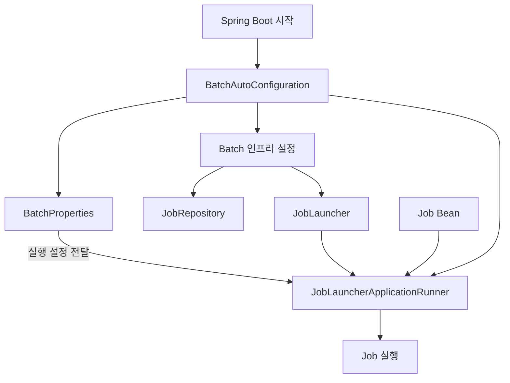
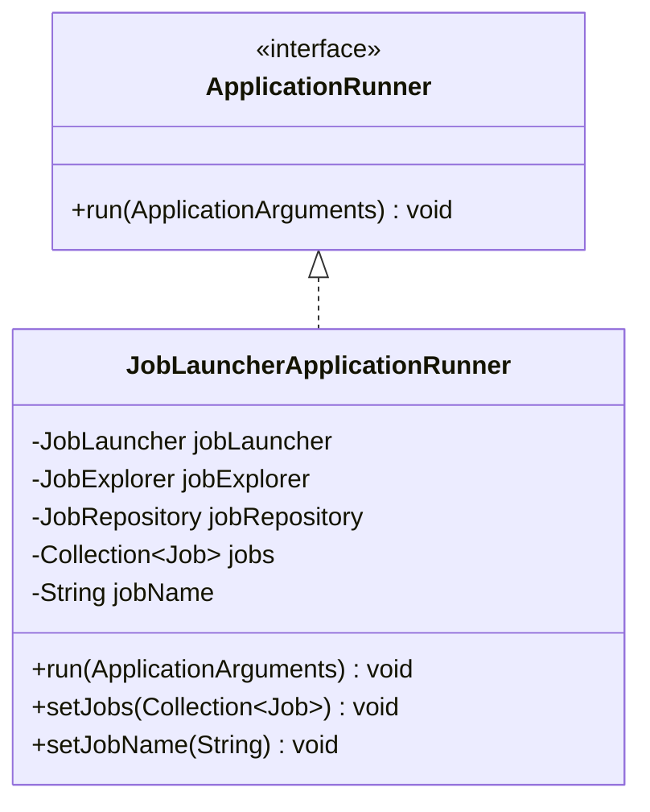
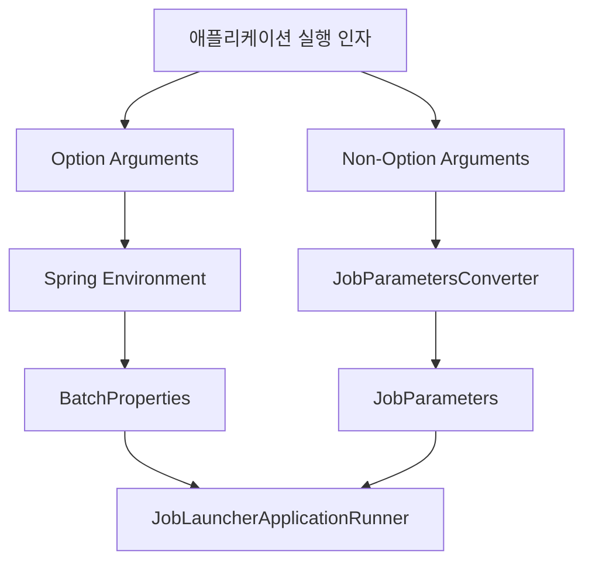
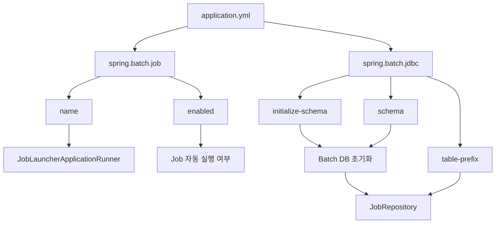

# 5. 스프링 배치 실행 - Job

# 5. 스프링 배치 실행 - Job

* toc
{:toc}

---

## 배치 초기화 설정

### Spring Batch 초기화 설정 이해: JobLauncherApplicationRunner와 BatchProperties, Job 선택 실행 원리

Spring Batch에서는 Job을 정의하고 JobLauncher를 통해 실행할 수 있다.

앞에서 살펴본 JobLauncher는 다음과 같은 메서드를 제공한다.

```java
JobExecution jobExecution =
        jobLauncher.run(
                job,
                jobParameters
        );
```

개발자는 이 메서드를 이용해 원하는 시점에 배치 작업을 실행할 수 있다.

그런데 Spring Boot와 Spring Batch를 함께 사용하면 조금 다른 상황이 발생한다.

다음과 같은 Job을 정의했다고 생각해보자.

```java
@Bean
public Job settlementJob(
        JobRepository jobRepository,
        Step settlementStep
) {
    return new JobBuilder("settlementJob", jobRepository)
            .start(settlementStep)
            .build();
}
```

개발자는 Job 객체만 정의했다.

JobLauncher를 직접 호출하는 코드는 작성하지 않았다.

그런데 Spring Boot 애플리케이션을 실행하면 해당 Job이 자동으로 실행될 수 있다.

```text
Spring Boot 애플리케이션 시작
             │
             ▼
Spring Container 초기화
             │
             ▼
Job Bean 생성
             │
             ▼
JobLauncher 준비
             │
             ▼
등록된 Job 자동 실행
```

이러한 동작은 Spring Boot의 Batch 자동 설정 기능과 관련이 있다.

Spring Boot는 Batch 인프라를 구성하고, 특정 조건을 만족하면 등록된 Job을 자동으로 실행하도록 지원한다.

이 과정에서 중요한 역할을 담당하는 클래스가 두 가지 있다.

첫 번째는 `JobLauncherApplicationRunner`다.

두 번째는 `BatchProperties`다.

JobLauncherApplicationRunner는 Spring Boot 애플리케이션 시작 과정에서 Job을 실행하는 역할을 담당한다.

BatchProperties는 `application.yml`이나 `application.properties`에 작성한 Spring Batch 관련 설정값을 관리한다.

두 클래스는 `BatchAutoConfiguration`을 통해 연결된다.

이번에는 이러한 초기화 구조를 살펴보고, 여러 Job을 등록했을 때 특정 Job만 선택해서 실행하는 방법과 실행 파라미터를 전달하는 방법까지 알아보자.

**개발 환경**

| 구분           | 기술                           |
| ------------ | ---------------------------- |
| Java         | Java 17                      |
| Spring Boot  | 3.4.13                       |
| Spring Batch | 5.2.4                        |
| Build Tool   | Maven                        |
| Database     | H2 / MySQL                   |
| Job 실행       | JobLauncherApplicationRunner |

---

### Spring Batch 초기화란?

Spring Batch 초기화는 배치 작업을 실행하기 위해 필요한 인프라와 설정을 준비하는 과정이다.

Spring Boot 애플리케이션이 시작되면 Spring Container는 등록된 설정 클래스와 Bean을 처리한다.

Spring Batch를 사용하는 프로젝트라면 이 과정에서 다음과 같은 컴포넌트가 준비된다.

| 컴포넌트                         | 역할                 |
| ---------------------------- | ------------------ |
| JobRepository                | 실행 메타데이터 저장 및 조회   |
| JobLauncher                  | Job 실행             |
| JobExplorer                  | 실행 메타데이터 조회        |
| JobOperator                  | Job 실행 및 운영 관련 기능  |
| Job                          | 배치 작업 정의           |
| Step                         | 개별 실행 단계 정의        |
| JobLauncherApplicationRunner | 애플리케이션 시작 시 Job 실행 |

Spring Boot는 필요한 조건이 충족되면 이러한 컴포넌트의 구성을 자동화한다.

예를 들어 다음 의존성이 있다고 생각해보자.

```xml
<dependency>
    <groupId>org.springframework.boot</groupId>
    <artifactId>spring-boot-starter-batch</artifactId>
</dependency>
```

이 의존성을 추가하면 Spring Batch 관련 클래스들이 프로젝트에 포함된다.

그리고 Spring Boot의 자동 설정 조건이 충족되면 Batch 인프라가 구성된다.

여기서 중요한 점은 **Spring Batch의 인프라를 초기화하는 것과 실제 Job을 실행하는 것은 서로 다른 과정**이라는 사실이다.

Spring Batch 인프라가 구성되었다고 해서 반드시 Job을 실행해야 하는 것은 아니다.

실제 자동 실행 여부는 별도의 설정을 통해 제어할 수 있다.

---

### Spring Batch 초기화의 전체 구조

Spring Boot에서 Batch 자동 설정이 적용될 때 주요 구성 요소의 관계는 다음과 같다.



먼저 Spring Boot가 애플리케이션을 시작한다.

이후 BatchAutoConfiguration이 적용되면 Spring Batch 인프라를 구성한다.

BatchProperties에는 외부 설정값이 바인딩된다.

그리고 자동 실행이 활성화되어 있다면 JobLauncherApplicationRunner가 준비된다.

Spring Container에 등록된 Job과 설정값을 이용해 실행 대상을 결정한다.

마지막으로 JobLauncher를 호출해 Job을 실행한다.

따라서 전체 과정을 다음과 같이 나눌 수 있다.

**첫 번째 단계는 Batch 인프라 초기화다.**

JobRepository, JobLauncher 등 실행에 필요한 객체들을 준비한다.

**두 번째 단계는 실행할 Job을 선택하는 과정이다.**

설정값과 등록된 Job Bean을 확인한다.

**세 번째 단계는 실제 Job 실행이다.**

JobLauncherApplicationRunner가 JobLauncher를 호출한다.

이 세 과정을 구분하면 Spring Batch의 자동 실행 구조를 이해하기 쉬워진다.

---

### BatchAutoConfiguration이란?

`BatchAutoConfiguration`은 Spring Boot에서 제공하는 Spring Batch 자동 설정 클래스다.

이 클래스는 Spring Batch를 사용하는 데 필요한 설정을 자동으로 구성하는 역할을 담당한다.

Spring Boot 3.4.13에서는 다음 패키지에 위치한다.

```java
org.springframework.boot.autoconfigure.batch
```

BatchAutoConfiguration은 여러 조건이 충족되었을 때 활성화된다.

대표적으로 다음과 같은 조건이 있다.

* Spring Batch 관련 클래스가 존재하는가?
* DataSource가 존재하는가?
* PlatformTransactionManager가 존재하는가?
* 사용자가 Batch 인프라를 직접 구성하지 않았는가?

조건이 충족되면 Spring Boot는 Batch 인프라를 구성한다.

여기서 `@EnableBatchProcessing`을 직접 선언하거나 `DefaultBatchConfiguration`을 확장한 경우에는 주의해야 한다.

Spring Boot 3.4에서는 이러한 수동 구성 방식이 Batch 자동 설정을 비활성화할 수 있다.

따라서 일반적인 Spring Boot 프로젝트에서는 먼저 자동 설정을 이용하는 것이 편리하다.

#### JobLauncherApplicationRunner Bean 생성

BatchAutoConfiguration에는 JobLauncherApplicationRunner를 생성하는 메서드가 존재한다.

Spring Boot 3.4.13의 핵심 구조를 단순화하면 다음과 같다.

```java
@Bean
@ConditionalOnMissingBean
@ConditionalOnProperty(
        prefix = "spring.batch.job",
        name = "enabled",
        havingValue = "true",
        matchIfMissing = true
)
public JobLauncherApplicationRunner jobLauncherApplicationRunner(
        JobLauncher jobLauncher,
        JobExplorer jobExplorer,
        JobRepository jobRepository,
        BatchProperties properties
) {

    JobLauncherApplicationRunner runner =
            new JobLauncherApplicationRunner(
                    jobLauncher,
                    jobExplorer,
                    jobRepository
            );

    String jobName =
            properties.getJob().getName();

    if (StringUtils.hasText(jobName)) {
        runner.setJobName(jobName);
    }

    return runner;
}
```

위 코드는 주요 동작을 설명하기 위한 형태다.

여기에서 중요한 부분이 두 군데 있다.

첫 번째는 다음 조건이다.

```java
@ConditionalOnProperty(
        prefix = "spring.batch.job",
        name = "enabled",
        havingValue = "true",
        matchIfMissing = true
)
```

이 조건은 Job 자동 실행 기능이 활성화되어 있는지 확인한다.

두 번째는 다음 코드다.

```java
String jobName =
        properties.getJob().getName();
```

BatchProperties에서 실행할 Job의 이름을 가져온다.

설정된 Job 이름이 있다면 Runner에 전달한다.

```java
runner.setJobName(jobName);
```

따라서 `application.yml`에서 Job 이름을 설정하면 JobLauncherApplicationRunner가 해당 이름을 이용해 실행할 Job을 선택하게 된다.

---

### JobLauncherApplicationRunner란?

`JobLauncherApplicationRunner`는 Spring Boot 애플리케이션 시작 과정에서 Spring Batch Job을 실행하는 클래스다.

Spring Boot의 `ApplicationRunner` 인터페이스를 구현한다.

ApplicationRunner는 Spring Boot가 애플리케이션을 시작하는 과정에서 호출하는 실행 인터페이스다.

핵심 메서드는 다음과 같다.

```java
void run(
        ApplicationArguments args
) throws Exception;
```

Spring Boot는 ApplicationRunner Bean을 찾아 애플리케이션 시작 과정에서 `run()` 메서드를 호출한다.

JobLauncherApplicationRunner도 이 구조를 이용한다.



JobLauncherApplicationRunner는 다음과 같은 객체들과 협력한다.

| 객체                     | 역할                          |
| ---------------------- | --------------------------- |
| JobLauncher            | Job 실행                      |
| JobExplorer            | 기존 실행 정보 조회                 |
| JobRepository          | 실행 이력 및 JobInstance 확인      |
| Job Collection         | 실행할 수 있는 Job 목록             |
| Job Name               | 선택적으로 실행할 Job 이름            |
| JobParametersConverter | 전달된 파라미터를 JobParameters로 변환 |

여기서 핵심은 JobLauncher다.

JobLauncherApplicationRunner가 실제 비즈니스 로직을 직접 실행하는 것은 아니다.

최종적으로 JobLauncher의 `run()` 메서드를 호출해 배치 작업을 시작한다.

---

### JobLauncherApplicationRunner는 언제 실행될까?

Spring Boot 애플리케이션은 시작 과정에서 여러 단계를 거친다.

대표적으로 다음과 같은 흐름이다.

```text
SpringApplication.run()
          │
          ▼
ApplicationContext 생성
          │
          ▼
Bean 등록 및 초기화
          │
          ▼
ApplicationContext 준비 완료
          │
          ▼
ApplicationRunner 실행
          │
          ▼
JobLauncherApplicationRunner.run()
          │
          ▼
Job 실행
```

여기서 중요한 점은 JobLauncherApplicationRunner가 Bean으로 생성되는 시점과 `run()` 메서드가 호출되는 시점이 다르다는 것이다.

JobLauncherApplicationRunner는 Spring Container의 Bean 초기화 과정에서 생성된다.

하지만 실제 Job 실행은 ApplicationRunner 호출 시점에 이루어진다.

따라서 다음 두 단계를 구분해야 한다.

```text
Bean 생성
   │
   └── 실행에 필요한 의존성 및 설정값 준비
```

```text
run() 호출
   │
   └── 실제 Job 실행
```

이러한 구조 덕분에 Spring Boot는 애플리케이션의 주요 Bean을 준비한 뒤 Job을 실행할 수 있다.

---

### JobLauncherApplicationRunner의 내부 실행 과정

JobLauncherApplicationRunner의 실행 흐름을 조금 더 자세히 살펴보자.

Spring Boot 3.4.13에서는 `run(ApplicationArguments)` 메서드를 통해 실행 인자를 전달받는다.

내부의 핵심 동작을 단순화하면 다음과 같다.

```java
@Override
public void run(
        ApplicationArguments args
) throws Exception {

    String[] jobArguments =
            args.getNonOptionArgs()
                    .toArray(new String[0]);

    run(jobArguments);
}
```

여기서 중요한 메서드는 다음이다.

```java
args.getNonOptionArgs()
```

Spring Boot에서 프로그램 실행 인자는 크게 두 가지로 구분할 수 있다.

첫 번째는 옵션 인자다.

```text
--spring.batch.job.name=batchJob1
```

두 번째는 일반 인자다.

```text
businessDate=2026-10-29
```

JobLauncherApplicationRunner는 `getNonOptionArgs()`를 이용해 일반 인자를 가져온다.

그리고 해당 값을 JobParameters로 변환한다.

따라서 옵션 인자와 JobParameters는 구분해야 한다.

---

### Spring Boot 옵션 인자와 JobParameters의 차이

예를 들어 다음 명령어를 실행한다고 생각해보자.

```bash
java -jar spring-batch-demo.jar \
  --spring.batch.job.name=batchJob1 \
  businessDate=2026-10-29
```

이 명령어에는 두 종류의 인자가 존재한다.

```text
--spring.batch.job.name=batchJob1
```

이 값은 Spring Boot의 설정값이다.

실행할 Job의 이름을 지정한다.

반면 다음 값은

```text
businessDate=2026-10-29
```

JobParameters로 변환된다.

따라서 다음과 같이 구분할 수 있다.

| 인자                                  | 유형             | 역할                |
| ----------------------------------- | -------------- | ----------------- |
| `--spring.batch.job.name=batchJob1` | Spring Boot 옵션 | 실행할 Job 선택        |
| `businessDate=2026-10-29`           | 일반 인자          | JobParameters로 전달 |

여기서 중요한 점은 `--`의 유무다.

Spring Boot는 `--`로 시작하는 명령행 옵션을 Environment 속성으로 처리한다.

반면 JobLauncherApplicationRunner는 일반 인자를 JobParameters로 변환한다.

이러한 구분을 이해하면 Job 선택 설정과 업무 파라미터를 명확하게 분리할 수 있다.

#### JobParameters 변환 과정

전체 흐름은 다음과 같다.



Job 이름은 BatchProperties에 바인딩된다.

업무 파라미터는 JobParameters로 변환된다.

이후 JobLauncherApplicationRunner가 두 정보를 이용해 Job을 실행한다.

---

### BatchProperties란?

`BatchProperties`는 Spring Boot에서 Spring Batch 관련 설정값을 관리하기 위한 클래스다.

다음 패키지에 위치한다.

```java
org.springframework.boot.autoconfigure.batch
```

Spring Boot 3.4.13의 BatchProperties는 다음 애너테이션을 사용한다.

```java
@ConfigurationProperties(
        prefix = "spring.batch"
)
```

이 애너테이션은 `spring.batch`로 시작하는 설정값을 객체의 속성에 바인딩하는 역할을 한다.

예를 들어 다음과 같은 설정이 있다고 생각해보자.

```yaml
spring:
  batch:
    job:
      name: batchJob1

    jdbc:
      initialize-schema: embedded
      table-prefix: BATCH_
```

Spring Boot는 이러한 설정값을 BatchProperties와 관련 설정 객체에 바인딩한다.

개념적으로 다음과 같은 구조다.

```text
BatchProperties
       │
       ├── Job
       │     │
       │     └── name
       │
       └── Jdbc
             │
             ├── initializeSchema
             ├── tablePrefix
             ├── schema
             ├── platform
             └── isolationLevelForCreate
```

여기서 Job 이름과 JDBC 메타데이터 설정을 구분하고 있다.

Job 관련 설정은 실행할 Job을 선택하는 데 사용된다.

JDBC 관련 설정은 Batch 메타데이터 저장소의 초기화 및 구성에 사용된다.

---

### BatchProperties의 주요 설정값

Spring Boot 3.4.13에서 자주 사용하는 설정은 다음과 같다.

| 설정                                             | 역할                        | 기본값          |
| ---------------------------------------------- | ------------------------- | ------------ |
| `spring.batch.job.name`                        | 시작 시 실행할 Job 이름           | 미지정          |
| `spring.batch.job.enabled`                     | Job 자동 실행 여부              | true         |
| `spring.batch.jdbc.initialize-schema`          | 메타데이터 스키마 초기화 방식          | embedded     |
| `spring.batch.jdbc.schema`                     | 스키마 초기화 SQL 경로            | 기본 스키마 경로    |
| `spring.batch.jdbc.platform`                   | 스키마 초기화에 사용할 DB 플랫폼       | 자동 감지        |
| `spring.batch.jdbc.table-prefix`               | 메타데이터 테이블 Prefix          | BATCH_       |
| `spring.batch.jdbc.isolation-level-for-create` | Job 메타데이터 생성 시 트랜잭션 격리 수준 | 기본 인프라 설정 사용 |

여기서 한 가지 구분할 부분이 있다.

`spring.batch.job.enabled`는 자동 실행 Runner의 생성 여부를 결정하는 설정이다.

BatchProperties의 Job 내부에 반드시 `enabled`라는 필드가 있어야만 적용되는 구조는 아니다.

Spring Boot의 `@ConditionalOnProperty`가 해당 Environment 속성을 직접 확인해 조건을 평가한다.

반면 `spring.batch.job.name`은 BatchProperties의 Job 객체에 바인딩되어 Runner의 실행 대상 선택에 사용된다.

이 차이를 이해하면 설정값이 Spring Boot 내부에서 어떻게 적용되는지 더 명확하게 파악할 수 있다.

---

### spring.batch.job.name 설정

`spring.batch.job.name`은 애플리케이션 시작 시 실행할 Job의 이름을 지정하는 설정이다.

예를 들어 다음과 같이 설정할 수 있다.

```yaml
spring:
  batch:
    job:
      name: batchJob1
```

이 설정은 `batchJob1`이라는 이름의 Job을 자동 실행 대상으로 지정한다.

여기서 중요한 것은 **Spring Bean의 이름과 Job의 이름이 반드시 같지는 않다는 사실**이다.

예를 들어 다음 코드를 살펴보자.

```java
@Bean("firstJobBean")
public Job batchJob1(
        JobRepository jobRepository,
        Step step1
) {
    return new JobBuilder(
            "batchJob1",
            jobRepository
    )
            .start(step1)
            .build();
}
```

이 코드에서 Spring Bean 이름은 다음과 같다.

```text
firstJobBean
```

하지만 실제 Job의 이름은 다음과 같다.

```text
batchJob1
```

Job 이름은 JobBuilder에 전달한 값이다.

```java
new JobBuilder(
        "batchJob1",
        jobRepository
)
```

JobLauncherApplicationRunner가 비교하는 이름은 기본적으로 다음 메서드가 반환하는 값이다.

```java
job.getName()
```

따라서 실행할 Job을 지정할 때는 Bean 이름이 아니라 **실제 Job의 이름**을 기준으로 설정해야 한다.

---

### 여러 Job이 등록되어 있으면 어떻게 될까?

이번에는 하나의 애플리케이션에 여러 Job이 등록되어 있다고 생각해보자.

```text
Spring Container
       │
       ├── batchJob1
       │
       ├── batchJob2
       │
       └── batchJob3
```

Spring Boot는 이 Job들을 Bean으로 관리한다.

JobLauncherApplicationRunner는 등록된 Job 객체들을 전달받을 수 있다.

다만 이 지점에서 Spring Boot 버전에 따른 차이를 주의해야 한다.

**Spring Boot 3.4.13에서는 여러 Job Bean이 존재하는 경우 기본적으로 실행할 Job 이름을 지정해야 한다.**

Job 이름이 지정되지 않았다면 애플리케이션 시작 과정에서 검증 오류가 발생할 수 있다.

대표적인 오류 메시지는 다음과 같다.

```text
Job name must be specified in case of multiple jobs
```

이 오류는 여러 Job이 존재하는데 실행할 Job이 지정되지 않았기 때문에 발생한다.

따라서 다음과 같이 설정해야 한다.

```yaml
spring:
  batch:
    job:
      name: batchJob1
```

이렇게 설정하면 batchJob1이 자동 실행 대상으로 선택된다.

#### Job 개수에 따른 동작

| 등록된 Job 수 | Job 이름 설정     | Spring Boot 3.4 동작 |
| --------- | ------------- | ------------------ |
| 1개        | 미설정           | 해당 Job 자동 실행       |
| 1개        | 올바른 이름 설정     | 지정한 Job 실행         |
| 2개 이상     | 미설정           | 초기화 검증 오류 가능       |
| 2개 이상     | 올바른 이름 설정     | 지정한 Job 실행         |
| 2개 이상     | 존재하지 않는 이름 설정 | Job 이름 검증 오류       |

따라서 여러 Job이 등록되어 있을 때 아무런 설정 없이 모든 Job이 자동 실행된다고 이해하면 안 된다.

---

### JobLauncherApplicationRunner는 실행할 Job을 어떻게 선택할까?

JobLauncherApplicationRunner는 내부적으로 등록된 Job 목록과 설정된 Job 이름을 이용한다.

Spring Boot 3.4.13의 핵심 구조를 살펴보면 다음과 같다.

```java
private String jobName;

private Collection<Job> jobs =
        Collections.emptySet();
```

Job 이름을 저장하는 속성이 있다.

그리고 등록된 Job을 저장하는 Collection이 있다.

Spring은 Job Bean들을 해당 Collection에 주입할 수 있다.

```java
@Autowired(required = false)
public void setJobs(
        Collection<Job> jobs
) {
    this.jobs = jobs;
}
```

이후 실행 시 등록된 Job 목록을 순회한다.

핵심 로직을 단순화하면 다음과 같다.

```java
for (Job job : jobs) {

    if (StringUtils.hasText(jobName)) {

        if (!jobName.equals(job.getName())) {
            continue;
        }
    }

    execute(job, jobParameters);
}
```

이 코드에서 중요한 부분은 다음이다.

```java
jobName.equals(job.getName())
```

설정한 Job 이름과 실제 Job의 이름을 비교한다.

일치하지 않으면 해당 Job을 건너뛴다.

```java
continue;
```

이름이 일치하면 실행한다.

```java
execute(job, jobParameters);
```

따라서 JobLauncherApplicationRunner는 등록된 모든 Job을 무조건 실행하는 것이 아니라 설정된 Job 이름을 기준으로 실행 대상을 선택할 수 있다.

다만 Spring Boot 3.4에서는 이 반복문에 도달하기 전에 여러 Job에 대한 설정 검증도 수행한다.

---

### JobLauncherApplicationRunner의 초기화 검증

JobLauncherApplicationRunner는 `InitializingBean`도 구현한다.

따라서 초기화 과정에서 `afterPropertiesSet()` 메서드가 호출된다.

Spring Boot 3.4.13의 주요 검증 조건은 다음과 같은 의미를 가진다.

```java
jobs.size() <= 1
        || StringUtils.hasText(jobName)
```

등록된 Job이 하나 이하라면 Job 이름 없이도 허용된다.

하지만 Job이 두 개 이상이라면 Job 이름이 지정되어 있어야 한다.

또한 Job 이름이 지정되어 있다면 실제로 해당 Job이 존재하는지도 확인한다.

따라서 다음과 같은 설정은 문제가 발생할 수 있다.

```yaml
spring:
  batch:
    job:
      name: unknownJob
```

실제로 `unknownJob`이라는 Job이 존재하지 않는다면 검증 오류가 발생한다.

이 동작은 존재하지 않는 Job 이름을 전달하면 아무 일도 하지 않고 정상적으로 종료될 것이라고 가정하는 것과 다르다.

운영 환경에서는 오히려 이러한 검증이 유용하다.

잘못된 Job 이름을 설정했는데도 실행 성공으로 처리되는 상황을 방지할 수 있기 때문이다.

---

### spring.batch.job.names와 spring.batch.job.name의 차이

Spring Batch 관련 코드를 살펴보면 다음과 같은 설정을 사용하는 사례를 발견할 수 있다.

```yaml
spring:
  batch:
    job:
      names: batchJob1
```

하지만 Spring Boot 3.4.13에서는 이 설정을 기준으로 구현하면 안 된다.

현재 버전에서는 다음 속성을 사용한다.

```yaml
spring:
  batch:
    job:
      name: batchJob1
```

두 설정의 차이는 단순히 복수형과 단수형의 차이가 아니다.

과거 Spring Boot에서는 여러 Job 이름을 지정하는 방식이 사용되었다.

반면 Spring Boot 3.4에서는 단일 Job 이름을 지정하는 API를 사용한다.

정리하면 다음과 같다.

| 구분          | 과거 Spring Boot 방식        | Spring Boot 3.4         |
| ----------- | ------------------------ | ----------------------- |
| Job 선택 속성   | `spring.batch.job.names` | `spring.batch.job.name` |
| 선택 대상       | 여러 Job 이름을 지원하던 방식       | 단일 Job 이름               |
| 내부 설정       | 여러 이름을 처리하는 구조           | `setJobName()`          |
| 복수 Job 등록 시 | 버전에 따라 다름                | 실행할 Job 이름 지정 필요        |

따라서 다음과 같은 설정도 주의해야 한다.

```yaml
spring:
  batch:
    job:
      name: batchJob1,batchJob2
```

Spring Boot 3.4의 기본 JobLauncherApplicationRunner가 이 값을 두 개의 Job 이름으로 분리해 실행하는 것은 아니다.

하나의 Job 이름 문자열로 취급할 수 있다.

따라서 실제 Job 이름과 일치하지 않아 검증 오류가 발생한다.

**Spring Boot 3.4에서 여러 Job을 실행해야 한다면 별도의 실행 흐름을 직접 구성하는 것이 명확하다.**

---

### 실제 Job 초기화와 선택 실행 구현하기

이번에는 실제 Spring Boot 프로젝트를 구성해보자.

다음과 같은 두 개의 Job을 생성한다.

```text
Spring Container
       │
       ├── batchJob1
       │      │
       │      ├── batchJob1Step1
       │      │
       │      └── batchJob1Step2
       │
       └── batchJob2
              │
              ├── batchJob2Step1
              │
              └── batchJob2Step2
```

두 Job은 모두 Spring Bean으로 등록한다.

그리고 애플리케이션 실행 시 설정한 이름에 따라 원하는 Job만 실행하도록 구성한다.

확인할 내용은 다음과 같다.

첫 번째는 BatchAutoConfiguration에 의해 JobLauncherApplicationRunner가 생성되는 과정이다.

두 번째는 BatchProperties에 Job 이름이 바인딩되는 과정이다.

세 번째는 설정한 이름과 실제 Job 이름을 비교하는 과정이다.

네 번째는 프로그램 실행 인자가 JobParameters로 전달되는 과정이다.

---

### Maven 의존성 설정

먼저 프로젝트에 필요한 의존성을 구성한다.

이번 예제에서는 H2 인메모리 데이터베이스를 사용한다.

`pom.xml`

```xml
<?xml version="1.0" encoding="UTF-8"?>
<project xmlns="http://maven.apache.org/POM/4.0.0"
         xmlns:xsi="http://www.w3.org/2001/XMLSchema-instance"
         xsi:schemaLocation="
             http://maven.apache.org/POM/4.0.0
             https://maven.apache.org/xsd/maven-4.0.0.xsd">

    <modelVersion>4.0.0</modelVersion>

    <parent>
        <groupId>org.springframework.boot</groupId>
        <artifactId>spring-boot-starter-parent</artifactId>
        <version>3.4.13</version>
        <relativePath/>
    </parent>

    <groupId>com.example</groupId>
    <artifactId>spring-batch-demo</artifactId>
    <version>0.0.1-SNAPSHOT</version>

    <properties>
        <java.version>17</java.version>
        <spring-batch.version>5.2.4</spring-batch.version>
    </properties>

    <dependencies>

        <dependency>
            <groupId>org.springframework.boot</groupId>
            <artifactId>spring-boot-starter-batch</artifactId>
        </dependency>

        <dependency>
            <groupId>com.h2database</groupId>
            <artifactId>h2</artifactId>
            <scope>runtime</scope>
        </dependency>

    </dependencies>

    <build>
        <plugins>
            <plugin>
                <groupId>org.springframework.boot</groupId>
                <artifactId>spring-boot-maven-plugin</artifactId>
            </plugin>
        </plugins>
    </build>

</project>
```

이 설정에서 중요한 의존성은 다음이다.

```xml
<dependency>
    <groupId>org.springframework.boot</groupId>
    <artifactId>spring-boot-starter-batch</artifactId>
</dependency>
```

Spring Batch 관련 기능을 사용하기 위한 의존성이다.

그리고 H2 데이터베이스를 추가했다.

```xml
<dependency>
    <groupId>com.h2database</groupId>
    <artifactId>h2</artifactId>
    <scope>runtime</scope>
</dependency>
```

이번에는 별도의 MySQL 서버 없이 JobRepository의 메타데이터 테이블을 생성하고 실행 결과를 확인한다.

---

### JobConfiguration 전체 코드

다음과 같이 두 개의 Job과 네 개의 Step을 정의한다.

`JobConfiguration.java`

```java
package com.example.batch;

import org.slf4j.Logger;
import org.slf4j.LoggerFactory;

import org.springframework.batch.core.Job;
import org.springframework.batch.core.Step;

import org.springframework.batch.core.job.builder.JobBuilder;
import org.springframework.batch.core.repository.JobRepository;
import org.springframework.batch.core.step.builder.StepBuilder;

import org.springframework.batch.repeat.RepeatStatus;

import org.springframework.beans.factory.annotation.Qualifier;
import org.springframework.context.annotation.Bean;
import org.springframework.context.annotation.Configuration;

import org.springframework.transaction.PlatformTransactionManager;

@Configuration
public class JobConfiguration {

    private static final Logger log =
            LoggerFactory.getLogger(JobConfiguration.class);

    @Bean
    public Job batchJob1(
            JobRepository jobRepository,
            @Qualifier("batchJob1Step1") Step step1,
            @Qualifier("batchJob1Step2") Step step2
    ) {
        return new JobBuilder("batchJob1", jobRepository)
                .start(step1)
                .next(step2)
                .build();
    }

    @Bean
    public Job batchJob2(
            JobRepository jobRepository,
            @Qualifier("batchJob2Step1") Step step1,
            @Qualifier("batchJob2Step2") Step step2
    ) {
        return new JobBuilder("batchJob2", jobRepository)
                .start(step1)
                .next(step2)
                .build();
    }

    @Bean
    public Step batchJob1Step1(
            JobRepository jobRepository,
            PlatformTransactionManager transactionManager
    ) {
        return new StepBuilder(
                "batchJob1Step1",
                jobRepository
        )
                .tasklet((contribution, chunkContext) -> {

                    log.info("Batch Job 1 - Step 1 실행");

                    return RepeatStatus.FINISHED;

                }, transactionManager)
                .build();
    }

    @Bean
    public Step batchJob1Step2(
            JobRepository jobRepository,
            PlatformTransactionManager transactionManager
    ) {
        return new StepBuilder(
                "batchJob1Step2",
                jobRepository
        )
                .tasklet((contribution, chunkContext) -> {

                    log.info("Batch Job 1 - Step 2 실행");

                    return RepeatStatus.FINISHED;

                }, transactionManager)
                .build();
    }

    @Bean
    public Step batchJob2Step1(
            JobRepository jobRepository,
            PlatformTransactionManager transactionManager
    ) {
        return new StepBuilder(
                "batchJob2Step1",
                jobRepository
        )
                .tasklet((contribution, chunkContext) -> {

                    log.info("Batch Job 2 - Step 1 실행");

                    return RepeatStatus.FINISHED;

                }, transactionManager)
                .build();
    }

    @Bean
    public Step batchJob2Step2(
            JobRepository jobRepository,
            PlatformTransactionManager transactionManager
    ) {
        return new StepBuilder(
                "batchJob2Step2",
                jobRepository
        )
                .tasklet((contribution, chunkContext) -> {

                    log.info("Batch Job 2 - Step 2 실행");

                    return RepeatStatus.FINISHED;

                }, transactionManager)
                .build();
    }
}
```

이 코드는 두 개의 Job을 Spring Bean으로 등록한다.

첫 번째 Job의 이름은 다음과 같다.

```text
batchJob1
```

두 번째 Job의 이름은 다음과 같다.

```text
batchJob2
```

두 Job은 서로 다른 Step을 사용한다.

따라서 어떤 Job이 실행되었는지 로그를 통해 구분할 수 있다.

---

### application.yml 설정

이제 실행할 Job을 선택하기 위한 설정을 작성한다.

`application.yml`

```yaml
spring:
  application:
    name: spring-batch-demo

  main:
    web-application-type: none

  datasource:
    url: jdbc:h2:mem:batchdb;DB_CLOSE_DELAY=-1
    driver-class-name: org.h2.Driver
    username: sa
    password:

  batch:
    job:
      enabled: true
      name: ${batch.job.name:batchJob1}

    jdbc:
      initialize-schema: embedded
```

이 설정에서 중요한 부분은 다음이다.

```yaml
spring:
  batch:
    job:
      enabled: true
```

Spring Boot의 Job 자동 실행 기능을 활성화한다.

그리고 다음 설정을 사용했다.

```yaml
name: ${batch.job.name:batchJob1}
```

이 표현식은 외부 설정값을 이용해 실행할 Job 이름을 결정한다.

`batch.job.name`이라는 설정값이 존재하면 해당 값을 사용한다.

없다면 기본값으로 `batchJob1`을 사용한다.

따라서 별도의 설정을 전달하지 않으면 batchJob1이 실행된다.

반면 실행 시점에 다음 설정을 전달하면

```text
--batch.job.name=batchJob2
```

batchJob2가 선택된다.

이처럼 외부 설정값을 이용하면 애플리케이션을 다시 빌드하지 않고도 실행할 Job을 변경할 수 있다.

---

### 첫 번째 실행: 기본 Job 실행하기

먼저 프로젝트를 빌드한다.

```bash
./mvnw clean package
```

이 명령어는 기존 빌드 결과를 정리하고 프로젝트를 빌드한다.

정상적으로 완료되면 실행 가능한 JAR 파일이 생성된다.

이제 다음 명령어를 실행한다.

```bash
java -jar target/spring-batch-demo-0.0.1-SNAPSHOT.jar \
  businessDate=2026-10-29
```

이 명령어에서는 별도로 Job 이름을 지정하지 않았다.

따라서 application.yml의 기본값이 사용된다.

```yaml
name: ${batch.job.name:batchJob1}
```

최종적으로 다음 Job이 선택된다.

```text
batchJob1
```

#### 실행 결과

정상적으로 실행되면 다음과 유사한 로그를 확인할 수 있다.

```text
Running default command line with:
[businessDate=2026-10-29]

Job: [SimpleJob: [name=batchJob1]]
launched with the following parameters

Executing step: [batchJob1Step1]

Batch Job 1 - Step 1 실행

Executing step: [batchJob1Step2]

Batch Job 1 - Step 2 실행

Job: [SimpleJob: [name=batchJob1]]
completed with status: [COMPLETED]
```

위 로그는 주요 실행 흐름을 중심으로 정리한 예시다.

실제 출력 형식과 메시지는 로깅 설정에 따라 달라질 수 있다.

여기서 중요한 사실은 두 개의 Job이 Bean으로 등록되어 있지만 batchJob1만 실행되었다는 점이다.

batchJob2는 실행되지 않았다.

이것이 JobLauncherApplicationRunner의 Job 선택 기능이다.

---

### 두 번째 실행: 외부 인자로 Job 변경하기

이번에는 batchJob2를 실행해보자.

애플리케이션을 수정하거나 다시 빌드할 필요는 없다.

실행 인자만 변경하면 된다.

```bash
java -jar target/spring-batch-demo-0.0.1-SNAPSHOT.jar \
  --batch.job.name=batchJob2 \
  businessDate=2026-10-29
```

이번에는 다음 설정을 전달했다.

```text
--batch.job.name=batchJob2
```

따라서 application.yml의 표현식에 batchJob2가 바인딩된다.

```yaml
name: ${batch.job.name:batchJob1}
```

최종적으로 다음과 같은 설정이 적용되는 것이다.

```yaml
spring:
  batch:
    job:
      name: batchJob2
```

#### 실행 결과

정상적으로 실행되면 다음과 유사한 로그를 확인할 수 있다.

```text
Job: [SimpleJob: [name=batchJob2]]
launched with the following parameters

Executing step: [batchJob2Step1]

Batch Job 2 - Step 1 실행

Executing step: [batchJob2Step2]

Batch Job 2 - Step 2 실행

Job: [SimpleJob: [name=batchJob2]]
completed with status: [COMPLETED]
```

batchJob1은 실행되지 않는다.

반면 batchJob2에 등록된 두 Step이 실행된다.

이렇게 외부 설정을 이용하면 동일한 애플리케이션에서 원하는 Job만 선택적으로 실행할 수 있다.

---

### 프로그램 인자가 JobParameters로 전달되는 과정

앞선 예제에서는 다음 인자를 전달했다.

```text
businessDate=2026-10-29
```

이 값은 Spring Boot의 Environment 설정값이 아니라 JobParameters로 사용된다.

JobLauncherApplicationRunner는 일반 인자를 가져와 JobParametersConverter에 전달한다.

개념적인 흐름은 다음과 같다.

```text
프로그램 실행 인자
       │
       ▼
businessDate=2026-10-29
       │
       ▼
ApplicationArguments
       │
       ▼
getNonOptionArgs()
       │
       ▼
JobParametersConverter
       │
       ▼
JobParameters
       │
       ▼
JobLauncher.run()
```

따라서 실제 Tasklet에서도 해당 값을 조회할 수 있다.

다음 코드를 살펴보자.

```java
String businessDate =
        contribution
                .getStepExecution()
                .getJobParameters()
                .getString("businessDate");
```

이 코드에서는 현재 StepExecution을 통해 JobParameters를 가져온다.

그리고 businessDate 값을 조회한다.

결과는 다음과 같다.

```text
2026-10-29
```

따라서 실행할 Job 이름과 비즈니스 파라미터를 구분해서 전달할 수 있다.

```bash
java -jar target/spring-batch-demo-0.0.1-SNAPSHOT.jar \
  --batch.job.name=batchJob1 \
  businessDate=2026-10-29 \
  merchantId=1001
```

여기서 Job 선택 설정은 다음과 같다.

```text
batch.job.name=batchJob1
```

반면 JobParameters는 다음과 같다.

```text
businessDate=2026-10-29

merchantId=1001
```

이러한 방식은 정산 기준일이나 처리 대상 가맹점을 외부에서 전달하는 배치에 활용할 수 있다.

---

### 잘못된 Job 이름을 전달하면 어떻게 될까?

이번에는 존재하지 않는 Job 이름을 전달한다고 생각해보자.

```bash
java -jar target/spring-batch-demo-0.0.1-SNAPSHOT.jar \
  --batch.job.name=unknownJob \
  businessDate=2026-10-29
```

현재 등록된 Job은 두 개다.

```text
batchJob1

batchJob2
```

하지만 실행 인자로 전달한 이름은 다음과 같다.

```text
unknownJob
```

실제로 존재하지 않는 이름이다.

이 경우 Spring Boot 3.4.13의 JobLauncherApplicationRunner는 초기화 과정에서 설정한 Job 이름이 존재하는지 확인한다.

따라서 다음과 유사한 오류가 발생할 수 있다.

```text
No job found with name 'unknownJob'
```

이러한 검증은 잘못된 Job이 실행되는 상황을 방지한다.

특히 운영 환경에서는 존재하지 않는 Job 이름을 전달했는데 애플리케이션이 정상 종료되는 것보다 명확하게 오류를 확인할 수 있는 편이 안전하다.

---

### spring.batch.job.enabled 설정

이번에는 Job 자동 실행을 비활성화하는 방법을 살펴보자.

Spring Boot에서는 다음 설정을 제공한다.

```yaml
spring:
  batch:
    job:
      enabled: false
```

이 설정은 Spring Boot의 Job 자동 실행을 비활성화한다.

따라서 Job Bean이 등록되어 있더라도 애플리케이션 시작 과정에서 자동으로 Job을 실행하지 않는다.

여기서 중요한 사실은 **JobLauncher가 제거되는 것은 아니라는 점**이다.

JobLauncher와 JobRepository 등의 Batch 인프라는 계속 사용할 수 있다.

따라서 개발자가 직접 다음 코드를 호출하면 Job을 실행할 수 있다.

```java
jobLauncher.run(
        job,
        jobParameters
);
```

즉 `spring.batch.job.enabled=false`는 Spring Batch 사용 자체를 비활성화하는 설정이 아니다.

Spring Boot가 제공하는 자동 실행 기능을 비활성화하는 설정이다.

#### 자동 실행 설정 비교

| 설정               | 동작                    |
| ---------------- | --------------------- |
| `enabled: true`  | Job 자동 실행 Runner 활성화  |
| `enabled: false` | Job 자동 실행 Runner 비활성화 |
| 설정 생략            | 기본적으로 자동 실행 활성화       |

예를 들어 HTTP API를 이용해 Job을 실행하는 프로젝트라면 일반적으로 자동 실행을 비활성화하는 것이 좋다.

반면 애플리케이션 시작과 동시에 특정 Job을 실행하는 배치 전용 애플리케이션에서는 자동 실행을 활용할 수 있다.

---

### spring.batch.jdbc.initialize-schema 설정

Spring Batch는 실행 메타데이터를 저장하기 위한 테이블을 사용한다.

대표적으로 다음과 같은 테이블이 있다.

```text
BATCH_JOB_INSTANCE

BATCH_JOB_EXECUTION

BATCH_STEP_EXECUTION

BATCH_JOB_EXECUTION_CONTEXT

BATCH_STEP_EXECUTION_CONTEXT
```

JDBC 기반 JobRepository는 이러한 테이블을 이용해 실행 이력과 재시작 정보를 관리한다.

따라서 JobRepository를 사용하려면 메타데이터 스키마가 필요하다.

Spring Boot는 이를 위한 초기화 설정을 제공한다.

```yaml
spring:
  batch:
    jdbc:
      initialize-schema: embedded
```

이 설정은 메타데이터 스키마를 언제 초기화할지 결정한다.

#### initialize-schema의 주요 설정값

| 값        | 설명                                 |
| -------- | ---------------------------------- |
| always   | 지원되는 데이터베이스에서 시작 시 스키마 초기화 스크립트 실행 |
| embedded | H2 등 임베디드 DB 환경에서 초기화              |
| never    | 스키마 자동 초기화 비활성화                    |

개발 환경에서 H2를 사용하는 경우에는 다음 설정이 편리하다.

```yaml
spring:
  batch:
    jdbc:
      initialize-schema: embedded
```

반면 운영 환경에서 MySQL을 사용한다면 다음과 같이 구성할 수 있다.

```yaml
spring:
  batch:
    jdbc:
      initialize-schema: never
```

이 경우 메타데이터 테이블을 별도로 준비해야 한다.

#### always 설정의 주의점

다음 설정을 사용하면 애플리케이션 시작 시 스키마 초기화 SQL을 실행하도록 구성할 수 있다.

```yaml
spring:
  batch:
    jdbc:
      initialize-schema: always
```

하지만 운영 중인 데이터베이스에 무조건 사용하는 것은 적절하지 않다.

기존 테이블이 있는 환경에서 초기화 SQL이 다시 실행되면 오류가 발생할 수 있다.

또한 스키마 변경이 필요한 상황이라면 단순한 자동 초기화보다 명시적인 마이그레이션 방식이 안전하다.

실무에서는 Flyway나 Liquibase 같은 데이터베이스 마이그레이션 도구를 고려할 수 있다.

---

### spring.batch.jdbc.table-prefix 설정

Spring Batch의 메타데이터 테이블은 기본적으로 `BATCH_`라는 Prefix를 사용한다.

예를 들어 다음과 같다.

```text
BATCH_JOB_INSTANCE

BATCH_JOB_EXECUTION

BATCH_STEP_EXECUTION
```

하지만 프로젝트에 따라 다른 Prefix를 사용하고 싶을 수 있다.

예를 들어 정산 배치와 통계 배치가 서로 다른 메타데이터 테이블을 사용해야 한다고 생각해보자.

```text
정산 배치
    │
    ├── SETTLEMENT_JOB_INSTANCE
    └── SETTLEMENT_JOB_EXECUTION
```

```text
통계 배치
    │
    ├── STATISTICS_JOB_INSTANCE
    └── STATISTICS_JOB_EXECUTION
```

Spring Boot에서는 다음 설정을 이용해 Prefix를 변경할 수 있다.

```yaml
spring:
  batch:
    jdbc:
      table-prefix: SYSTEM_
```

이렇게 설정하면 JDBC 기반 JobRepository는 `SYSTEM_`으로 시작하는 메타데이터 테이블을 사용하도록 구성된다.

예를 들어 다음과 같은 테이블을 조회한다.

```text
SYSTEM_JOB_INSTANCE

SYSTEM_JOB_EXECUTION

SYSTEM_STEP_EXECUTION
```

여기서 중요한 점은 **설정값만 변경한다고 해서 실제 데이터베이스 테이블 이름이 변경되는 것은 아니라는 사실**이다.

기존 데이터베이스에 BATCH_ 테이블만 존재한다면 SYSTEM_ 테이블을 찾는 과정에서 오류가 발생할 수 있다.

---

### 테이블 Prefix와 스키마 초기화의 관계

다음과 같은 설정을 사용한다고 생각해보자.

```yaml
spring:
  batch:
    jdbc:
      initialize-schema: embedded
      table-prefix: SYSTEM_
```

이 설정은 한 가지 주의할 부분이 있다.

JobRepository는 `SYSTEM_` Prefix를 사용한다.

하지만 기본 스키마 초기화 스크립트는 일반적으로 `BATCH_`라는 이름으로 테이블을 생성한다.

따라서 Prefix만 변경하면 실제 생성된 테이블과 JobRepository가 조회하는 테이블 이름이 달라질 수 있다.

```text
기본 스키마 초기화
       │
       ▼
BATCH_JOB_INSTANCE 생성
```

```text
JobRepository 설정
       │
       ▼
SYSTEM_JOB_INSTANCE 조회
       │
       ▼
테이블 없음
       │
       ▼
오류 발생
```

이를 해결하려면 Prefix에 맞는 스키마를 별도로 준비해야 한다.

예를 들어 `schema-system.sql` 파일을 작성할 수 있다.

이 파일에는 사용하는 Spring Batch 버전의 공식 스키마를 기준으로 Prefix를 변경한 전체 테이블 및 시퀀스 생성 SQL이 포함되어야 한다.

그리고 다음과 같이 설정할 수 있다.

```yaml
spring:
  batch:
    jdbc:
      initialize-schema: always
      schema: classpath:sql/schema-system.sql
      table-prefix: SYSTEM_
```

이 설정에서는 사용자 정의 스키마 초기화 SQL을 사용한다.

다만 실제 SQL 파일에는 JobInstance, JobExecution, StepExecution, ExecutionContext 관련 테이블뿐 아니라 사용하는 데이터베이스에 필요한 시퀀스 관련 구조도 포함되어야 한다.

운영 환경에서는 해당 스키마를 자동 생성하기보다 마이그레이션 도구로 관리하는 것이 더 적절할 수 있다.

---

### Spring Batch의 초기화 설정 전체 구조

지금까지 살펴본 설정값을 하나의 구조로 정리해보자.



Job 관련 설정은 자동 실행 대상과 실행 여부를 결정한다.

JDBC 관련 설정은 메타데이터 저장소의 초기화 및 접근 방식에 영향을 준다.

따라서 Spring Batch 초기화 설정은 크게 두 가지 영역으로 나누어 이해할 수 있다.

**첫 번째는 Job 실행 제어 설정이다.**

```yaml
spring:
  batch:
    job:
      enabled: true
      name: batchJob1
```

**두 번째는 메타데이터 저장소 설정이다.**

```yaml
spring:
  batch:
    jdbc:
      initialize-schema: never
      table-prefix: BATCH_
```

이러한 구분을 이해하면 실행 관련 문제와 데이터베이스 관련 문제를 분리해서 분석할 수 있다.

---

### 여러 Job을 한 번에 실행하려면?

앞에서 Spring Boot 3.4에서는 여러 Job이 등록된 경우 기본적으로 실행할 Job 하나를 지정해야 한다고 설명했다.

그렇다면 여러 Job을 하나의 애플리케이션 실행 과정에서 모두 실행하려면 어떻게 해야 할까?

예를 들어 다음과 같은 작업을 수행해야 한다고 생각해보자.

```text
Spring Boot 시작
       │
       ▼
batchJob1 실행
       │
       ▼
batchJob2 실행
       │
       ▼
애플리케이션 종료
```

이러한 요구사항은 기본 JobLauncherApplicationRunner에 쉼표로 여러 이름을 전달하는 대신 별도의 실행 흐름을 구성하는 방식으로 해결할 수 있다.

대표적인 방법은 다음과 같다.

* ApplicationRunner에서 여러 Job을 순서대로 실행한다.
* 하나의 상위 Job을 구성하고 여러 Step으로 작업을 연결한다.
* JobStep을 이용해 다른 Job을 실행한다.
* 스케줄러에서 Job별 실행 순서를 관리한다.

이번에는 ApplicationRunner를 직접 구현하는 방법을 살펴보자.

---

### ApplicationRunner로 여러 Job 순차 실행하기

먼저 Spring Boot의 기본 Job 자동 실행을 비활성화한다.

```yaml
spring:
  batch:
    job:
      enabled: false
```

그리고 별도의 ApplicationRunner를 정의한다.

`MultipleJobRunner.java`

```java
package com.example.batch;

import java.util.List;

import org.slf4j.Logger;
import org.slf4j.LoggerFactory;

import org.springframework.batch.core.BatchStatus;
import org.springframework.batch.core.Job;
import org.springframework.batch.core.JobExecution;
import org.springframework.batch.core.JobParameters;
import org.springframework.batch.core.JobParametersBuilder;

import org.springframework.batch.core.launch.JobLauncher;

import org.springframework.beans.factory.annotation.Qualifier;
import org.springframework.boot.ApplicationArguments;
import org.springframework.boot.ApplicationRunner;
import org.springframework.context.annotation.Profile;
import org.springframework.stereotype.Component;

@Component
@Profile("multi-launch")
public class MultipleJobRunner implements ApplicationRunner {

    private static final Logger log =
            LoggerFactory.getLogger(MultipleJobRunner.class);

    private final JobLauncher jobLauncher;

    private final Job batchJob1;

    private final Job batchJob2;

    public MultipleJobRunner(
            JobLauncher jobLauncher,
            @Qualifier("batchJob1") Job batchJob1,
            @Qualifier("batchJob2") Job batchJob2
    ) {
        this.jobLauncher = jobLauncher;
        this.batchJob1 = batchJob1;
        this.batchJob2 = batchJob2;
    }

    @Override
    public void run(
            ApplicationArguments args
    ) throws Exception {

        JobParameters parameters =
                new JobParametersBuilder()
                        .addString(
                                "businessDate",
                                "2026-10-29"
                        )
                        .toJobParameters();

        List<Job> jobs = List.of(
                batchJob1,
                batchJob2
        );

        for (Job job : jobs) {

            log.info(
                    "Job 실행 시작: {}",
                    job.getName()
            );

            JobExecution execution =
                    jobLauncher.run(
                            job,
                            parameters
                    );

            if (execution.getStatus()
                    != BatchStatus.COMPLETED) {

                throw new IllegalStateException(
                        "Job 실행 실패: "
                                + job.getName()
                );
            }

            log.info(
                    "Job 실행 완료: {}",
                    job.getName()
            );
        }
    }
}
```

이 코드는 두 개의 Job을 순서대로 실행한다.

먼저 batchJob1을 실행한다.

```java
jobLauncher.run(
        batchJob1,
        parameters
);
```

batchJob1이 정상적으로 완료되면 다음 Job을 실행한다.

```java
jobLauncher.run(
        batchJob2,
        parameters
);
```

위 코드에서는 편의상 반복문을 이용했다.

실제로는 두 Job이 서로 다른 Job 이름을 가지므로 동일한 식별용 JobParameters를 전달해도 서로 다른 JobInstance로 관리된다.

#### 이 방식은 병렬 실행일까?

그렇지 않다.

이번 예제는 순차 실행이다.

기본적인 동기 JobLauncher를 사용했기 때문이다.

```text
batchJob1 실행
       │
       ▼
batchJob1 완료
       │
       ▼
batchJob2 실행
       │
       ▼
batchJob2 완료
```

따라서 여러 Job을 한 번의 애플리케이션 실행에서 수행한다는 것과 동시에 병렬 실행한다는 것은 구분해야 한다.

실제 병렬 실행을 원한다면 비동기 JobLauncher나 별도의 작업 실행 구조를 고려해야 한다.

또한 여러 Job을 하나의 업무 프로세스로 묶어 실행해야 한다면 상위 Job을 구성하는 방식이 더 적합할 수 있다.

---

### 여러 Job 실행 확인하기

앞에서 작성한 MultipleJobRunner는 다음 Profile에서만 활성화된다.

```java
@Profile("multi-launch")
```

따라서 애플리케이션 실행 시 해당 Profile을 활성화해야 한다.

또한 기본 Job 자동 실행은 비활성화한다.

```bash
java -jar target/spring-batch-demo-0.0.1-SNAPSHOT.jar \
  --spring.profiles.active=multi-launch \
  --spring.batch.job.enabled=false
```

이 명령어는 두 가지 설정을 적용한다.

첫 번째는 다음 Profile을 활성화한다.

```text
multi-launch
```

두 번째는 Spring Boot의 기본 Job 자동 실행을 비활성화한다.

```text
spring.batch.job.enabled=false
```

그러면 Spring Boot의 JobLauncherApplicationRunner 대신 직접 작성한 MultipleJobRunner가 Job을 실행한다.

정상적으로 실행되면 다음과 유사한 로그를 확인할 수 있다.

```text
Job 실행 시작: batchJob1

Batch Job 1 - Step 1 실행

Batch Job 1 - Step 2 실행

Job 실행 완료: batchJob1


Job 실행 시작: batchJob2

Batch Job 2 - Step 1 실행

Batch Job 2 - Step 2 실행

Job 실행 완료: batchJob2
```

이처럼 여러 Job을 실행하는 요구사항도 직접 실행 흐름을 구성해 해결할 수 있다.

다만 이번 예제의 businessDate는 고정값이므로 영속성 있는 데이터베이스에서 동일한 날짜로 반복 실행하면 이미 완료된 JobInstance에 대한 중복 실행 오류가 발생할 수 있다.

실제 서비스에서는 실행 기준일을 외부 인자로 전달받는 구조가 적절하다.

---

### JobLauncherApplicationRunner와 직접 구현한 ApplicationRunner의 차이

두 방식은 모두 ApplicationRunner를 사용한다.

하지만 역할과 설정 방식에 차이가 있다.

| 구분               | JobLauncherApplicationRunner | 직접 구현한 ApplicationRunner |
| ---------------- | ---------------------------- | ------------------------ |
| 제공 주체            | Spring Boot                  | 개발자                      |
| Job 자동 검색        | 지원                           | 직접 구성                    |
| Job 선택           | `spring.batch.job.name`      | 자유롭게 구현                  |
| 여러 Job 실행        | 기본적으로 단일 Job 선택              | 직접 순차·병렬 구성 가능           |
| JobParameters 변환 | 기본 변환 기능 제공                  | 직접 구성 가능                 |
| 실행 제어            | Spring Boot 기본 동작            | 사용자 정의 가능                |
| 복잡한 실행 흐름        | 제한적                          | 직접 구현 가능                 |

JobLauncherApplicationRunner는 일반적인 자동 실행 요구사항을 해결하기 위한 편리한 컴포넌트다.

반면 복잡한 실행 순서나 조건이 필요한 경우에는 직접 실행 흐름을 구성할 수 있다.

예를 들어 다음과 같은 요구사항이 있다고 생각해보자.

```text
Job A 실행
    │
    ▼
정상 완료 여부 확인
    │
    ├── 성공 → Job B 실행
    │
    └── 실패 → 알림 전송
```

이러한 구조에서는 직접 구현한 ApplicationRunner나 상위 Job을 구성하는 방식을 고려할 수 있다.

특히 모든 작업이 하나의 배치 실행 흐름으로 관리되어야 한다면 Job 내부에서 Step과 Flow를 이용해 구성하는 편이 자연스럽다.

---

### JobLauncherApplicationRunner를 디버깅할 때 확인할 부분

Spring Boot의 자동 실행 구조를 이해하려면 실제 메서드 호출 흐름을 살펴보는 것이 좋다.

Spring Boot 3.4.13에서 주요 확인 대상은 다음과 같다.

| 클래스                          | 메서드                            | 확인할 내용                   |
| ---------------------------- | ------------------------------ | ------------------------ |
| BatchAutoConfiguration       | jobLauncherApplicationRunner() | Runner 생성                |
| BatchProperties              | getJob().getName()             | Job 이름 설정값               |
| JobLauncherApplicationRunner | setJobs()                      | Job Bean 목록 주입           |
| JobLauncherApplicationRunner | setJobName()                   | 실행 대상 이름 설정              |
| JobLauncherApplicationRunner | afterPropertiesSet()           | 실행 대상 검증                 |
| JobLauncherApplicationRunner | run()                          | 실행 인자 처리                 |
| JobLauncherApplicationRunner | executeLocalJobs()             | 등록된 Job 선택               |
| JobLauncherApplicationRunner | execute()                      | JobLauncher 호출           |
| TaskExecutorJobLauncher      | run()                          | JobExecution 생성 및 Job 실행 |

호출 흐름을 정리하면 다음과 같다.

```text
BatchAutoConfiguration
        │
        ▼
JobLauncherApplicationRunner 생성
        │
        ▼
BatchProperties에서 Job 이름 조회
        │
        ▼
setJobName()
        │
        ▼
setJobs()
        │
        ▼
afterPropertiesSet()
        │
        ▼
ApplicationRunner.run()
        │
        ▼
JobParameters 변환
        │
        ▼
실행 대상 Job 선택
        │
        ▼
JobLauncher.run()
        │
        ▼
Job 실행
```

이 과정에서 세 가지 지점을 확인하면 된다.

첫 번째는 Runner가 생성되는 시점이다.

두 번째는 설정값과 등록된 Job 목록이 전달되는 시점이다.

세 번째는 실제 JobLauncher를 호출하는 시점이다.

특히 Job이 자동으로 실행되지 않는 문제를 분석할 때는 실행 대상 선택 조건을 확인하는 것이 중요하다.

---

### Spring Batch 초기화 과정에서 자주 발생하는 문제

초기화 설정이 잘못되면 Job이 실행되지 않거나 애플리케이션이 시작되지 않을 수 있다.

대표적인 문제를 살펴보자.

#### 여러 Job이 있는데 Job 이름을 지정하지 않은 경우

다음과 같은 상황이다.

```text
등록된 Job: 2개

spring.batch.job.name: 미설정
```

Spring Boot 3.4에서는 실행할 Job 이름을 지정해야 한다.

그렇지 않으면 다음과 같은 오류가 발생할 수 있다.

```text
Job name must be specified in case of multiple jobs
```

해결 방법은 다음과 같다.

```yaml
spring:
  batch:
    job:
      name: batchJob1
```

#### 존재하지 않는 Job 이름을 지정한 경우

다음과 같은 설정이다.

```yaml
spring:
  batch:
    job:
      name: nonexistentJob
```

하지만 실제로는 다음 두 Job만 존재한다.

```text
batchJob1

batchJob2
```

이 경우 Job 이름 검증 오류가 발생할 수 있다.

따라서 설정한 Job 이름과 실제 `Job.getName()`이 일치하는지 확인해야 한다.

#### Job 자동 실행을 비활성화한 경우

다음 설정이 있다면 Spring Boot는 기본 Job 자동 실행을 수행하지 않는다.

```yaml
spring:
  batch:
    job:
      enabled: false
```

따라서 자동 실행이 필요하다면 해당 설정을 변경해야 한다.

```yaml
spring:
  batch:
    job:
      enabled: true
```

#### 메타데이터 테이블이 존재하지 않는 경우

다음과 같은 오류가 발생할 수 있다.

```text
Table 'batch_db.BATCH_JOB_INSTANCE' doesn't exist
```

이 경우 JobRepository가 사용하는 메타데이터 테이블이 존재하는지 확인해야 한다.

또한 `initialize-schema` 설정과 실제 스키마 생성 여부를 확인해야 한다.

#### Prefix 설정과 실제 테이블 이름이 다른 경우

다음 설정을 사용한다고 생각해보자.

```yaml
spring:
  batch:
    jdbc:
      table-prefix: SYSTEM_
```

하지만 실제 데이터베이스에는 다음 테이블만 존재한다.

```text
BATCH_JOB_INSTANCE
```

이 경우 JobRepository는 SYSTEM_으로 시작하는 테이블을 찾기 때문에 오류가 발생할 수 있다.

따라서 Prefix 설정과 실제 데이터베이스 스키마를 일치시켜야 한다.

---

### 실무에서 Spring Batch 초기화 설정을 활용하는 방법

Spring Batch의 초기화 설정을 이해하면 단순히 Job을 자동 실행하는 것 이상의 운영 구조를 설계할 수 있다.

특히 여러 Job을 운영하거나 환경에 따라 실행 방식을 변경해야 하는 시스템에서 유용하다.

#### 1. 하나의 애플리케이션에서 여러 Job을 선택적으로 실행한다

정산, 통계, 데이터 정리 등 여러 Job을 하나의 프로젝트에 구성할 수 있다.

```text
Spring Batch Application
        │
        ├── settlementJob
        ├── statisticsJob
        └── cleanupJob
```

그리고 실행 시점에 원하는 Job을 선택한다.

```bash
java -jar batch.jar \
  --spring.batch.job.name=settlementJob \
  businessDate=2026-10-29
```

이 방식은 동일한 배포 산출물을 재사용하면서 실행할 작업만 변경할 수 있다는 장점이 있다.

단, Job 이름이 실제로 등록되어 있는지 검증해야 한다.

#### 2. Kubernetes CronJob에서 실행할 Job을 구분한다

하나의 배치 애플리케이션을 여러 Kubernetes CronJob에서 사용할 수 있다.

예를 들어 정산 CronJob은 settlementJob을 실행한다.

통계 CronJob은 statisticsJob을 실행한다.

두 CronJob은 같은 컨테이너 이미지를 사용하지만 실행 인자는 다르게 구성한다.

이렇게 하면 코드와 배포 이미지를 재사용하면서 스케줄은 독립적으로 관리할 수 있다.

다만 동일한 비즈니스 데이터를 처리하는 작업이 중복 실행되지 않도록 JobParameters와 스케줄 정책을 설계해야 한다.

#### 3. 개발 환경과 운영 환경의 스키마 초기화 설정을 분리한다

개발 환경에서는 다음 설정을 사용할 수 있다.

```yaml
spring:
  batch:
    jdbc:
      initialize-schema: embedded
```

반면 운영 환경에서는 다음과 같이 구성할 수 있다.

```yaml
spring:
  batch:
    jdbc:
      initialize-schema: never
```

이렇게 하면 개발 환경에서는 스키마를 편리하게 구성하고 운영 환경에서는 데이터베이스 변경을 명시적으로 관리할 수 있다.

단, 운영 배포 전에 필요한 메타데이터 테이블이 준비되어 있어야 한다.

#### 4. HTTP API 기반 배치에서는 자동 실행을 비활성화한다

관리자 화면에서 버튼을 눌러 배치를 실행하는 시스템을 생각해보자.

이러한 환경에서는 애플리케이션 시작 시 Job이 자동 실행되면 안 된다.

따라서 다음 설정을 사용할 수 있다.

```yaml
spring:
  batch:
    job:
      enabled: false
```

그리고 HTTP Controller나 Service에서 JobLauncher를 직접 호출한다.

이렇게 하면 애플리케이션 시작과 비즈니스 작업 실행 시점을 분리할 수 있다.

#### 5. 여러 Job의 실행 순서를 명시적으로 관리한다

서로 다른 Job 사이에 의존성이 존재할 수 있다.

예를 들어 정산 데이터 생성이 완료된 후 정산 검증을 실행해야 한다.

```text
settlementJob
      │
      ▼
validationJob
      │
      ▼
notificationJob
```

이러한 상황에서는 모든 Job을 독립적으로 자동 실행하는 것보다 실행 순서를 명시적으로 관리하는 것이 적절하다.

상위 Job이나 ApplicationRunner, 스케줄러 등의 방법을 고려할 수 있다.

특히 실패한 작업을 재시작해야 하는 경우에는 각 Job의 실행 이력과 재시작 정책도 함께 검토해야 한다.

#### 6. 잘못된 Job 이름으로 인한 운영 사고를 방지한다

운영 환경에서는 실행할 Job의 이름을 외부 인자로 전달하는 경우가 많다.

이때 오타나 잘못된 설정으로 존재하지 않는 Job 이름이 전달될 수 있다.

따라서 실행 대상이 존재하는지 검증하는 기능이 중요하다.

Spring Boot 3.4의 JobLauncherApplicationRunner는 실행 대상 검증을 수행한다.

복잡한 커스텀 Runner를 구현한다면 동일한 검증 기능을 직접 제공하는 것이 좋다.

#### 7. JobParameters와 인프라 설정을 분리한다

배치 실행 시 전달하는 값에는 서로 다른 목적의 정보가 포함된다.

예를 들어 다음과 같다.

```text
실행할 Job: settlementJob

정산 기준일: 2026-10-29

가맹점 ID: 1001
```

Job 이름은 애플리케이션 실행 설정으로 관리한다.

정산 기준일과 가맹점 ID는 JobParameters로 전달한다.

이렇게 구분하면 실행 환경과 비즈니스 입력값의 책임이 명확해진다.

#### 8. JobInstance의 중복 실행 정책을 고려한다

JobParameters는 JobInstance를 식별하는 데 사용된다.

따라서 정산 기준일을 식별용 파라미터로 사용한다면 같은 날짜의 정산 Job은 동일한 JobInstance로 관리될 수 있다.

하지만 실행할 때마다 현재 시간을 식별용 파라미터에 추가하면 같은 정산 작업이 여러 JobInstance로 구분될 수 있다.

따라서 실행 편의성만을 위해 매번 다른 파라미터를 생성하는 것은 주의해야 한다.

비즈니스 기준으로 동일한 작업을 구분할 수 있는 값을 사용하는 것이 좋다.

#### 9. Batch 메타데이터 테이블의 분리 전략을 수립한다

하나의 데이터베이스에서 여러 배치 애플리케이션을 운영할 수 있다.

이때 실행 메타데이터를 공유할지 분리할지 결정해야 한다.

공유하는 경우 Job 이름과 JobParameters가 충돌하지 않도록 관리해야 한다.

분리하는 경우에는 테이블 Prefix나 별도의 DataSource를 고려할 수 있다.

다만 Prefix를 변경한다면 실제 테이블 스키마도 함께 준비해야 한다.

#### 10. Batch 초기화와 실제 Job 실행을 구분해서 모니터링한다

배치 애플리케이션이 시작되지 않는 이유는 여러 가지다.

DataSource 연결 실패로 인프라 초기화가 실패했을 수도 있다.

JobLauncherApplicationRunner가 실행 대상을 검증하는 과정에서 실패했을 수도 있다.

실제 Job이 시작된 이후 Step에서 오류가 발생했을 수도 있다.

따라서 운영 로그에서는 다음 세 단계를 구분해서 분석하는 것이 좋다.

```text
Batch 인프라 초기화 실패
```

```text
Job 실행 대상 선택 실패
```

```text
Job 또는 Step 실행 실패
```

이렇게 구분하면 장애 원인을 더 빠르게 파악할 수 있다.

---

### 정리

Spring Boot에서 Spring Batch를 사용하면 Batch 자동 설정을 통해 JobRepository, JobLauncher 등의 인프라를 구성할 수 있다.

또한 특정 조건을 만족하면 JobLauncherApplicationRunner를 이용해 등록된 Job을 자동으로 실행할 수 있다.

전체 실행 흐름은 다음과 같다.

```text
Spring Boot 시작
       │
       ▼
BatchAutoConfiguration
       │
       ├── Batch 인프라 구성
       │
       ├── BatchProperties 바인딩
       │
       └── JobLauncherApplicationRunner 생성
                    │
                    ▼
             Job Bean 목록 확인
                    │
                    ▼
             실행할 Job 선택
                    │
                    ▼
             JobParameters 변환
                    │
                    ▼
             JobLauncher.run()
                    │
                    ▼
                 Job 실행
```

여기서 BatchAutoConfiguration은 Spring Batch 관련 인프라와 자동 실행 기능을 구성한다.

BatchProperties는 외부 설정값을 관리한다.

JobLauncherApplicationRunner는 애플리케이션 시작 과정에서 실행할 Job을 선택하고 JobLauncher를 호출한다.

특히 Spring Boot 3.4.13에서는 다음 설정을 사용한다.

```yaml
spring:
  batch:
    job:
      name: batchJob1
```

이 속성은 실행할 Job을 선택하는 데 사용된다.

Job 이름은 Spring Bean 이름이 아니라 실제 Job 객체의 `getName()`이 반환하는 값을 기준으로 판단한다.

또한 여러 Job Bean이 등록되어 있다면 실행할 Job 이름을 명시해야 한다.

Spring Boot 3.4에서는 과거의 `spring.batch.job.names` 대신 단수형인 `spring.batch.job.name`을 사용하며, 기본 Runner에 쉼표로 여러 Job 이름을 전달하는 방식은 지원되지 않는다.

여러 Job을 실행해야 한다면 ApplicationRunner나 상위 Job 등을 이용해 별도의 실행 흐름을 구성할 수 있다.

Spring Boot에서는 Job 자동 실행 여부도 제어할 수 있다.

```yaml
spring:
  batch:
    job:
      enabled: false
```

이 설정은 JobLauncherApplicationRunner를 이용한 자동 실행을 비활성화한다.

하지만 JobLauncher와 JobRepository 등의 인프라는 계속 사용할 수 있다.

또한 Spring Batch 메타데이터와 관련된 설정도 제공한다.

```yaml
spring:
  batch:
    jdbc:
      initialize-schema: never
      table-prefix: BATCH_
```

`initialize-schema`는 메타데이터 테이블의 초기화 방식을 결정한다.

`table-prefix`는 JobRepository가 사용하는 메타데이터 테이블 이름의 접두사를 결정한다.

다만 Prefix만 변경한다고 해서 실제 데이터베이스 테이블이 자동으로 변경되는 것은 아니다.

따라서 실제 스키마와 설정값을 일치시켜야 한다.

마지막으로 프로그램 실행 인자도 구분해야 한다.

```bash
java -jar batch.jar \
  --spring.batch.job.name=settlementJob \
  businessDate=2026-10-29
```

여기서 `--spring.batch.job.name`은 Spring Boot 설정값이다.

반면 `businessDate`는 JobParameters로 변환되어 실제 Job에 전달된다.

이러한 구조를 이해하면 하나의 애플리케이션에서 여러 Job을 선택적으로 실행하고, 환경에 따라 자동 실행 여부와 메타데이터 저장 방식을 제어할 수 있다.

결국 **Spring Batch의 초기화 설정은 단순히 Job을 자동 실행하는 기능이 아니라, Batch 인프라 구성과 실행 대상 선택, 실행 파라미터 관리, 메타데이터 저장소 설정을 연결하는 중요한 실행 환경 구성 요소**다.

#### 한 줄 요약

> Spring Boot의 `BatchAutoConfiguration`은 Spring Batch 인프라와 `JobLauncherApplicationRunner`를 구성하고, `BatchProperties`를 통해 외부 설정값을 적용한다. `JobLauncherApplicationRunner`는 애플리케이션 시작 과정에서 지정된 Job을 선택해 `JobLauncher.run()`을 호출한다. Spring Boot 3.4에서는 `spring.batch.job.name`으로 실행할 Job을 지정하며, `spring.batch.job.enabled`로 자동 실행 여부를 제어하고, `spring.batch.jdbc.*` 설정으로 메타데이터 저장소의 초기화와 테이블 Prefix를 관리할 수 있다.
