# 5. 스프링 배치 실행 - Job

# 5. 스프링 배치 실행 - Job

* toc
{:toc}

---

## 배치 초기화 설정

### Spring Batch 초기화 설정 이해: JobLauncherApplicationRunner와 BatchProperties, Job 선택 실행 원리

Spring Batch에서는 Job을 정의하고 JobLauncher를 통해 실행할 수 있다.

앞에서 살펴본 JobLauncher는 다음과 같은 메서드를 제공한다.

```java
JobExecution jobExecution =
        jobLauncher.run(
                job,
                jobParameters
        );
```

개발자는 이 메서드를 이용해 원하는 시점에 배치 작업을 실행할 수 있다.

그런데 Spring Boot와 Spring Batch를 함께 사용하면 조금 다른 상황이 발생한다.

다음과 같은 Job을 정의했다고 생각해보자.

```java
@Bean
public Job settlementJob(
        JobRepository jobRepository,
        Step settlementStep
) {
    return new JobBuilder("settlementJob", jobRepository)
            .start(settlementStep)
            .build();
}
```

개발자는 Job 객체만 정의했다.

JobLauncher를 직접 호출하는 코드는 작성하지 않았다.

그런데 Spring Boot 애플리케이션을 실행하면 해당 Job이 자동으로 실행될 수 있다.

```text
Spring Boot 애플리케이션 시작
             │
             ▼
Spring Container 초기화
             │
             ▼
Job Bean 생성
             │
             ▼
JobLauncher 준비
             │
             ▼
등록된 Job 자동 실행
```

이러한 동작은 Spring Boot의 Batch 자동 설정 기능과 관련이 있다.

Spring Boot는 Batch 인프라를 구성하고, 특정 조건을 만족하면 등록된 Job을 자동으로 실행하도록 지원한다.

이 과정에서 중요한 역할을 담당하는 클래스가 두 가지 있다.

첫 번째는 `JobLauncherApplicationRunner`다.

두 번째는 `BatchProperties`다.

JobLauncherApplicationRunner는 Spring Boot 애플리케이션 시작 과정에서 Job을 실행하는 역할을 담당한다.

BatchProperties는 `application.yml`이나 `application.properties`에 작성한 Spring Batch 관련 설정값을 관리한다.

두 클래스는 `BatchAutoConfiguration`을 통해 연결된다.

이번에는 이러한 초기화 구조를 살펴보고, 여러 Job을 등록했을 때 특정 Job만 선택해서 실행하는 방법과 실행 파라미터를 전달하는 방법까지 알아보자.

**개발 환경**

| 구분           | 기술                           |
| ------------ | ---------------------------- |
| Java         | Java 17                      |
| Spring Boot  | 3.4.13                       |
| Spring Batch | 5.2.4                        |
| Build Tool   | Maven                        |
| Database     | H2 / MySQL                   |
| Job 실행       | JobLauncherApplicationRunner |

---

### Spring Batch 초기화란?

Spring Batch 초기화는 배치 작업을 실행하기 위해 필요한 인프라와 설정을 준비하는 과정이다.

Spring Boot 애플리케이션이 시작되면 Spring Container는 등록된 설정 클래스와 Bean을 처리한다.

Spring Batch를 사용하는 프로젝트라면 이 과정에서 다음과 같은 컴포넌트가 준비된다.

| 컴포넌트                         | 역할                 |
| ---------------------------- | ------------------ |
| JobRepository                | 실행 메타데이터 저장 및 조회   |
| JobLauncher                  | Job 실행             |
| JobExplorer                  | 실행 메타데이터 조회        |
| JobOperator                  | Job 실행 및 운영 관련 기능  |
| Job                          | 배치 작업 정의           |
| Step                         | 개별 실행 단계 정의        |
| JobLauncherApplicationRunner | 애플리케이션 시작 시 Job 실행 |

Spring Boot는 필요한 조건이 충족되면 이러한 컴포넌트의 구성을 자동화한다.

예를 들어 다음 의존성이 있다고 생각해보자.

```xml
<dependency>
    <groupId>org.springframework.boot</groupId>
    <artifactId>spring-boot-starter-batch</artifactId>
</dependency>
```

이 의존성을 추가하면 Spring Batch 관련 클래스들이 프로젝트에 포함된다.

그리고 Spring Boot의 자동 설정 조건이 충족되면 Batch 인프라가 구성된다.

여기서 중요한 점은 **Spring Batch의 인프라를 초기화하는 것과 실제 Job을 실행하는 것은 서로 다른 과정**이라는 사실이다.

Spring Batch 인프라가 구성되었다고 해서 반드시 Job을 실행해야 하는 것은 아니다.

실제 자동 실행 여부는 별도의 설정을 통해 제어할 수 있다.

---

### Spring Batch 초기화의 전체 구조

Spring Boot에서 Batch 자동 설정이 적용될 때 주요 구성 요소의 관계는 다음과 같다.

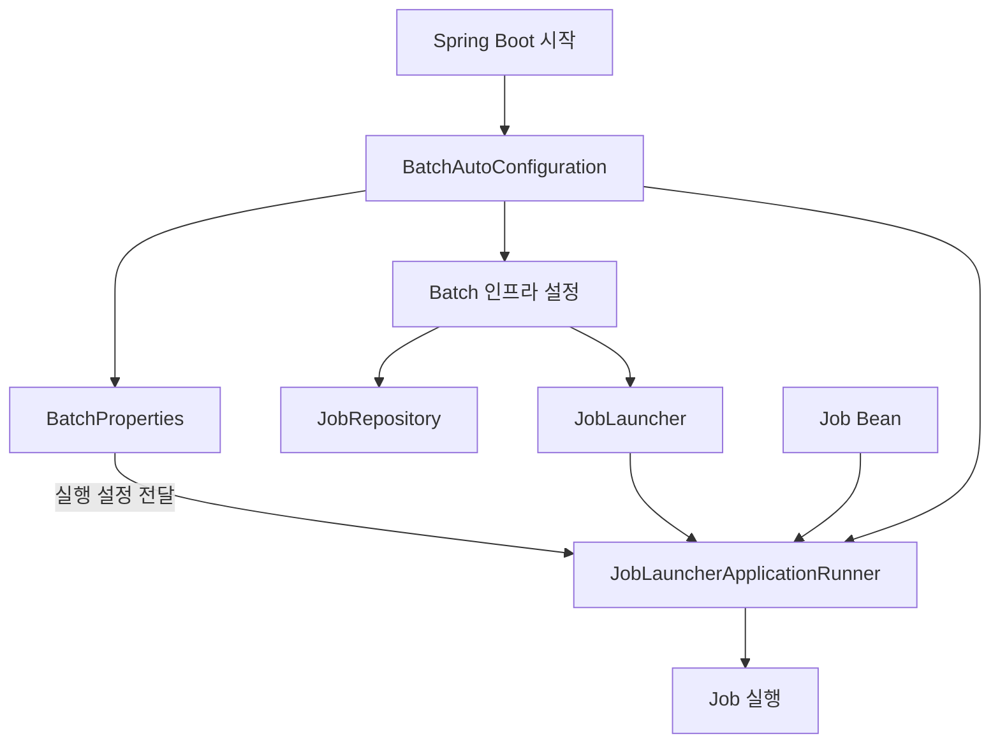

먼저 Spring Boot가 애플리케이션을 시작한다.

이후 BatchAutoConfiguration이 적용되면 Spring Batch 인프라를 구성한다.

BatchProperties에는 외부 설정값이 바인딩된다.

그리고 자동 실행이 활성화되어 있다면 JobLauncherApplicationRunner가 준비된다.

Spring Container에 등록된 Job과 설정값을 이용해 실행 대상을 결정한다.

마지막으로 JobLauncher를 호출해 Job을 실행한다.

따라서 전체 과정을 다음과 같이 나눌 수 있다.

**첫 번째 단계는 Batch 인프라 초기화다.**

JobRepository, JobLauncher 등 실행에 필요한 객체들을 준비한다.

**두 번째 단계는 실행할 Job을 선택하는 과정이다.**

설정값과 등록된 Job Bean을 확인한다.

**세 번째 단계는 실제 Job 실행이다.**

JobLauncherApplicationRunner가 JobLauncher를 호출한다.

이 세 과정을 구분하면 Spring Batch의 자동 실행 구조를 이해하기 쉬워진다.

---

### BatchAutoConfiguration이란?

`BatchAutoConfiguration`은 Spring Boot에서 제공하는 Spring Batch 자동 설정 클래스다.

이 클래스는 Spring Batch를 사용하는 데 필요한 설정을 자동으로 구성하는 역할을 담당한다.

Spring Boot 3.4.13에서는 다음 패키지에 위치한다.

```java
org.springframework.boot.autoconfigure.batch
```

BatchAutoConfiguration은 여러 조건이 충족되었을 때 활성화된다.

대표적으로 다음과 같은 조건이 있다.

* Spring Batch 관련 클래스가 존재하는가?
* DataSource가 존재하는가?
* PlatformTransactionManager가 존재하는가?
* 사용자가 Batch 인프라를 직접 구성하지 않았는가?

조건이 충족되면 Spring Boot는 Batch 인프라를 구성한다.

여기서 `@EnableBatchProcessing`을 직접 선언하거나 `DefaultBatchConfiguration`을 확장한 경우에는 주의해야 한다.

Spring Boot 3.4에서는 이러한 수동 구성 방식이 Batch 자동 설정을 비활성화할 수 있다.

따라서 일반적인 Spring Boot 프로젝트에서는 먼저 자동 설정을 이용하는 것이 편리하다.

#### JobLauncherApplicationRunner Bean 생성

BatchAutoConfiguration에는 JobLauncherApplicationRunner를 생성하는 메서드가 존재한다.

Spring Boot 3.4.13의 핵심 구조를 단순화하면 다음과 같다.

```java
@Bean
@ConditionalOnMissingBean
@ConditionalOnProperty(
        prefix = "spring.batch.job",
        name = "enabled",
        havingValue = "true",
        matchIfMissing = true
)
public JobLauncherApplicationRunner jobLauncherApplicationRunner(
        JobLauncher jobLauncher,
        JobExplorer jobExplorer,
        JobRepository jobRepository,
        BatchProperties properties
) {

    JobLauncherApplicationRunner runner =
            new JobLauncherApplicationRunner(
                    jobLauncher,
                    jobExplorer,
                    jobRepository
            );

    String jobName =
            properties.getJob().getName();

    if (StringUtils.hasText(jobName)) {
        runner.setJobName(jobName);
    }

    return runner;
}
```

위 코드는 주요 동작을 설명하기 위한 형태다.

여기에서 중요한 부분이 두 군데 있다.

첫 번째는 다음 조건이다.

```java
@ConditionalOnProperty(
        prefix = "spring.batch.job",
        name = "enabled",
        havingValue = "true",
        matchIfMissing = true
)
```

이 조건은 Job 자동 실행 기능이 활성화되어 있는지 확인한다.

두 번째는 다음 코드다.

```java
String jobName =
        properties.getJob().getName();
```

BatchProperties에서 실행할 Job의 이름을 가져온다.

설정된 Job 이름이 있다면 Runner에 전달한다.

```java
runner.setJobName(jobName);
```

따라서 `application.yml`에서 Job 이름을 설정하면 JobLauncherApplicationRunner가 해당 이름을 이용해 실행할 Job을 선택하게 된다.

---

### JobLauncherApplicationRunner란?

`JobLauncherApplicationRunner`는 Spring Boot 애플리케이션 시작 과정에서 Spring Batch Job을 실행하는 클래스다.

Spring Boot의 `ApplicationRunner` 인터페이스를 구현한다.

ApplicationRunner는 Spring Boot가 애플리케이션을 시작하는 과정에서 호출하는 실행 인터페이스다.

핵심 메서드는 다음과 같다.

```java
void run(
        ApplicationArguments args
) throws Exception;
```

Spring Boot는 ApplicationRunner Bean을 찾아 애플리케이션 시작 과정에서 `run()` 메서드를 호출한다.

JobLauncherApplicationRunner도 이 구조를 이용한다.

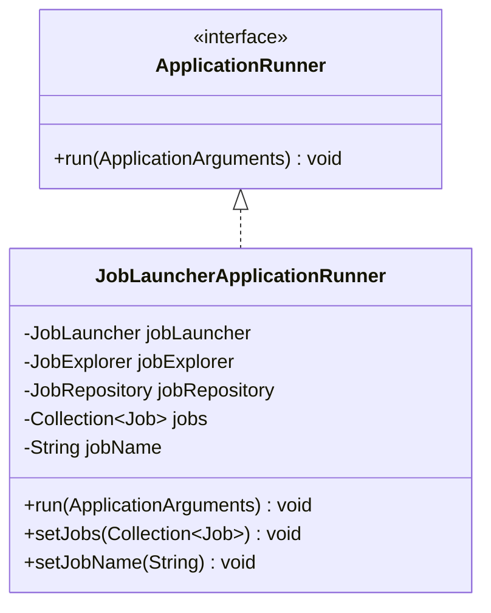

JobLauncherApplicationRunner는 다음과 같은 객체들과 협력한다.

| 객체                     | 역할                          |
| ---------------------- | --------------------------- |
| JobLauncher            | Job 실행                      |
| JobExplorer            | 기존 실행 정보 조회                 |
| JobRepository          | 실행 이력 및 JobInstance 확인      |
| Job Collection         | 실행할 수 있는 Job 목록             |
| Job Name               | 선택적으로 실행할 Job 이름            |
| JobParametersConverter | 전달된 파라미터를 JobParameters로 변환 |

여기서 핵심은 JobLauncher다.

JobLauncherApplicationRunner가 실제 비즈니스 로직을 직접 실행하는 것은 아니다.

최종적으로 JobLauncher의 `run()` 메서드를 호출해 배치 작업을 시작한다.

---

### JobLauncherApplicationRunner는 언제 실행될까?

Spring Boot 애플리케이션은 시작 과정에서 여러 단계를 거친다.

대표적으로 다음과 같은 흐름이다.

```text
SpringApplication.run()
          │
          ▼
ApplicationContext 생성
          │
          ▼
Bean 등록 및 초기화
          │
          ▼
ApplicationContext 준비 완료
          │
          ▼
ApplicationRunner 실행
          │
          ▼
JobLauncherApplicationRunner.run()
          │
          ▼
Job 실행
```

여기서 중요한 점은 JobLauncherApplicationRunner가 Bean으로 생성되는 시점과 `run()` 메서드가 호출되는 시점이 다르다는 것이다.

JobLauncherApplicationRunner는 Spring Container의 Bean 초기화 과정에서 생성된다.

하지만 실제 Job 실행은 ApplicationRunner 호출 시점에 이루어진다.

따라서 다음 두 단계를 구분해야 한다.

```text
Bean 생성
   │
   └── 실행에 필요한 의존성 및 설정값 준비
```

```text
run() 호출
   │
   └── 실제 Job 실행
```

이러한 구조 덕분에 Spring Boot는 애플리케이션의 주요 Bean을 준비한 뒤 Job을 실행할 수 있다.

---

### JobLauncherApplicationRunner의 내부 실행 과정

JobLauncherApplicationRunner의 실행 흐름을 조금 더 자세히 살펴보자.

Spring Boot 3.4.13에서는 `run(ApplicationArguments)` 메서드를 통해 실행 인자를 전달받는다.

내부의 핵심 동작을 단순화하면 다음과 같다.

```java
@Override
public void run(
        ApplicationArguments args
) throws Exception {

    String[] jobArguments =
            args.getNonOptionArgs()
                    .toArray(new String[0]);

    run(jobArguments);
}
```

여기서 중요한 메서드는 다음이다.

```java
args.getNonOptionArgs()
```

Spring Boot에서 프로그램 실행 인자는 크게 두 가지로 구분할 수 있다.

첫 번째는 옵션 인자다.

```text
--spring.batch.job.name=batchJob1
```

두 번째는 일반 인자다.

```text
businessDate=2026-10-29
```

JobLauncherApplicationRunner는 `getNonOptionArgs()`를 이용해 일반 인자를 가져온다.

그리고 해당 값을 JobParameters로 변환한다.

따라서 옵션 인자와 JobParameters는 구분해야 한다.

---

### Spring Boot 옵션 인자와 JobParameters의 차이

예를 들어 다음 명령어를 실행한다고 생각해보자.

```bash
java -jar spring-batch-demo.jar \
  --spring.batch.job.name=batchJob1 \
  businessDate=2026-10-29
```

이 명령어에는 두 종류의 인자가 존재한다.

```text
--spring.batch.job.name=batchJob1
```

이 값은 Spring Boot의 설정값이다.

실행할 Job의 이름을 지정한다.

반면 다음 값은

```text
businessDate=2026-10-29
```

JobParameters로 변환된다.

따라서 다음과 같이 구분할 수 있다.

| 인자                                  | 유형             | 역할                |
| ----------------------------------- | -------------- | ----------------- |
| `--spring.batch.job.name=batchJob1` | Spring Boot 옵션 | 실행할 Job 선택        |
| `businessDate=2026-10-29`           | 일반 인자          | JobParameters로 전달 |

여기서 중요한 점은 `--`의 유무다.

Spring Boot는 `--`로 시작하는 명령행 옵션을 Environment 속성으로 처리한다.

반면 JobLauncherApplicationRunner는 일반 인자를 JobParameters로 변환한다.

이러한 구분을 이해하면 Job 선택 설정과 업무 파라미터를 명확하게 분리할 수 있다.

#### JobParameters 변환 과정

전체 흐름은 다음과 같다.

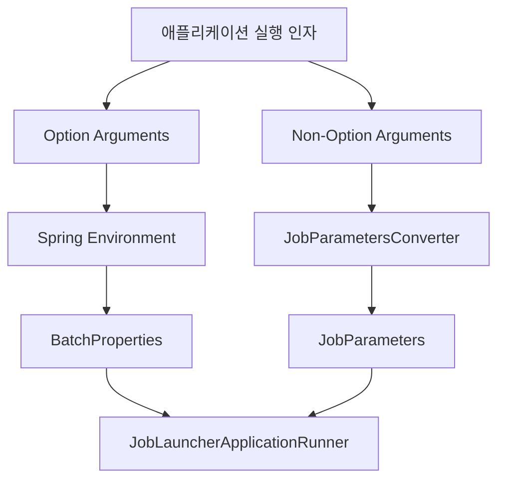

Job 이름은 BatchProperties에 바인딩된다.

업무 파라미터는 JobParameters로 변환된다.

이후 JobLauncherApplicationRunner가 두 정보를 이용해 Job을 실행한다.

---

### BatchProperties란?

`BatchProperties`는 Spring Boot에서 Spring Batch 관련 설정값을 관리하기 위한 클래스다.

다음 패키지에 위치한다.

```java
org.springframework.boot.autoconfigure.batch
```

Spring Boot 3.4.13의 BatchProperties는 다음 애너테이션을 사용한다.

```java
@ConfigurationProperties(
        prefix = "spring.batch"
)
```

이 애너테이션은 `spring.batch`로 시작하는 설정값을 객체의 속성에 바인딩하는 역할을 한다.

예를 들어 다음과 같은 설정이 있다고 생각해보자.

```yaml
spring:
  batch:
    job:
      name: batchJob1

    jdbc:
      initialize-schema: embedded
      table-prefix: BATCH_
```

Spring Boot는 이러한 설정값을 BatchProperties와 관련 설정 객체에 바인딩한다.

개념적으로 다음과 같은 구조다.

```text
BatchProperties
       │
       ├── Job
       │     │
       │     └── name
       │
       └── Jdbc
             │
             ├── initializeSchema
             ├── tablePrefix
             ├── schema
             ├── platform
             └── isolationLevelForCreate
```

여기서 Job 이름과 JDBC 메타데이터 설정을 구분하고 있다.

Job 관련 설정은 실행할 Job을 선택하는 데 사용된다.

JDBC 관련 설정은 Batch 메타데이터 저장소의 초기화 및 구성에 사용된다.

---

### BatchProperties의 주요 설정값

Spring Boot 3.4.13에서 자주 사용하는 설정은 다음과 같다.

| 설정                                             | 역할                        | 기본값          |
| ---------------------------------------------- | ------------------------- | ------------ |
| `spring.batch.job.name`                        | 시작 시 실행할 Job 이름           | 미지정          |
| `spring.batch.job.enabled`                     | Job 자동 실행 여부              | true         |
| `spring.batch.jdbc.initialize-schema`          | 메타데이터 스키마 초기화 방식          | embedded     |
| `spring.batch.jdbc.schema`                     | 스키마 초기화 SQL 경로            | 기본 스키마 경로    |
| `spring.batch.jdbc.platform`                   | 스키마 초기화에 사용할 DB 플랫폼       | 자동 감지        |
| `spring.batch.jdbc.table-prefix`               | 메타데이터 테이블 Prefix          | BATCH_       |
| `spring.batch.jdbc.isolation-level-for-create` | Job 메타데이터 생성 시 트랜잭션 격리 수준 | 기본 인프라 설정 사용 |

여기서 한 가지 구분할 부분이 있다.

`spring.batch.job.enabled`는 자동 실행 Runner의 생성 여부를 결정하는 설정이다.

BatchProperties의 Job 내부에 반드시 `enabled`라는 필드가 있어야만 적용되는 구조는 아니다.

Spring Boot의 `@ConditionalOnProperty`가 해당 Environment 속성을 직접 확인해 조건을 평가한다.

반면 `spring.batch.job.name`은 BatchProperties의 Job 객체에 바인딩되어 Runner의 실행 대상 선택에 사용된다.

이 차이를 이해하면 설정값이 Spring Boot 내부에서 어떻게 적용되는지 더 명확하게 파악할 수 있다.

---

### spring.batch.job.name 설정

`spring.batch.job.name`은 애플리케이션 시작 시 실행할 Job의 이름을 지정하는 설정이다.

예를 들어 다음과 같이 설정할 수 있다.

```yaml
spring:
  batch:
    job:
      name: batchJob1
```

이 설정은 `batchJob1`이라는 이름의 Job을 자동 실행 대상으로 지정한다.

여기서 중요한 것은 **Spring Bean의 이름과 Job의 이름이 반드시 같지는 않다는 사실**이다.

예를 들어 다음 코드를 살펴보자.

```java
@Bean("firstJobBean")
public Job batchJob1(
        JobRepository jobRepository,
        Step step1
) {
    return new JobBuilder(
            "batchJob1",
            jobRepository
    )
            .start(step1)
            .build();
}
```

이 코드에서 Spring Bean 이름은 다음과 같다.

```text
firstJobBean
```

하지만 실제 Job의 이름은 다음과 같다.

```text
batchJob1
```

Job 이름은 JobBuilder에 전달한 값이다.

```java
new JobBuilder(
        "batchJob1",
        jobRepository
)
```

JobLauncherApplicationRunner가 비교하는 이름은 기본적으로 다음 메서드가 반환하는 값이다.

```java
job.getName()
```

따라서 실행할 Job을 지정할 때는 Bean 이름이 아니라 **실제 Job의 이름**을 기준으로 설정해야 한다.

---

### 여러 Job이 등록되어 있으면 어떻게 될까?

이번에는 하나의 애플리케이션에 여러 Job이 등록되어 있다고 생각해보자.

```text
Spring Container
       │
       ├── batchJob1
       │
       ├── batchJob2
       │
       └── batchJob3
```

Spring Boot는 이 Job들을 Bean으로 관리한다.

JobLauncherApplicationRunner는 등록된 Job 객체들을 전달받을 수 있다.

다만 이 지점에서 Spring Boot 버전에 따른 차이를 주의해야 한다.

**Spring Boot 3.4.13에서는 여러 Job Bean이 존재하는 경우 기본적으로 실행할 Job 이름을 지정해야 한다.**

Job 이름이 지정되지 않았다면 애플리케이션 시작 과정에서 검증 오류가 발생할 수 있다.

대표적인 오류 메시지는 다음과 같다.

```text
Job name must be specified in case of multiple jobs
```

이 오류는 여러 Job이 존재하는데 실행할 Job이 지정되지 않았기 때문에 발생한다.

따라서 다음과 같이 설정해야 한다.

```yaml
spring:
  batch:
    job:
      name: batchJob1
```

이렇게 설정하면 batchJob1이 자동 실행 대상으로 선택된다.

#### Job 개수에 따른 동작

| 등록된 Job 수 | Job 이름 설정     | Spring Boot 3.4 동작 |
| --------- | ------------- | ------------------ |
| 1개        | 미설정           | 해당 Job 자동 실행       |
| 1개        | 올바른 이름 설정     | 지정한 Job 실행         |
| 2개 이상     | 미설정           | 초기화 검증 오류 가능       |
| 2개 이상     | 올바른 이름 설정     | 지정한 Job 실행         |
| 2개 이상     | 존재하지 않는 이름 설정 | Job 이름 검증 오류       |

따라서 여러 Job이 등록되어 있을 때 아무런 설정 없이 모든 Job이 자동 실행된다고 이해하면 안 된다.

---

### JobLauncherApplicationRunner는 실행할 Job을 어떻게 선택할까?

JobLauncherApplicationRunner는 내부적으로 등록된 Job 목록과 설정된 Job 이름을 이용한다.

Spring Boot 3.4.13의 핵심 구조를 살펴보면 다음과 같다.

```java
private String jobName;

private Collection<Job> jobs =
        Collections.emptySet();
```

Job 이름을 저장하는 속성이 있다.

그리고 등록된 Job을 저장하는 Collection이 있다.

Spring은 Job Bean들을 해당 Collection에 주입할 수 있다.

```java
@Autowired(required = false)
public void setJobs(
        Collection<Job> jobs
) {
    this.jobs = jobs;
}
```

이후 실행 시 등록된 Job 목록을 순회한다.

핵심 로직을 단순화하면 다음과 같다.

```java
for (Job job : jobs) {

    if (StringUtils.hasText(jobName)) {

        if (!jobName.equals(job.getName())) {
            continue;
        }
    }

    execute(job, jobParameters);
}
```

이 코드에서 중요한 부분은 다음이다.

```java
jobName.equals(job.getName())
```

설정한 Job 이름과 실제 Job의 이름을 비교한다.

일치하지 않으면 해당 Job을 건너뛴다.

```java
continue;
```

이름이 일치하면 실행한다.

```java
execute(job, jobParameters);
```

따라서 JobLauncherApplicationRunner는 등록된 모든 Job을 무조건 실행하는 것이 아니라 설정된 Job 이름을 기준으로 실행 대상을 선택할 수 있다.

다만 Spring Boot 3.4에서는 이 반복문에 도달하기 전에 여러 Job에 대한 설정 검증도 수행한다.

---

### JobLauncherApplicationRunner의 초기화 검증

JobLauncherApplicationRunner는 `InitializingBean`도 구현한다.

따라서 초기화 과정에서 `afterPropertiesSet()` 메서드가 호출된다.

Spring Boot 3.4.13의 주요 검증 조건은 다음과 같은 의미를 가진다.

```java
jobs.size() <= 1
        || StringUtils.hasText(jobName)
```

등록된 Job이 하나 이하라면 Job 이름 없이도 허용된다.

하지만 Job이 두 개 이상이라면 Job 이름이 지정되어 있어야 한다.

또한 Job 이름이 지정되어 있다면 실제로 해당 Job이 존재하는지도 확인한다.

따라서 다음과 같은 설정은 문제가 발생할 수 있다.

```yaml
spring:
  batch:
    job:
      name: unknownJob
```

실제로 `unknownJob`이라는 Job이 존재하지 않는다면 검증 오류가 발생한다.

이 동작은 존재하지 않는 Job 이름을 전달하면 아무 일도 하지 않고 정상적으로 종료될 것이라고 가정하는 것과 다르다.

운영 환경에서는 오히려 이러한 검증이 유용하다.

잘못된 Job 이름을 설정했는데도 실행 성공으로 처리되는 상황을 방지할 수 있기 때문이다.

---

### spring.batch.job.names와 spring.batch.job.name의 차이

Spring Batch 관련 코드를 살펴보면 다음과 같은 설정을 사용하는 사례를 발견할 수 있다.

```yaml
spring:
  batch:
    job:
      names: batchJob1
```

하지만 Spring Boot 3.4.13에서는 이 설정을 기준으로 구현하면 안 된다.

현재 버전에서는 다음 속성을 사용한다.

```yaml
spring:
  batch:
    job:
      name: batchJob1
```

두 설정의 차이는 단순히 복수형과 단수형의 차이가 아니다.

과거 Spring Boot에서는 여러 Job 이름을 지정하는 방식이 사용되었다.

반면 Spring Boot 3.4에서는 단일 Job 이름을 지정하는 API를 사용한다.

정리하면 다음과 같다.

| 구분          | 과거 Spring Boot 방식        | Spring Boot 3.4         |
| ----------- | ------------------------ | ----------------------- |
| Job 선택 속성   | `spring.batch.job.names` | `spring.batch.job.name` |
| 선택 대상       | 여러 Job 이름을 지원하던 방식       | 단일 Job 이름               |
| 내부 설정       | 여러 이름을 처리하는 구조           | `setJobName()`          |
| 복수 Job 등록 시 | 버전에 따라 다름                | 실행할 Job 이름 지정 필요        |

따라서 다음과 같은 설정도 주의해야 한다.

```yaml
spring:
  batch:
    job:
      name: batchJob1,batchJob2
```

Spring Boot 3.4의 기본 JobLauncherApplicationRunner가 이 값을 두 개의 Job 이름으로 분리해 실행하는 것은 아니다.

하나의 Job 이름 문자열로 취급할 수 있다.

따라서 실제 Job 이름과 일치하지 않아 검증 오류가 발생한다.

**Spring Boot 3.4에서 여러 Job을 실행해야 한다면 별도의 실행 흐름을 직접 구성하는 것이 명확하다.**

---

### 실제 Job 초기화와 선택 실행 구현하기

이번에는 실제 Spring Boot 프로젝트를 구성해보자.

다음과 같은 두 개의 Job을 생성한다.

```text
Spring Container
       │
       ├── batchJob1
       │      │
       │      ├── batchJob1Step1
       │      │
       │      └── batchJob1Step2
       │
       └── batchJob2
              │
              ├── batchJob2Step1
              │
              └── batchJob2Step2
```

두 Job은 모두 Spring Bean으로 등록한다.

그리고 애플리케이션 실행 시 설정한 이름에 따라 원하는 Job만 실행하도록 구성한다.

확인할 내용은 다음과 같다.

첫 번째는 BatchAutoConfiguration에 의해 JobLauncherApplicationRunner가 생성되는 과정이다.

두 번째는 BatchProperties에 Job 이름이 바인딩되는 과정이다.

세 번째는 설정한 이름과 실제 Job 이름을 비교하는 과정이다.

네 번째는 프로그램 실행 인자가 JobParameters로 전달되는 과정이다.

---

### Maven 의존성 설정

먼저 프로젝트에 필요한 의존성을 구성한다.

이번 예제에서는 H2 인메모리 데이터베이스를 사용한다.

`pom.xml`

```xml
<?xml version="1.0" encoding="UTF-8"?>
<project xmlns="http://maven.apache.org/POM/4.0.0"
         xmlns:xsi="http://www.w3.org/2001/XMLSchema-instance"
         xsi:schemaLocation="
             http://maven.apache.org/POM/4.0.0
             https://maven.apache.org/xsd/maven-4.0.0.xsd">

    <modelVersion>4.0.0</modelVersion>

    <parent>
        <groupId>org.springframework.boot</groupId>
        <artifactId>spring-boot-starter-parent</artifactId>
        <version>3.4.13</version>
        <relativePath/>
    </parent>

    <groupId>com.example</groupId>
    <artifactId>spring-batch-demo</artifactId>
    <version>0.0.1-SNAPSHOT</version>

    <properties>
        <java.version>17</java.version>
        <spring-batch.version>5.2.4</spring-batch.version>
    </properties>

    <dependencies>

        <dependency>
            <groupId>org.springframework.boot</groupId>
            <artifactId>spring-boot-starter-batch</artifactId>
        </dependency>

        <dependency>
            <groupId>com.h2database</groupId>
            <artifactId>h2</artifactId>
            <scope>runtime</scope>
        </dependency>

    </dependencies>

    <build>
        <plugins>
            <plugin>
                <groupId>org.springframework.boot</groupId>
                <artifactId>spring-boot-maven-plugin</artifactId>
            </plugin>
        </plugins>
    </build>

</project>
```

이 설정에서 중요한 의존성은 다음이다.

```xml
<dependency>
    <groupId>org.springframework.boot</groupId>
    <artifactId>spring-boot-starter-batch</artifactId>
</dependency>
```

Spring Batch 관련 기능을 사용하기 위한 의존성이다.

그리고 H2 데이터베이스를 추가했다.

```xml
<dependency>
    <groupId>com.h2database</groupId>
    <artifactId>h2</artifactId>
    <scope>runtime</scope>
</dependency>
```

이번에는 별도의 MySQL 서버 없이 JobRepository의 메타데이터 테이블을 생성하고 실행 결과를 확인한다.

---

### JobConfiguration 전체 코드

다음과 같이 두 개의 Job과 네 개의 Step을 정의한다.

`JobConfiguration.java`

```java
package com.example.batch;

import org.slf4j.Logger;
import org.slf4j.LoggerFactory;

import org.springframework.batch.core.Job;
import org.springframework.batch.core.Step;

import org.springframework.batch.core.job.builder.JobBuilder;
import org.springframework.batch.core.repository.JobRepository;
import org.springframework.batch.core.step.builder.StepBuilder;

import org.springframework.batch.repeat.RepeatStatus;

import org.springframework.beans.factory.annotation.Qualifier;
import org.springframework.context.annotation.Bean;
import org.springframework.context.annotation.Configuration;

import org.springframework.transaction.PlatformTransactionManager;

@Configuration
public class JobConfiguration {

    private static final Logger log =
            LoggerFactory.getLogger(JobConfiguration.class);

    @Bean
    public Job batchJob1(
            JobRepository jobRepository,
            @Qualifier("batchJob1Step1") Step step1,
            @Qualifier("batchJob1Step2") Step step2
    ) {
        return new JobBuilder("batchJob1", jobRepository)
                .start(step1)
                .next(step2)
                .build();
    }

    @Bean
    public Job batchJob2(
            JobRepository jobRepository,
            @Qualifier("batchJob2Step1") Step step1,
            @Qualifier("batchJob2Step2") Step step2
    ) {
        return new JobBuilder("batchJob2", jobRepository)
                .start(step1)
                .next(step2)
                .build();
    }

    @Bean
    public Step batchJob1Step1(
            JobRepository jobRepository,
            PlatformTransactionManager transactionManager
    ) {
        return new StepBuilder(
                "batchJob1Step1",
                jobRepository
        )
                .tasklet((contribution, chunkContext) -> {

                    log.info("Batch Job 1 - Step 1 실행");

                    return RepeatStatus.FINISHED;

                }, transactionManager)
                .build();
    }

    @Bean
    public Step batchJob1Step2(
            JobRepository jobRepository,
            PlatformTransactionManager transactionManager
    ) {
        return new StepBuilder(
                "batchJob1Step2",
                jobRepository
        )
                .tasklet((contribution, chunkContext) -> {

                    log.info("Batch Job 1 - Step 2 실행");

                    return RepeatStatus.FINISHED;

                }, transactionManager)
                .build();
    }

    @Bean
    public Step batchJob2Step1(
            JobRepository jobRepository,
            PlatformTransactionManager transactionManager
    ) {
        return new StepBuilder(
                "batchJob2Step1",
                jobRepository
        )
                .tasklet((contribution, chunkContext) -> {

                    log.info("Batch Job 2 - Step 1 실행");

                    return RepeatStatus.FINISHED;

                }, transactionManager)
                .build();
    }

    @Bean
    public Step batchJob2Step2(
            JobRepository jobRepository,
            PlatformTransactionManager transactionManager
    ) {
        return new StepBuilder(
                "batchJob2Step2",
                jobRepository
        )
                .tasklet((contribution, chunkContext) -> {

                    log.info("Batch Job 2 - Step 2 실행");

                    return RepeatStatus.FINISHED;

                }, transactionManager)
                .build();
    }
}
```

이 코드는 두 개의 Job을 Spring Bean으로 등록한다.

첫 번째 Job의 이름은 다음과 같다.

```text
batchJob1
```

두 번째 Job의 이름은 다음과 같다.

```text
batchJob2
```

두 Job은 서로 다른 Step을 사용한다.

따라서 어떤 Job이 실행되었는지 로그를 통해 구분할 수 있다.

---

### application.yml 설정

이제 실행할 Job을 선택하기 위한 설정을 작성한다.

`application.yml`

```yaml
spring:
  application:
    name: spring-batch-demo

  main:
    web-application-type: none

  datasource:
    url: jdbc:h2:mem:batchdb;DB_CLOSE_DELAY=-1
    driver-class-name: org.h2.Driver
    username: sa
    password:

  batch:
    job:
      enabled: true
      name: ${batch.job.name:batchJob1}

    jdbc:
      initialize-schema: embedded
```

이 설정에서 중요한 부분은 다음이다.

```yaml
spring:
  batch:
    job:
      enabled: true
```

Spring Boot의 Job 자동 실행 기능을 활성화한다.

그리고 다음 설정을 사용했다.

```yaml
name: ${batch.job.name:batchJob1}
```

이 표현식은 외부 설정값을 이용해 실행할 Job 이름을 결정한다.

`batch.job.name`이라는 설정값이 존재하면 해당 값을 사용한다.

없다면 기본값으로 `batchJob1`을 사용한다.

따라서 별도의 설정을 전달하지 않으면 batchJob1이 실행된다.

반면 실행 시점에 다음 설정을 전달하면

```text
--batch.job.name=batchJob2
```

batchJob2가 선택된다.

이처럼 외부 설정값을 이용하면 애플리케이션을 다시 빌드하지 않고도 실행할 Job을 변경할 수 있다.

---

### 첫 번째 실행: 기본 Job 실행하기

먼저 프로젝트를 빌드한다.

```bash
./mvnw clean package
```

이 명령어는 기존 빌드 결과를 정리하고 프로젝트를 빌드한다.

정상적으로 완료되면 실행 가능한 JAR 파일이 생성된다.

이제 다음 명령어를 실행한다.

```bash
java -jar target/spring-batch-demo-0.0.1-SNAPSHOT.jar \
  businessDate=2026-10-29
```

이 명령어에서는 별도로 Job 이름을 지정하지 않았다.

따라서 application.yml의 기본값이 사용된다.

```yaml
name: ${batch.job.name:batchJob1}
```

최종적으로 다음 Job이 선택된다.

```text
batchJob1
```

#### 실행 결과

정상적으로 실행되면 다음과 유사한 로그를 확인할 수 있다.

```text
Running default command line with:
[businessDate=2026-10-29]

Job: [SimpleJob: [name=batchJob1]]
launched with the following parameters

Executing step: [batchJob1Step1]

Batch Job 1 - Step 1 실행

Executing step: [batchJob1Step2]

Batch Job 1 - Step 2 실행

Job: [SimpleJob: [name=batchJob1]]
completed with status: [COMPLETED]
```

위 로그는 주요 실행 흐름을 중심으로 정리한 예시다.

실제 출력 형식과 메시지는 로깅 설정에 따라 달라질 수 있다.

여기서 중요한 사실은 두 개의 Job이 Bean으로 등록되어 있지만 batchJob1만 실행되었다는 점이다.

batchJob2는 실행되지 않았다.

이것이 JobLauncherApplicationRunner의 Job 선택 기능이다.

---

### 두 번째 실행: 외부 인자로 Job 변경하기

이번에는 batchJob2를 실행해보자.

애플리케이션을 수정하거나 다시 빌드할 필요는 없다.

실행 인자만 변경하면 된다.

```bash
java -jar target/spring-batch-demo-0.0.1-SNAPSHOT.jar \
  --batch.job.name=batchJob2 \
  businessDate=2026-10-29
```

이번에는 다음 설정을 전달했다.

```text
--batch.job.name=batchJob2
```

따라서 application.yml의 표현식에 batchJob2가 바인딩된다.

```yaml
name: ${batch.job.name:batchJob1}
```

최종적으로 다음과 같은 설정이 적용되는 것이다.

```yaml
spring:
  batch:
    job:
      name: batchJob2
```

#### 실행 결과

정상적으로 실행되면 다음과 유사한 로그를 확인할 수 있다.

```text
Job: [SimpleJob: [name=batchJob2]]
launched with the following parameters

Executing step: [batchJob2Step1]

Batch Job 2 - Step 1 실행

Executing step: [batchJob2Step2]

Batch Job 2 - Step 2 실행

Job: [SimpleJob: [name=batchJob2]]
completed with status: [COMPLETED]
```

batchJob1은 실행되지 않는다.

반면 batchJob2에 등록된 두 Step이 실행된다.

이렇게 외부 설정을 이용하면 동일한 애플리케이션에서 원하는 Job만 선택적으로 실행할 수 있다.

---

### 프로그램 인자가 JobParameters로 전달되는 과정

앞선 예제에서는 다음 인자를 전달했다.

```text
businessDate=2026-10-29
```

이 값은 Spring Boot의 Environment 설정값이 아니라 JobParameters로 사용된다.

JobLauncherApplicationRunner는 일반 인자를 가져와 JobParametersConverter에 전달한다.

개념적인 흐름은 다음과 같다.

```text
프로그램 실행 인자
       │
       ▼
businessDate=2026-10-29
       │
       ▼
ApplicationArguments
       │
       ▼
getNonOptionArgs()
       │
       ▼
JobParametersConverter
       │
       ▼
JobParameters
       │
       ▼
JobLauncher.run()
```

따라서 실제 Tasklet에서도 해당 값을 조회할 수 있다.

다음 코드를 살펴보자.

```java
String businessDate =
        contribution
                .getStepExecution()
                .getJobParameters()
                .getString("businessDate");
```

이 코드에서는 현재 StepExecution을 통해 JobParameters를 가져온다.

그리고 businessDate 값을 조회한다.

결과는 다음과 같다.

```text
2026-10-29
```

따라서 실행할 Job 이름과 비즈니스 파라미터를 구분해서 전달할 수 있다.

```bash
java -jar target/spring-batch-demo-0.0.1-SNAPSHOT.jar \
  --batch.job.name=batchJob1 \
  businessDate=2026-10-29 \
  merchantId=1001
```

여기서 Job 선택 설정은 다음과 같다.

```text
batch.job.name=batchJob1
```

반면 JobParameters는 다음과 같다.

```text
businessDate=2026-10-29

merchantId=1001
```

이러한 방식은 정산 기준일이나 처리 대상 가맹점을 외부에서 전달하는 배치에 활용할 수 있다.

---

### 잘못된 Job 이름을 전달하면 어떻게 될까?

이번에는 존재하지 않는 Job 이름을 전달한다고 생각해보자.

```bash
java -jar target/spring-batch-demo-0.0.1-SNAPSHOT.jar \
  --batch.job.name=unknownJob \
  businessDate=2026-10-29
```

현재 등록된 Job은 두 개다.

```text
batchJob1

batchJob2
```

하지만 실행 인자로 전달한 이름은 다음과 같다.

```text
unknownJob
```

실제로 존재하지 않는 이름이다.

이 경우 Spring Boot 3.4.13의 JobLauncherApplicationRunner는 초기화 과정에서 설정한 Job 이름이 존재하는지 확인한다.

따라서 다음과 유사한 오류가 발생할 수 있다.

```text
No job found with name 'unknownJob'
```

이러한 검증은 잘못된 Job이 실행되는 상황을 방지한다.

특히 운영 환경에서는 존재하지 않는 Job 이름을 전달했는데 애플리케이션이 정상 종료되는 것보다 명확하게 오류를 확인할 수 있는 편이 안전하다.

---

### spring.batch.job.enabled 설정

이번에는 Job 자동 실행을 비활성화하는 방법을 살펴보자.

Spring Boot에서는 다음 설정을 제공한다.

```yaml
spring:
  batch:
    job:
      enabled: false
```

이 설정은 Spring Boot의 Job 자동 실행을 비활성화한다.

따라서 Job Bean이 등록되어 있더라도 애플리케이션 시작 과정에서 자동으로 Job을 실행하지 않는다.

여기서 중요한 사실은 **JobLauncher가 제거되는 것은 아니라는 점**이다.

JobLauncher와 JobRepository 등의 Batch 인프라는 계속 사용할 수 있다.

따라서 개발자가 직접 다음 코드를 호출하면 Job을 실행할 수 있다.

```java
jobLauncher.run(
        job,
        jobParameters
);
```

즉 `spring.batch.job.enabled=false`는 Spring Batch 사용 자체를 비활성화하는 설정이 아니다.

Spring Boot가 제공하는 자동 실행 기능을 비활성화하는 설정이다.

#### 자동 실행 설정 비교

| 설정               | 동작                    |
| ---------------- | --------------------- |
| `enabled: true`  | Job 자동 실행 Runner 활성화  |
| `enabled: false` | Job 자동 실행 Runner 비활성화 |
| 설정 생략            | 기본적으로 자동 실행 활성화       |

예를 들어 HTTP API를 이용해 Job을 실행하는 프로젝트라면 일반적으로 자동 실행을 비활성화하는 것이 좋다.

반면 애플리케이션 시작과 동시에 특정 Job을 실행하는 배치 전용 애플리케이션에서는 자동 실행을 활용할 수 있다.

---

### spring.batch.jdbc.initialize-schema 설정

Spring Batch는 실행 메타데이터를 저장하기 위한 테이블을 사용한다.

대표적으로 다음과 같은 테이블이 있다.

```text
BATCH_JOB_INSTANCE

BATCH_JOB_EXECUTION

BATCH_STEP_EXECUTION

BATCH_JOB_EXECUTION_CONTEXT

BATCH_STEP_EXECUTION_CONTEXT
```

JDBC 기반 JobRepository는 이러한 테이블을 이용해 실행 이력과 재시작 정보를 관리한다.

따라서 JobRepository를 사용하려면 메타데이터 스키마가 필요하다.

Spring Boot는 이를 위한 초기화 설정을 제공한다.

```yaml
spring:
  batch:
    jdbc:
      initialize-schema: embedded
```

이 설정은 메타데이터 스키마를 언제 초기화할지 결정한다.

#### initialize-schema의 주요 설정값

| 값        | 설명                                 |
| -------- | ---------------------------------- |
| always   | 지원되는 데이터베이스에서 시작 시 스키마 초기화 스크립트 실행 |
| embedded | H2 등 임베디드 DB 환경에서 초기화              |
| never    | 스키마 자동 초기화 비활성화                    |

개발 환경에서 H2를 사용하는 경우에는 다음 설정이 편리하다.

```yaml
spring:
  batch:
    jdbc:
      initialize-schema: embedded
```

반면 운영 환경에서 MySQL을 사용한다면 다음과 같이 구성할 수 있다.

```yaml
spring:
  batch:
    jdbc:
      initialize-schema: never
```

이 경우 메타데이터 테이블을 별도로 준비해야 한다.

#### always 설정의 주의점

다음 설정을 사용하면 애플리케이션 시작 시 스키마 초기화 SQL을 실행하도록 구성할 수 있다.

```yaml
spring:
  batch:
    jdbc:
      initialize-schema: always
```

하지만 운영 중인 데이터베이스에 무조건 사용하는 것은 적절하지 않다.

기존 테이블이 있는 환경에서 초기화 SQL이 다시 실행되면 오류가 발생할 수 있다.

또한 스키마 변경이 필요한 상황이라면 단순한 자동 초기화보다 명시적인 마이그레이션 방식이 안전하다.

실무에서는 Flyway나 Liquibase 같은 데이터베이스 마이그레이션 도구를 고려할 수 있다.

---

### spring.batch.jdbc.table-prefix 설정

Spring Batch의 메타데이터 테이블은 기본적으로 `BATCH_`라는 Prefix를 사용한다.

예를 들어 다음과 같다.

```text
BATCH_JOB_INSTANCE

BATCH_JOB_EXECUTION

BATCH_STEP_EXECUTION
```

하지만 프로젝트에 따라 다른 Prefix를 사용하고 싶을 수 있다.

예를 들어 정산 배치와 통계 배치가 서로 다른 메타데이터 테이블을 사용해야 한다고 생각해보자.

```text
정산 배치
    │
    ├── SETTLEMENT_JOB_INSTANCE
    └── SETTLEMENT_JOB_EXECUTION
```

```text
통계 배치
    │
    ├── STATISTICS_JOB_INSTANCE
    └── STATISTICS_JOB_EXECUTION
```

Spring Boot에서는 다음 설정을 이용해 Prefix를 변경할 수 있다.

```yaml
spring:
  batch:
    jdbc:
      table-prefix: SYSTEM_
```

이렇게 설정하면 JDBC 기반 JobRepository는 `SYSTEM_`으로 시작하는 메타데이터 테이블을 사용하도록 구성된다.

예를 들어 다음과 같은 테이블을 조회한다.

```text
SYSTEM_JOB_INSTANCE

SYSTEM_JOB_EXECUTION

SYSTEM_STEP_EXECUTION
```

여기서 중요한 점은 **설정값만 변경한다고 해서 실제 데이터베이스 테이블 이름이 변경되는 것은 아니라는 사실**이다.

기존 데이터베이스에 BATCH_ 테이블만 존재한다면 SYSTEM_ 테이블을 찾는 과정에서 오류가 발생할 수 있다.

---

### 테이블 Prefix와 스키마 초기화의 관계

다음과 같은 설정을 사용한다고 생각해보자.

```yaml
spring:
  batch:
    jdbc:
      initialize-schema: embedded
      table-prefix: SYSTEM_
```

이 설정은 한 가지 주의할 부분이 있다.

JobRepository는 `SYSTEM_` Prefix를 사용한다.

하지만 기본 스키마 초기화 스크립트는 일반적으로 `BATCH_`라는 이름으로 테이블을 생성한다.

따라서 Prefix만 변경하면 실제 생성된 테이블과 JobRepository가 조회하는 테이블 이름이 달라질 수 있다.

```text
기본 스키마 초기화
       │
       ▼
BATCH_JOB_INSTANCE 생성
```

```text
JobRepository 설정
       │
       ▼
SYSTEM_JOB_INSTANCE 조회
       │
       ▼
테이블 없음
       │
       ▼
오류 발생
```

이를 해결하려면 Prefix에 맞는 스키마를 별도로 준비해야 한다.

예를 들어 `schema-system.sql` 파일을 작성할 수 있다.

이 파일에는 사용하는 Spring Batch 버전의 공식 스키마를 기준으로 Prefix를 변경한 전체 테이블 및 시퀀스 생성 SQL이 포함되어야 한다.

그리고 다음과 같이 설정할 수 있다.

```yaml
spring:
  batch:
    jdbc:
      initialize-schema: always
      schema: classpath:sql/schema-system.sql
      table-prefix: SYSTEM_
```

이 설정에서는 사용자 정의 스키마 초기화 SQL을 사용한다.

다만 실제 SQL 파일에는 JobInstance, JobExecution, StepExecution, ExecutionContext 관련 테이블뿐 아니라 사용하는 데이터베이스에 필요한 시퀀스 관련 구조도 포함되어야 한다.

운영 환경에서는 해당 스키마를 자동 생성하기보다 마이그레이션 도구로 관리하는 것이 더 적절할 수 있다.

---

### Spring Batch의 초기화 설정 전체 구조

지금까지 살펴본 설정값을 하나의 구조로 정리해보자.

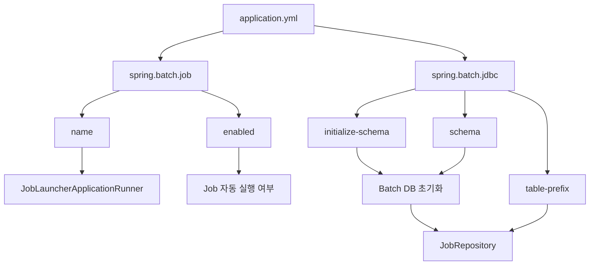

Job 관련 설정은 자동 실행 대상과 실행 여부를 결정한다.

JDBC 관련 설정은 메타데이터 저장소의 초기화 및 접근 방식에 영향을 준다.

따라서 Spring Batch 초기화 설정은 크게 두 가지 영역으로 나누어 이해할 수 있다.

**첫 번째는 Job 실행 제어 설정이다.**

```yaml
spring:
  batch:
    job:
      enabled: true
      name: batchJob1
```

**두 번째는 메타데이터 저장소 설정이다.**

```yaml
spring:
  batch:
    jdbc:
      initialize-schema: never
      table-prefix: BATCH_
```

이러한 구분을 이해하면 실행 관련 문제와 데이터베이스 관련 문제를 분리해서 분석할 수 있다.

---

### 여러 Job을 한 번에 실행하려면?

앞에서 Spring Boot 3.4에서는 여러 Job이 등록된 경우 기본적으로 실행할 Job 하나를 지정해야 한다고 설명했다.

그렇다면 여러 Job을 하나의 애플리케이션 실행 과정에서 모두 실행하려면 어떻게 해야 할까?

예를 들어 다음과 같은 작업을 수행해야 한다고 생각해보자.

```text
Spring Boot 시작
       │
       ▼
batchJob1 실행
       │
       ▼
batchJob2 실행
       │
       ▼
애플리케이션 종료
```

이러한 요구사항은 기본 JobLauncherApplicationRunner에 쉼표로 여러 이름을 전달하는 대신 별도의 실행 흐름을 구성하는 방식으로 해결할 수 있다.

대표적인 방법은 다음과 같다.

* ApplicationRunner에서 여러 Job을 순서대로 실행한다.
* 하나의 상위 Job을 구성하고 여러 Step으로 작업을 연결한다.
* JobStep을 이용해 다른 Job을 실행한다.
* 스케줄러에서 Job별 실행 순서를 관리한다.

이번에는 ApplicationRunner를 직접 구현하는 방법을 살펴보자.

---

### ApplicationRunner로 여러 Job 순차 실행하기

먼저 Spring Boot의 기본 Job 자동 실행을 비활성화한다.

```yaml
spring:
  batch:
    job:
      enabled: false
```

그리고 별도의 ApplicationRunner를 정의한다.

`MultipleJobRunner.java`

```java
package com.example.batch;

import java.util.List;

import org.slf4j.Logger;
import org.slf4j.LoggerFactory;

import org.springframework.batch.core.BatchStatus;
import org.springframework.batch.core.Job;
import org.springframework.batch.core.JobExecution;
import org.springframework.batch.core.JobParameters;
import org.springframework.batch.core.JobParametersBuilder;

import org.springframework.batch.core.launch.JobLauncher;

import org.springframework.beans.factory.annotation.Qualifier;
import org.springframework.boot.ApplicationArguments;
import org.springframework.boot.ApplicationRunner;
import org.springframework.context.annotation.Profile;
import org.springframework.stereotype.Component;

@Component
@Profile("multi-launch")
public class MultipleJobRunner implements ApplicationRunner {

    private static final Logger log =
            LoggerFactory.getLogger(MultipleJobRunner.class);

    private final JobLauncher jobLauncher;

    private final Job batchJob1;

    private final Job batchJob2;

    public MultipleJobRunner(
            JobLauncher jobLauncher,
            @Qualifier("batchJob1") Job batchJob1,
            @Qualifier("batchJob2") Job batchJob2
    ) {
        this.jobLauncher = jobLauncher;
        this.batchJob1 = batchJob1;
        this.batchJob2 = batchJob2;
    }

    @Override
    public void run(
            ApplicationArguments args
    ) throws Exception {

        JobParameters parameters =
                new JobParametersBuilder()
                        .addString(
                                "businessDate",
                                "2026-10-29"
                        )
                        .toJobParameters();

        List<Job> jobs = List.of(
                batchJob1,
                batchJob2
        );

        for (Job job : jobs) {

            log.info(
                    "Job 실행 시작: {}",
                    job.getName()
            );

            JobExecution execution =
                    jobLauncher.run(
                            job,
                            parameters
                    );

            if (execution.getStatus()
                    != BatchStatus.COMPLETED) {

                throw new IllegalStateException(
                        "Job 실행 실패: "
                                + job.getName()
                );
            }

            log.info(
                    "Job 실행 완료: {}",
                    job.getName()
            );
        }
    }
}
```

이 코드는 두 개의 Job을 순서대로 실행한다.

먼저 batchJob1을 실행한다.

```java
jobLauncher.run(
        batchJob1,
        parameters
);
```

batchJob1이 정상적으로 완료되면 다음 Job을 실행한다.

```java
jobLauncher.run(
        batchJob2,
        parameters
);
```

위 코드에서는 편의상 반복문을 이용했다.

실제로는 두 Job이 서로 다른 Job 이름을 가지므로 동일한 식별용 JobParameters를 전달해도 서로 다른 JobInstance로 관리된다.

#### 이 방식은 병렬 실행일까?

그렇지 않다.

이번 예제는 순차 실행이다.

기본적인 동기 JobLauncher를 사용했기 때문이다.

```text
batchJob1 실행
       │
       ▼
batchJob1 완료
       │
       ▼
batchJob2 실행
       │
       ▼
batchJob2 완료
```

따라서 여러 Job을 한 번의 애플리케이션 실행에서 수행한다는 것과 동시에 병렬 실행한다는 것은 구분해야 한다.

실제 병렬 실행을 원한다면 비동기 JobLauncher나 별도의 작업 실행 구조를 고려해야 한다.

또한 여러 Job을 하나의 업무 프로세스로 묶어 실행해야 한다면 상위 Job을 구성하는 방식이 더 적합할 수 있다.

---

### 여러 Job 실행 확인하기

앞에서 작성한 MultipleJobRunner는 다음 Profile에서만 활성화된다.

```java
@Profile("multi-launch")
```

따라서 애플리케이션 실행 시 해당 Profile을 활성화해야 한다.

또한 기본 Job 자동 실행은 비활성화한다.

```bash
java -jar target/spring-batch-demo-0.0.1-SNAPSHOT.jar \
  --spring.profiles.active=multi-launch \
  --spring.batch.job.enabled=false
```

이 명령어는 두 가지 설정을 적용한다.

첫 번째는 다음 Profile을 활성화한다.

```text
multi-launch
```

두 번째는 Spring Boot의 기본 Job 자동 실행을 비활성화한다.

```text
spring.batch.job.enabled=false
```

그러면 Spring Boot의 JobLauncherApplicationRunner 대신 직접 작성한 MultipleJobRunner가 Job을 실행한다.

정상적으로 실행되면 다음과 유사한 로그를 확인할 수 있다.

```text
Job 실행 시작: batchJob1

Batch Job 1 - Step 1 실행

Batch Job 1 - Step 2 실행

Job 실행 완료: batchJob1


Job 실행 시작: batchJob2

Batch Job 2 - Step 1 실행

Batch Job 2 - Step 2 실행

Job 실행 완료: batchJob2
```

이처럼 여러 Job을 실행하는 요구사항도 직접 실행 흐름을 구성해 해결할 수 있다.

다만 이번 예제의 businessDate는 고정값이므로 영속성 있는 데이터베이스에서 동일한 날짜로 반복 실행하면 이미 완료된 JobInstance에 대한 중복 실행 오류가 발생할 수 있다.

실제 서비스에서는 실행 기준일을 외부 인자로 전달받는 구조가 적절하다.

---

### JobLauncherApplicationRunner와 직접 구현한 ApplicationRunner의 차이

두 방식은 모두 ApplicationRunner를 사용한다.

하지만 역할과 설정 방식에 차이가 있다.

| 구분               | JobLauncherApplicationRunner | 직접 구현한 ApplicationRunner |
| ---------------- | ---------------------------- | ------------------------ |
| 제공 주체            | Spring Boot                  | 개발자                      |
| Job 자동 검색        | 지원                           | 직접 구성                    |
| Job 선택           | `spring.batch.job.name`      | 자유롭게 구현                  |
| 여러 Job 실행        | 기본적으로 단일 Job 선택              | 직접 순차·병렬 구성 가능           |
| JobParameters 변환 | 기본 변환 기능 제공                  | 직접 구성 가능                 |
| 실행 제어            | Spring Boot 기본 동작            | 사용자 정의 가능                |
| 복잡한 실행 흐름        | 제한적                          | 직접 구현 가능                 |

JobLauncherApplicationRunner는 일반적인 자동 실행 요구사항을 해결하기 위한 편리한 컴포넌트다.

반면 복잡한 실행 순서나 조건이 필요한 경우에는 직접 실행 흐름을 구성할 수 있다.

예를 들어 다음과 같은 요구사항이 있다고 생각해보자.

```text
Job A 실행
    │
    ▼
정상 완료 여부 확인
    │
    ├── 성공 → Job B 실행
    │
    └── 실패 → 알림 전송
```

이러한 구조에서는 직접 구현한 ApplicationRunner나 상위 Job을 구성하는 방식을 고려할 수 있다.

특히 모든 작업이 하나의 배치 실행 흐름으로 관리되어야 한다면 Job 내부에서 Step과 Flow를 이용해 구성하는 편이 자연스럽다.

---

### JobLauncherApplicationRunner를 디버깅할 때 확인할 부분

Spring Boot의 자동 실행 구조를 이해하려면 실제 메서드 호출 흐름을 살펴보는 것이 좋다.

Spring Boot 3.4.13에서 주요 확인 대상은 다음과 같다.

| 클래스                          | 메서드                            | 확인할 내용                   |
| ---------------------------- | ------------------------------ | ------------------------ |
| BatchAutoConfiguration       | jobLauncherApplicationRunner() | Runner 생성                |
| BatchProperties              | getJob().getName()             | Job 이름 설정값               |
| JobLauncherApplicationRunner | setJobs()                      | Job Bean 목록 주입           |
| JobLauncherApplicationRunner | setJobName()                   | 실행 대상 이름 설정              |
| JobLauncherApplicationRunner | afterPropertiesSet()           | 실행 대상 검증                 |
| JobLauncherApplicationRunner | run()                          | 실행 인자 처리                 |
| JobLauncherApplicationRunner | executeLocalJobs()             | 등록된 Job 선택               |
| JobLauncherApplicationRunner | execute()                      | JobLauncher 호출           |
| TaskExecutorJobLauncher      | run()                          | JobExecution 생성 및 Job 실행 |

호출 흐름을 정리하면 다음과 같다.

```text
BatchAutoConfiguration
        │
        ▼
JobLauncherApplicationRunner 생성
        │
        ▼
BatchProperties에서 Job 이름 조회
        │
        ▼
setJobName()
        │
        ▼
setJobs()
        │
        ▼
afterPropertiesSet()
        │
        ▼
ApplicationRunner.run()
        │
        ▼
JobParameters 변환
        │
        ▼
실행 대상 Job 선택
        │
        ▼
JobLauncher.run()
        │
        ▼
Job 실행
```

이 과정에서 세 가지 지점을 확인하면 된다.

첫 번째는 Runner가 생성되는 시점이다.

두 번째는 설정값과 등록된 Job 목록이 전달되는 시점이다.

세 번째는 실제 JobLauncher를 호출하는 시점이다.

특히 Job이 자동으로 실행되지 않는 문제를 분석할 때는 실행 대상 선택 조건을 확인하는 것이 중요하다.

---

### Spring Batch 초기화 과정에서 자주 발생하는 문제

초기화 설정이 잘못되면 Job이 실행되지 않거나 애플리케이션이 시작되지 않을 수 있다.

대표적인 문제를 살펴보자.

#### 여러 Job이 있는데 Job 이름을 지정하지 않은 경우

다음과 같은 상황이다.

```text
등록된 Job: 2개

spring.batch.job.name: 미설정
```

Spring Boot 3.4에서는 실행할 Job 이름을 지정해야 한다.

그렇지 않으면 다음과 같은 오류가 발생할 수 있다.

```text
Job name must be specified in case of multiple jobs
```

해결 방법은 다음과 같다.

```yaml
spring:
  batch:
    job:
      name: batchJob1
```

#### 존재하지 않는 Job 이름을 지정한 경우

다음과 같은 설정이다.

```yaml
spring:
  batch:
    job:
      name: nonexistentJob
```

하지만 실제로는 다음 두 Job만 존재한다.

```text
batchJob1

batchJob2
```

이 경우 Job 이름 검증 오류가 발생할 수 있다.

따라서 설정한 Job 이름과 실제 `Job.getName()`이 일치하는지 확인해야 한다.

#### Job 자동 실행을 비활성화한 경우

다음 설정이 있다면 Spring Boot는 기본 Job 자동 실행을 수행하지 않는다.

```yaml
spring:
  batch:
    job:
      enabled: false
```

따라서 자동 실행이 필요하다면 해당 설정을 변경해야 한다.

```yaml
spring:
  batch:
    job:
      enabled: true
```

#### 메타데이터 테이블이 존재하지 않는 경우

다음과 같은 오류가 발생할 수 있다.

```text
Table 'batch_db.BATCH_JOB_INSTANCE' doesn't exist
```

이 경우 JobRepository가 사용하는 메타데이터 테이블이 존재하는지 확인해야 한다.

또한 `initialize-schema` 설정과 실제 스키마 생성 여부를 확인해야 한다.

#### Prefix 설정과 실제 테이블 이름이 다른 경우

다음 설정을 사용한다고 생각해보자.

```yaml
spring:
  batch:
    jdbc:
      table-prefix: SYSTEM_
```

하지만 실제 데이터베이스에는 다음 테이블만 존재한다.

```text
BATCH_JOB_INSTANCE
```

이 경우 JobRepository는 SYSTEM_으로 시작하는 테이블을 찾기 때문에 오류가 발생할 수 있다.

따라서 Prefix 설정과 실제 데이터베이스 스키마를 일치시켜야 한다.

---

### 실무에서 Spring Batch 초기화 설정을 활용하는 방법

Spring Batch의 초기화 설정을 이해하면 단순히 Job을 자동 실행하는 것 이상의 운영 구조를 설계할 수 있다.

특히 여러 Job을 운영하거나 환경에 따라 실행 방식을 변경해야 하는 시스템에서 유용하다.

#### 1. 하나의 애플리케이션에서 여러 Job을 선택적으로 실행한다

정산, 통계, 데이터 정리 등 여러 Job을 하나의 프로젝트에 구성할 수 있다.

```text
Spring Batch Application
        │
        ├── settlementJob
        ├── statisticsJob
        └── cleanupJob
```

그리고 실행 시점에 원하는 Job을 선택한다.

```bash
java -jar batch.jar \
  --spring.batch.job.name=settlementJob \
  businessDate=2026-10-29
```

이 방식은 동일한 배포 산출물을 재사용하면서 실행할 작업만 변경할 수 있다는 장점이 있다.

단, Job 이름이 실제로 등록되어 있는지 검증해야 한다.

#### 2. Kubernetes CronJob에서 실행할 Job을 구분한다

하나의 배치 애플리케이션을 여러 Kubernetes CronJob에서 사용할 수 있다.

예를 들어 정산 CronJob은 settlementJob을 실행한다.

통계 CronJob은 statisticsJob을 실행한다.

두 CronJob은 같은 컨테이너 이미지를 사용하지만 실행 인자는 다르게 구성한다.

이렇게 하면 코드와 배포 이미지를 재사용하면서 스케줄은 독립적으로 관리할 수 있다.

다만 동일한 비즈니스 데이터를 처리하는 작업이 중복 실행되지 않도록 JobParameters와 스케줄 정책을 설계해야 한다.

#### 3. 개발 환경과 운영 환경의 스키마 초기화 설정을 분리한다

개발 환경에서는 다음 설정을 사용할 수 있다.

```yaml
spring:
  batch:
    jdbc:
      initialize-schema: embedded
```

반면 운영 환경에서는 다음과 같이 구성할 수 있다.

```yaml
spring:
  batch:
    jdbc:
      initialize-schema: never
```

이렇게 하면 개발 환경에서는 스키마를 편리하게 구성하고 운영 환경에서는 데이터베이스 변경을 명시적으로 관리할 수 있다.

단, 운영 배포 전에 필요한 메타데이터 테이블이 준비되어 있어야 한다.

#### 4. HTTP API 기반 배치에서는 자동 실행을 비활성화한다

관리자 화면에서 버튼을 눌러 배치를 실행하는 시스템을 생각해보자.

이러한 환경에서는 애플리케이션 시작 시 Job이 자동 실행되면 안 된다.

따라서 다음 설정을 사용할 수 있다.

```yaml
spring:
  batch:
    job:
      enabled: false
```

그리고 HTTP Controller나 Service에서 JobLauncher를 직접 호출한다.

이렇게 하면 애플리케이션 시작과 비즈니스 작업 실행 시점을 분리할 수 있다.

#### 5. 여러 Job의 실행 순서를 명시적으로 관리한다

서로 다른 Job 사이에 의존성이 존재할 수 있다.

예를 들어 정산 데이터 생성이 완료된 후 정산 검증을 실행해야 한다.

```text
settlementJob
      │
      ▼
validationJob
      │
      ▼
notificationJob
```

이러한 상황에서는 모든 Job을 독립적으로 자동 실행하는 것보다 실행 순서를 명시적으로 관리하는 것이 적절하다.

상위 Job이나 ApplicationRunner, 스케줄러 등의 방법을 고려할 수 있다.

특히 실패한 작업을 재시작해야 하는 경우에는 각 Job의 실행 이력과 재시작 정책도 함께 검토해야 한다.

#### 6. 잘못된 Job 이름으로 인한 운영 사고를 방지한다

운영 환경에서는 실행할 Job의 이름을 외부 인자로 전달하는 경우가 많다.

이때 오타나 잘못된 설정으로 존재하지 않는 Job 이름이 전달될 수 있다.

따라서 실행 대상이 존재하는지 검증하는 기능이 중요하다.

Spring Boot 3.4의 JobLauncherApplicationRunner는 실행 대상 검증을 수행한다.

복잡한 커스텀 Runner를 구현한다면 동일한 검증 기능을 직접 제공하는 것이 좋다.

#### 7. JobParameters와 인프라 설정을 분리한다

배치 실행 시 전달하는 값에는 서로 다른 목적의 정보가 포함된다.

예를 들어 다음과 같다.

```text
실행할 Job: settlementJob

정산 기준일: 2026-10-29

가맹점 ID: 1001
```

Job 이름은 애플리케이션 실행 설정으로 관리한다.

정산 기준일과 가맹점 ID는 JobParameters로 전달한다.

이렇게 구분하면 실행 환경과 비즈니스 입력값의 책임이 명확해진다.

#### 8. JobInstance의 중복 실행 정책을 고려한다

JobParameters는 JobInstance를 식별하는 데 사용된다.

따라서 정산 기준일을 식별용 파라미터로 사용한다면 같은 날짜의 정산 Job은 동일한 JobInstance로 관리될 수 있다.

하지만 실행할 때마다 현재 시간을 식별용 파라미터에 추가하면 같은 정산 작업이 여러 JobInstance로 구분될 수 있다.

따라서 실행 편의성만을 위해 매번 다른 파라미터를 생성하는 것은 주의해야 한다.

비즈니스 기준으로 동일한 작업을 구분할 수 있는 값을 사용하는 것이 좋다.

#### 9. Batch 메타데이터 테이블의 분리 전략을 수립한다

하나의 데이터베이스에서 여러 배치 애플리케이션을 운영할 수 있다.

이때 실행 메타데이터를 공유할지 분리할지 결정해야 한다.

공유하는 경우 Job 이름과 JobParameters가 충돌하지 않도록 관리해야 한다.

분리하는 경우에는 테이블 Prefix나 별도의 DataSource를 고려할 수 있다.

다만 Prefix를 변경한다면 실제 테이블 스키마도 함께 준비해야 한다.

#### 10. Batch 초기화와 실제 Job 실행을 구분해서 모니터링한다

배치 애플리케이션이 시작되지 않는 이유는 여러 가지다.

DataSource 연결 실패로 인프라 초기화가 실패했을 수도 있다.

JobLauncherApplicationRunner가 실행 대상을 검증하는 과정에서 실패했을 수도 있다.

실제 Job이 시작된 이후 Step에서 오류가 발생했을 수도 있다.

따라서 운영 로그에서는 다음 세 단계를 구분해서 분석하는 것이 좋다.

```text
Batch 인프라 초기화 실패
```

```text
Job 실행 대상 선택 실패
```

```text
Job 또는 Step 실행 실패
```

이렇게 구분하면 장애 원인을 더 빠르게 파악할 수 있다.

---

### 정리

Spring Boot에서 Spring Batch를 사용하면 Batch 자동 설정을 통해 JobRepository, JobLauncher 등의 인프라를 구성할 수 있다.

또한 특정 조건을 만족하면 JobLauncherApplicationRunner를 이용해 등록된 Job을 자동으로 실행할 수 있다.

전체 실행 흐름은 다음과 같다.

```text
Spring Boot 시작
       │
       ▼
BatchAutoConfiguration
       │
       ├── Batch 인프라 구성
       │
       ├── BatchProperties 바인딩
       │
       └── JobLauncherApplicationRunner 생성
                    │
                    ▼
             Job Bean 목록 확인
                    │
                    ▼
             실행할 Job 선택
                    │
                    ▼
             JobParameters 변환
                    │
                    ▼
             JobLauncher.run()
                    │
                    ▼
                 Job 실행
```

여기서 BatchAutoConfiguration은 Spring Batch 관련 인프라와 자동 실행 기능을 구성한다.

BatchProperties는 외부 설정값을 관리한다.

JobLauncherApplicationRunner는 애플리케이션 시작 과정에서 실행할 Job을 선택하고 JobLauncher를 호출한다.

특히 Spring Boot 3.4.13에서는 다음 설정을 사용한다.

```yaml
spring:
  batch:
    job:
      name: batchJob1
```

이 속성은 실행할 Job을 선택하는 데 사용된다.

Job 이름은 Spring Bean 이름이 아니라 실제 Job 객체의 `getName()`이 반환하는 값을 기준으로 판단한다.

또한 여러 Job Bean이 등록되어 있다면 실행할 Job 이름을 명시해야 한다.

Spring Boot 3.4에서는 과거의 `spring.batch.job.names` 대신 단수형인 `spring.batch.job.name`을 사용하며, 기본 Runner에 쉼표로 여러 Job 이름을 전달하는 방식은 지원되지 않는다.

여러 Job을 실행해야 한다면 ApplicationRunner나 상위 Job 등을 이용해 별도의 실행 흐름을 구성할 수 있다.

Spring Boot에서는 Job 자동 실행 여부도 제어할 수 있다.

```yaml
spring:
  batch:
    job:
      enabled: false
```

이 설정은 JobLauncherApplicationRunner를 이용한 자동 실행을 비활성화한다.

하지만 JobLauncher와 JobRepository 등의 인프라는 계속 사용할 수 있다.

또한 Spring Batch 메타데이터와 관련된 설정도 제공한다.

```yaml
spring:
  batch:
    jdbc:
      initialize-schema: never
      table-prefix: BATCH_
```

`initialize-schema`는 메타데이터 테이블의 초기화 방식을 결정한다.

`table-prefix`는 JobRepository가 사용하는 메타데이터 테이블 이름의 접두사를 결정한다.

다만 Prefix만 변경한다고 해서 실제 데이터베이스 테이블이 자동으로 변경되는 것은 아니다.

따라서 실제 스키마와 설정값을 일치시켜야 한다.

마지막으로 프로그램 실행 인자도 구분해야 한다.

```bash
java -jar batch.jar \
  --spring.batch.job.name=settlementJob \
  businessDate=2026-10-29
```

여기서 `--spring.batch.job.name`은 Spring Boot 설정값이다.

반면 `businessDate`는 JobParameters로 변환되어 실제 Job에 전달된다.

이러한 구조를 이해하면 하나의 애플리케이션에서 여러 Job을 선택적으로 실행하고, 환경에 따라 자동 실행 여부와 메타데이터 저장 방식을 제어할 수 있다.

결국 **Spring Batch의 초기화 설정은 단순히 Job을 자동 실행하는 기능이 아니라, Batch 인프라 구성과 실행 대상 선택, 실행 파라미터 관리, 메타데이터 저장소 설정을 연결하는 중요한 실행 환경 구성 요소**다.

#### 한 줄 요약

> Spring Boot의 `BatchAutoConfiguration`은 Spring Batch 인프라와 `JobLauncherApplicationRunner`를 구성하고, `BatchProperties`를 통해 외부 설정값을 적용한다. `JobLauncherApplicationRunner`는 애플리케이션 시작 과정에서 지정된 Job을 선택해 `JobLauncher.run()`을 호출한다. Spring Boot 3.4에서는 `spring.batch.job.name`으로 실행할 Job을 지정하며, `spring.batch.job.enabled`로 자동 실행 여부를 제어하고, `spring.batch.jdbc.*` 설정으로 메타데이터 저장소의 초기화와 테이블 Prefix를 관리할 수 있다.

## JobBuilderFactory

### Spring Batch JobBuilder 이해: SimpleJobBuilder와 FlowJobBuilder의 구조 및 Job 생성 원리

Spring Batch에서 Job은 배치 작업 전체를 정의하는 최상위 도메인 객체다.

하나의 Job은 여러 Step으로 구성될 수 있으며, 각 Step은 정해진 순서나 실행 조건에 따라 수행된다.

예를 들어 다음과 같은 정산 Job이 있다고 생각해보자.

```text
dailySettlementJob
       │
       ├── Step 1: 정산 대상 조회
       │
       ├── Step 2: 정산 금액 계산
       │
       └── Step 3: 정산 결과 저장
```

Spring Batch에서는 이러한 Job을 직접 생성할 수도 있지만, 일반적으로 Builder API를 이용해 구성한다.

대표적인 코드는 다음과 같다.

```java
@Bean
public Job settlementJob(
        JobRepository jobRepository,
        Step step1,
        Step step2,
        Step step3
) {
    return new JobBuilder("settlementJob", jobRepository)
            .start(step1)
            .next(step2)
            .next(step3)
            .build();
}
```

이 코드를 보면 Job 이름을 지정하고, 실행할 Step을 등록한 뒤, 마지막에 `build()`를 호출한다.

하지만 내부적으로 어떤 과정이 발생하는지 살펴보면 생각보다 흥미로운 구조를 가지고 있다.

우리가 직접 생성하는 객체는 `JobBuilder`다.

그런데 `start(step1)`을 호출하면 `JobBuilder`가 `SimpleJobBuilder`라는 다른 빌더를 생성한다.

그리고 `SimpleJobBuilder`는 등록된 Step들을 관리하다가 최종적으로 `SimpleJob`을 생성한다.

반면 다음과 같이 Flow 객체를 전달하면 다른 경로로 진행된다.

```java
new JobBuilder("settlementJob", jobRepository)
        .start(settlementFlow)
        .next(step3)
        .end()
        .build();
```

이 경우에는 `SimpleJobBuilder`가 아니라 Flow 관련 빌더가 사용된다.

최종적으로 생성되는 객체도 `SimpleJob`이 아닌 `FlowJob`이다.

즉 **Spring Batch는 Job을 구성하는 API와 매개변수의 타입에 따라 서로 다른 Builder를 생성하고, 최종 Job 구현체까지 결정하는 구조**를 가지고 있다.

이번에는 다음 내용을 자세히 살펴보자.

* JobBuilderFactory와 JobBuilder의 역할
* Spring Batch 4와 5의 Builder 생성 방식 차이
* JobBuilderHelper의 상속 구조
* SimpleJobBuilder와 FlowJobBuilder의 생성 조건
* JobFlowBuilder와 FlowBuilder의 역할
* `start()`, `next()`, `flow()`, `on()`, `from()` 등의 API
* SimpleJob과 FlowJob의 생성 과정
* JobRepository가 Builder를 통해 Job에 전달되는 원리
* 실제 Job 생성 및 실행 결과 확인
* 실무에서 Builder를 설계할 때 고려할 사항

**개발 환경**

| 항목           | 기술                  |
| ------------ | ------------------- |
| Java         | Java 17             |
| Spring Boot  | 3.4.13              |
| Spring Batch | 5.2.4               |
| Build Tool   | Maven               |
| Database     | H2                  |
| Job 구성       | SimpleJob / FlowJob |

---

### JobBuilder란?

`JobBuilder`는 Spring Batch에서 Job을 생성하기 위한 설정 API를 제공하는 클래스다.

JobBuilder를 이용하면 Job의 이름을 지정하고, 실행할 Step이나 Flow를 연결하며, 실행과 관련된 여러 설정을 구성할 수 있다.

가장 기본적인 사용 방법은 다음과 같다.

```java
new JobBuilder("batchJob", jobRepository)
        .start(step1)
        .next(step2)
        .build();
```

여기서 각 메서드의 역할은 다음과 같다.

| API                | 역할                                     |
| ------------------ | -------------------------------------- |
| `new JobBuilder()` | Job 이름 및 JobRepository를 이용해 Builder 생성 |
| `start()`          | Job의 시작 Step 또는 Flow 지정                |
| `next()`           | 다음에 실행할 Step 또는 Flow 연결                |
| `build()`          | 구성된 설정을 기반으로 Job 생성                    |

이러한 API는 메서드를 연결해서 호출할 수 있도록 설계되어 있다.

이를 Fluent API라고 한다.

#### Fluent API란?

Fluent API는 메서드를 연속적으로 호출하여 객체의 설정을 구성하는 방식이다.

예를 들어 다음과 같다.

```java
new JobBuilder("batchJob", jobRepository)
        .start(step1)
        .next(step2)
        .next(step3)
        .build();
```

각 메서드가 다음 설정을 이어갈 수 있는 객체를 반환하기 때문에 이러한 형태가 가능하다.

이 방식에는 몇 가지 장점이 있다.

첫째, Job의 실행 순서를 코드에서 직관적으로 확인할 수 있다.

둘째, 복잡한 객체 생성 과정을 Builder 내부로 숨길 수 있다.

셋째, 설정 조건에 따라 서로 다른 구현체를 생성할 수 있다.

Spring Batch의 JobBuilder는 이러한 특징을 활용해 SimpleJob과 FlowJob을 구분해서 생성한다.

---

### JobBuilderFactory란?

Spring Batch의 이전 버전에서는 `JobBuilderFactory`를 이용해 JobBuilder를 생성했다.

JobBuilderFactory는 이름 그대로 **JobBuilder를 생성하는 팩토리 클래스**다.

기존 Spring Batch 4에서는 다음과 같은 코드를 사용했다.

```java
@Configuration
public class BatchConfiguration {

    private final JobBuilderFactory jobBuilderFactory;

    public BatchConfiguration(
            JobBuilderFactory jobBuilderFactory
    ) {
        this.jobBuilderFactory = jobBuilderFactory;
    }

    @Bean
    public Job batchJob(Step step1, Step step2) {

        return jobBuilderFactory
                .get("batchJob")
                .start(step1)
                .next(step2)
                .build();
    }
}
```

여기서 중요한 부분은 다음과 같다.

```java
jobBuilderFactory.get("batchJob")
```

`get()` 메서드는 Job 이름을 전달받는다.

그리고 해당 이름을 가진 JobBuilder를 생성한다.

개념적으로 다음과 같은 구조다.

```java
public JobBuilder get(String name) {

    return new JobBuilder(name, jobRepository);
}
```

JobBuilderFactory는 JobRepository를 내부적으로 가지고 있기 때문에 개발자가 매번 JobRepository를 직접 전달하지 않아도 되었다.

전체 흐름은 다음과 같다.

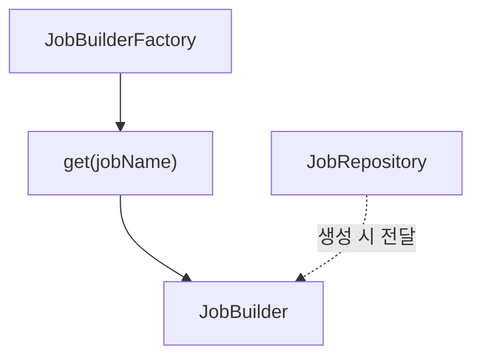

즉 JobBuilderFactory의 핵심 역할은 다음과 같다.

**Job 이름을 전달받아 JobRepository가 설정된 JobBuilder를 생성하는 것**이다.

하지만 Spring Batch 5.2에서는 이러한 방식이 변경되었다.

---

### Spring Batch 5에서는 JobBuilderFactory를 사용하지 않는다

Spring Batch 5에서는 JobBuilder와 StepBuilder를 생성하는 방식이 변경되었다.

Spring Batch 4에서는 JobBuilderFactory와 StepBuilderFactory를 주입받아 사용하는 방식이 일반적이었다.

그러나 Spring Batch 5부터 두 Factory의 사용이 권장되지 않게 되었고, Spring Batch 5.2에서는 제거되었다.

따라서 Spring Batch 5.2.4에서는 다음 코드를 사용하면 안 된다.

```java
jobBuilderFactory.get("batchJob");
```

대신 JobBuilder를 직접 생성한다.

```java
new JobBuilder("batchJob", jobRepository);
```

전체적인 변경 내용을 비교해보자.

| 구분               | Spring Batch 4            | Spring Batch 5.2   |
| ---------------- | ------------------------- | ------------------ |
| JobBuilder 생성    | JobBuilderFactory 사용      | JobBuilder 직접 생성   |
| 주요 API           | `jobBuilderFactory.get()` | `new JobBuilder()` |
| JobRepository 전달 | Factory 내부에서 처리           | 생성자에 직접 전달         |
| StepBuilder 생성   | StepBuilderFactory 사용     | StepBuilder 직접 생성  |
| 권장 방식            | Factory 기반                | 직접 Builder 생성      |

#### Spring Batch 4 방식

```java
return jobBuilderFactory
        .get("batchJob")
        .start(step1)
        .next(step2)
        .build();
```

#### Spring Batch 5.2 방식

```java
return new JobBuilder("batchJob", jobRepository)
        .start(step1)
        .next(step2)
        .build();
```

두 코드의 최종 목적은 동일하다.

Job을 생성한다는 것이다.

다만 Builder를 생성하는 과정이 달라졌다.

Spring Batch 5에서는 JobRepository를 직접 전달하는 방식으로 변경되었기 때문에 의존성이 더 명시적으로 드러난다.

이후 내용에서는 Spring Batch 5.2.4의 직접 Builder 생성 방식을 기준으로 살펴보자.

---

### JobBuilder의 내부 구조

JobBuilder는 다음 클래스를 상속한다.

```java
public class JobBuilder
        extends JobBuilderHelper<JobBuilder> {
}
```

여기서 중요한 클래스가 `JobBuilderHelper`다.

JobBuilderHelper는 Job을 생성하는 여러 Builder에서 공통적으로 사용하는 설정과 기능을 제공한다.

그리고 JobBuilder 자체는 `start()`나 `flow()`와 같은 메서드를 이용해 구체적인 Builder를 생성한다.

구조를 표현하면 다음과 같다.

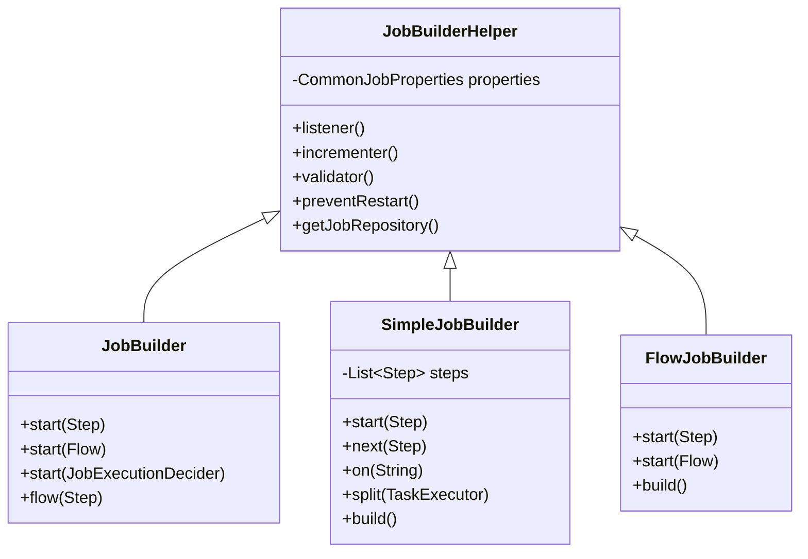

여기서 중요한 점은 JobBuilder, SimpleJobBuilder, FlowJobBuilder가 모두 JobBuilderHelper를 상속한다는 것이다.

각 Builder는 공통적인 Job 설정 기능을 상속받는다.

그리고 자신이 담당하는 Job의 종류에 따라 별도의 API를 제공한다.

---

### JobBuilderHelper의 역할

JobBuilderHelper는 Job 생성에 필요한 공통 속성을 관리하는 클래스다.

예를 들어 Job을 구성할 때 다음과 같은 설정이 필요할 수 있다.

* Job 이름
* JobRepository
* JobParametersValidator
* JobParametersIncrementer
* JobExecutionListener
* 재시작 허용 여부

SimpleJob이든 FlowJob이든 이러한 속성이 필요할 수 있다.

따라서 공통 설정을 각 Builder에 중복해서 구현하기보다는 상위 클래스에서 관리한다.

그 역할을 담당하는 것이 JobBuilderHelper다.

#### CommonJobProperties

JobBuilderHelper에는 `CommonJobProperties`라는 내부 클래스가 있다.

이 클래스는 Job을 생성할 때 필요한 공통 속성을 관리한다.

개념적으로 다음과 같은 구조다.

```text
JobBuilderHelper
       │
       └── CommonJobProperties
                │
                ├── name
                ├── jobRepository
                ├── restartable
                ├── jobParametersValidator
                ├── jobParametersIncrementer
                └── listeners
```

Builder는 이러한 공통 정보를 기반으로 실제 Job을 구성한다.

예를 들어 다음 코드를 살펴보자.

```java
new JobBuilder("batchJob", jobRepository)
        .preventRestart()
        .start(step1)
        .build();
```

여기서 `preventRestart()`는 Job의 재시작을 허용하지 않도록 설정하는 메서드다.

이 기능은 SimpleJob에서만 필요한 것이 아니다.

FlowJob에서도 사용할 수 있다.

따라서 JobBuilderHelper에서 공통 설정 기능을 제공하는 것이 자연스럽다.

---

### JobBuilderHelper의 공통 설정 API

대표적인 공통 설정 API는 다음과 같다.

| API                  | 설명                      |
| -------------------- | ----------------------- |
| `listener()`         | JobExecutionListener 등록 |
| `validator()`        | JobParameters 검증기 등록    |
| `incrementer()`      | JobParameters 증가 정책 설정  |
| `preventRestart()`   | Job 재시작 비활성화            |
| `repository()`       | JobRepository 설정        |
| `getName()`          | Job 이름 조회               |
| `getJobRepository()` | JobRepository 조회        |

이러한 메서드는 Builder에서 공통적으로 사용할 수 있다.

#### listener()

JobExecutionListener를 등록한다.

```java
new JobBuilder("batchJob", jobRepository)
        .listener(jobExecutionListener)
        .start(step1)
        .build();
```

JobExecutionListener는 Job 실행 전후에 필요한 공통 처리를 수행할 수 있다.

예를 들어 다음과 같은 작업이 가능하다.

```text
Job 실행 전
    │
    └── 실행 정보 기록

Job 실행
    │
    ▼
Job 실행 후
    │
    └── 최종 상태 확인
```

#### validator()

JobParametersValidator를 등록한다.

```java
new JobBuilder("batchJob", jobRepository)
        .validator(jobParametersValidator)
        .start(step1)
        .build();
```

이 설정은 Job 실행 시 전달된 JobParameters가 유효한지 검증하는 데 활용된다.

예를 들어 정산 기준일이 필수라면 JobParametersValidator를 이용해 해당 값의 존재 여부를 확인할 수 있다.

#### preventRestart()

Job의 재시작을 비활성화한다.

```java
new JobBuilder("batchJob", jobRepository)
        .preventRestart()
        .start(step1)
        .build();
```

이 설정을 사용하면 이전 실행이 실패하더라도 동일한 JobInstance의 재시작이 제한된다.

다만 새로운 식별용 JobParameters를 이용한 별도의 JobInstance 실행까지 금지하는 설정은 아니다.

#### incrementer()

JobParametersIncrementer를 설정한다.

```java
new JobBuilder("batchJob", jobRepository)
        .incrementer(new RunIdIncrementer())
        .start(step1)
        .build();
```

RunIdIncrementer는 실행 파라미터를 증가시키는 데 사용할 수 있다.

다만 Incrementer를 등록했다고 해서 `JobLauncher.run()`을 직접 호출할 때마다 자동으로 새로운 파라미터가 생성되는 것은 아니다.

JobOperator의 `startNextInstance()`처럼 Incrementer를 활용하는 실행 경로와 연결되어야 한다.

---

### JobBuilder는 어떤 Job을 생성할까?

Spring Batch에는 대표적으로 두 종류의 Job 구현체가 있다.

첫 번째는 `SimpleJob`이다.

두 번째는 `FlowJob`이다.

두 Job은 모두 Spring Batch의 Job 인터페이스를 구현하지만 내부 실행 구조가 다르다.

#### SimpleJob

SimpleJob은 등록된 Step을 순차적으로 실행하는 Job이다.

```text
SimpleJob
    │
    ├── Step 1
    │
    ├── Step 2
    │
    └── Step 3
```

일반적으로 이전 Step이 정상적으로 완료되면 다음 Step으로 이동한다.

따라서 단순한 순차 처리에 적합하다.

#### FlowJob

FlowJob은 Flow를 기반으로 실행 흐름을 관리하는 Job이다.

```text
FlowJob
   │
   ▼
Flow
   │
   ├── Step 1
   │
   ├── Step 2
   │
   └── Step 3
```

Flow에서는 Step의 종료 결과에 따라 실행 경로를 다르게 구성할 수 있다.

또한 여러 Flow를 연결하거나 병렬 실행 구조를 구성할 수도 있다.

단, FlowJob이라고 해서 반드시 조건 분기가 존재해야 하는 것은 아니다.

Flow 내부의 Step을 단순히 순차적으로 실행하도록 구성할 수도 있다.

두 Job의 차이를 정리하면 다음과 같다.

| 구분         | SimpleJob          | FlowJob        |
| ---------- | ------------------ | -------------- |
| 실행 구조      | Step 목록 기반         | Flow 기반        |
| 기본 실행 흐름   | 순차 실행              | 상태 전이 기반       |
| 조건부 분기     | 직접적인 순차 구조만으로는 제한적 | 지원             |
| 여러 Flow 연결 | 직접적인 구조에는 없음       | 지원             |
| 대표 Builder | SimpleJobBuilder   | FlowJobBuilder |
| 내부 주요 데이터  | `List<Step>`       | `Flow`         |

이 차이는 JobBuilder에서 어떤 API를 호출하는지에 따라 결정된다.

---

### JobBuilder의 세 가지 주요 생성 경로

JobBuilder는 `start()`와 `flow()` 메서드를 제공한다.

이때 전달하는 매개변수의 타입에 따라 생성되는 Builder가 달라진다.

대표적으로 세 가지 경로를 살펴볼 수 있다.

| API           | 반환 Builder       | 최종 Job    |
| ------------- | ---------------- | --------- |
| `start(Step)` | SimpleJobBuilder | SimpleJob |
| `start(Flow)` | JobFlowBuilder   | FlowJob   |
| `flow(Step)`  | JobFlowBuilder   | FlowJob   |

여기서 주의할 부분이 있다.

`start(Flow)`와 `flow(Step)`은 실제로 `JobFlowBuilder`를 반환한다.

하지만 내부적으로는 먼저 `FlowJobBuilder`가 생성된다.

따라서 다음과 같이 이해하는 것이 정확하다.

```text
JobBuilder
    │
    ├── start(Step)
    │       │
    │       ▼
    │   SimpleJobBuilder
    │       │
    │       ▼
    │     SimpleJob
    │
    ├── start(Flow)
    │       │
    │       ▼
    │   FlowJobBuilder
    │       │
    │       ▼
    │   JobFlowBuilder
    │       │
    │       ▼
    │     FlowJob
    │
    └── flow(Step)
            │
            ▼
        FlowJobBuilder
            │
            ▼
        JobFlowBuilder
            │
            ▼
          FlowJob
```

이러한 구조를 이해하면 Job 설정 코드에서 어떤 Builder가 생성되고 있는지 알 수 있다.

---

### 첫 번째 경로: start(Step)

가장 기본적인 Job 생성 방식이다.

다음 코드를 살펴보자.

```java
new JobBuilder("simpleBatchJob", jobRepository)
        .start(step1)
        .next(step2)
        .build();
```

여기서 `start()`의 매개변수는 Step이다.

따라서 다음 메서드가 호출된다.

```java
public SimpleJobBuilder start(Step step) {

    return new SimpleJobBuilder(this)
            .start(step);
}
```

이 메서드에서 중요한 부분은 다음과 같다.

```java
new SimpleJobBuilder(this)
```

JobBuilder가 SimpleJobBuilder를 생성한다.

그리고 생성한 Builder에 Step을 전달한다.

따라서 다음과 같은 흐름이 발생한다.

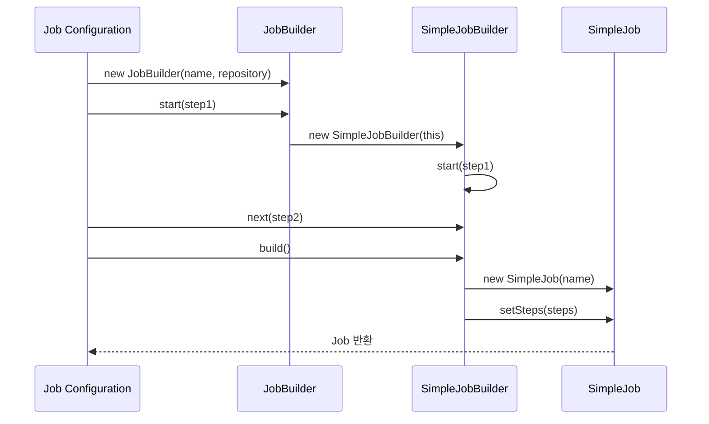

JobBuilder가 직접 SimpleJob을 생성하는 것이 아니다.

실제 SimpleJob 생성은 SimpleJobBuilder가 담당한다.

---

### SimpleJobBuilder의 내부 구조

SimpleJobBuilder는 SimpleJob을 생성하는 Builder다.

중요한 속성 중 하나는 다음과 같다.

```java
private final List<Step> steps =
        new ArrayList<>();
```

이 List는 Job에 등록할 Step들을 관리한다.

예를 들어 다음 코드를 살펴보자.

```java
new JobBuilder("simpleBatchJob", jobRepository)
        .start(step1)
        .next(step2)
        .next(step3)
        .build();
```

각 API를 호출하면서 Step이 List에 추가된다.

```text
steps
   │
   ├── step1
   ├── step2
   └── step3
```

마지막에 build()를 호출하면 이 List가 SimpleJob에 전달된다.

#### start()의 동작

SimpleJobBuilder의 `start()`는 첫 번째 Step을 설정한다.

핵심 구조는 다음과 같다.

```java
public SimpleJobBuilder start(Step step) {

    if (steps.isEmpty()) {

        steps.add(step);

    } else {

        steps.set(0, step);
    }

    return this;
}
```

여기서 중요한 점은 Step 목록의 첫 번째 위치를 관리한다는 것이다.

처음 호출하는 경우에는 Step을 추가한다.

이미 Step이 존재하면 첫 번째 Step을 변경할 수 있다.

따라서 일반적인 Job 구성에서는 start()를 한 번 호출한 뒤 next()로 후속 Step을 연결한다.

#### next()의 동작

다음 메서드는 새로운 Step을 List에 추가한다.

```java
public SimpleJobBuilder next(Step step) {

    steps.add(step);

    return this;
}
```

이 메서드는 상대적으로 단순하다.

새로운 Step을 추가하고 현재 Builder를 반환한다.

따라서 다음과 같은 코드가 가능하다.

```java
.start(step1)
.next(step2)
.next(step3)
```

각 Step이 List에 추가된다.

```text
Step List

Index 0 → step1

Index 1 → step2

Index 2 → step3
```

이 순서가 SimpleJob의 기본 실행 순서가 된다.

---

### SimpleJobBuilder의 build()는 무엇을 할까?

SimpleJobBuilder의 `build()`는 최종적으로 Job 객체를 생성한다.

기본적인 순차 실행 구조에서는 SimpleJob을 생성한다.

핵심 로직을 단순화하면 다음과 같다.

```java
public Job build() {

    SimpleJob job =
            new SimpleJob(getName());

    super.enhance(job);

    job.setSteps(steps);

    job.afterPropertiesSet();

    return job;
}
```

실제 구현에는 예외 처리와 Flow 전환 여부 확인 등의 로직이 추가되어 있다.

이 코드에서 중요한 부분은 세 군데다.

#### SimpleJob 생성

```java
SimpleJob job =
        new SimpleJob(getName());
```

Builder에 저장된 Job 이름을 이용해 SimpleJob을 생성한다.

#### 공통 속성 적용

```java
super.enhance(job);
```

JobBuilderHelper에 저장된 공통 설정을 Job에 반영한다.

예를 들어 JobRepository, Listener, 재시작 설정 등이 여기에 포함된다.

#### Step 목록 적용

```java
job.setSteps(steps);
```

SimpleJobBuilder가 관리하던 Step List를 SimpleJob에 전달한다.

결과적으로 다음과 같은 Job이 만들어진다.

```text
SimpleJob
    │
    ├── name = simpleBatchJob
    │
    ├── jobRepository
    │
    └── steps
           │
           ├── step1
           ├── step2
           └── step3
```

이것이 SimpleJobBuilder의 핵심 역할이다.

**SimpleJobBuilder는 Step 목록을 구성하고, 공통 설정과 함께 SimpleJob 객체를 생성한다.**

---

### 두 번째 경로: start(Flow)

이번에는 Flow를 전달하는 경우를 살펴보자.

먼저 Flow가 무엇인지 간단히 이해할 필요가 있다.

Flow는 여러 Step의 실행 흐름을 하나의 단위로 구성하는 객체다.

예를 들어 다음과 같다.

```text
settlementFlow
       │
       ├── step3
       │
       └── step4
```

이 Flow를 Job에 포함시키면 다음과 같은 구조를 만들 수 있다.

```text
flowBatchJob
       │
       ▼
settlementFlow
       │
       ├── step3
       │
       └── step4
       │
       ▼
step5
```

이 경우 다음과 같이 Job을 생성할 수 있다.

```java
new JobBuilder("flowBatchJob", jobRepository)
        .start(settlementFlow)
        .next(step5)
        .end()
        .build();
```

여기서 `start()`의 매개변수는 Step이 아니라 Flow다.

따라서 호출되는 메서드가 달라진다.

```java
public JobFlowBuilder start(Flow flow) {

    return new FlowJobBuilder(this)
            .start(flow);
}
```

이번에는 SimpleJobBuilder를 생성하지 않는다.

대신 FlowJobBuilder를 생성한다.

그리고 Flow를 전달한다.

---

### FlowJobBuilder의 역할

FlowJobBuilder는 FlowJob을 생성하는 Builder다.

SimpleJobBuilder가 Step List를 이용해 SimpleJob을 생성한다면, FlowJobBuilder는 Flow를 이용해 FlowJob을 생성한다.

두 Builder의 차이를 비교해보자.

| 구분        | SimpleJobBuilder | FlowJobBuilder  |
| --------- | ---------------- | --------------- |
| 최종 생성 객체  | SimpleJob        | FlowJob         |
| 실행 구조     | Step List        | Flow            |
| 주요 데이터    | 등록된 Step 목록      | 실행 흐름을 정의한 Flow |
| 대표 사용     | 단순 순차 실행         | Flow 기반 실행      |
| 최종 생성 메서드 | build()          | build()         |

하지만 FlowJobBuilder를 사용할 때는 한 가지 더 알아야 한다.

바로 `JobFlowBuilder`라는 클래스다.

이름이 비슷해 혼동하기 쉽지만 두 클래스의 역할은 다르다.

---

### FlowJobBuilder와 JobFlowBuilder의 차이

두 클래스는 이름이 매우 비슷하다.

```text
FlowJobBuilder

JobFlowBuilder
```

하지만 담당하는 역할은 다르다.

**FlowJobBuilder는 FlowJob을 생성하는 Builder다.**

반면 **JobFlowBuilder는 Job 내부에서 사용할 Flow를 구성하는 Builder다.**

JobFlowBuilder는 다음 클래스를 상속한다.

```java
public class JobFlowBuilder
        extends FlowBuilder<FlowJobBuilder> {
}
```

즉 JobFlowBuilder는 FlowBuilder 계열의 클래스다.

이 클래스는 `start()`, `next()`, `from()`, `on()` 등을 이용해 실행 흐름을 구성한다.

그리고 생성한 Flow를 부모 FlowJobBuilder에 전달한다.

전체적인 관계는 다음과 같다.

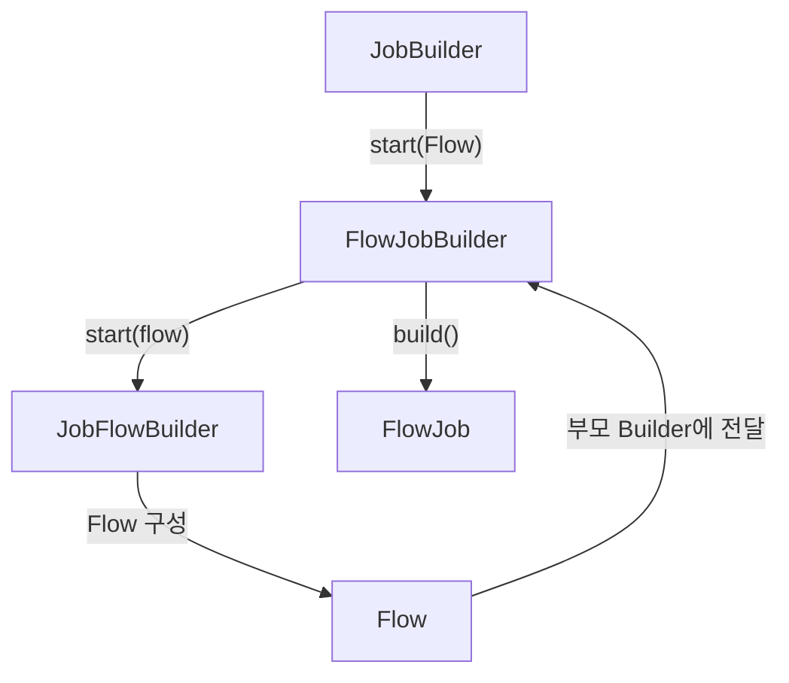

여기서 다음 관계를 기억하면 된다.

```text
JobFlowBuilder
      │
      └── Flow 구성
```

```text
FlowJobBuilder
      │
      └── FlowJob 생성
```

결국 JobFlowBuilder가 Flow 실행 구조를 완성하고, FlowJobBuilder가 이를 이용해 최종 Job을 생성한다.

---

### JobFlowBuilder의 build()와 FlowJobBuilder의 build()는 다르다

FlowJob을 구성할 때 다음과 같은 코드를 자주 사용한다.

```java
new JobBuilder("flowBatchJob", jobRepository)
        .start(settlementFlow)
        .next(step5)
        .end()
        .build();
```

여기서 `end()`와 `build()`를 구분해야 한다.

JobFlowBuilder는 FlowBuilder를 상속한다.

따라서 `end()` 메서드를 사용할 수 있다.

이 메서드는 내부적으로 Flow 구성 과정을 완료한다.

JobFlowBuilder의 `build()`는 최종 Job을 바로 반환하지 않는다.

대신 Flow를 구성한 뒤 부모 FlowJobBuilder를 반환한다.

핵심 동작은 다음과 같다.

```java
@Override
public FlowJobBuilder build() {

    Flow flow = flow();

    parent.flow(flow);

    return parent;
}
```

이 코드에서 중요한 부분은 다음과 같다.

```java
parent.flow(flow);
```

생성된 Flow를 부모 FlowJobBuilder에 전달한다.

그리고 부모 Builder를 반환한다.

따라서 다음 과정이 발생한다.

```text
JobFlowBuilder
       │
       ▼
end()
       │
       ▼
Flow 구성 완료
       │
       ▼
FlowJobBuilder 반환
       │
       ▼
build()
       │
       ▼
FlowJob 생성
```

즉 다음 코드의 두 메서드는 서로 다른 단계다.

```java
.end()
.build();
```

`end()`는 Flow 구성 단계를 마무리한다.

이후 `build()`는 최종 FlowJob을 생성한다.

이 차이를 이해하면 FlowJob 생성 과정이 훨씬 명확해진다.

---

### 세 번째 경로: flow(Step)

JobBuilder는 `flow()` 메서드도 제공한다.

예를 들어 다음과 같다.

```java
new JobBuilder("stepFlowJob", jobRepository)
        .flow(step1)
        .next(step2)
        .end()
        .build();
```

여기서 특이한 점은 시작 객체가 Flow가 아니라 Step이라는 사실이다.

`flow()`에 Step을 전달하면 JobBuilder는 Flow 기반 Job을 구성하도록 Builder를 생성한다.

Spring Batch 5.2.4의 핵심 구현은 다음과 같다.

```java
public JobFlowBuilder flow(Step step) {

    return new FlowJobBuilder(this)
            .start(step);
}
```

이 메서드 역시 FlowJobBuilder를 생성한다.

따라서 최종적으로 FlowJob이 만들어진다.

#### start(Step)과 flow(Step)의 차이

두 메서드는 동일하게 Step을 전달받는다.

하지만 생성되는 Job의 종류가 다르다.

| 구분         | start(Step)      | flow(Step)                      |
| ---------- | ---------------- | ------------------------------- |
| 전달 객체      | Step             | Step                            |
| 생성 Builder | SimpleJobBuilder | FlowJobBuilder 및 JobFlowBuilder |
| 기본 생성 Job  | SimpleJob        | FlowJob                         |
| 실행 구조      | Step List        | Flow                            |
| 조건부 전이 확장  | 별도의 Flow 전환 필요   | Flow API 사용 가능                  |

예를 들어 다음 코드는 SimpleJob을 생성한다.

```java
new JobBuilder("job1", jobRepository)
        .start(step1)
        .next(step2)
        .build();
```

반면 다음 코드는 FlowJob을 생성한다.

```java
new JobBuilder("job2", jobRepository)
        .flow(step1)
        .next(step2)
        .end()
        .build();
```

두 Job이 단순히 Step 1과 Step 2를 순서대로 실행하도록 구성되어 있다면 실행 결과는 비슷할 수 있다.

하지만 내부 구현체는 다르다.

이러한 차이를 이해하면 JobBuilder가 어떤 기준으로 Job의 종류를 결정하는지 알 수 있다.

---

### JobBuilder가 생성하는 Builder의 전체 구조

지금까지 살펴본 세 가지 경로를 하나로 정리해보자.

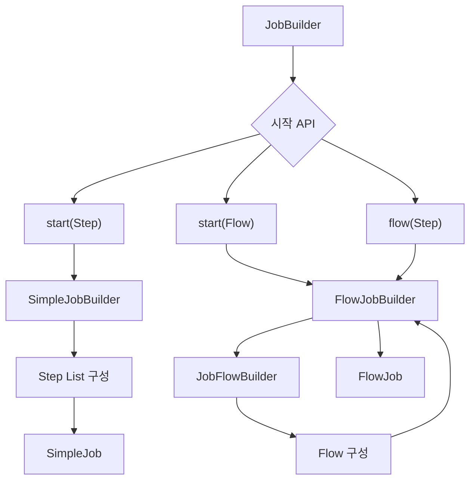

핵심은 시작 API의 반환 타입이다.

```java
JobBuilder.start(Step)
```

이 메서드는 SimpleJobBuilder를 반환한다.

```java
JobBuilder.start(Flow)
```

이 메서드는 JobFlowBuilder를 반환한다.

```java
JobBuilder.flow(Step)
```

이 메서드도 JobFlowBuilder를 반환한다.

따라서 같은 JobBuilder에서 시작하더라도 이후에 사용할 수 있는 API와 최종 Job 구현체가 달라질 수 있다.

---

### SimpleJobBuilder와 FlowBuilder의 주요 API 비교

Spring Batch는 Job의 실행 흐름을 구성하기 위해 여러 API를 제공한다.

그중 대표적인 API는 다음과 같다.

| API     | 역할                              |
| ------- | ------------------------------- |
| start() | 시작 Step 또는 Flow 지정              |
| next()  | 정상 완료 시 다음 단계 연결                |
| on()    | 종료 코드에 따른 전이 조건 설정              |
| from()  | 기존 Step 또는 Flow를 기준으로 새로운 분기 정의 |
| split() | 여러 Flow를 병렬로 실행하는 구조 구성         |
| end()   | Flow 구성 마무리                     |
| build() | 최종 객체 생성                        |

여기서 중요한 점은 **모든 API가 동일한 Builder에서 동일한 반환 타입으로 제공되는 것은 아니라는 사실**이다.

예를 들어 SimpleJobBuilder의 `next(Step)`은 SimpleJobBuilder를 반환한다.

반면 JobFlowBuilder 계열의 `next(Step)`은 Flow 구성 기능을 제공한다.

또한 `on()`을 호출하면 조건부 전이를 구성하기 위한 TransitionBuilder로 이동할 수 있다.

따라서 단순히 메서드 이름만 외우는 것보다 각 메서드가 어떤 Builder를 반환하는지 이해하는 것이 중요하다.

---

### start()와 next()

가장 기본적인 API는 start()와 next()다.

다음 코드를 살펴보자.

```java
new JobBuilder("batchJob", jobRepository)
        .start(step1)
        .next(step2)
        .next(step3)
        .build();
```

첫 번째 Step은 step1이다.

step1이 정상적으로 완료되면 step2로 이동한다.

step2가 정상적으로 완료되면 step3으로 이동한다.


이 구조는 순차 실행을 나타낸다.

하지만 다음과 같은 요구사항이 있다고 생각해보자.

```text
Step 1 실행
      │
      ├── 성공 → Step 2 실행
      │
      └── 실패 → Step 3 실행
```

이 경우 단순한 next()만으로는 충분하지 않다.

종료 상태에 따라 실행 경로를 변경해야 하기 때문이다.

이때 Flow 관련 API를 사용할 수 있다.

---

### on()과 from()

Flow 기반 Job에서는 `on()`과 `from()`을 이용해 조건부 실행 흐름을 구성할 수 있다.

예를 들어 다음과 같다.

```java
@Bean
public Job conditionalJob(
        JobRepository jobRepository,
        Step step1,
        Step step2,
        Step step3
) {
    return new JobBuilder(
            "conditionalJob",
            jobRepository
    )
            .start(step1)
                .on("COMPLETED").to(step2)
            .from(step1)
                .on("FAILED").to(step3)
            .end()
            .build();
}
```

이 코드는 Step 1의 종료 코드에 따라 실행 경로를 변경한다.

Step 1이 정상적으로 완료되면 Step 2를 실행한다.

반면 Step 1의 종료 코드가 FAILED라면 Step 3으로 이동한다.

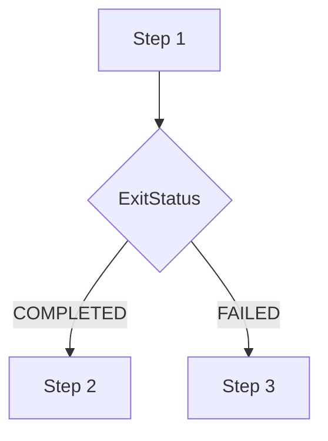

여기서 중요한 점은 처음에 다음 API를 사용했다는 사실이다.

```java
.start(step1)
```

이 메서드는 처음에는 SimpleJobBuilder를 생성한다.

하지만 이후 `on()`을 호출하면서 내부적으로 Flow 기반 Builder가 구성된다.

따라서 **start(Step)을 호출했다고 해서 반드시 최종적으로 SimpleJob이 생성된다고 단정해서는 안 된다.**

단순한 순차 Step 구성에서는 SimpleJob이 생성된다.

하지만 조건부 전이를 추가하면 FlowJob으로 전환될 수 있다.

이것이 JobBuilder의 내부 구조를 이해해야 하는 중요한 이유다.

---

### Flow와 Step의 관계

Flow는 여러 Step을 묶어 하나의 실행 흐름으로 구성할 수 있다.

예를 들어 다음과 같은 정산 처리 과정이 있다고 생각해보자.

```text
정산 데이터 생성
       │
       ▼
정산 결과 검증
       │
       ▼
정산 완료 처리
```

이 중 첫 번째와 두 번째 작업을 하나의 Flow로 구성할 수 있다.

```text
settlementFlow
       │
       ├── 정산 데이터 생성
       │
       └── 정산 결과 검증
```

그리고 Job에서는 해당 Flow를 실행한 뒤 정산 완료 처리를 수행하도록 구성할 수 있다.

```text
settlementJob
       │
       ▼
settlementFlow
       │
       ├── Step 1
       │
       └── Step 2
       │
       ▼
Step 3
```

이러한 구조의 장점은 실행 흐름을 별도의 객체로 분리할 수 있다는 것이다.

따라서 여러 Step으로 구성된 공통 처리 흐름을 재사용하기 쉬워진다.

---

### FlowBuilder를 이용해 Flow 생성하기

Spring Batch는 Flow를 생성하기 위해 `FlowBuilder`를 제공한다.

대표적인 사용 방법은 다음과 같다.

```java
@Bean
public Flow settlementFlow(
        Step step3,
        Step step4
) {
    return new FlowBuilder<SimpleFlow>(
            "settlementFlow"
    )
            .start(step3)
            .next(step4)
            .build();
}
```

이 코드에서는 두 개의 Step을 하나의 Flow로 구성한다.

```text
settlementFlow
       │
       ├── step3
       │
       └── step4
```

이후 JobBuilder에서 해당 Flow를 사용할 수 있다.

```java
@Bean
public Job flowBatchJob(
        JobRepository jobRepository,
        Flow settlementFlow,
        Step step5
) {
    return new JobBuilder(
            "flowBatchJob",
            jobRepository
    )
            .start(settlementFlow)
            .next(step5)
            .end()
            .build();
}
```

전체 실행 흐름은 다음과 같다.

```text
flowBatchJob
       │
       ▼
settlementFlow
       │
       ├── step3
       │
       ▼
       step4
       │
       ▼
      step5
```

여기서 FlowBuilder는 Flow를 생성한다.

JobBuilder는 해당 Flow를 이용해 Job을 생성한다.

두 Builder는 서로 다른 역할을 담당한다.

---

### FlowBuilder와 JobFlowBuilder의 차이

이번에는 이름이 비슷한 Builder들을 다시 정리해보자.

| 클래스              | 역할                    | 생성 결과              |
| ---------------- | --------------------- | ------------------ |
| FlowBuilder      | 독립적인 Flow 생성          | Flow               |
| JobFlowBuilder   | Job 내부의 Flow 실행 구조 구성 | FlowJobBuilder로 연결 |
| FlowJobBuilder   | Flow 기반 Job 생성        | FlowJob            |
| SimpleJobBuilder | Step 목록 기반 Job 생성     | SimpleJob          |

예를 들어 다음 코드는 독립적인 Flow를 생성한다.

```java
new FlowBuilder<SimpleFlow>("myFlow")
        .start(step1)
        .next(step2)
        .build();
```

반면 다음 코드는 FlowJob을 생성한다.

```java
new JobBuilder("myJob", jobRepository)
        .start(myFlow)
        .next(step3)
        .end()
        .build();
```

두 코드는 서로 연결되어 있지만 역할은 다르다.

**FlowBuilder는 Flow 자체를 만들고, FlowJobBuilder는 만들어진 Flow를 이용해 Job을 생성한다.**

---

### JobBuilderHelper의 상속 구조

이제 전체 클래스 구조를 정리해보자.

Spring Batch 5.2.4에서 주요 Builder의 상속 관계는 다음과 같다.

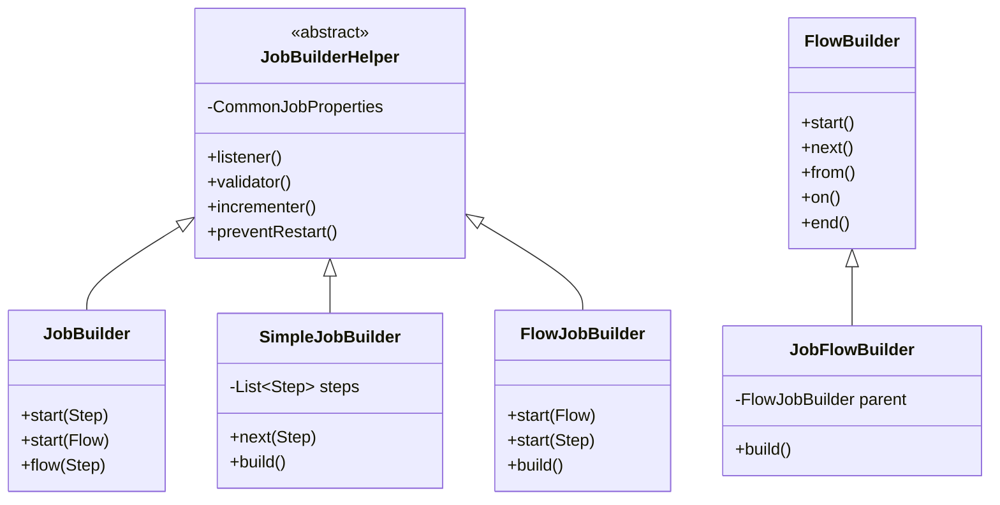

여기서 주목해야 할 부분이 있다.

JobFlowBuilder는 JobBuilderHelper를 상속하지 않는다.

대신 FlowBuilder를 상속한다.

그리고 부모 FlowJobBuilder를 참조한다.

이러한 구조는 역할 분리 측면에서 자연스럽다.

Job의 공통 설정은 JobBuilderHelper 계열에서 관리한다.

반면 Flow의 상태 전이와 실행 흐름은 FlowBuilder 계열에서 관리한다.

결국 서로 다른 책임을 가진 Builder들이 협력해 하나의 FlowJob을 생성하는 것이다.

---

### JobRepository는 Builder에 왜 전달할까?

Spring Batch 5.2에서는 JobBuilder 생성 시 JobRepository를 전달한다.

```java
new JobBuilder(
        "batchJob",
        jobRepository
);
```

왜 JobRepository가 필요할까?

앞에서 살펴본 것처럼 JobRepository는 JobInstance, JobExecution, StepExecution 등의 실행 메타데이터를 관리한다.

따라서 Job은 실행 과정에서 JobRepository에 접근해야 한다.

예를 들어 Job이 실행되면 다음과 같은 정보가 생성되거나 갱신된다.

```text
JobInstance

JobExecution

StepExecution

ExecutionContext
```

JobBuilder는 Job 생성 과정에서 이러한 실행 메타데이터를 관리할 수 있도록 JobRepository를 최종 Job에 전달한다.

전체 구조는 다음과 같다.

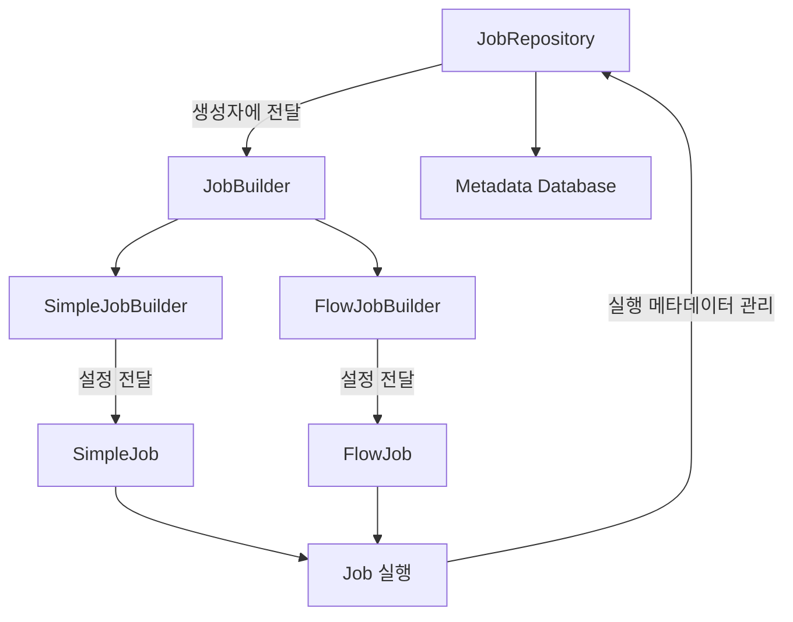

여기서 중요한 사실이 있다.

**JobBuilder에 JobRepository를 전달하는 것과 실제 데이터베이스에 JobExecution이 저장되는 것은 서로 다른 과정이다.**

JobBuilder를 생성했다고 해서 JobInstance나 JobExecution이 즉시 데이터베이스에 저장되는 것은 아니다.

Builder는 Job 객체를 구성한다.

이후 JobLauncher가 실제 Job 실행을 시작하면서 실행 메타데이터가 생성된다.

이 차이를 정확하게 구분해야 한다.

---

### Job 생성 시점과 Job 실행 시점의 차이

다음 코드를 살펴보자.

```java
@Bean
public Job batchJob(
        JobRepository jobRepository,
        Step step1
) {
    return new JobBuilder("batchJob", jobRepository)
            .start(step1)
            .build();
}
```

Spring Boot가 시작되면 이 Bean 메서드를 호출해 Job 객체를 생성한다.

이때 다음 작업이 수행된다.

```text
JobBuilder 생성
       │
       ▼
SimpleJobBuilder 생성
       │
       ▼
Step 등록
       │
       ▼
SimpleJob 생성
       │
       ▼
Spring Bean 등록
```

하지만 이 시점에는 실제 Job이 실행된 것이 아니다.

실제 실행은 다음 과정에서 이루어진다.

```text
JobLauncher.run()
       │
       ▼
JobRepository.createJobExecution()
       │
       ▼
JobExecution 생성
       │
       ▼
Job.execute()
       │
       ▼
Step 실행
```

따라서 다음 두 과정을 구분해야 한다.

| 구분              | Job 생성                | Job 실행        |
| --------------- | --------------------- | ------------- |
| 주요 주체           | JobBuilder            | JobLauncher   |
| 발생 시점           | 일반적으로 Spring Bean 초기화 | 실행 요청 시점      |
| 주요 목적           | Job 실행 구조 정의          | 실제 비즈니스 작업 수행 |
| Step 처리         | Step 객체 등록            | Step 실제 실행    |
| JobExecution 생성 | 생성하지 않음               | 생성            |
| 메타데이터 기록        | 실행 이력 기록 없음           | 실행 이력 생성 및 갱신 |

이 구분은 특히 배치 초기화 과정과 실제 Job 실행 과정을 분석할 때 중요하다.

---

### 실제 SimpleJob과 FlowJob 생성하기

이제 실제 Spring Batch 프로젝트에서 Builder의 동작을 확인해보자.

이번에는 세 가지 Job을 생성한다.

```text
simpleBatchJob
       │
       ├── step1
       └── step2
```

```text
flowBatchJob
       │
       ▼
orderFlow
       │
       ├── step3
       └── step4
       │
       ▼
      step5
```

```text
stepBasedFlowJob
       │
       ├── step1
       └── step2
```

첫 번째 Job은 `start(Step)`으로 생성한다.

두 번째 Job은 `start(Flow)`로 생성한다.

세 번째 Job은 `flow(Step)`으로 생성한다.

세 가지 방식을 비교하면 어떤 API가 어떤 Job을 생성하는지 확인할 수 있다.

---

### Maven 의존성 설정

먼저 필요한 의존성을 추가한다.

`pom.xml`

```xml
<?xml version="1.0" encoding="UTF-8"?>
<project xmlns="http://maven.apache.org/POM/4.0.0"
         xmlns:xsi="http://www.w3.org/2001/XMLSchema-instance"
         xsi:schemaLocation="
             http://maven.apache.org/POM/4.0.0
             https://maven.apache.org/xsd/maven-4.0.0.xsd">

    <modelVersion>4.0.0</modelVersion>

    <parent>
        <groupId>org.springframework.boot</groupId>
        <artifactId>spring-boot-starter-parent</artifactId>
        <version>3.4.13</version>
        <relativePath/>
    </parent>

    <groupId>com.example</groupId>
    <artifactId>spring-batch-demo</artifactId>
    <version>0.0.1-SNAPSHOT</version>

    <properties>
        <java.version>17</java.version>
        <spring-batch.version>5.2.4</spring-batch.version>
    </properties>

    <dependencies>

        <dependency>
            <groupId>org.springframework.boot</groupId>
            <artifactId>spring-boot-starter-batch</artifactId>
        </dependency>

        <dependency>
            <groupId>com.h2database</groupId>
            <artifactId>h2</artifactId>
            <scope>runtime</scope>
        </dependency>

    </dependencies>

    <build>
        <plugins>

            <plugin>
                <groupId>org.springframework.boot</groupId>
                <artifactId>spring-boot-maven-plugin</artifactId>
            </plugin>

        </plugins>
    </build>

</project>
```

이번 예제에서는 H2 인메모리 데이터베이스를 사용한다.

따라서 별도의 MySQL 서버 없이도 실행할 수 있다.

---

### application.yml 설정

여러 Job을 등록할 예정이므로 실행할 Job을 지정할 수 있도록 설정한다.

`application.yml`

```yaml
spring:
  application:
    name: spring-batch-demo

  main:
    web-application-type: none

  datasource:
    url: jdbc:h2:mem:batchdb;DB_CLOSE_DELAY=-1
    driver-class-name: org.h2.Driver
    username: sa
    password:

  batch:
    job:
      enabled: true
      name: ${demo.job.name:simpleBatchJob}

    jdbc:
      initialize-schema: embedded

logging:
  level:
    org.springframework.batch: INFO
```

여기서 중요한 설정은 다음이다.

```yaml
spring:
  batch:
    job:
      name: ${demo.job.name:simpleBatchJob}
```

외부에서 Job 이름을 전달하지 않으면 `simpleBatchJob`을 실행한다.

반면 실행 시 다음 값을 전달하면

```text
--demo.job.name=flowBatchJob
```

`flowBatchJob`이 선택된다.

이렇게 하면 애플리케이션 코드를 변경하지 않고도 실행할 Job을 전환할 수 있다.

---

### JobBuilderConfiguration 전체 코드

다음과 같이 설정 클래스를 작성한다.

`JobBuilderConfiguration.java`

```java
package com.example.batch;

import org.slf4j.Logger;
import org.slf4j.LoggerFactory;

import org.springframework.batch.core.Job;
import org.springframework.batch.core.Step;

import org.springframework.batch.core.job.builder.JobBuilder;
import org.springframework.batch.core.job.builder.JobFlowBuilder;
import org.springframework.batch.core.job.builder.SimpleJobBuilder;

import org.springframework.batch.core.job.flow.Flow;
import org.springframework.batch.core.job.flow.support.SimpleFlow;

import org.springframework.batch.core.job.builder.FlowBuilder;

import org.springframework.batch.core.repository.JobRepository;
import org.springframework.batch.core.step.builder.StepBuilder;

import org.springframework.batch.repeat.RepeatStatus;

import org.springframework.beans.factory.annotation.Qualifier;
import org.springframework.context.annotation.Bean;
import org.springframework.context.annotation.Configuration;

import org.springframework.transaction.PlatformTransactionManager;

@Configuration
public class JobBuilderConfiguration {

    private static final Logger log =
            LoggerFactory.getLogger(
                    JobBuilderConfiguration.class
            );

    @Bean
    public Job simpleBatchJob(
            JobRepository jobRepository,
            @Qualifier("step1") Step step1,
            @Qualifier("step2") Step step2
    ) {
        JobBuilder jobBuilder =
                new JobBuilder(
                        "simpleBatchJob",
                        jobRepository
                );

        SimpleJobBuilder simpleJobBuilder =
                jobBuilder.start(step1);

        log.info(
                "Simple Builder Type: {}",
                simpleJobBuilder.getClass().getSimpleName()
        );

        Job job = simpleJobBuilder
                .next(step2)
                .build();

        log.info(
                "Created Job Type: {}",
                job.getClass().getSimpleName()
        );

        return job;
    }

    @Bean
    public Flow orderFlow(
            @Qualifier("step3") Step step3,
            @Qualifier("step4") Step step4
    ) {
        return new FlowBuilder<SimpleFlow>(
                "orderFlow"
        )
                .start(step3)
                .next(step4)
                .build();
    }

    @Bean
    public Job flowBatchJob(
            JobRepository jobRepository,
            @Qualifier("orderFlow") Flow orderFlow,
            @Qualifier("step5") Step step5
    ) {
        JobBuilder jobBuilder =
                new JobBuilder(
                        "flowBatchJob",
                        jobRepository
                );

        JobFlowBuilder jobFlowBuilder =
                jobBuilder.start(orderFlow);

        log.info(
                "Flow Builder Type: {}",
                jobFlowBuilder.getClass().getSimpleName()
        );

        Job job = jobFlowBuilder
                .next(step5)
                .end()
                .build();

        log.info(
                "Created Job Type: {}",
                job.getClass().getSimpleName()
        );

        return job;
    }

    @Bean
    public Job stepBasedFlowJob(
            JobRepository jobRepository,
            @Qualifier("step1") Step step1,
            @Qualifier("step2") Step step2
    ) {
        Job job = new JobBuilder(
                "stepBasedFlowJob",
                jobRepository
        )
                .flow(step1)
                .next(step2)
                .end()
                .build();

        log.info(
                "Created Job Type: {}",
                job.getClass().getSimpleName()
        );

        return job;
    }

    @Bean
    public Step step1(
            JobRepository jobRepository,
            PlatformTransactionManager transactionManager
    ) {
        return createStep(
                "step1",
                jobRepository,
                transactionManager
        );
    }

    @Bean
    public Step step2(
            JobRepository jobRepository,
            PlatformTransactionManager transactionManager
    ) {
        return createStep(
                "step2",
                jobRepository,
                transactionManager
        );
    }

    @Bean
    public Step step3(
            JobRepository jobRepository,
            PlatformTransactionManager transactionManager
    ) {
        return createStep(
                "step3",
                jobRepository,
                transactionManager
        );
    }

    @Bean
    public Step step4(
            JobRepository jobRepository,
            PlatformTransactionManager transactionManager
    ) {
        return createStep(
                "step4",
                jobRepository,
                transactionManager
        );
    }

    @Bean
    public Step step5(
            JobRepository jobRepository,
            PlatformTransactionManager transactionManager
    ) {
        return createStep(
                "step5",
                jobRepository,
                transactionManager
        );
    }

    private Step createStep(
            String stepName,
            JobRepository jobRepository,
            PlatformTransactionManager transactionManager
    ) {
        return new StepBuilder(
                stepName,
                jobRepository
        )
                .tasklet((contribution, chunkContext) -> {

                    log.info(
                            "Step 실행: {}",
                            stepName
                    );

                    return RepeatStatus.FINISHED;

                }, transactionManager)
                .build();
    }
}
```

이 코드에서는 세 가지 Job 생성 방식을 모두 확인할 수 있다.

다만 같은 Step Bean을 서로 다른 Job에서 사용하더라도 각 Job의 실행 이력은 별도의 JobInstance와 JobExecution으로 관리된다.

---

### 첫 번째 Job: SimpleJob 생성 과정

먼저 simpleBatchJob을 살펴보자.

핵심 코드는 다음과 같다.

```java
JobBuilder jobBuilder =
        new JobBuilder(
                "simpleBatchJob",
                jobRepository
        );

SimpleJobBuilder simpleJobBuilder =
        jobBuilder.start(step1);
```

여기서 JobBuilder를 직접 생성했다.

그리고 start()에 Step 객체를 전달했다.

따라서 반환 타입은 SimpleJobBuilder다.

다음 코드를 이용해 실제 클래스 이름을 확인한다.

```java
log.info(
        "Simple Builder Type: {}",
        simpleJobBuilder.getClass().getSimpleName()
);
```

출력 결과는 다음과 같다.

```text
Simple Builder Type: SimpleJobBuilder
```

이후 다음 코드를 호출한다.

```java
Job job = simpleJobBuilder
        .next(step2)
        .build();
```

Step 2를 추가하고 build()를 호출한다.

따라서 최종적으로 SimpleJob이 생성된다.

```text
Created Job Type: SimpleJob
```

이것이 `start(Step)`을 이용한 기본적인 Job 생성 과정이다.

---

### 두 번째 Job: FlowJob 생성 과정

이번에는 flowBatchJob을 살펴보자.

먼저 Flow를 생성한다.

```java
@Bean
public Flow orderFlow(
        Step step3,
        Step step4
) {
    return new FlowBuilder<SimpleFlow>(
            "orderFlow"
    )
            .start(step3)
            .next(step4)
            .build();
}
```

이 Flow는 두 개의 Step으로 구성된다.

```text
orderFlow
    │
    ├── step3
    └── step4
```

이제 JobBuilder에서 Flow를 전달한다.

```java
JobFlowBuilder jobFlowBuilder =
        jobBuilder.start(orderFlow);
```

이 코드에서 JobBuilder는 내부적으로 FlowJobBuilder를 생성한다.

그리고 JobFlowBuilder를 반환한다.

실제 반환 타입을 출력하면 다음과 같다.

```text
Flow Builder Type: JobFlowBuilder
```

이후 다음 코드를 호출한다.

```java
Job job = jobFlowBuilder
        .next(step5)
        .end()
        .build();
```

Flow가 완료된 뒤 Step 5를 실행하도록 구성했다.

그리고 end()로 Flow 구성을 마무리한다.

마지막으로 build()를 호출해 FlowJob을 생성한다.

따라서 다음 결과를 확인할 수 있다.

```text
Created Job Type: FlowJob
```

전체 실행 구조는 다음과 같다.

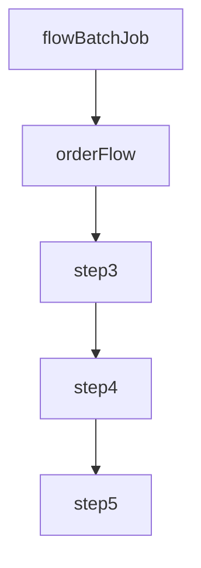

---

### 세 번째 Job: flow(Step)을 이용한 FlowJob 생성

이번에는 Flow 객체를 직접 생성하지 않고 `flow(Step)`을 사용한다.

```java
Job job = new JobBuilder(
        "stepBasedFlowJob",
        jobRepository
)
        .flow(step1)
        .next(step2)
        .end()
        .build();
```

이 코드는 Step을 전달하지만 SimpleJob을 생성하지 않는다.

`flow(Step)`은 내부적으로 FlowJobBuilder를 생성하기 때문이다.

따라서 최종 결과는 다음과 같다.

```text
Created Job Type: FlowJob
```

이러한 구조를 이용하면 별도의 Flow Bean을 생성하지 않고도 Flow 기반 Job을 구성할 수 있다.

다만 여러 Job에서 같은 Flow를 재사용해야 한다면 독립적인 Flow Bean을 생성하는 편이 더 적절할 수 있다.

---

### 실제 Job 실행하기

이제 세 가지 Job을 각각 실행해보자.

먼저 프로젝트를 빌드한다.

```bash
./mvnw clean package
```

정상적으로 빌드되었다면 다음과 같은 결과를 확인할 수 있다.

```text
BUILD SUCCESS
```

생성된 JAR 파일을 이용해 실행한다.

---

### SimpleJob 실행 결과

먼저 SimpleJob을 실행한다.

```bash
java -jar target/spring-batch-demo-0.0.1-SNAPSHOT.jar \
  --demo.job.name=simpleBatchJob \
  businessDate=2026-10-30
```

이 명령어는 simpleBatchJob을 선택한다.

JobParameters로는 businessDate를 전달한다.

실행 흐름은 다음과 같다.

```text
simpleBatchJob
       │
       ▼
step1
       │
       ▼
step2
       │
       ▼
COMPLETED
```

정상적으로 실행되면 다음과 유사한 로그를 확인할 수 있다.

```text
Created Job Type: SimpleJob

Job: [SimpleJob: [name=simpleBatchJob]]

Step 실행: step1

Step 실행: step2

Job completed with status: COMPLETED
```

이 결과에서 중요한 점은 SimpleJob이 생성되었다는 것이다.

그리고 등록한 Step들이 순차적으로 실행되었다.

---

### FlowJob 실행 결과

이번에는 FlowJob을 실행한다.

```bash
java -jar target/spring-batch-demo-0.0.1-SNAPSHOT.jar \
  --demo.job.name=flowBatchJob \
  businessDate=2026-10-30
```

이 Job은 Flow를 포함한다.

```text
flowBatchJob
       │
       ▼
orderFlow
       │
       ├── step3
       └── step4
       │
       ▼
      step5
```

정상적으로 실행되면 다음과 같은 흐름을 확인할 수 있다.

```text
Created Job Type: FlowJob

Step 실행: step3

Step 실행: step4

Step 실행: step5

Job completed with status: COMPLETED
```

여기서 중요한 점은 Step 3과 Step 4가 Flow 내부에 정의되어 있다는 것이다.

Flow가 완료된 이후 Step 5가 실행된다.

이렇게 FlowJob은 Flow 객체를 기반으로 실행 흐름을 관리한다.

---

### flow(Step)을 이용한 Job 실행 결과

마지막으로 세 번째 Job을 실행한다.

```bash
java -jar target/spring-batch-demo-0.0.1-SNAPSHOT.jar \
  --demo.job.name=stepBasedFlowJob \
  businessDate=2026-10-30
```

실행 결과는 다음과 같다.

```text
Created Job Type: FlowJob

Step 실행: step1

Step 실행: step2

Job completed with status: COMPLETED
```

Step 1과 Step 2가 순차적으로 실행된다.

하지만 최종 Job의 구현체는 SimpleJob이 아니라 FlowJob이다.

이는 `flow(Step)`을 사용했기 때문이다.

세 가지 결과를 정리하면 다음과 같다.

| Job 이름           | 시작 API      | 최종 구현체    | 실행 Step               |
| ---------------- | ----------- | --------- | --------------------- |
| simpleBatchJob   | start(Step) | SimpleJob | step1 → step2         |
| flowBatchJob     | start(Flow) | FlowJob   | step3 → step4 → step5 |
| stepBasedFlowJob | flow(Step)  | FlowJob   | step1 → step2         |

이 결과를 보면 Job을 생성하는 API가 최종 Job 구현체에 영향을 준다는 것을 확인할 수 있다.

---

### JobBuilder가 JobRepository에 연결되는 과정

앞에서 JobBuilder를 생성할 때 JobRepository를 전달했다.

```java
new JobBuilder(
        "simpleBatchJob",
        jobRepository
);
```

이 JobRepository는 최종 Job 객체에 전달된다.

그리고 실제 실행 시 메타데이터를 관리하는 데 사용된다.

예를 들어 SimpleJob을 생성하는 과정에서는 다음과 같은 흐름이 발생한다.

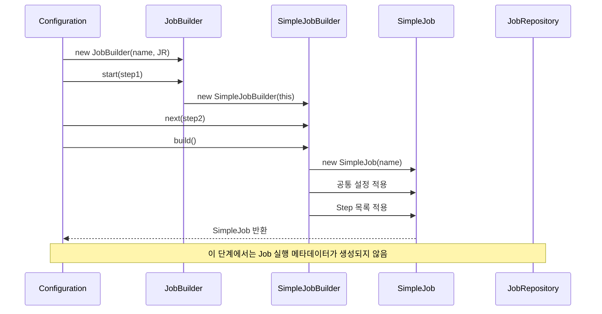

여기서 JobRepository는 Job에 설정되지만 아직 Job이 실행된 것은 아니다.

이후 JobLauncher가 실행되면 다음 과정이 발생한다.

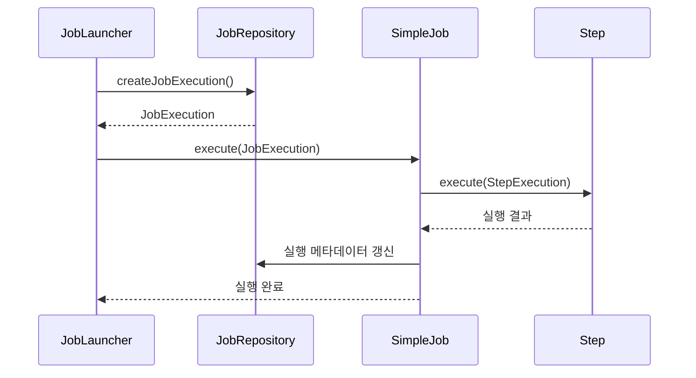

따라서 JobBuilder와 JobRepository의 관계를 이해할 때는 설정 시점과 실행 시점을 구분해야 한다.

---

### Job 이름은 어디에 저장될까?

JobBuilder를 생성할 때 다음과 같이 이름을 지정했다.

```java
new JobBuilder(
        "simpleBatchJob",
        jobRepository
);
```

이 이름은 최종 Job 객체에도 전달된다.

따라서 다음 메서드로 확인할 수 있다.

```java
job.getName();
```

결과는 다음과 같다.

```text
simpleBatchJob
```

그리고 실제 Job이 실행되면 해당 이름이 JobRepository를 통해 메타데이터에 저장된다.

대표적으로 다음 테이블에서 확인할 수 있다.

```text
BATCH_JOB_INSTANCE
```

예를 들어 다음과 같은 SQL을 사용할 수 있다.

```sql
SELECT
    JOB_INSTANCE_ID,
    JOB_NAME,
    JOB_KEY
FROM BATCH_JOB_INSTANCE
ORDER BY JOB_INSTANCE_ID;
```

여기서 JOB_NAME은 JobBuilder에서 설정한 Job 이름과 연결된다.

다만 중요한 점이 있다.

**JobBuilder에서 이름을 설정했다고 해서 즉시 BATCH_JOB_INSTANCE에 데이터가 저장되는 것은 아니다.**

실제로 JobLauncher를 통해 Job이 실행되어 JobInstance가 생성될 때 해당 정보가 저장된다.

따라서 Builder의 `build()`와 JobLauncher의 `run()`은 구분해야 한다.

---

### 실무에서 JobBuilder를 설계할 때 고려할 10가지 사항

JobBuilder는 단순히 Job 객체를 생성하기 위한 API지만, 실제 배치 시스템을 설계할 때 여러 사항을 고려할 필요가 있다.

#### 1. 단순한 순차 실행은 SimpleJob으로 구성한다

여러 Step이 순서대로 실행되기만 하면 된다면 SimpleJob이 적절하다.

예를 들어 다음과 같다.

```text
데이터 조회
    │
    ▼
데이터 가공
    │
    ▼
데이터 저장
```

이러한 구조에서 불필요하게 FlowJob을 사용하면 설정이 복잡해질 수 있다.

따라서 특별한 이유가 없다면 SimpleJob으로 시작하는 것이 좋다.

#### 2. 조건부 실행이 필요한 경우 FlowJob을 고려한다

특정 Step의 종료 결과에 따라 다른 Step을 실행해야 한다면 FlowJob을 사용할 수 있다.

예를 들어 다음과 같다.

```text
결제 데이터 검증
       │
       ├── 성공 → 정산 처리
       │
       └── 실패 → 오류 처리
```

이러한 구조에서는 ExitStatus를 기준으로 조건부 전이를 정의할 수 있다.

#### 3. 공통 실행 흐름은 별도의 Flow로 분리한다

여러 Job에서 동일한 Step 실행 흐름을 사용해야 한다면 Flow를 별도로 정의하는 방식을 고려할 수 있다.

예를 들어 다음과 같다.

```text
settlementValidationFlow
       │
       ├── 데이터 검증
       └── 정합성 확인
```

이 Flow를 여러 Job에 연결하면 공통 처리 구조를 재사용할 수 있다.

다만 동일한 Flow를 재사용할 때는 Step 이름과 실행 상태 관리에 충돌이 없는지 확인해야 한다.

#### 4. Job 이름은 안정적인 비즈니스 의미를 가지도록 설계한다

Job 이름은 JobInstance를 식별하는 중요한 요소다.

따라서 이름을 임의로 변경하면 기존 실행 이력과 다른 Job으로 취급될 수 있다.

예를 들어 다음과 같은 이름이 적절하다.

```text
dailySettlementJob

couponExpirationJob

monthlyStatisticsJob
```

반면 의미가 모호한 이름은 운영 환경에서 혼란을 줄 수 있다.

```text
job1

job2

testJob
```

Job 이름은 가능하면 비즈니스 목적을 드러내도록 작성하는 것이 좋다.

#### 5. Builder 생성과 Job 실행을 구분한다

Builder의 `build()`는 Job 객체를 생성한다.

하지만 Job을 실행하는 것은 아니다.

따라서 Spring Bean 초기화 과정에서 Job이 생성되었다고 해서 실제 비즈니스 작업이 수행되었다고 판단하면 안 된다.

실제 Job 실행은 JobLauncher를 통해 시작된다.

#### 6. JobRepository는 Bean으로 주입받아 사용한다

Spring Batch 5에서는 JobBuilder 생성 시 JobRepository가 필요하다.

일반적인 Spring Boot 프로젝트에서는 JobRepository를 직접 생성하지 않고 주입받는 것이 좋다.

```java
@Bean
public Job batchJob(
        JobRepository jobRepository,
        Step step1
) {
    return new JobBuilder(
            "batchJob",
            jobRepository
    )
            .start(step1)
            .build();
}
```

이렇게 하면 Spring Boot가 구성한 Batch 인프라와 자연스럽게 연결된다.

#### 7. Step을 재사용할 때 실행 이력 범위를 이해한다

하나의 Step Bean을 여러 Job에서 사용할 수 있다.

하지만 StepExecution은 개별 JobExecution에 연결된다.

따라서 동일한 Step 정의를 여러 Job에서 사용하더라도 실제 실행 이력은 각각 생성된다.

다만 같은 Job 안에서 의도치 않게 동일한 이름의 Step을 중복 등록하면 실행 상태 관리에 문제가 발생할 수 있으므로 주의해야 한다.

#### 8. Builder의 반환 타입을 확인한다

JobBuilder는 메서드에 따라 반환 타입이 달라진다.

예를 들어 다음과 같다.

```java
SimpleJobBuilder builder =
        jobBuilder.start(step1);
```

반면 다음 코드는 다른 타입을 반환한다.

```java
JobFlowBuilder builder =
        jobBuilder.start(flow);
```

따라서 Builder API를 연결하다가 사용할 수 있는 메서드가 달라지는 이유를 이해할 수 있다.

이는 단순한 문법 차이가 아니라 내부 객체 생성 구조의 차이다.

#### 9. FlowJob의 end()와 build()를 구분한다

FlowJob을 생성할 때는 다음과 같은 구문을 사용한다.

```java
.start(flow)
.next(step)
.end()
.build();
```

이때 end()는 Flow 구성 과정을 마무리한다.

마지막 build()는 FlowJob을 생성한다.

두 메서드를 동일한 의미로 이해하면 Builder의 내부 동작을 파악하기 어렵다.

#### 10. Job 정의의 변경이 재시작에 미치는 영향을 고려한다

실무에서는 운영 중인 Job의 Step 구성이 변경될 수 있다.

예를 들어 기존 Job이 다음과 같다고 생각해보자.

```text
Step 1 → Step 2 → Step 3
```

그런데 배포 이후 다음과 같이 변경되었다.

```text
Step 1 → Step 2 → Step 4 → Step 3
```

이때 이전 실행에서 실패한 Job을 재시작하면 변경된 Step 구조가 기존 실행 이력과 상호작용할 수 있다.

따라서 운영 중인 Job의 Step 이름이나 실행 순서를 변경할 때는 기존 JobInstance의 재시작 가능성을 검토해야 한다.

특히 중간에 새로운 Step을 추가하거나 기존 Step의 이름을 변경하는 작업은 주의해야 한다.

---

### JobBuilder 관련해서 자주 혼동하는 부분

JobBuilder를 사용할 때는 몇 가지 개념을 명확하게 구분해야 한다.

| 혼동하기 쉬운 내용                               | 정확한 이해                               |
| ---------------------------------------- | ------------------------------------ |
| JobBuilder가 직접 SimpleJob을 생성한다           | 실제 생성은 SimpleJobBuilder가 담당          |
| start(Step)은 항상 SimpleJob을 만든다           | 이후 Flow 전환 API를 사용하면 FlowJob이 될 수 있음 |
| FlowJobBuilder와 JobFlowBuilder는 같은 역할이다  | 전자는 Job 생성, 후자는 Flow 구성              |
| build()를 호출하면 Job이 실행된다                  | build()는 Job 객체 생성                   |
| JobRepository를 전달하면 DB에 실행 이력이 생긴다       | 실제 실행 시점에 메타데이터 생성                   |
| FlowJob은 반드시 조건 분기가 필요하다                 | 단순 순차 Flow도 가능                       |
| Step을 Flow에 넣으면 별도의 StepExecution이 필요 없다 | 실제 실행된 Step에 대해서는 StepExecution이 생성됨 |
| JobBuilderFactory는 모든 버전에서 사용 가능하다       | Spring Batch 5.2에서는 제거됨              |

이러한 차이를 이해하면 Spring Batch의 Job 설정 코드를 더 정확하게 해석할 수 있다.

---

### JobBuilder의 전체 생성 과정

마지막으로 JobBuilder의 전체 구조를 정리해보자.

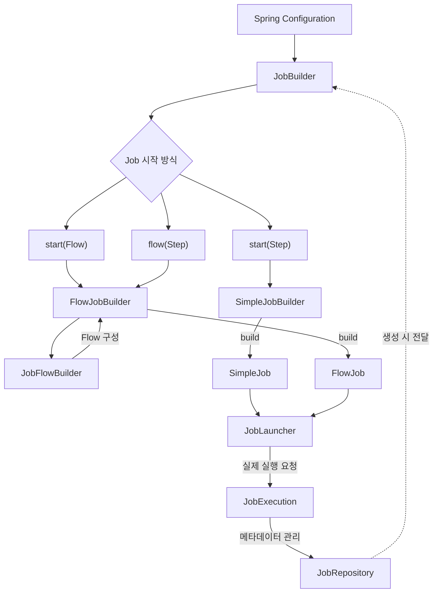

이 구조에서 핵심은 다음과 같다.

JobBuilder는 Job 생성의 시작점이다.

그리고 시작 API에 따라 서로 다른 Builder를 생성한다.

SimpleJobBuilder는 등록된 Step 목록을 기반으로 SimpleJob을 생성한다.

FlowJobBuilder는 JobFlowBuilder가 구성한 Flow를 이용해 FlowJob을 생성한다.

마지막으로 생성된 Job은 JobLauncher를 통해 실행된다.

따라서 Job 생성 과정과 실제 실행 과정을 분리해서 이해하는 것이 중요하다.

---

### 정리

Spring Batch는 Job을 쉽게 생성하고 설정할 수 있도록 Builder API를 제공한다.

JobBuilder는 Job을 생성하기 위한 시작점이며, 실제로 어떤 Job 구현체가 생성될지는 사용하는 API와 설정에 따라 달라진다.

과거 Spring Batch 4에서는 JobBuilderFactory를 이용해 JobBuilder를 생성했다.

```java
jobBuilderFactory.get("batchJob");
```

하지만 Spring Batch 5.2에서는 JobBuilderFactory가 제거되었다.

따라서 다음과 같이 JobBuilder를 직접 생성한다.

```java
new JobBuilder(
        "batchJob",
        jobRepository
);
```

JobBuilder는 대표적으로 세 가지 생성 경로를 제공한다.

| 시작 API      | 내부 Builder                     | 최종 Job    |
| ----------- | ------------------------------ | --------- |
| start(Step) | SimpleJobBuilder               | SimpleJob |
| start(Flow) | FlowJobBuilder, JobFlowBuilder | FlowJob   |
| flow(Step)  | FlowJobBuilder, JobFlowBuilder | FlowJob   |

SimpleJobBuilder는 Step 목록을 관리한다.

`start()`와 `next()`를 통해 Step을 등록하고, build()를 호출하면 SimpleJob을 생성한다.

```java
new JobBuilder("simpleJob", jobRepository)
        .start(step1)
        .next(step2)
        .build();
```

반면 FlowJobBuilder는 Flow 기반 Job을 생성한다.

```java
new JobBuilder("flowJob", jobRepository)
        .start(flow)
        .next(step3)
        .end()
        .build();
```

여기서 JobFlowBuilder와 FlowJobBuilder의 역할을 구분해야 한다.

JobFlowBuilder는 Flow 실행 구조를 구성한다.

FlowJobBuilder는 해당 Flow를 이용해 최종 FlowJob을 생성한다.

그리고 JobBuilder, SimpleJobBuilder, FlowJobBuilder는 모두 JobBuilderHelper를 상속한다.

JobBuilderHelper는 JobRepository, Listener, 재시작 설정 등 Job 생성에 필요한 공통 속성과 API를 제공한다.

마지막으로 JobBuilder의 build()와 JobLauncher의 run()을 구분해야 한다.

Builder의 build()는 Job 객체를 생성한다.

반면 JobLauncher의 run()은 실제 Job 실행을 시작한다.

JobBuilder를 생성할 때 전달한 JobRepository는 최종 Job 객체에 설정되며, 실제 Job 실행 과정에서 메타데이터를 관리하는 데 사용된다.

이러한 구조를 이해하면 Job 설정 코드를 작성할 때 현재 어떤 Builder가 사용되고 있는지, 어떤 Job 구현체가 만들어지는지, 어떤 실행 흐름이 구성되는지 판단할 수 있다.

결국 **Spring Batch의 JobBuilder는 Step 또는 Flow 설정에 따라 서로 다른 Builder와 Job 구현체를 생성하도록 설계된 핵심 구성 API**다.

#### 한 줄 요약

> Spring Batch의 `JobBuilder`는 Job을 구성하는 시작점으로, `start(Step)`을 사용하면 일반적으로 `SimpleJobBuilder`를 거쳐 `SimpleJob`이 생성되고, `start(Flow)` 또는 `flow(Step)`을 사용하면 `FlowJobBuilder`와 `JobFlowBuilder`를 통해 `FlowJob`이 생성된다. Spring Batch 5.2에서는 `JobBuilderFactory` 대신 `new JobBuilder(jobName, jobRepository)`를 사용하며, Builder의 `build()`는 Job 객체 생성, JobLauncher의 `run()`은 실제 Job 실행을 담당한다.

## SimpleJop - 개념 및 API 소개

### Spring Batch SimpleJob 이해: 순차 실행 구조와 주요 API 및 Job 상태 결정 원리

Spring Batch에서 `Job`은 하나의 배치 작업 전체를 정의하는 최상위 도메인 객체다.

하나의 Job은 여러 개의 Step으로 구성할 수 있으며, 각 Step은 실제 비즈니스 로직을 수행하는 실행 단위다.

예를 들어 매일 새벽 실행되는 정산 시스템이 있다고 생각해보자.

```text
dailySettlementJob
       │
       ├── Step 1. 정산 대상 조회
       │
       ├── Step 2. 정산 금액 계산
       │
       └── Step 3. 정산 결과 저장
```

이 작업에서는 정산 대상을 조회한 뒤 금액을 계산하고, 마지막으로 정산 결과를 저장해야 한다.

따라서 Step의 실행 순서가 중요하다.

첫 번째 Step이 성공적으로 완료되어야 두 번째 Step을 실행할 수 있다.

두 번째 Step이 성공적으로 완료되어야 세 번째 Step을 실행할 수 있다.

반대로 정산 금액을 계산하는 과정에서 오류가 발생했다면 정산 결과를 저장하는 Step을 실행해서는 안 된다.

Spring Batch는 이러한 순차 실행을 지원하기 위해 `SimpleJob`이라는 Job 구현체를 제공한다.

SimpleJob은 등록된 Step을 순서대로 실행한다.

그리고 각 Step이 정상적으로 완료되었는지 확인한 후 다음 Step의 실행 여부를 결정한다.

Spring Batch에서 가장 기본적인 Job 구성 방식은 다음과 같다.

```java
@Bean
public Job settlementJob(
        JobRepository jobRepository,
        Step step1,
        Step step2,
        Step step3
) {
    return new JobBuilder("settlementJob", jobRepository)
            .start(step1)
            .next(step2)
            .next(step3)
            .build();
}
```

이 코드는 세 개의 Step을 순차적으로 실행하는 Job을 생성한다.

여기서 최종적으로 생성되는 Job 구현체가 바로 `SimpleJob`이다.

하지만 내부 구조를 조금 더 살펴보면 중요한 특징을 발견할 수 있다.

`JobBuilder`는 직접 SimpleJob을 생성하지 않는다.

먼저 `SimpleJobBuilder`를 생성하고, 해당 Builder가 Step 목록과 여러 설정값을 관리한다.

그리고 마지막에 `build()`를 호출하면 실제 SimpleJob 객체가 생성된다.

이렇게 생성된 SimpleJob은 설정된 Step과 JobRepository, JobParametersValidator, JobExecutionListener 등의 정보를 가지고 있다.

이후 실제 Job 실행 요청이 들어오면 저장된 설정을 이용해 Job의 실행 과정을 처리한다.

이번에는 SimpleJob의 개념과 주요 API를 살펴보고, 객체 생성 과정과 실제 실행 흐름, 실패 상황에서의 상태 결정 원리까지 자세히 알아보자.

---

### SimpleJob이란?

`SimpleJob`은 Spring Batch에서 제공하는 `Job` 인터페이스의 구현체 중 하나로, 등록된 여러 Step을 순차적으로 실행하는 역할을 담당한다.

Spring Batch에서는 Job을 구성할 때 가장 기본적으로 사용되는 구현체다.

SimpleJob의 특징을 정리하면 다음과 같다.

| 특징            | 설명                                            |
| ------------- | --------------------------------------------- |
| 기본 Job 구현체    | Spring Batch에서 제공하는 표준 Job 구현체                |
| 순차 실행         | 등록된 Step을 정해진 순서대로 실행                         |
| Step 기반 구성    | 실행할 Step 목록을 내부적으로 관리                         |
| 실행 상태 확인      | 각 Step의 BatchStatus를 확인                       |
| 실패 시 실행 중단    | COMPLETED가 아닌 상태로 종료되면 후속 Step 실행 중단          |
| Builder 기반 생성 | SimpleJobBuilder를 통해 생성                       |
| 공통 설정 지원      | Listener, Validator, Incrementer, 재시작 정책 등 지원 |
| 메타데이터 관리      | JobRepository와 연결하여 실행 정보 관리                  |

가장 중요한 특징은 **SimpleJob이 Step 목록을 순서대로 실행하고 각 Step의 실행 결과에 따라 다음 Step을 진행할지 판단한다는 점**이다.

예를 들어 다음과 같이 세 개의 Step이 있다고 생각해보자.

```text
SimpleJob
    │
    ├── Step 1
    │
    ├── Step 2
    │
    └── Step 3
```

정상적인 실행 흐름은 다음과 같다.

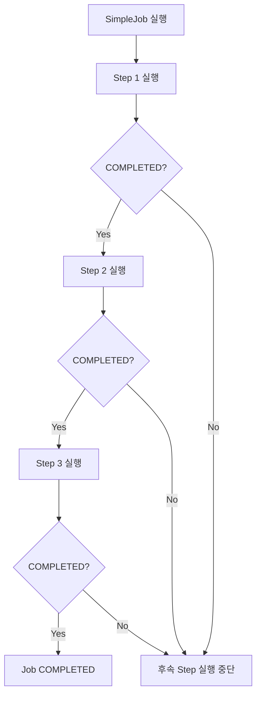

모든 Step이 COMPLETED 상태로 종료되면 Job도 정상적으로 완료될 수 있다.

반면 실행 중인 Step이 FAILED 또는 STOPPED 등 COMPLETED가 아닌 상태로 종료되면 SimpleJob은 다음 Step을 실행하지 않는다.

이러한 구조는 정산, 데이터 집계, 파일 생성 등 여러 작업을 순서대로 처리해야 하는 배치에 적합하다.

---

### SimpleJob은 왜 사용하는가?

SimpleJob을 사용하는 가장 큰 이유는 여러 Step의 실행 순서와 결과 처리를 하나의 Job에서 일관되게 관리할 수 있기 때문이다.

일반적인 Java 코드로도 여러 작업을 순서대로 실행할 수 있다.

```java
public void executeSettlement() {

    prepareSettlement();

    calculateSettlement();

    saveSettlement();
}
```

이 코드는 세 개의 메서드를 순서대로 호출한다.

하지만 배치 시스템에서는 단순한 메서드 호출 외에도 고려해야 할 사항이 많다.

예를 들어 다음과 같은 상황이다.

* 이전 작업이 성공했는지 확인해야 한다.
* 실패한 작업 이후의 처리를 중단해야 한다.
* 각 작업의 시작 시간과 종료 시간을 기록해야 한다.
* 이전에 완료된 Step은 재시작 시 건너뛸 수 있어야 한다.
* 개별 Step의 실행 결과를 데이터베이스에 저장해야 한다.

이러한 기능을 직접 구현하려면 실행 상태 관리와 재시작 로직을 별도로 작성해야 한다.

Spring Batch의 SimpleJob은 이러한 기능을 Spring Batch의 JobRepository, StepExecution 등의 도메인 객체와 연결하여 제공한다.

예를 들어 다음과 같은 정산 Job이 있다고 생각해보자.

```text
정산 데이터 조회
       │
       ▼
정산 금액 계산
       │
       ▼
정산 결과 저장
```

정산 금액 계산 단계에서 실패하면 다음과 같은 결과가 발생한다.

```text
정산 데이터 조회 → COMPLETED

정산 금액 계산 → FAILED

정산 결과 저장 → 실행되지 않음
```

SimpleJob은 해당 실행 결과를 확인하고 후속 Step의 실행을 중단한다.

따라서 개발자는 Step 내부의 비즈니스 로직에 집중하면서 전체 실행 흐름을 구성할 수 있다.

---

### SimpleJob과 FlowJob의 차이

Spring Batch에서 대표적인 Job 구현체는 SimpleJob과 FlowJob이다.

두 구현체는 모두 Job을 실행하지만 내부 실행 방식이 다르다.

SimpleJob은 Step 목록을 순차적으로 실행한다.

반면 FlowJob은 Flow를 기반으로 실행 흐름을 제어한다.

| 구분            | SimpleJob             | FlowJob              |
| ------------- | --------------------- | -------------------- |
| 주요 구성 요소      | Step                  | Step, Flow, 실행 상태 전이 |
| 실행 방식         | 순차 실행                 | Flow 기반 실행           |
| 실행 순서 관리      | Step List             | Flow의 상태 전이 구조       |
| 조건부 분기        | 기본 순차 구조에서는 지원하지 않음   | 지원                   |
| 후속 Step 실행 기준 | 이전 Step의 COMPLETED 여부 | 정의된 Transition       |
| 대표 사용         | 단순하고 순차적인 배치          | 조건부 분기가 필요한 배치       |
| 생성 Builder    | SimpleJobBuilder      | FlowJobBuilder       |

예를 들어 다음과 같은 작업은 SimpleJob으로 구성하기 적합하다.

```text
Step 1 → Step 2 → Step 3
```

반면 다음과 같은 작업은 FlowJob이 더 적합하다.

```text
Step 1
   │
   ▼
실행 결과 확인
   │
   ├── COMPLETED → Step 2
   │
   └── FAILED → Step 3
```

SimpleJob은 구조가 단순하고 실행 순서가 명확하다.

따라서 복잡한 조건부 분기가 필요하지 않다면 SimpleJob을 우선적으로 고려할 수 있다.

---

### SimpleJob의 주요 API

Spring Batch에서 SimpleJob을 생성할 때는 여러 설정 API를 사용할 수 있다.

대표적으로 다음과 같은 API가 있다.

| API                | 역할                          |
| ------------------ | --------------------------- |
| `start(Step)`      | 처음 실행할 Step 지정              |
| `next(Step)`       | 다음에 실행할 Step 추가             |
| `incrementer()`    | JobParametersIncrementer 등록 |
| `preventRestart()` | Job 재시작 금지                  |
| `validator()`      | JobParametersValidator 등록   |
| `listener()`       | JobExecutionListener 등록     |
| `build()`          | 설정을 기반으로 Job 생성             |

각 API는 Job의 실행 구조나 실행 정책을 설정하는 데 사용된다.

중요한 점은 **이러한 API를 호출한다고 해서 실제 비즈니스 작업이 즉시 실행되는 것은 아니라는 사실**이다.

설정 API를 이용하면 SimpleJobBuilder 내부에 필요한 정보가 저장된다.

그리고 `build()`가 호출되면 해당 정보를 실제 SimpleJob 객체에 적용한다.

이후 JobLauncher가 Job을 실행할 때 설정된 정보가 사용된다.

---

### start(Step): 최초 실행할 Step 설정

`start()`는 Job에서 처음 실행할 Step을 지정하는 메서드다.

가장 기본적인 사용 방법은 다음과 같다.

```java
new JobBuilder("batchJob", jobRepository)
        .start(step1)
        .build();
```

이 코드에서는 step1이 첫 번째 Step이다.

Spring Batch 5.2.4의 JobBuilder는 다음과 같은 메서드를 제공한다.

```java
public SimpleJobBuilder start(Step step)
```

여기서 중요한 부분은 반환 타입이다.

```java
SimpleJobBuilder
```

JobBuilder의 `start(Step)`을 호출하면 SimpleJobBuilder가 생성된다.

따라서 다음과 같은 관계가 만들어진다.

```text
JobBuilder
    │
    │ start(step1)
    ▼
SimpleJobBuilder
    │
    └── step1 등록
```

이후 SimpleJobBuilder가 제공하는 API를 이용해 Step을 추가하거나 Job 설정을 구성할 수 있다.

---

### next(Step): 다음 실행할 Step 추가

`next()`는 현재 Job에 후속 Step을 추가하는 메서드다.

예를 들어 다음과 같이 사용할 수 있다.

```java
new JobBuilder("batchJob", jobRepository)
        .start(step1)
        .next(step2)
        .next(step3)
        .build();
```

이 코드는 세 개의 Step을 등록한다.

등록 순서는 다음과 같다.

```text
Step 1
   │
   ▼
Step 2
   │
   ▼
Step 3
```

`next()`는 여러 번 호출할 수 있다.

SimpleJobBuilder는 내부적으로 Step 목록을 관리하기 때문이다.

개념적으로 다음과 같은 구조다.

```java
private final List<Step> steps =
        new ArrayList<>();
```

`start()`를 호출하면 첫 번째 Step이 등록된다.

`next()`를 호출하면 추가적인 Step이 등록된다.

```text
steps
   │
   ├── step1
   ├── step2
   └── step3
```

이렇게 구성된 Step 목록은 마지막에 SimpleJob 객체로 전달된다.

따라서 SimpleJob은 자신이 실행해야 할 Step과 실행 순서를 알 수 있게 된다.

---

### incrementer(): JobParameters 증가 정책 설정

`incrementer()`는 JobParametersIncrementer를 등록하는 API다.

JobParametersIncrementer는 새로운 JobInstance를 실행하기 위한 다음 JobParameters를 생성하는 역할을 담당한다.

대표적인 구현체는 `RunIdIncrementer`다.

```java
new JobBuilder("batchJob", jobRepository)
        .incrementer(new RunIdIncrementer())
        .start(step1)
        .build();
```

이 설정을 사용하면 Job에 RunIdIncrementer가 등록된다.

RunIdIncrementer는 다음과 같은 파라미터를 생성하는 데 활용된다.

```text
run.id = 1
```

다음 실행에서는 다음과 같은 값을 사용할 수 있다.

```text
run.id = 2
```

이후에도 값이 증가할 수 있다.

```text
run.id = 3
```

이러한 방식으로 서로 다른 JobInstance를 생성할 수 있다.

#### JobParametersIncrementer의 동작 원리

Spring Batch에서는 Job 이름과 식별용 JobParameters의 조합으로 JobInstance를 구분한다.

예를 들어 다음과 같다.

```text
Job Name = settlementJob

run.id = 1
```

이 조합으로 생성된 JobInstance가 이미 완료되었다면 동일한 식별용 파라미터로 다시 실행할 수 없다.

하지만 다음과 같이 파라미터가 달라지면 새로운 JobInstance가 된다.

```text
Job Name = settlementJob

run.id = 2
```

따라서 새로운 Job 실행이 가능하다.

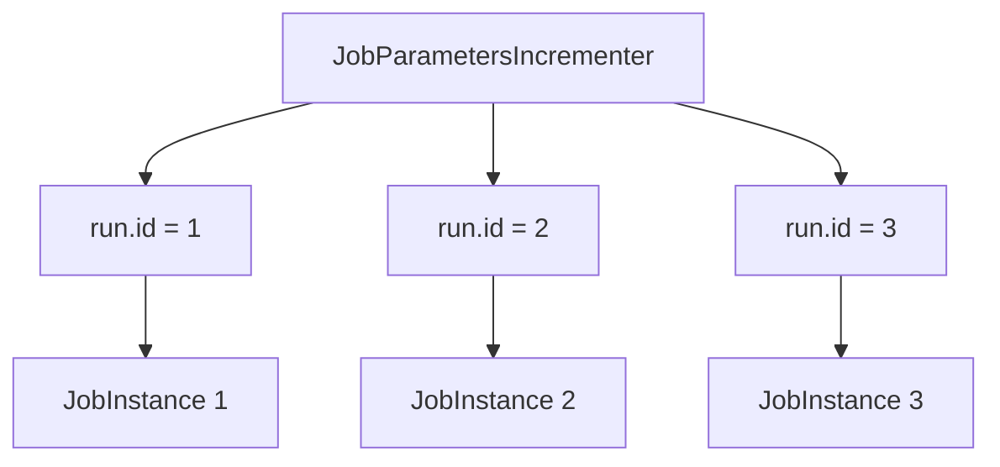

다만 중요한 주의사항이 있다.

**Job에 Incrementer를 등록했다고 해서 JobLauncher의 `run()`을 호출할 때마다 파라미터가 자동으로 증가하는 것은 아니다.**

Incrementer는 다음 파라미터를 생성하는 정책을 제공한다.

실제 파라미터 증가는 해당 정책을 사용하는 실행 경로에서 수행된다.

대표적인 예가 JobOperator의 `startNextInstance()`다.

Spring Batch 5.2에서는 다음과 같이 사용할 수 있다.

```java
jobOperator.startNextInstance("batchJob");
```

이 메서드는 등록된 JobParametersIncrementer를 사용해 새로운 JobInstance를 실행한다.

반면 다음 코드는 전달받은 JobParameters를 그대로 이용한다.

```java
jobLauncher.run(job, jobParameters);
```

따라서 두 실행 방식은 구분해야 한다.

| 실행 방식                             | Incrementer 자동 활용  |
| --------------------------------- | ------------------ |
| `JobLauncher.run()`               | 자동으로 증가시키지 않음      |
| `JobOperator.startNextInstance()` | 등록된 Incrementer 사용 |

#### 새로운 실행과 재시작은 다르다

여기서 반드시 구분해야 할 개념이 있다.

JobParameters를 변경해 새로운 JobInstance를 생성하는 것은 기존 Job의 재시작과 다르다.

예를 들어 다음과 같다.

```text
JobInstance 1
    │
    └── JobExecution 1 → FAILED
```

같은 JobInstance를 재시작하면 다음과 같이 된다.

```text
JobInstance 1
    │
    ├── JobExecution 1 → FAILED
    │
    └── JobExecution 2 → COMPLETED
```

반면 Incrementer를 이용해 새로운 식별용 파라미터를 생성하면 다음과 같다.

```text
JobInstance 1
    │
    └── JobExecution 1 → FAILED


JobInstance 2
    │
    └── JobExecution 2 → COMPLETED
```

따라서 Incrementer는 기존 실행을 이어서 재시작하기보다는 새로운 JobInstance를 생성하는 기능에 가깝다.

실무에서는 이 차이를 명확하게 이해해야 한다.

---

### preventRestart(): Job 재시작 금지

`preventRestart()`는 Job의 재시작을 허용하지 않도록 설정하는 API다.

Spring Batch에서 Job은 기본적으로 재시작이 가능하도록 설정된다.

하지만 모든 Job이 재시작을 허용해야 하는 것은 아니다.

예를 들어 외부 시스템에 특정 요청을 한 번만 전송해야 하는 Job이 있다고 생각해보자.

```text
외부 정산 요청 Job
       │
       ▼
외부 API 호출
       │
       ▼
요청 결과 저장
```

이 Job에서는 재시작 여부를 신중하게 판단해야 한다.

필요하다면 다음과 같이 재시작을 금지할 수 있다.

```java
new JobBuilder("batchJob", jobRepository)
        .preventRestart()
        .start(step1)
        .build();
```

이 설정은 내부적으로 Job의 restartable 값을 false로 만든다.

```text
restartable = false
```

따라서 실패한 JobInstance를 다시 실행하려고 하면 재시작이 제한된다.

대표적으로 다음 예외가 발생할 수 있다.

```text
JobRestartException
```

#### preventRestart()의 의미

재시작 금지는 모든 실행을 영구적으로 막는다는 뜻이 아니다.

정확히는 **이미 실행 이력이 존재하는 동일한 JobInstance의 재시작을 허용하지 않는다는 의미**다.

예를 들어 다음과 같은 작업이 실패했다고 생각해보자.

```text
Job Name = batchJob

businessDate = 2026-10-15
```

같은 식별용 JobParameters로 다시 실행하면 재시작이 제한된다.

하지만 다음과 같이 식별용 파라미터가 달라지면 새로운 JobInstance를 실행할 수 있다.

```text
Job Name = batchJob

businessDate = 2026-10-16
```

이를 비교하면 다음과 같다.

| 상황                                   | preventRestart() 설정 시 |
| ------------------------------------ | --------------------- |
| 동일한 JobInstance 재시작                  | 허용하지 않음               |
| 다른 JobParameters로 새로운 JobInstance 실행 | 가능                    |
| 실패한 JobExecution 다시 실행               | 재시작 제한                |
| 새로운 JobInstance 최초 실행                | 가능                    |

따라서 preventRestart()는 Job의 재시작 정책을 결정하는 API라고 이해하면 된다.

단, 이 설정만으로 외부 API의 중복 호출이나 비즈니스 데이터의 중복 처리가 모두 방지되는 것은 아니다.

실제 운영에서는 멱등성 정책을 별도로 고려해야 한다.

---

### validator(): JobParameters 검증

`validator()`는 Job을 실행할 때 전달되는 JobParameters를 검증하기 위한 API다.

예를 들어 정산 Job에 다음 파라미터가 필요하다고 생각해보자.

```text
businessDate = 2026-10-15
```

이 Job은 정산 기준일이 반드시 필요하다.

따라서 다음과 같은 상황은 허용해서는 안 된다.

```text
businessDate = null
```

또는 다음과 같이 잘못된 날짜가 전달될 수도 있다.

```text
businessDate = invalid-date
```

이러한 입력값을 검증하기 위해 JobParametersValidator를 사용할 수 있다.

#### JobParametersValidator 구현

JobParametersValidator는 다음 메서드를 제공한다.

```java
void validate(
        JobParameters parameters
) throws JobParametersInvalidException;
```

이 메서드를 직접 구현하면 된다.

예를 들어 다음과 같다.

```java
@Bean
public JobParametersValidator jobParametersValidator() {

    return parameters -> {

        String businessDate =
                parameters.getString("businessDate");

        if (businessDate == null
                || businessDate.isBlank()) {

            throw new JobParametersInvalidException(
                    "businessDate는 필수입니다."
            );
        }

        try {
            LocalDate.parse(businessDate);
        } catch (DateTimeParseException e) {

            throw new JobParametersInvalidException(
                    "businessDate는 yyyy-MM-dd 형식이어야 합니다."
            );
        }
    };
}
```

이 코드는 다음 두 가지를 검증한다.

첫 번째는 businessDate의 존재 여부다.

두 번째는 올바른 날짜 형식인지 여부다.

이후 JobBuilder에 Validator를 등록한다.

```java
new JobBuilder("batchJob", jobRepository)
        .validator(jobParametersValidator)
        .start(step1)
        .build();
```

이렇게 설정하면 실제 Job 실행 과정에서 Validator가 호출된다.

검증에 실패하면 Job의 비즈니스 Step 실행이 시작되지 않는다.

다만 검증이 실행되는 정확한 위치에 따라 JobExecution 메타데이터가 먼저 생성된 후 실패 상태가 기록될 수 있다.

따라서 **JobParameters 검증 실패와 Step 실행 실패는 구분해서 이해해야 한다.**

---

### listener(): Job 실행 전후의 처리

`listener()`는 JobExecutionListener를 등록하기 위한 API다.

Spring Batch는 Job 실행 과정에서 특정 시점에 콜백을 받을 수 있도록 Listener 기능을 제공한다.

대표적인 콜백은 다음과 같다.

```java
beforeJob()
```

```java
afterJob()
```

`beforeJob()`은 Job 실행 전에 호출된다.

`afterJob()`은 Job 실행이 종료된 이후 호출된다.

전체 흐름은 다음과 같다.

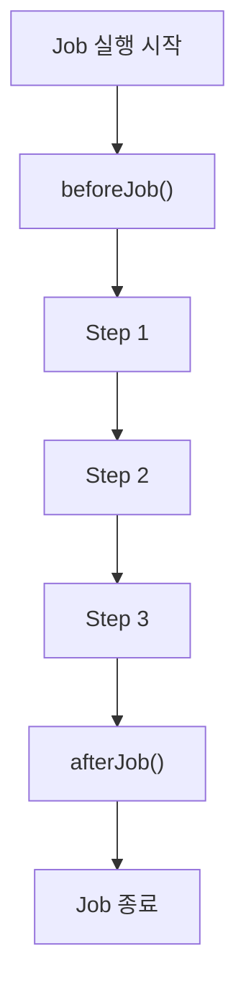

단, Job이 실행 도중 실패하면 모든 Step을 수행하지 않고 afterJob()으로 이동할 수 있다.

#### JobExecutionListener 구현

다음과 같이 Listener를 구현할 수 있다.

```java
@Bean
public JobExecutionListener jobExecutionListener() {

    return new JobExecutionListener() {

        @Override
        public void beforeJob(JobExecution jobExecution) {

            System.out.println(
                    "Job 실행 시작: "
                            + jobExecution.getJobInstance().getJobName()
            );
        }

        @Override
        public void afterJob(JobExecution jobExecution) {

            System.out.println(
                    "Job 실행 종료: "
                            + jobExecution.getStatus()
            );
        }
    };
}
```

이후 JobBuilder에 등록한다.

```java
new JobBuilder("batchJob", jobRepository)
        .listener(jobExecutionListener)
        .start(step1)
        .build();
```

정상적으로 실행되면 다음과 같은 흐름이 발생한다.

```text
Job 실행 시작

Step 1 실행

Step 2 실행

Job 실행 종료
```

Listener를 활용하면 실행 전후의 공통 처리를 구성할 수 있다.

대표적인 활용 사례는 다음과 같다.

| 시점        | 활용 사례       |
| --------- | ----------- |
| beforeJob | 실행 시작 로그    |
| beforeJob | 실행 환경 확인    |
| beforeJob | 작업 시작 알림    |
| afterJob  | 최종 실행 상태 기록 |
| afterJob  | 실행 시간 측정    |
| afterJob  | 실패 알림 전송    |
| afterJob  | 처리 결과 요약    |

다만 Listener를 통해 수행하는 외부 알림이나 후처리 로직은 실패할 수 있다.

따라서 Listener에 중요한 비즈니스 트랜잭션을 무조건 포함시키기보다 실행 결과에 따른 부가 작업에 활용하는 것이 적절하다.

---

### build(): SimpleJob 객체 생성

`build()`는 SimpleJobBuilder에 저장된 설정을 이용해 실제 Job 객체를 생성하는 메서드다.

예를 들어 다음과 같은 코드가 있다고 생각해보자.

```java
new JobBuilder("batchJob", jobRepository)
        .start(step1)
        .next(step2)
        .next(step3)
        .build();
```

여기서 `build()`가 호출되기 전까지는 Builder가 설정 정보를 관리한다.

```text
SimpleJobBuilder
       │
       ├── Job Name
       ├── JobRepository
       ├── Step List
       ├── JobParametersIncrementer
       ├── JobParametersValidator
       ├── JobExecutionListener
       └── Restartable
```

그리고 `build()`를 호출하면 실제 SimpleJob 객체가 생성된다.

```text
SimpleJobBuilder
       │
       │ build()
       ▼
SimpleJob
       │
       ├── name
       ├── jobRepository
       ├── steps
       ├── jobParametersIncrementer
       ├── jobParametersValidator
       ├── listener
       └── restartable
```

이러한 구조를 이해하면 Builder API에서 설정한 값이 실제 Job에 어떻게 전달되는지 알 수 있다.

---

### SimpleJob의 내부 클래스 구조

SimpleJob은 AbstractJob을 상속한다.

AbstractJob은 Job 인터페이스를 구현하는 추상 클래스다.

주요 관계는 다음과 같다.

```mermaid
classDiagram
    class Job {
        <<interface>>
        +execute(JobExecution)
        +getName()
        +isRestartable()
    }

    class AbstractJob {
        -String name
        -boolean restartable
        -JobRepository jobRepository
        -JobParametersIncrementer incrementer
        -JobParametersValidator validator
        -CompositeJobExecutionListener listener

        +execute(JobExecution)
        #doExecute(JobExecution)
    }

    class SimpleJob {
        -List~Step~ steps

        +setSteps(List~Step~)
        +getStep(String)
        +getStepNames()
        #doExecute(JobExecution)
    }

    Job <|.. AbstractJob
    AbstractJob <|-- SimpleJob
```

여기서 중요한 것은 역할 분리다.

AbstractJob은 Job 실행에 필요한 공통 기능을 담당한다.

반면 SimpleJob은 여러 Step을 순차적으로 실행하는 기능을 담당한다.

두 클래스의 책임을 비교하면 다음과 같다.

| 클래스         | 주요 역할                              |
| ----------- | ---------------------------------- |
| Job         | Job의 공통 실행 계약 정의                   |
| AbstractJob | Listener, Validator, 실행 상태 및 공통 처리 |
| SimpleJob   | Step 목록 관리 및 순차 실행                 |

이러한 구조는 템플릿 메서드 패턴과 연결된다.

상위 클래스인 AbstractJob이 전체 실행 흐름을 정의한다.

그리고 하위 클래스인 SimpleJob이 구체적인 Step 실행 로직을 구현한다.

---

### JobBuilder에서 SimpleJob이 생성되는 과정

이번에는 SimpleJob의 실제 생성 흐름을 살펴보자.

다음 코드를 기준으로 설명한다.

```java
@Bean
public Job batchJob(
        JobRepository jobRepository,
        Step step1,
        Step step2,
        Step step3
) {
    return new JobBuilder("batchJob", jobRepository)
            .start(step1)
            .next(step2)
            .next(step3)
            .build();
}
```

이 코드는 내부적으로 여러 단계를 거쳐 SimpleJob을 생성한다.

#### 첫 번째: JobBuilder 생성

먼저 JobBuilder를 생성한다.

```java
new JobBuilder("batchJob", jobRepository);
```

이때 Job 이름과 JobRepository가 설정된다.

JobBuilder는 JobBuilderHelper를 상속하므로 공통 설정값을 관리할 수 있다.

#### 두 번째: SimpleJobBuilder 생성

다음 메서드를 호출한다.

```java
.start(step1)
```

이 메서드는 SimpleJobBuilder를 생성한다.

개념적으로 다음과 같다.

```java
SimpleJobBuilder simpleJobBuilder =
        new SimpleJobBuilder(jobBuilder);
```

이 과정에서 JobBuilder의 공통 설정이 SimpleJobBuilder에 복사된다.

#### 세 번째: Step 목록 구성

다음 API를 통해 Step을 등록한다.

```java
.start(step1)
.next(step2)
.next(step3)
```

SimpleJobBuilder의 Step 목록에는 다음 객체들이 저장된다.

```text
steps[0] = step1

steps[1] = step2

steps[2] = step3
```

#### 네 번째: SimpleJob 생성

마지막으로 `build()`를 호출한다.

```java
.build();
```

SimpleJobBuilder는 SimpleJob 객체를 생성한다.

그리고 공통 설정값을 적용한다.

이후 Step 목록을 SimpleJob에 전달한다.

#### 다섯 번째: Job Bean 등록

최종적으로 생성된 SimpleJob이 Spring Bean으로 등록된다.

전체 흐름을 정리하면 다음과 같다.

```mermaid
sequenceDiagram
    participant Config as Configuration
    participant JB as JobBuilder
    participant SJB as SimpleJobBuilder
    participant SJ as SimpleJob

    Config->>JB: new JobBuilder(name, repository)

    Config->>JB: start(step1)

    JB->>SJB: SimpleJobBuilder 생성

    SJB->>SJB: Step 1 등록

    Config->>SJB: next(step2)

    SJB->>SJB: Step 2 등록

    Config->>SJB: next(step3)

    SJB->>SJB: Step 3 등록

    Config->>SJB: build()

    SJB->>SJ: SimpleJob 생성

    SJB->>SJ: 공통 설정 적용

    SJB->>SJ: Step 목록 설정

    SJ-->>Config: SimpleJob 반환
```

여기서 반드시 기억해야 할 부분이 있다.

**SimpleJob이 생성되는 과정과 SimpleJob이 실제로 실행되는 과정은 서로 다르다.**

`build()`는 Job 객체를 생성한다.

실제 Job 실행은 JobLauncher가 담당한다.

---

### CommonJobProperties의 역할

JobBuilderHelper에는 `CommonJobProperties`라는 내부 클래스가 있다.

이 클래스는 Job 생성에 필요한 공통 설정을 관리한다.

대표적인 속성은 다음과 같다.

```text
CommonJobProperties
        │
        ├── name
        ├── jobRepository
        ├── restartable
        ├── jobParametersIncrementer
        ├── jobParametersValidator
        ├── jobExecutionListeners
        ├── observationRegistry
        └── meterRegistry
```

예를 들어 다음과 같이 Job을 구성했다고 생각해보자.

```java
new JobBuilder("batchJob", jobRepository)
        .incrementer(new RunIdIncrementer())
        .validator(jobParametersValidator)
        .listener(jobExecutionListener)
        .start(step1)
        .next(step2)
        .build();
```

각 설정값은 Builder가 관리한다.

```text
incrementer
    │
    └── RunIdIncrementer

validator
    │
    └── JobParametersValidator

listener
    │
    └── JobExecutionListener
```

그리고 SimpleJobBuilder가 SimpleJob을 생성할 때 이러한 값들을 전달한다.

이 과정에서 중요한 메서드가 있다.

```java
super.enhance(job);
```

`enhance()`는 JobBuilderHelper가 관리하던 공통 설정을 실제 Job 객체에 적용한다.

예를 들어 다음과 같은 설정이 전달된다.

```text
CommonJobProperties
        │
        │ enhance()
        ▼
AbstractJob
        │
        ├── JobRepository
        ├── JobParametersIncrementer
        ├── JobParametersValidator
        ├── Restartable
        └── JobExecutionListener
```

이 과정을 통해 생성된 SimpleJob은 실행에 필요한 설정을 가지게 된다.

#### 설정하지 않은 값은 모두 null일까?

그렇지는 않다.

예를 들어 AbstractJob은 기본적으로 재시작을 허용한다.

```text
restartable = true
```

JobParametersValidator에도 기본 구현체가 사용된다.

Listener는 내부적으로 CompositeJobExecutionListener를 이용해 관리된다.

반면 JobParametersIncrementer는 설정하지 않았다면 존재하지 않을 수 있다.

따라서 설정하지 않은 모든 속성이 null이라고 이해해서는 안 된다.

각 속성의 기본값과 실제 Builder에서 전달되는 값을 구분해야 한다.

---

### SimpleJob의 실제 실행 흐름

이제 생성된 SimpleJob이 실제로 실행되는 과정을 살펴보자.

Job이 실행되면 JobLauncher는 JobExecution을 준비한다.

그리고 Job의 `execute()` 메서드를 호출한다.

전체 흐름은 다음과 같다.

```text
JobLauncher
     │
     ▼
SimpleJob.execute()
     │
     ▼
AbstractJob.execute()
     │
     ├── JobParameters 검증
     │
     ├── JobExecution 시작 상태 설정
     │
     ├── beforeJob() 호출
     │
     ▼
SimpleJob.doExecute()
     │
     ├── Step 1 실행
     │
     ├── Step 2 실행
     │
     └── Step 3 실행
     │
     ▼
AbstractJob.execute()
     │
     ├── afterJob() 호출
     │
     └── JobExecution 최종 상태 저장
```

여기서 중요한 점은 `execute()`와 `doExecute()`의 역할이 다르다는 것이다.

AbstractJob의 `execute()`는 공통 실행 흐름을 관리한다.

SimpleJob의 `doExecute()`는 Step을 순차적으로 실행한다.

이를 구조적으로 표현하면 다음과 같다.

```mermaid
flowchart TD
    A["JobLauncher.run()"]
    B["AbstractJob.execute()"]
    C["JobParametersValidator"]
    D["beforeJob()"]
    E["SimpleJob.doExecute()"]
    F["Step 1"]
    G["Step 2"]
    H["Step 3"]
    I["JobExecution 상태 결정"]
    J["afterJob()"]
    K["JobRepository 업데이트"]

    A --> B
    B --> C
    C --> D
    D --> E

    E --> F
    F --> G
    G --> H

    H --> I
    I --> J
    J --> K
```

실제 구현에서는 Step이 실패하거나 Job이 중단되는 등의 예외 상황을 처리하기 위한 분기가 추가된다.

---

### SimpleJob.doExecute()의 동작 원리

SimpleJob에서 가장 중요한 메서드는 `doExecute()`다.

이 메서드는 내부에 등록된 Step을 순차적으로 실행한다.

Spring Batch 5.2.4의 핵심 동작을 단순화하면 다음과 같다.

```java
StepExecution lastExecution = null;

for (Step step : steps) {

    lastExecution = handleStep(
            step,
            jobExecution
    );

    if (lastExecution.getStatus()
            != BatchStatus.COMPLETED) {

        break;
    }
}
```

이 코드에서 중요한 부분은 다음과 같다.

```java
for (Step step : steps)
```

등록된 Step 목록을 순서대로 순회한다.

그리고 다음 메서드를 호출한다.

```java
handleStep(step, jobExecution);
```

이 메서드는 해당 Step의 실행을 처리한다.

실행이 완료되면 StepExecution을 반환한다.

이후 StepExecution의 상태를 확인한다.

```java
if (lastExecution.getStatus()
        != BatchStatus.COMPLETED) {

    break;
}
```

이 조건은 이전 Step이 COMPLETED 상태가 아니라면 반복문을 종료한다는 의미다.

따라서 SimpleJob은 실패한 Step 이후의 Step을 실행하지 않는다.

#### 모든 Step이 성공한 경우

다음과 같은 실행 결과가 있다고 생각해보자.

```text
Step 1 → COMPLETED

Step 2 → COMPLETED

Step 3 → COMPLETED
```

SimpleJob은 세 개의 Step을 모두 실행한다.

마지막 Step의 실행 상태도 COMPLETED다.

따라서 Job은 정상적으로 완료될 수 있다.

#### 중간 Step이 실패한 경우

이번에는 두 번째 Step이 실패했다고 생각해보자.

```text
Step 1 → COMPLETED

Step 2 → FAILED

Step 3 → 실행되지 않음
```

SimpleJob은 Step 2의 상태를 확인한다.

COMPLETED가 아니므로 반복문을 종료한다.

따라서 Step 3은 실행되지 않는다.

이것이 SimpleJob의 핵심 실행 원리다.

---

### 마지막 Step의 상태는 Job에 어떻게 반영될까?

SimpleJob은 Step 실행이 끝나면 마지막으로 처리한 StepExecution의 상태를 JobExecution에 반영한다.

중요한 점은 다음 두 상태가 별도로 존재한다는 것이다.

```text
BatchStatus

ExitStatus
```

BatchStatus는 실제 실행 상태를 나타낸다.

ExitStatus는 종료 결과를 나타낸다.

예를 들어 다음과 같이 구분할 수 있다.

| 구분          | 의미                 |
| ----------- | ------------------ |
| BatchStatus | Step 또는 Job의 실행 상태 |
| ExitStatus  | Step 또는 Job의 종료 코드 |

SimpleJob은 마지막으로 처리한 StepExecution의 상태를 JobExecution에 반영하는 로직을 가지고 있다.

개념적으로 다음과 같다.

```java
jobExecution.upgradeStatus(
        lastStepExecution.getStatus()
);

jobExecution.setExitStatus(
        lastStepExecution.getExitStatus()
);
```

여기서 주의할 점이 있다.

BatchStatus는 `setStatus()`가 아니라 `upgradeStatus()`를 통해 반영된다.

따라서 기존 JobExecution의 상태가 단순히 무조건 덮어써지는 것은 아니다.

`upgradeStatus()`는 상태의 우선순위를 고려하여 실행 상태를 갱신한다.

또한 이러한 기본 상태 반영 과정 이후에도 AbstractJob의 예외 처리나 Listener 등이 최종 실행 결과에 영향을 줄 수 있다.

따라서 **일반적인 SimpleJob에서는 마지막으로 처리한 Step의 상태가 Job의 최종 상태를 결정하는 중요한 기준이 된다**고 이해하는 것이 정확하다.

---

### BatchStatus와 ExitStatus는 서로 다른 값이 될 수 있다

Spring Batch를 사용할 때 혼동하기 쉬운 부분이다.

예를 들어 어떤 Step의 실행 결과가 다음과 같다고 생각해보자.

```text
BatchStatus = FAILED

ExitStatus = STOPPED
```

이러한 상태는 서로 모순된 데이터처럼 보일 수 있다.

하지만 두 값은 서로 다른 목적을 가진다.

BatchStatus는 실행 상태다.

ExitStatus는 종료 코드다.

따라서 서로 다른 값으로 관리할 수 있다.

다음 코드를 살펴보자.

```java
StepExecution stepExecution =
        contribution.getStepExecution();

stepExecution.setStatus(
        BatchStatus.FAILED
);

contribution.setExitStatus(
        ExitStatus.STOPPED
);
```

첫 번째 코드는 StepExecution의 BatchStatus를 FAILED로 설정한다.

```java
stepExecution.setStatus(
        BatchStatus.FAILED
);
```

두 번째 코드는 StepContribution의 ExitStatus를 STOPPED로 설정한다.

```java
contribution.setExitStatus(
        ExitStatus.STOPPED
);
```

이후 Contribution의 ExitStatus가 StepExecution에 반영되고, SimpleJob의 실행 상태 결정 과정까지 진행되면 다음과 같은 결과를 확인할 수 있다.

```text
Step BatchStatus = FAILED

Step ExitStatus = STOPPED
```

그리고 마지막으로 처리한 Step의 결과가 Job에 반영된다.

```text
Job BatchStatus = FAILED

Job ExitStatus = STOPPED
```

다만 이러한 조합은 Spring Batch가 실제로 작업을 중단시켰다는 의미와 동일하지 않다.

특히 `ExitStatus.STOPPED`를 설정했다고 해서 StepExecution의 BatchStatus가 자동으로 STOPPED가 되는 것은 아니다.

이는 BatchStatus와 ExitStatus가 독립적인 개념이라는 사실을 보여준다.

실제 운영에서는 두 상태를 의도적으로 다르게 설정할 필요가 있는지 신중하게 판단해야 한다.

---

### 실제 SimpleJob 구현하기

이번에는 실제 Spring Batch 프로젝트에서 SimpleJob을 구성해보자.

다음과 같은 Job을 생성한다.

```text
simpleJob
    │
    ├── simpleStep1
    │
    ├── simpleStep2
    │
    └── simpleStep3
```

그리고 다음 세 가지 상황을 확인한다.

| 상황                | 예상 결과                                      |
| ----------------- | ------------------------------------------ |
| 모든 Step이 성공       | Job COMPLETED                              |
| Step 2에서 예외 발생    | Step 3 실행 중단, Job FAILED                   |
| Step 3에서 상태 직접 변경 | Job BatchStatus FAILED, ExitStatus STOPPED |

추가로 다음 API도 설정한다.

* JobParametersIncrementer
* JobParametersValidator
* JobExecutionListener

이를 통해 Builder에 설정한 값이 실제 Job의 실행 과정에서 어떻게 활용되는지 확인해보자.

**개발 환경**

| 항목           | 기술          |
| ------------ | ----------- |
| Java         | Java 17     |
| Spring Boot  | 3.4.x       |
| Spring Batch | 5.2.x       |
| Build Tool   | Maven       |
| Database     | H2          |
| Step         | TaskletStep |

---

### Maven 의존성 설정

먼저 Spring Batch와 H2 데이터베이스 의존성을 추가한다.

`pom.xml`

```xml
<?xml version="1.0" encoding="UTF-8"?>
<project xmlns="http://maven.apache.org/POM/4.0.0"
         xmlns:xsi="http://www.w3.org/2001/XMLSchema-instance"
         xsi:schemaLocation="
             http://maven.apache.org/POM/4.0.0
             https://maven.apache.org/xsd/maven-4.0.0.xsd">

    <modelVersion>4.0.0</modelVersion>

    <parent>
        <groupId>org.springframework.boot</groupId>
        <artifactId>spring-boot-starter-parent</artifactId>
        <version>3.4.13</version>
        <relativePath/>
    </parent>

    <groupId>com.example</groupId>
    <artifactId>spring-batch-demo</artifactId>
    <version>0.0.1-SNAPSHOT</version>

    <properties>
        <java.version>17</java.version>
    </properties>

    <dependencies>

        <dependency>
            <groupId>org.springframework.boot</groupId>
            <artifactId>spring-boot-starter-batch</artifactId>
        </dependency>

        <dependency>
            <groupId>com.h2database</groupId>
            <artifactId>h2</artifactId>
            <scope>runtime</scope>
        </dependency>

    </dependencies>

    <build>
        <plugins>

            <plugin>
                <groupId>org.springframework.boot</groupId>
                <artifactId>spring-boot-maven-plugin</artifactId>
            </plugin>

        </plugins>
    </build>

</project>
```

이번 예제에서는 별도의 데이터베이스 서버 없이 실행할 수 있도록 H2를 사용한다.

H2 인메모리 데이터베이스는 애플리케이션 프로세스가 종료되면 일반적으로 데이터가 사라진다.

따라서 Job의 재시작이나 기존 실행 이력의 유지까지 확인하려면 영속성 있는 데이터베이스를 사용하는 것이 좋다.

---

### application.yml 설정

Spring Boot에서 실행할 Job을 지정한다.

`application.yml`

```yaml
spring:
  application:
    name: spring-batch-demo

  main:
    web-application-type: none

  datasource:
    url: jdbc:h2:mem:batchdb;DB_CLOSE_DELAY=-1
    driver-class-name: org.h2.Driver
    username: sa
    password:

  batch:
    job:
      enabled: true
      name: simpleJob

    jdbc:
      initialize-schema: embedded

logging:
  level:
    org.springframework.batch: INFO
    com.example.batch: INFO
```

여기서 중요한 설정은 다음이다.

```yaml
spring:
  batch:
    job:
      name: simpleJob
```

Spring Boot는 등록된 Job 중 이름이 `simpleJob`인 Job을 자동 실행 대상으로 사용한다.

또한 다음 설정은 H2 환경에서 Spring Batch 메타데이터 스키마를 초기화하는 역할을 한다.

```yaml
spring:
  batch:
    jdbc:
      initialize-schema: embedded
```

---

### SimpleJobConfiguration 전체 코드

이제 실제 Job을 구성한다.

`SimpleJobConfiguration.java`

```java
package com.example.batch;

import java.time.LocalDate;
import java.time.format.DateTimeParseException;

import org.slf4j.Logger;
import org.slf4j.LoggerFactory;

import org.springframework.batch.core.BatchStatus;
import org.springframework.batch.core.ExitStatus;
import org.springframework.batch.core.Job;
import org.springframework.batch.core.JobExecution;
import org.springframework.batch.core.JobExecutionListener;
import org.springframework.batch.core.JobParametersInvalidException;
import org.springframework.batch.core.JobParametersValidator;
import org.springframework.batch.core.Step;
import org.springframework.batch.core.StepExecution;

import org.springframework.batch.core.job.builder.JobBuilder;
import org.springframework.batch.core.launch.support.RunIdIncrementer;
import org.springframework.batch.core.repository.JobRepository;
import org.springframework.batch.core.step.builder.StepBuilder;

import org.springframework.batch.repeat.RepeatStatus;

import org.springframework.beans.factory.annotation.Qualifier;
import org.springframework.context.annotation.Bean;
import org.springframework.context.annotation.Configuration;

import org.springframework.transaction.PlatformTransactionManager;

@Configuration
public class SimpleJobConfiguration {

    private static final Logger log =
            LoggerFactory.getLogger(SimpleJobConfiguration.class);

    @Bean
    public Job simpleJob(
            JobRepository jobRepository,
            @Qualifier("simpleStep1") Step step1,
            @Qualifier("simpleStep2") Step step2,
            @Qualifier("simpleStep3") Step step3,
            JobParametersValidator jobParametersValidator,
            JobExecutionListener jobExecutionListener
    ) {
        Job job = new JobBuilder(
                "simpleJob",
                jobRepository
        )
                .incrementer(new RunIdIncrementer())
                .validator(jobParametersValidator)
                .listener(jobExecutionListener)
                .start(step1)
                .next(step2)
                .next(step3)
                .build();

        log.info(
                "생성된 Job 구현체: {}",
                job.getClass().getSimpleName()
        );

        log.info(
                "Job 이름: {}",
                job.getName()
        );

        return job;
    }

    @Bean
    public Step simpleStep1(
            JobRepository jobRepository,
            PlatformTransactionManager transactionManager
    ) {
        return new StepBuilder(
                "simpleStep1",
                jobRepository
        )
                .tasklet((contribution, chunkContext) -> {

                    log.info("Step 1 실행: 정산 대상 조회");

                    return RepeatStatus.FINISHED;

                }, transactionManager)
                .build();
    }

    @Bean
    public Step simpleStep2(
            JobRepository jobRepository,
            PlatformTransactionManager transactionManager
    ) {
        return new StepBuilder(
                "simpleStep2",
                jobRepository
        )
                .tasklet((contribution, chunkContext) -> {

                    StepExecution stepExecution =
                            contribution.getStepExecution();

                    String scenario =
                            stepExecution
                                    .getJobParameters()
                                    .getString("scenario");

                    log.info("Step 2 실행: 정산 금액 계산");

                    if ("exception".equals(scenario)) {

                        throw new IllegalStateException(
                                "Step 2 의도적인 예외 발생"
                        );
                    }

                    return RepeatStatus.FINISHED;

                }, transactionManager)
                .build();
    }

    @Bean
    public Step simpleStep3(
            JobRepository jobRepository,
            PlatformTransactionManager transactionManager
    ) {
        return new StepBuilder(
                "simpleStep3",
                jobRepository
        )
                .tasklet((contribution, chunkContext) -> {

                    StepExecution stepExecution =
                            contribution.getStepExecution();

                    String scenario =
                            stepExecution
                                    .getJobParameters()
                                    .getString("scenario");

                    log.info("Step 3 실행: 정산 결과 저장");

                    if ("manual".equals(scenario)) {

                        stepExecution.setStatus(
                                BatchStatus.FAILED
                        );

                        contribution.setExitStatus(
                                ExitStatus.STOPPED
                        );

                        log.info(
                                "Step 3 상태를 직접 변경했습니다."
                        );
                    }

                    return RepeatStatus.FINISHED;

                }, transactionManager)
                .build();
    }

    @Bean
    public JobParametersValidator jobParametersValidator() {

        return parameters -> {

            String businessDate =
                    parameters.getString("businessDate");

            String scenario =
                    parameters.getString("scenario");

            if (businessDate == null
                    || businessDate.isBlank()) {

                throw new JobParametersInvalidException(
                        "businessDate는 필수입니다."
                );
            }

            try {
                LocalDate.parse(businessDate);

            } catch (DateTimeParseException e) {

                throw new JobParametersInvalidException(
                        "businessDate는 yyyy-MM-dd 형식이어야 합니다."
                );
            }

            if (!"success".equals(scenario)
                    && !"exception".equals(scenario)
                    && !"manual".equals(scenario)) {

                throw new JobParametersInvalidException(
                        "scenario는 success, exception, manual 중 하나여야 합니다."
                );
            }
        };
    }

    @Bean
    public JobExecutionListener jobExecutionListener() {

        return new JobExecutionListener() {

            @Override
            public void beforeJob(JobExecution jobExecution) {

                log.info(
                        "Job 실행 시작 - name={}, executionId={}",
                        jobExecution.getJobInstance().getJobName(),
                        jobExecution.getId()
                );
            }

            @Override
            public void afterJob(JobExecution jobExecution) {

                log.info(
                        "Job 실행 종료 - status={}, exitStatus={}",
                        jobExecution.getStatus(),
                        jobExecution.getExitStatus().getExitCode()
                );

                for (StepExecution stepExecution
                        : jobExecution.getStepExecutions()) {

                    log.info(
                            "Step 결과 - name={}, status={}, exitStatus={}",
                            stepExecution.getStepName(),
                            stepExecution.getStatus(),
                            stepExecution.getExitStatus().getExitCode()
                    );
                }
            }
        };
    }
}
```

이 코드에서는 하나의 SimpleJob과 세 개의 Step을 생성한다.

또한 JobParametersValidator, JobExecutionListener, RunIdIncrementer를 등록했다.

이번 예제의 핵심은 JobParameters의 `scenario` 값에 따라 실행 결과를 변경한다는 점이다.

| scenario  | 동작                                     |
| --------- | -------------------------------------- |
| success   | 세 개의 Step 모두 정상 완료                     |
| exception | Step 2에서 예외 발생                         |
| manual    | Step 3에서 BatchStatus와 ExitStatus 직접 변경 |

이렇게 구성하면 하나의 Job 정의로 서로 다른 실행 결과를 확인할 수 있다.

---

### 코드 분석: 설정 API가 SimpleJob에 반영되는 과정

먼저 Job 생성 코드를 살펴보자.

```java
Job job = new JobBuilder(
        "simpleJob",
        jobRepository
)
        .incrementer(new RunIdIncrementer())
        .validator(jobParametersValidator)
        .listener(jobExecutionListener)
        .start(step1)
        .next(step2)
        .next(step3)
        .build();
```

이 코드에는 여러 설정이 존재한다.

첫 번째는 Job 이름과 JobRepository다.

```java
new JobBuilder(
        "simpleJob",
        jobRepository
)
```

두 번째는 JobParametersIncrementer다.

```java
.incrementer(new RunIdIncrementer())
```

세 번째는 JobParametersValidator다.

```java
.validator(jobParametersValidator)
```

네 번째는 JobExecutionListener다.

```java
.listener(jobExecutionListener)
```

마지막으로 Step을 등록한다.

```java
.start(step1)
.next(step2)
.next(step3)
```

이 정보들은 Builder 내부에서 관리된다.

이후 `build()`를 호출하면 SimpleJob으로 전달된다.

따라서 생성된 Job은 다음과 같은 구성 정보를 가지게 된다.

```text
SimpleJob
    │
    ├── name = simpleJob
    │
    ├── jobRepository
    │
    ├── jobParametersIncrementer
    │       └── RunIdIncrementer
    │
    ├── jobParametersValidator
    │       └── 사용자 정의 Validator
    │
    ├── jobExecutionListener
    │       └── 사용자 정의 Listener
    │
    ├── restartable = true
    │
    └── steps
           ├── simpleStep1
           ├── simpleStep2
           └── simpleStep3
```

이처럼 Builder에서 설정한 내용은 실제 SimpleJob의 실행 과정에서 활용된다.

---

### 첫 번째 실행: 모든 Step이 성공하는 경우

먼저 정상적인 실행을 확인해보자.

프로젝트를 빌드한다.

```bash
./mvnw clean package
```

정상적으로 빌드되었다면 다음 명령어로 실행한다.

```bash
java -jar target/spring-batch-demo-0.0.1-SNAPSHOT.jar \
  businessDate=2026-10-30 \
  scenario=success
```

이 명령어는 다음 JobParameters를 전달한다.

```text
businessDate = 2026-10-30

scenario = success
```

JobParametersValidator는 전달된 값을 검증한다.

정상적인 값이므로 Job 실행을 진행한다.

이후 Step 1부터 Step 3까지 순차적으로 실행된다.

#### 실행 흐름

```mermaid
flowchart TD
    A["SimpleJob 시작"]
    B["Step 1"]
    C["COMPLETED"]
    D["Step 2"]
    E["COMPLETED"]
    F["Step 3"]
    G["COMPLETED"]
    H["Job COMPLETED"]

    A --> B
    B --> C
    C --> D
    D --> E
    E --> F
    F --> G
    G --> H
```

#### 실행 결과

다음과 유사한 로그를 확인할 수 있다.

```text
생성된 Job 구현체: SimpleJob

Job 이름: simpleJob

Job 실행 시작 - name=simpleJob

Step 1 실행: 정산 대상 조회

Step 2 실행: 정산 금액 계산

Step 3 실행: 정산 결과 저장

Job 실행 종료 - status=COMPLETED, exitStatus=COMPLETED
```

이 결과에서 중요한 점은 모든 Step이 실행되었다는 것이다.

또한 Job의 최종 BatchStatus와 ExitStatus가 모두 COMPLETED로 종료되었다.

---

### 두 번째 실행: 중간 Step에서 실패하는 경우

이번에는 두 번째 Step에서 의도적으로 예외를 발생시켜보자.

실행 명령어는 다음과 같다.

```bash
java -jar target/spring-batch-demo-0.0.1-SNAPSHOT.jar \
  businessDate=2026-10-30 \
  scenario=exception
```

이번에는 scenario 값이 exception이다.

따라서 Step 2에서 다음 코드가 실행된다.

```java
if ("exception".equals(scenario)) {

    throw new IllegalStateException(
            "Step 2 의도적인 예외 발생"
    );
}
```

이 코드에서 예외가 발생한다.

Spring Batch는 Step 2를 FAILED 상태로 종료한다.

SimpleJob은 StepExecution의 상태를 확인한다.

COMPLETED가 아니므로 다음 Step을 실행하지 않는다.

#### 실행 흐름

```mermaid
flowchart TD
    A["SimpleJob 시작"]
    B["Step 1"]
    C["COMPLETED"]
    D["Step 2"]
    E["예외 발생"]
    F["FAILED"]
    G["Step 3 실행 중단"]
    H["Job FAILED"]

    A --> B
    B --> C
    C --> D
    D --> E
    E --> F
    F --> G
    G --> H
```

#### 실행 결과

다음과 유사한 로그를 확인할 수 있다.

```text
Job 실행 시작 - name=simpleJob

Step 1 실행: 정산 대상 조회

Step 2 실행: 정산 금액 계산

IllegalStateException:
Step 2 의도적인 예외 발생

Job 실행 종료 - status=FAILED, exitStatus=FAILED
```

여기서 중요한 점은 다음 로그가 출력되지 않는다는 것이다.

```text
Step 3 실행: 정산 결과 저장
```

왜 그럴까?

SimpleJob은 Step 2의 상태가 COMPLETED가 아니라는 사실을 확인했기 때문이다.

따라서 반복문을 종료하고 Job 실행을 마무리한다.

실제 실행 결과는 다음과 같다.

| Step        | BatchStatus | ExitStatus |
| ----------- | ----------- | ---------- |
| simpleStep1 | COMPLETED   | COMPLETED  |
| simpleStep2 | FAILED      | FAILED     |
| simpleStep3 | 실행되지 않음     | 없음         |

그리고 Job의 결과는 다음과 같다.

```text
Job BatchStatus = FAILED

Job ExitStatus = FAILED
```

이것이 SimpleJob의 기본적인 실패 처리 방식이다.

---

### 세 번째 실행: BatchStatus와 ExitStatus를 다르게 설정하기

이번에는 조금 다른 상황을 확인해보자.

Step 3에서 BatchStatus와 ExitStatus를 직접 변경한다.

실행 명령어는 다음과 같다.

```bash
java -jar target/spring-batch-demo-0.0.1-SNAPSHOT.jar \
  businessDate=2026-10-30 \
  scenario=manual
```

이번에는 scenario 값이 manual이다.

따라서 세 번째 Step에서 다음 코드가 실행된다.

```java
stepExecution.setStatus(
        BatchStatus.FAILED
);

contribution.setExitStatus(
        ExitStatus.STOPPED
);
```

먼저 BatchStatus를 FAILED로 설정한다.

그리고 ExitStatus를 STOPPED로 설정한다.

이때 두 값은 서로 다른 속성이므로 독립적으로 관리된다.

#### Step 3의 실행 상태

Step 3에서는 다음과 같은 상태가 만들어진다.

```text
StepExecution
    │
    ├── BatchStatus = FAILED
    │
    └── ExitStatus = STOPPED
```

이후 SimpleJob은 Step 3의 BatchStatus를 확인한다.

FAILED이므로 Job을 정상 완료로 처리하지 않는다.

그리고 마지막 Step의 종료 코드도 JobExecution에 반영한다.

따라서 다음과 같은 결과를 확인할 수 있다.

```text
JobExecution
    │
    ├── BatchStatus = FAILED
    │
    └── ExitStatus = STOPPED
```

#### 실행 결과

다음과 유사한 로그를 확인할 수 있다.

```text
Job 실행 시작 - name=simpleJob

Step 1 실행: 정산 대상 조회

Step 2 실행: 정산 금액 계산

Step 3 실행: 정산 결과 저장

Step 3 상태를 직접 변경했습니다.

Job 실행 종료 - status=FAILED, exitStatus=STOPPED
```

각 Step의 상태를 정리하면 다음과 같다.

| Step        | BatchStatus | ExitStatus |
| ----------- | ----------- | ---------- |
| simpleStep1 | COMPLETED   | COMPLETED  |
| simpleStep2 | COMPLETED   | COMPLETED  |
| simpleStep3 | FAILED      | STOPPED    |

Job의 최종 상태는 다음과 같다.

| 구분              | 값       |
| --------------- | ------- |
| Job BatchStatus | FAILED  |
| Job ExitStatus  | STOPPED |

이 예제를 통해 다음 사실을 확인할 수 있다.

**SimpleJob의 최종 실행 상태에는 마지막으로 처리한 StepExecution의 BatchStatus와 ExitStatus가 영향을 준다.**

또한 두 값은 동일할 필요가 없다.

다만 상태를 직접 조작하는 방식은 실행 원리를 확인하기 위한 예제에 가깝다.

실제 운영 환경에서는 예외 처리, StepExecutionListener, 명시적인 종료 정책 등을 이용해 상태를 관리하는 것이 적절하다.

---

### 데이터베이스에서 SimpleJob 실행 결과 확인하기

이번에는 H2 또는 MySQL에서 StepExecution과 JobExecution의 실행 결과를 확인해보자.

Spring Batch는 다음 테이블에 실행 정보를 저장한다.

```text
BATCH_JOB_INSTANCE

BATCH_JOB_EXECUTION

BATCH_STEP_EXECUTION
```

먼저 JobExecution을 조회한다.

```sql
SELECT
    ji.JOB_NAME,
    je.JOB_EXECUTION_ID,
    je.STATUS,
    je.EXIT_CODE,
    je.START_TIME,
    je.END_TIME

FROM BATCH_JOB_INSTANCE ji

JOIN BATCH_JOB_EXECUTION je
    ON ji.JOB_INSTANCE_ID = je.JOB_INSTANCE_ID

WHERE ji.JOB_NAME = 'simpleJob'

ORDER BY je.JOB_EXECUTION_ID;
```

세 가지 시나리오를 동일한 영속성 데이터베이스에 서로 다른 JobInstance로 실행했다면 다음과 같은 결과를 확인할 수 있다.

| JobExecution | BatchStatus | ExitStatus |
| ------------ | ----------- | ---------- |
| success 실행   | COMPLETED   | COMPLETED  |
| exception 실행 | FAILED      | FAILED     |
| manual 실행    | FAILED      | STOPPED    |

다음으로 StepExecution을 조회한다.

```sql
SELECT
    se.JOB_EXECUTION_ID,
    se.STEP_NAME,
    se.STATUS,
    se.EXIT_CODE

FROM BATCH_STEP_EXECUTION se

JOIN BATCH_JOB_EXECUTION je
    ON se.JOB_EXECUTION_ID = je.JOB_EXECUTION_ID

JOIN BATCH_JOB_INSTANCE ji
    ON je.JOB_INSTANCE_ID = ji.JOB_INSTANCE_ID

WHERE ji.JOB_NAME = 'simpleJob'

ORDER BY
    se.JOB_EXECUTION_ID,
    se.STEP_EXECUTION_ID;
```

exception 시나리오에서는 Step 3이 실행되지 않았으므로 해당 실행에 대한 StepExecution이 생성되지 않는다.

반면 manual 시나리오에서는 Step 3까지 실행되었으므로 세 개의 StepExecution을 확인할 수 있다.

여기서 중요한 부분은 JobExecution과 StepExecution이 서로 다른 테이블에서 관리되지만 실행 상태가 연결되어 있다는 점이다.

---

### SimpleJob과 재시작의 관계

SimpleJob은 기본적으로 Job의 재시작을 지원한다.

예를 들어 다음과 같은 실행 결과가 있다고 생각해보자.

```text
Step 1 → COMPLETED

Step 2 → FAILED

Step 3 → 실행되지 않음
```

Job의 재시작이 허용되어 있다면 같은 JobInstance를 다시 실행할 수 있다.

이때 기본 설정에서는 이미 완료된 Step을 다시 실행하지 않을 수 있다.

따라서 다음과 같은 실행 흐름이 만들어진다.

```text
재시작

Step 1 → 실행 생략

Step 2 → 재실행

Step 3 → 실행
```

다만 재시작을 수행하려면 이전 실패 원인이 해결되어 있어야 한다.

예를 들어 Step 2가 외부 시스템 장애로 실패했다면 외부 시스템이 정상화된 뒤 재시작해야 한다.

또한 Step 2가 이전 실행에서 일부 데이터를 저장했다면 해당 데이터를 다시 처리했을 때 중복 문제가 발생하지 않도록 설계해야 한다.

#### preventRestart()가 설정되어 있다면?

다음과 같이 설정했다고 생각해보자.

```java
new JobBuilder("simpleJob", jobRepository)
        .preventRestart()
        .start(step1)
        .next(step2)
        .build();
```

이 경우 동일한 JobInstance의 재시작이 제한된다.

따라서 실패한 Job을 다시 실행하려고 하면 JobRestartException이 발생할 수 있다.

이러한 차이를 정리하면 다음과 같다.

| 설정               | FAILED 이후 재시작 |
| ---------------- | ------------- |
| 기본 설정            | 허용            |
| preventRestart() | 허용하지 않음       |

단, 실제 재시작 성공 여부는 Job의 설정뿐 아니라 Step의 상태, ExecutionContext, 실행 환경에도 영향을 받는다.

---

### SimpleJob의 중단 조건을 정확하게 이해하기

SimpleJob은 모든 Step이 실행되었는지 확인하는 것이 아니라 각 Step이 COMPLETED로 종료되었는지 확인한다.

내부 핵심 조건은 다음과 같다.

```java
stepExecution.getStatus()
        != BatchStatus.COMPLETED
```

이 조건이 true라면 다음 Step을 실행하지 않는다.

즉 종료 상태에 따라 다음과 같이 동작한다.

| Step BatchStatus | 다음 Step 실행 |
| ---------------- | ---------- |
| COMPLETED        | 진행         |
| FAILED           | 중단         |
| STOPPED          | 중단         |
| UNKNOWN          | 중단         |
| ABANDONED        | 중단         |

따라서 SimpleJob은 반드시 예외가 발생한 경우에만 중단되는 것은 아니다.

StepExecution의 BatchStatus가 COMPLETED가 아니라면 다음 Step으로 진행하지 않는 구조다.

이 사실은 배치 실행 상태를 직접 변경하는 코드나 커스텀 Step을 구현할 때 중요하다.

---

### SimpleJob의 전체 아키텍처

지금까지 살펴본 객체 생성과 실행 과정을 하나의 구조로 정리해보자.

```mermaid
flowchart TD
    A["JobBuilder"]
    B["SimpleJobBuilder"]

    C["CommonJobProperties"]
    D["Step List"]

    E["SimpleJob"]
    F["AbstractJob"]

    G["JobLauncher"]
    H["JobExecution"]

    I["SimpleJob.doExecute()"]

    J["Step 1"]
    K["Step 2"]
    L["Step 3"]

    M["JobRepository"]
    N["Metadata Database"]

    A -->|"start(Step)"| B

    B --> C
    B --> D

    C -->|"공통 설정 적용"| E
    D -->|"Step 목록 적용"| E

    E --> F

    G -->|"실행 요청"| H
    H -->|"execute()"| F

    F -->|"doExecute()"| I

    I --> J
    J -->|"COMPLETED"| K
    K -->|"COMPLETED"| L

    I -->|"실행 상태 반영"| H

    H --> M
    M --> N
```

이 구조에서 각 객체의 역할을 다시 구분해보자.

JobBuilder는 Job 생성을 시작한다.

SimpleJobBuilder는 Step과 여러 설정을 관리한다.

CommonJobProperties는 Job의 공통 설정을 보관한다.

SimpleJob은 등록된 Step을 순차적으로 실행한다.

AbstractJob은 Job 실행 전후의 공통 처리를 담당한다.

JobLauncher는 Job 실행을 시작한다.

JobRepository는 실행 메타데이터를 저장한다.

이러한 역할이 분리되어 있기 때문에 Spring Batch는 Job 생성과 실행, 실행 상태 관리를 체계적으로 수행할 수 있다.

---

### 실무에서 SimpleJob을 활용할 때 고려할 10가지 사항

SimpleJob은 구조가 단순하지만 실제 운영에서는 여러 사항을 고려해야 한다.

#### 1. 순차 실행이 필요한 작업에 우선 적용한다

SimpleJob은 등록된 Step을 순차적으로 실행한다.

따라서 정산 대상 조회, 금액 계산, 결과 저장처럼 실행 순서가 중요한 작업에 적합하다.

특별한 조건 분기가 필요하지 않다면 복잡한 Flow보다 SimpleJob을 사용하는 편이 이해하기 쉽다.

#### 2. Step의 책임을 명확하게 구분한다

하나의 Step에서 모든 비즈니스 작업을 처리하면 실행 상태를 세밀하게 관리하기 어렵다.

예를 들어 정산 대상 조회와 정산 결과 저장을 하나의 Step에서 처리하면 어느 작업에서 문제가 발생했는지 구분하기 어려울 수 있다.

따라서 의미 있는 비즈니스 작업 단위로 Step을 분리하는 것이 좋다.

#### 3. Step 간 데이터 공유는 ExecutionContext를 고려한다

Step 1에서 계산한 값을 Step 2에서 사용해야 할 수 있다.

이 경우 JobExecutionContext를 활용할 수 있다.

다만 대용량 데이터 자체를 ExecutionContext에 저장하기보다는 데이터를 다시 조회할 수 있는 식별자나 요약 정보를 저장하는 것이 적절하다.

#### 4. Step의 실행 결과를 명확하게 관리한다

SimpleJob은 StepExecution의 BatchStatus를 확인한다.

따라서 Step 내부에서 발생한 오류를 모두 무시하고 정상 완료로 처리하면 후속 Step이 실행될 수 있다.

예외 처리 시에는 비즈니스 작업의 성공 여부와 Step의 최종 상태가 일치하도록 설계해야 한다.

#### 5. BatchStatus와 ExitStatus를 구분한다

BatchStatus는 실제 실행 상태다.

ExitStatus는 종료 결과다.

두 값이 항상 같다고 가정하면 운영 중 실행 결과를 잘못 해석할 수 있다.

특히 사용자 정의 ExitStatus를 사용하는 경우에는 두 값의 목적을 구분해야 한다.

#### 6. JobParametersIncrementer와 재시작을 혼동하지 않는다

Incrementer는 새로운 JobParameters를 생성하는 정책이다.

재시작은 동일한 JobInstance에서 새로운 JobExecution을 생성하는 과정이다.

두 기능은 서로 다른 목적을 가진다.

정산 기준일처럼 비즈니스 의미가 있는 식별용 파라미터를 사용하는 경우에는 무조건 run.id를 증가시키는 방식보다 명확한 실행 정책을 수립해야 한다.

#### 7. preventRestart()는 신중하게 사용한다

재시작을 금지하면 실패한 Job을 같은 JobInstance로 다시 실행할 수 없다.

따라서 장애가 발생했을 때 어떤 방식으로 복구할 것인지 미리 결정해야 한다.

특히 외부 API와 연동하는 배치에서는 재시작 금지만으로 중복 요청을 방지할 수 없으므로 별도의 멱등성 정책이 필요하다.

#### 8. JobParametersValidator로 입력값을 검증한다

배치가 실행된 이후 잘못된 입력값을 발견하면 불필요한 데이터베이스 처리나 외부 시스템 호출이 발생할 수 있다.

따라서 필수 파라미터와 형식을 실행 초기에 검증하는 것이 좋다.

예를 들어 정산 기준일, 가맹점 ID, 처리 대상 범위 등을 검증할 수 있다.

#### 9. Listener는 공통 처리에 활용한다

JobExecutionListener를 이용하면 실행 전후의 공통 처리를 구성할 수 있다.

대표적으로 실행 로그, 모니터링, 실패 알림 등이 있다.

다만 핵심 비즈니스 데이터 저장을 Listener에 무조건 포함하면 실행 상태와 비즈니스 트랜잭션의 경계가 불명확해질 수 있다.

따라서 Listener의 책임을 명확하게 설정해야 한다.

#### 10. 운영 중 Step 구성을 변경할 때 재시작을 고려한다

운영 중인 Job의 Step 순서를 변경하거나 새로운 Step을 추가할 수 있다.

하지만 기존 JobInstance에 실패한 실행 이력이 존재한다면 재시작 과정에서 예상하지 못한 결과가 발생할 수 있다.

특히 이미 완료된 Step과 새롭게 추가된 Step의 관계를 검토해야 한다.

따라서 배치 구조를 변경할 때는 기존 실행 이력과 재시작 정책을 함께 확인하는 것이 좋다.

---

### SimpleJob에서 자주 혼동하는 개념

마지막으로 혼동하기 쉬운 내용을 정리해보자.

| 혼동하기 쉬운 내용                               | 정확한 이해                                           |
| ---------------------------------------- | ------------------------------------------------ |
| SimpleJob이 직접 생성된다                       | 일반적으로 SimpleJobBuilder를 통해 생성된다                  |
| start()를 호출하면 Job이 실행된다                  | start()는 시작 Step을 등록하는 설정 API다                   |
| build()를 호출하면 Step이 실행된다                 | build()는 Job 객체를 생성한다                            |
| SimpleJob은 모든 Step을 반드시 실행한다             | 이전 Step이 COMPLETED가 아니면 후속 실행을 중단한다              |
| Step의 BatchStatus와 ExitStatus는 항상 같다     | 두 값은 독립적으로 관리된다                                  |
| Job의 상태는 항상 COMPLETED 또는 FAILED다         | STOPPED, UNKNOWN 등 다른 상태도 존재한다                   |
| Incrementer를 등록하면 실행할 때마다 자동 증가한다        | Incrementer를 사용하는 실행 경로에서 파라미터를 생성한다             |
| preventRestart()를 설정하면 모든 실행이 불가능하다      | 동일한 JobInstance의 재시작을 제한한다                       |
| Listener는 SimpleJobBuilder가 실행한다         | Builder는 Listener를 등록하고 실제 호출은 Job 실행 과정에서 이루어진다 |
| JobRepository를 Builder에 전달하면 실행 이력이 저장된다 | 실제 Job 실행 시점에 실행 메타데이터가 생성된다                     |

이러한 차이를 이해하면 SimpleJob의 생성 과정과 실행 과정을 더 정확하게 구분할 수 있다.

---

### 정리

Spring Batch의 `SimpleJob`은 여러 Step을 순차적으로 실행하는 기본적인 Job 구현체다.

SimpleJob은 등록된 Step을 순서대로 실행하고, 각 Step의 BatchStatus를 확인한다.

이전 Step이 COMPLETED라면 다음 Step을 실행한다.

반면 COMPLETED가 아닌 상태라면 다음 Step을 실행하지 않고 Job의 실행을 마무리한다.

SimpleJob의 핵심 특징은 다음과 같다.

| 항목         | 설명                                            |
| ---------- | --------------------------------------------- |
| 구현체        | SimpleJob                                     |
| 상위 클래스     | AbstractJob                                   |
| 생성 Builder | SimpleJobBuilder                              |
| 실행 방식      | 순차 실행                                         |
| 주요 데이터     | List<Step>                                    |
| 실행 중단 조건   | Step BatchStatus가 COMPLETED가 아닌 경우            |
| 최종 상태 결정   | 마지막으로 처리한 StepExecution의 상태를 기반으로 결정          |
| 주요 설정      | Incrementer, Validator, Listener, Restartable |

SimpleJob은 일반적으로 다음과 같이 생성한다.

```java
new JobBuilder("simpleJob", jobRepository)
        .start(step1)
        .next(step2)
        .next(step3)
        .build();
```

이 코드에서는 JobBuilder가 SimpleJobBuilder를 생성한다.

SimpleJobBuilder는 등록된 Step 목록과 여러 설정값을 관리한다.

그리고 `build()`가 호출되면 실제 SimpleJob 객체가 생성된다.

이 과정에서 JobBuilderHelper의 CommonJobProperties에 저장된 설정들도 SimpleJob에 적용된다.

이후 JobLauncher가 실행 요청을 전달하면 AbstractJob의 공통 실행 로직과 SimpleJob의 순차 실행 로직이 동작한다.

전체 과정을 정리하면 다음과 같다.

```text
JobBuilder
     │
     ▼
SimpleJobBuilder
     │
     ├── Step 등록
     ├── Listener 등록
     ├── Validator 등록
     ├── Incrementer 등록
     └── Restartable 설정
     │
     ▼
build()
     │
     ▼
SimpleJob 생성
     │
     ▼
JobLauncher.run()
     │
     ▼
AbstractJob.execute()
     │
     ├── JobParameters 검증
     ├── beforeJob()
     │
     ▼
SimpleJob.doExecute()
     │
     ├── Step 1 실행
     ├── Step 2 실행
     └── Step 3 실행
     │
     ▼
JobExecution 최종 상태 반영
     │
     ▼
afterJob()
     │
     ▼
JobRepository 업데이트
```

SimpleJob에서 가장 중요한 메서드는 `doExecute()`다.

이 메서드는 등록된 Step 목록을 순회하면서 각 Step을 실행한다.

그리고 StepExecution의 BatchStatus를 확인해 다음 Step의 실행 여부를 결정한다.

일반적인 실행에서는 모든 Step이 정상적으로 완료되어야 Job도 정상적으로 완료된다.

중간 Step에서 실패하면 이후 Step은 실행되지 않는다.

또한 SimpleJob은 마지막으로 처리한 StepExecution의 BatchStatus와 ExitStatus를 JobExecution에 반영한다.

따라서 StepExecution의 상태가 최종 Job 실행 결과에 영향을 준다.

여기서 BatchStatus와 ExitStatus는 반드시 구분해야 한다.

BatchStatus는 실제 실행 상태를 나타낸다.

ExitStatus는 종료 결과를 나타낸다.

두 값은 독립적으로 관리되기 때문에 서로 다른 값으로 종료될 수도 있다.

마지막으로 SimpleJob에 등록하는 Incrementer, Validator, Listener, Restartable 등의 API는 실제 SimpleJob에 설정되어 실행 과정에서 활용된다.

이러한 내부 구조를 이해하면 단순히 JobBuilder API를 사용하는 수준을 넘어, Spring Batch가 Job을 생성하고 실행하며 상태를 결정하는 과정을 정확하게 파악할 수 있다.

결국 **SimpleJob은 Step의 순차 실행과 상태 관리를 담당하는 Spring Batch의 기본 Job 구현체이며, SimpleJobBuilder를 통해 구성한 설정과 Step 목록을 기반으로 실제 배치 실행을 수행한다.**

#### 한 줄 요약

> Spring Batch의 `SimpleJob`은 등록된 Step을 순차적으로 실행하는 기본 Job 구현체다. `SimpleJobBuilder`가 Step 목록과 공통 설정을 관리한 후 `build()`를 통해 SimpleJob을 생성한다. 실제 실행 시에는 `SimpleJob.doExecute()`가 각 Step을 순서대로 실행하며, 이전 Step이 COMPLETED가 아니면 후속 실행을 중단한다. Job의 최종 상태는 마지막으로 처리한 StepExecution의 BatchStatus와 ExitStatus를 기반으로 결정된다.
