# 5. 스프링 배치 실행 - Job

# 5. 스프링 배치 실행 - Job

* toc
{:toc}

---

## 배치 초기화 설정

### Spring Batch 초기화 설정 이해: JobLauncherApplicationRunner와 BatchProperties, Job 선택 실행 원리

Spring Batch에서는 Job을 정의하고 JobLauncher를 통해 실행할 수 있다.

앞에서 살펴본 JobLauncher는 다음과 같은 메서드를 제공한다.

```java
JobExecution jobExecution =
        jobLauncher.run(
                job,
                jobParameters
        );
```

개발자는 이 메서드를 이용해 원하는 시점에 배치 작업을 실행할 수 있다.

그런데 Spring Boot와 Spring Batch를 함께 사용하면 조금 다른 상황이 발생한다.

다음과 같은 Job을 정의했다고 생각해보자.

```java
@Bean
public Job settlementJob(
        JobRepository jobRepository,
        Step settlementStep
) {
    return new JobBuilder("settlementJob", jobRepository)
            .start(settlementStep)
            .build();
}
```

개발자는 Job 객체만 정의했다.

JobLauncher를 직접 호출하는 코드는 작성하지 않았다.

그런데 Spring Boot 애플리케이션을 실행하면 해당 Job이 자동으로 실행될 수 있다.

```text
Spring Boot 애플리케이션 시작
             │
             ▼
Spring Container 초기화
             │
             ▼
Job Bean 생성
             │
             ▼
JobLauncher 준비
             │
             ▼
등록된 Job 자동 실행
```

이러한 동작은 Spring Boot의 Batch 자동 설정 기능과 관련이 있다.

Spring Boot는 Batch 인프라를 구성하고, 특정 조건을 만족하면 등록된 Job을 자동으로 실행하도록 지원한다.

이 과정에서 중요한 역할을 담당하는 클래스가 두 가지 있다.

첫 번째는 `JobLauncherApplicationRunner`다.

두 번째는 `BatchProperties`다.

JobLauncherApplicationRunner는 Spring Boot 애플리케이션 시작 과정에서 Job을 실행하는 역할을 담당한다.

BatchProperties는 `application.yml`이나 `application.properties`에 작성한 Spring Batch 관련 설정값을 관리한다.

두 클래스는 `BatchAutoConfiguration`을 통해 연결된다.

이번에는 이러한 초기화 구조를 살펴보고, 여러 Job을 등록했을 때 특정 Job만 선택해서 실행하는 방법과 실행 파라미터를 전달하는 방법까지 알아보자.

**개발 환경**

| 구분           | 기술                           |
| ------------ | ---------------------------- |
| Java         | Java 17                      |
| Spring Boot  | 3.4.13                       |
| Spring Batch | 5.2.4                        |
| Build Tool   | Maven                        |
| Database     | H2 / MySQL                   |
| Job 실행       | JobLauncherApplicationRunner |

---

### Spring Batch 초기화란?

Spring Batch 초기화는 배치 작업을 실행하기 위해 필요한 인프라와 설정을 준비하는 과정이다.

Spring Boot 애플리케이션이 시작되면 Spring Container는 등록된 설정 클래스와 Bean을 처리한다.

Spring Batch를 사용하는 프로젝트라면 이 과정에서 다음과 같은 컴포넌트가 준비된다.

| 컴포넌트                         | 역할                 |
| ---------------------------- | ------------------ |
| JobRepository                | 실행 메타데이터 저장 및 조회   |
| JobLauncher                  | Job 실행             |
| JobExplorer                  | 실행 메타데이터 조회        |
| JobOperator                  | Job 실행 및 운영 관련 기능  |
| Job                          | 배치 작업 정의           |
| Step                         | 개별 실행 단계 정의        |
| JobLauncherApplicationRunner | 애플리케이션 시작 시 Job 실행 |

Spring Boot는 필요한 조건이 충족되면 이러한 컴포넌트의 구성을 자동화한다.

예를 들어 다음 의존성이 있다고 생각해보자.

```xml
<dependency>
    <groupId>org.springframework.boot</groupId>
    <artifactId>spring-boot-starter-batch</artifactId>
</dependency>
```

이 의존성을 추가하면 Spring Batch 관련 클래스들이 프로젝트에 포함된다.

그리고 Spring Boot의 자동 설정 조건이 충족되면 Batch 인프라가 구성된다.

여기서 중요한 점은 **Spring Batch의 인프라를 초기화하는 것과 실제 Job을 실행하는 것은 서로 다른 과정**이라는 사실이다.

Spring Batch 인프라가 구성되었다고 해서 반드시 Job을 실행해야 하는 것은 아니다.

실제 자동 실행 여부는 별도의 설정을 통해 제어할 수 있다.

---

### Spring Batch 초기화의 전체 구조

Spring Boot에서 Batch 자동 설정이 적용될 때 주요 구성 요소의 관계는 다음과 같다.

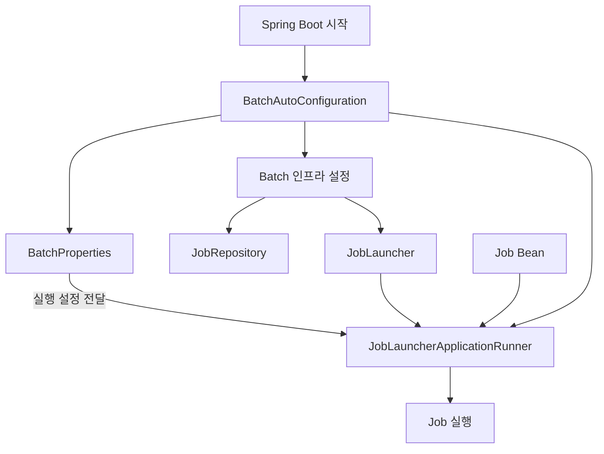

먼저 Spring Boot가 애플리케이션을 시작한다.

이후 BatchAutoConfiguration이 적용되면 Spring Batch 인프라를 구성한다.

BatchProperties에는 외부 설정값이 바인딩된다.

그리고 자동 실행이 활성화되어 있다면 JobLauncherApplicationRunner가 준비된다.

Spring Container에 등록된 Job과 설정값을 이용해 실행 대상을 결정한다.

마지막으로 JobLauncher를 호출해 Job을 실행한다.

따라서 전체 과정을 다음과 같이 나눌 수 있다.

**첫 번째 단계는 Batch 인프라 초기화다.**

JobRepository, JobLauncher 등 실행에 필요한 객체들을 준비한다.

**두 번째 단계는 실행할 Job을 선택하는 과정이다.**

설정값과 등록된 Job Bean을 확인한다.

**세 번째 단계는 실제 Job 실행이다.**

JobLauncherApplicationRunner가 JobLauncher를 호출한다.

이 세 과정을 구분하면 Spring Batch의 자동 실행 구조를 이해하기 쉬워진다.

---

### BatchAutoConfiguration이란?

`BatchAutoConfiguration`은 Spring Boot에서 제공하는 Spring Batch 자동 설정 클래스다.

이 클래스는 Spring Batch를 사용하는 데 필요한 설정을 자동으로 구성하는 역할을 담당한다.

Spring Boot 3.4.13에서는 다음 패키지에 위치한다.

```java
org.springframework.boot.autoconfigure.batch
```

BatchAutoConfiguration은 여러 조건이 충족되었을 때 활성화된다.

대표적으로 다음과 같은 조건이 있다.

* Spring Batch 관련 클래스가 존재하는가?
* DataSource가 존재하는가?
* PlatformTransactionManager가 존재하는가?
* 사용자가 Batch 인프라를 직접 구성하지 않았는가?

조건이 충족되면 Spring Boot는 Batch 인프라를 구성한다.

여기서 `@EnableBatchProcessing`을 직접 선언하거나 `DefaultBatchConfiguration`을 확장한 경우에는 주의해야 한다.

Spring Boot 3.4에서는 이러한 수동 구성 방식이 Batch 자동 설정을 비활성화할 수 있다.

따라서 일반적인 Spring Boot 프로젝트에서는 먼저 자동 설정을 이용하는 것이 편리하다.

#### JobLauncherApplicationRunner Bean 생성

BatchAutoConfiguration에는 JobLauncherApplicationRunner를 생성하는 메서드가 존재한다.

Spring Boot 3.4.13의 핵심 구조를 단순화하면 다음과 같다.

```java
@Bean
@ConditionalOnMissingBean
@ConditionalOnProperty(
        prefix = "spring.batch.job",
        name = "enabled",
        havingValue = "true",
        matchIfMissing = true
)
public JobLauncherApplicationRunner jobLauncherApplicationRunner(
        JobLauncher jobLauncher,
        JobExplorer jobExplorer,
        JobRepository jobRepository,
        BatchProperties properties
) {

    JobLauncherApplicationRunner runner =
            new JobLauncherApplicationRunner(
                    jobLauncher,
                    jobExplorer,
                    jobRepository
            );

    String jobName =
            properties.getJob().getName();

    if (StringUtils.hasText(jobName)) {
        runner.setJobName(jobName);
    }

    return runner;
}
```

위 코드는 주요 동작을 설명하기 위한 형태다.

여기에서 중요한 부분이 두 군데 있다.

첫 번째는 다음 조건이다.

```java
@ConditionalOnProperty(
        prefix = "spring.batch.job",
        name = "enabled",
        havingValue = "true",
        matchIfMissing = true
)
```

이 조건은 Job 자동 실행 기능이 활성화되어 있는지 확인한다.

두 번째는 다음 코드다.

```java
String jobName =
        properties.getJob().getName();
```

BatchProperties에서 실행할 Job의 이름을 가져온다.

설정된 Job 이름이 있다면 Runner에 전달한다.

```java
runner.setJobName(jobName);
```

따라서 `application.yml`에서 Job 이름을 설정하면 JobLauncherApplicationRunner가 해당 이름을 이용해 실행할 Job을 선택하게 된다.

---

### JobLauncherApplicationRunner란?

`JobLauncherApplicationRunner`는 Spring Boot 애플리케이션 시작 과정에서 Spring Batch Job을 실행하는 클래스다.

Spring Boot의 `ApplicationRunner` 인터페이스를 구현한다.

ApplicationRunner는 Spring Boot가 애플리케이션을 시작하는 과정에서 호출하는 실행 인터페이스다.

핵심 메서드는 다음과 같다.

```java
void run(
        ApplicationArguments args
) throws Exception;
```

Spring Boot는 ApplicationRunner Bean을 찾아 애플리케이션 시작 과정에서 `run()` 메서드를 호출한다.

JobLauncherApplicationRunner도 이 구조를 이용한다.

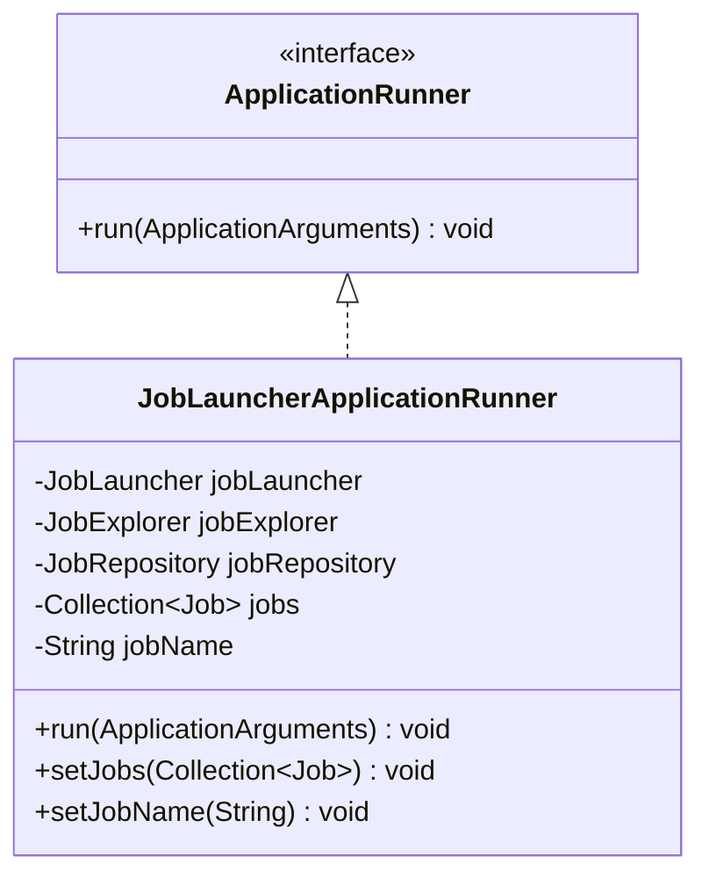

JobLauncherApplicationRunner는 다음과 같은 객체들과 협력한다.

| 객체                     | 역할                          |
| ---------------------- | --------------------------- |
| JobLauncher            | Job 실행                      |
| JobExplorer            | 기존 실행 정보 조회                 |
| JobRepository          | 실행 이력 및 JobInstance 확인      |
| Job Collection         | 실행할 수 있는 Job 목록             |
| Job Name               | 선택적으로 실행할 Job 이름            |
| JobParametersConverter | 전달된 파라미터를 JobParameters로 변환 |

여기서 핵심은 JobLauncher다.

JobLauncherApplicationRunner가 실제 비즈니스 로직을 직접 실행하는 것은 아니다.

최종적으로 JobLauncher의 `run()` 메서드를 호출해 배치 작업을 시작한다.

---

### JobLauncherApplicationRunner는 언제 실행될까?

Spring Boot 애플리케이션은 시작 과정에서 여러 단계를 거친다.

대표적으로 다음과 같은 흐름이다.

```text
SpringApplication.run()
          │
          ▼
ApplicationContext 생성
          │
          ▼
Bean 등록 및 초기화
          │
          ▼
ApplicationContext 준비 완료
          │
          ▼
ApplicationRunner 실행
          │
          ▼
JobLauncherApplicationRunner.run()
          │
          ▼
Job 실행
```

여기서 중요한 점은 JobLauncherApplicationRunner가 Bean으로 생성되는 시점과 `run()` 메서드가 호출되는 시점이 다르다는 것이다.

JobLauncherApplicationRunner는 Spring Container의 Bean 초기화 과정에서 생성된다.

하지만 실제 Job 실행은 ApplicationRunner 호출 시점에 이루어진다.

따라서 다음 두 단계를 구분해야 한다.

```text
Bean 생성
   │
   └── 실행에 필요한 의존성 및 설정값 준비
```

```text
run() 호출
   │
   └── 실제 Job 실행
```

이러한 구조 덕분에 Spring Boot는 애플리케이션의 주요 Bean을 준비한 뒤 Job을 실행할 수 있다.

---

### JobLauncherApplicationRunner의 내부 실행 과정

JobLauncherApplicationRunner의 실행 흐름을 조금 더 자세히 살펴보자.

Spring Boot 3.4.13에서는 `run(ApplicationArguments)` 메서드를 통해 실행 인자를 전달받는다.

내부의 핵심 동작을 단순화하면 다음과 같다.

```java
@Override
public void run(
        ApplicationArguments args
) throws Exception {

    String[] jobArguments =
            args.getNonOptionArgs()
                    .toArray(new String[0]);

    run(jobArguments);
}
```

여기서 중요한 메서드는 다음이다.

```java
args.getNonOptionArgs()
```

Spring Boot에서 프로그램 실행 인자는 크게 두 가지로 구분할 수 있다.

첫 번째는 옵션 인자다.

```text
--spring.batch.job.name=batchJob1
```

두 번째는 일반 인자다.

```text
businessDate=2026-10-29
```

JobLauncherApplicationRunner는 `getNonOptionArgs()`를 이용해 일반 인자를 가져온다.

그리고 해당 값을 JobParameters로 변환한다.

따라서 옵션 인자와 JobParameters는 구분해야 한다.

---

### Spring Boot 옵션 인자와 JobParameters의 차이

예를 들어 다음 명령어를 실행한다고 생각해보자.

```bash
java -jar spring-batch-demo.jar \
  --spring.batch.job.name=batchJob1 \
  businessDate=2026-10-29
```

이 명령어에는 두 종류의 인자가 존재한다.

```text
--spring.batch.job.name=batchJob1
```

이 값은 Spring Boot의 설정값이다.

실행할 Job의 이름을 지정한다.

반면 다음 값은

```text
businessDate=2026-10-29
```

JobParameters로 변환된다.

따라서 다음과 같이 구분할 수 있다.

| 인자                                  | 유형             | 역할                |
| ----------------------------------- | -------------- | ----------------- |
| `--spring.batch.job.name=batchJob1` | Spring Boot 옵션 | 실행할 Job 선택        |
| `businessDate=2026-10-29`           | 일반 인자          | JobParameters로 전달 |

여기서 중요한 점은 `--`의 유무다.

Spring Boot는 `--`로 시작하는 명령행 옵션을 Environment 속성으로 처리한다.

반면 JobLauncherApplicationRunner는 일반 인자를 JobParameters로 변환한다.

이러한 구분을 이해하면 Job 선택 설정과 업무 파라미터를 명확하게 분리할 수 있다.

#### JobParameters 변환 과정

전체 흐름은 다음과 같다.

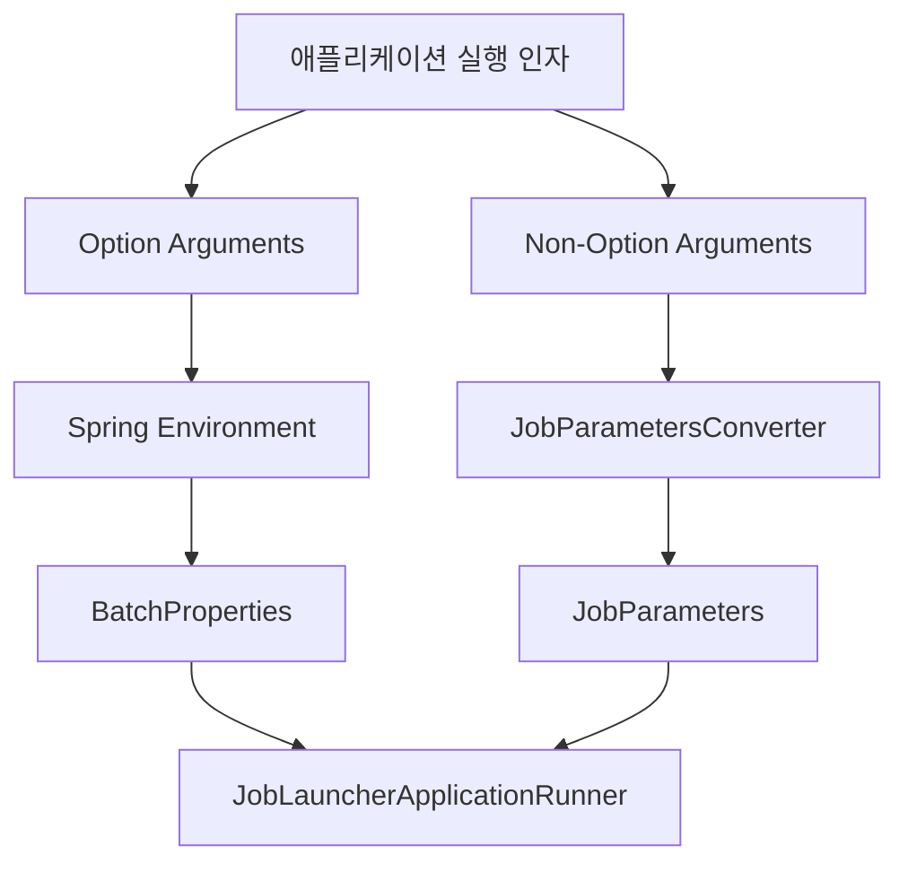

Job 이름은 BatchProperties에 바인딩된다.

업무 파라미터는 JobParameters로 변환된다.

이후 JobLauncherApplicationRunner가 두 정보를 이용해 Job을 실행한다.

---

### BatchProperties란?

`BatchProperties`는 Spring Boot에서 Spring Batch 관련 설정값을 관리하기 위한 클래스다.

다음 패키지에 위치한다.

```java
org.springframework.boot.autoconfigure.batch
```

Spring Boot 3.4.13의 BatchProperties는 다음 애너테이션을 사용한다.

```java
@ConfigurationProperties(
        prefix = "spring.batch"
)
```

이 애너테이션은 `spring.batch`로 시작하는 설정값을 객체의 속성에 바인딩하는 역할을 한다.

예를 들어 다음과 같은 설정이 있다고 생각해보자.

```yaml
spring:
  batch:
    job:
      name: batchJob1

    jdbc:
      initialize-schema: embedded
      table-prefix: BATCH_
```

Spring Boot는 이러한 설정값을 BatchProperties와 관련 설정 객체에 바인딩한다.

개념적으로 다음과 같은 구조다.

```text
BatchProperties
       │
       ├── Job
       │     │
       │     └── name
       │
       └── Jdbc
             │
             ├── initializeSchema
             ├── tablePrefix
             ├── schema
             ├── platform
             └── isolationLevelForCreate
```

여기서 Job 이름과 JDBC 메타데이터 설정을 구분하고 있다.

Job 관련 설정은 실행할 Job을 선택하는 데 사용된다.

JDBC 관련 설정은 Batch 메타데이터 저장소의 초기화 및 구성에 사용된다.

---

### BatchProperties의 주요 설정값

Spring Boot 3.4.13에서 자주 사용하는 설정은 다음과 같다.

| 설정                                             | 역할                        | 기본값          |
| ---------------------------------------------- | ------------------------- | ------------ |
| `spring.batch.job.name`                        | 시작 시 실행할 Job 이름           | 미지정          |
| `spring.batch.job.enabled`                     | Job 자동 실행 여부              | true         |
| `spring.batch.jdbc.initialize-schema`          | 메타데이터 스키마 초기화 방식          | embedded     |
| `spring.batch.jdbc.schema`                     | 스키마 초기화 SQL 경로            | 기본 스키마 경로    |
| `spring.batch.jdbc.platform`                   | 스키마 초기화에 사용할 DB 플랫폼       | 자동 감지        |
| `spring.batch.jdbc.table-prefix`               | 메타데이터 테이블 Prefix          | BATCH_       |
| `spring.batch.jdbc.isolation-level-for-create` | Job 메타데이터 생성 시 트랜잭션 격리 수준 | 기본 인프라 설정 사용 |

여기서 한 가지 구분할 부분이 있다.

`spring.batch.job.enabled`는 자동 실행 Runner의 생성 여부를 결정하는 설정이다.

BatchProperties의 Job 내부에 반드시 `enabled`라는 필드가 있어야만 적용되는 구조는 아니다.

Spring Boot의 `@ConditionalOnProperty`가 해당 Environment 속성을 직접 확인해 조건을 평가한다.

반면 `spring.batch.job.name`은 BatchProperties의 Job 객체에 바인딩되어 Runner의 실행 대상 선택에 사용된다.

이 차이를 이해하면 설정값이 Spring Boot 내부에서 어떻게 적용되는지 더 명확하게 파악할 수 있다.

---

### spring.batch.job.name 설정

`spring.batch.job.name`은 애플리케이션 시작 시 실행할 Job의 이름을 지정하는 설정이다.

예를 들어 다음과 같이 설정할 수 있다.

```yaml
spring:
  batch:
    job:
      name: batchJob1
```

이 설정은 `batchJob1`이라는 이름의 Job을 자동 실행 대상으로 지정한다.

여기서 중요한 것은 **Spring Bean의 이름과 Job의 이름이 반드시 같지는 않다는 사실**이다.

예를 들어 다음 코드를 살펴보자.

```java
@Bean("firstJobBean")
public Job batchJob1(
        JobRepository jobRepository,
        Step step1
) {
    return new JobBuilder(
            "batchJob1",
            jobRepository
    )
            .start(step1)
            .build();
}
```

이 코드에서 Spring Bean 이름은 다음과 같다.

```text
firstJobBean
```

하지만 실제 Job의 이름은 다음과 같다.

```text
batchJob1
```

Job 이름은 JobBuilder에 전달한 값이다.

```java
new JobBuilder(
        "batchJob1",
        jobRepository
)
```

JobLauncherApplicationRunner가 비교하는 이름은 기본적으로 다음 메서드가 반환하는 값이다.

```java
job.getName()
```

따라서 실행할 Job을 지정할 때는 Bean 이름이 아니라 **실제 Job의 이름**을 기준으로 설정해야 한다.

---

### 여러 Job이 등록되어 있으면 어떻게 될까?

이번에는 하나의 애플리케이션에 여러 Job이 등록되어 있다고 생각해보자.

```text
Spring Container
       │
       ├── batchJob1
       │
       ├── batchJob2
       │
       └── batchJob3
```

Spring Boot는 이 Job들을 Bean으로 관리한다.

JobLauncherApplicationRunner는 등록된 Job 객체들을 전달받을 수 있다.

다만 이 지점에서 Spring Boot 버전에 따른 차이를 주의해야 한다.

**Spring Boot 3.4.13에서는 여러 Job Bean이 존재하는 경우 기본적으로 실행할 Job 이름을 지정해야 한다.**

Job 이름이 지정되지 않았다면 애플리케이션 시작 과정에서 검증 오류가 발생할 수 있다.

대표적인 오류 메시지는 다음과 같다.

```text
Job name must be specified in case of multiple jobs
```

이 오류는 여러 Job이 존재하는데 실행할 Job이 지정되지 않았기 때문에 발생한다.

따라서 다음과 같이 설정해야 한다.

```yaml
spring:
  batch:
    job:
      name: batchJob1
```

이렇게 설정하면 batchJob1이 자동 실행 대상으로 선택된다.

#### Job 개수에 따른 동작

| 등록된 Job 수 | Job 이름 설정     | Spring Boot 3.4 동작 |
| --------- | ------------- | ------------------ |
| 1개        | 미설정           | 해당 Job 자동 실행       |
| 1개        | 올바른 이름 설정     | 지정한 Job 실행         |
| 2개 이상     | 미설정           | 초기화 검증 오류 가능       |
| 2개 이상     | 올바른 이름 설정     | 지정한 Job 실행         |
| 2개 이상     | 존재하지 않는 이름 설정 | Job 이름 검증 오류       |

따라서 여러 Job이 등록되어 있을 때 아무런 설정 없이 모든 Job이 자동 실행된다고 이해하면 안 된다.

---

### JobLauncherApplicationRunner는 실행할 Job을 어떻게 선택할까?

JobLauncherApplicationRunner는 내부적으로 등록된 Job 목록과 설정된 Job 이름을 이용한다.

Spring Boot 3.4.13의 핵심 구조를 살펴보면 다음과 같다.

```java
private String jobName;

private Collection<Job> jobs =
        Collections.emptySet();
```

Job 이름을 저장하는 속성이 있다.

그리고 등록된 Job을 저장하는 Collection이 있다.

Spring은 Job Bean들을 해당 Collection에 주입할 수 있다.

```java
@Autowired(required = false)
public void setJobs(
        Collection<Job> jobs
) {
    this.jobs = jobs;
}
```

이후 실행 시 등록된 Job 목록을 순회한다.

핵심 로직을 단순화하면 다음과 같다.

```java
for (Job job : jobs) {

    if (StringUtils.hasText(jobName)) {

        if (!jobName.equals(job.getName())) {
            continue;
        }
    }

    execute(job, jobParameters);
}
```

이 코드에서 중요한 부분은 다음이다.

```java
jobName.equals(job.getName())
```

설정한 Job 이름과 실제 Job의 이름을 비교한다.

일치하지 않으면 해당 Job을 건너뛴다.

```java
continue;
```

이름이 일치하면 실행한다.

```java
execute(job, jobParameters);
```

따라서 JobLauncherApplicationRunner는 등록된 모든 Job을 무조건 실행하는 것이 아니라 설정된 Job 이름을 기준으로 실행 대상을 선택할 수 있다.

다만 Spring Boot 3.4에서는 이 반복문에 도달하기 전에 여러 Job에 대한 설정 검증도 수행한다.

---

### JobLauncherApplicationRunner의 초기화 검증

JobLauncherApplicationRunner는 `InitializingBean`도 구현한다.

따라서 초기화 과정에서 `afterPropertiesSet()` 메서드가 호출된다.

Spring Boot 3.4.13의 주요 검증 조건은 다음과 같은 의미를 가진다.

```java
jobs.size() <= 1
        || StringUtils.hasText(jobName)
```

등록된 Job이 하나 이하라면 Job 이름 없이도 허용된다.

하지만 Job이 두 개 이상이라면 Job 이름이 지정되어 있어야 한다.

또한 Job 이름이 지정되어 있다면 실제로 해당 Job이 존재하는지도 확인한다.

따라서 다음과 같은 설정은 문제가 발생할 수 있다.

```yaml
spring:
  batch:
    job:
      name: unknownJob
```

실제로 `unknownJob`이라는 Job이 존재하지 않는다면 검증 오류가 발생한다.

이 동작은 존재하지 않는 Job 이름을 전달하면 아무 일도 하지 않고 정상적으로 종료될 것이라고 가정하는 것과 다르다.

운영 환경에서는 오히려 이러한 검증이 유용하다.

잘못된 Job 이름을 설정했는데도 실행 성공으로 처리되는 상황을 방지할 수 있기 때문이다.

---

### spring.batch.job.names와 spring.batch.job.name의 차이

Spring Batch 관련 코드를 살펴보면 다음과 같은 설정을 사용하는 사례를 발견할 수 있다.

```yaml
spring:
  batch:
    job:
      names: batchJob1
```

하지만 Spring Boot 3.4.13에서는 이 설정을 기준으로 구현하면 안 된다.

현재 버전에서는 다음 속성을 사용한다.

```yaml
spring:
  batch:
    job:
      name: batchJob1
```

두 설정의 차이는 단순히 복수형과 단수형의 차이가 아니다.

과거 Spring Boot에서는 여러 Job 이름을 지정하는 방식이 사용되었다.

반면 Spring Boot 3.4에서는 단일 Job 이름을 지정하는 API를 사용한다.

정리하면 다음과 같다.

| 구분          | 과거 Spring Boot 방식        | Spring Boot 3.4         |
| ----------- | ------------------------ | ----------------------- |
| Job 선택 속성   | `spring.batch.job.names` | `spring.batch.job.name` |
| 선택 대상       | 여러 Job 이름을 지원하던 방식       | 단일 Job 이름               |
| 내부 설정       | 여러 이름을 처리하는 구조           | `setJobName()`          |
| 복수 Job 등록 시 | 버전에 따라 다름                | 실행할 Job 이름 지정 필요        |

따라서 다음과 같은 설정도 주의해야 한다.

```yaml
spring:
  batch:
    job:
      name: batchJob1,batchJob2
```

Spring Boot 3.4의 기본 JobLauncherApplicationRunner가 이 값을 두 개의 Job 이름으로 분리해 실행하는 것은 아니다.

하나의 Job 이름 문자열로 취급할 수 있다.

따라서 실제 Job 이름과 일치하지 않아 검증 오류가 발생한다.

**Spring Boot 3.4에서 여러 Job을 실행해야 한다면 별도의 실행 흐름을 직접 구성하는 것이 명확하다.**

---

### 실제 Job 초기화와 선택 실행 구현하기

이번에는 실제 Spring Boot 프로젝트를 구성해보자.

다음과 같은 두 개의 Job을 생성한다.

```text
Spring Container
       │
       ├── batchJob1
       │      │
       │      ├── batchJob1Step1
       │      │
       │      └── batchJob1Step2
       │
       └── batchJob2
              │
              ├── batchJob2Step1
              │
              └── batchJob2Step2
```

두 Job은 모두 Spring Bean으로 등록한다.

그리고 애플리케이션 실행 시 설정한 이름에 따라 원하는 Job만 실행하도록 구성한다.

확인할 내용은 다음과 같다.

첫 번째는 BatchAutoConfiguration에 의해 JobLauncherApplicationRunner가 생성되는 과정이다.

두 번째는 BatchProperties에 Job 이름이 바인딩되는 과정이다.

세 번째는 설정한 이름과 실제 Job 이름을 비교하는 과정이다.

네 번째는 프로그램 실행 인자가 JobParameters로 전달되는 과정이다.

---

### Maven 의존성 설정

먼저 프로젝트에 필요한 의존성을 구성한다.

이번 예제에서는 H2 인메모리 데이터베이스를 사용한다.

`pom.xml`

```xml
<?xml version="1.0" encoding="UTF-8"?>
<project xmlns="http://maven.apache.org/POM/4.0.0"
         xmlns:xsi="http://www.w3.org/2001/XMLSchema-instance"
         xsi:schemaLocation="
             http://maven.apache.org/POM/4.0.0
             https://maven.apache.org/xsd/maven-4.0.0.xsd">

    <modelVersion>4.0.0</modelVersion>

    <parent>
        <groupId>org.springframework.boot</groupId>
        <artifactId>spring-boot-starter-parent</artifactId>
        <version>3.4.13</version>
        <relativePath/>
    </parent>

    <groupId>com.example</groupId>
    <artifactId>spring-batch-demo</artifactId>
    <version>0.0.1-SNAPSHOT</version>

    <properties>
        <java.version>17</java.version>
        <spring-batch.version>5.2.4</spring-batch.version>
    </properties>

    <dependencies>

        <dependency>
            <groupId>org.springframework.boot</groupId>
            <artifactId>spring-boot-starter-batch</artifactId>
        </dependency>

        <dependency>
            <groupId>com.h2database</groupId>
            <artifactId>h2</artifactId>
            <scope>runtime</scope>
        </dependency>

    </dependencies>

    <build>
        <plugins>
            <plugin>
                <groupId>org.springframework.boot</groupId>
                <artifactId>spring-boot-maven-plugin</artifactId>
            </plugin>
        </plugins>
    </build>

</project>
```

이 설정에서 중요한 의존성은 다음이다.

```xml
<dependency>
    <groupId>org.springframework.boot</groupId>
    <artifactId>spring-boot-starter-batch</artifactId>
</dependency>
```

Spring Batch 관련 기능을 사용하기 위한 의존성이다.

그리고 H2 데이터베이스를 추가했다.

```xml
<dependency>
    <groupId>com.h2database</groupId>
    <artifactId>h2</artifactId>
    <scope>runtime</scope>
</dependency>
```

이번에는 별도의 MySQL 서버 없이 JobRepository의 메타데이터 테이블을 생성하고 실행 결과를 확인한다.

---

### JobConfiguration 전체 코드

다음과 같이 두 개의 Job과 네 개의 Step을 정의한다.

`JobConfiguration.java`

```java
package com.example.batch;

import org.slf4j.Logger;
import org.slf4j.LoggerFactory;

import org.springframework.batch.core.Job;
import org.springframework.batch.core.Step;

import org.springframework.batch.core.job.builder.JobBuilder;
import org.springframework.batch.core.repository.JobRepository;
import org.springframework.batch.core.step.builder.StepBuilder;

import org.springframework.batch.repeat.RepeatStatus;

import org.springframework.beans.factory.annotation.Qualifier;
import org.springframework.context.annotation.Bean;
import org.springframework.context.annotation.Configuration;

import org.springframework.transaction.PlatformTransactionManager;

@Configuration
public class JobConfiguration {

    private static final Logger log =
            LoggerFactory.getLogger(JobConfiguration.class);

    @Bean
    public Job batchJob1(
            JobRepository jobRepository,
            @Qualifier("batchJob1Step1") Step step1,
            @Qualifier("batchJob1Step2") Step step2
    ) {
        return new JobBuilder("batchJob1", jobRepository)
                .start(step1)
                .next(step2)
                .build();
    }

    @Bean
    public Job batchJob2(
            JobRepository jobRepository,
            @Qualifier("batchJob2Step1") Step step1,
            @Qualifier("batchJob2Step2") Step step2
    ) {
        return new JobBuilder("batchJob2", jobRepository)
                .start(step1)
                .next(step2)
                .build();
    }

    @Bean
    public Step batchJob1Step1(
            JobRepository jobRepository,
            PlatformTransactionManager transactionManager
    ) {
        return new StepBuilder(
                "batchJob1Step1",
                jobRepository
        )
                .tasklet((contribution, chunkContext) -> {

                    log.info("Batch Job 1 - Step 1 실행");

                    return RepeatStatus.FINISHED;

                }, transactionManager)
                .build();
    }

    @Bean
    public Step batchJob1Step2(
            JobRepository jobRepository,
            PlatformTransactionManager transactionManager
    ) {
        return new StepBuilder(
                "batchJob1Step2",
                jobRepository
        )
                .tasklet((contribution, chunkContext) -> {

                    log.info("Batch Job 1 - Step 2 실행");

                    return RepeatStatus.FINISHED;

                }, transactionManager)
                .build();
    }

    @Bean
    public Step batchJob2Step1(
            JobRepository jobRepository,
            PlatformTransactionManager transactionManager
    ) {
        return new StepBuilder(
                "batchJob2Step1",
                jobRepository
        )
                .tasklet((contribution, chunkContext) -> {

                    log.info("Batch Job 2 - Step 1 실행");

                    return RepeatStatus.FINISHED;

                }, transactionManager)
                .build();
    }

    @Bean
    public Step batchJob2Step2(
            JobRepository jobRepository,
            PlatformTransactionManager transactionManager
    ) {
        return new StepBuilder(
                "batchJob2Step2",
                jobRepository
        )
                .tasklet((contribution, chunkContext) -> {

                    log.info("Batch Job 2 - Step 2 실행");

                    return RepeatStatus.FINISHED;

                }, transactionManager)
                .build();
    }
}
```

이 코드는 두 개의 Job을 Spring Bean으로 등록한다.

첫 번째 Job의 이름은 다음과 같다.

```text
batchJob1
```

두 번째 Job의 이름은 다음과 같다.

```text
batchJob2
```

두 Job은 서로 다른 Step을 사용한다.

따라서 어떤 Job이 실행되었는지 로그를 통해 구분할 수 있다.

---

### application.yml 설정

이제 실행할 Job을 선택하기 위한 설정을 작성한다.

`application.yml`

```yaml
spring:
  application:
    name: spring-batch-demo

  main:
    web-application-type: none

  datasource:
    url: jdbc:h2:mem:batchdb;DB_CLOSE_DELAY=-1
    driver-class-name: org.h2.Driver
    username: sa
    password:

  batch:
    job:
      enabled: true
      name: ${batch.job.name:batchJob1}

    jdbc:
      initialize-schema: embedded
```

이 설정에서 중요한 부분은 다음이다.

```yaml
spring:
  batch:
    job:
      enabled: true
```

Spring Boot의 Job 자동 실행 기능을 활성화한다.

그리고 다음 설정을 사용했다.

```yaml
name: ${batch.job.name:batchJob1}
```

이 표현식은 외부 설정값을 이용해 실행할 Job 이름을 결정한다.

`batch.job.name`이라는 설정값이 존재하면 해당 값을 사용한다.

없다면 기본값으로 `batchJob1`을 사용한다.

따라서 별도의 설정을 전달하지 않으면 batchJob1이 실행된다.

반면 실행 시점에 다음 설정을 전달하면

```text
--batch.job.name=batchJob2
```

batchJob2가 선택된다.

이처럼 외부 설정값을 이용하면 애플리케이션을 다시 빌드하지 않고도 실행할 Job을 변경할 수 있다.

---

### 첫 번째 실행: 기본 Job 실행하기

먼저 프로젝트를 빌드한다.

```bash
./mvnw clean package
```

이 명령어는 기존 빌드 결과를 정리하고 프로젝트를 빌드한다.

정상적으로 완료되면 실행 가능한 JAR 파일이 생성된다.

이제 다음 명령어를 실행한다.

```bash
java -jar target/spring-batch-demo-0.0.1-SNAPSHOT.jar \
  businessDate=2026-10-29
```

이 명령어에서는 별도로 Job 이름을 지정하지 않았다.

따라서 application.yml의 기본값이 사용된다.

```yaml
name: ${batch.job.name:batchJob1}
```

최종적으로 다음 Job이 선택된다.

```text
batchJob1
```

#### 실행 결과

정상적으로 실행되면 다음과 유사한 로그를 확인할 수 있다.

```text
Running default command line with:
[businessDate=2026-10-29]

Job: [SimpleJob: [name=batchJob1]]
launched with the following parameters

Executing step: [batchJob1Step1]

Batch Job 1 - Step 1 실행

Executing step: [batchJob1Step2]

Batch Job 1 - Step 2 실행

Job: [SimpleJob: [name=batchJob1]]
completed with status: [COMPLETED]
```

위 로그는 주요 실행 흐름을 중심으로 정리한 예시다.

실제 출력 형식과 메시지는 로깅 설정에 따라 달라질 수 있다.

여기서 중요한 사실은 두 개의 Job이 Bean으로 등록되어 있지만 batchJob1만 실행되었다는 점이다.

batchJob2는 실행되지 않았다.

이것이 JobLauncherApplicationRunner의 Job 선택 기능이다.

---

### 두 번째 실행: 외부 인자로 Job 변경하기

이번에는 batchJob2를 실행해보자.

애플리케이션을 수정하거나 다시 빌드할 필요는 없다.

실행 인자만 변경하면 된다.

```bash
java -jar target/spring-batch-demo-0.0.1-SNAPSHOT.jar \
  --batch.job.name=batchJob2 \
  businessDate=2026-10-29
```

이번에는 다음 설정을 전달했다.

```text
--batch.job.name=batchJob2
```

따라서 application.yml의 표현식에 batchJob2가 바인딩된다.

```yaml
name: ${batch.job.name:batchJob1}
```

최종적으로 다음과 같은 설정이 적용되는 것이다.

```yaml
spring:
  batch:
    job:
      name: batchJob2
```

#### 실행 결과

정상적으로 실행되면 다음과 유사한 로그를 확인할 수 있다.

```text
Job: [SimpleJob: [name=batchJob2]]
launched with the following parameters

Executing step: [batchJob2Step1]

Batch Job 2 - Step 1 실행

Executing step: [batchJob2Step2]

Batch Job 2 - Step 2 실행

Job: [SimpleJob: [name=batchJob2]]
completed with status: [COMPLETED]
```

batchJob1은 실행되지 않는다.

반면 batchJob2에 등록된 두 Step이 실행된다.

이렇게 외부 설정을 이용하면 동일한 애플리케이션에서 원하는 Job만 선택적으로 실행할 수 있다.

---

### 프로그램 인자가 JobParameters로 전달되는 과정

앞선 예제에서는 다음 인자를 전달했다.

```text
businessDate=2026-10-29
```

이 값은 Spring Boot의 Environment 설정값이 아니라 JobParameters로 사용된다.

JobLauncherApplicationRunner는 일반 인자를 가져와 JobParametersConverter에 전달한다.

개념적인 흐름은 다음과 같다.

```text
프로그램 실행 인자
       │
       ▼
businessDate=2026-10-29
       │
       ▼
ApplicationArguments
       │
       ▼
getNonOptionArgs()
       │
       ▼
JobParametersConverter
       │
       ▼
JobParameters
       │
       ▼
JobLauncher.run()
```

따라서 실제 Tasklet에서도 해당 값을 조회할 수 있다.

다음 코드를 살펴보자.

```java
String businessDate =
        contribution
                .getStepExecution()
                .getJobParameters()
                .getString("businessDate");
```

이 코드에서는 현재 StepExecution을 통해 JobParameters를 가져온다.

그리고 businessDate 값을 조회한다.

결과는 다음과 같다.

```text
2026-10-29
```

따라서 실행할 Job 이름과 비즈니스 파라미터를 구분해서 전달할 수 있다.

```bash
java -jar target/spring-batch-demo-0.0.1-SNAPSHOT.jar \
  --batch.job.name=batchJob1 \
  businessDate=2026-10-29 \
  merchantId=1001
```

여기서 Job 선택 설정은 다음과 같다.

```text
batch.job.name=batchJob1
```

반면 JobParameters는 다음과 같다.

```text
businessDate=2026-10-29

merchantId=1001
```

이러한 방식은 정산 기준일이나 처리 대상 가맹점을 외부에서 전달하는 배치에 활용할 수 있다.

---

### 잘못된 Job 이름을 전달하면 어떻게 될까?

이번에는 존재하지 않는 Job 이름을 전달한다고 생각해보자.

```bash
java -jar target/spring-batch-demo-0.0.1-SNAPSHOT.jar \
  --batch.job.name=unknownJob \
  businessDate=2026-10-29
```

현재 등록된 Job은 두 개다.

```text
batchJob1

batchJob2
```

하지만 실행 인자로 전달한 이름은 다음과 같다.

```text
unknownJob
```

실제로 존재하지 않는 이름이다.

이 경우 Spring Boot 3.4.13의 JobLauncherApplicationRunner는 초기화 과정에서 설정한 Job 이름이 존재하는지 확인한다.

따라서 다음과 유사한 오류가 발생할 수 있다.

```text
No job found with name 'unknownJob'
```

이러한 검증은 잘못된 Job이 실행되는 상황을 방지한다.

특히 운영 환경에서는 존재하지 않는 Job 이름을 전달했는데 애플리케이션이 정상 종료되는 것보다 명확하게 오류를 확인할 수 있는 편이 안전하다.

---

### spring.batch.job.enabled 설정

이번에는 Job 자동 실행을 비활성화하는 방법을 살펴보자.

Spring Boot에서는 다음 설정을 제공한다.

```yaml
spring:
  batch:
    job:
      enabled: false
```

이 설정은 Spring Boot의 Job 자동 실행을 비활성화한다.

따라서 Job Bean이 등록되어 있더라도 애플리케이션 시작 과정에서 자동으로 Job을 실행하지 않는다.

여기서 중요한 사실은 **JobLauncher가 제거되는 것은 아니라는 점**이다.

JobLauncher와 JobRepository 등의 Batch 인프라는 계속 사용할 수 있다.

따라서 개발자가 직접 다음 코드를 호출하면 Job을 실행할 수 있다.

```java
jobLauncher.run(
        job,
        jobParameters
);
```

즉 `spring.batch.job.enabled=false`는 Spring Batch 사용 자체를 비활성화하는 설정이 아니다.

Spring Boot가 제공하는 자동 실행 기능을 비활성화하는 설정이다.

#### 자동 실행 설정 비교

| 설정               | 동작                    |
| ---------------- | --------------------- |
| `enabled: true`  | Job 자동 실행 Runner 활성화  |
| `enabled: false` | Job 자동 실행 Runner 비활성화 |
| 설정 생략            | 기본적으로 자동 실행 활성화       |

예를 들어 HTTP API를 이용해 Job을 실행하는 프로젝트라면 일반적으로 자동 실행을 비활성화하는 것이 좋다.

반면 애플리케이션 시작과 동시에 특정 Job을 실행하는 배치 전용 애플리케이션에서는 자동 실행을 활용할 수 있다.

---

### spring.batch.jdbc.initialize-schema 설정

Spring Batch는 실행 메타데이터를 저장하기 위한 테이블을 사용한다.

대표적으로 다음과 같은 테이블이 있다.

```text
BATCH_JOB_INSTANCE

BATCH_JOB_EXECUTION

BATCH_STEP_EXECUTION

BATCH_JOB_EXECUTION_CONTEXT

BATCH_STEP_EXECUTION_CONTEXT
```

JDBC 기반 JobRepository는 이러한 테이블을 이용해 실행 이력과 재시작 정보를 관리한다.

따라서 JobRepository를 사용하려면 메타데이터 스키마가 필요하다.

Spring Boot는 이를 위한 초기화 설정을 제공한다.

```yaml
spring:
  batch:
    jdbc:
      initialize-schema: embedded
```

이 설정은 메타데이터 스키마를 언제 초기화할지 결정한다.

#### initialize-schema의 주요 설정값

| 값        | 설명                                 |
| -------- | ---------------------------------- |
| always   | 지원되는 데이터베이스에서 시작 시 스키마 초기화 스크립트 실행 |
| embedded | H2 등 임베디드 DB 환경에서 초기화              |
| never    | 스키마 자동 초기화 비활성화                    |

개발 환경에서 H2를 사용하는 경우에는 다음 설정이 편리하다.

```yaml
spring:
  batch:
    jdbc:
      initialize-schema: embedded
```

반면 운영 환경에서 MySQL을 사용한다면 다음과 같이 구성할 수 있다.

```yaml
spring:
  batch:
    jdbc:
      initialize-schema: never
```

이 경우 메타데이터 테이블을 별도로 준비해야 한다.

#### always 설정의 주의점

다음 설정을 사용하면 애플리케이션 시작 시 스키마 초기화 SQL을 실행하도록 구성할 수 있다.

```yaml
spring:
  batch:
    jdbc:
      initialize-schema: always
```

하지만 운영 중인 데이터베이스에 무조건 사용하는 것은 적절하지 않다.

기존 테이블이 있는 환경에서 초기화 SQL이 다시 실행되면 오류가 발생할 수 있다.

또한 스키마 변경이 필요한 상황이라면 단순한 자동 초기화보다 명시적인 마이그레이션 방식이 안전하다.

실무에서는 Flyway나 Liquibase 같은 데이터베이스 마이그레이션 도구를 고려할 수 있다.

---

### spring.batch.jdbc.table-prefix 설정

Spring Batch의 메타데이터 테이블은 기본적으로 `BATCH_`라는 Prefix를 사용한다.

예를 들어 다음과 같다.

```text
BATCH_JOB_INSTANCE

BATCH_JOB_EXECUTION

BATCH_STEP_EXECUTION
```

하지만 프로젝트에 따라 다른 Prefix를 사용하고 싶을 수 있다.

예를 들어 정산 배치와 통계 배치가 서로 다른 메타데이터 테이블을 사용해야 한다고 생각해보자.

```text
정산 배치
    │
    ├── SETTLEMENT_JOB_INSTANCE
    └── SETTLEMENT_JOB_EXECUTION
```

```text
통계 배치
    │
    ├── STATISTICS_JOB_INSTANCE
    └── STATISTICS_JOB_EXECUTION
```

Spring Boot에서는 다음 설정을 이용해 Prefix를 변경할 수 있다.

```yaml
spring:
  batch:
    jdbc:
      table-prefix: SYSTEM_
```

이렇게 설정하면 JDBC 기반 JobRepository는 `SYSTEM_`으로 시작하는 메타데이터 테이블을 사용하도록 구성된다.

예를 들어 다음과 같은 테이블을 조회한다.

```text
SYSTEM_JOB_INSTANCE

SYSTEM_JOB_EXECUTION

SYSTEM_STEP_EXECUTION
```

여기서 중요한 점은 **설정값만 변경한다고 해서 실제 데이터베이스 테이블 이름이 변경되는 것은 아니라는 사실**이다.

기존 데이터베이스에 BATCH_ 테이블만 존재한다면 SYSTEM_ 테이블을 찾는 과정에서 오류가 발생할 수 있다.

---

### 테이블 Prefix와 스키마 초기화의 관계

다음과 같은 설정을 사용한다고 생각해보자.

```yaml
spring:
  batch:
    jdbc:
      initialize-schema: embedded
      table-prefix: SYSTEM_
```

이 설정은 한 가지 주의할 부분이 있다.

JobRepository는 `SYSTEM_` Prefix를 사용한다.

하지만 기본 스키마 초기화 스크립트는 일반적으로 `BATCH_`라는 이름으로 테이블을 생성한다.

따라서 Prefix만 변경하면 실제 생성된 테이블과 JobRepository가 조회하는 테이블 이름이 달라질 수 있다.

```text
기본 스키마 초기화
       │
       ▼
BATCH_JOB_INSTANCE 생성
```

```text
JobRepository 설정
       │
       ▼
SYSTEM_JOB_INSTANCE 조회
       │
       ▼
테이블 없음
       │
       ▼
오류 발생
```

이를 해결하려면 Prefix에 맞는 스키마를 별도로 준비해야 한다.

예를 들어 `schema-system.sql` 파일을 작성할 수 있다.

이 파일에는 사용하는 Spring Batch 버전의 공식 스키마를 기준으로 Prefix를 변경한 전체 테이블 및 시퀀스 생성 SQL이 포함되어야 한다.

그리고 다음과 같이 설정할 수 있다.

```yaml
spring:
  batch:
    jdbc:
      initialize-schema: always
      schema: classpath:sql/schema-system.sql
      table-prefix: SYSTEM_
```

이 설정에서는 사용자 정의 스키마 초기화 SQL을 사용한다.

다만 실제 SQL 파일에는 JobInstance, JobExecution, StepExecution, ExecutionContext 관련 테이블뿐 아니라 사용하는 데이터베이스에 필요한 시퀀스 관련 구조도 포함되어야 한다.

운영 환경에서는 해당 스키마를 자동 생성하기보다 마이그레이션 도구로 관리하는 것이 더 적절할 수 있다.

---

### Spring Batch의 초기화 설정 전체 구조

지금까지 살펴본 설정값을 하나의 구조로 정리해보자.

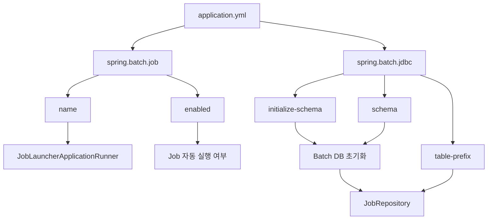

Job 관련 설정은 자동 실행 대상과 실행 여부를 결정한다.

JDBC 관련 설정은 메타데이터 저장소의 초기화 및 접근 방식에 영향을 준다.

따라서 Spring Batch 초기화 설정은 크게 두 가지 영역으로 나누어 이해할 수 있다.

**첫 번째는 Job 실행 제어 설정이다.**

```yaml
spring:
  batch:
    job:
      enabled: true
      name: batchJob1
```

**두 번째는 메타데이터 저장소 설정이다.**

```yaml
spring:
  batch:
    jdbc:
      initialize-schema: never
      table-prefix: BATCH_
```

이러한 구분을 이해하면 실행 관련 문제와 데이터베이스 관련 문제를 분리해서 분석할 수 있다.

---

### 여러 Job을 한 번에 실행하려면?

앞에서 Spring Boot 3.4에서는 여러 Job이 등록된 경우 기본적으로 실행할 Job 하나를 지정해야 한다고 설명했다.

그렇다면 여러 Job을 하나의 애플리케이션 실행 과정에서 모두 실행하려면 어떻게 해야 할까?

예를 들어 다음과 같은 작업을 수행해야 한다고 생각해보자.

```text
Spring Boot 시작
       │
       ▼
batchJob1 실행
       │
       ▼
batchJob2 실행
       │
       ▼
애플리케이션 종료
```

이러한 요구사항은 기본 JobLauncherApplicationRunner에 쉼표로 여러 이름을 전달하는 대신 별도의 실행 흐름을 구성하는 방식으로 해결할 수 있다.

대표적인 방법은 다음과 같다.

* ApplicationRunner에서 여러 Job을 순서대로 실행한다.
* 하나의 상위 Job을 구성하고 여러 Step으로 작업을 연결한다.
* JobStep을 이용해 다른 Job을 실행한다.
* 스케줄러에서 Job별 실행 순서를 관리한다.

이번에는 ApplicationRunner를 직접 구현하는 방법을 살펴보자.

---

### ApplicationRunner로 여러 Job 순차 실행하기

먼저 Spring Boot의 기본 Job 자동 실행을 비활성화한다.

```yaml
spring:
  batch:
    job:
      enabled: false
```

그리고 별도의 ApplicationRunner를 정의한다.

`MultipleJobRunner.java`

```java
package com.example.batch;

import java.util.List;

import org.slf4j.Logger;
import org.slf4j.LoggerFactory;

import org.springframework.batch.core.BatchStatus;
import org.springframework.batch.core.Job;
import org.springframework.batch.core.JobExecution;
import org.springframework.batch.core.JobParameters;
import org.springframework.batch.core.JobParametersBuilder;

import org.springframework.batch.core.launch.JobLauncher;

import org.springframework.beans.factory.annotation.Qualifier;
import org.springframework.boot.ApplicationArguments;
import org.springframework.boot.ApplicationRunner;
import org.springframework.context.annotation.Profile;
import org.springframework.stereotype.Component;

@Component
@Profile("multi-launch")
public class MultipleJobRunner implements ApplicationRunner {

    private static final Logger log =
            LoggerFactory.getLogger(MultipleJobRunner.class);

    private final JobLauncher jobLauncher;

    private final Job batchJob1;

    private final Job batchJob2;

    public MultipleJobRunner(
            JobLauncher jobLauncher,
            @Qualifier("batchJob1") Job batchJob1,
            @Qualifier("batchJob2") Job batchJob2
    ) {
        this.jobLauncher = jobLauncher;
        this.batchJob1 = batchJob1;
        this.batchJob2 = batchJob2;
    }

    @Override
    public void run(
            ApplicationArguments args
    ) throws Exception {

        JobParameters parameters =
                new JobParametersBuilder()
                        .addString(
                                "businessDate",
                                "2026-10-29"
                        )
                        .toJobParameters();

        List<Job> jobs = List.of(
                batchJob1,
                batchJob2
        );

        for (Job job : jobs) {

            log.info(
                    "Job 실행 시작: {}",
                    job.getName()
            );

            JobExecution execution =
                    jobLauncher.run(
                            job,
                            parameters
                    );

            if (execution.getStatus()
                    != BatchStatus.COMPLETED) {

                throw new IllegalStateException(
                        "Job 실행 실패: "
                                + job.getName()
                );
            }

            log.info(
                    "Job 실행 완료: {}",
                    job.getName()
            );
        }
    }
}
```

이 코드는 두 개의 Job을 순서대로 실행한다.

먼저 batchJob1을 실행한다.

```java
jobLauncher.run(
        batchJob1,
        parameters
);
```

batchJob1이 정상적으로 완료되면 다음 Job을 실행한다.

```java
jobLauncher.run(
        batchJob2,
        parameters
);
```

위 코드에서는 편의상 반복문을 이용했다.

실제로는 두 Job이 서로 다른 Job 이름을 가지므로 동일한 식별용 JobParameters를 전달해도 서로 다른 JobInstance로 관리된다.

#### 이 방식은 병렬 실행일까?

그렇지 않다.

이번 예제는 순차 실행이다.

기본적인 동기 JobLauncher를 사용했기 때문이다.

```text
batchJob1 실행
       │
       ▼
batchJob1 완료
       │
       ▼
batchJob2 실행
       │
       ▼
batchJob2 완료
```

따라서 여러 Job을 한 번의 애플리케이션 실행에서 수행한다는 것과 동시에 병렬 실행한다는 것은 구분해야 한다.

실제 병렬 실행을 원한다면 비동기 JobLauncher나 별도의 작업 실행 구조를 고려해야 한다.

또한 여러 Job을 하나의 업무 프로세스로 묶어 실행해야 한다면 상위 Job을 구성하는 방식이 더 적합할 수 있다.

---

### 여러 Job 실행 확인하기

앞에서 작성한 MultipleJobRunner는 다음 Profile에서만 활성화된다.

```java
@Profile("multi-launch")
```

따라서 애플리케이션 실행 시 해당 Profile을 활성화해야 한다.

또한 기본 Job 자동 실행은 비활성화한다.

```bash
java -jar target/spring-batch-demo-0.0.1-SNAPSHOT.jar \
  --spring.profiles.active=multi-launch \
  --spring.batch.job.enabled=false
```

이 명령어는 두 가지 설정을 적용한다.

첫 번째는 다음 Profile을 활성화한다.

```text
multi-launch
```

두 번째는 Spring Boot의 기본 Job 자동 실행을 비활성화한다.

```text
spring.batch.job.enabled=false
```

그러면 Spring Boot의 JobLauncherApplicationRunner 대신 직접 작성한 MultipleJobRunner가 Job을 실행한다.

정상적으로 실행되면 다음과 유사한 로그를 확인할 수 있다.

```text
Job 실행 시작: batchJob1

Batch Job 1 - Step 1 실행

Batch Job 1 - Step 2 실행

Job 실행 완료: batchJob1


Job 실행 시작: batchJob2

Batch Job 2 - Step 1 실행

Batch Job 2 - Step 2 실행

Job 실행 완료: batchJob2
```

이처럼 여러 Job을 실행하는 요구사항도 직접 실행 흐름을 구성해 해결할 수 있다.

다만 이번 예제의 businessDate는 고정값이므로 영속성 있는 데이터베이스에서 동일한 날짜로 반복 실행하면 이미 완료된 JobInstance에 대한 중복 실행 오류가 발생할 수 있다.

실제 서비스에서는 실행 기준일을 외부 인자로 전달받는 구조가 적절하다.

---

### JobLauncherApplicationRunner와 직접 구현한 ApplicationRunner의 차이

두 방식은 모두 ApplicationRunner를 사용한다.

하지만 역할과 설정 방식에 차이가 있다.

| 구분               | JobLauncherApplicationRunner | 직접 구현한 ApplicationRunner |
| ---------------- | ---------------------------- | ------------------------ |
| 제공 주체            | Spring Boot                  | 개발자                      |
| Job 자동 검색        | 지원                           | 직접 구성                    |
| Job 선택           | `spring.batch.job.name`      | 자유롭게 구현                  |
| 여러 Job 실행        | 기본적으로 단일 Job 선택              | 직접 순차·병렬 구성 가능           |
| JobParameters 변환 | 기본 변환 기능 제공                  | 직접 구성 가능                 |
| 실행 제어            | Spring Boot 기본 동작            | 사용자 정의 가능                |
| 복잡한 실행 흐름        | 제한적                          | 직접 구현 가능                 |

JobLauncherApplicationRunner는 일반적인 자동 실행 요구사항을 해결하기 위한 편리한 컴포넌트다.

반면 복잡한 실행 순서나 조건이 필요한 경우에는 직접 실행 흐름을 구성할 수 있다.

예를 들어 다음과 같은 요구사항이 있다고 생각해보자.

```text
Job A 실행
    │
    ▼
정상 완료 여부 확인
    │
    ├── 성공 → Job B 실행
    │
    └── 실패 → 알림 전송
```

이러한 구조에서는 직접 구현한 ApplicationRunner나 상위 Job을 구성하는 방식을 고려할 수 있다.

특히 모든 작업이 하나의 배치 실행 흐름으로 관리되어야 한다면 Job 내부에서 Step과 Flow를 이용해 구성하는 편이 자연스럽다.

---

### JobLauncherApplicationRunner를 디버깅할 때 확인할 부분

Spring Boot의 자동 실행 구조를 이해하려면 실제 메서드 호출 흐름을 살펴보는 것이 좋다.

Spring Boot 3.4.13에서 주요 확인 대상은 다음과 같다.

| 클래스                          | 메서드                            | 확인할 내용                   |
| ---------------------------- | ------------------------------ | ------------------------ |
| BatchAutoConfiguration       | jobLauncherApplicationRunner() | Runner 생성                |
| BatchProperties              | getJob().getName()             | Job 이름 설정값               |
| JobLauncherApplicationRunner | setJobs()                      | Job Bean 목록 주입           |
| JobLauncherApplicationRunner | setJobName()                   | 실행 대상 이름 설정              |
| JobLauncherApplicationRunner | afterPropertiesSet()           | 실행 대상 검증                 |
| JobLauncherApplicationRunner | run()                          | 실행 인자 처리                 |
| JobLauncherApplicationRunner | executeLocalJobs()             | 등록된 Job 선택               |
| JobLauncherApplicationRunner | execute()                      | JobLauncher 호출           |
| TaskExecutorJobLauncher      | run()                          | JobExecution 생성 및 Job 실행 |

호출 흐름을 정리하면 다음과 같다.

```text
BatchAutoConfiguration
        │
        ▼
JobLauncherApplicationRunner 생성
        │
        ▼
BatchProperties에서 Job 이름 조회
        │
        ▼
setJobName()
        │
        ▼
setJobs()
        │
        ▼
afterPropertiesSet()
        │
        ▼
ApplicationRunner.run()
        │
        ▼
JobParameters 변환
        │
        ▼
실행 대상 Job 선택
        │
        ▼
JobLauncher.run()
        │
        ▼
Job 실행
```

이 과정에서 세 가지 지점을 확인하면 된다.

첫 번째는 Runner가 생성되는 시점이다.

두 번째는 설정값과 등록된 Job 목록이 전달되는 시점이다.

세 번째는 실제 JobLauncher를 호출하는 시점이다.

특히 Job이 자동으로 실행되지 않는 문제를 분석할 때는 실행 대상 선택 조건을 확인하는 것이 중요하다.

---

### Spring Batch 초기화 과정에서 자주 발생하는 문제

초기화 설정이 잘못되면 Job이 실행되지 않거나 애플리케이션이 시작되지 않을 수 있다.

대표적인 문제를 살펴보자.

#### 여러 Job이 있는데 Job 이름을 지정하지 않은 경우

다음과 같은 상황이다.

```text
등록된 Job: 2개

spring.batch.job.name: 미설정
```

Spring Boot 3.4에서는 실행할 Job 이름을 지정해야 한다.

그렇지 않으면 다음과 같은 오류가 발생할 수 있다.

```text
Job name must be specified in case of multiple jobs
```

해결 방법은 다음과 같다.

```yaml
spring:
  batch:
    job:
      name: batchJob1
```

#### 존재하지 않는 Job 이름을 지정한 경우

다음과 같은 설정이다.

```yaml
spring:
  batch:
    job:
      name: nonexistentJob
```

하지만 실제로는 다음 두 Job만 존재한다.

```text
batchJob1

batchJob2
```

이 경우 Job 이름 검증 오류가 발생할 수 있다.

따라서 설정한 Job 이름과 실제 `Job.getName()`이 일치하는지 확인해야 한다.

#### Job 자동 실행을 비활성화한 경우

다음 설정이 있다면 Spring Boot는 기본 Job 자동 실행을 수행하지 않는다.

```yaml
spring:
  batch:
    job:
      enabled: false
```

따라서 자동 실행이 필요하다면 해당 설정을 변경해야 한다.

```yaml
spring:
  batch:
    job:
      enabled: true
```

#### 메타데이터 테이블이 존재하지 않는 경우

다음과 같은 오류가 발생할 수 있다.

```text
Table 'batch_db.BATCH_JOB_INSTANCE' doesn't exist
```

이 경우 JobRepository가 사용하는 메타데이터 테이블이 존재하는지 확인해야 한다.

또한 `initialize-schema` 설정과 실제 스키마 생성 여부를 확인해야 한다.

#### Prefix 설정과 실제 테이블 이름이 다른 경우

다음 설정을 사용한다고 생각해보자.

```yaml
spring:
  batch:
    jdbc:
      table-prefix: SYSTEM_
```

하지만 실제 데이터베이스에는 다음 테이블만 존재한다.

```text
BATCH_JOB_INSTANCE
```

이 경우 JobRepository는 SYSTEM_으로 시작하는 테이블을 찾기 때문에 오류가 발생할 수 있다.

따라서 Prefix 설정과 실제 데이터베이스 스키마를 일치시켜야 한다.

---

### 실무에서 Spring Batch 초기화 설정을 활용하는 방법

Spring Batch의 초기화 설정을 이해하면 단순히 Job을 자동 실행하는 것 이상의 운영 구조를 설계할 수 있다.

특히 여러 Job을 운영하거나 환경에 따라 실행 방식을 변경해야 하는 시스템에서 유용하다.

#### 1. 하나의 애플리케이션에서 여러 Job을 선택적으로 실행한다

정산, 통계, 데이터 정리 등 여러 Job을 하나의 프로젝트에 구성할 수 있다.

```text
Spring Batch Application
        │
        ├── settlementJob
        ├── statisticsJob
        └── cleanupJob
```

그리고 실행 시점에 원하는 Job을 선택한다.

```bash
java -jar batch.jar \
  --spring.batch.job.name=settlementJob \
  businessDate=2026-10-29
```

이 방식은 동일한 배포 산출물을 재사용하면서 실행할 작업만 변경할 수 있다는 장점이 있다.

단, Job 이름이 실제로 등록되어 있는지 검증해야 한다.

#### 2. Kubernetes CronJob에서 실행할 Job을 구분한다

하나의 배치 애플리케이션을 여러 Kubernetes CronJob에서 사용할 수 있다.

예를 들어 정산 CronJob은 settlementJob을 실행한다.

통계 CronJob은 statisticsJob을 실행한다.

두 CronJob은 같은 컨테이너 이미지를 사용하지만 실행 인자는 다르게 구성한다.

이렇게 하면 코드와 배포 이미지를 재사용하면서 스케줄은 독립적으로 관리할 수 있다.

다만 동일한 비즈니스 데이터를 처리하는 작업이 중복 실행되지 않도록 JobParameters와 스케줄 정책을 설계해야 한다.

#### 3. 개발 환경과 운영 환경의 스키마 초기화 설정을 분리한다

개발 환경에서는 다음 설정을 사용할 수 있다.

```yaml
spring:
  batch:
    jdbc:
      initialize-schema: embedded
```

반면 운영 환경에서는 다음과 같이 구성할 수 있다.

```yaml
spring:
  batch:
    jdbc:
      initialize-schema: never
```

이렇게 하면 개발 환경에서는 스키마를 편리하게 구성하고 운영 환경에서는 데이터베이스 변경을 명시적으로 관리할 수 있다.

단, 운영 배포 전에 필요한 메타데이터 테이블이 준비되어 있어야 한다.

#### 4. HTTP API 기반 배치에서는 자동 실행을 비활성화한다

관리자 화면에서 버튼을 눌러 배치를 실행하는 시스템을 생각해보자.

이러한 환경에서는 애플리케이션 시작 시 Job이 자동 실행되면 안 된다.

따라서 다음 설정을 사용할 수 있다.

```yaml
spring:
  batch:
    job:
      enabled: false
```

그리고 HTTP Controller나 Service에서 JobLauncher를 직접 호출한다.

이렇게 하면 애플리케이션 시작과 비즈니스 작업 실행 시점을 분리할 수 있다.

#### 5. 여러 Job의 실행 순서를 명시적으로 관리한다

서로 다른 Job 사이에 의존성이 존재할 수 있다.

예를 들어 정산 데이터 생성이 완료된 후 정산 검증을 실행해야 한다.

```text
settlementJob
      │
      ▼
validationJob
      │
      ▼
notificationJob
```

이러한 상황에서는 모든 Job을 독립적으로 자동 실행하는 것보다 실행 순서를 명시적으로 관리하는 것이 적절하다.

상위 Job이나 ApplicationRunner, 스케줄러 등의 방법을 고려할 수 있다.

특히 실패한 작업을 재시작해야 하는 경우에는 각 Job의 실행 이력과 재시작 정책도 함께 검토해야 한다.

#### 6. 잘못된 Job 이름으로 인한 운영 사고를 방지한다

운영 환경에서는 실행할 Job의 이름을 외부 인자로 전달하는 경우가 많다.

이때 오타나 잘못된 설정으로 존재하지 않는 Job 이름이 전달될 수 있다.

따라서 실행 대상이 존재하는지 검증하는 기능이 중요하다.

Spring Boot 3.4의 JobLauncherApplicationRunner는 실행 대상 검증을 수행한다.

복잡한 커스텀 Runner를 구현한다면 동일한 검증 기능을 직접 제공하는 것이 좋다.

#### 7. JobParameters와 인프라 설정을 분리한다

배치 실행 시 전달하는 값에는 서로 다른 목적의 정보가 포함된다.

예를 들어 다음과 같다.

```text
실행할 Job: settlementJob

정산 기준일: 2026-10-29

가맹점 ID: 1001
```

Job 이름은 애플리케이션 실행 설정으로 관리한다.

정산 기준일과 가맹점 ID는 JobParameters로 전달한다.

이렇게 구분하면 실행 환경과 비즈니스 입력값의 책임이 명확해진다.

#### 8. JobInstance의 중복 실행 정책을 고려한다

JobParameters는 JobInstance를 식별하는 데 사용된다.

따라서 정산 기준일을 식별용 파라미터로 사용한다면 같은 날짜의 정산 Job은 동일한 JobInstance로 관리될 수 있다.

하지만 실행할 때마다 현재 시간을 식별용 파라미터에 추가하면 같은 정산 작업이 여러 JobInstance로 구분될 수 있다.

따라서 실행 편의성만을 위해 매번 다른 파라미터를 생성하는 것은 주의해야 한다.

비즈니스 기준으로 동일한 작업을 구분할 수 있는 값을 사용하는 것이 좋다.

#### 9. Batch 메타데이터 테이블의 분리 전략을 수립한다

하나의 데이터베이스에서 여러 배치 애플리케이션을 운영할 수 있다.

이때 실행 메타데이터를 공유할지 분리할지 결정해야 한다.

공유하는 경우 Job 이름과 JobParameters가 충돌하지 않도록 관리해야 한다.

분리하는 경우에는 테이블 Prefix나 별도의 DataSource를 고려할 수 있다.

다만 Prefix를 변경한다면 실제 테이블 스키마도 함께 준비해야 한다.

#### 10. Batch 초기화와 실제 Job 실행을 구분해서 모니터링한다

배치 애플리케이션이 시작되지 않는 이유는 여러 가지다.

DataSource 연결 실패로 인프라 초기화가 실패했을 수도 있다.

JobLauncherApplicationRunner가 실행 대상을 검증하는 과정에서 실패했을 수도 있다.

실제 Job이 시작된 이후 Step에서 오류가 발생했을 수도 있다.

따라서 운영 로그에서는 다음 세 단계를 구분해서 분석하는 것이 좋다.

```text
Batch 인프라 초기화 실패
```

```text
Job 실행 대상 선택 실패
```

```text
Job 또는 Step 실행 실패
```

이렇게 구분하면 장애 원인을 더 빠르게 파악할 수 있다.

---

### 정리

Spring Boot에서 Spring Batch를 사용하면 Batch 자동 설정을 통해 JobRepository, JobLauncher 등의 인프라를 구성할 수 있다.

또한 특정 조건을 만족하면 JobLauncherApplicationRunner를 이용해 등록된 Job을 자동으로 실행할 수 있다.

전체 실행 흐름은 다음과 같다.

```text
Spring Boot 시작
       │
       ▼
BatchAutoConfiguration
       │
       ├── Batch 인프라 구성
       │
       ├── BatchProperties 바인딩
       │
       └── JobLauncherApplicationRunner 생성
                    │
                    ▼
             Job Bean 목록 확인
                    │
                    ▼
             실행할 Job 선택
                    │
                    ▼
             JobParameters 변환
                    │
                    ▼
             JobLauncher.run()
                    │
                    ▼
                 Job 실행
```

여기서 BatchAutoConfiguration은 Spring Batch 관련 인프라와 자동 실행 기능을 구성한다.

BatchProperties는 외부 설정값을 관리한다.

JobLauncherApplicationRunner는 애플리케이션 시작 과정에서 실행할 Job을 선택하고 JobLauncher를 호출한다.

특히 Spring Boot 3.4.13에서는 다음 설정을 사용한다.

```yaml
spring:
  batch:
    job:
      name: batchJob1
```

이 속성은 실행할 Job을 선택하는 데 사용된다.

Job 이름은 Spring Bean 이름이 아니라 실제 Job 객체의 `getName()`이 반환하는 값을 기준으로 판단한다.

또한 여러 Job Bean이 등록되어 있다면 실행할 Job 이름을 명시해야 한다.

Spring Boot 3.4에서는 과거의 `spring.batch.job.names` 대신 단수형인 `spring.batch.job.name`을 사용하며, 기본 Runner에 쉼표로 여러 Job 이름을 전달하는 방식은 지원되지 않는다.

여러 Job을 실행해야 한다면 ApplicationRunner나 상위 Job 등을 이용해 별도의 실행 흐름을 구성할 수 있다.

Spring Boot에서는 Job 자동 실행 여부도 제어할 수 있다.

```yaml
spring:
  batch:
    job:
      enabled: false
```

이 설정은 JobLauncherApplicationRunner를 이용한 자동 실행을 비활성화한다.

하지만 JobLauncher와 JobRepository 등의 인프라는 계속 사용할 수 있다.

또한 Spring Batch 메타데이터와 관련된 설정도 제공한다.

```yaml
spring:
  batch:
    jdbc:
      initialize-schema: never
      table-prefix: BATCH_
```

`initialize-schema`는 메타데이터 테이블의 초기화 방식을 결정한다.

`table-prefix`는 JobRepository가 사용하는 메타데이터 테이블 이름의 접두사를 결정한다.

다만 Prefix만 변경한다고 해서 실제 데이터베이스 테이블이 자동으로 변경되는 것은 아니다.

따라서 실제 스키마와 설정값을 일치시켜야 한다.

마지막으로 프로그램 실행 인자도 구분해야 한다.

```bash
java -jar batch.jar \
  --spring.batch.job.name=settlementJob \
  businessDate=2026-10-29
```

여기서 `--spring.batch.job.name`은 Spring Boot 설정값이다.

반면 `businessDate`는 JobParameters로 변환되어 실제 Job에 전달된다.

이러한 구조를 이해하면 하나의 애플리케이션에서 여러 Job을 선택적으로 실행하고, 환경에 따라 자동 실행 여부와 메타데이터 저장 방식을 제어할 수 있다.

결국 **Spring Batch의 초기화 설정은 단순히 Job을 자동 실행하는 기능이 아니라, Batch 인프라 구성과 실행 대상 선택, 실행 파라미터 관리, 메타데이터 저장소 설정을 연결하는 중요한 실행 환경 구성 요소**다.

#### 한 줄 요약

> Spring Boot의 `BatchAutoConfiguration`은 Spring Batch 인프라와 `JobLauncherApplicationRunner`를 구성하고, `BatchProperties`를 통해 외부 설정값을 적용한다. `JobLauncherApplicationRunner`는 애플리케이션 시작 과정에서 지정된 Job을 선택해 `JobLauncher.run()`을 호출한다. Spring Boot 3.4에서는 `spring.batch.job.name`으로 실행할 Job을 지정하며, `spring.batch.job.enabled`로 자동 실행 여부를 제어하고, `spring.batch.jdbc.*` 설정으로 메타데이터 저장소의 초기화와 테이블 Prefix를 관리할 수 있다.

## JobBuilderFactory

### Spring Batch JobBuilder 이해: SimpleJobBuilder와 FlowJobBuilder의 구조 및 Job 생성 원리

Spring Batch에서 Job은 배치 작업 전체를 정의하는 최상위 도메인 객체다.

하나의 Job은 여러 Step으로 구성될 수 있으며, 각 Step은 정해진 순서나 실행 조건에 따라 수행된다.

예를 들어 다음과 같은 정산 Job이 있다고 생각해보자.

```text
dailySettlementJob
       │
       ├── Step 1: 정산 대상 조회
       │
       ├── Step 2: 정산 금액 계산
       │
       └── Step 3: 정산 결과 저장
```

Spring Batch에서는 이러한 Job을 직접 생성할 수도 있지만, 일반적으로 Builder API를 이용해 구성한다.

대표적인 코드는 다음과 같다.

```java
@Bean
public Job settlementJob(
        JobRepository jobRepository,
        Step step1,
        Step step2,
        Step step3
) {
    return new JobBuilder("settlementJob", jobRepository)
            .start(step1)
            .next(step2)
            .next(step3)
            .build();
}
```

이 코드를 보면 Job 이름을 지정하고, 실행할 Step을 등록한 뒤, 마지막에 `build()`를 호출한다.

하지만 내부적으로 어떤 과정이 발생하는지 살펴보면 생각보다 흥미로운 구조를 가지고 있다.

우리가 직접 생성하는 객체는 `JobBuilder`다.

그런데 `start(step1)`을 호출하면 `JobBuilder`가 `SimpleJobBuilder`라는 다른 빌더를 생성한다.

그리고 `SimpleJobBuilder`는 등록된 Step들을 관리하다가 최종적으로 `SimpleJob`을 생성한다.

반면 다음과 같이 Flow 객체를 전달하면 다른 경로로 진행된다.

```java
new JobBuilder("settlementJob", jobRepository)
        .start(settlementFlow)
        .next(step3)
        .end()
        .build();
```

이 경우에는 `SimpleJobBuilder`가 아니라 Flow 관련 빌더가 사용된다.

최종적으로 생성되는 객체도 `SimpleJob`이 아닌 `FlowJob`이다.

즉 **Spring Batch는 Job을 구성하는 API와 매개변수의 타입에 따라 서로 다른 Builder를 생성하고, 최종 Job 구현체까지 결정하는 구조**를 가지고 있다.

이번에는 다음 내용을 자세히 살펴보자.

* JobBuilderFactory와 JobBuilder의 역할
* Spring Batch 4와 5의 Builder 생성 방식 차이
* JobBuilderHelper의 상속 구조
* SimpleJobBuilder와 FlowJobBuilder의 생성 조건
* JobFlowBuilder와 FlowBuilder의 역할
* `start()`, `next()`, `flow()`, `on()`, `from()` 등의 API
* SimpleJob과 FlowJob의 생성 과정
* JobRepository가 Builder를 통해 Job에 전달되는 원리
* 실제 Job 생성 및 실행 결과 확인
* 실무에서 Builder를 설계할 때 고려할 사항

**개발 환경**

| 항목           | 기술                  |
| ------------ | ------------------- |
| Java         | Java 17             |
| Spring Boot  | 3.4.13              |
| Spring Batch | 5.2.4               |
| Build Tool   | Maven               |
| Database     | H2                  |
| Job 구성       | SimpleJob / FlowJob |

---

### JobBuilder란?

`JobBuilder`는 Spring Batch에서 Job을 생성하기 위한 설정 API를 제공하는 클래스다.

JobBuilder를 이용하면 Job의 이름을 지정하고, 실행할 Step이나 Flow를 연결하며, 실행과 관련된 여러 설정을 구성할 수 있다.

가장 기본적인 사용 방법은 다음과 같다.

```java
new JobBuilder("batchJob", jobRepository)
        .start(step1)
        .next(step2)
        .build();
```

여기서 각 메서드의 역할은 다음과 같다.

| API                | 역할                                     |
| ------------------ | -------------------------------------- |
| `new JobBuilder()` | Job 이름 및 JobRepository를 이용해 Builder 생성 |
| `start()`          | Job의 시작 Step 또는 Flow 지정                |
| `next()`           | 다음에 실행할 Step 또는 Flow 연결                |
| `build()`          | 구성된 설정을 기반으로 Job 생성                    |

이러한 API는 메서드를 연결해서 호출할 수 있도록 설계되어 있다.

이를 Fluent API라고 한다.

#### Fluent API란?

Fluent API는 메서드를 연속적으로 호출하여 객체의 설정을 구성하는 방식이다.

예를 들어 다음과 같다.

```java
new JobBuilder("batchJob", jobRepository)
        .start(step1)
        .next(step2)
        .next(step3)
        .build();
```

각 메서드가 다음 설정을 이어갈 수 있는 객체를 반환하기 때문에 이러한 형태가 가능하다.

이 방식에는 몇 가지 장점이 있다.

첫째, Job의 실행 순서를 코드에서 직관적으로 확인할 수 있다.

둘째, 복잡한 객체 생성 과정을 Builder 내부로 숨길 수 있다.

셋째, 설정 조건에 따라 서로 다른 구현체를 생성할 수 있다.

Spring Batch의 JobBuilder는 이러한 특징을 활용해 SimpleJob과 FlowJob을 구분해서 생성한다.

---

### JobBuilderFactory란?

Spring Batch의 이전 버전에서는 `JobBuilderFactory`를 이용해 JobBuilder를 생성했다.

JobBuilderFactory는 이름 그대로 **JobBuilder를 생성하는 팩토리 클래스**다.

기존 Spring Batch 4에서는 다음과 같은 코드를 사용했다.

```java
@Configuration
public class BatchConfiguration {

    private final JobBuilderFactory jobBuilderFactory;

    public BatchConfiguration(
            JobBuilderFactory jobBuilderFactory
    ) {
        this.jobBuilderFactory = jobBuilderFactory;
    }

    @Bean
    public Job batchJob(Step step1, Step step2) {

        return jobBuilderFactory
                .get("batchJob")
                .start(step1)
                .next(step2)
                .build();
    }
}
```

여기서 중요한 부분은 다음과 같다.

```java
jobBuilderFactory.get("batchJob")
```

`get()` 메서드는 Job 이름을 전달받는다.

그리고 해당 이름을 가진 JobBuilder를 생성한다.

개념적으로 다음과 같은 구조다.

```java
public JobBuilder get(String name) {

    return new JobBuilder(name, jobRepository);
}
```

JobBuilderFactory는 JobRepository를 내부적으로 가지고 있기 때문에 개발자가 매번 JobRepository를 직접 전달하지 않아도 되었다.

전체 흐름은 다음과 같다.

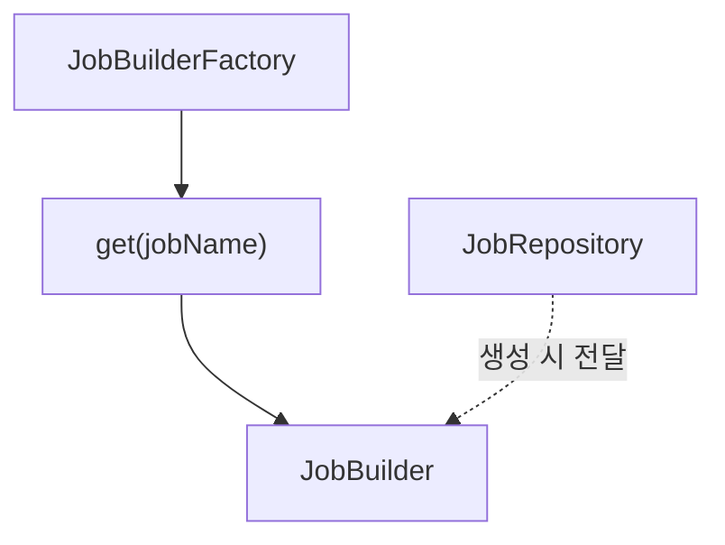

즉 JobBuilderFactory의 핵심 역할은 다음과 같다.

**Job 이름을 전달받아 JobRepository가 설정된 JobBuilder를 생성하는 것**이다.

하지만 Spring Batch 5.2에서는 이러한 방식이 변경되었다.

---

### Spring Batch 5에서는 JobBuilderFactory를 사용하지 않는다

Spring Batch 5에서는 JobBuilder와 StepBuilder를 생성하는 방식이 변경되었다.

Spring Batch 4에서는 JobBuilderFactory와 StepBuilderFactory를 주입받아 사용하는 방식이 일반적이었다.

그러나 Spring Batch 5부터 두 Factory의 사용이 권장되지 않게 되었고, Spring Batch 5.2에서는 제거되었다.

따라서 Spring Batch 5.2.4에서는 다음 코드를 사용하면 안 된다.

```java
jobBuilderFactory.get("batchJob");
```

대신 JobBuilder를 직접 생성한다.

```java
new JobBuilder("batchJob", jobRepository);
```

전체적인 변경 내용을 비교해보자.

| 구분               | Spring Batch 4            | Spring Batch 5.2   |
| ---------------- | ------------------------- | ------------------ |
| JobBuilder 생성    | JobBuilderFactory 사용      | JobBuilder 직접 생성   |
| 주요 API           | `jobBuilderFactory.get()` | `new JobBuilder()` |
| JobRepository 전달 | Factory 내부에서 처리           | 생성자에 직접 전달         |
| StepBuilder 생성   | StepBuilderFactory 사용     | StepBuilder 직접 생성  |
| 권장 방식            | Factory 기반                | 직접 Builder 생성      |

#### Spring Batch 4 방식

```java
return jobBuilderFactory
        .get("batchJob")
        .start(step1)
        .next(step2)
        .build();
```

#### Spring Batch 5.2 방식

```java
return new JobBuilder("batchJob", jobRepository)
        .start(step1)
        .next(step2)
        .build();
```

두 코드의 최종 목적은 동일하다.

Job을 생성한다는 것이다.

다만 Builder를 생성하는 과정이 달라졌다.

Spring Batch 5에서는 JobRepository를 직접 전달하는 방식으로 변경되었기 때문에 의존성이 더 명시적으로 드러난다.

이후 내용에서는 Spring Batch 5.2.4의 직접 Builder 생성 방식을 기준으로 살펴보자.

---

### JobBuilder의 내부 구조

JobBuilder는 다음 클래스를 상속한다.

```java
public class JobBuilder
        extends JobBuilderHelper<JobBuilder> {
}
```

여기서 중요한 클래스가 `JobBuilderHelper`다.

JobBuilderHelper는 Job을 생성하는 여러 Builder에서 공통적으로 사용하는 설정과 기능을 제공한다.

그리고 JobBuilder 자체는 `start()`나 `flow()`와 같은 메서드를 이용해 구체적인 Builder를 생성한다.

구조를 표현하면 다음과 같다.

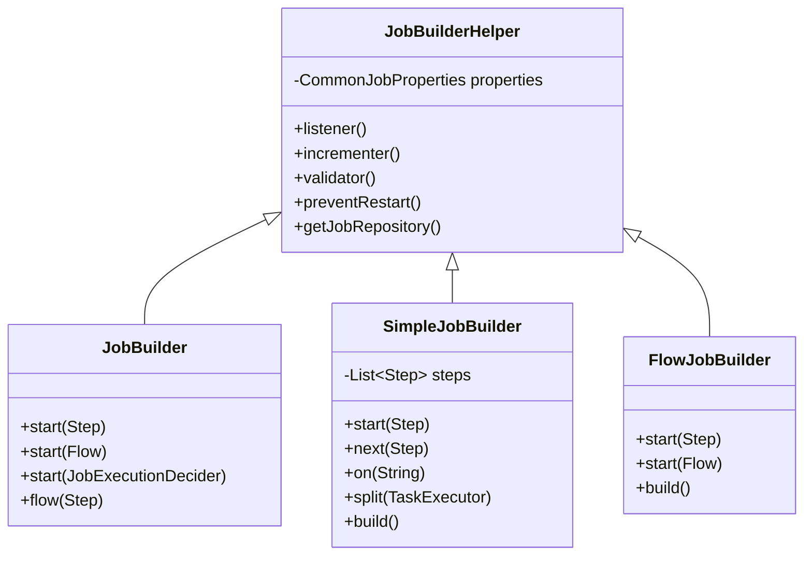

여기서 중요한 점은 JobBuilder, SimpleJobBuilder, FlowJobBuilder가 모두 JobBuilderHelper를 상속한다는 것이다.

각 Builder는 공통적인 Job 설정 기능을 상속받는다.

그리고 자신이 담당하는 Job의 종류에 따라 별도의 API를 제공한다.

---

### JobBuilderHelper의 역할

JobBuilderHelper는 Job 생성에 필요한 공통 속성을 관리하는 클래스다.

예를 들어 Job을 구성할 때 다음과 같은 설정이 필요할 수 있다.

* Job 이름
* JobRepository
* JobParametersValidator
* JobParametersIncrementer
* JobExecutionListener
* 재시작 허용 여부

SimpleJob이든 FlowJob이든 이러한 속성이 필요할 수 있다.

따라서 공통 설정을 각 Builder에 중복해서 구현하기보다는 상위 클래스에서 관리한다.

그 역할을 담당하는 것이 JobBuilderHelper다.

#### CommonJobProperties

JobBuilderHelper에는 `CommonJobProperties`라는 내부 클래스가 있다.

이 클래스는 Job을 생성할 때 필요한 공통 속성을 관리한다.

개념적으로 다음과 같은 구조다.

```text
JobBuilderHelper
       │
       └── CommonJobProperties
                │
                ├── name
                ├── jobRepository
                ├── restartable
                ├── jobParametersValidator
                ├── jobParametersIncrementer
                └── listeners
```

Builder는 이러한 공통 정보를 기반으로 실제 Job을 구성한다.

예를 들어 다음 코드를 살펴보자.

```java
new JobBuilder("batchJob", jobRepository)
        .preventRestart()
        .start(step1)
        .build();
```

여기서 `preventRestart()`는 Job의 재시작을 허용하지 않도록 설정하는 메서드다.

이 기능은 SimpleJob에서만 필요한 것이 아니다.

FlowJob에서도 사용할 수 있다.

따라서 JobBuilderHelper에서 공통 설정 기능을 제공하는 것이 자연스럽다.

---

### JobBuilderHelper의 공통 설정 API

대표적인 공통 설정 API는 다음과 같다.

| API                  | 설명                      |
| -------------------- | ----------------------- |
| `listener()`         | JobExecutionListener 등록 |
| `validator()`        | JobParameters 검증기 등록    |
| `incrementer()`      | JobParameters 증가 정책 설정  |
| `preventRestart()`   | Job 재시작 비활성화            |
| `repository()`       | JobRepository 설정        |
| `getName()`          | Job 이름 조회               |
| `getJobRepository()` | JobRepository 조회        |

이러한 메서드는 Builder에서 공통적으로 사용할 수 있다.

#### listener()

JobExecutionListener를 등록한다.

```java
new JobBuilder("batchJob", jobRepository)
        .listener(jobExecutionListener)
        .start(step1)
        .build();
```

JobExecutionListener는 Job 실행 전후에 필요한 공통 처리를 수행할 수 있다.

예를 들어 다음과 같은 작업이 가능하다.

```text
Job 실행 전
    │
    └── 실행 정보 기록

Job 실행
    │
    ▼
Job 실행 후
    │
    └── 최종 상태 확인
```

#### validator()

JobParametersValidator를 등록한다.

```java
new JobBuilder("batchJob", jobRepository)
        .validator(jobParametersValidator)
        .start(step1)
        .build();
```

이 설정은 Job 실행 시 전달된 JobParameters가 유효한지 검증하는 데 활용된다.

예를 들어 정산 기준일이 필수라면 JobParametersValidator를 이용해 해당 값의 존재 여부를 확인할 수 있다.

#### preventRestart()

Job의 재시작을 비활성화한다.

```java
new JobBuilder("batchJob", jobRepository)
        .preventRestart()
        .start(step1)
        .build();
```

이 설정을 사용하면 이전 실행이 실패하더라도 동일한 JobInstance의 재시작이 제한된다.

다만 새로운 식별용 JobParameters를 이용한 별도의 JobInstance 실행까지 금지하는 설정은 아니다.

#### incrementer()

JobParametersIncrementer를 설정한다.

```java
new JobBuilder("batchJob", jobRepository)
        .incrementer(new RunIdIncrementer())
        .start(step1)
        .build();
```

RunIdIncrementer는 실행 파라미터를 증가시키는 데 사용할 수 있다.

다만 Incrementer를 등록했다고 해서 `JobLauncher.run()`을 직접 호출할 때마다 자동으로 새로운 파라미터가 생성되는 것은 아니다.

JobOperator의 `startNextInstance()`처럼 Incrementer를 활용하는 실행 경로와 연결되어야 한다.

---

### JobBuilder는 어떤 Job을 생성할까?

Spring Batch에는 대표적으로 두 종류의 Job 구현체가 있다.

첫 번째는 `SimpleJob`이다.

두 번째는 `FlowJob`이다.

두 Job은 모두 Spring Batch의 Job 인터페이스를 구현하지만 내부 실행 구조가 다르다.

#### SimpleJob

SimpleJob은 등록된 Step을 순차적으로 실행하는 Job이다.

```text
SimpleJob
    │
    ├── Step 1
    │
    ├── Step 2
    │
    └── Step 3
```

일반적으로 이전 Step이 정상적으로 완료되면 다음 Step으로 이동한다.

따라서 단순한 순차 처리에 적합하다.

#### FlowJob

FlowJob은 Flow를 기반으로 실행 흐름을 관리하는 Job이다.

```text
FlowJob
   │
   ▼
Flow
   │
   ├── Step 1
   │
   ├── Step 2
   │
   └── Step 3
```

Flow에서는 Step의 종료 결과에 따라 실행 경로를 다르게 구성할 수 있다.

또한 여러 Flow를 연결하거나 병렬 실행 구조를 구성할 수도 있다.

단, FlowJob이라고 해서 반드시 조건 분기가 존재해야 하는 것은 아니다.

Flow 내부의 Step을 단순히 순차적으로 실행하도록 구성할 수도 있다.

두 Job의 차이를 정리하면 다음과 같다.

| 구분         | SimpleJob          | FlowJob        |
| ---------- | ------------------ | -------------- |
| 실행 구조      | Step 목록 기반         | Flow 기반        |
| 기본 실행 흐름   | 순차 실행              | 상태 전이 기반       |
| 조건부 분기     | 직접적인 순차 구조만으로는 제한적 | 지원             |
| 여러 Flow 연결 | 직접적인 구조에는 없음       | 지원             |
| 대표 Builder | SimpleJobBuilder   | FlowJobBuilder |
| 내부 주요 데이터  | `List<Step>`       | `Flow`         |

이 차이는 JobBuilder에서 어떤 API를 호출하는지에 따라 결정된다.

---

### JobBuilder의 세 가지 주요 생성 경로

JobBuilder는 `start()`와 `flow()` 메서드를 제공한다.

이때 전달하는 매개변수의 타입에 따라 생성되는 Builder가 달라진다.

대표적으로 세 가지 경로를 살펴볼 수 있다.

| API           | 반환 Builder       | 최종 Job    |
| ------------- | ---------------- | --------- |
| `start(Step)` | SimpleJobBuilder | SimpleJob |
| `start(Flow)` | JobFlowBuilder   | FlowJob   |
| `flow(Step)`  | JobFlowBuilder   | FlowJob   |

여기서 주의할 부분이 있다.

`start(Flow)`와 `flow(Step)`은 실제로 `JobFlowBuilder`를 반환한다.

하지만 내부적으로는 먼저 `FlowJobBuilder`가 생성된다.

따라서 다음과 같이 이해하는 것이 정확하다.

```text
JobBuilder
    │
    ├── start(Step)
    │       │
    │       ▼
    │   SimpleJobBuilder
    │       │
    │       ▼
    │     SimpleJob
    │
    ├── start(Flow)
    │       │
    │       ▼
    │   FlowJobBuilder
    │       │
    │       ▼
    │   JobFlowBuilder
    │       │
    │       ▼
    │     FlowJob
    │
    └── flow(Step)
            │
            ▼
        FlowJobBuilder
            │
            ▼
        JobFlowBuilder
            │
            ▼
          FlowJob
```

이러한 구조를 이해하면 Job 설정 코드에서 어떤 Builder가 생성되고 있는지 알 수 있다.

---

### 첫 번째 경로: start(Step)

가장 기본적인 Job 생성 방식이다.

다음 코드를 살펴보자.

```java
new JobBuilder("simpleBatchJob", jobRepository)
        .start(step1)
        .next(step2)
        .build();
```

여기서 `start()`의 매개변수는 Step이다.

따라서 다음 메서드가 호출된다.

```java
public SimpleJobBuilder start(Step step) {

    return new SimpleJobBuilder(this)
            .start(step);
}
```

이 메서드에서 중요한 부분은 다음과 같다.

```java
new SimpleJobBuilder(this)
```

JobBuilder가 SimpleJobBuilder를 생성한다.

그리고 생성한 Builder에 Step을 전달한다.

따라서 다음과 같은 흐름이 발생한다.

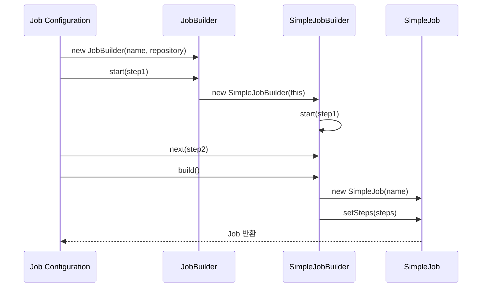

JobBuilder가 직접 SimpleJob을 생성하는 것이 아니다.

실제 SimpleJob 생성은 SimpleJobBuilder가 담당한다.

---

### SimpleJobBuilder의 내부 구조

SimpleJobBuilder는 SimpleJob을 생성하는 Builder다.

중요한 속성 중 하나는 다음과 같다.

```java
private final List<Step> steps =
        new ArrayList<>();
```

이 List는 Job에 등록할 Step들을 관리한다.

예를 들어 다음 코드를 살펴보자.

```java
new JobBuilder("simpleBatchJob", jobRepository)
        .start(step1)
        .next(step2)
        .next(step3)
        .build();
```

각 API를 호출하면서 Step이 List에 추가된다.

```text
steps
   │
   ├── step1
   ├── step2
   └── step3
```

마지막에 build()를 호출하면 이 List가 SimpleJob에 전달된다.

#### start()의 동작

SimpleJobBuilder의 `start()`는 첫 번째 Step을 설정한다.

핵심 구조는 다음과 같다.

```java
public SimpleJobBuilder start(Step step) {

    if (steps.isEmpty()) {

        steps.add(step);

    } else {

        steps.set(0, step);
    }

    return this;
}
```

여기서 중요한 점은 Step 목록의 첫 번째 위치를 관리한다는 것이다.

처음 호출하는 경우에는 Step을 추가한다.

이미 Step이 존재하면 첫 번째 Step을 변경할 수 있다.

따라서 일반적인 Job 구성에서는 start()를 한 번 호출한 뒤 next()로 후속 Step을 연결한다.

#### next()의 동작

다음 메서드는 새로운 Step을 List에 추가한다.

```java
public SimpleJobBuilder next(Step step) {

    steps.add(step);

    return this;
}
```

이 메서드는 상대적으로 단순하다.

새로운 Step을 추가하고 현재 Builder를 반환한다.

따라서 다음과 같은 코드가 가능하다.

```java
.start(step1)
.next(step2)
.next(step3)
```

각 Step이 List에 추가된다.

```text
Step List

Index 0 → step1

Index 1 → step2

Index 2 → step3
```

이 순서가 SimpleJob의 기본 실행 순서가 된다.

---

### SimpleJobBuilder의 build()는 무엇을 할까?

SimpleJobBuilder의 `build()`는 최종적으로 Job 객체를 생성한다.

기본적인 순차 실행 구조에서는 SimpleJob을 생성한다.

핵심 로직을 단순화하면 다음과 같다.

```java
public Job build() {

    SimpleJob job =
            new SimpleJob(getName());

    super.enhance(job);

    job.setSteps(steps);

    job.afterPropertiesSet();

    return job;
}
```

실제 구현에는 예외 처리와 Flow 전환 여부 확인 등의 로직이 추가되어 있다.

이 코드에서 중요한 부분은 세 군데다.

#### SimpleJob 생성

```java
SimpleJob job =
        new SimpleJob(getName());
```

Builder에 저장된 Job 이름을 이용해 SimpleJob을 생성한다.

#### 공통 속성 적용

```java
super.enhance(job);
```

JobBuilderHelper에 저장된 공통 설정을 Job에 반영한다.

예를 들어 JobRepository, Listener, 재시작 설정 등이 여기에 포함된다.

#### Step 목록 적용

```java
job.setSteps(steps);
```

SimpleJobBuilder가 관리하던 Step List를 SimpleJob에 전달한다.

결과적으로 다음과 같은 Job이 만들어진다.

```text
SimpleJob
    │
    ├── name = simpleBatchJob
    │
    ├── jobRepository
    │
    └── steps
           │
           ├── step1
           ├── step2
           └── step3
```

이것이 SimpleJobBuilder의 핵심 역할이다.

**SimpleJobBuilder는 Step 목록을 구성하고, 공통 설정과 함께 SimpleJob 객체를 생성한다.**

---

### 두 번째 경로: start(Flow)

이번에는 Flow를 전달하는 경우를 살펴보자.

먼저 Flow가 무엇인지 간단히 이해할 필요가 있다.

Flow는 여러 Step의 실행 흐름을 하나의 단위로 구성하는 객체다.

예를 들어 다음과 같다.

```text
settlementFlow
       │
       ├── step3
       │
       └── step4
```

이 Flow를 Job에 포함시키면 다음과 같은 구조를 만들 수 있다.

```text
flowBatchJob
       │
       ▼
settlementFlow
       │
       ├── step3
       │
       └── step4
       │
       ▼
step5
```

이 경우 다음과 같이 Job을 생성할 수 있다.

```java
new JobBuilder("flowBatchJob", jobRepository)
        .start(settlementFlow)
        .next(step5)
        .end()
        .build();
```

여기서 `start()`의 매개변수는 Step이 아니라 Flow다.

따라서 호출되는 메서드가 달라진다.

```java
public JobFlowBuilder start(Flow flow) {

    return new FlowJobBuilder(this)
            .start(flow);
}
```

이번에는 SimpleJobBuilder를 생성하지 않는다.

대신 FlowJobBuilder를 생성한다.

그리고 Flow를 전달한다.

---

### FlowJobBuilder의 역할

FlowJobBuilder는 FlowJob을 생성하는 Builder다.

SimpleJobBuilder가 Step List를 이용해 SimpleJob을 생성한다면, FlowJobBuilder는 Flow를 이용해 FlowJob을 생성한다.

두 Builder의 차이를 비교해보자.

| 구분        | SimpleJobBuilder | FlowJobBuilder  |
| --------- | ---------------- | --------------- |
| 최종 생성 객체  | SimpleJob        | FlowJob         |
| 실행 구조     | Step List        | Flow            |
| 주요 데이터    | 등록된 Step 목록      | 실행 흐름을 정의한 Flow |
| 대표 사용     | 단순 순차 실행         | Flow 기반 실행      |
| 최종 생성 메서드 | build()          | build()         |

하지만 FlowJobBuilder를 사용할 때는 한 가지 더 알아야 한다.

바로 `JobFlowBuilder`라는 클래스다.

이름이 비슷해 혼동하기 쉽지만 두 클래스의 역할은 다르다.

---

### FlowJobBuilder와 JobFlowBuilder의 차이

두 클래스는 이름이 매우 비슷하다.

```text
FlowJobBuilder

JobFlowBuilder
```

하지만 담당하는 역할은 다르다.

**FlowJobBuilder는 FlowJob을 생성하는 Builder다.**

반면 **JobFlowBuilder는 Job 내부에서 사용할 Flow를 구성하는 Builder다.**

JobFlowBuilder는 다음 클래스를 상속한다.

```java
public class JobFlowBuilder
        extends FlowBuilder<FlowJobBuilder> {
}
```

즉 JobFlowBuilder는 FlowBuilder 계열의 클래스다.

이 클래스는 `start()`, `next()`, `from()`, `on()` 등을 이용해 실행 흐름을 구성한다.

그리고 생성한 Flow를 부모 FlowJobBuilder에 전달한다.

전체적인 관계는 다음과 같다.

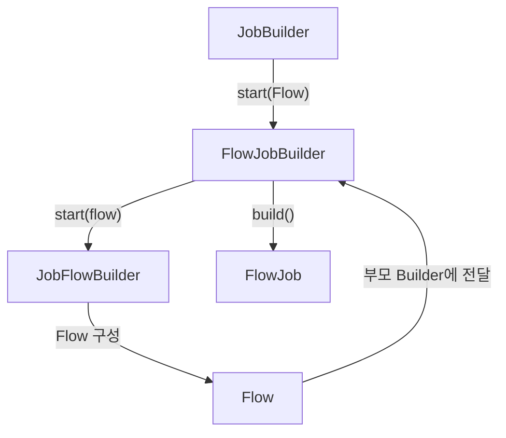

여기서 다음 관계를 기억하면 된다.

```text
JobFlowBuilder
      │
      └── Flow 구성
```

```text
FlowJobBuilder
      │
      └── FlowJob 생성
```

결국 JobFlowBuilder가 Flow 실행 구조를 완성하고, FlowJobBuilder가 이를 이용해 최종 Job을 생성한다.

---

### JobFlowBuilder의 build()와 FlowJobBuilder의 build()는 다르다

FlowJob을 구성할 때 다음과 같은 코드를 자주 사용한다.

```java
new JobBuilder("flowBatchJob", jobRepository)
        .start(settlementFlow)
        .next(step5)
        .end()
        .build();
```

여기서 `end()`와 `build()`를 구분해야 한다.

JobFlowBuilder는 FlowBuilder를 상속한다.

따라서 `end()` 메서드를 사용할 수 있다.

이 메서드는 내부적으로 Flow 구성 과정을 완료한다.

JobFlowBuilder의 `build()`는 최종 Job을 바로 반환하지 않는다.

대신 Flow를 구성한 뒤 부모 FlowJobBuilder를 반환한다.

핵심 동작은 다음과 같다.

```java
@Override
public FlowJobBuilder build() {

    Flow flow = flow();

    parent.flow(flow);

    return parent;
}
```

이 코드에서 중요한 부분은 다음과 같다.

```java
parent.flow(flow);
```

생성된 Flow를 부모 FlowJobBuilder에 전달한다.

그리고 부모 Builder를 반환한다.

따라서 다음 과정이 발생한다.

```text
JobFlowBuilder
       │
       ▼
end()
       │
       ▼
Flow 구성 완료
       │
       ▼
FlowJobBuilder 반환
       │
       ▼
build()
       │
       ▼
FlowJob 생성
```

즉 다음 코드의 두 메서드는 서로 다른 단계다.

```java
.end()
.build();
```

`end()`는 Flow 구성 단계를 마무리한다.

이후 `build()`는 최종 FlowJob을 생성한다.

이 차이를 이해하면 FlowJob 생성 과정이 훨씬 명확해진다.

---

### 세 번째 경로: flow(Step)

JobBuilder는 `flow()` 메서드도 제공한다.

예를 들어 다음과 같다.

```java
new JobBuilder("stepFlowJob", jobRepository)
        .flow(step1)
        .next(step2)
        .end()
        .build();
```

여기서 특이한 점은 시작 객체가 Flow가 아니라 Step이라는 사실이다.

`flow()`에 Step을 전달하면 JobBuilder는 Flow 기반 Job을 구성하도록 Builder를 생성한다.

Spring Batch 5.2.4의 핵심 구현은 다음과 같다.

```java
public JobFlowBuilder flow(Step step) {

    return new FlowJobBuilder(this)
            .start(step);
}
```

이 메서드 역시 FlowJobBuilder를 생성한다.

따라서 최종적으로 FlowJob이 만들어진다.

#### start(Step)과 flow(Step)의 차이

두 메서드는 동일하게 Step을 전달받는다.

하지만 생성되는 Job의 종류가 다르다.

| 구분         | start(Step)      | flow(Step)                      |
| ---------- | ---------------- | ------------------------------- |
| 전달 객체      | Step             | Step                            |
| 생성 Builder | SimpleJobBuilder | FlowJobBuilder 및 JobFlowBuilder |
| 기본 생성 Job  | SimpleJob        | FlowJob                         |
| 실행 구조      | Step List        | Flow                            |
| 조건부 전이 확장  | 별도의 Flow 전환 필요   | Flow API 사용 가능                  |

예를 들어 다음 코드는 SimpleJob을 생성한다.

```java
new JobBuilder("job1", jobRepository)
        .start(step1)
        .next(step2)
        .build();
```

반면 다음 코드는 FlowJob을 생성한다.

```java
new JobBuilder("job2", jobRepository)
        .flow(step1)
        .next(step2)
        .end()
        .build();
```

두 Job이 단순히 Step 1과 Step 2를 순서대로 실행하도록 구성되어 있다면 실행 결과는 비슷할 수 있다.

하지만 내부 구현체는 다르다.

이러한 차이를 이해하면 JobBuilder가 어떤 기준으로 Job의 종류를 결정하는지 알 수 있다.

---

### JobBuilder가 생성하는 Builder의 전체 구조

지금까지 살펴본 세 가지 경로를 하나로 정리해보자.

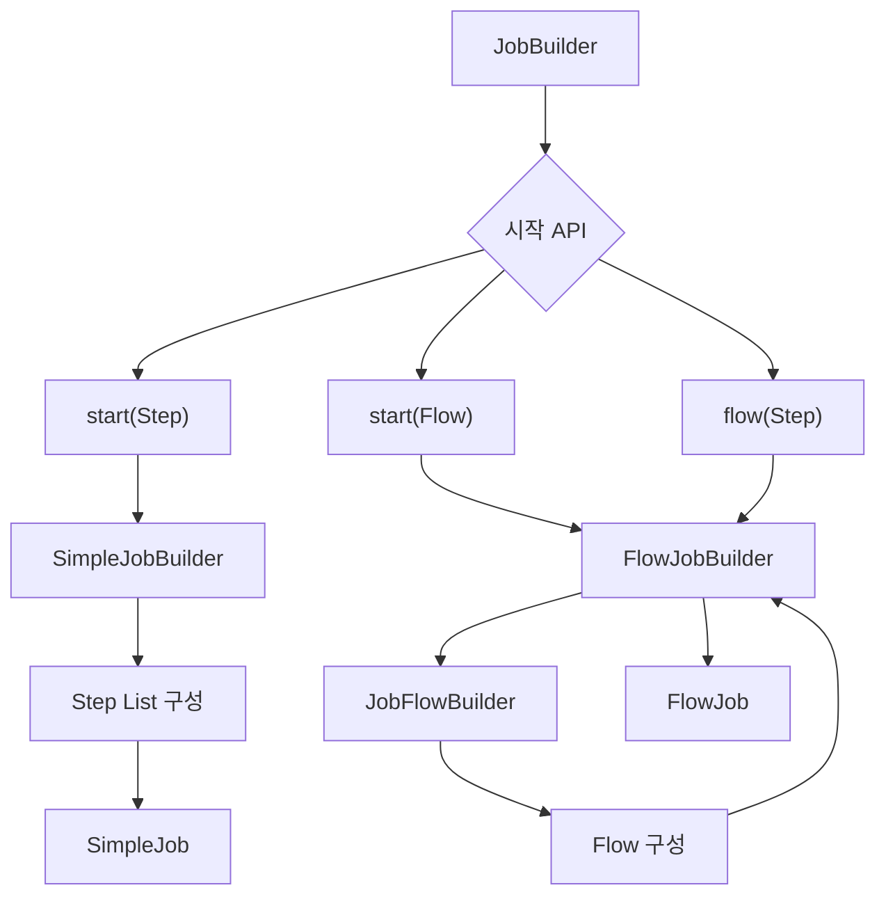

핵심은 시작 API의 반환 타입이다.

```java
JobBuilder.start(Step)
```

이 메서드는 SimpleJobBuilder를 반환한다.

```java
JobBuilder.start(Flow)
```

이 메서드는 JobFlowBuilder를 반환한다.

```java
JobBuilder.flow(Step)
```

이 메서드도 JobFlowBuilder를 반환한다.

따라서 같은 JobBuilder에서 시작하더라도 이후에 사용할 수 있는 API와 최종 Job 구현체가 달라질 수 있다.

---

### SimpleJobBuilder와 FlowBuilder의 주요 API 비교

Spring Batch는 Job의 실행 흐름을 구성하기 위해 여러 API를 제공한다.

그중 대표적인 API는 다음과 같다.

| API     | 역할                              |
| ------- | ------------------------------- |
| start() | 시작 Step 또는 Flow 지정              |
| next()  | 정상 완료 시 다음 단계 연결                |
| on()    | 종료 코드에 따른 전이 조건 설정              |
| from()  | 기존 Step 또는 Flow를 기준으로 새로운 분기 정의 |
| split() | 여러 Flow를 병렬로 실행하는 구조 구성         |
| end()   | Flow 구성 마무리                     |
| build() | 최종 객체 생성                        |

여기서 중요한 점은 **모든 API가 동일한 Builder에서 동일한 반환 타입으로 제공되는 것은 아니라는 사실**이다.

예를 들어 SimpleJobBuilder의 `next(Step)`은 SimpleJobBuilder를 반환한다.

반면 JobFlowBuilder 계열의 `next(Step)`은 Flow 구성 기능을 제공한다.

또한 `on()`을 호출하면 조건부 전이를 구성하기 위한 TransitionBuilder로 이동할 수 있다.

따라서 단순히 메서드 이름만 외우는 것보다 각 메서드가 어떤 Builder를 반환하는지 이해하는 것이 중요하다.

---

### start()와 next()

가장 기본적인 API는 start()와 next()다.

다음 코드를 살펴보자.

```java
new JobBuilder("batchJob", jobRepository)
        .start(step1)
        .next(step2)
        .next(step3)
        .build();
```

첫 번째 Step은 step1이다.

step1이 정상적으로 완료되면 step2로 이동한다.

step2가 정상적으로 완료되면 step3으로 이동한다.


이 구조는 순차 실행을 나타낸다.

하지만 다음과 같은 요구사항이 있다고 생각해보자.

```text
Step 1 실행
      │
      ├── 성공 → Step 2 실행
      │
      └── 실패 → Step 3 실행
```

이 경우 단순한 next()만으로는 충분하지 않다.

종료 상태에 따라 실행 경로를 변경해야 하기 때문이다.

이때 Flow 관련 API를 사용할 수 있다.

---

### on()과 from()

Flow 기반 Job에서는 `on()`과 `from()`을 이용해 조건부 실행 흐름을 구성할 수 있다.

예를 들어 다음과 같다.

```java
@Bean
public Job conditionalJob(
        JobRepository jobRepository,
        Step step1,
        Step step2,
        Step step3
) {
    return new JobBuilder(
            "conditionalJob",
            jobRepository
    )
            .start(step1)
                .on("COMPLETED").to(step2)
            .from(step1)
                .on("FAILED").to(step3)
            .end()
            .build();
}
```

이 코드는 Step 1의 종료 코드에 따라 실행 경로를 변경한다.

Step 1이 정상적으로 완료되면 Step 2를 실행한다.

반면 Step 1의 종료 코드가 FAILED라면 Step 3으로 이동한다.

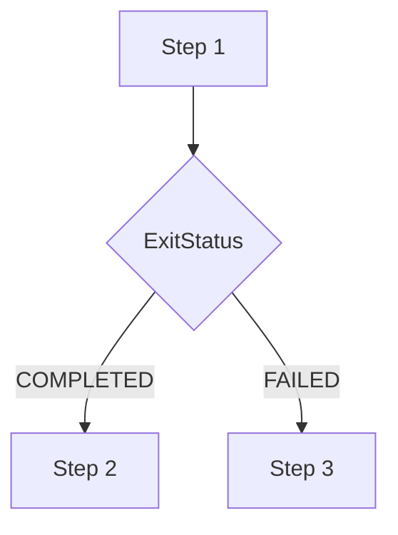

여기서 중요한 점은 처음에 다음 API를 사용했다는 사실이다.

```java
.start(step1)
```

이 메서드는 처음에는 SimpleJobBuilder를 생성한다.

하지만 이후 `on()`을 호출하면서 내부적으로 Flow 기반 Builder가 구성된다.

따라서 **start(Step)을 호출했다고 해서 반드시 최종적으로 SimpleJob이 생성된다고 단정해서는 안 된다.**

단순한 순차 Step 구성에서는 SimpleJob이 생성된다.

하지만 조건부 전이를 추가하면 FlowJob으로 전환될 수 있다.

이것이 JobBuilder의 내부 구조를 이해해야 하는 중요한 이유다.

---

### Flow와 Step의 관계

Flow는 여러 Step을 묶어 하나의 실행 흐름으로 구성할 수 있다.

예를 들어 다음과 같은 정산 처리 과정이 있다고 생각해보자.

```text
정산 데이터 생성
       │
       ▼
정산 결과 검증
       │
       ▼
정산 완료 처리
```

이 중 첫 번째와 두 번째 작업을 하나의 Flow로 구성할 수 있다.

```text
settlementFlow
       │
       ├── 정산 데이터 생성
       │
       └── 정산 결과 검증
```

그리고 Job에서는 해당 Flow를 실행한 뒤 정산 완료 처리를 수행하도록 구성할 수 있다.

```text
settlementJob
       │
       ▼
settlementFlow
       │
       ├── Step 1
       │
       └── Step 2
       │
       ▼
Step 3
```

이러한 구조의 장점은 실행 흐름을 별도의 객체로 분리할 수 있다는 것이다.

따라서 여러 Step으로 구성된 공통 처리 흐름을 재사용하기 쉬워진다.

---

### FlowBuilder를 이용해 Flow 생성하기

Spring Batch는 Flow를 생성하기 위해 `FlowBuilder`를 제공한다.

대표적인 사용 방법은 다음과 같다.

```java
@Bean
public Flow settlementFlow(
        Step step3,
        Step step4
) {
    return new FlowBuilder<SimpleFlow>(
            "settlementFlow"
    )
            .start(step3)
            .next(step4)
            .build();
}
```

이 코드에서는 두 개의 Step을 하나의 Flow로 구성한다.

```text
settlementFlow
       │
       ├── step3
       │
       └── step4
```

이후 JobBuilder에서 해당 Flow를 사용할 수 있다.

```java
@Bean
public Job flowBatchJob(
        JobRepository jobRepository,
        Flow settlementFlow,
        Step step5
) {
    return new JobBuilder(
            "flowBatchJob",
            jobRepository
    )
            .start(settlementFlow)
            .next(step5)
            .end()
            .build();
}
```

전체 실행 흐름은 다음과 같다.

```text
flowBatchJob
       │
       ▼
settlementFlow
       │
       ├── step3
       │
       ▼
       step4
       │
       ▼
      step5
```

여기서 FlowBuilder는 Flow를 생성한다.

JobBuilder는 해당 Flow를 이용해 Job을 생성한다.

두 Builder는 서로 다른 역할을 담당한다.

---

### FlowBuilder와 JobFlowBuilder의 차이

이번에는 이름이 비슷한 Builder들을 다시 정리해보자.

| 클래스              | 역할                    | 생성 결과              |
| ---------------- | --------------------- | ------------------ |
| FlowBuilder      | 독립적인 Flow 생성          | Flow               |
| JobFlowBuilder   | Job 내부의 Flow 실행 구조 구성 | FlowJobBuilder로 연결 |
| FlowJobBuilder   | Flow 기반 Job 생성        | FlowJob            |
| SimpleJobBuilder | Step 목록 기반 Job 생성     | SimpleJob          |

예를 들어 다음 코드는 독립적인 Flow를 생성한다.

```java
new FlowBuilder<SimpleFlow>("myFlow")
        .start(step1)
        .next(step2)
        .build();
```

반면 다음 코드는 FlowJob을 생성한다.

```java
new JobBuilder("myJob", jobRepository)
        .start(myFlow)
        .next(step3)
        .end()
        .build();
```

두 코드는 서로 연결되어 있지만 역할은 다르다.

**FlowBuilder는 Flow 자체를 만들고, FlowJobBuilder는 만들어진 Flow를 이용해 Job을 생성한다.**

---

### JobBuilderHelper의 상속 구조

이제 전체 클래스 구조를 정리해보자.

Spring Batch 5.2.4에서 주요 Builder의 상속 관계는 다음과 같다.

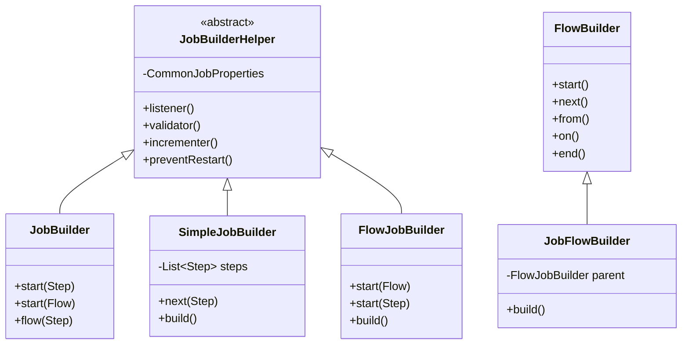

여기서 주목해야 할 부분이 있다.

JobFlowBuilder는 JobBuilderHelper를 상속하지 않는다.

대신 FlowBuilder를 상속한다.

그리고 부모 FlowJobBuilder를 참조한다.

이러한 구조는 역할 분리 측면에서 자연스럽다.

Job의 공통 설정은 JobBuilderHelper 계열에서 관리한다.

반면 Flow의 상태 전이와 실행 흐름은 FlowBuilder 계열에서 관리한다.

결국 서로 다른 책임을 가진 Builder들이 협력해 하나의 FlowJob을 생성하는 것이다.

---

### JobRepository는 Builder에 왜 전달할까?

Spring Batch 5.2에서는 JobBuilder 생성 시 JobRepository를 전달한다.

```java
new JobBuilder(
        "batchJob",
        jobRepository
);
```

왜 JobRepository가 필요할까?

앞에서 살펴본 것처럼 JobRepository는 JobInstance, JobExecution, StepExecution 등의 실행 메타데이터를 관리한다.

따라서 Job은 실행 과정에서 JobRepository에 접근해야 한다.

예를 들어 Job이 실행되면 다음과 같은 정보가 생성되거나 갱신된다.

```text
JobInstance

JobExecution

StepExecution

ExecutionContext
```

JobBuilder는 Job 생성 과정에서 이러한 실행 메타데이터를 관리할 수 있도록 JobRepository를 최종 Job에 전달한다.

전체 구조는 다음과 같다.

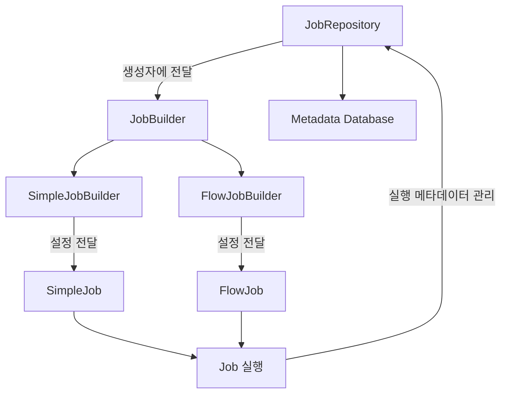

여기서 중요한 사실이 있다.

**JobBuilder에 JobRepository를 전달하는 것과 실제 데이터베이스에 JobExecution이 저장되는 것은 서로 다른 과정이다.**

JobBuilder를 생성했다고 해서 JobInstance나 JobExecution이 즉시 데이터베이스에 저장되는 것은 아니다.

Builder는 Job 객체를 구성한다.

이후 JobLauncher가 실제 Job 실행을 시작하면서 실행 메타데이터가 생성된다.

이 차이를 정확하게 구분해야 한다.

---

### Job 생성 시점과 Job 실행 시점의 차이

다음 코드를 살펴보자.

```java
@Bean
public Job batchJob(
        JobRepository jobRepository,
        Step step1
) {
    return new JobBuilder("batchJob", jobRepository)
            .start(step1)
            .build();
}
```

Spring Boot가 시작되면 이 Bean 메서드를 호출해 Job 객체를 생성한다.

이때 다음 작업이 수행된다.

```text
JobBuilder 생성
       │
       ▼
SimpleJobBuilder 생성
       │
       ▼
Step 등록
       │
       ▼
SimpleJob 생성
       │
       ▼
Spring Bean 등록
```

하지만 이 시점에는 실제 Job이 실행된 것이 아니다.

실제 실행은 다음 과정에서 이루어진다.

```text
JobLauncher.run()
       │
       ▼
JobRepository.createJobExecution()
       │
       ▼
JobExecution 생성
       │
       ▼
Job.execute()
       │
       ▼
Step 실행
```

따라서 다음 두 과정을 구분해야 한다.

| 구분              | Job 생성                | Job 실행        |
| --------------- | --------------------- | ------------- |
| 주요 주체           | JobBuilder            | JobLauncher   |
| 발생 시점           | 일반적으로 Spring Bean 초기화 | 실행 요청 시점      |
| 주요 목적           | Job 실행 구조 정의          | 실제 비즈니스 작업 수행 |
| Step 처리         | Step 객체 등록            | Step 실제 실행    |
| JobExecution 생성 | 생성하지 않음               | 생성            |
| 메타데이터 기록        | 실행 이력 기록 없음           | 실행 이력 생성 및 갱신 |

이 구분은 특히 배치 초기화 과정과 실제 Job 실행 과정을 분석할 때 중요하다.

---

### 실제 SimpleJob과 FlowJob 생성하기

이제 실제 Spring Batch 프로젝트에서 Builder의 동작을 확인해보자.

이번에는 세 가지 Job을 생성한다.

```text
simpleBatchJob
       │
       ├── step1
       └── step2
```

```text
flowBatchJob
       │
       ▼
orderFlow
       │
       ├── step3
       └── step4
       │
       ▼
      step5
```

```text
stepBasedFlowJob
       │
       ├── step1
       └── step2
```

첫 번째 Job은 `start(Step)`으로 생성한다.

두 번째 Job은 `start(Flow)`로 생성한다.

세 번째 Job은 `flow(Step)`으로 생성한다.

세 가지 방식을 비교하면 어떤 API가 어떤 Job을 생성하는지 확인할 수 있다.

---

### Maven 의존성 설정

먼저 필요한 의존성을 추가한다.

`pom.xml`

```xml
<?xml version="1.0" encoding="UTF-8"?>
<project xmlns="http://maven.apache.org/POM/4.0.0"
         xmlns:xsi="http://www.w3.org/2001/XMLSchema-instance"
         xsi:schemaLocation="
             http://maven.apache.org/POM/4.0.0
             https://maven.apache.org/xsd/maven-4.0.0.xsd">

    <modelVersion>4.0.0</modelVersion>

    <parent>
        <groupId>org.springframework.boot</groupId>
        <artifactId>spring-boot-starter-parent</artifactId>
        <version>3.4.13</version>
        <relativePath/>
    </parent>

    <groupId>com.example</groupId>
    <artifactId>spring-batch-demo</artifactId>
    <version>0.0.1-SNAPSHOT</version>

    <properties>
        <java.version>17</java.version>
        <spring-batch.version>5.2.4</spring-batch.version>
    </properties>

    <dependencies>

        <dependency>
            <groupId>org.springframework.boot</groupId>
            <artifactId>spring-boot-starter-batch</artifactId>
        </dependency>

        <dependency>
            <groupId>com.h2database</groupId>
            <artifactId>h2</artifactId>
            <scope>runtime</scope>
        </dependency>

    </dependencies>

    <build>
        <plugins>

            <plugin>
                <groupId>org.springframework.boot</groupId>
                <artifactId>spring-boot-maven-plugin</artifactId>
            </plugin>

        </plugins>
    </build>

</project>
```

이번 예제에서는 H2 인메모리 데이터베이스를 사용한다.

따라서 별도의 MySQL 서버 없이도 실행할 수 있다.

---

### application.yml 설정

여러 Job을 등록할 예정이므로 실행할 Job을 지정할 수 있도록 설정한다.

`application.yml`

```yaml
spring:
  application:
    name: spring-batch-demo

  main:
    web-application-type: none

  datasource:
    url: jdbc:h2:mem:batchdb;DB_CLOSE_DELAY=-1
    driver-class-name: org.h2.Driver
    username: sa
    password:

  batch:
    job:
      enabled: true
      name: ${demo.job.name:simpleBatchJob}

    jdbc:
      initialize-schema: embedded

logging:
  level:
    org.springframework.batch: INFO
```

여기서 중요한 설정은 다음이다.

```yaml
spring:
  batch:
    job:
      name: ${demo.job.name:simpleBatchJob}
```

외부에서 Job 이름을 전달하지 않으면 `simpleBatchJob`을 실행한다.

반면 실행 시 다음 값을 전달하면

```text
--demo.job.name=flowBatchJob
```

`flowBatchJob`이 선택된다.

이렇게 하면 애플리케이션 코드를 변경하지 않고도 실행할 Job을 전환할 수 있다.

---

### JobBuilderConfiguration 전체 코드

다음과 같이 설정 클래스를 작성한다.

`JobBuilderConfiguration.java`

```java
package com.example.batch;

import org.slf4j.Logger;
import org.slf4j.LoggerFactory;

import org.springframework.batch.core.Job;
import org.springframework.batch.core.Step;

import org.springframework.batch.core.job.builder.JobBuilder;
import org.springframework.batch.core.job.builder.JobFlowBuilder;
import org.springframework.batch.core.job.builder.SimpleJobBuilder;

import org.springframework.batch.core.job.flow.Flow;
import org.springframework.batch.core.job.flow.support.SimpleFlow;

import org.springframework.batch.core.job.builder.FlowBuilder;

import org.springframework.batch.core.repository.JobRepository;
import org.springframework.batch.core.step.builder.StepBuilder;

import org.springframework.batch.repeat.RepeatStatus;

import org.springframework.beans.factory.annotation.Qualifier;
import org.springframework.context.annotation.Bean;
import org.springframework.context.annotation.Configuration;

import org.springframework.transaction.PlatformTransactionManager;

@Configuration
public class JobBuilderConfiguration {

    private static final Logger log =
            LoggerFactory.getLogger(
                    JobBuilderConfiguration.class
            );

    @Bean
    public Job simpleBatchJob(
            JobRepository jobRepository,
            @Qualifier("step1") Step step1,
            @Qualifier("step2") Step step2
    ) {
        JobBuilder jobBuilder =
                new JobBuilder(
                        "simpleBatchJob",
                        jobRepository
                );

        SimpleJobBuilder simpleJobBuilder =
                jobBuilder.start(step1);

        log.info(
                "Simple Builder Type: {}",
                simpleJobBuilder.getClass().getSimpleName()
        );

        Job job = simpleJobBuilder
                .next(step2)
                .build();

        log.info(
                "Created Job Type: {}",
                job.getClass().getSimpleName()
        );

        return job;
    }

    @Bean
    public Flow orderFlow(
            @Qualifier("step3") Step step3,
            @Qualifier("step4") Step step4
    ) {
        return new FlowBuilder<SimpleFlow>(
                "orderFlow"
        )
                .start(step3)
                .next(step4)
                .build();
    }

    @Bean
    public Job flowBatchJob(
            JobRepository jobRepository,
            @Qualifier("orderFlow") Flow orderFlow,
            @Qualifier("step5") Step step5
    ) {
        JobBuilder jobBuilder =
                new JobBuilder(
                        "flowBatchJob",
                        jobRepository
                );

        JobFlowBuilder jobFlowBuilder =
                jobBuilder.start(orderFlow);

        log.info(
                "Flow Builder Type: {}",
                jobFlowBuilder.getClass().getSimpleName()
        );

        Job job = jobFlowBuilder
                .next(step5)
                .end()
                .build();

        log.info(
                "Created Job Type: {}",
                job.getClass().getSimpleName()
        );

        return job;
    }

    @Bean
    public Job stepBasedFlowJob(
            JobRepository jobRepository,
            @Qualifier("step1") Step step1,
            @Qualifier("step2") Step step2
    ) {
        Job job = new JobBuilder(
                "stepBasedFlowJob",
                jobRepository
        )
                .flow(step1)
                .next(step2)
                .end()
                .build();

        log.info(
                "Created Job Type: {}",
                job.getClass().getSimpleName()
        );

        return job;
    }

    @Bean
    public Step step1(
            JobRepository jobRepository,
            PlatformTransactionManager transactionManager
    ) {
        return createStep(
                "step1",
                jobRepository,
                transactionManager
        );
    }

    @Bean
    public Step step2(
            JobRepository jobRepository,
            PlatformTransactionManager transactionManager
    ) {
        return createStep(
                "step2",
                jobRepository,
                transactionManager
        );
    }

    @Bean
    public Step step3(
            JobRepository jobRepository,
            PlatformTransactionManager transactionManager
    ) {
        return createStep(
                "step3",
                jobRepository,
                transactionManager
        );
    }

    @Bean
    public Step step4(
            JobRepository jobRepository,
            PlatformTransactionManager transactionManager
    ) {
        return createStep(
                "step4",
                jobRepository,
                transactionManager
        );
    }

    @Bean
    public Step step5(
            JobRepository jobRepository,
            PlatformTransactionManager transactionManager
    ) {
        return createStep(
                "step5",
                jobRepository,
                transactionManager
        );
    }

    private Step createStep(
            String stepName,
            JobRepository jobRepository,
            PlatformTransactionManager transactionManager
    ) {
        return new StepBuilder(
                stepName,
                jobRepository
        )
                .tasklet((contribution, chunkContext) -> {

                    log.info(
                            "Step 실행: {}",
                            stepName
                    );

                    return RepeatStatus.FINISHED;

                }, transactionManager)
                .build();
    }
}
```

이 코드에서는 세 가지 Job 생성 방식을 모두 확인할 수 있다.

다만 같은 Step Bean을 서로 다른 Job에서 사용하더라도 각 Job의 실행 이력은 별도의 JobInstance와 JobExecution으로 관리된다.

---

### 첫 번째 Job: SimpleJob 생성 과정

먼저 simpleBatchJob을 살펴보자.

핵심 코드는 다음과 같다.

```java
JobBuilder jobBuilder =
        new JobBuilder(
                "simpleBatchJob",
                jobRepository
        );

SimpleJobBuilder simpleJobBuilder =
        jobBuilder.start(step1);
```

여기서 JobBuilder를 직접 생성했다.

그리고 start()에 Step 객체를 전달했다.

따라서 반환 타입은 SimpleJobBuilder다.

다음 코드를 이용해 실제 클래스 이름을 확인한다.

```java
log.info(
        "Simple Builder Type: {}",
        simpleJobBuilder.getClass().getSimpleName()
);
```

출력 결과는 다음과 같다.

```text
Simple Builder Type: SimpleJobBuilder
```

이후 다음 코드를 호출한다.

```java
Job job = simpleJobBuilder
        .next(step2)
        .build();
```

Step 2를 추가하고 build()를 호출한다.

따라서 최종적으로 SimpleJob이 생성된다.

```text
Created Job Type: SimpleJob
```

이것이 `start(Step)`을 이용한 기본적인 Job 생성 과정이다.

---

### 두 번째 Job: FlowJob 생성 과정

이번에는 flowBatchJob을 살펴보자.

먼저 Flow를 생성한다.

```java
@Bean
public Flow orderFlow(
        Step step3,
        Step step4
) {
    return new FlowBuilder<SimpleFlow>(
            "orderFlow"
    )
            .start(step3)
            .next(step4)
            .build();
}
```

이 Flow는 두 개의 Step으로 구성된다.

```text
orderFlow
    │
    ├── step3
    └── step4
```

이제 JobBuilder에서 Flow를 전달한다.

```java
JobFlowBuilder jobFlowBuilder =
        jobBuilder.start(orderFlow);
```

이 코드에서 JobBuilder는 내부적으로 FlowJobBuilder를 생성한다.

그리고 JobFlowBuilder를 반환한다.

실제 반환 타입을 출력하면 다음과 같다.

```text
Flow Builder Type: JobFlowBuilder
```

이후 다음 코드를 호출한다.

```java
Job job = jobFlowBuilder
        .next(step5)
        .end()
        .build();
```

Flow가 완료된 뒤 Step 5를 실행하도록 구성했다.

그리고 end()로 Flow 구성을 마무리한다.

마지막으로 build()를 호출해 FlowJob을 생성한다.

따라서 다음 결과를 확인할 수 있다.

```text
Created Job Type: FlowJob
```

전체 실행 구조는 다음과 같다.

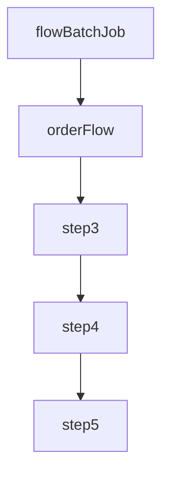

---

### 세 번째 Job: flow(Step)을 이용한 FlowJob 생성

이번에는 Flow 객체를 직접 생성하지 않고 `flow(Step)`을 사용한다.

```java
Job job = new JobBuilder(
        "stepBasedFlowJob",
        jobRepository
)
        .flow(step1)
        .next(step2)
        .end()
        .build();
```

이 코드는 Step을 전달하지만 SimpleJob을 생성하지 않는다.

`flow(Step)`은 내부적으로 FlowJobBuilder를 생성하기 때문이다.

따라서 최종 결과는 다음과 같다.

```text
Created Job Type: FlowJob
```

이러한 구조를 이용하면 별도의 Flow Bean을 생성하지 않고도 Flow 기반 Job을 구성할 수 있다.

다만 여러 Job에서 같은 Flow를 재사용해야 한다면 독립적인 Flow Bean을 생성하는 편이 더 적절할 수 있다.

---

### 실제 Job 실행하기

이제 세 가지 Job을 각각 실행해보자.

먼저 프로젝트를 빌드한다.

```bash
./mvnw clean package
```

정상적으로 빌드되었다면 다음과 같은 결과를 확인할 수 있다.

```text
BUILD SUCCESS
```

생성된 JAR 파일을 이용해 실행한다.

---

### SimpleJob 실행 결과

먼저 SimpleJob을 실행한다.

```bash
java -jar target/spring-batch-demo-0.0.1-SNAPSHOT.jar \
  --demo.job.name=simpleBatchJob \
  businessDate=2026-10-30
```

이 명령어는 simpleBatchJob을 선택한다.

JobParameters로는 businessDate를 전달한다.

실행 흐름은 다음과 같다.

```text
simpleBatchJob
       │
       ▼
step1
       │
       ▼
step2
       │
       ▼
COMPLETED
```

정상적으로 실행되면 다음과 유사한 로그를 확인할 수 있다.

```text
Created Job Type: SimpleJob

Job: [SimpleJob: [name=simpleBatchJob]]

Step 실행: step1

Step 실행: step2

Job completed with status: COMPLETED
```

이 결과에서 중요한 점은 SimpleJob이 생성되었다는 것이다.

그리고 등록한 Step들이 순차적으로 실행되었다.

---

### FlowJob 실행 결과

이번에는 FlowJob을 실행한다.

```bash
java -jar target/spring-batch-demo-0.0.1-SNAPSHOT.jar \
  --demo.job.name=flowBatchJob \
  businessDate=2026-10-30
```

이 Job은 Flow를 포함한다.

```text
flowBatchJob
       │
       ▼
orderFlow
       │
       ├── step3
       └── step4
       │
       ▼
      step5
```

정상적으로 실행되면 다음과 같은 흐름을 확인할 수 있다.

```text
Created Job Type: FlowJob

Step 실행: step3

Step 실행: step4

Step 실행: step5

Job completed with status: COMPLETED
```

여기서 중요한 점은 Step 3과 Step 4가 Flow 내부에 정의되어 있다는 것이다.

Flow가 완료된 이후 Step 5가 실행된다.

이렇게 FlowJob은 Flow 객체를 기반으로 실행 흐름을 관리한다.

---

### flow(Step)을 이용한 Job 실행 결과

마지막으로 세 번째 Job을 실행한다.

```bash
java -jar target/spring-batch-demo-0.0.1-SNAPSHOT.jar \
  --demo.job.name=stepBasedFlowJob \
  businessDate=2026-10-30
```

실행 결과는 다음과 같다.

```text
Created Job Type: FlowJob

Step 실행: step1

Step 실행: step2

Job completed with status: COMPLETED
```

Step 1과 Step 2가 순차적으로 실행된다.

하지만 최종 Job의 구현체는 SimpleJob이 아니라 FlowJob이다.

이는 `flow(Step)`을 사용했기 때문이다.

세 가지 결과를 정리하면 다음과 같다.

| Job 이름           | 시작 API      | 최종 구현체    | 실행 Step               |
| ---------------- | ----------- | --------- | --------------------- |
| simpleBatchJob   | start(Step) | SimpleJob | step1 → step2         |
| flowBatchJob     | start(Flow) | FlowJob   | step3 → step4 → step5 |
| stepBasedFlowJob | flow(Step)  | FlowJob   | step1 → step2         |

이 결과를 보면 Job을 생성하는 API가 최종 Job 구현체에 영향을 준다는 것을 확인할 수 있다.

---

### JobBuilder가 JobRepository에 연결되는 과정

앞에서 JobBuilder를 생성할 때 JobRepository를 전달했다.

```java
new JobBuilder(
        "simpleBatchJob",
        jobRepository
);
```

이 JobRepository는 최종 Job 객체에 전달된다.

그리고 실제 실행 시 메타데이터를 관리하는 데 사용된다.

예를 들어 SimpleJob을 생성하는 과정에서는 다음과 같은 흐름이 발생한다.

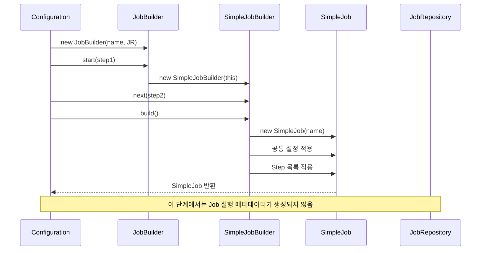

여기서 JobRepository는 Job에 설정되지만 아직 Job이 실행된 것은 아니다.

이후 JobLauncher가 실행되면 다음 과정이 발생한다.

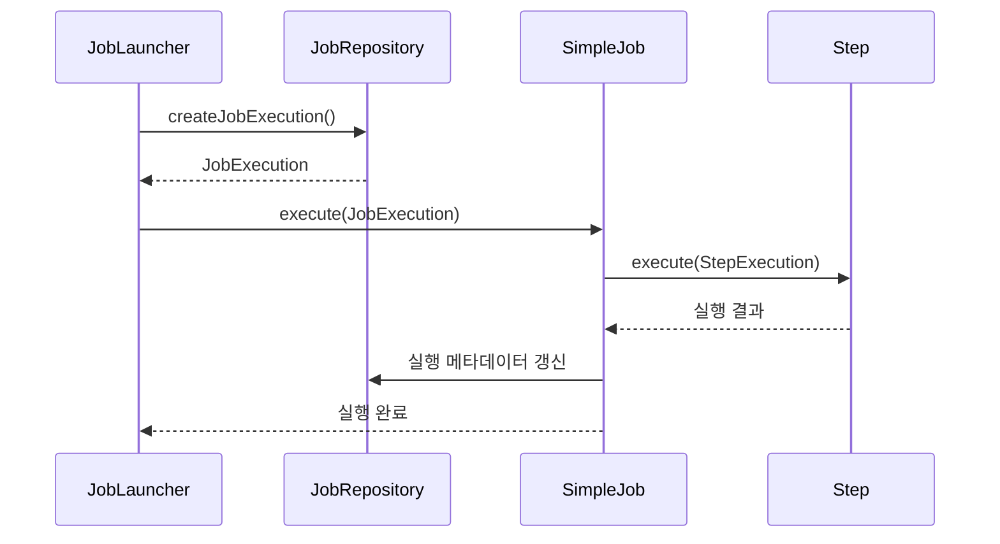

따라서 JobBuilder와 JobRepository의 관계를 이해할 때는 설정 시점과 실행 시점을 구분해야 한다.

---

### Job 이름은 어디에 저장될까?

JobBuilder를 생성할 때 다음과 같이 이름을 지정했다.

```java
new JobBuilder(
        "simpleBatchJob",
        jobRepository
);
```

이 이름은 최종 Job 객체에도 전달된다.

따라서 다음 메서드로 확인할 수 있다.

```java
job.getName();
```

결과는 다음과 같다.

```text
simpleBatchJob
```

그리고 실제 Job이 실행되면 해당 이름이 JobRepository를 통해 메타데이터에 저장된다.

대표적으로 다음 테이블에서 확인할 수 있다.

```text
BATCH_JOB_INSTANCE
```

예를 들어 다음과 같은 SQL을 사용할 수 있다.

```sql
SELECT
    JOB_INSTANCE_ID,
    JOB_NAME,
    JOB_KEY
FROM BATCH_JOB_INSTANCE
ORDER BY JOB_INSTANCE_ID;
```

여기서 JOB_NAME은 JobBuilder에서 설정한 Job 이름과 연결된다.

다만 중요한 점이 있다.

**JobBuilder에서 이름을 설정했다고 해서 즉시 BATCH_JOB_INSTANCE에 데이터가 저장되는 것은 아니다.**

실제로 JobLauncher를 통해 Job이 실행되어 JobInstance가 생성될 때 해당 정보가 저장된다.

따라서 Builder의 `build()`와 JobLauncher의 `run()`은 구분해야 한다.

---

### 실무에서 JobBuilder를 설계할 때 고려할 10가지 사항

JobBuilder는 단순히 Job 객체를 생성하기 위한 API지만, 실제 배치 시스템을 설계할 때 여러 사항을 고려할 필요가 있다.

#### 1. 단순한 순차 실행은 SimpleJob으로 구성한다

여러 Step이 순서대로 실행되기만 하면 된다면 SimpleJob이 적절하다.

예를 들어 다음과 같다.

```text
데이터 조회
    │
    ▼
데이터 가공
    │
    ▼
데이터 저장
```

이러한 구조에서 불필요하게 FlowJob을 사용하면 설정이 복잡해질 수 있다.

따라서 특별한 이유가 없다면 SimpleJob으로 시작하는 것이 좋다.

#### 2. 조건부 실행이 필요한 경우 FlowJob을 고려한다

특정 Step의 종료 결과에 따라 다른 Step을 실행해야 한다면 FlowJob을 사용할 수 있다.

예를 들어 다음과 같다.

```text
결제 데이터 검증
       │
       ├── 성공 → 정산 처리
       │
       └── 실패 → 오류 처리
```

이러한 구조에서는 ExitStatus를 기준으로 조건부 전이를 정의할 수 있다.

#### 3. 공통 실행 흐름은 별도의 Flow로 분리한다

여러 Job에서 동일한 Step 실행 흐름을 사용해야 한다면 Flow를 별도로 정의하는 방식을 고려할 수 있다.

예를 들어 다음과 같다.

```text
settlementValidationFlow
       │
       ├── 데이터 검증
       └── 정합성 확인
```

이 Flow를 여러 Job에 연결하면 공통 처리 구조를 재사용할 수 있다.

다만 동일한 Flow를 재사용할 때는 Step 이름과 실행 상태 관리에 충돌이 없는지 확인해야 한다.

#### 4. Job 이름은 안정적인 비즈니스 의미를 가지도록 설계한다

Job 이름은 JobInstance를 식별하는 중요한 요소다.

따라서 이름을 임의로 변경하면 기존 실행 이력과 다른 Job으로 취급될 수 있다.

예를 들어 다음과 같은 이름이 적절하다.

```text
dailySettlementJob

couponExpirationJob

monthlyStatisticsJob
```

반면 의미가 모호한 이름은 운영 환경에서 혼란을 줄 수 있다.

```text
job1

job2

testJob
```

Job 이름은 가능하면 비즈니스 목적을 드러내도록 작성하는 것이 좋다.

#### 5. Builder 생성과 Job 실행을 구분한다

Builder의 `build()`는 Job 객체를 생성한다.

하지만 Job을 실행하는 것은 아니다.

따라서 Spring Bean 초기화 과정에서 Job이 생성되었다고 해서 실제 비즈니스 작업이 수행되었다고 판단하면 안 된다.

실제 Job 실행은 JobLauncher를 통해 시작된다.

#### 6. JobRepository는 Bean으로 주입받아 사용한다

Spring Batch 5에서는 JobBuilder 생성 시 JobRepository가 필요하다.

일반적인 Spring Boot 프로젝트에서는 JobRepository를 직접 생성하지 않고 주입받는 것이 좋다.

```java
@Bean
public Job batchJob(
        JobRepository jobRepository,
        Step step1
) {
    return new JobBuilder(
            "batchJob",
            jobRepository
    )
            .start(step1)
            .build();
}
```

이렇게 하면 Spring Boot가 구성한 Batch 인프라와 자연스럽게 연결된다.

#### 7. Step을 재사용할 때 실행 이력 범위를 이해한다

하나의 Step Bean을 여러 Job에서 사용할 수 있다.

하지만 StepExecution은 개별 JobExecution에 연결된다.

따라서 동일한 Step 정의를 여러 Job에서 사용하더라도 실제 실행 이력은 각각 생성된다.

다만 같은 Job 안에서 의도치 않게 동일한 이름의 Step을 중복 등록하면 실행 상태 관리에 문제가 발생할 수 있으므로 주의해야 한다.

#### 8. Builder의 반환 타입을 확인한다

JobBuilder는 메서드에 따라 반환 타입이 달라진다.

예를 들어 다음과 같다.

```java
SimpleJobBuilder builder =
        jobBuilder.start(step1);
```

반면 다음 코드는 다른 타입을 반환한다.

```java
JobFlowBuilder builder =
        jobBuilder.start(flow);
```

따라서 Builder API를 연결하다가 사용할 수 있는 메서드가 달라지는 이유를 이해할 수 있다.

이는 단순한 문법 차이가 아니라 내부 객체 생성 구조의 차이다.

#### 9. FlowJob의 end()와 build()를 구분한다

FlowJob을 생성할 때는 다음과 같은 구문을 사용한다.

```java
.start(flow)
.next(step)
.end()
.build();
```

이때 end()는 Flow 구성 과정을 마무리한다.

마지막 build()는 FlowJob을 생성한다.

두 메서드를 동일한 의미로 이해하면 Builder의 내부 동작을 파악하기 어렵다.

#### 10. Job 정의의 변경이 재시작에 미치는 영향을 고려한다

실무에서는 운영 중인 Job의 Step 구성이 변경될 수 있다.

예를 들어 기존 Job이 다음과 같다고 생각해보자.

```text
Step 1 → Step 2 → Step 3
```

그런데 배포 이후 다음과 같이 변경되었다.

```text
Step 1 → Step 2 → Step 4 → Step 3
```

이때 이전 실행에서 실패한 Job을 재시작하면 변경된 Step 구조가 기존 실행 이력과 상호작용할 수 있다.

따라서 운영 중인 Job의 Step 이름이나 실행 순서를 변경할 때는 기존 JobInstance의 재시작 가능성을 검토해야 한다.

특히 중간에 새로운 Step을 추가하거나 기존 Step의 이름을 변경하는 작업은 주의해야 한다.

---

### JobBuilder 관련해서 자주 혼동하는 부분

JobBuilder를 사용할 때는 몇 가지 개념을 명확하게 구분해야 한다.

| 혼동하기 쉬운 내용                               | 정확한 이해                               |
| ---------------------------------------- | ------------------------------------ |
| JobBuilder가 직접 SimpleJob을 생성한다           | 실제 생성은 SimpleJobBuilder가 담당          |
| start(Step)은 항상 SimpleJob을 만든다           | 이후 Flow 전환 API를 사용하면 FlowJob이 될 수 있음 |
| FlowJobBuilder와 JobFlowBuilder는 같은 역할이다  | 전자는 Job 생성, 후자는 Flow 구성              |
| build()를 호출하면 Job이 실행된다                  | build()는 Job 객체 생성                   |
| JobRepository를 전달하면 DB에 실행 이력이 생긴다       | 실제 실행 시점에 메타데이터 생성                   |
| FlowJob은 반드시 조건 분기가 필요하다                 | 단순 순차 Flow도 가능                       |
| Step을 Flow에 넣으면 별도의 StepExecution이 필요 없다 | 실제 실행된 Step에 대해서는 StepExecution이 생성됨 |
| JobBuilderFactory는 모든 버전에서 사용 가능하다       | Spring Batch 5.2에서는 제거됨              |

이러한 차이를 이해하면 Spring Batch의 Job 설정 코드를 더 정확하게 해석할 수 있다.

---

### JobBuilder의 전체 생성 과정

마지막으로 JobBuilder의 전체 구조를 정리해보자.

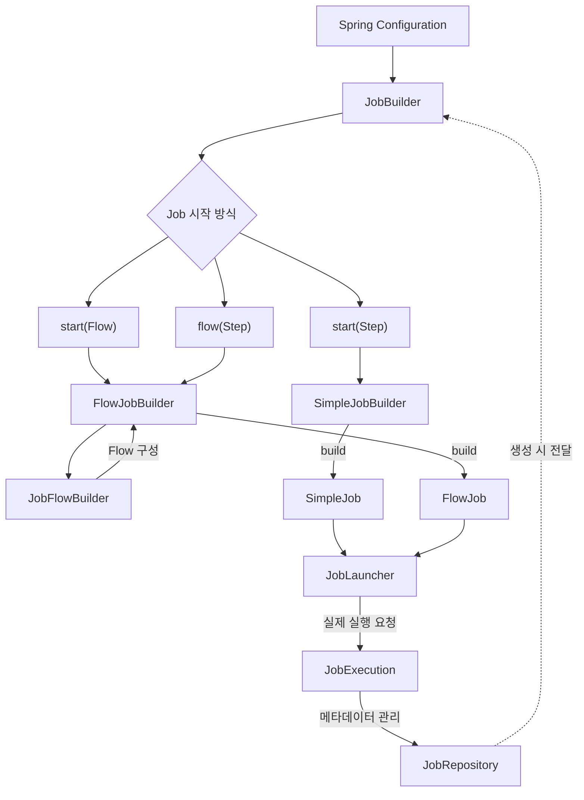

이 구조에서 핵심은 다음과 같다.

JobBuilder는 Job 생성의 시작점이다.

그리고 시작 API에 따라 서로 다른 Builder를 생성한다.

SimpleJobBuilder는 등록된 Step 목록을 기반으로 SimpleJob을 생성한다.

FlowJobBuilder는 JobFlowBuilder가 구성한 Flow를 이용해 FlowJob을 생성한다.

마지막으로 생성된 Job은 JobLauncher를 통해 실행된다.

따라서 Job 생성 과정과 실제 실행 과정을 분리해서 이해하는 것이 중요하다.

---

### 정리

Spring Batch는 Job을 쉽게 생성하고 설정할 수 있도록 Builder API를 제공한다.

JobBuilder는 Job을 생성하기 위한 시작점이며, 실제로 어떤 Job 구현체가 생성될지는 사용하는 API와 설정에 따라 달라진다.

과거 Spring Batch 4에서는 JobBuilderFactory를 이용해 JobBuilder를 생성했다.

```java
jobBuilderFactory.get("batchJob");
```

하지만 Spring Batch 5.2에서는 JobBuilderFactory가 제거되었다.

따라서 다음과 같이 JobBuilder를 직접 생성한다.

```java
new JobBuilder(
        "batchJob",
        jobRepository
);
```

JobBuilder는 대표적으로 세 가지 생성 경로를 제공한다.

| 시작 API      | 내부 Builder                     | 최종 Job    |
| ----------- | ------------------------------ | --------- |
| start(Step) | SimpleJobBuilder               | SimpleJob |
| start(Flow) | FlowJobBuilder, JobFlowBuilder | FlowJob   |
| flow(Step)  | FlowJobBuilder, JobFlowBuilder | FlowJob   |

SimpleJobBuilder는 Step 목록을 관리한다.

`start()`와 `next()`를 통해 Step을 등록하고, build()를 호출하면 SimpleJob을 생성한다.

```java
new JobBuilder("simpleJob", jobRepository)
        .start(step1)
        .next(step2)
        .build();
```

반면 FlowJobBuilder는 Flow 기반 Job을 생성한다.

```java
new JobBuilder("flowJob", jobRepository)
        .start(flow)
        .next(step3)
        .end()
        .build();
```

여기서 JobFlowBuilder와 FlowJobBuilder의 역할을 구분해야 한다.

JobFlowBuilder는 Flow 실행 구조를 구성한다.

FlowJobBuilder는 해당 Flow를 이용해 최종 FlowJob을 생성한다.

그리고 JobBuilder, SimpleJobBuilder, FlowJobBuilder는 모두 JobBuilderHelper를 상속한다.

JobBuilderHelper는 JobRepository, Listener, 재시작 설정 등 Job 생성에 필요한 공통 속성과 API를 제공한다.

마지막으로 JobBuilder의 build()와 JobLauncher의 run()을 구분해야 한다.

Builder의 build()는 Job 객체를 생성한다.

반면 JobLauncher의 run()은 실제 Job 실행을 시작한다.

JobBuilder를 생성할 때 전달한 JobRepository는 최종 Job 객체에 설정되며, 실제 Job 실행 과정에서 메타데이터를 관리하는 데 사용된다.

이러한 구조를 이해하면 Job 설정 코드를 작성할 때 현재 어떤 Builder가 사용되고 있는지, 어떤 Job 구현체가 만들어지는지, 어떤 실행 흐름이 구성되는지 판단할 수 있다.

결국 **Spring Batch의 JobBuilder는 Step 또는 Flow 설정에 따라 서로 다른 Builder와 Job 구현체를 생성하도록 설계된 핵심 구성 API**다.

#### 한 줄 요약

> Spring Batch의 `JobBuilder`는 Job을 구성하는 시작점으로, `start(Step)`을 사용하면 일반적으로 `SimpleJobBuilder`를 거쳐 `SimpleJob`이 생성되고, `start(Flow)` 또는 `flow(Step)`을 사용하면 `FlowJobBuilder`와 `JobFlowBuilder`를 통해 `FlowJob`이 생성된다. Spring Batch 5.2에서는 `JobBuilderFactory` 대신 `new JobBuilder(jobName, jobRepository)`를 사용하며, Builder의 `build()`는 Job 객체 생성, JobLauncher의 `run()`은 실제 Job 실행을 담당한다.

## SimpleJop - 개념 및 API 소개

### Spring Batch SimpleJob 이해: 순차 실행 구조와 주요 API 및 Job 상태 결정 원리

Spring Batch에서 `Job`은 하나의 배치 작업 전체를 정의하는 최상위 도메인 객체다.

하나의 Job은 여러 개의 Step으로 구성할 수 있으며, 각 Step은 실제 비즈니스 로직을 수행하는 실행 단위다.

예를 들어 매일 새벽 실행되는 정산 시스템이 있다고 생각해보자.

```text
dailySettlementJob
       │
       ├── Step 1. 정산 대상 조회
       │
       ├── Step 2. 정산 금액 계산
       │
       └── Step 3. 정산 결과 저장
```

이 작업에서는 정산 대상을 조회한 뒤 금액을 계산하고, 마지막으로 정산 결과를 저장해야 한다.

따라서 Step의 실행 순서가 중요하다.

첫 번째 Step이 성공적으로 완료되어야 두 번째 Step을 실행할 수 있다.

두 번째 Step이 성공적으로 완료되어야 세 번째 Step을 실행할 수 있다.

반대로 정산 금액을 계산하는 과정에서 오류가 발생했다면 정산 결과를 저장하는 Step을 실행해서는 안 된다.

Spring Batch는 이러한 순차 실행을 지원하기 위해 `SimpleJob`이라는 Job 구현체를 제공한다.

SimpleJob은 등록된 Step을 순서대로 실행한다.

그리고 각 Step이 정상적으로 완료되었는지 확인한 후 다음 Step의 실행 여부를 결정한다.

Spring Batch에서 가장 기본적인 Job 구성 방식은 다음과 같다.

```java
@Bean
public Job settlementJob(
        JobRepository jobRepository,
        Step step1,
        Step step2,
        Step step3
) {
    return new JobBuilder("settlementJob", jobRepository)
            .start(step1)
            .next(step2)
            .next(step3)
            .build();
}
```

이 코드는 세 개의 Step을 순차적으로 실행하는 Job을 생성한다.

여기서 최종적으로 생성되는 Job 구현체가 바로 `SimpleJob`이다.

하지만 내부 구조를 조금 더 살펴보면 중요한 특징을 발견할 수 있다.

`JobBuilder`는 직접 SimpleJob을 생성하지 않는다.

먼저 `SimpleJobBuilder`를 생성하고, 해당 Builder가 Step 목록과 여러 설정값을 관리한다.

그리고 마지막에 `build()`를 호출하면 실제 SimpleJob 객체가 생성된다.

이렇게 생성된 SimpleJob은 설정된 Step과 JobRepository, JobParametersValidator, JobExecutionListener 등의 정보를 가지고 있다.

이후 실제 Job 실행 요청이 들어오면 저장된 설정을 이용해 Job의 실행 과정을 처리한다.

이번에는 SimpleJob의 개념과 주요 API를 살펴보고, 객체 생성 과정과 실제 실행 흐름, 실패 상황에서의 상태 결정 원리까지 자세히 알아보자.

---

### SimpleJob이란?

`SimpleJob`은 Spring Batch에서 제공하는 `Job` 인터페이스의 구현체 중 하나로, 등록된 여러 Step을 순차적으로 실행하는 역할을 담당한다.

Spring Batch에서는 Job을 구성할 때 가장 기본적으로 사용되는 구현체다.

SimpleJob의 특징을 정리하면 다음과 같다.

| 특징            | 설명                                            |
| ------------- | --------------------------------------------- |
| 기본 Job 구현체    | Spring Batch에서 제공하는 표준 Job 구현체                |
| 순차 실행         | 등록된 Step을 정해진 순서대로 실행                         |
| Step 기반 구성    | 실행할 Step 목록을 내부적으로 관리                         |
| 실행 상태 확인      | 각 Step의 BatchStatus를 확인                       |
| 실패 시 실행 중단    | COMPLETED가 아닌 상태로 종료되면 후속 Step 실행 중단          |
| Builder 기반 생성 | SimpleJobBuilder를 통해 생성                       |
| 공통 설정 지원      | Listener, Validator, Incrementer, 재시작 정책 등 지원 |
| 메타데이터 관리      | JobRepository와 연결하여 실행 정보 관리                  |

가장 중요한 특징은 **SimpleJob이 Step 목록을 순서대로 실행하고 각 Step의 실행 결과에 따라 다음 Step을 진행할지 판단한다는 점**이다.

예를 들어 다음과 같이 세 개의 Step이 있다고 생각해보자.

```text
SimpleJob
    │
    ├── Step 1
    │
    ├── Step 2
    │
    └── Step 3
```

정상적인 실행 흐름은 다음과 같다.

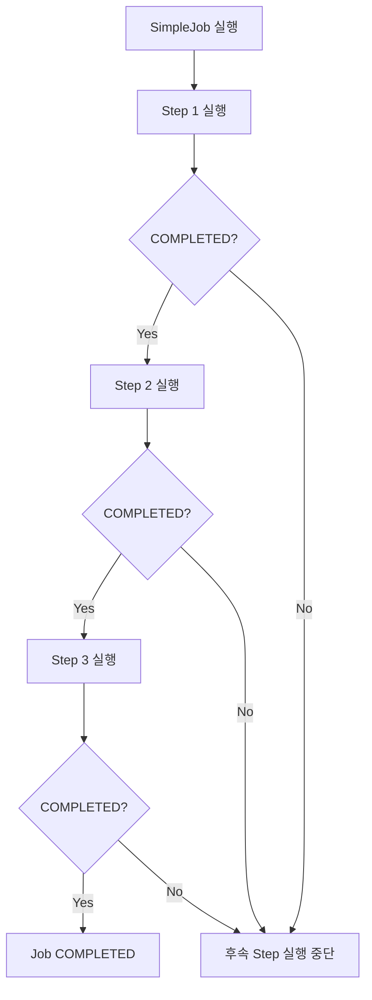

모든 Step이 COMPLETED 상태로 종료되면 Job도 정상적으로 완료될 수 있다.

반면 실행 중인 Step이 FAILED 또는 STOPPED 등 COMPLETED가 아닌 상태로 종료되면 SimpleJob은 다음 Step을 실행하지 않는다.

이러한 구조는 정산, 데이터 집계, 파일 생성 등 여러 작업을 순서대로 처리해야 하는 배치에 적합하다.

---

### SimpleJob은 왜 사용하는가?

SimpleJob을 사용하는 가장 큰 이유는 여러 Step의 실행 순서와 결과 처리를 하나의 Job에서 일관되게 관리할 수 있기 때문이다.

일반적인 Java 코드로도 여러 작업을 순서대로 실행할 수 있다.

```java
public void executeSettlement() {

    prepareSettlement();

    calculateSettlement();

    saveSettlement();
}
```

이 코드는 세 개의 메서드를 순서대로 호출한다.

하지만 배치 시스템에서는 단순한 메서드 호출 외에도 고려해야 할 사항이 많다.

예를 들어 다음과 같은 상황이다.

* 이전 작업이 성공했는지 확인해야 한다.
* 실패한 작업 이후의 처리를 중단해야 한다.
* 각 작업의 시작 시간과 종료 시간을 기록해야 한다.
* 이전에 완료된 Step은 재시작 시 건너뛸 수 있어야 한다.
* 개별 Step의 실행 결과를 데이터베이스에 저장해야 한다.

이러한 기능을 직접 구현하려면 실행 상태 관리와 재시작 로직을 별도로 작성해야 한다.

Spring Batch의 SimpleJob은 이러한 기능을 Spring Batch의 JobRepository, StepExecution 등의 도메인 객체와 연결하여 제공한다.

예를 들어 다음과 같은 정산 Job이 있다고 생각해보자.

```text
정산 데이터 조회
       │
       ▼
정산 금액 계산
       │
       ▼
정산 결과 저장
```

정산 금액 계산 단계에서 실패하면 다음과 같은 결과가 발생한다.

```text
정산 데이터 조회 → COMPLETED

정산 금액 계산 → FAILED

정산 결과 저장 → 실행되지 않음
```

SimpleJob은 해당 실행 결과를 확인하고 후속 Step의 실행을 중단한다.

따라서 개발자는 Step 내부의 비즈니스 로직에 집중하면서 전체 실행 흐름을 구성할 수 있다.

---

### SimpleJob과 FlowJob의 차이

Spring Batch에서 대표적인 Job 구현체는 SimpleJob과 FlowJob이다.

두 구현체는 모두 Job을 실행하지만 내부 실행 방식이 다르다.

SimpleJob은 Step 목록을 순차적으로 실행한다.

반면 FlowJob은 Flow를 기반으로 실행 흐름을 제어한다.

| 구분            | SimpleJob             | FlowJob              |
| ------------- | --------------------- | -------------------- |
| 주요 구성 요소      | Step                  | Step, Flow, 실행 상태 전이 |
| 실행 방식         | 순차 실행                 | Flow 기반 실행           |
| 실행 순서 관리      | Step List             | Flow의 상태 전이 구조       |
| 조건부 분기        | 기본 순차 구조에서는 지원하지 않음   | 지원                   |
| 후속 Step 실행 기준 | 이전 Step의 COMPLETED 여부 | 정의된 Transition       |
| 대표 사용         | 단순하고 순차적인 배치          | 조건부 분기가 필요한 배치       |
| 생성 Builder    | SimpleJobBuilder      | FlowJobBuilder       |

예를 들어 다음과 같은 작업은 SimpleJob으로 구성하기 적합하다.

```text
Step 1 → Step 2 → Step 3
```

반면 다음과 같은 작업은 FlowJob이 더 적합하다.

```text
Step 1
   │
   ▼
실행 결과 확인
   │
   ├── COMPLETED → Step 2
   │
   └── FAILED → Step 3
```

SimpleJob은 구조가 단순하고 실행 순서가 명확하다.

따라서 복잡한 조건부 분기가 필요하지 않다면 SimpleJob을 우선적으로 고려할 수 있다.

---

### SimpleJob의 주요 API

Spring Batch에서 SimpleJob을 생성할 때는 여러 설정 API를 사용할 수 있다.

대표적으로 다음과 같은 API가 있다.

| API                | 역할                          |
| ------------------ | --------------------------- |
| `start(Step)`      | 처음 실행할 Step 지정              |
| `next(Step)`       | 다음에 실행할 Step 추가             |
| `incrementer()`    | JobParametersIncrementer 등록 |
| `preventRestart()` | Job 재시작 금지                  |
| `validator()`      | JobParametersValidator 등록   |
| `listener()`       | JobExecutionListener 등록     |
| `build()`          | 설정을 기반으로 Job 생성             |

각 API는 Job의 실행 구조나 실행 정책을 설정하는 데 사용된다.

중요한 점은 **이러한 API를 호출한다고 해서 실제 비즈니스 작업이 즉시 실행되는 것은 아니라는 사실**이다.

설정 API를 이용하면 SimpleJobBuilder 내부에 필요한 정보가 저장된다.

그리고 `build()`가 호출되면 해당 정보를 실제 SimpleJob 객체에 적용한다.

이후 JobLauncher가 Job을 실행할 때 설정된 정보가 사용된다.

---

### start(Step): 최초 실행할 Step 설정

`start()`는 Job에서 처음 실행할 Step을 지정하는 메서드다.

가장 기본적인 사용 방법은 다음과 같다.

```java
new JobBuilder("batchJob", jobRepository)
        .start(step1)
        .build();
```

이 코드에서는 step1이 첫 번째 Step이다.

Spring Batch 5.2.4의 JobBuilder는 다음과 같은 메서드를 제공한다.

```java
public SimpleJobBuilder start(Step step)
```

여기서 중요한 부분은 반환 타입이다.

```java
SimpleJobBuilder
```

JobBuilder의 `start(Step)`을 호출하면 SimpleJobBuilder가 생성된다.

따라서 다음과 같은 관계가 만들어진다.

```text
JobBuilder
    │
    │ start(step1)
    ▼
SimpleJobBuilder
    │
    └── step1 등록
```

이후 SimpleJobBuilder가 제공하는 API를 이용해 Step을 추가하거나 Job 설정을 구성할 수 있다.

---

### next(Step): 다음 실행할 Step 추가

`next()`는 현재 Job에 후속 Step을 추가하는 메서드다.

예를 들어 다음과 같이 사용할 수 있다.

```java
new JobBuilder("batchJob", jobRepository)
        .start(step1)
        .next(step2)
        .next(step3)
        .build();
```

이 코드는 세 개의 Step을 등록한다.

등록 순서는 다음과 같다.

```text
Step 1
   │
   ▼
Step 2
   │
   ▼
Step 3
```

`next()`는 여러 번 호출할 수 있다.

SimpleJobBuilder는 내부적으로 Step 목록을 관리하기 때문이다.

개념적으로 다음과 같은 구조다.

```java
private final List<Step> steps =
        new ArrayList<>();
```

`start()`를 호출하면 첫 번째 Step이 등록된다.

`next()`를 호출하면 추가적인 Step이 등록된다.

```text
steps
   │
   ├── step1
   ├── step2
   └── step3
```

이렇게 구성된 Step 목록은 마지막에 SimpleJob 객체로 전달된다.

따라서 SimpleJob은 자신이 실행해야 할 Step과 실행 순서를 알 수 있게 된다.

---

### incrementer(): JobParameters 증가 정책 설정

`incrementer()`는 JobParametersIncrementer를 등록하는 API다.

JobParametersIncrementer는 새로운 JobInstance를 실행하기 위한 다음 JobParameters를 생성하는 역할을 담당한다.

대표적인 구현체는 `RunIdIncrementer`다.

```java
new JobBuilder("batchJob", jobRepository)
        .incrementer(new RunIdIncrementer())
        .start(step1)
        .build();
```

이 설정을 사용하면 Job에 RunIdIncrementer가 등록된다.

RunIdIncrementer는 다음과 같은 파라미터를 생성하는 데 활용된다.

```text
run.id = 1
```

다음 실행에서는 다음과 같은 값을 사용할 수 있다.

```text
run.id = 2
```

이후에도 값이 증가할 수 있다.

```text
run.id = 3
```

이러한 방식으로 서로 다른 JobInstance를 생성할 수 있다.

#### JobParametersIncrementer의 동작 원리

Spring Batch에서는 Job 이름과 식별용 JobParameters의 조합으로 JobInstance를 구분한다.

예를 들어 다음과 같다.

```text
Job Name = settlementJob

run.id = 1
```

이 조합으로 생성된 JobInstance가 이미 완료되었다면 동일한 식별용 파라미터로 다시 실행할 수 없다.

하지만 다음과 같이 파라미터가 달라지면 새로운 JobInstance가 된다.

```text
Job Name = settlementJob

run.id = 2
```

따라서 새로운 Job 실행이 가능하다.

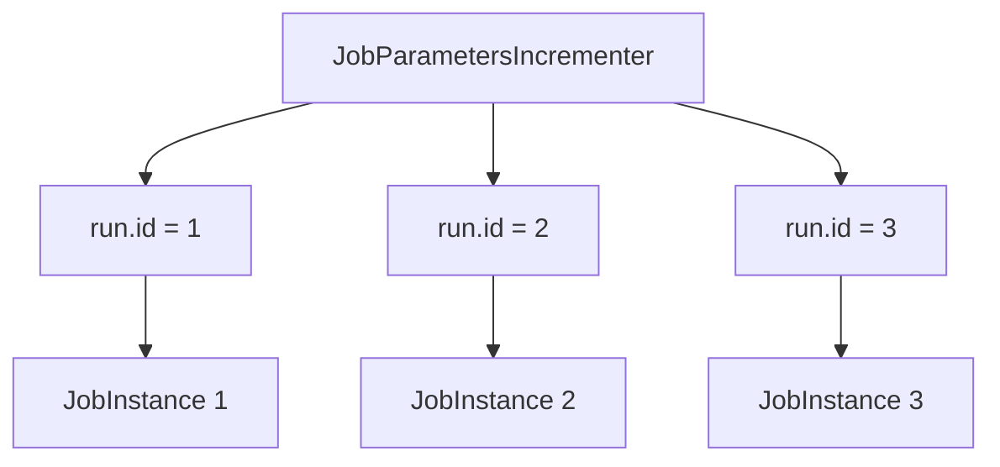

다만 중요한 주의사항이 있다.

**Job에 Incrementer를 등록했다고 해서 JobLauncher의 `run()`을 호출할 때마다 파라미터가 자동으로 증가하는 것은 아니다.**

Incrementer는 다음 파라미터를 생성하는 정책을 제공한다.

실제 파라미터 증가는 해당 정책을 사용하는 실행 경로에서 수행된다.

대표적인 예가 JobOperator의 `startNextInstance()`다.

Spring Batch 5.2에서는 다음과 같이 사용할 수 있다.

```java
jobOperator.startNextInstance("batchJob");
```

이 메서드는 등록된 JobParametersIncrementer를 사용해 새로운 JobInstance를 실행한다.

반면 다음 코드는 전달받은 JobParameters를 그대로 이용한다.

```java
jobLauncher.run(job, jobParameters);
```

따라서 두 실행 방식은 구분해야 한다.

| 실행 방식                             | Incrementer 자동 활용  |
| --------------------------------- | ------------------ |
| `JobLauncher.run()`               | 자동으로 증가시키지 않음      |
| `JobOperator.startNextInstance()` | 등록된 Incrementer 사용 |

#### 새로운 실행과 재시작은 다르다

여기서 반드시 구분해야 할 개념이 있다.

JobParameters를 변경해 새로운 JobInstance를 생성하는 것은 기존 Job의 재시작과 다르다.

예를 들어 다음과 같다.

```text
JobInstance 1
    │
    └── JobExecution 1 → FAILED
```

같은 JobInstance를 재시작하면 다음과 같이 된다.

```text
JobInstance 1
    │
    ├── JobExecution 1 → FAILED
    │
    └── JobExecution 2 → COMPLETED
```

반면 Incrementer를 이용해 새로운 식별용 파라미터를 생성하면 다음과 같다.

```text
JobInstance 1
    │
    └── JobExecution 1 → FAILED


JobInstance 2
    │
    └── JobExecution 2 → COMPLETED
```

따라서 Incrementer는 기존 실행을 이어서 재시작하기보다는 새로운 JobInstance를 생성하는 기능에 가깝다.

실무에서는 이 차이를 명확하게 이해해야 한다.

---

### preventRestart(): Job 재시작 금지

`preventRestart()`는 Job의 재시작을 허용하지 않도록 설정하는 API다.

Spring Batch에서 Job은 기본적으로 재시작이 가능하도록 설정된다.

하지만 모든 Job이 재시작을 허용해야 하는 것은 아니다.

예를 들어 외부 시스템에 특정 요청을 한 번만 전송해야 하는 Job이 있다고 생각해보자.

```text
외부 정산 요청 Job
       │
       ▼
외부 API 호출
       │
       ▼
요청 결과 저장
```

이 Job에서는 재시작 여부를 신중하게 판단해야 한다.

필요하다면 다음과 같이 재시작을 금지할 수 있다.

```java
new JobBuilder("batchJob", jobRepository)
        .preventRestart()
        .start(step1)
        .build();
```

이 설정은 내부적으로 Job의 restartable 값을 false로 만든다.

```text
restartable = false
```

따라서 실패한 JobInstance를 다시 실행하려고 하면 재시작이 제한된다.

대표적으로 다음 예외가 발생할 수 있다.

```text
JobRestartException
```

#### preventRestart()의 의미

재시작 금지는 모든 실행을 영구적으로 막는다는 뜻이 아니다.

정확히는 **이미 실행 이력이 존재하는 동일한 JobInstance의 재시작을 허용하지 않는다는 의미**다.

예를 들어 다음과 같은 작업이 실패했다고 생각해보자.

```text
Job Name = batchJob

businessDate = 2026-10-15
```

같은 식별용 JobParameters로 다시 실행하면 재시작이 제한된다.

하지만 다음과 같이 식별용 파라미터가 달라지면 새로운 JobInstance를 실행할 수 있다.

```text
Job Name = batchJob

businessDate = 2026-10-16
```

이를 비교하면 다음과 같다.

| 상황                                   | preventRestart() 설정 시 |
| ------------------------------------ | --------------------- |
| 동일한 JobInstance 재시작                  | 허용하지 않음               |
| 다른 JobParameters로 새로운 JobInstance 실행 | 가능                    |
| 실패한 JobExecution 다시 실행               | 재시작 제한                |
| 새로운 JobInstance 최초 실행                | 가능                    |

따라서 preventRestart()는 Job의 재시작 정책을 결정하는 API라고 이해하면 된다.

단, 이 설정만으로 외부 API의 중복 호출이나 비즈니스 데이터의 중복 처리가 모두 방지되는 것은 아니다.

실제 운영에서는 멱등성 정책을 별도로 고려해야 한다.

---

### validator(): JobParameters 검증

`validator()`는 Job을 실행할 때 전달되는 JobParameters를 검증하기 위한 API다.

예를 들어 정산 Job에 다음 파라미터가 필요하다고 생각해보자.

```text
businessDate = 2026-10-15
```

이 Job은 정산 기준일이 반드시 필요하다.

따라서 다음과 같은 상황은 허용해서는 안 된다.

```text
businessDate = null
```

또는 다음과 같이 잘못된 날짜가 전달될 수도 있다.

```text
businessDate = invalid-date
```

이러한 입력값을 검증하기 위해 JobParametersValidator를 사용할 수 있다.

#### JobParametersValidator 구현

JobParametersValidator는 다음 메서드를 제공한다.

```java
void validate(
        JobParameters parameters
) throws JobParametersInvalidException;
```

이 메서드를 직접 구현하면 된다.

예를 들어 다음과 같다.

```java
@Bean
public JobParametersValidator jobParametersValidator() {

    return parameters -> {

        String businessDate =
                parameters.getString("businessDate");

        if (businessDate == null
                || businessDate.isBlank()) {

            throw new JobParametersInvalidException(
                    "businessDate는 필수입니다."
            );
        }

        try {
            LocalDate.parse(businessDate);
        } catch (DateTimeParseException e) {

            throw new JobParametersInvalidException(
                    "businessDate는 yyyy-MM-dd 형식이어야 합니다."
            );
        }
    };
}
```

이 코드는 다음 두 가지를 검증한다.

첫 번째는 businessDate의 존재 여부다.

두 번째는 올바른 날짜 형식인지 여부다.

이후 JobBuilder에 Validator를 등록한다.

```java
new JobBuilder("batchJob", jobRepository)
        .validator(jobParametersValidator)
        .start(step1)
        .build();
```

이렇게 설정하면 실제 Job 실행 과정에서 Validator가 호출된다.

검증에 실패하면 Job의 비즈니스 Step 실행이 시작되지 않는다.

다만 검증이 실행되는 정확한 위치에 따라 JobExecution 메타데이터가 먼저 생성된 후 실패 상태가 기록될 수 있다.

따라서 **JobParameters 검증 실패와 Step 실행 실패는 구분해서 이해해야 한다.**

---

### listener(): Job 실행 전후의 처리

`listener()`는 JobExecutionListener를 등록하기 위한 API다.

Spring Batch는 Job 실행 과정에서 특정 시점에 콜백을 받을 수 있도록 Listener 기능을 제공한다.

대표적인 콜백은 다음과 같다.

```java
beforeJob()
```

```java
afterJob()
```

`beforeJob()`은 Job 실행 전에 호출된다.

`afterJob()`은 Job 실행이 종료된 이후 호출된다.

전체 흐름은 다음과 같다.

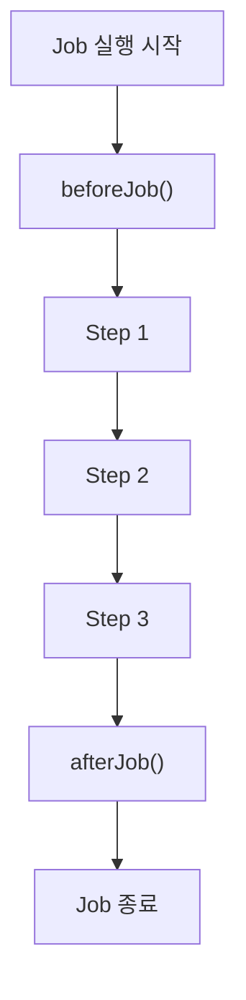

단, Job이 실행 도중 실패하면 모든 Step을 수행하지 않고 afterJob()으로 이동할 수 있다.

#### JobExecutionListener 구현

다음과 같이 Listener를 구현할 수 있다.

```java
@Bean
public JobExecutionListener jobExecutionListener() {

    return new JobExecutionListener() {

        @Override
        public void beforeJob(JobExecution jobExecution) {

            System.out.println(
                    "Job 실행 시작: "
                            + jobExecution.getJobInstance().getJobName()
            );
        }

        @Override
        public void afterJob(JobExecution jobExecution) {

            System.out.println(
                    "Job 실행 종료: "
                            + jobExecution.getStatus()
            );
        }
    };
}
```

이후 JobBuilder에 등록한다.

```java
new JobBuilder("batchJob", jobRepository)
        .listener(jobExecutionListener)
        .start(step1)
        .build();
```

정상적으로 실행되면 다음과 같은 흐름이 발생한다.

```text
Job 실행 시작

Step 1 실행

Step 2 실행

Job 실행 종료
```

Listener를 활용하면 실행 전후의 공통 처리를 구성할 수 있다.

대표적인 활용 사례는 다음과 같다.

| 시점        | 활용 사례       |
| --------- | ----------- |
| beforeJob | 실행 시작 로그    |
| beforeJob | 실행 환경 확인    |
| beforeJob | 작업 시작 알림    |
| afterJob  | 최종 실행 상태 기록 |
| afterJob  | 실행 시간 측정    |
| afterJob  | 실패 알림 전송    |
| afterJob  | 처리 결과 요약    |

다만 Listener를 통해 수행하는 외부 알림이나 후처리 로직은 실패할 수 있다.

따라서 Listener에 중요한 비즈니스 트랜잭션을 무조건 포함시키기보다 실행 결과에 따른 부가 작업에 활용하는 것이 적절하다.

---

### build(): SimpleJob 객체 생성

`build()`는 SimpleJobBuilder에 저장된 설정을 이용해 실제 Job 객체를 생성하는 메서드다.

예를 들어 다음과 같은 코드가 있다고 생각해보자.

```java
new JobBuilder("batchJob", jobRepository)
        .start(step1)
        .next(step2)
        .next(step3)
        .build();
```

여기서 `build()`가 호출되기 전까지는 Builder가 설정 정보를 관리한다.

```text
SimpleJobBuilder
       │
       ├── Job Name
       ├── JobRepository
       ├── Step List
       ├── JobParametersIncrementer
       ├── JobParametersValidator
       ├── JobExecutionListener
       └── Restartable
```

그리고 `build()`를 호출하면 실제 SimpleJob 객체가 생성된다.

```text
SimpleJobBuilder
       │
       │ build()
       ▼
SimpleJob
       │
       ├── name
       ├── jobRepository
       ├── steps
       ├── jobParametersIncrementer
       ├── jobParametersValidator
       ├── listener
       └── restartable
```

이러한 구조를 이해하면 Builder API에서 설정한 값이 실제 Job에 어떻게 전달되는지 알 수 있다.

---

### SimpleJob의 내부 클래스 구조

SimpleJob은 AbstractJob을 상속한다.

AbstractJob은 Job 인터페이스를 구현하는 추상 클래스다.

주요 관계는 다음과 같다.

```mermaid
classDiagram
    class Job {
        <<interface>>
        +execute(JobExecution)
        +getName()
        +isRestartable()
    }

    class AbstractJob {
        -String name
        -boolean restartable
        -JobRepository jobRepository
        -JobParametersIncrementer incrementer
        -JobParametersValidator validator
        -CompositeJobExecutionListener listener

        +execute(JobExecution)
        #doExecute(JobExecution)
    }

    class SimpleJob {
        -List~Step~ steps

        +setSteps(List~Step~)
        +getStep(String)
        +getStepNames()
        #doExecute(JobExecution)
    }

    Job <|.. AbstractJob
    AbstractJob <|-- SimpleJob
```

여기서 중요한 것은 역할 분리다.

AbstractJob은 Job 실행에 필요한 공통 기능을 담당한다.

반면 SimpleJob은 여러 Step을 순차적으로 실행하는 기능을 담당한다.

두 클래스의 책임을 비교하면 다음과 같다.

| 클래스         | 주요 역할                              |
| ----------- | ---------------------------------- |
| Job         | Job의 공통 실행 계약 정의                   |
| AbstractJob | Listener, Validator, 실행 상태 및 공통 처리 |
| SimpleJob   | Step 목록 관리 및 순차 실행                 |

이러한 구조는 템플릿 메서드 패턴과 연결된다.

상위 클래스인 AbstractJob이 전체 실행 흐름을 정의한다.

그리고 하위 클래스인 SimpleJob이 구체적인 Step 실행 로직을 구현한다.

---

### JobBuilder에서 SimpleJob이 생성되는 과정

이번에는 SimpleJob의 실제 생성 흐름을 살펴보자.

다음 코드를 기준으로 설명한다.

```java
@Bean
public Job batchJob(
        JobRepository jobRepository,
        Step step1,
        Step step2,
        Step step3
) {
    return new JobBuilder("batchJob", jobRepository)
            .start(step1)
            .next(step2)
            .next(step3)
            .build();
}
```

이 코드는 내부적으로 여러 단계를 거쳐 SimpleJob을 생성한다.

#### 첫 번째: JobBuilder 생성

먼저 JobBuilder를 생성한다.

```java
new JobBuilder("batchJob", jobRepository);
```

이때 Job 이름과 JobRepository가 설정된다.

JobBuilder는 JobBuilderHelper를 상속하므로 공통 설정값을 관리할 수 있다.

#### 두 번째: SimpleJobBuilder 생성

다음 메서드를 호출한다.

```java
.start(step1)
```

이 메서드는 SimpleJobBuilder를 생성한다.

개념적으로 다음과 같다.

```java
SimpleJobBuilder simpleJobBuilder =
        new SimpleJobBuilder(jobBuilder);
```

이 과정에서 JobBuilder의 공통 설정이 SimpleJobBuilder에 복사된다.

#### 세 번째: Step 목록 구성

다음 API를 통해 Step을 등록한다.

```java
.start(step1)
.next(step2)
.next(step3)
```

SimpleJobBuilder의 Step 목록에는 다음 객체들이 저장된다.

```text
steps[0] = step1

steps[1] = step2

steps[2] = step3
```

#### 네 번째: SimpleJob 생성

마지막으로 `build()`를 호출한다.

```java
.build();
```

SimpleJobBuilder는 SimpleJob 객체를 생성한다.

그리고 공통 설정값을 적용한다.

이후 Step 목록을 SimpleJob에 전달한다.

#### 다섯 번째: Job Bean 등록

최종적으로 생성된 SimpleJob이 Spring Bean으로 등록된다.

전체 흐름을 정리하면 다음과 같다.

```mermaid
sequenceDiagram
    participant Config as Configuration
    participant JB as JobBuilder
    participant SJB as SimpleJobBuilder
    participant SJ as SimpleJob

    Config->>JB: new JobBuilder(name, repository)

    Config->>JB: start(step1)

    JB->>SJB: SimpleJobBuilder 생성

    SJB->>SJB: Step 1 등록

    Config->>SJB: next(step2)

    SJB->>SJB: Step 2 등록

    Config->>SJB: next(step3)

    SJB->>SJB: Step 3 등록

    Config->>SJB: build()

    SJB->>SJ: SimpleJob 생성

    SJB->>SJ: 공통 설정 적용

    SJB->>SJ: Step 목록 설정

    SJ-->>Config: SimpleJob 반환
```

여기서 반드시 기억해야 할 부분이 있다.

**SimpleJob이 생성되는 과정과 SimpleJob이 실제로 실행되는 과정은 서로 다르다.**

`build()`는 Job 객체를 생성한다.

실제 Job 실행은 JobLauncher가 담당한다.

---

### CommonJobProperties의 역할

JobBuilderHelper에는 `CommonJobProperties`라는 내부 클래스가 있다.

이 클래스는 Job 생성에 필요한 공통 설정을 관리한다.

대표적인 속성은 다음과 같다.

```text
CommonJobProperties
        │
        ├── name
        ├── jobRepository
        ├── restartable
        ├── jobParametersIncrementer
        ├── jobParametersValidator
        ├── jobExecutionListeners
        ├── observationRegistry
        └── meterRegistry
```

예를 들어 다음과 같이 Job을 구성했다고 생각해보자.

```java
new JobBuilder("batchJob", jobRepository)
        .incrementer(new RunIdIncrementer())
        .validator(jobParametersValidator)
        .listener(jobExecutionListener)
        .start(step1)
        .next(step2)
        .build();
```

각 설정값은 Builder가 관리한다.

```text
incrementer
    │
    └── RunIdIncrementer

validator
    │
    └── JobParametersValidator

listener
    │
    └── JobExecutionListener
```

그리고 SimpleJobBuilder가 SimpleJob을 생성할 때 이러한 값들을 전달한다.

이 과정에서 중요한 메서드가 있다.

```java
super.enhance(job);
```

`enhance()`는 JobBuilderHelper가 관리하던 공통 설정을 실제 Job 객체에 적용한다.

예를 들어 다음과 같은 설정이 전달된다.

```text
CommonJobProperties
        │
        │ enhance()
        ▼
AbstractJob
        │
        ├── JobRepository
        ├── JobParametersIncrementer
        ├── JobParametersValidator
        ├── Restartable
        └── JobExecutionListener
```

이 과정을 통해 생성된 SimpleJob은 실행에 필요한 설정을 가지게 된다.

#### 설정하지 않은 값은 모두 null일까?

그렇지는 않다.

예를 들어 AbstractJob은 기본적으로 재시작을 허용한다.

```text
restartable = true
```

JobParametersValidator에도 기본 구현체가 사용된다.

Listener는 내부적으로 CompositeJobExecutionListener를 이용해 관리된다.

반면 JobParametersIncrementer는 설정하지 않았다면 존재하지 않을 수 있다.

따라서 설정하지 않은 모든 속성이 null이라고 이해해서는 안 된다.

각 속성의 기본값과 실제 Builder에서 전달되는 값을 구분해야 한다.

---

### SimpleJob의 실제 실행 흐름

이제 생성된 SimpleJob이 실제로 실행되는 과정을 살펴보자.

Job이 실행되면 JobLauncher는 JobExecution을 준비한다.

그리고 Job의 `execute()` 메서드를 호출한다.

전체 흐름은 다음과 같다.

```text
JobLauncher
     │
     ▼
SimpleJob.execute()
     │
     ▼
AbstractJob.execute()
     │
     ├── JobParameters 검증
     │
     ├── JobExecution 시작 상태 설정
     │
     ├── beforeJob() 호출
     │
     ▼
SimpleJob.doExecute()
     │
     ├── Step 1 실행
     │
     ├── Step 2 실행
     │
     └── Step 3 실행
     │
     ▼
AbstractJob.execute()
     │
     ├── afterJob() 호출
     │
     └── JobExecution 최종 상태 저장
```

여기서 중요한 점은 `execute()`와 `doExecute()`의 역할이 다르다는 것이다.

AbstractJob의 `execute()`는 공통 실행 흐름을 관리한다.

SimpleJob의 `doExecute()`는 Step을 순차적으로 실행한다.

이를 구조적으로 표현하면 다음과 같다.

```mermaid
flowchart TD
    A["JobLauncher.run()"]
    B["AbstractJob.execute()"]
    C["JobParametersValidator"]
    D["beforeJob()"]
    E["SimpleJob.doExecute()"]
    F["Step 1"]
    G["Step 2"]
    H["Step 3"]
    I["JobExecution 상태 결정"]
    J["afterJob()"]
    K["JobRepository 업데이트"]

    A --> B
    B --> C
    C --> D
    D --> E

    E --> F
    F --> G
    G --> H

    H --> I
    I --> J
    J --> K
```

실제 구현에서는 Step이 실패하거나 Job이 중단되는 등의 예외 상황을 처리하기 위한 분기가 추가된다.

---

### SimpleJob.doExecute()의 동작 원리

SimpleJob에서 가장 중요한 메서드는 `doExecute()`다.

이 메서드는 내부에 등록된 Step을 순차적으로 실행한다.

Spring Batch 5.2.4의 핵심 동작을 단순화하면 다음과 같다.

```java
StepExecution lastExecution = null;

for (Step step : steps) {

    lastExecution = handleStep(
            step,
            jobExecution
    );

    if (lastExecution.getStatus()
            != BatchStatus.COMPLETED) {

        break;
    }
}
```

이 코드에서 중요한 부분은 다음과 같다.

```java
for (Step step : steps)
```

등록된 Step 목록을 순서대로 순회한다.

그리고 다음 메서드를 호출한다.

```java
handleStep(step, jobExecution);
```

이 메서드는 해당 Step의 실행을 처리한다.

실행이 완료되면 StepExecution을 반환한다.

이후 StepExecution의 상태를 확인한다.

```java
if (lastExecution.getStatus()
        != BatchStatus.COMPLETED) {

    break;
}
```

이 조건은 이전 Step이 COMPLETED 상태가 아니라면 반복문을 종료한다는 의미다.

따라서 SimpleJob은 실패한 Step 이후의 Step을 실행하지 않는다.

#### 모든 Step이 성공한 경우

다음과 같은 실행 결과가 있다고 생각해보자.

```text
Step 1 → COMPLETED

Step 2 → COMPLETED

Step 3 → COMPLETED
```

SimpleJob은 세 개의 Step을 모두 실행한다.

마지막 Step의 실행 상태도 COMPLETED다.

따라서 Job은 정상적으로 완료될 수 있다.

#### 중간 Step이 실패한 경우

이번에는 두 번째 Step이 실패했다고 생각해보자.

```text
Step 1 → COMPLETED

Step 2 → FAILED

Step 3 → 실행되지 않음
```

SimpleJob은 Step 2의 상태를 확인한다.

COMPLETED가 아니므로 반복문을 종료한다.

따라서 Step 3은 실행되지 않는다.

이것이 SimpleJob의 핵심 실행 원리다.

---

### 마지막 Step의 상태는 Job에 어떻게 반영될까?

SimpleJob은 Step 실행이 끝나면 마지막으로 처리한 StepExecution의 상태를 JobExecution에 반영한다.

중요한 점은 다음 두 상태가 별도로 존재한다는 것이다.

```text
BatchStatus

ExitStatus
```

BatchStatus는 실제 실행 상태를 나타낸다.

ExitStatus는 종료 결과를 나타낸다.

예를 들어 다음과 같이 구분할 수 있다.

| 구분          | 의미                 |
| ----------- | ------------------ |
| BatchStatus | Step 또는 Job의 실행 상태 |
| ExitStatus  | Step 또는 Job의 종료 코드 |

SimpleJob은 마지막으로 처리한 StepExecution의 상태를 JobExecution에 반영하는 로직을 가지고 있다.

개념적으로 다음과 같다.

```java
jobExecution.upgradeStatus(
        lastStepExecution.getStatus()
);

jobExecution.setExitStatus(
        lastStepExecution.getExitStatus()
);
```

여기서 주의할 점이 있다.

BatchStatus는 `setStatus()`가 아니라 `upgradeStatus()`를 통해 반영된다.

따라서 기존 JobExecution의 상태가 단순히 무조건 덮어써지는 것은 아니다.

`upgradeStatus()`는 상태의 우선순위를 고려하여 실행 상태를 갱신한다.

또한 이러한 기본 상태 반영 과정 이후에도 AbstractJob의 예외 처리나 Listener 등이 최종 실행 결과에 영향을 줄 수 있다.

따라서 **일반적인 SimpleJob에서는 마지막으로 처리한 Step의 상태가 Job의 최종 상태를 결정하는 중요한 기준이 된다**고 이해하는 것이 정확하다.

---

### BatchStatus와 ExitStatus는 서로 다른 값이 될 수 있다

Spring Batch를 사용할 때 혼동하기 쉬운 부분이다.

예를 들어 어떤 Step의 실행 결과가 다음과 같다고 생각해보자.

```text
BatchStatus = FAILED

ExitStatus = STOPPED
```

이러한 상태는 서로 모순된 데이터처럼 보일 수 있다.

하지만 두 값은 서로 다른 목적을 가진다.

BatchStatus는 실행 상태다.

ExitStatus는 종료 코드다.

따라서 서로 다른 값으로 관리할 수 있다.

다음 코드를 살펴보자.

```java
StepExecution stepExecution =
        contribution.getStepExecution();

stepExecution.setStatus(
        BatchStatus.FAILED
);

contribution.setExitStatus(
        ExitStatus.STOPPED
);
```

첫 번째 코드는 StepExecution의 BatchStatus를 FAILED로 설정한다.

```java
stepExecution.setStatus(
        BatchStatus.FAILED
);
```

두 번째 코드는 StepContribution의 ExitStatus를 STOPPED로 설정한다.

```java
contribution.setExitStatus(
        ExitStatus.STOPPED
);
```

이후 Contribution의 ExitStatus가 StepExecution에 반영되고, SimpleJob의 실행 상태 결정 과정까지 진행되면 다음과 같은 결과를 확인할 수 있다.

```text
Step BatchStatus = FAILED

Step ExitStatus = STOPPED
```

그리고 마지막으로 처리한 Step의 결과가 Job에 반영된다.

```text
Job BatchStatus = FAILED

Job ExitStatus = STOPPED
```

다만 이러한 조합은 Spring Batch가 실제로 작업을 중단시켰다는 의미와 동일하지 않다.

특히 `ExitStatus.STOPPED`를 설정했다고 해서 StepExecution의 BatchStatus가 자동으로 STOPPED가 되는 것은 아니다.

이는 BatchStatus와 ExitStatus가 독립적인 개념이라는 사실을 보여준다.

실제 운영에서는 두 상태를 의도적으로 다르게 설정할 필요가 있는지 신중하게 판단해야 한다.

---

### 실제 SimpleJob 구현하기

이번에는 실제 Spring Batch 프로젝트에서 SimpleJob을 구성해보자.

다음과 같은 Job을 생성한다.

```text
simpleJob
    │
    ├── simpleStep1
    │
    ├── simpleStep2
    │
    └── simpleStep3
```

그리고 다음 세 가지 상황을 확인한다.

| 상황                | 예상 결과                                      |
| ----------------- | ------------------------------------------ |
| 모든 Step이 성공       | Job COMPLETED                              |
| Step 2에서 예외 발생    | Step 3 실행 중단, Job FAILED                   |
| Step 3에서 상태 직접 변경 | Job BatchStatus FAILED, ExitStatus STOPPED |

추가로 다음 API도 설정한다.

* JobParametersIncrementer
* JobParametersValidator
* JobExecutionListener

이를 통해 Builder에 설정한 값이 실제 Job의 실행 과정에서 어떻게 활용되는지 확인해보자.

**개발 환경**

| 항목           | 기술          |
| ------------ | ----------- |
| Java         | Java 17     |
| Spring Boot  | 3.4.x       |
| Spring Batch | 5.2.x       |
| Build Tool   | Maven       |
| Database     | H2          |
| Step         | TaskletStep |

---

### Maven 의존성 설정

먼저 Spring Batch와 H2 데이터베이스 의존성을 추가한다.

`pom.xml`

```xml
<?xml version="1.0" encoding="UTF-8"?>
<project xmlns="http://maven.apache.org/POM/4.0.0"
         xmlns:xsi="http://www.w3.org/2001/XMLSchema-instance"
         xsi:schemaLocation="
             http://maven.apache.org/POM/4.0.0
             https://maven.apache.org/xsd/maven-4.0.0.xsd">

    <modelVersion>4.0.0</modelVersion>

    <parent>
        <groupId>org.springframework.boot</groupId>
        <artifactId>spring-boot-starter-parent</artifactId>
        <version>3.4.13</version>
        <relativePath/>
    </parent>

    <groupId>com.example</groupId>
    <artifactId>spring-batch-demo</artifactId>
    <version>0.0.1-SNAPSHOT</version>

    <properties>
        <java.version>17</java.version>
    </properties>

    <dependencies>

        <dependency>
            <groupId>org.springframework.boot</groupId>
            <artifactId>spring-boot-starter-batch</artifactId>
        </dependency>

        <dependency>
            <groupId>com.h2database</groupId>
            <artifactId>h2</artifactId>
            <scope>runtime</scope>
        </dependency>

    </dependencies>

    <build>
        <plugins>

            <plugin>
                <groupId>org.springframework.boot</groupId>
                <artifactId>spring-boot-maven-plugin</artifactId>
            </plugin>

        </plugins>
    </build>

</project>
```

이번 예제에서는 별도의 데이터베이스 서버 없이 실행할 수 있도록 H2를 사용한다.

H2 인메모리 데이터베이스는 애플리케이션 프로세스가 종료되면 일반적으로 데이터가 사라진다.

따라서 Job의 재시작이나 기존 실행 이력의 유지까지 확인하려면 영속성 있는 데이터베이스를 사용하는 것이 좋다.

---

### application.yml 설정

Spring Boot에서 실행할 Job을 지정한다.

`application.yml`

```yaml
spring:
  application:
    name: spring-batch-demo

  main:
    web-application-type: none

  datasource:
    url: jdbc:h2:mem:batchdb;DB_CLOSE_DELAY=-1
    driver-class-name: org.h2.Driver
    username: sa
    password:

  batch:
    job:
      enabled: true
      name: simpleJob

    jdbc:
      initialize-schema: embedded

logging:
  level:
    org.springframework.batch: INFO
    com.example.batch: INFO
```

여기서 중요한 설정은 다음이다.

```yaml
spring:
  batch:
    job:
      name: simpleJob
```

Spring Boot는 등록된 Job 중 이름이 `simpleJob`인 Job을 자동 실행 대상으로 사용한다.

또한 다음 설정은 H2 환경에서 Spring Batch 메타데이터 스키마를 초기화하는 역할을 한다.

```yaml
spring:
  batch:
    jdbc:
      initialize-schema: embedded
```

---

### SimpleJobConfiguration 전체 코드

이제 실제 Job을 구성한다.

`SimpleJobConfiguration.java`

```java
package com.example.batch;

import java.time.LocalDate;
import java.time.format.DateTimeParseException;

import org.slf4j.Logger;
import org.slf4j.LoggerFactory;

import org.springframework.batch.core.BatchStatus;
import org.springframework.batch.core.ExitStatus;
import org.springframework.batch.core.Job;
import org.springframework.batch.core.JobExecution;
import org.springframework.batch.core.JobExecutionListener;
import org.springframework.batch.core.JobParametersInvalidException;
import org.springframework.batch.core.JobParametersValidator;
import org.springframework.batch.core.Step;
import org.springframework.batch.core.StepExecution;

import org.springframework.batch.core.job.builder.JobBuilder;
import org.springframework.batch.core.launch.support.RunIdIncrementer;
import org.springframework.batch.core.repository.JobRepository;
import org.springframework.batch.core.step.builder.StepBuilder;

import org.springframework.batch.repeat.RepeatStatus;

import org.springframework.beans.factory.annotation.Qualifier;
import org.springframework.context.annotation.Bean;
import org.springframework.context.annotation.Configuration;

import org.springframework.transaction.PlatformTransactionManager;

@Configuration
public class SimpleJobConfiguration {

    private static final Logger log =
            LoggerFactory.getLogger(SimpleJobConfiguration.class);

    @Bean
    public Job simpleJob(
            JobRepository jobRepository,
            @Qualifier("simpleStep1") Step step1,
            @Qualifier("simpleStep2") Step step2,
            @Qualifier("simpleStep3") Step step3,
            JobParametersValidator jobParametersValidator,
            JobExecutionListener jobExecutionListener
    ) {
        Job job = new JobBuilder(
                "simpleJob",
                jobRepository
        )
                .incrementer(new RunIdIncrementer())
                .validator(jobParametersValidator)
                .listener(jobExecutionListener)
                .start(step1)
                .next(step2)
                .next(step3)
                .build();

        log.info(
                "생성된 Job 구현체: {}",
                job.getClass().getSimpleName()
        );

        log.info(
                "Job 이름: {}",
                job.getName()
        );

        return job;
    }

    @Bean
    public Step simpleStep1(
            JobRepository jobRepository,
            PlatformTransactionManager transactionManager
    ) {
        return new StepBuilder(
                "simpleStep1",
                jobRepository
        )
                .tasklet((contribution, chunkContext) -> {

                    log.info("Step 1 실행: 정산 대상 조회");

                    return RepeatStatus.FINISHED;

                }, transactionManager)
                .build();
    }

    @Bean
    public Step simpleStep2(
            JobRepository jobRepository,
            PlatformTransactionManager transactionManager
    ) {
        return new StepBuilder(
                "simpleStep2",
                jobRepository
        )
                .tasklet((contribution, chunkContext) -> {

                    StepExecution stepExecution =
                            contribution.getStepExecution();

                    String scenario =
                            stepExecution
                                    .getJobParameters()
                                    .getString("scenario");

                    log.info("Step 2 실행: 정산 금액 계산");

                    if ("exception".equals(scenario)) {

                        throw new IllegalStateException(
                                "Step 2 의도적인 예외 발생"
                        );
                    }

                    return RepeatStatus.FINISHED;

                }, transactionManager)
                .build();
    }

    @Bean
    public Step simpleStep3(
            JobRepository jobRepository,
            PlatformTransactionManager transactionManager
    ) {
        return new StepBuilder(
                "simpleStep3",
                jobRepository
        )
                .tasklet((contribution, chunkContext) -> {

                    StepExecution stepExecution =
                            contribution.getStepExecution();

                    String scenario =
                            stepExecution
                                    .getJobParameters()
                                    .getString("scenario");

                    log.info("Step 3 실행: 정산 결과 저장");

                    if ("manual".equals(scenario)) {

                        stepExecution.setStatus(
                                BatchStatus.FAILED
                        );

                        contribution.setExitStatus(
                                ExitStatus.STOPPED
                        );

                        log.info(
                                "Step 3 상태를 직접 변경했습니다."
                        );
                    }

                    return RepeatStatus.FINISHED;

                }, transactionManager)
                .build();
    }

    @Bean
    public JobParametersValidator jobParametersValidator() {

        return parameters -> {

            String businessDate =
                    parameters.getString("businessDate");

            String scenario =
                    parameters.getString("scenario");

            if (businessDate == null
                    || businessDate.isBlank()) {

                throw new JobParametersInvalidException(
                        "businessDate는 필수입니다."
                );
            }

            try {
                LocalDate.parse(businessDate);

            } catch (DateTimeParseException e) {

                throw new JobParametersInvalidException(
                        "businessDate는 yyyy-MM-dd 형식이어야 합니다."
                );
            }

            if (!"success".equals(scenario)
                    && !"exception".equals(scenario)
                    && !"manual".equals(scenario)) {

                throw new JobParametersInvalidException(
                        "scenario는 success, exception, manual 중 하나여야 합니다."
                );
            }
        };
    }

    @Bean
    public JobExecutionListener jobExecutionListener() {

        return new JobExecutionListener() {

            @Override
            public void beforeJob(JobExecution jobExecution) {

                log.info(
                        "Job 실행 시작 - name={}, executionId={}",
                        jobExecution.getJobInstance().getJobName(),
                        jobExecution.getId()
                );
            }

            @Override
            public void afterJob(JobExecution jobExecution) {

                log.info(
                        "Job 실행 종료 - status={}, exitStatus={}",
                        jobExecution.getStatus(),
                        jobExecution.getExitStatus().getExitCode()
                );

                for (StepExecution stepExecution
                        : jobExecution.getStepExecutions()) {

                    log.info(
                            "Step 결과 - name={}, status={}, exitStatus={}",
                            stepExecution.getStepName(),
                            stepExecution.getStatus(),
                            stepExecution.getExitStatus().getExitCode()
                    );
                }
            }
        };
    }
}
```

이 코드에서는 하나의 SimpleJob과 세 개의 Step을 생성한다.

또한 JobParametersValidator, JobExecutionListener, RunIdIncrementer를 등록했다.

이번 예제의 핵심은 JobParameters의 `scenario` 값에 따라 실행 결과를 변경한다는 점이다.

| scenario  | 동작                                     |
| --------- | -------------------------------------- |
| success   | 세 개의 Step 모두 정상 완료                     |
| exception | Step 2에서 예외 발생                         |
| manual    | Step 3에서 BatchStatus와 ExitStatus 직접 변경 |

이렇게 구성하면 하나의 Job 정의로 서로 다른 실행 결과를 확인할 수 있다.

---

### 코드 분석: 설정 API가 SimpleJob에 반영되는 과정

먼저 Job 생성 코드를 살펴보자.

```java
Job job = new JobBuilder(
        "simpleJob",
        jobRepository
)
        .incrementer(new RunIdIncrementer())
        .validator(jobParametersValidator)
        .listener(jobExecutionListener)
        .start(step1)
        .next(step2)
        .next(step3)
        .build();
```

이 코드에는 여러 설정이 존재한다.

첫 번째는 Job 이름과 JobRepository다.

```java
new JobBuilder(
        "simpleJob",
        jobRepository
)
```

두 번째는 JobParametersIncrementer다.

```java
.incrementer(new RunIdIncrementer())
```

세 번째는 JobParametersValidator다.

```java
.validator(jobParametersValidator)
```

네 번째는 JobExecutionListener다.

```java
.listener(jobExecutionListener)
```

마지막으로 Step을 등록한다.

```java
.start(step1)
.next(step2)
.next(step3)
```

이 정보들은 Builder 내부에서 관리된다.

이후 `build()`를 호출하면 SimpleJob으로 전달된다.

따라서 생성된 Job은 다음과 같은 구성 정보를 가지게 된다.

```text
SimpleJob
    │
    ├── name = simpleJob
    │
    ├── jobRepository
    │
    ├── jobParametersIncrementer
    │       └── RunIdIncrementer
    │
    ├── jobParametersValidator
    │       └── 사용자 정의 Validator
    │
    ├── jobExecutionListener
    │       └── 사용자 정의 Listener
    │
    ├── restartable = true
    │
    └── steps
           ├── simpleStep1
           ├── simpleStep2
           └── simpleStep3
```

이처럼 Builder에서 설정한 내용은 실제 SimpleJob의 실행 과정에서 활용된다.

---

### 첫 번째 실행: 모든 Step이 성공하는 경우

먼저 정상적인 실행을 확인해보자.

프로젝트를 빌드한다.

```bash
./mvnw clean package
```

정상적으로 빌드되었다면 다음 명령어로 실행한다.

```bash
java -jar target/spring-batch-demo-0.0.1-SNAPSHOT.jar \
  businessDate=2026-10-30 \
  scenario=success
```

이 명령어는 다음 JobParameters를 전달한다.

```text
businessDate = 2026-10-30

scenario = success
```

JobParametersValidator는 전달된 값을 검증한다.

정상적인 값이므로 Job 실행을 진행한다.

이후 Step 1부터 Step 3까지 순차적으로 실행된다.

#### 실행 흐름

```mermaid
flowchart TD
    A["SimpleJob 시작"]
    B["Step 1"]
    C["COMPLETED"]
    D["Step 2"]
    E["COMPLETED"]
    F["Step 3"]
    G["COMPLETED"]
    H["Job COMPLETED"]

    A --> B
    B --> C
    C --> D
    D --> E
    E --> F
    F --> G
    G --> H
```

#### 실행 결과

다음과 유사한 로그를 확인할 수 있다.

```text
생성된 Job 구현체: SimpleJob

Job 이름: simpleJob

Job 실행 시작 - name=simpleJob

Step 1 실행: 정산 대상 조회

Step 2 실행: 정산 금액 계산

Step 3 실행: 정산 결과 저장

Job 실행 종료 - status=COMPLETED, exitStatus=COMPLETED
```

이 결과에서 중요한 점은 모든 Step이 실행되었다는 것이다.

또한 Job의 최종 BatchStatus와 ExitStatus가 모두 COMPLETED로 종료되었다.

---

### 두 번째 실행: 중간 Step에서 실패하는 경우

이번에는 두 번째 Step에서 의도적으로 예외를 발생시켜보자.

실행 명령어는 다음과 같다.

```bash
java -jar target/spring-batch-demo-0.0.1-SNAPSHOT.jar \
  businessDate=2026-10-30 \
  scenario=exception
```

이번에는 scenario 값이 exception이다.

따라서 Step 2에서 다음 코드가 실행된다.

```java
if ("exception".equals(scenario)) {

    throw new IllegalStateException(
            "Step 2 의도적인 예외 발생"
    );
}
```

이 코드에서 예외가 발생한다.

Spring Batch는 Step 2를 FAILED 상태로 종료한다.

SimpleJob은 StepExecution의 상태를 확인한다.

COMPLETED가 아니므로 다음 Step을 실행하지 않는다.

#### 실행 흐름

```mermaid
flowchart TD
    A["SimpleJob 시작"]
    B["Step 1"]
    C["COMPLETED"]
    D["Step 2"]
    E["예외 발생"]
    F["FAILED"]
    G["Step 3 실행 중단"]
    H["Job FAILED"]

    A --> B
    B --> C
    C --> D
    D --> E
    E --> F
    F --> G
    G --> H
```

#### 실행 결과

다음과 유사한 로그를 확인할 수 있다.

```text
Job 실행 시작 - name=simpleJob

Step 1 실행: 정산 대상 조회

Step 2 실행: 정산 금액 계산

IllegalStateException:
Step 2 의도적인 예외 발생

Job 실행 종료 - status=FAILED, exitStatus=FAILED
```

여기서 중요한 점은 다음 로그가 출력되지 않는다는 것이다.

```text
Step 3 실행: 정산 결과 저장
```

왜 그럴까?

SimpleJob은 Step 2의 상태가 COMPLETED가 아니라는 사실을 확인했기 때문이다.

따라서 반복문을 종료하고 Job 실행을 마무리한다.

실제 실행 결과는 다음과 같다.

| Step        | BatchStatus | ExitStatus |
| ----------- | ----------- | ---------- |
| simpleStep1 | COMPLETED   | COMPLETED  |
| simpleStep2 | FAILED      | FAILED     |
| simpleStep3 | 실행되지 않음     | 없음         |

그리고 Job의 결과는 다음과 같다.

```text
Job BatchStatus = FAILED

Job ExitStatus = FAILED
```

이것이 SimpleJob의 기본적인 실패 처리 방식이다.

---

### 세 번째 실행: BatchStatus와 ExitStatus를 다르게 설정하기

이번에는 조금 다른 상황을 확인해보자.

Step 3에서 BatchStatus와 ExitStatus를 직접 변경한다.

실행 명령어는 다음과 같다.

```bash
java -jar target/spring-batch-demo-0.0.1-SNAPSHOT.jar \
  businessDate=2026-10-30 \
  scenario=manual
```

이번에는 scenario 값이 manual이다.

따라서 세 번째 Step에서 다음 코드가 실행된다.

```java
stepExecution.setStatus(
        BatchStatus.FAILED
);

contribution.setExitStatus(
        ExitStatus.STOPPED
);
```

먼저 BatchStatus를 FAILED로 설정한다.

그리고 ExitStatus를 STOPPED로 설정한다.

이때 두 값은 서로 다른 속성이므로 독립적으로 관리된다.

#### Step 3의 실행 상태

Step 3에서는 다음과 같은 상태가 만들어진다.

```text
StepExecution
    │
    ├── BatchStatus = FAILED
    │
    └── ExitStatus = STOPPED
```

이후 SimpleJob은 Step 3의 BatchStatus를 확인한다.

FAILED이므로 Job을 정상 완료로 처리하지 않는다.

그리고 마지막 Step의 종료 코드도 JobExecution에 반영한다.

따라서 다음과 같은 결과를 확인할 수 있다.

```text
JobExecution
    │
    ├── BatchStatus = FAILED
    │
    └── ExitStatus = STOPPED
```

#### 실행 결과

다음과 유사한 로그를 확인할 수 있다.

```text
Job 실행 시작 - name=simpleJob

Step 1 실행: 정산 대상 조회

Step 2 실행: 정산 금액 계산

Step 3 실행: 정산 결과 저장

Step 3 상태를 직접 변경했습니다.

Job 실행 종료 - status=FAILED, exitStatus=STOPPED
```

각 Step의 상태를 정리하면 다음과 같다.

| Step        | BatchStatus | ExitStatus |
| ----------- | ----------- | ---------- |
| simpleStep1 | COMPLETED   | COMPLETED  |
| simpleStep2 | COMPLETED   | COMPLETED  |
| simpleStep3 | FAILED      | STOPPED    |

Job의 최종 상태는 다음과 같다.

| 구분              | 값       |
| --------------- | ------- |
| Job BatchStatus | FAILED  |
| Job ExitStatus  | STOPPED |

이 예제를 통해 다음 사실을 확인할 수 있다.

**SimpleJob의 최종 실행 상태에는 마지막으로 처리한 StepExecution의 BatchStatus와 ExitStatus가 영향을 준다.**

또한 두 값은 동일할 필요가 없다.

다만 상태를 직접 조작하는 방식은 실행 원리를 확인하기 위한 예제에 가깝다.

실제 운영 환경에서는 예외 처리, StepExecutionListener, 명시적인 종료 정책 등을 이용해 상태를 관리하는 것이 적절하다.

---

### 데이터베이스에서 SimpleJob 실행 결과 확인하기

이번에는 H2 또는 MySQL에서 StepExecution과 JobExecution의 실행 결과를 확인해보자.

Spring Batch는 다음 테이블에 실행 정보를 저장한다.

```text
BATCH_JOB_INSTANCE

BATCH_JOB_EXECUTION

BATCH_STEP_EXECUTION
```

먼저 JobExecution을 조회한다.

```sql
SELECT
    ji.JOB_NAME,
    je.JOB_EXECUTION_ID,
    je.STATUS,
    je.EXIT_CODE,
    je.START_TIME,
    je.END_TIME

FROM BATCH_JOB_INSTANCE ji

JOIN BATCH_JOB_EXECUTION je
    ON ji.JOB_INSTANCE_ID = je.JOB_INSTANCE_ID

WHERE ji.JOB_NAME = 'simpleJob'

ORDER BY je.JOB_EXECUTION_ID;
```

세 가지 시나리오를 동일한 영속성 데이터베이스에 서로 다른 JobInstance로 실행했다면 다음과 같은 결과를 확인할 수 있다.

| JobExecution | BatchStatus | ExitStatus |
| ------------ | ----------- | ---------- |
| success 실행   | COMPLETED   | COMPLETED  |
| exception 실행 | FAILED      | FAILED     |
| manual 실행    | FAILED      | STOPPED    |

다음으로 StepExecution을 조회한다.

```sql
SELECT
    se.JOB_EXECUTION_ID,
    se.STEP_NAME,
    se.STATUS,
    se.EXIT_CODE

FROM BATCH_STEP_EXECUTION se

JOIN BATCH_JOB_EXECUTION je
    ON se.JOB_EXECUTION_ID = je.JOB_EXECUTION_ID

JOIN BATCH_JOB_INSTANCE ji
    ON je.JOB_INSTANCE_ID = ji.JOB_INSTANCE_ID

WHERE ji.JOB_NAME = 'simpleJob'

ORDER BY
    se.JOB_EXECUTION_ID,
    se.STEP_EXECUTION_ID;
```

exception 시나리오에서는 Step 3이 실행되지 않았으므로 해당 실행에 대한 StepExecution이 생성되지 않는다.

반면 manual 시나리오에서는 Step 3까지 실행되었으므로 세 개의 StepExecution을 확인할 수 있다.

여기서 중요한 부분은 JobExecution과 StepExecution이 서로 다른 테이블에서 관리되지만 실행 상태가 연결되어 있다는 점이다.

---

### SimpleJob과 재시작의 관계

SimpleJob은 기본적으로 Job의 재시작을 지원한다.

예를 들어 다음과 같은 실행 결과가 있다고 생각해보자.

```text
Step 1 → COMPLETED

Step 2 → FAILED

Step 3 → 실행되지 않음
```

Job의 재시작이 허용되어 있다면 같은 JobInstance를 다시 실행할 수 있다.

이때 기본 설정에서는 이미 완료된 Step을 다시 실행하지 않을 수 있다.

따라서 다음과 같은 실행 흐름이 만들어진다.

```text
재시작

Step 1 → 실행 생략

Step 2 → 재실행

Step 3 → 실행
```

다만 재시작을 수행하려면 이전 실패 원인이 해결되어 있어야 한다.

예를 들어 Step 2가 외부 시스템 장애로 실패했다면 외부 시스템이 정상화된 뒤 재시작해야 한다.

또한 Step 2가 이전 실행에서 일부 데이터를 저장했다면 해당 데이터를 다시 처리했을 때 중복 문제가 발생하지 않도록 설계해야 한다.

#### preventRestart()가 설정되어 있다면?

다음과 같이 설정했다고 생각해보자.

```java
new JobBuilder("simpleJob", jobRepository)
        .preventRestart()
        .start(step1)
        .next(step2)
        .build();
```

이 경우 동일한 JobInstance의 재시작이 제한된다.

따라서 실패한 Job을 다시 실행하려고 하면 JobRestartException이 발생할 수 있다.

이러한 차이를 정리하면 다음과 같다.

| 설정               | FAILED 이후 재시작 |
| ---------------- | ------------- |
| 기본 설정            | 허용            |
| preventRestart() | 허용하지 않음       |

단, 실제 재시작 성공 여부는 Job의 설정뿐 아니라 Step의 상태, ExecutionContext, 실행 환경에도 영향을 받는다.

---

### SimpleJob의 중단 조건을 정확하게 이해하기

SimpleJob은 모든 Step이 실행되었는지 확인하는 것이 아니라 각 Step이 COMPLETED로 종료되었는지 확인한다.

내부 핵심 조건은 다음과 같다.

```java
stepExecution.getStatus()
        != BatchStatus.COMPLETED
```

이 조건이 true라면 다음 Step을 실행하지 않는다.

즉 종료 상태에 따라 다음과 같이 동작한다.

| Step BatchStatus | 다음 Step 실행 |
| ---------------- | ---------- |
| COMPLETED        | 진행         |
| FAILED           | 중단         |
| STOPPED          | 중단         |
| UNKNOWN          | 중단         |
| ABANDONED        | 중단         |

따라서 SimpleJob은 반드시 예외가 발생한 경우에만 중단되는 것은 아니다.

StepExecution의 BatchStatus가 COMPLETED가 아니라면 다음 Step으로 진행하지 않는 구조다.

이 사실은 배치 실행 상태를 직접 변경하는 코드나 커스텀 Step을 구현할 때 중요하다.

---

### SimpleJob의 전체 아키텍처

지금까지 살펴본 객체 생성과 실행 과정을 하나의 구조로 정리해보자.

```mermaid
flowchart TD
    A["JobBuilder"]
    B["SimpleJobBuilder"]

    C["CommonJobProperties"]
    D["Step List"]

    E["SimpleJob"]
    F["AbstractJob"]

    G["JobLauncher"]
    H["JobExecution"]

    I["SimpleJob.doExecute()"]

    J["Step 1"]
    K["Step 2"]
    L["Step 3"]

    M["JobRepository"]
    N["Metadata Database"]

    A -->|"start(Step)"| B

    B --> C
    B --> D

    C -->|"공통 설정 적용"| E
    D -->|"Step 목록 적용"| E

    E --> F

    G -->|"실행 요청"| H
    H -->|"execute()"| F

    F -->|"doExecute()"| I

    I --> J
    J -->|"COMPLETED"| K
    K -->|"COMPLETED"| L

    I -->|"실행 상태 반영"| H

    H --> M
    M --> N
```

이 구조에서 각 객체의 역할을 다시 구분해보자.

JobBuilder는 Job 생성을 시작한다.

SimpleJobBuilder는 Step과 여러 설정을 관리한다.

CommonJobProperties는 Job의 공통 설정을 보관한다.

SimpleJob은 등록된 Step을 순차적으로 실행한다.

AbstractJob은 Job 실행 전후의 공통 처리를 담당한다.

JobLauncher는 Job 실행을 시작한다.

JobRepository는 실행 메타데이터를 저장한다.

이러한 역할이 분리되어 있기 때문에 Spring Batch는 Job 생성과 실행, 실행 상태 관리를 체계적으로 수행할 수 있다.

---

### 실무에서 SimpleJob을 활용할 때 고려할 10가지 사항

SimpleJob은 구조가 단순하지만 실제 운영에서는 여러 사항을 고려해야 한다.

#### 1. 순차 실행이 필요한 작업에 우선 적용한다

SimpleJob은 등록된 Step을 순차적으로 실행한다.

따라서 정산 대상 조회, 금액 계산, 결과 저장처럼 실행 순서가 중요한 작업에 적합하다.

특별한 조건 분기가 필요하지 않다면 복잡한 Flow보다 SimpleJob을 사용하는 편이 이해하기 쉽다.

#### 2. Step의 책임을 명확하게 구분한다

하나의 Step에서 모든 비즈니스 작업을 처리하면 실행 상태를 세밀하게 관리하기 어렵다.

예를 들어 정산 대상 조회와 정산 결과 저장을 하나의 Step에서 처리하면 어느 작업에서 문제가 발생했는지 구분하기 어려울 수 있다.

따라서 의미 있는 비즈니스 작업 단위로 Step을 분리하는 것이 좋다.

#### 3. Step 간 데이터 공유는 ExecutionContext를 고려한다

Step 1에서 계산한 값을 Step 2에서 사용해야 할 수 있다.

이 경우 JobExecutionContext를 활용할 수 있다.

다만 대용량 데이터 자체를 ExecutionContext에 저장하기보다는 데이터를 다시 조회할 수 있는 식별자나 요약 정보를 저장하는 것이 적절하다.

#### 4. Step의 실행 결과를 명확하게 관리한다

SimpleJob은 StepExecution의 BatchStatus를 확인한다.

따라서 Step 내부에서 발생한 오류를 모두 무시하고 정상 완료로 처리하면 후속 Step이 실행될 수 있다.

예외 처리 시에는 비즈니스 작업의 성공 여부와 Step의 최종 상태가 일치하도록 설계해야 한다.

#### 5. BatchStatus와 ExitStatus를 구분한다

BatchStatus는 실제 실행 상태다.

ExitStatus는 종료 결과다.

두 값이 항상 같다고 가정하면 운영 중 실행 결과를 잘못 해석할 수 있다.

특히 사용자 정의 ExitStatus를 사용하는 경우에는 두 값의 목적을 구분해야 한다.

#### 6. JobParametersIncrementer와 재시작을 혼동하지 않는다

Incrementer는 새로운 JobParameters를 생성하는 정책이다.

재시작은 동일한 JobInstance에서 새로운 JobExecution을 생성하는 과정이다.

두 기능은 서로 다른 목적을 가진다.

정산 기준일처럼 비즈니스 의미가 있는 식별용 파라미터를 사용하는 경우에는 무조건 run.id를 증가시키는 방식보다 명확한 실행 정책을 수립해야 한다.

#### 7. preventRestart()는 신중하게 사용한다

재시작을 금지하면 실패한 Job을 같은 JobInstance로 다시 실행할 수 없다.

따라서 장애가 발생했을 때 어떤 방식으로 복구할 것인지 미리 결정해야 한다.

특히 외부 API와 연동하는 배치에서는 재시작 금지만으로 중복 요청을 방지할 수 없으므로 별도의 멱등성 정책이 필요하다.

#### 8. JobParametersValidator로 입력값을 검증한다

배치가 실행된 이후 잘못된 입력값을 발견하면 불필요한 데이터베이스 처리나 외부 시스템 호출이 발생할 수 있다.

따라서 필수 파라미터와 형식을 실행 초기에 검증하는 것이 좋다.

예를 들어 정산 기준일, 가맹점 ID, 처리 대상 범위 등을 검증할 수 있다.

#### 9. Listener는 공통 처리에 활용한다

JobExecutionListener를 이용하면 실행 전후의 공통 처리를 구성할 수 있다.

대표적으로 실행 로그, 모니터링, 실패 알림 등이 있다.

다만 핵심 비즈니스 데이터 저장을 Listener에 무조건 포함하면 실행 상태와 비즈니스 트랜잭션의 경계가 불명확해질 수 있다.

따라서 Listener의 책임을 명확하게 설정해야 한다.

#### 10. 운영 중 Step 구성을 변경할 때 재시작을 고려한다

운영 중인 Job의 Step 순서를 변경하거나 새로운 Step을 추가할 수 있다.

하지만 기존 JobInstance에 실패한 실행 이력이 존재한다면 재시작 과정에서 예상하지 못한 결과가 발생할 수 있다.

특히 이미 완료된 Step과 새롭게 추가된 Step의 관계를 검토해야 한다.

따라서 배치 구조를 변경할 때는 기존 실행 이력과 재시작 정책을 함께 확인하는 것이 좋다.

---

### SimpleJob에서 자주 혼동하는 개념

마지막으로 혼동하기 쉬운 내용을 정리해보자.

| 혼동하기 쉬운 내용                               | 정확한 이해                                           |
| ---------------------------------------- | ------------------------------------------------ |
| SimpleJob이 직접 생성된다                       | 일반적으로 SimpleJobBuilder를 통해 생성된다                  |
| start()를 호출하면 Job이 실행된다                  | start()는 시작 Step을 등록하는 설정 API다                   |
| build()를 호출하면 Step이 실행된다                 | build()는 Job 객체를 생성한다                            |
| SimpleJob은 모든 Step을 반드시 실행한다             | 이전 Step이 COMPLETED가 아니면 후속 실행을 중단한다              |
| Step의 BatchStatus와 ExitStatus는 항상 같다     | 두 값은 독립적으로 관리된다                                  |
| Job의 상태는 항상 COMPLETED 또는 FAILED다         | STOPPED, UNKNOWN 등 다른 상태도 존재한다                   |
| Incrementer를 등록하면 실행할 때마다 자동 증가한다        | Incrementer를 사용하는 실행 경로에서 파라미터를 생성한다             |
| preventRestart()를 설정하면 모든 실행이 불가능하다      | 동일한 JobInstance의 재시작을 제한한다                       |
| Listener는 SimpleJobBuilder가 실행한다         | Builder는 Listener를 등록하고 실제 호출은 Job 실행 과정에서 이루어진다 |
| JobRepository를 Builder에 전달하면 실행 이력이 저장된다 | 실제 Job 실행 시점에 실행 메타데이터가 생성된다                     |

이러한 차이를 이해하면 SimpleJob의 생성 과정과 실행 과정을 더 정확하게 구분할 수 있다.

---

### 정리

Spring Batch의 `SimpleJob`은 여러 Step을 순차적으로 실행하는 기본적인 Job 구현체다.

SimpleJob은 등록된 Step을 순서대로 실행하고, 각 Step의 BatchStatus를 확인한다.

이전 Step이 COMPLETED라면 다음 Step을 실행한다.

반면 COMPLETED가 아닌 상태라면 다음 Step을 실행하지 않고 Job의 실행을 마무리한다.

SimpleJob의 핵심 특징은 다음과 같다.

| 항목         | 설명                                            |
| ---------- | --------------------------------------------- |
| 구현체        | SimpleJob                                     |
| 상위 클래스     | AbstractJob                                   |
| 생성 Builder | SimpleJobBuilder                              |
| 실행 방식      | 순차 실행                                         |
| 주요 데이터     | List<Step>                                    |
| 실행 중단 조건   | Step BatchStatus가 COMPLETED가 아닌 경우            |
| 최종 상태 결정   | 마지막으로 처리한 StepExecution의 상태를 기반으로 결정          |
| 주요 설정      | Incrementer, Validator, Listener, Restartable |

SimpleJob은 일반적으로 다음과 같이 생성한다.

```java
new JobBuilder("simpleJob", jobRepository)
        .start(step1)
        .next(step2)
        .next(step3)
        .build();
```

이 코드에서는 JobBuilder가 SimpleJobBuilder를 생성한다.

SimpleJobBuilder는 등록된 Step 목록과 여러 설정값을 관리한다.

그리고 `build()`가 호출되면 실제 SimpleJob 객체가 생성된다.

이 과정에서 JobBuilderHelper의 CommonJobProperties에 저장된 설정들도 SimpleJob에 적용된다.

이후 JobLauncher가 실행 요청을 전달하면 AbstractJob의 공통 실행 로직과 SimpleJob의 순차 실행 로직이 동작한다.

전체 과정을 정리하면 다음과 같다.

```text
JobBuilder
     │
     ▼
SimpleJobBuilder
     │
     ├── Step 등록
     ├── Listener 등록
     ├── Validator 등록
     ├── Incrementer 등록
     └── Restartable 설정
     │
     ▼
build()
     │
     ▼
SimpleJob 생성
     │
     ▼
JobLauncher.run()
     │
     ▼
AbstractJob.execute()
     │
     ├── JobParameters 검증
     ├── beforeJob()
     │
     ▼
SimpleJob.doExecute()
     │
     ├── Step 1 실행
     ├── Step 2 실행
     └── Step 3 실행
     │
     ▼
JobExecution 최종 상태 반영
     │
     ▼
afterJob()
     │
     ▼
JobRepository 업데이트
```

SimpleJob에서 가장 중요한 메서드는 `doExecute()`다.

이 메서드는 등록된 Step 목록을 순회하면서 각 Step을 실행한다.

그리고 StepExecution의 BatchStatus를 확인해 다음 Step의 실행 여부를 결정한다.

일반적인 실행에서는 모든 Step이 정상적으로 완료되어야 Job도 정상적으로 완료된다.

중간 Step에서 실패하면 이후 Step은 실행되지 않는다.

또한 SimpleJob은 마지막으로 처리한 StepExecution의 BatchStatus와 ExitStatus를 JobExecution에 반영한다.

따라서 StepExecution의 상태가 최종 Job 실행 결과에 영향을 준다.

여기서 BatchStatus와 ExitStatus는 반드시 구분해야 한다.

BatchStatus는 실제 실행 상태를 나타낸다.

ExitStatus는 종료 결과를 나타낸다.

두 값은 독립적으로 관리되기 때문에 서로 다른 값으로 종료될 수도 있다.

마지막으로 SimpleJob에 등록하는 Incrementer, Validator, Listener, Restartable 등의 API는 실제 SimpleJob에 설정되어 실행 과정에서 활용된다.

이러한 내부 구조를 이해하면 단순히 JobBuilder API를 사용하는 수준을 넘어, Spring Batch가 Job을 생성하고 실행하며 상태를 결정하는 과정을 정확하게 파악할 수 있다.

결국 **SimpleJob은 Step의 순차 실행과 상태 관리를 담당하는 Spring Batch의 기본 Job 구현체이며, SimpleJobBuilder를 통해 구성한 설정과 Step 목록을 기반으로 실제 배치 실행을 수행한다.**

#### 한 줄 요약

> Spring Batch의 `SimpleJob`은 등록된 Step을 순차적으로 실행하는 기본 Job 구현체다. `SimpleJobBuilder`가 Step 목록과 공통 설정을 관리한 후 `build()`를 통해 SimpleJob을 생성한다. 실제 실행 시에는 `SimpleJob.doExecute()`가 각 Step을 순서대로 실행하며, 이전 Step이 COMPLETED가 아니면 후속 실행을 중단한다. Job의 최종 상태는 마지막으로 처리한 StepExecution의 BatchStatus와 ExitStatus를 기반으로 결정된다.

## SimpleJob - start() / next()

### Spring Batch start()와 next() API 이해: SimpleJob의 Step 순차 실행 원리

Spring Batch에서 Job은 하나의 배치 작업 전체를 정의하는 최상위 도메인 객체다.

하나의 Job은 여러 Step으로 구성할 수 있으며, 각 Step은 실제 비즈니스 로직을 수행하는 실행 단위다.

예를 들어 다음과 같은 정산 배치가 있다고 생각해보자.

```text
dailySettlementJob
       │
       ├── Step 1. 정산 대상 데이터 조회
       │
       ├── Step 2. 정산 금액 계산
       │
       └── Step 3. 정산 결과 저장
```

이 작업에서는 반드시 정해진 순서에 따라 Step을 실행해야 한다.

정산 대상 데이터가 준비되지 않았다면 정산 금액을 계산할 수 없다.

정산 금액 계산이 완료되지 않았다면 최종 정산 결과를 저장해서는 안 된다.

따라서 다음과 같은 실행 흐름이 필요하다.

```text
정산 대상 조회
      │
      ▼
정산 금액 계산
      │
      ▼
정산 결과 저장
      │
      ▼
배치 작업 완료
```

Spring Batch에서는 이러한 순차 실행을 구성하기 위해 `start()`와 `next()` API를 제공한다.

가장 기본적인 사용 방법은 다음과 같다.

```java
@Bean
public Job settlementJob(
        JobRepository jobRepository,
        Step step1,
        Step step2,
        Step step3
) {
    return new JobBuilder("settlementJob", jobRepository)
            .start(step1)
            .next(step2)
            .next(step3)
            .build();
}
```

이 코드는 다음과 같은 의미를 가진다.

`start(step1)`은 가장 먼저 실행할 Step을 설정한다.

`next(step2)`는 첫 번째 Step이 정상적으로 완료된 이후 실행할 Step을 설정한다.

`next(step3)`는 두 번째 Step이 정상적으로 완료된 이후 실행할 Step을 설정한다.

마지막으로 `build()`를 호출하면 Job 객체가 생성된다.

여기까지만 보면 단순히 Step을 순서대로 연결하는 API처럼 보일 수 있다.

하지만 Spring Batch 내부에서는 다음과 같은 과정이 발생한다.

```text
JobBuilder 생성
       │
       ▼
start(step1)
       │
       ▼
SimpleJobBuilder 생성
       │
       ▼
next(step2)
       │
       ▼
Step 목록에 step2 추가
       │
       ▼
next(step3)
       │
       ▼
Step 목록에 step3 추가
       │
       ▼
build()
       │
       ▼
SimpleJob 생성
       │
       ▼
JobLauncher를 통한 실행
       │
       ▼
등록된 Step 순차 실행
```

즉, `start()`와 `next()`는 단순히 Step 실행 순서를 지정하는 것 이상의 의미를 가진다.

**어떤 Job 구현체를 생성할 것인지 결정하고, 해당 Job이 실제 실행 과정에서 사용할 Step 목록을 구성하는 역할**도 담당한다.

이번에는 `start()`와 `next()`의 기본 개념부터 Builder의 반환 타입, SimpleJob의 생성 과정, Step의 실행 순서와 실패 처리까지 자세히 살펴보자.

---

### start()와 next()의 개념

Spring Batch에서 `start()`와 `next()`는 Job의 실행 순서를 구성하는 API다.

두 메서드 모두 Step 객체를 전달받을 수 있지만 역할은 서로 다르다.

| 구분         | start(Step)       | next(Step)            |
| ---------- | ----------------- | --------------------- |
| 목적         | 최초 실행할 Step 지정    | 다음 실행할 Step 지정        |
| 매개변수       | Step              | Step                  |
| 일반적인 호출 횟수 | 한 번               | 여러 번                  |
| 반환 타입      | SimpleJobBuilder  | SimpleJobBuilder      |
| 내부 동작      | 첫 번째 Step 설정      | Step 목록에 후속 Step 추가   |
| 실행 시점      | Job 실행 시 첫 번째로 수행 | 이전 Step이 정상 완료된 이후 수행 |

두 API의 가장 큰 차이는 **실행 순서를 정의하는 위치**다.

`start()`는 Job 실행의 시작점을 설정한다.

반면 `next()`는 시작점 이후에 이어질 실행 단계를 설정한다.

#### start(Step)

`start()`는 Job에서 최초로 실행할 Step을 지정한다.

```java
new JobBuilder("batchJob", jobRepository)
        .start(step1)
        .build();
```

이 코드에서는 `step1`이 첫 번째 실행 단계가 된다.

실행 구조는 다음과 같다.

```text
batchJob
    │
    ▼
  step1
    │
    ▼
COMPLETED
```

여기서 중요한 부분은 `start()`의 반환 타입이다.

Spring Batch 5.2에서는 `JobBuilder`의 다음 메서드가 사용된다.

```java
public SimpleJobBuilder start(Step step)
```

즉, `start()`에 Step을 전달하면 `SimpleJobBuilder`가 반환된다.

이후에는 SimpleJobBuilder가 제공하는 API를 이용해 후속 Step을 추가하거나 Job을 생성할 수 있다.

#### next(Step)

`next()`는 다음에 실행할 Step을 지정한다.

```java
new JobBuilder("batchJob", jobRepository)
        .start(step1)
        .next(step2)
        .build();
```

이 코드는 다음 실행 순서를 정의한다.

```text
batchJob
    │
    ▼
  step1
    │
    ▼
  step2
    │
    ▼
COMPLETED
```

`next()`는 여러 번 호출할 수 있다.

```java
new JobBuilder("batchJob", jobRepository)
        .start(step1)
        .next(step2)
        .next(step3)
        .next(step4)
        .build();
```

이처럼 Step을 계속 추가할 수 있다.

다만 API에서 등록할 수 있는 Step 개수에 작은 고정 제한이 없다는 의미이지, 무제한으로 Step을 구성하는 것이 권장된다는 뜻은 아니다.

실제 운영에서는 Job의 복잡성과 실행 이력 관리 비용을 고려해 적절한 개수로 구성해야 한다.

---

### 왜 start()와 next()를 사용하는가?

`start()`와 `next()`를 사용하는 가장 큰 이유는 여러 Step의 실행 순서를 선언적으로 구성하기 위해서다.

일반적인 Java 코드에서는 다음과 같이 메서드를 직접 호출할 수 있다.

```java
public void executeSettlement() {

    prepareSettlement();

    calculateSettlement();

    saveSettlement();
}
```

이 코드는 세 개의 메서드를 순서대로 실행한다.

하지만 실제 배치 시스템에서는 단순한 메서드 호출보다 복잡한 실행 관리가 필요하다.

예를 들어 정산 금액 계산 과정에서 오류가 발생했다고 생각해보자.

이때 다음과 같은 요구사항이 발생할 수 있다.

첫째, 어떤 단계에서 오류가 발생했는지 기록해야 한다.

둘째, 오류가 발생한 이후의 작업을 실행하지 않아야 한다.

셋째, 이전에 완료한 작업의 실행 이력을 유지해야 한다.

넷째, 장애가 해결된 이후 실패한 작업을 재시작할 수 있어야 한다.

Spring Batch는 이러한 기능을 JobRepository와 StepExecution 등의 도메인 객체를 통해 제공한다.

`start()`와 `next()`는 이러한 실행 관리 구조 안에서 각 Step을 어떤 순서로 실행할지 정의한다.

#### 일반적인 메서드 호출과 Spring Batch의 차이

| 구분    | 일반적인 메서드 호출 | Spring Batch의 Step 실행  |
| ----- | ----------- | ---------------------- |
| 실행 순서 | 메서드 호출 순서   | Job에 등록된 Step 순서       |
| 실행 상태 | 직접 관리       | StepExecution으로 관리     |
| 실패 처리 | 직접 구현       | 실행 상태에 따라 후속 Step 중단   |
| 실행 이력 | 직접 저장       | JobRepository 활용       |
| 재시작   | 직접 구현       | Spring Batch 재시작 기능 활용 |
| 처리 통계 | 직접 수집       | StepExecution에 저장 가능   |

따라서 `start()`와 `next()`는 단순히 메서드를 연결하는 문법이 아니라, **Spring Batch의 실행 관리 체계 안에서 Step의 실행 순서를 정의하기 위한 API**라고 이해할 수 있다.

---

### start()와 next()의 주요 특징

#### start()는 Job의 시작점을 정의한다

Job을 구성할 때는 처음 실행할 Step을 지정해야 한다.

```java
.start(step1)
```

이 코드는 step1을 시작 단계로 설정한다.

일반적인 Job 구성에서는 `start()`를 한 번 호출한 뒤 `next()`로 후속 Step을 연결한다.

다만 SimpleJobBuilder의 내부 구현에는 `start()`를 다시 호출할 경우 첫 번째 Step을 교체하는 동작이 존재한다.

따라서 기술적으로는 다시 호출할 수 있지만, 일반적인 배치 설정에서는 최초 한 번만 호출하는 편이 실행 흐름을 이해하기 쉽다.

#### next()는 여러 개의 Step을 순차적으로 연결한다

`next()`는 다음에 실행할 Step을 추가한다.

```java
.next(step2)
.next(step3)
.next(step4)
```

이 API는 호출할 때마다 후속 Step을 추가한다.

따라서 다음과 같은 실행 흐름을 정의할 수 있다.

```text
Step 1
   │
   ▼
Step 2
   │
   ▼
Step 3
   │
   ▼
Step 4
```

여기서 중요한 것은 실제 실행 순서가 `next()` 메서드의 호출 순서와 연결된다는 사실이다.

#### 모든 Step이 정상적으로 완료되어야 Job이 성공한다

SimpleJob은 등록된 Step을 순차적으로 실행한다.

이때 이전 Step의 실행 상태가 `COMPLETED`여야 다음 Step을 실행한다.

예를 들어 다음과 같은 Job이 있다고 생각해보자.

```java
new JobBuilder("batchJob", jobRepository)
        .start(step1)
        .next(step2)
        .next(step3)
        .build();
```

Step 1이 성공하면 Step 2를 실행한다.

Step 2가 성공하면 Step 3을 실행한다.

Step 3까지 정상적으로 완료되면 Job이 성공적으로 종료된다.

반면 Step 2가 실패하면 Step 3은 실행되지 않는다.

```mermaid
flowchart TD
    A["Job 실행"]
    B["Step 1"]
    C{"COMPLETED?"}
    D["Step 2"]
    E{"COMPLETED?"}
    F["Step 3"]
    G{"COMPLETED?"}
    H["Job COMPLETED"]
    I["후속 Step 실행 중단"]

    A --> B
    B --> C

    C -->|Yes| D
    C -->|No| I

    D --> E
    E -->|Yes| F
    E -->|No| I

    F --> G
    G -->|Yes| H
    G -->|No| I
```

이러한 동작은 SimpleJob의 순차 실행 구조에서 제공하는 기본적인 특징이다.

---

### start()와 next()의 내부 구조

이번에는 API 호출이 실제로 어떤 객체를 생성하는지 살펴보자.

다음 코드를 기준으로 설명한다.

```java
Job job = new JobBuilder("batchJob", jobRepository)
        .start(step1)
        .next(step2)
        .next(step3)
        .build();
```

이 코드에서는 네 가지 주요 과정이 발생한다.

첫 번째는 JobBuilder 생성이다.

두 번째는 SimpleJobBuilder 생성이다.

세 번째는 Step 목록 구성이다.

네 번째는 SimpleJob 생성이다.

각 과정을 순서대로 살펴보자.

---

### 첫 번째: JobBuilder 생성

먼저 다음 코드가 실행된다.

```java
new JobBuilder("batchJob", jobRepository)
```

이 코드는 JobBuilder 객체를 생성한다.

여기서 두 개의 인자를 전달한다.

첫 번째는 Job 이름이다.

```java
"batchJob"
```

두 번째는 JobRepository다.

```java
jobRepository
```

Spring Batch 5.2에서는 다음 생성자를 사용한다.

```java
public JobBuilder(
        String name,
        JobRepository jobRepository
)
```

JobBuilder는 Job 이름과 JobRepository를 저장하고, 이후 Job을 생성하는 데 필요한 설정을 관리한다.

여기서 중요한 점은 아직 SimpleJob이 생성되지 않았다는 것이다.

현재는 Job을 만들기 위한 Builder만 생성된 상태다.

---

### 두 번째: start(Step)으로 SimpleJobBuilder 생성

다음 코드가 실행된다.

```java
.start(step1)
```

이때 호출되는 메서드는 JobBuilder의 `start(Step)`이다.

핵심 구현은 다음과 같다.

```java
public SimpleJobBuilder start(Step step) {

    return new SimpleJobBuilder(this)
            .start(step);
}
```

이 메서드에서 가장 중요한 부분은 다음이다.

```java
new SimpleJobBuilder(this)
```

새로운 SimpleJobBuilder를 생성한다.

여기서 전달하는 `this`는 현재 JobBuilder 객체를 의미한다.

SimpleJobBuilder는 전달받은 JobBuilder의 공통 설정을 기반으로 초기화된다.

이후 다음 메서드를 호출한다.

```java
.start(step)
```

이를 통해 최초 Step을 등록한다.

전체 구조는 다음과 같다.

```text
JobBuilder
    │
    │ start(step1)
    ▼
SimpleJobBuilder 생성
    │
    ▼
step1 등록
```

따라서 `start(Step)`을 호출하면 JobBuilder에서 SimpleJobBuilder로 설정을 이어가는 구조가 만들어진다.

---

### 세 번째: SimpleJobBuilder의 Step 목록 구성

SimpleJobBuilder는 내부적으로 Step 목록을 관리한다.

Spring Batch 5.2.4의 주요 필드는 다음과 같다.

```java
private final List<Step> steps = new ArrayList<>();
```

이 List는 실제 Job에 등록할 Step 객체를 저장한다.

먼저 `start(step1)`이 호출된다.

SimpleJobBuilder의 핵심 구현은 다음과 같다.

```java
public SimpleJobBuilder start(Step step) {

    if (steps.isEmpty()) {
        steps.add(step);
    } else {
        steps.set(0, step);
    }

    return this;
}
```

이 메서드는 Step 목록이 비어 있다면 새로운 Step을 추가한다.

따라서 처음 호출했을 때는 다음과 같은 상태가 된다.

```text
steps
  │
  └── step1
```

이후 `next(step2)`가 호출된다.

SimpleJobBuilder의 `next(Step)` 구현은 다음과 같다.

```java
public SimpleJobBuilder next(Step step) {

    steps.add(step);

    return this;
}
```

이 메서드는 전달받은 Step을 List에 추가한다.

따라서 다음과 같은 상태가 된다.

```text
steps
  │
  ├── step1
  └── step2
```

마지막으로 `next(step3)`이 호출된다.

```java
.next(step3)
```

Step 목록에는 세 개의 Step이 저장된다.

```text
steps
  │
  ├── step1
  ├── step2
  └── step3
```

이를 인덱스로 표현하면 다음과 같다.

| Index | Step  |
| ----- | ----- |
| 0     | step1 |
| 1     | step2 |
| 2     | step3 |

이 목록의 순서가 SimpleJob의 기본 실행 순서가 된다.

중요한 것은 `next()`가 호출되는 시점에 Step이 실제로 실행되는 것이 아니라는 점이다.

**`next()`는 Step을 실행하는 메서드가 아니라 실행할 Step을 등록하는 메서드다.**

실제 Step 실행은 JobLauncher가 Job을 실행한 이후에 이루어진다.

---

### 네 번째: build()로 SimpleJob 생성

모든 Step을 등록했다면 마지막으로 `build()`를 호출한다.

```java
.build();
```

SimpleJobBuilder는 내부 설정을 기반으로 실제 SimpleJob 객체를 생성한다.

Spring Batch 5.2.4의 핵심 구현을 살펴보면 다음과 같다.

```java
public Job build() {

    if (builder != null) {
        return builder.end().build();
    }

    SimpleJob job = new SimpleJob(getName());

    super.enhance(job);

    job.setSteps(steps);

    try {
        job.afterPropertiesSet();
    } catch (Exception e) {
        throw new JobBuilderException(e);
    }

    return job;
}
```

이 코드에서는 여러 작업이 수행된다.

먼저 SimpleJob을 생성한다.

```java
SimpleJob job = new SimpleJob(getName());
```

이때 Job 이름을 설정한다.

다음으로 공통 설정을 적용한다.

```java
super.enhance(job);
```

JobRepository, Listener, Validator 등 Job 생성에 필요한 공통 속성이 여기에 포함된다.

마지막으로 Step 목록을 적용한다.

```java
job.setSteps(steps);
```

앞에서 SimpleJobBuilder가 관리하던 세 개의 Step이 SimpleJob에 전달된다.

최종적으로 다음과 같은 객체가 생성된다.

```text
SimpleJob
    │
    ├── name = batchJob
    │
    ├── jobRepository
    │
    ├── restartable
    │
    ├── jobParametersValidator
    │
    ├── jobExecutionListener
    │
    └── steps
           │
           ├── step1
           ├── step2
           └── step3
```

이 과정을 통해 SimpleJob은 실행에 필요한 Step 목록과 공통 설정값을 가지게 된다.

Spring Batch 5.2.4의 실제 구현에서도 `SimpleJobBuilder`가 Step 목록을 구성한 뒤 `SimpleJob`에 전달하는 구조를 확인할 수 있다.

---

### JobBuilder부터 SimpleJob 생성까지의 전체 흐름

지금까지의 내용을 시퀀스 다이어그램으로 정리해보자.

```mermaid
sequenceDiagram
    participant Config as BatchConfiguration
    participant JB as JobBuilder
    participant SJB as SimpleJobBuilder
    participant SJ as SimpleJob

    Config->>JB: new JobBuilder(name, repository)

    Config->>JB: start(step1)

    JB->>SJB: new SimpleJobBuilder(this)

    SJB->>SJB: steps.add(step1)

    Config->>SJB: next(step2)

    SJB->>SJB: steps.add(step2)

    Config->>SJB: next(step3)

    SJB->>SJB: steps.add(step3)

    Config->>SJB: build()

    SJB->>SJ: new SimpleJob(name)

    SJB->>SJ: 공통 속성 적용

    SJB->>SJ: setSteps(steps)

    SJ-->>Config: SimpleJob 반환
```

이 구조에서 중요한 부분은 다음과 같다.

JobBuilder는 Job 생성의 시작점이다.

SimpleJobBuilder는 Step 목록을 구성한다.

SimpleJob은 최종적으로 생성되는 Job 구현체다.

그리고 실제 실행은 별도의 과정에서 수행된다.

---

### SimpleJob이 생성되었다고 바로 실행되는 것은 아니다

Job을 생성하는 과정과 Job을 실행하는 과정은 반드시 구분해야 한다.

예를 들어 다음 코드가 있다고 생각해보자.

```java
@Bean
public Job batchJob(
        JobRepository jobRepository,
        Step step1,
        Step step2
) {
    return new JobBuilder("batchJob", jobRepository)
            .start(step1)
            .next(step2)
            .build();
}
```

이 코드는 Job을 정의하는 설정이다.

Spring Container가 해당 Bean을 생성하면 SimpleJob 객체가 만들어진다.

하지만 이것만으로 실제 배치 작업이 실행되었다는 의미는 아니다.

실제로 Job을 실행하려면 다음과 같은 호출이 필요하다.

```java
jobLauncher.run(job, jobParameters);
```

Spring Boot에서는 자동 실행 설정에 따라 `JobLauncherApplicationRunner`가 이 호출을 대신 수행할 수 있다.

전체 흐름을 구분하면 다음과 같다.

| 구분              | Job 생성                       | Job 실행                 |
| --------------- | ---------------------------- | ---------------------- |
| 주요 컴포넌트         | JobBuilder, SimpleJobBuilder | JobLauncher, SimpleJob |
| 목적              | 실행 구조 정의                     | 실제 배치 처리               |
| start()         | Step 등록                      | 호출하지 않음                |
| next()          | 후속 Step 등록                   | 호출하지 않음                |
| build()         | SimpleJob 생성                 | 호출하지 않음                |
| Step 실행         | 수행하지 않음                      | 실제 실행                  |
| JobExecution 생성 | 생성하지 않음                      | 생성                     |
| 실행 이력 저장        | 없음                           | JobRepository에 저장      |

따라서 `start()`와 `next()`는 Job 실행을 위한 설정 API이고, 실제 Step 실행은 SimpleJob이 담당한다고 이해해야 한다.

---

### SimpleJob은 등록된 Step을 어떻게 실행할까?

SimpleJob이 생성된 이후 실제 실행 요청이 들어오면 다음과 같은 과정이 발생한다.

```text
JobLauncher
     │
     ▼
JobExecution 생성
     │
     ▼
SimpleJob.execute()
     │
     ▼
AbstractJob.execute()
     │
     ▼
SimpleJob.doExecute()
     │
     ▼
Step 목록 순회
     │
     ├── step1
     ├── step2
     └── step3
```

여기서 중요한 메서드는 `SimpleJob.doExecute()`다.

SimpleJob은 내부에 저장된 Step 목록을 순차적으로 실행한다.

Spring Batch 5.2.4의 핵심 구현은 다음과 같다.

```java
StepExecution stepExecution = null;

for (Step step : steps) {

    stepExecution = handleStep(step, execution);

    if (stepExecution.getStatus() != BatchStatus.COMPLETED) {
        break;
    }
}
```

이 코드가 SimpleJob의 순차 실행 원리를 보여준다.

먼저 다음 구문을 살펴보자.

```java
for (Step step : steps)
```

SimpleJob에 등록된 Step 목록을 순서대로 순회한다.

앞에서 구성한 Step 목록은 다음과 같다.

```text
steps[0] = step1

steps[1] = step2

steps[2] = step3
```

따라서 실행 순서는 다음과 같다.

```text
step1 → step2 → step3
```

이후 다음 메서드가 호출된다.

```java
stepExecution = handleStep(step, execution);
```

`handleStep()`은 현재 Step을 실행하고 해당 실행을 나타내는 StepExecution을 반환한다.

Step 실행이 끝나면 상태를 확인한다.

```java
if (stepExecution.getStatus() != BatchStatus.COMPLETED) {
    break;
}
```

이 코드는 현재 Step의 BatchStatus가 COMPLETED가 아니라면 반복문을 중단한다는 의미다.

따라서 다음과 같은 실행 결과가 발생한다.

#### 모든 Step이 성공한 경우

```text
Step 1 → COMPLETED

Step 2 → COMPLETED

Step 3 → COMPLETED

Job → COMPLETED
```

#### 두 번째 Step에서 실패한 경우

```text
Step 1 → COMPLETED

Step 2 → FAILED

Step 3 → 실행되지 않음

Job → FAILED
```

여기서 중요한 사실은 **SimpleJob이 Step의 최종 BatchStatus를 기준으로 다음 Step의 실행 여부를 결정한다는 점**이다.

단순히 Tasklet이 `RepeatStatus.FINISHED`를 반환했는지만 확인하는 것이 아니다.

실제 StepExecution의 최종 실행 상태를 기준으로 판단한다.

---

### Step 내부에서는 어떤 일이 발생할까?

앞에서 SimpleJob이 Step을 실행한다고 설명했다.

그런데 Step도 실제 비즈니스 로직을 직접 수행하는 객체와 연결되어 있다.

Tasklet 기반 Step의 경우 다음과 같은 관계가 만들어진다.

```text
SimpleJob
    │
    ▼
TaskletStep
    │
    ▼
Tasklet
    │
    ▼
비즈니스 로직
```

예를 들어 다음과 같은 Step이 있다고 생각해보자.

```java
@Bean
public Step step1(
        JobRepository jobRepository,
        PlatformTransactionManager transactionManager
) {
    return new StepBuilder("step1", jobRepository)
            .tasklet((contribution, chunkContext) -> {

                System.out.println("Step 1 실행");

                return RepeatStatus.FINISHED;

            }, transactionManager)
            .build();
}
```

이 코드는 Tasklet 기반 Step을 생성한다.

SimpleJob이 step1을 실행하면 TaskletStep의 실행 로직이 수행된다.

그리고 TaskletStep은 등록된 Tasklet을 호출한다.

Tasklet 내부에서는 다음 코드가 실행된다.

```java
System.out.println("Step 1 실행");
```

이후 다음 값을 반환한다.

```java
return RepeatStatus.FINISHED;
```

이 값은 현재 Tasklet의 반복 처리가 종료될 수 있음을 나타낸다.

TaskletStep은 필요한 종료 처리를 거쳐 StepExecution의 최종 상태를 결정한다.

그 결과가 COMPLETED라면 SimpleJob은 다음 Step을 실행한다.

따라서 전체 구조는 다음과 같이 연결된다.

```mermaid
flowchart TD
    A["SimpleJob"]
    B["Step 1"]
    C["Tasklet 1"]
    D["StepExecution 1"]
    E["Step 2"]
    F["Tasklet 2"]
    G["StepExecution 2"]
    H["Step 3"]
    I["Tasklet 3"]
    J["StepExecution 3"]

    A --> B
    B --> C
    C --> D

    D -->|"COMPLETED"| E

    E --> F
    F --> G

    G -->|"COMPLETED"| H

    H --> I
    I --> J

    J -->|"COMPLETED"| A
```

이 구조를 이해하면 start()와 next()가 등록한 Step이 실제로 어떤 과정을 거쳐 실행되는지 연결해서 볼 수 있다.

---

### 실제 start()와 next() API 구현하기

이번에는 실제 Spring Batch 프로젝트에서 세 개의 Step을 구성하고 실행 순서를 확인해보자.

다음과 같은 Job을 생성한다.

```text
startNextJob
     │
     ├── startNextStep1
     │
     ├── startNextStep2
     │
     └── startNextStep3
```

이번 예제에서는 두 가지 상황을 확인한다.

첫 번째는 모든 Step이 성공적으로 완료되는 상황이다.

두 번째는 두 번째 Step에서 의도적으로 예외가 발생하는 상황이다.

이를 통해 SimpleJob이 실제로 Step을 어떤 순서로 실행하고, 실패가 발생했을 때 후속 Step을 중단하는지 확인할 수 있다.

**개발 환경**

| 항목           | 기술          |
| ------------ | ----------- |
| Java         | Java 17     |
| Spring Boot  | 3.4.13      |
| Spring Batch | 5.2.4       |
| Build Tool   | Maven       |
| Database     | H2          |
| Step 구성      | TaskletStep |

---

### Maven 의존성 설정

먼저 Spring Batch와 H2 데이터베이스 의존성을 추가한다.

`pom.xml`

```xml
<?xml version="1.0" encoding="UTF-8"?>
<project xmlns="http://maven.apache.org/POM/4.0.0"
         xmlns:xsi="http://www.w3.org/2001/XMLSchema-instance"
         xsi:schemaLocation="
             http://maven.apache.org/POM/4.0.0
             https://maven.apache.org/xsd/maven-4.0.0.xsd">

    <modelVersion>4.0.0</modelVersion>

    <parent>
        <groupId>org.springframework.boot</groupId>
        <artifactId>spring-boot-starter-parent</artifactId>
        <version>3.4.13</version>
        <relativePath/>
    </parent>

    <groupId>com.example</groupId>
    <artifactId>spring-batch-demo</artifactId>
    <version>0.0.1-SNAPSHOT</version>

    <properties>
        <java.version>17</java.version>
        <spring-batch.version>5.2.4</spring-batch.version>
    </properties>

    <dependencies>

        <dependency>
            <groupId>org.springframework.boot</groupId>
            <artifactId>spring-boot-starter-batch</artifactId>
        </dependency>

        <dependency>
            <groupId>com.h2database</groupId>
            <artifactId>h2</artifactId>
            <scope>runtime</scope>
        </dependency>

        <dependency>
            <groupId>org.springframework.boot</groupId>
            <artifactId>spring-boot-starter-test</artifactId>
            <scope>test</scope>
        </dependency>

    </dependencies>

    <build>
        <plugins>
            <plugin>
                <groupId>org.springframework.boot</groupId>
                <artifactId>spring-boot-maven-plugin</artifactId>
            </plugin>
        </plugins>
    </build>

</project>
```

여기서는 Spring Boot와 Spring Batch의 버전을 명시했다.

또한 별도의 MySQL 서버 없이 실행할 수 있도록 H2 데이터베이스를 사용한다.

Spring Boot Starter Test도 추가했다.

이를 통해 Job의 실행 결과와 Step 실행 개수를 검증하는 통합 테스트를 작성할 수 있다.

---

### application.yml 설정

이번에는 애플리케이션 실행 시 `startNextJob`이 자동 실행되도록 설정한다.

`application.yml`

```yaml
spring:
  application:
    name: spring-batch-demo

  main:
    web-application-type: none

  datasource:
    url: jdbc:h2:mem:batchdb;DB_CLOSE_DELAY=-1
    driver-class-name: org.h2.Driver
    username: sa
    password:

  batch:
    job:
      enabled: true
      name: startNextJob

    jdbc:
      initialize-schema: embedded

logging:
  level:
    org.springframework.batch: INFO
    com.example.batch: INFO
```

여기서 중요한 설정은 다음과 같다.

```yaml
spring:
  batch:
    job:
      name: startNextJob
```

Spring Boot는 등록된 Job 중 이름이 startNextJob인 Job을 실행 대상으로 선택한다.

또한 다음 설정을 사용했다.

```yaml
spring:
  batch:
    jdbc:
      initialize-schema: embedded
```

H2 인메모리 데이터베이스에서 Spring Batch의 메타데이터 테이블을 초기화하도록 구성했다.

이 예제에서는 애플리케이션을 종료하면 인메모리 데이터베이스의 실행 이력이 유지되지 않는다.

따라서 영속적인 재시작 동작까지 확인하려면 파일 기반 H2 또는 MySQL 등의 데이터베이스를 사용하는 것이 적절하다.

---

### Spring Boot 애플리케이션 구성

먼저 애플리케이션 진입점을 작성한다.

`BatchApplication.java`

```java
package com.example.batch;

import org.springframework.boot.SpringApplication;
import org.springframework.boot.autoconfigure.SpringBootApplication;

@SpringBootApplication
public class BatchApplication {

    public static void main(String[] args) {

        SpringApplication.run(
                BatchApplication.class,
                args
        );
    }
}
```

이 코드는 일반적인 Spring Boot 애플리케이션의 시작점이다.

Spring Boot는 애플리케이션을 시작하면서 등록된 Configuration과 Bean을 초기화한다.

이후 Batch 자동 실행 설정이 활성화되어 있다면 JobLauncherApplicationRunner를 통해 Job을 실행한다.

---

### StartNextJobConfiguration 전체 코드

이제 실제 Job과 Step을 구성한다.

`StartNextJobConfiguration.java`

```java
package com.example.batch;

import org.slf4j.Logger;
import org.slf4j.LoggerFactory;

import org.springframework.batch.core.Job;
import org.springframework.batch.core.JobExecution;
import org.springframework.batch.core.JobExecutionListener;
import org.springframework.batch.core.Step;
import org.springframework.batch.core.StepExecution;

import org.springframework.batch.core.job.builder.JobBuilder;
import org.springframework.batch.core.job.builder.SimpleJobBuilder;

import org.springframework.batch.core.repository.JobRepository;
import org.springframework.batch.core.step.builder.StepBuilder;

import org.springframework.batch.repeat.RepeatStatus;

import org.springframework.beans.factory.annotation.Qualifier;
import org.springframework.context.annotation.Bean;
import org.springframework.context.annotation.Configuration;

import org.springframework.transaction.PlatformTransactionManager;

@Configuration
public class StartNextJobConfiguration {

    private static final Logger log =
            LoggerFactory.getLogger(
                    StartNextJobConfiguration.class
            );

    @Bean
    public Job startNextJob(
            JobRepository jobRepository,
            @Qualifier("startNextStep1") Step step1,
            @Qualifier("startNextStep2") Step step2,
            @Qualifier("startNextStep3") Step step3
    ) {

        JobBuilder jobBuilder =
                new JobBuilder(
                        "startNextJob",
                        jobRepository
                );

        SimpleJobBuilder simpleJobBuilder =
                jobBuilder.start(step1);

        log.info(
                "start() 반환 타입: {}",
                simpleJobBuilder
                        .getClass()
                        .getSimpleName()
        );

        simpleJobBuilder
                .next(step2)
                .next(step3);

        Job job = simpleJobBuilder
                .listener(jobExecutionListener())
                .build();

        log.info(
                "생성된 Job 구현체: {}",
                job.getClass().getSimpleName()
        );

        log.info(
                "Job 이름: {}",
                job.getName()
        );

        return job;
    }

    @Bean
    public Step startNextStep1(
            JobRepository jobRepository,
            PlatformTransactionManager transactionManager
    ) {

        return new StepBuilder(
                "startNextStep1",
                jobRepository
        )
                .tasklet((contribution, chunkContext) -> {

                    log.info(
                            "Step 1 실행: 정산 대상 조회"
                    );

                    log.info(
                            "현재 Thread: {}",
                            Thread.currentThread().getName()
                    );

                    return RepeatStatus.FINISHED;

                }, transactionManager)
                .build();
    }

    @Bean
    public Step startNextStep2(
            JobRepository jobRepository,
            PlatformTransactionManager transactionManager
    ) {

        return new StepBuilder(
                "startNextStep2",
                jobRepository
        )
                .tasklet((contribution, chunkContext) -> {

                    StepExecution stepExecution =
                            contribution.getStepExecution();

                    String failStep =
                            stepExecution
                                    .getJobParameters()
                                    .getString("failStep");

                    log.info(
                            "Step 2 실행: 정산 금액 계산"
                    );

                    if ("step2".equals(failStep)) {

                        log.error(
                                "Step 2 의도적인 예외 발생"
                        );

                        throw new IllegalStateException(
                                "Step 2 실행 실패"
                        );
                    }

                    return RepeatStatus.FINISHED;

                }, transactionManager)
                .build();
    }

    @Bean
    public Step startNextStep3(
            JobRepository jobRepository,
            PlatformTransactionManager transactionManager
    ) {

        return new StepBuilder(
                "startNextStep3",
                jobRepository
        )
                .tasklet((contribution, chunkContext) -> {

                    log.info(
                            "Step 3 실행: 정산 결과 저장"
                    );

                    return RepeatStatus.FINISHED;

                }, transactionManager)
                .build();
    }

    @Bean
    public JobExecutionListener jobExecutionListener() {

        return new JobExecutionListener() {

            @Override
            public void beforeJob(JobExecution jobExecution) {

                log.info(
                        "Job 실행 시작: {}",
                        jobExecution
                                .getJobInstance()
                                .getJobName()
                );
            }

            @Override
            public void afterJob(JobExecution jobExecution) {

                log.info(
                        "Job 실행 종료: {}",
                        jobExecution.getStatus()
                );

                for (StepExecution stepExecution
                        : jobExecution.getStepExecutions()) {

                    log.info(
                            "Step 결과: name={}, status={}",
                            stepExecution.getStepName(),
                            stepExecution.getStatus()
                    );
                }
            }
        };
    }
}
```

이 코드에서는 하나의 Job과 세 개의 Step을 생성했다.

그리고 Job 생성 과정을 명확하게 확인할 수 있도록 JobBuilder와 SimpleJobBuilder를 분리해서 작성했다.

실제 프로젝트에서는 다음과 같이 간단하게 작성해도 동일한 순차 실행 구조를 만들 수 있다.

```java
@Bean
public Job startNextJob(
        JobRepository jobRepository,
        Step step1,
        Step step2,
        Step step3
) {
    return new JobBuilder("startNextJob", jobRepository)
            .start(step1)
            .next(step2)
            .next(step3)
            .build();
}
```

다만 이번에는 내부 Builder의 타입을 확인하기 위해 객체를 나누어 작성했다.

---

### 코드 분석: start()가 반환하는 객체

먼저 다음 코드를 살펴보자.

```java
JobBuilder jobBuilder =
        new JobBuilder(
                "startNextJob",
                jobRepository
        );
```

이 코드는 JobBuilder를 생성한다.

이후 다음 메서드를 호출한다.

```java
SimpleJobBuilder simpleJobBuilder =
        jobBuilder.start(step1);
```

여기서 `start()`는 SimpleJobBuilder를 반환한다.

따라서 다음 코드를 실행하면

```java
simpleJobBuilder
        .getClass()
        .getSimpleName();
```

다음과 같은 결과를 확인할 수 있다.

```text
SimpleJobBuilder
```

이 결과가 의미하는 것은 무엇일까?

현재는 JobBuilder가 아니라 SimpleJobBuilder를 이용해 Job을 구성하고 있다는 것이다.

이후 `next()`를 호출한다.

```java
simpleJobBuilder
        .next(step2)
        .next(step3);
```

SimpleJobBuilder는 내부 Step 목록에 두 개의 Step을 추가한다.

따라서 최종적으로 다음과 같은 목록을 가지게 된다.

```text
SimpleJobBuilder
       │
       └── steps
              │
              ├── startNextStep1
              ├── startNextStep2
              └── startNextStep3
```

마지막으로 `build()`를 호출한다.

```java
Job job = simpleJobBuilder.build();
```

그러면 SimpleJob이 생성된다.

실제 클래스를 출력하면 다음과 같다.

```text
SimpleJob
```

따라서 `start(Step)`과 `next(Step)`으로 구성한 기본적인 순차 실행 Job의 구현체가 SimpleJob이라는 사실을 확인할 수 있다.

---

### 첫 번째 실행: 모든 Step이 성공하는 경우

먼저 프로젝트를 빌드한다.

```bash
./mvnw clean package
```

빌드가 정상적으로 완료되면 다음과 같은 결과를 확인할 수 있다.

```text
BUILD SUCCESS
```

이제 Job을 실행해보자.

```bash
java -jar target/spring-batch-demo-0.0.1-SNAPSHOT.jar \
  businessDate=2026-11-03 \
  failStep=none
```

이 명령어는 두 개의 JobParameters를 전달한다.

```text
businessDate = 2026-11-03

failStep = none
```

이번에는 failStep이 none이므로 Step 2에서 예외가 발생하지 않는다.

따라서 세 개의 Step이 모두 실행된다.

#### 실행 흐름

```mermaid
flowchart TD
    A["startNextJob"]
    B["startNextStep1"]
    C["COMPLETED"]
    D["startNextStep2"]
    E["COMPLETED"]
    F["startNextStep3"]
    G["COMPLETED"]
    H["Job COMPLETED"]

    A --> B
    B --> C
    C --> D
    D --> E
    E --> F
    F --> G
    G --> H
```

#### 실행 결과

정상적으로 실행되면 다음과 유사한 로그를 확인할 수 있다.

```text
start() 반환 타입: SimpleJobBuilder

생성된 Job 구현체: SimpleJob

Job 이름: startNextJob

Job 실행 시작: startNextJob

Step 1 실행: 정산 대상 조회

Step 2 실행: 정산 금액 계산

Step 3 실행: 정산 결과 저장

Job 실행 종료: COMPLETED
```

여기서 가장 중요한 부분은 Step의 실행 순서다.

```text
Step 1

Step 2

Step 3
```

JobBuilder에서 설정한 순서와 동일하게 실행되었다.

그리고 모든 Step이 정상적으로 완료되었으므로 Job의 최종 상태도 COMPLETED가 된다.

각 Step의 실행 상태를 정리하면 다음과 같다.

| Step           | BatchStatus |
| -------------- | ----------- |
| startNextStep1 | COMPLETED   |
| startNextStep2 | COMPLETED   |
| startNextStep3 | COMPLETED   |
| Job            | COMPLETED   |

이것이 start()와 next()로 구성한 SimpleJob의 기본 실행 방식이다.

---

### 두 번째 실행: 중간 Step에서 실패하는 경우

이번에는 Step 2에서 의도적으로 예외를 발생시켜보자.

다음 명령어를 실행한다.

```bash
java -jar target/spring-batch-demo-0.0.1-SNAPSHOT.jar \
  businessDate=2026-11-04 \
  failStep=step2
```

이번에는 다음 값을 전달했다.

```text
failStep = step2
```

따라서 Step 2에서 다음 코드가 실행된다.

```java
if ("step2".equals(failStep)) {

    throw new IllegalStateException(
            "Step 2 실행 실패"
    );
}
```

예외가 발생하면 Step 2는 FAILED 상태로 종료된다.

SimpleJob은 해당 StepExecution의 상태를 확인한다.

FAILED는 COMPLETED가 아니므로 다음 Step을 실행하지 않는다.

#### 실행 흐름

```mermaid
flowchart TD
    A["startNextJob"]
    B["startNextStep1"]
    C["COMPLETED"]
    D["startNextStep2"]
    E["예외 발생"]
    F["FAILED"]
    G["startNextStep3 실행되지 않음"]
    H["Job FAILED"]

    A --> B
    B --> C
    C --> D
    D --> E
    E --> F
    F --> G
    G --> H
```

#### 실행 결과

다음과 유사한 로그를 확인할 수 있다.

```text
Job 실행 시작: startNextJob

Step 1 실행: 정산 대상 조회

Step 2 실행: 정산 금액 계산

Step 2 의도적인 예외 발생

java.lang.IllegalStateException:
Step 2 실행 실패

Job 실행 종료: FAILED
```

여기서 중요한 점은 Step 3의 실행 로그가 출력되지 않는다는 사실이다.

```text
Step 3 실행: 정산 결과 저장
```

이 로그는 나타나지 않는다.

왜 그럴까?

SimpleJob이 Step 2의 실행 상태를 확인한 뒤 실행을 중단했기 때문이다.

따라서 최종 결과는 다음과 같다.

| Step           | BatchStatus |
| -------------- | ----------- |
| startNextStep1 | COMPLETED   |
| startNextStep2 | FAILED      |
| startNextStep3 | 실행되지 않음     |
| Job            | FAILED      |

이 결과를 통해 **`next()`로 연결한 Step은 이전 Step이 정상적으로 완료된 경우에만 실행된다**는 것을 확인할 수 있다.

---

### JobExecution과 StepExecution으로 실행 결과 확인하기

Spring Batch는 실제 실행 결과를 JobExecution과 StepExecution에 저장한다.

JobExecution은 Job 전체의 실행 상태를 관리한다.

StepExecution은 각 Step의 실행 상태를 관리한다.

예를 들어 정상 실행에서는 다음과 같은 구조가 생성된다.

```text
JobExecution
    │
    ├── StepExecution 1
    │       └── COMPLETED
    │
    ├── StepExecution 2
    │       └── COMPLETED
    │
    └── StepExecution 3
            └── COMPLETED
```

반면 실패한 실행에서는 다음과 같은 구조가 만들어진다.

```text
JobExecution
    │
    ├── StepExecution 1
    │       └── COMPLETED
    │
    └── StepExecution 2
            └── FAILED
```

Step 3은 실행되지 않았으므로 해당 JobExecution에 연결된 StepExecution이 생성되지 않는다.

이를 데이터베이스에서 확인할 수도 있다.

#### JobExecution 조회

```sql
SELECT
    ji.JOB_NAME,
    je.JOB_EXECUTION_ID,
    je.STATUS,
    je.EXIT_CODE

FROM BATCH_JOB_INSTANCE ji

JOIN BATCH_JOB_EXECUTION je
    ON ji.JOB_INSTANCE_ID = je.JOB_INSTANCE_ID

WHERE ji.JOB_NAME = 'startNextJob'

ORDER BY je.JOB_EXECUTION_ID;
```

이 쿼리는 Job의 실행 이력을 조회한다.

정상 실행과 실패 실행을 같은 영속성 데이터베이스에 저장했다면 다음과 같은 결과를 확인할 수 있다.

| JOB_EXECUTION_ID | STATUS    | EXIT_CODE |
| ---------------- | --------- | --------- |
| 1                | COMPLETED | COMPLETED |
| 2                | FAILED    | FAILED    |

#### StepExecution 조회

```sql
SELECT
    se.JOB_EXECUTION_ID,
    se.STEP_NAME,
    se.STATUS,
    se.EXIT_CODE

FROM BATCH_STEP_EXECUTION se

JOIN BATCH_JOB_EXECUTION je
    ON se.JOB_EXECUTION_ID = je.JOB_EXECUTION_ID

JOIN BATCH_JOB_INSTANCE ji
    ON je.JOB_INSTANCE_ID = ji.JOB_INSTANCE_ID

WHERE ji.JOB_NAME = 'startNextJob'

ORDER BY
    se.JOB_EXECUTION_ID,
    se.STEP_EXECUTION_ID;
```

이 쿼리는 각 Step의 실행 상태를 조회한다.

정상 실행에서는 세 개의 StepExecution이 생성된다.

반면 두 번째 Step에서 실패한 실행에서는 두 개의 StepExecution만 생성된다.

이처럼 Spring Batch는 Job과 Step의 실행 이력을 구분해서 관리한다.

---

### start()와 next()의 실행 순서를 테스트 코드로 검증하기

이번에는 실제 테스트 코드를 통해 실행 결과를 확인해보자.

Spring Batch는 JobExecution을 통해 실행된 Step 목록을 조회할 수 있다.

따라서 모든 Step이 실행되었는지, 실패한 Step 이후에 다른 Step이 실행되지 않았는지 검증할 수 있다.

`StartNextJobTest.java`

```java
package com.example.batch;

import java.util.Set;
import java.util.stream.Collectors;

import org.junit.jupiter.api.Test;

import org.springframework.batch.core.BatchStatus;
import org.springframework.batch.core.Job;
import org.springframework.batch.core.JobExecution;
import org.springframework.batch.core.JobParameters;
import org.springframework.batch.core.JobParametersBuilder;
import org.springframework.batch.core.StepExecution;

import org.springframework.batch.core.launch.JobLauncher;

import org.springframework.beans.factory.annotation.Autowired;
import org.springframework.beans.factory.annotation.Qualifier;

import org.springframework.boot.test.context.SpringBootTest;

import static org.junit.jupiter.api.Assertions.*;

@SpringBootTest(
        properties = "spring.batch.job.enabled=false"
)
class StartNextJobTest {

    @Autowired
    private JobLauncher jobLauncher;

    @Autowired
    @Qualifier("startNextJob")
    private Job startNextJob;

    @Test
    void 모든_Step이_정상적으로_완료된다() throws Exception {

        JobParameters parameters =
                new JobParametersBuilder()
                        .addString(
                                "businessDate",
                                "2026-11-03"
                        )
                        .addString(
                                "failStep",
                                "none"
                        )
                        .toJobParameters();

        JobExecution execution =
                jobLauncher.run(
                        startNextJob,
                        parameters
                );

        assertEquals(
                BatchStatus.COMPLETED,
                execution.getStatus()
        );

        assertEquals(
                3,
                execution.getStepExecutions().size()
        );
    }

    @Test
    void Step2가_실패하면_Step3은_실행되지_않는다() throws Exception {

        JobParameters parameters =
                new JobParametersBuilder()
                        .addString(
                                "businessDate",
                                "2026-11-04"
                        )
                        .addString(
                                "failStep",
                                "step2"
                        )
                        .toJobParameters();

        JobExecution execution =
                jobLauncher.run(
                        startNextJob,
                        parameters
                );

        assertEquals(
                BatchStatus.FAILED,
                execution.getStatus()
        );

        assertEquals(
                2,
                execution.getStepExecutions().size()
        );

        Set<String> executedStepNames =
                execution.getStepExecutions()
                        .stream()
                        .map(StepExecution::getStepName)
                        .collect(Collectors.toSet());

        assertTrue(
                executedStepNames.contains("startNextStep1")
        );

        assertTrue(
                executedStepNames.contains("startNextStep2")
        );

        assertFalse(
                executedStepNames.contains("startNextStep3")
        );
    }
}
```

이 테스트에서는 두 가지 상황을 검증한다.

#### 첫 번째 테스트

모든 Step이 정상적으로 완료되는지 확인한다.

```java
assertEquals(
        BatchStatus.COMPLETED,
        execution.getStatus()
);
```

Job의 최종 상태가 COMPLETED인지 검증한다.

그리고 다음 코드로 실행된 Step 개수를 확인한다.

```java
assertEquals(
        3,
        execution.getStepExecutions().size()
);
```

총 세 개의 Step이 실행되어야 한다.

#### 두 번째 테스트

Step 2에서 실패했을 때 Step 3이 실행되지 않는지 확인한다.

```java
assertEquals(
        BatchStatus.FAILED,
        execution.getStatus()
);
```

Job의 최종 상태는 FAILED여야 한다.

그리고 실행된 Step은 두 개여야 한다.

```java
assertEquals(
        2,
        execution.getStepExecutions().size()
);
```

마지막으로 Step 3의 실행 이력이 존재하지 않는지 확인한다.

```java
assertFalse(
        executedStepNames.contains("startNextStep3")
);
```

이를 통해 SimpleJob의 중단 조건을 실제 실행 결과로 검증할 수 있다.

테스트는 다음 명령어로 실행할 수 있다.

```bash
./mvnw test
```

정상적으로 실행되면 테스트가 성공한다.

```text
Tests run: 2
Failures: 0
Errors: 0
```

실제 테스트 실행 건수는 프로젝트에 포함된 다른 테스트에 따라 달라질 수 있다.

---

### start(Step)과 start(Flow)의 차이

`start()`는 매개변수의 타입에 따라 서로 다른 Builder를 반환한다.

이 부분은 SimpleJob과 FlowJob을 구분하는 데 중요하다.

Spring Batch의 JobBuilder는 여러 종류의 `start()` 메서드를 제공한다.

대표적인 반환 타입은 다음과 같다.

| API                          | 매개변수                | 반환 타입            | 실행 구조       |
| ---------------------------- | ------------------- | ---------------- | ----------- |
| `start(Step)`                | Step                | SimpleJobBuilder | Step 순차 실행  |
| `start(Flow)`                | Flow                | JobFlowBuilder   | Flow 기반 실행  |
| `start(JobExecutionDecider)` | JobExecutionDecider | JobFlowBuilder   | 조건 판단 기반 실행 |

여기서 중요한 것은 다음 코드다.

```java
.start(step1)
```

전달하는 객체가 Step이므로 SimpleJobBuilder가 반환된다.

반면 다음 코드는 다르다.

```java
.start(flow)
```

전달하는 객체가 Flow이므로 JobFlowBuilder가 반환된다.

따라서 최종적으로 생성되는 Job 구현체도 달라질 수 있다.

#### start(Step)을 사용하는 경우

```java
new JobBuilder("simpleJob", jobRepository)
        .start(step1)
        .next(step2)
        .build();
```

이 코드는 기본적으로 SimpleJob을 생성한다.

#### start(Flow)를 사용하는 경우

```java
new JobBuilder("flowJob", jobRepository)
        .start(flow)
        .next(step3)
        .end()
        .build();
```

이 코드는 Flow 기반 Job을 생성한다.

최종 구현체는 FlowJob이다.

두 방식의 가장 큰 차이는 실행 구조다.

SimpleJob은 Step 목록을 기반으로 실행한다.

FlowJob은 Flow의 상태 전이를 기반으로 실행한다.

---

### next(Step)과 next(JobExecutionDecider)의 차이

`next()`도 매개변수의 타입에 따라 동작이 달라진다.

SimpleJobBuilder는 다음 메서드를 제공한다.

```java
public SimpleJobBuilder next(Step step)
```

이 메서드는 후속 Step을 추가한다.

따라서 SimpleJobBuilder를 계속 사용할 수 있다.

반면 JobExecutionDecider를 전달하는 메서드도 존재한다.

```java
public JobFlowBuilder next(
        JobExecutionDecider decider
)
```

이 메서드는 JobFlowBuilder를 반환한다.

즉, 다음과 같이 구분할 수 있다.

| API                         | 반환 타입            | 역할                 |
| --------------------------- | ---------------- | ------------------ |
| `next(Step)`                | SimpleJobBuilder | 후속 Step 추가         |
| `next(JobExecutionDecider)` | JobFlowBuilder   | 조건 판단을 포함한 Flow 구성 |

JobExecutionDecider는 실행 조건에 따라 다음 경로를 결정하는 데 사용하는 컴포넌트다.

따라서 단순한 Step 순차 실행이 아니라 조건부 실행이 필요해질 때 사용한다.

#### start(Step) 이후에도 FlowJob이 만들어질 수 있다

여기서 한 가지 더 알아야 할 부분이 있다.

처음에 `start(Step)`을 호출했다고 해서 반드시 최종 Job이 SimpleJob이 되는 것은 아니다.

예를 들어 다음 코드를 살펴보자.

```java
new JobBuilder("conditionalJob", jobRepository)
        .start(step1)
            .on("COMPLETED").to(step2)
        .from(step1)
            .on("FAILED").to(step3)
        .end()
        .build();
```

이 코드는 처음에 Step을 전달한다.

하지만 이후 `on()`과 `from()`을 이용해 조건부 실행 흐름을 정의한다.

따라서 최종적으로 FlowJob이 생성된다.

그 이유는 SimpleJobBuilder가 Flow 관련 API를 호출하면서 내부 실행 구조를 Flow 기반으로 전환하기 때문이다.

Spring Batch 5.2의 SimpleJobBuilder 구현에서도 조건부 전이를 구성하는 `on()`이 호출되면 Flow 기반 Builder를 생성하는 동작을 확인할 수 있다.

따라서 다음과 같이 구분해야 한다.

**`start(Step)`은 SimpleJobBuilder를 반환하지만, 이후 어떤 API를 사용하느냐에 따라 최종 Job 구현체가 달라질 수 있다.**

---

### start()와 next()는 동시에 Step을 실행할까?

그렇지 않다.

다음 코드를 살펴보자.

```java
new JobBuilder("batchJob", jobRepository)
        .start(step1)
        .next(step2)
        .next(step3)
        .build();
```

이 코드는 세 개의 Step을 순차적으로 실행하도록 구성한다.

따라서 다음과 같은 병렬 실행 구조가 아니다.

```text
        ┌── Step 1
Job ────┼── Step 2
        └── Step 3
```

실제 구조는 다음과 같다.

```text
Job
 │
 ▼
Step 1
 │
 ▼
Step 2
 │
 ▼
Step 3
```

SimpleJob은 Step 목록을 순회하며 이전 Step이 완료된 후 다음 Step을 실행한다.

따라서 Job 수준에서 Step을 순차적으로 실행한다.

다만 여기서 구분해야 할 부분이 있다.

**Step 간 순차 실행과 Step 내부의 병렬 처리는 서로 다른 개념이다.**

예를 들어 하나의 Step 내부에서 여러 스레드를 이용해 데이터를 처리하도록 구성할 수 있다.

```text
SimpleJob
    │
    ▼
Step 1
    │
    ├── Worker Thread 1
    ├── Worker Thread 2
    └── Worker Thread 3
    │
    ▼
Step 2
```

이 경우 Step 1 내부의 데이터 처리는 병렬로 수행될 수 있다.

하지만 SimpleJob은 Step 1의 실행이 완료된 후 Step 2로 진행한다.

따라서 SimpleJob이 순차 실행 구조라고 해서 Step 내부에서도 모든 작업을 반드시 단일 스레드로 처리해야 한다는 뜻은 아니다.

---

### start()와 next()는 하나의 트랜잭션으로 실행될까?

이 부분은 실제 배치 시스템에서 중요하다.

다음과 같은 Job이 있다고 생각해보자.

```text
Step 1 → Step 2 → Step 3
```

Step 1에서는 정산 대상 데이터를 저장한다.

Step 2에서는 정산 금액을 계산한다.

Step 3에서는 최종 정산 결과를 저장한다.

그렇다면 Step 3에서 실패하면 Step 1과 Step 2의 데이터베이스 작업도 모두 롤백될까?

**일반적으로 그렇지 않다.**

`start()`와 `next()`는 Step의 실행 순서를 정의할 뿐, 모든 Step을 하나의 데이터베이스 트랜잭션으로 묶지 않는다.

Tasklet 기반 Step에서는 각 Step이 자신의 트랜잭션 설정에 따라 작업을 수행한다.

Chunk 기반 Step에서는 Chunk 단위로 트랜잭션이 관리될 수 있다.

따라서 다음과 같은 상황이 발생할 수 있다.

```text
Step 1
    │
    ├── 데이터 저장
    └── COMMIT
    │
    ▼
Step 2
    │
    ├── 데이터 수정
    └── COMMIT
    │
    ▼
Step 3
    │
    ├── 데이터 저장 시도
    └── ROLLBACK
```

Step 3의 트랜잭션이 롤백되더라도 이전 Step에서 이미 커밋된 데이터가 자동으로 롤백되는 것은 아니다.

따라서 여러 Step이 하나의 업무 프로세스를 구성하는 경우에는 트랜잭션 경계를 고려해야 한다.

특히 정산이나 결제 관련 시스템에서는 다음과 같은 설계가 중요하다.

| 고려 사항      | 설명                            |
| ---------- | ----------------------------- |
| Step별 트랜잭션 | 각 Step의 커밋 시점 정의              |
| 데이터 정합성    | 이전 Step이 저장한 데이터와 후속 Step의 관계 |
| 재시작 정책     | 실패한 Step을 다시 실행할 때 처리 방식      |
| 멱등성        | 동일한 데이터가 중복 처리되지 않도록 보장       |
| 보상 처리      | 이전 작업을 취소해야 하는 상황의 처리 방식      |

따라서 start()와 next()를 이용해 순서를 구성하는 것과 전체 비즈니스 트랜잭션의 정합성을 보장하는 것은 별도의 문제다.

---

### start()와 next()를 이용한 Job 재시작

Spring Batch의 SimpleJob은 기본적으로 재시작을 지원한다.

예를 들어 다음과 같은 실행 결과가 있다고 생각해보자.

```text
첫 번째 실행

Step 1 → COMPLETED

Step 2 → FAILED

Step 3 → 실행되지 않음
```

이 Job을 같은 JobInstance로 재시작하면 Spring Batch는 이전 실행 이력을 확인한다.

기본적인 설정에서는 이미 완료된 Step을 다시 실행하지 않는다.

따라서 다음과 같은 실행 흐름이 만들어질 수 있다.

```text
두 번째 실행

Step 1 → 실행 생략

Step 2 → 재실행

Step 3 → 실행
```

여기서 중요한 점은 Step을 건너뛰는 것이 `next()` API 자체의 기능은 아니라는 사실이다.

Spring Batch의 재시작 기능은 JobRepository에 저장된 실행 이력과 StepExecution의 상태를 활용한다.

SimpleJob은 등록된 Step 순서를 유지하면서 각 Step의 실행 가능 여부를 확인하는 구조와 협력한다.

따라서 SimpleJob에서는 다음 두 가지 기능이 연결된다.

첫 번째는 Step의 순차 실행이다.

두 번째는 재시작 시 이전 실행 상태를 고려한 Step 실행이다.

이러한 구조 덕분에 대량의 데이터를 처리하는 배치에서 이미 완료된 작업을 불필요하게 다시 실행하지 않도록 설계할 수 있다.

단, 실제 재시작 동작은 Step의 설정과 실행 이력에 따라 달라질 수 있다.

---

### 실무에서 start()와 next()를 활용할 때 고려할 10가지 사항

start()와 next()는 사용법이 단순하지만 실제 운영에서는 다양한 설계 요소와 연결된다.

특히 여러 Step으로 구성된 Job에서는 실행 순서와 장애 복구 정책을 함께 고려하는 것이 중요하다.

#### 1. Step의 실행 순서를 비즈니스 의존성에 맞게 구성한다

Step의 순서는 임의로 정해서는 안 된다.

예를 들어 정산 시스템에서는 다음과 같은 순서가 필요할 수 있다.

```text
정산 대상 확정
      │
      ▼
정산 금액 계산
      │
      ▼
정산 결과 검증
      │
      ▼
정산 데이터 저장
```

이때 검증 작업이 완료되기 전에 정산 데이터를 저장하면 잘못된 데이터가 생성될 수 있다.

따라서 Job의 실행 순서는 비즈니스 데이터의 의존 관계를 기준으로 설계해야 한다.

#### 2. 하나의 Step에는 명확한 책임을 부여한다

하나의 Step에서 여러 종류의 작업을 모두 수행하면 장애 원인을 구분하기 어렵다.

예를 들어 정산 데이터 조회, 계산, 저장, 알림 전송을 모두 하나의 Step에서 처리한다고 생각해보자.

이 경우 어느 작업에서 실패했는지 분석하기 어려울 수 있다.

따라서 서로 다른 비즈니스 책임을 가진 작업은 별도의 Step으로 분리하는 것이 좋다.

다만 Step을 지나치게 세분화하면 실행 이력과 설정의 복잡성이 증가할 수 있으므로 적절한 단위로 분리해야 한다.

#### 3. Step 이름을 비즈니스 의미에 맞게 작성한다

다음과 같은 Step 이름은 의미가 모호하다.

```text
step1

step2

step3
```

반면 다음과 같은 이름은 역할을 이해하기 쉽다.

```text
loadSettlementTargetsStep

calculateSettlementAmountStep

saveSettlementResultStep
```

Spring Batch는 Step 이름을 실행 메타데이터에 저장한다.

따라서 Step 이름은 단순한 코드 식별자가 아니라 운영 환경에서 실행 이력을 확인하는 기준이 된다.

특히 재시작 기능을 사용하는 경우에는 Step 이름을 안정적으로 유지하는 것이 중요하다.

#### 4. 실패한 Step 이후에는 불필요한 작업이 실행되지 않도록 한다

SimpleJob은 Step의 BatchStatus가 COMPLETED가 아닌 경우 후속 실행을 중단한다.

따라서 실패를 정확하게 나타내는 것이 중요하다.

예를 들어 정산 금액 계산 과정에서 예외가 발생했는데 이를 모두 무시하고 정상 완료로 처리한다면 후속 Step이 실행될 수 있다.

따라서 예외 처리 시에는 실제 비즈니스 작업의 성공 여부와 StepExecution의 상태가 일치하도록 설계해야 한다.

#### 5. Step 사이의 데이터 전달 방식도 함께 설계한다

Step 1의 실행 결과를 Step 2에서 사용해야 하는 경우가 있다.

예를 들어 Step 1에서 처리 대상 건수를 계산했다고 생각해보자.

```text
Step 1
    │
    └── 대상 데이터 10,000건 확인
```

Step 2에서는 이 건수를 이용해 작업을 수행해야 할 수 있다.

이 경우 JobExecutionContext를 이용해 필요한 데이터를 공유할 수 있다.

다만 대용량 데이터 전체를 ExecutionContext에 저장하기보다는 식별자나 처리 결과 요약을 저장하는 편이 적절하다.

#### 6. 각 Step의 트랜잭션 경계를 명확하게 정의한다

start()와 next()는 모든 Step을 하나의 트랜잭션으로 묶지 않는다.

따라서 Step 3에서 실패하더라도 Step 1과 Step 2에서 커밋한 데이터가 남아 있을 수 있다.

이러한 상황에서는 재시작 시 기존 데이터를 어떻게 처리할지 결정해야 한다.

특히 결제나 정산처럼 데이터 정합성이 중요한 업무에서는 Step별 트랜잭션 정책을 명확하게 구성해야 한다.

#### 7. 재시작을 고려해 Step을 멱등하게 설계한다

배치가 실패하면 일부 Step을 다시 실행할 수 있다.

이때 동일한 데이터가 중복 처리되지 않도록 설계하는 것이 중요하다.

예를 들어 정산 결과 저장 Step이 재실행될 때 같은 정산 데이터가 두 번 생성되어서는 안 된다.

따라서 비즈니스 키 기반의 중복 검증이나 유니크 제약조건 등을 고려할 수 있다.

Spring Batch의 재시작 기능과 비즈니스 멱등성은 서로 다른 문제라는 점을 기억해야 한다.

#### 8. 조건부 실행이 필요하면 FlowJob을 고려한다

start()와 next()로 구성한 SimpleJob은 기본적으로 순차 실행을 담당한다.

그런데 다음과 같은 요구사항이 있다고 생각해보자.

```text
데이터 검증
    │
    ├── 성공 → 정산 처리
    │
    └── 실패 → 오류 데이터 저장
```

이 경우 단순한 순차 실행만으로는 요구사항을 표현하기 어렵다.

따라서 `on()`, `from()` 등의 API를 이용한 Flow 기반 실행을 고려할 수 있다.

중요한 것은 복잡한 조건부 분기를 SimpleJob의 Step 내부에 모두 구현하기보다 실행 구조 자체를 명확하게 정의하는 것이다.

#### 9. Job 생성 시점과 실행 시점을 구분한다

start()와 next()는 Job 생성 과정에서 호출된다.

반면 실제 Step 실행은 JobLauncher가 Job을 실행할 때 발생한다.

따라서 Spring Bean 초기화 과정에서 실행해야 할 비즈니스 로직을 수행하도록 구성하는 것은 피하는 것이 좋다.

Job 설정은 실행 구조를 정의하는 데 집중하고 실제 처리는 Tasklet 또는 Reader, Processor, Writer 등에서 수행하도록 분리해야 한다.

#### 10. 운영 중 Step 순서를 변경할 때 기존 실행 이력을 검토한다

실제 서비스에서는 배치 Job의 실행 구조가 변경될 수 있다.

예를 들어 기존 Job이 다음과 같다고 생각해보자.

```text
Step 1 → Step 2 → Step 3
```

그런데 새로운 요구사항에 따라 다음과 같이 변경되었다.

```text
Step 1 → Step 2 → Step 4 → Step 3
```

이 경우 기존에 실패한 JobInstance가 존재한다면 새로운 구조로 재시작했을 때 예상하지 못한 결과가 발생할 수 있다.

특히 이미 완료된 Step과 새롭게 추가된 Step의 관계를 확인해야 한다.

따라서 운영 중인 배치의 Step 구조를 변경할 때는 기존 JobInstance의 실행 이력과 재시작 정책을 함께 검토하는 것이 좋다.

---

### start()와 next()에서 자주 혼동하는 부분

두 API를 사용할 때는 다음 개념을 구분해야 한다.

| 혼동하기 쉬운 내용                             | 정확한 이해                                        |
| -------------------------------------- | --------------------------------------------- |
| start()는 Step을 즉시 실행한다                 | start()는 최초 Step을 등록한다                        |
| next()는 다음 Step을 즉시 실행한다               | next()는 후속 Step을 등록한다                         |
| start()와 next()를 호출하면 Job이 완료된다        | 실제 실행은 JobLauncher가 시작한다                      |
| start(Step)은 무조건 SimpleJob을 생성한다       | 이후 Flow API를 사용하면 FlowJob으로 전환될 수 있다          |
| next()는 모든 종류의 인자에 대해 같은 Builder를 반환한다 | 매개변수 타입에 따라 반환 Builder가 달라진다                  |
| 모든 Step이 항상 실행된다                       | 이전 Step이 COMPLETED가 아니면 후속 실행을 중단한다           |
| 여러 Step은 하나의 트랜잭션으로 실행된다               | 일반적으로 Step 또는 Chunk 단위의 트랜잭션이 사용된다            |
| Step을 건너뛰는 것은 next()의 기능이다             | 재시작 시 실행 이력과 Step 설정에 따라 결정된다                 |
| SimpleJob은 병렬 처리를 전혀 사용할 수 없다          | Step 간 실행은 순차적이지만 Step 내부 병렬 처리는 별도로 구성할 수 있다 |
| Step 이름은 언제든지 변경해도 된다                  | 기존 실행 이력과 재시작에 영향을 줄 수 있다                     |

특히 중요한 부분은 다음 두 가지다.

**첫째, start()와 next()는 실행 순서를 정의하는 설정 API다.**

**둘째, 실제 실행 순서를 처리하는 주체는 SimpleJob이다.**

이 두 개념을 구분하면 Spring Batch의 Job 생성 과정과 실행 과정을 정확하게 이해할 수 있다.

---

### start()와 next()의 전체 동작 구조

지금까지 살펴본 내용을 하나의 구조로 정리해보자.

```mermaid
flowchart TD
    A["Spring Configuration"]
    B["JobBuilder"]
    C["start(step1)"]
    D["SimpleJobBuilder"]
    E["next(step2)"]
    F["next(step3)"]
    G["Step List"]
    H["build()"]
    I["SimpleJob"]
    J["JobLauncher"]
    K["JobExecution"]
    L["SimpleJob.doExecute()"]
    M["Step 1"]
    N["Step 2"]
    O["Step 3"]
    P["JobRepository"]
    Q["Metadata Database"]

    A --> B
    B --> C
    C --> D

    D --> E
    E --> F
    F --> G

    G --> H
    H --> I

    J --> K
    K -->|"execute()"| I

    I --> L
    L --> M
    M -->|"COMPLETED"| N
    N -->|"COMPLETED"| O

    O -->|"실행 결과 반영"| K
    K --> P
    P --> Q
```

이 구조를 두 부분으로 나누어 이해할 수 있다.

#### Job 생성 과정

```text
JobBuilder
    │
    ▼
start(step1)
    │
    ▼
SimpleJobBuilder
    │
    ▼
next(step2)
    │
    ▼
next(step3)
    │
    ▼
build()
    │
    ▼
SimpleJob
```

이 단계에서는 Job의 실행 구조를 정의한다.

아직 실제 비즈니스 작업은 수행되지 않는다.

#### Job 실행 과정

```text
JobLauncher
    │
    ▼
JobExecution 생성
    │
    ▼
SimpleJob.execute()
    │
    ▼
SimpleJob.doExecute()
    │
    ├── Step 1 실행
    │
    ├── Step 2 실행
    │
    └── Step 3 실행
    │
    ▼
JobExecution 상태 갱신
    │
    ▼
JobRepository 저장
```

이 단계에서는 앞에서 구성한 Step들이 실제로 실행된다.

SimpleJob은 Step 목록을 순서대로 순회하고, 각 Step의 상태를 확인한 뒤 다음 Step의 실행 여부를 결정한다.

따라서 Job 설정과 실행 과정이 서로 연결되지만 각각의 책임은 분리되어 있다.

---

### 정리

Spring Batch에서 `start()`와 `next()`는 Job의 Step 실행 순서를 정의하기 위한 기본적인 API다.

`start()`는 최초 실행할 Step을 지정한다.

`next()`는 이후 실행할 Step을 순차적으로 추가한다.

가장 기본적인 사용 방법은 다음과 같다.

```java
new JobBuilder("batchJob", jobRepository)
        .start(step1)
        .next(step2)
        .next(step3)
        .build();
```

이 코드에서는 세 개의 Step이 등록된다.

실제 실행 순서는 다음과 같다.

```text
Step 1 → Step 2 → Step 3
```

여기서 중요한 점은 API가 호출되는 과정에서 어떤 객체들이 생성되는지 이해하는 것이다.

`JobBuilder`의 `start(Step)`을 호출하면 SimpleJobBuilder가 생성된다.

SimpleJobBuilder는 내부적으로 Step List를 관리한다.

이후 `next(Step)`이 호출될 때마다 해당 List에 Step을 추가한다.

그리고 `build()`를 호출하면 설정된 Step 목록을 가진 SimpleJob 객체가 생성된다.

이 과정에서 생성되는 주요 객체를 정리하면 다음과 같다.

| 단계 | 객체               | 역할               |
| -- | ---------------- | ---------------- |
| 1  | JobBuilder       | Job 생성 시작        |
| 2  | SimpleJobBuilder | Step 등록 및 설정 관리  |
| 3  | List<Step>       | 실행할 Step 목록 관리   |
| 4  | SimpleJob        | Step의 순차 실행 담당   |
| 5  | JobLauncher      | Job 실행 시작        |
| 6  | JobExecution     | Job 실행 상태 관리     |
| 7  | StepExecution    | 개별 Step 실행 상태 관리 |

이후 JobLauncher가 Job을 실행하면 SimpleJob의 `doExecute()`가 호출된다.

SimpleJob은 내부에 저장된 Step 목록을 순회하면서 각 Step을 실행한다.

그리고 StepExecution의 BatchStatus를 확인한다.

이전 Step이 COMPLETED라면 다음 Step을 실행한다.

반면 COMPLETED가 아닌 상태라면 후속 Step을 실행하지 않고 Job의 실행을 마무리한다.

따라서 다음과 같은 실행 결과가 발생할 수 있다.

**정상 실행**

```text
Step 1 → COMPLETED

Step 2 → COMPLETED

Step 3 → COMPLETED

Job → COMPLETED
```

**실패 실행**

```text
Step 1 → COMPLETED

Step 2 → FAILED

Step 3 → 실행되지 않음

Job → FAILED
```

또한 `start()`와 `next()`는 매개변수 타입에 따라 반환하는 Builder가 달라질 수 있다.

대표적으로 `start(Step)`과 `next(Step)`은 SimpleJobBuilder를 사용한다.

반면 Flow나 JobExecutionDecider를 이용하면 Flow 기반 Builder로 이어질 수 있다.

따라서 어떤 매개변수를 전달하고 이후 어떤 API를 사용하는지에 따라 최종적으로 SimpleJob 또는 FlowJob이 생성된다.

마지막으로 실무에서는 Step의 실행 순서만 고려해서는 안 된다.

각 Step의 트랜잭션 경계와 데이터 정합성, 실패 시 재시작 전략, 멱등성 등을 함께 설계해야 한다.

특히 `start()`와 `next()`로 연결된 여러 Step은 일반적으로 하나의 트랜잭션으로 묶이지 않는다.

따라서 이전 Step에서 커밋한 데이터가 후속 Step의 실패로 자동 롤백되지 않는다는 점을 이해해야 한다.

이러한 내부 구조와 실행 특성을 이해하면 단순히 JobBuilder API를 작성하는 수준을 넘어 Spring Batch가 Step의 실행 흐름을 어떻게 구성하고 제어하는지 정확하게 파악할 수 있다.

결국 **start()와 next()는 SimpleJob의 실행 순서를 정의하는 핵심 API이며, SimpleJobBuilder가 이 설정을 Step 목록으로 구성하고 SimpleJob이 실제 실행 과정에서 해당 순서를 처리하는 구조**다.

#### 한 줄 요약

> Spring Batch의 `start(Step)`은 최초 실행할 Step을 지정하면서 `SimpleJobBuilder`를 생성하고, `next(Step)`은 이후 실행할 Step을 순차적으로 추가한다. `build()`를 호출하면 등록된 Step 목록을 가진 `SimpleJob`이 생성된다. 실제 실행 시에는 `SimpleJob.doExecute()`가 Step 목록을 순서대로 실행하며, 이전 Step이 `COMPLETED` 상태로 종료된 경우에만 다음 Step을 실행한다.

## SimpleJob - validator()

### Spring Batch validator() API 이해: JobParameters 검증과 DefaultJobParametersValidator 및 사용자 정의 검증 구현

Spring Batch에서 Job은 하나의 배치 작업을 정의하는 최상위 도메인 객체다.

Job을 실행할 때는 실행할 작업뿐 아니라 해당 작업을 수행하는 데 필요한 입력값도 전달할 수 있다.

이러한 입력값을 관리하는 객체가 `JobParameters`다.

예를 들어 다음과 같은 정산 Job이 있다고 생각해보자.

```text
dailySettlementJob
       │
       ├── Step 1. 정산 대상 조회
       │
       ├── Step 2. 정산 금액 계산
       │
       └── Step 3. 정산 결과 저장
```

이 Job을 실행하기 위해서는 정산 기준일과 처리 대상에 대한 정보가 필요할 수 있다.

```text
Job Name = dailySettlementJob

JobParameters
    ├── businessDate = 2026-11-03
    ├── merchantId = 1001
    └── retryCount = 3
```

여기서 `businessDate`는 정산 기준일이다.

`merchantId`는 정산 대상 가맹점을 식별한다.

`retryCount`는 특정 작업에서 사용할 재시도 횟수를 나타낼 수 있다.

그런데 실행 요청에 다음과 같은 값이 전달되었다면 어떻게 될까?

```text
JobParameters
    ├── merchantId = 1001
    └── retryCount = 3
```

필수 파라미터인 `businessDate`가 존재하지 않는다.

이 상태에서 Job을 실행하면 정산 기준일을 조회하는 과정에서 오류가 발생하거나, 의도하지 않은 데이터를 처리할 수 있다.

또한 다음과 같은 입력값도 문제가 될 수 있다.

```text
JobParameters
    ├── businessDate = invalid-date
    ├── merchantId = -1
    └── retryCount = -10
```

파라미터의 키는 존재하지만 값이 올바르지 않다.

따라서 배치 작업을 실행하기 전에 입력값이 유효한지 확인하는 과정이 필요하다.

Spring Batch에서는 이러한 요구사항을 처리하기 위해 **`JobParametersValidator` 인터페이스와 `validator()` API**를 제공한다.

대표적인 사용 방법은 다음과 같다.

```java
@Bean
public Job settlementJob(
        JobRepository jobRepository,
        Step settlementStep,
        JobParametersValidator jobParametersValidator
) {
    return new JobBuilder(
            "settlementJob",
            jobRepository
    )
            .validator(jobParametersValidator)
            .start(settlementStep)
            .build();
}
```

여기서 중요한 부분은 다음 코드다.

```java
.validator(jobParametersValidator)
```

이 API는 Job 실행 시 전달되는 JobParameters를 검증하기 위한 Validator를 등록한다.

이후 Job이 실행되면 Spring Batch는 설정된 Validator를 이용해 파라미터를 검증한다.

검증에 성공하면 Job 실행이 진행된다.

반면 검증에 실패하면 `JobParametersInvalidException`이 발생하며 정상적인 Step 실행으로 진행하지 않는다.

이번에는 Validator API의 기본 개념과 내부 구조를 살펴보고, Spring Batch가 제공하는 기본 Validator와 사용자 정의 Validator를 비교한 뒤 실제 실행 과정을 확인해보자.

**개발 환경**

| 구분           | 기술                     |
| ------------ | ---------------------- |
| Java         | Java 17                |
| Spring Boot  | 3.4.13                 |
| Spring Batch | 5.2.4                  |
| Build Tool   | Maven                  |
| Database     | H2                     |
| Job 구성       | SimpleJob              |
| 파라미터 검증      | JobParametersValidator |

---

### JobParametersValidator란?

`JobParametersValidator`는 Job 실행에 필요한 JobParameters의 유효성을 검사하기 위한 인터페이스다.

Spring Batch는 Job을 실행할 때 JobParameters를 전달받는다.

JobParameters는 다음과 같은 키와 값으로 구성된다.

```text
JobParameters
       │
       ├── name = user1
       │
       ├── date = 2026-11-03
       │
       └── count = 10
```

각 파라미터는 이름과 값뿐 아니라 값의 타입, JobInstance 식별 여부 등의 정보도 가지고 있다.

Validator는 이러한 데이터를 검사해 Job 실행에 적합한 입력인지 판단한다.

예를 들어 다음과 같은 조건을 정의할 수 있다.

| 검증 조건         | 설명                               |
| ------------- | -------------------------------- |
| 필수 파라미터 존재 여부 | name이 반드시 존재해야 한다                |
| 값의 유효성        | name이 빈 문자열이어서는 안 된다             |
| 날짜 형식         | date가 올바른 날짜여야 한다                |
| 숫자 범위         | count는 0보다 커야 한다                 |
| 파라미터 간 관계     | 시작일이 종료일보다 늦어서는 안 된다             |
| 허용값 제한        | status는 ACTIVE 또는 INACTIVE만 가능하다 |

이러한 조건을 검증하는 컴포넌트가 JobParametersValidator다.

Spring Batch에서는 Validator를 두 가지 방식으로 사용할 수 있다.

첫 번째는 Spring Batch가 제공하는 기본 구현체를 사용하는 방식이다.

두 번째는 JobParametersValidator 인터페이스를 직접 구현하는 방식이다.

| 구분           | 기본 Validator                  | 사용자 정의 Validator |
| ------------ | ----------------------------- | ---------------- |
| 구현체          | DefaultJobParametersValidator | 직접 구현            |
| 필수 키 검증      | 지원                            | 지원               |
| 선택 키 검증      | 지원                            | 지원               |
| 값의 형식 검증     | 직접 지원하지 않음                    | 구현 가능            |
| 숫자 범위 검증     | 직접 지원하지 않음                    | 구현 가능            |
| 파라미터 간 관계 검증 | 직접 지원하지 않음                    | 구현 가능            |
| 적합한 상황       | 단순한 키 존재 여부 확인                | 복잡한 비즈니스 제약조건 확인 |

중요한 것은 모든 검증을 직접 구현할 필요는 없다는 점이다.

단순히 필수 파라미터가 전달되었는지만 확인하면 된다면 기본 구현체를 사용해도 충분하다.

반면 날짜 형식이나 숫자 범위처럼 실제 값을 검사해야 한다면 사용자 정의 Validator가 필요하다.

---

### JobParametersValidator의 인터페이스 구조

Spring Batch 5.2.4에서 JobParametersValidator는 다음 패키지에 존재한다.

```java
org.springframework.batch.core.JobParametersValidator
```

핵심 구조는 다음과 같다.

```java
@FunctionalInterface
public interface JobParametersValidator {

    void validate(
            JobParameters parameters
    ) throws JobParametersInvalidException;
}
```

핵심 메서드는 하나다.

```java
void validate(JobParameters parameters);
```

이 메서드는 검증할 JobParameters를 전달받는다.

그리고 전달된 파라미터가 올바른지 확인한다.

여기서 중요한 특징이 있다.

**validate()는 boolean 값을 반환하지 않는다.**

검증에 성공하면 정상적으로 메서드를 종료한다.

반면 검증에 실패하면 예외를 발생시킨다.

예를 들어 다음과 같은 구조다.

```java
@Override
public void validate(
        JobParameters parameters
) throws JobParametersInvalidException {

    String name = parameters.getString("name");

    if (name == null) {
        throw new JobParametersInvalidException(
                "name 파라미터가 존재하지 않습니다."
        );
    }
}
```

이 코드에서는 name 파라미터가 존재하는지 확인한다.

name이 null이라면 JobParametersInvalidException을 발생시킨다.

반면 name이 존재한다면 아무런 예외 없이 메서드가 종료된다.

따라서 호출하는 쪽에서는 예외 발생 여부로 검증 결과를 판단한다.

#### validate()의 동작 구조

```mermaid
flowchart TD
    A["Job 실행 요청"]
    B["JobParameters 전달"]
    C["JobParametersValidator"]
    D["validate() 호출"]
    E{"파라미터 유효성 검사"}
    F["검증 성공"]
    G["Job 실행 진행"]
    H["JobParametersInvalidException"]
    I["Job 실행 거부"]

    A --> B
    B --> C
    C --> D
    D --> E

    E -->|유효함| F
    F --> G

    E -->|유효하지 않음| H
    H --> I
```

이 구조에서 Validator는 실제 비즈니스 데이터를 처리하지 않는다.

Job이 실행되기 전에 입력값이 올바른지 확인하는 역할을 담당한다.

---

### validator() API의 역할

JobParametersValidator를 구현했다고 해서 자동으로 특정 Job에 적용되는 것은 아니다.

Job에서 사용할 Validator를 등록해야 한다.

이때 사용하는 API가 `validator()`다.

다음 코드를 살펴보자.

```java
new JobBuilder("batchJob", jobRepository)
        .validator(jobParametersValidator)
        .start(step1)
        .next(step2)
        .build();
```

여기서 다음 코드가 핵심이다.

```java
.validator(jobParametersValidator)
```

이 API는 JobParametersValidator 타입의 객체를 전달받는다.

이후 해당 객체가 Job의 공통 설정에 저장된다.

그리고 최종적으로 생성되는 Job에 적용된다.

개념적인 흐름은 다음과 같다.

```text
JobBuilder
    │
    ▼
validator(jobParametersValidator)
    │
    ▼
JobBuilderHelper
    │
    ▼
CommonJobProperties
    │
    ▼
SimpleJobBuilder
    │
    ▼
build()
    │
    ▼
SimpleJob
    │
    ▼
AbstractJob
    │
    └── jobParametersValidator
```

이 구조를 조금 더 자세히 살펴보자.

---

### validator()가 SimpleJob에 적용되는 과정

Spring Batch에서 JobBuilder는 JobBuilderHelper를 상속한다.

JobBuilderHelper는 Job 생성에 필요한 공통 설정을 관리한다.

대표적인 설정은 다음과 같다.

```text
JobBuilderHelper
       │
       └── CommonJobProperties
               │
               ├── Job 이름
               ├── JobRepository
               ├── JobParametersValidator
               ├── JobParametersIncrementer
               ├── JobExecutionListener
               └── 재시작 설정
```

여기서 validator()를 호출하면 전달받은 Validator가 공통 설정에 등록된다.

이후 SimpleJobBuilder의 build()가 호출되면 실제 SimpleJob이 생성된다.

```java
Job job = new JobBuilder(
        "batchJob",
        jobRepository
)
        .validator(jobParametersValidator)
        .start(step1)
        .build();
```

이 과정에서 JobBuilderHelper에 저장된 공통 설정이 SimpleJob에 적용된다.

SimpleJob은 AbstractJob을 상속한다.

그리고 AbstractJob은 다음과 같은 속성을 가지고 있다.

```java
private JobParametersValidator jobParametersValidator;
```

실제 AbstractJob에는 기본 Validator가 초기화되어 있으며, Builder에서 별도의 Validator를 등록하면 해당 객체로 교체된다.

개념적으로 다음과 같다.

```java
job.setJobParametersValidator(
        jobParametersValidator
);
```

결과적으로 Job이 실행될 때 AbstractJob은 등록된 Validator를 사용할 수 있게 된다.

```mermaid
sequenceDiagram
    participant Config as JobConfiguration
    participant Builder as JobBuilder
    participant Helper as JobBuilderHelper
    participant SimpleBuilder as SimpleJobBuilder
    participant Job as SimpleJob

    Config->>Builder: new JobBuilder()
    Config->>Builder: validator(customValidator)

    Builder->>Helper: Validator 설정 저장

    Config->>Builder: start(step1)
    Builder->>SimpleBuilder: SimpleJobBuilder 생성

    Config->>SimpleBuilder: build()

    SimpleBuilder->>Job: SimpleJob 생성
    SimpleBuilder->>Job: setJobParametersValidator()

    Job-->>Config: Job 반환
```

여기서 중요한 것은 **Validator 등록 시점과 검증 실행 시점이 서로 다르다는 사실**이다.

validator() API를 호출하는 시점에는 실제 파라미터 검증이 수행되지 않는다.

이 단계에서는 사용할 Validator 객체를 등록한다.

실제 검증은 Job 실행 요청이 들어왔을 때 수행된다.

---

### DefaultJobParametersValidator란?

Spring Batch는 JobParametersValidator의 기본 구현체로 `DefaultJobParametersValidator`를 제공한다.

이 클래스는 JobParameters에 필수 키가 존재하는지 확인하는 기능을 제공한다.

Spring Batch 5.2.4에서는 다음 패키지에 존재한다.

```java
org.springframework.batch.core.job.DefaultJobParametersValidator
```

DefaultJobParametersValidator는 크게 두 가지 설정을 가지고 있다.

첫 번째는 `requiredKeys`다.

두 번째는 `optionalKeys`다.

```text
DefaultJobParametersValidator
       │
       ├── requiredKeys
       │      ├── name
       │      └── date
       │
       └── optionalKeys
              └── count
```

각 속성의 의미는 다음과 같다.

| 속성           | 역할                     |
| ------------ | ---------------------- |
| requiredKeys | Job 실행에 반드시 필요한 파라미터 키 |
| optionalKeys | 전달해도 되고 생략해도 되는 파라미터 키 |

예를 들어 다음과 같이 설정할 수 있다.

```java
DefaultJobParametersValidator validator =
        new DefaultJobParametersValidator(
                new String[]{"name", "date"},
                new String[]{"count"}
        );
```

이 코드에서는 name과 date를 필수 키로 지정했다.

반면 count는 선택 키로 지정했다.

따라서 다음과 같은 입력값을 검증할 수 있다.

```text
name = user1

date = 2026-11-03

count = 10
```

여기서는 필수 키가 모두 존재한다.

따라서 검증에 성공한다.

반면 다음과 같은 입력값은 어떨까?

```text
name = user1

count = 10
```

필수 키 중 하나인 date가 존재하지 않는다.

따라서 검증에 실패한다.

이러한 방식으로 DefaultJobParametersValidator는 JobParameters의 키 존재 여부를 검사한다.

---

### DefaultJobParametersValidator의 내부 구조

DefaultJobParametersValidator는 다음과 같은 주요 속성을 가지고 있다.

```java
private Collection<String> requiredKeys;

private Collection<String> optionalKeys;
```

requiredKeys는 필수 키 목록을 관리한다.

optionalKeys는 선택 키 목록을 관리한다.

생성자는 다음과 같은 형태로 제공된다.

```java
public DefaultJobParametersValidator(
        String[] requiredKeys,
        String[] optionalKeys
)
```

따라서 다음과 같이 사용할 수 있다.

```java
new DefaultJobParametersValidator(
        new String[]{"name", "date"},
        new String[]{"count"}
);
```

전달받은 배열은 내부에서 Set 기반 컬렉션으로 관리된다.

이렇게 관리하면 특정 키가 필수 키 또는 선택 키에 포함되어 있는지 확인할 수 있다.

#### DefaultJobParametersValidator의 기본 생성자

DefaultJobParametersValidator는 매개변수가 없는 생성자도 제공한다.

```java
new DefaultJobParametersValidator();
```

이 방식은 필수 키와 선택 키를 별도로 지정하지 않는다.

따라서 기본적으로 필수 파라미터의 존재 여부를 강제하지 않는다.

Spring Batch 5.2.4의 AbstractJob 역시 별도의 Validator가 등록되지 않으면 이러한 기본 Validator를 사용한다.

즉, Job에 validator() API를 설정하지 않았다고 해서 JobParameters의 필수 항목을 자동으로 검증하는 것은 아니다.

필수 파라미터가 존재한다면 해당 조건을 명시적으로 등록해야 한다.

---

### DefaultJobParametersValidator의 검증 원리

DefaultJobParametersValidator의 검증 로직은 크게 두 부분으로 나눌 수 있다.

첫 번째는 전달된 파라미터의 키가 설정된 키 목록에 포함되어 있는지 확인하는 과정이다.

두 번째는 모든 필수 키가 존재하는지 확인하는 과정이다.

이번에는 다음 조건을 기준으로 살펴보자.

```text
requiredKeys
    ├── name
    └── date

optionalKeys
    └── count
```

#### 첫 번째: 전달된 키 확인

다음과 같은 JobParameters가 전달되었다고 생각해보자.

```text
JobParameters
    ├── name = user1
    └── count = 10
```

DefaultJobParametersValidator는 JobParameters에 포함된 키 목록을 가져온다.

```java
Set<String> keys =
        parameters.getParameters().keySet();
```

이 경우 keys에는 다음 값이 포함된다.

```text
name

count
```

그리고 requiredKeys와 optionalKeys에 설정된 목록을 확인한다.

```text
requiredKeys = [name, date]

optionalKeys = [count]
```

name은 requiredKeys에 포함되어 있다.

count는 optionalKeys에 포함되어 있다.

따라서 두 키 모두 미리 선언한 목록에 존재한다.

하지만 이것만으로 검증이 완료되는 것은 아니다.

필수 키가 모두 존재하는지도 확인해야 하기 때문이다.

#### 두 번째: 필수 키 존재 여부 확인

이제 requiredKeys를 기준으로 검증한다.

```text
requiredKeys
    ├── name
    └── date
```

전달된 JobParameters는 다음과 같다.

```text
JobParameters
    ├── name
    └── count
```

name은 존재한다.

하지만 date는 존재하지 않는다.

따라서 검증에 실패한다.

Spring Batch는 다음 예외를 발생시킨다.

```java
JobParametersInvalidException
```

예외 메시지는 다음과 유사하다.

```text
The JobParameters do not contain required keys: [date]
```

여기서 중요한 점은 선택 키인 count가 존재한다고 해서 누락된 필수 키를 대신할 수 없다는 사실이다.

**requiredKeys에 설정된 모든 키가 존재해야 검증에 성공한다.**

---

### DefaultJobParametersValidator 검증 흐름

전체적인 검증 흐름을 정리하면 다음과 같다.

```mermaid
flowchart TD
    A["JobParameters 전달"]
    B["DefaultJobParametersValidator"]
    C["전달된 키 목록 추출"]
    D{"optionalKeys 설정 여부"}
    E["선언되지 않은 키 검사"]
    F["requiredKeys 검사"]
    G{"필수 키 모두 존재?"}
    H["검증 성공"]
    I["JobParametersInvalidException"]

    A --> B
    B --> C
    C --> D

    D -->|설정됨| E
    E --> F

    D -->|설정되지 않음| F

    F --> G

    G -->|Yes| H
    G -->|No| I
```

여기서 한 가지 세부 동작을 알아둘 필요가 있다.

**Spring Batch 5.2.4의 실제 구현에서는 requiredKeys와 optionalKeys 어디에도 속하지 않는 추가 키가 전달되면 경고 로그를 남기지만, 그 이유만으로 JobParametersInvalidException을 발생시키지는 않는다.**

예를 들어 다음과 같은 파라미터가 전달되었다고 생각해보자.

```text
name = user1

date = 2026-11-03

count = 10

unexpected = value
```

requiredKeys와 optionalKeys에는 unexpected가 등록되어 있지 않다.

이 경우 Spring Batch 5.2.4에서는 선언되지 않은 키에 대한 경고가 기록될 수 있다.

하지만 필수 키인 name과 date가 모두 존재하므로 검증 자체는 통과할 수 있다.

이는 API 설명만 보고 추가 파라미터가 무조건 거부된다고 이해하기 쉬운 부분이다.

정확히 구분하면 다음과 같다.

| 검증 항목         | Spring Batch 5.2.4 실제 동작    |
| ------------- | --------------------------- |
| 필수 키 누락       | 예외 발생                       |
| 선택 키 누락       | 허용                          |
| 선언되지 않은 추가 키  | 경고 로그 기록, 해당 이유만으로는 실패하지 않음 |
| 필수 키의 빈 문자열 값 | 기본 Validator만으로는 거부하지 않음    |
| 필수 키의 값 형식 오류 | 기본 Validator만으로는 거부하지 않음    |

따라서 추가 키까지 엄격하게 제한해야 한다면 사용자 정의 Validator를 함께 적용하는 것이 적절하다.

---

### DefaultJobParametersValidator 검증 결과 비교

다음과 같은 설정이 있다고 생각해보자.

```java
DefaultJobParametersValidator validator =
        new DefaultJobParametersValidator(
                new String[]{"name", "date"},
                new String[]{"count"}
        );
```

각 파라미터 조합에 따른 결과는 다음과 같다.

| 전달된 JobParameters | 검증 결과 | 이유                    |
| ----------------- | ----- | --------------------- |
| name              | 실패    | date 누락               |
| date              | 실패    | name 누락               |
| count             | 실패    | name, date 누락         |
| name, count       | 실패    | date 누락               |
| date, count       | 실패    | name 누락               |
| name, date        | 성공    | 모든 필수 키 존재            |
| name, date, count | 성공    | 필수 키 존재, 선택 키 추가      |
| name, date, extra | 성공 가능 | 필수 키 존재, extra는 경고 대상 |
| name="", date=""  | 성공 가능 | 키는 존재하며 값 검증은 별도 필요   |

여기서 특히 중요한 것은 마지막 사례다.

다음과 같은 JobParameters가 있다고 생각해보자.

```text
name = ""

date = ""
```

name과 date 키는 존재한다.

따라서 기본 Validator의 필수 키 존재 여부 검사에서는 통과할 수 있다.

하지만 실제 값은 비어 있다.

이 상태에서 Step이 날짜를 파싱하거나 이름을 사용하려고 하면 오류가 발생할 수 있다.

즉 **DefaultJobParametersValidator는 필수 키의 존재를 보장할 수 있지만, 그 값이 비어 있지 않거나 비즈니스적으로 유효하다는 사실까지 보장하지는 않는다.**

이러한 경우 사용자 정의 Validator가 필요하다.

---

### 사용자 정의 JobParametersValidator 구현하기

이번에는 JobParametersValidator 인터페이스를 직접 구현해보자.

요구사항은 간단하다.

JobParameters에 name이라는 키가 반드시 존재해야 한다.

그리고 name의 값이 null이거나 빈 문자열이어서는 안 된다.

먼저 다음 클래스를 생성한다.

`CustomJobParametersValidator.java`

```java
package com.example.batch.validator;

import org.springframework.batch.core.JobParameters;
import org.springframework.batch.core.JobParametersInvalidException;
import org.springframework.batch.core.JobParametersValidator;

public class CustomJobParametersValidator
        implements JobParametersValidator {

    @Override
    public void validate(
            JobParameters parameters
    ) throws JobParametersInvalidException {

        String name =
                parameters.getString("name");

        if (name == null || name.isBlank()) {

            throw new JobParametersInvalidException(
                    "name parameter is not found or empty"
            );
        }
    }
}
```

이 코드는 JobParametersValidator 인터페이스를 구현한다.

그리고 validate() 메서드를 재정의한다.

가장 중요한 부분은 다음과 같다.

```java
String name =
        parameters.getString("name");
```

JobParameters에서 name 값을 가져온다.

그리고 다음 조건을 검사한다.

```java
if (name == null || name.isBlank()) {
```

name 값이 존재하지 않거나 공백 문자열이라면 검증에 실패한다.

따라서 다음과 같은 예외가 발생한다.

```java
throw new JobParametersInvalidException(
        "name parameter is not found or empty"
);
```

반면 name 값이 올바르게 전달되었다면 아무런 예외 없이 validate() 메서드가 종료된다.

#### 검증에 성공하는 경우

```text
JobParameters
    │
    └── name = user1
```

결과는 다음과 같다.

```text
name != null

name.isBlank() == false

검증 성공
```

#### 검증에 실패하는 경우

```text
JobParameters
    │
    └── name2 = user1
```

이 경우 name이라는 키는 존재하지 않는다.

따라서 다음 코드의 결과는 null이다.

```java
parameters.getString("name");
```

검증 과정에서 JobParametersInvalidException이 발생한다.

---

### 사용자 정의 Validator가 필요한 이유

DefaultJobParametersValidator는 단순한 필수 키 검증에 적합하다.

하지만 실제 운영 환경에서는 더 복잡한 검증 조건이 필요할 수 있다.

예를 들어 다음과 같은 정산 JobParameters가 있다고 생각해보자.

```text
businessDate = 2026-11-03

merchantId = 1001

retryCount = 3
```

이 파라미터에 다음 조건을 적용해야 한다고 가정해보자.

첫 번째로 businessDate는 필수다.

두 번째로 businessDate는 올바른 날짜 형식이어야 한다.

세 번째로 merchantId는 0보다 커야 한다.

네 번째로 retryCount는 0 이상 5 이하여야 한다.

이러한 조건은 단순한 키 존재 여부 검사만으로 처리하기 어렵다.

따라서 사용자 정의 Validator에서 실제 값을 확인해야 한다.

예를 들어 다음과 같이 구현할 수 있다.

```java
@Override
public void validate(
        JobParameters parameters
) throws JobParametersInvalidException {

    String businessDate =
            parameters.getString("businessDate");

    Long merchantId =
            parameters.getLong("merchantId");

    Long retryCount =
            parameters.getLong("retryCount");

    if (businessDate == null || businessDate.isBlank()) {
        throw new JobParametersInvalidException(
                "businessDate는 필수입니다."
        );
    }

    try {
        LocalDate.parse(businessDate);
    } catch (DateTimeParseException e) {
        throw new JobParametersInvalidException(
                "businessDate는 yyyy-MM-dd 형식이어야 합니다."
        );
    }

    if (merchantId == null || merchantId <= 0) {
        throw new JobParametersInvalidException(
                "merchantId는 0보다 커야 합니다."
        );
    }

    if (retryCount != null
            && (retryCount < 0 || retryCount > 5)) {

        throw new JobParametersInvalidException(
                "retryCount는 0 이상 5 이하여야 합니다."
        );
    }
}
```

위 코드는 `LocalDate`, `DateTimeParseException` 등의 import를 포함한다는 전제의 메서드 예시다.

여기서는 파라미터의 존재 여부뿐 아니라 실제 값도 검사한다.

다만 `getLong()`은 해당 파라미터가 Long 타입으로 저장되어 있어야 사용할 수 있다.

따라서 외부에서 문자열로 전달된 값을 그대로 처리하는 경우에는 타입 변환 방식도 함께 고려해야 한다.

---

### Spring Batch에서 Validator는 언제 실행될까?

Validator API의 가장 중요한 특징 중 하나는 검증이 실행되는 시점이다.

일반적인 Spring Batch 5.2.4의 JobLauncher 실행 경로에서는 설정된 Validator가 두 지점에서 호출될 수 있다.

첫 번째는 JobLauncher가 JobExecution을 생성하기 전이다.

두 번째는 AbstractJob이 실제 Job 실행을 시작하기 전이다.

여기서 중요한 것은 첫 번째 검증과 두 번째 검증의 목적이 서로 연결되어 있다는 점이다.

#### 첫 번째 검증: JobLauncher

Spring Batch 5.2.4에서는 일반적으로 `TaskExecutorJobLauncher`를 사용한다.

이 클래스는 Job 실행 요청을 받으면 먼저 기존 JobExecution 정보를 확인한다.

이후 다음 메서드를 호출한다.

```java
job.getJobParametersValidator()
        .validate(jobParameters);
```

이 검증에 성공하면 새로운 JobExecution 생성으로 진행한다.

```java
jobRepository.createJobExecution(
        job.getName(),
        jobParameters
);
```

따라서 다음과 같은 순서가 된다.

```text
JobLauncher.run()
       │
       ▼
기존 JobExecution 확인
       │
       ▼
JobParametersValidator.validate()
       │
       ▼
검증 성공
       │
       ▼
JobRepository.createJobExecution()
       │
       ▼
JobExecution 생성
```

여기서 중요한 부분은 **JobExecution을 생성하기 전에 파라미터 검증을 수행한다는 것**이다.

따라서 이 지점에서 검증에 실패하면 새로운 JobExecution을 생성하지 않는다.

다만 검증 전에 기존 JobExecution을 조회하는 과정이 있으므로, JobRepository에 대한 모든 접근보다 검증이 먼저 이루어진다고 이해해서는 안 된다.

---

### 두 번째 검증: AbstractJob

첫 번째 검증에 성공하면 JobLauncher는 JobExecution을 생성한다.

그리고 실제 Job 실행을 시작한다.

```java
job.execute(jobExecution);
```

SimpleJob은 AbstractJob을 상속하므로 AbstractJob의 공통 실행 처리를 거친다.

이 과정에서도 다음 검증이 수행된다.

```java
jobParametersValidator.validate(
        execution.getJobParameters()
);
```

따라서 실제 Step 실행 전에 한 번 더 파라미터를 확인한다.

실행 흐름을 정리하면 다음과 같다.

```text
AbstractJob.execute()
       │
       ▼
JobParametersValidator.validate()
       │
       ▼
검증 성공
       │
       ▼
JobExecution 시작 상태 설정
       │
       ▼
beforeJob()
       │
       ▼
SimpleJob.doExecute()
       │
       ▼
Step 실행
```

이 두 번째 검증은 실제 Job의 실행 처리 과정에서 수행된다.

따라서 Validator는 JobLauncher를 통한 사전 검증뿐 아니라 AbstractJob의 실행 진입점에서도 사용된다.

---

### Validator의 두 가지 검증 시점 비교

두 검증 시점을 비교하면 다음과 같다.

| 구분                 | 첫 번째 검증                          | 두 번째 검증                |
| ------------------ | -------------------------------- | ---------------------- |
| 호출 주체              | TaskExecutorJobLauncher          | AbstractJob            |
| 주요 목적              | JobExecution 생성 전 입력값 검증         | 실제 Job 실행 전 입력값 검증     |
| JobExecution 생성 여부 | 아직 생성 전                          | 이미 생성된 상태              |
| 실패 시 결과            | JobParametersInvalidException 전파 | Job 실행 실패 상태로 처리될 수 있음 |
| Step 실행            | 수행하지 않음                          | 수행하지 않음                |
| 검증 메서드             | validate()                       | validate()             |

전체 흐름은 다음과 같다.

```mermaid
sequenceDiagram
    participant Client as 실행 요청
    participant Launcher as TaskExecutorJobLauncher
    participant Validator as JobParametersValidator
    participant Repository as JobRepository
    participant Job as AbstractJob
    participant Step as Step

    Client->>Launcher: run(Job, JobParameters)

    Launcher->>Repository: 이전 실행 조회

    Launcher->>Validator: validate(JobParameters)

    alt 첫 번째 검증 실패
        Validator-->>Launcher: JobParametersInvalidException
        Launcher-->>Client: 실행 요청 실패
    else 첫 번째 검증 성공
        Validator-->>Launcher: 정상 반환

        Launcher->>Repository: createJobExecution()
        Repository-->>Launcher: JobExecution

        Launcher->>Job: execute(JobExecution)

        Job->>Validator: validate(JobParameters)

        alt 두 번째 검증 실패
            Validator-->>Job: JobParametersInvalidException
            Job->>Repository: 실패 상태 갱신
        else 두 번째 검증 성공
            Validator-->>Job: 정상 반환
            Job->>Step: Step 실행
        end
    end
```

여기서 한 가지 주의해야 한다.

**모든 실행 경로에서 Validator가 반드시 정확히 두 번 호출된다고 일반화해서는 안 된다.**

표준 TaskExecutorJobLauncher를 통해 정상적으로 실행되는 경우에는 두 검증 지점을 거치지만, 첫 번째 검증이 실패하면 두 번째 검증까지 진행하지 않는다.

또한 직접 구성한 실행 경로나 재시작 처리 과정에 따라 호출 횟수는 달라질 수 있다.

따라서 사용자 정의 Validator는 여러 번 호출되더라도 동일한 결과를 반환할 수 있도록 만드는 것이 좋다.

---

### 검증 실패 시 JobExecution은 생성될까?

이 부분은 Spring Batch의 실행 메타데이터를 이해하는 데 중요하다.

다음과 같은 파라미터가 전달되었다고 생각해보자.

```text
Job Name = customValidationJob

JobParameters
    └── name2 = user1
```

CustomJobParametersValidator는 name 키를 검사한다.

하지만 현재 전달된 파라미터에는 name2만 존재한다.

따라서 다음 결과가 발생한다.

```text
name = null
```

Validator는 예외를 발생시킨다.

```java
throw new JobParametersInvalidException(
        "name parameter is not found or empty"
);
```

표준 TaskExecutorJobLauncher에서는 JobExecution을 생성하기 전에 해당 예외가 발생한다.

따라서 다음 메서드까지 진행하지 않는다.

```java
jobRepository.createJobExecution(
        job.getName(),
        jobParameters
);
```

결과적으로 이번 실행 요청에 대한 JobExecution이 생성되지 않는다.

새로운 JobInstance 역시 생성되지 않는다.

```mermaid
flowchart TD
    A["JobLauncher.run()"]
    B["JobParameters 검증"]
    C{"name 존재?"}
    D["JobExecution 생성"]
    E["Job 실행"]
    F["JobParametersInvalidException"]
    G["새로운 실행 메타데이터 생성 안 함"]

    A --> B
    B --> C

    C -->|Yes| D
    D --> E

    C -->|No| F
    F --> G
```

따라서 다음 두 상황은 구분해야 한다.

| 상황                               | 결과                                     |
| -------------------------------- | -------------------------------------- |
| JobLauncher의 사전 검증 실패            | 새로운 JobExecution 생성 전 예외               |
| JobExecution 생성 후 Job 내부에서 검증 실패 | JobExecution이 FAILED로 기록될 수 있음         |
| Step 실행 중 예외 발생                  | StepExecution 및 JobExecution에 실패 정보 기록 |

즉, **Job 실행 요청 자체가 거부되는 것과 JobExecution이 생성된 이후 FAILED 상태로 종료되는 것은 서로 다른 상황**이다.

---

### 실제 Validator API 구현하기

이번에는 두 가지 Validator를 이용해 실제 Job을 구성해보자.

첫 번째 Job은 사용자 정의 Validator를 사용한다.

두 번째 Job은 DefaultJobParametersValidator를 사용한다.

전체적인 구조는 다음과 같다.

```text
Spring Batch Application
       │
       ├── customValidationJob
       │       │
       │       ├── CustomJobParametersValidator
       │       │
       │       ├── validationStep1
       │       ├── validationStep2
       │       └── validationStep3
       │
       └── defaultValidationJob
               │
               ├── DefaultJobParametersValidator
               │
               ├── validationStep1
               ├── validationStep2
               └── validationStep3
```

두 Job은 동일한 Step 정의를 사용한다.

하지만 서로 다른 Validator가 적용된다.

따라서 같은 파라미터를 전달하더라도 각 Job의 검증 정책에 따라 실행 결과가 달라질 수 있다.

---

### Maven 의존성 설정

먼저 Spring Batch와 H2 데이터베이스 의존성을 추가한다.

`pom.xml`

```xml
<?xml version="1.0" encoding="UTF-8"?>
<project xmlns="http://maven.apache.org/POM/4.0.0"
         xmlns:xsi="http://www.w3.org/2001/XMLSchema-instance"
         xsi:schemaLocation="
             http://maven.apache.org/POM/4.0.0
             https://maven.apache.org/xsd/maven-4.0.0.xsd">

    <modelVersion>4.0.0</modelVersion>

    <parent>
        <groupId>org.springframework.boot</groupId>
        <artifactId>spring-boot-starter-parent</artifactId>
        <version>3.4.13</version>
        <relativePath/>
    </parent>

    <groupId>com.example</groupId>
    <artifactId>spring-batch-validator-demo</artifactId>
    <version>0.0.1-SNAPSHOT</version>

    <properties>
        <java.version>17</java.version>
        <spring-batch.version>5.2.4</spring-batch.version>
    </properties>

    <dependencies>

        <dependency>
            <groupId>org.springframework.boot</groupId>
            <artifactId>spring-boot-starter-batch</artifactId>
        </dependency>

        <dependency>
            <groupId>com.h2database</groupId>
            <artifactId>h2</artifactId>
            <scope>runtime</scope>
        </dependency>

        <dependency>
            <groupId>org.springframework.boot</groupId>
            <artifactId>spring-boot-starter-test</artifactId>
            <scope>test</scope>
        </dependency>

    </dependencies>

    <build>
        <plugins>
            <plugin>
                <groupId>org.springframework.boot</groupId>
                <artifactId>spring-boot-maven-plugin</artifactId>
            </plugin>
        </plugins>
    </build>

</project>
```

이번 예제에서는 H2 인메모리 데이터베이스를 사용한다.

따라서 별도의 데이터베이스 서버를 구성하지 않고도 Job을 실행할 수 있다.

다만 H2 인메모리 데이터베이스는 애플리케이션이 종료되면 실행 이력이 유지되지 않는다.

따라서 이전 실행 이력을 확인하거나 재시작을 검증하려면 영속성 있는 데이터베이스를 사용하는 것이 적절하다.

---

### application.yml 설정

이번에는 두 개의 Job이 등록되므로 실행할 Job을 선택할 수 있도록 설정한다.

`application.yml`

```yaml
spring:
  application:
    name: spring-batch-validator-demo

  main:
    web-application-type: none

  datasource:
    url: jdbc:h2:mem:batchdb;DB_CLOSE_DELAY=-1
    driver-class-name: org.h2.Driver
    username: sa
    password:

  batch:
    job:
      enabled: true
      name: ${demo.job.name:customValidationJob}

    jdbc:
      initialize-schema: embedded

logging:
  level:
    org.springframework.batch: INFO
    com.example.batch: INFO
```

여기서 중요한 설정은 다음과 같다.

```yaml
spring:
  batch:
    job:
      name: ${demo.job.name:customValidationJob}
```

별도로 Job 이름을 지정하지 않으면 customValidationJob이 실행된다.

반면 다음과 같은 실행 인자를 전달하면 다른 Job을 선택할 수 있다.

```text
--demo.job.name=defaultValidationJob
```

이 경우 defaultValidationJob이 실행된다.

이렇게 하면 동일한 프로젝트에서 서로 다른 Validator의 동작을 비교할 수 있다.

---

### CustomJobParametersValidator 전체 코드

먼저 사용자 정의 Validator를 작성한다.

`CustomJobParametersValidator.java`

```java
package com.example.batch.validator;

import org.springframework.batch.core.JobParameters;
import org.springframework.batch.core.JobParametersInvalidException;
import org.springframework.batch.core.JobParametersValidator;

public class CustomJobParametersValidator
        implements JobParametersValidator {

    @Override
    public void validate(
            JobParameters parameters
    ) throws JobParametersInvalidException {

        String name =
                parameters.getString("name");

        if (name == null || name.isBlank()) {

            throw new JobParametersInvalidException(
                    "name parameter is not found or empty"
            );
        }
    }
}
```

이 Validator는 name의 존재 여부와 빈 문자열 여부를 확인한다.

다음 파라미터는 검증에 성공한다.

```text
name = user1
```

반면 다음 파라미터는 검증에 실패한다.

```text
name2 = user1
```

그 이유는 name이라는 키가 존재하지 않기 때문이다.

---

### ValidatorJobConfiguration 전체 코드

이번에는 두 개의 Job을 생성한다.

각 Job에 서로 다른 Validator를 등록한다.

`ValidatorJobConfiguration.java`

```java
package com.example.batch;

import com.example.batch.validator.CustomJobParametersValidator;

import org.slf4j.Logger;
import org.slf4j.LoggerFactory;

import org.springframework.batch.core.Job;
import org.springframework.batch.core.JobParametersValidator;
import org.springframework.batch.core.Step;

import org.springframework.batch.core.job.DefaultJobParametersValidator;
import org.springframework.batch.core.job.builder.JobBuilder;

import org.springframework.batch.core.repository.JobRepository;
import org.springframework.batch.core.step.builder.StepBuilder;

import org.springframework.batch.repeat.RepeatStatus;

import org.springframework.beans.factory.annotation.Qualifier;
import org.springframework.context.annotation.Bean;
import org.springframework.context.annotation.Configuration;

import org.springframework.transaction.PlatformTransactionManager;

@Configuration
public class ValidatorJobConfiguration {

    private static final Logger log =
            LoggerFactory.getLogger(
                    ValidatorJobConfiguration.class
            );

    @Bean
    public JobParametersValidator customValidator() {

        return new CustomJobParametersValidator();
    }

    @Bean
    public DefaultJobParametersValidator defaultValidator() {

        return new DefaultJobParametersValidator(
                new String[]{"name", "date"},
                new String[]{"count"}
        );
    }

    @Bean
    public Job customValidationJob(
            JobRepository jobRepository,
            @Qualifier("validationStep1") Step step1,
            @Qualifier("validationStep2") Step step2,
            @Qualifier("validationStep3") Step step3,
            @Qualifier("customValidator")
            JobParametersValidator validator
    ) {

        return new JobBuilder(
                "customValidationJob",
                jobRepository
        )
                .validator(validator)
                .start(step1)
                .next(step2)
                .next(step3)
                .build();
    }

    @Bean
    public Job defaultValidationJob(
            JobRepository jobRepository,
            @Qualifier("validationStep1") Step step1,
            @Qualifier("validationStep2") Step step2,
            @Qualifier("validationStep3") Step step3,
            @Qualifier("defaultValidator")
            JobParametersValidator validator
    ) {

        return new JobBuilder(
                "defaultValidationJob",
                jobRepository
        )
                .validator(validator)
                .start(step1)
                .next(step2)
                .next(step3)
                .build();
    }

    @Bean
    public Step validationStep1(
            JobRepository jobRepository,
            PlatformTransactionManager transactionManager
    ) {

        return new StepBuilder(
                "validationStep1",
                jobRepository
        )
                .tasklet((contribution, chunkContext) -> {

                    log.info("Step 1 실행");

                    return RepeatStatus.FINISHED;

                }, transactionManager)
                .build();
    }

    @Bean
    public Step validationStep2(
            JobRepository jobRepository,
            PlatformTransactionManager transactionManager
    ) {

        return new StepBuilder(
                "validationStep2",
                jobRepository
        )
                .tasklet((contribution, chunkContext) -> {

                    log.info("Step 2 실행");

                    return RepeatStatus.FINISHED;

                }, transactionManager)
                .build();
    }

    @Bean
    public Step validationStep3(
            JobRepository jobRepository,
            PlatformTransactionManager transactionManager
    ) {

        return new StepBuilder(
                "validationStep3",
                jobRepository
        )
                .tasklet((contribution, chunkContext) -> {

                    log.info("Step 3 실행");

                    return RepeatStatus.FINISHED;

                }, transactionManager)
                .build();
    }
}
```

이 설정에서는 두 개의 Job을 생성한다.

첫 번째 Job은 다음과 같다.

```java
new JobBuilder(
        "customValidationJob",
        jobRepository
)
        .validator(validator)
        .start(step1)
        .next(step2)
        .next(step3)
        .build();
```

이 Job에서는 CustomJobParametersValidator를 사용한다.

두 번째 Job은 다음과 같다.

```java
new JobBuilder(
        "defaultValidationJob",
        jobRepository
)
        .validator(validator)
        .start(step1)
        .next(step2)
        .next(step3)
        .build();
```

이 Job에서는 DefaultJobParametersValidator를 사용한다.

두 Job 모두 세 개의 Step을 순차적으로 실행하도록 구성했다.

하지만 파라미터 검증 정책이 서로 다르다.

---

### 첫 번째 실행: 사용자 정의 Validator 검증 성공

먼저 프로젝트를 빌드한다.

```bash
./mvnw clean package
```

정상적으로 빌드되면 다음과 같은 결과를 확인할 수 있다.

```text
BUILD SUCCESS
```

이제 다음 명령어를 실행한다.

```bash
java -jar target/spring-batch-validator-demo-0.0.1-SNAPSHOT.jar \
  --demo.job.name=customValidationJob \
  name=user1
```

이 명령어에서는 customValidationJob을 실행한다.

그리고 JobParameters로 다음 값을 전달한다.

```text
name = user1
```

CustomJobParametersValidator는 name 값을 조회한다.

```java
String name =
        parameters.getString("name");
```

조회 결과는 다음과 같다.

```text
user1
```

null이 아니고 빈 문자열도 아니다.

따라서 검증에 성공한다.

#### 실행 흐름

```mermaid
flowchart TD
    A["Job 실행 요청"]
    B["name=user1"]
    C["CustomJobParametersValidator"]
    D["검증 성공"]
    E["Step 1"]
    F["Step 2"]
    G["Step 3"]
    H["Job COMPLETED"]

    A --> B
    B --> C
    C --> D

    D --> E
    E --> F
    F --> G
    G --> H
```

#### 실행 결과

다음과 유사한 로그를 확인할 수 있다.

```text
Job: customValidationJob

Step 1 실행

Step 2 실행

Step 3 실행

Job completed with status: COMPLETED
```

여기서 중요한 것은 검증에 성공했기 때문에 실제 Step 실행이 진행되었다는 것이다.

---

### 두 번째 실행: 사용자 정의 Validator 검증 실패

이번에는 name 대신 name2라는 키를 전달한다.

```bash
java -jar target/spring-batch-validator-demo-0.0.1-SNAPSHOT.jar \
  --demo.job.name=customValidationJob \
  name2=user1
```

전달되는 JobParameters는 다음과 같다.

```text
name2 = user1
```

하지만 Validator는 다음 코드를 실행한다.

```java
String name =
        parameters.getString("name");
```

name이라는 키가 존재하지 않으므로 null이 반환된다.

따라서 다음 조건에 해당한다.

```java
if (name == null || name.isBlank()) {
```

이후 JobParametersInvalidException이 발생한다.

#### 실행 흐름

```mermaid
flowchart TD
    A["Job 실행 요청"]
    B["name2=user1"]
    C["CustomJobParametersValidator"]
    D["name 조회"]
    E["null 반환"]
    F["JobParametersInvalidException"]
    G["JobExecution 생성 안 함"]
    H["Step 실행 안 함"]

    A --> B
    B --> C
    C --> D
    D --> E
    E --> F
    F --> G
    G --> H
```

#### 실행 결과

다음과 유사한 예외 메시지를 확인할 수 있다.

```text
JobParametersInvalidException:
name parameter is not found or empty
```

이번에는 Step 실행 로그가 나타나지 않는다.

```text
Step 1 실행
Step 2 실행
Step 3 실행
```

검증에 실패했으므로 실제 Step 실행까지 진행하지 않았기 때문이다.

또한 표준 JobLauncher의 사전 검증 단계에서 실패했다면 이번 실행에 대한 새로운 JobExecution이 생성되지 않는다.

---

### 세 번째 실행: 기본 Validator 검증 실패

이번에는 DefaultJobParametersValidator를 사용한다.

설정은 다음과 같다.

```java
new DefaultJobParametersValidator(
        new String[]{"name", "date"},
        new String[]{"count"}
);
```

필수 키는 name과 date다.

선택 키는 count다.

이번에는 name과 count만 전달한다.

```bash
java -jar target/spring-batch-validator-demo-0.0.1-SNAPSHOT.jar \
  --demo.job.name=defaultValidationJob \
  name=user1 \
  count=10
```

JobParameters에는 다음 두 개의 키가 저장된다.

```text
name = user1

count = 10
```

DefaultJobParametersValidator는 필수 키를 검사한다.

```text
requiredKeys
    ├── name
    └── date
```

전달된 파라미터에는 name이 존재한다.

하지만 date가 존재하지 않는다.

따라서 검증에 실패한다.

#### 실행 결과

다음과 유사한 예외가 발생한다.

```text
JobParametersInvalidException:
The JobParameters do not contain required keys: [date]
```

이 경우에도 새로운 JobExecution 생성 전에 검증이 실패하므로 실제 Step은 실행되지 않는다.

---

### 네 번째 실행: 기본 Validator 검증 성공

이번에는 필수 키를 모두 전달한다.

```bash
java -jar target/spring-batch-validator-demo-0.0.1-SNAPSHOT.jar \
  --demo.job.name=defaultValidationJob \
  name=user1 \
  date=2026-11-03
```

JobParameters는 다음과 같다.

```text
name = user1

date = 2026-11-03
```

필수 키인 name과 date가 모두 존재한다.

선택 키인 count는 전달하지 않았다.

하지만 count는 필수 항목이 아니므로 검증에 실패하지 않는다.

#### 실행 결과

정상적으로 실행되면 다음과 유사한 로그를 확인할 수 있다.

```text
Job: defaultValidationJob

Step 1 실행

Step 2 실행

Step 3 실행

Job completed with status: COMPLETED
```

이 결과를 통해 다음 사실을 확인할 수 있다.

**DefaultJobParametersValidator는 requiredKeys에 지정된 필수 키가 모두 존재한다면 optionalKeys에 지정된 선택 키가 없어도 검증에 성공한다.**

---

### 다섯 번째 실행: 기본 Validator에 선택 키 추가

이번에는 필수 키와 선택 키를 모두 전달한다.

```bash
java -jar target/spring-batch-validator-demo-0.0.1-SNAPSHOT.jar \
  --demo.job.name=defaultValidationJob \
  name=user1 \
  date=2026-11-03 \
  count=10
```

JobParameters는 다음과 같다.

```text
name = user1

date = 2026-11-03

count = 10
```

필수 키가 모두 존재한다.

그리고 선택 키도 허용된 항목이다.

따라서 검증에 성공한다.

여기서 한 가지를 구분해야 한다.

앞선 실행과 이번 실행은 식별용 JobParameters가 다르다.

따라서 영속성 있는 동일 데이터베이스에서 실행한다면 서로 다른 JobInstance로 구분될 수 있다.

하지만 Validator 자체가 JobInstance를 생성하거나 구분하는 것은 아니다.

Validator는 전달된 파라미터의 유효성을 검사할 뿐이다.

JobInstance 식별은 Job 이름과 식별용 JobParameters를 기준으로 이루어진다.

---

### DefaultJobParametersValidator는 값의 타입도 검증할까?

이 부분은 실무에서 중요한 차이다.

예를 들어 다음과 같은 파라미터를 전달했다고 생각해보자.

```text
name = user1

date = invalid-date
```

DefaultJobParametersValidator의 필수 키는 다음과 같다.

```text
name

date
```

현재 두 키는 모두 존재한다.

따라서 기본적인 필수 키 존재 여부 검증에서는 통과할 수 있다.

하지만 date 값은 올바른 날짜가 아니다.

따라서 실제 Step에서 다음 코드를 실행하면 문제가 발생할 수 있다.

```java
LocalDate.parse(
        jobParameters.getString("date")
);
```

이 경우 날짜 파싱 과정에서 예외가 발생한다.

즉, 기본 Validator는 다음 두 조건을 구분하지 않는다.

```text
date 키가 존재하는가?
```

```text
date 값이 올바른 날짜인가?
```

첫 번째는 DefaultJobParametersValidator로 검증할 수 있다.

두 번째는 사용자 정의 Validator에서 검증해야 한다.

따라서 파라미터 검증을 설계할 때는 **키 존재 여부 검증과 값 유효성 검증을 별도의 책임으로 구분하는 것이 좋다.**

---

### CompositeJobParametersValidator를 이용한 검증 조합

Spring Batch에서는 여러 Validator를 조합하기 위한 구현체도 제공한다.

바로 `CompositeJobParametersValidator`다.

이 클래스는 여러 JobParametersValidator를 순서대로 실행한다.

예를 들어 다음과 같은 검증 구조를 만들 수 있다.

```text
JobParameters
       │
       ▼
DefaultJobParametersValidator
       │
       └── 필수 키 존재 여부 확인
       │
       ▼
CustomJobParametersValidator
       │
       └── 실제 값 유효성 검사
       │
       ▼
검증 성공
       │
       ▼
Job 실행
```

이렇게 하면 기본 Validator와 사용자 정의 Validator의 장점을 함께 활용할 수 있다.

#### CompositeJobParametersValidator 구성

다음과 같이 Bean을 생성할 수 있다.

```java
@Bean
public CompositeJobParametersValidator compositeValidator(
        @Qualifier("defaultValidator")
        JobParametersValidator defaultValidator,
        @Qualifier("customValidator")
        JobParametersValidator customValidator
) {

    CompositeJobParametersValidator validator =
            new CompositeJobParametersValidator();

    validator.setValidators(
            List.of(
                    defaultValidator,
                    customValidator
            )
    );

    return validator;
}
```

이 코드에서는 두 개의 Validator를 등록한다.

첫 번째는 DefaultJobParametersValidator다.

두 번째는 CustomJobParametersValidator다.

이후 JobBuilder에 등록할 수 있다.

```java
new JobBuilder("batchJob", jobRepository)
        .validator(compositeValidator)
        .start(step1)
        .build();
```

검증 순서는 등록한 순서를 따른다.

첫 번째 Validator에서 예외가 발생하면 두 번째 Validator는 실행되지 않는다.

반면 첫 번째 Validator가 정상적으로 종료되면 두 번째 Validator가 실행된다.

이러한 구조는 검증 책임을 분리할 때 유용하다.

---

### Validator의 실행 결과를 테스트 코드로 검증하기

이번에는 JUnit을 이용해 검증 결과를 확인해보자.

테스트에서는 JobLauncher를 직접 호출한다.

따라서 JobParameters를 명시적으로 생성할 수 있다.

또한 검증에 실패했을 때 예외가 발생하는지 확인할 수 있다.

`ValidatorJobTest.java`

```java
package com.example.batch;

import org.junit.jupiter.api.Test;

import org.springframework.batch.core.BatchStatus;
import org.springframework.batch.core.Job;
import org.springframework.batch.core.JobExecution;
import org.springframework.batch.core.JobParameters;
import org.springframework.batch.core.JobParametersBuilder;
import org.springframework.batch.core.JobParametersInvalidException;

import org.springframework.batch.core.explore.JobExplorer;
import org.springframework.batch.core.launch.JobLauncher;

import org.springframework.beans.factory.annotation.Autowired;
import org.springframework.beans.factory.annotation.Qualifier;

import org.springframework.boot.test.context.SpringBootTest;

import static org.junit.jupiter.api.Assertions.*;

@SpringBootTest(
        properties = "spring.batch.job.enabled=false"
)
class ValidatorJobTest {

    @Autowired
    private JobLauncher jobLauncher;

    @Autowired
    private JobExplorer jobExplorer;

    @Autowired
    @Qualifier("customValidationJob")
    private Job customValidationJob;

    @Autowired
    @Qualifier("defaultValidationJob")
    private Job defaultValidationJob;

    @Test
    void 사용자_정의_Validator_성공() throws Exception {

        JobParameters parameters =
                new JobParametersBuilder()
                        .addString(
                                "name",
                                "user1"
                        )
                        .toJobParameters();

        JobExecution execution =
                jobLauncher.run(
                        customValidationJob,
                        parameters
                );

        assertEquals(
                BatchStatus.COMPLETED,
                execution.getStatus()
        );

        assertEquals(
                3,
                execution.getStepExecutions().size()
        );
    }

    @Test
    void 사용자_정의_Validator_실패() {

        JobParameters parameters =
                new JobParametersBuilder()
                        .addString(
                                "name2",
                                "user1"
                        )
                        .toJobParameters();

        assertThrows(
                JobParametersInvalidException.class,
                () -> jobLauncher.run(
                        customValidationJob,
                        parameters
                )
        );

        assertNull(
                jobExplorer.getJobInstance(
                        customValidationJob.getName(),
                        parameters
                )
        );
    }

    @Test
    void 기본_Validator_필수키_누락() {

        JobParameters parameters =
                new JobParametersBuilder()
                        .addString(
                                "name",
                                "user1"
                        )
                        .addString(
                                "count",
                                "10"
                        )
                        .toJobParameters();

        assertThrows(
                JobParametersInvalidException.class,
                () -> jobLauncher.run(
                        defaultValidationJob,
                        parameters
                )
        );
    }

    @Test
    void 기본_Validator_필수키_모두_전달() throws Exception {

        JobParameters parameters =
                new JobParametersBuilder()
                        .addString(
                                "name",
                                "user1"
                        )
                        .addString(
                                "date",
                                "2026-11-03"
                        )
                        .toJobParameters();

        JobExecution execution =
                jobLauncher.run(
                        defaultValidationJob,
                        parameters
                );

        assertEquals(
                BatchStatus.COMPLETED,
                execution.getStatus()
        );
    }
}
```

이 테스트는 네 가지 상황을 확인한다.

첫 번째는 사용자 정의 Validator의 정상 검증이다.

두 번째는 사용자 정의 Validator의 검증 실패다.

세 번째는 기본 Validator의 필수 키 누락이다.

네 번째는 기본 Validator의 정상 검증이다.

특히 다음 코드에 주목할 필요가 있다.

```java
assertNull(
        jobExplorer.getJobInstance(
                customValidationJob.getName(),
                parameters
        )
);
```

이 코드는 해당 Job 이름과 파라미터에 대응하는 JobInstance가 존재하지 않는지 확인한다.

표준 JobLauncher의 사전 검증에서 실패했다면 새로운 JobInstance가 생성되지 않아야 한다.

따라서 검증 실패가 단순한 Step 실패와 다르다는 점을 확인할 수 있다.

#### 테스트 실행

다음 명령어로 테스트를 실행한다.

```bash
./mvnw test
```

정상적으로 실행되면 다음과 유사한 결과를 확인할 수 있다.

```text
Tests run: 4

Failures: 0

Errors: 0

BUILD SUCCESS
```

이 결과는 네 개의 검증 시나리오가 예상한 대로 동작했다는 의미다.

---

### Validator는 JobParameters의 identifying 여부도 검사할까?

JobParameters에는 JobInstance를 식별하는 데 사용할지 결정하는 identifying 속성이 있다.

예를 들어 다음과 같이 설정할 수 있다.

```java
JobParameters parameters =
        new JobParametersBuilder()
                .addString(
                        "businessDate",
                        "2026-11-03",
                        true
                )
                .addString(
                        "retryCount",
                        "3",
                        false
                )
                .toJobParameters();
```

businessDate는 식별용 파라미터다.

반면 retryCount는 비식별용 파라미터다.

이때 기본 Validator는 requiredKeys에 지정된 키가 존재하는지 확인한다.

따라서 특정 파라미터가 identifying인지 아닌지를 자동으로 검증하는 것은 아니다.

예를 들어 비즈니스 요구사항이 다음과 같다고 생각해보자.

```text
businessDate는 반드시 identifying=true여야 한다.
```

이러한 제약조건이 필요하다면 사용자 정의 Validator에서 별도로 확인해야 한다.

따라서 다음 두 가지는 서로 다른 목적을 가진다.

| 구분                     | 역할                      |
| ---------------------- | ----------------------- |
| JobParametersValidator | 파라미터의 유효성 검증            |
| identifying            | JobInstance 식별에 사용할지 결정 |

실무에서는 필수 파라미터라고 해서 반드시 identifying이어야 하는 것은 아니다.

예를 들어 로그 출력 수준이나 재시도 횟수처럼 필수로 전달해야 하지만 JobInstance 식별에는 사용하지 않는 값이 존재할 수 있다.

---

### 실무에서 JobParametersValidator를 활용하는 10가지 방법

JobParametersValidator는 단순한 입력값 검증 인터페이스지만 실제 운영에서는 다양한 목적으로 활용할 수 있다.

특히 정산, 결제, 데이터 집계, 외부 시스템 연동과 같은 배치에서는 사전 검증이 중요하다.

#### 1. 필수 파라미터의 존재 여부를 검증한다

가장 기본적인 사용 방법이다.

예를 들어 정산 Job에서는 businessDate가 반드시 필요하다.

따라서 다음과 같은 입력을 차단해야 한다.

```text
settlementJob

businessDate = null
```

이 경우 DefaultJobParametersValidator를 이용해 필수 키 존재 여부를 검사할 수 있다.

#### 2. 날짜 형식을 검증한다

정산 기준일이나 통계 집계일은 일반적으로 정해진 날짜 형식을 따른다.

예를 들어 다음과 같다.

```text
businessDate = 2026-11-03
```

하지만 다음 값은 잘못된 날짜다.

```text
businessDate = 2026-13-40
```

이러한 값은 LocalDate.parse() 등을 이용해 검증할 수 있다.

실제 데이터베이스 쿼리를 수행하기 전에 날짜 형식을 검증하면 불필요한 실행 실패를 줄일 수 있다.

#### 3. 파라미터의 숫자 범위를 검증한다

배치에서는 처리 건수나 재시도 횟수를 파라미터로 전달할 수 있다.

예를 들어 다음과 같다.

```text
retryCount = 3
```

그런데 다음 값이 전달되었다면 문제가 될 수 있다.

```text
retryCount = -1
```

따라서 허용 가능한 범위를 검증해야 한다.

```text
0 <= retryCount <= 5
```

이러한 제약조건은 사용자 정의 Validator로 구현할 수 있다.

#### 4. 시작일과 종료일의 관계를 검증한다

특정 기간의 데이터를 집계하는 Job이 있다고 생각해보자.

```text
startDate = 2026-11-01

endDate = 2026-11-03
```

이 경우 시작일은 종료일보다 늦어서는 안 된다.

따라서 다음 조건을 검사해야 한다.

```java
if (startDate.isAfter(endDate)) {
    throw new JobParametersInvalidException(
            "시작일은 종료일보다 늦을 수 없습니다."
    );
}
```

이러한 검증은 단순히 각 파라미터를 개별적으로 확인하는 것이 아니라 파라미터 간 관계를 검사한다는 특징이 있다.

#### 5. 허용되지 않은 실행 모드를 차단한다

배치 실행 시 처리 모드를 전달할 수 있다.

```text
mode = NORMAL
```

또는 다음과 같은 값도 사용할 수 있다.

```text
mode = RETRY
```

그런데 정의되지 않은 값이 전달되었다면 실행을 거부해야 한다.

```text
mode = UNKNOWN_MODE
```

이 경우 Enum 또는 허용값 목록을 이용해 검증할 수 있다.

#### 6. 처리 대상 식별자의 형식을 검증한다

정산이나 결제 배치에서는 가맹점 ID, 주문 ID 등의 식별자가 필요할 수 있다.

예를 들어 다음과 같다.

```text
merchantId = 1001
```

이 값이 숫자 형식이어야 한다면 해당 조건을 검증한다.

또한 0보다 큰 값이어야 한다면 범위 조건도 추가할 수 있다.

다만 실제로 해당 가맹점이 데이터베이스에 존재하는지 확인하는 작업은 입력 형식 검증과 구분해 설계할 수 있다.

#### 7. 기본 Validator와 사용자 정의 Validator를 조합한다

필수 키 검증과 실제 값 검증을 하나의 클래스에서 모두 처리할 필요는 없다.

CompositeJobParametersValidator를 이용하면 여러 Validator를 조합할 수 있다.

예를 들어 다음과 같은 구조다.

```text
DefaultJobParametersValidator
       │
       ▼
필수 키 검증
       │
       ▼
CustomJobParametersValidator
       │
       ▼
비즈니스 값 검증
```

이러한 구조는 검증 책임을 분리하고 테스트하기 쉽게 만든다.

#### 8. Validator는 여러 번 호출되어도 안전하게 구현한다

표준 JobLauncher 실행 경로에서는 Validator가 여러 지점에서 호출될 수 있다.

따라서 validate() 내부에서 데이터베이스를 수정하거나 외부 API를 호출하는 등의 부수 효과가 발생하지 않도록 하는 것이 좋다.

가능하면 다음 구조를 유지한다.

```text
입력값 확인
    │
    ▼
유효성 판단
    │
    ▼
예외 발생 또는 정상 반환
```

즉, 동일한 JobParameters를 여러 번 검증하더라도 동일한 결과가 나오는 것이 바람직하다.

#### 9. 검증 실패와 실제 Job 실행 실패를 구분한다

입력 파라미터가 잘못되어 Job 실행 자체가 거부되는 상황과 Step 실행 도중 실패하는 상황은 다르다.

예를 들어 다음과 같다.

```text
파라미터 누락
    │
    ▼
JobParametersInvalidException
```

반면 다음과 같은 상황도 있다.

```text
정상 파라미터
    │
    ▼
Job 실행
    │
    ▼
Step 실행
    │
    ▼
데이터베이스 오류
    │
    ▼
Job FAILED
```

두 상황을 구분하면 운영 로그와 모니터링을 더 정확하게 구성할 수 있다.

#### 10. JobParameters의 식별 정책과 검증 정책을 함께 설계한다

JobParameters는 JobInstance를 구분하는 데 사용된다.

따라서 어떤 파라미터가 필수인지뿐 아니라 어떤 파라미터를 식별용으로 사용할지도 결정해야 한다.

예를 들어 다음과 같다.

```text
businessDate = 2026-11-03
identifying = true
```

반면 다음과 같은 값은 비식별용으로 사용할 수 있다.

```text
retryCount = 3
identifying = false
```

이러한 구조에서는 필수 여부와 식별 여부가 서로 다를 수 있다.

따라서 두 정책을 독립적으로 설계하는 것이 중요하다.

---

### JobParametersValidator에서 자주 혼동하는 부분

Validator API를 사용할 때는 몇 가지 개념을 구분해야 한다.

| 혼동하기 쉬운 내용                                | 정확한 이해                                      |
| ----------------------------------------- | ------------------------------------------- |
| validator()를 호출하면 즉시 검증한다                 | validator()는 Validator를 등록한다                |
| DefaultJobParametersValidator는 모든 값을 검증한다 | 기본적으로 필수 키 존재 여부를 검사한다                      |
| optionalKeys는 반드시 전달해야 한다                 | 선택 키이므로 없어도 된다                              |
| requiredKeys 중 하나만 존재하면 된다                | 모든 필수 키가 존재해야 한다                            |
| 키가 존재하면 값도 유효하다                           | 빈 문자열이나 잘못된 형식일 수 있다                        |
| Validator는 반드시 한 번만 호출된다                  | 표준 실행 경로에서 여러 번 호출될 수 있다                    |
| 검증 실패는 항상 JobExecution FAILED로 기록된다       | JobExecution 생성 전에 검증 실패할 수 있다              |
| 검증 실패와 Step 실패는 같다                        | 발생 시점과 실행 메타데이터가 다르다                        |
| requiredKeys는 identifying 파라미터만 검사한다      | 기본 Validator는 identifying 여부를 기준으로 검사하지 않는다 |
| 사용자 정의 Validator는 모든 검증을 직접 구현해야 한다       | 기본 Validator와 조합할 수 있다                      |

이 중에서 가장 중요한 것은 검증 시점이다.

Validator가 JobExecution 생성 전에 실패하면 새로운 JobExecution 자체가 생성되지 않을 수 있다.

반면 실제 Job 실행 과정에서 검증에 실패하면 이미 생성된 JobExecution이 실패 상태로 관리될 수 있다.

따라서 Validator의 실행 위치를 이해하는 것이 중요하다.

---

### JobParametersValidator의 전체 구조

지금까지 살펴본 내용을 하나의 구조로 정리해보자.

```mermaid
flowchart TD
    A["Spring Configuration"]
    B["JobBuilder"]
    C["validator()"]
    D["JobBuilderHelper"]
    E["SimpleJobBuilder"]
    F["SimpleJob"]
    G["AbstractJob"]
    H["JobParametersValidator"]

    I["JobLauncher.run()"]
    J["첫 번째 validate()"]
    K{"검증 성공?"}
    L["JobExecution 생성"]
    M["AbstractJob.execute()"]
    N["두 번째 validate()"]
    O{"검증 성공?"}
    P["Step 실행"]
    Q["Job 완료"]

    R["JobParametersInvalidException"]

    A --> B
    B --> C
    C --> D
    D --> E
    E --> F

    F --> G
    G --> H

    I --> J
    J --> H
    J --> K

    K -->|No| R
    K -->|Yes| L

    L --> M
    M --> N
    N --> H
    N --> O

    O -->|No| R
    O -->|Yes| P

    P --> Q
```

이 구조는 크게 두 단계로 나눌 수 있다.

#### 첫 번째: Validator 등록

```text
JobBuilder
    │
    ▼
validator()
    │
    ▼
JobBuilderHelper
    │
    ▼
SimpleJobBuilder
    │
    ▼
SimpleJob
    │
    ▼
AbstractJob
    │
    └── JobParametersValidator
```

이 단계에서는 사용할 Validator 객체를 등록한다.

아직 실제 파라미터 검증은 수행되지 않는다.

#### 두 번째: Validator 실행

```text
JobLauncher
    │
    ▼
JobParametersValidator.validate()
    │
    ▼
JobExecution 생성
    │
    ▼
AbstractJob.execute()
    │
    ▼
JobParametersValidator.validate()
    │
    ▼
Step 실행
```

이 단계에서는 실제 JobParameters를 이용해 검증을 수행한다.

검증에 실패하면 정상적인 Step 실행으로 진행하지 않는다.

반면 검증에 성공하면 Job에 등록된 Step들이 실행된다.

---

### 정리

Spring Batch의 `validator()` API는 Job 실행에 필요한 JobParameters의 유효성을 검증하기 위한 설정 기능이다.

JobParametersValidator 인터페이스는 다음 메서드를 제공한다.

```java
void validate(
        JobParameters parameters
) throws JobParametersInvalidException;
```

이 메서드는 JobParameters를 전달받아 검증한다.

검증에 성공하면 정상적으로 종료한다.

반면 검증에 실패하면 JobParametersInvalidException을 발생시킨다.

Spring Batch는 기본적으로 `DefaultJobParametersValidator`를 제공한다.

이 클래스는 requiredKeys와 optionalKeys를 이용해 파라미터의 키 존재 여부를 검사한다.

```java
new DefaultJobParametersValidator(
        new String[]{"name", "date"},
        new String[]{"count"}
);
```

여기서 name과 date는 필수 키다.

count는 선택 키다.

따라서 필수 키가 모두 존재하면 선택 키가 없어도 검증에 성공한다.

반면 필수 키가 하나라도 누락되면 예외가 발생한다.

다만 DefaultJobParametersValidator는 실제 값의 형식이나 범위까지 검증하지 않는다.

따라서 날짜 형식, 숫자 범위, 파라미터 간 관계 등을 검사해야 한다면 사용자 정의 Validator를 구현해야 한다.

사용자 정의 Validator는 JobParametersValidator 인터페이스를 구현해 생성할 수 있다.

```java
public class CustomJobParametersValidator
        implements JobParametersValidator {

    @Override
    public void validate(
            JobParameters parameters
    ) throws JobParametersInvalidException {

        String name =
                parameters.getString("name");

        if (name == null || name.isBlank()) {

            throw new JobParametersInvalidException(
                    "name parameter is not found or empty"
            );
        }
    }
}
```

이후 JobBuilder에 등록한다.

```java
new JobBuilder("batchJob", jobRepository)
        .validator(customValidator)
        .start(step1)
        .next(step2)
        .build();
```

여기서 validator()는 검증을 즉시 수행하는 메서드가 아니다.

Job 실행 과정에서 사용할 Validator를 등록하는 API다.

실제 검증은 Job 실행 시점에 이루어진다.

Spring Batch 5.2.4의 표준 JobLauncher 실행 경로에서는 크게 두 지점에서 검증이 수행될 수 있다.

첫 번째는 TaskExecutorJobLauncher가 JobExecution을 생성하기 전이다.

두 번째는 AbstractJob이 실제 Job 실행을 시작하기 전이다.

따라서 첫 번째 검증에서 실패하면 JobExecution을 생성하지 않고 실행 요청이 거부된다.

반면 JobExecution이 생성된 이후 AbstractJob에서 검증에 실패하면 해당 JobExecution이 실패 상태로 기록될 수 있다.

또한 여러 Validator를 함께 사용해야 한다면 CompositeJobParametersValidator를 활용할 수 있다.

이렇게 하면 필수 키 검증과 값 유효성 검증을 분리하면서도 하나의 Job에 적용할 수 있다.

실무에서는 Validator를 단순한 입력값 검사 도구로만 생각하지 않는 것이 좋다.

잘못된 파라미터로 인해 대량의 데이터베이스 작업이 수행되거나 외부 시스템에 잘못된 요청이 전달되는 상황을 방지하기 위한 중요한 실행 전 검증 단계이기 때문이다.

특히 정산, 결제, 통계 집계, 외부 API 연동과 같은 배치에서는 파라미터의 존재 여부뿐 아니라 실제 값과 비즈니스 제약조건까지 확인하는 것이 중요하다.

결국 **JobParametersValidator는 Spring Batch의 실행 진입점에서 잘못된 입력을 차단하고, Job이 유효한 파라미터를 기준으로 실행되도록 보장하는 핵심 검증 인터페이스**다.

#### 한 줄 요약

> Spring Batch의 `validator()` API는 JobParametersValidator를 Job에 등록하는 기능이다. `DefaultJobParametersValidator`는 requiredKeys와 optionalKeys를 이용해 필수 파라미터의 존재 여부를 확인하고, 사용자 정의 Validator는 날짜 형식이나 숫자 범위 등의 비즈니스 제약조건을 검증할 수 있다. Spring Batch 5.2에서는 표준 JobLauncher의 JobExecution 생성 전과 AbstractJob의 실행 시작 전에 검증이 수행될 수 있으며, 검증에 실패하면 정상적인 Step 실행으로 진행하지 않는다.

## SimpleJob - preventRestart()


### Spring Batch preventRestart() API 이해: Job 재시작 제한과 JobRestartException 발생 원리

Spring Batch의 중요한 특징 중 하나는 실패한 배치 작업을 재시작할 수 있다는 것이다.

일반적인 애플리케이션에서는 특정 작업이 실패하면 처음부터 다시 실행하는 경우가 많다.

하지만 대량의 데이터를 처리하는 배치 시스템에서는 상황이 다르다.

예를 들어 다음과 같은 정산 배치가 있다고 생각해보자.

```text
dailySettlementJob
       │
       ├── Step 1. 정산 대상 조회
       │
       ├── Step 2. 정산 금액 계산
       │
       └── Step 3. 정산 결과 저장
```

이 Job이 실행되었을 때 다음과 같은 결과가 발생했다고 가정해보자.

```text
Step 1 → COMPLETED

Step 2 → FAILED

Step 3 → 실행되지 않음

Job → FAILED
```

정산 대상 조회는 정상적으로 완료되었다.

하지만 정산 금액을 계산하는 과정에서 오류가 발생했다.

따라서 정산 결과를 저장하는 Step은 실행되지 않았다.

이때 오류 원인을 해결한 후 배치를 다시 실행하면 어떻게 될까?

Spring Batch는 기본적으로 Job 재시작 기능을 지원한다.

따라서 기존 JobInstance를 기준으로 새로운 JobExecution을 생성하고, 실패한 작업부터 다시 실행할 수 있다.

예를 들어 다음과 같은 흐름이다.

```text
첫 번째 실행

Step 1 → COMPLETED
Step 2 → FAILED
Step 3 → 실행되지 않음
```

```text
두 번째 실행

Step 1 → 실행 생략
Step 2 → 재실행
Step 3 → 실행

Job → COMPLETED
```

이처럼 Spring Batch는 이전 실행 이력을 활용해 불필요한 작업을 반복하지 않고 배치를 이어서 실행할 수 있다.

하지만 모든 배치 작업이 재시작을 허용해야 하는 것은 아니다.

일부 작업은 한 번 실행된 이후에는 실패하더라도 다시 실행해서는 안 되는 요구사항을 가질 수 있다.

예를 들어 외부 시스템에 일회성 요청을 전달하거나, 재실행 시 기존 데이터를 복구할 수 없는 작업이 있다고 생각해보자.

이러한 상황에서는 단순히 실패한 작업을 다시 실행하는 것이 오히려 더 큰 문제를 발생시킬 수 있다.

Spring Batch는 이러한 요구사항을 위해 **`preventRestart()` API**를 제공한다.

가장 기본적인 사용 방법은 다음과 같다.

```java
@Bean
public Job settlementJob(
        JobRepository jobRepository,
        Step step1,
        Step step2
) {
    return new JobBuilder(
            "settlementJob",
            jobRepository
    )
            .preventRestart()
            .start(step1)
            .next(step2)
            .build();
}
```

여기서 중요한 코드는 다음과 같다.

```java
.preventRestart()
```

이 API를 설정하면 해당 Job의 재시작이 금지된다.

즉, 동일한 JobInstance에서 이전 실행 이력이 존재한다면 실패한 Job이라도 다시 실행할 수 없다.

재시작을 시도하면 `JobRestartException`이 발생한다.

다만 이 설정은 Job의 최초 실행을 금지하는 기능이 아니다.

**최초 실행은 정상적으로 허용하지만, 동일한 JobInstance를 다시 실행하는 것은 금지하는 설정**이다.

이번에는 `preventRestart()`의 개념과 내부 구조를 살펴보고, 실제 실행 과정에서 어떤 조건으로 재시작이 제한되는지 확인해보자.

**개발 환경**

| 구분 | 기술 |
|---|---|
| Java | Java 17 |
| Spring Boot | 3.4.13 |
| Spring Batch | 5.2.4 |
| Build Tool | Maven |
| Database | H2 |
| Job 구성 | SimpleJob |
| 재시작 정책 | preventRestart() |

---

### preventRestart()란?

`preventRestart()`는 Spring Batch의 Job 재시작을 금지하는 설정 API다.

Spring Batch에서 Job은 기본적으로 재시작을 허용하도록 구성된다.

이를 나타내는 속성이 `restartable`이다.

기본값은 다음과 같다.

```java
restartable = true;
```

이 값이 true라면 이전 실행이 실패했을 때 동일한 JobInstance를 재시작할 수 있다.

물론 실제 재시작 가능 여부는 마지막 실행 상태와 Step 상태 등 추가적인 조건에도 영향을 받는다.

반면 `preventRestart()`를 호출하면 restartable 속성이 false로 변경된다.

```java
restartable = false;
```

따라서 실패한 JobInstance를 다시 실행하려고 하면 JobRestartException이 발생한다.

두 설정을 비교하면 다음과 같다.

| 구분 | 기본 설정 | preventRestart() 적용 |
|---|---|---|
| restartable | true | false |
| Job 최초 실행 | 가능 | 가능 |
| FAILED 이후 재시작 | 기본적으로 가능 | 불가능 |
| STOPPED 이후 재시작 | 조건에 따라 가능 | 불가능 |
| COMPLETED 이후 동일 JobInstance 실행 | 불가능 | 불가능 |
| 새로운 JobInstance 실행 | 가능 | 가능 |
| 재시작 제한 시 예외 | 상황에 따라 다름 | JobRestartException |

여기서 가장 중요한 것은 `preventRestart()`가 **Job 전체의 재시작 정책을 변경한다는 사실**이다.

Step의 개별 재실행 여부를 설정하는 API가 아니다.

JobInstance 수준에서 재시작을 허용할 것인지 결정하는 기능이다.

Spring Batch 5.2 공식 문서에서도 `preventRestart()`를 실패한 Job의 재시작까지 금지하는 설정으로 설명한다.

---

### Spring Batch에서 재시작이란 무엇인가?

preventRestart()를 정확하게 이해하려면 먼저 JobInstance와 JobExecution의 차이를 이해해야 한다.

Spring Batch에서는 다음 두 객체를 구분한다.

**JobInstance는 논리적으로 동일한 배치 작업을 나타낸다.**

**JobExecution은 해당 JobInstance를 실제로 실행한 개별 시도를 나타낸다.**

예를 들어 다음 Job을 실행한다고 생각해보자.

```text
Job Name = dailySettlementJob

JobParameters
    └── businessDate = 2026-11-04
```

Spring Batch는 Job 이름과 식별용 JobParameters를 기준으로 JobInstance를 구분한다.

따라서 위 조합은 하나의 JobInstance에 해당한다.

최초 실행이 실패했다면 다음과 같은 구조가 만들어진다.

```text
JobInstance 1
    │
    └── JobExecution 1
            │
            └── FAILED
```

이후 같은 JobInstance를 재시작하면 새로운 JobInstance가 생성되는 것이 아니다.

기존 JobInstance에 새로운 JobExecution이 추가된다.

```text
JobInstance 1
    │
    ├── JobExecution 1
    │       └── FAILED
    │
    └── JobExecution 2
            └── COMPLETED
```

즉 재시작은 다음과 같이 이해할 수 있다.

> 기존 JobInstance를 기준으로 새로운 JobExecution을 생성하여 이전에 완료하지 못한 배치 작업을 다시 실행하는 것.

여기서 중요한 점은 **새로운 실행과 재시작은 서로 다르다는 사실**이다.

---

### 새로운 JobInstance 실행과 재시작의 차이

다음과 같은 두 실행 요청이 있다고 생각해보자.

첫 번째 실행 요청이다.

```text
Job Name = dailySettlementJob

businessDate = 2026-11-04
```

두 번째 실행 요청이다.

```text
Job Name = dailySettlementJob

businessDate = 2026-11-05
```

두 실행은 Job 이름이 같다.

하지만 식별용 JobParameters가 다르다.

따라서 서로 다른 JobInstance로 관리된다.

```text
dailySettlementJob
       │
       ├── JobInstance 1
       │       │
       │       └── businessDate=2026-11-04
       │
       └── JobInstance 2
               │
               └── businessDate=2026-11-05
```

이것은 재시작이 아니다.

서로 다른 JobInstance를 최초로 실행하는 것이다.

반면 다음과 같은 요청을 다시 전달하면 어떻게 될까?

```text
Job Name = dailySettlementJob

businessDate = 2026-11-04
```

이미 동일한 JobInstance가 존재한다면 새로운 실행 요청은 해당 JobInstance의 재시작 또는 중복 실행 여부를 판단하는 과정으로 이어진다.

이때 preventRestart() 설정이 중요해진다.

| 상황 | JobInstance | 의미 |
|---|---|---|
| 동일한 Job 이름 + 동일한 식별용 파라미터 | 기존 JobInstance | 재시작 또는 중복 실행 시도 |
| 동일한 Job 이름 + 다른 식별용 파라미터 | 새로운 JobInstance | 새로운 작업 실행 |
| 다른 Job 이름 | 다른 JobInstance | 별도 Job 실행 |

따라서 **preventRestart()는 같은 이름을 가진 Job의 모든 실행을 차단하는 기능이 아니다.**

동일한 JobInstance를 다시 실행하는 것을 제한하는 기능이다.

---

### Job의 기본 재시작 정책

Spring Batch는 Job을 생성할 때 기본적으로 재시작을 허용한다.

예를 들어 다음과 같은 Job을 생성했다고 생각해보자.

```java
@Bean
public Job settlementJob(
        JobRepository jobRepository,
        Step step1,
        Step step2
) {
    return new JobBuilder(
            "settlementJob",
            jobRepository
    )
            .start(step1)
            .next(step2)
            .build();
}
```

이 코드에서는 preventRestart()를 설정하지 않았다.

따라서 기본 재시작 정책이 적용된다.

```text
restartable = true
```

이 상태에서 Job이 실패하면 재시작을 시도할 수 있다.

```mermaid
flowchart TD
    A["최초 Job 실행"]
    B["JobInstance 생성"]
    C["JobExecution 1 생성"]
    D["Step 실행"]
    E["FAILED"]
    F["동일한 JobParameters로 재실행"]
    G["JobExecution 2 생성"]
    H["실패한 Step 재실행"]
    I["COMPLETED"]

    A --> B
    B --> C
    C --> D
    D --> E
    E --> F
    F --> G
    G --> H
    H --> I
```

다만 실패한 Job이라도 언제나 재시작할 수 있는 것은 아니다.

예를 들어 이전 실행의 상태가 UNKNOWN이라면 안전한 재시작을 보장하기 어려울 수 있다.

또한 Step의 시작 횟수 제한을 초과했다면 Job은 재시작을 허용하더라도 해당 Step의 실행이 제한될 수 있다.

따라서 restartable=true는 **재시작을 원칙적으로 허용한다는 의미이지, 모든 상황에서 재시작 성공을 보장한다는 의미는 아니다.**

---

### preventRestart()가 적용된 경우

이번에는 동일한 Job에 preventRestart()를 추가해보자.

```java
@Bean
public Job settlementJob(
        JobRepository jobRepository,
        Step step1,
        Step step2
) {
    return new JobBuilder(
            "settlementJob",
            jobRepository
    )
            .preventRestart()
            .start(step1)
            .next(step2)
            .build();
}
```

이제 해당 Job의 restartable 속성은 false다.

최초 실행은 정상적으로 시작할 수 있다.

```text
JobInstance 1
    │
    └── JobExecution 1
            │
            └── FAILED
```

하지만 동일한 JobParameters로 다시 실행하면 다음과 같은 검증이 이루어진다.

```text
JobInstance 1이 존재하는가?
       │
       ▼
YES
       │
       ▼
이전 JobExecution이 존재하는가?
       │
       ▼
YES
       │
       ▼
restartable = false인가?
       │
       ▼
YES
       │
       ▼
JobRestartException
```

따라서 두 번째 JobExecution은 생성되지 않는다.

최종적으로 다음 구조가 유지된다.

```text
JobInstance 1
    │
    └── JobExecution 1
            │
            └── FAILED
```

두 번째 실행 요청이 거부되었기 때문에 JobExecution 2가 추가되지 않는다.

이것이 preventRestart()의 가장 중요한 특징이다.

---

### preventRestart()의 실행 흐름

재시작 설정이 적용되는 전체 과정을 살펴보자.

```mermaid
flowchart TD
    A["JobLauncher.run()"]
    B["기존 JobExecution 조회"]
    C{"이전 실행 이력 존재?"}

    D["Job 최초 실행"]
    E{"Job.isRestartable()?"}

    F["JobRestartException"]

    G["실행 상태 및 중복 실행 검증"]
    H{"실행 허용?"}

    I["JobExecution 생성"]
    J["Step 실행"]
    K["Job 종료"]

    L["상태에 맞는 예외 발생"]

    A --> B
    B --> C

    C -->|NO| D
    D --> I

    C -->|YES| E

    E -->|NO| F
    E -->|YES| G

    G --> H

    H -->|YES| I
    H -->|NO| L

    I --> J
    J --> K
```

여기서 중요한 점이 있다.

이전 실행 이력이 존재한다고 해서 재시작이 무조건 허용되는 것은 아니다.

Spring Batch는 먼저 Job의 restartable 속성을 확인한다.

restartable이 false라면 해당 요청을 즉시 거부한다.

반면 true라면 기존 실행 상태를 추가로 확인한다.

예를 들어 다음 조건을 검증할 수 있다.

- 동일한 JobInstance가 이미 실행 중인가?
- 이전 실행이 COMPLETED 상태인가?
- 이전 실행 상태가 UNKNOWN인가?
- Step 실행 상태에 재시작을 제한하는 조건이 있는가?

이러한 조건을 모두 만족해야 새로운 JobExecution을 생성하고 실행을 진행할 수 있다.

---

### preventRestart() API는 어떻게 구현되어 있을까?

이제 Spring Batch 5.2.4의 내부 구조를 살펴보자.

preventRestart()는 `JobBuilderHelper`에 정의되어 있다.

JobBuilderHelper는 Job을 생성하는 여러 Builder가 사용하는 공통 설정을 관리하는 클래스다.

대표적인 상속 관계는 다음과 같다.

```mermaid
classDiagram
    class JobBuilderHelper {
        -CommonJobProperties properties
        +preventRestart()
        +isRestartable()
        +enhance(AbstractJob)
    }

    class JobBuilder {
        +start(Step)
    }

    class SimpleJobBuilder {
        +next(Step)
        +build()
    }

    class AbstractJob {
        -boolean restartable
        +setRestartable(boolean)
        +isRestartable()
    }

    class SimpleJob {
        -List~Step~ steps
    }

    JobBuilderHelper <|-- JobBuilder
    JobBuilderHelper <|-- SimpleJobBuilder

    AbstractJob <|-- SimpleJob
```

여기서 중요한 클래스는 JobBuilderHelper와 AbstractJob이다.

JobBuilderHelper는 Job 생성 과정에서 재시작 정책을 설정한다.

AbstractJob은 실제 Job의 재시작 가능 여부를 나타내는 속성을 가진다.

그리고 TaskExecutorJobLauncher는 Job을 실행하기 전에 해당 속성을 확인한다.

---

### JobBuilderHelper.preventRestart()의 내부 동작

Spring Batch 5.2.4에서 preventRestart()의 핵심 구현은 다음과 같다.

```java
public B preventRestart() {

    properties.restartable = false;

    @SuppressWarnings("unchecked")
    B result = (B) this;

    return result;
}
```

가장 중요한 코드는 다음이다.

```java
properties.restartable = false;
```

이 코드는 CommonJobProperties에 저장된 restartable 속성을 false로 변경한다.

여기서 CommonJobProperties는 Job 생성 과정에서 필요한 공통 속성을 관리한다.

대표적인 속성은 다음과 같다.

```text
CommonJobProperties
       │
       ├── name
       ├── jobRepository
       ├── restartable
       ├── jobParametersValidator
       ├── jobParametersIncrementer
       └── jobExecutionListeners
```

restartable의 기본값은 true다.

```java
private boolean restartable = true;
```

하지만 preventRestart()가 호출되면 false로 변경된다.

```text
preventRestart() 호출 전

restartable = true
```

```text
preventRestart() 호출 후

restartable = false
```

그리고 마지막에 현재 Builder 객체를 반환한다.

따라서 다음과 같은 메서드 체이닝이 가능하다.

```java
new JobBuilder("batchJob", jobRepository)
        .preventRestart()
        .start(step1)
        .next(step2)
        .build();
```

이처럼 preventRestart()는 복잡한 로직을 수행하는 API가 아니다.

**Job의 재시작 여부를 나타내는 설정값을 false로 변경하는 역할을 한다.**

실제로 재시작을 차단하는 동작은 이후 JobLauncher에서 수행된다.

---

### preventRestart()에는 boolean 값을 전달하지 않는다

이 API를 사용할 때 혼동하기 쉬운 부분이다.

다음과 같이 작성하는 것이 아니다.

```java
.preventRestart(true)
```

또는 다음과 같이 작성하는 것도 아니다.

```java
.preventRestart(false)
```

Spring Batch 5.2.4에서 preventRestart()는 매개변수가 없는 메서드다.

```java
.preventRestart()
```

이 메서드를 호출하는 것 자체가 재시작을 금지한다는 의미다.

따라서 다음과 같이 이해할 수 있다.

| 설정 | restartable |
|---|---|
| preventRestart() 미설정 | true |
| preventRestart() 설정 | false |

재시작을 허용하려면 일반적으로 preventRestart()를 호출하지 않으면 된다.

---

### CommonJobProperties의 설정은 어떻게 SimpleJob에 전달될까?

preventRestart()를 호출하면 CommonJobProperties의 restartable 속성이 false가 된다.

그렇다면 이 값은 실제 SimpleJob에 어떻게 전달될까?

다음 코드를 살펴보자.

```java
new JobBuilder("batchJob", jobRepository)
        .preventRestart()
        .start(step1)
        .next(step2)
        .build();
```

먼저 JobBuilder가 생성된다.

이후 preventRestart()가 호출된다.

```text
JobBuilder
    │
    ▼
CommonJobProperties
    │
    └── restartable = false
```

다음으로 start(step1)을 호출하면 SimpleJobBuilder가 생성된다.

이때 기존 JobBuilder의 공통 설정이 SimpleJobBuilder로 전달된다.

```text
SimpleJobBuilder
    │
    └── CommonJobProperties
            │
            └── restartable = false
```

이후 build()를 호출하면 SimpleJob이 생성된다.

SimpleJobBuilder는 JobBuilderHelper의 `enhance()` 메서드를 통해 공통 설정을 실제 Job에 적용한다.

핵심 동작을 단순화하면 다음과 같다.

```java
protected void enhance(AbstractJob job) {

    job.setJobRepository(
            properties.getJobRepository()
    );

    job.setRestartable(
            properties.getRestartable()
    );
}
```

이 코드는 관련 속성의 전달 구조를 이해하기 위해 단순화한 것이다.

실제 구현에서는 Validator, Listener, Incrementer, Observability 관련 설정 등도 함께 적용한다.

여기서 중요한 코드는 다음과 같다.

```java
job.setRestartable(
        properties.getRestartable()
);
```

CommonJobProperties에 저장된 restartable 값이 AbstractJob에 전달된다.

따라서 최종적으로 생성된 SimpleJob은 다음 상태를 가진다.

```text
SimpleJob
    │
    ├── name = batchJob
    │
    ├── restartable = false
    │
    └── steps
           ├── step1
           └── step2
```

이제 JobLauncher는 실제 Job을 실행할 때 `isRestartable()`을 통해 재시작 가능 여부를 확인할 수 있다.

---

### AbstractJob의 restartable 속성

SimpleJob은 AbstractJob을 상속한다.

AbstractJob은 Job 실행에 필요한 공통 속성과 기능을 제공한다.

그중 하나가 restartable이다.

핵심 구조는 다음과 같다.

```java
private boolean restartable = true;
```

재시작 가능 여부를 변경하는 메서드는 다음과 같다.

```java
public void setRestartable(boolean restartable) {

    this.restartable = restartable;
}
```

현재 재시작 가능 여부를 조회하는 메서드는 다음과 같다.

```java
@Override
public boolean isRestartable() {

    return restartable;
}
```

따라서 다음과 같은 흐름으로 연결된다.

```text
JobBuilder
    │
    ▼
preventRestart()
    │
    ▼
restartable = false
    │
    ▼
SimpleJobBuilder.build()
    │
    ▼
AbstractJob.setRestartable(false)
    │
    ▼
SimpleJob
    │
    ▼
isRestartable() → false
```

이제 실제 Job을 실행할 때 이 값이 사용된다.

---

### JobLauncher는 재시작 가능 여부를 언제 확인할까?

preventRestart()의 핵심 검증은 JobLauncher의 실행 과정에서 이루어진다.

Spring Batch 5.2.4에서는 대표적으로 `TaskExecutorJobLauncher`가 사용된다.

과거 Spring Batch 4 기반 코드에서는 SimpleJobLauncher라는 이름을 접할 수 있지만, Spring Batch 5.2에서는 TaskExecutorJobLauncher를 기준으로 이해하는 것이 적절하다.

TaskExecutorJobLauncher는 Job을 실행할 때 먼저 이전 실행 이력을 조회한다.

핵심 메서드는 다음과 같다.

```java
jobRepository.getLastJobExecution(
        job.getName(),
        jobParameters
);
```

이 메서드는 Job 이름과 JobParameters를 기준으로 기존 JobInstance의 마지막 JobExecution을 조회한다.

기존 실행 이력이 없다면 null이 반환된다.

반면 동일한 JobInstance의 실행 이력이 존재한다면 마지막 JobExecution이 반환된다.

그리고 이 결과를 이용해 재시작 가능 여부를 판단한다.

---

### TaskExecutorJobLauncher의 실제 재시작 검증 코드

Spring Batch 5.2.4의 TaskExecutorJobLauncher에는 다음과 같은 핵심 코드가 존재한다.

```java
JobExecution lastExecution =
        jobRepository.getLastJobExecution(
                job.getName(),
                jobParameters
        );

if (lastExecution != null) {

    if (!job.isRestartable()) {

        throw new JobRestartException(
                "JobInstance already exists and is not restartable"
        );
    }
}
```

이 코드는 preventRestart()가 실제로 동작하는 이유를 보여준다.

먼저 기존 JobExecution을 조회한다.

```java
JobExecution lastExecution =
        jobRepository.getLastJobExecution(
                job.getName(),
                jobParameters
        );
```

그리고 다음 조건을 검사한다.

```java
if (lastExecution != null)
```

이전에 해당 JobInstance를 실행한 이력이 존재한다는 의미다.

이후 Job의 재시작 가능 여부를 확인한다.

```java
if (!job.isRestartable())
```

restartable이 false라면 재시작을 허용하지 않는다.

따라서 다음 예외가 발생한다.

```java
throw new JobRestartException(
        "JobInstance already exists and is not restartable"
);
```

여기서 중요한 사실은 **이 검증이 새로운 JobExecution을 생성하기 전에 수행된다는 점**이다.

따라서 이 지점에서 예외가 발생하면 실제 Job 실행이 시작되지 않는다.

또한 새로운 JobExecution도 저장되지 않는다.

Spring Batch 5.2.4의 TaskExecutorJobLauncher 구현에서 이러한 검증 순서를 확인할 수 있다.

---

### 재시작 검증과 JobExecution 생성 순서

실제 실행 흐름을 조금 더 자세히 정리해보자.

```mermaid
sequenceDiagram
    participant Client
    participant Launcher as TaskExecutorJobLauncher
    participant Repository as JobRepository
    participant Job as SimpleJob
    participant Step

    Client->>Launcher: run(Job, JobParameters)

    Launcher->>Repository: getLastJobExecution()

    Repository-->>Launcher: 마지막 JobExecution 또는 null

    alt 이전 실행 존재 & restartable=false
        Launcher-->>Client: JobRestartException
    else 실행 허용
        Launcher->>Launcher: 실행 상태 추가 검증
        Launcher->>Repository: createJobExecution()
        Repository-->>Launcher: JobExecution

        Launcher->>Job: execute(JobExecution)

        Job->>Step: Step 실행

        Step-->>Job: 실행 결과

        Job-->>Launcher: 실행 완료
        Launcher-->>Client: JobExecution 반환
    end
```

이 구조에서 재시작이 금지된 Job은 다음 메서드까지 진행하지 못한다.

```java
jobRepository.createJobExecution(
        job.getName(),
        jobParameters
);
```

따라서 새로운 실행 메타데이터도 생성되지 않는다.

이것이 재시작 요청이 실패한 경우에도 JobExecution 테이블에 새로운 행이 추가되지 않는 이유다.

---

### Job의 최종 상태와 preventRestart()의 관계

preventRestart()를 이해할 때는 Job의 이전 실행 상태도 함께 고려해야 한다.

대표적인 경우를 살펴보자.

#### 첫 번째: 이전 실행이 없는 경우

```text
JobInstance 없음

JobExecution 없음

restartable = false
```

이 경우는 최초 실행이다.

따라서 preventRestart()가 적용되어 있어도 실행할 수 있다.

새로운 JobInstance와 JobExecution이 생성된다.

#### 두 번째: 이전 실행이 FAILED인 경우

```text
JobInstance 존재

JobExecution 1 = FAILED

restartable = false
```

이 경우는 동일한 JobInstance의 재시작 시도다.

하지만 재시작이 금지되어 있다.

따라서 JobRestartException이 발생한다.

#### 세 번째: 이전 실행이 COMPLETED인 경우

```text
JobInstance 존재

JobExecution 1 = COMPLETED

restartable = true
```

restartable이 true라고 해서 완료된 JobInstance를 다시 실행할 수 있는 것은 아니다.

이미 정상 완료된 JobInstance는 일반적으로 동일한 식별용 파라미터로 다시 실행할 수 없다.

이 경우 `JobInstanceAlreadyCompleteException`이 발생할 수 있다.

#### 네 번째: 이전 실행이 COMPLETED이고 preventRestart()가 설정된 경우

```text
JobInstance 존재

JobExecution 1 = COMPLETED

restartable = false
```

TaskExecutorJobLauncher는 기존 실행이 존재하고 restartable이 false라는 사실을 먼저 확인한다.

따라서 이 실행 경로에서는 JobRestartException이 발생한다.

즉, 예외의 종류는 검증 순서에 따라 달라질 수 있다.

정리하면 다음과 같다.

| 이전 실행 상태 | restartable | 재실행 결과 |
|---|---|---|
| 실행 이력 없음 | true | 최초 실행 가능 |
| 실행 이력 없음 | false | 최초 실행 가능 |
| FAILED | true | 다른 조건을 만족하면 재시작 가능 |
| FAILED | false | JobRestartException |
| STOPPED | true | 다른 조건을 만족하면 재시작 가능 |
| STOPPED | false | JobRestartException |
| COMPLETED | true | JobInstanceAlreadyCompleteException |
| COMPLETED | false | JobRestartException |
| 실행 중 | true | JobExecutionAlreadyRunningException 등 |
| 실행 중 | false | JobRestartException이 먼저 발생할 수 있음 |

여기서 핵심은 **재시작 가능 여부와 이전 실행 상태가 모두 실제 실행 가능 여부에 영향을 준다**는 사실이다.

---

### 재시작이 거부되면 데이터베이스에는 어떤 결과가 남을까?

예를 들어 최초 실행이 실패했다고 생각해보자.

```text
JobInstance 1
    │
    └── JobExecution 1
            └── FAILED
```

JobRepository는 해당 실행 이력을 저장한다.

대표적인 테이블은 다음과 같다.

```text
BATCH_JOB_INSTANCE

BATCH_JOB_EXECUTION

BATCH_STEP_EXECUTION
```

이후 preventRestart()가 설정된 Job을 동일한 JobParameters로 실행하면 JobRestartException이 발생한다.

하지만 새로운 JobExecution은 생성되지 않는다.

따라서 데이터베이스에는 기존 실패 이력이 그대로 유지된다.

```text
BATCH_JOB_INSTANCE

JOB_INSTANCE_ID = 1
JOB_NAME = settlementJob
```

```text
BATCH_JOB_EXECUTION

JOB_EXECUTION_ID = 1
JOB_INSTANCE_ID = 1
STATUS = FAILED
```

두 번째 실행 요청이 거부되었다고 해서 다음과 같은 행이 추가되는 것은 아니다.

```text
JOB_EXECUTION_ID = 2
STATUS = FAILED
```

왜냐하면 새로운 JobExecution을 생성하기 전에 예외가 발생했기 때문이다.

이처럼 **실행 요청이 거부된 것과 실제 Job이 시작된 후 실패한 것은 데이터베이스 메타데이터에서도 구분된다.**

---

### 실제 preventRestart() API 구현하기

이제 실제 Spring Boot 프로젝트를 구성해보자.

이번에는 두 개의 Job을 생성한다.

첫 번째는 기본 재시작 정책을 사용하는 Job이다.

두 번째는 preventRestart()를 적용한 Job이다.

전체 구조는 다음과 같다.

```text
Spring Batch Application
       │
       ├── restartableSettlementJob
       │       │
       │       ├── prepareSettlementStep
       │       └── saveSettlementStep
       │
       └── nonRestartableSettlementJob
               │
               ├── prepareSettlementStep
               └── saveSettlementStep
```

두 Job은 동일한 Step 정의를 사용한다.

하지만 Job의 재시작 정책이 서로 다르다.

따라서 다음 상황을 비교할 수 있다.

| Job | 첫 번째 실행 | 두 번째 실행 |
|---|---|---|
| restartableSettlementJob | FAILED | 재시작 후 COMPLETED |
| nonRestartableSettlementJob | FAILED | JobRestartException |

추가로 새로운 JobInstance를 실행하는 경우도 확인한다.

이번 예제에서는 재시작 여부를 확인하기 위해 H2 파일 기반 데이터베이스를 사용한다.

이렇게 하면 애플리케이션을 종료했다가 다시 실행하더라도 이전 JobExecution 정보가 유지된다.

---

### Maven 의존성 설정

먼저 Spring Batch와 H2 의존성을 추가한다.

`pom.xml`

```xml
<?xml version="1.0" encoding="UTF-8"?>
<project xmlns="http://maven.apache.org/POM/4.0.0"
         xmlns:xsi="http://www.w3.org/2001/XMLSchema-instance"
         xsi:schemaLocation="
             http://maven.apache.org/POM/4.0.0
             https://maven.apache.org/xsd/maven-4.0.0.xsd">

    <modelVersion>4.0.0</modelVersion>

    <parent>
        <groupId>org.springframework.boot</groupId>
        <artifactId>spring-boot-starter-parent</artifactId>
        <version>3.4.13</version>
        <relativePath/>
    </parent>

    <groupId>com.example</groupId>
    <artifactId>spring-batch-restart-demo</artifactId>
    <version>0.0.1-SNAPSHOT</version>

    <properties>
        <java.version>17</java.version>
        <spring-batch.version>5.2.4</spring-batch.version>
    </properties>

    <dependencies>
        <dependency>
            <groupId>org.springframework.boot</groupId>
            <artifactId>spring-boot-starter-batch</artifactId>
        </dependency>

        <dependency>
            <groupId>com.h2database</groupId>
            <artifactId>h2</artifactId>
            <scope>runtime</scope>
        </dependency>

        <dependency>
            <groupId>org.springframework.boot</groupId>
            <artifactId>spring-boot-starter-test</artifactId>
            <scope>test</scope>
        </dependency>
    </dependencies>

    <build>
        <plugins>
            <plugin>
                <groupId>org.springframework.boot</groupId>
                <artifactId>spring-boot-maven-plugin</artifactId>
            </plugin>
        </plugins>
    </build>

</project>
```

이번 예제에서는 별도의 MySQL 서버 없이 실행할 수 있도록 H2를 사용한다.

다만 실제 Job 재시작은 이전 실행 메타데이터가 유지되어야 하므로 인메모리 데이터베이스가 아니라 파일 기반 H2를 사용한다.

---

### application.yml 설정

`application.yml`

```yaml
spring:
  application:
    name: spring-batch-restart-demo

  main:
    web-application-type: none

  datasource:
    url: jdbc:h2:file:./data/restart-demo;DB_CLOSE_ON_EXIT=FALSE
    driver-class-name: org.h2.Driver
    username: sa
    password:

  batch:
    job:
      enabled: true
      name: ${DEMO_JOB_NAME:restartableSettlementJob}

    jdbc:
      initialize-schema: ${BATCH_SCHEMA_INIT:never}

logging:
  level:
    org.springframework.batch: INFO
    com.example.batch: INFO
```

여기서 중요한 부분은 다음과 같다.

```yaml
spring:
  datasource:
    url: jdbc:h2:file:./data/restart-demo;DB_CLOSE_ON_EXIT=FALSE
```

H2 데이터베이스를 파일에 저장한다.

따라서 애플리케이션이 종료되더라도 데이터베이스 파일이 유지된다.

이후 동일한 JobParameters로 다시 실행하면 이전 JobInstance와 JobExecution을 조회할 수 있다.

다음 설정도 중요하다.

```yaml
spring:
  batch:
    jdbc:
      initialize-schema: ${BATCH_SCHEMA_INIT:never}
```

기본값을 never로 설정했다.

최초 실행 시에만 환경변수로 `always`를 전달해 메타데이터 테이블을 생성한다.

이후 실행에서는 기존 스키마를 재사용한다.

이렇게 하면 이미 생성된 테이블을 매번 다시 생성하려고 시도하는 문제를 피할 수 있다.

---

### Spring Boot 애플리케이션 구성

`BatchApplication.java`

```java
package com.example.batch;

import org.springframework.boot.SpringApplication;
import org.springframework.boot.autoconfigure.SpringBootApplication;

@SpringBootApplication
public class BatchApplication {

    public static void main(String[] args) {

        SpringApplication.run(
                BatchApplication.class,
                args
        );
    }
}
```

이 코드는 Spring Boot 애플리케이션을 시작한다.

Spring Boot는 등록된 Job Bean과 Batch 인프라를 초기화한다.

그리고 Batch 자동 실행 설정이 활성화되어 있다면 지정된 Job을 실행한다.

---

### RestartPolicyConfiguration 전체 코드

이번에는 두 개의 Job과 두 개의 Step을 생성한다.

`RestartPolicyConfiguration.java`

```java
package com.example.batch;

import org.slf4j.Logger;
import org.slf4j.LoggerFactory;

import org.springframework.batch.core.Job;
import org.springframework.batch.core.Step;

import org.springframework.batch.core.job.builder.JobBuilder;
import org.springframework.batch.core.repository.JobRepository;
import org.springframework.batch.core.step.builder.StepBuilder;

import org.springframework.batch.repeat.RepeatStatus;

import org.springframework.beans.factory.annotation.Qualifier;
import org.springframework.context.annotation.Bean;
import org.springframework.context.annotation.Configuration;

import org.springframework.transaction.PlatformTransactionManager;

@Configuration
public class RestartPolicyConfiguration {

    private static final Logger log =
            LoggerFactory.getLogger(
                    RestartPolicyConfiguration.class
            );

    @Bean
    public Job restartableSettlementJob(
            JobRepository jobRepository,
            @Qualifier("prepareSettlementStep") Step step1,
            @Qualifier("saveSettlementStep") Step step2
    ) {

        Job job = new JobBuilder(
                "restartableSettlementJob",
                jobRepository
        )
                .start(step1)
                .next(step2)
                .build();

        log.info(
                "restartableSettlementJob restartable={}",
                job.isRestartable()
        );

        return job;
    }

    @Bean
    public Job nonRestartableSettlementJob(
            JobRepository jobRepository,
            @Qualifier("prepareSettlementStep") Step step1,
            @Qualifier("saveSettlementStep") Step step2
    ) {

        Job job = new JobBuilder(
                "nonRestartableSettlementJob",
                jobRepository
        )
                .preventRestart()
                .start(step1)
                .next(step2)
                .build();

        log.info(
                "nonRestartableSettlementJob restartable={}",
                job.isRestartable()
        );

        return job;
    }

    @Bean
    public Step prepareSettlementStep(
            JobRepository jobRepository,
            PlatformTransactionManager transactionManager
    ) {

        return new StepBuilder(
                "prepareSettlementStep",
                jobRepository
        )
                .tasklet((contribution, chunkContext) -> {

                    log.info("Step 1 실행: 정산 대상 준비");

                    return RepeatStatus.FINISHED;

                }, transactionManager)
                .build();
    }

    @Bean
    public Step saveSettlementStep(
            JobRepository jobRepository,
            PlatformTransactionManager transactionManager
    ) {

        return new StepBuilder(
                "saveSettlementStep",
                jobRepository
        )
                .tasklet((contribution, chunkContext) -> {

                    String failStep2 =
                            contribution
                                    .getStepExecution()
                                    .getJobParameters()
                                    .getString("failStep2");

                    log.info("Step 2 실행: 정산 결과 저장");

                    if (Boolean.parseBoolean(failStep2)) {

                        log.error(
                                "Step 2에서 의도적인 예외 발생"
                        );

                        throw new IllegalStateException(
                                "정산 결과 저장 실패"
                        );
                    }

                    log.info("Step 2 정상 완료");

                    return RepeatStatus.FINISHED;

                }, transactionManager)
                .build();
    }
}
```

이 코드에서는 두 개의 Job을 생성한다.

첫 번째 Job에는 preventRestart()를 설정하지 않았다.

```java
new JobBuilder(
        "restartableSettlementJob",
        jobRepository
)
        .start(step1)
        .next(step2)
        .build();
```

따라서 기본 재시작 정책이 적용된다.

```text
restartable = true
```

반면 두 번째 Job에는 preventRestart()를 설정했다.

```java
new JobBuilder(
        "nonRestartableSettlementJob",
        jobRepository
)
        .preventRestart()
        .start(step1)
        .next(step2)
        .build();
```

따라서 다음 값이 적용된다.

```text
restartable = false
```

실제 Job 객체의 재시작 가능 여부는 다음 메서드로 확인할 수 있다.

```java
job.isRestartable();
```

두 Job의 설정을 비교하면 다음과 같다.

| Job | preventRestart() | isRestartable() |
|---|---|---|
| restartableSettlementJob | 미설정 | true |
| nonRestartableSettlementJob | 설정 | false |

---

### 예제에서 사용하는 JobParameters

이번 예제에서는 두 개의 JobParameters를 사용한다.

첫 번째는 `businessDate`다.

두 번째는 `failStep2`다.

```text
JobParameters
       │
       ├── businessDate
       │
       └── failStep2
```

businessDate는 식별용 파라미터로 사용한다.

```text
businessDate = 2026-11-04

identifying = true
```

반면 failStep2는 비식별용 파라미터로 사용한다.

```text
failStep2 = true

identifying = false
```

이렇게 구분하는 이유는 동일한 JobInstance에서 실패와 성공을 비교하기 위해서다.

첫 번째 실행에서는 failStep2를 true로 설정한다.

그러면 Step 2에서 예외가 발생한다.

두 번째 실행에서는 failStep2를 false로 변경한다.

그러면 Step 2가 정상적으로 완료될 수 있다.

하지만 failStep2는 비식별용 파라미터이므로 두 실행은 동일한 JobInstance로 판단된다.

**실제 운영에서는 실패를 유도하기 위한 파라미터를 사용하는 방식보다 오류 원인을 해결한 뒤 재시작하는 방식이 일반적이다.**

이번 구성은 재시작 정책의 차이를 확인하기 위한 예제다.

---

### JobParameters의 identifying 속성이 중요한 이유

Spring Batch에서 JobInstance는 Job 이름과 식별용 JobParameters의 조합으로 구분된다.

예를 들어 다음과 같은 실행 요청이 있다고 생각해보자.

**첫 번째 실행**

```text
Job Name = restartableSettlementJob

businessDate = 2026-11-04
identifying = true

failStep2 = true
identifying = false
```

**두 번째 실행**

```text
Job Name = restartableSettlementJob

businessDate = 2026-11-04
identifying = true

failStep2 = false
identifying = false
```

두 실행에서 failStep2의 값은 다르다.

하지만 businessDate는 동일하다.

또한 failStep2는 비식별용 파라미터다.

따라서 두 실행은 동일한 JobInstance에 속한다.

```text
JobInstance 1
    │
    ├── JobExecution 1
    │       │
    │       ├── failStep2=true
    │       └── FAILED
    │
    └── JobExecution 2
            │
            ├── failStep2=false
            └── COMPLETED
```

반면 businessDate가 달라지면 새로운 JobInstance로 구분된다.

```text
JobInstance 1
    │
    └── businessDate=2026-11-04
```

```text
JobInstance 2
    │
    └── businessDate=2026-11-05
```

이러한 차이는 preventRestart()를 이해할 때 매우 중요하다.

재시작 여부는 단순히 같은 Job 이름으로 실행하는지만 확인하는 것이 아니라, **같은 JobInstance를 다시 실행하는지**를 기준으로 판단하기 때문이다.

---

### 첫 번째 실행: 기본 재시작 정책으로 Job 실패시키기

먼저 프로젝트를 빌드한다.

```bash
./mvnw clean package
```

이 명령어는 프로젝트를 빌드하고 실행 가능한 JAR 파일을 생성한다.

정상적으로 완료되면 다음과 유사한 결과가 출력된다.

```text
BUILD SUCCESS
```

이제 데이터베이스 파일을 저장할 디렉터리를 생성한다.

```bash
mkdir -p data
```

다음으로 최초 실행에서 메타데이터 테이블을 생성하고 Job을 실행한다.

```bash
BATCH_SCHEMA_INIT=always \
java -jar target/spring-batch-restart-demo-0.0.1-SNAPSHOT.jar \
  --spring.batch.job.name=restartableSettlementJob \
  businessDate=2026-11-04 \
  failStep2=true,java.lang.String,false
```

이 명령어는 다음 작업을 수행한다.

첫째, Spring Batch 메타데이터 테이블을 초기화한다.

둘째, restartableSettlementJob을 실행한다.

셋째, businessDate를 식별용 JobParameters로 전달한다.

넷째, failStep2를 비식별용 JobParameters로 전달한다.

Spring Batch 5.2의 DefaultJobParametersConverter는 다음 형식을 지원한다.

```text
key=value,type,identifying
```

따라서 다음 표현은

```text
failStep2=true,java.lang.String,false
```

문자열 값 true를 가지면서 JobInstance 식별에는 사용하지 않는 파라미터를 의미한다.

#### 첫 번째 실행 흐름

이번에는 failStep2가 true다.

따라서 Step 2에서 예외가 발생한다.

```java
if (Boolean.parseBoolean(failStep2)) {

    throw new IllegalStateException(
            "정산 결과 저장 실패"
    );
}
```

실행 흐름은 다음과 같다.

```mermaid
flowchart TD
    A["restartableSettlementJob"]
    B["prepareSettlementStep"]
    C["COMPLETED"]
    D["saveSettlementStep"]
    E["예외 발생"]
    F["FAILED"]
    G["Job FAILED"]

    A --> B
    B --> C
    C --> D
    D --> E
    E --> F
    F --> G
```

#### 실행 결과

다음과 유사한 로그를 확인할 수 있다.

```text
restartableSettlementJob restartable=true

Step 1 실행: 정산 대상 준비

Step 2 실행: 정산 결과 저장

Step 2에서 의도적인 예외 발생

java.lang.IllegalStateException:
정산 결과 저장 실패

Job completed with status: FAILED
```

이 실행에서는 두 개의 Step이 실행되었다.

Step 1은 정상적으로 완료되었다.

Step 2는 실패했다.

따라서 Job의 최종 상태는 FAILED다.

| 구분 | 결과 |
|---|---|
| JobInstance | 새로 생성 |
| JobExecution | 1개 생성 |
| Step 1 | COMPLETED |
| Step 2 | FAILED |
| Job | FAILED |

---

### 두 번째 실행: 기본 재시작 정책으로 Job 재시작하기

이제 같은 JobInstance를 다시 실행해보자.

이번에는 failStep2를 false로 변경한다.

```bash
java -jar target/spring-batch-restart-demo-0.0.1-SNAPSHOT.jar \
  --spring.batch.job.name=restartableSettlementJob \
  businessDate=2026-11-04 \
  failStep2=false,java.lang.String,false
```

앞선 실행과 비교하면 다음 값만 변경되었다.

```text
failStep2=true
```

```text
failStep2=false
```

하지만 failStep2는 비식별용 파라미터다.

따라서 Spring Batch는 동일한 JobInstance를 조회한다.

이때 해당 Job의 재시작 가능 여부는 true다.

```text
restartable = true
```

그러므로 이전 실행이 FAILED 상태라는 점을 확인한 후 새로운 JobExecution을 생성할 수 있다.

#### 재시작 흐름

첫 번째 실행에서는 다음과 같은 결과가 발생했다.

```text
JobExecution 1

Step 1 → COMPLETED

Step 2 → FAILED
```

재시작 시 Spring Batch는 이전 StepExecution 이력을 확인한다.

Step 1은 이미 정상적으로 완료되었다.

그리고 allowStartIfComplete의 기본값은 false다.

따라서 Step 1을 다시 실행하지 않는다.

반면 Step 2는 실패했으므로 다시 실행한다.

```mermaid
flowchart TD
    A["Job 재시작"]
    B["기존 JobInstance 조회"]
    C["JobExecution 2 생성"]
    D["Step 1 이전 상태 확인"]
    E["이미 COMPLETED"]
    F["Step 1 실행 생략"]
    G["Step 2 재실행"]
    H["COMPLETED"]
    I["Job COMPLETED"]

    A --> B
    B --> C
    C --> D
    D --> E
    E --> F
    F --> G
    G --> H
    H --> I
```

#### 실행 결과

다음과 유사한 로그를 확인할 수 있다.

```text
restartableSettlementJob restartable=true

Step already complete or not restartable,
so no action to execute

Step 2 실행: 정산 결과 저장

Step 2 정상 완료

Job completed with status: COMPLETED
```

여기서 중요한 점은 Step 1의 비즈니스 로직이 실행되지 않았다는 사실이다.

첫 번째 실행에서 이미 COMPLETED 상태였기 때문이다.

반면 Step 2는 다시 실행되어 정상적으로 완료되었다.

#### 최종 JobExecution 구조

```text
JobInstance 1
    │
    ├── JobExecution 1
    │       │
    │       ├── Step 1 → COMPLETED
    │       └── Step 2 → FAILED
    │
    └── JobExecution 2
            │
            └── Step 2 → COMPLETED
```

최종적으로 동일한 JobInstance에 두 개의 JobExecution이 존재한다.

| JobExecution | BatchStatus |
|---|---|
| JobExecution 1 | FAILED |
| JobExecution 2 | COMPLETED |

이것이 Spring Batch의 기본 재시작 동작이다.

---

### 세 번째 실행: preventRestart()가 설정된 Job 최초 실행

이번에는 재시작이 금지된 Job을 실행해보자.

실행할 Job은 다음과 같다.

```text
nonRestartableSettlementJob
```

이 Job에는 preventRestart()가 설정되어 있다.

```java
.preventRestart()
```

따라서 restartable은 false다.

하지만 아직 실행 이력이 없는 새로운 JobInstance라면 최초 실행은 허용된다.

다음 명령어를 실행한다.

```bash
java -jar target/spring-batch-restart-demo-0.0.1-SNAPSHOT.jar \
  --spring.batch.job.name=nonRestartableSettlementJob \
  businessDate=2026-11-05 \
  failStep2=true,java.lang.String,false
```

이번에도 failStep2가 true이므로 Step 2에서 예외가 발생한다.

#### 실행 결과

```text
nonRestartableSettlementJob restartable=false

Step 1 실행: 정산 대상 준비

Step 2 실행: 정산 결과 저장

Step 2에서 의도적인 예외 발생

java.lang.IllegalStateException:
정산 결과 저장 실패

Job completed with status: FAILED
```

여기서 중요한 점은 **restartable=false여도 최초 실행은 정상적으로 시작되었다는 사실**이다.

preventRestart()는 최초 실행을 금지하지 않는다.

따라서 JobInstance와 JobExecution이 생성된다.

최종 상태는 다음과 같다.

```text
JobInstance 2
    │
    └── JobExecution 3
            │
            ├── Step 1 → COMPLETED
            └── Step 2 → FAILED
```

여기서 JobInstance와 JobExecution ID는 앞선 실행과 연결되는 예시이며, 실제 ID는 데이터베이스 상태에 따라 달라질 수 있다.

---

### 네 번째 실행: preventRestart()가 설정된 Job 재시작 시도

이제 같은 JobInstance를 다시 실행해보자.

이번에는 failStep2를 false로 변경한다.

```bash
java -jar target/spring-batch-restart-demo-0.0.1-SNAPSHOT.jar \
  --spring.batch.job.name=nonRestartableSettlementJob \
  businessDate=2026-11-05 \
  failStep2=false,java.lang.String,false
```

앞선 실행과 동일한 식별용 JobParameters를 사용한다.

따라서 동일한 JobInstance를 조회한다.

하지만 이번 Job에는 preventRestart()가 설정되어 있다.

```text
restartable = false
```

따라서 JobLauncher는 다음 조건에 해당하는지 확인한다.

```java
if (lastExecution != null) {

    if (!job.isRestartable()) {

        throw new JobRestartException(
                "JobInstance already exists and is not restartable"
        );
    }
}
```

이번에는 lastExecution이 null이 아니다.

왜냐하면 앞선 실행에서 FAILED 상태의 JobExecution이 생성되었기 때문이다.

또한 restartable은 false다.

따라서 예외가 발생한다.

#### 실행 결과

다음과 유사한 오류를 확인할 수 있다.

```text
JobRestartException:
JobInstance already exists and is not restartable
```

이번에는 다음 로그가 나타나지 않는다.

```text
Step 1 실행: 정산 대상 준비
```

```text
Step 2 실행: 정산 결과 저장
```

왜 그럴까?

JobLauncher가 실제 Job을 실행하기 전에 재시작 가능 여부를 검사했기 때문이다.

검증 단계에서 JobRestartException이 발생했으므로 Step 실행으로 진행하지 않는다.

또한 새로운 JobExecution도 생성되지 않는다.

#### 최종 상태

```text
JobInstance 2
    │
    └── JobExecution 3
            │
            └── FAILED
```

두 번째 실행 요청이 거부되었지만 이전에 저장된 실패 이력은 유지된다.

이것이 preventRestart()의 핵심 동작이다.

---

### 다섯 번째 실행: preventRestart()가 있어도 새로운 JobInstance는 실행할 수 있다

이번에는 새로운 정산 기준일을 전달해보자.

```bash
java -jar target/spring-batch-restart-demo-0.0.1-SNAPSHOT.jar \
  --spring.batch.job.name=nonRestartableSettlementJob \
  businessDate=2026-11-06 \
  failStep2=false,java.lang.String,false
```

앞선 실행과 비교하면 businessDate가 변경되었다.

```text
기존 businessDate = 2026-11-05
```

```text
새로운 businessDate = 2026-11-06
```

businessDate는 식별용 JobParameters다.

따라서 서로 다른 JobInstance로 구분된다.

```text
JobInstance 2
    │
    └── businessDate=2026-11-05
```

```text
JobInstance 3
    │
    └── businessDate=2026-11-06
```

이번에는 새로운 JobInstance를 최초 실행하는 상황이다.

따라서 preventRestart()가 설정되어 있어도 실행할 수 있다.

```text
nonRestartableSettlementJob restartable=false

Step 1 실행: 정산 대상 준비

Step 2 실행: 정산 결과 저장

Step 2 정상 완료

Job completed with status: COMPLETED
```

이 결과가 의미하는 것은 명확하다.

**preventRestart()는 Job 이름 자체를 실행 금지하는 기능이 아니라 동일한 JobInstance를 다시 실행하는 것을 금지하는 기능이다.**

---

### 전체 실행 결과 비교

앞에서 실행한 내용을 정리하면 다음과 같다.

| 실행 | Job | JobInstance | 결과 |
|---|---|---|---|
| 1 | restartableSettlementJob | 기존 이력 없음 | FAILED |
| 2 | restartableSettlementJob | 1번과 동일 | 재시작 후 COMPLETED |
| 3 | nonRestartableSettlementJob | 기존 이력 없음 | FAILED |
| 4 | nonRestartableSettlementJob | 3번과 동일 | JobRestartException |
| 5 | nonRestartableSettlementJob | 새로운 JobInstance | COMPLETED |

이를 그림으로 표현하면 다음과 같다.

```mermaid
flowchart TD
    A["restartableSettlementJob"]
    B["JobInstance A"]
    C["JobExecution 1: FAILED"]
    D["JobExecution 2: COMPLETED"]

    E["nonRestartableSettlementJob"]
    F["JobInstance B"]
    G["JobExecution 1: FAILED"]
    H["재시작 요청"]
    I["JobRestartException"]

    J["JobInstance C"]
    K["JobExecution 1: COMPLETED"]

    A --> B
    B --> C
    B --> D

    E --> F
    F --> G
    F --> H
    H --> I

    E --> J
    J --> K
```

여기서 핵심은 JobInstance가 생성되는 기준이다.

같은 JobInstance를 다시 실행한다면 재시작 정책이 적용된다.

하지만 새로운 JobInstance를 최초 실행한다면 preventRestart()는 실행을 차단하지 않는다.

---

### 데이터베이스에서 실행 결과 확인하기

이제 실제 데이터베이스에 저장된 JobInstance와 JobExecution을 조회해보자.

Spring Batch는 실행 메타데이터를 다음 테이블에 저장한다.

```text
BATCH_JOB_INSTANCE

BATCH_JOB_EXECUTION

BATCH_STEP_EXECUTION
```

먼저 JobInstance와 JobExecution을 함께 조회한다.

```sql
SELECT
    ji.JOB_INSTANCE_ID,
    ji.JOB_NAME,
    je.JOB_EXECUTION_ID,
    je.STATUS,
    je.EXIT_CODE,
    je.START_TIME,
    je.END_TIME
FROM BATCH_JOB_INSTANCE ji
JOIN BATCH_JOB_EXECUTION je
    ON ji.JOB_INSTANCE_ID = je.JOB_INSTANCE_ID
WHERE ji.JOB_NAME IN (
    'restartableSettlementJob',
    'nonRestartableSettlementJob'
)
ORDER BY
    ji.JOB_INSTANCE_ID,
    je.JOB_EXECUTION_ID;
```

앞선 실행 결과가 정상적으로 저장되었다면 다음과 유사한 데이터를 확인할 수 있다.

| JOB_INSTANCE_ID | JOB_NAME | JOB_EXECUTION_ID | STATUS |
|---|---|---|---|
| 1 | restartableSettlementJob | 1 | FAILED |
| 1 | restartableSettlementJob | 2 | COMPLETED |
| 2 | nonRestartableSettlementJob | 3 | FAILED |
| 3 | nonRestartableSettlementJob | 4 | COMPLETED |

여기서 중요한 부분은 JOB_INSTANCE_ID가 1인 행이다.

동일한 JobInstance에 두 개의 JobExecution이 존재한다.

첫 번째 실행은 FAILED다.

두 번째 실행은 COMPLETED다.

따라서 정상적으로 재시작되었다는 것을 확인할 수 있다.

반면 JOB_INSTANCE_ID가 2인 경우에는 하나의 JobExecution만 존재한다.

왜냐하면 preventRestart()에 의해 두 번째 실행 요청이 거부되었기 때문이다.

---

### StepExecution에서 재시작 결과 확인하기

이번에는 StepExecution을 조회해보자.

```sql
SELECT
    ji.JOB_NAME,
    je.JOB_EXECUTION_ID,
    se.STEP_NAME,
    se.STATUS,
    se.EXIT_CODE
FROM BATCH_JOB_INSTANCE ji
JOIN BATCH_JOB_EXECUTION je
    ON ji.JOB_INSTANCE_ID = je.JOB_INSTANCE_ID
JOIN BATCH_STEP_EXECUTION se
    ON je.JOB_EXECUTION_ID = se.JOB_EXECUTION_ID
ORDER BY
    je.JOB_EXECUTION_ID,
    se.STEP_EXECUTION_ID;
```

기본 재시작이 허용된 Job에서는 다음과 같은 결과를 확인할 수 있다.

**첫 번째 JobExecution**

| Step | BatchStatus |
|---|---|
| prepareSettlementStep | COMPLETED |
| saveSettlementStep | FAILED |

**두 번째 JobExecution**

| Step | BatchStatus |
|---|---|
| prepareSettlementStep | 새로 실행되지 않음 |
| saveSettlementStep | COMPLETED |

이미 완료된 Step은 기본 설정에서 재실행되지 않는다.

반면 실패했던 Step은 다시 실행된다.

이러한 동작은 Job 자체의 restartable 설정과 Step의 재시작 정책이 함께 작동한 결과다.

---

### preventRestart()와 Step의 재시작 설정은 다르다

Spring Batch에는 Job 수준의 재시작 설정과 Step 수준의 재실행 설정이 존재한다.

대표적인 API는 다음과 같다.

```java
.preventRestart()
```

```java
.startLimit(1)
```

```java
.allowStartIfComplete(true)
```

이 세 API는 모두 실행 이력과 관련이 있지만 적용 범위가 다르다.

| API | 적용 대상 | 역할 |
|---|---|---|
| preventRestart() | Job | 동일한 JobInstance의 재시작 금지 |
| startLimit() | Step | Step의 최대 시작 횟수 제한 |
| allowStartIfComplete() | Step | 이미 완료된 Step의 재실행 허용 |

이 차이를 구체적으로 살펴보자.

#### preventRestart()

```java
new JobBuilder("batchJob", jobRepository)
        .preventRestart()
        .start(step1)
        .next(step2)
        .build();
```

Job 전체의 재시작을 금지한다.

따라서 Step 1이나 Step 2가 실패하더라도 동일한 JobInstance를 다시 실행할 수 없다.

#### startLimit()

```java
new StepBuilder("step1", jobRepository)
        .startLimit(1)
        .tasklet(tasklet, transactionManager)
        .build();
```

해당 Step의 시작 횟수를 제한한다.

예를 들어 startLimit(1)을 설정하면 같은 JobInstance에서 해당 Step은 한 번만 시작할 수 있다.

이미 한 번 시작한 Step을 다시 실행하려고 하면 StartLimitExceededException이 발생할 수 있다.

#### allowStartIfComplete()

```java
new StepBuilder("step1", jobRepository)
        .allowStartIfComplete(true)
        .tasklet(tasklet, transactionManager)
        .build();
```

이 설정은 이전 실행에서 COMPLETED 상태였던 Step도 재시작 시 다시 실행하도록 허용한다.

예를 들어 다음과 같은 Job이 있다고 생각해보자.

```text
Step 1 → COMPLETED

Step 2 → FAILED
```

기본 설정에서는 재시작할 때 Step 1을 건너뛴다.

하지만 Step 1에 allowStartIfComplete(true)가 설정되어 있다면 재시작 시 다시 실행할 수 있다.

단, Job 자체에 preventRestart()가 설정되어 있다면 Step의 실행 설정과 관계없이 재시작 요청이 먼저 차단된다.

즉 **Job 수준의 재시작 허용이 먼저 이루어져야 Step 수준의 재실행 정책을 적용할 수 있다.**

Spring Batch 5.2의 Step 재시작 문서에서도 startLimit과 allowStartIfComplete를 서로 다른 목적으로 사용하는 설정으로 구분한다.

---

### Job 재시작 정책과 Step 실행 정책의 관계

다음 구조를 살펴보자.

```mermaid
flowchart TD
    A["동일 JobInstance 재실행 요청"]

    B{"Job 재시작 허용?"}

    C["JobRestartException"]

    D["새로운 JobExecution 생성"]

    E["Step별 이전 실행 확인"]

    F{"이미 COMPLETED?"}

    G{"allowStartIfComplete?"}

    H["Step 실행 생략"]

    I["startLimit 확인"]

    J{"시작 횟수 초과?"}

    K["StartLimitExceededException"]

    L["Step 실행"]

    A --> B

    B -->|NO| C
    B -->|YES| D

    D --> E
    E --> F

    F -->|YES| G
    F -->|NO| I

    G -->|NO| H
    G -->|YES| I

    I --> J

    J -->|YES| K
    J -->|NO| L
```

이 구조를 보면 재시작 정책이 두 단계로 나누어지는 것을 알 수 있다.

첫 번째는 Job 수준의 재시작 검증이다.

두 번째는 Step 수준의 실행 가능 여부 검증이다.

preventRestart()는 첫 번째 단계에 해당한다.

따라서 Job 전체의 실행을 금지할 수 있는 강한 제어 기능이라고 볼 수 있다.

---

### JUnit으로 재시작 제한 검증하기

이번에는 테스트 코드를 통해 Job의 재시작 정책을 검증해보자.

다음 두 가지 상황을 확인한다.

첫 번째는 기본 설정에서 실패한 Job을 정상적으로 재시작하는 상황이다.

두 번째는 preventRestart()가 설정된 Job의 재시작이 거부되는 상황이다.

이번 테스트에서는 JobLauncher를 직접 호출한다.

따라서 다음 설정을 이용해 Spring Boot의 자동 Job 실행을 비활성화한다.

```yaml
spring:
  batch:
    job:
      enabled: false
```

테스트 클래스에서는 해당 설정을 직접 지정한다.

`RestartPolicyTest.java`

```java
package com.example.batch;

import java.util.UUID;

import org.junit.jupiter.api.Test;

import org.springframework.batch.core.BatchStatus;
import org.springframework.batch.core.Job;
import org.springframework.batch.core.JobExecution;
import org.springframework.batch.core.JobParameters;
import org.springframework.batch.core.JobParametersBuilder;

import org.springframework.batch.core.explore.JobExplorer;
import org.springframework.batch.core.launch.JobLauncher;
import org.springframework.batch.core.repository.JobRestartException;

import org.springframework.beans.factory.annotation.Autowired;
import org.springframework.beans.factory.annotation.Qualifier;

import org.springframework.boot.test.context.SpringBootTest;

import static org.junit.jupiter.api.Assertions.*;

@SpringBootTest(properties = {
        "spring.batch.job.enabled=false",
        "spring.datasource.url=jdbc:h2:mem:restarttest;DB_CLOSE_DELAY=-1",
        "spring.batch.jdbc.initialize-schema=always"
})
class RestartPolicyTest {

    @Autowired
    private JobLauncher jobLauncher;

    @Autowired
    private JobExplorer jobExplorer;

    @Autowired
    @Qualifier("restartableSettlementJob")
    private Job restartableJob;

    @Autowired
    @Qualifier("nonRestartableSettlementJob")
    private Job nonRestartableJob;

    @Test
    void 실패한_Job은_기본적으로_재시작할_수_있다()
            throws Exception {

        String businessDate =
                UUID.randomUUID().toString();

        JobParameters firstParameters =
                new JobParametersBuilder()
                        .addString(
                                "businessDate",
                                businessDate,
                                true
                        )
                        .addString(
                                "failStep2",
                                "true",
                                false
                        )
                        .toJobParameters();

        JobExecution firstExecution =
                jobLauncher.run(
                        restartableJob,
                        firstParameters
                );

        assertEquals(
                BatchStatus.FAILED,
                firstExecution.getStatus()
        );

        JobParameters secondParameters =
                new JobParametersBuilder()
                        .addString(
                                "businessDate",
                                businessDate,
                                true
                        )
                        .addString(
                                "failStep2",
                                "false",
                                false
                        )
                        .toJobParameters();

        JobExecution secondExecution =
                jobLauncher.run(
                        restartableJob,
                        secondParameters
                );

        assertEquals(
                BatchStatus.COMPLETED,
                secondExecution.getStatus()
        );

        assertEquals(
                firstExecution.getJobInstance().getId(),
                secondExecution.getJobInstance().getId()
        );

        assertNotEquals(
                firstExecution.getId(),
                secondExecution.getId()
        );

        assertEquals(
                2,
                jobExplorer.getJobExecutions(
                        firstExecution.getJobInstance()
                ).size()
        );

        assertEquals(
                1,
                secondExecution.getStepExecutions().size()
        );
    }

    @Test
    void preventRestart가_설정된_Job은_재시작할_수_없다()
            throws Exception {

        String businessDate =
                UUID.randomUUID().toString();

        JobParameters firstParameters =
                new JobParametersBuilder()
                        .addString(
                                "businessDate",
                                businessDate,
                                true
                        )
                        .addString(
                                "failStep2",
                                "true",
                                false
                        )
                        .toJobParameters();

        JobExecution firstExecution =
                jobLauncher.run(
                        nonRestartableJob,
                        firstParameters
                );

        assertEquals(
                BatchStatus.FAILED,
                firstExecution.getStatus()
        );

        JobParameters secondParameters =
                new JobParametersBuilder()
                        .addString(
                                "businessDate",
                                businessDate,
                                true
                        )
                        .addString(
                                "failStep2",
                                "false",
                                false
                        )
                        .toJobParameters();

        assertThrows(
                JobRestartException.class,
                () -> jobLauncher.run(
                        nonRestartableJob,
                        secondParameters
                )
        );

        assertEquals(
                1,
                jobExplorer.getJobExecutions(
                        firstExecution.getJobInstance()
                ).size()
        );
    }
}
```

이 테스트에서는 두 가지 핵심 동작을 확인한다.

#### 기본 재시작 정책 검증

첫 번째 실행은 FAILED 상태로 종료된다.

```java
assertEquals(
        BatchStatus.FAILED,
        firstExecution.getStatus()
);
```

이후 같은 식별용 JobParameters로 재시작한다.

```java
JobExecution secondExecution =
        jobLauncher.run(
                restartableJob,
                secondParameters
        );
```

재시작이 성공하면 새로운 JobExecution이 생성된다.

하지만 JobInstance는 동일하다.

따라서 다음 검증이 성공한다.

```java
assertEquals(
        firstExecution.getJobInstance().getId(),
        secondExecution.getJobInstance().getId()
);
```

반면 JobExecution ID는 서로 달라야 한다.

```java
assertNotEquals(
        firstExecution.getId(),
        secondExecution.getId()
);
```

이렇게 하면 동일한 JobInstance에 여러 JobExecution이 생성되었다는 것을 확인할 수 있다.

#### preventRestart() 검증

이번에는 재시작이 금지된 Job을 실행한다.

첫 번째 실행은 FAILED로 종료된다.

이후 동일한 JobInstance를 재시작하면 JobRestartException이 발생해야 한다.

```java
assertThrows(
        JobRestartException.class,
        () -> jobLauncher.run(
                nonRestartableJob,
                secondParameters
        )
);
```

그리고 새로운 JobExecution이 생성되지 않았는지도 확인한다.

```java
assertEquals(
        1,
        jobExplorer.getJobExecutions(
                firstExecution.getJobInstance()
        ).size()
);
```

이 검증이 성공한다면 preventRestart()가 실제로 새로운 JobExecution 생성을 차단했다는 의미다.

---

### 테스트 실행 방법

다음 명령어로 테스트를 실행한다.

```bash
./mvnw test
```

이 명령어는 Maven을 이용해 프로젝트의 테스트를 실행한다.

정상적으로 완료되면 다음과 유사한 결과를 확인할 수 있다.

```text
Tests run: 2

Failures: 0

Errors: 0

BUILD SUCCESS
```

이번 테스트를 통해 다음 사실을 확인할 수 있다.

첫 번째로 기본 재시작 정책에서는 실패한 Job을 다시 실행할 수 있다.

두 번째로 재시작 시 새로운 JobExecution이 생성되지만 JobInstance는 유지된다.

세 번째로 preventRestart()를 설정하면 실패한 Job의 재시작이 거부된다.

네 번째로 재시작이 거부된 경우에는 새로운 JobExecution이 생성되지 않는다.

---

### preventRestart()는 언제 사용하는 것이 좋을까?

preventRestart()는 단순한 설정이지만 실제 운영에서는 신중하게 사용해야 한다.

재시작을 금지한다는 것은 장애가 발생했을 때 기존 JobInstance를 이어서 처리할 수 없다는 의미이기 때문이다.

따라서 모든 Job에 일괄적으로 적용하기보다는 업무 특성에 따라 선택해야 한다.

대표적인 적용 사례를 살펴보자.

#### 외부 시스템에 일회성 요청을 전달하는 작업

예를 들어 외부 기관에 특정 파일을 전송하는 배치가 있다고 생각해보자.

```text
파일 생성
    │
    ▼
외부 기관 파일 전송
    │
    ▼
전송 결과 기록
```

이때 외부 기관에 파일 전송이 성공했지만 결과를 기록하기 전에 장애가 발생할 수 있다.

이러한 상황에서 Job을 재시작하면 동일한 파일이 다시 전송될 수 있다.

외부 시스템이 중복 전송을 안전하게 처리하지 못한다면 문제가 발생할 수 있다.

따라서 재시작을 허용하기 어려운 구조라면 preventRestart()를 고려할 수 있다.

다만 중복 전송을 방지하는 더 근본적인 방법은 외부 시스템과의 멱등성 계약을 구성하는 것이다.

preventRestart()만으로 외부 요청의 정확히 한 번 실행을 보장할 수는 없다.

#### 수동 복구가 필요한 작업

특정 작업은 자동 재시작보다 운영자의 확인이 필요할 수 있다.

예를 들어 다음과 같은 정산 확정 작업이다.

```text
정산 데이터 생성
       │
       ▼
정산 금액 확정
       │
       ▼
외부 정산 시스템 전송
```

이 과정에서 외부 시스템 응답이 불명확하게 종료되었다면 자동 재시작이 위험할 수 있다.

이미 정산 확정 요청이 반영되었는지 먼저 확인해야 하기 때문이다.

이러한 업무에서는 재시작을 금지하고 별도의 복구 프로세스를 운영하는 방식을 고려할 수 있다.

#### 기존 실행을 이어서 처리할 수 없는 작업

일부 배치는 실행 과정에서 원본 데이터를 삭제하거나 외부 리소스를 변경할 수 있다.

따라서 실패한 이후 이전 상태를 복원할 수 없는 경우가 있다.

이러한 작업을 동일한 JobInstance로 다시 실행하면 데이터 정합성에 문제가 발생할 수 있다.

따라서 재시작이 안전하지 않은 작업에서는 preventRestart()를 적용할 수 있다.

하지만 이러한 경우에도 재실행 금지 자체가 완전한 복구 전략은 아니다.

새로운 JobInstance를 실행하기 전에 기존 처리 결과를 어떻게 검증할지 별도로 정의해야 한다.

---

### preventRestart()가 중복 실행을 완전히 방지하지는 않는다

여기서 중요한 사실이 있다.

preventRestart()를 설정했다고 해서 동일한 비즈니스 작업을 절대로 두 번 실행할 수 없는 것은 아니다.

예를 들어 다음과 같은 Job이 있다고 생각해보자.

```text
Job Name = settlementJob

businessDate = 2026-11-04
```

이 Job에 preventRestart()를 설정했다.

따라서 동일한 JobInstance의 재시작은 불가능하다.

하지만 다음과 같이 새로운 식별용 파라미터를 추가하면 어떻게 될까?

```text
Job Name = settlementJob

businessDate = 2026-11-04

run.id = 2
```

run.id가 identifying=true라면 새로운 JobInstance로 구분될 수 있다.

따라서 새로운 작업의 최초 실행으로 처리될 수 있다.

그런데 비즈니스 관점에서는 두 실행 모두 같은 날짜의 정산을 처리한다.

```text
JobInstance 1
    │
    └── businessDate=2026-11-04
        run.id=1
```

```text
JobInstance 2
    │
    └── businessDate=2026-11-04
        run.id=2
```

두 JobInstance는 Spring Batch 메타데이터 기준으로 서로 다르다.

하지만 실제 업무 대상은 동일할 수 있다.

따라서 preventRestart()만으로 비즈니스 중복 실행을 완전히 차단할 수는 없다.

실무에서는 다음과 같은 방법을 함께 고려해야 한다.

| 방법 | 목적 |
|---|---|
| preventRestart() | 동일한 JobInstance의 재시작 금지 |
| 식별용 JobParameters 설계 | 논리적으로 동일한 작업 식별 |
| 데이터베이스 유니크 제약조건 | 동일한 비즈니스 결과의 중복 저장 방지 |
| 멱등성 키 | 외부 요청의 중복 처리 방지 |
| 실행 상태 테이블 | 비즈니스 처리 단계 및 결과 추적 |
| 운영 복구 절차 | 실패 후 안전한 재처리 판단 |

결국 preventRestart()는 Spring Batch의 실행 제어 기능이지, 모든 비즈니스 중복 처리 문제를 해결하는 기능은 아니다.

---

### preventRestart()와 멱등성의 차이

두 개념은 실무에서 혼동하기 쉽다.

preventRestart()는 JobInstance의 재시작을 금지한다.

반면 멱등성은 동일한 요청을 여러 번 처리하더라도 결과가 중복으로 반영되지 않도록 설계하는 것이다.

예를 들어 다음과 같은 정산 저장 로직이 있다고 생각해보자.

```text
정산 기준일 = 2026-11-04

가맹점 ID = 1001

정산 금액 = 50000
```

이 데이터를 저장할 때 단순 INSERT를 수행한다고 가정해보자.

```sql
INSERT INTO SETTLEMENT_RESULT (
    BUSINESS_DATE,
    MERCHANT_ID,
    AMOUNT
)
VALUES (
    '2026-11-04',
    1001,
    50000
);
```

이 SQL이 두 번 실행되면 동일한 정산 결과가 중복 저장될 수 있다.

preventRestart()는 동일 JobInstance의 재시작을 막을 수 있지만, 새로운 JobInstance에서 같은 INSERT를 수행하는 것까지 차단하지 않는다.

반면 데이터베이스에 다음과 같은 유니크 제약조건을 구성할 수 있다.

```sql
ALTER TABLE SETTLEMENT_RESULT
ADD CONSTRAINT UK_SETTLEMENT_RESULT
UNIQUE (
    BUSINESS_DATE,
    MERCHANT_ID
);
```

이렇게 하면 동일한 날짜와 가맹점의 정산 데이터가 중복 저장되는 것을 방지할 수 있다.

물론 실제로 정산 데이터의 비즈니스 키가 무엇인지는 업무 정책에 따라 결정해야 한다.

이러한 방식은 Spring Batch의 재시작 정책과 별도로 데이터 정합성을 보호한다.

따라서 두 개념을 다음과 같이 구분할 수 있다.

| 구분 | preventRestart() | 멱등성 |
|---|---|---|
| 적용 범위 | JobInstance | 비즈니스 처리 |
| 주요 목적 | 재시작 금지 | 중복 처리 방지 |
| 관리 주체 | Spring Batch | 애플리케이션 및 데이터베이스 |
| 새로운 JobInstance | 실행 가능 | 동일 업무 중복 처리 방지 가능 |
| 외부 API 중복 호출 | 직접 방지하지 못함 | 멱등성 키 등으로 방지 가능 |

이러한 차이를 이해하면 단순히 Job 재시작을 금지하는 것보다 더 안정적인 배치 시스템을 설계할 수 있다.

---

### 실무에서 preventRestart()를 적용할 때 고려할 10가지 사항

preventRestart()는 비교적 단순한 API지만 실제 운영에서는 여러 요소와 연결된다.

특히 재시작을 금지한다는 결정은 장애 복구 정책과 직접적으로 연결된다.

#### 1. 재시작이 정말 불가능한 작업인지 판단한다

재시작을 금지하기 전에 해당 작업이 실제로 재시작할 수 없는 구조인지 확인해야 한다.

일부 작업은 단순히 멱등성 처리가 부족하기 때문에 재시작이 어려운 것일 수 있다.

이러한 경우라면 무조건 preventRestart()를 적용하기보다 재시작 가능한 구조로 개선하는 편이 장기적으로 더 유용할 수 있다.

특히 대규모 데이터 처리 배치는 장애가 발생했을 때 처음부터 다시 실행하는 비용이 클 수 있다.

따라서 가능하면 안전한 재시작을 지원하도록 설계하는 것이 좋다.

#### 2. JobInstance 식별 기준을 명확하게 정의한다

preventRestart()는 동일한 JobInstance를 기준으로 적용된다.

따라서 JobParameters의 identifying 속성이 중요하다.

예를 들어 정산 기준일이 동일한 업무를 구분하는 기준이라면 businessDate를 식별용 파라미터로 사용하는 것이 적절할 수 있다.

반면 매번 현재 시각을 식별용 파라미터로 추가하면 같은 업무가 서로 다른 JobInstance로 구분될 수 있다.

따라서 JobInstance 식별 기준을 비즈니스 요구사항과 일치시키는 것이 중요하다.

#### 3. Job의 실패 원인과 복구 가능성을 구분한다

모든 장애가 같은 의미를 가지는 것은 아니다.

예를 들어 데이터베이스 연결 실패는 재시도 후 정상화될 수 있다.

반면 외부 기관에 이미 처리된 요청을 다시 전달하는 것은 위험할 수 있다.

따라서 기술적인 일시 장애와 비즈니스 상태가 불명확한 장애를 구분해야 한다.

이러한 기준에 따라 재시작 정책을 설계하면 불필요한 실행 금지를 줄일 수 있다.

#### 4. Job이 실패했을 때의 운영 절차를 정의한다

preventRestart()를 설정하면 실패한 JobInstance를 다시 실행할 수 없다.

따라서 장애가 발생했을 때 어떤 방식으로 복구할 것인지 미리 정해야 한다.

예를 들어 기존 처리 결과를 검증한 후 새로운 JobInstance로 실행할 수 있다.

또는 별도의 보정 Job을 통해 문제가 발생한 데이터를 복구할 수 있다.

중요한 것은 재시작을 금지하는 것과 복구할 수 없게 만드는 것은 다르다는 사실이다.

#### 5. 실행 메타데이터를 유지한다

Spring Batch의 재시작 가능 여부는 이전 실행 이력을 기반으로 판단된다.

따라서 JobRepository가 사용하는 데이터베이스의 메타데이터가 유지되어야 한다.

만약 실행 이력을 삭제하거나 새로운 메타데이터 저장소를 사용하면 이전 실행을 기준으로 한 재시작 제한 판단이 달라질 수 있다.

따라서 운영 환경에서는 실행 메타데이터를 안정적으로 보존하는 것이 중요하다.

#### 6. 재시작 제한 예외를 구분해서 처리한다

동일한 JobInstance를 실행할 수 없다고 해서 모든 상황이 JobRestartException으로 처리되는 것은 아니다.

이미 정상적으로 완료된 JobInstance라면 JobInstanceAlreadyCompleteException이 발생할 수 있다.

현재 실행 중인 JobInstance라면 JobExecutionAlreadyRunningException이 발생할 수 있다.

재시작이 금지된 Job이라면 JobRestartException이 발생한다.

따라서 운영 로그와 API 응답에서는 예외의 의미를 구분하는 것이 좋다.

#### 7. Step의 재실행 정책과 혼동하지 않는다

Job에 preventRestart()를 설정하면 Step 수준의 재실행 설정까지 도달하지 못할 수 있다.

반면 Job의 재시작이 허용된다면 Step마다 재실행 여부를 다르게 설정할 수 있다.

따라서 Job 전체의 재시작 정책과 개별 Step의 재실행 정책을 분리해서 설계해야 한다.

특히 여러 Step으로 구성된 Job에서는 이러한 구분이 중요하다.

#### 8. 외부 시스템 연동에서는 멱등성을 별도로 보장한다

외부 API를 호출하는 배치에서는 요청이 실제로 처리되었는지 확인하기 어려운 상황이 발생할 수 있다.

예를 들어 HTTP 요청은 성공했지만 응답을 받기 전에 네트워크가 끊어질 수 있다.

이러한 상황에서 Job을 다시 실행하면 요청이 중복 전달될 수 있다.

하지만 preventRestart()만으로 중복 요청 문제를 완전히 해결할 수는 없다.

따라서 외부 시스템이 제공하는 멱등성 키나 요청 상태 조회 기능을 활용하는 것이 좋다.

#### 9. 운영 중 재시작 정책을 변경할 때 기존 실행 이력을 고려한다

운영 중인 Job에 새롭게 preventRestart()를 추가할 수 있다.

예를 들어 기존에는 재시작을 허용하던 Job이 새로운 요구사항으로 인해 재시작을 금지해야 할 수 있다.

이 경우 이전에 FAILED 상태로 저장된 JobInstance가 존재한다면 변경된 정책에 의해 재시작이 제한된다.

따라서 배포 전에 기존 JobInstance 중 실패하거나 중단된 실행이 존재하는지 확인하는 것이 좋다.

#### 10. 재시작 금지 정책은 코드와 운영 정책을 함께 관리한다

preventRestart()는 코드 수준의 설정이다.

하지만 실제 운영에서는 해당 Job을 왜 재시작해서는 안 되는지 이해할 수 있어야 한다.

따라서 재시작 금지 이유, 실패 시 복구 절차, 새로운 JobInstance 실행 조건 등을 명확하게 관리하는 것이 좋다.

특히 여러 개발자가 배치를 유지보수하는 환경에서는 이러한 정책을 공통적으로 이해할 수 있어야 한다.

---

### preventRestart()에서 자주 혼동하는 부분

마지막으로 혼동하기 쉬운 내용을 정리해보자.

| 혼동하기 쉬운 내용 | 정확한 이해 |
|---|---|
| preventRestart()를 설정하면 Job을 실행할 수 없다 | 최초 실행은 가능하다 |
| preventRestart()는 Step에 설정한다 | Job 수준의 설정이다 |
| preventRestart(true)를 사용한다 | 매개변수 없이 preventRestart()를 호출한다 |
| restartable=false면 새로운 JobInstance도 실행할 수 없다 | 새로운 JobInstance의 최초 실행은 가능하다 |
| FAILED 상태라면 반드시 재시작할 수 있다 | restartable과 다른 실행 조건을 확인해야 한다 |
| COMPLETED 상태도 restartable=true면 다시 실행할 수 있다 | 완료된 JobInstance는 일반적으로 재실행할 수 없다 |
| 재시작하면 새로운 JobInstance가 생성된다 | 기존 JobInstance에 새로운 JobExecution이 생성된다 |
| 재시작이 거부되어도 JobExecution이 FAILED로 추가된다 | 실행 전 검증에서 거부되면 새 JobExecution이 생성되지 않는다 |
| preventRestart()는 중복 처리를 완전히 방지한다 | 비즈니스 멱등성은 별도로 설계해야 한다 |
| Job 재시작과 Step 재실행은 같은 설정이다 | 서로 다른 수준의 실행 정책이다 |

이러한 개념을 구분하면 재시작 관련 문제가 발생했을 때 원인을 더 정확하게 파악할 수 있다.

---

### preventRestart()의 전체 동작 구조

지금까지 살펴본 내용을 하나의 흐름으로 정리해보자.

```mermaid
flowchart TD
    A["Spring Configuration"]

    B["JobBuilder"]

    C["preventRestart()"]

    D["JobBuilderHelper"]

    E["CommonJobProperties"]

    F["restartable=false"]

    G["SimpleJobBuilder"]

    H["build()"]

    I["SimpleJob"]

    J["AbstractJob"]

    K["TaskExecutorJobLauncher"]

    L["기존 JobExecution 조회"]

    M{"이전 실행 존재?"}

    N{"isRestartable()?"}

    O["JobRestartException"]

    P["실행 상태 추가 검증"]

    Q["JobExecution 생성"]

    R["Step 실행"]

    A --> B
    B --> C
    C --> D
    D --> E
    E --> F
    F --> G
    G --> H
    H --> I

    I --> J

    K --> L
    L --> M

    M -->|NO| Q
    M -->|YES| N

    N -->|NO| O
    N -->|YES| P

    P -->|실행 허용| Q

    Q --> R
```

이 구조에서 크게 두 가지 과정을 구분해야 한다.

#### 첫 번째: Job 생성 과정

```text
JobBuilder
    │
    ▼
preventRestart()
    │
    ▼
CommonJobProperties
    │
    └── restartable=false
    │
    ▼
SimpleJobBuilder
    │
    ▼
build()
    │
    ▼
SimpleJob
    │
    └── restartable=false
```

이 단계에서는 Job의 재시작 정책을 설정한다.

아직 Job이 실행되는 것은 아니다.

#### 두 번째: Job 실행 과정

```text
TaskExecutorJobLauncher
       │
       ▼
getLastJobExecution()
       │
       ▼
이전 실행 이력 확인
       │
       ▼
Job.isRestartable()
       │
       ├── true
       │     │
       │     ▼
       │   추가 실행 검증
       │     │
       │     ▼
       │   JobExecution 생성 가능
       │
       └── false
             │
             ▼
       JobRestartException
```

이 단계에서는 실제 재시작 가능 여부를 판단한다.

따라서 Job 생성 과정에서 설정한 restartable 속성이 JobLauncher의 실행 제어에 사용된다는 것을 알 수 있다.

---

### 정리

Spring Batch의 `preventRestart()`는 Job의 재시작을 금지하는 API다.

Spring Batch는 기본적으로 Job의 재시작을 허용한다.

따라서 실패한 JobInstance는 다른 실행 조건을 만족한다면 재시작할 수 있다.

```text
restartable = true
```

하지만 preventRestart()를 설정하면 이 값이 false로 변경된다.

```java
new JobBuilder("batchJob", jobRepository)
        .preventRestart()
        .start(step1)
        .next(step2)
        .build();
```

이 경우 생성된 Job은 다음 속성을 가진다.

```text
restartable = false
```

따라서 동일한 JobInstance를 다시 실행하려고 하면 JobRestartException이 발생한다.

여기서 중요한 것은 **최초 실행과 재시작을 구분하는 것**이다.

최초 실행에서는 이전 JobExecution이 존재하지 않는다.

따라서 preventRestart()가 설정되어 있어도 Job을 실행할 수 있다.

반면 동일한 JobInstance에 이전 실행 이력이 존재한다면 재시작 가능 여부를 확인한다.

restartable이 false라면 새로운 JobExecution을 생성하기 전에 예외가 발생한다.

실제 검증은 Spring Batch 5.2.4의 TaskExecutorJobLauncher에서 이루어진다.

```java
JobExecution lastExecution =
        jobRepository.getLastJobExecution(
                job.getName(),
                jobParameters
        );

if (lastExecution != null) {

    if (!job.isRestartable()) {

        throw new JobRestartException(
                "JobInstance already exists and is not restartable"
        );
    }
}
```

따라서 다음과 같이 정리할 수 있다.

| 항목 | 설명 |
|---|---|
| API | preventRestart() |
| 설정 대상 | Job |
| 기본 restartable | true |
| API 호출 후 restartable | false |
| 최초 실행 | 허용 |
| 동일 JobInstance 재시작 | 금지 |
| 재시작 제한 예외 | JobRestartException |
| 재시작 제한 검증 | TaskExecutorJobLauncher |
| 새로운 JobExecution 생성 | 재시작 검증에 성공한 경우 |
| 새로운 JobInstance 실행 | 허용 |

또한 preventRestart()는 JobBuilderHelper에 정의되어 있다.

이 API를 호출하면 CommonJobProperties의 restartable 속성이 false로 변경된다.

이후 SimpleJobBuilder가 SimpleJob을 생성하는 과정에서 해당 설정이 AbstractJob에 전달된다.

그리고 JobLauncher는 실제 실행 시 Job의 isRestartable() 메서드를 이용해 재시작 가능 여부를 판단한다.

여기서 재시작이란 기존 JobInstance에 새로운 JobExecution을 생성하는 것을 의미한다.

반면 식별용 JobParameters가 달라져 새로운 JobInstance를 생성하는 것은 재시작이 아니다.

따라서 preventRestart()를 설정한 Job이라도 새로운 JobInstance의 최초 실행은 가능하다.

마지막으로 preventRestart()와 멱등성을 구분해야 한다.

preventRestart()는 동일 JobInstance의 재시작을 차단한다.

하지만 서로 다른 JobInstance가 동일한 비즈니스 데이터를 처리하는 상황까지 방지하지는 않는다.

따라서 정산이나 결제처럼 데이터 정합성이 중요한 시스템에서는 JobParameters 식별 정책, 데이터베이스 제약조건, 외부 API 멱등성 등을 함께 설계해야 한다.

결국 **preventRestart()는 Spring Batch의 실행 메타데이터를 기반으로 동일한 JobInstance의 재시작을 금지하는 Job 수준의 실행 제어 API**다.

#### 한 줄 요약

> Spring Batch의 `preventRestart()`는 Job의 `restartable` 속성을 기본값인 `true`에서 `false`로 변경하여, 이전 실행 이력이 존재하는 동일한 JobInstance의 재시작을 금지하는 API다. 최초 실행이나 새로운 JobInstance의 실행은 허용하지만, 기존 JobInstance를 다시 실행하려고 하면 `TaskExecutorJobLauncher`의 검증 과정에서 `JobRestartException`이 발생한다. 재시작이 차단되면 새로운 JobExecution은 생성되지 않으며, 실제 운영에서는 Job 재시작 정책과 별도로 비즈니스 멱등성과 장애 복구 전략을 설계해야 한다.

## SimpleJob - incrementer()


### Spring Batch incrementer() API 이해: JobParametersIncrementer와 RunIdIncrementer의 동작 원리

Spring Batch에서 Job을 실행할 때는 일반적으로 `JobLauncher`를 사용한다.

JobLauncher는 다음과 같은 메서드를 제공한다.

```java
JobExecution jobExecution =
        jobLauncher.run(
                job,
                jobParameters
        );
```

첫 번째 인자인 `Job`은 실행할 배치 작업이다.

두 번째 인자인 `JobParameters`는 해당 배치 작업을 실행할 때 필요한 입력값이다.

예를 들어 다음과 같은 Job이 있다고 생각해보자.

```text
dailySettlementJob
       │
       ├── Step 1. 정산 대상 조회
       │
       ├── Step 2. 정산 금액 계산
       │
       └── Step 3. 정산 결과 저장
```

이 Job에는 다음과 같은 파라미터를 전달할 수 있다.

```text
Job Name = dailySettlementJob

JobParameters
    │
    ├── name = user1
    │
    └── date = 2026-11-04
```

이때 Spring Batch는 Job 이름과 식별용 JobParameters를 기준으로 JobInstance를 구분한다.

따라서 최초 실행에서는 새로운 JobInstance가 생성된다.

```text
JobInstance 1
    │
    └── JobExecution 1
            │
            └── COMPLETED
```

그런데 동일한 JobParameters로 Job을 다시 실행하면 어떻게 될까?

이미 정상적으로 완료된 JobInstance가 존재하므로 Spring Batch는 동일한 작업을 다시 실행하지 않는다.

일반적으로 다음 예외가 발생한다.

```text
JobInstanceAlreadyCompleteException
```

이 동작은 Spring Batch의 중요한 특징이다.

동일한 작업을 실수로 중복 실행하는 상황을 방지할 수 있기 때문이다.

하지만 모든 배치가 이러한 실행 정책에 적합한 것은 아니다.

예를 들어 다음과 같은 작업을 생각해보자.

- 외부 시스템의 연결 상태를 주기적으로 확인하는 작업
- 특정 데이터의 정합성을 반복해서 검사하는 작업
- 동일한 기준일의 통계 데이터를 여러 번 검증하는 작업
- 정해진 조건에 따라 시스템 상태를 확인하는 작업
- 운영 환경에서 반복적으로 실행해야 하는 점검 작업

이러한 작업은 이전 실행이 성공했더라도 다시 실행해야 할 수 있다.

그렇다고 매번 기존 비즈니스 파라미터를 임의로 변경하는 것은 적절하지 않다.

예를 들어 정산 기준일이 `2026-11-04`라면 같은 날짜를 대상으로 반복 검증하는 동안 해당 값은 유지되어야 한다.

이때 활용할 수 있는 기능이 **`JobParametersIncrementer`와 `incrementer()` API**다.

다음 코드를 살펴보자.

```java
@Bean
public Job settlementJob(
        JobRepository jobRepository,
        Step settlementStep
) {
    return new JobBuilder(
            "settlementJob",
            jobRepository
    )
            .incrementer(new RunIdIncrementer())
            .start(settlementStep)
            .build();
}
```

여기서 중요한 부분은 다음이다.

```java
.incrementer(new RunIdIncrementer())
```

`RunIdIncrementer`는 기존 JobParameters를 기반으로 `run.id` 값을 증가시킨 새로운 JobParameters를 생성한다.

예를 들어 다음과 같은 결과를 만들 수 있다.

```text
첫 번째 실행

name = user1
date = 2026-11-04
run.id = 1
```

```text
두 번째 실행

name = user1
date = 2026-11-04
run.id = 2
```

```text
세 번째 실행

name = user1
date = 2026-11-04
run.id = 3
```

기존 비즈니스 파라미터인 `name`과 `date`는 그대로 유지된다.

하지만 식별용 파라미터인 `run.id`가 달라진다.

따라서 전체 JobParameters의 식별 정보가 달라지고, 새로운 JobInstance를 생성할 수 있다.

이번에는 `incrementer()` API의 개념과 내부 구조를 살펴보고, 사용자 정의 Incrementer와 Spring Batch가 제공하는 RunIdIncrementer를 구현해보자.

또한 Spring Boot 애플리케이션을 반복 실행했을 때 실제로 어떤 과정에서 `getNext()`가 호출되는지도 확인해보자.

**개발 환경**

| 구분 | 기술 |
|---|---|
| Java | Java 17 |
| Spring Boot | 3.4.13 |
| Spring Batch | 5.2.4 |
| Build Tool | Maven |
| Database | H2 |
| Job 구성 | SimpleJob |
| 주요 API | incrementer() |
| 기본 구현체 | RunIdIncrementer |

---

### JobParametersIncrementer란?

`JobParametersIncrementer`는 기존 JobParameters를 기반으로 다음 실행에 사용할 JobParameters를 생성하기 위한 인터페이스다.

Spring Batch에서는 JobInstance를 식별하기 위해 Job 이름과 식별용 JobParameters를 사용한다.

따라서 동일한 식별용 파라미터로 새로운 JobInstance를 생성할 수는 없다.

예를 들어 다음과 같은 JobParameters가 있다고 생각해보자.

```text
name = user1

date = 2026-11-04
```

이 파라미터로 최초 실행이 정상적으로 완료되었다면 동일한 JobInstance를 다시 실행할 수 없다.

하지만 다음과 같이 새로운 식별용 파라미터를 추가하면 상황이 달라진다.

```text
name = user1

date = 2026-11-04

run.id = 1
```

이후 run.id를 증가시키면 다음과 같다.

```text
name = user1

date = 2026-11-04

run.id = 2
```

비즈니스 파라미터는 동일하다.

하지만 식별용 파라미터가 달라졌으므로 새로운 JobInstance로 구분된다.

이러한 파라미터 생성 정책을 담당하는 인터페이스가 JobParametersIncrementer다.

Spring Batch 공식 문서에서도 `JobParametersIncrementer`를 다음 JobInstance를 위한 JobParameters를 생성하는 전략으로 설명한다.

#### JobParametersIncrementer의 주요 역할

| 역할 | 설명 |
|---|---|
| 다음 파라미터 생성 | 기존 JobParameters를 기반으로 새로운 JobParameters 반환 |
| 식별값 변경 | run.id 등 식별용 파라미터를 변경 |
| 기존 값 유지 | 필요한 비즈니스 파라미터를 복사하여 유지 |
| 반복 실행 지원 | 새로운 JobInstance 생성에 활용 |
| 커스텀 정책 지원 | 개발자가 직접 증가 규칙 구현 가능 |

여기서 중요한 점이 있다.

**JobParametersIncrementer 자체가 Job을 실행하는 것은 아니다.**

JobParametersIncrementer는 다음에 사용할 JobParameters를 생성한다.

그 결과를 이용해 Job을 실제로 실행하는 주체는 JobLauncher나 JobOperator 등이다.

---

### JobParametersIncrementer는 왜 사용하는가?

가장 큰 이유는 **비즈니스 입력값을 유지하면서 새로운 JobInstance를 생성하기 위해서**다.

예를 들어 매일 실행되는 정산 검증 배치가 있다고 생각해보자.

```text
Job Name = settlementValidationJob

businessDate = 2026-11-04
```

이 배치는 해당 날짜의 정산 결과가 정상적인지 확인한다.

첫 번째 검증이 완료되었다.

```text
JobInstance 1
    │
    └── JobExecution 1
            │
            └── COMPLETED
```

그런데 운영 과정에서 데이터가 변경되었다.

따라서 같은 날짜에 대해 정합성 검사를 다시 수행해야 한다.

이때 businessDate를 다음 날짜로 변경하면 안 된다.

```text
businessDate = 2026-11-05
```

이렇게 변경하면 다른 날짜의 데이터를 검증하기 때문이다.

따라서 businessDate는 유지하면서 새로운 실행을 구분할 수 있는 값이 필요하다.

```text
businessDate = 2026-11-04

run.id = 2
```

이러한 목적을 위해 Incrementer를 사용할 수 있다.

다음과 같은 실행 구조가 만들어진다.

```mermaid
flowchart TD
    A["기존 비즈니스 파라미터"]
    B["businessDate = 2026-11-04"]

    C["JobParametersIncrementer"]

    D["run.id = 1"]
    E["run.id = 2"]
    F["run.id = 3"]

    G["JobInstance 1"]
    H["JobInstance 2"]
    I["JobInstance 3"]

    A --> B
    B --> C

    C --> D
    C --> E
    C --> F

    D --> G
    E --> H
    F --> I
```

이때 각각의 JobInstance는 독립적으로 실행된다.

따라서 이전 JobInstance가 COMPLETED 상태여도 새로운 JobInstance를 실행할 수 있다.

---

### JobParameters와 JobInstance의 관계

Incrementer를 이해하려면 JobInstance의 식별 기준을 먼저 알아야 한다.

Spring Batch는 다음 두 가지를 이용해 JobInstance를 구분한다.

```text
Job 이름

+

식별용 JobParameters
```

예를 들어 다음과 같은 Job이 있다고 생각해보자.

```text
Job Name = settlementJob
```

첫 번째 JobParameters는 다음과 같다.

```text
businessDate = 2026-11-04
run.id = 1
```

두 번째 JobParameters는 다음과 같다.

```text
businessDate = 2026-11-04
run.id = 2
```

두 파라미터의 businessDate는 같다.

하지만 run.id가 다르다.

따라서 서로 다른 JobInstance가 생성된다.

```text
settlementJob
       │
       ├── JobInstance 1
       │       │
       │       ├── businessDate = 2026-11-04
       │       └── run.id = 1
       │
       └── JobInstance 2
               │
               ├── businessDate = 2026-11-04
               └── run.id = 2
```

여기서 중요한 것은 모든 JobParameters가 식별 기준에 포함되는 것은 아니라는 사실이다.

Spring Batch는 각 JobParameter에 `identifying` 속성을 제공한다.

이 속성이 true인 파라미터만 JobInstance 식별에 사용한다.

#### identifying 속성

예를 들어 다음과 같이 JobParameters를 구성할 수 있다.

```java
JobParameters parameters =
        new JobParametersBuilder()
                .addString(
                        "businessDate",
                        "2026-11-04",
                        true
                )
                .addLong(
                        "run.id",
                        1L,
                        true
                )
                .addString(
                        "logLevel",
                        "INFO",
                        false
                )
                .toJobParameters();
```

여기서 identifying 설정은 다음과 같다.

| 파라미터 | 값 | identifying |
|---|---|---|
| businessDate | 2026-11-04 | true |
| run.id | 1 | true |
| logLevel | INFO | false |

businessDate와 run.id는 JobInstance 식별에 사용된다.

반면 logLevel은 식별에 사용되지 않는다.

따라서 logLevel만 변경해도 새로운 JobInstance가 생성되지는 않는다.

**Incrementer가 새로운 JobInstance를 생성하는 데 사용되려면 변경하는 파라미터가 식별용이어야 한다.**

예를 들어 다음 코드는 주의해야 한다.

```java
.addLong("run.id", 2L, false)
```

run.id가 변경되더라도 identifying이 false라면 해당 값은 JobInstance 식별에 사용되지 않는다.

따라서 기존 식별용 파라미터가 모두 동일하다면 새로운 JobInstance가 생성되지 않는다.

---

### 재시작과 새로운 JobInstance 실행은 다르다

Incrementer를 이해할 때 가장 중요한 개념이다.

Spring Batch에는 서로 다른 두 가지 실행 방식이 존재한다.

첫 번째는 기존 JobInstance를 재시작하는 것이다.

두 번째는 새로운 JobInstance를 실행하는 것이다.

#### 기존 JobInstance 재시작

예를 들어 다음과 같은 실행 이력이 있다고 생각해보자.

```text
JobInstance 1
    │
    └── JobExecution 1
            │
            └── FAILED
```

실패한 Job을 동일한 식별용 JobParameters로 다시 실행하면 기존 JobInstance가 사용된다.

그리고 새로운 JobExecution이 생성된다.

```text
JobInstance 1
    │
    ├── JobExecution 1
    │       └── FAILED
    │
    └── JobExecution 2
            └── COMPLETED
```

이것이 재시작이다.

#### 새로운 JobInstance 실행

이번에는 Incrementer를 이용해 run.id를 변경했다고 생각해보자.

```text
첫 번째 실행

run.id = 1
```

```text
두 번째 실행

run.id = 2
```

이 경우에는 다음과 같은 구조가 만들어진다.

```text
JobInstance 1
    │
    └── JobExecution 1
            └── COMPLETED


JobInstance 2
    │
    └── JobExecution 2
            └── COMPLETED
```

새로운 JobInstance가 생성된다.

따라서 두 실행은 서로 다른 논리적 작업으로 관리된다.

#### 두 실행 방식 비교

| 구분 | Job 재시작 | Incrementer를 이용한 새로운 실행 |
|---|---|---|
| JobInstance | 기존 객체 사용 | 새로운 객체 생성 |
| JobExecution | 새로 생성 | 새로 생성 |
| 식별용 JobParameters | 동일 | 변경 |
| 이전 완료 Step | 기본적으로 생략 가능 | 처음부터 실행 |
| 이전 실행 상태 | 일반적으로 FAILED 또는 STOPPED | 이전 실행이 COMPLETED여도 가능 |
| 주요 목적 | 실패 작업 복구 | 새로운 논리적 실행 생성 |

따라서 Incrementer를 이용한 실행을 기존 Job의 재시작이라고 표현하면 정확하지 않다.

**Incrementer는 새로운 JobParameters를 생성하여 새로운 JobInstance를 시작하기 위한 기능이다.**

---

### JobParametersIncrementer의 내부 구조

Spring Batch 5.2.4에서 JobParametersIncrementer는 다음 패키지에 존재한다.

```java
org.springframework.batch.core.JobParametersIncrementer
```

인터페이스 구조는 다음과 같다.

```java
@FunctionalInterface
public interface JobParametersIncrementer {

    JobParameters getNext(
            JobParameters parameters
    );
}
```

핵심 메서드는 하나다.

```java
JobParameters getNext(
        JobParameters parameters
);
```

이 메서드는 기존 JobParameters를 전달받는다.

그리고 다음에 사용할 JobParameters를 반환한다.

여기서 중요한 점은 반환 타입이다.

```java
JobParameters
```

즉, 숫자나 문자열을 반환하는 것이 아니다.

**새로운 JobParameters 객체를 반환한다.**

#### getNext()의 역할

예를 들어 다음과 같은 파라미터가 전달되었다고 생각해보자.

```text
name = user1
date = 2026-11-04
run.id = 1
```

getNext()는 기존 파라미터를 기반으로 새로운 파라미터를 생성한다.

```text
name = user1
date = 2026-11-04
run.id = 2
```

다시 호출하면 다음과 같다.

```text
name = user1
date = 2026-11-04
run.id = 3
```

전체 흐름은 다음과 같다.

```mermaid
sequenceDiagram
    participant Caller as 실행 컴포넌트
    participant Incrementer as JobParametersIncrementer
    participant Builder as JobParametersBuilder

    Caller->>Incrementer: getNext(previousParameters)

    Incrementer->>Builder: 기존 파라미터 복사

    Incrementer->>Incrementer: 다음 식별값 계산

    Incrementer->>Builder: run.id 추가 또는 변경

    Builder-->>Incrementer: 새로운 JobParameters

    Incrementer-->>Caller: nextParameters 반환
```

여기서 Incrementer는 기존 JobParameters를 직접 변경하지 않는다.

기존 파라미터를 기반으로 새로운 JobParameters를 생성한다.

이러한 방식은 JobParameters를 불변 객체처럼 다루는 Spring Batch의 설계와 연결된다.

---

### Spring Batch에서 제공하는 Incrementer 구현체

Spring Batch는 JobParametersIncrementer 인터페이스를 직접 구현하지 않아도 사용할 수 있는 기본 구현체를 제공한다.

대표적인 클래스가 `RunIdIncrementer`다.

```java
RunIdIncrementer incrementer =
        new RunIdIncrementer();
```

이 클래스는 `run.id`라는 파라미터를 이용한다.

최초 값은 1이다.

이후 getNext()가 호출되면 기존 값에 1을 더한다.

```text
run.id = 1

run.id = 2

run.id = 3

run.id = 4
```

기본 키는 다음과 같다.

```text
run.id
```

필요하다면 키 이름을 변경할 수도 있다.

```java
RunIdIncrementer incrementer =
        new RunIdIncrementer();

incrementer.setKey("execution.sequence");
```

이 경우 다음 파라미터가 사용된다.

```text
execution.sequence = 1

execution.sequence = 2

execution.sequence = 3
```

하지만 특별한 이유가 없다면 기본 키인 run.id를 사용하는 편이 일반적이다.

---

### RunIdIncrementer의 내부 구현

Spring Batch 5.2.4의 RunIdIncrementer는 다음과 같은 핵심 로직을 가지고 있다.

이해하기 쉽도록 일부 표현을 정리하면 다음과 같다.

```java
@Override
public JobParameters getNext(
        JobParameters parameters
) {

    JobParameters params =
            parameters == null
                    ? new JobParameters()
                    : parameters;

    JobParameter<?> runIdParameter =
            params.getParameters().get("run.id");

    long id = 1L;

    if (runIdParameter != null) {

        id = Long.parseLong(
                runIdParameter.getValue().toString()
        ) + 1L;
    }

    return new JobParametersBuilder(params)
            .addLong("run.id", id)
            .toJobParameters();
}
```

이 코드를 단계별로 살펴보자.

#### 첫 번째: 기존 JobParameters 확인

```java
JobParameters params =
        parameters == null
                ? new JobParameters()
                : parameters;
```

getNext()에 전달된 JobParameters가 null인지 확인한다.

null이라면 빈 JobParameters를 생성한다.

그렇지 않다면 전달된 객체를 사용한다.

따라서 최초 실행을 위한 파라미터가 없는 경우에도 처리할 수 있다.

#### 두 번째: 기존 run.id 조회

```java
JobParameter<?> runIdParameter =
        params.getParameters().get("run.id");
```

현재 JobParameters에 run.id가 존재하는지 확인한다.

예를 들어 다음과 같은 파라미터가 있다고 생각해보자.

```text
name = user1

date = 2026-11-04
```

여기에는 run.id가 없다.

따라서 runIdParameter는 null이다.

반면 다음과 같은 파라미터가 있다면

```text
name = user1

date = 2026-11-04

run.id = 3
```

runIdParameter에서 기존 값 3을 확인할 수 있다.

#### 세 번째: 다음 값 계산

```java
long id = 1L;
```

최초 값은 1이다.

run.id가 존재하지 않으면 그대로 1을 사용한다.

하지만 기존 값이 존재한다면 다음과 같이 계산한다.

```java
id = Long.parseLong(
        runIdParameter.getValue().toString()
) + 1L;
```

예를 들어 기존 값이 3이라면 다음과 같다.

```text
3 + 1 = 4
```

따라서 새로운 run.id는 4가 된다.

#### 네 번째: 새로운 JobParameters 생성

마지막으로 다음 코드를 실행한다.

```java
return new JobParametersBuilder(params)
        .addLong("run.id", id)
        .toJobParameters();
```

여기서 중요한 부분은 다음이다.

```java
new JobParametersBuilder(params)
```

기존 JobParameters를 전달한다.

따라서 기존 파라미터를 복사한 상태에서 새로운 값을 추가할 수 있다.

그리고 다음 코드로 run.id를 설정한다.

```java
.addLong("run.id", id)
```

이 메서드는 기존 run.id가 있다면 해당 값을 새로운 값으로 변경한다.

없다면 새롭게 추가한다.

결과적으로 다음과 같은 JobParameters가 만들어진다.

```text
기존 JobParameters

name = user1
date = 2026-11-04
run.id = 3
```

```text
새로운 JobParameters

name = user1
date = 2026-11-04
run.id = 4
```

이것이 RunIdIncrementer의 핵심 동작이다.

---

### RunIdIncrementer의 getNext() 호출 결과

다음 코드를 살펴보자.

```java
RunIdIncrementer incrementer =
        new RunIdIncrementer();

JobParameters first =
        incrementer.getNext(null);

JobParameters second =
        incrementer.getNext(first);

JobParameters third =
        incrementer.getNext(second);
```

이 코드는 getNext()를 세 번 호출한다.

단, 이전 호출에서 반환된 JobParameters를 다음 호출에 전달하고 있다.

첫 번째 호출은 다음과 같다.

```java
incrementer.getNext(null);
```

기존 run.id가 존재하지 않는다.

따라서 결과는 다음과 같다.

```text
run.id = 1
```

두 번째 호출은 다음과 같다.

```java
incrementer.getNext(first);
```

기존 run.id는 1이다.

따라서 결과는 다음과 같다.

```text
run.id = 2
```

세 번째 호출은 다음과 같다.

```java
incrementer.getNext(second);
```

기존 run.id는 2다.

따라서 결과는 다음과 같다.

```text
run.id = 3
```

결과를 표로 정리하면 다음과 같다.

| 호출 | 입력 run.id | 반환 run.id |
|---|---|---|
| 첫 번째 | 없음 | 1 |
| 두 번째 | 1 | 2 |
| 세 번째 | 2 | 3 |
| 네 번째 | 3 | 4 |

여기서 주의할 부분이 있다.

**getNext()는 메서드 호출 횟수 자체를 기억하지 않는다.**

예를 들어 다음과 같이 호출하면 어떻게 될까?

```java
JobParameters first =
        incrementer.getNext(null);

JobParameters second =
        incrementer.getNext(null);
```

두 호출 모두 기존 JobParameters가 null이다.

따라서 두 결과 모두 run.id가 1이 된다.

```text
first.run.id = 1

second.run.id = 1
```

즉 RunIdIncrementer는 내부에 증가하는 전역 카운터를 저장하는 방식이 아니다.

전달받은 파라미터의 값을 기반으로 다음 값을 계산한다.

이 차이는 실제 운영에서 중요하다.

---

### incrementer() API의 역할

JobParametersIncrementer를 생성했다면 이를 Job에 등록해야 한다.

이때 사용하는 API가 `incrementer()`다.

다음 코드를 살펴보자.

```java
@Bean
public Job incrementerJob(
        JobRepository jobRepository,
        Step incrementerStep
) {
    return new JobBuilder(
            "incrementerJob",
            jobRepository
    )
            .incrementer(new RunIdIncrementer())
            .start(incrementerStep)
            .build();
}
```

여기서 중요한 부분은 다음이다.

```java
.incrementer(new RunIdIncrementer())
```

이 API는 JobParametersIncrementer 구현체를 Job에 등록한다.

그런데 여기서 반드시 구분해야 할 점이 있다.

**incrementer()를 호출하는 순간 getNext()가 실행되는 것은 아니다.**

incrementer()는 Incrementer를 설정하는 메서드다.

실제 getNext()는 해당 Incrementer를 사용하는 실행 경로에서 호출된다.

예를 들어 JobOperator의 `startNextInstance()`나 Spring Boot의 `JobLauncherApplicationRunner` 등이 해당 기능을 사용할 수 있다.

---

### incrementer()가 Job에 적용되는 내부 구조

Spring Batch에서 JobBuilder는 JobBuilderHelper를 상속한다.

JobBuilderHelper는 Job을 생성할 때 필요한 공통 설정을 관리한다.

대표적인 속성은 다음과 같다.

```text
JobBuilderHelper
       │
       └── CommonJobProperties
               │
               ├── name
               ├── jobRepository
               ├── restartable
               ├── jobParametersValidator
               ├── jobParametersIncrementer
               └── jobExecutionListeners
```

incrementer()를 호출하면 전달된 Incrementer가 공통 설정에 저장된다.

개념적인 구조는 다음과 같다.

```java
public B incrementer(
        JobParametersIncrementer incrementer
) {

    properties.incrementer = incrementer;

    return self();
}
```

이 코드는 핵심 동작을 설명하기 위해 단순화한 형태다.

실제 구현에서는 Builder의 제네릭 반환 타입을 처리하는 로직도 포함된다.

이후 `build()`를 호출하면 SimpleJob이 생성된다.

```java
new JobBuilder("incrementerJob", jobRepository)
        .incrementer(new RunIdIncrementer())
        .start(step1)
        .build();
```

전체 흐름은 다음과 같다.

```text
JobBuilder
    │
    ▼
incrementer()
    │
    ▼
JobBuilderHelper
    │
    ▼
CommonJobProperties
    │
    └── incrementer = RunIdIncrementer
    │
    ▼
SimpleJobBuilder
    │
    ▼
build()
    │
    ▼
SimpleJob
    │
    ▼
AbstractJob
    │
    └── jobParametersIncrementer
```

최종적으로 생성된 Job은 등록된 Incrementer를 참조할 수 있다.

이때 사용하는 메서드는 다음과 같다.

```java
job.getJobParametersIncrementer();
```

이를 통해 현재 Job에 설정된 Incrementer를 가져올 수 있다.

---

### incrementer() 등록과 실제 증가 동작의 차이

이 부분은 Spring Batch를 사용할 때 특히 주의해야 한다.

다음 코드를 살펴보자.

```java
Job job = new JobBuilder(
        "incrementerJob",
        jobRepository
)
        .incrementer(new RunIdIncrementer())
        .start(step1)
        .build();
```

Incrementer가 등록되어 있다.

이후 다음과 같이 Job을 실행한다고 생각해보자.

```java
JobParameters parameters =
        new JobParametersBuilder()
                .addString("name", "user1")
                .addString("date", "2026-11-04")
                .toJobParameters();

jobLauncher.run(job, parameters);
```

이때 JobLauncher는 전달받은 JobParameters를 이용해 Job을 실행한다.

따라서 단순히 Incrementer가 등록되어 있다는 이유만으로 JobLauncher가 자동으로 run.id를 추가하는 것은 아니다.

동일한 JobParameters로 다시 호출하면 이전 실행 결과에 따라 예외가 발생할 수 있다.

즉 다음 두 코드는 역할이 다르다.

**Incrementer 등록**

```java
.incrementer(new RunIdIncrementer())
```

**Incrementer 실행**

```java
JobParameters nextParameters =
        job.getJobParametersIncrementer()
                .getNext(previousParameters);
```

첫 번째는 실행 정책을 설정한다.

두 번째는 실제로 다음 JobParameters를 생성한다.

Spring Batch에서는 이 구분이 중요하다.

---

### JobLauncher와 JobOperator의 실행 방식 차이

Incrementer가 실제로 활용되는 대표적인 실행 방식은 다음과 같다.

| 실행 방식 | Incrementer 활용 |
|---|---|
| `JobLauncher.run(job, parameters)` | 전달된 파라미터를 그대로 사용 |
| `JobOperator.startNextInstance(jobName)` | 등록된 Incrementer를 사용 |
| `JobLauncherApplicationRunner` | Spring Boot의 조건부 로직을 통해 Incrementer 사용 |
| 직접 `incrementer.getNext()` 호출 | 개발자가 직접 다음 파라미터 생성 |

여기서 가장 직관적인 API는 다음이다.

```java
jobOperator.startNextInstance(
        "incrementerJob"
);
```

Spring Batch 5.2의 JobOperator는 새로운 JobInstance를 실행할 때 등록된 JobParametersIncrementer를 활용한다.

내부적으로는 이전 JobParameters를 확인하고 getNext()를 호출해 다음 파라미터를 생성한다.

이후 JobLauncher를 통해 Job을 실행한다.

Spring Batch 공식 문서에서도 이러한 용도로 `startNextInstance()`를 제공하고 있다.

---

### Spring Boot에서는 Incrementer가 자동으로 호출될까?

여기서 한 가지 더 알아둘 내용이 있다.

Spring Boot 3.4.13에서는 `JobLauncherApplicationRunner`가 Incrementer를 활용하는 로직을 제공한다.

따라서 Spring Boot 애플리케이션이 시작될 때 자동 실행되는 Job은 일반적인 `JobLauncher.run()` 직접 호출과 동작이 다를 수 있다.

JobLauncherApplicationRunner는 내부적으로 다음과 같은 흐름을 사용한다.

```java
JobParameters parameters =
        getNextJobParameters(
                job,
                jobParameters
        );

JobExecution execution =
        jobLauncher.run(
                job,
                parameters
        );
```

이때 `getNextJobParameters()`는 기존 JobInstance가 존재하는지 확인한다.

그리고 조건에 따라 Incrementer를 사용하거나 전달된 파라미터를 그대로 유지한다.

따라서 다음과 같이 구분해야 한다.

**JobLauncher 직접 호출**

```text
JobLauncher.run()
       │
       ▼
전달된 JobParameters 사용
```

**Spring Boot 자동 실행**

```text
JobLauncherApplicationRunner
       │
       ▼
기존 JobInstance 확인
       │
       ▼
필요한 경우 Incrementer 호출
       │
       ▼
JobLauncher.run()
```

이 차이를 이해하지 못하면 Incrementer를 등록했는데도 어떤 실행에서는 run.id가 증가하고, 다른 실행에서는 증가하지 않는 이유를 파악하기 어렵다.

---

### JobLauncherApplicationRunner의 내부 실행 원리

Spring Boot 3.4.13의 JobLauncherApplicationRunner는 다음 메서드를 사용한다.

```java
getNextJobParameters(
        Job job,
        JobParameters jobParameters
)
```

실제 구현의 핵심 흐름을 정리하면 다음과 같다.

```java
private JobParameters getNextJobParameters(
        Job job,
        JobParameters jobParameters
) {

    if (jobRepository.isJobInstanceExists(
            job.getName(),
            jobParameters
    )) {
        return getNextJobParametersForExisting(
                job,
                jobParameters
        );
    }

    if (job.getJobParametersIncrementer() == null) {
        return jobParameters;
    }

    JobParameters nextParameters =
            new JobParametersBuilder(
                    jobParameters,
                    jobExplorer
            )
                    .getNextJobParameters(job)
                    .toJobParameters();

    return merge(
            nextParameters,
            jobParameters
    );
}
```

이 코드는 Spring Boot 3.4.13의 주요 동작을 보여준다.

여기서는 다음 세 가지 상황을 구분한다.

#### 첫 번째: 전달된 파라미터로 식별되는 JobInstance가 이미 존재하는 경우

먼저 다음 조건을 확인한다.

```java
jobRepository.isJobInstanceExists(
        job.getName(),
        jobParameters
);
```

이미 동일한 JobInstance가 존재한다면 별도의 처리 경로로 이동한다.

이 경로에서는 이전 실행이 FAILED 또는 STOPPED 상태인지, Job 재시작이 허용되는지 등을 확인한다.

재시작이 가능한 경우에는 기존 식별용 파라미터를 유지하면서 다시 실행할 수 있도록 처리한다.

반면 이미 COMPLETED 상태인 JobInstance라면 동일한 파라미터로 실행하는 과정에서 중복 실행 예외가 발생할 수 있다.

#### 두 번째: 기존 JobInstance가 없고 Incrementer도 없는 경우

다음 조건을 확인한다.

```java
if (job.getJobParametersIncrementer() == null) {
    return jobParameters;
}
```

Incrementer가 등록되어 있지 않다면 전달된 JobParameters를 그대로 사용한다.

즉 추가적인 run.id 생성이 이루어지지 않는다.

#### 세 번째: 기존 JobInstance가 없고 Incrementer가 등록된 경우

이 경우에는 다음 로직이 실행된다.

```java
new JobParametersBuilder(
        jobParameters,
        jobExplorer
)
        .getNextJobParameters(job)
        .toJobParameters();
```

여기서 Incrementer가 활용된다.

JobParametersBuilder는 JobExplorer를 통해 이전 실행 정보를 조회할 수 있다.

그리고 Job에 등록된 Incrementer의 getNext()를 호출해 다음 JobParameters를 생성한다.

이후 기존에 전달된 입력 파라미터와 병합한다.

따라서 Spring Boot 자동 실행에서는 기존 비즈니스 파라미터를 유지하면서 새로운 run.id가 생성될 수 있다.

이것이 **Spring Boot 애플리케이션을 반복 실행했을 때 Incrementer가 자동으로 동작하는 핵심 원리**다.

---

### JobParametersBuilder.getNextJobParameters()의 역할

Spring Batch의 JobParametersBuilder에도 다음 메서드가 존재한다.

```java
getNextJobParameters(Job job)
```

이 메서드는 등록된 Incrementer를 이용해 다음 JobParameters를 생성한다.

핵심 흐름은 다음과 같다.

```text
JobParametersBuilder
       │
       ▼
JobExplorer
       │
       ▼
마지막 JobInstance 조회
       │
       ▼
마지막 JobExecution 조회
       │
       ▼
이전 JobParameters 조회
       │
       ▼
JobParametersIncrementer.getNext()
       │
       ▼
다음 JobParameters 생성
```

여기서 중요한 부분은 **마지막 실행의 JobParameters를 기준으로 다음 값을 계산한다는 것**이다.

예를 들어 이전 실행 결과가 다음과 같다고 생각해보자.

```text
Job Name = incrementerJob

JobParameters
    ├── name = user1
    ├── date = 2026-11-04
    └── run.id = 1
```

이후 getNextJobParameters()를 호출하면 등록된 Incrementer가 이전 run.id를 확인한다.

```text
run.id = 1
```

그리고 다음 값을 생성한다.

```text
run.id = 2
```

최종적으로 다음 JobParameters를 반환한다.

```text
name = user1

date = 2026-11-04

run.id = 2
```

이 과정을 통해 새로운 JobInstance를 생성할 수 있다.

다만 Spring Boot의 자동 실행 로직에서는 명령행에서 명시적으로 전달한 파라미터가 병합 과정에서 우선할 수 있다.

따라서 run.id를 직접 전달하는 경우에는 자동 증가 결과가 덮어써질 수 있다는 점을 알아두어야 한다.

---

### JobParametersIncrementer의 전체 실행 구조

지금까지 살펴본 내용을 하나의 흐름으로 정리해보자.

```mermaid
flowchart TD
    A["JobBuilder"]
    B["incrementer()"]
    C["JobParametersIncrementer 등록"]
    D["SimpleJob 생성"]

    E["JobLauncherApplicationRunner"]
    F["기존 JobInstance 확인"]
    G["JobExplorer"]

    H["JobParametersBuilder"]
    I["getNextJobParameters()"]
    J["Incrementer.getNext()"]

    K["새로운 JobParameters"]
    L["JobLauncher.run()"]

    M["JobRepository"]
    N["JobInstance 생성"]
    O["JobExecution 생성"]
    P["Job 실행"]

    A --> B
    B --> C
    C --> D

    E --> F
    F --> G

    G --> H
    H --> I
    I --> J

    C -.-> J

    J --> K
    K --> L

    L --> M
    M --> N
    N --> O
    O --> P
```

이 구조는 크게 두 부분으로 나눌 수 있다.

첫 번째는 Incrementer를 Job에 등록하는 과정이다.

두 번째는 실제 실행 과정에서 Incrementer를 활용하는 과정이다.

두 과정을 구분하면 Spring Batch의 Incrementer API를 더 정확하게 이해할 수 있다.

---

### 사용자 정의 JobParametersIncrementer 구현하기

Spring Batch는 RunIdIncrementer를 제공하지만, 필요하다면 JobParametersIncrementer를 직접 구현할 수 있다.

예를 들어 run.id를 숫자가 아니라 현재 시각으로 생성한다고 생각해보자.

```text
execution.token = 20261104132501001
```

다음 실행에서는 새로운 시각을 사용한다.

```text
execution.token = 20261104132502521
```

이러한 방식으로 서로 다른 JobParameters를 만들 수 있다.

이번에는 현재 시각을 이용하는 사용자 정의 Incrementer를 구현해보자.

단, 이 방식은 실제 운영에서 식별값의 유일성을 보장하기 위한 권장 구현은 아니다.

동일한 시간에 여러 요청이 발생하면 같은 값이 생성될 수 있기 때문이다.

현재 시각을 이용해 JobParameters를 생성하는 구조를 이해하기 위한 예제로 사용한다.

---

### CustomJobParametersIncrementer 전체 코드

`CustomJobParametersIncrementer.java`

```java
package com.example.batch.incrementer;

import java.time.LocalDateTime;
import java.time.ZoneId;
import java.time.format.DateTimeFormatter;

import org.springframework.batch.core.JobParameters;
import org.springframework.batch.core.JobParametersBuilder;
import org.springframework.batch.core.JobParametersIncrementer;

public class CustomJobParametersIncrementer
        implements JobParametersIncrementer {

    private static final DateTimeFormatter FORMATTER =
            DateTimeFormatter.ofPattern(
                    "yyyyMMddHHmmssSSS"
            );

    private static final ZoneId ZONE_ID =
            ZoneId.of("Asia/Seoul");

    @Override
    public JobParameters getNext(
            JobParameters parameters
    ) {

        JobParameters previous =
                parameters == null
                        ? new JobParameters()
                        : parameters;

        String executionToken =
                LocalDateTime.now(ZONE_ID)
                        .format(FORMATTER);

        return new JobParametersBuilder(previous)
                .addString(
                        "execution.token",
                        executionToken,
                        true
                )
                .toJobParameters();
    }
}
```

이 코드는 JobParametersIncrementer를 직접 구현한다.

핵심 메서드는 다음이다.

```java
@Override
public JobParameters getNext(
        JobParameters parameters
)
```

기존 JobParameters를 전달받는다.

그리고 새로운 JobParameters를 반환한다.

#### 첫 번째: 기존 JobParameters 유지

다음 코드를 살펴보자.

```java
JobParameters previous =
        parameters == null
                ? new JobParameters()
                : parameters;
```

전달받은 JobParameters가 null이라면 빈 객체를 생성한다.

그렇지 않다면 기존 파라미터를 사용한다.

이후 다음 코드에서 기존 값을 복사한다.

```java
new JobParametersBuilder(previous)
```

따라서 name이나 date처럼 기존에 설정된 파라미터를 유지할 수 있다.

#### 두 번째: 현재 시각을 이용해 식별값 생성

다음 코드를 실행한다.

```java
String executionToken =
        LocalDateTime.now(ZONE_ID)
                .format(FORMATTER);
```

현재 시각을 문자열로 변환한다.

예를 들어 다음과 같은 값이 만들어질 수 있다.

```text
20261104132501001
```

여기서 시간 형식은 다음과 같다.

```text
yyyyMMddHHmmssSSS
```

| 형식 | 의미 |
|---|---|
| yyyy | 연도 |
| MM | 월 |
| dd | 일 |
| HH | 24시간 형식의 시 |
| mm | 분 |
| ss | 초 |
| SSS | 밀리초 |

이때 `HH`와 `hh`는 다르다.

`HH`는 24시간 형식이다.

반면 `hh`는 12시간 형식이다.

실행 시각을 식별값으로 사용할 때는 일반적으로 24시간 형식인 HH를 사용하는 편이 혼동을 줄일 수 있다.

#### 세 번째: 새로운 식별용 파라미터 추가

다음 코드를 실행한다.

```java
return new JobParametersBuilder(previous)
        .addString(
                "execution.token",
                executionToken,
                true
        )
        .toJobParameters();
```

기존 JobParameters를 복사한다.

그리고 execution.token을 추가한다.

여기서 마지막 인자인 true는 identifying을 의미한다.

따라서 새로운 JobInstance를 구분하는 데 사용된다.

---

### 사용자 정의 Incrementer의 실행 결과

기존 JobParameters가 다음과 같다고 생각해보자.

```text
name = user1

date = 2026-11-04
```

첫 번째 호출에서는 다음과 같은 결과가 반환될 수 있다.

```text
name = user1

date = 2026-11-04

execution.token = 20261104132501001
```

두 번째 호출에서는 다음과 같은 결과가 반환될 수 있다.

```text
name = user1

date = 2026-11-04

execution.token = 20261104132502521
```

세 번째 호출에서는 다음과 같은 결과가 반환될 수 있다.

```text
name = user1

date = 2026-11-04

execution.token = 20261104132504012
```

여기서 name과 date는 변경되지 않는다.

반면 execution.token은 호출 시점에 따라 달라진다.

따라서 새로운 JobInstance를 생성할 수 있다.

하지만 여기에는 한 가지 문제가 존재한다.

**현재 시각을 사용한다고 해서 매번 서로 다른 값이 생성된다는 보장은 없다.**

예를 들어 동일한 밀리초 안에 두 번 호출하면 같은 값이 만들어질 수 있다.

또한 여러 서버에서 같은 시각에 실행하거나 시스템 시간이 변경되는 경우에도 식별값 충돌이 발생할 가능성이 있다.

따라서 실제 운영에서 안정적인 증가 정책이 필요하다면 데이터베이스 시퀀스나 별도의 식별값 발급 정책 등을 고려해야 한다.

---

### Custom Incrementer에서 기존 JobParameters를 복사해야 하는 이유

다음 코드를 살펴보자.

```java
return new JobParametersBuilder()
        .addString(
                "execution.token",
                executionToken
        )
        .toJobParameters();
```

이 코드는 새로운 JobParameters를 생성한다.

하지만 문제가 있다.

기존 JobParameters를 복사하지 않았기 때문이다.

예를 들어 이전 파라미터가 다음과 같다고 생각해보자.

```text
name = user1

date = 2026-11-04
```

위 코드의 결과는 다음과 같다.

```text
execution.token = 20261104132501001
```

기존의 name과 date가 사라진다.

그 이유는 새로운 JobParametersBuilder를 빈 상태로 생성했기 때문이다.

반면 다음과 같이 작성하면 기존 값을 유지할 수 있다.

```java
return new JobParametersBuilder(previous)
        .addString(
                "execution.token",
                executionToken
        )
        .toJobParameters();
```

결과는 다음과 같다.

```text
name = user1

date = 2026-11-04

execution.token = 20261104132501001
```

이 차이를 표로 정리하면 다음과 같다.

| 구현 방식 | 기존 파라미터 유지 |
|---|---|
| `new JobParametersBuilder()` | 유지하지 않음 |
| `new JobParametersBuilder(previous)` | 유지 |
| `addJobParameters(previous)` | 유지 |

따라서 Custom Incrementer를 구현할 때는 기존 JobParameters를 어떻게 처리할 것인지 명확하게 결정해야 한다.

---

### 실제 incrementer() API 구현하기

이제 Spring Boot 프로젝트에서 두 가지 Incrementer를 사용해보자.

첫 번째는 사용자 정의 Incrementer다.

두 번째는 Spring Batch가 제공하는 RunIdIncrementer다.

전체 구조는 다음과 같다.

```text
Spring Batch Application
       │
       ├── customIncrementerJob
       │       │
       │       ├── CustomJobParametersIncrementer
       │       │
       │       └── incrementerStep
       │
       └── runIdIncrementerJob
               │
               ├── RunIdIncrementer
               │
               └── incrementerStep
```

두 Job은 동일한 Step을 사용한다.

하지만 서로 다른 Incrementer가 등록되어 있다.

따라서 JobParameters에 추가되는 식별값의 형태가 달라진다.

이번에는 실행 결과를 데이터베이스에 유지하기 위해 H2 파일 기반 데이터베이스를 사용한다.

---

### Maven 의존성 설정

`pom.xml`

```xml
<?xml version="1.0" encoding="UTF-8"?>
<project xmlns="http://maven.apache.org/POM/4.0.0"
         xmlns:xsi="http://www.w3.org/2001/XMLSchema-instance"
         xsi:schemaLocation="
             http://maven.apache.org/POM/4.0.0
             https://maven.apache.org/xsd/maven-4.0.0.xsd">

    <modelVersion>4.0.0</modelVersion>

    <parent>
        <groupId>org.springframework.boot</groupId>
        <artifactId>spring-boot-starter-parent</artifactId>
        <version>3.4.13</version>
        <relativePath/>
    </parent>

    <groupId>com.example</groupId>
    <artifactId>spring-batch-incrementer-demo</artifactId>
    <version>0.0.1-SNAPSHOT</version>

    <properties>
        <java.version>17</java.version>
        <spring-batch.version>5.2.4</spring-batch.version>
    </properties>

    <dependencies>

        <dependency>
            <groupId>org.springframework.boot</groupId>
            <artifactId>spring-boot-starter-batch</artifactId>
        </dependency>

        <dependency>
            <groupId>com.h2database</groupId>
            <artifactId>h2</artifactId>
            <scope>runtime</scope>
        </dependency>

        <dependency>
            <groupId>org.springframework.boot</groupId>
            <artifactId>spring-boot-starter-test</artifactId>
            <scope>test</scope>
        </dependency>

    </dependencies>

    <build>
        <plugins>
            <plugin>
                <groupId>org.springframework.boot</groupId>
                <artifactId>spring-boot-maven-plugin</artifactId>
            </plugin>
        </plugins>
    </build>

</project>
```

Spring Batch 관련 기능을 사용하기 위해 spring-boot-starter-batch를 추가했다.

그리고 실행 메타데이터를 저장하기 위해 H2를 사용한다.

이번에는 동일한 Job을 여러 번 실행하면서 JobInstance와 JobExecution의 변화를 확인해야 한다.

따라서 애플리케이션 종료 후에도 데이터가 유지되는 파일 기반 H2를 사용한다.

---

### application.yml 설정

`application.yml`

```yaml
spring:
  application:
    name: spring-batch-incrementer-demo

  main:
    web-application-type: none

  datasource:
    url: jdbc:h2:file:./data/incrementer-demo;DB_CLOSE_ON_EXIT=FALSE
    driver-class-name: org.h2.Driver
    username: sa
    password:

  batch:
    job:
      enabled: true
      name: ${demo.job.name:runIdIncrementerJob}

    jdbc:
      initialize-schema: ${BATCH_SCHEMA_INIT:never}

logging:
  level:
    org.springframework.batch: INFO
    com.example.batch: INFO
```

여기서 중요한 부분은 다음이다.

```yaml
spring:
  batch:
    job:
      name: ${demo.job.name:runIdIncrementerJob}
```

별도로 Job 이름을 지정하지 않으면 runIdIncrementerJob을 실행한다.

반면 실행 시 다음 옵션을 전달하면

```text
--demo.job.name=customIncrementerJob
```

customIncrementerJob을 실행할 수 있다.

다음 설정도 중요하다.

```yaml
spring:
  batch:
    jdbc:
      initialize-schema: ${BATCH_SCHEMA_INIT:never}
```

기본적으로 메타데이터 스키마를 초기화하지 않는다.

최초 실행에서는 BATCH_SCHEMA_INIT 환경변수를 always로 전달해 테이블을 생성한다.

그다음부터는 기존 테이블을 재사용한다.

이를 통해 실행 이력을 유지하면서 Job을 여러 번 실행할 수 있다.

---

### Spring Boot 애플리케이션 구성

`BatchApplication.java`

```java
package com.example.batch;

import org.springframework.boot.SpringApplication;
import org.springframework.boot.autoconfigure.SpringBootApplication;

@SpringBootApplication
public class BatchApplication {

    public static void main(String[] args) {

        SpringApplication.run(
                BatchApplication.class,
                args
        );
    }
}
```

이 코드는 Spring Boot 애플리케이션의 진입점이다.

애플리케이션을 실행하면 Spring Container가 등록된 Job과 Step을 초기화한다.

그리고 Batch 자동 실행 설정이 활성화되어 있다면 JobLauncherApplicationRunner를 통해 지정된 Job을 실행한다.

---

### IncrementerConfiguration 전체 코드

이제 두 개의 Job을 생성한다.

`IncrementerConfiguration.java`

```java
package com.example.batch;

import com.example.batch.incrementer.CustomJobParametersIncrementer;

import org.slf4j.Logger;
import org.slf4j.LoggerFactory;

import org.springframework.batch.core.Job;
import org.springframework.batch.core.JobParameters;
import org.springframework.batch.core.Step;

import org.springframework.batch.core.job.builder.JobBuilder;
import org.springframework.batch.core.launch.support.RunIdIncrementer;
import org.springframework.batch.core.repository.JobRepository;
import org.springframework.batch.core.step.builder.StepBuilder;

import org.springframework.batch.repeat.RepeatStatus;

import org.springframework.beans.factory.annotation.Qualifier;
import org.springframework.context.annotation.Bean;
import org.springframework.context.annotation.Configuration;

import org.springframework.transaction.PlatformTransactionManager;

@Configuration
public class IncrementerConfiguration {

    private static final Logger log =
            LoggerFactory.getLogger(
                    IncrementerConfiguration.class
            );

    @Bean
    public CustomJobParametersIncrementer customIncrementer() {

        return new CustomJobParametersIncrementer();
    }

    @Bean
    public Job customIncrementerJob(
            JobRepository jobRepository,
            @Qualifier("incrementerStep") Step step,
            CustomJobParametersIncrementer customIncrementer
    ) {

        return new JobBuilder(
                "customIncrementerJob",
                jobRepository
        )
                .incrementer(customIncrementer)
                .start(step)
                .build();
    }

    @Bean
    public Job runIdIncrementerJob(
            JobRepository jobRepository,
            @Qualifier("incrementerStep") Step step
    ) {

        return new JobBuilder(
                "runIdIncrementerJob",
                jobRepository
        )
                .incrementer(new RunIdIncrementer())
                .start(step)
                .build();
    }

    @Bean
    public Step incrementerStep(
            JobRepository jobRepository,
            PlatformTransactionManager transactionManager
    ) {

        return new StepBuilder(
                "incrementerStep",
                jobRepository
        )
                .tasklet((contribution, chunkContext) -> {

                    JobParameters parameters =
                            contribution
                                    .getStepExecution()
                                    .getJobParameters();

                    String name =
                            parameters.getString("name");

                    String date =
                            parameters.getString("date");

                    Long runId =
                            parameters.getLong("run.id");

                    String executionToken =
                            parameters.getString(
                                    "execution.token"
                            );

                    log.info("Incrementer Step 실행");

                    log.info("name={}", name);

                    log.info("date={}", date);

                    log.info("run.id={}", runId);

                    log.info(
                            "execution.token={}",
                            executionToken
                    );

                    return RepeatStatus.FINISHED;

                }, transactionManager)
                .build();
    }
}
```

이 코드는 두 종류의 Job을 생성한다.

첫 번째는 사용자 정의 Incrementer를 사용하는 Job이다.

```java
.incrementer(customIncrementer)
```

두 번째는 RunIdIncrementer를 사용하는 Job이다.

```java
.incrementer(new RunIdIncrementer())
```

두 Job 모두 동일한 TaskletStep을 사용한다.

하지만 각 Job에 등록된 Incrementer가 다르므로 생성되는 JobParameters도 달라진다.

---

### 첫 번째 실행: RunIdIncrementer로 Job 실행하기

먼저 프로젝트를 빌드한다.

```bash
./mvnw clean package
```

정상적으로 빌드되면 다음과 유사한 결과를 확인할 수 있다.

```text
BUILD SUCCESS
```

이제 데이터베이스 파일을 저장할 디렉터리를 생성한다.

```bash
mkdir -p data
```

최초 실행에서는 Spring Batch 메타데이터 테이블을 초기화해야 한다.

다음 명령어를 실행한다.

```bash
BATCH_SCHEMA_INIT=always \
java -jar target/spring-batch-incrementer-demo-0.0.1-SNAPSHOT.jar \
  --demo.job.name=runIdIncrementerJob \
  name=user1 \
  date=2026-11-04
```

이 명령어에서는 다음 Job을 실행한다.

```text
runIdIncrementerJob
```

그리고 두 개의 JobParameters를 전달한다.

```text
name = user1

date = 2026-11-04
```

여기서 중요한 점이 있다.

**명령행에서는 run.id를 전달하지 않았다.**

하지만 해당 Job에는 RunIdIncrementer가 등록되어 있다.

따라서 Spring Boot의 JobLauncherApplicationRunner가 실행 과정에서 Incrementer를 활용할 수 있다.

최초 실행이므로 기존 JobInstance가 존재하지 않는다.

또한 등록된 Incrementer가 존재한다.

따라서 getNext()가 호출된다.

이때 기존 run.id가 없으므로 1이 생성된다.

최종 JobParameters는 다음과 같다.

```text
name = user1

date = 2026-11-04

run.id = 1
```

#### 예상 실행 결과

```text
Incrementer Step 실행

name=user1

date=2026-11-04

run.id=1

execution.token=null
```

여기서 실행 결과를 살펴보면 name과 date는 기존 값이 그대로 유지되었다.

반면 run.id는 새롭게 추가되었다.

이것이 RunIdIncrementer의 동작이다.

---

### 두 번째 실행: 동일한 비즈니스 파라미터로 Job 실행하기

이번에는 애플리케이션을 다시 실행해보자.

명령어는 앞선 실행과 동일하다.

```bash
java -jar target/spring-batch-incrementer-demo-0.0.1-SNAPSHOT.jar \
  --demo.job.name=runIdIncrementerJob \
  name=user1 \
  date=2026-11-04
```

이번에는 메타데이터 테이블이 이미 존재하므로 스키마 초기화 설정을 변경하지 않는다.

기존 데이터베이스에는 다음 실행 이력이 존재한다.

```text
JobInstance 1

name = user1

date = 2026-11-04

run.id = 1
```

Spring Boot의 JobLauncherApplicationRunner는 새로운 실행을 준비하는 과정에서 이전 JobInstance를 조회한다.

그리고 기존 run.id가 1이라는 사실을 확인한다.

이후 Incrementer의 getNext()를 호출한다.

```text
기존 run.id = 1

1 + 1 = 2
```

따라서 다음 파라미터가 생성된다.

```text
name = user1

date = 2026-11-04

run.id = 2
```

#### 예상 실행 결과

```text
Incrementer Step 실행

name=user1

date=2026-11-04

run.id=2

execution.token=null
```

이번에는 run.id가 2로 증가했다.

따라서 새로운 JobInstance가 생성된다.

전체 구조는 다음과 같다.

```text
runIdIncrementerJob
       │
       ├── JobInstance 1
       │       │
       │       ├── name = user1
       │       ├── date = 2026-11-04
       │       ├── run.id = 1
       │       │
       │       └── JobExecution 1
       │               └── COMPLETED
       │
       └── JobInstance 2
               │
               ├── name = user1
               ├── date = 2026-11-04
               ├── run.id = 2
               │
               └── JobExecution 2
                       └── COMPLETED
```

여기서 중요한 것은 JobInstance가 두 개 생성되었다는 점이다.

기존 JobInstance를 재시작한 것이 아니라 새로운 JobInstance를 실행한 것이다.

---

### 세 번째 실행: run.id가 계속 증가하는지 확인하기

한 번 더 실행해보자.

```bash
java -jar target/spring-batch-incrementer-demo-0.0.1-SNAPSHOT.jar \
  --demo.job.name=runIdIncrementerJob \
  name=user1 \
  date=2026-11-04
```

이번에는 기존 run.id가 2다.

따라서 다음 값이 생성된다.

```text
run.id = 3
```

최종 JobParameters는 다음과 같다.

```text
name = user1

date = 2026-11-04

run.id = 3
```

실행 결과는 다음과 유사하다.

```text
Incrementer Step 실행

name=user1

date=2026-11-04

run.id=3

execution.token=null
```

이렇게 동일한 비즈니스 파라미터를 사용하면서도 새로운 JobInstance를 생성할 수 있다.

지금까지의 실행 결과를 정리하면 다음과 같다.

| 실행 | name | date | run.id | JobInstance |
|---|---|---|---|---|
| 첫 번째 | user1 | 2026-11-04 | 1 | JobInstance 1 |
| 두 번째 | user1 | 2026-11-04 | 2 | JobInstance 2 |
| 세 번째 | user1 | 2026-11-04 | 3 | JobInstance 3 |

여기서 JobInstance ID는 설명을 위한 예시다.

실제 데이터베이스에서는 기존 실행 이력에 따라 다른 ID가 부여될 수 있다.

---

### 사용자 정의 Incrementer 실행하기

이번에는 CustomJobParametersIncrementer를 사용하는 Job을 실행해보자.

다음 명령어를 실행한다.

```bash
java -jar target/spring-batch-incrementer-demo-0.0.1-SNAPSHOT.jar \
  --demo.job.name=customIncrementerJob \
  name=user1 \
  date=2026-11-04
```

이번에는 다음 Job을 선택한다.

```text
customIncrementerJob
```

이 Job에는 다음 Incrementer가 등록되어 있다.

```java
.incrementer(customIncrementer)
```

따라서 사용자 정의 getNext()가 호출된다.

이번에는 run.id가 아니라 execution.token을 생성한다.

예를 들어 다음과 같은 결과가 만들어질 수 있다.

```text
name = user1

date = 2026-11-04

execution.token = 20261104132501001
```

#### 예상 실행 결과

```text
Incrementer Step 실행

name=user1

date=2026-11-04

run.id=null

execution.token=20261104132501001
```

이번에는 run.id가 생성되지 않았다.

반면 사용자 정의 Incrementer가 설정한 execution.token이 생성되었다.

이것이 사용자 정의 Incrementer와 RunIdIncrementer의 차이다.

---

### 사용자 정의 Incrementer를 다시 실행하면?

이번에는 동일한 명령어를 다시 실행해보자.

```bash
java -jar target/spring-batch-incrementer-demo-0.0.1-SNAPSHOT.jar \
  --demo.job.name=customIncrementerJob \
  name=user1 \
  date=2026-11-04
```

사용자 정의 Incrementer는 현재 시각을 이용해 실행 식별값을 생성한다.

따라서 이전 실행과 다른 시각에 호출되었다면 다음과 같은 결과를 만들 수 있다.

```text
name = user1

date = 2026-11-04

execution.token = 20261104132605842
```

이전 실행의 값은 다음과 같았다.

```text
execution.token = 20261104132501001
```

이번 실행의 값은 다음과 같다.

```text
execution.token = 20261104132605842
```

두 값이 다르므로 새로운 JobInstance가 생성될 수 있다.

하지만 동일한 밀리초에 실행되어 같은 값이 생성된다면 중복 JobInstance 문제가 발생할 수 있다.

따라서 이 구현은 시간 기반 식별값 생성 원리를 확인하기 위한 예제로 이해하는 것이 좋다.

---

### 데이터베이스에서 JobParameters 확인하기

Spring Batch는 Job 실행 시 전달된 파라미터를 메타데이터 테이블에 저장한다.

대표적인 테이블은 다음과 같다.

```text
BATCH_JOB_INSTANCE

BATCH_JOB_EXECUTION

BATCH_JOB_EXECUTION_PARAMS
```

각 테이블의 역할은 다음과 같다.

| 테이블 | 역할 |
|---|---|
| BATCH_JOB_INSTANCE | JobInstance 정보 |
| BATCH_JOB_EXECUTION | JobExecution 정보 |
| BATCH_JOB_EXECUTION_PARAMS | 실행 시 사용한 JobParameters |

이번에는 실제 실행된 JobParameters를 조회해보자.

```sql
SELECT
    je.JOB_EXECUTION_ID,
    ji.JOB_INSTANCE_ID,
    ji.JOB_NAME,
    p.PARAMETER_NAME,
    p.PARAMETER_TYPE,
    p.PARAMETER_VALUE,
    p.IDENTIFYING

FROM BATCH_JOB_INSTANCE ji

JOIN BATCH_JOB_EXECUTION je
    ON ji.JOB_INSTANCE_ID = je.JOB_INSTANCE_ID

JOIN BATCH_JOB_EXECUTION_PARAMS p
    ON je.JOB_EXECUTION_ID = p.JOB_EXECUTION_ID

WHERE ji.JOB_NAME = 'runIdIncrementerJob'

ORDER BY
    je.JOB_EXECUTION_ID,
    p.PARAMETER_NAME;
```

이 SQL은 다음 정보를 조회한다.

첫 번째는 JobExecution ID다.

두 번째는 JobInstance ID다.

세 번째는 Job 이름이다.

네 번째는 파라미터 이름과 타입이다.

다섯 번째는 파라미터 값이다.

여섯 번째는 identifying 여부다.

#### 예상 조회 결과

세 번의 실행이 정상적으로 완료되었다면 다음과 유사한 결과를 확인할 수 있다.

| JOB_EXECUTION_ID | PARAMETER_NAME | PARAMETER_VALUE | IDENTIFYING |
|---|---|---|---|
| 1 | name | user1 | Y |
| 1 | date | 2026-11-04 | Y |
| 1 | run.id | 1 | Y |
| 2 | name | user1 | Y |
| 2 | date | 2026-11-04 | Y |
| 2 | run.id | 2 | Y |
| 3 | name | user1 | Y |
| 3 | date | 2026-11-04 | Y |
| 3 | run.id | 3 | Y |

이 결과에서 중요한 부분은 다음이다.

name과 date는 모든 실행에서 동일하다.

하지만 run.id는 1, 2, 3으로 증가한다.

그리고 run.id의 identifying 값은 Y다.

따라서 JobInstance를 구분하는 데 사용된다.

---

### JobInstance와 run.id를 함께 조회하기

이번에는 각 JobInstance에 어떤 run.id가 사용되었는지 확인해보자.

```sql
SELECT
    ji.JOB_INSTANCE_ID,
    ji.JOB_NAME,
    ji.JOB_KEY,

    je.JOB_EXECUTION_ID,
    je.STATUS,

    MAX(
        CASE
            WHEN p.PARAMETER_NAME = 'name'
            THEN p.PARAMETER_VALUE
        END
    ) AS NAME,

    MAX(
        CASE
            WHEN p.PARAMETER_NAME = 'date'
            THEN p.PARAMETER_VALUE
        END
    ) AS BUSINESS_DATE,

    MAX(
        CASE
            WHEN p.PARAMETER_NAME = 'run.id'
            THEN p.PARAMETER_VALUE
        END
    ) AS RUN_ID

FROM BATCH_JOB_INSTANCE ji

JOIN BATCH_JOB_EXECUTION je
    ON ji.JOB_INSTANCE_ID = je.JOB_INSTANCE_ID

LEFT JOIN BATCH_JOB_EXECUTION_PARAMS p
    ON je.JOB_EXECUTION_ID = p.JOB_EXECUTION_ID

WHERE ji.JOB_NAME = 'runIdIncrementerJob'

GROUP BY
    ji.JOB_INSTANCE_ID,
    ji.JOB_NAME,
    ji.JOB_KEY,
    je.JOB_EXECUTION_ID,
    je.STATUS

ORDER BY
    ji.JOB_INSTANCE_ID,
    je.JOB_EXECUTION_ID;
```

이 SQL은 각 JobInstance와 JobExecution을 기준으로 JobParameters를 조회한다.

예상 결과는 다음과 같다.

| JOB_INSTANCE_ID | JOB_EXECUTION_ID | NAME | BUSINESS_DATE | RUN_ID | STATUS |
|---|---|---|---|---|---|
| 1 | 1 | user1 | 2026-11-04 | 1 | COMPLETED |
| 2 | 2 | user1 | 2026-11-04 | 2 | COMPLETED |
| 3 | 3 | user1 | 2026-11-04 | 3 | COMPLETED |

여기서 중요한 것은 JobInstance ID가 서로 다르다는 점이다.

또한 JOB_KEY도 서로 달라진다.

JOB_KEY는 JobInstance를 식별하기 위한 키로, 식별용 JobParameters를 기반으로 생성된다.

따라서 run.id가 변경되면 동일한 Job 이름과 비즈니스 파라미터를 사용하더라도 새로운 JobInstance로 구분할 수 있다.

---

### Incrementer를 등록했는데도 Job이 다시 실행되지 않는 이유

Spring Batch에서 Incrementer를 사용하다 보면 다음과 같은 상황이 발생할 수 있다.

```text
Incrementer는 등록되어 있다.

그런데 동일한 JobParameters로 실행하면
JobInstanceAlreadyCompleteException이 발생한다.
```

왜 그럴까?

이 경우는 Incrementer가 등록되지 않았기 때문이 아닐 수 있다.

실제 실행 경로가 Incrementer를 호출하지 않았기 때문일 수 있다.

예를 들어 다음 코드를 살펴보자.

```java
JobParameters parameters =
        new JobParametersBuilder()
                .addString(
                        "name",
                        "user1"
                )
                .addString(
                        "date",
                        "2026-11-04"
                )
                .toJobParameters();

jobLauncher.run(
        job,
        parameters
);
```

첫 번째 실행이 완료되었다고 가정해보자.

그리고 동일한 코드를 다시 호출한다.

```java
jobLauncher.run(
        job,
        parameters
);
```

두 번째 호출에서도 같은 JobParameters를 사용한다.

JobLauncher는 Incrementer를 자동으로 호출하지 않는다.

따라서 이미 완료된 JobInstance를 다시 실행하려고 하는 상황이 된다.

이 경우 JobInstanceAlreadyCompleteException이 발생할 수 있다.

이를 해결하려면 직접 새로운 JobParameters를 생성하거나, Incrementer를 활용하는 실행 API를 사용해야 한다.

---

### JobLauncher에서 Incrementer를 직접 사용하는 방법

JobLauncher를 직접 호출하는 경우에는 다음과 같이 Incrementer를 활용할 수 있다.

```java
JobParameters previousParameters =
        new JobParametersBuilder()
                .addString(
                        "name",
                        "user1"
                )
                .addString(
                        "date",
                        "2026-11-04"
                )
                .toJobParameters();

JobParametersIncrementer incrementer =
        job.getJobParametersIncrementer();

JobParameters firstParameters =
        incrementer.getNext(
                previousParameters
        );

JobExecution firstExecution =
        jobLauncher.run(
                job,
                firstParameters
        );

JobParameters secondParameters =
        incrementer.getNext(
                firstParameters
        );

JobExecution secondExecution =
        jobLauncher.run(
                job,
                secondParameters
        );
```

이 코드에서는 Incrementer를 직접 호출한다.

첫 번째 getNext()의 결과는 다음과 같다.

```text
name = user1

date = 2026-11-04

run.id = 1
```

두 번째 getNext()의 결과는 다음과 같다.

```text
name = user1

date = 2026-11-04

run.id = 2
```

따라서 서로 다른 JobInstance를 생성할 수 있다.

다만 이 예제는 이전 파라미터를 메모리에서 직접 전달하는 방식이다.

애플리케이션을 재시작한 뒤에도 실행 순서를 이어가려면 JobRepository나 JobExplorer를 통해 이전 실행 이력을 조회하는 구조가 필요하다.

이러한 기능을 간편하게 사용할 수 있도록 Spring Batch는 JobOperator를 제공한다.

---

### JobOperator.startNextInstance() 활용하기

Spring Batch 5.2에서는 JobOperator를 이용해 다음 JobInstance를 실행할 수 있다.

대표적인 API는 다음과 같다.

```java
jobOperator.startNextInstance(
        "runIdIncrementerJob"
);
```

이 메서드는 Job에 등록된 Incrementer를 활용한다.

내부적으로는 다음 과정을 수행한다.

```text
JobOperator.startNextInstance()
       │
       ▼
JobRegistry에서 Job 조회
       │
       ▼
JobExplorer에서 마지막 JobInstance 조회
       │
       ▼
마지막 JobExecution 조회
       │
       ▼
이전 JobParameters 조회
       │
       ▼
JobParametersIncrementer.getNext()
       │
       ▼
새로운 JobParameters 생성
       │
       ▼
JobLauncher.run()
       │
       ▼
새로운 JobInstance 실행
```

이 방식은 마지막 실행의 파라미터를 기준으로 다음 실행값을 생성한다.

예를 들어 이전 실행에 다음 값이 저장되어 있다고 생각해보자.

```text
name = user1

date = 2026-11-04

run.id = 3
```

JobOperator.startNextInstance()를 호출하면 RunIdIncrementer는 다음 값을 생성한다.

```text
name = user1

date = 2026-11-04

run.id = 4
```

그리고 새로운 JobInstance를 실행한다.

다만 JobOperator가 해당 Job을 조회할 수 있도록 JobRegistry에 등록되어 있어야 한다.

또한 최초 실행에서 필수 비즈니스 파라미터가 필요하다면 초기 파라미터를 어떻게 구성할지 별도로 결정해야 한다.

---

### RunIdIncrementer를 사용하면 항상 재시작할 수 있을까?

RunIdIncrementer는 새로운 JobInstance를 생성하는 데 도움을 준다.

하지만 모든 상황에서 Job을 안전하게 반복 실행할 수 있다는 의미는 아니다.

예를 들어 다음과 같은 정산 Job이 있다고 생각해보자.

```text
Job Name = settlementJob

businessDate = 2026-11-04
```

첫 번째 실행에서 다음 파라미터를 사용했다.

```text
businessDate = 2026-11-04

run.id = 1
```

정산 데이터 10,000건을 저장했다.

이후 동일한 날짜로 다음 실행을 시작한다.

```text
businessDate = 2026-11-04

run.id = 2
```

Spring Batch에서는 새로운 JobInstance로 판단한다.

따라서 실행 자체는 가능하다.

하지만 비즈니스 관점에서는 동일한 날짜의 정산을 다시 수행하는 것이다.

만약 중복 저장 방지 기능이 없다면 정산 데이터가 두 번 생성될 수 있다.

따라서 다음 두 가지는 구분해야 한다.

**Spring Batch 관점**

```text
run.id가 다르다.

따라서 새로운 JobInstance다.
```

**비즈니스 관점**

```text
businessDate가 동일하다.

따라서 같은 정산 대상을 처리한다.
```

Spring Batch가 새로운 JobInstance를 허용한다고 해서 비즈니스 중복 처리가 안전하다는 뜻은 아니다.

특히 정산이나 결제처럼 데이터 정합성이 중요한 작업에서는 Incrementer를 신중하게 사용해야 한다.

---

### Incrementer와 preventRestart()의 관계

앞에서 살펴본 preventRestart()는 동일한 JobInstance의 재시작을 금지한다.

반면 Incrementer는 새로운 JobInstance를 생성하기 위한 JobParameters를 제공한다.

따라서 두 API는 서로 다른 역할을 담당한다.

| 구분 | incrementer() | preventRestart() |
|---|---|---|
| 목적 | 다음 JobParameters 생성 정책 설정 | Job 재시작 금지 |
| 적용 대상 | Job | Job |
| 주요 속성 | JobParametersIncrementer | restartable |
| JobInstance | 새로운 Instance 생성에 활용 | 기존 Instance 재시작 제한 |
| JobExecution | 새로운 Instance에서 새로 생성 | 재시작 차단 시 생성되지 않음 |
| 이전 실행이 COMPLETED | 새로운 파라미터로 실행 가능 | 동일 Instance 재실행 불가능 |
| 이전 실행이 FAILED | 새로운 Instance 실행 가능 | 동일 Instance 재시작 불가능 |

예를 들어 다음과 같은 Job을 구성할 수 있다.

```java
new JobBuilder("batchJob", jobRepository)
        .incrementer(new RunIdIncrementer())
        .preventRestart()
        .start(step1)
        .build();
```

이 Job에는 두 가지 설정이 적용된다.

첫 번째는 Incrementer다.

```text
run.id를 증가시킬 수 있다.
```

두 번째는 preventRestart다.

```text
동일한 JobInstance는 재시작할 수 없다.
```

따라서 새로운 run.id를 이용하면 새로운 JobInstance를 실행할 수 있다.

하지만 이미 실행했던 run.id를 그대로 사용해 동일한 JobInstance를 다시 실행하려고 하면 재시작이 차단된다.

이처럼 두 API는 서로 모순되는 기능이 아니라 서로 다른 실행 정책을 담당한다.

---

### JUnit으로 RunIdIncrementer 검증하기

이번에는 테스트 코드를 통해 Incrementer의 동작을 확인해보자.

먼저 RunIdIncrementer 자체를 테스트한다.

`RunIdIncrementerTest.java`

```java
package com.example.batch;

import org.junit.jupiter.api.Test;

import org.springframework.batch.core.JobParameters;
import org.springframework.batch.core.JobParametersBuilder;
import org.springframework.batch.core.launch.support.RunIdIncrementer;

import static org.junit.jupiter.api.Assertions.*;

class RunIdIncrementerTest {

    private final RunIdIncrementer incrementer =
            new RunIdIncrementer();

    @Test
    void 최초_실행에서는_runId가_1로_생성된다() {

        JobParameters parameters =
                incrementer.getNext(null);

        assertEquals(
                1L,
                parameters.getLong("run.id")
        );
    }

    @Test
    void 기존_runId를_1씩_증가시킨다() {

        JobParameters first =
                new JobParametersBuilder()
                        .addLong("run.id", 1L)
                        .toJobParameters();

        JobParameters second =
                incrementer.getNext(first);

        assertEquals(
                2L,
                second.getLong("run.id")
        );
    }

    @Test
    void 기존_비즈니스_파라미터를_유지한다() {

        JobParameters previous =
                new JobParametersBuilder()
                        .addString(
                                "name",
                                "user1"
                        )
                        .addString(
                                "date",
                                "2026-11-04"
                        )
                        .addLong(
                                "run.id",
                                3L
                        )
                        .toJobParameters();

        JobParameters next =
                incrementer.getNext(previous);

        assertEquals(
                "user1",
                next.getString("name")
        );

        assertEquals(
                "2026-11-04",
                next.getString("date")
        );

        assertEquals(
                4L,
                next.getLong("run.id")
        );
    }

    @Test
    void getNext는_호출_횟수를_기억하지_않는다() {

        JobParameters first =
                incrementer.getNext(null);

        JobParameters second =
                incrementer.getNext(null);

        assertEquals(
                first.getLong("run.id"),
                second.getLong("run.id")
        );
    }
}
```

이 테스트에서는 네 가지를 검증한다.

첫 번째는 최초 값이 1로 생성되는지 확인한다.

두 번째는 기존 run.id를 1씩 증가시키는지 확인한다.

세 번째는 기존 비즈니스 파라미터가 유지되는지 확인한다.

네 번째는 RunIdIncrementer가 내부적으로 호출 횟수를 저장하는 방식이 아니라는 점을 검증한다.

특히 마지막 테스트는 RunIdIncrementer를 이해할 때 중요하다.

getNext(null)을 두 번 호출하면 두 번 모두 run.id가 1이 된다.

따라서 실제 증가 순서를 관리하려면 이전 실행의 JobParameters를 올바르게 전달해야 한다.

---

### JobLauncher를 이용한 통합 테스트

이번에는 실제 JobLauncher를 이용해 서로 다른 JobInstance가 생성되는지 확인해보자.

`IncrementerJobTest.java`

```java
package com.example.batch;

import org.junit.jupiter.api.Test;

import org.springframework.batch.core.BatchStatus;
import org.springframework.batch.core.Job;
import org.springframework.batch.core.JobExecution;
import org.springframework.batch.core.JobParameters;
import org.springframework.batch.core.JobParametersBuilder;
import org.springframework.batch.core.JobParametersIncrementer;

import org.springframework.batch.core.launch.JobLauncher;
import org.springframework.batch.core.repository.JobInstanceAlreadyCompleteException;

import org.springframework.beans.factory.annotation.Autowired;
import org.springframework.beans.factory.annotation.Qualifier;

import org.springframework.boot.test.context.SpringBootTest;

import static org.junit.jupiter.api.Assertions.*;

@SpringBootTest(properties = {
        "spring.batch.job.enabled=false",
        "spring.datasource.url=jdbc:h2:mem:incrementer-test;DB_CLOSE_DELAY=-1",
        "spring.batch.jdbc.initialize-schema=always"
})
class IncrementerJobTest {

    @Autowired
    private JobLauncher jobLauncher;

    @Autowired
    @Qualifier("runIdIncrementerJob")
    private Job job;

    @Test
    void Incrementer로_새로운_JobInstance를_생성한다()
            throws Exception {

        JobParameters baseParameters =
                new JobParametersBuilder()
                        .addString(
                                "name",
                                "user1"
                        )
                        .addString(
                                "date",
                                "2026-11-04"
                        )
                        .toJobParameters();

        JobParametersIncrementer incrementer =
                job.getJobParametersIncrementer();

        JobParameters firstParameters =
                incrementer.getNext(baseParameters);

        JobExecution firstExecution =
                jobLauncher.run(
                        job,
                        firstParameters
                );

        assertEquals(
                BatchStatus.COMPLETED,
                firstExecution.getStatus()
        );

        JobParameters secondParameters =
                incrementer.getNext(firstParameters);

        JobExecution secondExecution =
                jobLauncher.run(
                        job,
                        secondParameters
                );

        assertEquals(
                BatchStatus.COMPLETED,
                secondExecution.getStatus()
        );

        assertNotEquals(
                firstExecution.getJobInstance().getId(),
                secondExecution.getJobInstance().getId()
        );

        assertNotEquals(
                firstExecution.getId(),
                secondExecution.getId()
        );

        assertEquals(
                1L,
                firstParameters.getLong("run.id")
        );

        assertEquals(
                2L,
                secondParameters.getLong("run.id")
        );

        assertThrows(
                JobInstanceAlreadyCompleteException.class,
                () -> jobLauncher.run(
                        job,
                        firstParameters
                )
        );
    }
}
```

이 테스트에서는 다음 과정을 검증한다.

첫 번째로 Incrementer를 이용해 run.id가 1인 JobParameters를 생성한다.

두 번째로 해당 파라미터를 이용해 Job을 실행한다.

세 번째로 Incrementer를 다시 호출해 run.id가 2인 JobParameters를 생성한다.

네 번째로 새로운 JobParameters를 이용해 Job을 실행한다.

다섯 번째로 두 실행의 JobInstance ID가 서로 다른지 확인한다.

마지막으로 이미 완료된 첫 번째 JobInstance를 동일한 파라미터로 다시 실행할 수 없는지 확인한다.

이를 통해 Incrementer가 **새로운 JobInstance를 생성하는 데 사용된다는 사실**을 확인할 수 있다.

---

### 테스트 실행 방법

다음 명령어를 실행한다.

```bash
./mvnw test
```

정상적으로 실행되면 다음과 유사한 결과를 확인할 수 있다.

```text
Tests run: 5

Failures: 0

Errors: 0

BUILD SUCCESS
```

이 테스트 결과는 Incrementer의 다음 동작을 검증한다.

- 최초 run.id는 1이다.
- 기존 run.id가 존재하면 1씩 증가한다.
- 기존 JobParameters는 유지된다.
- Incrementer는 내부 호출 횟수를 기억하지 않는다.
- run.id가 변경되면 새로운 JobInstance를 생성할 수 있다.

---

### 실무에서 Incrementer를 사용할 때 고려할 10가지 사항

Incrementer는 간단한 API지만 실제 운영에서는 여러 가지 설계 요소와 연결된다.

특히 JobInstance 식별 정책은 장애 복구와 데이터 정합성에 영향을 주기 때문에 신중하게 구성해야 한다.

#### 1. 반복 실행이 필요한 작업에 적용한다

Incrementer는 동일한 비즈니스 파라미터를 사용하면서 새로운 JobInstance를 생성해야 하는 경우에 유용하다.

예를 들어 시스템 상태 점검이나 정합성 검증 작업이 있다.

이러한 작업은 이전 실행이 성공했더라도 반복 실행할 필요가 있다.

따라서 run.id와 같은 식별용 파라미터를 추가해 매번 새로운 JobInstance를 생성할 수 있다.

#### 2. 비즈니스 파라미터와 실행 식별값을 구분한다

JobParameters에는 서로 다른 목적의 값이 존재할 수 있다.

예를 들어 다음과 같다.

```text
businessDate = 2026-11-04

merchantId = 1001

run.id = 3
```

businessDate와 merchantId는 비즈니스 입력값이다.

반면 run.id는 실행을 구분하기 위한 값이다.

이러한 목적을 구분하면 실행 정책과 업무 로직을 명확하게 설계할 수 있다.

#### 3. 기존 JobParameters를 보존한다

사용자 정의 Incrementer를 구현할 때는 기존 파라미터를 복사하는 것이 중요하다.

예를 들어 다음과 같이 작성한다.

```java
new JobParametersBuilder(previous)
```

이렇게 하면 기존 파라미터를 유지하면서 필요한 값을 추가할 수 있다.

반면 빈 Builder를 생성하면 기존 파라미터가 누락될 수 있다.

따라서 사용자 정의 Incrementer에서는 기존 값의 보존 여부를 명확하게 정의해야 한다.

#### 4. run.id는 identifying=true로 설정한다

run.id를 변경하더라도 identifying이 false라면 JobInstance 식별에 영향을 주지 않는다.

따라서 새로운 JobInstance를 생성하기 위한 목적으로 사용한다면 identifying을 true로 설정해야 한다.

RunIdIncrementer는 기본적으로 식별용 run.id를 생성한다.

#### 5. RunIdIncrementer는 전역 시퀀스가 아니라는 점을 이해한다

RunIdIncrementer는 내부적으로 현재 값을 계속 증가시키는 전역 카운터를 관리하지 않는다.

전달받은 JobParameters의 run.id를 확인하고 1을 더한다.

따라서 같은 이전 파라미터를 전달하면 같은 결과가 나올 수 있다.

이러한 특징은 동시 실행을 고려할 때 중요하다.

#### 6. 여러 서버에서 동시에 실행하는 경우 충돌 가능성을 고려한다

서로 다른 두 서버가 같은 Job의 마지막 JobParameters를 조회한다고 생각해보자.

```text
Server A

마지막 run.id = 10
```

```text
Server B

마지막 run.id = 10
```

두 서버가 동시에 getNext()를 호출하면 모두 다음 값을 계산할 수 있다.

```text
run.id = 11
```

따라서 두 서버가 동일한 JobInstance를 실행하려고 시도할 수 있다.

JobRepository의 중복 실행 검증으로 한쪽 요청이 실패할 수 있지만, Incrementer 자체가 분산 환경에서 새로운 번호의 유일한 발급을 보장하는 것은 아니다.

따라서 동시 실행 가능성이 있다면 데이터베이스 시퀀스, 분산 잠금, 실행 요청 직렬화 등 별도의 정책을 고려해야 한다.

#### 7. 시간 기반 Incrementer의 중복 가능성을 고려한다

현재 시각을 식별값으로 사용하는 방식은 구현하기 쉽다.

하지만 동일한 시간에 여러 요청이 발생하면 중복된 값이 생성될 수 있다.

특히 초 단위의 시간 형식은 충돌 가능성이 높다.

밀리초를 추가하더라도 완전한 유일성이 보장되는 것은 아니다.

따라서 운영에서 높은 수준의 식별값 유일성이 필요하다면 별도의 식별값 생성 정책을 사용하는 것이 좋다.

#### 8. 실패한 Job의 복구와 새로운 실행을 구분한다

Incrementer를 이용하면 새로운 JobInstance가 생성된다.

따라서 이전 JobInstance에서 완료된 Step의 실행 이력을 이어서 사용하는 재시작과는 다르다.

예를 들어 이전 Job이 Step 2에서 실패한 상태에서 run.id를 증가시키면 새로운 JobInstance로 처음부터 작업을 실행할 수 있다.

이 경우 이전에 이미 처리한 데이터가 중복으로 처리될 수 있다.

따라서 장애 복구가 목적이라면 기존 JobInstance를 재시작하는 것이 적절한지 먼저 판단해야 한다.

#### 9. 정산·결제 배치에서는 멱등성을 함께 설계한다

Incrementer는 같은 비즈니스 대상에 대해 여러 JobInstance를 생성할 수 있다.

하지만 이것이 중복 처리를 안전하게 만드는 것은 아니다.

예를 들어 같은 날짜와 가맹점의 정산 데이터를 여러 번 저장하면 중복 데이터가 생성될 수 있다.

따라서 비즈니스 키를 이용한 유니크 제약조건이나 멱등성 정책을 함께 구성해야 한다.

특히 외부 결제 API나 정산 API를 호출하는 배치에서는 실행 횟수와 실제 비즈니스 처리 횟수를 구분해야 한다.

#### 10. JobRepository의 실행 메타데이터를 유지한다

Spring Batch의 Incrementer 활용 경로 중 일부는 JobExplorer를 이용해 이전 JobInstance와 JobExecution을 조회한다.

따라서 실행 메타데이터가 유지되어야 이전 run.id를 기준으로 다음 값을 계산할 수 있다.

운영 환경에서 메타데이터 테이블을 임의로 초기화하거나 삭제하면 이전 실행 이력을 기반으로 한 증가 정책이 달라질 수 있다.

따라서 Incrementer를 사용하는 배치에서는 메타데이터 보존 정책을 함께 설계하는 것이 좋다.

---

### Incrementer를 사용할 때 자주 혼동하는 부분

다음은 Incrementer API에서 혼동하기 쉬운 내용이다.

| 혼동하기 쉬운 내용 | 정확한 이해 |
|---|---|
| incrementer()를 호출하면 즉시 run.id가 증가한다 | Incrementer를 Job에 등록하는 설정 API다 |
| getNext()는 숫자를 반환한다 | 새로운 JobParameters를 반환한다 |
| RunIdIncrementer는 호출 횟수를 기억한다 | 전달받은 JobParameters를 기준으로 계산한다 |
| Incrementer를 등록하면 JobLauncher.run()에서 자동 호출된다 | JobLauncher 직접 호출은 전달된 파라미터를 그대로 사용한다 |
| Spring Boot에서도 Incrementer가 동작하지 않는다 | JobLauncherApplicationRunner는 조건에 따라 Incrementer를 활용한다 |
| run.id가 변경되면 JobExecution만 새로 생성된다 | 식별용 값이 달라지면 새로운 JobInstance도 생성된다 |
| Incrementer를 이용한 실행은 기존 Job의 재시작이다 | 새로운 JobInstance를 생성하는 실행이다 |
| getNext(null)을 반복 호출하면 1, 2, 3이 반환된다 | 매번 최초 값인 1이 반환될 수 있다 |
| 시간 기반 식별값은 반드시 유일하다 | 같은 시간에 호출하면 충돌할 수 있다 |
| run.id를 증가시키면 비즈니스 중복 처리가 방지된다 | 멱등성은 별도로 설계해야 한다 |

이러한 차이를 이해하면 Incrementer가 실제로 어떤 역할을 수행하는지 더 정확하게 파악할 수 있다.

---

### incrementer() API의 전체 동작 구조

지금까지 살펴본 내용을 하나의 구조로 정리해보자.

```mermaid
flowchart TD
    A["Spring Configuration"]
    B["JobBuilder"]
    C["incrementer()"]
    D["JobBuilderHelper"]
    E["CommonJobProperties"]

    F["JobParametersIncrementer"]
    G["SimpleJobBuilder"]
    H["build()"]
    I["SimpleJob"]

    J["JobLauncherApplicationRunner 또는 JobOperator"]
    K["이전 JobInstance 조회"]
    L["이전 JobParameters 조회"]
    M["getNext()"]
    N["새로운 JobParameters 생성"]

    O["JobLauncher.run()"]
    P["JobRepository"]
    Q["새로운 JobInstance"]
    R["새로운 JobExecution"]
    S["Step 실행"]

    A --> B
    B --> C
    C --> D
    D --> E

    E --> F
    E --> G
    G --> H
    H --> I

    J --> K
    K --> L
    L --> M

    F -.-> M

    M --> N
    N --> O

    O --> P
    P --> Q
    Q --> R
    R --> S
```

이 구조는 크게 두 단계로 나눌 수 있다.

#### 첫 번째: Incrementer 등록

```text
JobBuilder
    │
    ▼
incrementer()
    │
    ▼
JobBuilderHelper
    │
    ▼
CommonJobProperties
    │
    ▼
SimpleJobBuilder
    │
    ▼
SimpleJob
    │
    └── JobParametersIncrementer
```

이 단계에서는 사용할 Incrementer를 등록한다.

실제 JobParameters를 증가시키지는 않는다.

#### 두 번째: Incrementer 실행

```text
JobLauncherApplicationRunner
또는
JobOperator.startNextInstance()
       │
       ▼
JobExplorer
       │
       ▼
이전 실행 정보 조회
       │
       ▼
JobParametersIncrementer.getNext()
       │
       ▼
새로운 JobParameters 생성
       │
       ▼
JobLauncher.run()
       │
       ▼
새로운 JobInstance 생성
       │
       ▼
JobExecution 생성
       │
       ▼
Step 실행
```

이 단계에서는 실제로 Incrementer가 활용된다.

따라서 Incrementer 등록과 실행을 구분하는 것이 중요하다.

---

### 정리

Spring Batch의 `incrementer()` API는 Job에 JobParametersIncrementer를 등록하기 위한 설정 기능이다.

JobParametersIncrementer는 기존 JobParameters를 기반으로 다음 실행에 사용할 JobParameters를 생성하는 인터페이스다.

핵심 메서드는 다음과 같다.

```java
JobParameters getNext(
        JobParameters parameters
);
```

이 메서드는 기존 JobParameters를 전달받아 새로운 JobParameters를 반환한다.

Spring Batch는 기본 구현체로 RunIdIncrementer를 제공한다.

```java
new RunIdIncrementer()
```

RunIdIncrementer는 run.id라는 파라미터를 이용한다.

최초 값은 1이다.

이후 기존 값을 기준으로 1씩 증가시킨다.

```text
run.id = 1

run.id = 2

run.id = 3
```

기존 비즈니스 파라미터는 유지하면서 run.id를 변경할 수 있다.

따라서 다음과 같은 JobParameters를 생성할 수 있다.

```text
첫 번째 실행

name = user1
date = 2026-11-04
run.id = 1
```

```text
두 번째 실행

name = user1
date = 2026-11-04
run.id = 2
```

```text
세 번째 실행

name = user1
date = 2026-11-04
run.id = 3
```

여기서 run.id가 식별용 파라미터이므로 각 실행은 서로 다른 JobInstance로 관리된다.

따라서 이전 JobInstance가 COMPLETED 상태여도 새로운 JobInstance를 실행할 수 있다.

하지만 Incrementer를 이용한 실행은 기존 JobInstance의 재시작과 다르다.

재시작은 기존 JobInstance에 새로운 JobExecution을 생성하는 것이다.

반면 Incrementer는 새로운 식별용 JobParameters를 생성하여 새로운 JobInstance를 실행하는 데 활용된다.

또한 incrementer()를 등록했다고 해서 모든 Job 실행 경로에서 getNext()가 자동으로 호출되는 것은 아니다.

JobLauncher.run()을 직접 호출하는 경우에는 전달된 JobParameters가 그대로 사용된다.

반면 JobOperator.startNextInstance()는 등록된 Incrementer를 활용해 다음 JobParameters를 생성한다.

Spring Boot 3.4.13의 JobLauncherApplicationRunner도 조건에 따라 Incrementer를 활용하는 기능을 제공한다.

따라서 실제 실행 결과를 이해하려면 **어떤 컴포넌트가 Job을 실행하는지** 확인해야 한다.

사용자 정의 Incrementer도 구현할 수 있다.

이때는 JobParametersIncrementer 인터페이스를 구현하고 getNext() 메서드에서 새로운 JobParameters를 반환하면 된다.

다만 기존 JobParameters를 유지해야 한다면 다음 생성자를 사용하는 것이 좋다.

```java
new JobParametersBuilder(previous)
```

이렇게 하면 기존 비즈니스 파라미터를 보존하면서 필요한 식별값만 추가할 수 있다.

마지막으로 Incrementer는 비즈니스 중복 처리를 방지하는 기능이 아니다.

새로운 JobInstance를 생성할 수 있도록 지원하는 기능이다.

따라서 같은 업무 데이터를 여러 번 처리하는 배치에서는 데이터베이스 유니크 제약조건, 멱등성 키, 실행 상태 관리 등을 함께 고려해야 한다.

특히 결제와 정산처럼 데이터 정합성이 중요한 시스템에서는 Incrementer를 사용한다는 이유만으로 중복 처리에 안전하다고 판단해서는 안 된다.

결국 **Spring Batch의 incrementer() API는 기존 비즈니스 파라미터를 유지하면서 새로운 식별용 파라미터를 생성하고, 이를 통해 새로운 JobInstance를 반복적으로 실행할 수 있도록 지원하는 설정 기능**이다.

#### 한 줄 요약

> Spring Batch의 `incrementer()`는 JobParametersIncrementer 구현체를 Job에 등록하는 API다. `RunIdIncrementer`는 기존 JobParameters를 복사한 뒤 식별용 `run.id`를 1씩 증가시켜 새로운 JobParameters를 반환한다. 이 값을 이용하면 기존 비즈니스 파라미터를 유지하면서 새로운 JobInstance를 생성할 수 있다. 다만 Incrementer의 실제 호출 여부는 JobLauncher, JobOperator, JobLauncherApplicationRunner 등 실행 경로에 따라 달라지며, 새로운 JobInstance 실행과 기존 JobInstance의 재시작은 명확하게 구분해야 한다.

## SimpleJob 아키텍처 


### Spring Batch SimpleJob 아키텍처 이해: JobLauncher부터 Tasklet 실행까지의 전체 흐름

Spring Batch에서 하나의 배치 작업을 실행하려면 여러 컴포넌트가 협력해야 한다.

가장 기본적인 구성은 Job, Step, Tasklet이다.

Job은 배치 작업 전체를 정의한다.

Step은 Job을 구성하는 개별 실행 단위다.

Tasklet은 Step 내부에서 실제 비즈니스 로직을 수행한다.

예를 들어 다음과 같은 정산 시스템을 생각해보자.

```text
dailySettlementJob
       │
       ├── prepareSettlementStep
       │       │
       │       └── 정산 대상 준비
       │
       └── saveSettlementStep
               │
               └── 정산 결과 저장
```

이 작업을 Spring Batch로 구성하면 다음과 같은 코드를 작성할 수 있다.

```java
@Bean
public Job dailySettlementJob(
        JobRepository jobRepository,
        Step prepareSettlementStep,
        Step saveSettlementStep
) {
    return new JobBuilder(
            "dailySettlementJob",
            jobRepository
    )
            .start(prepareSettlementStep)
            .next(saveSettlementStep)
            .build();
}
```

이 코드는 두 개의 Step을 순차적으로 실행하는 Job을 생성한다.

`start()`는 최초 실행할 Step을 등록한다.

`next()`는 다음에 실행할 Step을 등록한다.

마지막으로 `build()`를 호출하면 `SimpleJob` 객체가 생성된다.

여기까지는 Job을 정의하는 과정이다.

실제 배치 작업이 실행되는 시점에는 더 많은 컴포넌트가 동작한다.

JobLauncher는 Job 실행을 시작한다.

JobRepository는 실행 메타데이터를 생성하고 저장한다.

AbstractJob은 Job의 공통 실행 흐름을 관리한다.

SimpleJob은 등록된 Step을 순서대로 실행한다.

각 Step은 StepExecution을 통해 실행 상태를 관리한다.

그리고 Tasklet은 실제 비즈니스 로직을 수행한다.

전체 구조를 단순화하면 다음과 같다.

```mermaid
flowchart TD
    A["JobLauncher"]
    B["JobRepository"]
    C["JobInstance"]
    D["JobExecution"]
    E["AbstractJob"]
    F["SimpleJob"]

    G["Step 1"]
    H["Tasklet 1"]

    I["Step 2"]
    J["Tasklet 2"]

    K["StepExecution 1"]
    L["StepExecution 2"]

    A -->|"실행 메타데이터 요청"| B
    B --> C
    B --> D

    A -->|"execute(JobExecution)"| E
    E -->|"doExecute()"| F

    F --> G
    G --> H
    G --> K

    F --> I
    I --> J
    I --> L

    K -.->|"저장 및 갱신"| B
    L -.->|"저장 및 갱신"| B
```

여기서 중요한 사실은 단순히 Job이 Step을 호출하는 것으로 실행이 끝나는 것이 아니라는 점이다.

**Spring Batch는 실행 흐름을 제어하는 동시에, 각 실행 단위의 상태를 독립적인 도메인 객체로 관리하고 데이터베이스에 저장한다.**

이 구조를 이해하면 배치 실행 중 장애가 발생했을 때 어떤 객체를 확인해야 하는지, 어떤 메서드에서 실행이 중단되었는지, 왜 특정 Step이 재실행되거나 생략되었는지 분석할 수 있다.

이번에는 SimpleJob의 전체 아키텍처를 객체 생성, 실행 흐름, 메타데이터 저장, Listener 호출, 상태 전이의 관점에서 살펴보자.

---

### SimpleJob 아키텍처의 핵심 개념

SimpleJob은 Spring Batch에서 제공하는 기본적인 Job 구현체다.

등록된 Step을 순차적으로 실행하고, 각 Step의 실행 결과를 확인해 후속 Step의 실행 여부를 결정한다.

SimpleJob의 특징은 다음과 같다.

| 항목 | 설명 |
|---|---|
| 상위 클래스 | AbstractJob |
| 구현 인터페이스 | Job |
| 생성 Builder | SimpleJobBuilder |
| 실행 방식 | 등록된 Step의 순차 실행 |
| 주요 실행 메서드 | `doExecute()` |
| Step 실행 위임 | `handleStep()` |
| 실행 메타데이터 | JobInstance, JobExecution, StepExecution |
| 실행 상태 | BatchStatus, ExitStatus |
| 실행 전후 처리 | JobExecutionListener |
| 메타데이터 저장 | JobRepository |

SimpleJob을 이해할 때는 다음 두 가지 관점을 구분하는 것이 중요하다.

첫 번째는 **정적인 구성 구조**다.

두 번째는 **동적인 실행 구조**다.

#### 정적인 구성 구조

정적인 구조는 Spring Container가 Job과 Step 객체를 생성하고 연결하는 과정이다.

예를 들어 다음과 같다.

```text
JobBuilder
    │
    ▼
SimpleJobBuilder
    │
    ├── Step 1 등록
    └── Step 2 등록
    │
    ▼
build()
    │
    ▼
SimpleJob
    │
    └── List<Step>
            ├── Step 1
            └── Step 2
```

이 단계에서는 실제 비즈니스 로직이 실행되지 않는다.

Job과 Step 객체를 생성하고 실행 관계를 구성한다.

#### 동적인 실행 구조

동적인 구조는 실제 실행 요청이 들어온 이후의 처리 과정이다.

```text
JobLauncher.run()
       │
       ▼
JobExecution 생성
       │
       ▼
AbstractJob.execute()
       │
       ▼
SimpleJob.doExecute()
       │
       ▼
Step 1 실행
       │
       ▼
Step 2 실행
       │
       ▼
JobExecution 최종 상태 갱신
```

이 단계에서 실제 Tasklet이 실행되고 메타데이터가 데이터베이스에 저장된다.

따라서 **Job 객체의 생성과 JobExecution의 생성은 서로 다른 시점에 발생한다.**

이 차이는 Spring Batch의 실행 아키텍처를 이해하는 출발점이다.

---

### 왜 SimpleJob의 내부 아키텍처를 이해해야 할까?

일반적인 Java 프로그램에서는 메서드 호출만 추적하면 실행 흐름을 파악할 수 있는 경우가 많다.

예를 들어 다음과 같다.

```java
public void executeSettlement() {
    prepareSettlement();
    saveSettlement();
}
```

하지만 Spring Batch에서는 다음과 같은 상황을 고려해야 한다.

정산 준비 작업은 성공했지만 정산 결과 저장 작업이 실패할 수 있다.

이때 Spring Batch는 정산 준비 작업을 완료한 사실을 기록해야 한다.

또한 어느 JobInstance에 속한 실행인지 확인해야 한다.

다시 실행할 때 기존 JobInstance를 재시작할지, 새로운 JobInstance를 생성할지 판단해야 한다.

실패한 Step의 ExecutionContext를 복원해야 할 수도 있다.

그리고 마지막으로 Job 전체의 상태를 FAILED 또는 COMPLETED로 확정해야 한다.

이러한 기능을 지원하기 위해 여러 객체가 역할을 나누어 수행한다.

| 요구사항 | 담당 객체 또는 컴포넌트 |
|---|---|
| Job 실행 시작 | JobLauncher |
| 실행 이력 조회 및 생성 | JobRepository |
| 논리적 작업 식별 | JobInstance |
| 개별 Job 실행 관리 | JobExecution |
| Job 공통 실행 흐름 | AbstractJob |
| Step 순차 실행 | SimpleJob |
| Step 실행 여부 및 재시작 판단 | SimpleStepHandler |
| 개별 Step 실행 상태 | StepExecution |
| 실제 비즈니스 처리 | Tasklet |
| 실행 상태 저장 및 복원 | ExecutionContext |
| Job 실행 전후 처리 | JobExecutionListener |

이처럼 실행 책임과 상태 관리 책임이 분리되어 있기 때문에 Spring Batch는 실패 복구와 실행 이력 관리를 지원할 수 있다.

---

### SimpleJob의 전체 클래스 구조

먼저 SimpleJob과 관련된 주요 클래스의 상속 및 협력 관계를 살펴보자.

```mermaid
classDiagram
    class Job {
        <<interface>>
        +execute(JobExecution)
        +getName()
        +isRestartable()
    }

    class AbstractJob {
        -JobRepository jobRepository
        -JobExecutionListener listener
        +execute(JobExecution)
        #doExecute(JobExecution)
        #handleStep(Step, JobExecution)
    }

    class SimpleJob {
        -List~Step~ steps
        +setSteps(List~Step~)
        #doExecute(JobExecution)
    }

    class StepHandler {
        <<interface>>
        +handleStep(Step, JobExecution)
    }

    class SimpleStepHandler {
        -JobRepository jobRepository
        +handleStep(Step, JobExecution)
    }

    class Step {
        <<interface>>
        +execute(StepExecution)
    }

    class AbstractStep {
        +execute(StepExecution)
        #doExecute(StepExecution)
    }

    class TaskletStep {
        -Tasklet tasklet
        #doExecute(StepExecution)
    }

    Job <|.. AbstractJob
    AbstractJob <|-- SimpleJob

    StepHandler <|.. SimpleStepHandler
    AbstractJob --> StepHandler

    Step <|.. AbstractStep
    AbstractStep <|-- TaskletStep
    SimpleStepHandler --> Step
```

이 구조에서는 두 개의 중요한 상속 관계를 확인할 수 있다.

첫 번째는 Job 계층이다.

```text
Job
 │
 ▼
AbstractJob
 │
 ▼
SimpleJob
```

두 번째는 Step 계층이다.

```text
Step
 │
 ▼
AbstractStep
 │
 ▼
TaskletStep
```

AbstractJob은 Job 실행에 필요한 공통 로직을 처리한다.

SimpleJob은 Step을 순차적으로 실행하는 구체적인 로직을 담당한다.

AbstractStep은 Step 실행 전후의 공통 처리를 담당한다.

TaskletStep은 등록된 Tasklet을 실제로 호출한다.

이러한 구조는 템플릿 메서드 패턴을 이해하는 데 좋은 사례다.

상위 클래스가 공통 실행 절차를 정의하고, 하위 클래스가 구체적인 실행 로직을 구현한다.

---

### SimpleJob의 전체 실행 흐름

이제 실제 배치 작업이 시작되는 순간부터 종료되는 순간까지의 과정을 살펴보자.

전체 과정은 크게 여덟 단계로 나눌 수 있다.

| 단계 | 주요 동작 |
|---|---|
| 1 | JobLauncher에 Job과 JobParameters 전달 |
| 2 | 기존 JobInstance 및 JobExecution 조회 |
| 3 | JobExecution 생성 및 ExecutionContext 준비 |
| 4 | AbstractJob에서 검증 및 beforeJob() 호출 |
| 5 | SimpleJob에서 Step 순차 실행 |
| 6 | 각 Step의 StepExecution 및 ExecutionContext 관리 |
| 7 | 마지막 Step 상태를 JobExecution에 반영 |
| 8 | afterJob() 호출 및 최종 메타데이터 저장 |

이를 시퀀스 다이어그램으로 표현하면 다음과 같다.

```mermaid
sequenceDiagram
    participant Client as 실행 요청
    participant Launcher as JobLauncher
    participant Repository as JobRepository
    participant Job as AbstractJob
    participant SimpleJob as SimpleJob
    participant Handler as SimpleStepHandler
    participant Step as TaskletStep
    participant Tasklet as Tasklet

    Client->>Launcher: run(Job, JobParameters)

    Launcher->>Repository: getLastJobExecution()
    Repository-->>Launcher: 이전 실행 또는 null

    Launcher->>Repository: createJobExecution()
    Repository-->>Launcher: JobExecution

    Launcher->>Job: execute(JobExecution)

    Job->>Job: validate()
    Job->>Repository: STARTED 상태 갱신
    Job->>Job: beforeJob()

    Job->>SimpleJob: doExecute()

    loop Step 목록 순회
        SimpleJob->>Handler: handleStep(Step, JobExecution)
        Handler->>Repository: 이전 StepExecution 조회
        Handler->>Repository: StepExecution 생성 및 저장
        Handler->>Step: execute(StepExecution)
        Step->>Tasklet: execute()
        Tasklet-->>Step: RepeatStatus
        Step->>Repository: StepExecution 최종 상태 저장
        Step-->>Handler: 실행 완료
        Handler-->>SimpleJob: StepExecution
    end

    SimpleJob->>SimpleJob: JobExecution 상태 반영
    SimpleJob-->>Job: 실행 종료

    Job->>Job: afterJob()
    Job->>Repository: JobExecution 최종 상태 저장

    Job-->>Launcher: 실행 완료
    Launcher-->>Client: JobExecution
```

이 다이어그램에서 각 단계가 실제로 어떤 역할을 수행하는지 자세히 살펴보자.

---

### 첫 번째 단계: JobLauncher가 Job 실행을 시작한다

Spring Batch에서 Job 실행을 시작하는 대표적인 인터페이스는 `JobLauncher`다.

다음과 같이 사용할 수 있다.

```java
JobExecution execution =
        jobLauncher.run(
                simpleJob,
                jobParameters
        );
```

JobLauncher의 `run()`은 두 개의 인자를 전달받는다.

첫 번째는 Job이다.

두 번째는 JobParameters다.

```text
JobLauncher
    │
    ├── Job
    │     └── SimpleJob
    │
    └── JobParameters
          ├── businessDate
          └── run.id
```

여기서 Job은 어떤 작업을 실행할지 결정한다.

JobParameters는 해당 작업을 어떤 입력값으로 실행할지 결정한다.

Spring Batch 5.2.4에서 대표적인 JobLauncher 구현체는 `TaskExecutorJobLauncher`다.

TaskExecutorJobLauncher는 Job을 실행하기 전에 JobRepository를 통해 기존 실행 이력을 확인한다.

핵심 호출은 다음과 같다.

```java
JobExecution lastExecution =
        jobRepository.getLastJobExecution(
                job.getName(),
                jobParameters
        );
```

이 코드는 Job 이름과 JobParameters를 이용해 이전 JobExecution을 조회한다.

반환 결과는 두 가지다.

**첫 번째는 null이다.**

기존에 실행한 이력이 없다는 의미다.

**두 번째는 JobExecution 객체다.**

동일한 JobInstance에 대한 이전 실행 이력이 존재한다는 의미다.

이 결과를 이용해 최초 실행인지, 재시작 대상인지, 실행을 거부해야 하는 상황인지 판단한다.

다만 이전 JobExecution이 존재한다고 해서 무조건 재시작이 가능한 것은 아니다.

이전 실행이 COMPLETED인지, 실행 중인지, Job의 재시작이 허용되는지 등도 확인해야 한다.

---

### 두 번째 단계: JobInstance를 조회하거나 생성한다

JobLauncher가 실행을 요청하면 JobRepository는 JobInstance를 조회한다.

JobInstance는 논리적으로 동일한 배치 작업을 나타낸다.

식별 기준은 다음과 같다.

```text
JobInstance
    =
Job 이름
    +
식별용 JobParameters
```

예를 들어 다음과 같은 실행 요청이 있다고 생각해보자.

```text
Job Name = dailySettlementJob

businessDate = 2026-11-05
```

기존에 동일한 JobInstance가 없다면 새로운 JobInstance를 생성한다.

```text
JobInstance 1
    │
    ├── Job Name
    │      └── dailySettlementJob
    │
    └── Job Key
           └── businessDate 기반 식별값
```

여기서 중요한 것은 JobInstance가 단순히 JobLauncher에서 직접 생성되는 객체가 아니라는 사실이다.

실제 생성과 조회는 JobRepository가 담당한다.

Spring Batch 5.2.4의 `SimpleJobRepository.createJobExecution()`에서는 기존 JobInstance를 먼저 조회한다.

```java
JobInstance jobInstance =
        jobInstanceDao.getJobInstance(
                jobName,
                jobParameters
        );
```

기존 JobInstance가 존재하지 않는다면 새로 생성한다.

```java
jobInstance =
        jobInstanceDao.createJobInstance(
                jobName,
                jobParameters
        );
```

반면 이전 실행 이력이 존재하고 재시작이 허용된다면 기존 JobInstance를 재사용한다.

이때 JobInstance가 다시 생성되는 것은 아니다.

---

### 세 번째 단계: JobExecution을 생성한다

JobInstance가 결정되면 이번 실행을 나타내는 JobExecution을 생성한다.

JobExecution은 JobInstance에 속한 개별 실행 시도를 나타낸다.

예를 들어 하나의 JobInstance가 두 번 실행되었다면 다음과 같은 관계가 만들어진다.

```text
JobInstance 1
    │
    ├── JobExecution 1
    │       └── FAILED
    │
    └── JobExecution 2
            └── COMPLETED
```

따라서 JobInstance와 JobExecution의 관계는 다음과 같다.

```text
JobInstance 1 : N JobExecution
```

JobExecution은 다음과 같은 정보를 관리한다.

| 속성 | 설명 |
|---|---|
| `jobInstance` | 소속 JobInstance |
| `jobParameters` | 실행에 사용된 파라미터 |
| `status` | BatchStatus |
| `exitStatus` | ExitStatus |
| `startTime` | 실행 시작 시각 |
| `endTime` | 실행 종료 시각 |
| `createTime` | 실행 객체 생성 시각 |
| `lastUpdated` | 마지막 메타데이터 갱신 시각 |
| `stepExecutions` | 소속 StepExecution 목록 |
| `executionContext` | Job 수준 실행 상태 |
| `failureExceptions` | 실패 예외 정보 |

JobExecution은 처음 생성되었을 때 기본적으로 다음 상태를 가진다.

```text
BatchStatus = STARTING

ExitStatus = UNKNOWN
```

아직 실제 비즈니스 로직이 시작되지 않았기 때문이다.

이후 Job이 실행되면 BatchStatus가 STARTED로 변경된다.

#### JobExecution 생성과 ExecutionContext

JobExecution에는 ExecutionContext도 존재한다.

ExecutionContext는 배치 실행 과정에서 필요한 상태 정보를 저장하는 객체다.

최초 실행이라면 새로운 ExecutionContext를 생성한다.

반면 재시작이라면 이전 JobExecution에 저장된 ExecutionContext를 복원할 수 있다.

개념적으로 다음과 같다.

```java
ExecutionContext executionContext;

if (jobInstance == null) {
    // 최초 실행
    executionContext = new ExecutionContext();
} else {
    // 기존 JobInstance 재시작
    executionContext =
            loadPreviousExecutionContext();
}
```

실제 SimpleJobRepository는 실행 이력과 재시작 가능 여부를 확인한 후 JobExecution을 생성하고, ExecutionContext를 연결한 뒤 메타데이터를 저장한다.

여기서 주목해야 할 부분은 **JobExecution과 Job 수준의 ExecutionContext가 실제 Step이 실행되기 전에 준비된다는 점**이다.

---

### JobInstance와 JobExecution의 생성 시점 비교

두 객체는 비슷해 보이지만 생성 조건이 다르다.

| 구분 | JobInstance | JobExecution |
|---|---|---|
| 의미 | 논리적 배치 작업 | 실제 실행 시도 |
| 최초 실행 | 생성 | 생성 |
| 실패 후 재시작 | 기존 객체 사용 | 새로 생성 |
| 새로운 식별용 파라미터 | 새로 생성 | 새로 생성 |
| 주요 식별 기준 | Job 이름 + 식별용 파라미터 | JobExecution ID |
| DB 테이블 | BATCH_JOB_INSTANCE | BATCH_JOB_EXECUTION |

이 관계를 이해하면 다음 상황도 쉽게 설명할 수 있다.

```text
첫 번째 실행

JobInstance 1
    └── JobExecution 1 → FAILED
```

```text
두 번째 실행

JobInstance 1
    ├── JobExecution 1 → FAILED
    └── JobExecution 2 → COMPLETED
```

동일한 JobInstance에 JobExecution이 추가된 것이다.

따라서 Job이 실패했다가 재시작된 상황을 분석할 때는 JobInstance 개수만 확인해서는 안 된다.

JobExecution 이력도 함께 확인해야 한다.

---

### 네 번째 단계: AbstractJob이 공통 실행 처리를 수행한다

JobExecution이 생성되면 JobLauncher는 실제 Job을 실행한다.

```java
job.execute(jobExecution);
```

여기서 Job의 실제 구현체가 SimpleJob이라면 `AbstractJob.execute()`가 호출된다.

SimpleJob은 AbstractJob을 상속하기 때문이다.

```text
Job
 │
 ▼
AbstractJob
 │
 ▼
SimpleJob
```

AbstractJob은 Job 실행의 공통 흐름을 담당한다.

대표적인 작업은 다음과 같다.

| 순서 | 처리 내용 |
|---|---|
| 1 | JobExecution 등록 및 실행 환경 준비 |
| 2 | JobParametersValidator 실행 |
| 3 | JobExecution 시작 상태 설정 |
| 4 | JobRepository 상태 갱신 |
| 5 | JobExecutionListener.beforeJob() |
| 6 | SimpleJob.doExecute() |
| 7 | 예외 및 종료 상태 처리 |
| 8 | JobExecutionListener.afterJob() |
| 9 | JobExecution 최종 메타데이터 저장 |

실행 흐름은 다음과 같다.

```mermaid
flowchart TD
    A["AbstractJob.execute()"]
    B["JobParameters 검증"]
    C["BatchStatus.STARTED 설정"]
    D["JobRepository 업데이트"]
    E["beforeJob()"]
    F["SimpleJob.doExecute()"]
    G["Job 종료 상태 확정"]
    H["afterJob()"]
    I["JobRepository 최종 업데이트"]

    A --> B
    B --> C
    C --> D
    D --> E
    E --> F
    F --> G
    G --> H
    H --> I
```

여기서 중요한 점은 Job의 공통 실행 처리를 SimpleJob이 직접 구현하지 않는다는 사실이다.

SimpleJob은 Step 실행 순서를 처리하는 역할에 집중한다.

반면 AbstractJob은 실행 전후의 공통 처리를 담당한다.

이러한 역할 분리가 Spring Batch의 핵심적인 아키텍처 특징이다.

---

### JobExecutionListener는 언제 실행될까?

Spring Batch에서는 Job 실행 전후에 별도의 로직을 수행할 수 있도록 `JobExecutionListener`를 제공한다.

대표적인 메서드는 다음과 같다.

```java
void beforeJob(JobExecution jobExecution);
```

```java
void afterJob(JobExecution jobExecution);
```

`beforeJob()`은 Job의 실제 Step 실행이 시작되기 전에 호출된다.

`afterJob()`은 Job 실행 처리가 끝난 뒤 호출된다.

예를 들어 다음과 같은 Listener를 등록할 수 있다.

```java
@Bean
public JobExecutionListener jobExecutionListener() {

    return new JobExecutionListener() {

        @Override
        public void beforeJob(
                JobExecution jobExecution
        ) {
            System.out.println(
                    "Job 시작: "
                            + jobExecution.getJobInstance().getJobName()
            );
        }

        @Override
        public void afterJob(
                JobExecution jobExecution
        ) {
            System.out.println(
                    "Job 종료: "
                            + jobExecution.getStatus()
            );
        }
    };
}
```

그리고 JobBuilder에 등록한다.

```java
new JobBuilder("dailySettlementJob", jobRepository)
        .listener(jobExecutionListener)
        .start(step1)
        .next(step2)
        .build();
```

실행 시 다음과 같은 순서로 동작한다.

```text
JobExecution 생성
       │
       ▼
AbstractJob.execute()
       │
       ▼
beforeJob()
       │
       ▼
SimpleJob.doExecute()
       │
       ├── Step 1
       └── Step 2
       │
       ▼
JobExecution 상태 반영
       │
       ▼
afterJob()
       │
       ▼
최종 메타데이터 저장
```

여기서 한 가지 중요한 순서를 기억해야 한다.

**일반적인 정상 실행 경로에서 마지막 Step의 상태가 JobExecution에 반영되는 시점은 `afterJob()`보다 앞선다.**

SimpleJob의 doExecute()가 먼저 종료 상태를 반영하고, 이후 AbstractJob의 finally 블록에서 afterJob()을 호출하기 때문이다.

또한 afterJob()이 호출되었다는 사실만으로 JobExecution의 최종 상태가 이미 데이터베이스에 저장되었다고 단정해서는 안 된다.

Spring Batch 5.2.4에서는 afterJob() 이후에 JobRepository의 최종 업데이트가 수행된다.

---

### 다섯 번째 단계: SimpleJob이 Step을 순차적으로 실행한다

AbstractJob의 공통 처리가 끝나면 SimpleJob의 `doExecute()`가 호출된다.

SimpleJob에서 가장 중요한 메서드다.

SimpleJob은 내부적으로 다음과 같은 Step 목록을 관리한다.

```java
private final List<Step> steps = new ArrayList<>();
```

예를 들어 다음과 같이 Job을 구성했다면

```java
new JobBuilder("dailySettlementJob", jobRepository)
        .start(step1)
        .next(step2)
        .build();
```

실제 SimpleJob에는 다음과 같은 목록이 저장된다.

```text
steps
  │
  ├── step1
  └── step2
```

SimpleJob의 doExecute()는 이 목록을 순서대로 순회한다.

핵심 동작을 이해하기 쉽게 표현하면 다음과 같다.

```java
StepExecution lastStepExecution = null;

for (Step step : steps) {

    lastStepExecution =
            handleStep(step, jobExecution);

    if (lastStepExecution.getStatus()
            != BatchStatus.COMPLETED) {

        break;
    }
}
```

이 코드에서 중요한 부분은 두 가지다.

첫 번째는 다음 코드다.

```java
handleStep(step, jobExecution);
```

현재 Step의 실행을 처리한다.

두 번째는 다음 조건이다.

```java
lastStepExecution.getStatus()
        != BatchStatus.COMPLETED
```

현재 Step이 COMPLETED 상태가 아니라면 반복문을 종료한다.

따라서 SimpleJob은 등록된 모든 Step을 무조건 실행하지 않는다.

각 Step의 실행 결과에 따라 후속 실행 여부를 결정한다.

#### 모든 Step이 성공한 경우

```text
SimpleJob
    │
    ▼
Step 1
    │
    └── COMPLETED
    │
    ▼
Step 2
    │
    └── COMPLETED
    │
    ▼
Job COMPLETED
```

#### 첫 번째 Step이 실패한 경우

```text
SimpleJob
    │
    ▼
Step 1
    │
    └── FAILED
    │
    ▼
반복문 종료
    │
    ▼
Step 2 실행되지 않음
    │
    ▼
Job FAILED
```

이러한 순차 실행 구조는 SimpleJob의 가장 기본적인 특징이다.

---

### 여섯 번째 단계: SimpleStepHandler가 Step 실행을 관리한다

여기서 조금 더 내부로 들어가보자.

SimpleJob은 `handleStep()`을 호출한다.

```java
handleStep(step, jobExecution);
```

하지만 이 메서드가 곧바로 Tasklet을 실행하는 것은 아니다.

AbstractJob은 내부적으로 StepHandler에 Step 실행을 위임한다.

대표적인 구현체가 `SimpleStepHandler`다.

따라서 다음과 같은 구조가 만들어진다.

```text
SimpleJob.doExecute()
       │
       ▼
AbstractJob.handleStep()
       │
       ▼
SimpleStepHandler.handleStep()
       │
       ▼
Step.execute()
       │
       ▼
TaskletStep
       │
       ▼
Tasklet.execute()
```

SimpleStepHandler는 단순한 메서드 전달 이상의 역할을 담당한다.

대표적으로 다음과 같은 작업을 수행한다.

| 역할 | 설명 |
|---|---|
| 이전 실행 조회 | 같은 JobInstance의 이전 StepExecution 확인 |
| 재시작 판단 | 이전 Step 상태를 기준으로 실행 여부 결정 |
| StepExecution 생성 | 현재 실행에 사용할 StepExecution 생성 |
| ExecutionContext 준비 | 새 Context 생성 또는 이전 Context 복원 |
| 메타데이터 저장 | Step 실행 전에 StepExecution 저장 |
| Step 실행 | 실제 Step.execute() 호출 |
| Job Context 갱신 | Step 종료 후 Job 수준 ExecutionContext 저장 |

이러한 구조 덕분에 SimpleJob은 Step의 실행 순서에 집중할 수 있다.

반면 Step의 재시작 여부나 실행 메타데이터 처리 등은 StepHandler가 담당한다.

---

### StepExecution은 언제 생성될까?

SimpleStepHandler가 Step 실행을 시작하기 전에 StepExecution을 준비한다.

먼저 이전 실행 정보를 조회한다.

```java
StepExecution lastStepExecution =
        jobRepository.getLastStepExecution(
                jobInstance,
                step.getName()
        );
```

이 코드는 현재 JobInstance에 대해 동일한 이름의 Step이 이전에 실행되었는지 확인한다.

이후 실행 가능 여부를 판단한다.

새로운 Step 실행이 필요하다면 다음과 같이 StepExecution을 생성한다.

```java
StepExecution currentStepExecution =
        jobExecution.createStepExecution(
                step.getName()
        );
```

여기서 중요한 것은 StepExecution이 JobExecution과 연결된다는 사실이다.

```text
JobExecution
    │
    ├── StepExecution 1
    │       └── stepName = prepareSettlementStep
    │
    └── StepExecution 2
            └── stepName = saveSettlementStep
```

각 StepExecution은 현재 JobExecution에 속한다.

또한 실행 상태와 처리 통계를 독립적으로 관리한다.

대표적인 속성은 다음과 같다.

| 속성 | 설명 |
|---|---|
| `stepName` | 실행한 Step 이름 |
| `jobExecution` | 소속 JobExecution |
| `status` | Step의 BatchStatus |
| `exitStatus` | Step의 ExitStatus |
| `readCount` | 읽은 데이터 건수 |
| `writeCount` | 저장한 데이터 건수 |
| `commitCount` | 커밋 횟수 |
| `rollbackCount` | 롤백 횟수 |
| `startTime` | 실행 시작 시각 |
| `endTime` | 실행 종료 시각 |
| `executionContext` | Step 수준 실행 상태 |
| `failureExceptions` | 실패 예외 |

StepExecution은 실행 정보를 메모리에서 관리하는 동시에 JobRepository를 통해 데이터베이스에 저장된다.

따라서 Job 실행이 종료된 이후에도 각 Step의 결과를 조회할 수 있다.

---

### StepExecution의 ExecutionContext는 어떻게 준비될까?

StepExecution에도 ExecutionContext가 존재한다.

다만 JobExecution의 ExecutionContext와는 역할이 다르다.

JobExecutionContext는 Job 수준의 상태를 관리한다.

반면 StepExecutionContext는 개별 Step의 상태를 관리한다.

두 Context를 비교하면 다음과 같다.

| 구분 | JobExecutionContext | StepExecutionContext |
|---|---|---|
| 소속 | JobExecution | StepExecution |
| 주요 목적 | Job 전체의 상태 공유 | 개별 Step의 실행 상태 |
| 사용 범위 | Job에 속한 Step에서 접근 가능 | 해당 Step의 실행 상태 중심 |
| 재시작 | 이전 JobExecution의 상태 복원 | 이전 StepExecution의 상태 복원 |
| 저장 테이블 | BATCH_JOB_EXECUTION_CONTEXT | BATCH_STEP_EXECUTION_CONTEXT |

예를 들어 다음과 같은 정보를 저장할 수 있다.

```text
JobExecutionContext
    │
    └── businessDate = 2026-11-05
```

반면 StepExecutionContext에는 다음과 같은 정보를 저장할 수 있다.

```text
StepExecutionContext
    │
    ├── lastProcessedId = 1500
    └── processedCount = 1500
```

여기서 중요한 점은 StepExecutionContext가 Step마다 독립적으로 관리된다는 사실이다.

Step 1의 ExecutionContext에 데이터를 저장했다고 해서 Step 2의 ExecutionContext에 자동으로 복사되는 것은 아니다.

Step 사이에서 데이터를 공유하려면 JobExecutionContext 등을 사용해야 한다.

---

### 재시작 시 ExecutionContext의 동작

최초 실행이라면 새로운 ExecutionContext를 준비한다.

하지만 이전에 실패한 Step을 재시작하는 경우에는 기존 ExecutionContext를 복원할 수 있다.

예를 들어 다음과 같은 실행 결과가 있다고 생각해보자.

```text
JobExecution 1
    │
    └── StepExecution 1
            │
            ├── BatchStatus = FAILED
            │
            └── ExecutionContext
                    └── lastProcessedId = 1500
```

이후 동일한 JobInstance를 재시작하면 이전 Context를 가져와 다음 실행에 활용할 수 있다.

```text
JobExecution 2
    │
    └── StepExecution 2
            │
            └── ExecutionContext
                    └── lastProcessedId = 1500
```

이 상태를 이용하면 이전에 처리한 데이터를 다시 처음부터 처리하지 않도록 구현할 수 있다.

다만 ExecutionContext에 값이 저장되어 있다는 사실만으로 자동으로 해당 위치부터 데이터 처리가 재개되는 것은 아니다.

실제 Reader나 Tasklet이 이 값을 읽어 복원하는 로직을 구현해야 한다.

Spring Batch의 `ItemStream` 기반 컴포넌트는 이러한 상태 저장과 복원에 활용된다.

SimpleStepHandler는 이전 StepExecution과 ExecutionContext를 조회하고, 새로운 실행이 필요한 경우 적절한 Context를 설정하는 역할을 수행한다.

---

### 일곱 번째 단계: TaskletStep이 Tasklet을 실행한다

StepExecution이 준비되면 실제 Step이 실행된다.

Tasklet 기반 Step의 경우 `TaskletStep`이 사용된다.

호출 흐름은 다음과 같다.

```text
SimpleStepHandler
       │
       ▼
TaskletStep.execute()
       │
       ▼
AbstractStep.execute()
       │
       ├── StepExecution 시작 상태 설정
       ├── beforeStep() 호출
       │
       ▼
TaskletStep.doExecute()
       │
       ▼
Tasklet.execute()
       │
       ▼
비즈니스 로직 수행
       │
       ▼
StepExecution 최종 상태 저장
       │
       ▼
afterStep() 호출
```

실제 코드에서는 `afterStep()`과 최종 상태 저장이 AbstractStep의 종료 처리 과정에서 수행된다.

Tasklet은 다음과 같은 인터페이스를 구현한다.

```java
public interface Tasklet {

    RepeatStatus execute(
            StepContribution contribution,
            ChunkContext chunkContext
    ) throws Exception;
}
```

여기서 두 개의 인자를 전달받는다.

첫 번째는 StepContribution이다.

두 번째는 ChunkContext다.

StepContribution은 현재 처리 단위의 실행 결과를 StepExecution에 반영하는 데 사용된다.

ChunkContext는 Step 실행에 필요한 Context 정보에 접근할 수 있도록 지원한다.

예를 들어 다음과 같은 Tasklet을 작성할 수 있다.

```java
@Bean
public Step prepareSettlementStep(
        JobRepository jobRepository,
        PlatformTransactionManager transactionManager
) {
    return new StepBuilder(
            "prepareSettlementStep",
            jobRepository
    )
            .tasklet((contribution, chunkContext) -> {

                StepExecution stepExecution =
                        contribution.getStepExecution();

                System.out.println(
                        "Step 실행: "
                                + stepExecution.getStepName()
                );

                return RepeatStatus.FINISHED;

            }, transactionManager)
            .build();
}
```

이 Tasklet은 Step 이름을 출력한 후 RepeatStatus.FINISHED를 반환한다.

TaskletStep은 해당 반환값을 이용해 반복 실행 여부를 판단한다.

정상적으로 종료되면 StepExecution의 상태를 COMPLETED로 갱신할 수 있다.

반면 실행 중 예외가 발생하면 FAILED 상태로 종료될 수 있다.

이처럼 Step과 Tasklet은 별도의 책임을 가지고 있다.

**Step은 실행 상태와 트랜잭션을 관리하고, Tasklet은 실제 비즈니스 로직을 수행한다.**

---

### Step의 실행 상태는 어떻게 변경될까?

StepExecution도 JobExecution과 마찬가지로 실행 상태를 가진다.

대표적인 상태 변화는 다음과 같다.

```text
STARTING
    │
    ▼
STARTED
    │
    ├── 정상 종료 → COMPLETED
    │
    ├── 실행 실패 → FAILED
    │
    └── 실행 중단 → STOPPED
```

실제 TaskletStep이 실행되면 AbstractStep은 StepExecution을 STARTED 상태로 변경한다.

```java
stepExecution.setStatus(
        BatchStatus.STARTED
);
```

이후 실제 비즈니스 로직이 수행된다.

정상적으로 완료되면 다음과 같이 상태를 변경할 수 있다.

```java
stepExecution.upgradeStatus(
        BatchStatus.COMPLETED
);
```

반면 예외가 발생했다면 예외 유형과 이전 상태 등을 고려해 실패 상태를 반영한다.

여기서 중요한 부분은 `upgradeStatus()`다.

이 메서드는 무조건 상태를 덮어쓰는 방식이 아니다.

기존 상태와 새로운 상태를 비교해 상태가 부적절하게 낮아지지 않도록 처리한다.

예를 들어 이미 FAILED 상태인 StepExecution을 이후 정상 종료 처리에서 단순히 COMPLETED로 바꾸면 실행 결과를 잘못 기록할 수 있다.

따라서 Spring Batch는 상태 전이를 관리하기 위한 API를 제공한다.

---

### 여덟 번째 단계: 마지막 Step의 상태를 JobExecution에 반영한다

모든 Step 실행이 끝나면 SimpleJob은 최종 실행 상태를 결정한다.

여기서 중요한 메서드가 `SimpleJob.doExecute()`다.

SimpleJob은 마지막으로 처리한 StepExecution을 가지고 있다.

```java
StepExecution lastStepExecution;
```

그리고 해당 StepExecution의 상태를 JobExecution에 반영한다.

Spring Batch 5.2.4의 핵심 코드는 다음과 같다.

```java
execution.upgradeStatus(
        stepExecution.getStatus()
);

execution.setExitStatus(
        stepExecution.getExitStatus()
);
```

첫 번째 코드는 JobExecution의 BatchStatus를 갱신한다.

```java
execution.upgradeStatus(
        stepExecution.getStatus()
);
```

두 번째 코드는 JobExecution의 ExitStatus를 설정한다.

```java
execution.setExitStatus(
        stepExecution.getExitStatus()
);
```

즉, 마지막으로 처리한 StepExecution의 상태가 Job의 최종 결과를 결정하는 중요한 기준이 된다.

#### 마지막 Step이 성공한 경우

```text
Step 1 → COMPLETED

Step 2 → COMPLETED

Job → COMPLETED
```

#### 마지막 Step이 실패한 경우

```text
Step 1 → COMPLETED

Step 2 → FAILED

Job → FAILED
```

여기서 한 가지 주의해야 한다.

**JobExecution의 BatchStatus가 마지막 StepExecution의 상태로 무조건 덮어써지는 것은 아니다.**

BatchStatus는 `setStatus()`가 아니라 `upgradeStatus()`를 통해 반영된다.

따라서 이미 JobExecution에 더 높은 우선순위의 상태가 존재한다면 해당 상태가 유지될 수 있다.

또한 ExitStatus는 BatchStatus와 독립적으로 관리되므로 두 값이 반드시 같아야 하는 것도 아니다.

마지막으로 AbstractJob의 예외 처리나 Listener 등에 의해 최종 상태가 추가로 영향을 받을 수도 있다.

따라서 정확하게는 **SimpleJob이 마지막으로 처리한 StepExecution의 상태를 JobExecution에 반영하고, AbstractJob이 최종 종료 처리를 수행한다**고 이해해야 한다.

---

### BatchStatus와 ExitStatus의 차이

Spring Batch의 실행 결과를 분석할 때는 BatchStatus와 ExitStatus를 구분해야 한다.

| 구분 | BatchStatus | ExitStatus |
|---|---|---|
| 목적 | 실제 실행 상태 표현 | 종료 결과 표현 |
| 대표 값 | STARTING, STARTED, COMPLETED, FAILED | COMPLETED, FAILED, STOPPED |
| 사용자 정의 코드 | 제한적 | 가능 |
| 주요 활용 | 실행 및 재시작 판단 | 종료 코드 기반 후속 처리 |
| StepExecution | 관리 | 관리 |
| JobExecution | 관리 | 관리 |

예를 들어 어떤 Step이 정상적으로 실행되었지만 처리 대상 데이터가 없었다고 생각해보자.

이때 BatchStatus는 COMPLETED일 수 있다.

하지만 ExitStatus는 별도의 코드로 표현할 수 있다.

```text
BatchStatus = COMPLETED

ExitStatus = NO_DATA
```

단, SimpleJob의 기본 순차 실행에서는 주로 BatchStatus를 기준으로 다음 Step의 실행 여부를 결정한다.

ExitStatus를 기준으로 복잡한 조건 분기를 구성하려면 FlowJob을 사용하는 것이 적합하다.

---

### JobExecutionListener.afterJob()은 언제 호출될까?

SimpleJob.doExecute()의 실행이 끝나면 제어권이 AbstractJob으로 돌아간다.

AbstractJob은 마지막 종료 처리를 수행한다.

일반적인 실행 흐름은 다음과 같다.

```text
SimpleJob.doExecute()
       │
       ▼
마지막 StepExecution 상태 반영
       │
       ▼
AbstractJob으로 반환
       │
       ▼
종료 시각 설정
       │
       ▼
JobExecutionListener.afterJob()
       │
       ▼
JobRepository.update()
       │
       ▼
Job 실행 종료
```

따라서 afterJob()에서는 다음 정보를 확인할 수 있다.

```java
@Override
public void afterJob(JobExecution jobExecution) {

    BatchStatus batchStatus =
            jobExecution.getStatus();

    ExitStatus exitStatus =
            jobExecution.getExitStatus();

    System.out.println(
            "BatchStatus = " + batchStatus
    );

    System.out.println(
            "ExitStatus = " + exitStatus
    );
}
```

이 Listener는 Job의 최종 실행 결과를 확인하는 데 활용할 수 있다.

예를 들어 다음과 같은 작업을 수행할 수 있다.

- 정상 종료 알림
- 실패 알림
- 실행 소요 시간 확인
- Step별 처리 결과 요약
- 모니터링 정보 기록

다만 Listener는 핵심 비즈니스 트랜잭션을 수행하는 장소로 사용하기보다 실행 전후의 부가 처리에 활용하는 것이 좋다.

---

### SimpleJob 아키텍처 전체 예제

이제 지금까지 살펴본 내용을 실제 코드로 확인해보자.

이번 예제에서는 다음과 같은 Job을 생성한다.

```text
simpleArchitectureJob
       │
       ├── prepareSettlementStep
       │       │
       │       └── 정산 대상 준비
       │
       └── saveSettlementStep
               │
               └── 정산 결과 저장
```

또한 다음 정보를 확인한다.

| 확인 대상 | 내용 |
|---|---|
| JobInstance | 실행한 논리적 Job |
| JobExecution | 현재 실행 ID와 상태 |
| JobExecutionContext | Job 수준 공유 상태 |
| StepExecution | 각 Step의 실행 ID와 상태 |
| StepExecutionContext | 개별 Step의 상태 |
| beforeJob() | Job 실행 전 호출 |
| afterJob() | Job 실행 후 호출 |
| BatchStatus | 성공 및 실패 상태 |
| ExitStatus | 최종 종료 코드 |

이번 예제에서는 정상 실행과 실패 실행을 비교할 수 있도록 구성한다.

#### 개발 환경

| 항목 | 기술 |
|---|---|
| Java | Java 17 |
| Spring Boot | 3.4.13 |
| Spring Batch | 5.2.4 |
| Build Tool | Maven |
| Database | H2 |
| Job | SimpleJob |
| Step | TaskletStep |

---

### Maven 의존성 설정

`pom.xml`

```xml
<?xml version="1.0" encoding="UTF-8"?>
<project xmlns="http://maven.apache.org/POM/4.0.0"
         xmlns:xsi="http://www.w3.org/2001/XMLSchema-instance"
         xsi:schemaLocation="
             http://maven.apache.org/POM/4.0.0
             https://maven.apache.org/xsd/maven-4.0.0.xsd">

    <modelVersion>4.0.0</modelVersion>

    <parent>
        <groupId>org.springframework.boot</groupId>
        <artifactId>spring-boot-starter-parent</artifactId>
        <version>3.4.13</version>
        <relativePath/>
    </parent>

    <groupId>com.example</groupId>
    <artifactId>spring-batch-architecture</artifactId>
    <version>0.0.1-SNAPSHOT</version>

    <properties>
        <java.version>17</java.version>
        <spring-batch.version>5.2.4</spring-batch.version>
    </properties>

    <dependencies>

        <dependency>
            <groupId>org.springframework.boot</groupId>
            <artifactId>spring-boot-starter-batch</artifactId>
        </dependency>

        <dependency>
            <groupId>com.h2database</groupId>
            <artifactId>h2</artifactId>
            <scope>runtime</scope>
        </dependency>

        <dependency>
            <groupId>org.springframework.boot</groupId>
            <artifactId>spring-boot-starter-test</artifactId>
            <scope>test</scope>
        </dependency>

    </dependencies>

    <build>
        <plugins>
            <plugin>
                <groupId>org.springframework.boot</groupId>
                <artifactId>spring-boot-maven-plugin</artifactId>
            </plugin>
        </plugins>
    </build>

</project>
```

Spring Batch를 사용하기 위해 `spring-boot-starter-batch`를 추가한다.

그리고 실행 메타데이터를 저장하기 위해 H2를 사용한다.

이번 예제에서는 애플리케이션을 종료한 이후에도 실행 이력을 확인할 수 있도록 파일 기반 H2 데이터베이스를 사용한다.

---

### application.yml 설정

`application.yml`

```yaml
spring:
  application:
    name: spring-batch-architecture

  main:
    web-application-type: none

  datasource:
    url: jdbc:h2:file:./data/batch-architecture;DB_CLOSE_ON_EXIT=FALSE
    driver-class-name: org.h2.Driver
    username: sa
    password:

  batch:
    job:
      enabled: true
      name: simpleArchitectureJob

    jdbc:
      initialize-schema: ${BATCH_SCHEMA_INIT:never}

logging:
  level:
    org.springframework.batch: INFO
    com.example.batch: INFO
```

여기서 중요한 설정은 다음과 같다.

```yaml
spring:
  batch:
    job:
      name: simpleArchitectureJob
```

실행할 Job 이름을 지정한다.

다음 설정은 데이터베이스 스키마 초기화 정책이다.

```yaml
spring:
  batch:
    jdbc:
      initialize-schema: ${BATCH_SCHEMA_INIT:never}
```

최초 실행에서는 환경변수 `BATCH_SCHEMA_INIT=always`를 전달해 스키마를 생성한다.

이후에는 기존 스키마와 실행 이력을 유지한다.

---

### Spring Boot 애플리케이션

`BatchApplication.java`

```java
package com.example.batch;

import org.springframework.boot.SpringApplication;
import org.springframework.boot.autoconfigure.SpringBootApplication;

@SpringBootApplication
public class BatchApplication {

    public static void main(String[] args) {

        SpringApplication.run(
                BatchApplication.class,
                args
        );
    }
}
```

이 애플리케이션이 시작되면 Spring Container가 Job과 Step Bean을 생성한다.

이후 Spring Boot의 Batch 자동 실행 기능을 통해 Job이 실행된다.

---

### SimpleJobArchitectureConfiguration 전체 코드

`SimpleJobArchitectureConfiguration.java`

```java
package com.example.batch;

import org.slf4j.Logger;
import org.slf4j.LoggerFactory;

import org.springframework.batch.core.Job;
import org.springframework.batch.core.JobExecution;
import org.springframework.batch.core.JobExecutionListener;
import org.springframework.batch.core.JobParameters;
import org.springframework.batch.core.Step;
import org.springframework.batch.core.StepExecution;

import org.springframework.batch.core.job.builder.JobBuilder;
import org.springframework.batch.core.launch.support.RunIdIncrementer;
import org.springframework.batch.core.repository.JobRepository;
import org.springframework.batch.core.step.builder.StepBuilder;

import org.springframework.batch.item.ExecutionContext;
import org.springframework.batch.repeat.RepeatStatus;

import org.springframework.beans.factory.annotation.Qualifier;
import org.springframework.context.annotation.Bean;
import org.springframework.context.annotation.Configuration;

import org.springframework.transaction.PlatformTransactionManager;

@Configuration
public class SimpleJobArchitectureConfiguration {

    private static final Logger log =
            LoggerFactory.getLogger(
                    SimpleJobArchitectureConfiguration.class
            );

    @Bean
    public Job simpleArchitectureJob(
            JobRepository jobRepository,
            @Qualifier("prepareSettlementStep") Step prepareStep,
            @Qualifier("saveSettlementStep") Step saveStep,
            JobExecutionListener architectureListener
    ) {

        return new JobBuilder(
                "simpleArchitectureJob",
                jobRepository
        )
                .incrementer(new RunIdIncrementer())
                .listener(architectureListener)
                .start(prepareStep)
                .next(saveStep)
                .build();
    }

    @Bean
    public Step prepareSettlementStep(
            JobRepository jobRepository,
            PlatformTransactionManager transactionManager
    ) {

        return new StepBuilder(
                "prepareSettlementStep",
                jobRepository
        )
                .tasklet((contribution, chunkContext) -> {

                    StepExecution stepExecution =
                            contribution.getStepExecution();

                    JobExecution jobExecution =
                            stepExecution.getJobExecution();

                    String businessDate =
                            stepExecution
                                    .getJobParameters()
                                    .getString("businessDate");

                    log.info(
                            "[Step 1] stepExecutionId={}",
                            stepExecution.getId()
                    );

                    log.info(
                            "[Step 1] jobExecutionId={}",
                            jobExecution.getId()
                    );

                    ExecutionContext stepContext =
                            stepExecution.getExecutionContext();

                    stepContext.putString(
                            "prepare.result",
                            "READY"
                    );

                    ExecutionContext jobContext =
                            jobExecution.getExecutionContext();

                    jobContext.putString(
                            "settlement.businessDate",
                            businessDate
                    );

                    log.info(
                            "[Step 1] 정산 대상 준비 완료"
                    );

                    return RepeatStatus.FINISHED;

                }, transactionManager)
                .build();
    }

    @Bean
    public Step saveSettlementStep(
            JobRepository jobRepository,
            PlatformTransactionManager transactionManager
    ) {

        return new StepBuilder(
                "saveSettlementStep",
                jobRepository
        )
                .tasklet((contribution, chunkContext) -> {

                    StepExecution stepExecution =
                            contribution.getStepExecution();

                    JobExecution jobExecution =
                            stepExecution.getJobExecution();

                    JobParameters parameters =
                            stepExecution.getJobParameters();

                    String businessDate =
                            jobExecution
                                    .getExecutionContext()
                                    .getString(
                                            "settlement.businessDate"
                                    );

                    log.info(
                            "[Step 2] stepExecutionId={}",
                            stepExecution.getId()
                    );

                    log.info(
                            "[Step 2] 공유된 businessDate={}",
                            businessDate
                    );

                    String failStep2 =
                            parameters.getString(
                                    "failStep2"
                            );

                    if ("true".equals(failStep2)) {

                        throw new IllegalStateException(
                                "정산 결과 저장 중 오류 발생"
                        );
                    }

                    stepExecution
                            .getExecutionContext()
                            .putString(
                                    "settlement.result",
                                    "SAVED"
                            );

                    log.info(
                            "[Step 2] 정산 결과 저장 완료"
                    );

                    return RepeatStatus.FINISHED;

                }, transactionManager)
                .build();
    }

    @Bean
    public JobExecutionListener architectureListener() {

        return new JobExecutionListener() {

            @Override
            public void beforeJob(
                    JobExecution jobExecution
            ) {

                log.info(
                        "[beforeJob] jobInstanceId={}",
                        jobExecution
                                .getJobInstance()
                                .getId()
                );

                log.info(
                        "[beforeJob] jobExecutionId={}",
                        jobExecution.getId()
                );

                log.info(
                        "[beforeJob] status={}",
                        jobExecution.getStatus()
                );
            }

            @Override
            public void afterJob(
                    JobExecution jobExecution
            ) {

                log.info(
                        "[afterJob] jobExecutionId={}",
                        jobExecution.getId()
                );

                log.info(
                        "[afterJob] BatchStatus={}",
                        jobExecution.getStatus()
                );

                log.info(
                        "[afterJob] ExitStatus={}",
                        jobExecution
                                .getExitStatus()
                                .getExitCode()
                );

                for (StepExecution stepExecution
                        : jobExecution.getStepExecutions()) {

                    log.info(
                            "[afterJob] step={}, status={}, exit={}",
                            stepExecution.getStepName(),
                            stepExecution.getStatus(),
                            stepExecution
                                    .getExitStatus()
                                    .getExitCode()
                    );
                }
            }
        };
    }
}
```

이 예제에서는 하나의 SimpleJob과 두 개의 TaskletStep을 생성했다.

그리고 JobExecutionListener를 등록했다.

각 단계에서 JobExecution ID와 StepExecution ID를 확인할 수 있도록 로그를 추가했다.

또한 ExecutionContext의 동작을 확인하기 위해 Step 1에서 JobExecutionContext에 값을 저장하고 Step 2에서 해당 값을 조회하도록 구성했다.

---

### 코드 분석: Job 생성과 실행 메타데이터의 관계

먼저 다음 코드를 살펴보자.

```java
return new JobBuilder(
        "simpleArchitectureJob",
        jobRepository
)
        .incrementer(new RunIdIncrementer())
        .listener(architectureListener)
        .start(prepareStep)
        .next(saveStep)
        .build();
```

이 코드에서 SimpleJob이 생성된다.

이때 두 개의 Step이 등록된다.

```text
SimpleJob
    │
    └── steps
          │
          ├── prepareSettlementStep
          │
          └── saveSettlementStep
```

하지만 이 시점에 JobExecution이나 StepExecution이 생성되는 것은 아니다.

이 객체들은 실제 Job 실행 과정에서 생성된다.

따라서 다음과 같이 구분할 수 있다.

```text
Spring Bean 초기화
       │
       ▼
SimpleJob 생성
       │
       ▼
Step 객체 연결
       │
       ▼
Job 실행 대기
```

```text
JobLauncher.run()
       │
       ▼
JobInstance 조회 또는 생성
       │
       ▼
JobExecution 생성
       │
       ▼
StepExecution 생성
       │
       ▼
Tasklet 실행
```

이처럼 Job과 Step은 실행 정의이고, JobExecution과 StepExecution은 실제 실행 이력에 해당한다.

---

### 코드 분석: StepExecutionContext와 JobExecutionContext

이번 예제에서는 Step 1에서 두 개의 ExecutionContext에 값을 저장했다.

먼저 StepExecutionContext다.

```java
ExecutionContext stepContext =
        stepExecution.getExecutionContext();

stepContext.putString(
        "prepare.result",
        "READY"
);
```

이 값은 prepareSettlementStep의 실행 상태에 해당한다.

다음으로 JobExecutionContext다.

```java
ExecutionContext jobContext =
        jobExecution.getExecutionContext();

jobContext.putString(
        "settlement.businessDate",
        businessDate
);
```

이 값은 Job 전체에서 사용할 수 있는 상태 정보다.

따라서 Step 2에서 조회할 수 있다.

```java
String businessDate =
        jobExecution
                .getExecutionContext()
                .getString(
                        "settlement.businessDate"
                );
```

이러한 구조를 이용하면 Step 사이에서 필요한 정보를 전달할 수 있다.

다만 다음 사실을 기억해야 한다.

**ExecutionContext에 값을 저장하는 것과 해당 값이 즉시 데이터베이스에 영속화되는 것은 다르다.**

ExecutionContext는 메모리에서 값을 관리한다.

그리고 Spring Batch는 실행 과정의 적절한 시점에 JobRepository를 통해 Context를 데이터베이스에 저장한다.

Job 수준 ExecutionContext는 일반적으로 Step 종료 경계에서 저장되고, Step 수준 ExecutionContext는 Step 실행 및 체크포인트 처리 과정에서 저장된다.

따라서 장애 복구를 고려한다면 Context의 저장 시점까지 함께 이해해야 한다.

---

### 실제 SimpleJob 실행하기

먼저 프로젝트를 빌드한다.

```bash
mvn clean package
```

정상적으로 빌드되면 다음과 같은 결과가 출력된다.

```text
BUILD SUCCESS
```

다음으로 H2 데이터베이스 파일을 저장할 디렉터리를 생성한다.

```bash
mkdir -p data
```

이 명령어는 현재 프로젝트에 data 디렉터리를 생성한다.

이제 최초 실행에서 Spring Batch 메타데이터 스키마를 생성한다.

```bash
BATCH_SCHEMA_INIT=always \
java -jar target/spring-batch-architecture-0.0.1-SNAPSHOT.jar \
  businessDate=2026-11-05 \
  failStep2=false
```

이 명령어는 다음과 같은 작업을 수행한다.

첫 번째로 Spring Batch 메타데이터 테이블을 생성한다.

두 번째로 simpleArchitectureJob을 실행한다.

세 번째로 JobParameters를 전달한다.

이번에는 failStep2가 false이므로 두 개의 Step이 정상적으로 완료된다.

---

### 정상 실행 결과 확인하기

정상적으로 실행되면 다음과 유사한 로그를 확인할 수 있다.

```text
[beforeJob] jobInstanceId=1

[beforeJob] jobExecutionId=1

[beforeJob] status=STARTED

[Step 1] stepExecutionId=1

[Step 1] jobExecutionId=1

[Step 1] 정산 대상 준비 완료

[Step 2] stepExecutionId=2

[Step 2] 공유된 businessDate=2026-11-05

[Step 2] 정산 결과 저장 완료

[afterJob] jobExecutionId=1

[afterJob] BatchStatus=COMPLETED

[afterJob] ExitStatus=COMPLETED
```

이 로그에서 중요한 부분을 살펴보자.

#### JobExecution은 하나 생성된다

```text
jobExecutionId=1
```

하나의 Job 실행 요청에 대해 하나의 JobExecution이 생성되었다.

#### StepExecution은 두 개 생성된다

```text
stepExecutionId=1

stepExecutionId=2
```

Step 1과 Step 2가 각각 실행되었으므로 두 개의 StepExecution이 생성되었다.

#### JobExecutionContext를 통해 값을 공유한다

```text
공유된 businessDate=2026-11-05
```

Step 1에서 JobExecutionContext에 저장한 값을 Step 2에서 조회했다.

#### 마지막으로 Job의 상태가 완료된다

```text
BatchStatus=COMPLETED

ExitStatus=COMPLETED
```

두 Step이 모두 정상적으로 완료되었으므로 JobExecution도 COMPLETED 상태로 종료된다.

---

### 실패한 경우의 실행 흐름

이번에는 Step 2에서 의도적으로 예외를 발생시켜보자.

실행 시 다음 값을 전달한다.

```text
failStep2=true
```

예를 들어 기존과 다른 정산 기준일로 다음 Job을 실행할 수 있다.

```bash
java -jar target/spring-batch-architecture-0.0.1-SNAPSHOT.jar \
  businessDate=2026-11-06 \
  failStep2=true
```

이번에는 Step 2에서 다음 코드가 실행된다.

```java
if ("true".equals(failStep2)) {

    throw new IllegalStateException(
            "정산 결과 저장 중 오류 발생"
    );
}
```

따라서 Step 2는 FAILED 상태로 종료된다.

전체 실행 흐름은 다음과 같다.

```mermaid
flowchart TD
    A["Job 실행"]
    B["JobExecution 생성"]
    C["beforeJob()"]
    D["Step 1"]
    E["COMPLETED"]
    F["Step 2"]
    G["예외 발생"]
    H["StepExecution FAILED"]
    I["JobExecution FAILED"]
    J["afterJob()"]
    K["최종 메타데이터 저장"]

    A --> B
    B --> C
    C --> D
    D --> E
    E --> F
    F --> G
    G --> H
    H --> I
    I --> J
    J --> K
```

실행 결과는 다음과 유사하다.

```text
[beforeJob] status=STARTED

[Step 1] 정산 대상 준비 완료

[Step 2] 공유된 businessDate=2026-11-06

IllegalStateException:
정산 결과 저장 중 오류 발생

[afterJob] BatchStatus=FAILED

[afterJob] ExitStatus=FAILED
```

이 경우 두 개의 StepExecution이 생성된다.

첫 번째 StepExecution은 COMPLETED다.

두 번째 StepExecution은 FAILED다.

그리고 마지막으로 처리한 Step의 상태가 JobExecution에 반영되어 Job이 FAILED로 종료된다.

---

### 데이터베이스에 저장되는 메타데이터 구조

Spring Batch는 실행 정보를 여러 테이블에 나누어 저장한다.

대표적인 테이블은 다음과 같다.

| 테이블 | 저장 정보 |
|---|---|
| BATCH_JOB_INSTANCE | JobInstance |
| BATCH_JOB_EXECUTION | JobExecution |
| BATCH_JOB_EXECUTION_PARAMS | JobParameters |
| BATCH_JOB_EXECUTION_CONTEXT | Job 수준 ExecutionContext |
| BATCH_STEP_EXECUTION | StepExecution |
| BATCH_STEP_EXECUTION_CONTEXT | Step 수준 ExecutionContext |

테이블 사이의 관계를 표현하면 다음과 같다.

```mermaid
erDiagram
    BATCH_JOB_INSTANCE ||--o{ BATCH_JOB_EXECUTION : has
    BATCH_JOB_EXECUTION ||--o{ BATCH_STEP_EXECUTION : has
    BATCH_JOB_EXECUTION ||--o{ BATCH_JOB_EXECUTION_PARAMS : has
    BATCH_JOB_EXECUTION ||--|| BATCH_JOB_EXECUTION_CONTEXT : has
    BATCH_STEP_EXECUTION ||--|| BATCH_STEP_EXECUTION_CONTEXT : has
```

이 구조에서 중요한 것은 실행 메타데이터가 계층적으로 연결된다는 점이다.

하나의 JobInstance는 여러 JobExecution을 가질 수 있다.

하나의 JobExecution에는 여러 StepExecution이 연결될 수 있다.

JobExecution과 StepExecution은 각각 자신의 ExecutionContext를 가진다.

따라서 Job 전체의 실행 상태와 개별 Step의 실행 상태를 구분해서 추적할 수 있다.

---

### JobInstance와 JobExecution 조회하기

먼저 Job 전체의 실행 이력을 확인해보자.

```sql
SELECT
    ji.JOB_INSTANCE_ID,
    ji.JOB_NAME,
    ji.JOB_KEY,

    je.JOB_EXECUTION_ID,
    je.STATUS,
    je.EXIT_CODE,
    je.START_TIME,
    je.END_TIME

FROM BATCH_JOB_INSTANCE ji

JOIN BATCH_JOB_EXECUTION je
    ON ji.JOB_INSTANCE_ID = je.JOB_INSTANCE_ID

WHERE ji.JOB_NAME = 'simpleArchitectureJob'

ORDER BY
    ji.JOB_INSTANCE_ID,
    je.JOB_EXECUTION_ID;
```

이 쿼리는 JobInstance와 JobExecution의 관계를 확인한다.

예를 들어 다음과 같은 결과를 확인할 수 있다.

| JOB_INSTANCE_ID | JOB_EXECUTION_ID | STATUS | EXIT_CODE |
|---|---|---|---|
| 1 | 1 | COMPLETED | COMPLETED |
| 2 | 2 | FAILED | FAILED |

여기서는 서로 다른 식별용 JobParameters를 이용해 실행했으므로 두 개의 JobInstance가 생성된 상황이다.

만약 동일한 JobInstance를 실패 후 재시작했다면 다음과 같은 결과가 만들어질 수 있다.

| JOB_INSTANCE_ID | JOB_EXECUTION_ID | STATUS |
|---|---|---|
| 3 | 3 | FAILED |
| 3 | 4 | COMPLETED |

같은 JobInstance ID에 두 개의 JobExecution이 연결된다.

---

### StepExecution 조회하기

이번에는 개별 Step의 실행 정보를 확인해보자.

```sql
SELECT
    ji.JOB_NAME,

    je.JOB_EXECUTION_ID,

    se.STEP_EXECUTION_ID,
    se.STEP_NAME,

    se.STATUS,
    se.EXIT_CODE,

    se.START_TIME,
    se.END_TIME,

    se.COMMIT_COUNT,
    se.ROLLBACK_COUNT

FROM BATCH_JOB_INSTANCE ji

JOIN BATCH_JOB_EXECUTION je
    ON ji.JOB_INSTANCE_ID = je.JOB_INSTANCE_ID

JOIN BATCH_STEP_EXECUTION se
    ON je.JOB_EXECUTION_ID = se.JOB_EXECUTION_ID

WHERE ji.JOB_NAME = 'simpleArchitectureJob'

ORDER BY
    je.JOB_EXECUTION_ID,
    se.STEP_EXECUTION_ID;
```

이 쿼리는 다음 정보를 확인한다.

첫 번째는 StepExecution ID다.

두 번째는 Step 이름이다.

세 번째는 BatchStatus와 ExitStatus다.

네 번째는 실행 시작 시간과 종료 시간이다.

다섯 번째는 커밋 횟수와 롤백 횟수다.

예를 들어 다음과 같은 결과를 확인할 수 있다.

| JOB_EXECUTION_ID | STEP_NAME | STATUS |
|---|---|---|
| 1 | prepareSettlementStep | COMPLETED |
| 1 | saveSettlementStep | COMPLETED |
| 2 | prepareSettlementStep | COMPLETED |
| 2 | saveSettlementStep | FAILED |

이 결과를 통해 JobExecution별 Step 실행 상태를 확인할 수 있다.

특히 두 번째 JobExecution에서 Step 2가 FAILED 상태로 종료되었음을 알 수 있다.

---

### ExecutionContext 조회하기

이번에는 ExecutionContext가 저장된 테이블을 확인해보자.

Job 수준의 ExecutionContext는 다음 테이블에 저장된다.

```text
BATCH_JOB_EXECUTION_CONTEXT
```

다음 SQL로 조회할 수 있다.

```sql
SELECT
    JOB_EXECUTION_ID,
    SHORT_CONTEXT,
    SERIALIZED_CONTEXT

FROM BATCH_JOB_EXECUTION_CONTEXT

ORDER BY JOB_EXECUTION_ID;
```

Step 수준의 ExecutionContext는 다음 테이블에 저장된다.

```text
BATCH_STEP_EXECUTION_CONTEXT
```

조회 쿼리는 다음과 같다.

```sql
SELECT
    STEP_EXECUTION_ID,
    SHORT_CONTEXT,
    SERIALIZED_CONTEXT

FROM BATCH_STEP_EXECUTION_CONTEXT

ORDER BY STEP_EXECUTION_ID;
```

여기서 중요한 점은 ExecutionContext가 단순히 메모리에서만 사용하는 객체가 아니라는 사실이다.

Spring Batch는 ExecutionContext를 직렬화해 데이터베이스에 저장한다.

따라서 Job이나 Step이 실패한 이후에도 이전 상태를 복원할 수 있다.

다만 Context의 직렬화 형식과 저장 방식은 Spring Batch 버전 및 설정에 따라 달라질 수 있다.

또한 Context에 대용량 객체를 저장하면 메타데이터 처리 비용이 증가할 수 있으므로 주의해야 한다.

---

### SimpleJob 아키텍처를 분석할 때 확인할 메서드

SimpleJob의 내부 동작을 확인할 때는 모든 코드를 처음부터 추적하기보다 핵심 메서드를 중심으로 살펴보는 것이 효율적이다.

대표적인 메서드는 다음과 같다.

| 확인 순서 | 클래스 | 메서드 | 확인할 내용 |
|---|---|---|---|
| 1 | TaskExecutorJobLauncher | `run()` | Job 실행 요청 및 이전 실행 조회 |
| 2 | SimpleJobRepository | `getLastJobExecution()` | 기존 JobExecution 조회 |
| 3 | SimpleJobRepository | `createJobExecution()` | JobInstance 및 JobExecution 생성 |
| 4 | AbstractJob | `execute()` | Job 공통 실행 처리 |
| 5 | JobExecutionListener | `beforeJob()` | Job 실행 전 처리 |
| 6 | SimpleJob | `doExecute()` | Step 순차 실행 |
| 7 | SimpleStepHandler | `handleStep()` | StepExecution 생성 및 재시작 판단 |
| 8 | AbstractStep | `execute()` | Step 공통 실행 처리 |
| 9 | TaskletStep | `doExecute()` | Tasklet 실행 |
| 10 | Tasklet | `execute()` | 비즈니스 로직 수행 |
| 11 | SimpleJob | `doExecute()` 종료 부분 | JobExecution 상태 반영 |
| 12 | JobExecutionListener | `afterJob()` | Job 실행 후 처리 |
| 13 | SimpleJobRepository | `update()` | 최종 실행 상태 저장 |

이 순서대로 확인하면 각 객체의 역할과 호출 관계를 연결할 수 있다.

특히 StepExecution과 ExecutionContext의 생성 및 저장 시점을 확인할 때는 SimpleStepHandler와 AbstractStep을 함께 살펴보는 것이 좋다.

---

### SimpleJob을 분석할 때 혼동하기 쉬운 부분

SimpleJob의 전체 흐름을 이해할 때는 다음 개념을 명확하게 구분해야 한다.

| 혼동하기 쉬운 내용 | 정확한 이해 |
|---|---|
| Job 객체가 생성되면 JobExecution도 생성된다 | 실제 Job 실행 시 JobExecution이 생성된다 |
| JobInstance는 실행할 때마다 생성된다 | 같은 식별용 JobParameters라면 기존 JobInstance를 사용할 수 있다 |
| JobLauncher가 직접 모든 메타데이터를 생성한다 | JobRepository가 생성과 저장을 담당한다 |
| SimpleJob이 직접 Tasklet을 호출한다 | StepHandler와 TaskletStep 등의 실행 계층을 거친다 |
| Step이 실행된 이후 StepExecution이 생성된다 | 실행 전에 StepExecution이 준비되고 저장된다 |
| 모든 Step이 하나의 ExecutionContext를 공유한다 | StepExecutionContext는 Step마다 별도로 관리된다 |
| ExecutionContext에 값을 넣으면 즉시 DB에 저장된다 | 저장 시점은 JobRepository의 갱신 과정에 따른다 |
| SimpleJob은 모든 Step을 반드시 실행한다 | 이전 Step이 COMPLETED가 아니면 후속 실행을 중단한다 |
| 마지막 Step의 상태가 JobExecution에 무조건 덮어써진다 | BatchStatus는 upgradeStatus()로 반영된다 |
| afterJob()이 호출되면 모든 DB 갱신이 끝났다 | JobExecution의 최종 업데이트는 afterJob() 이후에 수행된다 |

이러한 차이를 이해하면 실행 과정에서 발생하는 문제를 더 정확하게 분석할 수 있다.

---

### 실무에서 SimpleJob 아키텍처를 활용하는 10가지 방법

SimpleJob의 실행 아키텍처를 이해하면 배치를 단순히 구현하는 것을 넘어 안정적으로 운영할 수 있다.

특히 결제, 정산, 데이터 집계처럼 실행 이력과 장애 복구가 중요한 업무에서 도움이 된다.

#### 1. JobInstance를 기준으로 동일한 업무를 식별한다

예를 들어 일별 정산 Job이 있다고 생각해보자.

```text
Job Name = dailySettlementJob

businessDate = 2026-11-05
```

이 두 값이 논리적 작업을 식별하는 기준이 될 수 있다.

따라서 동일한 업무를 중복 실행하는 문제를 방지하려면 JobInstance의 식별 정책부터 명확하게 정의해야 한다.

run.id처럼 실행을 구분하는 파라미터를 무조건 추가하면 동일한 업무 대상에 대해 서로 다른 JobInstance가 생성될 수 있으므로 주의해야 한다.

#### 2. JobExecution을 기준으로 실제 실행 이력을 추적한다

하나의 JobInstance가 여러 번 실행될 수 있다.

따라서 장애를 분석할 때는 JobInstance뿐 아니라 JobExecution을 확인해야 한다.

어떤 실행이 실패했고 어떤 실행이 성공했는지 구분해야 실제 복구 과정을 이해할 수 있다.

특히 운영 로그에는 JobExecution ID를 함께 기록하는 것이 좋다.

#### 3. StepExecution을 기준으로 장애 위치를 확인한다

Job 전체의 상태가 FAILED라는 사실만으로는 어떤 작업에서 오류가 발생했는지 알기 어렵다.

이때 StepExecution을 조회하면 실패한 Step을 확인할 수 있다.

또한 실행 시간과 처리 건수, 커밋 횟수 등의 정보를 이용해 문제의 범위를 좁힐 수 있다.

따라서 운영 모니터링에서도 StepExecution을 중요한 관찰 단위로 사용하는 것이 좋다.

#### 4. JobExecutionContext는 Step 사이의 공유 상태로 활용한다

Step 1에서 생성한 식별자나 처리 결과 요약을 Step 2에서 사용해야 할 수 있다.

이 경우 JobExecutionContext를 활용할 수 있다.

다만 대용량 데이터 전체를 Context에 저장하기보다는 해당 데이터를 다시 조회할 수 있는 식별자를 저장하는 것이 적절하다.

예를 들어 정산 대상 목록 전체보다 정산 배치 ID를 저장하는 방식이 더 유용할 수 있다.

#### 5. StepExecutionContext는 재시작 상태 복원에 활용한다

대량의 데이터를 처리하는 Step에서는 어디까지 처리했는지 기록해야 할 수 있다.

예를 들어 마지막 처리 ID나 파일 읽기 위치를 저장할 수 있다.

이러한 정보는 StepExecutionContext에 저장할 수 있다.

다만 단순히 값을 저장하는 것만으로 재시작이 완성되는 것은 아니다.

실제 Reader나 Tasklet이 해당 값을 복원할 수 있도록 구현해야 한다.

#### 6. Listener에는 실행 전후의 공통 처리를 배치한다

JobExecutionListener는 Job 실행 전후에 필요한 공통 작업을 수행할 수 있다.

예를 들어 실행 시작 로그, 실패 알림, 처리 결과 요약 등을 구현할 수 있다.

하지만 핵심 비즈니스 처리를 Listener에 집중시키면 트랜잭션 경계가 불명확해질 수 있다.

따라서 비즈니스 데이터 처리와 실행 전후의 부가 작업을 구분하는 것이 좋다.

#### 7. Step의 상태와 Job의 상태를 함께 확인한다

Job의 상태가 FAILED라면 어떤 Step이 실패했는지 함께 확인해야 한다.

또한 BatchStatus와 ExitStatus가 서로 다른 값으로 관리될 수 있다는 사실을 이해해야 한다.

특히 사용자 정의 ExitStatus를 사용하는 경우에는 종료 코드를 별도로 확인해야 한다.

운영 시스템에서 Job 상태만 확인하는 것보다 StepExecution과 ExitStatus를 함께 분석하는 편이 정확하다.

#### 8. 실행 시점과 메타데이터 저장 시점을 구분한다

Tasklet에서 특정 값이 변경되었다고 해서 해당 값이 즉시 데이터베이스에 저장되는 것은 아니다.

Spring Batch는 실행 상태와 Context를 정해진 시점에 저장한다.

따라서 장애가 발생하면 메모리에서 변경된 상태와 실제 영속화된 상태가 다를 수 있다.

재시작 기능을 설계할 때는 이러한 저장 시점을 고려해야 한다.

#### 9. 여러 Step의 트랜잭션을 하나의 트랜잭션으로 오해하지 않는다

SimpleJob은 Step을 순차적으로 실행한다.

하지만 여러 Step을 하나의 데이터베이스 트랜잭션으로 묶는 것은 아니다.

Step 1이 커밋된 이후 Step 2에서 실패하더라도 Step 1의 데이터가 자동으로 롤백되지 않는다.

따라서 정산과 결제처럼 데이터 정합성이 중요한 업무에서는 Step별 트랜잭션 경계와 보상 처리 전략을 함께 설계해야 한다.

#### 10. 아키텍처의 각 계층을 기준으로 장애를 분리한다

배치 장애가 발생했을 때는 모든 문제를 Tasklet의 비즈니스 로직 문제로 판단해서는 안 된다.

JobParameters 검증에서 실패했을 수도 있다.

JobRepository에서 이전 실행 상태를 확인하는 과정에서 예외가 발생했을 수도 있다.

StepExecution 생성이나 ExecutionContext 저장 과정에서 문제가 발생했을 수도 있다.

따라서 장애가 발생한 위치를 다음과 같이 구분하는 것이 좋다.

```text
JobLauncher
    │
    ├── 실행 요청 및 파라미터 문제
    │
    ▼
JobRepository
    │
    ├── 메타데이터 조회 및 저장 문제
    │
    ▼
AbstractJob
    │
    ├── 검증 및 Listener 문제
    │
    ▼
SimpleJob
    │
    ├── Step 실행 순서 문제
    │
    ▼
SimpleStepHandler
    │
    ├── 재시작 및 StepExecution 문제
    │
    ▼
TaskletStep
    │
    ├── 트랜잭션 및 Step 상태 문제
    │
    ▼
Tasklet
    │
    └── 실제 비즈니스 로직 문제
```

이러한 관점으로 장애를 분석하면 문제의 발생 위치를 더 빠르게 좁힐 수 있다.

---

### SimpleJob 전체 아키텍처 정리

마지막으로 SimpleJob의 전체 실행 구조를 하나의 흐름으로 정리해보자.

```mermaid
flowchart TD
    A["JobLauncher.run()"]

    B["JobRepository"]
    C["기존 JobInstance 조회"]

    D{"기존 JobInstance 존재?"}

    E["새 JobInstance 생성"]
    F["기존 JobInstance 사용"]

    G["JobExecution 생성"]
    H["JobExecutionContext 준비"]

    I["AbstractJob.execute()"]
    J["JobParameters 검증"]

    K["BatchStatus STARTED"]
    L["beforeJob()"]

    M["SimpleJob.doExecute()"]

    N["SimpleStepHandler"]
    O["StepExecution 생성"]
    P["StepExecutionContext 준비"]

    Q["TaskletStep.execute()"]
    R["Tasklet.execute()"]

    S{"Step COMPLETED?"}

    T["다음 Step 실행"]
    U["후속 Step 실행 중단"]

    V["JobExecution 상태 반영"]
    W["afterJob()"]

    X["JobRepository 최종 업데이트"]

    A --> B
    B --> C
    C --> D

    D -->|NO| E
    D -->|YES| F

    E --> G
    F --> G

    G --> H
    H --> I

    I --> J
    J --> K
    K --> L
    L --> M

    M --> N
    N --> O
    O --> P
    P --> Q
    Q --> R
    R --> S

    S -->|YES| T
    T -->|"다음 Step이 존재하면"| N

    S -->|NO| U

    T -->|"모든 Step 완료"| V
    U --> V

    V --> W
    W --> X
```

이 구조에서 가장 중요한 것은 각 컴포넌트가 서로 다른 책임을 가진다는 사실이다.

JobLauncher는 실행을 시작한다.

JobRepository는 실행 메타데이터를 관리한다.

JobInstance는 논리적인 작업을 식별한다.

JobExecution은 개별 Job의 실행 상태를 관리한다.

AbstractJob은 Job 실행 전후의 공통 처리를 수행한다.

SimpleJob은 Step의 실행 순서를 관리한다.

SimpleStepHandler는 Step 실행 여부와 재시작 상태를 처리한다.

StepExecution은 개별 Step의 실행 상태를 관리한다.

TaskletStep은 Tasklet의 실행을 관리한다.

Tasklet은 실제 비즈니스 로직을 수행한다.

그리고 ExecutionContext는 실행 과정에서 필요한 상태를 저장하고 복원하는 데 사용된다.

이러한 구조를 통해 Spring Batch는 실행 흐름과 상태 관리를 체계적으로 분리한다.

---

### 정리

Spring Batch의 SimpleJob은 등록된 Step을 순차적으로 실행하는 기본적인 Job 구현체다.

하지만 실제 실행 과정에서는 SimpleJob만 동작하는 것이 아니다.

JobLauncher, JobRepository, AbstractJob, SimpleStepHandler, TaskletStep 등 여러 컴포넌트가 협력한다.

전체 실행 흐름은 다음과 같다.

```text
JobLauncher.run()
       │
       ▼
JobRepository
       │
       ├── JobInstance 조회 또는 생성
       │
       ├── JobExecution 생성
       │
       └── JobExecutionContext 준비
       │
       ▼
AbstractJob.execute()
       │
       ├── JobParameters 검증
       ├── BatchStatus STARTED
       └── beforeJob()
       │
       ▼
SimpleJob.doExecute()
       │
       ▼
SimpleStepHandler
       │
       ├── 이전 StepExecution 조회
       ├── StepExecution 생성
       └── StepExecutionContext 준비
       │
       ▼
TaskletStep.execute()
       │
       ▼
Tasklet.execute()
       │
       ▼
비즈니스 로직 수행
       │
       ▼
StepExecution 최종 상태 저장
       │
       ▼
SimpleJob
       │
       ├── COMPLETED → 다음 Step
       └── FAILED → 실행 중단
       │
       ▼
JobExecution 상태 반영
       │
       ▼
AbstractJob
       │
       ├── afterJob()
       └── JobRepository 최종 업데이트
       │
       ▼
Job 실행 종료
```

여기서 반드시 구분해야 할 개념은 세 가지다.

첫 번째는 **Job 객체와 JobExecution 객체의 차이**다.

Job 객체는 실행 정의다.

반면 JobExecution은 실제 실행 이력이다.

두 번째는 **JobInstance와 JobExecution의 차이**다.

JobInstance는 논리적 작업을 나타낸다.

JobExecution은 해당 작업에 대한 개별 실행을 나타낸다.

따라서 하나의 JobInstance에 여러 JobExecution이 연결될 수 있다.

세 번째는 **JobExecutionContext와 StepExecutionContext의 차이**다.

JobExecutionContext는 Job 수준에서 공유할 상태를 관리한다.

반면 StepExecutionContext는 개별 Step의 상태를 관리한다.

두 Context는 재시작과 상태 복원을 지원하는 중요한 구성 요소다.

또한 SimpleJob은 마지막으로 처리한 StepExecution의 상태를 JobExecution에 반영한다.

BatchStatus는 `upgradeStatus()`를 통해 갱신된다.

ExitStatus는 `setExitStatus()`를 통해 설정된다.

이러한 상태 반영이 끝나면 AbstractJob은 afterJob()을 호출하고 최종 메타데이터를 저장한다.

따라서 SimpleJob의 실행 구조를 이해할 때는 단순히 Job이 Step을 순차적으로 실행한다는 사실만 기억해서는 안 된다.

**각 도메인 객체가 언제 생성되고, 어떤 컴포넌트가 실행을 담당하며, 실행 상태가 언제 변경되고 저장되는지까지 연결해서 이해해야 한다.**

이러한 관점으로 Spring Batch를 살펴보면 Job의 실행 흐름뿐 아니라 장애 처리, 재시작, 메타데이터 관리, 트랜잭션 경계까지 하나의 구조로 이해할 수 있다.

#### 한 줄 요약

> Spring Batch의 `SimpleJob`은 `JobLauncher`가 실행을 시작하고 `JobRepository`가 JobInstance와 JobExecution을 준비한 뒤, `AbstractJob`의 공통 실행 처리를 거쳐 등록된 Step을 순차적으로 실행하는 구조다. 각 Step은 `SimpleStepHandler`와 `TaskletStep`을 통해 실행되며 StepExecution과 ExecutionContext로 상태가 관리된다. 모든 Step 처리가 끝나면 SimpleJob은 마지막으로 처리한 Step의 상태를 JobExecution에 반영하고, AbstractJob은 `afterJob()` 호출과 최종 메타데이터 저장을 수행한다.
