# 6. 스프링 배치 실행 - Step

# 6. 스프링 배치 실행 - Step

* toc
{:toc}

---

## StepBuilderFactory


### Spring Batch StepBuilder 아키텍처 이해: 5가지 StepBuilder와 Step 구현체 생성 원리

Spring Batch에서 Job은 여러 Step으로 구성된다.

Job이 배치 작업 전체를 정의한다면, Step은 실제 작업을 수행하는 개별 실행 단위다.

예를 들어 정산 시스템에서 다음과 같은 배치 작업을 구성할 수 있다.

```text
dailySettlementJob
       │
       ├── Step 1. 정산 대상 데이터 조회
       │
       ├── Step 2. 정산 금액 계산
       │
       ├── Step 3. 정산 데이터 검증
       │
       └── Step 4. 정산 결과 저장
```

이러한 Step은 일반적으로 `StepBuilder`를 이용해 생성한다.

가장 기본적인 예제는 다음과 같다.

```java
@Bean
public Step settlementStep(
        JobRepository jobRepository,
        PlatformTransactionManager transactionManager
) {
    return new StepBuilder("settlementStep", jobRepository)
            .tasklet((contribution, chunkContext) -> {

                System.out.println("정산 작업 실행");

                return RepeatStatus.FINISHED;

            }, transactionManager)
            .build();
}
```

이 코드는 하나의 Step을 생성한다.

여기서는 `tasklet()` API를 사용했기 때문에 Tasklet 기반 Step이 생성된다.

그런데 Spring Batch에서는 모든 Step을 `tasklet()`으로 생성하지 않는다.

데이터를 일정한 개수로 읽고 처리하는 작업이라면 `chunk()`를 사용할 수 있다.

여러 작업을 분할해 병렬 처리하려면 `partitioner()`를 사용할 수 있다.

Step 내부에서 별도의 Job을 실행하려면 `job()`을 사용할 수 있다.

Step 내부에서 Flow를 실행하려면 `flow()`를 사용할 수 있다.

이처럼 Spring Batch에서는 Step을 구성하는 방식에 따라 서로 다른 API를 제공한다.

그리고 각각의 API는 서로 다른 Builder 구현체를 생성한다.

하지만 여기서 흥미로운 점이 있다.

**서로 다른 Builder를 사용하더라도 최종적으로 생성되는 Step 구현체가 같을 수 있다.**

대표적인 예가 `tasklet()`과 `chunk()`다.

```java
new StepBuilder("taskletStep", jobRepository)
        .tasklet(tasklet, transactionManager)
        .build();
```

```java
new StepBuilder("chunkStep", jobRepository)
        .<String, String>chunk(100, transactionManager)
        .reader(reader)
        .processor(processor)
        .writer(writer)
        .build();
```

두 코드는 실행 방식이 다르다.

첫 번째는 개발자가 전달한 Tasklet을 실행한다.

두 번째는 Reader, Processor, Writer를 이용해 데이터를 Chunk 단위로 처리한다.

하지만 두 방식 모두 최종적으로 생성하는 Step은 `TaskletStep`이다.

차이는 Step 내부에 등록되는 Tasklet 구현체에 있다.

이러한 구조를 이해하려면 단순히 API 사용법만 알아서는 부족하다.

**StepBuilder가 어떤 하위 Builder를 생성하고, 각 Builder가 어떤 Step 객체를 생성하는지 이해해야 한다.**

이번에는 StepBuilderFactory의 역할부터 StepBuilder의 내부 구조, 다섯 가지 하위 Builder, 최종 Step 구현체의 차이, 실제 생성 과정까지 자세히 살펴보자.

---

### StepBuilderFactory와 StepBuilder의 개념

Spring Batch에서 Step을 생성하기 위해 사용했던 대표적인 클래스는 다음과 같다.

- StepBuilderFactory
- StepBuilder

두 클래스는 서로 다른 역할을 가지고 있다.

StepBuilderFactory는 StepBuilder를 생성하는 역할을 담당한다.

StepBuilder는 Step을 구성하는 API를 제공하고, 설정에 따라 적절한 하위 Builder를 생성한다.

기존 구조를 표현하면 다음과 같다.

```text
StepBuilderFactory
       │
       │ get(stepName)
       ▼
StepBuilder
       │
       ├── tasklet()
       │
       ├── chunk()
       │
       ├── partitioner()
       │
       ├── job()
       │
       └── flow()
       │
       ▼
하위 Builder 생성
       │
       ▼
build()
       │
       ▼
Step 구현체 생성
```

여기서 중요한 것은 StepBuilderFactory나 StepBuilder가 모든 종류의 Step 객체를 직접 구성하는 것은 아니라는 사실이다.

실제 Step 생성은 각 하위 Builder에 위임된다.

이러한 구조를 사용하면 StepBuilder는 다양한 Step 생성 방식을 제공하면서도, 각 Step의 구체적인 생성 로직은 별도로 관리할 수 있다.

#### StepBuilderFactory란?

StepBuilderFactory는 StepBuilder를 생성하는 Factory 클래스다.

기존 Spring Batch에서는 다음과 같이 사용했다.

```java
stepBuilderFactory.get("step1");
```

`get()` 메서드에는 Step 이름을 전달한다.

반환 타입은 StepBuilder다.

개념적인 구현은 다음과 같다.

```java
public StepBuilder get(String name) {

    return new StepBuilder(
            name,
            jobRepository
    );
}
```

이렇게 생성된 StepBuilder에는 Step 이름과 JobRepository가 전달된다.

예를 들어 다음과 같이 사용했다.

```java
stepBuilderFactory
        .get("settlementStep")
        .tasklet(tasklet)
        .build();
```

이 방식에서는 StepBuilderFactory가 StepBuilder를 생성하는 진입점 역할을 담당한다.

다만 현재 사용하는 Spring Batch 버전에 따라 API 사용 방식이 달라진다는 점을 알아야 한다.

---

### Spring Batch 5.2에서 StepBuilderFactory가 제거된 이유

Spring Batch 4에서는 StepBuilderFactory를 사용하는 방식이 일반적이었다.

하지만 Spring Batch 5.0부터 StepBuilderFactory는 Deprecated 처리되었으며, Spring Batch 5.2에서 제거되었다.

따라서 Spring Batch 5.2.4 환경에서는 다음 코드를 사용할 수 없다.

```java
@Autowired
private StepBuilderFactory stepBuilderFactory;
```

대신 `StepBuilder`를 직접 생성해야 한다.

```java
@Bean
public Step settlementStep(
        JobRepository jobRepository,
        PlatformTransactionManager transactionManager
) {
    return new StepBuilder(
            "settlementStep",
            jobRepository
    )
            .tasklet(
                    (contribution, chunkContext) -> RepeatStatus.FINISHED,
                    transactionManager
            )
            .build();
}
```

기존 방식과 현재 방식을 비교하면 다음과 같다.

| 구분 | Spring Batch 4 | Spring Batch 5.2 |
|---|---|---|
| Step 생성 진입점 | StepBuilderFactory | StepBuilder |
| Builder 생성 | `get(stepName)` | `new StepBuilder(stepName, jobRepository)` |
| JobRepository 전달 | Factory가 처리 | 생성자에 직접 전달 |
| Tasklet 구성 | `tasklet(tasklet)` | `tasklet(tasklet, transactionManager)` |
| Chunk 구성 | `chunk(size)` | `chunk(size, transactionManager)` |
| StepBuilderFactory | 사용 가능 | 제거 |
| StepBuilder | 사용 가능 | 사용 가능 |

즉, StepBuilderFactory가 제거되었다고 해서 StepBuilder의 핵심 설계까지 사라진 것은 아니다.

**Factory를 이용해 StepBuilder를 생성하던 과정이 StepBuilder를 직접 생성하는 방식으로 변경된 것이다.**

따라서 이후 설명에서는 Spring Batch 5.2.4의 StepBuilder를 기준으로 살펴본다.

참고로 Spring Batch 5.2에서는 트랜잭션 매니저를 전달하지 않는 일부 `tasklet()` 및 `chunk()` 오버로드도 Deprecated 상태다.

새로운 코드를 작성할 때는 명시적으로 `PlatformTransactionManager`를 전달하는 방식을 사용하는 것이 좋다.

---

### StepBuilder는 어떤 역할을 담당할까?

StepBuilder는 다양한 종류의 Step을 생성하기 위한 진입점이다.

직접적인 역할은 Step 생성에 필요한 공통 설정을 관리하고, API에 따라 적절한 하위 Builder를 반환하는 것이다.

대표적인 사용 방법은 다음과 같다.

```java
new StepBuilder(
        "stepName",
        jobRepository
);
```

여기서는 아직 최종 Step이 만들어지지 않는다.

StepBuilder 객체만 생성된다.

이후 어떤 API를 호출하느냐에 따라 반환되는 Builder가 달라진다.

예를 들어 다음과 같다.

```java
new StepBuilder("step1", jobRepository)
        .tasklet(tasklet, transactionManager);
```

이 경우 TaskletStepBuilder가 반환된다.

반면 다음과 같이 작성하면

```java
new StepBuilder("step2", jobRepository)
        .<String, String>chunk(100, transactionManager);
```

SimpleStepBuilder가 반환된다.

따라서 StepBuilder의 API는 단순히 설정값을 저장하는 역할만 하는 것이 아니다.

**API의 종류와 매개변수 타입에 따라 이후 Step 생성 과정에서 사용할 Builder 구현체를 결정한다.**

이것이 StepBuilder 아키텍처의 가장 중요한 특징이다.

---

### StepBuilder가 제공하는 5가지 하위 Builder

Spring Batch 5.2.4의 StepBuilder는 대표적으로 다섯 가지 Builder를 반환한다.

| StepBuilder API | 반환 Builder | 최종 Step 구현체 |
|---|---|---|
| `tasklet()` | TaskletStepBuilder | TaskletStep |
| `chunk()` | SimpleStepBuilder | TaskletStep |
| `partitioner()` | PartitionStepBuilder | PartitionStep |
| `job()` | JobStepBuilder | JobStep |
| `flow()` | FlowStepBuilder | FlowStep |

여기서 주목할 부분은 첫 번째와 두 번째다.

TaskletStepBuilder와 SimpleStepBuilder는 서로 다른 Builder지만, 최종적으로 생성하는 Step 구현체는 동일하다.

반면 나머지 세 Builder는 각각 다른 Step 구현체를 생성한다.

이를 구조로 표현하면 다음과 같다.

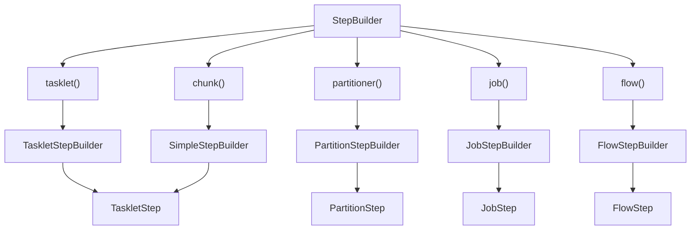

이 관계를 기억하면 어떤 API를 사용했을 때 어떤 Step이 생성되는지 쉽게 파악할 수 있다.

이제 각각의 Builder를 구체적으로 살펴보자.

---

### TaskletStepBuilder

TaskletStepBuilder는 Tasklet 기반 Step을 생성하기 위한 Builder다.

가장 기본적인 Step 생성 방식이다.

일반적으로 개발자가 직접 정의한 Tasklet 구현체를 전달한다.

예를 들어 다음과 같다.

```java
@Bean
public Step taskletStep(
        JobRepository jobRepository,
        PlatformTransactionManager transactionManager
) {
    return new StepBuilder("taskletStep", jobRepository)
            .tasklet((contribution, chunkContext) -> {

                System.out.println("Tasklet 실행");

                return RepeatStatus.FINISHED;

            }, transactionManager)
            .build();
}
```

이 코드에서 중요한 부분은 다음이다.

```java
.tasklet(tasklet, transactionManager)
```

StepBuilder는 Tasklet을 전달받으면 TaskletStepBuilder를 생성한다.

Spring Batch 5.2.4의 핵심 구현은 다음과 같다.

```java
public TaskletStepBuilder tasklet(
        Tasklet tasklet,
        PlatformTransactionManager transactionManager
) {
    return new TaskletStepBuilder(this)
            .tasklet(tasklet, transactionManager);
}
```

이 메서드에서 `new TaskletStepBuilder(this)`가 실행된다.

따라서 다음과 같은 구조가 만들어진다.

```text
StepBuilder
    │
    ▼
tasklet()
    │
    ▼
TaskletStepBuilder
    │
    ▼
Tasklet 설정
    │
    ▼
build()
    │
    ▼
TaskletStep
```

여기서 TaskletStepBuilder는 전달받은 Tasklet을 내부에 저장한다.

그리고 최종적으로 TaskletStep을 생성할 때 해당 Tasklet을 등록한다.

#### TaskletStepBuilder의 내부 역할

TaskletStepBuilder는 다음과 같은 속성을 관리한다.

```text
TaskletStepBuilder
       │
       ├── Tasklet
       ├── TransactionManager
       ├── Step 이름
       ├── JobRepository
       └── 공통 Step 설정
```

이후 build()를 호출하면 TaskletStep이 생성된다.

실제 Tasklet 실행은 Step이 수행될 때 발생한다.

따라서 다음과 같이 구분해야 한다.

```text
Step 설정 시점
    │
    ▼
TaskletStepBuilder 생성
    │
    ▼
TaskletStep 생성
```

```text
Job 실행 시점
    │
    ▼
TaskletStep.execute()
    │
    ▼
Tasklet.execute()
```

TaskletStepBuilder는 주로 단일 작업을 수행하는 Step에 적합하다.

예를 들어 다음과 같은 작업이 있다.

- 특정 테이블의 데이터 삭제
- 배치 실행 전 환경 검증
- 외부 API 호출
- 파일 생성
- 특정 상태값 변경

이러한 작업은 반드시 Chunk 구조로 만들 필요가 없다.

따라서 Tasklet 기반으로 구현하는 것이 적절할 수 있다.

---

### SimpleStepBuilder

SimpleStepBuilder는 Chunk 기반 Step을 생성하기 위한 Builder다.

이름만 보면 SimpleStep이라는 별도의 Step 구현체를 생성할 것 같지만 실제로는 그렇지 않다.

**SimpleStepBuilder도 최종적으로 TaskletStep을 생성한다.**

이것이 StepBuilder 아키텍처에서 가장 흥미로운 부분이다.

Chunk 기반 처리는 일반적으로 세 가지 컴포넌트로 구성된다.

첫 번째는 ItemReader다.

두 번째는 ItemProcessor다.

세 번째는 ItemWriter다.

전체 구조는 다음과 같다.

```text
Chunk Processing
       │
       ▼
ItemReader
       │
       ▼
ItemProcessor
       │
       ▼
ItemWriter
```

ItemReader는 데이터를 읽는다.

ItemProcessor는 읽은 데이터를 가공한다.

ItemWriter는 처리된 데이터를 저장한다.

예를 들어 다음과 같이 Step을 구성할 수 있다.

```java
@Bean
public Step chunkStep(
        JobRepository jobRepository,
        PlatformTransactionManager transactionManager,
        ItemReader<String> reader,
        ItemProcessor<String, String> processor,
        ItemWriter<String> writer
) {
    return new StepBuilder("chunkStep", jobRepository)
            .<String, String>chunk(100, transactionManager)
            .reader(reader)
            .processor(processor)
            .writer(writer)
            .build();
}
```

여기서 중요한 API는 다음이다.

```java
.<String, String>chunk(100, transactionManager)
```

이 API는 Chunk 크기를 100으로 설정한다.

즉, 일반적으로 최대 100개의 데이터를 하나의 Chunk로 구성해 처리하도록 설정한다.

그리고 SimpleStepBuilder를 반환한다.

Spring Batch 5.2.4의 StepBuilder는 내부적으로 다음과 같이 동작한다.

```java
public <I, O> SimpleStepBuilder<I, O> chunk(
        int chunkSize,
        PlatformTransactionManager transactionManager
) {
    return new SimpleStepBuilder<I, O>(this)
            .transactionManager(transactionManager)
            .chunk(chunkSize);
}
```

따라서 다음 구조가 만들어진다.

```text
StepBuilder
    │
    ▼
chunk()
    │
    ▼
SimpleStepBuilder
    │
    ├── ItemReader
    ├── ItemProcessor
    ├── ItemWriter
    └── ChunkSize
    │
    ▼
build()
    │
    ▼
TaskletStep
```

여기서 한 가지 의문이 생긴다.

Tasklet 기반 Step과 Chunk 기반 Step은 실행 구조가 다른데 왜 둘 다 TaskletStep을 생성할까?

그 이유는 Spring Batch가 **Chunk 기반 처리를 수행하는 전용 Tasklet 구현체**를 제공하기 때문이다.

---

### TaskletStepBuilder와 SimpleStepBuilder가 같은 Step을 생성하는 이유

먼저 일반적인 Tasklet 기반 Step을 살펴보자.

```text
TaskletStep
    │
    ▼
사용자 정의 Tasklet
    │
    ▼
비즈니스 로직
```

개발자가 직접 구현한 Tasklet을 실행한다.

반면 Chunk 기반 Step은 다음과 같다.

```text
TaskletStep
    │
    ▼
ChunkOrientedTasklet
    │
    ├── ItemReader
    │
    ├── ItemProcessor
    │
    └── ItemWriter
```

Chunk 기반 Step에서는 개발자가 Tasklet을 직접 구현하지 않는다.

대신 Spring Batch가 내부적으로 `ChunkOrientedTasklet`을 생성한다.

그리고 해당 Tasklet이 Reader, Processor, Writer를 이용해 Chunk 단위로 데이터를 처리한다.

즉, 두 방식은 최종 Step 구현체는 같지만 내부에 등록되는 Tasklet이 다르다.

| 구분 | Tasklet 기반 | Chunk 기반 |
|---|---|---|
| Builder | TaskletStepBuilder | SimpleStepBuilder |
| 최종 Step | TaskletStep | TaskletStep |
| 내부 Tasklet | 사용자 정의 Tasklet | ChunkOrientedTasklet |
| 처리 방식 | 직접 정의한 작업 실행 | Reader, Processor, Writer |
| 반복 처리 | RepeatStatus 기반 | Chunk 단위 반복 |
| 트랜잭션 | Tasklet 실행 단위 | Chunk 단위 |
| 대표 활용 | 단일 작업, API 호출, 파일 생성 | 대량 데이터 처리 |

이러한 구조가 가능한 이유는 TaskletStep이 특정 비즈니스 로직에 종속되지 않고 Tasklet 인터페이스를 실행하는 구조로 설계되어 있기 때문이다.

TaskletStep은 내부 Tasklet이 직접 작성한 구현체인지, Spring Batch가 생성한 구현체인지 구분할 필요가 없다.

Tasklet 인터페이스의 `execute()`를 호출하면 된다.

이것이 인터페이스 기반 추상화의 장점이다.

---

### ChunkOrientedTasklet은 어떻게 생성될까?

SimpleStepBuilder의 내부 동작을 조금 더 살펴보자.

Spring Batch 5.2.4에서는 SimpleStepBuilder의 `createTasklet()`이 Chunk 기반 Tasklet을 생성한다.

핵심적인 구조는 다음과 같다.

```java
@Override
protected Tasklet createTasklet() {

    SimpleChunkProvider<I> chunkProvider =
            new SimpleChunkProvider<>(
                    getReader(),
                    createChunkOperations()
            );

    SimpleChunkProcessor<I, O> chunkProcessor =
            new SimpleChunkProcessor<>(
                    getProcessor(),
                    getWriter()
            );

    return new ChunkOrientedTasklet<>(
            chunkProvider,
            chunkProcessor
    );
}
```

위 코드는 주요 객체 생성 과정을 이해하기 위해 부가 설정과 검증을 생략한 형태다.

실제 구현에서는 Reader와 Writer의 존재 여부를 확인하고 Listener, MeterRegistry, Buffering 설정 등을 적용한다.

여기서 중요한 객체는 세 가지다.

첫 번째는 SimpleChunkProvider다.

두 번째는 SimpleChunkProcessor다.

세 번째는 ChunkOrientedTasklet이다.

#### SimpleChunkProvider

SimpleChunkProvider는 ItemReader를 통해 데이터를 읽고 하나의 Chunk를 구성한다.

예를 들어 Chunk 크기가 3이라면 다음과 같이 데이터를 읽는다.

```text
ItemReader
    │
    ├── Item 1
    ├── Item 2
    └── Item 3
    │
    ▼
Chunk 생성
```

#### SimpleChunkProcessor

SimpleChunkProcessor는 Chunk에 포함된 데이터를 처리한다.

ItemProcessor가 등록되어 있다면 각 데이터를 가공한다.

그리고 ItemWriter로 결과를 전달한다.

```text
Chunk
   │
   ▼
ItemProcessor
   │
   ▼
ItemWriter
```

#### ChunkOrientedTasklet

ChunkOrientedTasklet은 ChunkProvider와 ChunkProcessor를 조합해 Chunk 기반 처리를 수행한다.

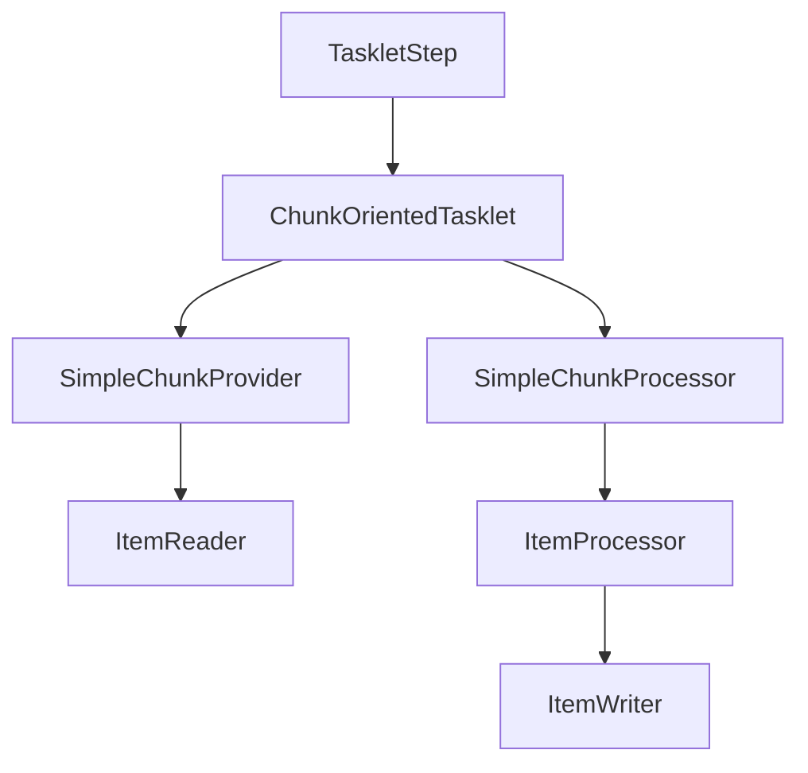

따라서 Chunk 기반 Step도 TaskletStep을 이용할 수 있다.

**Chunk는 Tasklet과 완전히 분리된 별도의 Step 실행 구조가 아니라, TaskletStep 내부에 ChunkOrientedTasklet을 등록하는 방식으로 구현된다.**

이 구조를 이해하면 Spring Batch에서 Tasklet과 Chunk가 어떤 관계인지 정확하게 이해할 수 있다.

---

### chunk(int)와 chunk(CompletionPolicy)의 차이

StepBuilder는 Chunk를 구성할 때 두 가지 대표적인 방식을 제공한다.

첫 번째는 Chunk 크기를 지정하는 방식이다.

```java
.<String, String>chunk(
        100,
        transactionManager
)
```

두 번째는 CompletionPolicy를 지정하는 방식이다.

```java
.<String, String>chunk(
        new SimpleCompletionPolicy(100),
        transactionManager
)
```

두 방식 모두 SimpleStepBuilder를 반환한다.

따라서 최종적으로 TaskletStep을 생성한다.

차이는 Chunk를 완료하는 조건을 지정하는 방식이다.

| 구분 | chunk(int) | chunk(CompletionPolicy) |
|---|---|---|
| 기준 | 고정된 처리 개수 | CompletionPolicy |
| 사용 방식 | 정수 전달 | 정책 객체 전달 |
| 반환 Builder | SimpleStepBuilder | SimpleStepBuilder |
| 최종 Step | TaskletStep | TaskletStep |
| 적합한 상황 | 일반적인 고정 크기 Chunk | 커스텀 완료 조건이 필요한 경우 |

CompletionPolicy는 Chunk의 완료 여부를 결정하는 정책이다.

따라서 단순한 처리 건수뿐 아니라 별도의 완료 기준이 필요하다면 CompletionPolicy 기반 구성을 고려할 수 있다.

다만 Chunk의 완료 정책과 트랜잭션 커밋은 함께 고려해야 한다.

특히 대용량 데이터를 처리하는 배치에서는 Chunk 크기에 따라 데이터베이스 부하, 메모리 사용량, 롤백 범위가 달라질 수 있다.

---

### PartitionStepBuilder

PartitionStepBuilder는 PartitionStep을 생성하기 위한 Builder다.

Partition은 하나의 작업을 여러 개의 처리 단위로 분할하는 기능이다.

예를 들어 정산 데이터가 100만 건 있다고 생각해보자.

하나의 Step에서 전체 데이터를 처리할 수도 있다.

```text
SettlementStep
       │
       ▼
1,000,000건 처리
```

하지만 데이터를 여러 범위로 나누어 처리할 수도 있다.

```text
PartitionStep
       │
       ├── Partition 1 → 1~250,000
       │
       ├── Partition 2 → 250,001~500,000
       │
       ├── Partition 3 → 500,001~750,000
       │
       └── Partition 4 → 750,001~1,000,000
```

이렇게 분할된 작업은 적절한 TaskExecutor나 PartitionHandler 설정을 통해 병렬로 처리할 수 있다.

StepBuilder에서는 다음 API를 이용한다.

```java
new StepBuilder("partitionStep", jobRepository)
        .partitioner("workerStep", partitioner)
        .step(workerStep)
        .gridSize(4)
        .taskExecutor(taskExecutor)
        .build();
```

여기서 중요한 부분은 다음이다.

```java
.partitioner("workerStep", partitioner)
```

이 API는 PartitionStepBuilder를 생성한다.

그리고 최종적으로 PartitionStep을 생성한다.

```text
StepBuilder
    │
    ▼
partitioner()
    │
    ▼
PartitionStepBuilder
    │
    ├── Partitioner
    ├── Worker Step
    ├── GridSize
    └── TaskExecutor
    │
    ▼
build()
    │
    ▼
PartitionStep
```

#### PartitionStep의 실행 구조

PartitionStep은 하나의 작업을 여러 개의 StepExecution으로 분할할 수 있다.

각 Partition에는 독립적인 ExecutionContext를 전달할 수 있다.

예를 들어 다음과 같다.

```text
Partition 1
    │
    └── startId = 1
        endId = 250000
```

```text
Partition 2
    │
    └── startId = 250001
        endId = 500000
```

이러한 정보를 이용해 동일한 Worker Step이 서로 다른 데이터 범위를 처리하도록 구성할 수 있다.

다만 여기서 주의해야 할 부분이 있다.

**PartitionStepBuilder를 사용했다고 해서 반드시 병렬 실행되는 것은 아니다.**

Spring Batch 5.2.4의 PartitionStepBuilder는 별도의 TaskExecutor를 지정하지 않으면 기본적으로 SyncTaskExecutor를 사용할 수 있다.

따라서 실제 병렬 실행을 위해서는 적절한 TaskExecutor를 지정해야 한다.

또한 Partition은 Step 실행 단위를 분리하지만, 각 Partition이 사용하는 Reader나 Writer 등의 상태를 안전하게 관리할 수 있도록 설계해야 한다.

---

### JobStepBuilder

JobStepBuilder는 JobStep을 생성하기 위한 Builder다.

JobStep은 Step 내부에서 별도의 Job을 실행하는 구조다.

일반적인 Job과 Step의 관계는 다음과 같다.

```text
Job
 │
 ├── Step 1
 │
 └── Step 2
```

반면 JobStep을 사용하면 다음과 같은 구조를 만들 수 있다.

```text
ParentJob
    │
    └── JobStep
           │
           ▼
        ChildJob
           │
           ├── ChildStep 1
           │
           └── ChildStep 2
```

즉, 부모 Job의 특정 Step이 자식 Job을 실행한다.

이러한 구조는 복잡한 작업을 별도의 Job으로 분리해야 하는 경우에 사용할 수 있다.

예를 들어 정산 작업을 다음과 같이 구분할 수 있다.

```text
SettlementParentJob
       │
       ├── 데이터 준비 Step
       │
       ├── 정산 계산 JobStep
       │       │
       │       ▼
       │   SettlementCalculationJob
       │       │
       │       ├── 계산 Step 1
       │       └── 계산 Step 2
       │
       └── 정산 결과 검증 Step
```

JobStep은 다음과 같이 생성할 수 있다.

```java
@Bean
public Step childJobStep(
        JobRepository jobRepository,
        JobLauncher jobLauncher,
        Job childJob
) {
    return new StepBuilder(
            "childJobStep",
            jobRepository
    )
            .job(childJob)
            .launcher(jobLauncher)
            .build();
}
```

여기서 중요한 부분은 다음이다.

```java
.job(childJob)
```

이 API는 JobStepBuilder를 생성한다.

그리고 다음 API를 이용해 JobLauncher를 설정한다.

```java
.launcher(jobLauncher)
```

최종적으로 build()를 호출하면 JobStep이 생성된다.

```text
StepBuilder
    │
    ▼
job(childJob)
    │
    ▼
JobStepBuilder
    │
    ├── ChildJob
    ├── JobLauncher
    └── JobParametersExtractor
    │
    ▼
build()
    │
    ▼
JobStep
```

#### JobStep이 자식 Job을 실행하는 원리

JobStep은 내부적으로 JobLauncher를 사용한다.

핵심적인 실행 구조는 다음과 같다.

```java
JobParameters jobParameters =
        jobParametersExtractor.getJobParameters(
                job,
                stepExecution
        );

JobExecution childExecution =
        jobLauncher.run(
                job,
                jobParameters
        );
```

즉, JobStep은 자식 Job에 전달할 JobParameters를 준비한 뒤 JobLauncher를 이용해 해당 Job을 실행한다.

따라서 부모 Job과 자식 Job은 서로 다른 JobExecution을 가진다.

이것이 단순히 Step 안에서 메서드를 호출하는 방식과 다른 점이다.

부모 Job의 Step 실행 이력과 자식 Job의 실행 이력을 별도로 관리할 수 있다.

---

### FlowStepBuilder

FlowStepBuilder는 FlowStep을 생성하기 위한 Builder다.

Flow는 여러 Step의 실행 흐름을 정의하는 객체다.

일반적인 SimpleJob은 Step을 순차적으로 실행한다.

반면 Flow를 사용하면 실행 상태에 따른 분기나 여러 Step의 연결 관계를 구성할 수 있다.

예를 들어 다음과 같다.

```text
ValidationFlow
       │
       ▼
데이터 검증
       │
       ├── 성공 → 데이터 저장
       │
       └── 실패 → 오류 처리
```

Step 내부에서 이러한 Flow를 실행해야 한다면 FlowStep을 사용할 수 있다.

먼저 Flow를 구성한다.

```java
@Bean
public Flow validationFlow(
        Step validationStep
) {
    return new FlowBuilder<Flow>("validationFlow")
            .start(validationStep)
            .build();
}
```

이후 해당 Flow를 Step에 등록한다.

```java
@Bean
public Step flowStep(
        JobRepository jobRepository,
        Flow validationFlow
) {
    return new StepBuilder(
            "flowStep",
            jobRepository
    )
            .flow(validationFlow)
            .build();
}
```

여기서 중요한 부분은 다음이다.

```java
.flow(validationFlow)
```

이 API는 FlowStepBuilder를 생성한다.

그리고 최종적으로 FlowStep을 생성한다.

```text
StepBuilder
    │
    ▼
flow()
    │
    ▼
FlowStepBuilder
    │
    └── Flow 설정
    │
    ▼
build()
    │
    ▼
FlowStep
```

FlowStep은 내부에 등록된 Flow의 실행을 담당한다.

따라서 다음과 같은 구조를 만들 수 있다.

```text
ParentJob
    │
    └── FlowStep
           │
           ▼
       ValidationFlow
           │
           ├── Step A
           ├── Step B
           └── Step C
```

여기서 FlowStep과 JobStep을 구분해야 한다.

JobStep은 별도의 Job을 실행한다.

FlowStep은 Flow를 실행한다.

따라서 JobStep은 자식 Job의 JobInstance와 JobExecution이 별도로 생성될 수 있다.

반면 FlowStep은 일반적으로 부모 JobExecution의 실행 흐름 안에서 내부 Step을 처리한다.

이 차이는 실행 메타데이터를 확인할 때 중요하다.

---

### 5가지 StepBuilder 비교

지금까지 살펴본 Builder를 하나의 표로 정리해보자.

| Builder | 최종 Step | 내부 실행 대상 | 주요 용도 |
|---|---|---|---|
| TaskletStepBuilder | TaskletStep | 사용자 정의 Tasklet | 단일 작업 |
| SimpleStepBuilder | TaskletStep | ChunkOrientedTasklet | 대량 데이터 처리 |
| PartitionStepBuilder | PartitionStep | PartitionHandler 및 Worker Step | 분할 처리 |
| JobStepBuilder | JobStep | Child Job | Job 재사용 및 계층화 |
| FlowStepBuilder | FlowStep | Flow | 실행 흐름 재사용 |

이 표에서 중요한 사실은 두 가지다.

첫 번째는 API에 따라 Builder가 달라진다는 것이다.

두 번째는 Builder가 달라도 최종 Step 구현체가 같을 수 있다는 것이다.

특히 TaskletStepBuilder와 SimpleStepBuilder의 차이를 정확히 이해해야 한다.

---

### StepBuilder의 클래스 상속 구조

이제 StepBuilder의 전체 클래스 구조를 살펴보자.

Spring Batch 5.2.4에서 StepBuilder는 `StepBuilderHelper`를 상속한다.

```java
public class StepBuilder
        extends StepBuilderHelper<StepBuilder> {
}
```

StepBuilderHelper는 Step 생성에 필요한 공통 설정을 관리한다.

그리고 각 하위 Builder도 StepBuilderHelper를 상속하거나 이를 상속하는 클래스를 통해 공통 기능을 사용한다.

대표적인 관계는 다음과 같다.

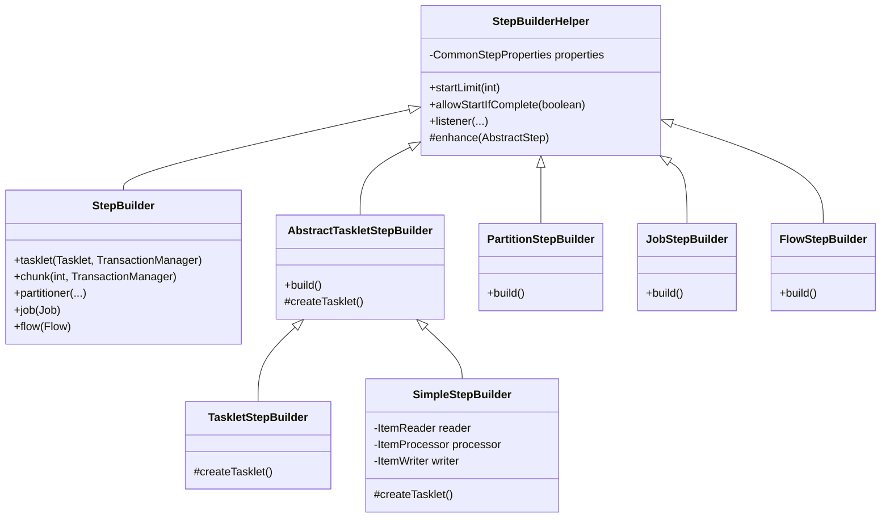

이 구조에서 중요한 클래스는 StepBuilderHelper와 AbstractTaskletStepBuilder다.

#### StepBuilderHelper

StepBuilderHelper는 모든 Builder가 공유하는 기본 설정을 관리한다.

대표적인 설정은 다음과 같다.

```text
CommonStepProperties
       │
       ├── Step 이름
       ├── JobRepository
       ├── startLimit
       ├── allowStartIfComplete
       ├── StepExecutionListener
       └── 모니터링 관련 설정
```

각 하위 Builder는 이러한 공통 속성을 이용해 Step을 구성한다.

#### AbstractTaskletStepBuilder

AbstractTaskletStepBuilder는 TaskletStep을 생성하는 Builder들이 공통으로 사용하는 추상 클래스다.

대표적인 하위 클래스는 다음과 같다.

```text
AbstractTaskletStepBuilder
       │
       ├── TaskletStepBuilder
       │
       └── SimpleStepBuilder
```

두 클래스 모두 TaskletStep을 생성하기 때문에 공통 생성 로직을 상위 클래스에서 관리한다.

다만 내부 Tasklet을 만드는 방식은 다르다.

TaskletStepBuilder는 개발자가 전달한 Tasklet을 사용한다.

SimpleStepBuilder는 ChunkOrientedTasklet을 생성한다.

이렇게 공통 생성 로직과 구체적인 Tasklet 생성 로직을 분리한 구조다.

---

### AbstractTaskletStepBuilder의 build() 원리

Spring Batch 5.2.4의 AbstractTaskletStepBuilder는 TaskletStep을 생성하는 공통 로직을 가지고 있다.

핵심 구조를 살펴보자.

```java
public TaskletStep build() {

    TaskletStep step =
            new TaskletStep(getName());

    super.enhance(step);

    step.setTransactionManager(
            transactionManager
    );

    step.setTasklet(
            createTasklet()
    );

    return step;
}
```

이 코드는 주요 생성 흐름만 표현한 것이다.

실제 구현에서는 Listener 등록, 반복 실행 설정, ItemStream 등록, 속성 검증 등 추가적인 작업이 수행된다.

여기서 중요한 부분은 다음이다.

```java
TaskletStep step =
        new TaskletStep(getName());
```

TaskletStep을 생성한다.

이후 다음 코드를 실행한다.

```java
super.enhance(step);
```

공통 Step 속성을 적용한다.

마지막으로 다음 코드를 실행한다.

```java
step.setTasklet(
        createTasklet()
);
```

여기서 `createTasklet()`은 추상 메서드다.

따라서 어떤 하위 Builder를 사용하는지에 따라 실제 호출되는 구현이 달라진다.

#### TaskletStepBuilder의 createTasklet()

TaskletStepBuilder는 전달받은 Tasklet을 반환한다.

```java
@Override
protected Tasklet createTasklet() {

    return tasklet;
}
```

#### SimpleStepBuilder의 createTasklet()

SimpleStepBuilder는 ChunkOrientedTasklet을 생성한다.

```java
@Override
protected Tasklet createTasklet() {

    // Reader 기반 ChunkProvider 생성

    // Processor와 Writer 기반 ChunkProcessor 생성

    // ChunkOrientedTasklet 생성

    return chunkOrientedTasklet;
}
```

이처럼 상위 클래스가 공통 생성 절차를 정의하고, 하위 클래스가 내부 Tasklet을 생성하는 방식을 결정한다.

이는 템플릿 메서드 패턴과 추상화 구조를 이해하는 데 좋은 사례다.

---

### JobRepository는 어떻게 Step에 전달될까?

Spring Batch에서 Step은 실행 정보를 JobRepository에 저장한다.

따라서 Step 객체에는 JobRepository가 필요하다.

Spring Batch 5.2.4에서는 StepBuilder를 생성할 때 JobRepository를 전달한다.

```java
new StepBuilder(
        "stepName",
        jobRepository
);
```

StepBuilder는 전달받은 JobRepository를 StepBuilderHelper의 공통 속성에 저장한다.

이후 하위 Builder가 생성될 때 해당 설정을 복사한다.

그리고 최종적으로 Step을 생성할 때 공통 속성을 적용한다.

핵심 구조는 다음과 같다.

```text
StepBuilder
    │
    └── JobRepository
           │
           ▼
StepBuilderHelper
           │
           ▼
하위 Builder
           │
           ▼
build()
           │
           ▼
Step
    │
    └── JobRepository
```

이 과정을 통해 Step은 실행 과정에서 다음과 같은 작업을 수행할 수 있다.

- StepExecution 저장
- StepExecution 상태 갱신
- ExecutionContext 저장
- 실행 통계 저장
- 재시작에 필요한 메타데이터 관리

여기서 중요한 것은 StepBuilder가 JobRepository를 직접 실행하는 주체가 아니라는 사실이다.

StepBuilder는 JobRepository를 최종 Step에 전달한다.

실제 메타데이터 저장과 갱신은 Step 실행 과정에서 수행된다.

---

### StepBuilder와 JobBuilder의 차이

StepBuilder의 구조는 JobBuilder와 매우 유사하다.

두 클래스 모두 Builder 패턴을 사용한다.

또한 공통 설정을 관리하는 Helper 클래스를 가지고 있다.

하지만 생성하는 도메인 객체가 다르다.

| 구분 | JobBuilder | StepBuilder |
|---|---|---|
| 목적 | Job 생성 | Step 생성 |
| 공통 Helper | JobBuilderHelper | StepBuilderHelper |
| 주요 결과 | SimpleJob, FlowJob | TaskletStep, PartitionStep, JobStep, FlowStep |
| 주요 API | start(), next(), validator(), incrementer() | tasklet(), chunk(), partitioner(), job(), flow() |
| 실행 책임 | Job 전체 실행 흐름 | 개별 Step 실행 |
| 실행 메타데이터 | JobExecution | StepExecution |

예를 들어 JobBuilder는 다음과 같이 사용한다.

```java
new JobBuilder("batchJob", jobRepository)
        .start(step1)
        .next(step2)
        .build();
```

반면 StepBuilder는 다음과 같이 사용한다.

```java
new StepBuilder("step1", jobRepository)
        .tasklet(tasklet, transactionManager)
        .build();
```

JobBuilder는 Step의 실행 관계를 정의한다.

StepBuilder는 개별 Step의 실행 구조를 정의한다.

따라서 두 Builder는 서로 다른 계층에서 사용된다.

```text
JobBuilder
    │
    ▼
Job
    │
    ├── StepBuilder
    │       │
    │       └── Step 1
    │
    └── StepBuilder
            │
            └── Step 2
```

이러한 관계를 이해하면 Job과 Step의 생성 책임을 명확하게 구분할 수 있다.

---

### 실제 5가지 StepBuilder 구현하기

이번에는 Spring Batch 5.2.4에서 사용할 수 있는 다섯 가지 Step을 직접 구성해보자.

각 Step은 서로 다른 Builder를 통해 생성된다.

전체 구성은 다음과 같다.

```text
stepBuilderArchitectureJob
       │
       ├── taskletStep
       │
       ├── chunkStep
       │
       ├── partitionManagerStep
       │       │
       │       └── partitionWorkerStep
       │
       ├── jobStep
       │       │
       │       └── childJob
       │               │
       │               └── childTaskletStep
       │
       └── flowStep
               │
               └── internalFlow
                       │
                       └── flowTaskletStep
```

여기서는 다섯 가지 Step을 하나의 Job에 연결한다.

따라서 Job이 실행되면 각 Step의 실제 실행 방식도 확인할 수 있다.

#### 개발 환경

| 항목 | 기술 |
|---|---|
| Java | Java 17 |
| Spring Boot | 3.4.x |
| Spring Batch | 5.2.x |
| Build Tool | Maven |
| Database | H2 |
| Step 생성 | StepBuilder |
| 실행 방식 | Tasklet, Chunk, Partition, Job, Flow |

---

### Maven 의존성 설정

`pom.xml`

```xml
<?xml version="1.0" encoding="UTF-8"?>
<project xmlns="http://maven.apache.org/POM/4.0.0"
         xmlns:xsi="http://www.w3.org/2001/XMLSchema-instance"
         xsi:schemaLocation="
             http://maven.apache.org/POM/4.0.0
             https://maven.apache.org/xsd/maven-4.0.0.xsd">

    <modelVersion>4.0.0</modelVersion>

    <parent>
        <groupId>org.springframework.boot</groupId>
        <artifactId>spring-boot-starter-parent</artifactId>
        <version>3.4.13</version>
        <relativePath/>
    </parent>

    <groupId>com.example</groupId>
    <artifactId>spring-batch-step-builder</artifactId>
    <version>0.0.1-SNAPSHOT</version>

    <properties>
        <java.version>17</java.version>
        <spring-batch.version>5.2.4</spring-batch.version>
    </properties>

    <dependencies>

        <dependency>
            <groupId>org.springframework.boot</groupId>
            <artifactId>spring-boot-starter-batch</artifactId>
        </dependency>

        <dependency>
            <groupId>com.h2database</groupId>
            <artifactId>h2</artifactId>
            <scope>runtime</scope>
        </dependency>

        <dependency>
            <groupId>org.springframework.boot</groupId>
            <artifactId>spring-boot-starter-test</artifactId>
            <scope>test</scope>
        </dependency>

    </dependencies>

    <build>
        <plugins>
            <plugin>
                <groupId>org.springframework.boot</groupId>
                <artifactId>spring-boot-maven-plugin</artifactId>
            </plugin>
        </plugins>
    </build>

</project>
```

이번 예제에서는 Spring Batch와 H2 데이터베이스를 사용한다.

별도의 데이터베이스 서버 없이 Job과 Step의 실행 구조를 확인할 수 있다.

---

### application.yml 설정

`application.yml`

```yaml
spring:
  application:
    name: spring-batch-step-builder

  main:
    web-application-type: none

  datasource:
    url: jdbc:h2:mem:stepbuilderdb;DB_CLOSE_DELAY=-1
    driver-class-name: org.h2.Driver
    username: sa
    password:

  batch:
    job:
      enabled: true
      name: stepBuilderArchitectureJob

    jdbc:
      initialize-schema: always

logging:
  level:
    org.springframework.batch: INFO
    com.example.batch: INFO
```

이번에는 H2 인메모리 데이터베이스를 사용한다.

애플리케이션이 시작될 때 Spring Batch 메타데이터 테이블을 생성한다.

또한 다음 설정을 사용했다.

```yaml
spring:
  batch:
    job:
      name: stepBuilderArchitectureJob
```

여러 Job이 등록되어 있어도 메인 Job만 자동 실행하도록 지정한다.

---

### Spring Boot 애플리케이션 구성

`BatchApplication.java`

```java
package com.example.batch;

import org.springframework.boot.SpringApplication;
import org.springframework.boot.autoconfigure.SpringBootApplication;

@SpringBootApplication
public class BatchApplication {

    public static void main(String[] args) {

        SpringApplication.run(
                BatchApplication.class,
                args
        );
    }
}
```

이제 각 Step을 정의한다.

---

### StepBuilderArchitectureConfiguration 전체 코드

`StepBuilderArchitectureConfiguration.java`

```java
package com.example.batch;

import java.util.LinkedHashMap;
import java.util.List;
import java.util.Locale;
import java.util.Map;

import org.slf4j.Logger;
import org.slf4j.LoggerFactory;

import org.springframework.batch.core.Job;
import org.springframework.batch.core.Step;

import org.springframework.batch.core.job.builder.FlowBuilder;
import org.springframework.batch.core.job.builder.JobBuilder;

import org.springframework.batch.core.job.flow.Flow;

import org.springframework.batch.core.launch.JobLauncher;

import org.springframework.batch.core.partition.support.Partitioner;

import org.springframework.batch.core.repository.JobRepository;

import org.springframework.batch.core.step.builder.StepBuilder;

import org.springframework.batch.item.ExecutionContext;
import org.springframework.batch.item.ItemReader;
import org.springframework.batch.item.support.ListItemReader;

import org.springframework.batch.repeat.RepeatStatus;

import org.springframework.beans.factory.annotation.Qualifier;

import org.springframework.context.annotation.Bean;
import org.springframework.context.annotation.Configuration;

import org.springframework.batch.core.configuration.annotation.StepScope;

import org.springframework.core.task.TaskExecutor;

import org.springframework.scheduling.concurrent.ThreadPoolTaskExecutor;

import org.springframework.transaction.PlatformTransactionManager;

@Configuration
public class StepBuilderArchitectureConfiguration {

    private static final Logger log =
            LoggerFactory.getLogger(
                    StepBuilderArchitectureConfiguration.class
            );

    // --------------------------------------------------
    // 1. TaskletStepBuilder
    // --------------------------------------------------

    @Bean
    public Step taskletStep(
            JobRepository jobRepository,
            PlatformTransactionManager transactionManager
    ) {

        Step step = new StepBuilder(
                "taskletStep",
                jobRepository
        )
                .tasklet((contribution, chunkContext) -> {

                    log.info(
                            "Tasklet 기반 Step 실행"
                    );

                    return RepeatStatus.FINISHED;

                }, transactionManager)
                .build();

        log.info(
                "taskletStep 구현체={}",
                step.getClass().getSimpleName()
        );

        return step;
    }

    // --------------------------------------------------
    // 2. SimpleStepBuilder
    // --------------------------------------------------

    @Bean
    @StepScope
    public ListItemReader<String> chunkReader() {

        return new ListItemReader<>(
                List.of(
                        "order-1",
                        "order-2",
                        "order-3",
                        "order-4",
                        "order-5"
                )
        );
    }

    @Bean
    public Step chunkStep(
            JobRepository jobRepository,
            PlatformTransactionManager transactionManager,
            @Qualifier("chunkReader")
            ItemReader<String> reader
    ) {

        Step step = new StepBuilder(
                "chunkStep",
                jobRepository
        )
                .<String, String>chunk(
                        2,
                        transactionManager
                )
                .reader(reader)
                .processor(item ->
                        item.toUpperCase(Locale.ROOT)
                )
                .writer(chunk -> {

                    log.info(
                            "Chunk Writer 실행: {}",
                            chunk.getItems()
                    );
                })
                .build();

        log.info(
                "chunkStep 구현체={}",
                step.getClass().getSimpleName()
        );

        return step;
    }

    // --------------------------------------------------
    // 3. PartitionStepBuilder
    // --------------------------------------------------

    @Bean
    public Partitioner demoPartitioner() {

        return gridSize -> {

            Map<String, ExecutionContext> partitions =
                    new LinkedHashMap<>();

            for (int i = 0; i < gridSize; i++) {

                ExecutionContext context =
                        new ExecutionContext();

                context.putInt(
                        "partitionIndex",
                        i
                );

                partitions.put(
                        "partition" + i,
                        context
                );
            }

            return partitions;
        };
    }

    @Bean
    public Step partitionWorkerStep(
            JobRepository jobRepository,
            PlatformTransactionManager transactionManager
    ) {

        return new StepBuilder(
                "partitionWorkerStep",
                jobRepository
        )
                .tasklet((contribution, chunkContext) -> {

                    ExecutionContext context =
                            contribution
                                    .getStepExecution()
                                    .getExecutionContext();

                    int partitionIndex =
                            context.getInt(
                                    "partitionIndex"
                            );

                    log.info(
                            "Partition Worker 실행: index={}, thread={}",
                            partitionIndex,
                            Thread.currentThread().getName()
                    );

                    return RepeatStatus.FINISHED;

                }, transactionManager)
                .build();
    }

    @Bean
    public ThreadPoolTaskExecutor partitionTaskExecutor() {

        ThreadPoolTaskExecutor executor =
                new ThreadPoolTaskExecutor();

        executor.setCorePoolSize(3);
        executor.setMaxPoolSize(3);
        executor.setQueueCapacity(3);
        executor.setThreadNamePrefix(
                "partition-worker-"
        );

        executor.initialize();

        return executor;
    }

    @Bean
    public Step partitionManagerStep(
            JobRepository jobRepository,
            @Qualifier("demoPartitioner")
            Partitioner partitioner,
            @Qualifier("partitionWorkerStep")
            Step workerStep,
            @Qualifier("partitionTaskExecutor")
            TaskExecutor taskExecutor
    ) {

        Step step = new StepBuilder(
                "partitionManagerStep",
                jobRepository
        )
                .partitioner(
                        "partitionWorkerStep",
                        partitioner
                )
                .step(workerStep)
                .gridSize(3)
                .taskExecutor(taskExecutor)
                .build();

        log.info(
                "partitionManagerStep 구현체={}",
                step.getClass().getSimpleName()
        );

        return step;
    }

    // --------------------------------------------------
    // 4. JobStepBuilder
    // --------------------------------------------------

    @Bean
    public Step childTaskletStep(
            JobRepository jobRepository,
            PlatformTransactionManager transactionManager
    ) {

        return new StepBuilder(
                "childTaskletStep",
                jobRepository
        )
                .tasklet((contribution, chunkContext) -> {

                    log.info(
                            "Child Job 내부 Step 실행"
                    );

                    return RepeatStatus.FINISHED;

                }, transactionManager)
                .build();
    }

    @Bean
    public Job childJob(
            JobRepository jobRepository,
            @Qualifier("childTaskletStep")
            Step childStep
    ) {

        return new JobBuilder(
                "childJob",
                jobRepository
        )
                .start(childStep)
                .build();
    }

    @Bean
    public Step jobStep(
            JobRepository jobRepository,
            JobLauncher jobLauncher,
            @Qualifier("childJob")
            Job childJob
    ) {

        Step step = new StepBuilder(
                "jobStep",
                jobRepository
        )
                .job(childJob)
                .launcher(jobLauncher)
                .build();

        log.info(
                "jobStep 구현체={}",
                step.getClass().getSimpleName()
        );

        return step;
    }

    // --------------------------------------------------
    // 5. FlowStepBuilder
    // --------------------------------------------------

    @Bean
    public Step flowTaskletStep(
            JobRepository jobRepository,
            PlatformTransactionManager transactionManager
    ) {

        return new StepBuilder(
                "flowTaskletStep",
                jobRepository
        )
                .tasklet((contribution, chunkContext) -> {

                    log.info(
                            "Flow 내부 Step 실행"
                    );

                    return RepeatStatus.FINISHED;

                }, transactionManager)
                .build();
    }

    @Bean
    public Flow internalFlow(
            @Qualifier("flowTaskletStep")
            Step flowTaskletStep
    ) {

        return new FlowBuilder<Flow>(
                "internalFlow"
        )
                .start(flowTaskletStep)
                .build();
    }

    @Bean
    public Step flowStep(
            JobRepository jobRepository,
            @Qualifier("internalFlow")
            Flow internalFlow
    ) {

        Step step = new StepBuilder(
                "flowStep",
                jobRepository
        )
                .flow(internalFlow)
                .build();

        log.info(
                "flowStep 구현체={}",
                step.getClass().getSimpleName()
        );

        return step;
    }

    // --------------------------------------------------
    // Main Job
    // --------------------------------------------------

    @Bean
    public Job stepBuilderArchitectureJob(
            JobRepository jobRepository,
            @Qualifier("taskletStep")
            Step taskletStep,
            @Qualifier("chunkStep")
            Step chunkStep,
            @Qualifier("partitionManagerStep")
            Step partitionStep,
            @Qualifier("jobStep")
            Step jobStep,
            @Qualifier("flowStep")
            Step flowStep
    ) {

        return new JobBuilder(
                "stepBuilderArchitectureJob",
                jobRepository
        )
                .start(taskletStep)
                .next(chunkStep)
                .next(partitionStep)
                .next(jobStep)
                .next(flowStep)
                .build();
    }
}
```

이 코드에서는 다섯 가지 Builder를 이용해 서로 다른 Step을 생성했다.

실제로 생성되는 Step 구현체를 확인해보면 다음과 같다.

| Bean | 사용 Builder | 실제 Step |
|---|---|---|
| taskletStep | TaskletStepBuilder | TaskletStep |
| chunkStep | SimpleStepBuilder | TaskletStep |
| partitionManagerStep | PartitionStepBuilder | PartitionStep |
| jobStep | JobStepBuilder | JobStep |
| flowStep | FlowStepBuilder | FlowStep |

여기서 가장 중요한 부분은 Tasklet 기반 Step과 Chunk 기반 Step의 최종 구현체가 같다는 사실이다.

두 Step 모두 TaskletStep을 생성한다.

하지만 실제 실행 로직은 서로 다르다.

---

### 실제 실행 결과 확인하기

프로젝트를 빌드한다.

```bash
mvn clean package
```

빌드에 성공하면 다음과 같은 결과를 확인할 수 있다.

```text
BUILD SUCCESS
```

이제 애플리케이션을 실행한다.

```bash
java -jar target/spring-batch-step-builder-0.0.1-SNAPSHOT.jar \
  businessDate=2026-11-05
```

실행 과정에서 각 Step의 구체적인 구현체를 확인할 수 있다.

다음과 유사한 로그가 출력된다.

```text
taskletStep 구현체=TaskletStep

chunkStep 구현체=TaskletStep

partitionManagerStep 구현체=PartitionStep

jobStep 구현체=JobStep

flowStep 구현체=FlowStep
```

이 결과를 통해 StepBuilder의 API에 따라 최종 Step 구현체가 달라진다는 사실을 확인할 수 있다.

#### TaskletStep 실행

먼저 Tasklet 기반 Step이 실행된다.

```text
Tasklet 기반 Step 실행
```

TaskletStep 내부에 등록된 Tasklet이 실행된 결과다.

#### Chunk 기반 Step 실행

다음으로 Chunk 기반 Step이 실행된다.

Chunk 크기는 2로 설정했다.

따라서 다음과 같은 결과가 발생할 수 있다.

```text
Chunk Writer 실행: [ORDER-1, ORDER-2]

Chunk Writer 실행: [ORDER-3, ORDER-4]

Chunk Writer 실행: [ORDER-5]
```

다섯 개의 데이터를 두 개씩 나누어 처리한 결과다.

여기서는 Reader가 데이터를 읽고 Processor가 대문자로 변환한 뒤 Writer가 출력한다.

#### PartitionStep 실행

이후 PartitionStep이 실행된다.

Partition 개수는 3으로 설정했다.

```text
Partition Worker 실행: index=0, thread=partition-worker-1

Partition Worker 실행: index=1, thread=partition-worker-2

Partition Worker 실행: index=2, thread=partition-worker-3
```

실제 출력 순서는 스레드 스케줄링에 따라 달라질 수 있다.

여기서는 각각의 Partition이 별도 Worker 스레드에서 실행될 수 있다는 점이 중요하다.

#### JobStep 실행

다음으로 JobStep이 실행된다.

```text
Child Job 내부 Step 실행
```

JobStep은 내부적으로 JobLauncher를 이용해 childJob을 실행한다.

그리고 childJob에 등록된 childTaskletStep이 실행된다.

#### FlowStep 실행

마지막으로 FlowStep이 실행된다.

```text
Flow 내부 Step 실행
```

FlowStep은 internalFlow를 실행한다.

그리고 해당 Flow에 등록된 flowTaskletStep이 실행된다.

이렇게 다섯 가지 Step의 실행 구조를 하나의 Job에서 확인할 수 있다.

---

### 실행 메타데이터는 어떻게 저장될까?

Spring Batch에서는 Step이 실제로 실행되면 StepExecution이 생성된다.

하지만 모든 Step이 동일한 방식으로 메타데이터를 생성하는 것은 아니다.

예를 들어 TaskletStep은 하나의 StepExecution을 생성한다.

Chunk 기반 Step도 하나의 StepExecution을 사용하면서 내부적으로 여러 Chunk를 처리한다.

PartitionStep은 관리 대상 StepExecution뿐 아니라 각 Partition의 Worker StepExecution을 생성할 수 있다.

JobStep은 자식 Job을 실행하므로 별도의 JobExecution이 생성된다.

FlowStep은 내부 Flow에 속한 Step들을 실행하면서 추가 StepExecution을 생성할 수 있다.

따라서 다음과 같이 구분할 수 있다.

| Step 종류 | 실행 메타데이터 특징 |
|---|---|
| TaskletStep | 일반적인 StepExecution |
| Chunk 기반 TaskletStep | StepExecution에 read/write/commit 통계 반영 |
| PartitionStep | Manager 및 Partition별 StepExecution |
| JobStep | 부모 StepExecution + 자식 JobExecution |
| FlowStep | FlowStep 및 내부 Step의 StepExecution |

이러한 차이는 실행 이력 분석에서 중요하다.

예를 들어 `stepBuilderArchitectureJob`에는 다섯 개의 최상위 Step이 등록되어 있다.

하지만 실제 실행 시에는 Partition Worker와 Flow 내부 Step이 추가로 실행된다.

따라서 해당 JobExecution에 연결된 StepExecution이 반드시 다섯 개만 생성되는 것은 아니다.

또한 JobStep이 실행하는 childJob은 별도의 JobExecution으로 관리된다.

이러한 계층 관계를 이해하면 실제 실행 결과를 더 정확하게 분석할 수 있다.

---

### 데이터베이스에서 Step 구현체의 실행 결과 확인하기

Spring Batch는 실행한 Step의 메타데이터를 다음 테이블에 저장한다.

```text
BATCH_STEP_EXECUTION
```

다음 SQL을 이용해 실행 이력을 확인할 수 있다.

```sql
SELECT
    ji.JOB_NAME,
    je.JOB_EXECUTION_ID,
    se.STEP_EXECUTION_ID,
    se.STEP_NAME,
    se.STATUS,
    se.EXIT_CODE,
    se.READ_COUNT,
    se.WRITE_COUNT,
    se.COMMIT_COUNT
FROM BATCH_JOB_INSTANCE ji
JOIN BATCH_JOB_EXECUTION je
    ON ji.JOB_INSTANCE_ID = je.JOB_INSTANCE_ID
JOIN BATCH_STEP_EXECUTION se
    ON je.JOB_EXECUTION_ID = se.JOB_EXECUTION_ID
WHERE ji.JOB_NAME IN (
    'stepBuilderArchitectureJob',
    'childJob'
)
ORDER BY
    je.JOB_EXECUTION_ID,
    se.STEP_EXECUTION_ID;
```

이 SQL은 Job과 Step의 실행 결과를 확인한다.

특히 다음 정보를 확인할 수 있다.

`STEP_NAME`은 실행한 Step 이름이다.

`STATUS`는 해당 Step의 BatchStatus다.

`EXIT_CODE`는 해당 Step의 ExitStatus 코드다.

`READ_COUNT`는 읽은 Item 수다.

`WRITE_COUNT`는 저장한 Item 수다.

`COMMIT_COUNT`는 커밋 횟수다.

Chunk 기반 Step에서는 Reader와 Writer를 이용해 처리한 데이터 건수를 확인할 수 있다.

반면 일반 TaskletStep에서는 ItemReader와 ItemWriter를 사용하지 않으므로 READ_COUNT와 WRITE_COUNT가 기본적으로 0일 수 있다.

PartitionStep에서는 Partition별 StepExecution을 확인할 수 있다.

JobStep에서는 자식 Job이 별도의 JobExecution으로 관리되는지 확인할 수 있다.

따라서 Step의 종류에 따라 실행 메타데이터를 해석하는 방식도 달라진다.

---

### StepBuilder의 실제 반환 타입을 테스트하기

이번에는 Builder가 반환하는 실제 클래스를 확인해보자.

다음 코드에서는 StepBuilder를 생성한 뒤 각각의 API를 호출한다.

```java
@Test
void StepBuilder의_하위_Builder_타입을_확인한다() {

    StepBuilder builder =
            new StepBuilder(
                    "testStep",
                    jobRepository
            );

    TaskletStepBuilder taskletBuilder =
            builder.tasklet(
                    (contribution, chunkContext) ->
                            RepeatStatus.FINISHED,
                    transactionManager
            );

    SimpleStepBuilder<String, String> chunkBuilder =
            builder.<String, String>chunk(
                    10,
                    transactionManager
            );

    assertEquals(
            TaskletStepBuilder.class,
            taskletBuilder.getClass()
    );

    assertEquals(
            SimpleStepBuilder.class,
            chunkBuilder.getClass()
    );
}
```

이 코드는 Tasklet과 Chunk API가 서로 다른 Builder를 생성하는지 확인한다.

검증 결과는 다음과 같다.

```text
tasklet() → TaskletStepBuilder

chunk() → SimpleStepBuilder
```

이후 각각의 Builder에서 build()를 호출하면 두 Step 모두 TaskletStep으로 생성된다.

따라서 Builder 타입과 최종 Step 타입은 반드시 구분해서 이해해야 한다.

---

### StepBuilder 아키텍처에서 중요한 설계 패턴

StepBuilder의 구조는 단순히 여러 클래스가 상속 관계로 연결된 형태가 아니다.

여러 가지 설계 원칙이 적용되어 있다.

#### 1. Builder 패턴

Step은 다양한 설정을 가진다.

예를 들어 Tasklet 기반 Step이라면 다음 설정이 필요할 수 있다.

```text
Step 이름
JobRepository
TransactionManager
Tasklet
Listener
재시작 설정
```

이러한 설정을 생성자에 모두 전달하면 코드가 복잡해진다.

Builder 패턴을 사용하면 필요한 설정을 단계적으로 구성할 수 있다.

```java
new StepBuilder("step", jobRepository)
        .tasklet(tasklet, transactionManager)
        .listener(listener)
        .startLimit(3)
        .build();
```

이처럼 Builder 패턴은 복잡한 객체 생성을 읽기 쉽게 만든다.

#### 2. Factory 성격의 API

StepBuilder는 API에 따라 다른 하위 Builder를 생성한다.

```java
tasklet()
```

```java
chunk()
```

```java
partitioner()
```

이는 메서드 선택에 따라 생성할 객체의 종류를 결정하는 Factory 성격의 설계다.

따라서 StepBuilder는 다양한 Builder를 생성하기 위한 진입점 역할을 담당한다.

#### 3. 템플릿 메서드 패턴

AbstractTaskletStepBuilder는 TaskletStep 생성에 필요한 공통 흐름을 정의한다.

반면 하위 Builder는 createTasklet()을 통해 실제 Tasklet 생성 방식을 결정한다.

```text
AbstractTaskletStepBuilder
       │
       ▼
build()
       │
       ▼
createTasklet()
       │
       ├── 사용자 정의 Tasklet
       │
       └── ChunkOrientedTasklet
```

이러한 방식은 공통 생성 절차를 재사용하면서도 구체적인 구현을 하위 클래스에서 결정할 수 있게 만든다.

#### 4. 인터페이스 기반 추상화

TaskletStep은 Tasklet 인터페이스를 실행한다.

따라서 내부 구현이 달라도 동일한 실행 구조를 사용할 수 있다.

```text
Tasklet
    │
    ├── 사용자 정의 Tasklet
    │
    └── ChunkOrientedTasklet
```

TaskletStep은 두 구현체를 동일한 인터페이스로 다룰 수 있다.

이러한 설계는 객체지향의 다형성과 확장성을 잘 보여준다.

---

### 실무에서 StepBuilder를 활용할 때 고려할 10가지 사항

StepBuilder를 이용해 Step을 구성할 때는 어떤 API를 사용할지 결정하는 것이 중요하다.

단순히 코드를 짧게 작성하는 것보다 실제 처리 방식에 적합한 Step을 선택해야 한다.

#### 1. 단일 작업에는 Tasklet 기반 Step을 고려한다

특정 데이터 삭제나 외부 API 호출처럼 명확한 하나의 작업을 수행한다면 Tasklet 기반 Step이 적절할 수 있다.

Chunk 기반 처리처럼 Reader와 Writer를 구성할 필요가 없기 때문이다.

다만 처리 데이터가 많고 체크포인트 기반 재시작이 필요하다면 Chunk 방식이 더 적절할 수 있다.

#### 2. 대량 데이터 처리에는 Chunk 기반 Step을 고려한다

수십만 건 이상의 데이터를 처리하는 경우에는 전체 데이터를 하나의 트랜잭션으로 처리하는 것이 부담스러울 수 있다.

Chunk 기반 Step은 일정한 개수의 데이터를 읽고 처리한 뒤 커밋할 수 있다.

따라서 메모리 사용량과 트랜잭션 범위를 조절하기 쉽다.

하지만 Chunk 크기를 지나치게 크게 설정하면 롤백 범위와 메모리 부담이 증가할 수 있다.

#### 3. Chunk 크기는 데이터 특성에 맞게 결정한다

Chunk 크기는 무조건 크게 설정하는 것이 좋은 것은 아니다.

예를 들어 Chunk 크기가 1이라면 커밋이 자주 발생할 수 있다.

반면 Chunk 크기가 10,000이라면 하나의 트랜잭션에서 처리하는 데이터가 많아진다.

따라서 데이터베이스 부하, 처리 시간, 실패 시 롤백 비용 등을 고려해야 한다.

#### 4. 병렬 처리가 필요하면 PartitionStep을 고려한다

처리 대상이 명확한 범위로 분할될 수 있다면 PartitionStep을 활용할 수 있다.

예를 들어 가맹점별 정산 데이터를 분할 처리할 수 있다.

```text
Partition 1 → 가맹점 A
Partition 2 → 가맹점 B
Partition 3 → 가맹점 C
```

하지만 분할된 작업이 동일한 데이터에 접근한다면 동시성 문제가 발생할 수 있다.

따라서 데이터 범위가 겹치지 않도록 설계하는 것이 중요하다.

#### 5. Partition의 병렬 실행 여부를 명확하게 확인한다

PartitionStepBuilder는 PartitionStep을 생성하지만, 병렬 실행 여부는 TaskExecutor나 PartitionHandler 설정에 영향을 받는다.

따라서 PartitionStep을 사용한다는 이유만으로 무조건 병렬 실행된다고 판단해서는 안 된다.

운영 환경에서는 스레드 풀 크기와 데이터베이스 커넥션 풀 크기도 함께 고려해야 한다.

#### 6. 재사용 가능한 배치 작업은 JobStep으로 분리한다

여러 Job에서 공통적으로 실행해야 하는 작업이 있다면 별도의 Job으로 구성할 수 있다.

그리고 JobStep을 이용해 해당 Job을 호출할 수 있다.

이 방식은 복잡한 업무를 모듈화하는 데 도움이 된다.

다만 부모 Job과 자식 Job의 실행 이력이 구분된다는 점을 이해해야 한다.

#### 7. 조건부 실행 흐름은 Flow로 구성한다

실행 결과에 따라 다른 Step을 수행해야 한다면 Flow를 활용할 수 있다.

예를 들어 검증 결과에 따라 데이터 저장 또는 오류 처리로 분기할 수 있다.

이러한 구조는 복잡한 조건을 하나의 Tasklet 내부에 작성하는 것보다 실행 흐름을 명확하게 표현할 수 있다.

#### 8. Step 이름은 안정적으로 유지한다

Step 이름은 실행 메타데이터에 저장된다.

또한 재시작 시 이전 StepExecution을 조회하는 기준으로 사용된다.

따라서 운영 중인 Step의 이름을 변경하면 기존 실행 이력과 재시작 동작에 영향을 줄 수 있다.

Step 이름은 단순한 변수명이 아니라 실행 상태를 식별하는 중요한 정보다.

#### 9. StepBuilder와 Step의 역할을 구분한다

StepBuilder는 Step을 생성한다.

반면 실제 실행은 Step이 담당한다.

따라서 StepBuilder에 설정한 값이 언제 적용되고, 실제 실행 메서드가 언제 호출되는지 구분해야 한다.

특히 Bean 초기화 시점과 Job 실행 시점은 서로 다르다.

이 차이를 이해하면 초기화 과정과 실행 과정에서 발생하는 문제를 더 정확하게 분석할 수 있다.

#### 10. Step 생성 구조와 실행 구조를 함께 이해한다

Builder를 통해 어떤 Step이 생성되는지 이해하는 것도 중요하다.

하지만 실제 실행 과정에서 어떤 컴포넌트가 호출되는지까지 연결해서 이해해야 한다.

예를 들어 Chunk 기반 Step은 SimpleStepBuilder가 생성하지만 실제 실행은 TaskletStep과 ChunkOrientedTasklet을 통해 이루어진다.

이러한 관계를 이해하면 트랜잭션 처리와 장애 복구 구조까지 연결해서 분석할 수 있다.

---

### StepBuilder에서 자주 혼동하는 부분

다음은 StepBuilder를 사용할 때 혼동하기 쉬운 내용이다.

| 혼동하기 쉬운 내용 | 정확한 이해 |
|---|---|
| StepBuilderFactory는 모든 버전에서 사용할 수 있다 | Spring Batch 5.2에서는 제거되었다 |
| StepBuilder가 모든 Step을 직접 생성한다 | 하위 Builder에 구체적인 생성을 위임한다 |
| tasklet()과 chunk()는 같은 Builder를 반환한다 | 서로 다른 Builder를 반환한다 |
| chunk()는 별도의 ChunkStep을 생성한다 | Spring Batch 5.2에서는 TaskletStep을 생성한다 |
| Chunk는 Tasklet과 무관한 별도 실행 구조다 | ChunkOrientedTasklet을 통해 실행된다 |
| PartitionStep을 사용하면 반드시 병렬 실행된다 | TaskExecutor 등의 설정에 따라 달라진다 |
| JobStep은 일반적인 Step과 동일하다 | 별도의 Job을 실행한다 |
| FlowStep은 별도의 JobExecution을 반드시 생성한다 | Flow는 일반적으로 부모 JobExecution의 흐름 안에서 실행된다 |
| StepBuilder를 호출하면 Step이 실행된다 | Step 객체만 생성하며 실제 실행은 나중에 발생한다 |
| Step 이름은 실행에 영향을 주지 않는다 | 메타데이터와 재시작에 영향을 줄 수 있다 |

이러한 차이를 이해하면 Builder의 반환 타입뿐 아니라 실제 Step의 실행 특성까지 정확하게 파악할 수 있다.

---

### StepBuilder 전체 아키텍처

지금까지 살펴본 내용을 하나의 구조로 정리해보자.

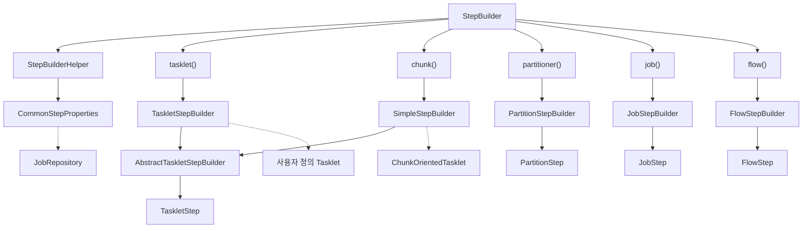

이 구조에서 가장 중요한 부분은 다음과 같다.

StepBuilder는 Step 생성의 진입점이다.

StepBuilderHelper는 공통 설정을 관리한다.

각 API는 적절한 하위 Builder를 생성한다.

하위 Builder는 자신이 담당하는 Step 구현체를 생성한다.

TaskletStepBuilder와 SimpleStepBuilder는 공통적으로 AbstractTaskletStepBuilder를 상속한다.

그리고 두 Builder는 동일한 TaskletStep을 생성한다.

하지만 내부 Tasklet 구현체는 서로 다르다.

PartitionStepBuilder는 PartitionStep을 생성한다.

JobStepBuilder는 JobStep을 생성한다.

FlowStepBuilder는 FlowStep을 생성한다.

마지막으로 생성된 Step은 JobRepository를 이용해 실행 메타데이터를 관리할 수 있다.

---

### 정리

Spring Batch에서 StepBuilder는 다양한 종류의 Step을 생성하기 위한 핵심 Builder 클래스다.

기존 Spring Batch에서는 StepBuilderFactory를 이용해 StepBuilder를 생성했다.

```java
stepBuilderFactory.get("stepName");
```

하지만 Spring Batch 5.2에서는 StepBuilderFactory가 제거되었다.

따라서 다음과 같이 StepBuilder를 직접 생성해야 한다.

```java
new StepBuilder(
        "stepName",
        jobRepository
);
```

StepBuilder는 설정하는 API에 따라 서로 다른 하위 Builder를 반환한다.

대표적인 Builder는 다음과 같다.

| API | Builder | Step 구현체 |
|---|---|---|
| tasklet() | TaskletStepBuilder | TaskletStep |
| chunk() | SimpleStepBuilder | TaskletStep |
| partitioner() | PartitionStepBuilder | PartitionStep |
| job() | JobStepBuilder | JobStep |
| flow() | FlowStepBuilder | FlowStep |

여기서 가장 중요한 특징은 TaskletStepBuilder와 SimpleStepBuilder가 동일한 TaskletStep을 생성한다는 점이다.

하지만 내부 Tasklet 생성 방식은 서로 다르다.

TaskletStepBuilder는 개발자가 직접 전달한 Tasklet을 사용한다.

반면 SimpleStepBuilder는 ChunkOrientedTasklet을 생성한다.

ChunkOrientedTasklet은 Reader, Processor, Writer를 이용해 Chunk 기반 처리를 수행한다.

이러한 구조 덕분에 Spring Batch는 하나의 TaskletStep 실행 구조 안에서 서로 다른 작업 방식을 지원할 수 있다.

또한 StepBuilder는 StepBuilderHelper를 상속한다.

StepBuilderHelper는 Step 이름, JobRepository, Listener, 재시작 설정 등 공통 속성을 관리한다.

각 하위 Builder는 이러한 공통 설정을 전달받아 최종 Step 객체를 생성한다.

그리고 생성된 Step은 실제 실행 과정에서 JobRepository를 이용해 StepExecution과 ExecutionContext 등의 메타데이터를 관리한다.

따라서 StepBuilder 아키텍처를 이해할 때는 다음 세 가지를 구분하는 것이 중요하다.

첫 번째는 **StepBuilder가 어떤 하위 Builder를 생성하는지**다.

두 번째는 **각 하위 Builder가 어떤 Step 구현체를 생성하는지**다.

세 번째는 **생성된 Step이 내부적으로 어떤 방식으로 실제 작업을 실행하는지**다.

이러한 관계를 이해하면 단순히 StepBuilder API를 사용하는 수준을 넘어 Spring Batch의 Step 생성 및 실행 아키텍처를 정확하게 파악할 수 있다.

특히 Tasklet, Chunk, Partition, JobStep, FlowStep을 적절하게 선택하면 서로 다른 업무 특성에 맞는 배치 구조를 설계할 수 있다.

결국 **StepBuilder는 API의 종류에 따라 적절한 하위 Builder를 선택하고, 각 Builder가 자신에게 맞는 Step 구현체를 생성하도록 위임하는 구조**다.

#### 한 줄 요약

> Spring Batch의 `StepBuilder`는 `tasklet()`, `chunk()`, `partitioner()`, `job()`, `flow()` API에 따라 각각 `TaskletStepBuilder`, `SimpleStepBuilder`, `PartitionStepBuilder`, `JobStepBuilder`, `FlowStepBuilder`를 생성한다. 이 중 TaskletStepBuilder와 SimpleStepBuilder는 모두 TaskletStep을 생성하지만, 내부적으로 실행하는 Tasklet 구현체가 다르다. Spring Batch 5.2에서는 StepBuilderFactory 대신 JobRepository를 전달하는 StepBuilder 생성자를 사용하며, StepBuilderHelper와 각 하위 Builder를 통해 공통 설정과 구체적인 Step 생성 책임을 분리한다.

## TaskletStep - 개념 및 API 소개 


### Spring Batch TaskletStep 이해: RepeatTemplate, 트랜잭션 처리와 ChunkOrientedTasklet 아키텍처

Spring Batch에서 Job은 하나 이상의 Step으로 구성된다.

Job이 전체 배치 작업을 정의한다면 Step은 실제 작업을 실행하는 독립적인 처리 단위다.

Spring Batch는 여러 종류의 Step 구현체를 제공한다.

대표적인 구현체는 다음과 같다.

| Step 구현체 | 역할 |
|---|---|
| TaskletStep | Tasklet 인터페이스를 기반으로 작업 실행 |
| PartitionStep | 작업을 여러 Partition으로 분할하여 실행 |
| JobStep | Step 내부에서 별도의 Job 실행 |
| FlowStep | Step 내부에서 Flow 실행 |

이 중 가장 기본적이면서 활용 범위가 넓은 구현체가 `TaskletStep`이다.

TaskletStep은 단순히 하나의 작업만 실행하는 클래스가 아니다.

Tasklet의 반복 실행, 트랜잭션 처리, 실행 상태 관리, ExecutionContext 저장 등 여러 기능을 담당한다.

또한 Spring Batch에서 제공하는 Chunk 기반 처리 역시 내부적으로 TaskletStep을 사용한다.

예를 들어 다음 두 코드를 살펴보자.

첫 번째는 Tasklet 기반 Step이다.

```java
new StepBuilder("taskletStep", jobRepository)
        .tasklet(tasklet, transactionManager)
        .build();
```

두 번째는 Chunk 기반 Step이다.

```java
new StepBuilder("chunkStep", jobRepository)
        .<String, String>chunk(100, transactionManager)
        .reader(reader)
        .processor(processor)
        .writer(writer)
        .build();
```

두 코드는 서로 다른 API를 사용한다.

첫 번째는 `tasklet()`을 사용한다.

두 번째는 `chunk()`를 사용한다.

하지만 두 방식 모두 최종적으로 생성하는 Step 구현체는 동일하다.

바로 **TaskletStep**이다.

차이점은 TaskletStep 내부에서 실행하는 Tasklet 구현체에 있다.

Tasklet 기반 Step에서는 개발자가 직접 구현한 Tasklet을 실행한다.

반면 Chunk 기반 Step에서는 Spring Batch가 제공하는 `ChunkOrientedTasklet`을 실행한다.

전체 구조는 다음과 같다.

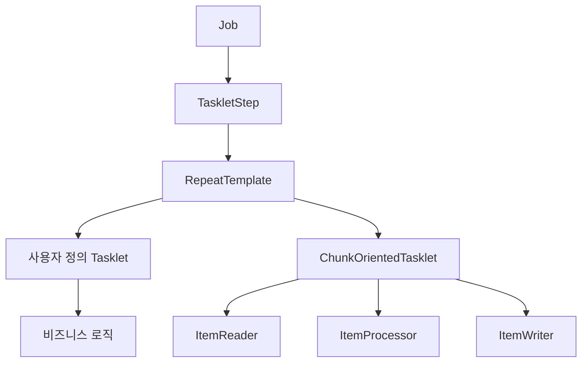

여기서 중요한 사실은 두 방식 모두 RepeatTemplate을 통해 Tasklet을 반복 실행한다는 것이다.

또한 각각의 Tasklet 실행은 Spring Batch가 관리하는 트랜잭션 경계 안에서 이루어진다.

따라서 개발자는 반복 처리와 트랜잭션 제어를 직접 구현하지 않고도 배치 작업을 구성할 수 있다.

이번에는 TaskletStep의 개념부터 내부 실행 구조, RepeatTemplate의 반복 처리, 트랜잭션 관리, ChunkOrientedTasklet과의 관계까지 살펴보자.

---

### 개념

#### TaskletStep이란?

`TaskletStep`은 Spring Batch에서 제공하는 Step 구현체로, Tasklet 인터페이스를 구현한 객체를 실행하는 역할을 담당한다.

클래스의 상속 관계는 다음과 같다.

```text
Step
 │
 ▼
AbstractStep
 │
 ▼
TaskletStep
```

`AbstractStep`은 모든 Step이 공통으로 사용하는 실행 기능을 제공한다.

예를 들어 StepExecution의 상태 관리, Listener 호출, JobRepository를 통한 메타데이터 갱신 등이 있다.

반면 TaskletStep은 Tasklet을 실행하기 위한 구체적인 구조를 제공한다.

TaskletStep의 핵심 역할은 다음과 같다.

| 역할 | 설명 |
|---|---|
| Tasklet 실행 | 등록된 Tasklet의 execute() 호출 |
| 반복 처리 | RepeatTemplate을 통해 반복 실행 |
| 트랜잭션 관리 | Tasklet 호출을 트랜잭션으로 감싸 실행 |
| 상태 반영 | StepContribution을 StepExecution에 반영 |
| 메타데이터 갱신 | JobRepository를 통한 상태 및 Context 저장 |
| 종료 제어 | RepeatStatus를 이용해 반복 여부 판단 |
| 실패 처리 | 예외 발생 시 트랜잭션 롤백 및 실패 상태 관리 |

TaskletStep은 이러한 기능을 조합하여 실제 배치 작업을 실행한다.

#### TaskletStep과 Tasklet의 차이

두 개념은 이름이 비슷하지만 서로 다른 역할을 담당한다.

**TaskletStep은 실행을 관리하는 객체다.**

**Tasklet은 실제 작업을 수행하는 객체다.**

예를 들어 정산 데이터를 검증하는 배치가 있다고 생각해보자.

```text
TaskletStep
    │
    ├── 트랜잭션 시작
    │
    ├── Tasklet 실행
    │       │
    │       └── 정산 데이터 검증
    │
    ├── 트랜잭션 커밋
    │
    └── StepExecution 상태 갱신
```

정산 데이터 검증이라는 실제 업무는 Tasklet이 수행한다.

반면 트랜잭션 시작과 종료, 반복 여부 판단, 실행 메타데이터 관리는 TaskletStep이 담당한다.

이러한 책임 분리는 개발자가 비즈니스 로직에 집중할 수 있도록 한다.

---

### 왜 사용하는가?

일반적인 Java 프로그램에서 특정 작업을 반복 실행하려면 반복문을 직접 작성할 수 있다.

```java
while (true) {

    boolean completed = executeBusinessLogic();

    if (completed) {
        break;
    }
}
```

하지만 실제 배치 시스템에서는 반복 실행 외에도 여러 기능이 필요하다.

예를 들어 다음과 같은 요구사항이 있다고 생각해보자.

1. 작업을 반복 실행해야 한다.
2. 매번 실행할 때 트랜잭션을 시작해야 한다.
3. 작업이 성공하면 커밋해야 한다.
4. 작업이 실패하면 롤백해야 한다.
5. 실행 횟수와 상태를 관리해야 한다.
6. 장애 발생 시 이전 실행 정보를 확인할 수 있어야 한다.

이러한 기능을 모두 직접 구현하려면 코드가 복잡해진다.

반면 TaskletStep은 이러한 실행 구조를 제공한다.

```text
TaskletStep
    │
    ▼
RepeatTemplate
    │
    ▼
TransactionTemplate
    │
    ▼
Tasklet.execute()
    │
    ▼
RepeatStatus
    │
    ├── CONTINUABLE → 반복
    │
    └── FINISHED → 종료
```

여기서 개발자는 Tasklet의 `execute()` 메서드에 실제 비즈니스 로직을 구현한다.

반복 제어와 트랜잭션 관리는 Spring Batch가 담당한다.

따라서 TaskletStep은 다음과 같은 작업에 적합하다.

- 배치 실행 전 데이터 검증
- 특정 테이블의 상태 변경
- 데이터 정리 및 삭제
- 파일 생성과 이동
- 외부 시스템 상태 확인
- 대용량 데이터의 Chunk 기반 처리

단순한 작업부터 복잡한 데이터 처리까지 동일한 Step 구현체를 활용할 수 있다는 것이 특징이다.

---

### 주요 특징

#### 1. Tasklet을 반복 실행한다

TaskletStep은 등록된 Tasklet을 한 번만 실행한다고 가정하지 않는다.

기본적으로 반복 실행할 수 있는 구조로 설계되어 있다.

반복을 관리하는 핵심 클래스는 `RepeatTemplate`이다.

```text
TaskletStep
    │
    ▼
RepeatTemplate
    │
    └── 반복 실행
           │
           ▼
       Tasklet.execute()
```

Tasklet은 실행이 끝날 때마다 반복 여부를 반환한다.

이때 사용하는 객체가 `RepeatStatus`다.

#### 2. Tasklet 호출마다 트랜잭션을 적용한다

TaskletStep은 Tasklet을 트랜잭션 경계 안에서 실행한다.

```text
반복 시작
    │
    ▼
트랜잭션 시작
    │
    ▼
Tasklet 실행
    │
    ├── 성공 → Commit
    │
    └── 실패 → Rollback
    │
    ▼
다음 반복 여부 확인
```

여기서 중요한 점은 **반복 전체가 반드시 하나의 트랜잭션으로 묶이는 것은 아니라는 사실**이다.

기본 TaskletStep에서는 각각의 Tasklet 실행에 트랜잭션이 적용된다.

따라서 Tasklet을 세 번 호출한다면 일반적으로 세 번의 트랜잭션 처리 구간이 만들어진다.

#### 3. Tasklet과 Chunk 기반 처리를 모두 지원한다

TaskletStep은 다음 두 가지 방식으로 사용할 수 있다.

```text
Tasklet 기반
    │
    └── 개발자가 구현한 Tasklet 실행
```

```text
Chunk 기반
    │
    └── ChunkOrientedTasklet 실행
            │
            ├── ItemReader
            ├── ItemProcessor
            └── ItemWriter
```

두 방식의 차이는 실제 실행하는 Tasklet의 구현에 있다.

#### 4. 실행 상태와 메타데이터를 관리한다

TaskletStep은 StepExecution과 연계하여 실행 상태를 관리한다.

대표적으로 다음 정보가 있다.

| 항목 | 설명 |
|---|---|
| BatchStatus | 실행 상태 |
| ExitStatus | 종료 코드 |
| CommitCount | 커밋 횟수 |
| RollbackCount | 롤백 횟수 |
| ReadCount | 읽은 Item 수 |
| WriteCount | 저장한 Item 수 |
| ExecutionContext | 실행 상태 저장 |

Tasklet 기반 Step이라면 ReadCount와 WriteCount가 일반적으로 0일 수 있다.

반면 Chunk 기반 Step에서는 ItemReader와 ItemWriter를 사용하기 때문에 처리 건수가 기록된다.

---

### Tasklet 인터페이스

Tasklet은 Spring Batch에서 실제 비즈니스 로직을 처리하는 인터페이스다.

Spring Batch 5.2.4에서 구조는 다음과 같다.

```java
@FunctionalInterface
public interface Tasklet {

    RepeatStatus execute(
            StepContribution contribution,
            ChunkContext chunkContext
    ) throws Exception;
}
```

핵심 메서드는 하나다.

```java
RepeatStatus execute(
        StepContribution contribution,
        ChunkContext chunkContext
);
```

두 개의 인자를 전달받는다.

#### StepContribution

StepContribution은 현재 처리 단위의 결과를 StepExecution에 반영하기 위한 객체다.

예를 들어 처리 건수 등의 정보를 관리하는 데 사용된다.

```java
StepExecution stepExecution =
        contribution.getStepExecution();
```

이렇게 현재 StepExecution에도 접근할 수 있다.

#### ChunkContext

ChunkContext는 현재 처리 단위에 관한 Context 정보를 제공한다.

```java
StepContext stepContext =
        chunkContext.getStepContext();
```

StepContext를 통해 JobParameters나 StepExecution 등에 접근할 수 있다.

여기서 주의할 점은 `ChunkContext`와 `ExecutionContext`가 서로 다른 개념이라는 것이다.

ChunkContext는 현재 실행 중인 처리 구간의 Context를 제공한다.

반면 ExecutionContext는 Spring Batch가 저장하고 복원하는 실행 상태 정보다.

특히 애플리케이션 재시작 이후까지 유지해야 하는 값은 적절한 ExecutionContext에 저장해야 한다.

---

### RepeatStatus란?

Tasklet의 실행 결과는 `RepeatStatus`로 표현한다.

대표적인 값은 두 가지다.

```java
RepeatStatus.FINISHED
```

```java
RepeatStatus.CONTINUABLE
```

두 값의 차이는 다음과 같다.

| RepeatStatus | 의미 | 다음 실행 |
|---|---|---|
| FINISHED | 현재 작업을 마침 | 반복 종료 |
| CONTINUABLE | 처리할 작업이 남아 있음 | 반복 계속 |

#### RepeatStatus.FINISHED

다음 코드를 살펴보자.

```java
@Override
public RepeatStatus execute(
        StepContribution contribution,
        ChunkContext chunkContext
) {

    System.out.println("Tasklet 실행");

    return RepeatStatus.FINISHED;
}
```

이 Tasklet은 비즈니스 로직을 실행한 뒤 FINISHED를 반환한다.

따라서 RepeatTemplate은 반복을 종료한다.

```text
Tasklet 실행
    │
    ▼
RepeatStatus.FINISHED
    │
    ▼
반복 종료
    │
    ▼
Step 종료
```

일반적인 단일 작업 기반 Tasklet은 이 방식을 많이 사용한다.

#### RepeatStatus.CONTINUABLE

이번에는 다음 코드를 살펴보자.

```java
@Override
public RepeatStatus execute(
        StepContribution contribution,
        ChunkContext chunkContext
) {

    System.out.println("Tasklet 실행");

    return RepeatStatus.CONTINUABLE;
}
```

이 코드에서는 CONTINUABLE을 반환한다.

따라서 반복 실행이 계속될 수 있다.

```text
Tasklet 실행
    │
    ▼
RepeatStatus.CONTINUABLE
    │
    ▼
RepeatTemplate
    │
    ▼
Tasklet 재실행
```

여기서 중요한 점은 다음과 같다.

**CONTINUABLE을 계속 반환하면서 별도의 종료 조건도 없다면 반복이 끝나지 않을 수 있다.**

따라서 반복형 Tasklet을 구현할 때는 종료 조건이 반드시 필요하다.

#### null을 반환하면 어떻게 될까?

Tasklet 인터페이스는 `null` 반환도 허용한다.

Spring Batch는 Tasklet이 null을 반환하면 FINISHED로 해석한다.

즉 다음 코드도 반복을 종료한다.

```java
return null;
```

하지만 실제 구현에서는 다음과 같이 명시적으로 반환하는 것이 좋다.

```java
return RepeatStatus.FINISHED;
```

코드만 읽어도 종료 의도를 파악할 수 있기 때문이다.

---

### RepeatTemplate의 반복 실행 구조

TaskletStep에서 반복 처리를 담당하는 핵심 객체는 RepeatTemplate이다.

RepeatTemplate은 반복 실행을 지원하는 Spring Batch의 컴포넌트다.

TaskletStep은 내부적으로 다음과 같은 속성을 가진다.

```java
private RepeatOperations stepOperations =
        new RepeatTemplate();
```

여기서 RepeatOperations는 반복 처리를 위한 인터페이스다.

RepeatTemplate은 대표적인 구현체다.

TaskletStep은 실제 실행 시 다음 메서드를 호출한다.

```java
stepOperations.iterate(...);
```

이 메서드는 전달받은 반복 작업을 실행한다.

실행 결과에 따라 다음 반복을 수행하거나 종료한다.

개념적으로 다음과 같다.

```java
while (true) {

    RepeatStatus status =
            executeTasklet();

    if (status == RepeatStatus.FINISHED) {
        break;
    }
}
```

실제 RepeatTemplate은 반복 정책, 반복 Context, 예외 처리 등의 기능을 함께 제공하므로 단순한 while 문보다 복잡하다.

하지만 핵심 동작은 동일하다.

**Tasklet의 실행 결과를 확인하면서 반복을 제어한다.**

#### 반복 실행 흐름

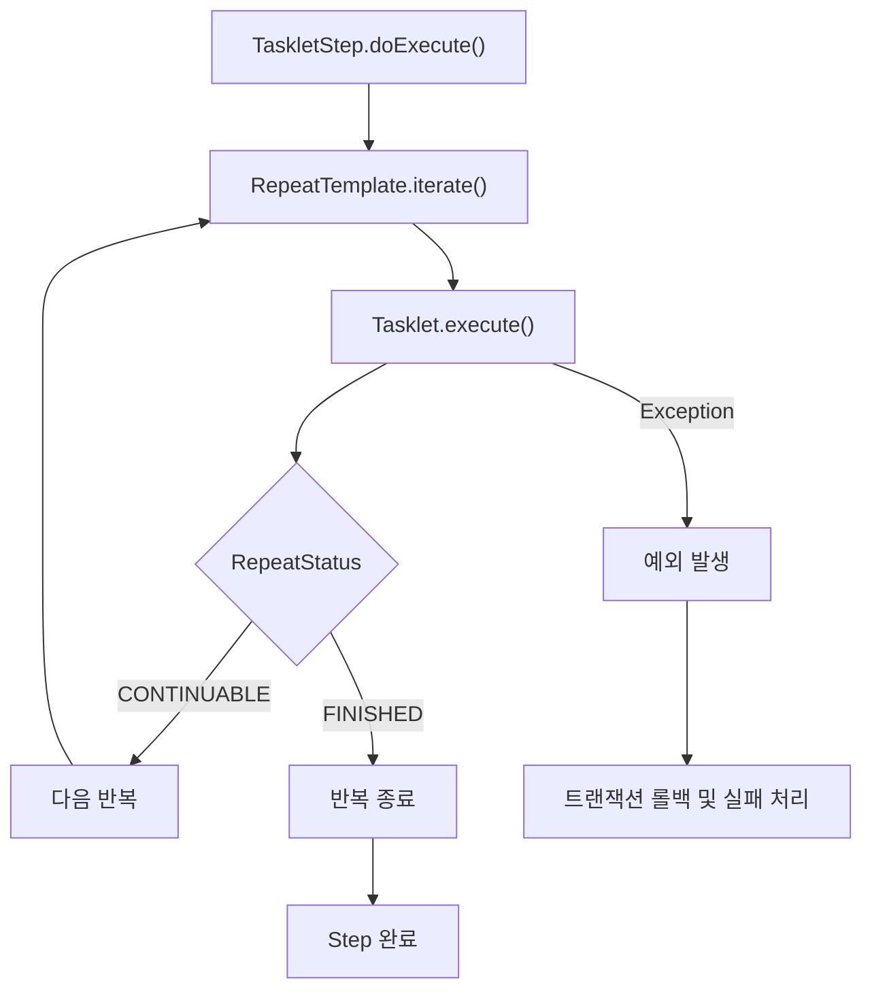

이 구조를 이해하면 Tasklet을 한 번만 실행하는 방식과 반복 실행하는 방식을 구분할 수 있다.

---

### TaskletStep의 트랜잭션 처리 구조

TaskletStep의 가장 중요한 특징 중 하나는 트랜잭션이다.

일반적으로 트랜잭션을 직접 관리하려면 다음과 같은 코드가 필요하다.

```java
TransactionStatus status =
        transactionManager.getTransaction(
                transactionDefinition
        );

try {

    executeBusinessLogic();

    transactionManager.commit(status);

} catch (Exception e) {

    transactionManager.rollback(status);

    throw e;
}
```

하지만 TaskletStep에서는 이러한 코드를 직접 작성할 필요가 없다.

Spring Batch가 `TransactionTemplate`을 사용해 트랜잭션을 관리하기 때문이다.

#### TransactionTemplate의 역할

TransactionTemplate은 Spring Framework에서 제공하는 트랜잭션 실행 도구다.

콜백 내부의 작업을 트랜잭션 안에서 실행하도록 지원한다.

TaskletStep에서는 다음과 같은 형태로 사용된다.

```java
new TransactionTemplate(
        transactionManager,
        transactionAttribute
).execute(
        new ChunkTransactionCallback(
                chunkContext,
                semaphore
        )
);
```

이 코드는 TaskletStep의 실제 내부 처리에서 중요한 부분이다.

여기서 TransactionTemplate은 트랜잭션 시작과 완료를 관리한다.

ChunkTransactionCallback은 트랜잭션 안에서 실행할 작업을 정의한다.

그리고 ChunkTransactionCallback 내부에서 Tasklet이 호출된다.

```java
result = tasklet.execute(
        contribution,
        chunkContext
);
```

따라서 실행 관계는 다음과 같다.

```text
RepeatTemplate
    │
    ▼
반복 시작
    │
    ▼
TransactionTemplate
    │
    ▼
트랜잭션 시작
    │
    ▼
ChunkTransactionCallback
    │
    ▼
Tasklet.execute()
    │
    ▼
비즈니스 로직
    │
    ├── 성공 → Commit
    │
    └── 실패 → Rollback
```

여기서 핵심은 **반복문이 트랜잭션 바깥에 있고, 개별 반복 실행에 트랜잭션이 적용된다는 점**이다.

---

### 트랜잭션과 반복의 관계

Tasklet이 세 번 실행되는 경우를 생각해보자.

첫 번째 실행에서는 CONTINUABLE을 반환한다.

두 번째 실행에서도 CONTINUABLE을 반환한다.

세 번째 실행에서는 FINISHED를 반환한다.

```text
TaskletStep
    │
    ▼
RepeatTemplate
    │
    ├── 첫 번째 반복
    │       │
    │       ├── Transaction Begin
    │       ├── Tasklet.execute()
    │       ├── CONTINUABLE
    │       └── Commit
    │
    ├── 두 번째 반복
    │       │
    │       ├── Transaction Begin
    │       ├── Tasklet.execute()
    │       ├── CONTINUABLE
    │       └── Commit
    │
    └── 세 번째 반복
            │
            ├── Transaction Begin
            ├── Tasklet.execute()
            ├── FINISHED
            └── Commit
```

이 경우 일반적으로 Tasklet 실행 횟수는 3회다.

그리고 정상적으로 커밋되었다면 각 실행에 대응하는 커밋이 발생한다.

여기서 첫 번째 실행과 두 번째 실행의 트랜잭션은 이미 커밋되었다.

따라서 세 번째 실행에서 예외가 발생하더라도 이전에 커밋된 데이터가 자동으로 롤백되는 것은 아니다.

예를 들어 다음과 같은 상황이다.

```text
첫 번째 실행
    └── DB INSERT 성공 → Commit

두 번째 실행
    └── DB INSERT 성공 → Commit

세 번째 실행
    └── DB INSERT 실패 → Rollback
```

최종적으로 Step은 FAILED가 될 수 있다.

하지만 첫 번째와 두 번째 실행에서 커밋된 데이터는 유지된다.

이러한 구조는 Chunk 기반 처리에서도 중요한 역할을 한다.

---

### TaskletStep 내부 아키텍처

이제 클래스 수준의 실행 흐름을 살펴보자.

Spring Batch 5.2.4에서 TaskletStep의 실제 실행 과정은 다음과 같다.

```text
SimpleJob
    │
    ▼
SimpleStepHandler
    │
    ▼
AbstractStep.execute()
    │
    ▼
TaskletStep.doExecute()
    │
    ▼
RepeatTemplate.iterate()
    │
    ▼
StepContextRepeatCallback
    │
    ▼
TransactionTemplate.execute()
    │
    ▼
ChunkTransactionCallback
    │
    ▼
Tasklet.execute()
```

각 클래스는 서로 다른 책임을 담당한다.

| 클래스 | 역할 |
|---|---|
| SimpleJob | Step 순차 실행 |
| SimpleStepHandler | StepExecution 준비 및 재시작 판단 |
| AbstractStep | Step 공통 실행 처리 |
| TaskletStep | Tasklet 반복 실행 |
| RepeatTemplate | 반복 여부 제어 |
| StepContextRepeatCallback | 반복 실행에 필요한 Context 제공 |
| TransactionTemplate | 트랜잭션 제어 |
| ChunkTransactionCallback | 트랜잭션 안에서 Tasklet 실행 |
| Tasklet | 실제 비즈니스 로직 수행 |

이 흐름에서 가장 중요한 메서드는 TaskletStep의 `doExecute()`다.

---

### TaskletStep.doExecute() 분석

TaskletStep의 실제 구현에서는 반복과 트랜잭션 처리 기능이 결합되어 있다.

Spring Batch 5.2.4의 핵심 구조를 단순화하면 다음과 같다.

```java
@Override
protected void doExecute(
        StepExecution stepExecution
) throws Exception {

    stepOperations.iterate(
            new StepContextRepeatCallback(stepExecution) {

                @Override
                public RepeatStatus doInChunkContext(
                        RepeatContext repeatContext,
                        ChunkContext chunkContext
                ) throws Exception {

                    return new TransactionTemplate(
                            transactionManager,
                            transactionAttribute
                    ).execute(
                            new ChunkTransactionCallback(
                                    chunkContext,
                                    semaphore
                            )
                    );
                }
            }
    );
}
```

위 코드는 반복 처리와 트랜잭션 호출 관계를 설명하기 위해 주요 구문만 남긴 형태다.

실제 구현에서는 ExecutionContext 갱신, 중단 요청 확인, Listener 호출, 동시성 제어 등이 추가로 수행된다.

코드를 단계별로 살펴보자.

#### 첫 번째: RepeatTemplate 실행

```java
stepOperations.iterate(...);
```

TaskletStep이 반복 실행을 시작한다.

여기서 기본 stepOperations 구현체는 RepeatTemplate이다.

#### 두 번째: StepContextRepeatCallback 실행

```java
new StepContextRepeatCallback(stepExecution)
```

현재 StepExecution을 기반으로 반복 실행에 필요한 Context를 준비한다.

#### 세 번째: TransactionTemplate 실행

```java
new TransactionTemplate(
        transactionManager,
        transactionAttribute
)
```

현재 반복 실행을 트랜잭션 경계 안에서 처리하도록 준비한다.

#### 네 번째: ChunkTransactionCallback 실행

```java
new ChunkTransactionCallback(
        chunkContext,
        semaphore
)
```

트랜잭션 안에서 수행할 작업을 전달한다.

#### 다섯 번째: Tasklet 실행

ChunkTransactionCallback 내부에서 다음 코드가 실행된다.

```java
result = tasklet.execute(
        contribution,
        chunkContext
);
```

이때 개발자가 작성한 실제 비즈니스 로직이 호출된다.

#### 여섯 번째: 실행 결과 반영

Tasklet 실행이 완료되면 StepContribution의 내용이 StepExecution에 반영된다.

또한 필요한 ExecutionContext와 StepExecution 메타데이터가 JobRepository를 통해 갱신된다.

정상적으로 트랜잭션이 완료되면 커밋이 수행된다.

#### 일곱 번째: 반복 여부 결정

Tasklet이 CONTINUABLE을 반환했다면 다음 반복이 가능하다.

FINISHED를 반환했다면 반복을 종료한다.

이러한 과정을 통해 TaskletStep이 실행된다.

---

### TaskletStep과 AbstractStep의 관계

TaskletStep은 AbstractStep을 상속한다.

따라서 실제 Step 실행은 AbstractStep의 execute() 메서드부터 시작한다.

AbstractStep은 다음과 같은 공통 기능을 제공한다.

```text
AbstractStep.execute()
    │
    ├── StepExecution 시작 상태 설정
    │
    ├── JobRepository 상태 갱신
    │
    ├── StepExecutionListener.beforeStep()
    │
    ├── doExecute()
    │
    ├── 실행 결과 및 예외 처리
    │
    ├── StepExecutionListener.afterStep()
    │
    └── StepExecution 최종 상태 저장
```

여기서 doExecute()는 하위 클래스가 구현하는 메서드다.

TaskletStep에서는 이 메서드에 반복 및 트랜잭션 처리를 구현한다.

따라서 다음과 같은 구조가 만들어진다.

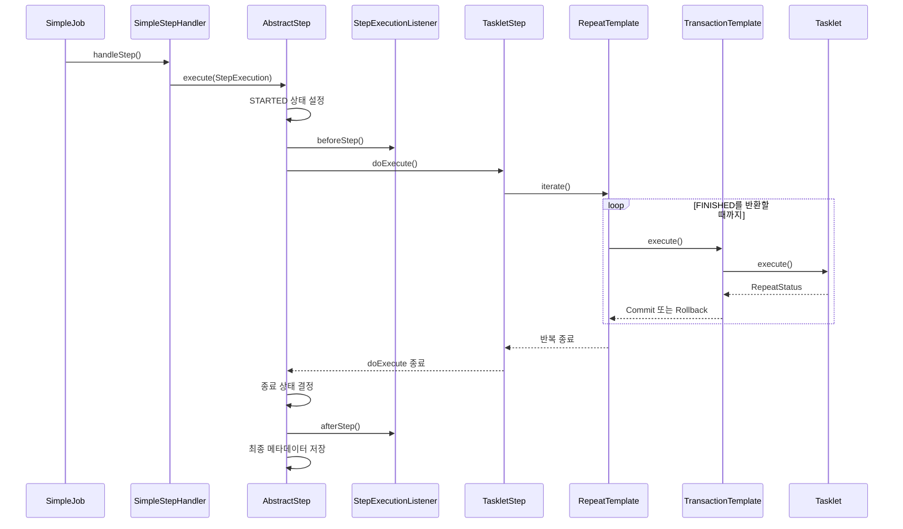

여기서 한 가지 구분해야 할 점이 있다.

TaskletStep은 실제 Tasklet을 반복 실행한다.

반면 AbstractStep은 Step 전체의 실행 상태와 Listener를 관리한다.

따라서 StepExecutionListener의 beforeStep()과 afterStep()은 Tasklet이 반복될 때마다 호출되는 것이 아니다.

**하나의 StepExecution을 기준으로 Step 실행 전후에 호출된다.**

반복 실행 단위의 처리를 관찰하려면 ChunkListener 등 다른 확장 지점을 함께 고려해야 한다.

---

### TaskletStepBuilder와 SimpleStepBuilder

TaskletStep은 두 가지 대표적인 Builder를 통해 생성할 수 있다.

첫 번째는 TaskletStepBuilder다.

두 번째는 SimpleStepBuilder다.

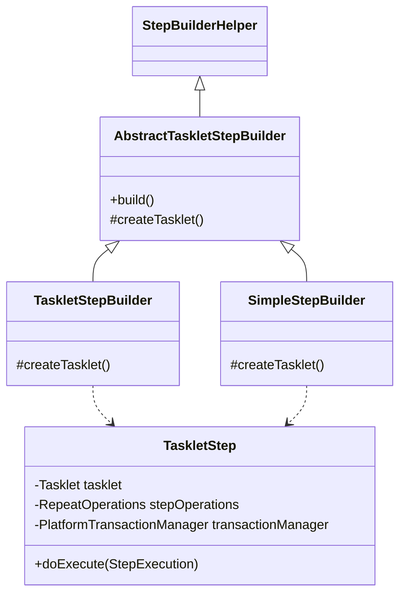

여기서 중요한 클래스는 `AbstractTaskletStepBuilder`다.

TaskletStepBuilder와 SimpleStepBuilder는 모두 이 클래스를 상속한다.

AbstractTaskletStepBuilder는 TaskletStep 생성에 필요한 공통 로직을 제공한다.

대표적으로 다음 기능이 있다.

```java
TaskletStep step =
        new TaskletStep(getName());
```

TaskletStep을 생성한다.

이후 공통 속성을 설정한다.

```java
step.setTransactionManager(
        transactionManager
);
```

트랜잭션 매니저를 설정한다.

그리고 RepeatTemplate을 설정한다.

```java
step.setStepOperations(
        stepOperations
);
```

마지막으로 실제 Tasklet을 설정한다.

```java
step.setTasklet(
        createTasklet()
);
```

여기서 `createTasklet()`은 하위 Builder가 구현한다.

TaskletStepBuilder는 사용자 정의 Tasklet을 반환한다.

반면 SimpleStepBuilder는 ChunkOrientedTasklet을 생성한다.

이것이 두 Builder가 동일한 TaskletStep을 생성하면서도 서로 다른 작업을 수행할 수 있는 이유다.

---

### Task 기반과 Chunk 기반의 차이

Spring Batch에서 TaskletStep을 사용하는 대표적인 방식은 두 가지다.

하나는 Task 기반이다.

다른 하나는 Chunk 기반이다.

#### Task 기반

Task 기반은 하나의 비즈니스 작업을 직접 구현하는 방식이다.

예를 들어 특정 테이블의 데이터를 삭제하거나 외부 시스템 상태를 확인하는 작업이다.

```text
TaskletStep
    │
    ▼
RepeatTemplate
    │
    ▼
TransactionTemplate
    │
    ▼
사용자 정의 Tasklet
    │
    ▼
비즈니스 로직
```

개발자가 Tasklet 인터페이스를 구현한다.

그리고 TaskletStep이 해당 Tasklet을 실행한다.

#### Chunk 기반

Chunk 기반은 데이터를 일정한 개수로 나누어 처리하는 방식이다.

예를 들어 100만 건의 데이터를 1,000건씩 처리한다고 생각해보자.

```text
1,000,000건 데이터
       │
       ▼
Chunk 크기 = 1,000
       │
       ├── 첫 번째 Chunk
       │
       ├── 두 번째 Chunk
       │
       ├── 세 번째 Chunk
       │
       └── ...
```

Chunk 기반 Step에서는 Spring Batch가 제공하는 ChunkOrientedTasklet을 사용한다.

```text
TaskletStep
    │
    ▼
RepeatTemplate
    │
    ▼
TransactionTemplate
    │
    ▼
ChunkOrientedTasklet
    │
    ├── ChunkProvider
    │       └── ItemReader
    │
    └── ChunkProcessor
            ├── ItemProcessor
            └── ItemWriter
```

여기서 ChunkProvider는 데이터를 읽는다.

ChunkProcessor는 데이터를 가공하고 저장한다.

#### 두 방식 비교

| 구분 | Task 기반 | Chunk 기반 |
|---|---|---|
| 최종 Step | TaskletStep | TaskletStep |
| Builder | TaskletStepBuilder | SimpleStepBuilder |
| 내부 Tasklet | 사용자 정의 Tasklet | ChunkOrientedTasklet |
| 주요 처리 | 단일 비즈니스 작업 | 대량 데이터 처리 |
| 반복 기준 | Tasklet의 RepeatStatus | Chunk 처리 결과 |
| 트랜잭션 | Tasklet 실행 단위 | Chunk 단위 |
| 데이터 처리 | 직접 구현 | Reader, Processor, Writer |
| 대표 활용 | 파일 생성, 사전 검증, API 호출 | 정산 집계, 데이터 이관, 대량 갱신 |

여기서 중요한 사실이 있다.

Task 기반도 반복 실행이 가능하다.

또한 Task 기반으로 대용량 데이터를 처리하는 것도 기술적으로 가능하다.

하지만 처리 건수 관리, Chunk별 커밋, Reader의 재시작 상태 관리 등이 필요하다면 Chunk 기반이 더 적합할 수 있다.

---

### ChunkOrientedTasklet이란?

ChunkOrientedTasklet은 Spring Batch가 제공하는 Tasklet 구현체다.

주요 목적은 Chunk 기반의 데이터 처리를 수행하는 것이다.

```java
public class ChunkOrientedTasklet<I>
        implements Tasklet {
}
```

이 클래스는 내부적으로 두 가지 주요 객체를 사용한다.

```java
private final ChunkProvider<I> chunkProvider;

private final ChunkProcessor<I> chunkProcessor;
```

ChunkProvider는 데이터를 읽는 역할을 담당한다.

ChunkProcessor는 읽은 데이터를 가공하고 저장하는 역할을 담당한다.

#### ChunkProvider

ChunkProvider는 ItemReader를 이용해 데이터를 읽는다.

예를 들어 다음과 같은 데이터가 있다고 생각해보자.

```text
item1
item2
item3
item4
item5
```

Chunk 크기가 2라면 다음과 같이 데이터를 구성할 수 있다.

```text
Chunk 1
    ├── item1
    └── item2
```

```text
Chunk 2
    ├── item3
    └── item4
```

```text
Chunk 3
    └── item5
```

ChunkProvider는 이러한 Chunk를 생성하는 데 필요한 Item 읽기를 수행한다.

#### ChunkProcessor

ChunkProcessor는 ChunkProvider가 전달한 데이터를 처리한다.

일반적으로 다음 과정을 수행한다.

```text
Chunk<I>
    │
    ▼
ItemProcessor
    │
    ▼
Chunk<O>
    │
    ▼
ItemWriter
```

예를 들어 ItemProcessor가 문자열을 대문자로 변환한다고 생각해보자.

```java
item -> item.toUpperCase(Locale.ROOT)
```

다음과 같은 결과가 만들어진다.

```text
item1 → ITEM1
item2 → ITEM2
item3 → ITEM3
```

이후 ItemWriter가 처리된 데이터를 저장한다.

---

### Chunk 기반 TaskletStep의 실행 흐름

Chunk 기반 Step에서는 TaskletStep이 ChunkOrientedTasklet을 실행한다.

ChunkOrientedTasklet은 ChunkProvider와 ChunkProcessor를 호출한다.

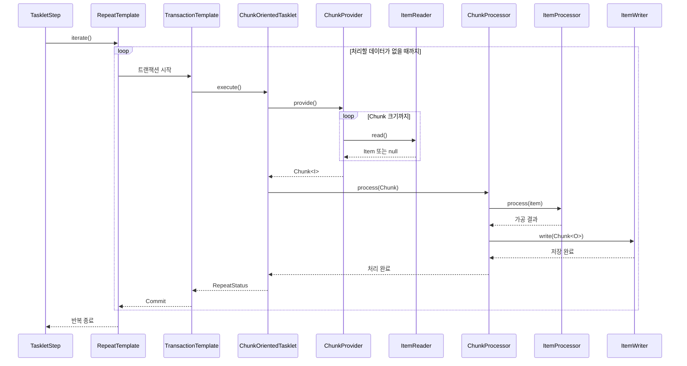

이 구조에서 중요한 것은 Reader, Processor, Writer가 모두 동일한 방식으로 호출되는 것은 아니라는 점이다.

ItemReader는 일반적으로 Item 단위로 호출된다.

ItemProcessor도 Item 단위로 호출된다.

반면 ItemWriter는 Chunk 단위로 호출된다.

예를 들어 Chunk 크기가 2라면 다음과 같이 실행된다.

```text
ItemReader.read() → item1

ItemReader.read() → item2

ItemProcessor.process(item1)

ItemProcessor.process(item2)

ItemWriter.write([ITEM1, ITEM2])
```

이후 트랜잭션이 정상적으로 완료되면 커밋한다.

다음 Chunk에서는 동일한 흐름을 다시 수행한다.

이처럼 Chunk 기반 처리도 TaskletStep의 반복 및 트랜잭션 구조를 활용한다.

---

### API

TaskletStep을 구성할 때 대표적으로 사용하는 API는 다음과 같다.

```java
new StepBuilder("batchStep", jobRepository)
        .tasklet(tasklet, transactionManager)
        .startLimit(10)
        .allowStartIfComplete(true)
        .listener(stepExecutionListener)
        .build();
```

각 API의 역할은 다음과 같다.

| API | 역할 |
|---|---|
| tasklet() | 실행할 Tasklet과 TransactionManager 설정 |
| startLimit() | 동일한 JobInstance에서 Step의 시작 횟수 제한 |
| allowStartIfComplete() | Job 재시작 시 완료된 Step의 재실행 허용 |
| listener() | StepExecutionListener 등록 |
| build() | TaskletStep 생성 |

#### tasklet()

```java
.tasklet(tasklet, transactionManager)
```

Tasklet 인터페이스의 구현체를 설정한다.

그리고 해당 Tasklet을 실행할 때 사용할 TransactionManager를 전달한다.

#### startLimit()

```java
.startLimit(10)
```

같은 JobInstance에서 해당 Step이 시작할 수 있는 최대 횟수를 설정한다.

기본값은 다음과 같다.

```java
Integer.MAX_VALUE
```

제한 횟수를 초과하면 `StartLimitExceededException`이 발생할 수 있다.

여기서 중요한 것은 **새로운 JobInstance의 실행 횟수까지 모두 합산하는 전역 제한이 아니라는 점**이다.

#### allowStartIfComplete()

```java
.allowStartIfComplete(true)
```

Job을 재시작할 때 이전에 완료된 Step도 다시 실행하도록 허용한다.

기본값은 false다.

일반적으로 완료된 Step은 재시작 시 실행을 생략한다.

하지만 이 설정이 true라면 완료된 Step도 다시 실행할 수 있다.

다만 이미 COMPLETED 상태인 JobInstance 자체를 다시 실행할 수 있게 만드는 기능은 아니다.

#### listener()

```java
.listener(stepExecutionListener)
```

Step 실행 전후에 호출할 Listener를 등록한다.

StepExecutionListener는 다음 메서드를 제공한다.

```java
void beforeStep(StepExecution stepExecution);
```

```java
ExitStatus afterStep(StepExecution stepExecution);
```

afterStep()은 ExitStatus를 반환할 수 있다.

반환된 값은 Step의 종료 코드에 반영될 수 있다.

---

### 예제: Tasklet 기반 Step과 Chunk 기반 Step 구현하기

이번에는 두 가지 방식으로 TaskletStep을 생성해보자.

첫 번째는 반복 실행되는 사용자 정의 Tasklet이다.

두 번째는 ChunkOrientedTasklet을 사용하는 Chunk 기반 Step이다.

추가로 Tasklet 실행 중 예외가 발생했을 때 데이터베이스 트랜잭션이 어떻게 처리되는지도 확인한다.

전체 구성은 다음과 같다.

```text
Spring Batch Application
       │
       ├── repeatTaskletJob
       │       │
       │       └── repeatTaskletStep
       │               │
       │               └── 사용자 정의 Tasklet
       │
       ├── chunkProcessingJob
       │       │
       │       └── chunkProcessingStep
       │               │
       │               └── ChunkOrientedTasklet
       │                       ├── Reader
       │                       ├── Processor
       │                       └── Writer
       │
       └── rollbackTaskletJob
               │
               └── rollbackTaskletStep
                       │
                       ├── DB INSERT
                       └── 의도적인 예외
```

개발 환경은 다음과 같다.

| 항목 | 기술 |
|---|---|
| Java | Java 17 |
| Spring Boot | 3.4.13 |
| Spring Batch | 5.2.4 |
| Database | H2 |
| Build Tool | Maven |

---

### Maven 의존성 설정

`pom.xml`

```xml
<?xml version="1.0" encoding="UTF-8"?>
<project xmlns="http://maven.apache.org/POM/4.0.0"
         xmlns:xsi="http://www.w3.org/2001/XMLSchema-instance"
         xsi:schemaLocation="
             http://maven.apache.org/POM/4.0.0
             https://maven.apache.org/xsd/maven-4.0.0.xsd">

    <modelVersion>4.0.0</modelVersion>

    <parent>
        <groupId>org.springframework.boot</groupId>
        <artifactId>spring-boot-starter-parent</artifactId>
        <version>3.4.13</version>
        <relativePath/>
    </parent>

    <groupId>com.example</groupId>
    <artifactId>spring-batch-tasklet-demo</artifactId>
    <version>0.0.1-SNAPSHOT</version>

    <properties>
        <java.version>17</java.version>
        <spring-batch.version>5.2.4</spring-batch.version>
    </properties>

    <dependencies>

        <dependency>
            <groupId>org.springframework.boot</groupId>
            <artifactId>spring-boot-starter-batch</artifactId>
        </dependency>

        <dependency>
            <groupId>com.h2database</groupId>
            <artifactId>h2</artifactId>
            <scope>runtime</scope>
        </dependency>

        <dependency>
            <groupId>org.springframework.boot</groupId>
            <artifactId>spring-boot-starter-test</artifactId>
            <scope>test</scope>
        </dependency>

    </dependencies>

    <build>
        <plugins>
            <plugin>
                <groupId>org.springframework.boot</groupId>
                <artifactId>spring-boot-maven-plugin</artifactId>
            </plugin>
        </plugins>
    </build>

</project>
```

Spring Batch의 실행 메타데이터와 비즈니스 데이터를 모두 H2에 저장한다.

---

### application.yml 설정

`application.yml`

```yaml
spring:
  application:
    name: spring-batch-tasklet-demo

  main:
    web-application-type: none

  datasource:
    url: jdbc:h2:mem:taskletdb;DB_CLOSE_DELAY=-1
    driver-class-name: org.h2.Driver
    username: sa
    password:

  batch:
    job:
      enabled: true
      name: ${demo.job.name:repeatTaskletJob}

    jdbc:
      initialize-schema: always

  sql:
    init:
      mode: always

logging:
  level:
    org.springframework.batch: INFO
    com.example.batch: INFO
```

이번 예제에서는 인메모리 H2 데이터베이스를 사용한다.

따라서 애플리케이션이 종료되면 데이터가 유지되지 않는다.

실행 이력의 장기 보존보다는 Step의 동작을 확인하는 데 집중하기 위한 설정이다.

---

### 비즈니스 테이블 생성

Tasklet의 트랜잭션 롤백을 확인하기 위해 별도의 테이블을 생성한다.

`src/main/resources/schema.sql`

```sql
CREATE TABLE IF NOT EXISTS TASKLET_AUDIT (
    ID BIGINT GENERATED BY DEFAULT AS IDENTITY PRIMARY KEY,
    MESSAGE VARCHAR(200) NOT NULL
);
```

이 테이블은 Tasklet이 실행하면서 데이터를 INSERT하는 데 사용한다.

이후 예외를 발생시켜 실제로 INSERT가 롤백되는지 확인한다.

---

### Spring Boot 애플리케이션

`BatchApplication.java`

```java
package com.example.batch;

import org.springframework.boot.SpringApplication;
import org.springframework.boot.autoconfigure.SpringBootApplication;

@SpringBootApplication
public class BatchApplication {

    public static void main(String[] args) {

        SpringApplication.run(
                BatchApplication.class,
                args
        );
    }
}
```

---

### TaskletStepConfiguration 전체 코드

`TaskletStepConfiguration.java`

```java
package com.example.batch;

import java.util.List;
import java.util.Locale;

import org.slf4j.Logger;
import org.slf4j.LoggerFactory;

import org.springframework.batch.core.ExitStatus;
import org.springframework.batch.core.Job;
import org.springframework.batch.core.Step;
import org.springframework.batch.core.StepExecution;
import org.springframework.batch.core.StepExecutionListener;

import org.springframework.batch.core.configuration.annotation.StepScope;

import org.springframework.batch.core.job.builder.JobBuilder;
import org.springframework.batch.core.repository.JobRepository;
import org.springframework.batch.core.step.builder.StepBuilder;

import org.springframework.batch.item.ExecutionContext;
import org.springframework.batch.item.ItemReader;
import org.springframework.batch.item.support.ListItemReader;

import org.springframework.batch.repeat.RepeatStatus;

import org.springframework.beans.factory.annotation.Qualifier;
import org.springframework.context.annotation.Bean;
import org.springframework.context.annotation.Configuration;

import org.springframework.jdbc.core.JdbcTemplate;

import org.springframework.transaction.PlatformTransactionManager;

@Configuration
public class TaskletStepConfiguration {

    private static final Logger log =
            LoggerFactory.getLogger(
                    TaskletStepConfiguration.class
            );

    // 1. 반복형 Tasklet 기반 Step

    @Bean
    public Step repeatTaskletStep(
            JobRepository jobRepository,
            PlatformTransactionManager transactionManager,
            StepExecutionListener stepExecutionListener
    ) {

        return new StepBuilder(
                "repeatTaskletStep",
                jobRepository
        )
                .tasklet((contribution, chunkContext) -> {

                    StepExecution stepExecution =
                            contribution.getStepExecution();

                    ExecutionContext context =
                            stepExecution.getExecutionContext();

                    int iteration =
                            context.getInt("iteration", 0) + 1;

                    context.putInt(
                            "iteration",
                            iteration
                    );

                    log.info(
                            "Tasklet 실행: iteration={}",
                            iteration
                    );

                    if (iteration < 3) {

                        return RepeatStatus.CONTINUABLE;
                    }

                    return RepeatStatus.FINISHED;

                }, transactionManager)
                .startLimit(5)
                .listener(stepExecutionListener)
                .build();
    }

    @Bean
    public Job repeatTaskletJob(
            JobRepository jobRepository,
            @Qualifier("repeatTaskletStep") Step step
    ) {

        return new JobBuilder(
                "repeatTaskletJob",
                jobRepository
        )
                .start(step)
                .build();
    }

    // 2. Chunk 기반 Step

    @Bean
    @StepScope
    public ItemReader<String> chunkReader() {

        return new ListItemReader<>(
                List.of(
                        "item1",
                        "item2",
                        "item3",
                        "item4",
                        "item5"
                )
        );
    }

    @Bean
    public Step chunkProcessingStep(
            JobRepository jobRepository,
            PlatformTransactionManager transactionManager,
            @Qualifier("chunkReader")
            ItemReader<String> reader
    ) {

        return new StepBuilder(
                "chunkProcessingStep",
                jobRepository
        )
                .<String, String>chunk(
                        2,
                        transactionManager
                )
                .reader(reader)
                .processor(
                        item -> item.toUpperCase(Locale.ROOT)
                )
                .writer(chunk -> {

                    log.info(
                            "Chunk Writer: {}",
                            chunk.getItems()
                    );
                })
                .build();
    }

    @Bean
    public Job chunkProcessingJob(
            JobRepository jobRepository,
            @Qualifier("chunkProcessingStep") Step step
    ) {

        return new JobBuilder(
                "chunkProcessingJob",
                jobRepository
        )
                .start(step)
                .build();
    }

    // 3. 트랜잭션 롤백 확인 Step

    @Bean
    public Step rollbackTaskletStep(
            JobRepository jobRepository,
            PlatformTransactionManager transactionManager,
            JdbcTemplate jdbcTemplate
    ) {

        return new StepBuilder(
                "rollbackTaskletStep",
                jobRepository
        )
                .tasklet((contribution, chunkContext) -> {

                    jdbcTemplate.update(
                            "INSERT INTO TASKLET_AUDIT (MESSAGE) VALUES (?)",
                            "ROLLBACK_TEST"
                    );

                    log.info(
                            "INSERT 수행 후 의도적인 예외 발생"
                    );

                    throw new IllegalStateException(
                            "Tasklet 실행 실패"
                    );

                }, transactionManager)
                .build();
    }

    @Bean
    public Job rollbackTaskletJob(
            JobRepository jobRepository,
            @Qualifier("rollbackTaskletStep") Step step
    ) {

        return new JobBuilder(
                "rollbackTaskletJob",
                jobRepository
        )
                .start(step)
                .build();
    }

    // 4. StepExecutionListener

    @Bean
    public StepExecutionListener stepExecutionListener() {

        return new StepExecutionListener() {

            @Override
            public void beforeStep(
                    StepExecution stepExecution
            ) {

                log.info(
                        "beforeStep: step={}, status={}",
                        stepExecution.getStepName(),
                        stepExecution.getStatus()
                );
            }

            @Override
            public ExitStatus afterStep(
                    StepExecution stepExecution
            ) {

                log.info(
                        "afterStep: step={}, status={}, commitCount={}",
                        stepExecution.getStepName(),
                        stepExecution.getStatus(),
                        stepExecution.getCommitCount()
                );

                return null;
            }
        };
    }
}
```

이 코드에서는 세 개의 Job을 정의했다.

첫 번째 Job은 반복형 Tasklet을 실행한다.

두 번째 Job은 Chunk 기반으로 데이터를 처리한다.

세 번째 Job은 데이터베이스 INSERT 후 예외를 발생시켜 롤백 동작을 확인한다.

---

### 첫 번째 실행: RepeatStatus.CONTINUABLE 확인하기

먼저 프로젝트를 빌드한다.

```bash
mvn clean package
```

이 명령어는 프로젝트를 컴파일하고 실행 가능한 JAR를 생성한다.

정상적으로 완료되면 다음 결과를 확인할 수 있다.

```text
BUILD SUCCESS
```

이제 첫 번째 Job을 실행한다.

```bash
java -jar target/spring-batch-tasklet-demo-0.0.1-SNAPSHOT.jar \
  --demo.job.name=repeatTaskletJob
```

이 Job은 repeatTaskletStep을 실행한다.

Tasklet 내부에서는 iteration 값을 증가시킨다.

```java
int iteration =
        context.getInt("iteration", 0) + 1;
```

처음 실행하면 iteration은 1이다.

따라서 다음 조건에 해당한다.

```java
if (iteration < 3) {

    return RepeatStatus.CONTINUABLE;
}
```

첫 번째 실행에서는 CONTINUABLE을 반환한다.

따라서 RepeatTemplate은 다시 Tasklet을 실행한다.

두 번째 실행에서는 iteration이 2다.

이번에도 CONTINUABLE을 반환한다.

세 번째 실행에서는 iteration이 3이다.

따라서 FINISHED를 반환한다.

#### 예상 실행 결과

```text
beforeStep: step=repeatTaskletStep, status=STARTED

Tasklet 실행: iteration=1

Tasklet 실행: iteration=2

Tasklet 실행: iteration=3

afterStep: step=repeatTaskletStep, status=COMPLETED, commitCount=3
```

이 결과에서 중요한 점은 다음과 같다.

Tasklet은 총 세 번 실행되었다.

각 Tasklet 실행은 트랜잭션 경계 안에서 처리되었다.

마지막 실행에서 FINISHED가 반환되었다.

따라서 반복이 종료되고 Step이 COMPLETED 상태로 종료되었다.

#### 실행 흐름

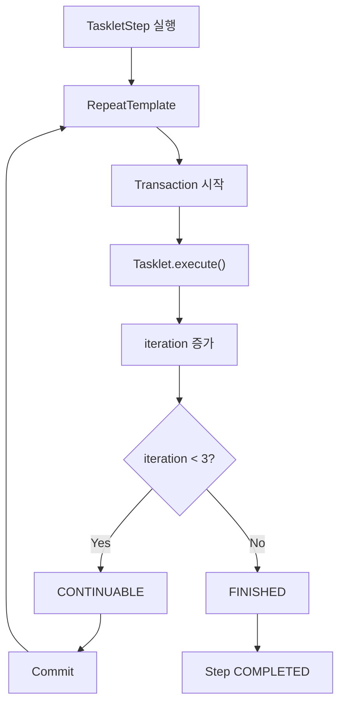

위 그림에서 마지막 실행 역시 정상적으로 커밋된 뒤 Step 종료 처리로 이어진다고 이해하면 된다.

---

### 두 번째 실행: ChunkOrientedTasklet 확인하기

이번에는 Chunk 기반 Job을 실행해보자.

```bash
java -jar target/spring-batch-tasklet-demo-0.0.1-SNAPSHOT.jar \
  --demo.job.name=chunkProcessingJob
```

이번 Job은 다음 Step을 실행한다.

```java
new StepBuilder(
        "chunkProcessingStep",
        jobRepository
)
        .<String, String>chunk(
                2,
                transactionManager
        )
        .reader(reader)
        .processor(
                item -> item.toUpperCase(Locale.ROOT)
        )
        .writer(chunk -> {

            log.info(
                    "Chunk Writer: {}",
                    chunk.getItems()
            );
        })
        .build();
```

Chunk 크기는 2다.

Reader에는 다섯 개의 문자열이 들어 있다.

```text
item1
item2
item3
item4
item5
```

먼저 Reader가 데이터를 읽는다.

```text
첫 번째 Chunk

item1
item2
```

이후 Processor가 대문자로 변환한다.

```text
ITEM1
ITEM2
```

그리고 Writer가 결과를 출력한다.

```text
Chunk Writer: [ITEM1, ITEM2]
```

다음 Chunk에서는 세 번째와 네 번째 데이터를 처리한다.

```text
Chunk Writer: [ITEM3, ITEM4]
```

마지막 Chunk에서는 다섯 번째 데이터만 처리한다.

```text
Chunk Writer: [ITEM5]
```

#### 예상 실행 결과

```text
Chunk Writer: [ITEM1, ITEM2]

Chunk Writer: [ITEM3, ITEM4]

Chunk Writer: [ITEM5]
```

이 결과를 통해 ChunkOrientedTasklet이 Reader, Processor, Writer를 조합하여 데이터를 처리한다는 것을 확인할 수 있다.

여기서 중요한 사실이 있다.

**Chunk 기반 Step도 TaskletStep을 사용한다.**

따라서 RepeatTemplate과 TransactionTemplate을 이용하는 기본적인 실행 구조는 동일하다.

차이는 반복 실행되는 대상이 사용자 정의 Tasklet이 아니라 ChunkOrientedTasklet이라는 점이다.

---

### 세 번째 실행: TaskletStep의 트랜잭션 롤백 확인하기

이번에는 Tasklet 내부에서 데이터를 INSERT한 후 예외를 발생시켜보자.

실행 명령어는 다음과 같다.

```bash
java -jar target/spring-batch-tasklet-demo-0.0.1-SNAPSHOT.jar \
  --demo.job.name=rollbackTaskletJob
```

Tasklet은 다음 SQL을 실행한다.

```sql
INSERT INTO TASKLET_AUDIT (
    MESSAGE
)
VALUES (
    'ROLLBACK_TEST'
);
```

이후 의도적으로 예외를 발생시킨다.

```java
throw new IllegalStateException(
        "Tasklet 실행 실패"
);
```

TaskletStep은 TransactionTemplate을 통해 Tasklet을 실행하고 있다.

따라서 예외가 발생하면 현재 트랜잭션이 롤백된다.

실행 흐름은 다음과 같다.

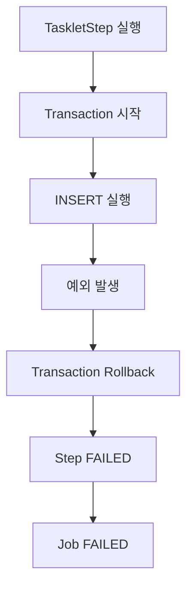

#### 예상 실행 결과

```text
INSERT 수행 후 의도적인 예외 발생

java.lang.IllegalStateException:
Tasklet 실행 실패

Job status: FAILED
```

여기서 중요한 것은 INSERT가 수행되었지만 커밋되지 않았다는 사실이다.

따라서 같은 데이터베이스를 조회하면 해당 INSERT의 결과는 남지 않아야 한다.

반면 Spring Batch의 StepExecution에는 실패 상태가 기록된다.

즉, **비즈니스 트랜잭션의 롤백과 실패 이력을 저장하는 메타데이터 처리는 구분해서 이해해야 한다.**

이번 예제는 동일한 데이터베이스와 트랜잭션 매니저가 JDBC 작업을 관리하는 구성을 전제로 한다.

---

### JUnit으로 TaskletStep 동작 검증하기

이번에는 실제 실행 결과를 테스트 코드로 확인해보자.

다음 세 가지를 검증한다.

첫 번째는 Tasklet이 FINISHED를 반환할 때까지 반복되는지 확인한다.

두 번째는 Chunk 기반 Step이 데이터를 정상적으로 처리하는지 확인한다.

세 번째는 Tasklet 실행 중 예외가 발생했을 때 데이터베이스 INSERT가 롤백되는지 확인한다.

`TaskletStepTest.java`

```java
package com.example.batch;

import java.util.UUID;

import org.junit.jupiter.api.Test;

import org.springframework.batch.core.BatchStatus;
import org.springframework.batch.core.Job;
import org.springframework.batch.core.JobExecution;
import org.springframework.batch.core.JobParameters;
import org.springframework.batch.core.JobParametersBuilder;
import org.springframework.batch.core.StepExecution;

import org.springframework.batch.core.launch.JobLauncher;

import org.springframework.beans.factory.annotation.Autowired;
import org.springframework.beans.factory.annotation.Qualifier;

import org.springframework.boot.test.context.SpringBootTest;

import org.springframework.jdbc.core.JdbcTemplate;

import static org.junit.jupiter.api.Assertions.*;

@SpringBootTest(properties = {
        "spring.batch.job.enabled=false"
})
class TaskletStepTest {

    @Autowired
    private JobLauncher jobLauncher;

    @Autowired
    private JdbcTemplate jdbcTemplate;

    @Autowired
    @Qualifier("repeatTaskletJob")
    private Job repeatTaskletJob;

    @Autowired
    @Qualifier("chunkProcessingJob")
    private Job chunkProcessingJob;

    @Autowired
    @Qualifier("rollbackTaskletJob")
    private Job rollbackTaskletJob;

    private JobParameters parameters() {

        return new JobParametersBuilder()
                .addString(
                        "test.id",
                        UUID.randomUUID().toString()
                )
                .toJobParameters();
    }

    @Test
    void Tasklet은_FINISHED까지_반복된다()
            throws Exception {

        JobExecution execution =
                jobLauncher.run(
                        repeatTaskletJob,
                        parameters()
                );

        assertEquals(
                BatchStatus.COMPLETED,
                execution.getStatus()
        );

        StepExecution stepExecution =
                execution
                        .getStepExecutions()
                        .iterator()
                        .next();

        assertEquals(
                3,
                stepExecution.getCommitCount()
        );

        assertEquals(
                3,
                stepExecution
                        .getExecutionContext()
                        .getInt("iteration")
        );
    }

    @Test
    void Chunk_기반으로_데이터를_처리한다()
            throws Exception {

        JobExecution execution =
                jobLauncher.run(
                        chunkProcessingJob,
                        parameters()
                );

        assertEquals(
                BatchStatus.COMPLETED,
                execution.getStatus()
        );

        StepExecution stepExecution =
                execution
                        .getStepExecutions()
                        .iterator()
                        .next();

        assertEquals(
                5,
                stepExecution.getReadCount()
        );

        assertEquals(
                5,
                stepExecution.getWriteCount()
        );
    }

    @Test
    void Tasklet_예외가_발생하면_트랜잭션이_롤백된다()
            throws Exception {

        JobExecution execution =
                jobLauncher.run(
                        rollbackTaskletJob,
                        parameters()
                );

        assertEquals(
                BatchStatus.FAILED,
                execution.getStatus()
        );

        Integer count =
                jdbcTemplate.queryForObject(
                        "SELECT COUNT(*) FROM TASKLET_AUDIT",
                        Integer.class
                );

        assertEquals(
                0,
                count
        );
    }
}
```

여기서 첫 번째 테스트는 Tasklet의 반복 실행을 검증한다.

```java
assertEquals(
        3,
        stepExecution.getCommitCount()
);
```

Tasklet이 세 번 실행되고 정상적으로 커밋되었다면 CommitCount가 3이 된다.

두 번째 테스트는 Chunk 기반 처리의 결과를 확인한다.

```java
assertEquals(
        5,
        stepExecution.getReadCount()
);
```

```java
assertEquals(
        5,
        stepExecution.getWriteCount()
);
```

다섯 개의 데이터를 읽고 저장했으므로 두 값이 5가 되는 것을 확인한다.

세 번째 테스트는 트랜잭션 롤백을 검증한다.

```java
assertEquals(
        0,
        count
);
```

Tasklet에서 INSERT 후 예외를 발생시켰으므로 해당 데이터가 커밋되지 않았는지 확인한다.

#### 테스트 실행

```bash
mvn test
```

정상적으로 실행되면 다음과 유사한 결과를 확인할 수 있다.

```text
Tests run: 3

Failures: 0

Errors: 0

BUILD SUCCESS
```

---

### TaskletStep의 실행 상태와 Listener

TaskletStep이 실행되면 StepExecution의 상태가 변경된다.

일반적인 실행 흐름은 다음과 같다.

```text
StepExecution
    │
    ▼
STARTING
    │
    ▼
STARTED
    │
    ├── 정상 종료 → COMPLETED
    │
    ├── 예외 발생 → FAILED
    │
    └── 중단 요청 → STOPPED
```

여기서 상태 변경을 담당하는 주요 클래스는 AbstractStep이다.

TaskletStep은 AbstractStep을 상속하기 때문에 공통적인 상태 처리 기능을 이용한다.

#### beforeStep()

Step 실행 전에 호출된다.

```java
@Override
public void beforeStep(
        StepExecution stepExecution
) {

    log.info(
            "Step 시작: {}",
            stepExecution.getStepName()
    );
}
```

#### afterStep()

Step 실행 후 호출된다.

```java
@Override
public ExitStatus afterStep(
        StepExecution stepExecution
) {

    log.info(
            "Step 종료: {}",
            stepExecution.getStatus()
    );

    return null;
}
```

여기서 afterStep()이 null을 반환하면 Listener에서 별도의 ExitStatus 변경을 요청하지 않는다는 의미다.

반면 사용자 정의 ExitStatus를 반환하면 종료 코드에 영향을 줄 수 있다.

따라서 BatchStatus와 ExitStatus를 구분해서 이해해야 한다.

---

### 실무에서의 활용

TaskletStep은 다양한 배치 작업에 활용할 수 있다.

하지만 어떤 업무든 Tasklet 기반으로 구현하는 것이 적절한 것은 아니다.

업무의 처리 특성, 데이터 양, 트랜잭션 범위, 재시작 요구사항을 고려해야 한다.

#### 1. 배치 실행 전 데이터 검증

정산 배치를 실행하기 전에 필수 데이터가 존재하는지 확인할 수 있다.

예를 들어 정산 기준일에 해당하는 거래 데이터가 존재하는지 검사하는 것이다.

이러한 작업은 상대적으로 간단한 Tasklet 기반 Step에 적합하다.

#### 2. 정산 확정 전 상태 확인

정산 금액을 확정하기 전에 모든 가맹점의 거래 데이터가 집계되었는지 확인할 수 있다.

검증 결과에 따라 예외를 발생시켜 후속 Step 실행을 중단할 수 있다.

다만 정산 확정 자체가 외부 시스템과 연결된다면 단순한 트랜잭션 처리만으로 일관성을 보장할 수는 없다.

#### 3. 배치 실행 전 임시 데이터 정리

이전 실행에서 생성한 임시 데이터를 정리하는 작업에 사용할 수 있다.

예를 들어 특정 배치 실행 ID를 기준으로 임시 테이블의 데이터를 삭제하는 방식이다.

이러한 작업은 단일 SQL로 처리할 수 있으므로 Tasklet 기반 Step이 적절할 수 있다.

#### 4. 대량 데이터 이관

대량의 데이터를 읽고 변환한 뒤 다른 테이블에 저장해야 한다면 Chunk 기반 Step이 적합하다.

ItemReader와 ItemWriter를 이용해 처리 단위를 분리할 수 있기 때문이다.

또한 Chunk 단위로 커밋할 수 있어 전체 데이터를 하나의 트랜잭션으로 처리하는 부담을 줄일 수 있다.

#### 5. 외부 API 상태 확인

외부 시스템의 준비 상태를 확인하는 작업에 사용할 수 있다.

다만 외부 API 호출은 데이터베이스 트랜잭션과 별개로 실행될 수 있다.

따라서 TaskletStep이 트랜잭션을 제공한다고 해서 외부 API 호출까지 롤백할 수 있는 것은 아니다.

#### 6. 반복형 작업의 종료 조건 설계

CONTINUABLE을 사용하는 Tasklet에서는 반드시 종료 조건을 명확하게 정의해야 한다.

종료 조건이 없으면 불필요한 반복이 발생할 수 있다.

특히 운영 환경에서는 최대 처리 횟수나 중단 조건을 함께 고려하는 것이 좋다.

#### 7. 트랜잭션 크기 조절

Tasklet을 여러 번 실행한다면 각 호출마다 트랜잭션이 적용될 수 있다.

Chunk 기반 처리에서는 Chunk 크기가 커밋 간격과 밀접하게 연결된다.

따라서 트랜잭션 크기를 결정할 때 데이터베이스 부하와 롤백 비용을 함께 고려해야 한다.

#### 8. ExecutionContext를 이용한 상태 관리

반복 처리 과정에서 진행 상태를 저장해야 한다면 ExecutionContext를 활용할 수 있다.

예를 들어 마지막 처리 ID나 현재 반복 횟수를 저장할 수 있다.

다만 저장 시점과 재시작 시 복원 방식까지 함께 고려해야 한다.

#### 9. Listener를 이용한 실행 결과 수집

StepExecutionListener를 이용하면 실행 전후에 필요한 정보를 수집할 수 있다.

예를 들어 처리 시간, CommitCount, RollbackCount 등을 기록할 수 있다.

이러한 정보는 배치 운영 모니터링에 활용할 수 있다.

#### 10. 비즈니스 멱등성 확보

TaskletStep은 트랜잭션을 제공하지만 비즈니스 작업의 중복 실행까지 자동으로 방지하지는 않는다.

예를 들어 동일한 정산 결과를 여러 JobInstance에서 저장할 수 있다.

따라서 데이터베이스 유니크 제약조건이나 멱등성 키 등 별도의 보호 장치가 필요하다.

#### 11. 장애 복구 시 이전 커밋 데이터 고려

반복형 Tasklet에서 일부 반복이 이미 커밋된 후 예외가 발생할 수 있다.

이 경우 이전에 커밋된 데이터는 유지될 수 있다.

따라서 재시작 시 이미 처리한 데이터를 다시 처리하지 않도록 설계해야 한다.

#### 12. 트랜잭션 매니저와 리소스의 관계 확인

TaskletStep의 트랜잭션 처리는 설정된 PlatformTransactionManager를 통해 이루어진다.

따라서 실제 작업에 사용하는 데이터베이스나 리소스가 해당 트랜잭션에 참여하는지 확인해야 한다.

여러 데이터베이스나 외부 시스템을 사용하는 경우에는 트랜잭션 경계가 서로 다를 수 있다.

이러한 구조를 이해해야 실제 롤백 범위를 정확하게 판단할 수 있다.

---

### TaskletStep에서 자주 혼동하는 부분

| 혼동하기 쉬운 내용 | 정확한 이해 |
|---|---|
| TaskletStep은 Tasklet을 한 번만 실행한다 | RepeatTemplate을 통해 반복 실행할 수 있다 |
| TaskletStep과 Tasklet은 같은 객체다 | Step과 비즈니스 로직 구현체는 서로 다르다 |
| CONTINUABLE을 반환하면 Step이 종료된다 | 다음 반복을 계속할 수 있다 |
| FINISHED를 반환하면 다음 반복을 진행한다 | 반복을 종료한다 |
| null을 반환하면 오류가 발생한다 | FINISHED로 해석된다 |
| 반복되는 모든 Tasklet 실행은 하나의 트랜잭션이다 | 기본 구조에서는 개별 호출에 트랜잭션이 적용된다 |
| Chunk는 TaskletStep과 무관하다 | ChunkOrientedTasklet을 통해 TaskletStep에서 실행된다 |
| Chunk 기반 Step은 별도 ChunkStep을 생성한다 | SimpleStepBuilder도 TaskletStep을 생성한다 |
| TaskletStep의 트랜잭션은 외부 API도 롤백한다 | 외부 API는 일반적으로 별도의 일관성 관리가 필요하다 |
| Listener는 Tasklet 반복마다 실행된다 | StepExecutionListener는 Step 실행 전후에 호출된다 |
| startLimit은 전체 시스템에서 Step 실행 횟수를 제한한다 | 같은 JobInstance를 기준으로 적용된다 |
| allowStartIfComplete는 완료된 Job을 다시 실행할 수 있게 한다 | Job 재시작 시 완료된 Step의 재실행을 허용한다 |

---

### TaskletStep 전체 아키텍처

지금까지 살펴본 내용을 하나의 흐름으로 정리해보자.

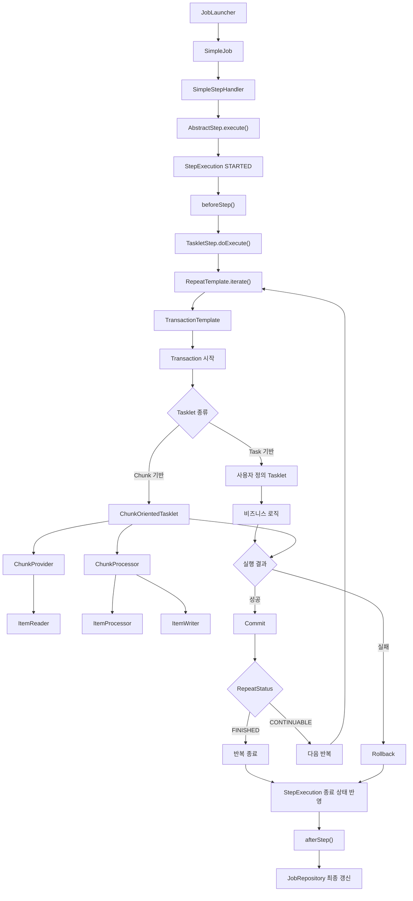

이 구조에서 가장 중요한 것은 다음 세 가지다.

첫 번째는 TaskletStep이 RepeatTemplate을 이용해 Tasklet을 반복 실행한다는 사실이다.

두 번째는 반복 실행 과정에서 TransactionTemplate을 이용해 트랜잭션을 관리한다는 사실이다.

세 번째는 TaskletStep이 사용자 정의 Tasklet뿐 아니라 ChunkOrientedTasklet도 실행할 수 있다는 사실이다.

이러한 구조를 통해 Spring Batch는 서로 다른 비즈니스 처리 방식을 하나의 TaskletStep 실행 구조로 통합한다.

---

### 정리

Spring Batch의 `TaskletStep`은 Tasklet 인터페이스를 구현한 객체를 실행하는 Step 구현체다.

TaskletStep은 단순히 Tasklet을 호출하는 역할만 담당하지 않는다.

반복 실행, 트랜잭션 처리, 실행 상태 관리, ExecutionContext 저장 등 여러 기능을 함께 제공한다.

대표적인 실행 흐름은 다음과 같다.

```text
SimpleJob
    │
    ▼
AbstractStep.execute()
    │
    ▼
TaskletStep.doExecute()
    │
    ▼
RepeatTemplate.iterate()
    │
    ▼
TransactionTemplate
    │
    ▼
Tasklet.execute()
    │
    ▼
RepeatStatus
    │
    ├── CONTINUABLE → 반복
    │
    └── FINISHED → 종료
```

여기서 RepeatTemplate은 반복 실행을 담당한다.

TransactionTemplate은 트랜잭션 처리를 담당한다.

Tasklet은 실제 비즈니스 로직을 수행한다.

Tasklet의 실행 결과는 RepeatStatus로 반환된다.

CONTINUABLE을 반환하면 반복이 계속될 수 있다.

FINISHED를 반환하면 반복이 종료된다.

또한 null을 반환하면 FINISHED로 해석된다.

TaskletStep은 Task 기반과 Chunk 기반의 두 가지 방식으로 활용할 수 있다.

Task 기반에서는 개발자가 직접 구현한 Tasklet을 실행한다.

반면 Chunk 기반에서는 Spring Batch가 제공하는 ChunkOrientedTasklet을 실행한다.

ChunkOrientedTasklet은 ChunkProvider와 ChunkProcessor를 이용한다.

ChunkProvider는 ItemReader를 통해 데이터를 읽는다.

ChunkProcessor는 ItemProcessor와 ItemWriter를 이용해 데이터를 가공하고 저장한다.

이때 Chunk 기반 처리도 TaskletStep의 반복 및 트랜잭션 관리 구조를 사용한다.

따라서 Task 기반과 Chunk 기반은 서로 완전히 독립적인 실행 구조가 아니다.

**동일한 TaskletStep을 기반으로 서로 다른 Tasklet 구현체를 실행하는 구조**다.

실무에서는 작업의 특성에 따라 적절한 방식을 선택해야 한다.

단일 SQL 실행이나 사전 검증처럼 단순한 작업이라면 사용자 정의 Tasklet이 적합할 수 있다.

반면 대량의 데이터를 읽고 변환한 후 저장해야 한다면 Chunk 기반 처리가 적합할 수 있다.

또한 TaskletStep의 트랜잭션이 실제로 어떤 리소스를 보호하는지 확인해야 한다.

데이터베이스 작업은 트랜잭션으로 롤백할 수 있지만, 이미 전송한 외부 API 요청까지 자동으로 취소할 수 있는 것은 아니다.

따라서 결제와 정산처럼 데이터 정합성이 중요한 업무에서는 트랜잭션과 멱등성을 함께 설계해야 한다.

결국 TaskletStep의 아키텍처를 이해한다는 것은 Tasklet의 실행 방법만 아는 것이 아니다.

**RepeatTemplate이 반복을 관리하고, TransactionTemplate이 트랜잭션을 관리하며, Tasklet 구현체가 비즈니스 로직을 처리하는 전체 실행 구조를 이해하는 것**이다.

#### 한 줄 요약

> Spring Batch의 `TaskletStep`은 `RepeatTemplate`을 이용해 Tasklet을 반복 실행하고, 각 실행을 `TransactionTemplate`의 트랜잭션 경계 안에서 처리하는 Step 구현체다. 사용자 정의 Tasklet은 일반적인 단일 작업을 수행하며, `ChunkOrientedTasklet`은 `ItemReader`, `ItemProcessor`, `ItemWriter`를 이용해 Chunk 기반 데이터를 처리한다. 두 방식 모두 동일한 TaskletStep을 사용하지만 내부 Tasklet의 구현과 데이터 처리 방식이 다르다.

## TaskletStep - tasklet()


### Spring Batch tasklet() API 이해: Tasklet 인터페이스, RepeatStatus와 CustomTasklet 구현

Spring Batch에서 Job은 하나 이상의 Step으로 구성되며, 각 Step은 실제 비즈니스 로직을 수행하는 독립적인 실행 단위다.

Step은 다양한 방식으로 구성할 수 있지만, 가장 기본적으로 활용되는 방식은 `Tasklet`을 이용하는 것이다.

Tasklet은 Spring Batch에서 제공하는 인터페이스로, Step 내부에서 실행할 작업을 정의하는 역할을 담당한다.

예를 들어 다음과 같은 배치 작업을 생각해보자.

```text
dailySettlementJob
       │
       ├── prepareSettlementStep
       │       │
       │       └── 정산 대상 데이터 검증
       │
       └── executeSettlementStep
               │
               └── 정산 데이터 처리
```

이 Job은 두 개의 Step으로 구성된다.

첫 번째 Step은 정산 대상 데이터가 정상적인지 확인한다.

두 번째 Step은 실제 정산 처리를 수행한다.

각 Step에서 실행할 비즈니스 로직을 Tasklet으로 구현할 수 있다.

Spring Batch에서는 다음과 같은 API를 제공한다.

```java
.tasklet(tasklet, transactionManager)
```

이 API는 Step에서 실행할 Tasklet 객체와 트랜잭션 매니저를 설정한다.

예를 들어 다음과 같이 사용할 수 있다.

```java
@Bean
public Step settlementStep(
        JobRepository jobRepository,
        PlatformTransactionManager transactionManager
) {

    return new StepBuilder(
            "settlementStep",
            jobRepository
    )
            .tasklet((contribution, chunkContext) -> {

                System.out.println("정산 작업 실행");

                return RepeatStatus.FINISHED;

            }, transactionManager)
            .build();
}
```

이 코드는 `settlementStep`이라는 Step을 생성한다.

그리고 해당 Step에서 실행할 Tasklet을 등록한다.

실제 Job이 실행되면 Spring Batch는 TaskletStep을 통해 등록된 Tasklet의 `execute()` 메서드를 호출한다.

여기서 중요한 것은 **Tasklet과 TaskletStep이 서로 다른 객체라는 사실**이다.

TaskletStep은 실행을 관리하는 Step 구현체다.

반면 Tasklet은 실제 비즈니스 로직을 구현하는 객체다.

전체 구조는 다음과 같다.

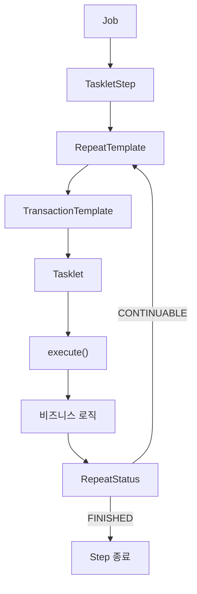

TaskletStep은 Tasklet을 실행한다.

그리고 Tasklet의 반환값에 따라 작업을 반복하거나 종료한다.

이때 반복 여부를 결정하는 객체가 `RepeatStatus`다.

이번에는 `tasklet()` API의 역할부터 Tasklet 인터페이스의 구조, `StepContribution`, `ChunkContext`, `RepeatStatus`, 사용자 정의 Tasklet 구현과 실제 실행 흐름까지 살펴보자.

---

### 개념

#### Tasklet이란?

Tasklet은 Spring Batch에서 Step 내부의 비즈니스 로직을 구현하기 위한 인터페이스다.

주로 하나의 명확한 작업을 수행할 때 사용한다.

예를 들어 다음과 같은 업무가 있다.

- 배치 실행 전 필수 데이터 존재 여부 확인
- 특정 테이블의 데이터 정리
- 정산 대상 거래 건수 검증
- 파일 생성 또는 파일 이동
- 외부 시스템의 준비 상태 확인
- 배치 실행 후 임시 데이터 삭제

이러한 작업은 반드시 ItemReader, ItemProcessor, ItemWriter로 구성할 필요가 없다.

개발자가 원하는 비즈니스 로직을 직접 구현하고 실행하면 된다.

Spring Batch에서는 이러한 작업을 위해 Tasklet 인터페이스를 제공한다.

Tasklet은 다음과 같은 특징을 가진다.

| 특징 | 설명 |
|---|---|
| 인터페이스 | Tasklet 인터페이스로 정의 |
| 핵심 메서드 | execute() |
| 반환 타입 | RepeatStatus |
| 실행 주체 | TaskletStep |
| 반복 실행 | RepeatStatus에 따라 결정 |
| 트랜잭션 | TaskletStep이 실행 단위의 트랜잭션 관리 |
| 구현 방식 | 구현 클래스, 익명 클래스, 람다식 |
| 주요 목적 | Step 내부의 비즈니스 로직 실행 |

Tasklet은 실행 흐름 자체를 관리하지 않는다.

반복 실행과 트랜잭션 처리는 TaskletStep이 담당한다.

Tasklet은 실제 처리할 비즈니스 로직에 집중한다.

---

### Tasklet 인터페이스의 구조

Spring Batch 5.2.4에서 Tasklet 인터페이스는 다음 패키지에 존재한다.

```java
org.springframework.batch.core.step.tasklet.Tasklet
```

인터페이스 구조는 다음과 같다.

```java
@FunctionalInterface
public interface Tasklet {

    RepeatStatus execute(
            StepContribution contribution,
            ChunkContext chunkContext
    ) throws Exception;
}
```

Tasklet은 하나의 추상 메서드를 가진 함수형 인터페이스다.

따라서 구현 클래스를 생성하지 않아도 람다식으로 구현할 수 있다.

핵심 메서드는 다음과 같다.

```java
RepeatStatus execute(
        StepContribution contribution,
        ChunkContext chunkContext
) throws Exception;
```

이 메서드는 두 개의 인자를 전달받는다.

첫 번째는 `StepContribution`이다.

두 번째는 `ChunkContext`다.

그리고 반환 타입은 `RepeatStatus`다.

각 항목의 역할은 다음과 같다.

| 항목 | 타입 | 역할 |
|---|---|---|
| contribution | StepContribution | 현재 처리 결과 및 StepExecution 접근 |
| chunkContext | ChunkContext | 현재 Step 실행 환경 및 Context 접근 |
| 반환값 | RepeatStatus | 반복 실행 여부 결정 |
| 예외 | Exception | 작업 실패 전달 |

TaskletStep은 Tasklet을 실행할 때 이 두 객체를 전달한다.

개발자는 전달받은 객체를 활용하여 Job 및 Step 실행 정보를 조회할 수 있다.

---

### StepContribution이란?

StepContribution은 현재 Tasklet 실행에서 발생한 처리 결과를 StepExecution에 반영하기 위한 객체다.

Spring Batch는 StepExecution을 통해 개별 Step의 실행 상태를 관리한다.

예를 들어 StepExecution에는 다음과 같은 정보가 존재한다.

```text
StepExecution
    │
    ├── StepExecution ID
    ├── Step Name
    ├── BatchStatus
    ├── ExitStatus
    ├── ReadCount
    ├── WriteCount
    ├── CommitCount
    ├── RollbackCount
    └── ExecutionContext
```

StepContribution은 이러한 실행 결과를 관리하는 과정에서 사용된다.

가장 기본적인 사용 방법은 다음과 같다.

```java
StepExecution stepExecution =
        contribution.getStepExecution();
```

이렇게 현재 StepExecution을 가져올 수 있다.

이후 다음과 같이 Step 이름을 조회할 수 있다.

```java
String stepName =
        stepExecution.getStepName();
```

JobExecution에도 접근할 수 있다.

```java
JobExecution jobExecution =
        stepExecution.getJobExecution();
```

그리고 Job 이름을 조회할 수도 있다.

```java
String jobName =
        jobExecution
                .getJobInstance()
                .getJobName();
```

전체 접근 관계는 다음과 같다.

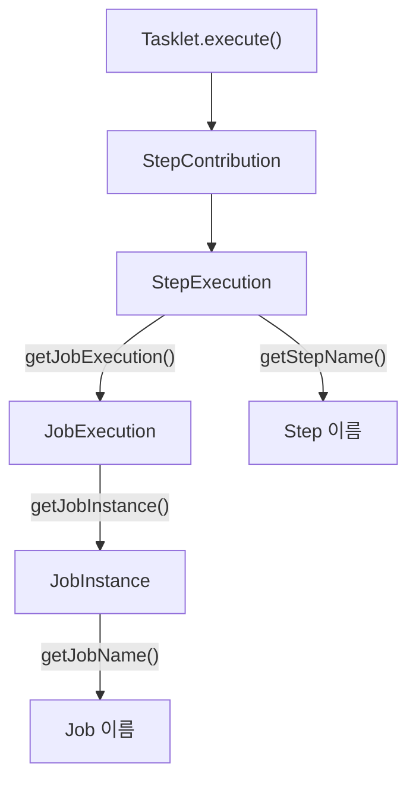

이를 활용하면 Tasklet 내부에서 현재 실행 중인 Job과 Step의 정보를 확인할 수 있다.

#### StepContribution의 처리 통계

StepContribution은 처리 건수를 반영할 때도 사용된다.

대표적인 메서드는 다음과 같다.

```java
contribution.incrementReadCount();
```

```java
contribution.incrementWriteCount(1);
```

```java
contribution.incrementFilterCount(1);
```

각 메서드의 역할은 다음과 같다.

| 메서드 | 역할 |
|---|---|
| incrementReadCount() | 읽은 Item 수 증가 |
| incrementWriteCount(long) | 저장한 Item 수 증가 |
| incrementFilterCount(long) | 필터링한 Item 수 증가 |

다만 일반적인 Tasklet에서 이러한 통계를 직접 변경해야 하는 것은 아니다.

Chunk 기반 처리에서는 Spring Batch가 Reader, Processor, Writer의 처리 결과를 바탕으로 관련 통계를 관리한다.

따라서 사용자 정의 Tasklet에서는 실제 업무에 필요한 경우에만 이러한 메서드를 사용하는 것이 적절하다.

---

### ChunkContext란?

ChunkContext는 현재 처리 단위의 실행 환경에 접근할 수 있도록 제공되는 객체다.

Tasklet의 두 번째 인자로 전달된다.

```java
RepeatStatus execute(
        StepContribution contribution,
        ChunkContext chunkContext
);
```

ChunkContext는 내부적으로 StepContext를 참조한다.

```java
StepContext stepContext =
        chunkContext.getStepContext();
```

StepContext에는 현재 Step과 관련된 다양한 정보를 조회할 수 있는 메서드가 존재한다.

대표적인 메서드는 다음과 같다.

| 메서드 | 역할 |
|---|---|
| getStepName() | 현재 Step 이름 조회 |
| getJobName() | 현재 Job 이름 조회 |
| getStepExecution() | 현재 StepExecution 조회 |
| getJobParameters() | JobParameters 조회 |
| getStepExecutionContext() | Step ExecutionContext 조회 |
| getJobExecutionContext() | Job ExecutionContext 조회 |
| getJobInstanceId() | JobInstance ID 조회 |

예를 들어 다음과 같이 Step 이름을 조회할 수 있다.

```java
String stepName =
        chunkContext
                .getStepContext()
                .getStepName();
```

Job 이름도 바로 조회할 수 있다.

```java
String jobName =
        chunkContext
                .getStepContext()
                .getJobName();
```

따라서 StepExecution을 직접 탐색하지 않아도 필요한 정보를 조회할 수 있다.

#### StepContribution과 ChunkContext 비교

| 구분 | StepContribution | ChunkContext |
|---|---|---|
| 주요 목적 | 처리 결과 반영 | 현재 실행 환경 접근 |
| StepExecution 접근 | 가능 | 가능 |
| Step 이름 조회 | StepExecution을 통해 조회 | StepContext에서 직접 조회 |
| Job 이름 조회 | JobExecution을 통해 조회 | StepContext에서 직접 조회 |
| 처리 통계 변경 | 지원 | 주요 목적이 아님 |
| 실행 상태 정보 | StepExecution 중심 | StepContext 중심 |

두 객체는 서로 대체하는 관계가 아니다.

각각의 목적에 맞게 사용하면 된다.

여기서 중요한 점은 ChunkContext가 ExecutionContext와 동일한 객체가 아니라는 사실이다.

ChunkContext는 현재 처리 과정의 실행 정보를 제공한다.

반면 ExecutionContext는 재시작을 위해 저장하고 복원할 수 있는 실행 상태를 관리한다.

따라서 재시작 이후에도 필요한 정보를 보존해야 한다면 적절한 ExecutionContext를 사용해야 한다.

---

### RepeatStatus란?

Tasklet의 반환 타입은 `RepeatStatus`다.

RepeatStatus는 Tasklet의 반복 실행 여부를 결정하는 상태 객체다.

대표적인 값은 두 가지다.

```java
RepeatStatus.FINISHED
```

```java
RepeatStatus.CONTINUABLE
```

각각의 의미는 다음과 같다.

| 반환값 | 의미 | 동작 |
|---|---|---|
| FINISHED | 작업 완료 | 반복 종료 |
| CONTINUABLE | 추가 작업 필요 | 반복 계속 |
| null | 완료로 해석 | 반복 종료 |

TaskletStep은 Tasklet을 실행한 다음 반환된 RepeatStatus를 확인한다.

그리고 다음 실행 여부를 결정한다.

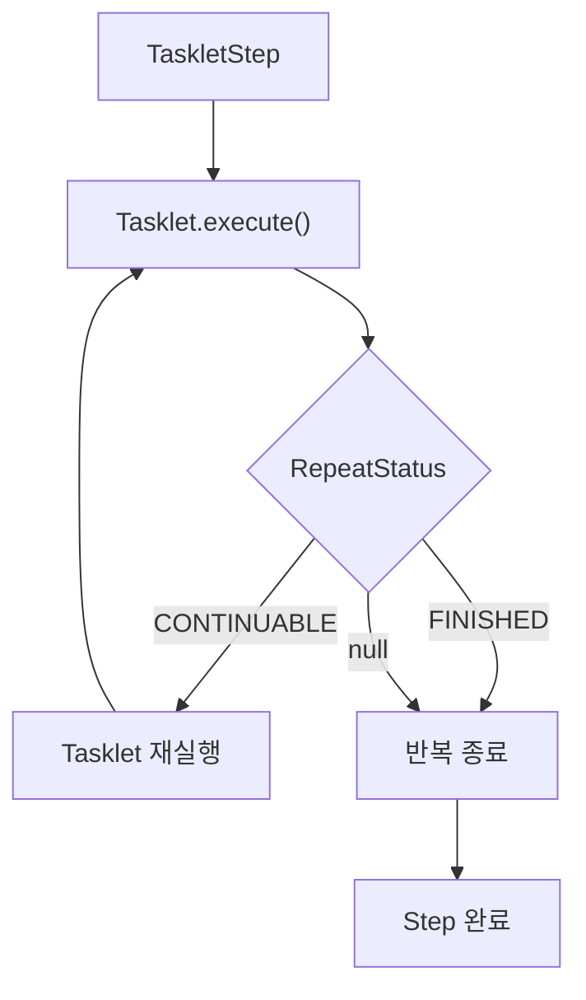

반복 실행을 관리하는 클래스는 RepeatTemplate이다.

따라서 실제 구조에서는 TaskletStep이 RepeatTemplate을 이용해 Tasklet을 실행하고, 반환값에 따라 반복 여부를 판단한다.

---

### RepeatStatus.FINISHED

FINISHED는 현재 작업을 완료했다는 의미다.

다음 코드를 살펴보자.

```java
@Override
public RepeatStatus execute(
        StepContribution contribution,
        ChunkContext chunkContext
) {

    System.out.println("비즈니스 로직 수행");

    return RepeatStatus.FINISHED;
}
```

이 Tasklet은 비즈니스 로직을 한 번 실행한다.

그리고 FINISHED를 반환한다.

그러면 TaskletStep은 반복 실행을 종료한다.

실행 흐름은 다음과 같다.

```text
TaskletStep
    │
    ▼
Tasklet.execute()
    │
    ▼
비즈니스 로직 실행
    │
    ▼
RepeatStatus.FINISHED
    │
    ▼
반복 종료
    │
    ▼
Step 완료
```

일반적인 단일 작업 기반 Tasklet에서는 이 방식을 많이 사용한다.

예를 들어 다음과 같은 작업이다.

```java
@Override
public RepeatStatus execute(
        StepContribution contribution,
        ChunkContext chunkContext
) {

    settlementValidationService.validate();

    return RepeatStatus.FINISHED;
}
```

정산 검증 작업을 수행하고 정상적으로 종료한다.

이처럼 하나의 명확한 작업을 수행하는 경우에는 FINISHED를 반환하면 된다.

---

### RepeatStatus.CONTINUABLE

CONTINUABLE은 현재 작업을 한 번 더 실행할 필요가 있다는 의미다.

다음 코드를 살펴보자.

```java
@Override
public RepeatStatus execute(
        StepContribution contribution,
        ChunkContext chunkContext
) {

    System.out.println("비즈니스 로직 수행");

    return RepeatStatus.CONTINUABLE;
}
```

이 코드에서는 CONTINUABLE을 반환한다.

따라서 TaskletStep은 Tasklet을 다시 실행할 수 있다.

```text
첫 번째 실행
    │
    └── CONTINUABLE
            │
            ▼
두 번째 실행
    │
    └── CONTINUABLE
            │
            ▼
세 번째 실행
    │
    └── CONTINUABLE
            │
            ▼
...
```

여기서 중요한 문제가 발생한다.

**종료 조건 없이 CONTINUABLE만 반환하면 무한 반복이 발생할 수 있다.**

따라서 반복형 Tasklet을 구현할 때는 반드시 종료 조건을 설정해야 한다.

예를 들어 세 번 실행한 후 종료하고 싶다면 다음과 같이 구현할 수 있다.

```java
@Override
public RepeatStatus execute(
        StepContribution contribution,
        ChunkContext chunkContext
) {

    ExecutionContext context =
            contribution
                    .getStepExecution()
                    .getExecutionContext();

    int executionCount =
            context.getInt("executionCount", 0) + 1;

    context.putInt(
            "executionCount",
            executionCount
    );

    System.out.println(
            "Tasklet 실행 횟수: " + executionCount
    );

    if (executionCount < 3) {

        return RepeatStatus.CONTINUABLE;
    }

    return RepeatStatus.FINISHED;
}
```

이 코드는 다음 순서로 실행된다.

| 실행 | executionCount | 반환값 |
|---|---:|---|
| 첫 번째 | 1 | CONTINUABLE |
| 두 번째 | 2 | CONTINUABLE |
| 세 번째 | 3 | FINISHED |

따라서 총 세 번 실행한 후 종료한다.

여기에서는 ExecutionContext를 이용해 반복 횟수를 관리했다.

이렇게 하면 Tasklet 구현체의 인스턴스 필드에 상태를 저장하는 것보다 StepExecution별 상태를 명확하게 구분할 수 있다.

---

### null을 반환하면 어떻게 될까?

Tasklet 인터페이스는 null을 반환할 수 있다.

Spring Batch는 Tasklet이 null을 반환하면 FINISHED로 해석한다.

예를 들어 다음과 같은 코드다.

```java
@Override
public RepeatStatus execute(
        StepContribution contribution,
        ChunkContext chunkContext
) {

    System.out.println("작업 실행");

    return null;
}
```

이 경우에도 반복은 종료된다.

Spring Batch 5.2.4의 TaskletStep 내부에는 다음과 같은 처리 로직이 있다.

```java
result = tasklet.execute(
        contribution,
        chunkContext
);

if (result == null) {

    result = RepeatStatus.FINISHED;
}
```

따라서 null이 반환되면 FINISHED로 변경된다.

하지만 실제 구현에서는 다음과 같이 명시적으로 반환하는 편이 좋다.

```java
return RepeatStatus.FINISHED;
```

코드를 읽는 개발자가 종료 의도를 바로 이해할 수 있기 때문이다.

---

### tasklet() API의 역할

Spring Batch에서는 TaskletStep에 Tasklet을 등록하기 위한 `tasklet()` API를 제공한다.

Spring Batch 5.2.4 기준 사용 방법은 다음과 같다.

```java
new StepBuilder("step1", jobRepository)
        .tasklet(tasklet, transactionManager)
        .build();
```

이 API는 두 가지 정보를 전달받는다.

첫 번째는 Tasklet이다.

두 번째는 PlatformTransactionManager다.

```java
tasklet(
        Tasklet tasklet,
        PlatformTransactionManager transactionManager
)
```

Tasklet은 실제 실행할 비즈니스 로직이다.

TransactionManager는 Tasklet 실행에 적용할 트랜잭션을 관리한다.

여기서 중요한 것은 반환 타입이다.

**StepBuilder의 tasklet() 메서드는 TaskletStepBuilder를 반환한다.**

따라서 다음과 같은 구조가 만들어진다.

```text
StepBuilder
    │
    ▼
tasklet()
    │
    ▼
TaskletStepBuilder
    │
    ├── Tasklet 설정
    │
    ├── TransactionManager 설정
    │
    └── 기타 Step 속성 설정
    │
    ▼
build()
    │
    ▼
TaskletStep
```

실제 Step 객체가 생성되는 시점은 build() 호출 이후다.

따라서 다음 두 시점을 구분해야 한다.

첫 번째는 Step을 생성하는 시점이다.

두 번째는 실제 Job이 실행되어 Tasklet이 호출되는 시점이다.

---

### tasklet() API의 내부 구현

Spring Batch 5.2.4의 StepBuilder에는 다음과 같은 메서드가 존재한다.

```java
public TaskletStepBuilder tasklet(
        Tasklet tasklet,
        PlatformTransactionManager transactionManager
) {

    return new TaskletStepBuilder(this)
            .tasklet(
                    tasklet,
                    transactionManager
            );
}
```

이 코드에서는 TaskletStepBuilder를 생성한다.

```java
new TaskletStepBuilder(this)
```

그리고 전달받은 Tasklet과 TransactionManager를 설정한다.

```java
.tasklet(
        tasklet,
        transactionManager
)
```

TaskletStepBuilder에서는 다음과 같이 처리한다.

```java
public TaskletStepBuilder tasklet(
        Tasklet tasklet,
        PlatformTransactionManager transactionManager
) {

    this.tasklet = tasklet;

    super.transactionManager(
            transactionManager
    );

    return this;
}
```

이 메서드는 Tasklet을 내부 필드에 저장한다.

```java
this.tasklet = tasklet;
```

그리고 TransactionManager를 설정한다.

```java
super.transactionManager(
        transactionManager
);
```

마지막으로 현재 Builder 객체를 반환한다.

```java
return this;
```

따라서 추가적인 Builder API를 계속 연결해서 호출할 수 있다.

예를 들어 다음과 같다.

```java
new StepBuilder("step1", jobRepository)
        .tasklet(tasklet, transactionManager)
        .startLimit(3)
        .allowStartIfComplete(true)
        .listener(listener)
        .build();
```

이러한 구조는 Builder 패턴의 대표적인 활용 사례다.

---

### 하나의 Step에는 몇 개의 Tasklet을 설정할 수 있을까?

TaskletStep은 내부적으로 하나의 Tasklet 객체를 참조한다.

Spring Batch 5.2.4의 TaskletStep에는 다음과 같은 필드가 존재한다.

```java
private Tasklet tasklet;
```

따라서 TaskletStep이 실행하는 Tasklet은 하나다.

이 사실을 이해하려면 Builder의 내부 구조를 함께 살펴봐야 한다.

TaskletStepBuilder에도 다음 필드가 존재한다.

```java
private Tasklet tasklet;
```

그리고 tasklet() 메서드를 호출할 때마다 다음 코드가 실행된다.

```java
this.tasklet = tasklet;
```

즉, 기존 Tasklet을 목록에 추가하는 구조가 아니다.

하나의 필드에 새로운 객체를 저장하는 구조다.

예를 들어 다음과 같이 작성했다고 생각해보자.

```java
TaskletStepBuilder builder =
        new StepBuilder("step1", jobRepository)
                .tasklet(firstTasklet, transactionManager);

builder.tasklet(
        secondTasklet,
        transactionManager
);

Step step = builder.build();
```

첫 번째 호출에서는 firstTasklet이 설정된다.

```text
TaskletStepBuilder
    │
    └── tasklet = firstTasklet
```

두 번째 호출에서는 기존 필드가 변경된다.

```text
TaskletStepBuilder
    │
    └── tasklet = secondTasklet
```

따라서 최종적으로 secondTasklet이 설정된다.

**Tasklet을 여러 번 설정한다고 해서 여러 Tasklet이 순차적으로 실행되는 것은 아니다.**

마지막으로 설정한 Tasklet이 사용된다.

#### 여러 Tasklet을 실행해야 한다면?

서로 다른 비즈니스 작업을 순차적으로 수행해야 한다면 일반적으로 Step을 분리하는 것이 좋다.

```text
Job
    │
    ├── Step 1
    │       └── Tasklet A
    │
    ├── Step 2
    │       └── Tasklet B
    │
    └── Step 3
            └── Tasklet C
```

이렇게 구성하면 각 Step의 실행 상태와 실패 여부를 독립적으로 관리할 수 있다.

또한 재시작 시 어느 Step부터 다시 실행해야 하는지도 명확해진다.

반면 하나의 논리적 작업을 여러 서비스 메서드로 나누어 처리하는 경우라면 하나의 Tasklet에서 여러 서비스를 호출할 수도 있다.

```java
@Override
public RepeatStatus execute(
        StepContribution contribution,
        ChunkContext chunkContext
) {

    validationService.validate();

    settlementService.calculate();

    settlementService.save();

    return RepeatStatus.FINISHED;
}
```

이 방식은 하나의 Step으로 실행 상태를 관리한다.

따라서 업무 특성에 따라 Tasklet 내부에서 처리할지, 여러 Step으로 분리할지 결정해야 한다.

---

### Tasklet을 구현하는 세 가지 방법

Tasklet은 인터페이스이므로 다양한 방식으로 구현할 수 있다.

대표적인 방법은 다음 세 가지다.

첫 번째는 익명 클래스다.

두 번째는 람다식이다.

세 번째는 별도의 구현 클래스를 생성하는 방식이다.

각 방식의 특징을 살펴보자.

#### 1. 익명 클래스

익명 클래스를 사용하면 Tasklet 인터페이스를 즉시 구현할 수 있다.

```java
@Bean
public Step anonymousTaskletStep(
        JobRepository jobRepository,
        PlatformTransactionManager transactionManager
) {

    return new StepBuilder(
            "anonymousTaskletStep",
            jobRepository
    )
            .tasklet(
                    new Tasklet() {

                        @Override
                        public RepeatStatus execute(
                                StepContribution contribution,
                                ChunkContext chunkContext
                        ) throws Exception {

                            System.out.println(
                                    "익명 클래스 Tasklet 실행"
                            );

                            return RepeatStatus.FINISHED;
                        }

                    },
                    transactionManager
            )
            .build();
}
```

이 방식은 구현이 간단하다.

하지만 비즈니스 로직이 복잡해지면 Configuration 클래스의 코드가 길어질 수 있다.

#### 2. 람다식

Tasklet은 함수형 인터페이스이므로 람다식을 사용할 수 있다.

```java
@Bean
public Step lambdaTaskletStep(
        JobRepository jobRepository,
        PlatformTransactionManager transactionManager
) {

    return new StepBuilder(
            "lambdaTaskletStep",
            jobRepository
    )
            .tasklet(
                    (contribution, chunkContext) -> {

                        System.out.println(
                                "람다식 Tasklet 실행"
                        );

                        return RepeatStatus.FINISHED;

                    },
                    transactionManager
            )
            .build();
}
```

익명 클래스보다 간결하게 작성할 수 있다.

간단한 작업을 구현할 때 적합하다.

다만 여러 서비스와 연동하거나 예외 처리 로직이 복잡하다면 별도의 클래스로 분리하는 편이 좋다.

#### 3. Tasklet 구현 클래스

세 번째는 Tasklet 인터페이스를 직접 구현하는 방식이다.

```java
public class CustomTasklet implements Tasklet {

    @Override
    public RepeatStatus execute(
            StepContribution contribution,
            ChunkContext chunkContext
    ) throws Exception {

        System.out.println(
                "CustomTasklet 실행"
        );

        return RepeatStatus.FINISHED;
    }
}
```

이렇게 별도의 클래스를 생성하면 비즈니스 로직을 Configuration에서 분리할 수 있다.

서비스 의존성 주입과 단위 테스트도 더 명확해진다.

특히 복잡한 업무에서는 이 방식을 많이 활용할 수 있다.

#### 구현 방식 비교

| 구분 | 익명 클래스 | 람다식 | 구현 클래스 |
|---|---|---|---|
| 코드 길이 | 긴 편 | 가장 간결 | 별도 클래스 필요 |
| 간단한 작업 | 적합 | 적합 | 가능 |
| 복잡한 로직 | 관리 어려움 | 관리 어려움 | 적합 |
| 단위 테스트 | 상대적으로 불편 | 상대적으로 불편 | 유리 |
| 의존성 주입 | 가능 | 가능 | 명확 |
| 재사용 | 제한적 | 제한적 | 유리 |

핵심은 어떤 방식으로 구현하더라도 최종적으로 Tasklet 인터페이스를 구현한 객체가 TaskletStep에 등록된다는 사실이다.

---

### 예제: 사용자 정의 CustomTasklet 구현하기

이제 실제로 두 개의 Step을 가지는 Job을 구현해보자.

첫 번째 Step은 익명 클래스 기반 Tasklet을 사용한다.

두 번째 Step은 별도의 CustomTasklet 클래스를 사용한다.

전체 구조는 다음과 같다.

```text
taskletApiJob
       │
       ├── step1
       │     │
       │     └── Anonymous Tasklet
       │             │
       │             └── Step 실행 정보 출력
       │
       └── step2
             │
             └── CustomTasklet
                     │
                     ├── StepContribution 사용
                     ├── ChunkContext 사용
                     ├── Step 이름 조회
                     ├── Job 이름 조회
                     └── JobParameters 조회
```

이 예제를 통해 다음 내용을 확인한다.

- TaskletStep마다 서로 다른 Tasklet 등록
- Tasklet의 execute() 호출
- StepContribution을 이용한 StepExecution 접근
- ChunkContext를 이용한 StepContext 접근
- RepeatStatus.FINISHED 반환
- 두 Step의 순차 실행

개발 환경은 다음과 같다.

| 항목 | 기술 |
|---|---|
| Java | Java 17 |
| Spring Boot | 3.4.13 |
| Spring Batch | 5.2.4 |
| Build Tool | Maven |
| Database | H2 |
| Job 구현체 | SimpleJob |
| Step 구현체 | TaskletStep |

---

### 프로젝트 의존성 설정

`pom.xml`

```xml
<?xml version="1.0" encoding="UTF-8"?>
<project xmlns="http://maven.apache.org/POM/4.0.0"
         xmlns:xsi="http://www.w3.org/2001/XMLSchema-instance"
         xsi:schemaLocation="
             http://maven.apache.org/POM/4.0.0
             https://maven.apache.org/xsd/maven-4.0.0.xsd">

    <modelVersion>4.0.0</modelVersion>

    <parent>
        <groupId>org.springframework.boot</groupId>
        <artifactId>spring-boot-starter-parent</artifactId>
        <version>3.4.13</version>
        <relativePath/>
    </parent>

    <groupId>com.example</groupId>
    <artifactId>spring-batch-tasklet-api</artifactId>
    <version>0.0.1-SNAPSHOT</version>

    <properties>
        <java.version>17</java.version>
        <spring-batch.version>5.2.4</spring-batch.version>
    </properties>

    <dependencies>

        <dependency>
            <groupId>org.springframework.boot</groupId>
            <artifactId>spring-boot-starter-batch</artifactId>
        </dependency>

        <dependency>
            <groupId>com.h2database</groupId>
            <artifactId>h2</artifactId>
            <scope>runtime</scope>
        </dependency>

        <dependency>
            <groupId>org.springframework.boot</groupId>
            <artifactId>spring-boot-starter-test</artifactId>
            <scope>test</scope>
        </dependency>

    </dependencies>

    <build>
        <plugins>
            <plugin>
                <groupId>org.springframework.boot</groupId>
                <artifactId>spring-boot-maven-plugin</artifactId>
            </plugin>
        </plugins>
    </build>

</project>
```

이번 예제에서는 Spring Batch와 H2를 사용한다.

실행 결과를 확인하는 것이 목적이므로 H2 인메모리 데이터베이스를 사용한다.

---

### application.yml 설정

`application.yml`

```yaml
spring:
  application:
    name: spring-batch-tasklet-api

  main:
    web-application-type: none

  datasource:
    url: jdbc:h2:mem:tasklet-api;DB_CLOSE_DELAY=-1
    driver-class-name: org.h2.Driver
    username: sa
    password:

  batch:
    job:
      enabled: true
      name: taskletApiJob

    jdbc:
      initialize-schema: always

logging:
  level:
    org.springframework.batch: INFO
    com.example.batch: INFO
```

여기서 중요한 설정은 다음과 같다.

```yaml
spring:
  batch:
    job:
      name: taskletApiJob
```

실행할 Job 이름을 지정한다.

Spring Boot가 시작되면 해당 Job을 실행하도록 설정한다.

또한 H2 인메모리 데이터베이스를 사용하므로 애플리케이션이 새로 시작할 때마다 초기화된 실행 환경을 구성할 수 있다.

---

### Spring Boot 애플리케이션

`BatchApplication.java`

```java
package com.example.batch;

import org.springframework.boot.SpringApplication;
import org.springframework.boot.autoconfigure.SpringBootApplication;

@SpringBootApplication
public class BatchApplication {

    public static void main(String[] args) {

        SpringApplication.run(
                BatchApplication.class,
                args
        );
    }
}
```

애플리케이션이 실행되면 Spring Container가 Job과 Step Bean을 생성한다.

이후 Job 실행이 시작된다.

---

### CustomTasklet 구현

이번에는 별도의 Tasklet 구현 클래스를 생성한다.

`CustomTasklet.java`

```java
package com.example.batch.tasklet;

import org.slf4j.Logger;
import org.slf4j.LoggerFactory;

import org.springframework.batch.core.JobExecution;
import org.springframework.batch.core.StepContribution;
import org.springframework.batch.core.StepExecution;

import org.springframework.batch.core.scope.context.ChunkContext;
import org.springframework.batch.core.scope.context.StepContext;

import org.springframework.batch.core.step.tasklet.Tasklet;

import org.springframework.batch.repeat.RepeatStatus;

import org.springframework.stereotype.Component;

@Component
public class CustomTasklet implements Tasklet {

    private static final Logger log =
            LoggerFactory.getLogger(CustomTasklet.class);

    @Override
    public RepeatStatus execute(
            StepContribution contribution,
            ChunkContext chunkContext
    ) throws Exception {

        // 1. StepContribution을 이용해 StepExecution 조회

        StepExecution stepExecution =
                contribution.getStepExecution();

        String stepNameFromContribution =
                stepExecution.getStepName();

        // 2. StepExecution에서 JobExecution 조회

        JobExecution jobExecution =
                stepExecution.getJobExecution();

        String jobNameFromExecution =
                jobExecution
                        .getJobInstance()
                        .getJobName();

        // 3. ChunkContext를 이용해 StepContext 조회

        StepContext stepContext =
                chunkContext.getStepContext();

        String stepNameFromContext =
                stepContext.getStepName();

        String jobNameFromContext =
                stepContext.getJobName();

        // 4. JobParameters 조회

        String businessDate =
                stepExecution
                        .getJobParameters()
                        .getString("businessDate");

        // 5. 실행 정보 출력

        log.info(
                "StepContribution - Step Name: {}",
                stepNameFromContribution
        );

        log.info(
                "StepExecution - Job Name: {}",
                jobNameFromExecution
        );

        log.info(
                "ChunkContext - Step Name: {}",
                stepNameFromContext
        );

        log.info(
                "ChunkContext - Job Name: {}",
                jobNameFromContext
        );

        log.info(
                "JobParameters - businessDate: {}",
                businessDate
        );

        // 6. 정상 종료

        return RepeatStatus.FINISHED;
    }
}
```

이 클래스는 Tasklet 인터페이스를 구현한다.

그리고 execute() 메서드에서 두 인자를 활용한다.

먼저 StepContribution을 이용해 StepExecution을 조회한다.

```java
StepExecution stepExecution =
        contribution.getStepExecution();
```

이후 Step 이름을 가져온다.

```java
String stepName =
        stepExecution.getStepName();
```

다음으로 JobExecution을 조회한다.

```java
JobExecution jobExecution =
        stepExecution.getJobExecution();
```

그리고 Job 이름을 가져온다.

```java
String jobName =
        jobExecution
                .getJobInstance()
                .getJobName();
```

반면 ChunkContext를 이용하면 다음과 같이 접근할 수 있다.

```java
String stepName =
        chunkContext
                .getStepContext()
                .getStepName();
```

```java
String jobName =
        chunkContext
                .getStepContext()
                .getJobName();
```

두 방식은 서로 다른 접근 경로를 사용하지만 현재 실행 중인 Step과 Job에 대한 정보를 조회한다는 점에서는 동일하다.

마지막으로 다음 값을 반환한다.

```java
return RepeatStatus.FINISHED;
```

따라서 Tasklet은 한 번 실행된 후 종료된다.

---

### Job과 Step 구성하기

이제 CustomTasklet을 Step에 등록해보자.

`TaskletApiConfiguration.java`

```java
package com.example.batch;

import com.example.batch.tasklet.CustomTasklet;

import org.slf4j.Logger;
import org.slf4j.LoggerFactory;

import org.springframework.batch.core.Job;
import org.springframework.batch.core.Step;
import org.springframework.batch.core.StepContribution;

import org.springframework.batch.core.job.builder.JobBuilder;

import org.springframework.batch.core.repository.JobRepository;

import org.springframework.batch.core.scope.context.ChunkContext;

import org.springframework.batch.core.step.builder.StepBuilder;
import org.springframework.batch.core.step.tasklet.Tasklet;

import org.springframework.batch.repeat.RepeatStatus;

import org.springframework.beans.factory.annotation.Qualifier;

import org.springframework.context.annotation.Bean;
import org.springframework.context.annotation.Configuration;

import org.springframework.transaction.PlatformTransactionManager;

@Configuration
public class TaskletApiConfiguration {

    private static final Logger log =
            LoggerFactory.getLogger(
                    TaskletApiConfiguration.class
            );

    // 첫 번째 Step: 익명 클래스 기반 Tasklet

    @Bean
    public Step step1(
            JobRepository jobRepository,
            PlatformTransactionManager transactionManager
    ) {

        return new StepBuilder(
                "step1",
                jobRepository
        )
                .tasklet(
                        new Tasklet() {

                            @Override
                            public RepeatStatus execute(
                                    StepContribution contribution,
                                    ChunkContext chunkContext
                            ) throws Exception {

                                log.info(
                                        "Step1 - Tasklet 실행"
                                );

                                return RepeatStatus.FINISHED;
                            }

                        },
                        transactionManager
                )
                .build();
    }

    // 두 번째 Step: 사용자 정의 CustomTasklet

    @Bean
    public Step step2(
            JobRepository jobRepository,
            PlatformTransactionManager transactionManager,
            CustomTasklet customTasklet
    ) {

        return new StepBuilder(
                "step2",
                jobRepository
        )
                .tasklet(
                        customTasklet,
                        transactionManager
                )
                .build();
    }

    // Job 구성

    @Bean
    public Job taskletApiJob(
            JobRepository jobRepository,
            @Qualifier("step1") Step step1,
            @Qualifier("step2") Step step2
    ) {

        return new JobBuilder(
                "taskletApiJob",
                jobRepository
        )
                .start(step1)
                .next(step2)
                .build();
    }
}
```

이 코드에서는 두 개의 Step을 생성한다.

첫 번째 Step에는 익명 클래스 기반 Tasklet을 등록했다.

```java
.tasklet(
        new Tasklet() {
            // ...
        },
        transactionManager
)
```

두 번째 Step에는 CustomTasklet을 등록했다.

```java
.tasklet(
        customTasklet,
        transactionManager
)
```

따라서 서로 다른 TaskletStep이 생성된다.

각 TaskletStep은 자신에게 등록된 Tasklet을 실행한다.

#### Job에서 next()를 사용하는 이유

Job은 다음과 같이 구성했다.

```java
.start(step1)
.next(step2)
.build();
```

이렇게 구성하면 Step 1이 완료된 후 Step 2가 실행된다.

반면 다음과 같이 작성하면

```java
.start(step1)
.build();
```

Job에는 Step 1만 등록된다.

따라서 Step 2 Bean이 존재하더라도 해당 Job에서는 실행되지 않는다.

이 부분은 Spring Batch의 Job 구성에서 중요한 개념이다.

**Step을 Bean으로 등록하는 것과 Job의 실행 흐름에 연결하는 것은 별개의 작업이다.**

---

### 실제 실행 흐름

이번 예제의 전체 실행 흐름은 다음과 같다.

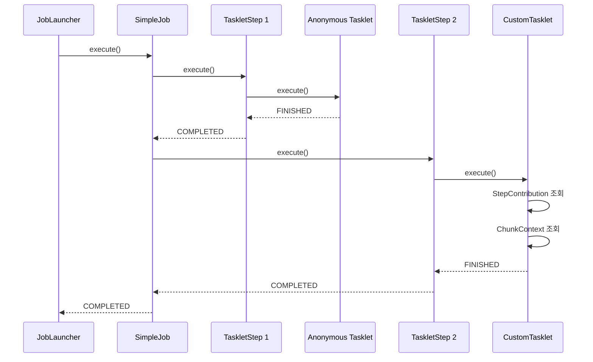

이 구조에서 중요한 것은 SimpleJob이 Tasklet을 직접 실행하지 않는다는 점이다.

SimpleJob은 Step을 실행한다.

TaskletStep은 등록된 Tasklet을 실행한다.

따라서 전체 호출 관계는 다음과 같다.

```text
JobLauncher
    │
    ▼
SimpleJob
    │
    ├── TaskletStep 1
    │       │
    │       └── Anonymous Tasklet
    │
    └── TaskletStep 2
            │
            └── CustomTasklet
```

이러한 계층 구조를 이해하면 Tasklet을 분리해서 설계하는 이유도 명확해진다.

---

### 실제 Job 실행하기

프로젝트를 빌드한다.

```bash
mvn clean package
```

정상적으로 빌드되면 다음과 같은 결과를 확인할 수 있다.

```text
BUILD SUCCESS
```

이제 애플리케이션을 실행한다.

```bash
java -jar target/spring-batch-tasklet-api-0.0.1-SNAPSHOT.jar \
  businessDate=2026-11-06
```

이 명령어는 Spring Boot 애플리케이션을 실행한다.

그리고 JobParameters로 다음 값을 전달한다.

```text
businessDate = 2026-11-06
```

실행할 Job 이름은 application.yml에 설정되어 있다.

```text
taskletApiJob
```

따라서 해당 Job이 실행된다.

#### 예상 실행 결과

정상적으로 실행되면 다음과 유사한 로그를 확인할 수 있다.

```text
Step1 - Tasklet 실행

StepContribution - Step Name: step2

StepExecution - Job Name: taskletApiJob

ChunkContext - Step Name: step2

ChunkContext - Job Name: taskletApiJob

JobParameters - businessDate: 2026-11-06
```

이 결과에서 중요한 점을 살펴보자.

첫 번째로 Step 1의 Tasklet이 실행되었다.

```text
Step1 - Tasklet 실행
```

두 번째로 Step 2의 CustomTasklet이 실행되었다.

```text
StepContribution - Step Name: step2
```

세 번째로 StepContribution과 ChunkContext에서 조회한 Step 이름이 동일하다.

```text
StepContribution - Step Name: step2

ChunkContext - Step Name: step2
```

네 번째로 Job 이름도 동일하게 조회된다.

```text
StepExecution - Job Name: taskletApiJob

ChunkContext - Job Name: taskletApiJob
```

따라서 두 객체를 이용해 현재 실행 중인 Job과 Step의 정보를 조회할 수 있다는 사실을 확인할 수 있다.

---

### TaskletStep 내부에서 CustomTasklet을 호출하는 과정

이제 내부 호출 구조를 조금 더 살펴보자.

Spring Batch는 TaskletStep을 생성할 때 등록한 Tasklet을 내부 필드에 저장한다.

개념적인 구조는 다음과 같다.

```java
private Tasklet tasklet;
```

실제 실행 과정에서는 TaskletStep의 doExecute()가 호출된다.

이후 RepeatTemplate을 이용해 반복 실행을 시작한다.

```java
stepOperations.iterate(...);
```

그다음 TransactionTemplate을 이용해 트랜잭션을 시작한다.

```java
new TransactionTemplate(
        transactionManager,
        transactionAttribute
).execute(...);
```

최종적으로 Tasklet의 execute()를 호출한다.

```java
result = tasklet.execute(
        contribution,
        chunkContext
);
```

여기서 tasklet 필드에는 우리가 등록한 CustomTasklet 객체가 들어 있다.

따라서 다음 메서드가 실행된다.

```java
CustomTasklet.execute(
        contribution,
        chunkContext
);
```

전체 호출 구조는 다음과 같다.

```text
SimpleJob
    │
    ▼
SimpleStepHandler
    │
    ▼
AbstractStep.execute()
    │
    ▼
TaskletStep.doExecute()
    │
    ▼
RepeatTemplate.iterate()
    │
    ▼
TransactionTemplate.execute()
    │
    ▼
Tasklet.execute()
    │
    ▼
CustomTasklet.execute()
    │
    ▼
비즈니스 로직 실행
```

여기서 중요한 점은 사용자 정의 Tasklet이라고 해서 별도의 실행 엔진이 사용되는 것이 아니라는 사실이다.

Spring Batch는 Tasklet 인터페이스를 통해 구현체를 호출한다.

따라서 익명 클래스, 람다식, 구현 클래스를 모두 동일한 방식으로 실행할 수 있다.

---

### JUnit으로 Tasklet 실행 검증하기

이번에는 실제 Job 실행 결과를 테스트 코드로 검증해보자.

검증할 내용은 다음과 같다.

첫 번째는 Job이 정상적으로 완료되는지다.

두 번째는 두 개의 Step이 실행되는지다.

세 번째는 두 Step의 BatchStatus가 COMPLETED인지다.

`TaskletApiJobTest.java`

```java
package com.example.batch;

import java.util.Set;
import java.util.stream.Collectors;

import org.junit.jupiter.api.Test;

import org.springframework.batch.core.BatchStatus;
import org.springframework.batch.core.Job;
import org.springframework.batch.core.JobExecution;
import org.springframework.batch.core.JobParameters;
import org.springframework.batch.core.JobParametersBuilder;
import org.springframework.batch.core.StepExecution;

import org.springframework.batch.core.launch.JobLauncher;

import org.springframework.beans.factory.annotation.Autowired;
import org.springframework.beans.factory.annotation.Qualifier;

import org.springframework.boot.test.context.SpringBootTest;

import static org.junit.jupiter.api.Assertions.*;

@SpringBootTest(properties = {
        "spring.batch.job.enabled=false"
})
class TaskletApiJobTest {

    @Autowired
    private JobLauncher jobLauncher;

    @Autowired
    @Qualifier("taskletApiJob")
    private Job taskletApiJob;

    @Test
    void 두_개의_Tasklet이_순차적으로_실행된다()
            throws Exception {

        JobParameters parameters =
                new JobParametersBuilder()
                        .addString(
                                "businessDate",
                                "2026-11-06"
                        )
                        .toJobParameters();

        JobExecution execution =
                jobLauncher.run(
                        taskletApiJob,
                        parameters
                );

        assertEquals(
                BatchStatus.COMPLETED,
                execution.getStatus()
        );

        Set<String> executedStepNames =
                execution.getStepExecutions()
                        .stream()
                        .map(StepExecution::getStepName)
                        .collect(Collectors.toSet());

        assertEquals(
                Set.of("step1", "step2"),
                executedStepNames
        );

        for (StepExecution stepExecution
                : execution.getStepExecutions()) {

            assertEquals(
                    BatchStatus.COMPLETED,
                    stepExecution.getStatus()
            );
        }
    }
}
```

이 테스트는 실제 JobLauncher를 이용해 Job을 실행한다.

그리고 JobExecution을 통해 실행 결과를 확인한다.

먼저 다음 코드로 Job의 완료 상태를 확인한다.

```java
assertEquals(
        BatchStatus.COMPLETED,
        execution.getStatus()
);
```

다음으로 실행된 Step의 이름을 확인한다.

```java
assertEquals(
        Set.of("step1", "step2"),
        executedStepNames
);
```

두 Step이 모두 실행되었다면 테스트가 성공한다.

마지막으로 각 StepExecution의 상태를 확인한다.

```java
assertEquals(
        BatchStatus.COMPLETED,
        stepExecution.getStatus()
);
```

두 Step 모두 FINISHED를 반환하므로 정상적으로 완료되어야 한다.

#### 테스트 실행

```bash
mvn test
```

정상적으로 실행되면 다음과 유사한 결과가 출력된다.

```text
Tests run: 1

Failures: 0

Errors: 0

BUILD SUCCESS
```

---

### 실무에서 Tasklet을 사용할 때 고려할 12가지 사항

Tasklet은 구현하기 간단하지만 실제 운영 환경에서는 여러 요소를 함께 고려해야 한다.

특히 반복 실행, 트랜잭션, 예외 처리, 재시작, 상태 관리와 밀접하게 연결되어 있다.

#### 1. 하나의 Tasklet에는 명확한 책임을 부여한다

Tasklet은 하나의 비즈니스 작업을 수행하도록 설계하는 것이 좋다.

예를 들어 정산 배치라면 다음과 같이 역할을 구분할 수 있다.

```text
SettlementJob
    │
    ├── ValidationTasklet
    │
    ├── PreparationTasklet
    │
    └── CompletionTasklet
```

이렇게 구성하면 각 작업의 역할이 명확해진다.

또한 실행 실패 시 어느 단계에서 문제가 발생했는지 추적하기 쉽다.

#### 2. 복잡한 비즈니스 로직은 별도 서비스로 분리한다

Tasklet 클래스에 모든 비즈니스 로직을 구현하면 코드가 복잡해질 수 있다.

따라서 Tasklet은 실행을 조정하는 역할을 담당하고 실제 업무 로직은 서비스 클래스로 분리할 수 있다.

```java
@Component
public class SettlementTasklet implements Tasklet {

    private final SettlementService settlementService;

    public SettlementTasklet(
            SettlementService settlementService
    ) {
        this.settlementService = settlementService;
    }

    @Override
    public RepeatStatus execute(
            StepContribution contribution,
            ChunkContext chunkContext
    ) {

        settlementService.executeSettlement();

        return RepeatStatus.FINISHED;
    }
}
```

이렇게 구성하면 SettlementService를 다른 컴포넌트에서도 재사용할 수 있다.

또한 Tasklet과 비즈니스 로직을 독립적으로 테스트하기 쉽다.

#### 3. CONTINUABLE을 사용할 때는 종료 조건을 명확하게 정의한다

CONTINUABLE을 계속 반환하면 반복이 끝나지 않을 수 있다.

따라서 반복 실행이 필요한 경우에는 종료 조건을 명확하게 정의해야 한다.

예를 들어 처리 대상이 없을 때 FINISHED를 반환하도록 구성할 수 있다.

```java
if (noMoreData) {

    return RepeatStatus.FINISHED;
}

return RepeatStatus.CONTINUABLE;
```

또한 무한 반복을 방지하기 위한 최대 처리 횟수나 시간 제한을 고려할 수 있다.

#### 4. Tasklet의 실행 상태를 인스턴스 필드에 저장하지 않는다

Spring Bean은 기본적으로 Singleton Scope다.

따라서 Tasklet을 Singleton Bean으로 등록하면 여러 JobExecution이 동일한 Tasklet 인스턴스를 사용할 가능성이 있다.

이때 다음과 같은 코드는 주의해야 한다.

```java
private int executionCount = 0;
```

여러 실행이 같은 필드를 변경할 수 있기 때문이다.

특히 병렬 실행 환경에서는 동시성 문제가 발생할 수 있다.

실행별 상태가 필요하다면 StepExecution의 ExecutionContext 등을 사용하는 것이 적절하다.

#### 5. JobParameters를 이용해 실행 대상을 명확하게 정의한다

Tasklet에서 비즈니스 로직을 수행할 때는 JobParameters를 사용할 수 있다.

예를 들어 정산 기준일이나 가맹점 ID를 전달할 수 있다.

```text
businessDate = 2026-11-06

merchantId = 1001
```

이러한 값을 이용하면 동일한 Tasklet 구현체를 다양한 입력 조건으로 실행할 수 있다.

다만 JobInstance 식별에 영향을 주는 identifying 여부도 함께 고려해야 한다.

#### 6. StepContribution과 ChunkContext의 역할을 구분한다

StepContribution은 처리 결과를 StepExecution에 반영하는 데 사용한다.

ChunkContext는 현재 Step 실행 환경에 접근하는 데 사용한다.

단순히 Step 이름을 조회한다면 ChunkContext의 StepContext를 사용할 수 있다.

반면 StepExecution의 처리 통계를 갱신해야 한다면 StepContribution을 사용할 수 있다.

이처럼 각 객체의 목적에 맞게 사용하면 코드의 의도가 명확해진다.

#### 7. 트랜잭션이 적용되는 범위를 확인한다

TaskletStep은 Tasklet 실행에 트랜잭션을 적용한다.

하지만 모든 외부 작업이 동일한 트랜잭션에 참여하는 것은 아니다.

예를 들어 Tasklet 내부에서 외부 결제 API를 호출했다면 데이터베이스 트랜잭션이 롤백되더라도 외부 결제 요청까지 자동으로 취소되지 않는다.

따라서 외부 시스템과 연동할 때는 별도의 멱등성 및 보상 처리 전략이 필요할 수 있다.

#### 8. 반복형 Tasklet의 커밋 경계를 이해한다

Tasklet이 여러 번 반복 실행된다면 각 호출은 일반적으로 별도의 트랜잭션으로 처리된다.

따라서 세 번째 호출에서 실패하더라도 앞선 호출에서 커밋한 데이터는 유지될 수 있다.

재시작이 필요한 작업이라면 이미 처리한 데이터를 어떻게 구분할지 설계해야 한다.

#### 9. Tasklet을 여러 번 등록하는 방식으로 실행 순서를 구성하지 않는다

하나의 TaskletStep에는 하나의 Tasklet이 등록된다.

TaskletStepBuilder에 여러 Tasklet을 설정하면 마지막 설정이 사용된다.

따라서 여러 작업을 실행해야 한다면 일반적으로 Step을 분리하는 것이 좋다.

이렇게 하면 각 작업을 독립적인 실행 단위로 관리할 수 있다.

#### 10. Step 이름을 안정적으로 유지한다

Spring Batch는 StepExecution을 통해 개별 Step의 실행 이력을 관리한다.

이때 Step 이름은 이전 실행 이력을 조회하는 중요한 기준이다.

따라서 운영 중인 배치의 Step 이름을 변경하면 재시작 동작에 영향을 줄 수 있다.

Step 이름은 단순한 메서드 이름이 아니라 실행 메타데이터의 일부로 이해해야 한다.

#### 11. 예외를 무조건 잡아서 정상 종료하지 않는다

Tasklet 내부에서 예외가 발생했는데 이를 무조건 잡아서 FINISHED를 반환하면 Spring Batch는 해당 작업을 정상적으로 완료한 것으로 판단할 수 있다.

예를 들어 다음과 같은 코드는 주의해야 한다.

```java
try {

    settlementService.executeSettlement();

} catch (Exception e) {

    log.error("정산 처리 실패", e);
}

return RepeatStatus.FINISHED;
```

이 코드에서는 정산 처리에 실패했더라도 FINISHED를 반환한다.

따라서 실패 사실이 StepExecution의 상태에 제대로 반영되지 않을 수 있다.

실패로 처리해야 하는 예외라면 적절하게 전파해야 한다.

```java
settlementService.executeSettlement();

return RepeatStatus.FINISHED;
```

예외가 발생하면 TaskletStep이 실패 처리와 롤백을 수행하도록 하는 방식이다.

#### 12. 단일 작업과 대량 데이터 처리를 구분한다

Tasklet 기반 처리는 단일 작업에 적합하다.

하지만 수십만 건 이상의 데이터를 처리하면서 Chunk별 커밋이나 Reader의 재시작 상태 관리가 필요하다면 Chunk 기반 처리가 더 적합할 수 있다.

따라서 다음과 같이 구분할 수 있다.

| 업무 | 권장 방식 |
|---|---|
| 정산 데이터 존재 여부 확인 | Tasklet |
| 임시 테이블 정리 | Tasklet |
| 파일 이동 | Tasklet |
| 외부 시스템 상태 확인 | Tasklet |
| 대량 정산 데이터 집계 | Chunk |
| 대량 데이터 변환 및 저장 | Chunk |
| 수백만 건 데이터 이관 | Chunk |

여기서 권장 방식은 절대적인 기준이 아니다.

실제 데이터 규모와 트랜잭션 요구사항에 따라 적절한 방식을 선택해야 한다.

---

### tasklet() API에서 자주 혼동하는 부분

| 혼동하기 쉬운 내용 | 정확한 이해 |
|---|---|
| Tasklet과 TaskletStep은 같은 객체다 | Tasklet은 비즈니스 로직, TaskletStep은 실행 관리 |
| tasklet() API가 Tasklet을 즉시 실행한다 | TaskletStepBuilder에 Tasklet을 등록한다 |
| Tasklet은 반드시 구현 클래스를 만들어야 한다 | 익명 클래스와 람다식도 가능하다 |
| Tasklet은 반드시 한 번만 실행된다 | RepeatStatus에 따라 반복 실행할 수 있다 |
| FINISHED를 반환하면 반복한다 | 반복을 종료한다 |
| CONTINUABLE을 반환하면 종료한다 | 다음 반복을 계속할 수 있다 |
| null을 반환하면 실패한다 | FINISHED로 해석한다 |
| 하나의 Step에 Tasklet을 여러 개 등록하면 순차 실행된다 | 마지막에 설정된 Tasklet이 사용된다 |
| StepContribution과 ChunkContext는 같은 객체다 | 서로 다른 역할을 담당한다 |
| Step을 Bean으로 생성하면 반드시 실행된다 | Job의 실행 흐름에 연결해야 한다 |
| Tasklet에서 예외를 잡고 FINISHED를 반환해도 실패가 기록된다 | 정상 종료로 판단될 수 있다 |
| TaskletStep의 트랜잭션은 외부 API도 롤백한다 | 트랜잭션에 참여하지 않는 외부 작업은 별도 처리 필요 |

---

### tasklet() API 전체 구조

마지막으로 전체 구조를 정리해보자.

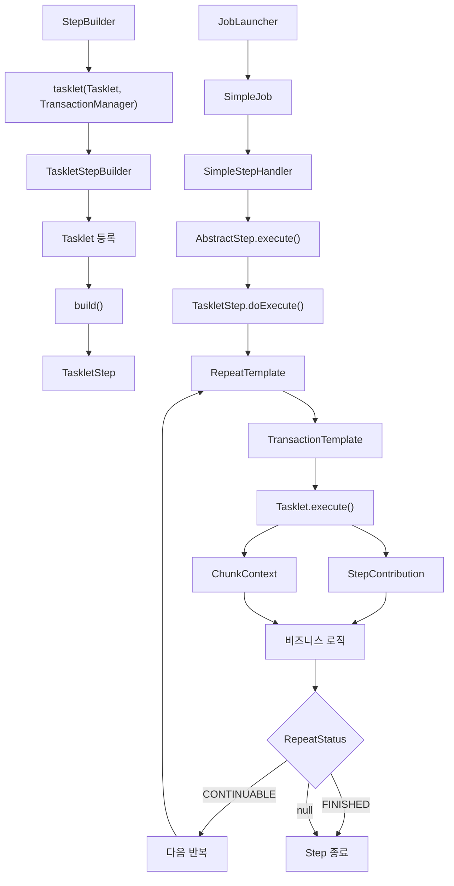

이 구조는 크게 두 단계로 나눌 수 있다.

#### 첫 번째: TaskletStep 생성

```text
StepBuilder
    │
    ▼
tasklet()
    │
    ▼
TaskletStepBuilder
    │
    ▼
Tasklet 등록
    │
    ▼
build()
    │
    ▼
TaskletStep
```

이 단계에서는 Tasklet이 실행되지 않는다.

TaskletStep에 어떤 Tasklet을 실행할 것인지 설정한다.

#### 두 번째: Tasklet 실행

```text
JobLauncher
    │
    ▼
SimpleJob
    │
    ▼
TaskletStep
    │
    ▼
RepeatTemplate
    │
    ▼
TransactionTemplate
    │
    ▼
Tasklet.execute()
    │
    ▼
RepeatStatus
    │
    ├── CONTINUABLE → 반복
    │
    └── FINISHED → 종료
```

이 단계에서 실제 비즈니스 로직이 실행된다.

TaskletStep은 RepeatTemplate을 이용해 반복 실행을 제어한다.

그리고 TransactionTemplate을 이용해 트랜잭션을 관리한다.

최종적으로 Tasklet이 반환한 RepeatStatus에 따라 반복을 계속하거나 종료한다.

---

### 정리

Spring Batch의 `tasklet()` API는 Step에서 실행할 Tasklet 구현체를 등록하기 위한 메서드다.

Spring Batch 5.2.4에서는 다음과 같이 사용한다.

```java
new StepBuilder(
        "stepName",
        jobRepository
)
        .tasklet(
                tasklet,
                transactionManager
        )
        .build();
```

이 API는 TaskletStepBuilder를 반환한다.

이후 build()를 호출하면 TaskletStep이 생성된다.

TaskletStep은 내부적으로 하나의 Tasklet을 참조한다.

따라서 하나의 Step에서 여러 Tasklet을 실행해야 한다면 일반적으로 Step을 분리하는 것이 적절하다.

Tasklet은 인터페이스로 제공된다.

핵심 메서드는 다음과 같다.

```java
RepeatStatus execute(
        StepContribution contribution,
        ChunkContext chunkContext
) throws Exception;
```

StepContribution은 StepExecution과 처리 결과에 접근할 수 있도록 지원한다.

ChunkContext는 현재 Step의 실행 환경에 접근할 수 있도록 지원한다.

따라서 두 객체를 활용하면 Tasklet 내부에서 필요한 실행 정보를 조회할 수 있다.

Tasklet의 반환 타입은 RepeatStatus다.

대표적인 값은 두 가지다.

```java
RepeatStatus.FINISHED
```

```java
RepeatStatus.CONTINUABLE
```

FINISHED를 반환하면 반복을 종료한다.

CONTINUABLE을 반환하면 반복을 계속할 수 있다.

또한 null을 반환하면 FINISHED로 해석한다.

하지만 실제 코드에서는 의도를 명확하게 표현하기 위해 FINISHED를 직접 반환하는 것이 좋다.

Tasklet은 익명 클래스, 람다식, 구현 클래스 등 다양한 방식으로 구현할 수 있다.

다만 복잡한 비즈니스 로직을 처리할 때는 별도의 구현 클래스로 분리하는 것이 유지보수와 테스트 측면에서 유리하다.

TaskletStep은 등록된 Tasklet을 RepeatTemplate과 TransactionTemplate을 통해 실행한다.

따라서 Tasklet의 반복 실행과 트랜잭션 처리를 개발자가 직접 구현하지 않아도 된다.

하지만 이러한 기능이 비즈니스 멱등성까지 자동으로 보장하는 것은 아니다.

특히 결제나 정산처럼 외부 시스템과 연동하는 작업에서는 중복 실행과 실패 복구에 대한 별도의 설계가 필요하다.

결국 **tasklet() API는 TaskletStep에 실제 비즈니스 로직을 등록하고, Spring Batch가 해당 로직의 반복 실행과 트랜잭션 처리를 관리할 수 있도록 연결하는 핵심 설정 API**다.

#### 한 줄 요약

> Spring Batch의 `tasklet()` API는 `Tasklet` 구현체와 `PlatformTransactionManager`를 `TaskletStepBuilder`에 등록하고 최종적으로 `TaskletStep`을 생성하는 기능이다. `Tasklet`은 `execute(StepContribution, ChunkContext)` 메서드를 통해 실제 비즈니스 로직을 수행하며, `RepeatStatus.FINISHED`를 반환하면 종료하고 `RepeatStatus.CONTINUABLE`을 반환하면 반복한다. 하나의 TaskletStep은 하나의 Tasklet을 실행하며, 반복 제어와 트랜잭션 처리는 Spring Batch가 담당한다.

## TaskeltStep - startLimit() / allowStartIfComplete()


### Spring Batch startLimit()과 allowStartIfComplete() 이해: Step 실행 횟수 제한과 재시작 정책

Spring Batch는 배치 작업이 실패했을 때 기존 실행 이력을 바탕으로 작업을 재시작할 수 있는 기능을 제공한다.

하지만 Job을 재시작한다고 해서 모든 Step이 처음부터 다시 실행되는 것은 아니다.

Spring Batch는 이전 StepExecution의 상태를 확인한 후 각 Step의 재실행 여부를 판단한다.

예를 들어 다음과 같은 Job이 있다고 생각해보자.

```text
dailySettlementJob
       │
       ├── Step 1. 정산 대상 검증
       │
       └── Step 2. 정산 데이터 처리
```

최초 실행에서 Step 1은 성공했지만 Step 2에서 오류가 발생했다고 가정해보자.

```text
JobExecution 1
       │
       ├── Step 1 → COMPLETED
       │
       └── Step 2 → FAILED

Job → FAILED
```

이때 동일한 JobInstance를 재시작하면 어떻게 될까?

Spring Batch는 이전에 정상적으로 완료된 Step 1을 다시 실행하지 않는다.

반면 실패한 Step 2는 다시 실행할 수 있다.

```text
JobExecution 2
       │
       ├── Step 1 → 실행 생략
       │
       └── Step 2 → 재실행
```

이것이 Spring Batch의 기본적인 재시작 동작이다.

하지만 실제 배치 시스템에서는 이 동작을 변경해야 하는 상황이 발생한다.

예를 들어 정산 대상 검증은 배치를 실행할 때마다 반드시 수행해야 할 수 있다.

첫 번째 실행에서 검증에 성공했더라도 두 번째 실행에서는 데이터 상태가 달라졌을 수 있기 때문이다.

반면 외부 시스템에 요청을 전달하는 Step은 일정 횟수 이상 반복해서 실행하면 안 되는 경우가 있다.

실패한 작업을 무제한 재시작하면 외부 시스템에 과도한 요청이 발생하거나 데이터 정합성에 문제가 생길 수 있기 때문이다.

Spring Batch는 이러한 요구사항을 위해 두 가지 API를 제공한다.

```java
.startLimit(3)
```

```java
.allowStartIfComplete(true)
```

두 API는 모두 Step의 실행 여부에 영향을 주지만 목적은 다르다.

`startLimit()`은 **Step이 시작될 수 있는 최대 횟수를 제한**한다.

반면 `allowStartIfComplete()`는 **이전에 완료된 Step을 Job 재시작 과정에서 다시 실행할 것인지 결정**한다.

예를 들어 다음과 같이 구성할 수 있다.

```java
@Bean
public Step validationStep(
        JobRepository jobRepository,
        PlatformTransactionManager transactionManager
) {
    return new StepBuilder("validationStep", jobRepository)
            .tasklet(validationTasklet(), transactionManager)
            .allowStartIfComplete(true)
            .build();
}
```

이 Step은 이전에 정상적으로 완료되었더라도 Job이 재시작되면 다시 실행할 수 있다.

반면 다음 Step은 최대 세 번까지만 시작할 수 있다.

```java
@Bean
public Step settlementStep(
        JobRepository jobRepository,
        PlatformTransactionManager transactionManager
) {
    return new StepBuilder("settlementStep", jobRepository)
            .tasklet(settlementTasklet(), transactionManager)
            .startLimit(3)
            .build();
}
```

이러한 설정을 조합하면 다음과 같은 실행 정책을 구성할 수 있다.

```text
Job 재시작
    │
    ▼
ValidationStep
    │
    └── 이전에 성공했더라도 다시 실행
    │
    ▼
SettlementStep
    │
    ├── 실행 횟수 3회 미만 → 실행
    │
    └── 실행 횟수 3회 이상 → 실행 제한
```

이번에는 `startLimit()`과 `allowStartIfComplete()`의 개념, 적용 범위, 내부 구현, 실제 재시작 흐름, JobExecution과 StepExecution의 변화까지 자세히 살펴보자.

---

### 개념

#### startLimit()이란?

`startLimit()`은 동일한 JobInstance 안에서 특정 Step을 시작할 수 있는 최대 횟수를 설정하는 API다.

예를 들어 다음과 같이 설정할 수 있다.

```java
.startLimit(3)
```

이 설정은 해당 Step이 최대 세 번까지 시작될 수 있다는 의미다.

여기서 중요한 것은 **성공 횟수가 아니라 시작 횟수를 제한한다는 사실**이다.

예를 들어 Step이 실행되었지만 실패했다고 생각해보자.

```text
첫 번째 실행 → FAILED

두 번째 실행 → FAILED

세 번째 실행 → FAILED
```

이 경우 Step은 세 번 시작되었다.

따라서 startLimit(3)의 제한을 모두 사용했다.

이후 네 번째 실행을 시도하면 다음 예외가 발생한다.

```text
StartLimitExceededException
```

이 예외는 Step의 시작 가능 횟수를 초과했을 때 발생한다.

따라서 해당 Step의 비즈니스 로직은 더 이상 실행되지 않는다.

#### startLimit()의 기본값

startLimit을 설정하지 않으면 기본값이 적용된다.

```java
Integer.MAX_VALUE
```

이 값은 다음과 같다.

```text
2,147,483,647
```

실질적으로 매우 큰 실행 횟수를 허용하는 설정이다.

다만 이 값이 무조건 Step을 재실행한다는 의미는 아니다.

Step이 이전에 COMPLETED 상태로 종료되었다면 다른 재시작 정책에 따라 실행이 생략될 수 있기 때문이다.

따라서 startLimit은 Step의 실행을 강제하는 설정이 아니다.

**Step의 실행이 허용되는 상황에서 최대 시작 횟수를 제한하는 설정**이다.

#### startLimit()의 특징

| 항목 | 설명 |
|---|---|
| 적용 대상 | Step |
| 주요 목적 | Step 최대 시작 횟수 제한 |
| 기본값 | Integer.MAX_VALUE |
| 실행 횟수 기준 | 동일 JobInstance + Step 이름 |
| 실패한 실행 | 시작 횟수에 포함 |
| 완료된 실행 | 시작 횟수에 포함 |
| 제한 초과 | StartLimitExceededException |
| 설정 위치 | StepBuilder |
| 새로운 JobInstance | 별도의 실행 횟수로 관리 |

여기서 가장 중요한 부분은 실행 횟수의 기준이다.

startLimit은 특정 Step이 애플리케이션 전체에서 몇 번 실행되었는지 계산하지 않는다.

**동일한 JobInstance에 속한 특정 Step의 실행 횟수**를 기준으로 계산한다.

---

### allowStartIfComplete()란?

`allowStartIfComplete()`는 Job 재시작 과정에서 이전에 정상적으로 완료된 Step을 다시 실행할 것인지 설정하는 API다.

Spring Batch는 기본적으로 COMPLETED 상태의 Step을 재시작하지 않는다.

이전에 정상적으로 완료된 작업을 다시 실행할 필요가 없다고 판단하기 때문이다.

예를 들어 다음과 같은 실행 결과가 있다고 생각해보자.

```text
JobExecution 1
       │
       ├── ValidationStep → COMPLETED
       │
       └── SettlementStep → FAILED
```

이 상태에서 Job을 재시작하면 일반적으로 다음과 같이 실행된다.

```text
JobExecution 2
       │
       ├── ValidationStep → 실행 생략
       │
       └── SettlementStep → 재실행
```

하지만 ValidationStep이 매번 데이터의 유효성을 검사해야 하는 작업이라면 어떨까?

이 경우 이전에 검증을 완료했더라도 다시 실행하는 것이 적절할 수 있다.

이때 다음 API를 사용한다.

```java
.allowStartIfComplete(true)
```

이 설정을 적용하면 Job 재시작 과정에서 완료된 Step도 다시 실행할 수 있다.

```text
JobExecution 2
       │
       ├── ValidationStep → 다시 실행
       │
       └── SettlementStep → 재실행
```

따라서 allowStartIfComplete는 실행할 때마다 필요한 사전 검증이나 준비 작업에 유용하다.

#### allowStartIfComplete()의 기본값

기본값은 false다.

```java
allowStartIfComplete = false;
```

설정하지 않으면 완료된 Step은 Job 재시작 시 실행을 생략한다.

반면 다음과 같이 설정하면

```java
.allowStartIfComplete(true)
```

완료된 Step도 다시 시작할 수 있다.

#### allowStartIfComplete()의 특징

| 항목 | 설명 |
|---|---|
| 적용 대상 | Step |
| 주요 목적 | 완료된 Step의 재실행 허용 |
| 기본값 | false |
| false | 이전에 COMPLETED였다면 실행 생략 |
| true | 이전에 COMPLETED였더라도 재실행 허용 |
| 적용 상황 | 동일 JobInstance의 재시작 |
| startLimit과 관계 | 시작 횟수 제한은 별도로 적용 |
| Job이 COMPLETED인 경우 | 이 API만으로 Job 재실행 불가 |

여기서 반드시 기억해야 할 점이 있다.

**allowStartIfComplete(true)는 모든 상황에서 Step을 무조건 실행한다는 의미가 아니다.**

Job 자체가 실행될 수 있어야 한다.

또한 startLimit과 같은 다른 실행 제한 조건도 만족해야 한다.

---

### startLimit()과 allowStartIfComplete()의 차이

두 API는 모두 Step의 실행 여부를 제어한다.

하지만 판단하는 조건이 다르다.

| 구분 | startLimit() | allowStartIfComplete() |
|---|---|---|
| 목적 | 최대 시작 횟수 제한 | 완료된 Step의 재실행 허용 |
| 판단 기준 | 기존 StepExecution 개수 | 이전 StepExecution 상태 |
| 기본값 | Integer.MAX_VALUE | false |
| 핵심 조건 | 시작 횟수가 제한보다 작은가? | 이전 상태가 COMPLETED인가? |
| 실행 차단 | 횟수 초과 시 예외 | 완료된 Step 실행 생략 |
| 관련 예외 | StartLimitExceededException | 기본적인 생략은 예외가 아님 |
| 적용 범위 | 동일 JobInstance의 Step | 동일 JobInstance의 Step |
| 활용 사례 | 제한적인 재시도 | 반복 검증 및 사전 작업 |

두 API의 관계는 다음과 같이 이해할 수 있다.

`allowStartIfComplete()`는 이전에 완료된 Step을 다시 실행할 수 있는지 결정한다.

`startLimit()`은 그 Step이 지금까지 몇 번 시작되었는지 확인해 실행을 제한한다.

따라서 두 API를 동시에 설정할 수도 있다.

```java
new StepBuilder("validationStep", jobRepository)
        .tasklet(tasklet, transactionManager)
        .allowStartIfComplete(true)
        .startLimit(3)
        .build();
```

이 설정은 다음을 의미한다.

이전에 완료된 Step이라도 재시작 시 다시 실행할 수 있다.

하지만 같은 JobInstance에서 세 번 시작했다면 네 번째부터는 시작할 수 없다.

즉, **재실행 허용과 시작 횟수 제한은 서로 독립적인 정책이며 함께 적용된다.**

---

### 왜 사용하는가?

Spring Batch에서 Step 실행 정책을 별도로 제공하는 이유는 실제 배치 업무마다 재시작 요구사항이 다르기 때문이다.

예를 들어 다음과 같은 정산 Job이 있다고 생각해보자.

```text
dailySettlementJob
       │
       ├── Step 1. 정산 대상 유효성 검증
       │
       ├── Step 2. 정산 금액 계산
       │
       └── Step 3. 외부 정산 시스템 전송
```

Step 1은 데이터를 검증하는 작업이다.

Job이 재시작될 때 데이터가 변경되었을 가능성이 있으므로 매번 실행하는 것이 적절할 수 있다.

따라서 다음과 같이 설정한다.

```java
.allowStartIfComplete(true)
```

Step 2는 정산 금액을 계산하는 작업이다.

이미 정상적으로 완료했다면 불필요하게 다시 계산하지 않아도 될 수 있다.

따라서 기본 재시작 정책을 사용한다.

```java
.allowStartIfComplete(false)
```

Step 3은 외부 정산 시스템에 요청을 전달하는 작업이다.

외부 시스템 장애로 인해 계속 실패할 수 있다.

하지만 무제한으로 재시도하면 운영상 문제가 발생할 수 있다.

따라서 최대 실행 횟수를 제한할 수 있다.

```java
.startLimit(3)
```

이처럼 각 Step의 성격에 따라 실행 정책을 다르게 구성할 수 있다.

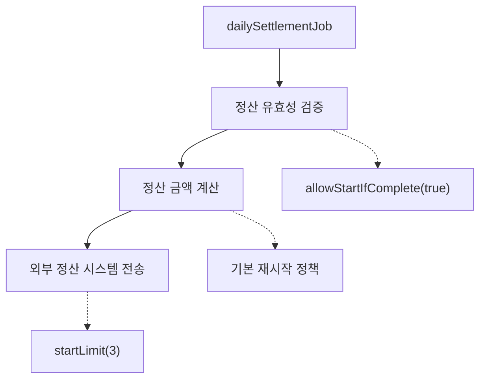

이러한 구성이 가능한 이유는 Spring Batch가 Job 전체의 실행 상태와 개별 Step의 실행 상태를 구분해서 관리하기 때문이다.

---

### Step의 재시작과 Job의 재시작은 어떻게 다를까?

두 API를 정확히 이해하려면 JobInstance, JobExecution, StepExecution의 관계를 먼저 알아야 한다.

Spring Batch에서 JobInstance는 논리적으로 동일한 배치 작업을 나타낸다.

JobExecution은 해당 JobInstance의 개별 실행 시도를 나타낸다.

StepExecution은 특정 Step의 개별 실행 시도를 나타낸다.

예를 들어 다음과 같은 구조가 만들어질 수 있다.

```text
JobInstance 1
    │
    ├── JobExecution 1
    │       │
    │       ├── StepExecution 1 → COMPLETED
    │       └── StepExecution 2 → FAILED
    │
    └── JobExecution 2
            │
            └── StepExecution 3 → FAILED
```

여기서 첫 번째 JobExecution에서는 두 개의 Step이 실행되었다.

Step 1은 정상적으로 완료되었다.

Step 2는 실패했다.

이후 동일한 JobInstance를 재시작했다.

이때 Step 1은 이미 완료되었으므로 실행을 생략했다.

반면 Step 2는 실패했으므로 다시 실행했다.

따라서 두 번째 JobExecution에는 Step 2에 대한 새로운 StepExecution만 생성되었다.

이러한 구조에서 startLimit은 특정 Step에 대한 이전 StepExecution 개수를 확인한다.

반면 allowStartIfComplete는 이전 StepExecution의 BatchStatus가 COMPLETED인지 확인한다.

#### 새로운 JobInstance에서는 어떻게 될까?

다음 두 실행을 생각해보자.

```text
첫 번째 실행

Job Name = dailySettlementJob
businessDate = 2026-11-09
```

```text
두 번째 실행

Job Name = dailySettlementJob
businessDate = 2026-11-10
```

businessDate가 식별용 JobParameters라면 두 실행은 서로 다른 JobInstance다.

따라서 Step 실행 이력도 JobInstance별로 구분된다.

```text
JobInstance 1
    └── businessDate=2026-11-09
```

```text
JobInstance 2
    └── businessDate=2026-11-10
```

JobInstance 1에서 특정 Step을 세 번 실행했다고 해서 JobInstance 2의 같은 이름을 가진 Step까지 시작 횟수가 제한되는 것은 아니다.

따라서 startLimit은 **비즈니스 전체의 전역 실행 횟수를 제한하는 기능이 아니라 JobInstance별 Step 시작 횟수를 제한하는 기능**이다.

---

### 주요 특징: startLimit()의 실제 동작

startLimit의 동작을 이해하기 위해 다음과 같이 설정했다고 가정해보자.

```java
.startLimit(3)
```

그리고 해당 Step에서 의도적으로 예외를 발생시킨다.

```java
throw new IllegalStateException(
        "정산 처리 실패"
);
```

이제 같은 JobInstance를 반복 실행해보자.

#### 첫 번째 실행

이전 실행 이력이 없다.

따라서 Step을 실행할 수 있다.

```text
StepExecution 1
    │
    └── FAILED
```

현재 시작 횟수는 1회다.

#### 두 번째 실행

이전 StepExecution은 FAILED 상태다.

현재까지의 시작 횟수는 1회다.

startLimit은 3이다.

따라서 두 번째 실행이 허용된다.

```text
StepExecution 1 → FAILED

StepExecution 2 → FAILED
```

현재 시작 횟수는 2회다.

#### 세 번째 실행

현재까지의 시작 횟수는 2회다.

startLimit은 3이다.

따라서 세 번째 실행도 허용된다.

```text
StepExecution 1 → FAILED

StepExecution 2 → FAILED

StepExecution 3 → FAILED
```

현재 시작 횟수는 3회다.

#### 네 번째 실행

현재까지의 시작 횟수는 3회다.

startLimit도 3이다.

따라서 더 이상 시작할 수 없다.

```text
StartLimitExceededException
```

이때 중요한 점은 **네 번째 StepExecution이 생성되지 않는다는 사실**이다.

Spring Batch는 새로운 StepExecution을 생성하기 전에 시작 가능 여부를 확인하기 때문이다.

전체 결과를 정리하면 다음과 같다.

| Job 실행 | 이전 StepExecution 개수 | Step 실행 | 결과 |
|---|---:|---|---|
| 1회 | 0 | 실행 | FAILED |
| 2회 | 1 | 실행 | FAILED |
| 3회 | 2 | 실행 | FAILED |
| 4회 | 3 | 실행 안 함 | StartLimitExceededException |
| 5회 | 3 | 실행 안 함 | StartLimitExceededException |

네 번째와 다섯 번째 실행에서는 StepExecution 개수가 증가하지 않는다.

왜냐하면 Step 자체가 시작되지 않았기 때문이다.

---

### 주요 특징: allowStartIfComplete()의 실제 동작

이번에는 다음과 같은 Job이 있다고 생각해보자.

```text
Job
    │
    ├── Step 1 → COMPLETED
    │
    └── Step 2 → FAILED
```

이 Job을 재시작하면 일반적으로 Step 1은 실행을 생략한다.

하지만 다음과 같이 설정하면 달라진다.

```java
.allowStartIfComplete(true)
```

이제 Job을 재시작할 때 Step 1도 다시 실행할 수 있다.

```text
JobExecution 1
    │
    ├── Step 1 → COMPLETED
    └── Step 2 → FAILED
```

```text
JobExecution 2
    │
    ├── Step 1 → COMPLETED
    └── Step 2 → FAILED
```

```text
JobExecution 3
    │
    ├── Step 1 → COMPLETED
    └── Step 2 → FAILED
```

각 JobExecution에 Step 1에 대한 새로운 StepExecution이 생성된다.

반면 allowStartIfComplete가 false라면 다음과 같이 동작한다.

```text
JobExecution 1
    │
    ├── Step 1 → COMPLETED
    └── Step 2 → FAILED
```

```text
JobExecution 2
    │
    └── Step 2 → FAILED
```

```text
JobExecution 3
    │
    └── Step 2 → FAILED
```

이처럼 allowStartIfComplete는 완료된 Step의 재실행 여부에 영향을 준다.

---

### startLimit()과 allowStartIfComplete()를 함께 사용하면?

이번에는 두 API를 하나의 Job에서 함께 사용해보자.

Job은 두 개의 Step으로 구성한다.

```text
restartPolicyJob
       │
       ├── validationStep
       │       │
       │       └── allowStartIfComplete(true)
       │
       └── processingStep
               │
               └── startLimit(3)
```

validationStep은 이전에 성공했더라도 다시 실행한다.

processingStep은 최대 세 번까지만 시작할 수 있다.

그리고 processingStep에서 계속 실패한다고 가정하자.

#### 첫 번째 실행

```text
JobExecution 1
       │
       ├── validationStep → COMPLETED
       │
       └── processingStep → FAILED
```

두 Step이 모두 실행된다.

#### 두 번째 실행

```text
JobExecution 2
       │
       ├── validationStep → COMPLETED
       │
       └── processingStep → FAILED
```

validationStep은 이전에 완료되었지만 allowStartIfComplete가 true이므로 다시 실행한다.

processingStep은 아직 두 번째 실행이므로 허용된다.

#### 세 번째 실행

```text
JobExecution 3
       │
       ├── validationStep → COMPLETED
       │
       └── processingStep → FAILED
```

processingStep은 세 번째 실행까지 허용된다.

#### 네 번째 실행

```text
JobExecution 4
       │
       ├── validationStep → COMPLETED
       │
       └── processingStep → 실행 제한
```

validationStep은 정상적으로 실행된다.

하지만 processingStep은 이미 세 번 시작되었다.

따라서 StartLimitExceededException이 발생한다.

이때 processingStep에 대한 새로운 StepExecution은 생성되지 않는다.

#### 전체 실행 결과

| JobExecution | validationStep | processingStep | Job 상태 |
|---|---|---|---|
| 1 | COMPLETED | FAILED | FAILED |
| 2 | COMPLETED | FAILED | FAILED |
| 3 | COMPLETED | FAILED | FAILED |
| 4 | COMPLETED | 시작 제한 | FAILED |
| 5 | COMPLETED | 시작 제한 | FAILED |

여기서 두 API의 차이를 명확하게 확인할 수 있다.

allowStartIfComplete는 validationStep을 반복 실행하도록 허용한다.

startLimit은 processingStep이 세 번을 초과하여 시작하지 못하도록 제한한다.

---

### 내부 구조: StepBuilderHelper

두 API는 모두 StepBuilder의 공통 설정을 관리하는 `StepBuilderHelper`에 정의되어 있다.

Spring Batch 5.2.4에서 StepBuilderHelper는 다음과 같은 구조를 가진다.

```text
StepBuilderHelper
       │
       └── CommonStepProperties
               │
               ├── name
               ├── jobRepository
               ├── startLimit
               ├── allowStartIfComplete
               └── stepExecutionListeners
```

이 중 중요한 속성은 다음 두 가지다.

```java
private int startLimit = Integer.MAX_VALUE;
```

```java
private Boolean allowStartIfComplete;
```

startLimit은 기본값이 Integer.MAX_VALUE다.

allowStartIfComplete는 설정하지 않으면 실제 Step에 false가 적용된다.

#### startLimit() 내부 구현

핵심 코드는 다음과 같다.

```java
public B startLimit(int startLimit) {

    properties.startLimit = startLimit;

    return self();
}
```

이 코드는 전달받은 시작 횟수를 CommonStepProperties에 저장한다.

예를 들어 다음 API를 호출하면

```java
.startLimit(3)
```

다음 속성이 설정된다.

```text
startLimit = 3
```

#### allowStartIfComplete() 내부 구현

핵심 코드는 다음과 같다.

```java
public B allowStartIfComplete(
        boolean allowStartIfComplete
) {

    properties.allowStartIfComplete =
            allowStartIfComplete;

    return self();
}
```

이 코드도 전달받은 값을 CommonStepProperties에 저장한다.

예를 들어 다음과 같이 설정하면

```java
.allowStartIfComplete(true)
```

다음 값이 저장된다.

```text
allowStartIfComplete = true
```

이렇게 Builder에 저장된 값은 Step을 생성하는 과정에서 실제 Step 객체에 전달된다.

---

### Builder 설정이 실제 Step에 적용되는 과정

StepBuilderHelper는 Step을 생성할 때 `enhance()` 메서드를 통해 공통 설정을 적용한다.

관련 핵심 코드는 다음과 같다.

```java
protected void enhance(AbstractStep step) {

    Boolean allowStartIfComplete =
            properties.allowStartIfComplete;

    if (allowStartIfComplete != null) {

        step.setAllowStartIfComplete(
                allowStartIfComplete
        );
    }

    step.setStartLimit(
            properties.startLimit
    );
}
```

이 코드는 두 API와 관련된 핵심 구문만 나타낸 것이다.

실제 enhance()에는 JobRepository, Listener, Observation 등의 설정도 포함되어 있다.

여기서 중요한 부분은 다음이다.

```java
step.setStartLimit(
        properties.startLimit
);
```

Builder에 저장된 startLimit 값을 실제 Step에 전달한다.

다음 코드도 마찬가지다.

```java
step.setAllowStartIfComplete(
        allowStartIfComplete
);
```

Builder에 저장된 allowStartIfComplete 값을 실제 Step에 전달한다.

최종적으로 생성된 TaskletStep은 다음과 같은 속성을 가지게 된다.

```text
TaskletStep
    │
    ├── name = processingStep
    ├── startLimit = 3
    ├── allowStartIfComplete = false
    └── tasklet = ProcessingTasklet
```

또는 다음과 같이 구성될 수 있다.

```text
TaskletStep
    │
    ├── name = validationStep
    ├── startLimit = Integer.MAX_VALUE
    ├── allowStartIfComplete = true
    └── tasklet = ValidationTasklet
```

이렇게 설정된 속성은 이후 Step 실행 과정에서 사용된다.

---

### 실제 실행 제한은 어디에서 검사할까?

여기서 중요한 점이 있다.

`startLimit()`과 `allowStartIfComplete()`는 StepBuilder에서 설정한다.

하지만 **실제 실행 여부를 검사하는 곳은 StepBuilder가 아니다.**

Spring Batch 5.2.4에서는 `SimpleStepHandler`가 중요한 역할을 담당한다.

SimpleJob은 Step을 실행할 때 다음 메서드를 호출한다.

```java
handleStep(step, jobExecution);
```

AbstractJob은 이 호출을 SimpleStepHandler에 위임한다.

```text
SimpleJob
    │
    ▼
AbstractJob.handleStep()
    │
    ▼
SimpleStepHandler.handleStep()
    │
    ▼
SimpleStepHandler.shouldStart()
```

SimpleStepHandler는 이전 StepExecution을 조회한다.

그리고 현재 Step을 실행할 수 있는지 판단한다.

주요 메서드는 다음과 같다.

```java
protected boolean shouldStart(
        StepExecution lastStepExecution,
        JobExecution jobExecution,
        Step step
)
```

이 메서드는 현재 Step의 실행 가능 여부를 판단한다.

반환값이 true라면 실행을 진행할 수 있다.

반환값이 false라면 실행을 생략한다.

특정 제한 조건에 해당하면 예외를 발생시킨다.

---

### SimpleStepHandler.shouldStart() 내부 분석

Spring Batch 5.2.4에서 두 API의 실제 동작을 이해하기 위해 가장 중요한 메서드다.

핵심 구현은 다음과 같다.

```java
protected boolean shouldStart(
        StepExecution lastStepExecution,
        JobExecution jobExecution,
        Step step
) throws JobRestartException,
         StartLimitExceededException {

    BatchStatus stepStatus;

    if (lastStepExecution == null) {

        stepStatus = BatchStatus.STARTING;

    } else {

        stepStatus = lastStepExecution.getStatus();
    }

    if (stepStatus == BatchStatus.UNKNOWN) {

        throw new JobRestartException(
                "Cannot restart step from UNKNOWN status."
        );
    }

    if (
        (stepStatus == BatchStatus.COMPLETED
                && !step.isAllowStartIfComplete())
        || stepStatus == BatchStatus.ABANDONED
    ) {

        return false;
    }

    if (
        jobRepository.getStepExecutionCount(
                jobExecution.getJobInstance(),
                step.getName()
        ) < step.getStartLimit()
    ) {

        return true;
    }

    throw new StartLimitExceededException(
            "Maximum start limit exceeded for step: "
                    + step.getName()
    );
}
```

위 코드는 Spring Batch 5.2.4의 실제 검증 순서를 유지하면서 메시지 등 일부 부가 표현을 정리한 것이다.

이 메서드는 크게 네 가지 조건을 확인한다.

#### 첫 번째: 이전 StepExecution 조회

먼저 이전 StepExecution이 존재하는지 확인한다.

```java
if (lastStepExecution == null) {

    stepStatus = BatchStatus.STARTING;

} else {

    stepStatus = lastStepExecution.getStatus();
}
```

기존 StepExecution이 없다면 최초 실행으로 판단할 수 있다.

반면 이전 실행 이력이 존재한다면 해당 StepExecution의 상태를 확인한다.

#### 두 번째: UNKNOWN 상태 확인

```java
if (stepStatus == BatchStatus.UNKNOWN) {

    throw new JobRestartException(...);
}
```

이전 Step의 상태가 UNKNOWN이라면 안전하게 재시작할 수 있는지 판단하기 어렵다.

따라서 JobRestartException이 발생한다.

여기서 중요한 것은 allowStartIfComplete가 true여도 UNKNOWN 상태의 Step을 무조건 재실행하지 않는다는 사실이다.

#### 세 번째: COMPLETED 상태와 allowStartIfComplete 확인

```java
if (
    stepStatus == BatchStatus.COMPLETED
        && !step.isAllowStartIfComplete()
) {

    return false;
}
```

이전에 완료된 Step인지 확인한다.

그리고 allowStartIfComplete가 false인지 확인한다.

두 조건을 모두 만족하면 실행을 생략한다.

반면 allowStartIfComplete가 true라면 다음 검증으로 진행한다.

또한 ABANDONED 상태라면 이 경로에서는 실행을 생략한다.

#### 네 번째: startLimit 확인

마지막으로 현재까지의 StepExecution 개수를 확인한다.

```java
jobRepository.getStepExecutionCount(
        jobExecution.getJobInstance(),
        step.getName()
);
```

이 메서드는 해당 JobInstance에서 특정 Step이 지금까지 몇 번 시작되었는지 확인하는 데 사용된다.

이후 다음 조건을 검사한다.

```java
executionCount < step.getStartLimit()
```

현재 실행 횟수가 startLimit보다 작다면 실행을 허용한다.

반면 실행 횟수가 startLimit 이상이라면 예외를 발생시킨다.

```java
throw new StartLimitExceededException(...);
```

따라서 두 API는 SimpleStepHandler의 동일한 실행 판단 과정에서 함께 적용된다.

---

### startLimit과 allowStartIfComplete의 검증 순서

앞에서 확인한 shouldStart()의 검증 순서는 중요하다.

다음과 같이 정리할 수 있다.

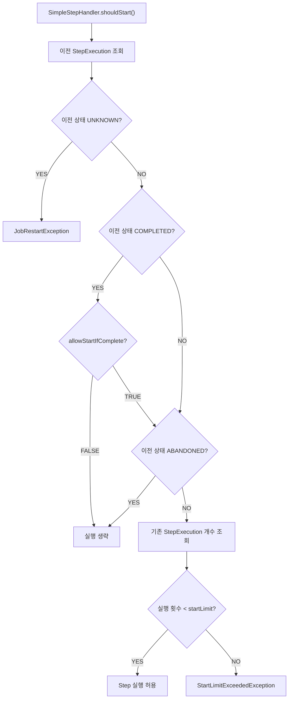

여기서 중요한 사실은 **COMPLETED 상태의 실행 생략 여부를 먼저 판단하고, 그다음 startLimit을 검사한다는 점**이다.

예를 들어 이미 완료된 Step이 있다고 생각해보자.

```text
Step 상태 = COMPLETED

allowStartIfComplete = false

startLimit = 1
```

이 Step은 이미 한 번 실행되었다.

하지만 Job 재시작 시에는 이전 완료 이력 때문에 먼저 실행을 생략한다.

따라서 startLimit 초과 예외가 발생하는 대신 Step이 건너뛰어질 수 있다.

반면 다음과 같이 설정했다면

```text
Step 상태 = COMPLETED

allowStartIfComplete = true

startLimit = 1
```

완료된 Step도 다시 실행할 수 있도록 허용했기 때문에 다음 단계인 startLimit 검증으로 진행한다.

이때 이미 한 번 실행되었으므로 제한을 초과하게 된다.

따라서 StartLimitExceededException이 발생한다.

이처럼 두 API를 함께 사용할 때는 **검증 순서까지 이해해야 실제 실행 결과를 정확히 예측할 수 있다.**

---

### StartLimitExceededException이 발생하면 StepExecution은 생성될까?

이 부분은 실행 메타데이터를 이해할 때 중요하다.

SimpleStepHandler의 실행 흐름을 살펴보자.

```java
StepExecution lastStepExecution =
        jobRepository.getLastStepExecution(
                jobInstance,
                step.getName()
        );

if (shouldStart(
        lastStepExecution,
        jobExecution,
        step
)) {

    StepExecution currentStepExecution =
            jobExecution.createStepExecution(
                    step.getName()
            );

    jobRepository.add(currentStepExecution);

    step.execute(currentStepExecution);
}
```

이 코드에서 중요한 순서는 다음과 같다.

첫 번째로 이전 StepExecution을 조회한다.

두 번째로 shouldStart()를 호출한다.

세 번째로 shouldStart()가 true를 반환한 경우에만 새로운 StepExecution을 생성한다.

네 번째로 생성한 StepExecution을 JobRepository에 저장한다.

다섯 번째로 Step을 실제 실행한다.

따라서 shouldStart()에서 StartLimitExceededException이 발생하면 새로운 StepExecution을 생성하는 단계까지 진행하지 못한다.

결과적으로 다음과 같은 상태가 만들어진다.

```text
JobExecution 4
       │
       ├── validationStep → COMPLETED
       │
       └── processingStep
               │
               └── StartLimitExceededException
```

이때 processingStep에 대한 새로운 StepExecution은 생성되지 않는다.

반면 JobExecution은 이미 생성된 상태다.

따라서 JobExecution에는 실패 상태가 기록될 수 있다.

이는 **JobExecution 생성과 StepExecution 생성이 서로 다른 시점에 이루어진다는 사실**을 보여준다.

---

### startLimit의 실행 횟수는 어디에 저장될까?

Spring Batch는 Step의 실행 이력을 데이터베이스에 저장한다.

대표적인 테이블은 다음과 같다.

```text
BATCH_JOB_INSTANCE

BATCH_JOB_EXECUTION

BATCH_STEP_EXECUTION
```

startLimit을 확인할 때 Spring Batch는 JobRepository를 통해 특정 Step의 이전 실행 횟수를 조회한다.

핵심 메서드는 다음과 같다.

```java
jobRepository.getStepExecutionCount(
        jobInstance,
        stepName
);
```

이 메서드는 같은 JobInstance에 속한 해당 Step 이름의 실행 횟수를 반환한다.

예를 들어 다음과 같은 데이터가 있다고 생각해보자.

| JOB_INSTANCE_ID | JOB_EXECUTION_ID | STEP_NAME | STATUS |
|---|---|---|---|
| 1 | 1 | processingStep | FAILED |
| 1 | 2 | processingStep | FAILED |
| 1 | 3 | processingStep | FAILED |

이 경우 processingStep의 실행 횟수는 3이다.

따라서 다음과 같이 설정되어 있다면

```java
.startLimit(3)
```

네 번째 실행은 허용되지 않는다.

반면 새로운 JobInstance가 생성되면 해당 JobInstance에 대한 실행 횟수는 새롭게 계산된다.

---

### 실제 예제: 두 API를 함께 사용하기

이제 startLimit과 allowStartIfComplete를 실제로 구현해보자.

이번 예제에서는 하나의 Job을 생성한다.

그리고 두 개의 Step을 등록한다.

첫 번째 Step은 매번 검증을 수행해야 하므로 allowStartIfComplete를 true로 설정한다.

두 번째 Step은 최대 세 번까지만 시작할 수 있도록 startLimit을 3으로 설정한다.

전체 구조는 다음과 같다.

```text
restartPolicyJob
       │
       ├── validationStep
       │       │
       │       ├── 데이터 유효성 검증
       │       └── allowStartIfComplete(true)
       │
       └── processingStep
               │
               ├── 비즈니스 데이터 처리
               ├── startLimit(3)
               └── 의도적인 예외 발생
```

이번 예제에서는 processingStep에서 의도적으로 예외를 발생시킨다.

따라서 Job은 FAILED 상태로 종료된다.

이후 동일한 JobParameters로 여러 번 실행하면서 두 API의 동작을 확인한다.

#### 개발 환경

| 구분 | 기술 |
|---|---|
| Java | Java 17 |
| Spring Boot | 3.4.13 |
| Spring Batch | 5.2.4 |
| Build Tool | Maven |
| Database | H2 |
| Job 구현체 | SimpleJob |
| Step 구현체 | TaskletStep |

---

### Maven 의존성 설정

`pom.xml`

```xml
<?xml version="1.0" encoding="UTF-8"?>
<project xmlns="http://maven.apache.org/POM/4.0.0"
         xmlns:xsi="http://www.w3.org/2001/XMLSchema-instance"
         xsi:schemaLocation="
             http://maven.apache.org/POM/4.0.0
             https://maven.apache.org/xsd/maven-4.0.0.xsd">

    <modelVersion>4.0.0</modelVersion>

    <parent>
        <groupId>org.springframework.boot</groupId>
        <artifactId>spring-boot-starter-parent</artifactId>
        <version>3.4.13</version>
        <relativePath/>
    </parent>

    <groupId>com.example</groupId>
    <artifactId>spring-batch-step-restart</artifactId>
    <version>0.0.1-SNAPSHOT</version>

    <properties>
        <java.version>17</java.version>
        <spring-batch.version>5.2.4</spring-batch.version>
    </properties>

    <dependencies>
        <dependency>
            <groupId>org.springframework.boot</groupId>
            <artifactId>spring-boot-starter-batch</artifactId>
        </dependency>

        <dependency>
            <groupId>com.h2database</groupId>
            <artifactId>h2</artifactId>
            <scope>runtime</scope>
        </dependency>

        <dependency>
            <groupId>org.springframework.boot</groupId>
            <artifactId>spring-boot-starter-test</artifactId>
            <scope>test</scope>
        </dependency>
    </dependencies>

    <build>
        <plugins>
            <plugin>
                <groupId>org.springframework.boot</groupId>
                <artifactId>spring-boot-maven-plugin</artifactId>
            </plugin>
        </plugins>
    </build>

</project>
```

이번 예제에서는 Spring Batch 실행 이력을 유지해야 한다.

따라서 단순한 인메모리 데이터베이스가 아니라 파일 기반 H2를 사용한다.

애플리케이션을 종료했다가 다시 실행해도 이전 JobExecution과 StepExecution이 유지되어야 하기 때문이다.

---

### application.yml 설정

`application.yml`

```yaml
spring:
  application:
    name: spring-batch-step-restart

  main:
    web-application-type: none

  datasource:
    url: jdbc:h2:file:./data/step-restart;DB_CLOSE_ON_EXIT=FALSE
    driver-class-name: org.h2.Driver
    username: sa
    password:

  batch:
    job:
      enabled: true
      name: restartPolicyJob

    jdbc:
      initialize-schema: ${BATCH_SCHEMA_INIT:never}

logging:
  level:
    org.springframework.batch: INFO
    com.example.batch: INFO
```

중요한 설정은 다음과 같다.

```yaml
spring:
  datasource:
    url: jdbc:h2:file:./data/step-restart;DB_CLOSE_ON_EXIT=FALSE
```

H2 데이터를 파일에 저장한다.

따라서 애플리케이션이 종료되어도 기존 실행 이력이 유지된다.

또한 다음 설정을 사용한다.

```yaml
spring:
  batch:
    jdbc:
      initialize-schema: ${BATCH_SCHEMA_INIT:never}
```

최초 실행에서만 환경변수로 always를 전달하여 Spring Batch 메타데이터 테이블을 생성한다.

이후 실행에서는 기존 테이블을 사용한다.

이렇게 하면 이전 StepExecution의 상태와 실행 횟수를 유지할 수 있다.

---

### Spring Boot 애플리케이션

`BatchApplication.java`

```java
package com.example.batch;

import org.springframework.boot.SpringApplication;
import org.springframework.boot.autoconfigure.SpringBootApplication;

@SpringBootApplication
public class BatchApplication {

    public static void main(String[] args) {
        SpringApplication.run(
                BatchApplication.class,
                args
        );
    }
}
```

이제 Job과 Step을 생성한다.

---

### RestartPolicyConfiguration 전체 코드

`RestartPolicyConfiguration.java`

```java
package com.example.batch;

import org.slf4j.Logger;
import org.slf4j.LoggerFactory;

import org.springframework.batch.core.Job;
import org.springframework.batch.core.Step;

import org.springframework.batch.core.job.builder.JobBuilder;
import org.springframework.batch.core.repository.JobRepository;
import org.springframework.batch.core.step.builder.StepBuilder;

import org.springframework.batch.repeat.RepeatStatus;

import org.springframework.beans.factory.annotation.Qualifier;

import org.springframework.context.annotation.Bean;
import org.springframework.context.annotation.Configuration;

import org.springframework.transaction.PlatformTransactionManager;

@Configuration
public class RestartPolicyConfiguration {

    private static final Logger log =
            LoggerFactory.getLogger(
                    RestartPolicyConfiguration.class
            );

    // Job 구성

    @Bean
    public Job restartPolicyJob(
            JobRepository jobRepository,
            @Qualifier("validationStep") Step validationStep,
            @Qualifier("processingStep") Step processingStep
    ) {

        return new JobBuilder(
                "restartPolicyJob",
                jobRepository
        )
                .start(validationStep)
                .next(processingStep)
                .build();
    }

    // Step 1: 완료되었더라도 재시작 시 다시 실행

    @Bean
    public Step validationStep(
            JobRepository jobRepository,
            PlatformTransactionManager transactionManager
    ) {

        return new StepBuilder(
                "validationStep",
                jobRepository
        )
                .tasklet((contribution, chunkContext) -> {

                    log.info(
                            "[ValidationStep] 정산 대상 검증 실행"
                    );

                    log.info(
                            "[ValidationStep] JobExecutionId={}",
                            contribution
                                    .getStepExecution()
                                    .getJobExecutionId()
                    );

                    return RepeatStatus.FINISHED;

                }, transactionManager)
                .allowStartIfComplete(true)
                .build();
    }

    // Step 2: 최대 세 번까지만 시작 가능

    @Bean
    public Step processingStep(
            JobRepository jobRepository,
            PlatformTransactionManager transactionManager
    ) {

        return new StepBuilder(
                "processingStep",
                jobRepository
        )
                .tasklet((contribution, chunkContext) -> {

                    log.info(
                            "[ProcessingStep] 정산 데이터 처리 실행"
                    );

                    log.info(
                            "[ProcessingStep] StepExecutionId={}",
                            contribution
                                    .getStepExecution()
                                    .getId()
                    );

                    throw new IllegalStateException(
                            "정산 처리 중 의도적인 예외 발생"
                    );

                }, transactionManager)
                .startLimit(3)
                .build();
    }
}
```

이 코드에서는 두 개의 Step을 생성한다.

첫 번째 Step에는 다음 API를 설정했다.

```java
.allowStartIfComplete(true)
```

따라서 Job 재시작 시 이전에 완료된 Step도 다시 실행할 수 있다.

두 번째 Step에는 다음 API를 설정했다.

```java
.startLimit(3)
```

따라서 같은 JobInstance에서 최대 세 번까지만 시작할 수 있다.

또한 두 번째 Step은 실행될 때마다 예외를 발생시킨다.

```java
throw new IllegalStateException(
        "정산 처리 중 의도적인 예외 발생"
);
```

따라서 startLimit의 실행 횟수 제한을 확인할 수 있다.

---

### 첫 번째 실행: 최초 JobExecution 생성

먼저 프로젝트를 빌드한다.

```bash
mvn clean package
```

정상적으로 빌드되면 다음과 같은 결과를 확인할 수 있다.

```text
BUILD SUCCESS
```

이제 H2 데이터베이스 파일을 저장할 디렉터리를 생성한다.

```bash
mkdir -p data
```

최초 실행에서는 Spring Batch 메타데이터 테이블을 생성해야 한다.

따라서 다음 명령어를 실행한다.

```bash
BATCH_SCHEMA_INIT=always \
java -jar target/spring-batch-step-restart-0.0.1-SNAPSHOT.jar \
  businessDate=2026-11-09
```

이 명령어는 다음 JobParameters를 전달한다.

```text
businessDate = 2026-11-09
```

이 값은 JobInstance를 구분하는 식별용 파라미터로 사용된다.

#### 예상 실행 결과

```text
[ValidationStep] 정산 대상 검증 실행

[ProcessingStep] 정산 데이터 처리 실행

IllegalStateException:
정산 처리 중 의도적인 예외 발생
```

최종 실행 상태는 다음과 같다.

```text
JobExecution 1
       │
       ├── validationStep → COMPLETED
       │
       └── processingStep → FAILED

Job → FAILED
```

따라서 JobInstance는 하나 생성된다.

JobExecution도 하나 생성된다.

StepExecution은 두 개 생성된다.

---

### 두 번째 실행: Job 재시작

이번에는 동일한 명령어를 다시 실행한다.

```bash
java -jar target/spring-batch-step-restart-0.0.1-SNAPSHOT.jar \
  businessDate=2026-11-09
```

이전과 동일한 JobParameters를 전달했다.

따라서 새로운 JobInstance를 생성하지 않는다.

기존 JobInstance를 재시작한다.

이때 validationStep의 이전 상태는 COMPLETED다.

하지만 allowStartIfComplete가 true다.

따라서 validationStep을 다시 실행한다.

반면 processingStep은 이전에 FAILED 상태였다.

그리고 지금까지 한 번만 시작되었다.

따라서 startLimit(3)의 제한에 걸리지 않는다.

processingStep도 다시 실행된다.

#### 예상 실행 결과

```text
[ValidationStep] 정산 대상 검증 실행

[ProcessingStep] 정산 데이터 처리 실행

IllegalStateException:
정산 처리 중 의도적인 예외 발생
```

최종 구조는 다음과 같다.

```text
JobInstance 1
    │
    ├── JobExecution 1
    │       │
    │       ├── validationStep → COMPLETED
    │       └── processingStep → FAILED
    │
    └── JobExecution 2
            │
            ├── validationStep → COMPLETED
            └── processingStep → FAILED
```

여기서 중요한 점은 validationStep이 두 번째 JobExecution에서도 실행되었다는 사실이다.

allowStartIfComplete 설정이 없었다면 일반적으로 실행을 생략했을 것이다.

---

### 세 번째 실행: startLimit에 도달하기

이번에도 동일한 JobParameters로 실행한다.

```bash
java -jar target/spring-batch-step-restart-0.0.1-SNAPSHOT.jar \
  businessDate=2026-11-09
```

validationStep은 다시 실행된다.

processingStep도 세 번째 실행이므로 아직 허용된다.

```text
JobInstance 1
    │
    ├── JobExecution 1
    │       ├── validationStep → COMPLETED
    │       └── processingStep → FAILED
    │
    ├── JobExecution 2
    │       ├── validationStep → COMPLETED
    │       └── processingStep → FAILED
    │
    └── JobExecution 3
            ├── validationStep → COMPLETED
            └── processingStep → FAILED
```

현재 processingStep의 시작 횟수는 3회다.

따라서 다음 실행부터 제한이 적용된다.

---

### 네 번째 실행: StartLimitExceededException 발생

이번에도 같은 JobParameters로 실행한다.

```bash
java -jar target/spring-batch-step-restart-0.0.1-SNAPSHOT.jar \
  businessDate=2026-11-09
```

이번에는 실행 결과가 달라진다.

validationStep은 allowStartIfComplete가 true이므로 다시 실행된다.

하지만 processingStep은 이미 세 번 시작되었다.

따라서 다음 조건에 해당하지 않는다.

```java
executionCount < step.getStartLimit()
```

현재 값은 다음과 같다.

```text
executionCount = 3

startLimit = 3
```

따라서 다음 조건은 false다.

```text
3 < 3
```

이 때문에 StartLimitExceededException이 발생한다.

#### 예상 실행 결과

```text
[ValidationStep] 정산 대상 검증 실행

StartLimitExceededException:
Maximum start limit exceeded for step: processingStep
```

여기서 주목해야 할 부분은 processingStep의 Tasklet 로그가 출력되지 않는다는 사실이다.

```text
[ProcessingStep] 정산 데이터 처리 실행
```

이 로그가 나타나지 않는다.

왜냐하면 processingStep의 execute()가 호출되기 전에 shouldStart()에서 예외가 발생했기 때문이다.

#### 최종 메타데이터 구조

```text
JobInstance 1
    │
    ├── JobExecution 1
    │       ├── validationStep → COMPLETED
    │       └── processingStep → FAILED
    │
    ├── JobExecution 2
    │       ├── validationStep → COMPLETED
    │       └── processingStep → FAILED
    │
    ├── JobExecution 3
    │       ├── validationStep → COMPLETED
    │       └── processingStep → FAILED
    │
    └── JobExecution 4
            ├── validationStep → COMPLETED
            └── processingStep → 실행되지 않음
```

JobExecution은 네 개 존재한다.

validationStep의 StepExecution도 네 개 존재한다.

하지만 processingStep의 StepExecution은 세 개만 존재한다.

이것이 두 API를 함께 사용했을 때의 핵심적인 동작이다.

---

### 데이터베이스에서 실행 결과 확인하기

이제 실제 실행 이력을 조회해보자.

#### JobInstance와 JobExecution 조회

```sql
SELECT
    ji.JOB_INSTANCE_ID,
    ji.JOB_NAME,
    je.JOB_EXECUTION_ID,
    je.STATUS,
    je.EXIT_CODE,
    je.START_TIME,
    je.END_TIME
FROM BATCH_JOB_INSTANCE ji
JOIN BATCH_JOB_EXECUTION je
    ON ji.JOB_INSTANCE_ID = je.JOB_INSTANCE_ID
WHERE ji.JOB_NAME = 'restartPolicyJob'
ORDER BY je.JOB_EXECUTION_ID;
```

이 쿼리는 Job 전체의 실행 이력을 확인한다.

네 번 실행했다면 다음과 유사한 결과를 확인할 수 있다.

| JOB_INSTANCE_ID | JOB_EXECUTION_ID | STATUS |
|---|---|---|
| 1 | 1 | FAILED |
| 1 | 2 | FAILED |
| 1 | 3 | FAILED |
| 1 | 4 | FAILED |

여기서 JobInstance ID는 모두 동일하다.

동일한 JobParameters를 이용해 기존 JobInstance를 재시작했기 때문이다.

반면 JobExecution ID는 실행할 때마다 새롭게 생성된다.

#### StepExecution 조회

이번에는 Step 실행 이력을 조회한다.

```sql
SELECT
    je.JOB_EXECUTION_ID,
    se.STEP_EXECUTION_ID,
    se.STEP_NAME,
    se.STATUS,
    se.EXIT_CODE
FROM BATCH_JOB_EXECUTION je
JOIN BATCH_STEP_EXECUTION se
    ON je.JOB_EXECUTION_ID = se.JOB_EXECUTION_ID
ORDER BY
    je.JOB_EXECUTION_ID,
    se.STEP_EXECUTION_ID;
```

예상 결과는 다음과 같다.

| JOB_EXECUTION_ID | STEP_NAME | STATUS |
|---|---|---|
| 1 | validationStep | COMPLETED |
| 1 | processingStep | FAILED |
| 2 | validationStep | COMPLETED |
| 2 | processingStep | FAILED |
| 3 | validationStep | COMPLETED |
| 3 | processingStep | FAILED |
| 4 | validationStep | COMPLETED |

여기서 네 번째 JobExecution에는 processingStep이 존재하지 않는다.

startLimit을 초과했기 때문에 StepExecution이 생성되지 않았기 때문이다.

이처럼 JobExecution과 StepExecution의 이력을 함께 조회하면 두 API가 실제로 어떤 영향을 주었는지 확인할 수 있다.

---

### Step별 실행 횟수 확인하기

특정 JobInstance에서 Step이 몇 번 실행되었는지 SQL로 확인할 수도 있다.

```sql
SELECT
    ji.JOB_INSTANCE_ID,
    ji.JOB_NAME,
    se.STEP_NAME,
    COUNT(*) AS EXECUTION_COUNT
FROM BATCH_JOB_INSTANCE ji
JOIN BATCH_JOB_EXECUTION je
    ON ji.JOB_INSTANCE_ID = je.JOB_INSTANCE_ID
JOIN BATCH_STEP_EXECUTION se
    ON je.JOB_EXECUTION_ID = se.JOB_EXECUTION_ID
WHERE ji.JOB_NAME = 'restartPolicyJob'
GROUP BY
    ji.JOB_INSTANCE_ID,
    ji.JOB_NAME,
    se.STEP_NAME
ORDER BY se.STEP_NAME;
```

네 번의 실행이 완료되었다면 다음과 유사한 결과를 확인할 수 있다.

| STEP_NAME | EXECUTION_COUNT |
|---|---:|
| processingStep | 3 |
| validationStep | 4 |

validationStep은 allowStartIfComplete가 true이므로 네 번 실행되었다.

반면 processingStep은 startLimit이 3이므로 세 번까지만 실행되었다.

이 결과는 Spring Batch의 실행 메타데이터가 실제 재시작 정책과 연결되어 있음을 보여준다.

---

### JUnit으로 두 API의 동작 검증하기

이번에는 실제 JobLauncher를 사용해 실행 정책을 검증해보자.

검증할 내용은 다음과 같다.

첫 번째는 동일한 JobInstance에 새로운 JobExecution이 생성되는지 확인한다.

두 번째는 allowStartIfComplete가 설정된 Step이 계속 재실행되는지 확인한다.

세 번째는 startLimit이 설정된 Step의 실행 횟수가 제한되는지 확인한다.

네 번째는 제한을 초과했을 때 새로운 StepExecution이 생성되지 않는지 확인한다.

`RestartPolicyTest.java`

```java
package com.example.batch;

import java.util.UUID;

import org.junit.jupiter.api.Test;

import org.springframework.batch.core.BatchStatus;
import org.springframework.batch.core.Job;
import org.springframework.batch.core.JobExecution;
import org.springframework.batch.core.JobInstance;
import org.springframework.batch.core.JobParameters;
import org.springframework.batch.core.JobParametersBuilder;
import org.springframework.batch.core.StartLimitExceededException;

import org.springframework.batch.core.launch.JobLauncher;
import org.springframework.batch.core.repository.JobRepository;

import org.springframework.beans.factory.annotation.Autowired;
import org.springframework.beans.factory.annotation.Qualifier;

import org.springframework.boot.test.context.SpringBootTest;

import static org.junit.jupiter.api.Assertions.*;

@SpringBootTest(properties = {
        "spring.batch.job.enabled=false",
        "spring.datasource.url=jdbc:h2:mem:restart-policy-test;DB_CLOSE_DELAY=-1",
        "spring.batch.jdbc.initialize-schema=always"
})
class RestartPolicyTest {

    @Autowired
    private JobLauncher jobLauncher;

    @Autowired
    private JobRepository jobRepository;

    @Autowired
    @Qualifier("restartPolicyJob")
    private Job restartPolicyJob;

    @Test
    void startLimit과_allowStartIfComplete가_함께_적용된다()
            throws Exception {

        JobParameters parameters =
                new JobParametersBuilder()
                        .addString(
                                "businessDate",
                                "2026-11-09"
                        )
                        .addString(
                                "testRun",
                                UUID.randomUUID().toString()
                        )
                        .toJobParameters();

        JobInstance jobInstance = null;

        for (int attempt = 1; attempt <= 4; attempt++) {

            JobExecution execution =
                    jobLauncher.run(
                            restartPolicyJob,
                            parameters
                    );

            assertEquals(
                    BatchStatus.FAILED,
                    execution.getStatus()
            );

            if (jobInstance == null) {

                jobInstance = execution.getJobInstance();

            } else {

                assertEquals(
                        jobInstance.getId(),
                        execution.getJobInstance().getId()
                );
            }

            long validationCount =
                    jobRepository.getStepExecutionCount(
                            jobInstance,
                            "validationStep"
                    );

            long processingCount =
                    jobRepository.getStepExecutionCount(
                            jobInstance,
                            "processingStep"
                    );

            assertEquals(
                    attempt,
                    validationCount
            );

            assertEquals(
                    Math.min(attempt, 3),
                    processingCount
            );

            if (attempt == 4) {

                assertTrue(
                        execution.getFailureExceptions()
                                .stream()
                                .anyMatch(
                                        exception ->
                                                exception instanceof
                                                        StartLimitExceededException
                                )
                );
            }
        }
    }
}
```

이 테스트에서는 동일한 JobParameters를 네 번 사용한다.

따라서 네 번의 실행이 동일한 JobInstance에 속한다.

다음 반복문이 핵심이다.

```java
for (int attempt = 1; attempt <= 4; attempt++) {

    JobExecution execution =
            jobLauncher.run(
                    restartPolicyJob,
                    parameters
            );
}
```

첫 번째 실행부터 네 번째 실행까지 동일한 Job을 반복 실행한다.

각 실행의 최종 상태는 FAILED가 된다.

다만 실패 원인은 다르다.

첫 번째부터 세 번째까지는 Tasklet에서 발생시킨 IllegalStateException 때문에 실패한다.

네 번째는 startLimit을 초과했기 때문에 실패한다.

#### validationStep 실행 횟수 검증

```java
assertEquals(
        attempt,
        validationCount
);
```

validationStep은 allowStartIfComplete가 true다.

따라서 네 번의 JobExecution에서 모두 실행된다.

#### processingStep 실행 횟수 검증

```java
assertEquals(
        Math.min(attempt, 3),
        processingCount
);
```

processingStep은 최대 세 번까지만 실행된다.

따라서 실행 횟수는 다음과 같다.

```text
attempt=1 → processingCount=1

attempt=2 → processingCount=2

attempt=3 → processingCount=3

attempt=4 → processingCount=3
```

네 번째 실행에서는 processingStep의 실행 횟수가 증가하지 않는다.

#### StartLimitExceededException 검증

마지막으로 네 번째 실행에서 다음 예외가 발생했는지 확인한다.

```java
assertTrue(
        execution.getFailureExceptions()
                .stream()
                .anyMatch(
                        exception ->
                                exception instanceof
                                        StartLimitExceededException
                )
);
```

이 검증이 성공한다면 startLimit이 실제로 Step 시작을 제한했다는 의미다.

#### 테스트 실행

```bash
mvn test
```

정상적으로 실행되면 다음과 유사한 결과를 확인할 수 있다.

```text
Tests run: 1

Failures: 0

Errors: 0

BUILD SUCCESS
```

---

### allowStartIfComplete와 startLimit을 함께 적용할 때 주의할 점

앞에서 확인한 것처럼 두 API는 서로 독립적으로 동작한다.

따라서 다음과 같이 설정할 수도 있다.

```java
new StepBuilder("validationStep", jobRepository)
        .tasklet(tasklet, transactionManager)
        .allowStartIfComplete(true)
        .startLimit(2)
        .build();
```

이 Step은 이전에 완료되었더라도 다시 실행할 수 있다.

하지만 같은 JobInstance에서 두 번 시작했다면 세 번째 실행은 허용되지 않는다.

따라서 다음과 같은 상황이 발생할 수 있다.

| JobExecution | 이전 Step 상태 | allowStartIfComplete | 시작 횟수 | 결과 |
|---|---|---|---:|---|
| 1 | 없음 | true | 0 | 실행 |
| 2 | COMPLETED | true | 1 | 실행 |
| 3 | COMPLETED | true | 2 | StartLimitExceededException |

여기서 중요한 것은 **allowStartIfComplete가 startLimit보다 우선하는 무조건 실행 옵션이 아니라는 사실**이다.

이 API는 완료된 Step을 다시 실행할 수 있도록 허용한다.

하지만 시작 횟수 제한까지 해제하지는 않는다.

---

### Job이 COMPLETED 상태라면 어떻게 될까?

다음과 같은 Job이 있다고 생각해보자.

```text
JobExecution 1
       │
       ├── validationStep → COMPLETED
       │
       └── processingStep → COMPLETED

Job → COMPLETED
```

이때 validationStep에 다음 설정이 있다고 가정해보자.

```java
.allowStartIfComplete(true)
```

그렇다면 동일한 JobParameters로 Job을 다시 실행할 수 있을까?

일반적으로 실행할 수 없다.

이미 완료된 JobInstance는 동일한 식별용 JobParameters로 다시 실행할 수 없기 때문이다.

따라서 다음과 같은 예외가 발생할 수 있다.

```text
JobInstanceAlreadyCompleteException
```

이 검증은 Step 실행이 시작되기 전에 이루어진다.

따라서 allowStartIfComplete가 true라고 해서 완료된 JobInstance를 다시 실행할 수 있는 것은 아니다.

정확히는 다음과 같이 이해해야 한다.

> allowStartIfComplete는 Job의 재시작이 허용된 상황에서 이전에 완료된 Step도 다시 실행하도록 허용하는 설정이다.

이 구분은 실제 운영에서 매우 중요하다.

---

### preventRestart()와의 관계

앞에서 살펴본 `preventRestart()`는 Job 전체의 재시작을 금지하는 API다.

예를 들어 다음과 같이 구성할 수 있다.

```java
new JobBuilder("batchJob", jobRepository)
        .preventRestart()
        .start(validationStep)
        .next(processingStep)
        .build();
```

이 경우 Job이 실패하더라도 동일한 JobInstance를 재시작할 수 없다.

따라서 validationStep에 allowStartIfComplete가 true로 설정되어 있어도 재실행되지 않는다.

processingStep에 startLimit이 설정되어 있어도 해당 검증 단계까지 도달하지 못한다.

왜냐하면 Job 수준에서 재시작이 먼저 차단되기 때문이다.

전체 관계는 다음과 같다.

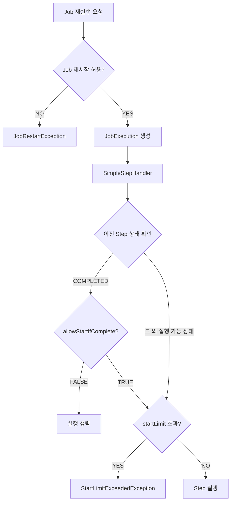

이 그림은 핵심 판단 관계를 단순화한 것이다.

실제로는 UNKNOWN, ABANDONED, STOPPING 등의 상태에 대한 추가 검증도 이루어진다.

따라서 Job 수준의 재시작 정책과 Step 수준의 재실행 정책을 함께 이해해야 한다.

---

### Incrementer와 startLimit의 관계

이전에 살펴본 `RunIdIncrementer`는 새로운 JobParameters를 생성하는 데 사용된다.

예를 들어 다음과 같은 파라미터를 생성할 수 있다.

```text
businessDate = 2026-11-09

run.id = 1
```

다음 실행에서는 run.id가 증가한다.

```text
businessDate = 2026-11-09

run.id = 2
```

run.id가 식별용 파라미터라면 새로운 JobInstance가 생성된다.

이때 중요한 점이 있다.

**startLimit은 같은 JobInstance의 Step 실행 횟수를 기준으로 적용된다.**

따라서 run.id를 변경하여 새로운 JobInstance를 생성하면 기존 JobInstance의 Step 실행 횟수를 그대로 이어서 계산하지 않는다.

예를 들어 다음과 같은 상황이다.

```text
JobInstance 1
    │
    ├── run.id = 1
    │
    └── processingStep 실행 횟수 = 3
```

```text
JobInstance 2
    │
    ├── run.id = 2
    │
    └── processingStep 실행 횟수 = 0
```

이러한 이유로 startLimit을 이용해 특정 비즈니스 작업의 전체 재처리 횟수를 제한하려는 경우에는 주의해야 한다.

새로운 JobInstance를 계속 생성한다면 동일한 업무를 여러 번 처리할 수 있기 때문이다.

이번 예제에서 RunIdIncrementer를 사용하지 않은 이유도 여기에 있다.

**동일한 JobInstance를 재시작해야 startLimit과 allowStartIfComplete의 동작을 정확하게 확인할 수 있기 때문이다.**

---

### 실무에서 활용할 수 있는 12가지 설계 방법

두 API는 단순한 설정이지만 실제 운영에서는 여러 문제를 해결하는 데 활용할 수 있다.

다만 무조건 설정하는 것보다 해당 Step의 업무 특성과 장애 복구 정책을 먼저 이해해야 한다.

#### 1. 매번 실행해야 하는 데이터 검증 Step

배치를 재시작할 때마다 데이터 상태를 다시 확인해야 하는 경우가 있다.

예를 들어 정산 대상 데이터가 정상적으로 준비되었는지 확인하는 작업이다.

```java
.allowStartIfComplete(true)
```

이렇게 설정하면 이전 검증이 성공했더라도 Job 재시작 시 다시 검증할 수 있다.

다만 검증 과정에서 데이터를 변경한다면 중복 실행 시 어떤 문제가 발생하는지도 함께 고려해야 한다.

#### 2. 외부 API 요청 횟수 제한

외부 시스템에 요청을 전달하는 Step은 무제한 재실행이 위험할 수 있다.

예를 들어 외부 시스템 장애가 발생했을 때 동일한 요청을 반복하면 부하가 증가할 수 있다.

이러한 경우 startLimit을 이용해 Step의 시작 횟수를 제한할 수 있다.

하지만 외부 API가 중복 요청을 처리할 수 있는지와는 별개의 문제다.

따라서 멱등성 키나 요청 상태 확인 기능을 함께 고려해야 한다.

#### 3. 수동 복구가 필요한 Step

일부 작업은 일정 횟수 이상 실패하면 운영자의 확인이 필요할 수 있다.

예를 들어 외부 정산 시스템의 처리 상태가 불명확한 경우다.

이때 startLimit을 이용해 자동 재실행을 제한할 수 있다.

하지만 제한 횟수에 도달한 이후에는 어떤 절차로 복구할 것인지도 정의해야 한다.

#### 4. 사전 데이터 정리 Step

배치를 재시작할 때마다 임시 데이터를 정리해야 할 수 있다.

이러한 작업은 allowStartIfComplete를 활용할 수 있다.

다만 정리 작업이 여러 번 실행되어도 안전한지 확인해야 한다.

가능하면 동일한 요청을 반복해도 결과가 달라지지 않는 멱등성을 확보하는 것이 좋다.

#### 5. 정산 확정 이전의 상태 검증

정산 확정 작업 이전에 거래 상태나 정산 대상 수량을 검증할 수 있다.

이러한 검증은 재시작할 때마다 수행할 필요가 있을 수 있다.

따라서 allowStartIfComplete가 적절할 수 있다.

반면 실제 정산 확정 작업은 중복 실행 여부를 별도로 관리해야 한다.

#### 6. JobInstance별 재시도 정책 설계

startLimit은 JobInstance별로 적용된다.

따라서 JobParameters가 어떤 업무를 식별하는지 명확하게 설계해야 한다.

특히 businessDate 같은 비즈니스 파라미터와 run.id 같은 실행 식별값을 혼용할 때는 주의해야 한다.

#### 7. 재실행 가능한 Step과 불가능한 Step 분리

하나의 Job에는 재시작할 때마다 실행해야 하는 Step과 그렇지 않은 Step이 함께 존재할 수 있다.

예를 들어 다음과 같이 구성할 수 있다.

```text
SettlementJob
    │
    ├── ValidationStep
    │       └── 항상 재검증
    │
    ├── CalculationStep
    │       └── 완료되었다면 생략
    │
    └── ExternalRequestStep
            └── 시작 횟수 제한
```

이렇게 구성하면 각 Step의 실행 정책을 업무 특성에 맞게 설정할 수 있다.

#### 8. StepExecution을 기반으로 장애 원인 분석

Job이 실패했다고 해서 모든 Step이 실패한 것은 아니다.

특히 startLimit을 초과한 경우 해당 Step의 새로운 StepExecution이 생성되지 않을 수 있다.

따라서 장애 분석 시 JobExecution과 StepExecution을 함께 조회하는 것이 중요하다.

#### 9. Job 실행 횟수와 Step 실행 횟수 구분

JobExecution이 다섯 개 존재한다고 해서 모든 Step이 다섯 번 실행된 것은 아니다.

일부 Step은 이전 완료 이력으로 인해 생략되었을 수 있다.

또는 startLimit을 초과하여 실행되지 않았을 수 있다.

따라서 모니터링에서는 JobExecution 개수와 StepExecution 개수를 별도로 확인해야 한다.

#### 10. 운영 중 startLimit 설정 변경 시 주의

운영 중인 Step의 startLimit을 변경할 수 있다.

하지만 이미 저장된 StepExecution 이력이 사라지는 것은 아니다.

예를 들어 이전에 세 번 실행한 Step에 startLimit(3)을 적용하면 추가 실행이 제한될 수 있다.

따라서 설정을 변경하기 전에 기존 실행 이력을 확인하는 것이 좋다.

#### 11. Step 이름 변경에 따른 영향 고려

Spring Batch는 Step 이름을 기준으로 이전 StepExecution을 조회한다.

따라서 운영 중 Step 이름을 변경하면 기존 실행 이력과 연결되지 않을 수 있다.

이 경우 startLimit과 재시작 정책에 영향을 줄 수 있다.

Step 이름은 단순한 코드상의 식별자가 아니라 실행 메타데이터의 일부로 관리해야 한다.

#### 12. 실행 제한과 복구 전략을 함께 설계

startLimit은 실행 횟수를 제한할 뿐 장애를 자동으로 복구하지 않는다.

allowStartIfComplete는 완료된 Step의 재실행을 허용할 뿐 비즈니스 정합성을 보장하지 않는다.

따라서 다음 요소를 함께 고려해야 한다.

| 요소 | 목적 |
|---|---|
| startLimit | Step 시작 횟수 제한 |
| allowStartIfComplete | 완료된 Step의 재실행 허용 |
| preventRestart | Job 재시작 금지 |
| JobParameters | JobInstance 식별 |
| ExecutionContext | 실행 상태 저장 및 복원 |
| 멱등성 | 중복 비즈니스 처리 방지 |
| 운영 복구 절차 | 제한 초과 또는 장애 발생 시 대응 |

결국 두 API는 실행 제어 정책의 일부일 뿐이다.

실제 운영에서는 데이터 정합성과 장애 복구까지 함께 고려해야 한다.

---

### 자주 혼동하는 부분

| 혼동하기 쉬운 내용 | 정확한 이해 |
|---|---|
| startLimit(3)은 성공한 실행만 세 번 허용한다 | 실패한 실행도 시작 횟수에 포함한다 |
| startLimit은 Job 전체의 실행 횟수를 제한한다 | 특정 Step의 시작 횟수를 제한한다 |
| startLimit은 모든 JobInstance의 실행을 합산한다 | 동일 JobInstance의 Step 실행 이력을 기준으로 한다 |
| startLimit을 초과해도 StepExecution이 생성된다 | 실행 전 검증에서 거부되면 생성되지 않는다 |
| startLimit을 초과하면 JobExecution도 생성되지 않는다 | JobExecution은 이미 생성되었을 수 있다 |
| allowStartIfComplete의 기본값은 true다 | 기본값은 false다 |
| allowStartIfComplete(true)는 완료된 Job도 재실행할 수 있게 한다 | Job 자체의 재실행 가능 여부와는 별개다 |
| allowStartIfComplete(true)는 startLimit을 무시한다 | startLimit 제한도 적용된다 |
| 완료된 Step은 항상 재실행할 수 없다 | allowStartIfComplete로 재실행을 허용할 수 있다 |
| Step이 실행 생략되면 예외가 발생한다 | 일반적인 완료 Step 생략은 정상적인 처리다 |
| 새로운 JobInstance에서도 기존 startLimit 횟수가 유지된다 | JobInstance별로 실행 횟수를 계산한다 |
| RunIdIncrementer를 사용해도 같은 JobInstance로 재시작한다 | 식별용 run.id가 달라지면 새로운 JobInstance다 |

---

### 전체 아키텍처

마지막으로 두 API의 전체 처리 흐름을 하나의 구조로 정리해보자.

```mermaid
flowchart TD
    A["JobLauncher.run()"]
    B["JobRepository"]
    C["JobExecution 생성"]
    D["SimpleJob.doExecute()"]

    E["SimpleStepHandler.handleStep()"]
    F["이전 StepExecution 조회"]

    G["shouldStart()"]

    H{"이전 상태 UNKNOWN?"}
    I["JobRestartException"]

    J{"이전 상태 COMPLETED?"}
    K{"allowStartIfComplete?"}
    L["Step 실행 생략"]

    M{"이전 상태 ABANDONED?"}

    N["StepExecution 개수 조회"]
    O{"실행 횟수 < startLimit?"}

    P["StartLimitExceededException"]

    Q["새로운 StepExecution 생성"]
    R["JobRepository.add()"]
    S["TaskletStep.execute()"]

    T["Tasklet.execute()"]
    U["StepExecution 상태 저장"]
    V["다음 Step 또는 Job 종료"]

    A --> B
    B --> C
    C --> D

    D --> E
    E --> F
    F --> G

    G --> H

    H -->|YES| I
    H -->|NO| J

    J -->|YES| K
    J -->|NO| M

    K -->|FALSE| L
    K -->|TRUE| M

    M -->|YES| L
    M -->|NO| N

    N --> O

    O -->|NO| P
    O -->|YES| Q

    Q --> R
    R --> S
    S --> T
    T --> U
    U --> V

    L --> V
    P --> V
```

이 구조에서 가장 중요한 것은 실행 가능 여부를 검사하는 위치다.

SimpleJob은 등록된 Step을 순차적으로 실행한다.

하지만 실제 Step을 시작할 수 있는지는 SimpleStepHandler가 판단한다.

SimpleStepHandler는 이전 StepExecution을 조회한다.

그리고 이전 상태와 allowStartIfComplete 설정을 확인한다.

그다음 startLimit을 검사한다.

실행이 허용되면 새로운 StepExecution을 생성하고 실제 Step을 실행한다.

반면 실행이 허용되지 않으면 Step을 생략하거나 예외를 발생시킨다.

따라서 두 API의 실제 동작을 이해하려면 **SimpleStepHandler.shouldStart()의 검증 순서**를 이해하는 것이 중요하다.

---

### 정리

Spring Batch의 `startLimit()`과 `allowStartIfComplete()`는 Step의 재실행을 제어하는 API다.

두 API는 모두 StepBuilder에서 설정한다.

하지만 서로 다른 목적을 가진다.

`startLimit()`은 Step의 최대 시작 횟수를 제한한다.

예를 들어 다음과 같이 설정할 수 있다.

```java
.startLimit(3)
```

이 설정은 동일한 JobInstance에서 해당 Step이 최대 세 번 시작될 수 있다는 의미다.

실패한 실행도 시작 횟수에 포함된다.

설정한 횟수를 초과하면 StartLimitExceededException이 발생한다.

이때 새로운 StepExecution은 생성되지 않는다.

반면 `allowStartIfComplete()`는 이전에 완료된 Step을 다시 실행할 수 있도록 허용한다.

```java
.allowStartIfComplete(true)
```

기본값은 false다.

따라서 별도로 설정하지 않으면 완료된 Step은 Job 재시작 시 실행을 생략한다.

하지만 true로 설정하면 이전에 완료되었더라도 다시 실행할 수 있다.

이러한 설정은 데이터 검증이나 사전 준비 작업에 유용하다.

다만 allowStartIfComplete가 true라고 해서 모든 실행 제한을 무시하는 것은 아니다.

startLimit을 초과했다면 Step 실행은 제한된다.

또한 Job 자체가 COMPLETED 상태라면 동일한 JobInstance를 다시 실행할 수 없다.

따라서 Job 수준의 실행 정책과 Step 수준의 재실행 정책을 구분해야 한다.

두 API의 설정은 StepBuilderHelper의 CommonStepProperties에 저장된다.

이후 Step 생성 과정에서 AbstractStep에 전달된다.

실제 실행 가능 여부는 SimpleStepHandler의 shouldStart()에서 판단한다.

이 메서드는 이전 StepExecution의 상태를 확인한다.

COMPLETED 상태라면 allowStartIfComplete를 검사한다.

실행이 허용되는 경우에는 기존 StepExecution 개수와 startLimit을 비교한다.

그 결과 실행이 허용되면 새로운 StepExecution을 생성한다.

반면 제한을 초과하면 StartLimitExceededException이 발생한다.

최종적으로 다음과 같이 정리할 수 있다.

| API | 핵심 동작 |
|---|---|
| startLimit(n) | 같은 JobInstance에서 Step 시작 횟수를 n회로 제한 |
| allowStartIfComplete(true) | 완료된 Step도 Job 재시작 시 다시 실행하도록 허용 |
| allowStartIfComplete(false) | 완료된 Step의 재실행 생략 |
| SimpleStepHandler.shouldStart() | 이전 실행 상태와 제한 조건을 이용해 실행 여부 판단 |
| StartLimitExceededException | Step의 최대 시작 횟수 초과 시 발생 |

결국 **startLimit은 실행 가능한 횟수를 제어하고, allowStartIfComplete는 이전에 완료된 Step의 재실행 여부를 제어한다.**

두 API를 적절히 조합하면 반복 검증이 필요한 Step과 실행 횟수를 제한해야 하는 Step을 하나의 Job 안에서 독립적으로 관리할 수 있다.

#### 한 줄 요약

> Spring Batch의 `startLimit()`은 동일한 JobInstance에서 특정 Step이 시작될 수 있는 최대 횟수를 제한하며, 제한을 초과하면 `StartLimitExceededException`이 발생한다. `allowStartIfComplete()`는 Job 재시작 시 이전에 COMPLETED 상태였던 Step을 다시 실행할 것인지 결정하며 기본값은 false다. 두 API의 실제 실행 여부는 `SimpleStepHandler.shouldStart()`에서 이전 StepExecution 상태와 실행 횟수를 기준으로 판단한다.
