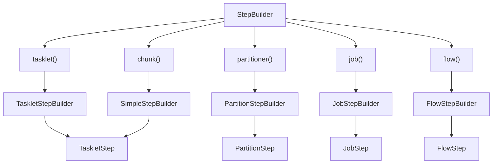
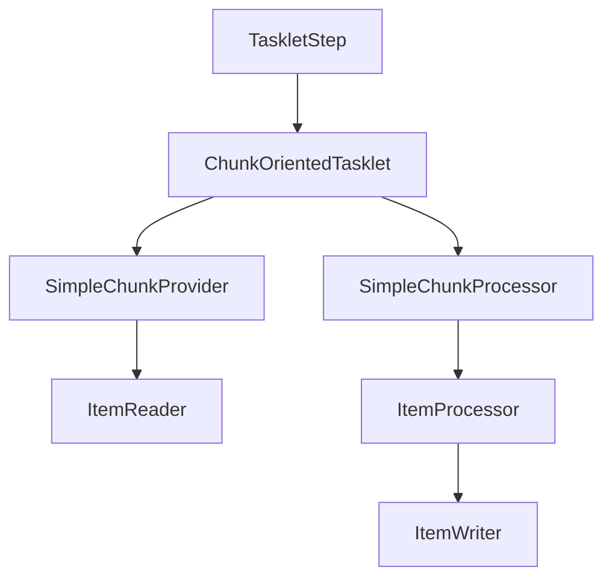
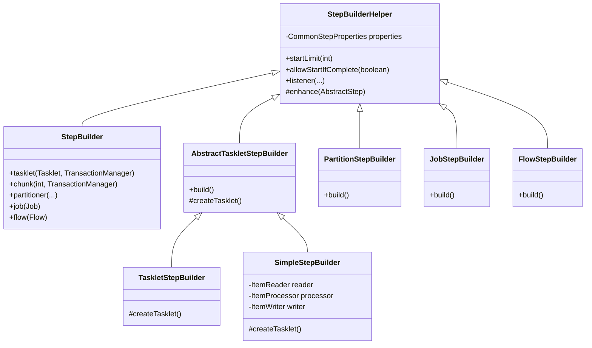
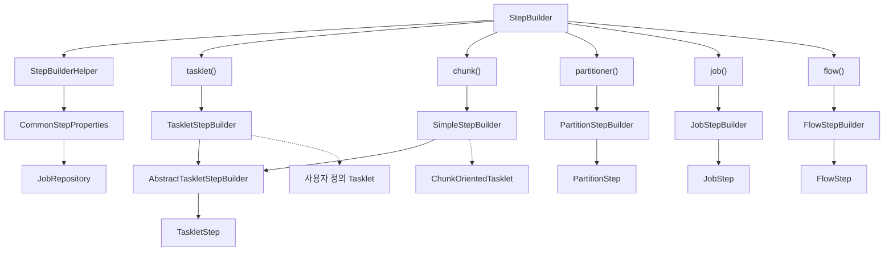

# 6. 스프링 배치 실행 - Step

# 6. 스프링 배치 실행 - Step

* toc
{:toc}

---

## StepBuilderFactory


### Spring Batch StepBuilder 아키텍처 이해: 5가지 StepBuilder와 Step 구현체 생성 원리

Spring Batch에서 Job은 여러 Step으로 구성된다.

Job이 배치 작업 전체를 정의한다면, Step은 실제 작업을 수행하는 개별 실행 단위다.

예를 들어 정산 시스템에서 다음과 같은 배치 작업을 구성할 수 있다.

```text
dailySettlementJob
       │
       ├── Step 1. 정산 대상 데이터 조회
       │
       ├── Step 2. 정산 금액 계산
       │
       ├── Step 3. 정산 데이터 검증
       │
       └── Step 4. 정산 결과 저장
```

이러한 Step은 일반적으로 `StepBuilder`를 이용해 생성한다.

가장 기본적인 예제는 다음과 같다.

```java
@Bean
public Step settlementStep(
        JobRepository jobRepository,
        PlatformTransactionManager transactionManager
) {
    return new StepBuilder("settlementStep", jobRepository)
            .tasklet((contribution, chunkContext) -> {

                System.out.println("정산 작업 실행");

                return RepeatStatus.FINISHED;

            }, transactionManager)
            .build();
}
```

이 코드는 하나의 Step을 생성한다.

여기서는 `tasklet()` API를 사용했기 때문에 Tasklet 기반 Step이 생성된다.

그런데 Spring Batch에서는 모든 Step을 `tasklet()`으로 생성하지 않는다.

데이터를 일정한 개수로 읽고 처리하는 작업이라면 `chunk()`를 사용할 수 있다.

여러 작업을 분할해 병렬 처리하려면 `partitioner()`를 사용할 수 있다.

Step 내부에서 별도의 Job을 실행하려면 `job()`을 사용할 수 있다.

Step 내부에서 Flow를 실행하려면 `flow()`를 사용할 수 있다.

이처럼 Spring Batch에서는 Step을 구성하는 방식에 따라 서로 다른 API를 제공한다.

그리고 각각의 API는 서로 다른 Builder 구현체를 생성한다.

하지만 여기서 흥미로운 점이 있다.

**서로 다른 Builder를 사용하더라도 최종적으로 생성되는 Step 구현체가 같을 수 있다.**

대표적인 예가 `tasklet()`과 `chunk()`다.

```java
new StepBuilder("taskletStep", jobRepository)
        .tasklet(tasklet, transactionManager)
        .build();
```

```java
new StepBuilder("chunkStep", jobRepository)
        .<String, String>chunk(100, transactionManager)
        .reader(reader)
        .processor(processor)
        .writer(writer)
        .build();
```

두 코드는 실행 방식이 다르다.

첫 번째는 개발자가 전달한 Tasklet을 실행한다.

두 번째는 Reader, Processor, Writer를 이용해 데이터를 Chunk 단위로 처리한다.

하지만 두 방식 모두 최종적으로 생성하는 Step은 `TaskletStep`이다.

차이는 Step 내부에 등록되는 Tasklet 구현체에 있다.

이러한 구조를 이해하려면 단순히 API 사용법만 알아서는 부족하다.

**StepBuilder가 어떤 하위 Builder를 생성하고, 각 Builder가 어떤 Step 객체를 생성하는지 이해해야 한다.**

이번에는 StepBuilderFactory의 역할부터 StepBuilder의 내부 구조, 다섯 가지 하위 Builder, 최종 Step 구현체의 차이, 실제 생성 과정까지 자세히 살펴보자.

---

### StepBuilderFactory와 StepBuilder의 개념

Spring Batch에서 Step을 생성하기 위해 사용했던 대표적인 클래스는 다음과 같다.

- StepBuilderFactory
- StepBuilder

두 클래스는 서로 다른 역할을 가지고 있다.

StepBuilderFactory는 StepBuilder를 생성하는 역할을 담당한다.

StepBuilder는 Step을 구성하는 API를 제공하고, 설정에 따라 적절한 하위 Builder를 생성한다.

기존 구조를 표현하면 다음과 같다.

```text
StepBuilderFactory
       │
       │ get(stepName)
       ▼
StepBuilder
       │
       ├── tasklet()
       │
       ├── chunk()
       │
       ├── partitioner()
       │
       ├── job()
       │
       └── flow()
       │
       ▼
하위 Builder 생성
       │
       ▼
build()
       │
       ▼
Step 구현체 생성
```

여기서 중요한 것은 StepBuilderFactory나 StepBuilder가 모든 종류의 Step 객체를 직접 구성하는 것은 아니라는 사실이다.

실제 Step 생성은 각 하위 Builder에 위임된다.

이러한 구조를 사용하면 StepBuilder는 다양한 Step 생성 방식을 제공하면서도, 각 Step의 구체적인 생성 로직은 별도로 관리할 수 있다.

#### StepBuilderFactory란?

StepBuilderFactory는 StepBuilder를 생성하는 Factory 클래스다.

기존 Spring Batch에서는 다음과 같이 사용했다.

```java
stepBuilderFactory.get("step1");
```

`get()` 메서드에는 Step 이름을 전달한다.

반환 타입은 StepBuilder다.

개념적인 구현은 다음과 같다.

```java
public StepBuilder get(String name) {

    return new StepBuilder(
            name,
            jobRepository
    );
}
```

이렇게 생성된 StepBuilder에는 Step 이름과 JobRepository가 전달된다.

예를 들어 다음과 같이 사용했다.

```java
stepBuilderFactory
        .get("settlementStep")
        .tasklet(tasklet)
        .build();
```

이 방식에서는 StepBuilderFactory가 StepBuilder를 생성하는 진입점 역할을 담당한다.

다만 현재 사용하는 Spring Batch 버전에 따라 API 사용 방식이 달라진다는 점을 알아야 한다.

---

### Spring Batch 5.2에서 StepBuilderFactory가 제거된 이유

Spring Batch 4에서는 StepBuilderFactory를 사용하는 방식이 일반적이었다.

하지만 Spring Batch 5.0부터 StepBuilderFactory는 Deprecated 처리되었으며, Spring Batch 5.2에서 제거되었다.

따라서 Spring Batch 5.2.4 환경에서는 다음 코드를 사용할 수 없다.

```java
@Autowired
private StepBuilderFactory stepBuilderFactory;
```

대신 `StepBuilder`를 직접 생성해야 한다.

```java
@Bean
public Step settlementStep(
        JobRepository jobRepository,
        PlatformTransactionManager transactionManager
) {
    return new StepBuilder(
            "settlementStep",
            jobRepository
    )
            .tasklet(
                    (contribution, chunkContext) -> RepeatStatus.FINISHED,
                    transactionManager
            )
            .build();
}
```

기존 방식과 현재 방식을 비교하면 다음과 같다.

| 구분 | Spring Batch 4 | Spring Batch 5.2 |
|---|---|---|
| Step 생성 진입점 | StepBuilderFactory | StepBuilder |
| Builder 생성 | `get(stepName)` | `new StepBuilder(stepName, jobRepository)` |
| JobRepository 전달 | Factory가 처리 | 생성자에 직접 전달 |
| Tasklet 구성 | `tasklet(tasklet)` | `tasklet(tasklet, transactionManager)` |
| Chunk 구성 | `chunk(size)` | `chunk(size, transactionManager)` |
| StepBuilderFactory | 사용 가능 | 제거 |
| StepBuilder | 사용 가능 | 사용 가능 |

즉, StepBuilderFactory가 제거되었다고 해서 StepBuilder의 핵심 설계까지 사라진 것은 아니다.

**Factory를 이용해 StepBuilder를 생성하던 과정이 StepBuilder를 직접 생성하는 방식으로 변경된 것이다.**

따라서 이후 설명에서는 Spring Batch 5.2.4의 StepBuilder를 기준으로 살펴본다.

참고로 Spring Batch 5.2에서는 트랜잭션 매니저를 전달하지 않는 일부 `tasklet()` 및 `chunk()` 오버로드도 Deprecated 상태다.

새로운 코드를 작성할 때는 명시적으로 `PlatformTransactionManager`를 전달하는 방식을 사용하는 것이 좋다.

---

### StepBuilder는 어떤 역할을 담당할까?

StepBuilder는 다양한 종류의 Step을 생성하기 위한 진입점이다.

직접적인 역할은 Step 생성에 필요한 공통 설정을 관리하고, API에 따라 적절한 하위 Builder를 반환하는 것이다.

대표적인 사용 방법은 다음과 같다.

```java
new StepBuilder(
        "stepName",
        jobRepository
);
```

여기서는 아직 최종 Step이 만들어지지 않는다.

StepBuilder 객체만 생성된다.

이후 어떤 API를 호출하느냐에 따라 반환되는 Builder가 달라진다.

예를 들어 다음과 같다.

```java
new StepBuilder("step1", jobRepository)
        .tasklet(tasklet, transactionManager);
```

이 경우 TaskletStepBuilder가 반환된다.

반면 다음과 같이 작성하면

```java
new StepBuilder("step2", jobRepository)
        .<String, String>chunk(100, transactionManager);
```

SimpleStepBuilder가 반환된다.

따라서 StepBuilder의 API는 단순히 설정값을 저장하는 역할만 하는 것이 아니다.

**API의 종류와 매개변수 타입에 따라 이후 Step 생성 과정에서 사용할 Builder 구현체를 결정한다.**

이것이 StepBuilder 아키텍처의 가장 중요한 특징이다.

---

### StepBuilder가 제공하는 5가지 하위 Builder

Spring Batch 5.2.4의 StepBuilder는 대표적으로 다섯 가지 Builder를 반환한다.

| StepBuilder API | 반환 Builder | 최종 Step 구현체 |
|---|---|---|
| `tasklet()` | TaskletStepBuilder | TaskletStep |
| `chunk()` | SimpleStepBuilder | TaskletStep |
| `partitioner()` | PartitionStepBuilder | PartitionStep |
| `job()` | JobStepBuilder | JobStep |
| `flow()` | FlowStepBuilder | FlowStep |

여기서 주목할 부분은 첫 번째와 두 번째다.

TaskletStepBuilder와 SimpleStepBuilder는 서로 다른 Builder지만, 최종적으로 생성하는 Step 구현체는 동일하다.

반면 나머지 세 Builder는 각각 다른 Step 구현체를 생성한다.

이를 구조로 표현하면 다음과 같다.



이 관계를 기억하면 어떤 API를 사용했을 때 어떤 Step이 생성되는지 쉽게 파악할 수 있다.

이제 각각의 Builder를 구체적으로 살펴보자.

---

### TaskletStepBuilder

TaskletStepBuilder는 Tasklet 기반 Step을 생성하기 위한 Builder다.

가장 기본적인 Step 생성 방식이다.

일반적으로 개발자가 직접 정의한 Tasklet 구현체를 전달한다.

예를 들어 다음과 같다.

```java
@Bean
public Step taskletStep(
        JobRepository jobRepository,
        PlatformTransactionManager transactionManager
) {
    return new StepBuilder("taskletStep", jobRepository)
            .tasklet((contribution, chunkContext) -> {

                System.out.println("Tasklet 실행");

                return RepeatStatus.FINISHED;

            }, transactionManager)
            .build();
}
```

이 코드에서 중요한 부분은 다음이다.

```java
.tasklet(tasklet, transactionManager)
```

StepBuilder는 Tasklet을 전달받으면 TaskletStepBuilder를 생성한다.

Spring Batch 5.2.4의 핵심 구현은 다음과 같다.

```java
public TaskletStepBuilder tasklet(
        Tasklet tasklet,
        PlatformTransactionManager transactionManager
) {
    return new TaskletStepBuilder(this)
            .tasklet(tasklet, transactionManager);
}
```

이 메서드에서 `new TaskletStepBuilder(this)`가 실행된다.

따라서 다음과 같은 구조가 만들어진다.

```text
StepBuilder
    │
    ▼
tasklet()
    │
    ▼
TaskletStepBuilder
    │
    ▼
Tasklet 설정
    │
    ▼
build()
    │
    ▼
TaskletStep
```

여기서 TaskletStepBuilder는 전달받은 Tasklet을 내부에 저장한다.

그리고 최종적으로 TaskletStep을 생성할 때 해당 Tasklet을 등록한다.

#### TaskletStepBuilder의 내부 역할

TaskletStepBuilder는 다음과 같은 속성을 관리한다.

```text
TaskletStepBuilder
       │
       ├── Tasklet
       ├── TransactionManager
       ├── Step 이름
       ├── JobRepository
       └── 공통 Step 설정
```

이후 build()를 호출하면 TaskletStep이 생성된다.

실제 Tasklet 실행은 Step이 수행될 때 발생한다.

따라서 다음과 같이 구분해야 한다.

```text
Step 설정 시점
    │
    ▼
TaskletStepBuilder 생성
    │
    ▼
TaskletStep 생성
```

```text
Job 실행 시점
    │
    ▼
TaskletStep.execute()
    │
    ▼
Tasklet.execute()
```

TaskletStepBuilder는 주로 단일 작업을 수행하는 Step에 적합하다.

예를 들어 다음과 같은 작업이 있다.

- 특정 테이블의 데이터 삭제
- 배치 실행 전 환경 검증
- 외부 API 호출
- 파일 생성
- 특정 상태값 변경

이러한 작업은 반드시 Chunk 구조로 만들 필요가 없다.

따라서 Tasklet 기반으로 구현하는 것이 적절할 수 있다.

---

### SimpleStepBuilder

SimpleStepBuilder는 Chunk 기반 Step을 생성하기 위한 Builder다.

이름만 보면 SimpleStep이라는 별도의 Step 구현체를 생성할 것 같지만 실제로는 그렇지 않다.

**SimpleStepBuilder도 최종적으로 TaskletStep을 생성한다.**

이것이 StepBuilder 아키텍처에서 가장 흥미로운 부분이다.

Chunk 기반 처리는 일반적으로 세 가지 컴포넌트로 구성된다.

첫 번째는 ItemReader다.

두 번째는 ItemProcessor다.

세 번째는 ItemWriter다.

전체 구조는 다음과 같다.

```text
Chunk Processing
       │
       ▼
ItemReader
       │
       ▼
ItemProcessor
       │
       ▼
ItemWriter
```

ItemReader는 데이터를 읽는다.

ItemProcessor는 읽은 데이터를 가공한다.

ItemWriter는 처리된 데이터를 저장한다.

예를 들어 다음과 같이 Step을 구성할 수 있다.

```java
@Bean
public Step chunkStep(
        JobRepository jobRepository,
        PlatformTransactionManager transactionManager,
        ItemReader<String> reader,
        ItemProcessor<String, String> processor,
        ItemWriter<String> writer
) {
    return new StepBuilder("chunkStep", jobRepository)
            .<String, String>chunk(100, transactionManager)
            .reader(reader)
            .processor(processor)
            .writer(writer)
            .build();
}
```

여기서 중요한 API는 다음이다.

```java
.<String, String>chunk(100, transactionManager)
```

이 API는 Chunk 크기를 100으로 설정한다.

즉, 일반적으로 최대 100개의 데이터를 하나의 Chunk로 구성해 처리하도록 설정한다.

그리고 SimpleStepBuilder를 반환한다.

Spring Batch 5.2.4의 StepBuilder는 내부적으로 다음과 같이 동작한다.

```java
public <I, O> SimpleStepBuilder<I, O> chunk(
        int chunkSize,
        PlatformTransactionManager transactionManager
) {
    return new SimpleStepBuilder<I, O>(this)
            .transactionManager(transactionManager)
            .chunk(chunkSize);
}
```

따라서 다음 구조가 만들어진다.

```text
StepBuilder
    │
    ▼
chunk()
    │
    ▼
SimpleStepBuilder
    │
    ├── ItemReader
    ├── ItemProcessor
    ├── ItemWriter
    └── ChunkSize
    │
    ▼
build()
    │
    ▼
TaskletStep
```

여기서 한 가지 의문이 생긴다.

Tasklet 기반 Step과 Chunk 기반 Step은 실행 구조가 다른데 왜 둘 다 TaskletStep을 생성할까?

그 이유는 Spring Batch가 **Chunk 기반 처리를 수행하는 전용 Tasklet 구현체**를 제공하기 때문이다.

---

### TaskletStepBuilder와 SimpleStepBuilder가 같은 Step을 생성하는 이유

먼저 일반적인 Tasklet 기반 Step을 살펴보자.

```text
TaskletStep
    │
    ▼
사용자 정의 Tasklet
    │
    ▼
비즈니스 로직
```

개발자가 직접 구현한 Tasklet을 실행한다.

반면 Chunk 기반 Step은 다음과 같다.

```text
TaskletStep
    │
    ▼
ChunkOrientedTasklet
    │
    ├── ItemReader
    │
    ├── ItemProcessor
    │
    └── ItemWriter
```

Chunk 기반 Step에서는 개발자가 Tasklet을 직접 구현하지 않는다.

대신 Spring Batch가 내부적으로 `ChunkOrientedTasklet`을 생성한다.

그리고 해당 Tasklet이 Reader, Processor, Writer를 이용해 Chunk 단위로 데이터를 처리한다.

즉, 두 방식은 최종 Step 구현체는 같지만 내부에 등록되는 Tasklet이 다르다.

| 구분 | Tasklet 기반 | Chunk 기반 |
|---|---|---|
| Builder | TaskletStepBuilder | SimpleStepBuilder |
| 최종 Step | TaskletStep | TaskletStep |
| 내부 Tasklet | 사용자 정의 Tasklet | ChunkOrientedTasklet |
| 처리 방식 | 직접 정의한 작업 실행 | Reader, Processor, Writer |
| 반복 처리 | RepeatStatus 기반 | Chunk 단위 반복 |
| 트랜잭션 | Tasklet 실행 단위 | Chunk 단위 |
| 대표 활용 | 단일 작업, API 호출, 파일 생성 | 대량 데이터 처리 |

이러한 구조가 가능한 이유는 TaskletStep이 특정 비즈니스 로직에 종속되지 않고 Tasklet 인터페이스를 실행하는 구조로 설계되어 있기 때문이다.

TaskletStep은 내부 Tasklet이 직접 작성한 구현체인지, Spring Batch가 생성한 구현체인지 구분할 필요가 없다.

Tasklet 인터페이스의 `execute()`를 호출하면 된다.

이것이 인터페이스 기반 추상화의 장점이다.

---

### ChunkOrientedTasklet은 어떻게 생성될까?

SimpleStepBuilder의 내부 동작을 조금 더 살펴보자.

Spring Batch 5.2.4에서는 SimpleStepBuilder의 `createTasklet()`이 Chunk 기반 Tasklet을 생성한다.

핵심적인 구조는 다음과 같다.

```java
@Override
protected Tasklet createTasklet() {

    SimpleChunkProvider<I> chunkProvider =
            new SimpleChunkProvider<>(
                    getReader(),
                    createChunkOperations()
            );

    SimpleChunkProcessor<I, O> chunkProcessor =
            new SimpleChunkProcessor<>(
                    getProcessor(),
                    getWriter()
            );

    return new ChunkOrientedTasklet<>(
            chunkProvider,
            chunkProcessor
    );
}
```

위 코드는 주요 객체 생성 과정을 이해하기 위해 부가 설정과 검증을 생략한 형태다.

실제 구현에서는 Reader와 Writer의 존재 여부를 확인하고 Listener, MeterRegistry, Buffering 설정 등을 적용한다.

여기서 중요한 객체는 세 가지다.

첫 번째는 SimpleChunkProvider다.

두 번째는 SimpleChunkProcessor다.

세 번째는 ChunkOrientedTasklet이다.

#### SimpleChunkProvider

SimpleChunkProvider는 ItemReader를 통해 데이터를 읽고 하나의 Chunk를 구성한다.

예를 들어 Chunk 크기가 3이라면 다음과 같이 데이터를 읽는다.

```text
ItemReader
    │
    ├── Item 1
    ├── Item 2
    └── Item 3
    │
    ▼
Chunk 생성
```

#### SimpleChunkProcessor

SimpleChunkProcessor는 Chunk에 포함된 데이터를 처리한다.

ItemProcessor가 등록되어 있다면 각 데이터를 가공한다.

그리고 ItemWriter로 결과를 전달한다.

```text
Chunk
   │
   ▼
ItemProcessor
   │
   ▼
ItemWriter
```

#### ChunkOrientedTasklet

ChunkOrientedTasklet은 ChunkProvider와 ChunkProcessor를 조합해 Chunk 기반 처리를 수행한다.



따라서 Chunk 기반 Step도 TaskletStep을 이용할 수 있다.

**Chunk는 Tasklet과 완전히 분리된 별도의 Step 실행 구조가 아니라, TaskletStep 내부에 ChunkOrientedTasklet을 등록하는 방식으로 구현된다.**

이 구조를 이해하면 Spring Batch에서 Tasklet과 Chunk가 어떤 관계인지 정확하게 이해할 수 있다.

---

### chunk(int)와 chunk(CompletionPolicy)의 차이

StepBuilder는 Chunk를 구성할 때 두 가지 대표적인 방식을 제공한다.

첫 번째는 Chunk 크기를 지정하는 방식이다.

```java
.<String, String>chunk(
        100,
        transactionManager
)
```

두 번째는 CompletionPolicy를 지정하는 방식이다.

```java
.<String, String>chunk(
        new SimpleCompletionPolicy(100),
        transactionManager
)
```

두 방식 모두 SimpleStepBuilder를 반환한다.

따라서 최종적으로 TaskletStep을 생성한다.

차이는 Chunk를 완료하는 조건을 지정하는 방식이다.

| 구분 | chunk(int) | chunk(CompletionPolicy) |
|---|---|---|
| 기준 | 고정된 처리 개수 | CompletionPolicy |
| 사용 방식 | 정수 전달 | 정책 객체 전달 |
| 반환 Builder | SimpleStepBuilder | SimpleStepBuilder |
| 최종 Step | TaskletStep | TaskletStep |
| 적합한 상황 | 일반적인 고정 크기 Chunk | 커스텀 완료 조건이 필요한 경우 |

CompletionPolicy는 Chunk의 완료 여부를 결정하는 정책이다.

따라서 단순한 처리 건수뿐 아니라 별도의 완료 기준이 필요하다면 CompletionPolicy 기반 구성을 고려할 수 있다.

다만 Chunk의 완료 정책과 트랜잭션 커밋은 함께 고려해야 한다.

특히 대용량 데이터를 처리하는 배치에서는 Chunk 크기에 따라 데이터베이스 부하, 메모리 사용량, 롤백 범위가 달라질 수 있다.

---

### PartitionStepBuilder

PartitionStepBuilder는 PartitionStep을 생성하기 위한 Builder다.

Partition은 하나의 작업을 여러 개의 처리 단위로 분할하는 기능이다.

예를 들어 정산 데이터가 100만 건 있다고 생각해보자.

하나의 Step에서 전체 데이터를 처리할 수도 있다.

```text
SettlementStep
       │
       ▼
1,000,000건 처리
```

하지만 데이터를 여러 범위로 나누어 처리할 수도 있다.

```text
PartitionStep
       │
       ├── Partition 1 → 1~250,000
       │
       ├── Partition 2 → 250,001~500,000
       │
       ├── Partition 3 → 500,001~750,000
       │
       └── Partition 4 → 750,001~1,000,000
```

이렇게 분할된 작업은 적절한 TaskExecutor나 PartitionHandler 설정을 통해 병렬로 처리할 수 있다.

StepBuilder에서는 다음 API를 이용한다.

```java
new StepBuilder("partitionStep", jobRepository)
        .partitioner("workerStep", partitioner)
        .step(workerStep)
        .gridSize(4)
        .taskExecutor(taskExecutor)
        .build();
```

여기서 중요한 부분은 다음이다.

```java
.partitioner("workerStep", partitioner)
```

이 API는 PartitionStepBuilder를 생성한다.

그리고 최종적으로 PartitionStep을 생성한다.

```text
StepBuilder
    │
    ▼
partitioner()
    │
    ▼
PartitionStepBuilder
    │
    ├── Partitioner
    ├── Worker Step
    ├── GridSize
    └── TaskExecutor
    │
    ▼
build()
    │
    ▼
PartitionStep
```

#### PartitionStep의 실행 구조

PartitionStep은 하나의 작업을 여러 개의 StepExecution으로 분할할 수 있다.

각 Partition에는 독립적인 ExecutionContext를 전달할 수 있다.

예를 들어 다음과 같다.

```text
Partition 1
    │
    └── startId = 1
        endId = 250000
```

```text
Partition 2
    │
    └── startId = 250001
        endId = 500000
```

이러한 정보를 이용해 동일한 Worker Step이 서로 다른 데이터 범위를 처리하도록 구성할 수 있다.

다만 여기서 주의해야 할 부분이 있다.

**PartitionStepBuilder를 사용했다고 해서 반드시 병렬 실행되는 것은 아니다.**

Spring Batch 5.2.4의 PartitionStepBuilder는 별도의 TaskExecutor를 지정하지 않으면 기본적으로 SyncTaskExecutor를 사용할 수 있다.

따라서 실제 병렬 실행을 위해서는 적절한 TaskExecutor를 지정해야 한다.

또한 Partition은 Step 실행 단위를 분리하지만, 각 Partition이 사용하는 Reader나 Writer 등의 상태를 안전하게 관리할 수 있도록 설계해야 한다.

---

### JobStepBuilder

JobStepBuilder는 JobStep을 생성하기 위한 Builder다.

JobStep은 Step 내부에서 별도의 Job을 실행하는 구조다.

일반적인 Job과 Step의 관계는 다음과 같다.

```text
Job
 │
 ├── Step 1
 │
 └── Step 2
```

반면 JobStep을 사용하면 다음과 같은 구조를 만들 수 있다.

```text
ParentJob
    │
    └── JobStep
           │
           ▼
        ChildJob
           │
           ├── ChildStep 1
           │
           └── ChildStep 2
```

즉, 부모 Job의 특정 Step이 자식 Job을 실행한다.

이러한 구조는 복잡한 작업을 별도의 Job으로 분리해야 하는 경우에 사용할 수 있다.

예를 들어 정산 작업을 다음과 같이 구분할 수 있다.

```text
SettlementParentJob
       │
       ├── 데이터 준비 Step
       │
       ├── 정산 계산 JobStep
       │       │
       │       ▼
       │   SettlementCalculationJob
       │       │
       │       ├── 계산 Step 1
       │       └── 계산 Step 2
       │
       └── 정산 결과 검증 Step
```

JobStep은 다음과 같이 생성할 수 있다.

```java
@Bean
public Step childJobStep(
        JobRepository jobRepository,
        JobLauncher jobLauncher,
        Job childJob
) {
    return new StepBuilder(
            "childJobStep",
            jobRepository
    )
            .job(childJob)
            .launcher(jobLauncher)
            .build();
}
```

여기서 중요한 부분은 다음이다.

```java
.job(childJob)
```

이 API는 JobStepBuilder를 생성한다.

그리고 다음 API를 이용해 JobLauncher를 설정한다.

```java
.launcher(jobLauncher)
```

최종적으로 build()를 호출하면 JobStep이 생성된다.

```text
StepBuilder
    │
    ▼
job(childJob)
    │
    ▼
JobStepBuilder
    │
    ├── ChildJob
    ├── JobLauncher
    └── JobParametersExtractor
    │
    ▼
build()
    │
    ▼
JobStep
```

#### JobStep이 자식 Job을 실행하는 원리

JobStep은 내부적으로 JobLauncher를 사용한다.

핵심적인 실행 구조는 다음과 같다.

```java
JobParameters jobParameters =
        jobParametersExtractor.getJobParameters(
                job,
                stepExecution
        );

JobExecution childExecution =
        jobLauncher.run(
                job,
                jobParameters
        );
```

즉, JobStep은 자식 Job에 전달할 JobParameters를 준비한 뒤 JobLauncher를 이용해 해당 Job을 실행한다.

따라서 부모 Job과 자식 Job은 서로 다른 JobExecution을 가진다.

이것이 단순히 Step 안에서 메서드를 호출하는 방식과 다른 점이다.

부모 Job의 Step 실행 이력과 자식 Job의 실행 이력을 별도로 관리할 수 있다.

---

### FlowStepBuilder

FlowStepBuilder는 FlowStep을 생성하기 위한 Builder다.

Flow는 여러 Step의 실행 흐름을 정의하는 객체다.

일반적인 SimpleJob은 Step을 순차적으로 실행한다.

반면 Flow를 사용하면 실행 상태에 따른 분기나 여러 Step의 연결 관계를 구성할 수 있다.

예를 들어 다음과 같다.

```text
ValidationFlow
       │
       ▼
데이터 검증
       │
       ├── 성공 → 데이터 저장
       │
       └── 실패 → 오류 처리
```

Step 내부에서 이러한 Flow를 실행해야 한다면 FlowStep을 사용할 수 있다.

먼저 Flow를 구성한다.

```java
@Bean
public Flow validationFlow(
        Step validationStep
) {
    return new FlowBuilder<Flow>("validationFlow")
            .start(validationStep)
            .build();
}
```

이후 해당 Flow를 Step에 등록한다.

```java
@Bean
public Step flowStep(
        JobRepository jobRepository,
        Flow validationFlow
) {
    return new StepBuilder(
            "flowStep",
            jobRepository
    )
            .flow(validationFlow)
            .build();
}
```

여기서 중요한 부분은 다음이다.

```java
.flow(validationFlow)
```

이 API는 FlowStepBuilder를 생성한다.

그리고 최종적으로 FlowStep을 생성한다.

```text
StepBuilder
    │
    ▼
flow()
    │
    ▼
FlowStepBuilder
    │
    └── Flow 설정
    │
    ▼
build()
    │
    ▼
FlowStep
```

FlowStep은 내부에 등록된 Flow의 실행을 담당한다.

따라서 다음과 같은 구조를 만들 수 있다.

```text
ParentJob
    │
    └── FlowStep
           │
           ▼
       ValidationFlow
           │
           ├── Step A
           ├── Step B
           └── Step C
```

여기서 FlowStep과 JobStep을 구분해야 한다.

JobStep은 별도의 Job을 실행한다.

FlowStep은 Flow를 실행한다.

따라서 JobStep은 자식 Job의 JobInstance와 JobExecution이 별도로 생성될 수 있다.

반면 FlowStep은 일반적으로 부모 JobExecution의 실행 흐름 안에서 내부 Step을 처리한다.

이 차이는 실행 메타데이터를 확인할 때 중요하다.

---

### 5가지 StepBuilder 비교

지금까지 살펴본 Builder를 하나의 표로 정리해보자.

| Builder | 최종 Step | 내부 실행 대상 | 주요 용도 |
|---|---|---|---|
| TaskletStepBuilder | TaskletStep | 사용자 정의 Tasklet | 단일 작업 |
| SimpleStepBuilder | TaskletStep | ChunkOrientedTasklet | 대량 데이터 처리 |
| PartitionStepBuilder | PartitionStep | PartitionHandler 및 Worker Step | 분할 처리 |
| JobStepBuilder | JobStep | Child Job | Job 재사용 및 계층화 |
| FlowStepBuilder | FlowStep | Flow | 실행 흐름 재사용 |

이 표에서 중요한 사실은 두 가지다.

첫 번째는 API에 따라 Builder가 달라진다는 것이다.

두 번째는 Builder가 달라도 최종 Step 구현체가 같을 수 있다는 것이다.

특히 TaskletStepBuilder와 SimpleStepBuilder의 차이를 정확히 이해해야 한다.

---

### StepBuilder의 클래스 상속 구조

이제 StepBuilder의 전체 클래스 구조를 살펴보자.

Spring Batch 5.2.4에서 StepBuilder는 `StepBuilderHelper`를 상속한다.

```java
public class StepBuilder
        extends StepBuilderHelper<StepBuilder> {
}
```

StepBuilderHelper는 Step 생성에 필요한 공통 설정을 관리한다.

그리고 각 하위 Builder도 StepBuilderHelper를 상속하거나 이를 상속하는 클래스를 통해 공통 기능을 사용한다.

대표적인 관계는 다음과 같다.



이 구조에서 중요한 클래스는 StepBuilderHelper와 AbstractTaskletStepBuilder다.

#### StepBuilderHelper

StepBuilderHelper는 모든 Builder가 공유하는 기본 설정을 관리한다.

대표적인 설정은 다음과 같다.

```text
CommonStepProperties
       │
       ├── Step 이름
       ├── JobRepository
       ├── startLimit
       ├── allowStartIfComplete
       ├── StepExecutionListener
       └── 모니터링 관련 설정
```

각 하위 Builder는 이러한 공통 속성을 이용해 Step을 구성한다.

#### AbstractTaskletStepBuilder

AbstractTaskletStepBuilder는 TaskletStep을 생성하는 Builder들이 공통으로 사용하는 추상 클래스다.

대표적인 하위 클래스는 다음과 같다.

```text
AbstractTaskletStepBuilder
       │
       ├── TaskletStepBuilder
       │
       └── SimpleStepBuilder
```

두 클래스 모두 TaskletStep을 생성하기 때문에 공통 생성 로직을 상위 클래스에서 관리한다.

다만 내부 Tasklet을 만드는 방식은 다르다.

TaskletStepBuilder는 개발자가 전달한 Tasklet을 사용한다.

SimpleStepBuilder는 ChunkOrientedTasklet을 생성한다.

이렇게 공통 생성 로직과 구체적인 Tasklet 생성 로직을 분리한 구조다.

---

### AbstractTaskletStepBuilder의 build() 원리

Spring Batch 5.2.4의 AbstractTaskletStepBuilder는 TaskletStep을 생성하는 공통 로직을 가지고 있다.

핵심 구조를 살펴보자.

```java
public TaskletStep build() {

    TaskletStep step =
            new TaskletStep(getName());

    super.enhance(step);

    step.setTransactionManager(
            transactionManager
    );

    step.setTasklet(
            createTasklet()
    );

    return step;
}
```

이 코드는 주요 생성 흐름만 표현한 것이다.

실제 구현에서는 Listener 등록, 반복 실행 설정, ItemStream 등록, 속성 검증 등 추가적인 작업이 수행된다.

여기서 중요한 부분은 다음이다.

```java
TaskletStep step =
        new TaskletStep(getName());
```

TaskletStep을 생성한다.

이후 다음 코드를 실행한다.

```java
super.enhance(step);
```

공통 Step 속성을 적용한다.

마지막으로 다음 코드를 실행한다.

```java
step.setTasklet(
        createTasklet()
);
```

여기서 `createTasklet()`은 추상 메서드다.

따라서 어떤 하위 Builder를 사용하는지에 따라 실제 호출되는 구현이 달라진다.

#### TaskletStepBuilder의 createTasklet()

TaskletStepBuilder는 전달받은 Tasklet을 반환한다.

```java
@Override
protected Tasklet createTasklet() {

    return tasklet;
}
```

#### SimpleStepBuilder의 createTasklet()

SimpleStepBuilder는 ChunkOrientedTasklet을 생성한다.

```java
@Override
protected Tasklet createTasklet() {

    // Reader 기반 ChunkProvider 생성

    // Processor와 Writer 기반 ChunkProcessor 생성

    // ChunkOrientedTasklet 생성

    return chunkOrientedTasklet;
}
```

이처럼 상위 클래스가 공통 생성 절차를 정의하고, 하위 클래스가 내부 Tasklet을 생성하는 방식을 결정한다.

이는 템플릿 메서드 패턴과 추상화 구조를 이해하는 데 좋은 사례다.

---

### JobRepository는 어떻게 Step에 전달될까?

Spring Batch에서 Step은 실행 정보를 JobRepository에 저장한다.

따라서 Step 객체에는 JobRepository가 필요하다.

Spring Batch 5.2.4에서는 StepBuilder를 생성할 때 JobRepository를 전달한다.

```java
new StepBuilder(
        "stepName",
        jobRepository
);
```

StepBuilder는 전달받은 JobRepository를 StepBuilderHelper의 공통 속성에 저장한다.

이후 하위 Builder가 생성될 때 해당 설정을 복사한다.

그리고 최종적으로 Step을 생성할 때 공통 속성을 적용한다.

핵심 구조는 다음과 같다.

```text
StepBuilder
    │
    └── JobRepository
           │
           ▼
StepBuilderHelper
           │
           ▼
하위 Builder
           │
           ▼
build()
           │
           ▼
Step
    │
    └── JobRepository
```

이 과정을 통해 Step은 실행 과정에서 다음과 같은 작업을 수행할 수 있다.

- StepExecution 저장
- StepExecution 상태 갱신
- ExecutionContext 저장
- 실행 통계 저장
- 재시작에 필요한 메타데이터 관리

여기서 중요한 것은 StepBuilder가 JobRepository를 직접 실행하는 주체가 아니라는 사실이다.

StepBuilder는 JobRepository를 최종 Step에 전달한다.

실제 메타데이터 저장과 갱신은 Step 실행 과정에서 수행된다.

---

### StepBuilder와 JobBuilder의 차이

StepBuilder의 구조는 JobBuilder와 매우 유사하다.

두 클래스 모두 Builder 패턴을 사용한다.

또한 공통 설정을 관리하는 Helper 클래스를 가지고 있다.

하지만 생성하는 도메인 객체가 다르다.

| 구분 | JobBuilder | StepBuilder |
|---|---|---|
| 목적 | Job 생성 | Step 생성 |
| 공통 Helper | JobBuilderHelper | StepBuilderHelper |
| 주요 결과 | SimpleJob, FlowJob | TaskletStep, PartitionStep, JobStep, FlowStep |
| 주요 API | start(), next(), validator(), incrementer() | tasklet(), chunk(), partitioner(), job(), flow() |
| 실행 책임 | Job 전체 실행 흐름 | 개별 Step 실행 |
| 실행 메타데이터 | JobExecution | StepExecution |

예를 들어 JobBuilder는 다음과 같이 사용한다.

```java
new JobBuilder("batchJob", jobRepository)
        .start(step1)
        .next(step2)
        .build();
```

반면 StepBuilder는 다음과 같이 사용한다.

```java
new StepBuilder("step1", jobRepository)
        .tasklet(tasklet, transactionManager)
        .build();
```

JobBuilder는 Step의 실행 관계를 정의한다.

StepBuilder는 개별 Step의 실행 구조를 정의한다.

따라서 두 Builder는 서로 다른 계층에서 사용된다.

```text
JobBuilder
    │
    ▼
Job
    │
    ├── StepBuilder
    │       │
    │       └── Step 1
    │
    └── StepBuilder
            │
            └── Step 2
```

이러한 관계를 이해하면 Job과 Step의 생성 책임을 명확하게 구분할 수 있다.

---

### 실제 5가지 StepBuilder 구현하기

이번에는 Spring Batch 5.2.4에서 사용할 수 있는 다섯 가지 Step을 직접 구성해보자.

각 Step은 서로 다른 Builder를 통해 생성된다.

전체 구성은 다음과 같다.

```text
stepBuilderArchitectureJob
       │
       ├── taskletStep
       │
       ├── chunkStep
       │
       ├── partitionManagerStep
       │       │
       │       └── partitionWorkerStep
       │
       ├── jobStep
       │       │
       │       └── childJob
       │               │
       │               └── childTaskletStep
       │
       └── flowStep
               │
               └── internalFlow
                       │
                       └── flowTaskletStep
```

여기서는 다섯 가지 Step을 하나의 Job에 연결한다.

따라서 Job이 실행되면 각 Step의 실제 실행 방식도 확인할 수 있다.

#### 개발 환경

| 항목 | 기술 |
|---|---|
| Java | Java 17 |
| Spring Boot | 3.4.x |
| Spring Batch | 5.2.x |
| Build Tool | Maven |
| Database | H2 |
| Step 생성 | StepBuilder |
| 실행 방식 | Tasklet, Chunk, Partition, Job, Flow |

---

### Maven 의존성 설정

`pom.xml`

```xml
<?xml version="1.0" encoding="UTF-8"?>
<project xmlns="http://maven.apache.org/POM/4.0.0"
         xmlns:xsi="http://www.w3.org/2001/XMLSchema-instance"
         xsi:schemaLocation="
             http://maven.apache.org/POM/4.0.0
             https://maven.apache.org/xsd/maven-4.0.0.xsd">

    <modelVersion>4.0.0</modelVersion>

    <parent>
        <groupId>org.springframework.boot</groupId>
        <artifactId>spring-boot-starter-parent</artifactId>
        <version>3.4.13</version>
        <relativePath/>
    </parent>

    <groupId>com.example</groupId>
    <artifactId>spring-batch-step-builder</artifactId>
    <version>0.0.1-SNAPSHOT</version>

    <properties>
        <java.version>17</java.version>
        <spring-batch.version>5.2.4</spring-batch.version>
    </properties>

    <dependencies>

        <dependency>
            <groupId>org.springframework.boot</groupId>
            <artifactId>spring-boot-starter-batch</artifactId>
        </dependency>

        <dependency>
            <groupId>com.h2database</groupId>
            <artifactId>h2</artifactId>
            <scope>runtime</scope>
        </dependency>

        <dependency>
            <groupId>org.springframework.boot</groupId>
            <artifactId>spring-boot-starter-test</artifactId>
            <scope>test</scope>
        </dependency>

    </dependencies>

    <build>
        <plugins>
            <plugin>
                <groupId>org.springframework.boot</groupId>
                <artifactId>spring-boot-maven-plugin</artifactId>
            </plugin>
        </plugins>
    </build>

</project>
```

이번 예제에서는 Spring Batch와 H2 데이터베이스를 사용한다.

별도의 데이터베이스 서버 없이 Job과 Step의 실행 구조를 확인할 수 있다.

---

### application.yml 설정

`application.yml`

```yaml
spring:
  application:
    name: spring-batch-step-builder

  main:
    web-application-type: none

  datasource:
    url: jdbc:h2:mem:stepbuilderdb;DB_CLOSE_DELAY=-1
    driver-class-name: org.h2.Driver
    username: sa
    password:

  batch:
    job:
      enabled: true
      name: stepBuilderArchitectureJob

    jdbc:
      initialize-schema: always

logging:
  level:
    org.springframework.batch: INFO
    com.example.batch: INFO
```

이번에는 H2 인메모리 데이터베이스를 사용한다.

애플리케이션이 시작될 때 Spring Batch 메타데이터 테이블을 생성한다.

또한 다음 설정을 사용했다.

```yaml
spring:
  batch:
    job:
      name: stepBuilderArchitectureJob
```

여러 Job이 등록되어 있어도 메인 Job만 자동 실행하도록 지정한다.

---

### Spring Boot 애플리케이션 구성

`BatchApplication.java`

```java
package com.example.batch;

import org.springframework.boot.SpringApplication;
import org.springframework.boot.autoconfigure.SpringBootApplication;

@SpringBootApplication
public class BatchApplication {

    public static void main(String[] args) {

        SpringApplication.run(
                BatchApplication.class,
                args
        );
    }
}
```

이제 각 Step을 정의한다.

---

### StepBuilderArchitectureConfiguration 전체 코드

`StepBuilderArchitectureConfiguration.java`

```java
package com.example.batch;

import java.util.LinkedHashMap;
import java.util.List;
import java.util.Locale;
import java.util.Map;

import org.slf4j.Logger;
import org.slf4j.LoggerFactory;

import org.springframework.batch.core.Job;
import org.springframework.batch.core.Step;

import org.springframework.batch.core.job.builder.FlowBuilder;
import org.springframework.batch.core.job.builder.JobBuilder;

import org.springframework.batch.core.job.flow.Flow;

import org.springframework.batch.core.launch.JobLauncher;

import org.springframework.batch.core.partition.support.Partitioner;

import org.springframework.batch.core.repository.JobRepository;

import org.springframework.batch.core.step.builder.StepBuilder;

import org.springframework.batch.item.ExecutionContext;
import org.springframework.batch.item.ItemReader;
import org.springframework.batch.item.support.ListItemReader;

import org.springframework.batch.repeat.RepeatStatus;

import org.springframework.beans.factory.annotation.Qualifier;

import org.springframework.context.annotation.Bean;
import org.springframework.context.annotation.Configuration;

import org.springframework.batch.core.configuration.annotation.StepScope;

import org.springframework.core.task.TaskExecutor;

import org.springframework.scheduling.concurrent.ThreadPoolTaskExecutor;

import org.springframework.transaction.PlatformTransactionManager;

@Configuration
public class StepBuilderArchitectureConfiguration {

    private static final Logger log =
            LoggerFactory.getLogger(
                    StepBuilderArchitectureConfiguration.class
            );

    // --------------------------------------------------
    // 1. TaskletStepBuilder
    // --------------------------------------------------

    @Bean
    public Step taskletStep(
            JobRepository jobRepository,
            PlatformTransactionManager transactionManager
    ) {

        Step step = new StepBuilder(
                "taskletStep",
                jobRepository
        )
                .tasklet((contribution, chunkContext) -> {

                    log.info(
                            "Tasklet 기반 Step 실행"
                    );

                    return RepeatStatus.FINISHED;

                }, transactionManager)
                .build();

        log.info(
                "taskletStep 구현체={}",
                step.getClass().getSimpleName()
        );

        return step;
    }

    // --------------------------------------------------
    // 2. SimpleStepBuilder
    // --------------------------------------------------

    @Bean
    @StepScope
    public ListItemReader<String> chunkReader() {

        return new ListItemReader<>(
                List.of(
                        "order-1",
                        "order-2",
                        "order-3",
                        "order-4",
                        "order-5"
                )
        );
    }

    @Bean
    public Step chunkStep(
            JobRepository jobRepository,
            PlatformTransactionManager transactionManager,
            @Qualifier("chunkReader")
            ItemReader<String> reader
    ) {

        Step step = new StepBuilder(
                "chunkStep",
                jobRepository
        )
                .<String, String>chunk(
                        2,
                        transactionManager
                )
                .reader(reader)
                .processor(item ->
                        item.toUpperCase(Locale.ROOT)
                )
                .writer(chunk -> {

                    log.info(
                            "Chunk Writer 실행: {}",
                            chunk.getItems()
                    );
                })
                .build();

        log.info(
                "chunkStep 구현체={}",
                step.getClass().getSimpleName()
        );

        return step;
    }

    // --------------------------------------------------
    // 3. PartitionStepBuilder
    // --------------------------------------------------

    @Bean
    public Partitioner demoPartitioner() {

        return gridSize -> {

            Map<String, ExecutionContext> partitions =
                    new LinkedHashMap<>();

            for (int i = 0; i < gridSize; i++) {

                ExecutionContext context =
                        new ExecutionContext();

                context.putInt(
                        "partitionIndex",
                        i
                );

                partitions.put(
                        "partition" + i,
                        context
                );
            }

            return partitions;
        };
    }

    @Bean
    public Step partitionWorkerStep(
            JobRepository jobRepository,
            PlatformTransactionManager transactionManager
    ) {

        return new StepBuilder(
                "partitionWorkerStep",
                jobRepository
        )
                .tasklet((contribution, chunkContext) -> {

                    ExecutionContext context =
                            contribution
                                    .getStepExecution()
                                    .getExecutionContext();

                    int partitionIndex =
                            context.getInt(
                                    "partitionIndex"
                            );

                    log.info(
                            "Partition Worker 실행: index={}, thread={}",
                            partitionIndex,
                            Thread.currentThread().getName()
                    );

                    return RepeatStatus.FINISHED;

                }, transactionManager)
                .build();
    }

    @Bean
    public ThreadPoolTaskExecutor partitionTaskExecutor() {

        ThreadPoolTaskExecutor executor =
                new ThreadPoolTaskExecutor();

        executor.setCorePoolSize(3);
        executor.setMaxPoolSize(3);
        executor.setQueueCapacity(3);
        executor.setThreadNamePrefix(
                "partition-worker-"
        );

        executor.initialize();

        return executor;
    }

    @Bean
    public Step partitionManagerStep(
            JobRepository jobRepository,
            @Qualifier("demoPartitioner")
            Partitioner partitioner,
            @Qualifier("partitionWorkerStep")
            Step workerStep,
            @Qualifier("partitionTaskExecutor")
            TaskExecutor taskExecutor
    ) {

        Step step = new StepBuilder(
                "partitionManagerStep",
                jobRepository
        )
                .partitioner(
                        "partitionWorkerStep",
                        partitioner
                )
                .step(workerStep)
                .gridSize(3)
                .taskExecutor(taskExecutor)
                .build();

        log.info(
                "partitionManagerStep 구현체={}",
                step.getClass().getSimpleName()
        );

        return step;
    }

    // --------------------------------------------------
    // 4. JobStepBuilder
    // --------------------------------------------------

    @Bean
    public Step childTaskletStep(
            JobRepository jobRepository,
            PlatformTransactionManager transactionManager
    ) {

        return new StepBuilder(
                "childTaskletStep",
                jobRepository
        )
                .tasklet((contribution, chunkContext) -> {

                    log.info(
                            "Child Job 내부 Step 실행"
                    );

                    return RepeatStatus.FINISHED;

                }, transactionManager)
                .build();
    }

    @Bean
    public Job childJob(
            JobRepository jobRepository,
            @Qualifier("childTaskletStep")
            Step childStep
    ) {

        return new JobBuilder(
                "childJob",
                jobRepository
        )
                .start(childStep)
                .build();
    }

    @Bean
    public Step jobStep(
            JobRepository jobRepository,
            JobLauncher jobLauncher,
            @Qualifier("childJob")
            Job childJob
    ) {

        Step step = new StepBuilder(
                "jobStep",
                jobRepository
        )
                .job(childJob)
                .launcher(jobLauncher)
                .build();

        log.info(
                "jobStep 구현체={}",
                step.getClass().getSimpleName()
        );

        return step;
    }

    // --------------------------------------------------
    // 5. FlowStepBuilder
    // --------------------------------------------------

    @Bean
    public Step flowTaskletStep(
            JobRepository jobRepository,
            PlatformTransactionManager transactionManager
    ) {

        return new StepBuilder(
                "flowTaskletStep",
                jobRepository
        )
                .tasklet((contribution, chunkContext) -> {

                    log.info(
                            "Flow 내부 Step 실행"
                    );

                    return RepeatStatus.FINISHED;

                }, transactionManager)
                .build();
    }

    @Bean
    public Flow internalFlow(
            @Qualifier("flowTaskletStep")
            Step flowTaskletStep
    ) {

        return new FlowBuilder<Flow>(
                "internalFlow"
        )
                .start(flowTaskletStep)
                .build();
    }

    @Bean
    public Step flowStep(
            JobRepository jobRepository,
            @Qualifier("internalFlow")
            Flow internalFlow
    ) {

        Step step = new StepBuilder(
                "flowStep",
                jobRepository
        )
                .flow(internalFlow)
                .build();

        log.info(
                "flowStep 구현체={}",
                step.getClass().getSimpleName()
        );

        return step;
    }

    // --------------------------------------------------
    // Main Job
    // --------------------------------------------------

    @Bean
    public Job stepBuilderArchitectureJob(
            JobRepository jobRepository,
            @Qualifier("taskletStep")
            Step taskletStep,
            @Qualifier("chunkStep")
            Step chunkStep,
            @Qualifier("partitionManagerStep")
            Step partitionStep,
            @Qualifier("jobStep")
            Step jobStep,
            @Qualifier("flowStep")
            Step flowStep
    ) {

        return new JobBuilder(
                "stepBuilderArchitectureJob",
                jobRepository
        )
                .start(taskletStep)
                .next(chunkStep)
                .next(partitionStep)
                .next(jobStep)
                .next(flowStep)
                .build();
    }
}
```

이 코드에서는 다섯 가지 Builder를 이용해 서로 다른 Step을 생성했다.

실제로 생성되는 Step 구현체를 확인해보면 다음과 같다.

| Bean | 사용 Builder | 실제 Step |
|---|---|---|
| taskletStep | TaskletStepBuilder | TaskletStep |
| chunkStep | SimpleStepBuilder | TaskletStep |
| partitionManagerStep | PartitionStepBuilder | PartitionStep |
| jobStep | JobStepBuilder | JobStep |
| flowStep | FlowStepBuilder | FlowStep |

여기서 가장 중요한 부분은 Tasklet 기반 Step과 Chunk 기반 Step의 최종 구현체가 같다는 사실이다.

두 Step 모두 TaskletStep을 생성한다.

하지만 실제 실행 로직은 서로 다르다.

---

### 실제 실행 결과 확인하기

프로젝트를 빌드한다.

```bash
mvn clean package
```

빌드에 성공하면 다음과 같은 결과를 확인할 수 있다.

```text
BUILD SUCCESS
```

이제 애플리케이션을 실행한다.

```bash
java -jar target/spring-batch-step-builder-0.0.1-SNAPSHOT.jar \
  businessDate=2026-11-05
```

실행 과정에서 각 Step의 구체적인 구현체를 확인할 수 있다.

다음과 유사한 로그가 출력된다.

```text
taskletStep 구현체=TaskletStep

chunkStep 구현체=TaskletStep

partitionManagerStep 구현체=PartitionStep

jobStep 구현체=JobStep

flowStep 구현체=FlowStep
```

이 결과를 통해 StepBuilder의 API에 따라 최종 Step 구현체가 달라진다는 사실을 확인할 수 있다.

#### TaskletStep 실행

먼저 Tasklet 기반 Step이 실행된다.

```text
Tasklet 기반 Step 실행
```

TaskletStep 내부에 등록된 Tasklet이 실행된 결과다.

#### Chunk 기반 Step 실행

다음으로 Chunk 기반 Step이 실행된다.

Chunk 크기는 2로 설정했다.

따라서 다음과 같은 결과가 발생할 수 있다.

```text
Chunk Writer 실행: [ORDER-1, ORDER-2]

Chunk Writer 실행: [ORDER-3, ORDER-4]

Chunk Writer 실행: [ORDER-5]
```

다섯 개의 데이터를 두 개씩 나누어 처리한 결과다.

여기서는 Reader가 데이터를 읽고 Processor가 대문자로 변환한 뒤 Writer가 출력한다.

#### PartitionStep 실행

이후 PartitionStep이 실행된다.

Partition 개수는 3으로 설정했다.

```text
Partition Worker 실행: index=0, thread=partition-worker-1

Partition Worker 실행: index=1, thread=partition-worker-2

Partition Worker 실행: index=2, thread=partition-worker-3
```

실제 출력 순서는 스레드 스케줄링에 따라 달라질 수 있다.

여기서는 각각의 Partition이 별도 Worker 스레드에서 실행될 수 있다는 점이 중요하다.

#### JobStep 실행

다음으로 JobStep이 실행된다.

```text
Child Job 내부 Step 실행
```

JobStep은 내부적으로 JobLauncher를 이용해 childJob을 실행한다.

그리고 childJob에 등록된 childTaskletStep이 실행된다.

#### FlowStep 실행

마지막으로 FlowStep이 실행된다.

```text
Flow 내부 Step 실행
```

FlowStep은 internalFlow를 실행한다.

그리고 해당 Flow에 등록된 flowTaskletStep이 실행된다.

이렇게 다섯 가지 Step의 실행 구조를 하나의 Job에서 확인할 수 있다.

---

### 실행 메타데이터는 어떻게 저장될까?

Spring Batch에서는 Step이 실제로 실행되면 StepExecution이 생성된다.

하지만 모든 Step이 동일한 방식으로 메타데이터를 생성하는 것은 아니다.

예를 들어 TaskletStep은 하나의 StepExecution을 생성한다.

Chunk 기반 Step도 하나의 StepExecution을 사용하면서 내부적으로 여러 Chunk를 처리한다.

PartitionStep은 관리 대상 StepExecution뿐 아니라 각 Partition의 Worker StepExecution을 생성할 수 있다.

JobStep은 자식 Job을 실행하므로 별도의 JobExecution이 생성된다.

FlowStep은 내부 Flow에 속한 Step들을 실행하면서 추가 StepExecution을 생성할 수 있다.

따라서 다음과 같이 구분할 수 있다.

| Step 종류 | 실행 메타데이터 특징 |
|---|---|
| TaskletStep | 일반적인 StepExecution |
| Chunk 기반 TaskletStep | StepExecution에 read/write/commit 통계 반영 |
| PartitionStep | Manager 및 Partition별 StepExecution |
| JobStep | 부모 StepExecution + 자식 JobExecution |
| FlowStep | FlowStep 및 내부 Step의 StepExecution |

이러한 차이는 실행 이력 분석에서 중요하다.

예를 들어 `stepBuilderArchitectureJob`에는 다섯 개의 최상위 Step이 등록되어 있다.

하지만 실제 실행 시에는 Partition Worker와 Flow 내부 Step이 추가로 실행된다.

따라서 해당 JobExecution에 연결된 StepExecution이 반드시 다섯 개만 생성되는 것은 아니다.

또한 JobStep이 실행하는 childJob은 별도의 JobExecution으로 관리된다.

이러한 계층 관계를 이해하면 실제 실행 결과를 더 정확하게 분석할 수 있다.

---

### 데이터베이스에서 Step 구현체의 실행 결과 확인하기

Spring Batch는 실행한 Step의 메타데이터를 다음 테이블에 저장한다.

```text
BATCH_STEP_EXECUTION
```

다음 SQL을 이용해 실행 이력을 확인할 수 있다.

```sql
SELECT
    ji.JOB_NAME,
    je.JOB_EXECUTION_ID,
    se.STEP_EXECUTION_ID,
    se.STEP_NAME,
    se.STATUS,
    se.EXIT_CODE,
    se.READ_COUNT,
    se.WRITE_COUNT,
    se.COMMIT_COUNT
FROM BATCH_JOB_INSTANCE ji
JOIN BATCH_JOB_EXECUTION je
    ON ji.JOB_INSTANCE_ID = je.JOB_INSTANCE_ID
JOIN BATCH_STEP_EXECUTION se
    ON je.JOB_EXECUTION_ID = se.JOB_EXECUTION_ID
WHERE ji.JOB_NAME IN (
    'stepBuilderArchitectureJob',
    'childJob'
)
ORDER BY
    je.JOB_EXECUTION_ID,
    se.STEP_EXECUTION_ID;
```

이 SQL은 Job과 Step의 실행 결과를 확인한다.

특히 다음 정보를 확인할 수 있다.

`STEP_NAME`은 실행한 Step 이름이다.

`STATUS`는 해당 Step의 BatchStatus다.

`EXIT_CODE`는 해당 Step의 ExitStatus 코드다.

`READ_COUNT`는 읽은 Item 수다.

`WRITE_COUNT`는 저장한 Item 수다.

`COMMIT_COUNT`는 커밋 횟수다.

Chunk 기반 Step에서는 Reader와 Writer를 이용해 처리한 데이터 건수를 확인할 수 있다.

반면 일반 TaskletStep에서는 ItemReader와 ItemWriter를 사용하지 않으므로 READ_COUNT와 WRITE_COUNT가 기본적으로 0일 수 있다.

PartitionStep에서는 Partition별 StepExecution을 확인할 수 있다.

JobStep에서는 자식 Job이 별도의 JobExecution으로 관리되는지 확인할 수 있다.

따라서 Step의 종류에 따라 실행 메타데이터를 해석하는 방식도 달라진다.

---

### StepBuilder의 실제 반환 타입을 테스트하기

이번에는 Builder가 반환하는 실제 클래스를 확인해보자.

다음 코드에서는 StepBuilder를 생성한 뒤 각각의 API를 호출한다.

```java
@Test
void StepBuilder의_하위_Builder_타입을_확인한다() {

    StepBuilder builder =
            new StepBuilder(
                    "testStep",
                    jobRepository
            );

    TaskletStepBuilder taskletBuilder =
            builder.tasklet(
                    (contribution, chunkContext) ->
                            RepeatStatus.FINISHED,
                    transactionManager
            );

    SimpleStepBuilder<String, String> chunkBuilder =
            builder.<String, String>chunk(
                    10,
                    transactionManager
            );

    assertEquals(
            TaskletStepBuilder.class,
            taskletBuilder.getClass()
    );

    assertEquals(
            SimpleStepBuilder.class,
            chunkBuilder.getClass()
    );
}
```

이 코드는 Tasklet과 Chunk API가 서로 다른 Builder를 생성하는지 확인한다.

검증 결과는 다음과 같다.

```text
tasklet() → TaskletStepBuilder

chunk() → SimpleStepBuilder
```

이후 각각의 Builder에서 build()를 호출하면 두 Step 모두 TaskletStep으로 생성된다.

따라서 Builder 타입과 최종 Step 타입은 반드시 구분해서 이해해야 한다.

---

### StepBuilder 아키텍처에서 중요한 설계 패턴

StepBuilder의 구조는 단순히 여러 클래스가 상속 관계로 연결된 형태가 아니다.

여러 가지 설계 원칙이 적용되어 있다.

#### 1. Builder 패턴

Step은 다양한 설정을 가진다.

예를 들어 Tasklet 기반 Step이라면 다음 설정이 필요할 수 있다.

```text
Step 이름
JobRepository
TransactionManager
Tasklet
Listener
재시작 설정
```

이러한 설정을 생성자에 모두 전달하면 코드가 복잡해진다.

Builder 패턴을 사용하면 필요한 설정을 단계적으로 구성할 수 있다.

```java
new StepBuilder("step", jobRepository)
        .tasklet(tasklet, transactionManager)
        .listener(listener)
        .startLimit(3)
        .build();
```

이처럼 Builder 패턴은 복잡한 객체 생성을 읽기 쉽게 만든다.

#### 2. Factory 성격의 API

StepBuilder는 API에 따라 다른 하위 Builder를 생성한다.

```java
tasklet()
```

```java
chunk()
```

```java
partitioner()
```

이는 메서드 선택에 따라 생성할 객체의 종류를 결정하는 Factory 성격의 설계다.

따라서 StepBuilder는 다양한 Builder를 생성하기 위한 진입점 역할을 담당한다.

#### 3. 템플릿 메서드 패턴

AbstractTaskletStepBuilder는 TaskletStep 생성에 필요한 공통 흐름을 정의한다.

반면 하위 Builder는 createTasklet()을 통해 실제 Tasklet 생성 방식을 결정한다.

```text
AbstractTaskletStepBuilder
       │
       ▼
build()
       │
       ▼
createTasklet()
       │
       ├── 사용자 정의 Tasklet
       │
       └── ChunkOrientedTasklet
```

이러한 방식은 공통 생성 절차를 재사용하면서도 구체적인 구현을 하위 클래스에서 결정할 수 있게 만든다.

#### 4. 인터페이스 기반 추상화

TaskletStep은 Tasklet 인터페이스를 실행한다.

따라서 내부 구현이 달라도 동일한 실행 구조를 사용할 수 있다.

```text
Tasklet
    │
    ├── 사용자 정의 Tasklet
    │
    └── ChunkOrientedTasklet
```

TaskletStep은 두 구현체를 동일한 인터페이스로 다룰 수 있다.

이러한 설계는 객체지향의 다형성과 확장성을 잘 보여준다.

---

### 실무에서 StepBuilder를 활용할 때 고려할 10가지 사항

StepBuilder를 이용해 Step을 구성할 때는 어떤 API를 사용할지 결정하는 것이 중요하다.

단순히 코드를 짧게 작성하는 것보다 실제 처리 방식에 적합한 Step을 선택해야 한다.

#### 1. 단일 작업에는 Tasklet 기반 Step을 고려한다

특정 데이터 삭제나 외부 API 호출처럼 명확한 하나의 작업을 수행한다면 Tasklet 기반 Step이 적절할 수 있다.

Chunk 기반 처리처럼 Reader와 Writer를 구성할 필요가 없기 때문이다.

다만 처리 데이터가 많고 체크포인트 기반 재시작이 필요하다면 Chunk 방식이 더 적절할 수 있다.

#### 2. 대량 데이터 처리에는 Chunk 기반 Step을 고려한다

수십만 건 이상의 데이터를 처리하는 경우에는 전체 데이터를 하나의 트랜잭션으로 처리하는 것이 부담스러울 수 있다.

Chunk 기반 Step은 일정한 개수의 데이터를 읽고 처리한 뒤 커밋할 수 있다.

따라서 메모리 사용량과 트랜잭션 범위를 조절하기 쉽다.

하지만 Chunk 크기를 지나치게 크게 설정하면 롤백 범위와 메모리 부담이 증가할 수 있다.

#### 3. Chunk 크기는 데이터 특성에 맞게 결정한다

Chunk 크기는 무조건 크게 설정하는 것이 좋은 것은 아니다.

예를 들어 Chunk 크기가 1이라면 커밋이 자주 발생할 수 있다.

반면 Chunk 크기가 10,000이라면 하나의 트랜잭션에서 처리하는 데이터가 많아진다.

따라서 데이터베이스 부하, 처리 시간, 실패 시 롤백 비용 등을 고려해야 한다.

#### 4. 병렬 처리가 필요하면 PartitionStep을 고려한다

처리 대상이 명확한 범위로 분할될 수 있다면 PartitionStep을 활용할 수 있다.

예를 들어 가맹점별 정산 데이터를 분할 처리할 수 있다.

```text
Partition 1 → 가맹점 A
Partition 2 → 가맹점 B
Partition 3 → 가맹점 C
```

하지만 분할된 작업이 동일한 데이터에 접근한다면 동시성 문제가 발생할 수 있다.

따라서 데이터 범위가 겹치지 않도록 설계하는 것이 중요하다.

#### 5. Partition의 병렬 실행 여부를 명확하게 확인한다

PartitionStepBuilder는 PartitionStep을 생성하지만, 병렬 실행 여부는 TaskExecutor나 PartitionHandler 설정에 영향을 받는다.

따라서 PartitionStep을 사용한다는 이유만으로 무조건 병렬 실행된다고 판단해서는 안 된다.

운영 환경에서는 스레드 풀 크기와 데이터베이스 커넥션 풀 크기도 함께 고려해야 한다.

#### 6. 재사용 가능한 배치 작업은 JobStep으로 분리한다

여러 Job에서 공통적으로 실행해야 하는 작업이 있다면 별도의 Job으로 구성할 수 있다.

그리고 JobStep을 이용해 해당 Job을 호출할 수 있다.

이 방식은 복잡한 업무를 모듈화하는 데 도움이 된다.

다만 부모 Job과 자식 Job의 실행 이력이 구분된다는 점을 이해해야 한다.

#### 7. 조건부 실행 흐름은 Flow로 구성한다

실행 결과에 따라 다른 Step을 수행해야 한다면 Flow를 활용할 수 있다.

예를 들어 검증 결과에 따라 데이터 저장 또는 오류 처리로 분기할 수 있다.

이러한 구조는 복잡한 조건을 하나의 Tasklet 내부에 작성하는 것보다 실행 흐름을 명확하게 표현할 수 있다.

#### 8. Step 이름은 안정적으로 유지한다

Step 이름은 실행 메타데이터에 저장된다.

또한 재시작 시 이전 StepExecution을 조회하는 기준으로 사용된다.

따라서 운영 중인 Step의 이름을 변경하면 기존 실행 이력과 재시작 동작에 영향을 줄 수 있다.

Step 이름은 단순한 변수명이 아니라 실행 상태를 식별하는 중요한 정보다.

#### 9. StepBuilder와 Step의 역할을 구분한다

StepBuilder는 Step을 생성한다.

반면 실제 실행은 Step이 담당한다.

따라서 StepBuilder에 설정한 값이 언제 적용되고, 실제 실행 메서드가 언제 호출되는지 구분해야 한다.

특히 Bean 초기화 시점과 Job 실행 시점은 서로 다르다.

이 차이를 이해하면 초기화 과정과 실행 과정에서 발생하는 문제를 더 정확하게 분석할 수 있다.

#### 10. Step 생성 구조와 실행 구조를 함께 이해한다

Builder를 통해 어떤 Step이 생성되는지 이해하는 것도 중요하다.

하지만 실제 실행 과정에서 어떤 컴포넌트가 호출되는지까지 연결해서 이해해야 한다.

예를 들어 Chunk 기반 Step은 SimpleStepBuilder가 생성하지만 실제 실행은 TaskletStep과 ChunkOrientedTasklet을 통해 이루어진다.

이러한 관계를 이해하면 트랜잭션 처리와 장애 복구 구조까지 연결해서 분석할 수 있다.

---

### StepBuilder에서 자주 혼동하는 부분

다음은 StepBuilder를 사용할 때 혼동하기 쉬운 내용이다.

| 혼동하기 쉬운 내용 | 정확한 이해 |
|---|---|
| StepBuilderFactory는 모든 버전에서 사용할 수 있다 | Spring Batch 5.2에서는 제거되었다 |
| StepBuilder가 모든 Step을 직접 생성한다 | 하위 Builder에 구체적인 생성을 위임한다 |
| tasklet()과 chunk()는 같은 Builder를 반환한다 | 서로 다른 Builder를 반환한다 |
| chunk()는 별도의 ChunkStep을 생성한다 | Spring Batch 5.2에서는 TaskletStep을 생성한다 |
| Chunk는 Tasklet과 무관한 별도 실행 구조다 | ChunkOrientedTasklet을 통해 실행된다 |
| PartitionStep을 사용하면 반드시 병렬 실행된다 | TaskExecutor 등의 설정에 따라 달라진다 |
| JobStep은 일반적인 Step과 동일하다 | 별도의 Job을 실행한다 |
| FlowStep은 별도의 JobExecution을 반드시 생성한다 | Flow는 일반적으로 부모 JobExecution의 흐름 안에서 실행된다 |
| StepBuilder를 호출하면 Step이 실행된다 | Step 객체만 생성하며 실제 실행은 나중에 발생한다 |
| Step 이름은 실행에 영향을 주지 않는다 | 메타데이터와 재시작에 영향을 줄 수 있다 |

이러한 차이를 이해하면 Builder의 반환 타입뿐 아니라 실제 Step의 실행 특성까지 정확하게 파악할 수 있다.

---

### StepBuilder 전체 아키텍처

지금까지 살펴본 내용을 하나의 구조로 정리해보자.



이 구조에서 가장 중요한 부분은 다음과 같다.

StepBuilder는 Step 생성의 진입점이다.

StepBuilderHelper는 공통 설정을 관리한다.

각 API는 적절한 하위 Builder를 생성한다.

하위 Builder는 자신이 담당하는 Step 구현체를 생성한다.

TaskletStepBuilder와 SimpleStepBuilder는 공통적으로 AbstractTaskletStepBuilder를 상속한다.

그리고 두 Builder는 동일한 TaskletStep을 생성한다.

하지만 내부 Tasklet 구현체는 서로 다르다.

PartitionStepBuilder는 PartitionStep을 생성한다.

JobStepBuilder는 JobStep을 생성한다.

FlowStepBuilder는 FlowStep을 생성한다.

마지막으로 생성된 Step은 JobRepository를 이용해 실행 메타데이터를 관리할 수 있다.

---

### 정리

Spring Batch에서 StepBuilder는 다양한 종류의 Step을 생성하기 위한 핵심 Builder 클래스다.

기존 Spring Batch에서는 StepBuilderFactory를 이용해 StepBuilder를 생성했다.

```java
stepBuilderFactory.get("stepName");
```

하지만 Spring Batch 5.2에서는 StepBuilderFactory가 제거되었다.

따라서 다음과 같이 StepBuilder를 직접 생성해야 한다.

```java
new StepBuilder(
        "stepName",
        jobRepository
);
```

StepBuilder는 설정하는 API에 따라 서로 다른 하위 Builder를 반환한다.

대표적인 Builder는 다음과 같다.

| API | Builder | Step 구현체 |
|---|---|---|
| tasklet() | TaskletStepBuilder | TaskletStep |
| chunk() | SimpleStepBuilder | TaskletStep |
| partitioner() | PartitionStepBuilder | PartitionStep |
| job() | JobStepBuilder | JobStep |
| flow() | FlowStepBuilder | FlowStep |

여기서 가장 중요한 특징은 TaskletStepBuilder와 SimpleStepBuilder가 동일한 TaskletStep을 생성한다는 점이다.

하지만 내부 Tasklet 생성 방식은 서로 다르다.

TaskletStepBuilder는 개발자가 직접 전달한 Tasklet을 사용한다.

반면 SimpleStepBuilder는 ChunkOrientedTasklet을 생성한다.

ChunkOrientedTasklet은 Reader, Processor, Writer를 이용해 Chunk 기반 처리를 수행한다.

이러한 구조 덕분에 Spring Batch는 하나의 TaskletStep 실행 구조 안에서 서로 다른 작업 방식을 지원할 수 있다.

또한 StepBuilder는 StepBuilderHelper를 상속한다.

StepBuilderHelper는 Step 이름, JobRepository, Listener, 재시작 설정 등 공통 속성을 관리한다.

각 하위 Builder는 이러한 공통 설정을 전달받아 최종 Step 객체를 생성한다.

그리고 생성된 Step은 실제 실행 과정에서 JobRepository를 이용해 StepExecution과 ExecutionContext 등의 메타데이터를 관리한다.

따라서 StepBuilder 아키텍처를 이해할 때는 다음 세 가지를 구분하는 것이 중요하다.

첫 번째는 **StepBuilder가 어떤 하위 Builder를 생성하는지**다.

두 번째는 **각 하위 Builder가 어떤 Step 구현체를 생성하는지**다.

세 번째는 **생성된 Step이 내부적으로 어떤 방식으로 실제 작업을 실행하는지**다.

이러한 관계를 이해하면 단순히 StepBuilder API를 사용하는 수준을 넘어 Spring Batch의 Step 생성 및 실행 아키텍처를 정확하게 파악할 수 있다.

특히 Tasklet, Chunk, Partition, JobStep, FlowStep을 적절하게 선택하면 서로 다른 업무 특성에 맞는 배치 구조를 설계할 수 있다.

결국 **StepBuilder는 API의 종류에 따라 적절한 하위 Builder를 선택하고, 각 Builder가 자신에게 맞는 Step 구현체를 생성하도록 위임하는 구조**다.

#### 한 줄 요약

> Spring Batch의 `StepBuilder`는 `tasklet()`, `chunk()`, `partitioner()`, `job()`, `flow()` API에 따라 각각 `TaskletStepBuilder`, `SimpleStepBuilder`, `PartitionStepBuilder`, `JobStepBuilder`, `FlowStepBuilder`를 생성한다. 이 중 TaskletStepBuilder와 SimpleStepBuilder는 모두 TaskletStep을 생성하지만, 내부적으로 실행하는 Tasklet 구현체가 다르다. Spring Batch 5.2에서는 StepBuilderFactory 대신 JobRepository를 전달하는 StepBuilder 생성자를 사용하며, StepBuilderHelper와 각 하위 Builder를 통해 공통 설정과 구체적인 Step 생성 책임을 분리한다.

