# 7. 스프링 배치 실행 - Flow

# 7. 스프링 배치 실행 - Flow

* toc
{:toc}

---

## FlowJob - 개념 및 API 소개


### Spring Batch FlowJob 이해: 조건부 Step 실행, Transition API와 SimpleFlow 아키텍처

Spring Batch에서 Job은 하나 이상의 Step으로 구성된다.

가장 기본적인 Job 구현체인 `SimpleJob`은 Step을 순차적으로 실행한다.

예를 들어 다음과 같은 정산 Job을 생각해보자.

```text
SettlementJob
    │
    ├── Step 1. 정산 대상 검증
    │
    ├── Step 2. 정산 금액 계산
    │
    └── Step 3. 정산 결과 저장
```

이 구조에서는 Step 1이 성공하면 Step 2를 실행한다.

Step 2가 성공하면 Step 3을 실행한다.

반면 중간에 실행된 Step이 실패하면 다음 Step으로 진행하지 않는다.

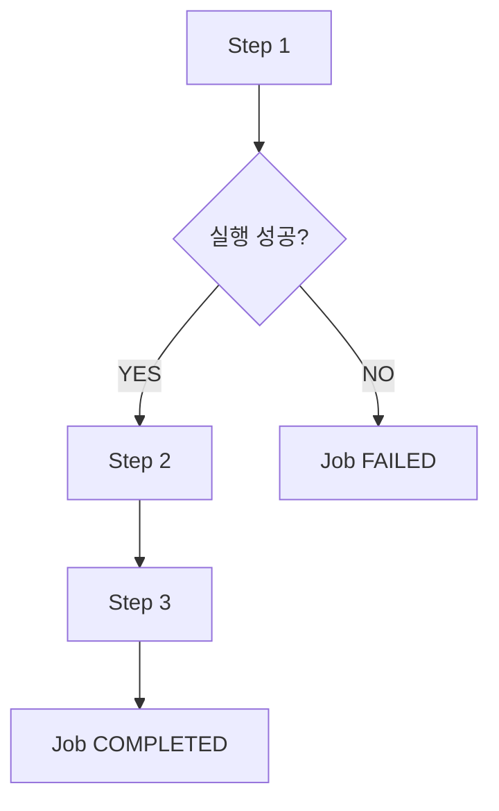

이러한 순차 실행 구조는 대부분의 배치 작업에서 충분히 활용할 수 있다.

하지만 실제 서비스에서는 단순히 Step을 순서대로 실행하는 것만으로 해결하기 어려운 요구사항이 발생한다.

예를 들어 정산 대상 데이터를 검증하는 Step이 있다고 생각해보자.

검증 결과에 따라 다음과 같이 처리해야 할 수 있다.

- 검증에 성공하면 실제 정산 데이터를 생성한다.
- 검증에 실패하면 오류 내역을 기록하고 운영자에게 알린다.
- 오류 처리 작업이 정상적으로 끝났다면 전체 Job을 정상 종료한다.
- 특정 조건에서는 일부 Step을 생략하고 다른 Step을 실행한다.

이러한 경우에는 단순한 순차 실행만으로 전체 흐름을 구성하기 어렵다.

다음과 같은 조건부 실행이 필요하기 때문이다.

```text
SettlementJob
    │
    ▼
ValidationStep
    │
    ├── COMPLETED
    │       │
    │       ▼
    │   SettlementStep
    │
    └── FAILED
            │
            ▼
        ErrorHandlingStep
```

Spring Batch에서는 이러한 요구사항을 해결하기 위해 `FlowJob`을 제공한다.

FlowJob은 Step을 단순히 순서대로 실행하는 것이 아니라 **이전 Step의 실행 결과에 따라 다음 실행 대상을 결정할 수 있는 Job 구현체**다.

다음과 같이 구성할 수 있다.

```java
@Bean
public Job settlementJob(
        JobRepository jobRepository,
        Step validationStep,
        Step settlementStep,
        Step errorHandlingStep
) {

    return new JobBuilder("settlementJob", jobRepository)
            .start(validationStep)
                .on("COMPLETED").to(settlementStep)
            .from(validationStep)
                .on("FAILED").to(errorHandlingStep)
            .end()
            .build();
}
```

이 코드는 다음과 같은 의미를 가진다.

ValidationStep이 COMPLETED로 종료되면 SettlementStep을 실행한다.

반면 FAILED로 종료되면 ErrorHandlingStep을 실행한다.

따라서 동일한 Job 안에서도 실행 결과에 따라 서로 다른 Step을 수행할 수 있다.

여기서 중요한 점이 있다.

**FlowJob에서는 특정 Step이 실패하더라도 전체 Job이 반드시 FAILED 상태로 종료되는 것은 아니다.**

실패한 Step 이후에 다른 Step을 실행하고, 최종 실행 흐름이 정상적으로 종료되도록 구성할 수 있기 때문이다.

이러한 기능이 가능한 이유는 FlowJob이 내부적으로 `SimpleFlow`라는 실행 흐름 관리 객체를 사용하기 때문이다.

이번에는 FlowJob의 기본 개념부터 SimpleJob과의 차이, 주요 API, Builder 구조, Transition, SimpleFlow의 실행 원리, 실행 상태와 실무 활용 방법까지 살펴보자.

---

### 개념

#### FlowJob이란?

`FlowJob`은 실행 결과에 따라 Step 또는 Flow의 실행 경로를 변경할 수 있는 Spring Batch의 Job 구현체다.

SimpleJob이 Step의 순차 실행에 초점을 맞춘다면 FlowJob은 조건에 따른 실행 흐름 제어에 초점을 맞춘다.

FlowJob의 대표적인 특징은 다음과 같다.

| 특징 | 설명 |
|---|---|
| 조건부 실행 | Step의 종료 상태에 따라 다음 실행 대상 결정 |
| 실행 경로 분기 | 성공과 실패에 따라 서로 다른 Step 실행 |
| Step 생략 | 조건에 해당하지 않는 Step은 실행하지 않음 |
| 실패 후 후속 처리 | 실패한 Step 이후 다른 Step 실행 가능 |
| 사용자 정의 상태 | 사용자 정의 ExitStatus를 이용한 분기 지원 |
| Flow 재사용 | 여러 Step을 하나의 Flow로 구성 가능 |
| 상태 전이 | Transition을 통해 실행 경로 결정 |
| 실행 관리 | 내부적으로 SimpleFlow 사용 |

FlowJob을 이해할 때 가장 중요한 개념은 두 가지다.

첫 번째는 `Flow`다.

두 번째는 `Transition`이다.

**Flow는 전체 실행 흐름을 정의한다.**

**Transition은 특정 실행 결과에 따라 다음 상태로 이동하는 규칙을 정의한다.**

이 두 개념이 결합되어 조건부 Job 실행이 가능해진다.

---

### SimpleJob과 FlowJob의 차이

FlowJob을 정확하게 이해하기 위해 SimpleJob과 비교해보자.

#### SimpleJob

SimpleJob은 등록된 Step을 순차적으로 실행한다.

예를 들어 다음과 같이 구성한다.

```java
new JobBuilder("simpleJob", jobRepository)
        .start(step1)
        .next(step2)
        .next(step3)
        .build();
```

실행 흐름은 다음과 같다.

```text
SimpleJob
    │
    ▼
Step 1
    │
    ▼
Step 2
    │
    ▼
Step 3
```

Step 1이 실패하면 Step 2와 Step 3은 실행되지 않는다.

Step 2가 실패하면 Step 3은 실행되지 않는다.

즉, 순차 실행 중 다음 Step으로 넘어가려면 이전 Step이 정상적으로 완료되어야 한다.

#### FlowJob

FlowJob은 특정 Step이 종료된 후 ExitStatus를 확인해 다음 실행 경로를 결정한다.

```java
new JobBuilder("flowJob", jobRepository)
        .start(step1)
            .on("COMPLETED").to(step3)
        .from(step1)
            .on("FAILED").to(step2)
        .end()
        .build();
```

실행 흐름은 다음과 같다.

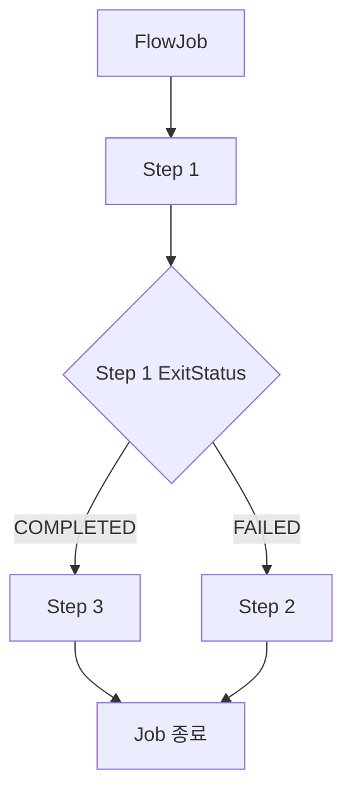

이 구조에서는 Step 1이 성공하면 Step 3을 실행한다.

반면 Step 1이 실패하면 Step 2를 실행한다.

즉, Step 2와 Step 3은 항상 실행되는 것이 아니다.

Step 1의 실행 결과에 따라 둘 중 하나만 실행된다.

#### SimpleJob과 FlowJob 비교

| 구분 | SimpleJob | FlowJob |
|---|---|---|
| 실행 방식 | 순차 실행 | 조건부 실행 |
| 주요 목적 | 정해진 순서대로 처리 | 실행 결과에 따른 흐름 제어 |
| 내부 구조 | Step 목록 | Flow |
| 핵심 실행 객체 | SimpleJob | SimpleFlow |
| 조건부 분기 | 기본적으로 지원하지 않음 | 지원 |
| 실패 후 다른 Step 실행 | 일반적인 순차 구성에서는 불가 | 가능 |
| 특정 Step 생략 | 순차 실행 구조에 따라 결정 | 조건에 따라 명시적으로 제어 가능 |
| Builder | SimpleJobBuilder | FlowJobBuilder |
| 실행 제어 | Step 반복 실행 | State와 Transition 기반 |
| 복잡도 | 상대적으로 단순 | 상대적으로 복잡 |
| 적합한 업무 | 정형화된 배치 | 조건별 처리가 필요한 배치 |

여기서 중요한 점은 FlowJob이 SimpleJob보다 항상 우수한 것은 아니라는 사실이다.

Step을 정해진 순서대로 실행하는 작업이라면 SimpleJob이 더 적합할 수 있다.

반면 실행 결과에 따라 처리 경로가 달라져야 한다면 FlowJob이 적합하다.

따라서 두 구현체는 서로 대체 관계라기보다 서로 다른 실행 요구사항을 해결하기 위한 구현체라고 이해하는 것이 좋다.

---

### 왜 사용하는가?

FlowJob이 필요한 이유는 실제 비즈니스 업무가 항상 하나의 실행 경로로만 구성되지는 않기 때문이다.

예를 들어 결제 대사 배치를 생각해보자.

결제 대사는 내부 결제 내역과 외부 PG사의 결제 내역을 비교해 차이가 있는지 확인하는 작업이다.

대사 결과에 따라 다음 작업이 달라질 수 있다.

```text
PaymentReconciliationJob
    │
    ▼
ReconciliationStep
    │
    ├── 정상
    │       │
    │       ▼
    │   SettlementStep
    │
    └── 불일치
            │
            ▼
        DiscrepancyReportStep
```

대사 결과가 정상이면 정산 작업을 진행한다.

반면 대사 결과에 불일치가 있다면 정산 작업을 진행하지 않고 불일치 보고서를 생성한다.

여기서 중요한 점은 불일치가 반드시 시스템 장애를 의미하지는 않는다는 사실이다.

실제 업무에서는 정상적인 비즈니스 조건에 따라 처리 경로를 변경해야 하는 경우도 많다.

FlowJob은 이러한 조건부 실행을 구성할 수 있다.

또한 다음과 같은 상황에서도 활용할 수 있다.

| 상황 | FlowJob 활용 |
|---|---|
| 데이터 검증 성공 | 다음 처리 Step 실행 |
| 데이터 검증 실패 | 오류 처리 Step 실행 |
| 처리 대상 데이터 없음 | 불필요한 Step 생략 |
| 일부 데이터 처리 실패 | 별도 보정 Step 실행 |
| 외부 시스템 장애 | 장애 기록 및 후속 처리 |
| 특정 상태 감지 | 별도 실행 경로 선택 |

따라서 FlowJob은 복잡한 비즈니스 요구사항을 실행 상태 기반의 흐름으로 표현할 수 있다는 장점이 있다.

---

### Flow란?

Flow는 여러 Step이나 다른 Flow의 실행 순서와 상태 전이 규칙을 표현하는 객체다.

Spring Batch에서는 `Flow`라는 인터페이스를 제공한다.

대표적인 구현체가 `SimpleFlow`다.

Flow는 다음과 같은 실행 흐름을 정의할 수 있다.

```text
Step 1
    │
    ├── COMPLETED → Step 3
    │
    └── FAILED    → Step 2
```

이 구조에서 Flow는 Step을 직접 구현하는 객체가 아니다.

Step 사이의 실행 관계를 관리하는 객체다.

따라서 다음과 같이 역할을 구분할 수 있다.

| 컴포넌트 | 역할 |
|---|---|
| Job | 배치 작업의 전체 실행 단위 |
| Flow | Step과 Flow의 실행 경로 정의 |
| Step | 실제 비즈니스 처리 단위 |
| Tasklet | Step 내부의 비즈니스 로직 |
| Transition | 실행 상태에 따른 이동 규칙 |

실제 비즈니스 로직은 Step에서 수행된다.

Flow는 특정 실행 결과에 따라 어떤 Step을 실행할 것인지 결정한다.

---

### Transition이란?

Transition은 현재 실행 상태에서 다음 실행 상태로 이동하는 규칙이다.

FlowJob에서는 Step의 실행 결과를 확인한 후 해당 결과에 맞는 Transition을 선택한다.

예를 들어 다음과 같은 코드를 살펴보자.

```java
.start(step1)
    .on("COMPLETED").to(step3)
.from(step1)
    .on("FAILED").to(step2)
```

여기에는 두 가지 Transition이 정의되어 있다.

첫 번째 Transition은 다음과 같다.

```text
Step 1
    │
    └── COMPLETED → Step 3
```

두 번째 Transition은 다음과 같다.

```text
Step 1
    │
    └── FAILED → Step 2
```

따라서 Step 1의 실행 결과에 따라 서로 다른 실행 경로가 선택된다.

Transition을 구성하는 핵심 API는 다음과 같다.

| API | 역할 |
|---|---|
| on() | 종료 코드에 대한 매칭 조건 정의 |
| to() | 조건이 일치할 때 이동할 대상 설정 |
| from() | 기존 Step이나 Flow에서 새로운 분기 추가 |
| next() | 정상 완료 시 다음 실행 대상 연결 |
| end() | 지정한 조건에서 정상 종료 또는 Builder 종료 |
| fail() | 지정한 조건에서 Job을 FAILED로 종료 |
| stop() | 지정한 조건에서 Job을 STOPPED로 종료 |
| stopAndRestart() | Job 중단 후 재시작 시 이동할 대상 지정 |

이 API들을 조합하면 다양한 실행 흐름을 구성할 수 있다.

---

### FlowJob의 주요 API

FlowJob을 구성할 때 대표적으로 사용하는 API는 다음과 같다.

```java
@Bean
public Job flowJob(
        JobRepository jobRepository,
        Step step1,
        Step step2,
        Step step3
) {

    return new JobBuilder("flowJob", jobRepository)
            .start(step1)
                .on("COMPLETED").to(step3)
            .from(step1)
                .on("FAILED").to(step2)
            .end()
            .build();
}
```

각 API를 하나씩 살펴보자.

#### start()

`start()`는 Job에서 가장 먼저 실행할 대상을 지정한다.

```java
.start(step1)
```

여기서는 Step 1을 가장 먼저 실행한다.

이때 중요한 점이 있다.

Spring Batch 5.2.4에서 `JobBuilder.start(Step)`을 호출하면 `SimpleJobBuilder`가 반환된다.

따라서 다음 코드만 작성하면 일반적인 SimpleJob을 생성하는 경로가 된다.

```java
new JobBuilder("job", jobRepository)
        .start(step1)
        .next(step2)
        .build();
```

반면 `on()`을 이용해 조건부 분기를 구성하면 FlowJob 생성 경로로 전환된다.

이 차이는 이후 Builder 구조에서 자세히 살펴보자.

#### on()

`on()`은 이전 Step의 실행 결과를 확인하기 위한 패턴을 설정한다.

```java
.on("COMPLETED")
```

이 코드는 이전 Step의 종료 코드가 COMPLETED와 일치하는지 확인한다.

다음과 같이 실패 상태도 지정할 수 있다.

```java
.on("FAILED")
```

여기서 반드시 기억해야 할 내용이 있다.

**on()은 StepExecution의 BatchStatus가 아니라 ExitStatus의 종료 코드를 기준으로 매칭한다.**

예를 들어 다음과 같은 상태가 있다고 생각해보자.

```text
BatchStatus = COMPLETED

ExitStatus = COMPLETED_WITH_WARNINGS
```

이 경우 BatchStatus는 COMPLETED다.

하지만 ExitStatus는 사용자 정의 코드다.

따라서 다음과 같은 조건을 사용할 수 있다.

```java
.on("COMPLETED_WITH_WARNINGS")
```

이처럼 FlowJob에서는 단순한 성공과 실패뿐 아니라 사용자 정의 종료 코드를 기준으로 실행 흐름을 구성할 수 있다.

#### to()

`to()`는 on()의 조건이 일치했을 때 이동할 실행 대상을 지정한다.

```java
.on("COMPLETED").to(step3)
```

이 코드는 이전 Step의 ExitStatus가 COMPLETED이면 Step 3을 실행한다는 의미다.

다음과 같이 사용할 수도 있다.

```java
.on("FAILED").to(step2)
```

이 경우 이전 Step이 FAILED로 종료되면 Step 2를 실행한다.

`to()`에는 Step 외에도 Flow나 JobExecutionDecider를 전달할 수 있다.

#### from()

`from()`은 이전에 등록한 Step이나 Flow를 기준으로 추가적인 실행 경로를 정의한다.

예를 들어 다음과 같은 코드가 있다고 생각해보자.

```java
.start(step1)
    .on("COMPLETED").to(step3)
```

이 코드는 Step 1이 성공했을 때 Step 3으로 이동하는 경로를 정의한다.

그렇다면 Step 1이 실패했을 때의 경로는 어떻게 정의할까?

다음과 같이 `from()`을 사용한다.

```java
.from(step1)
    .on("FAILED").to(step2)
```

이 코드는 이미 등록한 Step 1을 기준으로 새로운 Transition을 추가한다.

전체 코드는 다음과 같다.

```java
.start(step1)
    .on("COMPLETED").to(step3)
.from(step1)
    .on("FAILED").to(step2)
```

여기서 중요한 점이 있다.

**from(step1)은 Step 1을 즉시 다시 실행하는 메서드가 아니다.**

Step 1을 시작점으로 하는 추가적인 실행 경로를 정의하는 메서드다.

따라서 from()은 실행 흐름을 구성하는 시점에 사용된다.

실제 Step의 실행은 Job이 시작된 이후 SimpleFlow의 실행 제어에 따라 이루어진다.

#### next()

`next()`는 정상 완료 시 다음 실행 대상으로 연결하는 API다.

```java
.start(step1)
.next(step2)
.next(step3)
```

순차적인 실행 흐름을 구성할 때 사용할 수 있다.

FlowBuilder에서 next(step)를 사용하면 일반적으로 이전 상태가 COMPLETED일 때 다음 Step으로 이동하도록 구성된다.

반면 조건에 따라 실행 경로를 명시적으로 구분하고 싶다면 on()과 to()를 사용할 수 있다.

```java
.start(step1)
    .on("COMPLETED").to(step3)
.from(step1)
    .on("FAILED").to(step2)
```

따라서 next()와 on().to()는 상황에 따라 적절하게 선택하면 된다.

---

### on()에서 사용할 수 있는 패턴

FlowJob의 on()은 문자열 패턴을 이용해 ExitStatus를 매칭한다.

대표적인 패턴은 다음과 같다.

| 패턴 | 의미 |
|---|---|
| COMPLETED | 정확히 COMPLETED와 일치 |
| FAILED | 정확히 FAILED와 일치 |
| * | 모든 종료 코드 |
| COMPLETED* | COMPLETED로 시작하는 종료 코드 |
| FAILED* | FAILED로 시작하는 종료 코드 |
| ? | 임의의 한 글자 |
| COMPLETED_WITH_WARNINGS | 특정 사용자 정의 종료 코드 |

예를 들어 다음과 같이 작성할 수 있다.

```java
.on("COMPLETED").to(step2)
```

이 조건은 ExitStatus가 COMPLETED인 경우에 매칭된다.

반면 다음과 같이 작성하면

```java
.on("*").to(step3)
```

다른 모든 종료 코드를 처리하는 경로를 정의할 수 있다.

다만 패턴을 사용할 때는 주의해야 한다.

예를 들어 `COMPLETED*`는 COMPLETED뿐 아니라 COMPLETED_WITH_WARNINGS 같은 문자열에도 매칭될 수 있다.

따라서 실제 업무에서 특정 종료 상태만 처리해야 한다면 정확한 패턴을 사용하는 것이 좋다.

#### 여러 조건을 함께 구성하기

다음 코드를 살펴보자.

```java
.start(step1)
    .on("FAILED").to(errorStep)
.from(step1)
    .on("*").to(successStep)
.end()
.build();
```

이 구조에서는 FAILED에 해당하는 구체적인 조건을 먼저 처리하고, 나머지 종료 코드에 대해 기본 경로를 지정할 수 있다.

Spring Batch는 Transition을 구성할 때 패턴의 구체성을 고려해 매칭 순서를 처리한다.

따라서 예상 가능한 ExitStatus와 기본 처리 경로를 함께 정의하는 것이 중요하다.

---

### end(), fail(), stop(), stopAndRestart()

FlowJob에는 실행 흐름을 종료하거나 중단하기 위한 API도 존재한다.

하지만 이 API들은 모두 동일한 의미를 가지는 것은 아니다.

| API | 최종 BatchStatus | 의미 |
|---|---|---|
| end() | COMPLETED | 정상 종료 |
| fail() | FAILED | 실패 종료 |
| stop() | STOPPED | 중단 종료 |
| stopAndRestart() | STOPPED | 중단 후 재시작 위치 지정 |

이러한 종료 API는 TransitionBuilder에서 사용할 수 있다.

#### end(): 정상 종료

```java
.start(step1)
    .on("FAILED").end()
.end()
.build();
```

이 예제에서 첫 번째 end()는 FAILED라는 조건에 대한 종료 Transition을 정의한다.

즉, Step 1이 FAILED로 종료되더라도 Job을 COMPLETED 상태로 종료하도록 설정할 수 있다.

여기서 중요한 점은 **실패한 StepExecution의 상태가 COMPLETED로 변경되는 것은 아니라는 사실**이다.

StepExecution은 FAILED 상태를 유지할 수 있다.

하지만 JobExecution은 COMPLETED 상태로 종료될 수 있다.

또한 COMPLETED로 종료된 JobInstance는 동일한 식별용 JobParameters로 다시 시작할 수 없다.

따라서 실제 장애를 정상 종료로 처리하는 정책은 신중하게 적용해야 한다.

#### fail(): 실패 종료

```java
.start(step1)
    .on("FAILED").fail()
.end()
.build();
```

이 경우 Step 1이 FAILED로 종료되면 Job도 FAILED 상태로 종료된다.

FAILED 상태의 JobInstance는 재시작이 허용되는 구성이라면 동일한 식별용 JobParameters로 재시작할 수 있다.

따라서 장애가 해결된 후 재처리해야 하는 작업에 적합할 수 있다.

#### stop(): 중단 종료

```java
.start(step1)
    .on("COMPLETED").stop()
.end()
.build();
```

이 코드는 해당 조건에서 Job을 STOPPED 상태로 종료하도록 구성한다.

STOPPED는 COMPLETED나 FAILED와 다른 실행 상태다.

작업을 일시적으로 중단하고 이후 재시작하도록 설계할 때 활용할 수 있다.

#### stopAndRestart(): 재시작 위치 지정

```java
.start(step1)
    .on("COMPLETED").stopAndRestart(step2)
.end()
.build();
```

이 코드는 Step 1이 완료되면 Job을 STOPPED 상태로 종료한다.

그리고 같은 JobInstance를 재시작할 때 Step 2부터 진행하도록 구성한다.

다만 실제 재시작 가능 여부는 Job의 재시작 정책과 저장된 실행 상태에 따라 결정된다.

---

### 두 종류의 end()를 구분해야 한다

FlowJob에서 가장 혼동하기 쉬운 API 중 하나가 `end()`다.

다음 코드를 살펴보자.

```java
.start(step1)
    .on("FAILED").end()
.end()
.build();
```

여기에는 두 개의 end()가 존재한다.

하지만 역할은 서로 다르다.

#### 첫 번째 end()

```java
.on("FAILED").end()
```

이 end()는 `TransitionBuilder`의 메서드다.

FAILED 조건에 해당하면 Job을 정상 종료하도록 하는 Transition을 추가한다.

즉, **실행 중에 적용할 종료 규칙을 정의한다.**

#### 두 번째 end()

```java
.end()
.build();
```

여기서 end()는 `FlowBuilder`의 메서드다.

현재까지 정의한 Flow를 구성하고, Job을 생성하는 다음 단계로 진행한다.

Spring Batch 5.2.4의 FlowBuilder에서는 end()가 build()를 호출하도록 구현되어 있다.

JobFlowBuilder에서는 이 과정에서 SimpleFlow를 생성하고 부모 FlowJobBuilder에 전달한다.

따라서 두 메서드의 역할은 다음과 같다.

| 구분 | TransitionBuilder.end() | FlowBuilder.end() |
|---|---|---|
| 호출 위치 | on() 이후 | Job build() 이전 |
| 목적 | 조건별 정상 종료 규칙 추가 | Flow 구성 완료 |
| 실행 시점 | Job 실행 중 Transition으로 적용 | Job 생성 시 |
| 반환 | FlowBuilder | FlowJobBuilder 등 상위 Builder 결과 |
| 핵심 의미 | 어떤 상태에서 종료할 것인가? | 정의한 Flow를 어떻게 완성할 것인가? |

이 차이를 구분해야 FlowJob의 API 체인을 정확하게 이해할 수 있다.

---

### FlowJob의 Builder 구조

FlowJob은 여러 Builder를 통해 생성된다.

대표적으로 다음 클래스가 사용된다.

```text
JobBuilder
    │
    ▼
SimpleJobBuilder
    │
    ▼
JobFlowBuilder
    │
    ▼
FlowBuilder
    │
    ▼
SimpleFlow
    │
    ▼
FlowJobBuilder
    │
    ▼
FlowJob
```

여기서 주의할 점은 이 그림이 클래스의 상속 관계를 표현하는 것이 아니라 **FlowJob을 생성하는 과정에서 사용되는 주요 Builder와 객체의 관계**를 단순화한 것이라는 사실이다.

실제 Builder 구성은 반환 타입과 메서드 호출에 따라 달라진다.

#### SimpleJobBuilder에서 FlowJobBuilder로 전환되는 과정

다음 코드를 살펴보자.

```java
new JobBuilder("flowJob", jobRepository)
        .start(step1)
```

이 시점에는 SimpleJobBuilder가 반환된다.

하지만 이후 on()을 호출하면 흐름 구성이 달라진다.

```java
.on("COMPLETED")
```

Spring Batch 5.2.4의 SimpleJobBuilder에는 다음과 같은 메서드가 존재한다.

```java
public FlowBuilder.TransitionBuilder<FlowJobBuilder> on(
        String pattern
) {
    // ...
}
```

이 메서드에서는 JobFlowBuilder를 준비한다.

핵심 구조는 다음과 같다.

```java
builder = new JobFlowBuilder(
        new FlowJobBuilder(this),
        step
);
```

그리고 다음 메서드를 호출한다.

```java
return builder.on(pattern);
```

따라서 `on()`을 사용하는 순간 조건부 Flow를 구성하는 Builder 경로로 전환된다.

여기서 중요한 사실이 있다.

**start(step1)만 호출했다고 해서 최종 Job 구현체가 반드시 SimpleJob으로 결정되는 것은 아니다.**

그 이후 어떤 API를 호출하느냐에 따라 최종적으로 생성되는 Job 구현체가 달라질 수 있다.

예를 들어 다음과 같다.

```java
new JobBuilder("simpleJob", jobRepository)
        .start(step1)
        .next(step2)
        .build();
```

이 코드는 SimpleJob을 생성한다.

반면 다음 코드는

```java
new JobBuilder("flowJob", jobRepository)
        .start(step1)
            .on("COMPLETED").to(step3)
        .from(step1)
            .on("FAILED").to(step2)
        .end()
        .build();
```

FlowJob을 생성한다.

같은 JobBuilder를 사용하지만 조건부 Flow 구성 여부에 따라 최종 구현체가 달라지는 것이다.

---

### TransitionBuilder의 역할

`on()` 메서드를 호출하면 `TransitionBuilder`가 반환된다.

TransitionBuilder는 조건에 따른 다음 동작을 설정하는 Builder다.

대표적으로 다음 API를 제공한다.

```text
TransitionBuilder
    │
    ├── to()
    │
    ├── end()
    │
    ├── fail()
    │
    ├── stop()
    │
    └── stopAndRestart()
```

예를 들어 다음 코드를 살펴보자.

```java
.on("FAILED").to(step2)
```

처음 on()을 호출하면 TransitionBuilder가 반환된다.

이 Builder는 FAILED라는 매칭 패턴을 가진다.

그리고 to(step2)를 호출하면 FAILED 조건에 해당할 때 Step 2로 이동하는 Transition을 생성한다.

이후 다시 FlowBuilder로 돌아온다.

전체 과정은 다음과 같다.

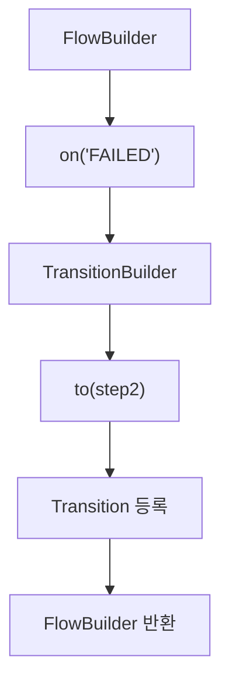

따라서 다음과 같은 API 체인을 구성할 수 있다.

```java
.start(step1)
    .on("COMPLETED").to(step3)
.from(step1)
    .on("FAILED").to(step2)
.end()
.build();
```

TransitionBuilder는 조건별 실행 규칙을 정의한다.

FlowBuilder는 여러 Transition을 조합해 전체 실행 흐름을 정의한다.

이러한 역할 분리로 인해 복잡한 조건부 실행을 선언적으로 구성할 수 있다.

---

### FlowBuilder와 SimpleFlow의 관계

FlowJob에서 실제 실행 흐름을 관리하는 객체는 `SimpleFlow`다.

SimpleFlow는 Flow 인터페이스의 구현체다.

FlowBuilder는 여러 Step과 Transition을 수집한 후 SimpleFlow를 생성한다.

Spring Batch 5.2.4의 FlowBuilder에는 다음과 같은 로직이 존재한다.

```java
protected Flow flow() {

    flow = new SimpleFlow(name);

    // Transition 및 State 구성

    flow.setStateTransitions(transitions);

    return flow;
}
```

위 코드는 핵심 생성 과정만 나타낸 것이다.

실제 구현에서는 시작 상태와 종료 상태, Transition 검증 및 비교 규칙 등도 함께 구성한다.

여기서 중요한 것은 다음 코드다.

```java
flow.setStateTransitions(transitions);
```

FlowBuilder가 수집한 Transition 정보를 SimpleFlow에 전달한다.

따라서 SimpleFlow는 다음 정보를 가지게 된다.

```text
SimpleFlow
    │
    ├── StartState
    │
    ├── StepState 1
    │
    ├── StepState 2
    │
    ├── StepState 3
    │
    └── StateTransition
            │
            ├── COMPLETED → StepState 3
            └── FAILED    → StepState 2
```

이렇게 구성된 SimpleFlow가 FlowJob 내부에 저장된다.

---

### FlowJob의 내부 구조

Spring Batch 5.2.4의 FlowJob은 AbstractJob을 상속한다.

```java
public class FlowJob extends AbstractJob {
}
```

그리고 내부적으로 Flow 타입의 필드를 가진다.

```java
protected Flow flow;
```

이 필드에는 일반적으로 FlowBuilder가 생성한 SimpleFlow 객체가 저장된다.

따라서 다음과 같은 구조가 만들어진다.

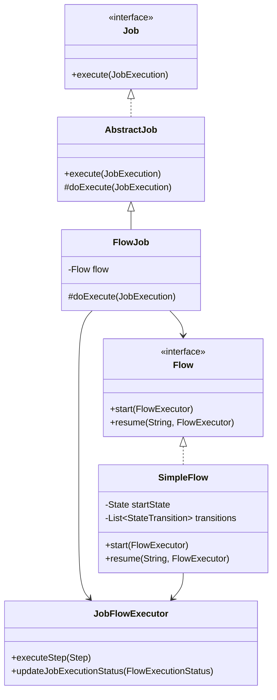

여기서 중요한 점은 FlowJob이 직접 Step의 조건부 실행을 모두 처리하지 않는다는 사실이다.

FlowJob은 SimpleFlow에 실행을 위임한다.

SimpleFlow는 State와 Transition을 이용해 다음 실행 대상을 결정한다.

---

### FlowJob.doExecute() 내부 분석

FlowJob에서 가장 중요한 메서드는 `doExecute()`다.

Spring Batch 5.2.4의 핵심 구현은 다음과 같다.

```java
@Override
protected void doExecute(
        final JobExecution execution
) throws JobExecutionException {

    try {

        JobFlowExecutor executor =
                new JobFlowExecutor(
                        getJobRepository(),
                        new SimpleStepHandler(
                                getJobRepository()
                        ),
                        execution
                );

        executor.updateJobExecutionStatus(
                flow.start(executor).getStatus()
        );

    } catch (FlowExecutionException e) {

        // 예외 처리
    }
}
```

이 코드에서 중요한 부분은 다음과 같다.

첫 번째로 JobFlowExecutor를 생성한다.

```java
JobFlowExecutor executor =
        new JobFlowExecutor(
                getJobRepository(),
                new SimpleStepHandler(
                        getJobRepository()
                ),
                execution
        );
```

JobFlowExecutor는 Flow 내부에서 Step을 실행하기 위한 객체다.

두 번째로 SimpleFlow를 실행한다.

```java
flow.start(executor);
```

이 호출이 실제 Flow의 실행을 시작한다.

세 번째로 실행 결과를 JobExecution에 반영한다.

```java
executor.updateJobExecutionStatus(
        flow.start(executor).getStatus()
);
```

따라서 전체 호출 흐름은 다음과 같다.

```text
FlowJob.doExecute()
    │
    ▼
JobFlowExecutor 생성
    │
    ▼
SimpleFlow.start()
    │
    ▼
SimpleFlow.resume()
    │
    ▼
State 실행
    │
    ▼
Transition 선택
    │
    ▼
다음 State 실행
    │
    ▼
FlowExecutionStatus 결정
    │
    ▼
JobExecution 상태 반영
```

이 구조를 이해하면 FlowJob이 SimpleJob과 어떻게 다른 방식으로 Step을 실행하는지 알 수 있다.

---

### SimpleFlow는 어떻게 다음 Step을 결정할까?

SimpleFlow는 여러 State와 Transition을 이용해 실행 흐름을 관리한다.

Spring Batch 5.2.4의 SimpleFlow에는 다음과 같은 메서드가 존재한다.

```java
public FlowExecution resume(
        String stateName,
        FlowExecutor executor
) throws FlowExecutionException
```

이 메서드는 지정한 State부터 Flow 실행을 진행한다.

핵심 실행 구조는 다음과 같다.

```java
while (isFlowContinued(
        state,
        status,
        stepExecution
)) {

    stateName = state.getName();

    status = state.handle(executor);

    stepExecution = executor.getStepExecution();

    state = nextState(
            stateName,
            status,
            stepExecution
    );
}
```

이 코드는 SimpleFlow의 핵심적인 실행 흐름을 보여준다.

#### 첫 번째: 현재 State 실행

```java
status = state.handle(executor);
```

현재 State를 실행한다.

State가 StepState라면 내부적으로 Step 실행이 이루어진다.

#### 두 번째: 실행 결과 확인

실행 결과는 FlowExecutionStatus로 반환된다.

```java
FlowExecutionStatus status
```

예를 들어 Step이 정상적으로 완료되었다면 COMPLETED에 해당하는 상태가 반환될 수 있다.

반면 실패했다면 FAILED에 해당하는 상태가 반환될 수 있다.

#### 세 번째: 다음 State 결정

```java
state = nextState(
        stateName,
        status,
        stepExecution
);
```

현재 실행 결과를 기준으로 다음 State를 선택한다.

여기서 FlowBuilder가 정의한 Transition이 사용된다.

예를 들어 다음과 같은 조건이 있다고 생각해보자.

```text
Step 1
    │
    ├── COMPLETED → Step 3
    │
    └── FAILED    → Step 2
```

Step 1이 COMPLETED를 반환했다면 다음 State는 Step 3이다.

FAILED를 반환했다면 다음 State는 Step 2다.

이처럼 SimpleFlow는 현재 State의 실행 결과를 이용해 다음 실행 대상을 결정한다.

---

### FlowExecutionStatus란?

FlowJob을 이해할 때 중요한 상태 객체가 하나 더 있다.

바로 `FlowExecutionStatus`다.

Spring Batch에서는 다음 세 가지 상태를 구분해서 이해해야 한다.

- BatchStatus
- ExitStatus
- FlowExecutionStatus

세 상태는 역할이 다르다.

| 구분 | BatchStatus | ExitStatus | FlowExecutionStatus |
|---|---|---|---|
| 대상 | JobExecution, StepExecution | JobExecution, StepExecution | FlowExecution |
| 주요 목적 | 실행 상태 관리 | 종료 코드 표현 | Flow 실행 상태 표현 |
| 대표 값 | COMPLETED, FAILED | COMPLETED, FAILED, 사용자 정의 코드 | COMPLETED, FAILED, STOPPED 등 |
| 사용 위치 | Job 및 Step 실행 관리 | Transition 조건 판단 | Flow의 상태 전이 및 최종 결과 |
| 사용자 정의 코드 | 제한적 | 가능 | 가능 |

여기서 중요한 것은 FlowJob의 조건부 실행 과정이다.

Step이 실행되면 StepExecution에 ExitStatus가 기록된다.

그리고 StepState는 이 종료 코드를 FlowExecutionStatus로 전달한다.

SimpleFlow는 해당 FlowExecutionStatus를 기준으로 다음 Transition을 결정한다.

전체 흐름은 다음과 같다.

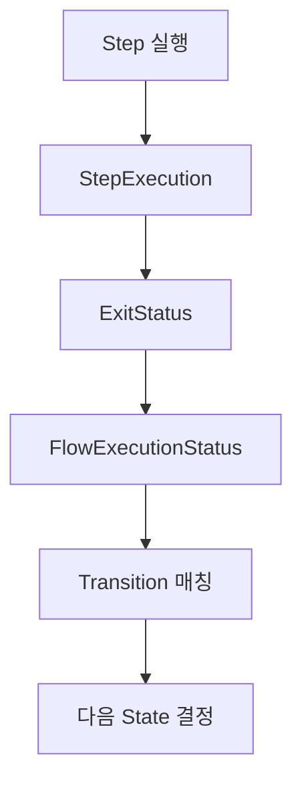

따라서 FlowJob의 조건부 실행을 이해하려면 ExitStatus와 FlowExecutionStatus의 관계를 알아야 한다.

---

### Step이 FAILED인데 Job은 COMPLETED가 될 수 있을까?

FlowJob에서 가장 중요한 특징 중 하나다.

결론부터 말하면 **가능하다.**

하지만 모든 실패 상황에서 자동으로 Job이 COMPLETED가 되는 것은 아니다.

다음과 같은 실행 흐름이 있다고 생각해보자.

```text
FlowJob
    │
    ▼
Step 1
    │
    ├── COMPLETED → Step 3
    │
    └── FAILED    → Step 2
```

Step 1이 실패했다고 가정하자.

```text
Step 1

BatchStatus = FAILED

ExitStatus = FAILED
```

이 경우 SimpleFlow는 FAILED에 해당하는 Transition을 찾는다.

그리고 Step 2를 실행한다.

```text
Step 2

BatchStatus = COMPLETED

ExitStatus = COMPLETED
```

Step 2가 정상적으로 완료되고 Flow도 정상 종료되면 최종 FlowExecutionStatus는 COMPLETED가 될 수 있다.

FlowJob은 이 결과를 JobExecution에 반영한다.

따라서 다음과 같은 상태가 만들어질 수 있다.

```text
Step 1 = FAILED

Step 2 = COMPLETED

Job = COMPLETED
```

여기서 중요한 사실은 **실패한 Step 1의 상태가 변경된 것은 아니라는 점**이다.

Step 1은 여전히 FAILED다.

다만 실패 후 실행하도록 정의한 Step 2가 성공했고 전체 Flow가 정상적으로 종료되었기 때문에 Job이 COMPLETED로 끝난 것이다.

이러한 동작은 FlowJob의 실행 결과가 단순히 모든 Step의 BatchStatus를 종합하는 방식이 아니라 Flow의 최종 실행 상태에 영향을 받기 때문에 가능하다.

#### 어떤 경우에 유용할까?

예를 들어 정산 대상 검증에서 처리할 데이터가 없다는 결과가 발생했다고 생각해보자.

이 상황을 비즈니스상 별도 처리 경로로 정의했다면 후속 처리 후 Job을 정상 종료하도록 설계할 수 있다.

다만 실제 시스템 오류나 데이터 정합성 문제를 무조건 정상 종료로 처리하면 운영상 위험할 수 있다.

따라서 **비즈니스상 정상적인 분기와 실제 시스템 장애는 명확하게 구분하는 것이 중요하다.**

---

### 예제: FlowJob 조건부 실행 구현하기

이제 실제로 FlowJob을 구현해보자.

이번 예제에서는 세 개의 Step을 생성한다.

Step 1은 실행 조건에 따라 성공하거나 실패한다.

Step 2는 Step 1이 실패했을 때 실행한다.

Step 3은 Step 1이 성공했을 때 실행한다.

전체 구조는 다음과 같다.

```text
flowJob
    │
    ▼
step1
    │
    ├── COMPLETED → step3
    │
    └── FAILED    → step2
```

이번 예제에서는 다음 두 가지 상황을 확인한다.

| 실행 상황 | 실행되는 Step | 최종 Job 상태 |
|---|---|---|
| Step 1 성공 | step1 → step3 | COMPLETED |
| Step 1 실패, Step 2 성공 | step1 → step2 | COMPLETED |

핵심은 두 번째 상황이다.

Step 1이 실패했지만 오류 처리 경로인 Step 2가 성공하면 전체 Flow가 정상적으로 종료되는 것을 확인한다.

#### 개발 환경

| 항목 | 기술 |
|---|---|
| Java | Java 17 |
| Spring Boot | 3.4.13 |
| Spring Batch | 5.2.4 |
| Database | H2 |
| Build Tool | Maven |
| Job 구현체 | FlowJob |
| Step 구현체 | TaskletStep |

---

### Maven 의존성 설정

`pom.xml`

```xml
<?xml version="1.0" encoding="UTF-8"?>
<project xmlns="http://maven.apache.org/POM/4.0.0"
         xmlns:xsi="http://www.w3.org/2001/XMLSchema-instance"
         xsi:schemaLocation="
             http://maven.apache.org/POM/4.0.0
             https://maven.apache.org/xsd/maven-4.0.0.xsd">

    <modelVersion>4.0.0</modelVersion>

    <parent>
        <groupId>org.springframework.boot</groupId>
        <artifactId>spring-boot-starter-parent</artifactId>
        <version>3.4.13</version>
        <relativePath/>
    </parent>

    <groupId>com.example</groupId>
    <artifactId>spring-batch-flowjob</artifactId>
    <version>0.0.1-SNAPSHOT</version>

    <properties>
        <java.version>17</java.version>
        <spring-batch.version>5.2.4</spring-batch.version>
    </properties>

    <dependencies>

        <dependency>
            <groupId>org.springframework.boot</groupId>
            <artifactId>spring-boot-starter-batch</artifactId>
        </dependency>

        <dependency>
            <groupId>com.h2database</groupId>
            <artifactId>h2</artifactId>
            <scope>runtime</scope>
        </dependency>

        <dependency>
            <groupId>org.springframework.boot</groupId>
            <artifactId>spring-boot-starter-test</artifactId>
            <scope>test</scope>
        </dependency>

    </dependencies>

    <build>
        <plugins>
            <plugin>
                <groupId>org.springframework.boot</groupId>
                <artifactId>spring-boot-maven-plugin</artifactId>
            </plugin>
        </plugins>
    </build>

</project>
```

Spring Batch와 H2 데이터베이스를 사용한다.

이번 예제에서는 실행 경로와 메타데이터를 확인하는 것이 목적이므로 인메모리 H2를 사용한다.

---

### application.yml 설정

`src/main/resources/application.yml`

```yaml
spring:
  application:
    name: spring-batch-flowjob

  main:
    web-application-type: none

  datasource:
    url: jdbc:h2:mem:flowjobdb;DB_CLOSE_DELAY=-1
    driver-class-name: org.h2.Driver
    username: sa
    password:

  batch:
    job:
      enabled: true
      name: flowJob

    jdbc:
      initialize-schema: always

logging:
  level:
    org.springframework.batch: INFO
    com.example.batch: INFO
```

여기서 중요한 설정은 다음과 같다.

```yaml
spring:
  batch:
    job:
      name: flowJob
```

애플리케이션이 시작될 때 flowJob을 실행하도록 지정한다.

---

### Spring Boot 애플리케이션

`BatchApplication.java`

```java
package com.example.batch;

import org.springframework.boot.SpringApplication;
import org.springframework.boot.autoconfigure.SpringBootApplication;

@SpringBootApplication
public class BatchApplication {

    public static void main(String[] args) {

        SpringApplication.run(
                BatchApplication.class,
                args
        );
    }
}
```

---

### FlowJobConfiguration 전체 코드

`FlowJobConfiguration.java`

```java
package com.example.batch;

import org.slf4j.Logger;
import org.slf4j.LoggerFactory;

import org.springframework.batch.core.Job;
import org.springframework.batch.core.Step;
import org.springframework.batch.core.StepExecution;

import org.springframework.batch.core.job.builder.JobBuilder;
import org.springframework.batch.core.repository.JobRepository;
import org.springframework.batch.core.step.builder.StepBuilder;

import org.springframework.batch.repeat.RepeatStatus;

import org.springframework.beans.factory.annotation.Qualifier;
import org.springframework.context.annotation.Bean;
import org.springframework.context.annotation.Configuration;

import org.springframework.transaction.PlatformTransactionManager;

@Configuration
public class FlowJobConfiguration {

    private static final Logger log =
            LoggerFactory.getLogger(
                    FlowJobConfiguration.class
            );

    // -------------------------------------------
    // FlowJob
    // -------------------------------------------

    @Bean
    public Job flowJob(
            JobRepository jobRepository,
            @Qualifier("step1") Step step1,
            @Qualifier("step2") Step step2,
            @Qualifier("step3") Step step3
    ) {

        Job job = new JobBuilder(
                "flowJob",
                jobRepository
        )
                .start(step1)
                    .on("COMPLETED").to(step3)
                .from(step1)
                    .on("FAILED").to(step2)
                .end()
                .build();

        log.info(
                "생성된 Job 구현체={}",
                job.getClass().getSimpleName()
        );

        return job;
    }

    // -------------------------------------------
    // Step 1: 성공 또는 실패
    // -------------------------------------------

    @Bean
    public Step step1(
            JobRepository jobRepository,
            PlatformTransactionManager transactionManager
    ) {

        return new StepBuilder(
                "step1",
                jobRepository
        )
                .tasklet((contribution, chunkContext) -> {

                    StepExecution execution =
                            contribution.getStepExecution();

                    String scenario =
                            execution
                                    .getJobParameters()
                                    .getString("scenario");

                    log.info(
                            "[Step1] 실행 시작, scenario={}",
                            scenario
                    );

                    if ("failure".equals(scenario)) {

                        log.info(
                                "[Step1] 의도적인 실패 발생"
                        );

                        throw new IllegalStateException(
                                "Step1 실행 실패"
                        );
                    }

                    log.info(
                            "[Step1] 정상 종료"
                    );

                    return RepeatStatus.FINISHED;

                }, transactionManager)
                .build();
    }

    // -------------------------------------------
    // Step 2: 실패 시 후속 처리
    // -------------------------------------------

    @Bean
    public Step step2(
            JobRepository jobRepository,
            PlatformTransactionManager transactionManager
    ) {

        return new StepBuilder(
                "step2",
                jobRepository
        )
                .tasklet((contribution, chunkContext) -> {

                    log.info(
                            "[Step2] 실패 후속 처리 실행"
                    );

                    return RepeatStatus.FINISHED;

                }, transactionManager)
                .build();
    }

    // -------------------------------------------
    // Step 3: 정상 처리
    // -------------------------------------------

    @Bean
    public Step step3(
            JobRepository jobRepository,
            PlatformTransactionManager transactionManager
    ) {

        return new StepBuilder(
                "step3",
                jobRepository
        )
                .tasklet((contribution, chunkContext) -> {

                    log.info(
                            "[Step3] 정상 처리 경로 실행"
                    );

                    return RepeatStatus.FINISHED;

                }, transactionManager)
                .build();
    }
}
```

이 코드에서 가장 중요한 부분은 Job의 구성이다.

```java
.start(step1)
    .on("COMPLETED").to(step3)
.from(step1)
    .on("FAILED").to(step2)
.end()
.build();
```

Step 1이 정상적으로 완료되면 Step 3을 실행한다.

Step 1이 실패하면 Step 2를 실행한다.

따라서 실행 결과에 따라 서로 다른 Step이 선택된다.

---

### 첫 번째 실행: Step 1이 성공하는 경우

먼저 프로젝트를 빌드한다.

```bash
mvn clean package
```

정상적으로 완료되면 다음과 같은 결과를 확인할 수 있다.

```text
BUILD SUCCESS
```

이제 Job을 실행한다.

```bash
java -jar target/spring-batch-flowjob-0.0.1-SNAPSHOT.jar \
  scenario=success
```

이번에는 scenario를 success로 설정했다.

따라서 Step 1에서 예외가 발생하지 않는다.

Step 1은 다음 값을 반환한다.

```java
return RepeatStatus.FINISHED;
```

따라서 Step 1은 정상적으로 완료된다.

```text
Step1

BatchStatus = COMPLETED

ExitStatus = COMPLETED
```

SimpleFlow는 COMPLETED에 해당하는 Transition을 확인한다.

```java
.on("COMPLETED").to(step3)
```

따라서 Step 3이 실행된다.

Step 2는 실행되지 않는다.

#### 예상 실행 로그

```text
생성된 Job 구현체=FlowJob

[Step1] 실행 시작, scenario=success

[Step1] 정상 종료

[Step3] 정상 처리 경로 실행
```

최종 실행 흐름은 다음과 같다.

```text
FlowJob
    │
    ▼
Step 1
    │
    └── COMPLETED
            │
            ▼
          Step 3
            │
            └── COMPLETED
                    │
                    ▼
              Job COMPLETED
```

#### 실행 결과

| 구분 | 실행 여부 | BatchStatus |
|---|---|---|
| Step 1 | 실행 | COMPLETED |
| Step 2 | 미실행 | StepExecution 없음 |
| Step 3 | 실행 | COMPLETED |
| FlowJob | 실행 | COMPLETED |

여기서 중요한 점은 Step 2가 실행되지 않았다는 사실이다.

FlowJob은 등록된 모든 Step을 무조건 실행하지 않는다.

현재 실행 상태에 맞는 Transition으로 연결된 Step만 실행한다.

---

### 두 번째 실행: Step 1이 실패하는 경우

이번에는 Step 1에서 의도적으로 예외를 발생시켜보자.

```bash
java -jar target/spring-batch-flowjob-0.0.1-SNAPSHOT.jar \
  scenario=failure
```

이번에는 scenario를 failure로 설정했다.

따라서 Step 1에서 다음 예외가 발생한다.

```java
throw new IllegalStateException(
        "Step1 실행 실패"
);
```

Step 1은 FAILED 상태로 종료된다.

```text
Step1

BatchStatus = FAILED

ExitStatus = FAILED
```

하지만 Job은 곧바로 종료되지 않는다.

왜냐하면 다음 Transition이 존재하기 때문이다.

```java
.from(step1)
    .on("FAILED").to(step2)
```

SimpleFlow는 FAILED에 해당하는 Transition을 선택한다.

그리고 Step 2를 실행한다.

Step 2는 정상적으로 완료된다.

#### 예상 실행 로그

```text
생성된 Job 구현체=FlowJob

[Step1] 실행 시작, scenario=failure

[Step1] 의도적인 실패 발생

IllegalStateException:
Step1 실행 실패

[Step2] 실패 후속 처리 실행
```

여기서 Step 1에서 예외가 발생했지만 Step 2가 실행된다는 점이 중요하다.

#### 최종 실행 흐름

```text
FlowJob
    │
    ▼
Step 1
    │
    └── FAILED
            │
            ▼
          Step 2
            │
            └── COMPLETED
                    │
                    ▼
              Job COMPLETED
```

#### 실행 결과

| 구분 | 실행 여부 | BatchStatus |
|---|---|---|
| Step 1 | 실행 | FAILED |
| Step 2 | 실행 | COMPLETED |
| Step 3 | 미실행 | StepExecution 없음 |
| FlowJob | 실행 | COMPLETED |

이 결과가 FlowJob의 가장 중요한 특징을 보여준다.

**Step 1이 FAILED 상태로 종료되었지만 전체 Job은 COMPLETED 상태로 종료될 수 있다.**

이는 실패를 무시했기 때문이 아니다.

FAILED에 해당하는 Transition을 정의했고, 해당 실행 경로가 정상적으로 종료되었기 때문이다.

---

### 데이터베이스에서 실행 결과 확인하기

Spring Batch는 Job과 Step의 실행 상태를 메타데이터 테이블에 저장한다.

대표적으로 다음 테이블을 사용한다.

```text
BATCH_JOB_INSTANCE

BATCH_JOB_EXECUTION

BATCH_STEP_EXECUTION
```

이번에는 JobExecution과 StepExecution을 함께 조회해보자.

#### JobExecution 조회

```sql
SELECT
    ji.JOB_NAME,
    je.JOB_EXECUTION_ID,
    je.STATUS,
    je.EXIT_CODE
FROM BATCH_JOB_INSTANCE ji
JOIN BATCH_JOB_EXECUTION je
    ON ji.JOB_INSTANCE_ID = je.JOB_INSTANCE_ID
WHERE ji.JOB_NAME = 'flowJob'
ORDER BY je.JOB_EXECUTION_ID;
```

Step 1이 성공하고 Step 3이 실행된 경우 Job은 COMPLETED다.

Step 1이 실패하고 Step 2가 정상적으로 완료된 경우에도 Job은 COMPLETED가 될 수 있다.

따라서 다음과 같은 결과가 만들어질 수 있다.

| 실행 시나리오 | Job STATUS | Job EXIT_CODE |
|---|---|---|
| Step 1 성공 | COMPLETED | COMPLETED |
| Step 1 실패 후 Step 2 성공 | COMPLETED | COMPLETED |

두 번째 실행에서는 Step 1이 FAILED였음에도 JobExecution의 상태가 COMPLETED인 것을 확인할 수 있다.

#### StepExecution 조회

```sql
SELECT
    je.JOB_EXECUTION_ID,
    se.STEP_EXECUTION_ID,
    se.STEP_NAME,
    se.STATUS,
    se.EXIT_CODE
FROM BATCH_JOB_EXECUTION je
JOIN BATCH_STEP_EXECUTION se
    ON je.JOB_EXECUTION_ID = se.JOB_EXECUTION_ID
ORDER BY
    je.JOB_EXECUTION_ID,
    se.STEP_EXECUTION_ID;
```

Step 1이 성공한 경우에는 다음과 같은 결과가 나타난다.

| STEP_NAME | STATUS |
|---|---|
| step1 | COMPLETED |
| step3 | COMPLETED |

반면 Step 1이 실패한 경우에는 다음과 같은 결과가 나타난다.

| STEP_NAME | STATUS |
|---|---|
| step1 | FAILED |
| step2 | COMPLETED |

여기서 중요한 것은 조건에 해당하지 않는 Step은 실행되지 않는다는 사실이다.

따라서 실행하지 않은 Step에 대한 StepExecution은 생성되지 않는다.

---

### JUnit으로 FlowJob의 조건부 실행 검증하기

이번에는 실제 JobLauncher를 이용해 FlowJob의 실행 결과를 검증해보자.

검증할 내용은 다음과 같다.

첫 번째는 FlowJob이 실제로 생성되는지 확인한다.

두 번째는 Step 1이 성공했을 때 Step 3이 실행되는지 확인한다.

세 번째는 Step 1이 실패했을 때 Step 2가 실행되는지 확인한다.

네 번째는 Step 1이 실패했더라도 Job이 COMPLETED로 종료될 수 있는지 확인한다.

`FlowJobTest.java`

```java
package com.example.batch;

import java.util.Set;
import java.util.UUID;
import java.util.stream.Collectors;

import org.junit.jupiter.api.Test;

import org.springframework.batch.core.BatchStatus;
import org.springframework.batch.core.Job;
import org.springframework.batch.core.JobExecution;
import org.springframework.batch.core.JobParameters;
import org.springframework.batch.core.JobParametersBuilder;
import org.springframework.batch.core.StepExecution;

import org.springframework.batch.core.job.flow.FlowJob;
import org.springframework.batch.core.launch.JobLauncher;

import org.springframework.beans.factory.annotation.Autowired;
import org.springframework.beans.factory.annotation.Qualifier;

import org.springframework.boot.test.context.SpringBootTest;

import static org.junit.jupiter.api.Assertions.*;

@SpringBootTest(properties = {
        "spring.batch.job.enabled=false"
})
class FlowJobTest {

    @Autowired
    private JobLauncher jobLauncher;

    @Autowired
    @Qualifier("flowJob")
    private Job flowJob;

    private JobParameters parameters(
            String scenario
    ) {

        return new JobParametersBuilder()
                .addString(
                        "scenario",
                        scenario
                )
                .addString(
                        "requestId",
                        UUID.randomUUID().toString()
                )
                .toJobParameters();
    }

    private Set<String> stepNames(
            JobExecution execution
    ) {

        return execution
                .getStepExecutions()
                .stream()
                .map(StepExecution::getStepName)
                .collect(Collectors.toSet());
    }

    private StepExecution findStep(
            JobExecution execution,
            String name
    ) {

        return execution
                .getStepExecutions()
                .stream()
                .filter(
                        step ->
                                step.getStepName().equals(name)
                )
                .findFirst()
                .orElseThrow();
    }

    // -------------------------------------------
    // FlowJob 생성 확인
    // -------------------------------------------

    @Test
    void FlowJob_구현체가_생성된다() {

        assertInstanceOf(
                FlowJob.class,
                flowJob
        );
    }

    // -------------------------------------------
    // Step 1 성공
    // -------------------------------------------

    @Test
    void Step1이_성공하면_Step3이_실행된다()
            throws Exception {

        JobExecution execution =
                jobLauncher.run(
                        flowJob,
                        parameters("success")
                );

        assertEquals(
                BatchStatus.COMPLETED,
                execution.getStatus()
        );

        assertEquals(
                Set.of("step1", "step3"),
                stepNames(execution)
        );

        assertEquals(
                BatchStatus.COMPLETED,
                findStep(
                        execution,
                        "step1"
                ).getStatus()
        );

        assertEquals(
                BatchStatus.COMPLETED,
                findStep(
                        execution,
                        "step3"
                ).getStatus()
        );
    }

    // -------------------------------------------
    // Step 1 실패
    // -------------------------------------------

    @Test
    void Step1이_실패하면_Step2가_실행된다()
            throws Exception {

        JobExecution execution =
                jobLauncher.run(
                        flowJob,
                        parameters("failure")
                );

        assertEquals(
                BatchStatus.COMPLETED,
                execution.getStatus()
        );

        assertEquals(
                Set.of("step1", "step2"),
                stepNames(execution)
        );

        assertEquals(
                BatchStatus.FAILED,
                findStep(
                        execution,
                        "step1"
                ).getStatus()
        );

        assertEquals(
                BatchStatus.COMPLETED,
                findStep(
                        execution,
                        "step2"
                ).getStatus()
        );
    }
}
```

이 테스트에서 가장 중요한 코드는 다음과 같다.

```java
assertEquals(
        BatchStatus.COMPLETED,
        execution.getStatus()
);
```

Step 1이 실패한 시나리오에서도 JobExecution이 COMPLETED인지 확인한다.

그리고 다음 코드로 Step 1이 실제로 실패했는지 확인한다.

```java
assertEquals(
        BatchStatus.FAILED,
        findStep(
                execution,
                "step1"
        ).getStatus()
);
```

마지막으로 Step 2가 실행되어 정상 완료되었는지 확인한다.

```java
assertEquals(
        BatchStatus.COMPLETED,
        findStep(
                execution,
                "step2"
        ).getStatus()
);
```

이를 통해 다음 사실을 검증할 수 있다.

**FlowJob의 최종 상태는 개별 Step의 실패 여부만으로 결정되지 않고, 정의된 Flow의 최종 실행 결과에 따라 결정될 수 있다.**

#### 테스트 실행

```bash
mvn test
```

테스트가 모두 성공하면 다음과 유사한 결과를 확인할 수 있다.

```text
Tests run: 3

Failures: 0

Errors: 0

BUILD SUCCESS
```

---

### FlowJob의 내부 실행 아키텍처

이제 전체 실행 과정을 내부 클래스 관점에서 정리해보자.

FlowJob은 JobLauncher를 통해 실행된다.

JobLauncher는 JobExecution을 생성하고 FlowJob을 실행한다.

FlowJob은 JobFlowExecutor를 생성한다.

그리고 자신에게 등록된 SimpleFlow를 실행한다.

SimpleFlow는 State를 실행하고 Transition을 이용해 다음 State를 결정한다.

전체 구조는 다음과 같다.

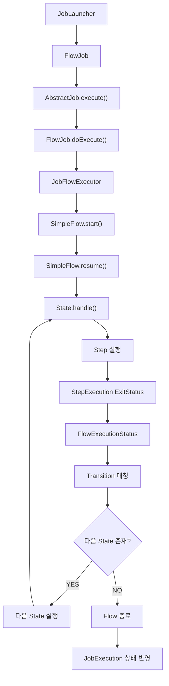

여기서 핵심적인 역할을 담당하는 클래스는 SimpleFlow다.

SimpleFlow는 State와 Transition을 통해 전체 실행 경로를 관리한다.

따라서 FlowJob을 정확하게 이해하려면 단순히 API를 사용하는 방법뿐 아니라 SimpleFlow가 어떤 방식으로 다음 State를 결정하는지 이해해야 한다.

---

### FlowJob과 SimpleFlow의 역할 차이

FlowJob과 SimpleFlow는 서로 다른 역할을 담당한다.

| 구분 | FlowJob | SimpleFlow |
|---|---|---|
| 역할 | Job 실행 관리 | Flow 실행 경로 관리 |
| 상위 타입 | AbstractJob | Flow |
| 주요 메서드 | doExecute() | start(), resume() |
| 주요 객체 | JobExecution | State, StateTransition |
| Step 실행 | JobFlowExecutor에 위임 | State를 통해 실행 |
| 실행 결과 | JobExecution 상태 반영 | FlowExecutionStatus 반환 |
| 주요 책임 | Job 전체 실행 | 조건부 상태 전이 |

FlowJob은 전체 Job의 실행 단위를 제공한다.

반면 SimpleFlow는 어떤 Step을 어떤 순서로 실행할지 결정한다.

이러한 구조를 통해 Spring Batch는 Job 실행 관리와 Flow 실행 제어를 분리한다.

---

### FlowJob을 실무에서 활용하는 12가지 방법

FlowJob은 조건부 실행을 구현할 수 있기 때문에 다양한 업무에 활용할 수 있다.

하지만 실행 흐름이 복잡해질수록 상태 관리와 장애 복구 정책도 함께 설계해야 한다.

#### 1. 정산 데이터 검증 결과에 따른 분기

정산 대상 데이터를 검증한 후 정상 데이터와 오류 데이터를 서로 다른 경로로 처리할 수 있다.

정상 데이터라면 정산 계산 Step을 실행한다.

반면 검증 실패라면 오류 보고서 생성 Step을 실행한다.

이러한 방식은 정산 데이터의 정합성을 관리하는 데 활용할 수 있다.

#### 2. 결제 대사 결과에 따른 처리 경로 변경

외부 PG사의 결제 내역과 내부 결제 내역을 비교한 후 결과에 따라 다음 작업을 구분할 수 있다.

대사가 일치하면 정산 작업을 진행한다.

반면 불일치가 발생하면 차액 분석이나 보정 처리 Step을 실행한다.

이 경우 단순한 시스템 예외와 비즈니스상 대사 불일치를 구분하는 것이 중요하다.

#### 3. 처리 대상이 없는 경우 불필요한 Step 생략

대량 데이터 배치에서 처리 대상이 없는 경우가 있다.

이때 무조건 Reader와 Writer를 실행하는 것보다 사전 검증 결과에 따라 작업을 생략할 수 있다.

예를 들어 사전 Step에서 처리 대상이 없음을 사용자 정의 ExitStatus로 반환하도록 구성할 수 있다.

#### 4. 사용자 정의 ExitStatus를 활용한 업무 상태 표현

단순히 COMPLETED와 FAILED만으로 업무 결과를 표현하기 어려울 수 있다.

예를 들어 다음과 같은 상태를 정의할 수 있다.

```text
NO_DATA

PARTIAL_SUCCESS

VALIDATION_FAILED

EXTERNAL_SYSTEM_UNAVAILABLE
```

이러한 상태를 ExitStatus에 반영하면 FlowJob에서 업무 조건에 맞는 실행 경로를 구성할 수 있다.

#### 5. 복구 가능한 오류와 복구 불가능한 오류 구분

모든 오류를 동일하게 처리할 필요는 없다.

일시적인 오류라면 재시도 또는 복구 Step을 실행할 수 있다.

반면 데이터 정합성을 훼손할 수 있는 오류라면 Job을 FAILED로 종료해야 할 수 있다.

따라서 오류의 성격에 따라 서로 다른 Transition을 정의하는 것이 좋다.

#### 6. 오류 처리 Step을 통한 운영 알림

특정 Step이 실패한 경우 운영 알림 Step을 실행할 수 있다.

예를 들어 Slack이나 이메일로 실패 내용을 전달할 수 있다.

다만 알림 Step이 성공했다고 해서 실제 배치 업무까지 성공한 것은 아니다.

따라서 알림 처리 완료와 업무 처리 완료를 구분해야 한다.

#### 7. 외부 시스템 상태에 따른 분기

외부 API나 데이터베이스의 상태를 확인한 후 실행 경로를 변경할 수 있다.

외부 시스템이 정상이라면 실제 업무를 실행한다.

반면 장애가 발생했다면 보류 처리 또는 후속 알림 Step을 실행할 수 있다.

#### 8. FlowJob의 COMPLETED 정책을 신중하게 적용

FlowJob에서는 실패한 Step 이후 후속 처리가 성공하면 Job이 COMPLETED로 종료될 수 있다.

하지만 COMPLETED로 종료된 JobInstance는 동일한 식별용 JobParameters로 재시작하기 어렵다.

따라서 실제 장애를 COMPLETED로 처리하면 복구가 어려워질 수 있다.

비즈니스적으로 정상 종료가 맞는 상황에서만 이러한 정책을 사용하는 것이 좋다.

#### 9. Flow 복잡도를 관리한다

FlowJob은 다양한 조건부 실행을 구성할 수 있다.

하지만 분기 조건이 많아지면 전체 실행 흐름을 파악하기 어려워질 수 있다.

따라서 분기 수가 증가한다면 Flow를 분리하거나 JobExecutionDecider를 활용하는 방안을 고려할 수 있다.

#### 10. 실행되지 않은 Step을 정상적인 미실행 상태로 구분한다

FlowJob에서는 조건에 따라 특정 Step이 아예 실행되지 않을 수 있다.

따라서 운영 모니터링에서는 실행되지 않은 Step과 실패한 Step을 구분해야 한다.

StepExecution이 존재하지 않는 경우와 FAILED 상태의 StepExecution이 존재하는 경우는 서로 다른 의미다.

#### 11. 조건부 분기와 트랜잭션을 구분한다

FlowJob은 Step 사이의 실행 흐름을 제어한다.

하지만 FlowJob 자체가 모든 Step의 비즈니스 작업을 하나의 트랜잭션으로 묶는 것은 아니다.

따라서 Step 1에서 이미 커밋한 데이터는 이후 Step에서 실패하더라도 자동으로 롤백되지 않을 수 있다.

이러한 특성은 정산 및 결제 시스템에서 특히 중요하다.

#### 12. 실행 흐름을 테스트 코드로 검증한다

FlowJob에서는 정상 시나리오뿐 아니라 실패 시나리오도 검증해야 한다.

특히 다음 사항을 확인하는 것이 좋다.

- 특정 ExitStatus에서 올바른 Step이 실행되는지
- 실행 대상이 아닌 Step이 실제로 생략되는지
- 오류 처리 Step이 실패했을 때 Job 상태가 어떻게 되는지
- 최종 JobExecution의 BatchStatus가 예상과 일치하는지
- Job 재시작 시 이전에 완료된 Step이 어떻게 처리되는지

조건부 실행 경로를 테스트 코드로 검증하면 운영 환경에서 예상하지 못한 흐름이 발생하는 문제를 줄일 수 있다.

---

### FlowJob에서 자주 혼동하는 부분

| 혼동하기 쉬운 내용 | 정확한 이해 |
|---|---|
| FlowJob은 SimpleJob과 동일한 순차 실행만 제공한다 | 실행 상태에 따른 조건부 분기를 지원한다 |
| FlowJob은 모든 Step을 실행한다 | 조건에 해당하는 Step만 실행한다 |
| Step이 FAILED면 Job도 반드시 FAILED다 | 실패 후 처리 경로에 따라 COMPLETED가 될 수 있다 |
| on()은 BatchStatus를 확인한다 | ExitStatus의 종료 코드를 기준으로 매칭한다 |
| from(step1)은 Step 1을 다시 실행한다 | Step 1을 기준으로 새로운 분기 규칙을 정의한다 |
| to()는 무조건 다음 Step을 실행한다 | on()의 조건이 일치할 때 해당 대상으로 이동한다 |
| end()는 모두 같은 역할이다 | Transition 종료와 Flow Builder 종료를 구분해야 한다 |
| FlowJob은 Step의 비즈니스 로직을 직접 처리한다 | 실제 비즈니스 로직은 Step에서 수행한다 |
| FlowJob이 모든 조건부 실행을 직접 관리한다 | 내부 SimpleFlow가 상태 전이를 관리한다 |
| SimpleFlow는 단순한 Step 목록이다 | State와 Transition을 이용해 실행 경로를 관리한다 |
| FlowJob이 COMPLETED면 모든 Step이 성공했다 | 일부 Step이 FAILED여도 Job은 COMPLETED일 수 있다 |
| FlowJob은 모든 Step을 하나의 트랜잭션으로 처리한다 | 각 Step의 트랜잭션 경계는 별도로 관리된다 |

---

### 전체 아키텍처 정리

지금까지 살펴본 내용을 하나의 구조로 정리해보자.

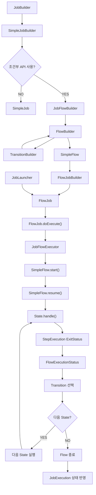

이 구조에서 가장 중요한 것은 다음과 같다.

첫 번째로 JobBuilder는 설정한 API에 따라 서로 다른 Job 생성 경로로 진행할 수 있다.

두 번째로 조건부 Flow를 구성하면 JobFlowBuilder와 FlowBuilder를 통해 SimpleFlow가 생성된다.

세 번째로 FlowJob은 SimpleFlow를 내부에 포함한다.

네 번째로 FlowJob이 실행되면 SimpleFlow가 State와 Transition을 이용해 전체 실행 흐름을 관리한다.

다섯 번째로 Flow의 최종 실행 상태가 JobExecution의 상태에 반영된다.

이러한 구조로 인해 FlowJob은 SimpleJob보다 복잡한 조건부 실행을 처리할 수 있다.

---

### 정리

Spring Batch의 `FlowJob`은 특정 실행 상태에 따라 Step의 실행 경로를 변경할 수 있는 Job 구현체다.

SimpleJob이 Step을 순차적으로 실행한다면 FlowJob은 조건부 실행을 지원한다.

예를 들어 다음과 같은 구조를 구성할 수 있다.

```text
Step 1
    │
    ├── COMPLETED → Step 3
    │
    └── FAILED    → Step 2
```

이러한 흐름을 구성하기 위해 Spring Batch는 다양한 API를 제공한다.

대표적으로 `on()`, `to()`, `from()`, `next()`, `end()` 등이 있다.

on()은 이전 Step의 ExitStatus를 확인하기 위한 패턴을 설정한다.

to()는 해당 조건에 일치할 때 이동할 실행 대상을 지정한다.

from()은 기존 Step이나 Flow를 기준으로 새로운 분기 경로를 정의한다.

next()는 정상 완료 시 다음 실행 대상을 연결한다.

end()는 호출 위치에 따라 조건별 정상 종료 Transition을 정의하거나 Flow 구성을 완료하는 역할을 수행한다.

FlowJob은 다음과 같이 생성할 수 있다.

```java
new JobBuilder("flowJob", jobRepository)
        .start(step1)
            .on("COMPLETED").to(step3)
        .from(step1)
            .on("FAILED").to(step2)
        .end()
        .build();
```

이 코드는 Step 1이 성공했을 때 Step 3을 실행한다.

반면 Step 1이 실패했을 때 Step 2를 실행한다.

따라서 실행 결과에 따라 서로 다른 Step이 실행된다.

또한 Step 1이 FAILED로 종료되었더라도 Step 2가 정상적으로 완료되고 Flow가 정상 종료되면 전체 Job은 COMPLETED 상태로 종료될 수 있다.

이것이 SimpleJob과 FlowJob의 중요한 차이점이다.

FlowJob은 내부적으로 SimpleFlow 객체를 가진다.

FlowJob이 실행되면 JobFlowExecutor를 생성하고 SimpleFlow의 start()를 호출한다.

SimpleFlow는 State를 실행한다.

그리고 반환된 FlowExecutionStatus에 따라 다음 Transition을 선택한다.

Transition이 지정한 다음 State가 존재하면 해당 State를 실행한다.

더 이상 실행할 State가 없다면 Flow를 종료한다.

마지막으로 Flow의 실행 결과를 JobExecution에 반영한다.

전체 실행 흐름은 다음과 같다.

```text
JobLauncher
    │
    ▼
FlowJob
    │
    ▼
JobFlowExecutor
    │
    ▼
SimpleFlow
    │
    ▼
State 실행
    │
    ▼
ExitStatus
    │
    ▼
FlowExecutionStatus
    │
    ▼
Transition
    │
    ├── 다음 State 존재
    │       │
    │       └── 다음 State 실행
    │
    └── 다음 State 없음
            │
            └── Flow 종료
                    │
                    ▼
              JobExecution 상태 반영
```

FlowJob을 제대로 이해하려면 단순히 API의 사용 방법만 알아서는 부족하다.

**ExitStatus를 기반으로 Transition이 선택되고, SimpleFlow가 다음 State를 실행하며, 최종 FlowExecutionStatus가 Job의 종료 상태에 반영되는 과정**을 이해해야 한다.

이러한 구조를 이해하면 정산 검증, 결제 대사, 오류 처리, 데이터 보정처럼 다양한 실행 조건을 가진 배치 시스템을 설계할 수 있다.

다만 FlowJob이 유연한 조건부 실행을 지원한다고 해서 모든 업무에 사용해야 하는 것은 아니다.

실행 순서가 고정되어 있다면 SimpleJob으로도 충분하다.

반면 업무 결과에 따라 실행 경로를 구분해야 하거나, 실패 이후 별도의 처리가 필요한 경우에는 FlowJob이 적절한 선택이 될 수 있다.

#### 한 줄 요약

> Spring Batch의 `FlowJob`은 `SimpleFlow`를 이용해 Step의 `ExitStatus`에 따라 실행 경로를 변경하는 Job 구현체다. `on()`과 `to()`로 조건부 Transition을 정의하고, `from()`으로 추가적인 실행 경로를 구성할 수 있다. FlowJob은 내부적으로 `JobFlowExecutor`와 `SimpleFlow`를 이용해 State를 실행하며, 최종 `FlowExecutionStatus`를 JobExecution에 반영한다. 따라서 특정 Step이 FAILED로 종료되더라도 후속 처리 흐름이 정상적으로 완료되면 전체 Job은 COMPLETED 상태가 될 수 있다.


## FlowJob - start() / next()


### Spring Batch FlowJob start()와 next() API 이해: Flow 구성, 순차 실행 및 내부 아키텍처

Spring Batch에서는 Job을 구성할 때 `start()`와 `next()` API를 사용한다.

이 두 API는 Job 또는 Flow의 실행 순서를 정의하는 가장 기본적인 메서드다.

일반적인 Job에서는 다음과 같이 사용할 수 있다.

```java
new JobBuilder("batchJob", jobRepository)
        .start(step1)
        .next(step2)
        .next(step3)
        .build();
```

이 코드는 세 개의 Step을 순차적으로 실행하는 Job을 생성한다.

실행 순서는 다음과 같다.

```text
Step 1
   │
   ▼
Step 2
   │
   ▼
Step 3
   │
   ▼
Job 종료
```

이러한 구조에서는 Step 1이 정상적으로 완료되면 Step 2를 실행하고, Step 2가 정상적으로 완료되면 Step 3을 실행한다.

하지만 실제 배치 시스템에서는 여러 Step을 기능별로 그룹화해야 하는 경우가 있다.

예를 들어 정산 배치를 생각해보자.

정산 배치는 크게 다음과 같은 작업으로 구성될 수 있다.

- 정산 대상 데이터 준비
- 정산 금액 계산
- 정산 데이터 검증
- 정산 결과 생성
- 정산 결과 전송
- 정산 작업 마무리

이러한 작업을 하나의 Job 안에 모두 나열할 수도 있다.

```text
SettlementJob
    │
    ├── Step 1. 데이터 조회
    ├── Step 2. 데이터 정제
    ├── Step 3. 정산 검증
    ├── Step 4. 정산 금액 계산
    ├── Step 5. 정산 결과 저장
    └── Step 6. 정산 완료 처리
```

하지만 Step의 개수가 많아지고 특정 업무 단위가 복잡해지면 전체 실행 구조를 이해하기 어려워질 수 있다.

이때 여러 Step을 하나의 Flow로 묶어 구성할 수 있다.

예를 들어 데이터 준비 작업을 Flow A로 정의하고 정산 처리 작업을 Flow B로 정의하는 것이다.

```text
SettlementJob
    │
    ├── Flow A
    │     ├── Step 1. 데이터 조회
    │     └── Step 2. 데이터 정제
    │
    ├── Step 3. 정산 검증
    │
    ├── Flow B
    │     ├── Step 4. 정산 계산
    │     └── Step 5. 정산 결과 저장
    │
    └── Step 6. 완료 처리
```

이처럼 Flow를 이용하면 여러 Step을 논리적인 업무 단위로 그룹화할 수 있다.

Spring Batch에서는 이러한 구조를 다음과 같이 구성한다.

```java
new JobBuilder("settlementJob", jobRepository)
        .start(flowA)
        .next(step3)
        .next(flowB)
        .next(step6)
        .end()
        .build();
```

여기서 중요한 것은 `start()`와 `next()`에 Step뿐 아니라 Flow도 전달할 수 있다는 사실이다.

또한 Flow를 사용한다고 해서 반드시 복잡한 조건부 분기를 구성해야 하는 것은 아니다.

**FlowJob도 `start()`와 `next()`만 사용하여 순차적인 실행 구조로 구성할 수 있다.**

이번에는 `start()`와 `next()` API의 개념부터 Builder 반환 타입, Flow 생성 방법, 실행 구조, 실패 처리와 재시작까지 자세히 살펴보자.

---

### 개념

#### start() API란?

`start()`는 Job 또는 Flow에서 가장 먼저 실행할 대상을 지정하는 API다.

Spring Batch 5.2.4의 JobBuilder에서는 대표적으로 다음과 같은 메서드를 제공한다.

```java
public SimpleJobBuilder start(Step step)
```

```java
public JobFlowBuilder start(Flow flow)
```

두 메서드는 이름이 같지만 매개변수 타입과 반환 타입이 다르다.

| API | 매개변수 | 반환 타입 | 역할 |
|---|---|---|---|
| start(Step) | Step | SimpleJobBuilder | Step을 시작점으로 설정 |
| start(Flow) | Flow | JobFlowBuilder | Flow를 시작점으로 설정 |
| start(JobExecutionDecider) | JobExecutionDecider | JobFlowBuilder | Decider를 시작점으로 설정 |

이번에는 Step과 Flow를 중심으로 살펴본다.

#### start(Step)

```java
.start(step1)
```

Step을 전달하면 SimpleJobBuilder가 반환된다.

예를 들어 다음과 같다.

```java
@Bean
public Job simpleJob(
        JobRepository jobRepository,
        Step step1,
        Step step2
) {

    return new JobBuilder("simpleJob", jobRepository)
            .start(step1)
            .next(step2)
            .build();
}
```

이 코드에서는 SimpleJob이 생성된다.

```text
JobBuilder
    │
    ▼
start(Step)
    │
    ▼
SimpleJobBuilder
    │
    ▼
next(Step)
    │
    ▼
build()
    │
    ▼
SimpleJob
```

여기서 주의할 점이 있다.

`start(Step)`을 호출했다고 해서 반드시 SimpleJob만 생성할 수 있는 것은 아니다.

SimpleJobBuilder에서도 `on()`을 호출해 조건부 흐름 구성으로 전환할 수 있기 때문이다.

예를 들어 다음과 같다.

```java
new JobBuilder("batchJob", jobRepository)
        .start(step1)
            .on("COMPLETED").to(step2)
        .from(step1)
            .on("FAILED").to(step3)
        .end()
        .build();
```

이 경우 최종적으로 FlowJob이 생성된다.

즉, `start(Step)`은 SimpleJobBuilder를 반환하지만 이후 어떤 API를 사용하는지에 따라 최종 Job 구현체가 달라질 수 있다.

#### start(Flow)

```java
.start(flowA)
```

Flow를 전달하면 JobFlowBuilder가 반환된다.

JobFlowBuilder는 FlowBuilder를 상속한 클래스다.

따라서 이후 `next()`, `from()`, `on()` 등을 사용해 실행 흐름을 구성할 수 있다.

예를 들어 다음과 같다.

```java
new JobBuilder("flowJob", jobRepository)
        .start(flowA)
        .next(step3)
        .end()
        .build();
```

이 경우 FlowJob이 생성된다.

```text
JobBuilder
    │
    ▼
start(Flow)
    │
    ▼
JobFlowBuilder
    │
    ▼
next(Step)
    │
    ▼
end()
    │
    ▼
FlowJobBuilder
    │
    ▼
build()
    │
    ▼
FlowJob
```

따라서 시작점으로 Flow를 지정하면 FlowJob 생성 구조로 진행한다.

---

### next() API란?

`next()`는 이전 Step 또는 Flow가 정상적으로 완료되었을 때 다음에 실행할 대상을 설정하는 API다.

FlowBuilder에서는 다음과 같은 메서드를 제공한다.

```java
public FlowBuilder<Q> next(Step step)
```

```java
public FlowBuilder<Q> next(Flow flow)
```

```java
public UnterminatedFlowBuilder<Q> next(
        JobExecutionDecider decider
)
```

각 메서드는 다음과 같은 역할을 수행한다.

| API | 역할 |
|---|---|
| next(Step) | 정상 완료 후 다음 Step 실행 |
| next(Flow) | 정상 완료 후 다음 Flow 실행 |
| next(JobExecutionDecider) | 정상 완료 후 Decider 실행 |

여기서 중요한 사실은 `next()`가 단순히 다음 객체를 등록하는 메서드만은 아니라는 것이다.

**FlowBuilder의 `next()`는 이전 실행 대상이 정상적으로 완료되었을 때 다음 대상으로 이동하는 Transition도 함께 정의한다.**

예를 들어 다음과 같다.

```java
.start(step1)
.next(step2)
```

이 코드는 단순히 Step 1과 Step 2를 연결하는 것이 아니다.

내부적으로 다음과 같은 실행 조건을 정의한다.

```text
Step 1
    │
    ├── COMPLETED → Step 2
    │
    └── 그 외 상태 → 실패 종료 경로
```

따라서 Step 1이 FAILED로 종료되면 Step 2가 실행되지 않는다.

이는 FlowBuilder의 실제 구현을 이해하면 더욱 명확해진다.

---

### 왜 사용하는가?

`start()`와 `next()`는 Job의 실행 구조를 정의하기 위한 핵심 API다.

특히 Flow와 결합하면 복잡한 배치 작업을 기능별로 분리할 수 있다.

예를 들어 다음과 같은 물류 데이터 처리 Job을 생각해보자.

```text
LogisticsDataJob
    │
    ├── 데이터 수집
    │
    ├── 데이터 정제
    │
    ├── 데이터 검증
    │
    ├── 통계 생성
    │
    ├── 결과 저장
    │
    └── 완료 알림
```

이 Job을 구성하는 방법은 여러 가지다.

첫 번째는 모든 Step을 순차적으로 나열하는 것이다.

두 번째는 Step을 업무 성격별로 Flow로 분리하는 것이다.

두 방식을 비교해보자.

#### 방법 1. Step을 직접 연결

```java
new JobBuilder("logisticsJob", jobRepository)
        .start(step1)
        .next(step2)
        .next(step3)
        .next(step4)
        .next(step5)
        .next(step6)
        .build();
```

전체 실행 흐름이 단순하고 각 Step의 역할이 명확하다면 이 방식으로 충분하다.

#### 방법 2. Flow를 이용해 그룹화

```java
new JobBuilder("logisticsJob", jobRepository)
        .start(collectionFlow)
        .next(validationStep)
        .next(analyticsFlow)
        .next(notificationStep)
        .end()
        .build();
```

이 방식에서는 데이터 수집 관련 작업과 통계 처리 관련 작업을 각각 Flow로 묶을 수 있다.

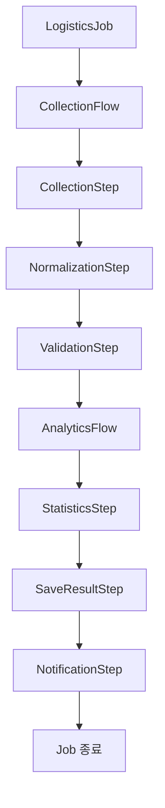

이러한 방식은 여러 Step으로 구성된 업무를 하나의 논리적인 단위로 관리할 수 있다는 장점이 있다.

또한 독립적으로 정의한 Flow를 다른 Job에서 재사용할 수도 있다.

다만 Flow는 실행 흐름을 그룹화하는 객체이지, 별도의 JobExecution을 생성하는 객체는 아니다.

이 차이는 이후 메타데이터 구조에서 자세히 살펴보자.

---

### SimpleJob과 FlowJob의 순차 실행 비교

FlowJob이라는 이름 때문에 반드시 조건부 분기가 있어야 한다고 생각하기 쉽다.

하지만 그렇지 않다.

FlowJob도 단순한 순차 실행 구조로 구성할 수 있다.

#### SimpleJob의 순차 실행

```java
new JobBuilder("simpleJob", jobRepository)
        .start(step1)
        .next(step2)
        .next(step3)
        .build();
```

```text
Step 1
   │
   ▼
Step 2
   │
   ▼
Step 3
```

#### FlowJob의 순차 실행

```java
new JobBuilder("flowJob", jobRepository)
        .start(flowA)
        .next(step3)
        .next(flowB)
        .next(step6)
        .end()
        .build();
```

```text
Flow A
   │
   ▼
Step 3
   │
   ▼
Flow B
   │
   ▼
Step 6
```

Flow A와 Flow B 내부에는 각각 여러 Step이 존재한다.

```text
Flow A
    ├── Step 1
    └── Step 2

Flow B
    ├── Step 4
    └── Step 5
```

따라서 실제 실행 순서는 다음과 같다.

```text
Step 1
   │
   ▼
Step 2
   │
   ▼
Step 3
   │
   ▼
Step 4
   │
   ▼
Step 5
   │
   ▼
Step 6
```

두 Job은 내부 구현체는 다르지만 순차 실행이라는 관점에서는 동일한 흐름으로 동작한다.

특히 중요한 것은 실패 처리다.

**`start()`와 `next()`만으로 구성한 FlowJob에서는 중간 Step이 실패하면 일반적으로 후속 Step이 실행되지 않고 Job이 FAILED로 종료된다.**

조건부 분기를 추가하지 않았기 때문이다.

---

### Flow를 생성하는 방법

FlowJob에서 Flow를 사용하려면 먼저 Flow 객체를 생성해야 한다.

Spring Batch는 이를 위해 `FlowBuilder`를 제공한다.

대표적인 사용 방법은 다음과 같다.

```java
@Bean
public Flow flowA(
        Step step1,
        Step step2
) {

    return new FlowBuilder<SimpleFlow>("flowA")
            .start(step1)
            .next(step2)
            .build();
}
```

여기서 중요한 클래스는 두 가지다.

첫 번째는 `FlowBuilder`다.

두 번째는 `SimpleFlow`다.

FlowBuilder는 Flow를 생성하기 위한 Builder다.

SimpleFlow는 실제 실행 흐름을 관리하는 Flow 구현체다.

#### FlowBuilder 생성

```java
new FlowBuilder<SimpleFlow>("flowA")
```

이 코드는 flowA라는 이름의 Flow를 구성하기 위한 Builder를 생성한다.

Generic 타입으로 SimpleFlow를 지정했다.

따라서 build()를 호출하면 SimpleFlow를 반환할 수 있다.

#### 첫 번째 Step 설정

```java
.start(step1)
```

Flow에서 가장 먼저 실행할 Step을 지정한다.

#### 다음 Step 설정

```java
.next(step2)
```

Step 1이 정상적으로 완료되면 Step 2로 이동하도록 구성한다.

#### Flow 생성

```java
.build()
```

지금까지 정의한 Step과 Transition을 이용해 Flow를 생성한다.

최종적으로 생성되는 구현체는 SimpleFlow다.

전체 생성 구조는 다음과 같다.

```text
FlowBuilder<SimpleFlow>
       │
       ▼
start(step1)
       │
       ▼
next(step2)
       │
       ▼
build()
       │
       ▼
SimpleFlow
       │
       ├── StepState 1
       ├── StepState 2
       └── StateTransition
```

이 구조에서 주의해야 할 점은 SimpleFlow가 단순히 Step 목록만 저장하는 객체가 아니라는 사실이다.

SimpleFlow는 Step의 실행 상태를 관리하기 위한 State와 Transition을 함께 가진다.

---

### FlowBuilder와 SimpleFlow의 차이

두 객체는 이름이 비슷하지만 역할이 다르다.

| 구분 | FlowBuilder | SimpleFlow |
|---|---|---|
| 역할 | Flow 구성 | Flow 실행 |
| 주요 메서드 | start(), next(), on(), build() | start(), resume() |
| 생성 시점 | 애플리케이션 설정 | Builder의 build() |
| 주요 관리 대상 | State 및 Transition 정의 | 실행 State와 Transition |
| 비즈니스 로직 실행 | 하지 않음 | StepState 등을 통해 실행 요청 |
| 실행 시 사용 | 직접 사용하지 않음 | FlowJob에서 사용 |

FlowBuilder는 실행 흐름을 만드는 역할이다.

SimpleFlow는 만들어진 흐름을 실행하는 역할이다.

이 둘을 구분하면 Spring Batch의 Flow 아키텍처를 이해하기 쉬워진다.

---

### 예제: Flow A와 Flow B 구성

이번에는 두 개의 Flow를 생성해보자.

Flow A는 Step 1과 Step 2로 구성한다.

Flow B는 Step 4와 Step 5로 구성한다.

#### Flow A

```java
@Bean
public Flow flowA(
        @Qualifier("step1") Step step1,
        @Qualifier("step2") Step step2
) {

    return new FlowBuilder<SimpleFlow>("flowA")
            .start(step1)
            .next(step2)
            .build();
}
```

이 Flow는 다음과 같은 구조를 가진다.

```text
Flow A
    │
    ▼
Step 1
    │
    ▼
Step 2
    │
    ▼
Flow 종료
```

#### Flow B

```java
@Bean
public Flow flowB(
        @Qualifier("step4") Step step4,
        @Qualifier("step5") Step step5
) {

    return new FlowBuilder<SimpleFlow>("flowB")
            .start(step4)
            .next(step5)
            .build();
}
```

이 Flow는 다음과 같은 구조를 가진다.

```text
Flow B
    │
    ▼
Step 4
    │
    ▼
Step 5
    │
    ▼
Flow 종료
```

두 Flow는 각각 독립적으로 정의된 실행 흐름이다.

하지만 이 Flow들을 Job에 연결하면 하나의 Job 안에서 순차적으로 실행할 수 있다.

---

### Flow와 Step을 조합한 Job 생성

이제 Flow A와 Flow B를 하나의 Job에 연결해보자.

추가로 Step 3과 Step 6을 사용한다.

최종 구조는 다음과 같다.

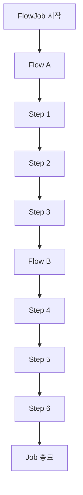

Job을 구성하는 코드는 다음과 같다.

```java
@Bean
public Job startNextFlowJob(
        JobRepository jobRepository,
        @Qualifier("flowA") Flow flowA,
        @Qualifier("step3") Step step3,
        @Qualifier("flowB") Flow flowB,
        @Qualifier("step6") Step step6
) {

    return new JobBuilder(
            "startNextFlowJob",
            jobRepository
    )
            .start(flowA)
            .next(step3)
            .next(flowB)
            .next(step6)
            .end()
            .build();
}
```

이 코드의 실행 과정을 하나씩 살펴보자.

#### 첫 번째: Flow A 실행

```java
.start(flowA)
```

Job은 Flow A부터 실행한다.

Flow A 내부에서는 Step 1과 Step 2가 실행된다.

```text
Flow A
    │
    ├── Step 1
    └── Step 2
```

Flow A가 정상적으로 완료되면 다음 실행 대상으로 이동한다.

#### 두 번째: Step 3 실행

```java
.next(step3)
```

Flow A가 정상적으로 완료되면 Step 3을 실행한다.

#### 세 번째: Flow B 실행

```java
.next(flowB)
```

Step 3이 정상적으로 완료되면 Flow B를 실행한다.

Flow B 내부에서는 Step 4와 Step 5가 실행된다.

#### 네 번째: Step 6 실행

```java
.next(step6)
```

Flow B가 정상적으로 완료되면 Step 6을 실행한다.

#### 다섯 번째: Flow 구성 완료

```java
.end()
.build();
```

여기서 end()는 JobFlowBuilder가 구성한 Flow를 마무리하는 역할이다.

이후 build()를 호출하면 최종적으로 FlowJob을 생성한다.

따라서 실제 실행 순서는 다음과 같다.

```text
Flow A
    │
    ├── Step 1
    └── Step 2
    │
    ▼
Step 3
    │
    ▼
Flow B
    │
    ├── Step 4
    └── Step 5
    │
    ▼
Step 6
    │
    ▼
Job 종료
```

---

### start()와 next()의 내부 동작

이번에는 소스 코드 수준에서 살펴보자.

Spring Batch 5.2.4의 FlowBuilder는 다음과 같은 메서드를 제공한다.

```java
public FlowBuilder<Q> start(Step step) {

    doStart(step);

    return this;
}
```

```java
public FlowBuilder<Q> next(Step step) {

    doNext(step);

    return this;
}
```

Flow 타입에 대해서도 같은 방식의 오버로드가 존재한다.

```java
public FlowBuilder<Q> start(Flow flow) {

    doStart(flow);

    return this;
}
```

```java
public FlowBuilder<Q> next(Flow flow) {

    doNext(flow);

    return this;
}
```

여기서 중요한 것은 실제 내부 처리 메서드다.

`doStart()`는 시작 State를 설정한다.

`doNext()`는 다음 State를 생성하고 Transition을 추가한다.

#### doStart()의 핵심 구조

```java
private void doStart(Object input) {

    if (this.currentState != null) {

        doFrom(input);

    } else {

        this.currentState = createState(input);
    }
}
```

처음 start()를 호출하면 currentState가 존재하지 않는다.

따라서 createState()를 통해 시작 State를 생성한다.

예를 들어 다음과 같이 호출했다고 생각해보자.

```java
.start(flowA)
```

이 경우 Flow A에 해당하는 State가 생성된다.

반면 다음과 같이 호출하면

```java
.start(step1)
```

Step 1에 해당하는 State가 생성된다.

여기서 State는 Flow의 실행 상태를 표현하는 객체다.

Step과 Flow는 각각 서로 다른 State 구현체로 변환된다.

---

### Step과 Flow는 어떤 State로 변환될까?

FlowBuilder는 전달받은 객체의 타입에 따라 State를 생성한다.

대표적으로 다음과 같이 처리한다.

| 전달 객체 | 생성되는 State |
|---|---|
| Step | StepState |
| Flow | FlowState |
| JobExecutionDecider | DecisionState |

예를 들어 다음 코드를 살펴보자.

```java
.start(flowA)
.next(step3)
.next(flowB)
.next(step6)
```

FlowBuilder는 각 실행 대상을 다음과 같은 State로 구성한다.

```text
FlowState(flowA)
       │
       ▼
StepState(step3)
       │
       ▼
FlowState(flowB)
       │
       ▼
StepState(step6)
```

여기서 FlowState는 내부 Flow의 실행을 담당한다.

StepState는 실제 Step의 실행을 담당한다.

이러한 구조 때문에 SimpleFlow는 Step과 Flow를 동일한 실행 흐름 안에서 관리할 수 있다.

실제 FlowBuilder의 `createState()`에서도 타입에 따라 `StepState`, `FlowState`, `DecisionState`를 생성한다.

---

### doNext()의 내부 구현

이번 내용에서 가장 중요한 부분이다.

FlowBuilder의 next()는 내부적으로 doNext()를 호출한다.

Spring Batch 5.2.4의 핵심 구현은 다음과 같다.

```java
private void doNext(Object input) {

    if (this.currentState == null) {

        doStart(input);

    } else {

        State next = createState(input);

        addTransition(
                "COMPLETED",
                next
        );

        addTransition(
                "*",
                failedState
        );

        this.currentState = next;
    }
}
```

이 코드를 이해하면 start()와 next()만 사용하는 FlowJob이 왜 중간 실패 시 종료되는지 알 수 있다.

#### 첫 번째: 다음 State 생성

```java
State next = createState(input);
```

next()에 전달한 객체를 State로 변환한다.

Step이면 StepState를 생성한다.

Flow이면 FlowState를 생성한다.

#### 두 번째: 정상 완료 Transition 추가

```java
addTransition(
        "COMPLETED",
        next
);
```

현재 State가 COMPLETED로 종료되었을 때 다음 State로 이동하는 Transition을 추가한다.

예를 들어 다음과 같다.

```text
Step 1
    │
    └── COMPLETED → Step 2
```

#### 세 번째: 실패 종료 Transition 추가

```java
addTransition(
        "*",
        failedState
);
```

이 코드는 정상 완료로 연결되지 않은 종료 상태에 대한 실패 종료 경로를 추가한다.

따라서 Step 1이 FAILED로 종료되면 다음 Step으로 진행하지 않는다.

```text
Step 1
    │
    ├── COMPLETED → Step 2
    │
    └── FAILED → 실패 종료
```

`*`는 모든 종료 코드에 매칭할 수 있는 패턴이지만, FlowBuilder는 Transition의 구체성을 고려해 매칭한다.

따라서 COMPLETED에 대해서는 앞서 정의한 구체적인 Transition이 적용된다.

그리고 그 외 종료 상태에 대해서는 실패 종료 경로가 적용된다.

이처럼 next()는 단순한 객체 연결이 아니라 **정상 완료와 실패에 대한 기본적인 Transition을 함께 정의하는 메서드**다.

---

### 왜 FlowJob인데 중간 Step이 실패하면 종료될까?

이제 앞에서 살펴본 코드를 다시 생각해보자.

```java
.start(flowA)
.next(step3)
.next(flowB)
.next(step6)
.end()
.build();
```

이 코드는 FlowJob을 생성한다.

하지만 조건부 분기 API인 on()을 사용하지 않았다.

따라서 각 next()는 정상 완료에 대한 순차 실행 관계를 구성한다.

실제 내부 구조는 다음과 같다.

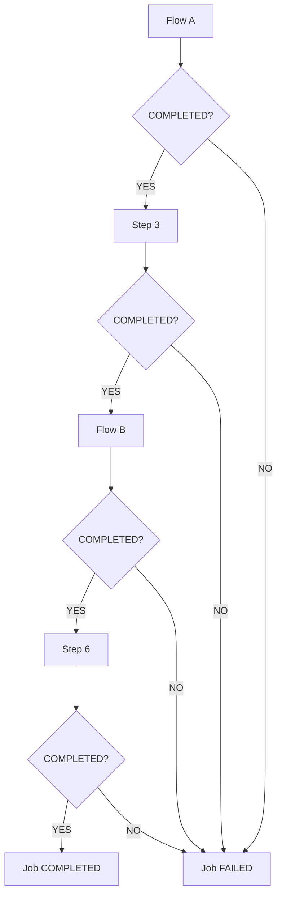

따라서 Flow A 내부의 Step 1이나 Step 2가 실패하면 Flow A는 정상적으로 완료되지 않는다.

그러면 Step 3으로 진행하지 않는다.

마찬가지로 Step 3이 실패하면 Flow B가 실행되지 않는다.

Flow B 내부에서 Step 4가 실패하면 Step 5와 Step 6이 실행되지 않는다.

즉, FlowJob이라고 해서 자동으로 실패를 복구하거나 다음 Step으로 진행하는 것은 아니다.

**FlowJob의 실패 후 실행 경로를 변경하려면 해당 요구사항에 맞는 Transition을 명시적으로 정의해야 한다.**

---

### FlowState의 내부 실행 구조

이번에는 Flow를 실행하는 State의 내부 구조를 살펴보자.

FlowBuilder에서 Flow를 전달하면 FlowState가 생성된다.

예를 들어 다음과 같다.

```java
.start(flowA)
```

이 경우 Flow A를 실행하는 FlowState가 생성된다.

FlowState의 핵심 실행 메서드는 다음과 같다.

```java
@Override
public FlowExecutionStatus handle(
        FlowExecutor executor
) throws Exception {

    return flow.start(executor).getStatus();
}
```

FlowState는 자신에게 등록된 Flow의 start()를 호출한다.

그리고 Flow의 실행 결과를 FlowExecutionStatus로 반환한다.

따라서 다음과 같은 관계가 만들어진다.

```text
FlowState
    │
    ▼
SimpleFlow.start()
    │
    ▼
SimpleFlow.resume()
    │
    ▼
StepState 실행
    │
    ▼
FlowExecutionStatus 반환
```

예를 들어 Flow A는 두 개의 Step으로 구성되어 있다.

```text
Flow A
    │
    ├── Step 1
    └── Step 2
```

FlowState가 Flow A를 실행하면 내부적으로 Step 1과 Step 2가 실행된다.

이후 Flow A가 정상적으로 완료되면 COMPLETED에 해당하는 FlowExecutionStatus를 반환한다.

반면 Step 1이나 Step 2에서 실패가 발생해 Flow A가 실패 경로로 종료되면 FAILED에 해당하는 결과가 반환될 수 있다.

상위 Flow는 이 값을 기준으로 다음 실행 대상으로 이동할지 결정한다.

---

### Flow와 FlowStep은 같은 객체일까?

여기서 혼동하기 쉬운 개념이 있다.

바로 `Flow`와 `FlowStep`이다.

두 객체는 서로 다르다.

#### Flow

Flow는 실행 흐름을 정의한다.

```java
@Bean
public Flow flowA(
        Step step1,
        Step step2
) {

    return new FlowBuilder<SimpleFlow>("flowA")
            .start(step1)
            .next(step2)
            .build();
}
```

이 Flow를 다음과 같이 Job에 직접 등록할 수 있다.

```java
.start(flowA)
```

이 경우 Flow A 자체에 대한 별도의 StepExecution이 생성되는 것은 아니다.

Flow A 내부에서 실제 실행된 Step에 대한 StepExecution이 생성된다.

#### FlowStep

FlowStep은 Flow를 실행하는 Step 구현체다.

따라서 FlowStep을 Job에 등록하면 FlowStep 자체도 Step이므로 StepExecution을 가진다.

두 방식을 비교하면 다음과 같다.

| 구분 | Flow | FlowStep |
|---|---|---|
| 타입 | Flow | Step |
| 대표 구현체 | SimpleFlow | FlowStep |
| 역할 | 실행 흐름 정의 | Step으로서 Flow 실행 |
| Job에 직접 등록 | 가능 | 가능 |
| 자체 StepExecution | 없음 | 있음 |
| 내부 StepExecution | 생성됨 | 생성됨 |
| 주요 용도 | Flow 그룹화와 재사용 | Flow를 하나의 Step으로 감싸기 |

이번 예제에서는 FlowStep을 사용하지 않는다.

Flow A와 Flow B를 Job에 직접 연결한다.

따라서 실행 메타데이터에는 실제로 실행된 여섯 개의 Step이 기록된다.

---

### 실제 예제: 여섯 개의 Step과 두 개의 Flow 구성

이번에는 다음 구조를 실제로 구현해보자.

```text
startNextFlowJob
       │
       ▼
     Flow A
       │
       ├── Step 1
       └── Step 2
       │
       ▼
     Step 3
       │
       ▼
     Flow B
       │
       ├── Step 4
       └── Step 5
       │
       ▼
     Step 6
       │
       ▼
   Job 종료
```

확인할 내용은 다음과 같다.

첫 번째는 정상 실행 시 Step 1부터 Step 6까지 순차적으로 실행되는지다.

두 번째는 Flow A와 Flow B가 각각 SimpleFlow로 생성되는지다.

세 번째는 Step 4에서 실패가 발생했을 때 Step 5와 Step 6이 실행되지 않는지다.

네 번째는 Flow 자체에 대한 별도의 StepExecution이 생성되지 않는지다.

다섯 번째는 최종 JobExecution의 상태가 어떻게 저장되는지다.

#### 개발 환경

| 항목 | 기술 |
|---|---|
| Java | Java 17 |
| Spring Boot | 3.4.13 |
| Spring Batch | 5.2.4 |
| Build Tool | Maven |
| Database | H2 |
| Job 구현체 | FlowJob |
| Flow 구현체 | SimpleFlow |
| Step 구현체 | TaskletStep |

이번 예제에서는 실행 이력을 여러 번 확인할 수 있도록 파일 기반 H2 데이터베이스를 사용한다.

---

### Maven 의존성 설정

`pom.xml`

```xml
<?xml version="1.0" encoding="UTF-8"?>
<project xmlns="http://maven.apache.org/POM/4.0.0"
         xmlns:xsi="http://www.w3.org/2001/XMLSchema-instance"
         xsi:schemaLocation="
             http://maven.apache.org/POM/4.0.0
             https://maven.apache.org/xsd/maven-4.0.0.xsd">

    <modelVersion>4.0.0</modelVersion>

    <parent>
        <groupId>org.springframework.boot</groupId>
        <artifactId>spring-boot-starter-parent</artifactId>
        <version>3.4.13</version>
        <relativePath/>
    </parent>

    <groupId>com.example</groupId>
    <artifactId>spring-batch-start-next</artifactId>
    <version>0.0.1-SNAPSHOT</version>

    <properties>
        <java.version>17</java.version>
        <spring-batch.version>5.2.4</spring-batch.version>
    </properties>

    <dependencies>

        <dependency>
            <groupId>org.springframework.boot</groupId>
            <artifactId>spring-boot-starter-batch</artifactId>
        </dependency>

        <dependency>
            <groupId>com.h2database</groupId>
            <artifactId>h2</artifactId>
            <scope>runtime</scope>
        </dependency>

        <dependency>
            <groupId>org.springframework.boot</groupId>
            <artifactId>spring-boot-starter-test</artifactId>
            <scope>test</scope>
        </dependency>

    </dependencies>

    <build>
        <plugins>
            <plugin>
                <groupId>org.springframework.boot</groupId>
                <artifactId>spring-boot-maven-plugin</artifactId>
            </plugin>
        </plugins>
    </build>

</project>
```

Spring Batch의 Job 실행과 메타데이터 저장을 위해 spring-boot-starter-batch를 사용한다.

실행 이력은 H2 데이터베이스에 저장한다.

---

### application.yml 설정

`src/main/resources/application.yml`

```yaml
spring:
  application:
    name: spring-batch-start-next

  main:
    web-application-type: none

  datasource:
    url: jdbc:h2:file:./data/start-next-db;DB_CLOSE_ON_EXIT=FALSE
    driver-class-name: org.h2.Driver
    username: sa
    password:

  batch:
    job:
      enabled: true
      name: startNextFlowJob

    jdbc:
      initialize-schema: ${BATCH_SCHEMA_INIT:never}

logging:
  level:
    org.springframework.batch: INFO
    com.example.batch: INFO
```

이번 예제에서는 파일 기반 H2를 사용한다.

```yaml
spring:
  datasource:
    url: jdbc:h2:file:./data/start-next-db;DB_CLOSE_ON_EXIT=FALSE
```

따라서 애플리케이션을 종료하더라도 이전 JobExecution과 StepExecution을 유지할 수 있다.

또한 다음 설정을 사용한다.

```yaml
spring:
  batch:
    jdbc:
      initialize-schema: ${BATCH_SCHEMA_INIT:never}
```

최초 실행에서만 환경변수로 `always`를 전달해 메타데이터 테이블을 생성한다.

이후 실행에서는 기존 테이블을 사용한다.

이렇게 구성하면 정상 실행과 실패 실행의 메타데이터를 비교할 수 있다.

---

### Spring Boot 애플리케이션

`BatchApplication.java`

```java
package com.example.batch;

import org.springframework.boot.SpringApplication;
import org.springframework.boot.autoconfigure.SpringBootApplication;

@SpringBootApplication
public class BatchApplication {

    public static void main(String[] args) {

        SpringApplication.run(
                BatchApplication.class,
                args
        );
    }
}
```

---

### StartNextConfiguration 전체 코드

이번에는 여섯 개의 Step을 정의한다.

각 Step은 동일한 구조의 Tasklet으로 생성한다.

다만 Step 4에서는 JobParameters에 따라 의도적으로 예외를 발생시킬 수 있도록 구성한다.

`StartNextConfiguration.java`

```java
package com.example.batch;

import org.slf4j.Logger;
import org.slf4j.LoggerFactory;

import org.springframework.batch.core.Job;
import org.springframework.batch.core.Step;
import org.springframework.batch.core.StepExecution;

import org.springframework.batch.core.job.builder.FlowBuilder;
import org.springframework.batch.core.job.builder.JobBuilder;

import org.springframework.batch.core.job.flow.Flow;
import org.springframework.batch.core.job.flow.support.SimpleFlow;

import org.springframework.batch.core.repository.JobRepository;
import org.springframework.batch.core.step.builder.StepBuilder;

import org.springframework.batch.repeat.RepeatStatus;

import org.springframework.beans.factory.annotation.Qualifier;

import org.springframework.context.annotation.Bean;
import org.springframework.context.annotation.Configuration;

import org.springframework.transaction.PlatformTransactionManager;

@Configuration
public class StartNextConfiguration {

    private static final Logger log =
            LoggerFactory.getLogger(
                    StartNextConfiguration.class
            );

    // --------------------------------------------------
    // 1. FlowJob
    // --------------------------------------------------

    @Bean
    public Job startNextFlowJob(
            JobRepository jobRepository,
            @Qualifier("flowA") Flow flowA,
            @Qualifier("step3") Step step3,
            @Qualifier("flowB") Flow flowB,
            @Qualifier("step6") Step step6
    ) {

        Job job = new JobBuilder(
                "startNextFlowJob",
                jobRepository
        )
                .start(flowA)
                .next(step3)
                .next(flowB)
                .next(step6)
                .end()
                .build();

        log.info(
                "Job 구현체={}",
                job.getClass().getSimpleName()
        );

        return job;
    }

    // --------------------------------------------------
    // 2. Flow A
    // --------------------------------------------------

    @Bean
    public Flow flowA(
            @Qualifier("step1") Step step1,
            @Qualifier("step2") Step step2
    ) {

        Flow flow = new FlowBuilder<SimpleFlow>("flowA")
                .start(step1)
                .next(step2)
                .build();

        log.info(
                "Flow A 구현체={}",
                flow.getClass().getSimpleName()
        );

        return flow;
    }

    // --------------------------------------------------
    // 3. Flow B
    // --------------------------------------------------

    @Bean
    public Flow flowB(
            @Qualifier("step4") Step step4,
            @Qualifier("step5") Step step5
    ) {

        Flow flow = new FlowBuilder<SimpleFlow>("flowB")
                .start(step4)
                .next(step5)
                .build();

        log.info(
                "Flow B 구현체={}",
                flow.getClass().getSimpleName()
        );

        return flow;
    }

    // --------------------------------------------------
    // 4. Step 1
    // --------------------------------------------------

    @Bean
    public Step step1(
            JobRepository jobRepository,
            PlatformTransactionManager transactionManager
    ) {

        return createTaskletStep(
                "step1",
                jobRepository,
                transactionManager
        );
    }

    // --------------------------------------------------
    // 5. Step 2
    // --------------------------------------------------

    @Bean
    public Step step2(
            JobRepository jobRepository,
            PlatformTransactionManager transactionManager
    ) {

        return createTaskletStep(
                "step2",
                jobRepository,
                transactionManager
        );
    }

    // --------------------------------------------------
    // 6. Step 3
    // --------------------------------------------------

    @Bean
    public Step step3(
            JobRepository jobRepository,
            PlatformTransactionManager transactionManager
    ) {

        return createTaskletStep(
                "step3",
                jobRepository,
                transactionManager
        );
    }

    // --------------------------------------------------
    // 7. Step 4
    // --------------------------------------------------

    @Bean
    public Step step4(
            JobRepository jobRepository,
            PlatformTransactionManager transactionManager
    ) {

        return createTaskletStep(
                "step4",
                jobRepository,
                transactionManager
        );
    }

    // --------------------------------------------------
    // 8. Step 5
    // --------------------------------------------------

    @Bean
    public Step step5(
            JobRepository jobRepository,
            PlatformTransactionManager transactionManager
    ) {

        return createTaskletStep(
                "step5",
                jobRepository,
                transactionManager
        );
    }

    // --------------------------------------------------
    // 9. Step 6
    // --------------------------------------------------

    @Bean
    public Step step6(
            JobRepository jobRepository,
            PlatformTransactionManager transactionManager
    ) {

        return createTaskletStep(
                "step6",
                jobRepository,
                transactionManager
        );
    }

    // --------------------------------------------------
    // 10. 공통 Step 생성 메서드
    // --------------------------------------------------

    private Step createTaskletStep(
            String stepName,
            JobRepository jobRepository,
            PlatformTransactionManager transactionManager
    ) {

        return new StepBuilder(
                stepName,
                jobRepository
        )
                .tasklet((contribution, chunkContext) -> {

                    StepExecution execution =
                            contribution.getStepExecution();

                    log.info(
                            "[{}] 실행 시작, jobExecutionId={}",
                            stepName,
                            execution.getJobExecutionId()
                    );

                    String failStep4 =
                            execution
                                    .getJobParameters()
                                    .getString("failStep4");

                    if (
                        "step4".equals(stepName)
                                && "true".equals(failStep4)
                    ) {

                        log.error(
                                "[{}] 의도적인 예외 발생",
                                stepName
                        );

                        throw new IllegalStateException(
                                "Step4 실행 실패"
                        );
                    }

                    log.info(
                            "[{}] 정상 종료",
                            stepName
                    );

                    return RepeatStatus.FINISHED;

                }, transactionManager)
                .build();
    }
}
```

이 코드에서는 두 개의 Flow와 여섯 개의 Step을 생성한다.

Flow A는 Step 1과 Step 2를 포함한다.

Flow B는 Step 4와 Step 5를 포함한다.

그리고 Job에서 Flow A, Step 3, Flow B, Step 6을 순차적으로 연결한다.

따라서 실제 실행 순서는 Step 1부터 Step 6까지 이어진다.

여기서 중요한 점은 Flow A와 Flow B가 별도의 Job이 아니라는 사실이다.

두 Flow는 같은 JobExecution 안에서 실행되는 Step들의 흐름을 정의한다.

---

### 첫 번째 실행: 모든 Step이 정상적으로 완료되는 경우

먼저 프로젝트를 빌드한다.

```bash
mvn clean package
```

정상적으로 빌드되면 다음과 같은 결과를 확인할 수 있다.

```text
BUILD SUCCESS
```

이제 데이터베이스 저장 디렉터리를 생성한다.

```bash
mkdir -p data
```

최초 실행에서는 Spring Batch 메타데이터 테이블을 생성해야 한다.

따라서 다음 명령어를 사용한다.

```bash
BATCH_SCHEMA_INIT=always \
java -jar target/spring-batch-start-next-0.0.1-SNAPSHOT.jar \
  failStep4=false
```

이 명령어는 failStep4를 false로 전달한다.

따라서 Step 4에서도 예외가 발생하지 않는다.

#### 예상 실행 로그

```text
Flow A 구현체=SimpleFlow

Flow B 구현체=SimpleFlow

Job 구현체=FlowJob

[step1] 실행 시작
[step1] 정상 종료

[step2] 실행 시작
[step2] 정상 종료

[step3] 실행 시작
[step3] 정상 종료

[step4] 실행 시작
[step4] 정상 종료

[step5] 실행 시작
[step5] 정상 종료

[step6] 실행 시작
[step6] 정상 종료
```

이 결과에서 확인할 수 있는 사실은 다음과 같다.

Flow A와 Flow B는 SimpleFlow로 생성되었다.

Job은 FlowJob으로 생성되었다.

Step 1부터 Step 6까지 순차적으로 실행되었다.

모든 Step이 정상적으로 종료되었으므로 Job도 COMPLETED 상태로 종료된다.

#### 실행 결과

| 순서 | 소속 | Step | 상태 |
|---|---|---|---|
| 1 | Flow A | step1 | COMPLETED |
| 2 | Flow A | step2 | COMPLETED |
| 3 | Job | step3 | COMPLETED |
| 4 | Flow B | step4 | COMPLETED |
| 5 | Flow B | step5 | COMPLETED |
| 6 | Job | step6 | COMPLETED |

최종 Job 상태는 다음과 같다.

```text
BatchStatus = COMPLETED

ExitStatus = COMPLETED
```

---

### 두 번째 실행: Flow B의 Step 4에서 실패하는 경우

이번에는 Step 4에서 의도적으로 예외를 발생시켜보자.

동일한 애플리케이션을 실행하지만 JobParameters를 변경한다.

```bash
java -jar target/spring-batch-start-next-0.0.1-SNAPSHOT.jar \
  failStep4=true
```

이번에는 failStep4가 true다.

따라서 Step 4에서 다음 코드가 실행된다.

```java
throw new IllegalStateException(
        "Step4 실행 실패"
);
```

Step 4는 FAILED 상태로 종료된다.

#### 예상 실행 로그

```text
[step1] 실행 시작
[step1] 정상 종료

[step2] 실행 시작
[step2] 정상 종료

[step3] 실행 시작
[step3] 정상 종료

[step4] 실행 시작

[step4] 의도적인 예외 발생

IllegalStateException:
Step4 실행 실패
```

여기서 중요한 점은 Step 5와 Step 6이 실행되지 않는다는 사실이다.

#### 실행 흐름

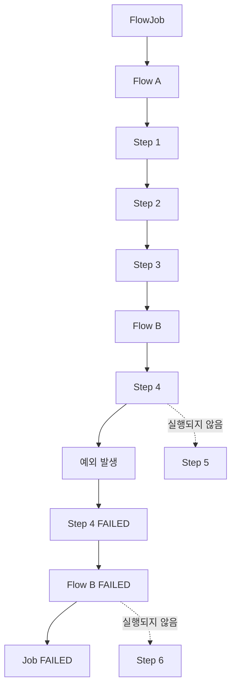

Step 4가 실패하면 Flow B 내부의 다음 Step인 Step 5로 진행하지 못한다.

Flow B의 실행 결과도 FAILED가 된다.

상위 Flow는 Flow B의 실패 결과를 확인한다.

그리고 Step 6으로 진행하지 않는다.

따라서 최종 Job 상태는 FAILED가 된다.

#### 실행 결과

| 순서 | Step | 실행 여부 | 상태 |
|---|---|---|---|
| 1 | step1 | 실행 | COMPLETED |
| 2 | step2 | 실행 | COMPLETED |
| 3 | step3 | 실행 | COMPLETED |
| 4 | step4 | 실행 | FAILED |
| 5 | step5 | 미실행 | StepExecution 없음 |
| 6 | step6 | 미실행 | StepExecution 없음 |

최종 Job 상태는 다음과 같다.

```text
BatchStatus = FAILED

ExitStatus = FAILED
```

여기서 중요한 것은 **Step 5와 Step 6이 실패한 것이 아니라 실행되지 않았다는 사실**이다.

따라서 해당 JobExecution에는 Step 5와 Step 6에 대한 StepExecution이 생성되지 않는다.

---

### 왜 Flow B의 실패가 전체 Job 실패로 이어질까?

이 부분은 FlowState와 SimpleFlow의 실행 관계를 이해하면 명확해진다.

전체 Job은 다음과 같이 구성되어 있다.

```text
Flow A
   │
   ▼
Step 3
   │
   ▼
Flow B
   │
   ▼
Step 6
```

Flow B는 내부적으로 다음과 같이 구성되어 있다.

```text
Step 4
   │
   ▼
Step 5
```

Step 4가 FAILED로 종료되면 Flow B는 다음 Step으로 진행하지 못한다.

따라서 Flow B의 실행 결과는 FAILED가 된다.

FlowState는 내부 Flow의 실행 결과를 반환한다.

```java
return flow.start(executor).getStatus();
```

따라서 상위 Flow는 Flow B가 FAILED로 종료되었다는 사실을 알 수 있다.

상위 Flow에서 Flow B 다음에 등록한 실행 대상은 Step 6이다.

```java
.next(step6)
```

하지만 next()는 앞선 실행 대상이 COMPLETED로 종료되었을 때만 다음 대상으로 이동하는 기본 Transition을 정의한다.

Flow B가 FAILED로 종료되었으므로 Step 6으로 이동하지 않는다.

이렇게 해서 전체 Job은 FAILED로 종료된다.

이 구조를 통해 다음 사실을 알 수 있다.

**하위 Flow의 실행 결과는 상위 Flow의 Transition 판단에 사용된다.**

따라서 하위 Flow가 실패하면 상위 Flow에도 영향을 준다.

---

### JobParameters를 변경하면 새로운 JobInstance가 생성된다

이번 예제에서는 두 번의 실행에서 서로 다른 JobParameters를 사용했다.

첫 번째 실행은 다음과 같다.

```text
failStep4 = false
```

두 번째 실행은 다음과 같다.

```text
failStep4 = true
```

Spring Batch의 JobParametersBuilder에서 별도로 지정하지 않으면 해당 파라미터는 기본적으로 식별용 파라미터가 된다.

따라서 두 실행은 서로 다른 JobInstance로 구분된다.

```text
JobInstance 1
    │
    └── failStep4=false
```

```text
JobInstance 2
    │
    └── failStep4=true
```

이러한 방식은 두 가지 실행 시나리오를 독립적으로 확인하는 데 적합하다.

하지만 실제 실패한 Job을 재시작하려는 경우에는 주의해야 한다.

동일한 JobInstance를 재시작하려면 식별용 JobParameters가 같아야 한다.

따라서 failStep4를 변경하는 것은 기존 JobInstance를 재시작하는 방법이 아니다.

실제 재시작을 구현하려면 실패 원인이 해결된 상태에서 같은 식별용 JobParameters를 사용해야 한다.

---

### 데이터베이스에서 실행 결과 확인하기

Spring Batch는 Job과 Step의 실행 이력을 메타데이터 테이블에 저장한다.

대표적인 테이블은 다음과 같다.

| 테이블 | 역할 |
|---|---|
| BATCH_JOB_INSTANCE | JobInstance 관리 |
| BATCH_JOB_EXECUTION | JobExecution 관리 |
| BATCH_JOB_EXECUTION_PARAMS | JobParameters 관리 |
| BATCH_STEP_EXECUTION | StepExecution 관리 |
| BATCH_STEP_EXECUTION_CONTEXT | Step ExecutionContext 저장 |

이번 예제에서는 두 개의 Flow를 사용했지만 Flow 자체에 대한 별도의 StepExecution은 생성하지 않는다.

따라서 BATCH_STEP_EXECUTION에는 실제 실행된 Step만 기록된다.

#### JobExecution 조회

```sql
SELECT
    ji.JOB_INSTANCE_ID,
    ji.JOB_NAME,
    je.JOB_EXECUTION_ID,
    je.STATUS,
    je.EXIT_CODE
FROM BATCH_JOB_INSTANCE ji
JOIN BATCH_JOB_EXECUTION je
    ON ji.JOB_INSTANCE_ID = je.JOB_INSTANCE_ID
WHERE ji.JOB_NAME = 'startNextFlowJob'
ORDER BY je.JOB_EXECUTION_ID;
```

두 가지 시나리오를 실행했다면 다음과 유사한 결과가 나타난다.

| JOB_INSTANCE_ID | JOB_EXECUTION_ID | STATUS |
|---|---|---|
| 1 | 1 | COMPLETED |
| 2 | 2 | FAILED |

첫 번째 실행은 모든 Step이 성공했다.

두 번째 실행은 Step 4에서 실패했다.

따라서 두 JobExecution은 서로 다른 상태를 가진다.

#### StepExecution 조회

```sql
SELECT
    je.JOB_EXECUTION_ID,
    se.STEP_EXECUTION_ID,
    se.STEP_NAME,
    se.STATUS,
    se.EXIT_CODE
FROM BATCH_JOB_EXECUTION je
JOIN BATCH_STEP_EXECUTION se
    ON je.JOB_EXECUTION_ID = se.JOB_EXECUTION_ID
ORDER BY
    je.JOB_EXECUTION_ID,
    se.STEP_EXECUTION_ID;
```

정상 실행에서는 다음과 같은 StepExecution이 생성된다.

| STEP_NAME | STATUS |
|---|---|
| step1 | COMPLETED |
| step2 | COMPLETED |
| step3 | COMPLETED |
| step4 | COMPLETED |
| step5 | COMPLETED |
| step6 | COMPLETED |

반면 Step 4가 실패한 실행에서는 다음과 같은 결과가 나타난다.

| STEP_NAME | STATUS |
|---|---|
| step1 | COMPLETED |
| step2 | COMPLETED |
| step3 | COMPLETED |
| step4 | FAILED |

Step 5와 Step 6의 데이터는 존재하지 않는다.

실제 실행되지 않았기 때문이다.

여기서 중요한 점을 하나 더 확인할 수 있다.

Flow A와 Flow B라는 이름의 StepExecution도 존재하지 않는다.

Flow는 실행 경로를 정의하는 객체이지 Step이 아니기 때문이다.

---

### JUnit으로 정상 실행과 실패 실행 검증하기

이번에는 실제 JobLauncher를 이용해 두 가지 시나리오를 검증해보자.

검증할 내용은 다음과 같다.

첫 번째는 실제 Job 구현체가 FlowJob인지 확인한다.

두 번째는 정상 실행 시 Step 1부터 Step 6까지 순차적으로 실행되는지 확인한다.

세 번째는 Step 4가 실패하면 Step 5와 Step 6이 실행되지 않는지 확인한다.

네 번째는 Flow A와 Flow B에 대한 별도의 StepExecution이 생성되지 않는지 확인한다.

`StartNextFlowJobTest.java`

```java
package com.example.batch;

import java.util.Comparator;
import java.util.List;
import java.util.UUID;

import org.junit.jupiter.api.Test;

import org.springframework.batch.core.BatchStatus;
import org.springframework.batch.core.Job;
import org.springframework.batch.core.JobExecution;
import org.springframework.batch.core.JobParameters;
import org.springframework.batch.core.JobParametersBuilder;
import org.springframework.batch.core.StepExecution;

import org.springframework.batch.core.job.flow.FlowJob;
import org.springframework.batch.core.launch.JobLauncher;

import org.springframework.beans.factory.annotation.Autowired;
import org.springframework.beans.factory.annotation.Qualifier;

import org.springframework.boot.test.context.SpringBootTest;

import static org.junit.jupiter.api.Assertions.*;

@SpringBootTest(properties = {
        "spring.batch.job.enabled=false",
        "spring.datasource.url=jdbc:h2:mem:start-next-test;DB_CLOSE_DELAY=-1",
        "spring.batch.jdbc.initialize-schema=always"
})
class StartNextFlowJobTest {

    @Autowired
    private JobLauncher jobLauncher;

    @Autowired
    @Qualifier("startNextFlowJob")
    private Job job;

    // -------------------------------------------
    // JobParameters
    // -------------------------------------------

    private JobParameters parameters(
            boolean failStep4
    ) {

        return new JobParametersBuilder()
                .addString(
                        "failStep4",
                        Boolean.toString(failStep4)
                )
                .addString(
                        "requestId",
                        UUID.randomUUID().toString()
                )
                .toJobParameters();
    }

    // -------------------------------------------
    // Step 실행 순서 조회
    // -------------------------------------------

    private List<String> stepNames(
            JobExecution execution
    ) {

        return execution.getStepExecutions()
                .stream()
                .sorted(
                        Comparator.comparing(
                                StepExecution::getId
                        )
                )
                .map(StepExecution::getStepName)
                .toList();
    }

    // -------------------------------------------
    // FlowJob 구현체 확인
    // -------------------------------------------

    @Test
    void FlowJob이_생성된다() {

        assertInstanceOf(
                FlowJob.class,
                job
        );
    }

    // -------------------------------------------
    // 정상 실행
    // -------------------------------------------

    @Test
    void 모든_Step이_순차적으로_실행된다()
            throws Exception {

        JobExecution execution =
                jobLauncher.run(
                        job,
                        parameters(false)
                );

        assertEquals(
                BatchStatus.COMPLETED,
                execution.getStatus()
        );

        assertEquals(
                List.of(
                        "step1",
                        "step2",
                        "step3",
                        "step4",
                        "step5",
                        "step6"
                ),
                stepNames(execution)
        );

        assertEquals(
                6,
                execution.getStepExecutions().size()
        );
    }

    // -------------------------------------------
    // Step 4 실패
    // -------------------------------------------

    @Test
    void Step4가_실패하면_후속_Step은_실행되지_않는다()
            throws Exception {

        JobExecution execution =
                jobLauncher.run(
                        job,
                        parameters(true)
                );

        assertEquals(
                BatchStatus.FAILED,
                execution.getStatus()
        );

        assertEquals(
                List.of(
                        "step1",
                        "step2",
                        "step3",
                        "step4"
                ),
                stepNames(execution)
        );

        assertEquals(
                4,
                execution.getStepExecutions().size()
        );

        StepExecution step4Execution =
                execution.getStepExecutions()
                        .stream()
                        .filter(
                                step ->
                                        step.getStepName()
                                                .equals("step4")
                        )
                        .findFirst()
                        .orElseThrow();

        assertEquals(
                BatchStatus.FAILED,
                step4Execution.getStatus()
        );
    }

    // -------------------------------------------
    // Flow 자체의 StepExecution 존재 여부
    // -------------------------------------------

    @Test
    void Flow는_별도의_StepExecution을_생성하지_않는다()
            throws Exception {

        JobExecution execution =
                jobLauncher.run(
                        job,
                        parameters(false)
                );

        List<String> names =
                stepNames(execution);

        assertFalse(
                names.contains("flowA")
        );

        assertFalse(
                names.contains("flowB")
        );

        assertEquals(
                6,
                names.size()
        );
    }
}
```

이 테스트에서는 실행할 때마다 새로운 requestId를 생성한다.

따라서 테스트끼리 동일한 JobInstance를 공유하지 않는다.

#### 정상 실행 검증

```java
assertEquals(
        List.of(
                "step1",
                "step2",
                "step3",
                "step4",
                "step5",
                "step6"
        ),
        stepNames(execution)
);
```

이 검증은 여섯 개의 Step이 순차적으로 실행되었는지 확인한다.

StepExecution ID 순서로 정렬해 실행 순서를 비교한다.

#### 실패 실행 검증

```java
assertEquals(
        List.of(
                "step1",
                "step2",
                "step3",
                "step4"
        ),
        stepNames(execution)
);
```

이 검증은 Step 4에서 실패한 경우 Step 5와 Step 6이 실행되지 않았는지 확인한다.

또한 다음 코드로 Job의 최종 상태를 검증한다.

```java
assertEquals(
        BatchStatus.FAILED,
        execution.getStatus()
);
```

#### Flow의 메타데이터 검증

```java
assertFalse(
        names.contains("flowA")
);
```

```java
assertFalse(
        names.contains("flowB")
);
```

이 검증은 Flow 자체에 대한 StepExecution이 생성되지 않는다는 사실을 확인한다.

즉, Flow는 Step을 실행하기 위한 구조이며 별도의 Step 실행 이력 객체를 생성하지 않는다.

#### 테스트 실행

```bash
mvn test
```

테스트가 모두 성공하면 다음과 유사한 결과를 확인할 수 있다.

```text
Tests run: 4

Failures: 0

Errors: 0

BUILD SUCCESS
```

---

### 전체 아키텍처: FlowJob에서 실제 Step이 실행되는 과정

이번에는 FlowJob의 실제 실행 구조를 살펴보자.

FlowJob은 내부적으로 Flow 객체를 가진다.

일반적으로 이 Flow는 SimpleFlow다.

FlowJob이 실행되면 다음과 같은 과정이 시작된다.

```text
JobLauncher
    │
    ▼
FlowJob
    │
    ▼
JobFlowExecutor
    │
    ▼
SimpleFlow.start()
    │
    ▼
SimpleFlow.resume()
    │
    ▼
State 실행
```

이번 예제에서는 Flow A와 Flow B가 각각 FlowState로 구성된다.

Step 3과 Step 6은 StepState로 구성된다.

따라서 상위 Flow의 실행 구조는 다음과 같다.

```text
SimpleFlow
    │
    ├── FlowState(flowA)
    │
    ├── StepState(step3)
    │
    ├── FlowState(flowB)
    │
    └── StepState(step6)
```

FlowState는 내부 Flow를 실행한다.

StepState는 실제 Step을 실행한다.

이렇게 서로 다른 State가 하나의 SimpleFlow 안에서 관리된다.

#### SimpleFlow 실행 구조

Spring Batch 5.2.4의 SimpleFlow는 다음과 같은 흐름으로 동작한다.

```text
SimpleFlow.start()
       │
       ▼
시작 State 조회
       │
       ▼
SimpleFlow.resume()
       │
       ▼
현재 State 실행
       │
       ▼
FlowExecutionStatus 반환
       │
       ▼
Transition 확인
       │
       ├── 다음 State 존재
       │       │
       │       └── 다음 State 실행
       │
       └── 다음 State 없음
               │
               └── Flow 종료
```

이 구조에서 실제 실행 순서를 결정하는 것은 State와 Transition이다.

Step을 실행하는 과정 자체는 StepState와 JobFlowExecutor를 통해 이루어진다.

따라서 SimpleFlow는 실행 대상이 Step인지 Flow인지에 관계없이 State 인터페이스를 통해 실행을 제어할 수 있다.

---

### FlowJob의 중첩 실행 구조

이번 예제를 State 수준에서 더 자세히 표현하면 다음과 같다.

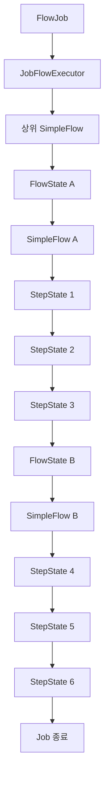

이 그림에서 중요한 것은 세 개의 SimpleFlow가 관여한다는 사실이다.

첫 번째는 Flow A를 관리하는 SimpleFlow다.

두 번째는 Flow B를 관리하는 SimpleFlow다.

세 번째는 Flow A, Step 3, Flow B, Step 6을 연결하는 상위 SimpleFlow다.

상위 SimpleFlow는 FlowState를 통해 하위 Flow를 실행한다.

하위 Flow는 자신에게 등록된 StepState를 실행한다.

그리고 하위 Flow가 종료되면 실행 결과를 상위 FlowState에 반환한다.

상위 SimpleFlow는 해당 결과를 확인하고 다음 State로 이동한다.

이러한 구조 덕분에 여러 Flow를 하나의 Job에 연결할 수 있다.

---

### 실패한 FlowJob을 재시작하면 어떻게 될까?

이번에는 Step 4에서 실패한 Job을 재시작하는 상황을 생각해보자.

최초 실행 결과는 다음과 같다.

```text
JobExecution 1
    │
    ├── Step 1 → COMPLETED
    ├── Step 2 → COMPLETED
    ├── Step 3 → COMPLETED
    └── Step 4 → FAILED

Job → FAILED
```

이 상태에서 동일한 식별용 JobParameters로 Job을 재시작하면 새로운 JobExecution이 생성된다.

하지만 이전에 완료된 Step은 일반적으로 다시 실행되지 않는다.

따라서 Step 1, Step 2, Step 3은 실행을 생략할 수 있다.

반면 Step 4는 이전에 실패했으므로 재실행 대상이 된다.

Step 4가 정상적으로 완료되면 Step 5와 Step 6이 이어서 실행된다.

```text
JobExecution 2
    │
    ├── Step 1 → 실행 생략
    ├── Step 2 → 실행 생략
    ├── Step 3 → 실행 생략
    │
    ├── Step 4 → COMPLETED
    ├── Step 5 → COMPLETED
    └── Step 6 → COMPLETED

Job → COMPLETED
```

다만 이 동작은 이전 StepExecution 상태와 각 Step의 재시작 설정에 영향을 받는다.

예를 들어 `allowStartIfComplete(true)`가 설정되어 있다면 이전에 완료된 Step도 다시 실행될 수 있다.

또한 `startLimit()`이 설정되어 있다면 실행 횟수 제한을 확인해야 한다.

따라서 FlowJob의 재시작도 기존에 살펴본 Step 재시작 정책을 따른다.

**Flow를 사용한다고 해서 StepExecution의 재시작 규칙이 사라지는 것은 아니다.**

---

### start()와 next()를 사용할 때 주의할 12가지 사항

실제 운영 환경에서 Flow를 구성할 때는 다음과 같은 부분을 고려해야 한다.

#### 1. 모든 Job에 Flow를 적용할 필요는 없다

Step의 실행 순서가 단순하다면 SimpleJob으로도 충분하다.

Flow는 실행 흐름을 그룹화하거나 여러 Job에서 동일한 Flow를 재사용할 필요가 있을 때 활용하는 것이 좋다.

불필요하게 Flow를 도입하면 오히려 실행 구조가 복잡해질 수 있다.

#### 2. Flow는 독립적인 Job이 아니다

Flow를 별도로 정의했다고 해서 새로운 JobInstance나 JobExecution이 생성되는 것은 아니다.

같은 Job 안에서 Flow를 실행하면 내부 Step들은 해당 Job의 JobExecution에 속한다.

독립적인 Job 실행 이력이 필요하다면 JobStep을 고려해야 한다.

#### 3. Flow와 FlowStep의 차이를 구분한다

Flow는 실행 흐름을 정의하는 객체다.

FlowStep은 Flow를 실행하는 Step이다.

따라서 FlowStep을 사용할 때는 FlowStep 자체의 StepExecution이 추가로 생성될 수 있다.

#### 4. next()는 정상 완료에 대한 Transition을 정의한다

FlowBuilder의 next()는 단순히 실행 대상을 추가하는 기능이 아니다.

내부적으로 COMPLETED에 해당하는 Transition과 실패 종료 경로를 정의한다.

따라서 이전 Step이 실패하면 다음 Step이 실행되지 않는다.

#### 5. 실패 후 다른 Step을 실행하려면 분기 규칙을 정의한다

Step 실패 후 오류 처리 Step을 실행해야 하는 경우에는 on()과 to() 등을 이용해 조건부 흐름을 구성해야 한다.

단순히 next()만 사용하면 실패 후 다음 Step으로 진행하지 않는다.

#### 6. Flow를 업무 단위로 그룹화한다

Flow는 기술적인 클래스 수를 줄이기 위한 목적보다 논리적인 업무 단위를 표현하는 데 활용하는 것이 좋다.

예를 들어 데이터 수집, 검증, 정산 처리, 결과 전송 등을 각각 Flow로 분리할 수 있다.

#### 7. Flow 이름과 Step 이름을 명확하게 구분한다

Flow와 Step은 서로 다른 객체다.

운영 로그와 모니터링에서도 두 개념을 혼동하지 않도록 이름을 명확하게 지정하는 것이 좋다.

#### 8. Flow 실행 결과가 상위 Flow에 영향을 준다는 점을 이해한다

하위 Flow가 FAILED로 종료되면 상위 Flow에도 해당 상태가 전달된다.

따라서 하위 Flow의 실패가 전체 Job의 실패로 이어질 수 있다.

복잡한 Flow를 구성할 때는 이러한 상태 전달 구조를 고려해야 한다.

#### 9. JobParameters를 이용한 실행 식별을 명확하게 설계한다

FlowJob 역시 JobParameters로 JobInstance를 식별한다.

따라서 동일한 Job을 여러 번 실행해야 한다면 식별용 JobParameters를 적절하게 구성해야 한다.

반면 실패한 Job을 재시작하려면 기존 JobInstance의 식별용 파라미터를 유지해야 한다.

#### 10. Flow의 순차 실행과 병렬 실행을 구분한다

이번에 사용한 next()는 순차 실행을 구성한다.

Flow A가 완료되어야 Step 3이 실행된다.

Step 3이 완료되어야 Flow B가 실행된다.

반면 여러 Flow를 병렬로 실행하려면 별도의 split() 구성이 필요하다.

따라서 Flow를 여러 개 정의했다고 해서 자동으로 병렬 실행되는 것은 아니다.

#### 11. 중간 Step 실패 시 데이터 정합성을 확인한다

Step 4에서 실패했다고 해서 이전 Step 1, Step 2, Step 3에서 이미 커밋된 데이터가 자동으로 롤백되는 것은 아니다.

각 Step의 트랜잭션 경계가 별도로 관리되기 때문이다.

따라서 재시작이 필요한 작업이라면 이미 처리한 데이터와 다시 처리할 데이터를 구분할 수 있어야 한다.

#### 12. 실행 흐름을 테스트 코드로 검증한다

Flow를 구성할 때는 정상 실행뿐 아니라 중간 실패도 검증해야 한다.

특히 다음 내용을 확인하는 것이 중요하다.

| 검증 항목 | 목적 |
|---|---|
| 모든 Step 정상 실행 | 순차 실행 검증 |
| Flow A 내부 실패 | 하위 Flow 실패 전파 확인 |
| Step 3 실패 | Flow 간 연결 중단 확인 |
| Flow B 내부 실패 | 후속 Flow 및 Step 중단 확인 |
| StepExecution 개수 | 실제 실행된 Step 확인 |
| JobExecution 상태 | 최종 실패 여부 확인 |
| 재시작 결과 | 이전 완료 Step의 실행 생략 여부 확인 |

이러한 검증을 통해 실제 운영 환경에서 예상하지 못한 실행 경로가 발생하는 문제를 줄일 수 있다.

---

### start() / next()에서 자주 혼동하는 부분

| 혼동하기 쉬운 내용 | 정확한 이해 |
|---|---|
| start()에는 Step만 전달할 수 있다 | Step과 Flow 등을 전달할 수 있다 |
| start(Step)은 FlowJobBuilder를 반환한다 | SimpleJobBuilder를 반환한다 |
| start(Flow)는 SimpleJobBuilder를 반환한다 | JobFlowBuilder를 반환한다 |
| FlowJob은 반드시 on()을 사용해야 한다 | start()와 next()만으로도 구성할 수 있다 |
| FlowJob은 중간 Step이 실패해도 계속 실행한다 | 기본 next() 구성에서는 실패 시 후속 실행이 중단된다 |
| next()는 단순히 다음 객체만 저장한다 | 정상 완료 및 실패에 대한 Transition을 구성한다 |
| FlowBuilder는 실제 Flow를 실행한다 | Flow를 구성하는 Builder다 |
| SimpleFlow는 단순한 Step 목록이다 | State와 Transition을 이용해 실행을 제어한다 |
| Flow는 별도의 JobExecution을 생성한다 | 별도의 JobExecution을 생성하지 않는다 |
| Flow A와 Flow B는 별도의 StepExecution을 가진다 | 직접 등록한 Flow 자체에는 StepExecution이 없다 |
| 여러 Flow를 next()로 연결하면 병렬 실행된다 | 순차 실행된다 |
| Flow를 사용하면 Step 재시작 정책이 달라진다 | 기존 Step 재시작 정책이 적용된다 |

---

### 전체 아키텍처 정리

지금까지 살펴본 내용을 하나의 구조로 정리해보자.

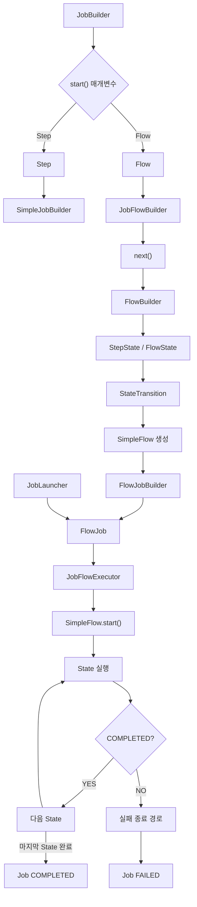

이 구조에서 핵심은 다음과 같다.

JobBuilder는 start()의 매개변수에 따라 서로 다른 Builder를 반환한다.

Flow를 전달하면 JobFlowBuilder가 반환된다.

JobFlowBuilder는 FlowBuilder를 상속하므로 next() 등을 이용해 실행 흐름을 구성할 수 있다.

FlowBuilder는 Step과 Flow를 각각 StepState와 FlowState로 변환한다.

그리고 Transition을 정의한다.

build() 과정에서는 SimpleFlow가 생성된다.

최종적으로 FlowJob이 생성되면 내부에 해당 SimpleFlow가 저장된다.

Job이 실행되면 FlowJob은 JobFlowExecutor를 통해 SimpleFlow를 실행한다.

SimpleFlow는 현재 State를 실행한다.

그리고 반환된 FlowExecutionStatus에 따라 다음 Transition을 선택한다.

현재 State가 정상적으로 완료되었다면 다음 State로 진행한다.

반면 실패했다면 기본적으로 실패 종료 경로로 진행한다.

이러한 구조 때문에 FlowJob은 다양한 Flow를 하나의 실행 흐름으로 연결할 수 있으며, start()와 next()만 사용해도 순차적인 배치 작업을 구성할 수 있다.

---

### 정리

Spring Batch의 `start()`와 `next()`는 Job과 Flow의 실행 순서를 정의하는 API다.

start()는 가장 먼저 실행할 대상을 설정한다.

next()는 이전 실행 대상이 정상적으로 완료된 후 다음에 실행할 대상을 설정한다.

두 API는 Step과 Flow를 전달받을 수 있다.

특히 JobBuilder에서 start(Step)을 호출하면 SimpleJobBuilder가 반환된다.

반면 start(Flow)를 호출하면 JobFlowBuilder가 반환된다.

따라서 FlowJob을 구성할 때는 다음과 같이 사용할 수 있다.

```java
new JobBuilder("flowJob", jobRepository)
        .start(flowA)
        .next(step3)
        .next(flowB)
        .next(step6)
        .end()
        .build();
```

여기서 Flow A와 Flow B는 FlowBuilder를 통해 별도로 생성한다.

```java
new FlowBuilder<SimpleFlow>("flowA")
        .start(step1)
        .next(step2)
        .build();
```

FlowBuilder는 Step과 Transition을 구성한다.

그리고 최종적으로 SimpleFlow를 생성한다.

SimpleFlow는 FlowJob 내부에서 실제 실행 흐름을 관리한다.

이때 Step은 StepState로 변환된다.

Flow는 FlowState로 변환된다.

따라서 하나의 SimpleFlow 안에서 Step과 Flow를 함께 관리할 수 있다.

또한 next()는 내부적으로 COMPLETED에 해당하는 Transition을 추가한다.

그리고 정상 완료가 아닌 상태에 대한 실패 종료 경로도 추가한다.

따라서 단순히 start()와 next()로 구성한 FlowJob에서는 중간 Step이 실패하면 후속 Step이 실행되지 않는다.

이러한 동작은 SimpleJob의 순차 실행 규칙과 유사하다.

하지만 두 구현체의 내부 실행 구조는 다르다.

SimpleJob은 Step 목록을 순차적으로 실행한다.

반면 FlowJob은 SimpleFlow의 State와 Transition을 이용해 실행을 제어한다.

따라서 이후 on()과 to() 등의 API를 사용하면 실패나 사용자 정의 종료 상태에 따른 조건부 실행 경로를 추가할 수 있다.

또한 Flow는 별도의 JobExecution을 생성하지 않는다.

Flow 내부에서 실행된 Step들은 같은 JobExecution에 속한다.

따라서 Flow는 독립적인 Job이 아니라 여러 Step의 실행 순서를 정의하는 객체로 이해해야 한다.

최종적으로 start()와 next()의 핵심은 다음과 같다.

| API | 핵심 역할 |
|---|---|
| start(Step) | Step을 시작점으로 지정하고 SimpleJobBuilder 반환 |
| start(Flow) | Flow를 시작점으로 지정하고 JobFlowBuilder 반환 |
| next(Step) | 정상 완료 후 다음 Step으로 이동 |
| next(Flow) | 정상 완료 후 다음 Flow로 이동 |
| FlowBuilder.build() | SimpleFlow 생성 |
| JobFlowBuilder.end() | Job의 Flow 구성을 완료하고 FlowJobBuilder 반환 |
| FlowJobBuilder.build() | FlowJob 생성 |

결국 **start()와 next()는 Step과 Flow를 연결해 전체 배치 실행 구조를 정의하는 기본 API이며, FlowBuilder가 생성하는 State와 Transition을 통해 순차적인 실행 흐름을 관리한다.**

#### 한 줄 요약

> Spring Batch의 `start()`와 `next()`는 Job 또는 Flow의 실행 순서를 정의하는 API다. `start(Step)`은 `SimpleJobBuilder`를 반환하고, `start(Flow)`는 `JobFlowBuilder`를 반환한다. `FlowBuilder<SimpleFlow>`를 이용하면 여러 Step을 하나의 Flow로 구성할 수 있으며, 이를 FlowJob에서 `start()`와 `next()`로 연결할 수 있다. 이때 `next()`는 기본적으로 이전 실행 대상이 COMPLETED일 때 다음 대상으로 이동하도록 Transition을 구성하므로, 중간 Step이 FAILED로 종료되면 후속 Step은 실행되지 않고 Job도 FAILED로 종료된다.

## Transition - 배치상태 유형 (BatchStatus / ExitStatus / FlowExecutionStatus) 


### Spring Batch Transition과 상태 관리 이해: BatchStatus, ExitStatus, FlowExecutionStatus의 차이와 실행 원리

Spring Batch는 Job과 Step의 실행 상태를 관리하기 위해 여러 종류의 상태 객체를 사용한다.

대표적인 객체는 다음 세 가지다.

1. `BatchStatus`
2. `ExitStatus`
3. `FlowExecutionStatus`

세 객체는 모두 실행 상태와 관련되어 있지만 각각 다른 역할을 담당한다.

일반적인 배치 작업을 생각해보자.

```text
SettlementJob
    │
    ▼
ValidationStep
    │
    ▼
CalculationStep
    │
    ▼
SettlementStep
    │
    ▼
Job 종료
```

이 Job이 실행되면 각 Step은 성공하거나 실패할 수 있다.

예를 들어 ValidationStep이 성공하면 다음 Step을 실행한다.

반면 ValidationStep에서 예외가 발생하면 일반적인 순차 실행 Job에서는 작업이 중단된다.

Spring Batch는 이러한 실행 결과를 `BatchStatus`와 `ExitStatus`에 기록한다.

그런데 다음과 같은 상황을 생각해보자.

ValidationStep의 비즈니스 로직은 정상적으로 실행되었다.

하지만 검증 결과 정산 대상 데이터에 일부 불일치가 발견되었다.

이 경우 Step 자체는 정상적으로 완료되었지만 비즈니스 관점에서는 추가적인 검증 작업이 필요하다.

이를 다음과 같이 표현할 수 있다.

```text
ValidationStep
    │
    ├── BatchStatus = COMPLETED
    │
    └── ExitStatus = REVIEW_REQUIRED
```

여기서 BatchStatus는 실제 Step 실행이 정상적으로 완료되었다는 사실을 나타낸다.

반면 ExitStatus는 검증 결과 추가적인 확인이 필요하다는 사실을 표현한다.

이처럼 **기술적인 실행 결과와 비즈니스적인 처리 결과는 서로 다를 수 있다.**

Spring Batch는 이러한 차이를 표현하기 위해 BatchStatus와 ExitStatus를 분리한다.

또한 FlowJob에서는 Step의 ExitStatus를 이용해 다음 실행 경로를 결정한다.

```text
ValidationStep
    │
    ├── COMPLETED
    │       │
    │       ▼
    │   SettlementStep
    │
    └── REVIEW_REQUIRED
            │
            ▼
        ReviewStep
```

이러한 실행 경로의 변경을 `Transition`이라고 한다.

Transition은 특정 실행 결과에 따라 현재 실행 상태에서 다른 상태로 이동하는 규칙이다.

Spring Batch에서는 `on()`, `to()`, `from()`, `end()`, `fail()`, `stop()`, `stopAndRestart()` 등의 API를 이용해 Transition을 정의한다.

이번에는 세 가지 상태 객체의 차이와 함께 SimpleJob과 FlowJob이 실행 상태를 처리하는 내부 구조를 살펴보자.

---

### 개념

#### Spring Batch의 세 가지 상태 유형

Spring Batch에서는 실행 상태를 크게 세 가지로 구분한다.

| 구분 | BatchStatus | ExitStatus | FlowExecutionStatus |
|---|---|---|---|
| 목적 | 실행 상태 관리 | 종료 코드 관리 | Flow 실행 상태 관리 |
| 타입 | Enum | Class | Class |
| 사용 객체 | JobExecution, StepExecution | JobExecution, StepExecution | FlowExecution |
| 주요 값 | COMPLETED, FAILED, STARTED 등 | COMPLETED, FAILED, 사용자 정의 코드 등 | COMPLETED, FAILED, STOPPED 등 |
| 사용자 정의 | 새로운 Enum 값 추가 불가 | 사용자 정의 종료 코드 가능 | 사용자 정의 상태 이름 가능 |
| 주요 역할 | 실행 및 재시작 판단 | 처리 결과 표현과 조건부 분기 | Flow 상태 전이와 최종 결과 전달 |

이 세 가지 객체를 이해할 때 가장 중요한 것은 책임의 차이다.

`BatchStatus`는 실제로 작업이 어떤 실행 상태에 있는지를 표현한다.

`ExitStatus`는 작업이 어떤 종료 코드를 남겼는지를 표현한다.

`FlowExecutionStatus`는 Flow 내부에서 상태 전이를 결정하고 최종 Flow 결과를 전달한다.

일반적인 실행에서는 세 값이 모두 COMPLETED로 끝날 수 있다.

하지만 반드시 동일한 값을 가져야 하는 것은 아니다.

특히 FlowJob에서는 상태가 서로 다르게 설정되는 상황이 자주 발생할 수 있다.

---

### BatchStatus란?

`BatchStatus`는 JobExecution과 StepExecution의 실행 상태를 나타내는 Enum이다.

예를 들어 다음과 같이 사용할 수 있다.

```java
BatchStatus status = BatchStatus.COMPLETED;
```

또는 현재 StepExecution의 실행 상태를 확인할 수 있다.

```java
BatchStatus status = stepExecution.getStatus();
```

JobExecution에서도 동일하게 사용할 수 있다.

```java
BatchStatus status = jobExecution.getStatus();
```

BatchStatus는 Job이나 Step이 실행 중인지, 정상적으로 완료되었는지, 실패했는지 등을 나타낸다.

#### BatchStatus의 8가지 상태

Spring Batch 5.2.4의 BatchStatus는 다음과 같이 정의되어 있다.

```java
public enum BatchStatus {

    COMPLETED,

    STARTING,

    STARTED,

    STOPPING,

    STOPPED,

    FAILED,

    ABANDONED,

    UNKNOWN
}
```

각 상태의 의미는 다음과 같다.

| 상태 | 의미 |
|---|---|
| COMPLETED | 작업이 정상적으로 완료된 상태 |
| STARTING | 작업 실행이 준비 중인 상태 |
| STARTED | 작업이 실제로 실행 중인 상태 |
| STOPPING | 중단 요청을 받고 종료를 진행하는 상태 |
| STOPPED | 작업이 중단된 상태 |
| FAILED | 실행 중 오류가 발생하여 실패한 상태 |
| ABANDONED | 정상 완료하지 못했지만 재시작 시 실행을 생략해야 하는 상태 |
| UNKNOWN | 실행 결과를 확정하기 어려운 상태 |

여기서 주의해야 할 상태는 `FAILED`, `ABANDONED`, `UNKNOWN`이다.

#### FAILED

FAILED는 작업이 실패했다는 의미다.

일반적으로 실패한 JobInstance는 재시작할 수 있다.

다만 `preventRestart()` 설정이나 다른 실행 제한 조건에 따라 재시작이 금지될 수 있다.

#### ABANDONED

ABANDONED는 정상적인 완료 상태가 아니지만 재시작 시 해당 Step을 다시 실행하지 않도록 처리하는 상태다.

따라서 FAILED와 구분해야 한다.

FAILED는 재실행 대상이 될 수 있다.

반면 ABANDONED는 일반적인 Step 재시작 과정에서 실행을 생략하는 데 사용된다.

#### UNKNOWN

UNKNOWN은 실행 상태를 정확하게 판단할 수 없다는 의미다.

예를 들어 메타데이터 저장 과정에서 오류가 발생하면 실제 비즈니스 처리는 완료되었는지, 저장은 성공했는지 확정하기 어려울 수 있다.

이러한 상황에서 무조건 재시작하면 중복 데이터가 발생할 수 있다.

따라서 Spring Batch는 UNKNOWN 상태에 대해 보수적으로 처리한다.

---

### BatchStatus는 단순한 성공·실패 값이 아니다

BatchStatus는 실행 상태뿐 아니라 상태 간 우선순위를 관리하는 기능도 제공한다.

대표적인 메서드는 다음과 같다.

```java
BatchStatus.max(status1, status2);
```

```java
status1.upgradeTo(status2);
```

예를 들어 JobExecution이나 StepExecution의 상태를 갱신할 때 다음과 같은 메서드를 사용한다.

```java
stepExecution.upgradeStatus(
        BatchStatus.COMPLETED
);
```

여기서 `upgradeStatus()`는 전달받은 상태를 무조건 덮어쓰는 메서드가 아니다.

내부적으로 상태의 우선순위를 고려한다.

예를 들어 이미 FAILED 상태인 Step에 COMPLETED를 전달했다고 해서 무조건 COMPLETED로 변경되지는 않는다.

이러한 동작은 실행 도중 발생한 실패 상태가 이후 정상 처리 과정에서 잘못 덮어써지는 문제를 방지하는 데 도움이 된다.

따라서 BatchStatus를 단순한 문자열 상태값으로 이해하기보다는 **실행 상태의 변경 규칙을 포함한 Enum**으로 이해하는 것이 좋다.

---

### ExitStatus란?

`ExitStatus`는 Job이나 Step이 어떤 종료 코드로 실행을 마쳤는지 나타내는 객체다.

BatchStatus와 달리 Enum이 아닌 클래스다.

따라서 사용자 정의 종료 코드를 생성할 수 있다.

예를 들어 다음과 같다.

```java
ExitStatus exitStatus = ExitStatus.COMPLETED;
```

또는 사용자 정의 종료 코드를 생성할 수도 있다.

```java
ExitStatus exitStatus =
        new ExitStatus("REVIEW_REQUIRED");
```

이것이 BatchStatus와 ExitStatus의 중요한 차이다.

BatchStatus는 정해진 Enum 값만 사용할 수 있다.

반면 ExitStatus는 비즈니스 요구사항에 맞는 종료 코드를 표현할 수 있다.

#### ExitStatus의 기본 상수

Spring Batch 5.2.4에서는 다음과 같은 기본 상수를 제공한다.

```java
public static final ExitStatus UNKNOWN =
        new ExitStatus("UNKNOWN");

public static final ExitStatus EXECUTING =
        new ExitStatus("EXECUTING");

public static final ExitStatus COMPLETED =
        new ExitStatus("COMPLETED");

public static final ExitStatus NOOP =
        new ExitStatus("NOOP");

public static final ExitStatus FAILED =
        new ExitStatus("FAILED");

public static final ExitStatus STOPPED =
        new ExitStatus("STOPPED");
```

각 상태는 다음과 같은 의미를 가진다.

| 상태 | 의미 |
|---|---|
| UNKNOWN | 종료 결과를 알 수 없는 상태 |
| EXECUTING | 실행이 진행 중인 상태 |
| COMPLETED | 정상 완료 |
| NOOP | 실제 처리 작업을 수행하지 않은 상태 |
| FAILED | 실패 종료 |
| STOPPED | 중단 종료 |

여기서 중요한 점은 ExitStatus가 별도의 종료 코드 문자열을 가진다는 사실이다.

#### exitCode 속성

ExitStatus에는 다음 필드가 존재한다.

```java
private final String exitCode;
```

실제 종료 코드를 조회할 때는 다음 메서드를 사용한다.

```java
String exitCode =
        stepExecution.getExitStatus().getExitCode();
```

예를 들어 Step의 ExitStatus가 FAILED라면 다음 문자열을 얻을 수 있다.

```text
FAILED
```

사용자 정의 ExitStatus를 설정했다면 해당 문자열이 반환된다.

```text
REVIEW_REQUIRED
```

따라서 ExitStatus는 단순한 성공·실패뿐 아니라 비즈니스 상태를 표현할 수 있다.

---

### ExitStatus는 사용자 정의 종료 코드를 지원한다

예를 들어 결제 대사 시스템을 생각해보자.

외부 PG사의 거래 내역과 내부 거래 내역을 비교하는 Step이 있다고 가정한다.

대사 결과는 다음과 같이 구분할 수 있다.

| 종료 코드 | 의미 |
|---|---|
| COMPLETED | 대사 정상 완료 |
| NO_DATA | 대사 대상 데이터 없음 |
| DISCREPANCY_FOUND | 결제 내역 불일치 발견 |
| REVIEW_REQUIRED | 수동 확인 필요 |
| FAILED | 시스템 오류로 실행 실패 |

이러한 상태는 기술적인 실패 여부와는 다른 개념이다.

예를 들어 결제 내역에 불일치가 발견되었다고 해서 Java 예외가 반드시 발생해야 하는 것은 아니다.

시스템은 정상적으로 거래 내역을 비교했다.

다만 비교 결과 불일치가 존재할 뿐이다.

따라서 다음과 같이 표현할 수 있다.

```text
BatchStatus = COMPLETED

ExitStatus = DISCREPANCY_FOUND
```

이렇게 구분하면 FlowJob에서 비즈니스 결과에 따른 분기를 구현할 수 있다.

```text
ReconciliationStep
    │
    ├── COMPLETED
    │       │
    │       ▼
    │   SettlementStep
    │
    └── DISCREPANCY_FOUND
            │
            ▼
        DiscrepancyReportStep
```

즉, ExitStatus를 사용하면 시스템 오류와 비즈니스 결과를 분리할 수 있다.

---

### BatchStatus와 ExitStatus가 서로 다른 이유

두 상태는 서로 연관되어 있지만 동일한 개념은 아니다.

기본적인 실행에서는 다음과 같이 설정된다.

```text
정상 실행

BatchStatus = COMPLETED

ExitStatus = COMPLETED
```

```text
실행 중 예외 발생

BatchStatus = FAILED

ExitStatus = FAILED
```

하지만 개발자가 별도의 종료 코드를 설정하면 두 값이 달라질 수 있다.

예를 들어 Tasklet에서 다음과 같이 구현했다고 생각해보자.

```java
@Override
public RepeatStatus execute(
        StepContribution contribution,
        ChunkContext chunkContext
) {

    contribution.setExitStatus(
            ExitStatus.FAILED
    );

    return RepeatStatus.FINISHED;
}
```

이 코드에서 실제 비즈니스 로직은 예외 없이 종료된다.

또한 RepeatStatus.FINISHED를 반환했다.

따라서 일반적인 실행에서는 Step의 BatchStatus가 COMPLETED로 설정된다.

하지만 ExitStatus는 FAILED로 설정할 수 있다.

최종 결과는 다음과 같다.

```text
StepExecution

BatchStatus = COMPLETED

ExitStatus = FAILED
```

여기서 중요한 사실이 있다.

**ExitStatus를 FAILED로 설정했다고 해서 BatchStatus도 자동으로 FAILED가 되는 것은 아니다.**

두 상태는 서로 독립적으로 관리되기 때문이다.

반대로 비즈니스 로직에서 실제 예외가 발생하면 AbstractStep은 실패 처리 과정에서 BatchStatus와 ExitStatus를 갱신한다.

따라서 다음 두 상황을 구분해야 한다.

| 상황 | BatchStatus | ExitStatus |
|---|---|---|
| 정상 실행 | COMPLETED | COMPLETED |
| 예외 발생 | FAILED | FAILED |
| 정상 실행 후 FAILED 종료 코드 설정 | COMPLETED | FAILED |
| 정상 실행 후 사용자 정의 코드 설정 | COMPLETED | REVIEW_REQUIRED |

이 구분은 FlowJob의 조건부 실행을 이해할 때 중요하다.

---

### ExitStatus.and()의 동작 원리

ExitStatus는 불변 객체다.

따라서 기존 객체의 값을 직접 변경하는 대신 새로운 ExitStatus를 반환하는 방식으로 상태를 결합한다.

대표적인 메서드가 다음과 같다.

```java
ExitStatus result =
        exitStatus1.and(exitStatus2);
```

Spring Batch 5.2.4의 핵심 구현은 다음과 같다.

```java
public ExitStatus and(ExitStatus status) {

    if (status == null) {
        return this;
    }

    ExitStatus result =
            addExitDescription(status.exitDescription);

    if (compareTo(status) < 0) {

        result = result.replaceExitCode(
                status.exitCode
        );
    }

    return result;
}
```

이 메서드는 두 ExitStatus 중 우선순위가 높은 종료 코드를 선택한다.

또한 ExitDescription을 결합한다.

따라서 ExitStatus.and()는 단순한 문자열 연결이 아니다.

#### ExitStatus의 우선순위

Spring Batch 5.2.4에서는 종료 코드에 따라 다음과 같은 우선순위를 사용한다.

| 종료 코드 접두어 | 우선순위 |
|---|---:|
| EXECUTING | 1 |
| COMPLETED | 2 |
| NOOP | 3 |
| STOPPED | 4 |
| FAILED | 5 |
| UNKNOWN | 6 |
| 사용자 정의 코드 | 7 |

숫자가 클수록 높은 우선순위를 가진다.

예를 들어 다음 코드를 살펴보자.

```java
ExitStatus result =
        ExitStatus.COMPLETED.and(
                ExitStatus.FAILED
        );
```

결과는 다음과 같다.

```text
FAILED
```

FAILED가 COMPLETED보다 높은 우선순위를 가지기 때문이다.

반면 다음 코드를 살펴보자.

```java
ExitStatus result =
        ExitStatus.COMPLETED.and(
                new ExitStatus("REVIEW_REQUIRED")
        );
```

REVIEW_REQUIRED는 기본 종료 코드에 해당하지 않는다.

따라서 사용자 정의 코드의 우선순위가 적용된다.

결과는 다음과 같다.

```text
REVIEW_REQUIRED
```

이러한 동작 때문에 StepExecutionListener의 afterStep()에서 사용자 정의 ExitStatus를 반환할 수 있다.

다만 사용자 정의 코드가 항상 기존 종료 코드를 단순하게 덮어쓴다고 이해해서는 안 된다.

실제 결과는 ExitStatus.and()의 우선순위 규칙에 따라 결정된다.

---

### FlowExecutionStatus란?

`FlowExecutionStatus`는 Flow의 실행 상태를 나타내는 객체다.

Spring Batch에서 Flow는 여러 Step이나 다른 Flow의 실행 경로를 관리한다.

따라서 Flow 내부에서도 현재 실행 결과를 표현할 상태 객체가 필요하다.

이때 사용하는 것이 FlowExecutionStatus다.

대표적으로 다음과 같이 사용할 수 있다.

```java
FlowExecutionStatus status =
        FlowExecutionStatus.COMPLETED;
```

또는 다음과 같이 사용자 정의 상태를 생성할 수 있다.

```java
FlowExecutionStatus status =
        new FlowExecutionStatus("REVIEW_REQUIRED");
```

여기서 중요한 점은 FlowExecutionStatus도 Enum이 아닌 클래스라는 사실이다.

기본적으로 다음 네 가지 상수를 제공한다.

```java
public static final FlowExecutionStatus COMPLETED;

public static final FlowExecutionStatus STOPPED;

public static final FlowExecutionStatus FAILED;

public static final FlowExecutionStatus UNKNOWN;
```

하지만 네 가지 상태만 표현할 수 있다는 의미는 아니다.

사용자 정의 문자열을 전달해 새로운 FlowExecutionStatus를 생성할 수 있다.

#### FlowExecutionStatus의 특징

| 항목 | 설명 |
|---|---|
| 타입 | Class |
| 주요 사용 객체 | FlowExecution |
| 기본 상수 | COMPLETED, STOPPED, FAILED, UNKNOWN |
| 사용자 정의 코드 | 가능 |
| 주요 역할 | Flow 상태 전이와 최종 실행 결과 |
| Step과의 관계 | Step의 ExitStatus를 이용해 생성 가능 |
| Job과의 관계 | FlowJob의 최종 상태 결정에 사용 |

따라서 FlowExecutionStatus는 Step의 ExitStatus와 Job의 최종 상태를 연결하는 중요한 객체다.

---

### 세 가지 상태가 연결되는 과정

이번에는 세 상태가 실제로 어떻게 연결되는지 살펴보자.

FlowJob이 실행되면 내부적으로 Step을 실행한다.

Step이 실행되면 StepExecution에는 BatchStatus와 ExitStatus가 저장된다.

예를 들어 다음과 같다.

```text
StepExecution

BatchStatus = COMPLETED

ExitStatus = REVIEW_REQUIRED
```

FlowJob은 해당 Step의 종료 코드를 이용해 FlowExecutionStatus를 생성한다.

```text
FlowExecutionStatus = REVIEW_REQUIRED
```

이후 SimpleFlow는 해당 값을 기준으로 다음 Transition을 선택한다.

```text
REVIEW_REQUIRED → ReviewStep
```

ReviewStep이 실행된 후 최종 Flow 상태가 결정된다.

마지막으로 FlowJob은 최종 FlowExecutionStatus를 JobExecution에 반영한다.

전체 구조는 다음과 같다.

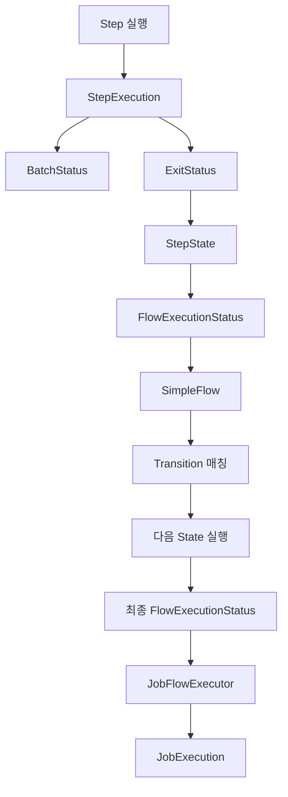

여기서 중요한 점은 Step의 BatchStatus가 FlowExecutionStatus로 직접 복사되는 구조가 아니라는 사실이다.

Spring Batch 5.2.4의 StepState는 FlowExecutor를 통해 Step을 실행한다.

그리고 Step의 ExitStatus 종료 코드를 이용해 FlowExecutionStatus를 생성한다.

따라서 `on()`을 이용한 조건부 실행은 ExitStatus의 영향을 받는다.

---

### SimpleJob의 상태 처리 구조

SimpleJob은 등록된 Step을 순차적으로 실행한다.

예를 들어 다음과 같은 Job이 있다고 생각해보자.

```text
SimpleJob
    │
    ├── Step 1
    │
    └── Step 2
```

SimpleJob은 Step 1부터 실행한다.

Step 1이 정상적으로 완료되면 Step 2로 진행한다.

하지만 Step 1이 실패하면 Step 2는 실행하지 않는다.

Spring Batch 5.2.4의 SimpleJob은 다음과 같은 구조를 가진다.

```java
@Override
protected void doExecute(
        JobExecution execution
) throws JobInterruptedException,
         JobRestartException,
         StartLimitExceededException {

    StepExecution stepExecution = null;

    for (Step step : steps) {

        stepExecution =
                handleStep(step, execution);

        if (
            stepExecution.getStatus()
                    != BatchStatus.COMPLETED
        ) {
            break;
        }
    }

    if (stepExecution != null) {

        execution.upgradeStatus(
                stepExecution.getStatus()
        );

        execution.setExitStatus(
                stepExecution.getExitStatus()
        );
    }
}
```

이 코드가 SimpleJob의 상태 처리 방식에서 가장 중요한 부분이다.

크게 두 가지 과정으로 구분할 수 있다.

첫 번째는 Step을 순차적으로 실행하는 과정이다.

두 번째는 마지막 StepExecution의 상태를 JobExecution에 반영하는 과정이다.

---

### SimpleJob의 첫 번째 과정: Step 실행

다음 코드를 살펴보자.

```java
for (Step step : steps) {

    stepExecution =
            handleStep(step, execution);

    if (
        stepExecution.getStatus()
                != BatchStatus.COMPLETED
    ) {
        break;
    }
}
```

SimpleJob은 등록된 Step을 순서대로 실행한다.

그리고 각 Step의 BatchStatus를 확인한다.

COMPLETED가 아니라면 반복문을 종료한다.

예를 들어 Step 1이 FAILED로 종료되었다고 생각해보자.

```text
Step 1

BatchStatus = FAILED

ExitStatus = FAILED
```

이 경우 다음 Step으로 진행하지 않는다.

따라서 Step 2는 실행되지 않는다.

최종적으로 실행된 Step은 Step 1이다.

반면 Step 1이 COMPLETED라면 다음 Step으로 진행한다.

```text
Step 1 → COMPLETED

Step 2 → 실행
```

여기서 중요한 것은 **SimpleJob이 다음 Step으로 진행할지 결정할 때 BatchStatus를 확인한다는 사실**이다.

ExitStatus가 사용자 정의 코드여도 BatchStatus가 COMPLETED라면 다음 Step으로 진행할 수 있다.

---

### SimpleJob의 두 번째 과정: 마지막 Step 상태 반영

Step 실행이 종료되면 다음 코드가 실행된다.

```java
execution.upgradeStatus(
        stepExecution.getStatus()
);
```

이 코드는 마지막 StepExecution의 BatchStatus를 JobExecution에 반영한다.

그리고 다음 코드가 실행된다.

```java
execution.setExitStatus(
        stepExecution.getExitStatus()
);
```

마지막 StepExecution의 ExitStatus를 JobExecution에 반영한다.

따라서 다음과 같은 관계가 만들어진다.

```text
마지막 StepExecution
    │
    ├── BatchStatus
    │       │
    │       ▼
    │   JobExecution.BatchStatus
    │
    └── ExitStatus
            │
            ▼
        JobExecution.ExitStatus
```

예를 들어 다음과 같은 실행 결과가 있다고 생각해보자.

```text
Step 1
    │
    ├── BatchStatus = COMPLETED
    └── ExitStatus = COMPLETED

Step 2
    │
    ├── BatchStatus = COMPLETED
    └── ExitStatus = FAILED
```

이 경우 SimpleJob은 Step 2의 BatchStatus가 COMPLETED이므로 정상적으로 반복문을 종료한다.

그리고 마지막 Step인 Step 2의 상태를 Job에 반영한다.

최종 결과는 다음과 같다.

```text
JobExecution

BatchStatus = COMPLETED

ExitStatus = FAILED
```

이것이 SimpleJob에서 BatchStatus와 ExitStatus를 구분해야 하는 대표적인 사례다.

---

### SimpleJob의 실행 결과 비교

두 개의 Step으로 구성된 SimpleJob을 생각해보자.

| 실행 상황 | Step 1 BatchStatus | Step 2 BatchStatus | Step 2 ExitStatus | Job BatchStatus | Job ExitStatus |
|---|---|---|---|---|---|
| 전체 성공 | COMPLETED | COMPLETED | COMPLETED | COMPLETED | COMPLETED |
| Step 1 실패 | FAILED | 미실행 | 없음 | FAILED | FAILED |
| Step 2 예외 발생 | COMPLETED | FAILED | FAILED | FAILED | FAILED |
| Step 2에서 FAILED 종료 코드 설정 | COMPLETED | COMPLETED | FAILED | COMPLETED | FAILED |
| Step 2에서 REVIEW_REQUIRED 설정 | COMPLETED | COMPLETED | REVIEW_REQUIRED | COMPLETED | REVIEW_REQUIRED |

마지막 두 상황이 중요하다.

실제 Step 실행은 정상적으로 완료되었다.

하지만 종료 코드는 FAILED 또는 REVIEW_REQUIRED로 설정했다.

따라서 BatchStatus와 ExitStatus가 달라질 수 있다.

이 구조를 이해하면 SimpleJob의 최종 실행 상태를 예측할 수 있다.

---

### FlowJob의 상태 처리 구조

이번에는 FlowJob을 살펴보자.

FlowJob은 SimpleJob처럼 Step 목록을 직접 순회하지 않는다.

내부적으로 Flow를 가지고 있다.

대표적인 구현체는 SimpleFlow다.

```text
FlowJob
    │
    ▼
SimpleFlow
    │
    ├── StepState 1
    ├── StepState 2
    └── StateTransition
```

FlowJob은 SimpleFlow의 실행 결과를 이용해 JobExecution 상태를 결정한다.

Spring Batch 5.2.4의 FlowJob에서 중요한 코드는 다음과 같다.

```java
@Override
protected void doExecute(
        final JobExecution execution
) throws JobExecutionException {

    JobFlowExecutor executor =
            new JobFlowExecutor(
                    getJobRepository(),
                    new SimpleStepHandler(
                            getJobRepository()
                    ),
                    execution
            );

    executor.updateJobExecutionStatus(
            flow.start(executor).getStatus()
    );
}
```

위 코드는 예외 처리 부분을 제외한 핵심 실행 구조다.

여기서 중요한 메서드는 두 가지다.

```java
flow.start(executor)
```

그리고 다음 메서드다.

```java
executor.updateJobExecutionStatus(...)
```

첫 번째 메서드는 Flow를 실행한다.

두 번째 메서드는 최종 FlowExecutionStatus를 JobExecution에 반영한다.

---

### FlowJob의 첫 번째 과정: SimpleFlow 실행

FlowJob은 다음 메서드를 호출한다.

```java
flow.start(executor);
```

이때 flow는 일반적으로 SimpleFlow다.

SimpleFlow는 현재 State를 실행한다.

State가 StepState라면 실제 Step을 실행한다.

Step이 종료되면 해당 Step의 ExitStatus를 FlowExecutionStatus로 변환한다.

Spring Batch 5.2.4의 StepState에는 다음과 같은 코드가 존재한다.

```java
@Override
public FlowExecutionStatus handle(
        FlowExecutor executor
) throws Exception {

    executor.abandonStepExecution();

    return new FlowExecutionStatus(
            executor.executeStep(step)
    );
}
```

여기서 `executor.executeStep(step)`은 Step을 실행하고 ExitStatus의 종료 코드를 반환한다.

따라서 다음과 같은 관계가 만들어진다.

```text
StepExecution.ExitStatus
          │
          ▼
      ExitCode
          │
          ▼
FlowExecutionStatus
```

예를 들어 Step이 다음 상태로 종료되었다고 생각해보자.

```text
BatchStatus = COMPLETED

ExitStatus = REVIEW_REQUIRED
```

그러면 다음 FlowExecutionStatus가 생성될 수 있다.

```text
FlowExecutionStatus = REVIEW_REQUIRED
```

이 값은 이후 Transition을 선택하는 데 사용된다.

---

### FlowJob의 두 번째 과정: Transition 결정

SimpleFlow는 현재 State의 FlowExecutionStatus를 기준으로 다음 State를 결정한다.

예를 들어 다음과 같은 Transition이 있다고 생각해보자.

```java
.start(validationStep)
    .on("COMPLETED").to(settlementStep)
.from(validationStep)
    .on("REVIEW_REQUIRED").to(reviewStep)
.end()
.build();
```

ValidationStep의 ExitStatus가 COMPLETED라면 SettlementStep으로 진행한다.

반면 ExitStatus가 REVIEW_REQUIRED라면 ReviewStep으로 진행한다.

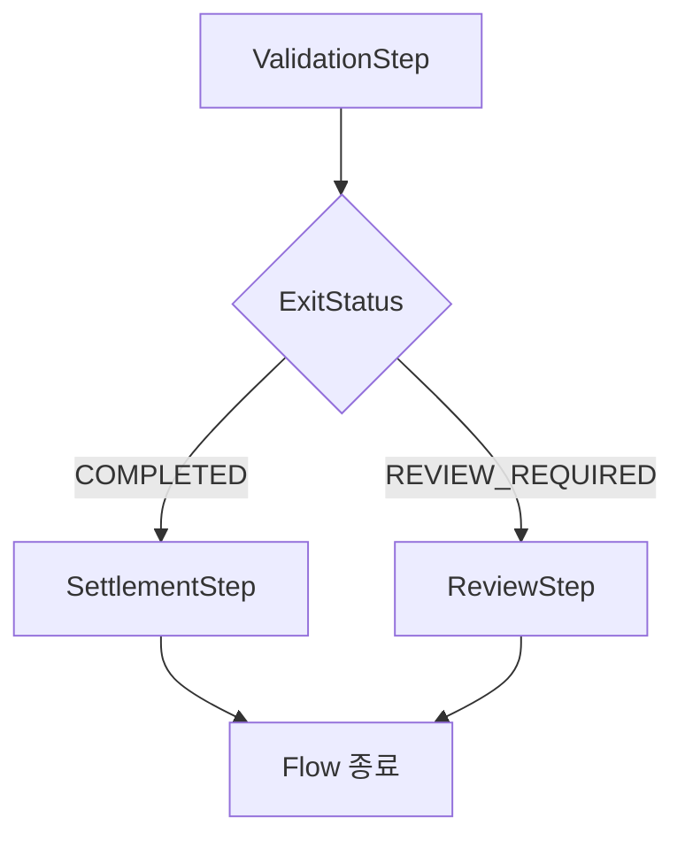

여기서 중요한 것은 ExitStatus를 기준으로 분기한다는 사실이다.

ValidationStep의 BatchStatus가 COMPLETED여도 ExitStatus가 REVIEW_REQUIRED라면 ReviewStep으로 이동한다.

즉, FlowJob은 Step의 기술적인 실행 상태와 비즈니스 종료 코드를 분리해서 처리할 수 있다.

---

### FlowJob의 세 번째 과정: 최종 FlowExecutionStatus 반영

SimpleFlow의 실행이 종료되면 최종 FlowExecutionStatus가 반환된다.

FlowJob은 이 값을 JobFlowExecutor에 전달한다.

```java
executor.updateJobExecutionStatus(
        flow.start(executor).getStatus()
);
```

JobFlowExecutor의 실제 구현은 다음과 같다.

```java
@Override
public void updateJobExecutionStatus(
        FlowExecutionStatus status
) {

    execution.setStatus(
            findBatchStatus(status)
    );

    exitStatus = exitStatus.and(
            new ExitStatus(
                    status.getName()
            )
    );

    execution.setExitStatus(exitStatus);
}
```

이 코드는 매우 중요하다.

최종 FlowExecutionStatus의 이름을 기준으로 JobExecution의 BatchStatus를 결정한다.

그리고 해당 이름으로 ExitStatus를 생성해 기존 종료 상태와 결합한다.

따라서 FlowJob은 마지막 StepExecution의 BatchStatus를 그대로 JobExecution에 복사하는 구조가 아니다.

**최종 FlowExecutionStatus를 이용해 JobExecution의 상태를 결정한다.**

이것이 SimpleJob과 FlowJob의 핵심적인 차이다.

---

### JobFlowExecutor.findBatchStatus() 내부 분석

FlowExecutionStatus는 문자열 기반 상태 객체다.

반면 BatchStatus는 Enum이다.

따라서 FlowExecutionStatus를 JobExecution의 BatchStatus에 반영하려면 변환 과정이 필요하다.

이때 사용하는 메서드가 다음과 같다.

```java
findBatchStatus(status)
```

Spring Batch 5.2.4의 구현은 다음과 같다.

```java
protected BatchStatus findBatchStatus(
        FlowExecutionStatus status
) {

    for (BatchStatus batchStatus
            : BatchStatus.values()) {

        if (
            status.getName().startsWith(
                    batchStatus.toString()
            )
        ) {

            return batchStatus;
        }
    }

    return BatchStatus.UNKNOWN;
}
```

이 코드는 FlowExecutionStatus의 이름을 BatchStatus와 비교한다.

예를 들어 다음과 같은 상태가 있다고 생각해보자.

```text
FlowExecutionStatus = COMPLETED
```

이 경우 BatchStatus.COMPLETED와 일치한다.

따라서 다음 값이 반환된다.

```java
BatchStatus.COMPLETED
```

반면 다음과 같은 상태라면

```text
FlowExecutionStatus = FAILED
```

다음 값이 반환된다.

```java
BatchStatus.FAILED
```

여기서 주의해야 할 부분이 있다.

FlowExecutionStatus는 사용자 정의 문자열을 가질 수 있다.

하지만 모든 사용자 정의 문자열이 BatchStatus에 대응되는 것은 아니다.

예를 들어 다음과 같다.

```text
FlowExecutionStatus = REVIEW_REQUIRED
```

이 문자열은 BatchStatus의 어떤 값으로도 시작하지 않는다.

따라서 findBatchStatus()가 직접 이 값을 변환한다면 UNKNOWN을 반환한다.

그렇기 때문에 사용자 정의 ExitStatus를 사용할 때는 최종 Job 종료 상태와 구분해야 한다.

일반적으로는 사용자 정의 ExitStatus를 이용해 다음 Transition을 선택하고, 해당 실행 경로의 최종 종료 상태를 COMPLETED, FAILED, STOPPED 등으로 명확하게 정의하는 것이 좋다.

---

### SimpleJob과 FlowJob의 최종 상태 결정 방식 비교

두 Job의 차이를 정리하면 다음과 같다.

| 구분 | SimpleJob | FlowJob |
|---|---|---|
| 실행 구조 | Step 순차 실행 | State와 Transition 실행 |
| Step 실행 결과 | StepExecution | StepExecution |
| 다음 실행 대상 결정 | BatchStatus 확인 | FlowExecutionStatus로 Transition 선택 |
| Job BatchStatus | 마지막 StepExecution의 BatchStatus 반영 | 최종 FlowExecutionStatus 변환 |
| Job ExitStatus | 마지막 StepExecution의 ExitStatus 반영 | 최종 FlowExecutionStatus 기반으로 반영 |
| 사용자 정의 분기 | 일반적인 순차 구조에서는 지원하지 않음 | 지원 |
| 주요 내부 클래스 | SimpleJob | SimpleFlow, JobFlowExecutor |

가장 중요한 차이는 최종 Job 상태를 결정하는 방식이다.

SimpleJob은 마지막 StepExecution의 상태를 사용한다.

반면 FlowJob은 최종 FlowExecutionStatus를 사용한다.

따라서 FlowJob에서는 중간 Step이 FAILED로 종료되었더라도 후속 실행 경로가 정상적으로 완료되면 전체 Job이 COMPLETED로 종료될 수 있다.

---

### 예제: BatchStatus와 ExitStatus가 달라지는 상황 구현하기

이번에는 실제 코드를 통해 세 가지 상태의 동작을 확인해보자.

두 개의 Job을 생성한다.

첫 번째는 SimpleJob이다.

두 번째는 FlowJob이다.

SimpleJob에서는 StepExecution의 BatchStatus와 ExitStatus를 다르게 설정하는 상황을 확인한다.

FlowJob에서는 사용자 정의 ExitStatus를 이용해 조건부 분기를 구현한다.

전체 구조는 다음과 같다.

```text
simpleStatusJob
    │
    ├── simpleStep1
    │
    └── simpleStep2
```

```text
flowStatusJob
    │
    ▼
validationStep
    │
    ├── COMPLETED
    │       │
    │       ▼
    │   settlementStep
    │
    ├── REVIEW_REQUIRED
    │       │
    │       ▼
    │   reviewStep
    │
    └── FAILED
            │
            ▼
        Job FAILED
```

사용할 환경은 다음과 같다.

| 구분 | 기술 |
|---|---|
| Java | Java 17 |
| Spring Boot | 3.4.13 |
| Spring Batch | 5.2.4 |
| Database | H2 |
| Build Tool | Maven |

---

### Maven 의존성 설정

`pom.xml`

```xml
<?xml version="1.0" encoding="UTF-8"?>
<project xmlns="http://maven.apache.org/POM/4.0.0"
         xmlns:xsi="http://www.w3.org/2001/XMLSchema-instance"
         xsi:schemaLocation="
             http://maven.apache.org/POM/4.0.0
             https://maven.apache.org/xsd/maven-4.0.0.xsd">

    <modelVersion>4.0.0</modelVersion>

    <parent>
        <groupId>org.springframework.boot</groupId>
        <artifactId>spring-boot-starter-parent</artifactId>
        <version>3.4.13</version>
        <relativePath/>
    </parent>

    <groupId>com.example</groupId>
    <artifactId>spring-batch-status-example</artifactId>
    <version>0.0.1-SNAPSHOT</version>

    <properties>
        <java.version>17</java.version>
        <spring-batch.version>5.2.4</spring-batch.version>
    </properties>

    <dependencies>

        <dependency>
            <groupId>org.springframework.boot</groupId>
            <artifactId>spring-boot-starter-batch</artifactId>
        </dependency>

        <dependency>
            <groupId>com.h2database</groupId>
            <artifactId>h2</artifactId>
            <scope>runtime</scope>
        </dependency>

        <dependency>
            <groupId>org.springframework.boot</groupId>
            <artifactId>spring-boot-starter-test</artifactId>
            <scope>test</scope>
        </dependency>

    </dependencies>

    <build>
        <plugins>
            <plugin>
                <groupId>org.springframework.boot</groupId>
                <artifactId>spring-boot-maven-plugin</artifactId>
            </plugin>
        </plugins>
    </build>

</project>
```

Spring Batch와 H2 데이터베이스를 사용한다.

이번 예제에서는 두 Job의 실행 결과를 비교하는 것이 목적이므로 인메모리 H2를 사용한다.

---

### application.yml 설정

`src/main/resources/application.yml`

```yaml
spring:
  application:
    name: spring-batch-status-example

  main:
    web-application-type: none

  datasource:
    url: jdbc:h2:mem:statusdb;DB_CLOSE_DELAY=-1
    driver-class-name: org.h2.Driver
    username: sa
    password:

  batch:
    job:
      enabled: true
      name: ${JOB_NAME:simpleStatusJob}

    jdbc:
      initialize-schema: always

logging:
  level:
    org.springframework.batch: INFO
    com.example.batch: INFO
```

이번에는 Job을 두 개 등록한다.

따라서 실행할 Job을 환경변수로 선택할 수 있도록 구성한다.

```yaml
spring:
  batch:
    job:
      name: ${JOB_NAME:simpleStatusJob}
```

JOB_NAME을 지정하지 않으면 simpleStatusJob이 실행된다.

반면 다음과 같이 환경변수를 설정하면

```bash
JOB_NAME=flowStatusJob
```

flowStatusJob을 실행할 수 있다.

---

### Spring Boot 애플리케이션

`BatchApplication.java`

```java
package com.example.batch;

import org.springframework.boot.SpringApplication;
import org.springframework.boot.autoconfigure.SpringBootApplication;

@SpringBootApplication
public class BatchApplication {

    public static void main(String[] args) {

        SpringApplication.run(
                BatchApplication.class,
                args
        );
    }
}
```

---

### StatusConfiguration 전체 코드

이번에는 SimpleJob과 FlowJob을 함께 구성한다.

`StatusConfiguration.java`

```java
package com.example.batch;

import org.slf4j.Logger;
import org.slf4j.LoggerFactory;

import org.springframework.batch.core.ExitStatus;
import org.springframework.batch.core.Job;
import org.springframework.batch.core.Step;

import org.springframework.batch.core.job.builder.JobBuilder;
import org.springframework.batch.core.repository.JobRepository;
import org.springframework.batch.core.step.builder.StepBuilder;

import org.springframework.batch.repeat.RepeatStatus;

import org.springframework.beans.factory.annotation.Qualifier;
import org.springframework.context.annotation.Bean;
import org.springframework.context.annotation.Configuration;

import org.springframework.transaction.PlatformTransactionManager;

@Configuration
public class StatusConfiguration {

    private static final Logger log =
            LoggerFactory.getLogger(
                    StatusConfiguration.class
            );

    // --------------------------------------------
    // 1. SimpleJob
    // --------------------------------------------

    @Bean
    public Job simpleStatusJob(
            JobRepository jobRepository,
            @Qualifier("simpleStep1") Step step1,
            @Qualifier("simpleStep2") Step step2
    ) {

        return new JobBuilder(
                "simpleStatusJob",
                jobRepository
        )
                .start(step1)
                .next(step2)
                .build();
    }

    // --------------------------------------------
    // 2. SimpleJob - Step 1
    // --------------------------------------------

    @Bean
    public Step simpleStep1(
            JobRepository jobRepository,
            PlatformTransactionManager transactionManager
    ) {

        return new StepBuilder(
                "simpleStep1",
                jobRepository
        )
                .tasklet((contribution, chunkContext) -> {

                    log.info(
                            "[SimpleJob] Step 1 정상 실행"
                    );

                    return RepeatStatus.FINISHED;

                }, transactionManager)
                .build();
    }

    // --------------------------------------------
    // 3. SimpleJob - Step 2
    // --------------------------------------------

    @Bean
    public Step simpleStep2(
            JobRepository jobRepository,
            PlatformTransactionManager transactionManager
    ) {

        return new StepBuilder(
                "simpleStep2",
                jobRepository
        )
                .tasklet((contribution, chunkContext) -> {

                    String mode =
                            contribution
                                    .getStepExecution()
                                    .getJobParameters()
                                    .getString("mode");

                    log.info(
                            "[SimpleJob] Step 2 mode={}",
                            mode
                    );

                    if ("exit-failed".equals(mode)) {

                        contribution.setExitStatus(
                                ExitStatus.FAILED
                        );

                        return RepeatStatus.FINISHED;
                    }

                    if ("error".equals(mode)) {

                        throw new IllegalStateException(
                                "Step 2 실행 중 예외 발생"
                        );
                    }

                    return RepeatStatus.FINISHED;

                }, transactionManager)
                .build();
    }

    // --------------------------------------------
    // 4. FlowJob
    // --------------------------------------------

    @Bean
    public Job flowStatusJob(
            JobRepository jobRepository,
            @Qualifier("validationStep") Step validationStep,
            @Qualifier("settlementStep") Step settlementStep,
            @Qualifier("reviewStep") Step reviewStep
    ) {

        return new JobBuilder(
                "flowStatusJob",
                jobRepository
        )
                .start(validationStep)
                    .on("COMPLETED").to(settlementStep)
                .from(validationStep)
                    .on("REVIEW_REQUIRED").to(reviewStep)
                .from(validationStep)
                    .on("FAILED").fail()
                .end()
                .build();
    }

    // --------------------------------------------
    // 5. FlowJob - ValidationStep
    // --------------------------------------------

    @Bean
    public Step validationStep(
            JobRepository jobRepository,
            PlatformTransactionManager transactionManager
    ) {

        return new StepBuilder(
                "validationStep",
                jobRepository
        )
                .tasklet((contribution, chunkContext) -> {

                    String mode =
                            contribution
                                    .getStepExecution()
                                    .getJobParameters()
                                    .getString("mode");

                    log.info(
                            "[FlowJob] ValidationStep mode={}",
                            mode
                    );

                    if ("review".equals(mode)) {

                        contribution.setExitStatus(
                                new ExitStatus(
                                        "REVIEW_REQUIRED"
                                )
                        );

                        return RepeatStatus.FINISHED;
                    }

                    if ("error".equals(mode)) {

                        throw new IllegalStateException(
                                "ValidationStep 실행 실패"
                        );
                    }

                    return RepeatStatus.FINISHED;

                }, transactionManager)
                .build();
    }

    // --------------------------------------------
    // 6. FlowJob - SettlementStep
    // --------------------------------------------

    @Bean
    public Step settlementStep(
            JobRepository jobRepository,
            PlatformTransactionManager transactionManager
    ) {

        return new StepBuilder(
                "settlementStep",
                jobRepository
        )
                .tasklet((contribution, chunkContext) -> {

                    log.info(
                            "[FlowJob] 정상 정산 처리"
                    );

                    return RepeatStatus.FINISHED;

                }, transactionManager)
                .build();
    }

    // --------------------------------------------
    // 7. FlowJob - ReviewStep
    // --------------------------------------------

    @Bean
    public Step reviewStep(
            JobRepository jobRepository,
            PlatformTransactionManager transactionManager
    ) {

        return new StepBuilder(
                "reviewStep",
                jobRepository
        )
                .tasklet((contribution, chunkContext) -> {

                    log.info(
                            "[FlowJob] 추가 검증 작업 수행"
                    );

                    return RepeatStatus.FINISHED;

                }, transactionManager)
                .build();
    }
}
```

이 코드에서는 서로 다른 두 가지 실행 구조를 구성했다.

SimpleJob은 Step의 마지막 상태가 JobExecution에 어떻게 반영되는지 확인한다.

FlowJob은 ExitStatus에 따라 서로 다른 Step으로 이동하는 과정을 확인한다.

---

### SimpleJob 실행 결과 확인하기

먼저 프로젝트를 빌드한다.

```bash
mvn clean package
```

정상적으로 빌드되면 다음과 같은 결과를 확인할 수 있다.

```text
BUILD SUCCESS
```

이제 SimpleJob을 실행한다.

#### 첫 번째 시나리오: 전체 정상 실행

```bash
JOB_NAME=simpleStatusJob \
java -jar target/spring-batch-status-example-0.0.1-SNAPSHOT.jar \
  mode=normal
```

이 경우 두 Step이 모두 정상적으로 실행된다.

예상 결과는 다음과 같다.

| 구분 | BatchStatus | ExitStatus |
|---|---|---|
| simpleStep1 | COMPLETED | COMPLETED |
| simpleStep2 | COMPLETED | COMPLETED |
| simpleStatusJob | COMPLETED | COMPLETED |

SimpleJob은 마지막 Step의 상태를 반영한다.

따라서 Job도 COMPLETED로 종료된다.

#### 두 번째 시나리오: ExitStatus만 FAILED로 설정

이번에는 다음과 같이 실행한다.

```bash
JOB_NAME=simpleStatusJob \
java -jar target/spring-batch-status-example-0.0.1-SNAPSHOT.jar \
  mode=exit-failed
```

Step 2에서는 다음 코드가 실행된다.

```java
contribution.setExitStatus(
        ExitStatus.FAILED
);

return RepeatStatus.FINISHED;
```

예외가 발생하지 않았기 때문에 실제 Step 실행은 정상적으로 종료된다.

따라서 BatchStatus는 COMPLETED다.

하지만 ExitStatus는 FAILED다.

예상 결과는 다음과 같다.

| 구분 | BatchStatus | ExitStatus |
|---|---|---|
| simpleStep1 | COMPLETED | COMPLETED |
| simpleStep2 | COMPLETED | FAILED |
| simpleStatusJob | COMPLETED | FAILED |

여기서 중요한 것은 Job의 BatchStatus도 COMPLETED라는 사실이다.

SimpleJob은 마지막 Step의 BatchStatus와 ExitStatus를 각각 반영하기 때문이다.

따라서 기술적으로는 정상 완료되었지만 종료 코드는 FAILED인 JobExecution이 생성될 수 있다.

#### 세 번째 시나리오: 실제 예외 발생

이번에는 다음과 같이 실행한다.

```bash
JOB_NAME=simpleStatusJob \
java -jar target/spring-batch-status-example-0.0.1-SNAPSHOT.jar \
  mode=error
```

Step 2에서 다음 예외가 발생한다.

```java
throw new IllegalStateException(
        "Step 2 실행 중 예외 발생"
);
```

예상 결과는 다음과 같다.

| 구분 | BatchStatus | ExitStatus |
|---|---|---|
| simpleStep1 | COMPLETED | COMPLETED |
| simpleStep2 | FAILED | FAILED |
| simpleStatusJob | FAILED | FAILED |

이번에는 실제 Step이 실패했다.

따라서 BatchStatus와 ExitStatus가 모두 FAILED로 종료된다.

---

### FlowJob 실행 결과 확인하기

이번에는 FlowJob을 실행해보자.

FlowJob은 다음 구조를 가진다.

```text
flowStatusJob
    │
    ▼
ValidationStep
    │
    ├── COMPLETED → SettlementStep
    │
    ├── REVIEW_REQUIRED → ReviewStep
    │
    └── FAILED → Job FAILED
```

#### 첫 번째 시나리오: 정상 실행

```bash
JOB_NAME=flowStatusJob \
java -jar target/spring-batch-status-example-0.0.1-SNAPSHOT.jar \
  mode=normal
```

ValidationStep은 정상적으로 완료된다.

```text
BatchStatus = COMPLETED

ExitStatus = COMPLETED
```

따라서 다음 Transition이 선택된다.

```java
.on("COMPLETED").to(settlementStep)
```

SettlementStep이 실행된다.

최종 결과는 다음과 같다.

| 구분 | BatchStatus | ExitStatus |
|---|---|---|
| validationStep | COMPLETED | COMPLETED |
| settlementStep | COMPLETED | COMPLETED |
| flowStatusJob | COMPLETED | COMPLETED |

#### 두 번째 시나리오: 사용자 정의 ExitStatus

이번에는 다음과 같이 실행한다.

```bash
JOB_NAME=flowStatusJob \
java -jar target/spring-batch-status-example-0.0.1-SNAPSHOT.jar \
  mode=review
```

ValidationStep에서는 다음 코드가 실행된다.

```java
contribution.setExitStatus(
        new ExitStatus(
                "REVIEW_REQUIRED"
        )
);

return RepeatStatus.FINISHED;
```

따라서 실제 Step 실행은 정상적으로 완료된다.

하지만 ExitStatus는 REVIEW_REQUIRED다.

```text
ValidationStep

BatchStatus = COMPLETED

ExitStatus = REVIEW_REQUIRED
```

StepState는 이 종료 코드를 FlowExecutionStatus로 변환한다.

```text
FlowExecutionStatus = REVIEW_REQUIRED
```

이후 SimpleFlow는 다음 Transition을 선택한다.

```java
.on("REVIEW_REQUIRED").to(reviewStep)
```

따라서 ReviewStep이 실행된다.

ReviewStep이 정상적으로 완료되면 최종 Flow는 COMPLETED 상태로 종료된다.

결과는 다음과 같다.

| 구분 | BatchStatus | ExitStatus |
|---|---|---|
| validationStep | COMPLETED | REVIEW_REQUIRED |
| reviewStep | COMPLETED | COMPLETED |
| flowStatusJob | COMPLETED | COMPLETED |

여기서 중요한 것은 ValidationStep의 ExitStatus가 REVIEW_REQUIRED여도 최종 Job의 ExitStatus는 COMPLETED로 종료될 수 있다는 사실이다.

FlowJob은 마지막으로 실행한 Step의 종료 코드를 무조건 Job에 복사하는 것이 아니다.

**최종 FlowExecutionStatus를 기반으로 Job의 상태를 결정하기 때문이다.**

#### 세 번째 시나리오: 실제 예외 발생

```bash
JOB_NAME=flowStatusJob \
java -jar target/spring-batch-status-example-0.0.1-SNAPSHOT.jar \
  mode=error
```

ValidationStep에서 예외가 발생한다.

```text
ValidationStep

BatchStatus = FAILED

ExitStatus = FAILED
```

이후 다음 Transition이 선택된다.

```java
.on("FAILED").fail()
```

따라서 Job은 FAILED 상태로 종료된다.

결과는 다음과 같다.

| 구분 | BatchStatus | ExitStatus |
|---|---|---|
| validationStep | FAILED | FAILED |
| settlementStep | 미실행 | 없음 |
| reviewStep | 미실행 | 없음 |
| flowStatusJob | FAILED | FAILED |

---

### Transition API의 주요 기능

Spring Batch에서는 실행 흐름을 변경하기 위해 다음 API를 제공한다.

| API | 역할 |
|---|---|
| on() | 종료 코드에 대한 조건 설정 |
| to() | 조건이 일치할 때 다음 실행 대상으로 이동 |
| from() | 기존 실행 대상에서 새로운 분기 추가 |
| end() | 정상 종료 |
| fail() | 실패 종료 |
| stop() | 중단 종료 |
| stopAndRestart() | 중단 후 재시작 위치 지정 |

이 중 특히 중요한 것은 `on()`이다.

#### on()은 ExitStatus를 기준으로 동작한다

```java
.on("FAILED")
```

이 API는 이전 Step의 BatchStatus를 확인하는 것이 아니다.

이전 Step의 ExitStatus 종료 코드를 확인한다.

예를 들어 다음과 같은 상태라면

```text
BatchStatus = COMPLETED

ExitStatus = FAILED
```

FlowJob에서는 FAILED에 해당하는 Transition을 선택할 수 있다.

따라서 `on()`을 이용한 조건부 실행에서는 BatchStatus와 ExitStatus를 반드시 구분해야 한다.

#### on()의 패턴 매칭

`on()`은 다음 특수문자를 지원한다.

| 패턴 | 의미 |
|---|---|
| * | 0개 이상의 문자와 매칭 |
| ? | 정확히 한 글자와 매칭 |

예를 들어 다음과 같다.

```java
.on("COMPLETED*")
```

이 패턴은 COMPLETED와 COMPLETED_WITH_WARNINGS 같은 종료 코드에 매칭될 수 있다.

또한 다음과 같이 사용할 수 있다.

```java
.on("*")
```

이 패턴은 모든 종료 코드에 매칭할 수 있다.

다만 여러 Transition이 존재하면 Spring Batch는 더 구체적인 패턴을 우선적으로 적용한다.

따라서 패턴을 정의할 때는 구체적인 조건과 기본 처리 경로를 함께 고려해야 한다.

---

### end(), fail(), stop()의 차이

Transition API 중에는 Job의 최종 실행 상태를 변경하는 메서드가 존재한다.

대표적으로 다음 세 가지다.

```java
.end()
```

```java
.fail()
```

```java
.stop()
```

이 메서드들은 모두 실행 흐름을 종료하지만 최종 상태가 다르다.

| API | 최종 Job BatchStatus | 최종 Job ExitStatus |
|---|---|---|
| end() | COMPLETED | 기본적으로 COMPLETED |
| fail() | FAILED | 기본적으로 FAILED |
| stop() | STOPPED | 기본적으로 STOPPED |

여기서 중요한 점이 있다.

**이러한 종료 Transition은 이미 실행된 Step의 BatchStatus나 ExitStatus를 변경하지 않는다.**

Job의 최종 상태를 결정할 뿐이다.

예를 들어 다음과 같이 구성했다고 생각해보자.

```java
.start(step1)
    .on("FAILED").end()
.end()
.build();
```

Step 1이 FAILED로 종료되더라도 Job은 COMPLETED 상태로 종료될 수 있다.

```text
Step 1

BatchStatus = FAILED

ExitStatus = FAILED
```

```text
Job

BatchStatus = COMPLETED

ExitStatus = COMPLETED
```

하지만 이 구조는 주의해서 사용해야 한다.

Job이 COMPLETED 상태로 종료되면 동일한 JobInstance를 일반적인 방식으로 재시작할 수 없기 때문이다.

따라서 실제 시스템 장애를 무조건 COMPLETED로 처리하는 것은 적절하지 않을 수 있다.

---

### stopAndRestart()의 역할

`stopAndRestart()`는 Job을 STOPPED 상태로 종료하고 이후 재시작할 위치를 지정하는 API다.

예를 들어 다음과 같이 구성할 수 있다.

```java
new JobBuilder("stopJob", jobRepository)
        .start(step1)
            .on("COMPLETED")
            .stopAndRestart(step2)
        .end()
        .build();
```

이 코드는 Step 1이 COMPLETED로 종료되면 Job을 STOPPED 상태로 종료하도록 구성한다.

이후 동일한 JobInstance를 재시작하면 Step 2부터 실행하도록 지정한다.

전체 구조는 다음과 같다.

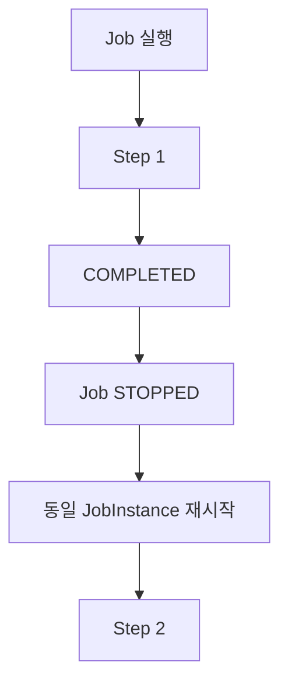

이 API는 운영자의 확인이나 외부 승인 등 특정 조건을 만족한 이후 다음 작업을 수행해야 하는 배치에서 활용할 수 있다.

다만 실제 재시작 가능 여부는 JobInstance의 상태와 재시작 정책에 영향을 받는다.

---

### 데이터베이스에서 실행 상태 확인하기

Spring Batch는 JobExecution과 StepExecution의 실행 상태를 메타데이터 테이블에 저장한다.

대표적인 테이블은 다음과 같다.

```text
BATCH_JOB_EXECUTION

BATCH_STEP_EXECUTION
```

이 테이블에는 각각 STATUS와 EXIT_CODE가 저장된다.

#### JobExecution 조회

```sql
SELECT
    ji.JOB_NAME,
    je.JOB_EXECUTION_ID,
    je.STATUS,
    je.EXIT_CODE,
    je.EXIT_MESSAGE
FROM BATCH_JOB_INSTANCE ji
JOIN BATCH_JOB_EXECUTION je
    ON ji.JOB_INSTANCE_ID = je.JOB_INSTANCE_ID
ORDER BY je.JOB_EXECUTION_ID;
```

이 쿼리를 통해 Job의 BatchStatus와 ExitStatus를 확인할 수 있다.

예를 들어 SimpleJob에서 ExitStatus만 FAILED로 설정했다면 다음과 같은 결과를 확인할 수 있다.

| JOB_NAME | STATUS | EXIT_CODE |
|---|---|---|
| simpleStatusJob | COMPLETED | FAILED |

여기서 STATUS는 BatchStatus다.

EXIT_CODE는 ExitStatus의 종료 코드다.

따라서 두 값이 다르게 저장될 수 있다.

#### StepExecution 조회

```sql
SELECT
    je.JOB_EXECUTION_ID,
    se.STEP_NAME,
    se.STATUS,
    se.EXIT_CODE,
    se.EXIT_MESSAGE
FROM BATCH_JOB_EXECUTION je
JOIN BATCH_STEP_EXECUTION se
    ON je.JOB_EXECUTION_ID = se.JOB_EXECUTION_ID
ORDER BY
    je.JOB_EXECUTION_ID,
    se.STEP_EXECUTION_ID;
```

이 쿼리를 이용하면 Step의 상태도 확인할 수 있다.

예를 들어 다음과 같은 결과가 가능하다.

| STEP_NAME | STATUS | EXIT_CODE |
|---|---|---|
| simpleStep1 | COMPLETED | COMPLETED |
| simpleStep2 | COMPLETED | FAILED |

이러한 결과를 통해 BatchStatus와 ExitStatus가 독립적으로 저장된다는 사실을 확인할 수 있다.

#### FlowExecutionStatus는 어디에 저장될까?

FlowExecutionStatus는 Flow 실행 과정에서 사용하는 상태 객체다.

Spring Batch의 기본 JDBC 메타데이터 스키마에는 FlowExecutionStatus를 별도로 저장하기 위한 BATCH_FLOW_EXECUTION 테이블이 존재하지 않는다.

FlowExecutionStatus는 Flow의 실행과 상태 전이에 사용된다.

그리고 FlowJob의 최종 결과가 JobExecution의 BatchStatus와 ExitStatus에 반영된다.

따라서 데이터베이스에서는 주로 JobExecution과 StepExecution의 상태를 확인하게 된다.

---

### JUnit으로 상태 처리 검증하기

이번에는 실제 JobLauncher를 이용해 SimpleJob과 FlowJob의 상태 처리 결과를 검증해보자.

`StatusTest.java`

```java
package com.example.batch;

import java.util.Set;
import java.util.UUID;
import java.util.stream.Collectors;

import org.junit.jupiter.api.Test;

import org.springframework.batch.core.BatchStatus;
import org.springframework.batch.core.Job;
import org.springframework.batch.core.JobExecution;
import org.springframework.batch.core.JobParameters;
import org.springframework.batch.core.JobParametersBuilder;
import org.springframework.batch.core.StepExecution;

import org.springframework.batch.core.launch.JobLauncher;

import org.springframework.beans.factory.annotation.Autowired;
import org.springframework.beans.factory.annotation.Qualifier;

import org.springframework.boot.test.context.SpringBootTest;

import static org.junit.jupiter.api.Assertions.*;

@SpringBootTest(properties = {
        "spring.batch.job.enabled=false"
})
class StatusTest {

    @Autowired
    private JobLauncher jobLauncher;

    @Autowired
    @Qualifier("simpleStatusJob")
    private Job simpleStatusJob;

    @Autowired
    @Qualifier("flowStatusJob")
    private Job flowStatusJob;

    private JobParameters parameters(String mode) {

        return new JobParametersBuilder()
                .addString("mode", mode)
                .addString(
                        "requestId",
                        UUID.randomUUID().toString()
                )
                .toJobParameters();
    }

    private StepExecution findStep(
            JobExecution execution,
            String stepName
    ) {

        return execution.getStepExecutions()
                .stream()
                .filter(
                        step ->
                                step.getStepName().equals(stepName)
                )
                .findFirst()
                .orElseThrow();
    }

    private Set<String> stepNames(
            JobExecution execution
    ) {

        return execution.getStepExecutions()
                .stream()
                .map(StepExecution::getStepName)
                .collect(Collectors.toSet());
    }

    @Test
    void SimpleJob에서_ExitStatus만_FAILED로_설정할_수_있다()
            throws Exception {

        JobExecution execution =
                jobLauncher.run(
                        simpleStatusJob,
                        parameters("exit-failed")
                );

        StepExecution step2 =
                findStep(
                        execution,
                        "simpleStep2"
                );

        assertEquals(
                BatchStatus.COMPLETED,
                step2.getStatus()
        );

        assertEquals(
                "FAILED",
                step2.getExitStatus().getExitCode()
        );

        assertEquals(
                BatchStatus.COMPLETED,
                execution.getStatus()
        );

        assertEquals(
                "FAILED",
                execution.getExitStatus().getExitCode()
        );
    }

    @Test
    void SimpleJob에서_예외가_발생하면_FAILED가_된다()
            throws Exception {

        JobExecution execution =
                jobLauncher.run(
                        simpleStatusJob,
                        parameters("error")
                );

        assertEquals(
                BatchStatus.FAILED,
                execution.getStatus()
        );

        assertEquals(
                "FAILED",
                execution.getExitStatus().getExitCode()
        );
    }

    @Test
    void FlowJob에서_사용자정의_ExitStatus로_분기한다()
            throws Exception {

        JobExecution execution =
                jobLauncher.run(
                        flowStatusJob,
                        parameters("review")
                );

        StepExecution validationStep =
                findStep(
                        execution,
                        "validationStep"
                );

        assertEquals(
                BatchStatus.COMPLETED,
                validationStep.getStatus()
        );

        assertEquals(
                "REVIEW_REQUIRED",
                validationStep
                        .getExitStatus()
                        .getExitCode()
        );

        assertEquals(
                Set.of(
                        "validationStep",
                        "reviewStep"
                ),
                stepNames(execution)
        );

        assertEquals(
                BatchStatus.COMPLETED,
                execution.getStatus()
        );

        assertEquals(
                "COMPLETED",
                execution.getExitStatus().getExitCode()
        );
    }

    @Test
    void FlowJob에서_예외가_발생하면_fail_Transition이_적용된다()
            throws Exception {

        JobExecution execution =
                jobLauncher.run(
                        flowStatusJob,
                        parameters("error")
                );

        assertEquals(
                BatchStatus.FAILED,
                execution.getStatus()
        );

        assertEquals(
                Set.of("validationStep"),
                stepNames(execution)
        );
    }
}
```

이 테스트에서는 네 가지 상황을 검증한다.

첫 번째는 SimpleJob에서 실제 실행 상태와 종료 코드를 다르게 설정하는 경우다.

두 번째는 SimpleJob에서 실제 예외가 발생하는 경우다.

세 번째는 FlowJob에서 사용자 정의 ExitStatus를 이용해 분기하는 경우다.

네 번째는 FlowJob에서 실패 Transition이 적용되는 경우다.

테스트를 실행한다.

```bash
mvn test
```

정상적으로 실행되면 다음과 유사한 결과를 확인할 수 있다.

```text
Tests run: 4

Failures: 0

Errors: 0

BUILD SUCCESS
```

이렇게 하면 세 상태 유형의 관계를 실제 실행 결과로 확인할 수 있다.

---

### 실무에서 활용할 수 있는 12가지 설계 방법

Spring Batch의 상태 관리 구조를 이해하면 단순한 성공과 실패뿐 아니라 복잡한 비즈니스 실행 결과를 체계적으로 표현할 수 있다.

다만 상태를 세분화할수록 재시작 정책과 운영 모니터링도 함께 설계해야 한다.

#### 1. 기술적 실패와 비즈니스 결과를 분리한다

예를 들어 결제 대사 작업에서 불일치 데이터가 발견되었다고 생각해보자.

이는 비즈니스적으로 중요한 결과다.

하지만 반드시 시스템 오류는 아니다.

따라서 BatchStatus는 COMPLETED로 유지하고 ExitStatus에 DISCREPANCY_FOUND를 설정할 수 있다.

이렇게 하면 실제 예외와 비즈니스 검증 결과를 구분할 수 있다.

#### 2. 사용자 정의 ExitStatus를 업무 상태로 활용한다

ExitStatus는 문자열 기반의 사용자 정의 코드를 지원한다.

따라서 NO_DATA, REVIEW_REQUIRED, PARTIAL_SUCCESS 등의 코드를 사용할 수 있다.

이를 이용하면 하나의 Step에서 다양한 결과를 표현할 수 있다.

다만 종료 코드 이름은 팀 내에서 표준화하는 것이 좋다.

#### 3. FlowJob에서는 종료 코드별 실행 경로를 명확하게 정의한다

사용자 정의 ExitStatus를 사용하는 경우에는 해당 상태에 대한 Transition을 정의해야 한다.

예를 들어 REVIEW_REQUIRED가 반환되었다면 ReviewStep으로 이동하도록 구성할 수 있다.

정의하지 않은 종료 코드가 반환되면 Flow 실행이 실패할 수 있으므로 기본 처리 경로도 고려해야 한다.

#### 4. 실제 장애를 COMPLETED로 종료하지 않도록 주의한다

FlowJob에서는 FAILED 상태의 Step 이후 후속 처리를 성공시키고 Job을 COMPLETED로 종료할 수 있다.

하지만 Job이 COMPLETED가 되면 같은 JobInstance를 일반적으로 재시작할 수 없다.

따라서 실제 재처리가 필요한 장애라면 Job을 FAILED로 종료하는 것이 적절할 수 있다.

#### 5. BatchStatus와 ExitStatus를 함께 모니터링한다

운영 시스템에서 JobExecution의 STATUS만 조회하면 일부 정보를 놓칠 수 있다.

예를 들어 다음 상태를 생각해보자.

```text
BatchStatus = COMPLETED

ExitStatus = REVIEW_REQUIRED
```

BatchStatus만 확인하면 정상 완료로 판단할 수 있다.

하지만 실제로는 추가적인 검토가 필요한 상태다.

따라서 운영 모니터링에서는 두 값을 함께 확인하는 것이 좋다.

#### 6. ExitStatus를 임의로 FAILED로 설정할 때 재시작 정책을 확인한다

BatchStatus는 COMPLETED지만 ExitStatus만 FAILED라면 JobInstance의 재시작 가능 여부가 예상과 다를 수 있다.

Spring Batch의 Job 재시작 판단은 JobExecution의 실행 상태를 기준으로 수행하기 때문이다.

따라서 단순히 실패를 표현하려는 목적으로 ExitStatus만 FAILED로 변경하는 것은 신중해야 한다.

#### 7. 사용자 정의 종료 코드의 우선순위를 이해한다

ExitStatus.and()는 종료 코드의 우선순위를 고려한다.

사용자 정의 종료 코드는 기본 상태보다 높은 우선순위를 가질 수 있다.

따라서 여러 Listener나 StepContribution에서 ExitStatus를 변경한다면 최종 코드가 어떻게 결합되는지 확인해야 한다.

#### 8. StepExecutionListener를 이용해 종료 코드를 결정한다

실제 비즈니스 로직 실행 후 처리 통계나 검증 결과에 따라 ExitStatus를 변경해야 하는 경우가 있다.

이때 StepExecutionListener.afterStep()을 활용할 수 있다.

예를 들어 SkipCount가 0보다 크면 COMPLETED_WITH_SKIPS라는 종료 코드를 반환하도록 구성할 수 있다.

#### 9. FlowExecutionStatus를 영속 상태로 오해하지 않는다

FlowExecutionStatus는 Flow 실행 과정에서 사용되는 상태 객체다.

기본적으로 별도의 FlowExecution 메타데이터 테이블에 저장되는 구조는 아니다.

따라서 장기적인 실행 이력 분석에서는 JobExecution과 StepExecution의 저장 정보를 기준으로 확인해야 한다.

#### 10. UNKNOWN 상태에서는 중복 처리 가능성을 먼저 확인한다

UNKNOWN은 실행 상태가 불확실하다는 의미다.

따라서 무조건 재시작하기보다 실제 비즈니스 데이터가 어느 단계까지 처리되었는지 확인해야 한다.

특히 결제와 정산 업무에서는 중복 승인, 중복 정산, 중복 지급 등의 문제가 발생하지 않도록 주의해야 한다.

#### 11. SimpleJob과 FlowJob의 상태 반영 차이를 이해한다

SimpleJob은 마지막 StepExecution의 상태를 JobExecution에 반영한다.

반면 FlowJob은 최종 FlowExecutionStatus를 이용한다.

따라서 같은 Step 실행 결과라도 Job 구성 방식과 Transition에 따라 최종 Job 상태가 달라질 수 있다.

이 차이를 이해해야 Job의 최종 상태를 정확하게 예측할 수 있다.

#### 12. 상태별 실행 시나리오를 테스트한다

상태 관리 기능은 정상 실행만 확인해서는 충분하지 않다.

특히 다음과 같은 상황을 검증하는 것이 좋다.

| 검증 시나리오 | 확인할 내용 |
|---|---|
| 정상 실행 | BatchStatus와 ExitStatus가 모두 COMPLETED인지 |
| 실제 예외 발생 | BatchStatus와 ExitStatus가 FAILED인지 |
| 사용자 정의 종료 코드 | BatchStatus와 ExitStatus가 다르게 설정되는지 |
| Flow 분기 | ExitStatus에 맞는 Step이 실행되는지 |
| 실패 종료 Transition | Job이 FAILED로 종료되는지 |
| 정상 종료 Transition | Job이 COMPLETED로 종료되는지 |
| 중단 Transition | Job이 STOPPED로 종료되는지 |
| 재시작 | 기존 실행 상태를 기준으로 올바르게 재개되는지 |

이러한 검증을 통해 상태 처리 정책이 실제 비즈니스 요구사항과 일치하는지 확인할 수 있다.

---

### 자주 혼동하는 부분

| 혼동하기 쉬운 내용 | 정확한 이해 |
|---|---|
| BatchStatus와 ExitStatus는 항상 같다 | 서로 다르게 설정될 수 있다 |
| ExitStatus는 Enum이다 | 사용자 정의 코드를 지원하는 클래스다 |
| BatchStatus는 사용자 정의 값을 추가할 수 있다 | 정해진 Enum 값만 사용한다 |
| ExitStatus.FAILED를 설정하면 BatchStatus도 FAILED가 된다 | 자동으로 변경되지 않는다 |
| FlowExecutionStatus는 네 가지 값만 사용할 수 있다 | 네 가지 기본 상수를 제공하지만 사용자 정의 상태도 가능하다 |
| SimpleJob은 모든 Step 상태를 종합한다 | 기본적으로 마지막 StepExecution의 상태를 반영한다 |
| FlowJob은 마지막 Step의 BatchStatus를 그대로 복사한다 | 최종 FlowExecutionStatus를 이용한다 |
| on()은 BatchStatus를 기준으로 분기한다 | ExitStatus의 종료 코드를 기준으로 분기한다 |
| Job이 COMPLETED면 모든 Step이 반드시 성공했다 | FlowJob에서는 실패한 Step이 존재할 수 있다 |
| 사용자 정의 ExitStatus는 단순 문자열이다 | ExitStatus.and()의 우선순위 규칙이 적용된다 |
| FlowExecutionStatus는 별도 메타데이터 테이블에 저장된다 | 기본 JDBC 스키마에서는 별도 테이블이 없다 |
| UNKNOWN 상태도 일반적인 FAILED처럼 재시작하면 된다 | 실행 상태가 불확실하므로 신중한 확인이 필요하다 |

---

### 전체 아키텍처 정리

지금까지 살펴본 내용을 하나의 구조로 정리해보자.

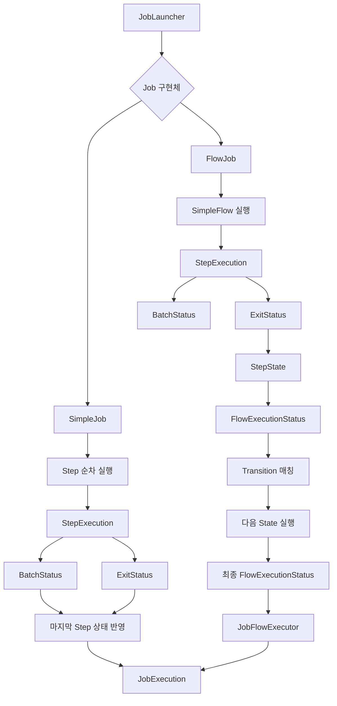

SimpleJob은 Step을 순차적으로 실행한다.

그리고 마지막 StepExecution의 BatchStatus와 ExitStatus를 JobExecution에 반영한다.

반면 FlowJob은 SimpleFlow를 실행한다.

SimpleFlow는 Step의 ExitStatus를 FlowExecutionStatus로 변환한다.

그리고 Transition에 따라 다음 실행 대상을 결정한다.

최종적으로 Flow가 종료되면 FlowExecutionStatus가 반환된다.

JobFlowExecutor는 이 값을 JobExecution의 BatchStatus와 ExitStatus에 반영한다.

따라서 두 Job은 모두 JobExecution을 생성하지만 내부 상태 결정 방식은 다르다.

---

### 정리

Spring Batch는 Job과 Step의 실행 상태를 관리하기 위해 BatchStatus, ExitStatus, FlowExecutionStatus를 제공한다.

BatchStatus는 Job과 Step의 실제 실행 상태를 나타내는 Enum이다.

대표적으로 COMPLETED, STARTED, STOPPED, FAILED, ABANDONED, UNKNOWN 등의 값을 가진다.

ExitStatus는 작업의 종료 코드를 나타내는 클래스다.

BatchStatus와 달리 사용자 정의 종료 코드를 생성할 수 있다.

예를 들어 다음과 같이 사용할 수 있다.

```java
new ExitStatus("REVIEW_REQUIRED");
```

이렇게 하면 실제 Step은 정상적으로 완료되었지만 비즈니스 관점에서는 추가적인 검증이 필요하다는 결과를 표현할 수 있다.

따라서 다음과 같은 상태가 가능하다.

```text
BatchStatus = COMPLETED

ExitStatus = REVIEW_REQUIRED
```

FlowExecutionStatus는 Flow의 실행 상태를 나타내는 객체다.

FlowJob에서는 Step의 ExitStatus를 FlowExecutionStatus로 변환해 Transition을 결정한다.

그리고 최종 FlowExecutionStatus를 JobExecution의 상태에 반영한다.

SimpleJob과 FlowJob의 최종 상태 결정 방식도 다르다.

SimpleJob은 마지막 StepExecution의 BatchStatus와 ExitStatus를 JobExecution에 반영한다.

반면 FlowJob은 최종 FlowExecutionStatus를 이용해 JobExecution의 상태를 결정한다.

FlowJob에서 사용하는 주요 Transition API는 다음과 같다.

```java
.on("COMPLETED").to(step2)
```

```java
.on("FAILED").fail()
```

```java
.on("FAILED").end()
```

```java
.on("COMPLETED").stopAndRestart(step2)
```

이러한 API를 이용하면 Step의 종료 코드에 따라 다음 실행 대상을 변경하거나 Job의 최종 상태를 결정할 수 있다.

다만 Job을 COMPLETED로 종료하면 동일한 JobInstance를 재시작할 수 없다는 점에 주의해야 한다.

또한 ExitStatus만 FAILED로 설정했다고 해서 BatchStatus도 FAILED로 변경되는 것은 아니다.

따라서 상태를 설계할 때는 실제 실행 성공 여부와 비즈니스 종료 결과, 재시작 가능 여부를 구분해야 한다.

특히 결제나 정산처럼 데이터 정합성이 중요한 시스템에서는 이 구분이 중요하다.

예를 들어 결제 대사 과정에서 데이터 불일치가 발견된 것은 비즈니스적인 처리 결과일 수 있다.

반면 데이터베이스 장애로 인해 대사 작업 자체를 완료하지 못했다면 실제 실행 실패다.

두 상황을 동일하게 FAILED로 처리하기보다는 업무 요구사항에 맞게 BatchStatus와 ExitStatus를 구분하고 적절한 Transition을 정의하는 것이 좋다.

결국 **BatchStatus는 실행 상태를 표현하고, ExitStatus는 종료 결과를 표현하며, FlowExecutionStatus는 Flow의 상태 전이와 최종 실행 결과를 관리한다.**

이 세 가지 상태의 차이를 이해해야 Spring Batch의 조건부 실행과 재시작 정책을 정확하게 설계할 수 있다.

#### 한 줄 요약

> Spring Batch의 `BatchStatus`는 Job과 Step의 실제 실행 상태를 나타내는 Enum이고, `ExitStatus`는 사용자 정의가 가능한 종료 코드 객체다. `FlowExecutionStatus`는 Flow 내부의 상태 전이와 최종 결과를 관리한다. `SimpleJob`은 마지막 StepExecution의 상태를 Job에 반영하는 반면, `FlowJob`은 Step의 ExitStatus를 기반으로 Transition을 수행하고 최종 FlowExecutionStatus를 JobExecution에 반영한다. 따라서 BatchStatus와 ExitStatus는 서로 다를 수 있으며, Job의 최종 상태 역시 실행 구조와 Transition 설정에 따라 달라질 수 있다.

## Transition - on()/ to() / stop(), fail(), end(), stopAndRestart()


### Spring Batch Transition API 완벽 이해: on(), to(), from(), stop(), fail(), end(), stopAndRestart()

Spring Batch에서 Job은 하나 이상의 Step으로 구성된다.

가장 기본적인 Job인 `SimpleJob`은 Step을 순차적으로 실행한다.

예를 들어 다음과 같은 Job을 생각해보자.

```text
SettlementJob
    │
    ▼
Step 1. 정산 데이터 조회
    │
    ▼
Step 2. 정산 금액 계산
    │
    ▼
Step 3. 정산 결과 저장
    │
    ▼
Job 종료
```

이 구조에서는 이전 Step이 정상적으로 완료되면 다음 Step을 실행한다.

반면 중간 Step에서 오류가 발생하면 일반적으로 후속 Step이 실행되지 않는다.

하지만 실제 업무에서는 실행 결과에 따라 서로 다른 작업을 수행해야 하는 경우가 많다.

예를 들어 결제 대사 시스템을 생각해보자.

결제 대사 작업은 외부 PG사의 결제 내역과 내부 결제 내역을 비교하는 작업이다.

대사 결과에 따라 다음과 같이 처리해야 할 수 있다.

- 결제 내역이 일치하면 정산 작업을 진행한다.
- 결제 내역이 불일치하면 불일치 내역을 생성한다.
- 외부 PG사의 응답이 없다면 작업을 일시적으로 중단한다.
- 복구할 수 없는 오류가 발생하면 Job을 실패 상태로 종료한다.
- 데이터가 존재하지 않는 경우에는 추가 작업 없이 정상 종료한다.

이러한 요구사항에서는 단순한 순차 실행만으로 충분하지 않다.

실행 결과에 따라 다음 Step을 결정할 수 있어야 한다.

Spring Batch에서는 이러한 기능을 **Transition**이라고 한다.

Transition은 실행 흐름에서 특정 상태에 따라 다른 상태로 이동하는 규칙이다.

예를 들어 다음과 같은 흐름을 구성할 수 있다.

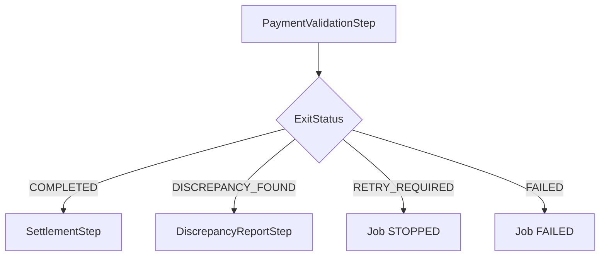

이 구조에서 모든 Step이 실행되는 것은 아니다.

PaymentValidationStep의 실행 결과에 따라 특정 실행 경로가 선택된다.

Spring Batch에서는 다음 API를 이용해 이러한 Transition을 정의할 수 있다.

```java
.on("COMPLETED").to(settlementStep)
```

```java
.on("FAILED").fail()
```

```java
.on("RETRY_REQUIRED").stopAndRestart(retryStep)
```

여기서 중요한 것은 **Transition이 Step의 실제 실행 상태인 BatchStatus가 아니라 ExitStatus의 종료 코드를 기준으로 선택된다는 사실**이다.

따라서 Transition을 이해하려면 `BatchStatus`, `ExitStatus`, `FlowExecutionStatus`의 차이를 이해해야 한다.

이번에는 Transition의 개념부터 각 API의 역할, 패턴 우선순위, 실제 실행 구조, 종료 상태와 재시작 동작까지 자세히 살펴보자.

---

### 개념

#### Transition이란?

Transition은 Flow 내에서 현재 실행 상태에서 다음 실행 상태로 이동하기 위한 규칙이다.

Spring Batch의 Flow는 여러 Step이나 다른 Flow를 포함할 수 있다.

그리고 각각의 실행 대상은 종료 상태에 따라 다음 실행 대상으로 이동한다.

예를 들어 다음과 같은 Flow를 생각해보자.

```text
Step 1
    │
    ├── COMPLETED → Step 2
    │
    ├── FAILED → Step 3
    │
    └── STOPPED → Job 중단
```

이 구조에서는 Step 1의 종료 코드에 따라 다음 실행 대상이 달라진다.

이처럼 조건에 따라 다른 실행 경로를 선택하는 것을 Transition이라고 한다.

Transition은 다음 세 가지 요소로 구성할 수 있다.

| 구성 요소 | 역할 | 예시 |
|---|---|---|
| 현재 State | 실행 결과를 확인할 대상 | Step 1 |
| Pattern | 종료 코드와 비교할 조건 | FAILED |
| 다음 State 또는 종료 동작 | 조건 일치 시 수행할 작업 | Step 3 |

이를 다음과 같이 표현할 수 있다.

```text
현재 State
    │
    ▼
실행 결과 확인
    │
    ▼
Pattern 매칭
    │
    ▼
다음 State 또는 종료 동작
```

예를 들어 다음 코드가 있다고 생각해보자.

```java
.start(step1)
    .on("FAILED").to(step2)
```

이 코드는 다음과 같은 의미다.

1. Step 1을 실행한다.
2. Step 1의 ExitStatus를 확인한다.
3. 종료 코드가 FAILED인지 확인한다.
4. FAILED와 일치하면 Step 2로 이동한다.

따라서 Transition은 단순히 Step을 연결하는 기능이 아니라 **실행 결과에 따라 이동할 경로를 결정하는 규칙**이다.

---

### 왜 사용하는가?

실제 서비스의 업무 흐름은 항상 하나의 경로로만 진행되지 않는다.

특히 외부 시스템 연동, 결제, 정산, 데이터 검증, 파일 처리처럼 결과에 따라 후속 작업이 달라지는 시스템에서는 여러 실행 경로가 필요하다.

예를 들어 정산 검증 배치를 생각해보자.

```text
SettlementValidationJob
    │
    ▼
ValidationStep
    │
    ├── 정상 데이터
    │      │
    │      ▼
    │   SettlementStep
    │
    ├── 불일치 데이터
    │      │
    │      ▼
    │   ErrorReportStep
    │
    └── 외부 시스템 장애
           │
           ▼
       Job 중단
```

이를 일반적인 Java 코드로 구현한다면 다음과 같은 조건문이 필요할 수 있다.

```java
ValidationResult result = validate();

if (result == ValidationResult.SUCCESS) {

    executeSettlement();

} else if (result == ValidationResult.DISCREPANCY) {

    createErrorReport();

} else if (result == ValidationResult.RETRY_REQUIRED) {

    stopProcessing();
}
```

하지만 배치 시스템에서는 단순히 메서드 호출 순서를 결정하는 것만으로 충분하지 않다.

각 실행 결과에 대한 메타데이터가 저장되어야 한다.

또한 작업이 실패했을 때 어떤 Step까지 완료되었는지 확인할 수 있어야 한다.

그리고 재시작할 때 이전 실행 상태를 기준으로 실행할 Step을 결정해야 한다.

Spring Batch의 Transition은 이러한 요구사항을 Flow 실행 구조 안에서 처리하도록 지원한다.

개발자는 실행 조건과 경로를 정의한다.

Spring Batch는 해당 조건에 따라 State를 실행하고 실행 결과를 관리한다.

---

### Transition을 이해하기 위한 세 가지 상태

Transition을 살펴보기 전에 세 가지 상태 객체를 구분해야 한다.

| 구분 | 역할 | 사용 대상 |
|---|---|---|
| BatchStatus | Job과 Step의 실제 실행 상태 | JobExecution, StepExecution |
| ExitStatus | Job과 Step의 종료 코드 | JobExecution, StepExecution |
| FlowExecutionStatus | Flow의 실행 및 전이 상태 | FlowExecution |

예를 들어 다음과 같은 Step이 있다고 생각해보자.

```java
contribution.setExitStatus(
        new ExitStatus("REVIEW_REQUIRED")
);

return RepeatStatus.FINISHED;
```

Tasklet은 예외 없이 정상적으로 종료되었다.

따라서 일반적인 실행에서는 다음과 같은 상태가 된다.

```text
BatchStatus = COMPLETED

ExitStatus = REVIEW_REQUIRED
```

여기서 BatchStatus는 실제 실행이 완료되었다는 의미다.

ExitStatus는 추가 검증이 필요하다는 비즈니스 결과를 의미한다.

FlowJob은 ExitStatus인 REVIEW_REQUIRED를 기준으로 다음 Transition을 선택할 수 있다.

```java
.on("REVIEW_REQUIRED").to(reviewStep)
```

따라서 BatchStatus가 COMPLETED여도 다른 실행 경로로 진행할 수 있다.

이것이 Transition의 핵심이다.

---

### 주요 특징

#### Transition API의 종류

Spring Batch는 대표적으로 다음 API를 제공한다.

| API | 역할 |
|---|---|
| on(String pattern) | 실행 결과와 비교할 패턴 설정 |
| to(Step) | 다음 Step으로 이동 |
| to(Flow) | 다음 Flow로 이동 |
| to(JobExecutionDecider) | Decider 실행 |
| from(Step) | 기존 Step을 기준으로 새로운 분기 추가 |
| from(Flow) | 기존 Flow를 기준으로 새로운 분기 추가 |
| stop() | Job을 STOPPED 상태로 종료 |
| fail() | Job을 FAILED 상태로 종료 |
| end() | Job을 COMPLETED 상태로 종료 |
| stopAndRestart() | Job 중단 후 재시작 위치 지정 |

여기서 `on()`은 Transition을 정의하는 시작점이다.

`on()`을 호출하면 `TransitionBuilder`가 반환된다.

그리고 TransitionBuilder는 `to()`, `stop()`, `fail()`, `end()`, `stopAndRestart()` 등을 제공한다.

따라서 다음과 같은 메서드 체이닝이 가능하다.

```java
.start(step1)
    .on("FAILED").to(step2)
```

또는 다음과 같이 종료 조건을 정의할 수 있다.

```java
.start(step1)
    .on("FAILED").fail()
```

이제 각 API를 구체적으로 살펴보자.

---

### on() API

`on()`은 현재 Step 또는 Flow의 종료 코드와 비교할 패턴을 설정한다.

대표적인 사용 방법은 다음과 같다.

```java
.on("FAILED")
```

이 코드는 이전 실행 대상의 종료 코드가 FAILED인지 확인한다.

중요한 점은 `on()`이 `BatchStatus`가 아닌 **ExitStatus의 exitCode**를 기준으로 매칭한다는 사실이다.

예를 들어 다음과 같은 StepExecution이 있다고 생각해보자.

```text
StepExecution
    │
    ├── BatchStatus = COMPLETED
    │
    └── ExitStatus = FAILED
```

이 경우 실제 실행 상태는 COMPLETED다.

하지만 종료 코드는 FAILED다.

따라서 다음 Transition이 매칭될 수 있다.

```java
.on("FAILED").to(errorStep)
```

즉, 실제 예외가 발생하지 않았더라도 ExitStatus를 FAILED로 설정했다면 해당 Transition을 선택할 수 있다.

#### on()이 반환하는 객체

Spring Batch 5.2.4의 FlowBuilder에는 다음 메서드가 존재한다.

```java
public TransitionBuilder<Q> on(String pattern) {

    return new TransitionBuilder<>(this, pattern);
}
```

이 메서드는 TransitionBuilder를 생성한다.

TransitionBuilder는 전달받은 패턴을 보관한다.

이후 `to()`, `stop()`, `fail()` 등의 API를 호출하면 해당 패턴을 가진 Transition이 등록된다.

따라서 다음 코드는

```java
.on("FAILED").to(step2)
```

개념적으로 다음과 같은 Transition을 정의한다.

```text
현재 State
    │
    └── FAILED → Step 2
```

Spring Batch 5.2.4의 실제 구현에서도 `on()`은 `TransitionBuilder`를 생성하고, `to()` 등의 API가 Transition 등록을 담당한다.

---

### on()의 패턴 매칭

`on()`은 문자열 패턴을 이용해 ExitStatus를 비교한다.

이때 두 가지 와일드카드를 사용할 수 있다.

| 패턴 | 의미 |
|---|---|
| `*` | 0개 이상의 문자 |
| `?` | 정확히 한 글자 |

예를 들어 다음과 같다.

```text
c*t
```

이 패턴은 다음 문자열과 매칭된다.

```text
cat

count

ct
```

반면 다음 패턴은

```text
c?t
```

정확히 한 글자만 허용한다.

따라서 cat은 매칭된다.

하지만 count는 매칭되지 않는다.

Spring Batch의 Transition에서도 동일한 규칙을 사용한다.

#### 정확한 상태 매칭

```java
.on("COMPLETED").to(step2)
```

ExitStatus가 정확히 COMPLETED인 경우에 매칭된다.

#### 특정 접두어 매칭

```java
.on("COMPLETED*").to(step2)
```

다음 종료 코드에 매칭될 수 있다.

```text
COMPLETED

COMPLETED_WITH_WARNINGS

COMPLETED_WITH_SKIPS
```

#### 모든 종료 코드 매칭

```java
.on("*").to(step3)
```

모든 종료 코드에 매칭될 수 있다.

따라서 특정 조건 이외의 나머지 실행 결과를 처리할 때 자주 사용한다.

---

### Transition의 우선순위

이번 내용에서 가장 중요한 부분 중 하나다.

다음 코드를 살펴보자.

```java
.start(step1)
    .on("*").to(step3)
.from(step1)
    .on("FAILED").to(step2)
.end()
.build();
```

Step 1의 ExitStatus가 FAILED라고 가정하자.

이 경우 두 패턴에 모두 매칭된다.

```text
FAILED → FAILED와 매칭

FAILED → *와도 매칭
```

그렇다면 어느 Transition이 실행될까?

정답은 FAILED에 해당하는 Transition이다.

따라서 Step 2가 실행된다.

이유는 **Spring Batch가 Transition을 구체적인 패턴부터 평가하도록 정렬하기 때문**이다.

즉, 코드에 먼저 작성했다고 해서 무조건 먼저 적용되는 것은 아니다.

#### 패턴 우선순위 예시

| 패턴 | 구체성 |
|---|---|
| FAILED | 높음 |
| FAIL?D | 중간 |
| FAIL* | 낮음 |
| * | 가장 포괄적 |

Spring Batch는 `DefaultStateTransitionComparator`를 이용해 패턴의 구체성을 비교한다.

이 Comparator는 `*`, `?`, 문자열 길이 등을 고려한다.

따라서 일반적으로 정확한 종료 코드가 와일드카드 패턴보다 먼저 평가된다.

Spring Batch 5.2.4의 `SimpleFlow`는 정렬된 Transition을 순회하면서 처음 매칭되는 Transition을 선택한다.

#### 실행 예시

다음과 같은 구조가 있다고 생각해보자.


이 구조에서는 다음과 같이 동작한다.

| Step 1 ExitStatus | 실행 Step |
|---|---|
| FAILED | Step 2 |
| COMPLETED | Step 3 |
| STOPPED | Step 3 |
| REVIEW_REQUIRED | Step 3 |

여기서 주의할 점은 `*`가 실제로 FAILED를 제외하는 패턴은 아니라는 것이다.

`*`는 FAILED에도 매칭된다.

다만 FAILED라는 더 구체적인 패턴이 먼저 선택되므로 결과적으로 나머지 상태가 Step 3으로 이동하는 것처럼 동작한다.

따라서 `*`를 이용한 기본 처리 경로는 구체적인 조건과 함께 구성하는 것이 좋다.

---

### to() API

`to()`는 `on()`에서 설정한 패턴이 매칭되었을 때 다음에 실행할 대상을 지정한다.

다음과 같이 사용할 수 있다.

```java
.on("FAILED").to(step2)
```

이 코드는 이전 Step의 ExitStatus가 FAILED이면 Step 2로 이동한다는 의미다.

`to()`에는 다음 객체를 전달할 수 있다.

| 매개변수 | 역할 |
|---|---|
| Step | 다음 Step 실행 |
| Flow | 다음 Flow 실행 |
| JobExecutionDecider | Decider를 통해 다음 상태 결정 |

예를 들어 Flow로 이동하도록 구성할 수 있다.

```java
.on("COMPLETED").to(settlementFlow)
```

이 경우 이전 실행 대상이 정상적으로 완료되면 settlementFlow를 실행한다.

또한 Decider를 연결할 수 있다.

```java
.on("COMPLETED").to(settlementDecider)
```

이처럼 `to()`는 조건에 일치했을 때 이동할 다음 State를 지정한다.

---

### from() API

`from()`은 이미 등록한 Step이나 Flow를 기준으로 새로운 Transition을 추가할 때 사용한다.

예를 들어 다음과 같은 코드가 있다고 생각해보자.

```java
.start(step1)
    .on("FAILED").to(step2)
```

이 코드는 Step 1이 FAILED로 종료되면 Step 2로 이동하는 경로를 정의한다.

그런데 Step 1이 COMPLETED로 종료되었을 때 Step 3으로 이동해야 한다면 어떻게 해야 할까?

다음과 같이 작성할 수 있다.

```java
.start(step1)
    .on("FAILED").to(step2)
.from(step1)
    .on("COMPLETED").to(step3)
.end()
.build();
```

여기서 `from(step1)`은 이미 등록된 Step 1을 기준으로 새로운 Transition을 정의한다.

전체 구조는 다음과 같다.

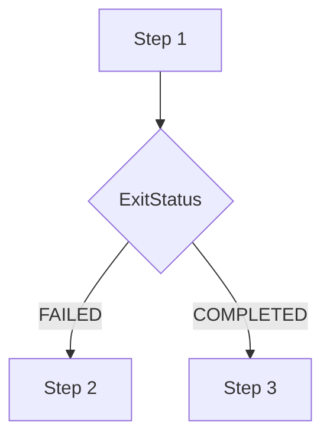

여기서 중요한 점이 있다.

**from(step1)은 Step 1을 즉시 다시 실행한다는 의미가 아니다.**

이미 등록한 Step 1에 다른 실행 경로를 추가하는 것이다.

즉, Job을 구성하는 시점에 Transition을 정의하는 API다.

실제 Step 실행은 Job이 시작된 이후 SimpleFlow에 의해 이루어진다.

---

### stop(), fail(), end(), stopAndRestart()의 차이

Transition에는 다음 실행 대상으로 이동하는 기능뿐 아니라 Job을 종료하거나 중단하는 기능도 있다.

대표적인 API는 다음 네 가지다.

```java
.stop()
```

```java
.fail()
```

```java
.end()
```

```java
.stopAndRestart(step)
```

이 API들은 모두 실행 흐름을 종료할 수 있지만 최종 Job 상태가 다르다.

| API | 최종 Job BatchStatus | 기본 ExitStatus | 재시작 관점 |
|---|---|---|---|
| stop() | STOPPED | STOPPED | 중단된 Job의 재시작 정책 확인 필요 |
| fail() | FAILED | FAILED | 일반적으로 재시작 가능 |
| end() | COMPLETED | COMPLETED | 같은 JobInstance 재시작 불가 |
| stopAndRestart() | STOPPED | STOPPED | 지정한 위치에서 재개하도록 구성 |

여기서 중요한 점은 이러한 API들이 **이미 실행된 Step의 BatchStatus나 ExitStatus를 직접 변경하는 기능이 아니라는 사실**이다.

종료 Transition은 Flow의 최종 상태를 결정한다.

그리고 그 결과가 JobExecution에 반영된다.

---

### stop() API

`stop()`은 Flow를 STOPPED 상태로 종료하는 Transition을 정의한다.

예를 들어 다음과 같다.

```java
.start(step1)
    .on("COMPLETED").stop()
.end()
.build();
```

이 코드는 Step 1이 정상적으로 완료되면 Job을 중단하도록 구성한다.

실행 결과는 다음과 같다.

```text
Step 1

BatchStatus = COMPLETED

ExitStatus = COMPLETED
```

하지만 Job의 최종 상태는 다음과 같다.

```text
Job

BatchStatus = STOPPED

ExitStatus = STOPPED
```

즉, Step이 정상적으로 완료되었어도 Job은 STOPPED로 종료될 수 있다.

이 기능은 배치 작업을 일시적으로 중단해야 하는 경우에 사용할 수 있다.

다만 `stop()`과 `stopAndRestart()`는 재시작 위치를 명시적으로 지정하는지 여부에서 차이가 있다.

재시작 위치를 명확하게 정의해야 한다면 `stopAndRestart()`가 더 적합하다.

---

### fail() API

`fail()`은 Job을 FAILED 상태로 종료하는 Transition을 정의한다.

예를 들어 다음과 같다.

```java
.start(step1)
    .on("FAILED").fail()
.end()
.build();
```

Step 1이 FAILED 종료 코드를 반환하면 Job은 FAILED로 종료된다.

여기서 중요한 것은 Step의 BatchStatus가 반드시 FAILED일 필요는 없다는 사실이다.

예를 들어 Step이 다음과 같이 종료되었다고 생각해보자.

```text
Step 1

BatchStatus = COMPLETED

ExitStatus = FAILED
```

이 경우 on("FAILED")가 매칭된다.

그리고 fail()이 실행된다.

따라서 Job은 FAILED 상태로 종료된다.

```text
Job

BatchStatus = FAILED

ExitStatus = FAILED
```

즉, **Step은 기술적으로 정상 종료되었지만 정책적으로 Job을 실패 처리할 수 있다.**

다만 이러한 구성을 재시작과 함께 사용할 경우에는 주의해야 한다.

Step 자체는 COMPLETED 상태이기 때문에 재시작할 때 해당 Step이 실행을 생략할 수 있기 때문이다.

실제 비즈니스 로직을 다시 수행해야 하는 경우에는 Step의 BatchStatus와 재시작 설정을 함께 고려해야 한다.

---

### end() API

`end()`는 Job을 COMPLETED 상태로 종료하는 Transition을 정의한다.

예를 들어 다음과 같다.

```java
.start(step1)
    .on("FAILED").end()
.end()
.build();
```

이 코드는 Step 1의 ExitStatus가 FAILED이면 Job을 정상 종료하도록 구성한다.

예를 들어 Step 1에서 실제 예외가 발생했다고 생각해보자.

```text
Step 1

BatchStatus = FAILED

ExitStatus = FAILED
```

하지만 다음 Transition이 매칭된다.

```java
.on("FAILED").end()
```

따라서 최종 Job 상태는 COMPLETED가 될 수 있다.

```text
Job

BatchStatus = COMPLETED

ExitStatus = COMPLETED
```

여기서 중요한 점은 Step 1의 실패 상태가 정상 상태로 변경되는 것은 아니라는 사실이다.

StepExecution은 FAILED 상태를 유지할 수 있다.

다만 Flow의 최종 결과가 COMPLETED가 되었기 때문에 JobExecution이 COMPLETED로 종료되는 것이다.

#### end()의 가장 중요한 주의사항

Job이 COMPLETED로 종료되면 동일한 JobInstance를 일반적인 방식으로 재시작할 수 없다.

예를 들어 정산 데이터 처리 중 실제 오류가 발생했는데 end()를 이용해 Job을 COMPLETED로 종료했다고 생각해보자.

이후 오류를 수정하더라도 동일한 JobParameters로 Job을 다시 실행할 수 없다.

Spring Batch는 이미 완료된 JobInstance로 판단하기 때문이다.

따라서 실제 장애 복구가 필요한 업무에서는 end()를 신중하게 사용해야 한다.

**업무적으로 정상 종료한 상황과 실제 실패를 감추는 상황을 구분하는 것이 중요하다.**

---

### stopAndRestart() API

`stopAndRestart()`는 Job을 STOPPED 상태로 종료하면서 다음 재시작 위치를 지정하는 API다.

예를 들어 다음과 같다.

```java
.start(step1)
    .on("COMPLETED")
    .stopAndRestart(step2)
.end()
.build();
```

이 코드는 Step 1이 완료되면 Job을 중단한다.

그리고 동일한 JobInstance를 재시작할 때 Step 2부터 진행하도록 구성한다.

전체 구조는 다음과 같다.

```mermaid
flowchart TD
    A["Job 실행"]
    B["Step 1 실행"]
    C["Step 1 COMPLETED"]
    D["Job STOPPED"]

    E["동일 JobInstance 재시작"]
    F["Step 2 실행"]
    G["Job COMPLETED"]

    A --> B
    B --> C
    C --> D

    D --> E
    E --> F
    F --> G
```

이러한 방식은 특정 작업이 완료된 이후 운영자의 승인이나 외부 시스템의 처리가 필요한 경우에 활용할 수 있다.

예를 들어 다음과 같은 정산 프로세스를 생각해보자.

```text
정산 금액 계산
       │
       ▼
정산 결과 검증
       │
       ▼
Job STOPPED
       │
       ▼
운영자 승인
       │
       ▼
Job 재시작
       │
       ▼
정산 지급 처리
```

이 구조에서는 검증 단계가 완료된 이후 Job을 중단한다.

그리고 승인 후 재시작하면 지급 처리 Step부터 실행하도록 구성할 수 있다.

다만 승인 여부 검증, 중복 지급 방지, 재시작 권한 관리는 별도의 비즈니스 정책으로 설계해야 한다.

---

### end()는 두 가지 의미로 사용된다

FlowJob을 구성할 때 가장 혼동하기 쉬운 API 중 하나가 end()다.

다음 코드를 살펴보자.

```java
.start(step1)
    .on("FAILED").end()
.end()
.build();
```

여기에는 두 개의 end()가 존재한다.

하지만 각각 다른 역할을 담당한다.

#### 첫 번째 end()

```java
.on("FAILED").end()
```

이 메서드는 `TransitionBuilder.end()`다.

FAILED 조건에 매칭되면 Job을 정상 종료하는 Transition을 추가한다.

즉, 실행 중에 적용할 종료 규칙을 정의한다.

#### 두 번째 end()

```java
.end()
.build();
```

여기서 end()는 `FlowBuilder.end()`다.

지금까지 정의한 Flow 구성을 완료하고 최종 Job 생성 과정으로 진행한다.

따라서 두 메서드는 다음과 같이 구분해야 한다.

| 구분 | TransitionBuilder.end() | FlowBuilder.end() |
|---|---|---|
| 호출 위치 | on() 이후 | 최종 build() 이전 |
| 목적 | 특정 조건에서 정상 종료 | Flow 구성 완료 |
| 실행 시점 | Job 실행 중 적용되는 규칙 | Job 생성 시 사용 |
| 결과 | COMPLETED 종료 Transition 추가 | 구성한 Flow 생성 |

이 차이를 이해하면 복잡한 FlowJob의 Builder 구조를 읽기 쉬워진다.

---

### 구조

#### FlowBuilder의 내부 구성

Spring Batch 5.2.4에서는 FlowBuilder가 Transition을 관리한다.

대표적인 필드는 다음과 같다.

```java
private final List<StateTransition> transitions =
        new ArrayList<>();
```

그리고 현재 설정 중인 State를 관리한다.

```java
private State currentState;
```

또한 다음과 같은 종료 State를 가진다.

```java
private final EndState failedState;

private final EndState completedState;

private final EndState stoppedState;
```

이러한 종료 State는 각각 다음 결과를 나타낸다.

```text
failedState
    │
    └── FlowExecutionStatus.FAILED

completedState
    │
    └── FlowExecutionStatus.COMPLETED

stoppedState
    │
    └── FlowExecutionStatus.STOPPED
```

따라서 `fail()`, `end()`, `stop()`을 호출하면 해당 종료 State로 이동하는 Transition이 추가된다.

실제 핵심 코드는 다음과 같다.

```java
protected void stop(String pattern) {

    addTransition(pattern, stoppedState);
}
```

```java
private void end(String pattern) {

    addTransition(pattern, completedState);
}
```

```java
private void fail(String pattern) {

    addTransition(pattern, failedState);
}
```

즉, 종료 API는 단순히 JobExecution의 상태를 직접 변경하는 메서드가 아니다.

**Flow에 종료 State로 이동하는 Transition을 추가하는 메서드**다.

Spring Batch는 실제 실행 중 해당 Transition을 선택한 후 최종 FlowExecutionStatus를 JobExecution에 반영한다.

---

### StateTransition의 내부 구조

Transition을 나타내는 클래스는 `StateTransition`이다.

Spring Batch 5.2.4의 StateTransition은 다음과 같은 주요 정보를 가진다.

```java
private final State state;

private final String pattern;

private final String next;
```

각 필드의 의미는 다음과 같다.

| 필드 | 설명 |
|---|---|
| state | 현재 State |
| pattern | 종료 코드 매칭 패턴 |
| next | 다음 State의 이름 |

예를 들어 다음 코드가 있다고 생각해보자.

```java
.start(step1)
    .on("FAILED").to(step2)
```

개념적으로 다음과 같은 정보가 만들어진다.

```text
StateTransition
    │
    ├── state = StepState(step1)
    │
    ├── pattern = FAILED
    │
    └── next = StepState(step2)의 이름
```

SimpleFlow는 이 정보를 이용해 다음 State를 결정한다.

#### 패턴 매칭

StateTransition에는 다음 메서드가 존재한다.

```java
public boolean matches(String status) {

    return PatternMatcher.match(
            pattern,
            status
    );
}
```

이 메서드는 패턴과 종료 코드를 비교한다.

예를 들어 다음과 같은 조건이 있다고 생각해보자.

```text
pattern = FAILED
```

그리고 실제 종료 코드가 다음과 같다면

```text
status = FAILED
```

매칭에 성공한다.

반면 다음과 같다면

```text
status = COMPLETED
```

매칭되지 않는다.

이처럼 StateTransition은 현재 State에서 다음 State로 이동하기 위한 조건을 정의한다.

---

### SimpleFlow는 Transition을 어떻게 선택할까?

실제 Transition 선택은 SimpleFlow에서 수행된다.

Spring Batch 5.2.4의 SimpleFlow에는 다음 메서드가 존재한다.

```java
protected State nextState(
        String stateName,
        FlowExecutionStatus status,
        StepExecution stepExecution
) throws FlowExecutionException
```

이 메서드는 현재 State 이름과 실행 결과를 전달받아 다음 State를 결정한다.

핵심 실행 구조를 단순화하면 다음과 같다.

```java
Set<StateTransition> transitions =
        transitionMap.get(stateName);

String exitCode = status.getName();

for (StateTransition transition : transitions) {

    if (transition.matches(exitCode)) {

        if (transition.isEnd()) {
            return null;
        }

        String next = transition.getNext();

        return stateMap.get(next);
    }
}
```

이 코드에서 중요한 부분은 다음과 같다.

```java
transition.matches(exitCode)
```

현재 FlowExecutionStatus의 이름과 Transition의 패턴을 비교한다.

매칭에 성공하면 해당 Transition을 선택한다.

그리고 다음 State를 반환한다.

만약 종료 Transition이라면 다음 State를 반환하지 않고 Flow를 종료한다.

#### 매칭되는 Transition이 없다면?

SimpleFlow는 현재 종료 코드와 일치하는 Transition을 찾지 못하면 다음 실행 대상을 결정할 수 없다.

이 경우 `FlowExecutionException`이 발생할 수 있다.

실제 구현에서는 다음과 같은 메시지가 사용된다.

```text
Next state not found in flow=...
```

따라서 명시적인 조건부 Flow를 구성할 때는 예상 가능한 종료 코드를 충분히 고려해야 한다.

예를 들어 다음과 같은 상황을 생각해보자.

```java
.start(step1)
    .on("FAILED").to(step2)
```

그런데 Step 1이 COMPLETED로 종료되었다.

이 경우 COMPLETED에 해당하는 경로가 적절하게 구성되어 있지 않다면 예상과 다른 종료 동작이나 전이 오류가 발생할 수 있다.

따라서 일반적으로 다음과 같이 기본 처리 경로를 함께 정의하는 것이 좋다.

```java
.start(step1)
    .on("FAILED").to(step2)
.from(step1)
    .on("*").to(step3)
```

이렇게 하면 FAILED가 아닌 다른 상태에서도 다음 실행 경로를 결정할 수 있다.

---

### 예제

#### 여러 Transition을 이용한 FlowJob 구성

이번에는 실제로 여러 Transition을 사용하는 FlowJob을 구현해보자.

전체 구조는 다음과 같다.

```mermaid
flowchart TD
    A["Step 1"]
    B{"Step 1 ExitStatus"}

    C["Step 2"]
    D{"Step 2 ExitStatus"}

    E["Step 3"]
    F["Step 4"]
    G{"Step 4 ExitStatus"}

    H["Step 5"]

    I["Job STOPPED"]
    J["Job COMPLETED"]

    A --> B

    B -->|FAILED| C
    B -->|기타| E

    C --> D

    D -->|FAILED| I
    D -->|기타| H

    E -->|COMPLETED| F

    G -->|FAILED| J
    G -->|기타| J

    F --> G

    H --> J
```

이 구조에서는 다음과 같은 규칙을 사용한다.

첫 번째로 Step 1의 ExitStatus가 FAILED이면 Step 2를 실행한다.

두 번째로 Step 2의 ExitStatus가 FAILED이면 Job을 STOPPED 상태로 종료한다.

세 번째로 Step 2의 ExitStatus가 FAILED가 아니라면 Step 5를 실행한다.

네 번째로 Step 1의 ExitStatus가 FAILED가 아니라면 Step 3을 실행한다.

다섯 번째로 Step 3이 정상적으로 완료되면 Step 4를 실행한다.

여섯 번째로 Step 4가 FAILED로 종료되더라도 정책적으로 Job을 COMPLETED 상태로 종료하도록 구성한다.

마지막 조건은 실제 장애 처리 정책으로 권장하기 위한 것이 아니라 종료 Transition의 동작을 확인하기 위한 예시다.

---

### 개발 환경

다음 환경을 기준으로 작성한다.

| 항목 | 기술 |
|---|---|
| Java | 17 |
| Spring Boot | 3.4.13 |
| Spring Batch | 5.2.4 |
| Build Tool | Maven |
| Database | H2 |
| Job | FlowJob |
| Step | TaskletStep |

Spring Batch 5.2.4를 기준으로 작성한 이유는 앞서 사용한 Builder API와 내부 구현을 일관되게 확인하기 위해서다.

참고로 Spring Batch 6에서는 기반 의존성과 일부 API가 변경되었다. 현재 6.x 환경으로 새 프로젝트를 구성한다면 별도의 버전 호환성 검토가 필요하다. 다만 여기서는 Transition의 원리와 기존 5.2.x 구현을 중심으로 설명한다.

---

### Maven 의존성 설정

`pom.xml`

```xml
<?xml version="1.0" encoding="UTF-8"?>
<project xmlns="http://maven.apache.org/POM/4.0.0"
         xmlns:xsi="http://www.w3.org/2001/XMLSchema-instance"
         xsi:schemaLocation="
             http://maven.apache.org/POM/4.0.0
             https://maven.apache.org/xsd/maven-4.0.0.xsd">

    <modelVersion>4.0.0</modelVersion>

    <parent>
        <groupId>org.springframework.boot</groupId>
        <artifactId>spring-boot-starter-parent</artifactId>
        <version>3.4.13</version>
        <relativePath/>
    </parent>

    <groupId>com.example</groupId>
    <artifactId>spring-batch-transition</artifactId>
    <version>0.0.1-SNAPSHOT</version>

    <properties>
        <java.version>17</java.version>
        <spring-batch.version>5.2.4</spring-batch.version>
    </properties>

    <dependencies>

        <dependency>
            <groupId>org.springframework.boot</groupId>
            <artifactId>spring-boot-starter-batch</artifactId>
        </dependency>

        <dependency>
            <groupId>com.h2database</groupId>
            <artifactId>h2</artifactId>
            <scope>runtime</scope>
        </dependency>

        <dependency>
            <groupId>org.springframework.boot</groupId>
            <artifactId>spring-boot-starter-test</artifactId>
            <scope>test</scope>
        </dependency>

    </dependencies>

    <build>
        <plugins>
            <plugin>
                <groupId>org.springframework.boot</groupId>
                <artifactId>spring-boot-maven-plugin</artifactId>
            </plugin>
        </plugins>
    </build>

</project>
```

이번 예제에서는 Spring Batch의 Job 실행 상태를 확인하기 위해 H2 데이터베이스를 사용한다.

---

### application.yml 설정

`src/main/resources/application.yml`

```yaml
spring:
  application:
    name: spring-batch-transition

  main:
    web-application-type: none

  datasource:
    url: jdbc:h2:mem:transitiondb;DB_CLOSE_DELAY=-1
    driver-class-name: org.h2.Driver
    username: sa
    password:

  batch:
    job:
      enabled: true
      name: ${JOB_NAME:transitionJob}

    jdbc:
      initialize-schema: always

logging:
  level:
    org.springframework.batch: INFO
    com.example.batch: INFO
```

이번에는 여러 Job을 정의할 수 있도록 실행할 Job 이름을 환경변수로 지정한다.

기본값은 transitionJob이다.

---

### Spring Boot 애플리케이션

`BatchApplication.java`

```java
package com.example.batch;

import org.springframework.boot.SpringApplication;
import org.springframework.boot.autoconfigure.SpringBootApplication;

@SpringBootApplication
public class BatchApplication {

    public static void main(String[] args) {

        SpringApplication.run(
                BatchApplication.class,
                args
        );
    }
}
```

---

### TransitionConfiguration 전체 코드

이번 예제에서는 다섯 개의 Step을 생성한다.

Step 1과 Step 2, Step 4는 JobParameters에 따라 종료 상태를 변경할 수 있도록 구현한다.

`TransitionConfiguration.java`

```java
package com.example.batch;

import org.slf4j.Logger;
import org.slf4j.LoggerFactory;

import org.springframework.batch.core.ExitStatus;
import org.springframework.batch.core.Job;
import org.springframework.batch.core.Step;
import org.springframework.batch.core.StepExecution;

import org.springframework.batch.core.job.builder.JobBuilder;

import org.springframework.batch.core.repository.JobRepository;
import org.springframework.batch.core.step.builder.StepBuilder;

import org.springframework.batch.repeat.RepeatStatus;

import org.springframework.beans.factory.annotation.Qualifier;
import org.springframework.context.annotation.Bean;
import org.springframework.context.annotation.Configuration;

import org.springframework.transaction.PlatformTransactionManager;

@Configuration
public class TransitionConfiguration {

    private static final Logger log =
            LoggerFactory.getLogger(
                    TransitionConfiguration.class
            );

    // --------------------------------------------
    // FlowJob
    // --------------------------------------------

    @Bean
    public Job transitionJob(
            JobRepository jobRepository,
            @Qualifier("step1") Step step1,
            @Qualifier("step2") Step step2,
            @Qualifier("step3") Step step3,
            @Qualifier("step4") Step step4,
            @Qualifier("step5") Step step5
    ) {

        return new JobBuilder(
                "transitionJob",
                jobRepository
        )
                .start(step1)
                    .on("FAILED").to(step2)

                .from(step2)
                    .on("FAILED").stop()

                .from(step2)
                    .on("*").to(step5)

                .from(step1)
                    .on("*").to(step3)

                .next(step4)

                .from(step4)
                    .on("FAILED").end()

                .from(step4)
                    .on("*").end()

                .end()
                .build();
    }

    // --------------------------------------------
    // Step 1
    // --------------------------------------------

    @Bean
    public Step step1(
            JobRepository jobRepository,
            PlatformTransactionManager transactionManager
    ) {

        return new StepBuilder(
                "step1",
                jobRepository
        )
                .tasklet((contribution, chunkContext) -> {

                    StepExecution execution =
                            contribution.getStepExecution();

                    String scenario =
                            execution
                                    .getJobParameters()
                                    .getString("scenario");

                    log.info(
                            "[Step1] scenario={}",
                            scenario
                    );

                    if ("branch2".equals(scenario)
                            || "branch2-stop".equals(scenario)) {

                        contribution.setExitStatus(
                                ExitStatus.FAILED
                        );

                        log.info(
                                "[Step1] ExitStatus.FAILED 설정"
                        );
                    }

                    return RepeatStatus.FINISHED;

                }, transactionManager)
                .build();
    }

    // --------------------------------------------
    // Step 2
    // --------------------------------------------

    @Bean
    public Step step2(
            JobRepository jobRepository,
            PlatformTransactionManager transactionManager
    ) {

        return new StepBuilder(
                "step2",
                jobRepository
        )
                .tasklet((contribution, chunkContext) -> {

                    StepExecution execution =
                            contribution.getStepExecution();

                    String scenario =
                            execution
                                    .getJobParameters()
                                    .getString("scenario");

                    log.info("[Step2] 실행");

                    if ("branch2-stop".equals(scenario)) {

                        throw new IllegalStateException(
                                "Step2 실행 실패"
                        );
                    }

                    return RepeatStatus.FINISHED;

                }, transactionManager)
                .build();
    }

    // --------------------------------------------
    // Step 3
    // --------------------------------------------

    @Bean
    public Step step3(
            JobRepository jobRepository,
            PlatformTransactionManager transactionManager
    ) {

        return new StepBuilder(
                "step3",
                jobRepository
        )
                .tasklet((contribution, chunkContext) -> {

                    log.info("[Step3] 정상 실행");

                    return RepeatStatus.FINISHED;

                }, transactionManager)
                .build();
    }

    // --------------------------------------------
    // Step 4
    // --------------------------------------------

    @Bean
    public Step step4(
            JobRepository jobRepository,
            PlatformTransactionManager transactionManager
    ) {

        return new StepBuilder(
                "step4",
                jobRepository
        )
                .tasklet((contribution, chunkContext) -> {

                    StepExecution execution =
                            contribution.getStepExecution();

                    String scenario =
                            execution
                                    .getJobParameters()
                                    .getString("scenario");

                    log.info("[Step4] 실행");

                    if ("branch3-end".equals(scenario)) {

                        throw new IllegalStateException(
                                "Step4 실행 실패"
                        );
                    }

                    return RepeatStatus.FINISHED;

                }, transactionManager)
                .build();
    }

    // --------------------------------------------
    // Step 5
    // --------------------------------------------

    @Bean
    public Step step5(
            JobRepository jobRepository,
            PlatformTransactionManager transactionManager
    ) {

        return new StepBuilder(
                "step5",
                jobRepository
        )
                .tasklet((contribution, chunkContext) -> {

                    log.info("[Step5] 정상 실행");

                    return RepeatStatus.FINISHED;

                }, transactionManager)
                .build();
    }
}
```

이 코드에서는 여러 Transition을 정의한다.

중요한 부분을 다시 살펴보자.

```java
.start(step1)
    .on("FAILED").to(step2)
```

Step 1의 ExitStatus가 FAILED이면 Step 2로 이동한다.

```java
.from(step2)
    .on("FAILED").stop()
```

Step 2의 ExitStatus가 FAILED이면 Job을 STOPPED 상태로 종료한다.

```java
.from(step2)
    .on("*").to(step5)
```

Step 2가 FAILED가 아닌 다른 종료 코드를 반환하면 Step 5로 이동한다.

```java
.from(step1)
    .on("*").to(step3)
```

Step 1이 FAILED가 아니라면 Step 3으로 이동한다.

```java
.next(step4)
```

Step 3이 정상적으로 완료되면 Step 4를 실행한다.

```java
.from(step4)
    .on("FAILED").end()
```

Step 4가 FAILED로 종료되면 Job을 COMPLETED 상태로 종료한다.

마지막으로 다음 코드는

```java
.from(step4)
    .on("*").end()
```

Step 4의 다른 종료 코드에 대해서도 종료 경로를 정의한다.

따라서 전체 실행 경로가 명확하게 구성된다.

---

### 첫 번째 시나리오: Step 1이 정상적으로 완료되는 경우

먼저 다음과 같이 실행한다.

```bash
mvn clean package
```

빌드가 정상적으로 완료되면 다음과 유사한 메시지가 출력된다.

```text
BUILD SUCCESS
```

이제 Job을 실행한다.

```bash
java -jar target/spring-batch-transition-0.0.1-SNAPSHOT.jar \
  scenario=branch3
```

이번에는 Step 1에서 별도의 ExitStatus를 설정하지 않는다.

따라서 Step 1은 정상적으로 완료된다.

```text
Step 1

BatchStatus = COMPLETED

ExitStatus = COMPLETED
```

이 경우 FAILED에 해당하는 Transition은 매칭되지 않는다.

```java
.on("FAILED").to(step2)
```

대신 다음 Transition이 매칭된다.

```java
.from(step1)
    .on("*").to(step3)
```

따라서 Step 3으로 이동한다.

Step 3이 완료되면 Step 4가 실행된다.

#### 예상 실행 로그

```text
[Step1] scenario=branch3

[Step3] 정상 실행

[Step4] 실행
```

실행 흐름은 다음과 같다.

```text
Step 1
    │
    └── COMPLETED
            │
            ▼
          Step 3
            │
            └── COMPLETED
                    │
                    ▼
                  Step 4
                    │
                    └── COMPLETED
                            │
                            ▼
                       Job COMPLETED
```

따라서 최종 결과는 다음과 같다.

| 실행 대상 | BatchStatus | ExitStatus |
|---|---|---|
| Step 1 | COMPLETED | COMPLETED |
| Step 3 | COMPLETED | COMPLETED |
| Step 4 | COMPLETED | COMPLETED |
| Job | COMPLETED | COMPLETED |

Step 2와 Step 5는 실행되지 않는다.

---

### 두 번째 시나리오: Step 1이 FAILED 종료 코드를 반환하는 경우

이번에는 다음과 같이 실행한다.

```bash
java -jar target/spring-batch-transition-0.0.1-SNAPSHOT.jar \
  scenario=branch2
```

이번에는 Step 1에서 다음 코드가 실행된다.

```java
contribution.setExitStatus(
        ExitStatus.FAILED
);
```

여기서 중요한 점은 실제 예외가 발생하지 않았다는 사실이다.

따라서 Step 1의 BatchStatus는 COMPLETED다.

하지만 ExitStatus는 FAILED다.

```text
Step 1

BatchStatus = COMPLETED

ExitStatus = FAILED
```

FlowJob은 ExitStatus를 기준으로 Transition을 선택한다.

따라서 다음 조건이 매칭된다.

```java
.on("FAILED").to(step2)
```

Step 2가 실행된다.

Step 2는 정상적으로 완료된다.

이후 다음 Transition이 선택된다.

```java
.from(step2)
    .on("*").to(step5)
```

Step 2가 FAILED가 아니므로 Step 5로 이동한다.

#### 예상 실행 로그

```text
[Step1] scenario=branch2

[Step1] ExitStatus.FAILED 설정

[Step2] 실행

[Step5] 정상 실행
```

실행 흐름은 다음과 같다.

```text
Step 1
    │
    └── ExitStatus.FAILED
            │
            ▼
          Step 2
            │
            └── COMPLETED
                    │
                    ▼
                  Step 5
                    │
                    └── COMPLETED
                            │
                            ▼
                       Job COMPLETED
```

최종 결과는 다음과 같다.

| 실행 대상 | BatchStatus | ExitStatus |
|---|---|---|
| Step 1 | COMPLETED | FAILED |
| Step 2 | COMPLETED | COMPLETED |
| Step 5 | COMPLETED | COMPLETED |
| Job | COMPLETED | COMPLETED |

이 결과에서 가장 중요한 것은 Step 1의 BatchStatus와 ExitStatus가 서로 다르다는 사실이다.

그런데도 FAILED Transition이 선택되었다.

이는 Transition이 BatchStatus가 아닌 ExitStatus를 기준으로 동작한다는 점을 보여준다.

---

### 세 번째 시나리오: Step 2가 실패하여 Job이 중단되는 경우

이번에는 다음과 같이 실행한다.

```bash
java -jar target/spring-batch-transition-0.0.1-SNAPSHOT.jar \
  scenario=branch2-stop
```

Step 1은 ExitStatus.FAILED를 반환한다.

따라서 Step 2로 이동한다.

하지만 Step 2에서 다음 예외가 발생한다.

```java
throw new IllegalStateException(
        "Step2 실행 실패"
);
```

따라서 Step 2의 상태는 다음과 같다.

```text
BatchStatus = FAILED

ExitStatus = FAILED
```

이후 다음 Transition이 매칭된다.

```java
.from(step2)
    .on("FAILED").stop()
```

따라서 Job은 STOPPED 상태로 종료된다.

```text
Step 1
    │
    ▼
Step 2
    │
    └── FAILED
            │
            ▼
       Job STOPPED
```

이때 예상 결과는 다음과 같다.

| 실행 대상 | BatchStatus | ExitStatus |
|---|---|---|
| Step 1 | COMPLETED | FAILED |
| Step 2 | FAILED | FAILED |
| Job | STOPPED | STOPPED |

여기서 중요한 점은 **Step 2가 FAILED인데 Job은 STOPPED라는 사실**이다.

Step의 실패 상태가 사라진 것은 아니다.

Job의 최종 상태를 stop() Transition이 결정했기 때문이다.

또한 Step 5는 실행되지 않는다.

Step 2에서 FAILED에 해당하는 구체적인 Transition이 선택되었기 때문이다.

---

### 네 번째 시나리오: Step 4가 실패해도 Job을 정상 종료하는 경우

이번에는 다음과 같이 실행한다.

```bash
java -jar target/spring-batch-transition-0.0.1-SNAPSHOT.jar \
  scenario=branch3-end
```

Step 1은 정상적으로 완료된다.

따라서 Step 3으로 이동한다.

Step 3이 완료되면 Step 4를 실행한다.

하지만 Step 4에서 예외가 발생한다.

```java
throw new IllegalStateException(
        "Step4 실행 실패"
);
```

따라서 Step 4는 FAILED 상태로 종료된다.

```text
Step 4

BatchStatus = FAILED

ExitStatus = FAILED
```

하지만 다음 Transition이 존재한다.

```java
.from(step4)
    .on("FAILED").end()
```

따라서 최종 Job은 COMPLETED로 종료된다.

```text
Step 1
    │
    ▼
Step 3
    │
    ▼
Step 4
    │
    └── FAILED
            │
            ▼
       Job COMPLETED
```

예상 결과는 다음과 같다.

| 실행 대상 | BatchStatus | ExitStatus |
|---|---|---|
| Step 1 | COMPLETED | COMPLETED |
| Step 3 | COMPLETED | COMPLETED |
| Step 4 | FAILED | FAILED |
| Job | COMPLETED | COMPLETED |

이 결과는 Transition의 중요한 특징을 보여준다.

**Step이 FAILED 상태여도 Flow의 종료 정책에 따라 Job은 COMPLETED 상태로 종료될 수 있다.**

다만 실제 장애 복구가 필요한 배치에서는 이러한 종료 정책을 신중하게 사용해야 한다.

Job이 COMPLETED가 되면 동일한 JobInstance를 다시 실행할 수 없기 때문이다.

---

### 추가로 알아야 할 동작: FAILED였던 Step이 ABANDONED로 변경되는 이유

Transition을 살펴볼 때 놓치기 쉬운 내부 동작이 있다.

바로 `JobFlowExecutor.abandonStepExecution()`이다.

Spring Batch 5.2.4의 `StepState.handle()`에는 다음 코드가 존재한다.

```java
executor.abandonStepExecution();
```

이 메서드는 새로운 StepState를 실행하기 전에 호출된다.

그리고 이전 StepExecution이 특정 실패 상태라면 ABANDONED로 변경할 수 있다.

실제 핵심 코드는 다음과 같다.

```java
StepExecution lastStepExecution =
        stepExecutionHolder.get();

if (
    lastStepExecution != null
        && lastStepExecution.getStatus()
                .isGreaterThan(BatchStatus.STOPPING)
) {

    lastStepExecution.upgradeStatus(
            BatchStatus.ABANDONED
    );

    jobRepository.update(
            lastStepExecution
    );
}
```

이 코드가 중요한 이유는 **실패한 Step에서 다른 Step으로 계속 진행하는 상황** 때문이다.

예를 들어 Step 1에서 실제 예외가 발생했다고 생각해보자.

```text
Step 1

BatchStatus = FAILED

ExitStatus = FAILED
```

FlowJob에 다음 Transition이 존재한다.

```java
.on("FAILED").to(step2)
```

따라서 Step 2로 이동한다.

이 과정에서 새로운 StepState가 실행되기 전에 abandonStepExecution()이 호출된다.

그리고 이전 StepExecution의 상태가 ABANDONED로 변경될 수 있다.

최종 메타데이터에서는 다음과 같은 상태가 나타날 수 있다.

```text
Step 1

BatchStatus = ABANDONED

ExitStatus = FAILED
```

그런데 앞선 두 번째 시나리오에서는 Step 1의 BatchStatus가 COMPLETED였다.

그 경우에는 어떻게 될까?

```text
Step 1

BatchStatus = COMPLETED

ExitStatus = FAILED
```

이 경우에는 같은 FAILED Transition을 선택하더라도 StepExecution이 ABANDONED로 변경되지 않는다.

왜냐하면 StepExecution의 실제 BatchStatus가 COMPLETED이기 때문이다.

따라서 다음 두 상황을 구분해야 한다.

| 상황 | Step 1 BatchStatus | Step 1 ExitStatus | 후속 Step 실행 |
|---|---|---|---|
| ExitStatus만 FAILED로 설정 | COMPLETED | FAILED | 가능 |
| 실제 예외로 FAILED 발생 | FAILED → ABANDONED 가능 | FAILED | 가능 |

이 차이는 Transition을 분석할 때 중요하다.

같은 FAILED Transition을 선택하더라도 실제 StepExecution의 상태에 따라 저장되는 최종 메타데이터가 달라질 수 있기 때문이다.

Spring Batch 5.2.4의 StepState와 JobFlowExecutor 구현에서 이러한 상태 변경 과정을 확인할 수 있다.

---

### stopAndRestart() 실행 예제

이번에는 stopAndRestart()를 직접 사용해보자.

첫 번째 실행에서는 Step 1을 실행한 후 Job을 중단한다.

두 번째 실행에서는 동일한 JobInstance를 재시작하여 Step 2부터 실행한다.

`RestartTransitionConfiguration.java`

```java
package com.example.batch;

import org.slf4j.Logger;
import org.slf4j.LoggerFactory;

import org.springframework.batch.core.Job;
import org.springframework.batch.core.Step;

import org.springframework.batch.core.job.builder.JobBuilder;
import org.springframework.batch.core.repository.JobRepository;
import org.springframework.batch.core.step.builder.StepBuilder;

import org.springframework.batch.repeat.RepeatStatus;

import org.springframework.beans.factory.annotation.Qualifier;
import org.springframework.context.annotation.Bean;
import org.springframework.context.annotation.Configuration;

import org.springframework.transaction.PlatformTransactionManager;

@Configuration
public class RestartTransitionConfiguration {

    private static final Logger log =
            LoggerFactory.getLogger(
                    RestartTransitionConfiguration.class
            );

    @Bean
    public Job restartTransitionJob(
            JobRepository jobRepository,
            @Qualifier("prepareStep") Step prepareStep,
            @Qualifier("processStep") Step processStep
    ) {

        return new JobBuilder(
                "restartTransitionJob",
                jobRepository
        )
                .start(prepareStep)
                    .on("COMPLETED")
                    .stopAndRestart(processStep)
                .end()
                .build();
    }

    @Bean
    public Step prepareStep(
            JobRepository jobRepository,
            PlatformTransactionManager transactionManager
    ) {

        return new StepBuilder(
                "prepareStep",
                jobRepository
        )
                .tasklet((contribution, chunkContext) -> {

                    log.info(
                            "[prepareStep] 사전 작업 완료"
                    );

                    return RepeatStatus.FINISHED;

                }, transactionManager)
                .build();
    }

    @Bean
    public Step processStep(
            JobRepository jobRepository,
            PlatformTransactionManager transactionManager
    ) {

        return new StepBuilder(
                "processStep",
                jobRepository
        )
                .tasklet((contribution, chunkContext) -> {

                    log.info(
                            "[processStep] 본 작업 실행"
                    );

                    return RepeatStatus.FINISHED;

                }, transactionManager)
                .build();
    }
}
```

이 Job은 다음과 같은 구조를 가진다.

```text
restartTransitionJob
    │
    ▼
prepareStep
    │
    └── COMPLETED
            │
            ▼
       Job STOPPED
```

재시작하면 다음과 같이 진행한다.

```text
restartTransitionJob 재시작
    │
    ▼
processStep
    │
    └── COMPLETED
            │
            ▼
       Job COMPLETED
```

#### 최초 실행

다음과 같이 Job을 실행한다.

```bash
JOB_NAME=restartTransitionJob \
java -jar target/spring-batch-transition-0.0.1-SNAPSHOT.jar \
  businessDate=2026-11-12
```

첫 번째 실행에서는 prepareStep이 완료된 후 Job이 STOPPED로 종료된다.

```text
JobExecution 1

prepareStep = COMPLETED

Job = STOPPED
```

#### 재시작

이번에는 동일한 식별용 JobParameters로 다시 실행한다.

다만 앞선 application.yml은 인메모리 H2를 사용하므로 프로세스를 종료하면 실행 이력이 사라진다.

따라서 실제 재시작을 확인하려면 파일 기반 데이터베이스를 사용하거나 동일한 애플리케이션 실행 환경에서 JobLauncher를 두 번 호출해야 한다.

이번에는 JUnit에서 동일한 JobParameters로 두 번 실행해 재시작 동작을 확인하자.

---

### JUnit으로 Transition 실행 결과 검증하기

이번에는 다음 항목을 검증한다.

첫 번째는 Step 1이 정상적으로 완료되면 Step 3과 Step 4가 실행되는지 확인한다.

두 번째는 Step 1의 ExitStatus가 FAILED라면 Step 2와 Step 5가 실행되는지 확인한다.

세 번째는 Step 2에서 예외가 발생하면 Job이 STOPPED로 종료되는지 확인한다.

네 번째는 Step 4에서 예외가 발생해도 end() Transition에 따라 Job이 COMPLETED로 종료되는지 확인한다.

다섯 번째는 stopAndRestart()를 사용한 Job이 동일한 JobInstance에서 재시작되는지 확인한다.

`TransitionTest.java`

```java
package com.example.batch;

import java.util.Set;
import java.util.UUID;
import java.util.stream.Collectors;

import org.junit.jupiter.api.Test;

import org.springframework.batch.core.BatchStatus;
import org.springframework.batch.core.Job;
import org.springframework.batch.core.JobExecution;
import org.springframework.batch.core.JobParameters;
import org.springframework.batch.core.JobParametersBuilder;
import org.springframework.batch.core.StepExecution;

import org.springframework.batch.core.launch.JobLauncher;

import org.springframework.beans.factory.annotation.Autowired;
import org.springframework.beans.factory.annotation.Qualifier;

import org.springframework.boot.test.context.SpringBootTest;

import static org.junit.jupiter.api.Assertions.*;

@SpringBootTest(properties = {
        "spring.batch.job.enabled=false"
})
class TransitionTest {

    @Autowired
    private JobLauncher jobLauncher;

    @Autowired
    @Qualifier("transitionJob")
    private Job transitionJob;

    @Autowired
    @Qualifier("restartTransitionJob")
    private Job restartTransitionJob;

    private JobParameters parameters(
            String scenario
    ) {

        return new JobParametersBuilder()
                .addString(
                        "scenario",
                        scenario
                )
                .addString(
                        "requestId",
                        UUID.randomUUID().toString()
                )
                .toJobParameters();
    }

    private Set<String> stepNames(
            JobExecution execution
    ) {

        return execution
                .getStepExecutions()
                .stream()
                .map(StepExecution::getStepName)
                .collect(Collectors.toSet());
    }

    private StepExecution findStep(
            JobExecution execution,
            String name
    ) {

        return execution
                .getStepExecutions()
                .stream()
                .filter(
                        step ->
                                step.getStepName().equals(name)
                )
                .findFirst()
                .orElseThrow();
    }

    @Test
    void Step1이_성공하면_Step3과_Step4가_실행된다()
            throws Exception {

        JobExecution execution =
                jobLauncher.run(
                        transitionJob,
                        parameters("branch3")
                );

        assertEquals(
                BatchStatus.COMPLETED,
                execution.getStatus()
        );

        assertEquals(
                Set.of(
                        "step1",
                        "step3",
                        "step4"
                ),
                stepNames(execution)
        );
    }

    @Test
    void Step1의_ExitStatus가_FAILED이면_Step2와_Step5가_실행된다()
            throws Exception {

        JobExecution execution =
                jobLauncher.run(
                        transitionJob,
                        parameters("branch2")
                );

        assertEquals(
                BatchStatus.COMPLETED,
                execution.getStatus()
        );

        assertEquals(
                Set.of(
                        "step1",
                        "step2",
                        "step5"
                ),
                stepNames(execution)
        );

        StepExecution step1 =
                findStep(
                        execution,
                        "step1"
                );

        assertEquals(
                BatchStatus.COMPLETED,
                step1.getStatus()
        );

        assertEquals(
                "FAILED",
                step1
                        .getExitStatus()
                        .getExitCode()
        );
    }

    @Test
    void Step2가_실패하면_Job은_STOPPED가_된다()
            throws Exception {

        JobExecution execution =
                jobLauncher.run(
                        transitionJob,
                        parameters("branch2-stop")
                );

        assertEquals(
                BatchStatus.STOPPED,
                execution.getStatus()
        );

        assertEquals(
                BatchStatus.FAILED,
                findStep(
                        execution,
                        "step2"
                ).getStatus()
        );

        assertFalse(
                stepNames(execution).contains("step5")
        );
    }

    @Test
    void Step4가_실패해도_end_Transition으로_Job은_완료된다()
            throws Exception {

        JobExecution execution =
                jobLauncher.run(
                        transitionJob,
                        parameters("branch3-end")
                );

        assertEquals(
                BatchStatus.COMPLETED,
                execution.getStatus()
        );

        assertEquals(
                BatchStatus.FAILED,
                findStep(
                        execution,
                        "step4"
                ).getStatus()
        );
    }

    @Test
    void stopAndRestart는_동일한_JobInstance에서_재시작된다()
            throws Exception {

        JobParameters params =
                parameters("restart");

        // 최초 실행
        JobExecution first =
                jobLauncher.run(
                        restartTransitionJob,
                        params
                );

        assertEquals(
                BatchStatus.STOPPED,
                first.getStatus()
        );

        assertEquals(
                Set.of("prepareStep"),
                stepNames(first)
        );

        // 동일한 JobParameters로 재시작
        JobExecution second =
                jobLauncher.run(
                        restartTransitionJob,
                        params
                );

        assertEquals(
                BatchStatus.COMPLETED,
                second.getStatus()
        );

        assertEquals(
                first.getJobInstance().getId(),
                second.getJobInstance().getId()
        );

        assertNotEquals(
                first.getId(),
                second.getId()
        );

        assertEquals(
                Set.of("processStep"),
                stepNames(second)
        );
    }
}
```

이 테스트에서 가장 중요한 부분은 마지막 테스트다.

첫 번째 실행에서는 Job이 STOPPED로 종료된다.

두 번째 실행에서는 동일한 JobParameters를 사용한다.

따라서 새로운 JobInstance가 아니라 기존 JobInstance의 새로운 JobExecution이 생성된다.

그리고 stopAndRestart()에서 지정한 processStep이 실행된다.

예상 결과는 다음과 같다.

| 실행 | JobInstance | JobExecution | 실행 Step | Job 상태 |
|---|---|---|---|---|
| 최초 실행 | 1 | 1 | prepareStep | STOPPED |
| 재시작 | 1 | 2 | processStep | COMPLETED |

이 결과를 통해 stopAndRestart()의 목적을 확인할 수 있다.

#### 테스트 실행

```bash
mvn test
```

테스트가 모두 성공하면 다음과 유사한 결과가 출력된다.

```text
Tests run: 5

Failures: 0

Errors: 0

BUILD SUCCESS
```

위 결과는 예상되는 성공 형태이며, 실제 실행 로그는 환경에 따라 달라질 수 있다.

---

### 데이터베이스에서 실행 결과 확인하기

Spring Batch는 Job과 Step의 실행 정보를 메타데이터 테이블에 저장한다.

대표적으로 다음 테이블을 사용한다.

| 테이블 | 역할 |
|---|---|
| BATCH_JOB_INSTANCE | JobInstance 관리 |
| BATCH_JOB_EXECUTION | JobExecution 관리 |
| BATCH_STEP_EXECUTION | StepExecution 관리 |
| BATCH_JOB_EXECUTION_PARAMS | JobParameters 관리 |

Transition의 실행 결과를 확인할 때는 JobExecution과 StepExecution의 상태를 비교하는 것이 중요하다.

#### JobExecution 조회

```sql
SELECT
    ji.JOB_NAME,
    ji.JOB_INSTANCE_ID,
    je.JOB_EXECUTION_ID,
    je.STATUS,
    je.EXIT_CODE,
    je.EXIT_MESSAGE
FROM BATCH_JOB_INSTANCE ji
JOIN BATCH_JOB_EXECUTION je
    ON ji.JOB_INSTANCE_ID = je.JOB_INSTANCE_ID
ORDER BY
    je.JOB_EXECUTION_ID;
```

이 쿼리로 Job의 최종 상태를 확인할 수 있다.

예를 들어 앞선 시나리오에서는 다음과 같은 결과가 가능하다.

| 시나리오 | Job STATUS | Job EXIT_CODE |
|---|---|---|
| Step 1 정상 완료 | COMPLETED | COMPLETED |
| Step 1 ExitStatus.FAILED | COMPLETED | COMPLETED |
| Step 2 실제 실패 후 stop() | STOPPED | STOPPED |
| Step 4 실제 실패 후 end() | COMPLETED | COMPLETED |

여기서 Step 2가 FAILED였는데 Job이 STOPPED로 끝난 경우를 확인할 수 있다.

또한 Step 4가 FAILED였는데 Job은 COMPLETED로 종료된 경우도 확인할 수 있다.

이처럼 Step의 실행 상태와 Job의 최종 상태는 다를 수 있다.

#### StepExecution 조회

```sql
SELECT
    je.JOB_EXECUTION_ID,
    se.STEP_EXECUTION_ID,
    se.STEP_NAME,
    se.STATUS,
    se.EXIT_CODE,
    se.EXIT_MESSAGE
FROM BATCH_JOB_EXECUTION je
JOIN BATCH_STEP_EXECUTION se
    ON je.JOB_EXECUTION_ID = se.JOB_EXECUTION_ID
ORDER BY
    je.JOB_EXECUTION_ID,
    se.STEP_EXECUTION_ID;
```

이 쿼리로 Step별 실행 상태를 확인할 수 있다.

특히 다음 두 상황을 비교해보자.

첫 번째는 ExitStatus만 FAILED로 설정한 경우다.

```text
Step 1

STATUS = COMPLETED

EXIT_CODE = FAILED
```

두 번째는 실제 예외가 발생한 후 다른 Step으로 진행하면서 ABANDONED로 변경된 경우다.

```text
Step 1

STATUS = ABANDONED

EXIT_CODE = FAILED
```

두 상황 모두 Transition은 FAILED를 기준으로 분기할 수 있다.

하지만 StepExecution의 최종 BatchStatus는 서로 다르다.

따라서 운영 환경에서는 ExitStatus뿐 아니라 BatchStatus도 함께 조회하는 것이 좋다.

---

### 실무에서의 활용

Transition을 실제 배치 시스템에 적용할 때는 단순히 성공과 실패를 구분하는 것보다 어떤 실행 결과를 어떤 업무 상태로 표현할지 결정하는 것이 중요하다.

다음과 같은 설계 방법을 고려할 수 있다.

#### 1. 비즈니스 실패와 시스템 장애를 구분한다

결제 대사에서 불일치가 발견되었다고 해서 무조건 예외를 발생시킬 필요는 없다.

정상적으로 대사를 수행했지만 불일치라는 결과가 발생한 것이다.

따라서 다음과 같이 사용자 정의 ExitStatus를 사용할 수 있다.

```text
BatchStatus = COMPLETED

ExitStatus = DISCREPANCY_FOUND
```

그리고 다음 Transition을 정의한다.

```java
.on("DISCREPANCY_FOUND").to(reportStep)
```

반면 데이터베이스 장애나 외부 API 장애처럼 작업 자체를 완료하지 못한 경우에는 실제 실패 상태로 처리하는 것이 적절할 수 있다.

#### 2. 종료 코드 이름을 표준화한다

Transition은 문자열 기반 패턴을 사용한다.

따라서 종료 코드 이름이 일관되지 않으면 예상하지 못한 실행 경로가 선택될 수 있다.

예를 들어 다음과 같이 표준화할 수 있다.

```text
COMPLETED

NO_DATA

VALIDATION_FAILED

RETRY_REQUIRED

REVIEW_REQUIRED

FAILED
```

이러한 종료 코드는 업무별로 의미를 명확하게 정의하는 것이 좋다.

#### 3. 와일드카드는 기본 처리 경로에 사용한다

`*`는 모든 종료 코드에 매칭된다.

따라서 구체적인 조건을 먼저 정의하고 나머지 상태를 처리하는 기본 경로에 사용하는 것이 좋다.

예를 들어 다음과 같다.

```java
.start(step1)
    .on("FAILED").to(errorStep)
.from(step1)
    .on("*").to(normalStep)
```

이렇게 하면 FAILED와 기타 종료 상태를 구분할 수 있다.

다만 기타 상태에 STOPPED나 UNKNOWN이 포함될 수 있으므로, 운영 정책에 따라 더 구체적인 분기가 필요할 수 있다.

#### 4. 실제 장애를 end()로 감추지 않는다

end()는 Job을 COMPLETED 상태로 종료한다.

따라서 실제 처리 실패가 발생했는데 end()를 사용하면 Job이 정상 완료된 것으로 저장될 수 있다.

이 경우 운영 모니터링에서 장애를 놓칠 수 있다.

또한 동일한 JobInstance를 재시작할 수 없게 된다.

따라서 재처리가 필요한 장애라면 fail()을 사용하는 것이 적절할 수 있다.

#### 5. stopAndRestart()를 이용해 수동 승인 단계를 구성한다

정산 업무에서는 특정 금액 이상의 지급을 운영자가 승인해야 하는 경우가 있다.

이때 승인 전까지 Job을 STOPPED 상태로 종료하고, 승인 후 동일한 JobInstance를 재시작하도록 설계할 수 있다.

다만 승인 정보는 별도의 업무 데이터로 저장해야 한다.

stopAndRestart() 자체가 승인 기능을 제공하는 것은 아니다.

#### 6. FAILED와 ABANDONED를 구분한다

FlowJob에서는 실패한 Step 이후 다른 Step으로 이동하면서 이전 StepExecution이 ABANDONED로 변경될 수 있다.

따라서 FAILED 상태의 StepExecution만 조회하는 모니터링에서는 이러한 실행 이력을 놓칠 수 있다.

운영 도구에서는 ABANDONED 상태도 함께 확인하는 것이 좋다.

#### 7. Step의 실패가 Job의 실패를 의미하는지 명확하게 정의한다

FlowJob은 실패한 Step 이후 다른 작업을 실행할 수 있다.

그리고 최종적으로 Job을 COMPLETED로 종료할 수도 있다.

하지만 이것이 항상 올바른 업무 정책은 아니다.

예를 들어 정산 데이터 저장에 실패했다면 오류 보고서를 생성했다고 해서 정산 작업이 성공한 것은 아니다.

따라서 오류 처리 완료와 업무 처리 완료를 구분해야 한다.

#### 8. StepExecution과 JobExecution을 함께 모니터링한다

Job이 COMPLETED여도 일부 Step이 FAILED 또는 ABANDONED 상태일 수 있다.

따라서 JobExecution의 STATUS만 확인하는 모니터링은 충분하지 않을 수 있다.

특히 결제와 정산 시스템에서는 Step별 처리 결과를 함께 확인하는 것이 좋다.

#### 9. ExitStatus를 변경하는 위치를 일관되게 관리한다

ExitStatus는 Tasklet의 StepContribution이나 StepExecutionListener.afterStep() 등에서 변경할 수 있다.

하지만 여러 위치에서 같은 종료 코드를 변경하면 최종 결과를 추적하기 어려워질 수 있다.

따라서 업무 결과에 따른 종료 코드 변경을 어디에서 담당할지 명확하게 정의하는 것이 좋다.

#### 10. ExitStatus.and()의 우선순위를 고려한다

ExitStatus는 단순히 마지막에 설정한 코드가 무조건 적용되는 구조가 아니다.

여러 ExitStatus가 결합될 때는 우선순위가 적용된다.

따라서 여러 Listener와 비즈니스 로직에서 ExitStatus를 변경한다면 최종 종료 코드가 어떻게 결정되는지 검증해야 한다.

#### 11. Transition 변경 시 재시작 정책도 검토한다

운영 중인 Job의 Transition을 변경하면 동일한 JobInstance를 재시작할 때 실행 경로가 이전과 달라질 수 있다.

특히 이미 완료된 Step을 기준으로 새로운 분기를 추가한다면 예상하지 못한 작업이 실행될 가능성이 있다.

따라서 배치 흐름을 변경할 때는 기존 실행 이력과 재시작 정책을 함께 검토해야 한다.

#### 12. 정상 경로뿐 아니라 실패 경로도 테스트한다

Transition을 사용하는 Job은 실행 경로가 여러 개다.

따라서 정상 실행만 검증해서는 충분하지 않다.

예를 들어 다음 사항을 확인해야 한다.

| 테스트 항목 | 검증 내용 |
|---|---|
| COMPLETED | 정상 처리 Step 실행 |
| FAILED | 실패 처리 Step 실행 |
| 사용자 정의 ExitStatus | 올바른 분기 선택 |
| 와일드카드 | 기본 경로 선택 |
| stop() | STOPPED 종료 |
| fail() | FAILED 종료 |
| end() | COMPLETED 종료 |
| stopAndRestart() | 지정한 위치에서 재시작 |
| 매칭 실패 | 예외 및 Job 실패 |
| 실제 Step 실패 | BatchStatus와 ExitStatus 확인 |
| ABANDONED | 이전 StepExecution 상태 변경 확인 |
| 재시작 | 중복 처리 및 실행 생략 확인 |

이러한 테스트는 복잡한 FlowJob을 안정적으로 운영하기 위해 중요하다.

---

### Transition에서 자주 혼동하는 부분

| 혼동하기 쉬운 내용 | 정확한 이해 |
|---|---|
| on()은 BatchStatus를 비교한다 | ExitStatus의 종료 코드를 기준으로 매칭한다 |
| *는 FAILED를 제외한 모든 상태다 | 모든 상태에 매칭되지만 더 구체적인 패턴이 우선한다 |
| from()은 Step을 다시 실행한다 | 이미 등록한 Step에 새로운 Transition을 추가한다 |
| to()는 항상 실행된다 | on()의 조건이 매칭되었을 때 실행된다 |
| Transition은 코드 작성 순서대로 선택된다 | 패턴의 구체성을 기준으로 우선순위가 적용된다 |
| stop()은 Step을 FAILED로 만든다 | Job을 STOPPED로 종료하는 Transition이다 |
| fail()은 반드시 Step이 FAILED일 때만 동작한다 | on()의 패턴이 매칭되면 적용된다 |
| end()는 Step의 실패 상태를 변경한다 | Step 상태는 유지하고 Job을 정상 종료할 수 있다 |
| stopAndRestart()는 새로운 JobInstance를 생성한다 | 동일한 JobInstance의 재시작을 지원한다 |
| FAILED Transition을 사용하면 Step의 BatchStatus도 반드시 FAILED다 | ExitStatus만 FAILED일 수도 있다 |
| 실패한 Step은 항상 FAILED 상태로 저장된다 | 후속 State 진행 과정에서 ABANDONED로 변경될 수 있다 |
| Job이 COMPLETED면 모든 Step이 성공했다 | 일부 Step이 FAILED여도 Job은 COMPLETED일 수 있다 |

---

### Transition 전체 아키텍처

지금까지 살펴본 내용을 하나의 구조로 정리해보자.

```mermaid
flowchart TD
    A["JobLauncher"]
    B["FlowJob"]
    C["JobFlowExecutor"]
    D["SimpleFlow"]

    E["현재 State 실행"]
    F["StepExecution"]

    G["BatchStatus"]
    H["ExitStatus"]

    I["FlowExecutionStatus"]
    J["StateTransition"]

    K{"패턴 매칭"}

    L["다음 State"]
    M["EndState"]

    N["JobExecution 상태 반영"]

    O["COMPLETED"]
    P["FAILED"]
    Q["STOPPED"]

    A --> B
    B --> C
    C --> D

    D --> E
    E --> F

    F --> G
    F --> H

    H --> I
    I --> J
    J --> K

    K -->|to| L
    L --> E

    K -->|end / fail / stop| M
    M --> N

    N --> O
    N --> P
    N --> Q
```

이 구조에서 중요한 역할을 담당하는 객체는 다음과 같다.

`FlowJob`은 전체 Job의 실행을 관리한다.

`JobFlowExecutor`는 Flow 내부에서 Step을 실행하고 최종 상태를 JobExecution에 반영한다.

`SimpleFlow`는 State와 Transition을 관리한다.

`StepState`는 실제 Step의 실행을 담당한다.

`StateTransition`은 종료 코드와 다음 State의 관계를 정의한다.

`EndState`는 Flow의 종료 상태를 결정한다.

따라서 Transition의 실행 과정은 다음과 같이 정리할 수 있다.

```text
현재 State 실행
       │
       ▼
StepExecution 생성 및 실행
       │
       ▼
ExitStatus 반환
       │
       ▼
FlowExecutionStatus 생성
       │
       ▼
Transition 패턴 매칭
       │
       ├── to()
       │      │
       │      ▼
       │   다음 State 실행
       │
       ├── stop()
       │      │
       │      ▼
       │   Job STOPPED
       │
       ├── fail()
       │      │
       │      ▼
       │   Job FAILED
       │
       └── end()
              │
              ▼
          Job COMPLETED
```

이처럼 Spring Batch는 Step의 실행 결과와 다음 실행 경로를 분리한다.

개발자는 실행 결과에 대한 규칙을 정의한다.

그리고 Spring Batch는 해당 규칙을 이용해 다음 State를 결정한다.

---

### 정리

Spring Batch의 Transition은 Flow 내에서 실행 결과에 따라 다음 실행 경로를 결정하는 기능이다.

Transition은 현재 State의 실행 결과와 설정된 패턴을 비교한다.

그리고 조건이 일치하면 다음 State로 이동하거나 Job을 종료한다.

가장 기본적인 API는 `on()`이다.

```java
.on("FAILED")
```

이 API는 이전 실행 대상의 ExitStatus를 기준으로 패턴을 매칭한다.

BatchStatus를 비교하는 것이 아니라는 점이 중요하다.

`to()`는 다음 실행 대상을 지정한다.

```java
.on("FAILED").to(errorStep)
```

`from()`은 이미 등록한 Step이나 Flow를 기준으로 새로운 Transition을 추가한다.

```java
.from(step1)
    .on("COMPLETED").to(step3)
```

이처럼 여러 Transition을 구성하면 하나의 Step에서 서로 다른 실행 경로로 분기할 수 있다.

또한 Spring Batch는 Transition을 구체적인 패턴부터 평가한다.

따라서 다음과 같은 코드가 있다면

```java
.start(step1)
    .on("*").to(step3)
.from(step1)
    .on("FAILED").to(step2)
```

Step 1의 ExitStatus가 FAILED일 때 Step 2가 실행된다.

FAILED가 `*`보다 구체적인 패턴이기 때문이다.

Transition에는 Job을 종료하거나 중단하기 위한 API도 존재한다.

`stop()`은 Job을 STOPPED 상태로 종료한다.

`fail()`은 Job을 FAILED 상태로 종료한다.

`end()`는 Job을 COMPLETED 상태로 종료한다.

`stopAndRestart()`는 Job을 중단하고 재시작할 위치를 지정한다.

여기서 중요한 것은 이러한 종료 API가 Step의 BatchStatus나 ExitStatus를 직접 변경하지 않는다는 사실이다.

따라서 다음과 같은 실행 결과가 가능하다.

```text
StepExecution

BatchStatus = FAILED

ExitStatus = FAILED
```

```text
JobExecution

BatchStatus = COMPLETED

ExitStatus = COMPLETED
```

이는 실패한 Step 이후 end() Transition이 적용된 경우다.

또한 실패한 Step에서 다른 Step으로 이동하는 과정에서는 이전 StepExecution이 ABANDONED로 변경될 수도 있다.

이러한 동작까지 이해해야 FlowJob의 실행 결과를 정확하게 분석할 수 있다.

결국 Transition은 단순한 조건문이 아니다.

**Step의 종료 결과를 기반으로 실행 경로를 결정하고, Flow의 최종 상태를 JobExecution에 반영하는 Spring Batch의 핵심 실행 제어 기능**이다.

특히 정산, 결제, 데이터 검증처럼 업무 결과에 따라 후속 작업이 달라지는 시스템에서 유용하게 활용할 수 있다.

다만 실제 운영 환경에서는 단순히 다음 Step을 결정하는 것뿐 아니라 실패 상태를 어떻게 기록할 것인지, Job을 재시작할 수 있어야 하는지, 이미 처리한 데이터의 정합성을 어떻게 보장할 것인지까지 함께 고려해야 한다.

#### 한 줄 요약

> Spring Batch의 `Transition`은 Step이나 Flow의 `ExitStatus`를 기준으로 실행 경로를 결정하는 기능이다. `on()`으로 패턴을 정의하고 `to()`로 다음 실행 대상을 지정하며, `from()`으로 추가적인 분기를 구성한다. 또한 `stop()`, `fail()`, `end()`, `stopAndRestart()`를 이용해 Job의 최종 상태와 재시작 정책을 제어할 수 있다. Transition은 패턴의 구체성을 기준으로 우선순위가 적용되며, 실패한 Step이 존재하더라도 설정한 종료 정책에 따라 Job은 COMPLETED, FAILED 또는 STOPPED 상태로 종료될 수 있다.

## 사용자 정의 ExitStatus


### Spring Batch 사용자 정의 ExitStatus 이해: StepExecutionListener와 FlowJob 조건부 실행 아키텍처

Spring Batch에서 Job과 Step은 실행 결과를 관리하기 위해 `BatchStatus`와 `ExitStatus`를 사용한다.

일반적으로 Step이 정상적으로 완료되면 다음과 같은 상태를 가진다.

```text
BatchStatus = COMPLETED

ExitStatus = COMPLETED
```

반대로 Step 실행 중 예외가 발생하면 다음과 같이 종료된다.

```text
BatchStatus = FAILED

ExitStatus = FAILED
```

이처럼 대부분의 상황에서는 BatchStatus와 ExitStatus가 동일한 값을 가진다.

하지만 실제 비즈니스에서는 단순히 성공과 실패만으로 작업 결과를 표현하기 어려운 경우가 있다.

예를 들어 결제 대사 시스템을 생각해보자.

결제 대사 작업은 내부 데이터베이스에 저장된 결제 내역과 외부 PG사의 결제 내역을 비교하는 작업이다.

이때 다음과 같은 결과가 발생할 수 있다.

| 처리 결과 | 의미 |
|---|---|
| COMPLETED | 결제 내역이 모두 일치 |
| FAILED | 시스템 오류로 대사 작업 실패 |
| NO_DATA | 대사 대상 데이터가 없음 |
| DISCREPANCY_FOUND | 결제 내역에 불일치 존재 |
| REVIEW_REQUIRED | 운영자의 추가 확인 필요 |
| PASS | 별도 검증 조건을 통과 |

여기서 중요한 점은 `DISCREPANCY_FOUND`나 `REVIEW_REQUIRED` 같은 상태가 반드시 시스템 장애를 의미하지는 않는다는 것이다.

시스템은 정상적으로 데이터를 조회하고 비교했지만, 비즈니스 규칙에 따라 추가 처리가 필요할 수 있다.

따라서 다음과 같은 상태 표현이 필요하다.

```text
StepExecution
    │
    ├── BatchStatus = COMPLETED
    │
    └── ExitStatus = REVIEW_REQUIRED
```

실제 Step 실행은 정상적으로 완료되었다.

하지만 비즈니스 처리 결과는 추가 검증이 필요한 상태다.

이러한 차이를 표현하기 위해 Spring Batch는 사용자 정의 ExitStatus를 지원한다.

예를 들어 다음과 같이 새로운 종료 코드를 생성할 수 있다.

```java
ExitStatus customExitStatus =
        new ExitStatus("REVIEW_REQUIRED");
```

이렇게 생성한 종료 코드는 FlowJob의 Transition에서 사용할 수 있다.

```java
.start(validationStep)
    .on("REVIEW_REQUIRED").to(reviewStep)
```

즉, Step의 실제 실행 상태는 COMPLETED로 유지하면서도 비즈니스 결과에 따라 다음 실행 경로를 변경할 수 있다.

특히 Spring Batch에서는 `StepExecutionListener`의 `afterStep()` 메서드를 이용해 Step 실행 이후 사용자 정의 ExitStatus를 적용할 수 있다.

이번에는 사용자 정의 ExitStatus의 개념부터 Listener의 실행 시점, 내부 상태 결합 과정, Transition과의 연결 및 실제 구현 방법까지 자세히 살펴보자.

---

### 개념

#### 사용자 정의 ExitStatus란?

사용자 정의 ExitStatus는 Spring Batch에서 기본적으로 제공하는 종료 코드 이외에 개발자가 직접 정의한 종료 코드를 의미한다.

Spring Batch의 `ExitStatus`는 Enum이 아닌 클래스다.

따라서 정해진 상수 외에도 새로운 종료 코드를 생성할 수 있다.

Spring Batch 5.2.4에서는 다음 여섯 가지 기본 상수를 제공한다.

```java
public static final ExitStatus UNKNOWN =
        new ExitStatus("UNKNOWN");

public static final ExitStatus EXECUTING =
        new ExitStatus("EXECUTING");

public static final ExitStatus COMPLETED =
        new ExitStatus("COMPLETED");

public static final ExitStatus NOOP =
        new ExitStatus("NOOP");

public static final ExitStatus FAILED =
        new ExitStatus("FAILED");

public static final ExitStatus STOPPED =
        new ExitStatus("STOPPED");
```

각 상태의 의미는 다음과 같다.

| ExitStatus | 의미 |
|---|---|
| UNKNOWN | 종료 결과를 확정하기 어려움 |
| EXECUTING | 실행 중인 상태 |
| COMPLETED | 정상 완료 |
| NOOP | 실제 처리를 수행하지 않음 |
| FAILED | 실패 종료 |
| STOPPED | 중단 종료 |

하지만 이러한 기본 상태만으로는 모든 비즈니스 결과를 표현하기 어렵다.

이때 다음과 같이 새로운 종료 코드를 정의할 수 있다.

```java
new ExitStatus("PASS");
```

```java
new ExitStatus("NO_DATA");
```

```java
new ExitStatus("PARTIAL_SUCCESS");
```

```java
new ExitStatus("REVIEW_REQUIRED");
```

사용자 정의 ExitStatus는 개발자가 임의의 문자열로 생성할 수 있다.

이렇게 생성한 종료 코드는 StepExecution에 반영할 수 있으며, FlowJob의 Transition 조건으로 사용할 수 있다.

---

### BatchStatus와 ExitStatus의 차이

사용자 정의 ExitStatus를 이해하려면 먼저 두 상태의 역할을 구분해야 한다.

| 구분 | BatchStatus | ExitStatus |
|---|---|---|
| 타입 | Enum | Class |
| 역할 | 실제 실행 상태 | 종료 코드 |
| 기본값 | COMPLETED, FAILED 등 | COMPLETED, FAILED 등 |
| 사용자 정의 | 새로운 Enum 값 추가 불가 | 사용자 정의 코드 생성 가능 |
| 주요 활용 | 실행 상태 및 재시작 판단 | 처리 결과 표현 및 Flow 분기 |
| 저장 위치 | STATUS | EXIT_CODE |

예를 들어 다음과 같은 Tasklet이 있다고 생각해보자.

```java
.tasklet((contribution, chunkContext) -> {

    contribution.setExitStatus(
            new ExitStatus("PASS")
    );

    return RepeatStatus.FINISHED;

}, transactionManager)
```

이 Tasklet은 예외 없이 정상적으로 종료된다.

따라서 일반적으로 BatchStatus는 COMPLETED가 된다.

하지만 ExitStatus는 PASS로 설정된다.

결과는 다음과 같다.

```text
StepExecution
    │
    ├── BatchStatus = COMPLETED
    │
    └── ExitStatus = PASS
```

여기서 중요한 사실은 다음과 같다.

**ExitStatus를 사용자 정의 코드로 변경했다고 해서 BatchStatus까지 자동으로 변경되는 것은 아니다.**

BatchStatus는 작업의 실제 실행 상태를 나타낸다.

반면 ExitStatus는 비즈니스 결과를 표현할 수 있다.

이러한 구분을 이용하면 시스템 오류와 비즈니스 처리 결과를 분리할 수 있다.

---

### 왜 사용하는가?

사용자 정의 ExitStatus를 사용하는 대표적인 이유는 비즈니스 처리 결과에 따라 배치의 실행 흐름을 변경하기 위해서다.

예를 들어 데이터 검증 Step이 있다고 생각해보자.

```text
ValidationStep
    │
    ▼
검증 로직 실행
    │
    ▼
검증 결과 생성
```

검증 결과는 크게 세 가지로 구분할 수 있다.

첫 번째는 모든 검증을 통과한 경우다.

두 번째는 일부 데이터에 문제가 있어 추가 확인이 필요한 경우다.

세 번째는 시스템 오류로 검증을 완료하지 못한 경우다.

이를 다음과 같이 표현할 수 있다.

```mermaid
flowchart TD
    A["ValidationStep"]
    B{"검증 결과"}

    C["PASS"]
    D["REVIEW_REQUIRED"]
    E["FAILED"]

    F["SettlementStep"]
    G["ReviewStep"]
    H["Job FAILED"]

    A --> B

    B -->|검증 통과| C
    B -->|추가 검증 필요| D
    B -->|시스템 오류| E

    C --> F
    D --> G
    E --> H
```

이 구조에서는 동일한 Step이 실행되더라도 결과에 따라 서로 다른 Step을 실행할 수 있다.

사용자 정의 ExitStatus를 적용하면 다음과 같이 구현할 수 있다.

```java
.start(validationStep)
    .on("PASS").to(settlementStep)

.from(validationStep)
    .on("REVIEW_REQUIRED").to(reviewStep)

.from(validationStep)
    .on("FAILED").fail()

.end()
.build();
```

이러한 방식은 다음과 같은 장점이 있다.

첫 번째로 실제 비즈니스 로직과 실행 흐름을 분리할 수 있다.

두 번째로 정상 처리와 추가 검증, 시스템 장애를 구분할 수 있다.

세 번째로 실행 결과에 따라 서로 다른 후속 작업을 수행할 수 있다.

네 번째로 StepExecution의 실제 실행 상태를 유지하면서 종료 코드를 확장할 수 있다.

다섯 번째로 복잡한 비즈니스 조건을 FlowJob의 Transition으로 표현할 수 있다.

따라서 사용자 정의 ExitStatus는 단순히 새로운 문자열을 추가하는 기능이 아니다.

**Step의 실행 결과를 비즈니스 상태로 확장하고, 그 결과를 Flow의 실행 경로와 연결하는 기능**이다.

---

### 주요 특징

#### 1. ExitStatus는 사용자 정의 코드를 생성할 수 있다

ExitStatus는 클래스로 제공된다.

따라서 생성자를 이용해 새로운 종료 코드를 정의할 수 있다.

```java
ExitStatus pass =
        new ExitStatus("PASS");
```

여기서 PASS는 Spring Batch에서 기본적으로 제공하는 상수가 아니다.

개발자가 직접 정의한 문자열이다.

#### 2. StepExecutionListener에서 종료 코드를 변경할 수 있다

StepExecutionListener는 Step의 실행 전후에 특정 로직을 수행할 수 있도록 제공하는 인터페이스다.

주요 메서드는 다음과 같다.

```java
public interface StepExecutionListener {

    default void beforeStep(
            StepExecution stepExecution
    ) {
    }

    default ExitStatus afterStep(
            StepExecution stepExecution
    ) {
        return null;
    }
}
```

`beforeStep()`은 Step 실행 전에 호출된다.

`afterStep()`은 Step의 처리 로직이 종료된 후 호출된다.

사용자 정의 ExitStatus는 일반적으로 afterStep()에서 생성할 수 있다.

#### 3. afterStep()은 ExitStatus를 반환한다

afterStep()의 반환 타입은 ExitStatus다.

따라서 다음과 같이 구현할 수 있다.

```java
@Override
public ExitStatus afterStep(
        StepExecution stepExecution
) {

    return new ExitStatus("PASS");
}
```

이렇게 반환한 ExitStatus는 기존 StepExecution의 ExitStatus와 결합된다.

#### 4. 기존 ExitStatus와 결합된다

afterStep()에서 반환한 ExitStatus가 기존 상태를 단순히 무조건 덮어쓰는 것은 아니다.

Spring Batch는 `ExitStatus.and()`를 사용해 두 상태를 결합한다.

예를 들어 다음과 같다.

```java
ExitStatus result =
        ExitStatus.COMPLETED.and(
                new ExitStatus("PASS")
        );
```

이 경우 PASS가 최종 종료 코드로 선택된다.

그 이유는 ExitStatus가 종료 코드의 우선순위를 비교하기 때문이다.

#### 5. FlowJob의 Transition에서 사용할 수 있다

Step의 최종 ExitStatus가 PASS라면 다음 Transition을 사용할 수 있다.

```java
.on("PASS").to(nextStep)
```

또는 다음과 같이 Job을 중단할 수 있다.

```java
.on("PASS").stop()
```

즉, 사용자 정의 ExitStatus는 후속 실행 경로를 결정하는 조건으로 사용할 수 있다.

---

### StepExecutionListener란?

StepExecutionListener는 Step의 실행 전후에 특정 로직을 수행하기 위한 인터페이스다.

다음과 같은 두 개의 주요 메서드를 제공한다.

| 메서드 | 호출 시점 | 역할 |
|---|---|---|
| beforeStep() | Step 처리 로직 실행 전 | 사전 작업 |
| afterStep() | Step 처리 로직 실행 후 | 종료 상태 확인 및 변경 |

사용자 정의 ExitStatus를 생성할 때는 일반적으로 afterStep()을 사용한다.

예를 들어 다음과 같은 Listener를 만들 수 있다.

```java
public class PassCheckingListener
        implements StepExecutionListener {

    @Override
    public ExitStatus afterStep(
            StepExecution stepExecution
    ) {

        String exitCode =
                stepExecution
                        .getExitStatus()
                        .getExitCode();

        if (!ExitStatus.FAILED
                .getExitCode()
                .equals(exitCode)) {

            return new ExitStatus("PASS");
        }

        return null;
    }
}
```

이 코드는 현재 Step의 종료 코드를 확인한다.

그리고 종료 코드가 FAILED가 아니라면 PASS라는 사용자 정의 ExitStatus를 반환한다.

반대로 FAILED라면 null을 반환한다.

여기서 null은 새로운 ExitStatus를 적용하지 않겠다는 의미다.

따라서 기존 ExitStatus가 유지된다.

다만 위 구현은 동작 원리를 이해하기 위한 단순한 예제다.

실제 운영 환경에서는 FAILED 이외에도 STOPPED, UNKNOWN, 사용자 정의 실패 코드 등을 고려해야 한다.

따라서 단순히 FAILED가 아니라는 이유만으로 PASS를 반환하는 것은 위험할 수 있다.

이 문제는 이후 실무 설계에서 자세히 살펴보자.

---

### Listener를 Step에 등록하는 방법

StepExecutionListener를 생성했다면 Step에 등록해야 한다.

Spring Batch 5.2.4에서는 StepBuilder의 `listener()` API를 사용할 수 있다.

```java
@Bean
public Step validationStep(
        JobRepository jobRepository,
        PlatformTransactionManager transactionManager
) {

    return new StepBuilder(
            "validationStep",
            jobRepository
    )
            .tasklet((contribution, chunkContext) -> {

                return RepeatStatus.FINISHED;

            }, transactionManager)
            .listener(new PassCheckingListener())
            .build();
}
```

이 코드에서는 TaskletStep을 생성한다.

그리고 PassCheckingListener를 등록한다.

이후 Step이 실행되면 Spring Batch가 Listener를 호출한다.

실행 순서는 다음과 같다.

```text
Step 실행
    │
    ▼
StepExecutionListener.beforeStep()
    │
    ▼
Tasklet.execute()
    │
    ▼
Tasklet 종료
    │
    ▼
StepExecutionListener.afterStep()
    │
    ▼
사용자 정의 ExitStatus 반환
    │
    ▼
StepExecution의 ExitStatus 반영
    │
    ▼
FlowJob Transition
```

여기서 중요한 점은 afterStep()이 Tasklet 실행 이후에 호출된다는 사실이다.

따라서 Tasklet의 실행 결과를 확인한 뒤 종료 코드를 변경할 수 있다.

---

### afterStep()에서 사용자 정의 ExitStatus가 반영되는 원리

이번에는 실제 Spring Batch의 내부 구현을 살펴보자.

사용자 정의 ExitStatus를 이해할 때 가장 중요한 클래스는 `AbstractStep`이다.

TaskletStep은 AbstractStep을 상속한다.

따라서 TaskletStep의 공통적인 실행 과정은 AbstractStep에서 관리한다.

전체 구조는 다음과 같다.

```mermaid
classDiagram
    class Step {
        <<interface>>
        +execute(StepExecution)
    }

    class AbstractStep {
        +execute(StepExecution)
        #doExecute(StepExecution)
        +registerStepExecutionListener()
    }

    class TaskletStep {
        -Tasklet tasklet
        #doExecute(StepExecution)
    }

    class StepExecutionListener {
        <<interface>>
        +beforeStep(StepExecution)
        +afterStep(StepExecution) ExitStatus
    }

    class PassCheckingListener {
        +afterStep(StepExecution) ExitStatus
    }

    Step <|.. AbstractStep
    AbstractStep <|-- TaskletStep

    StepExecutionListener <|.. PassCheckingListener

    AbstractStep --> StepExecutionListener
```

TaskletStep은 실제 비즈니스 로직을 실행한다.

AbstractStep은 Step의 전체 실행 상태를 관리한다.

그리고 StepExecutionListener를 통해 Step 실행 전후의 확장 기능을 제공한다.

따라서 사용자 정의 ExitStatus가 적용되는 과정은 AbstractStep의 실행 흐름 안에서 이루어진다.

---

### AbstractStep.execute() 내부 분석

Spring Batch 5.2.4의 AbstractStep에서는 Step 실행 과정에서 Listener를 호출한다.

핵심 실행 구조를 단순화하면 다음과 같다.

```java
public final void execute(
        StepExecution stepExecution
) {

    ExitStatus exitStatus =
            ExitStatus.EXECUTING;

    try {

        getCompositeListener()
                .beforeStep(stepExecution);

        doExecute(stepExecution);

        exitStatus =
                ExitStatus.COMPLETED.and(
                        stepExecution.getExitStatus()
                );

        stepExecution.upgradeStatus(
                BatchStatus.COMPLETED
        );

    } catch (Throwable e) {

        stepExecution.upgradeStatus(
                BatchStatus.FAILED
        );

        exitStatus =
                exitStatus.and(
                        ExitStatus.FAILED
                );

    } finally {

        exitStatus =
                exitStatus.and(
                        stepExecution.getExitStatus()
                );

        stepExecution.setExitStatus(
                exitStatus
        );

        exitStatus =
                exitStatus.and(
                        getCompositeListener()
                                .afterStep(stepExecution)
                );

        stepExecution.setExitStatus(
                exitStatus
        );

        getJobRepository().update(
                stepExecution
        );
    }
}
```

위 코드는 Listener와 ExitStatus 처리에 필요한 핵심 부분만 정리한 설명용 코드다.

실제 Spring Batch 5.2.4 구현에서는 실행 시간 기록, ExecutionContext 저장, 예외 유형별 상태 결정, 관측 정보 처리 등도 수행한다.

여기서 중요한 부분은 finally 블록이다.

```java
exitStatus =
        exitStatus.and(
                getCompositeListener()
                        .afterStep(stepExecution)
        );
```

바로 이 코드에서 사용자가 등록한 StepExecutionListener의 afterStep()이 호출된다.

그리고 반환된 ExitStatus가 기존 ExitStatus와 결합된다.

이 과정이 사용자 정의 ExitStatus를 적용하는 핵심이다.

---

### 첫 번째 단계: Tasklet 실행

먼저 Tasklet이 실행된다.

```java
doExecute(stepExecution);
```

TaskletStep에서는 이 과정에서 Tasklet의 execute() 메서드가 호출된다.

예를 들어 다음과 같다.

```java
@Override
public RepeatStatus execute(
        StepContribution contribution,
        ChunkContext chunkContext
) {

    System.out.println("비즈니스 로직 실행");

    return RepeatStatus.FINISHED;
}
```

이 Tasklet은 예외 없이 정상적으로 종료된다.

따라서 Spring Batch는 Step의 정상 완료 처리를 진행한다.

---

### 두 번째 단계: 기본 ExitStatus 생성

Tasklet이 정상적으로 완료되면 다음과 같은 코드가 실행된다.

```java
exitStatus =
        ExitStatus.COMPLETED.and(
                stepExecution.getExitStatus()
        );
```

여기서 Step이 특별한 종료 코드를 설정하지 않았다면 일반적으로 COMPLETED가 적용된다.

따라서 다음 상태가 만들어진다.

```text
StepExecution

BatchStatus = COMPLETED

ExitStatus = COMPLETED
```

이 시점까지는 사용자 정의 ExitStatus가 적용되지 않았다.

---

### 세 번째 단계: afterStep() 호출

이후 AbstractStep의 finally 블록에서 Listener를 호출한다.

```java
getCompositeListener()
        .afterStep(stepExecution);
```

이 호출은 등록된 StepExecutionListener의 afterStep()으로 전달된다.

예를 들어 다음과 같은 Listener가 있다고 생각해보자.

```java
@Override
public ExitStatus afterStep(
        StepExecution stepExecution
) {

    return new ExitStatus("PASS");
}
```

이 경우 PASS라는 ExitStatus가 반환된다.

---

### 네 번째 단계: ExitStatus.and() 호출

AbstractStep은 반환된 ExitStatus를 기존 종료 코드와 결합한다.

```java
exitStatus =
        exitStatus.and(
                new ExitStatus("PASS")
        );
```

기존 ExitStatus는 COMPLETED다.

새로운 ExitStatus는 PASS다.

```text
기존 ExitStatus = COMPLETED

새로운 ExitStatus = PASS
```

ExitStatus.and()는 종료 코드의 우선순위를 비교한다.

Spring Batch 5.2.4에서는 사용자 정의 종료 코드가 일반적인 기본 종료 코드보다 높은 우선순위를 가진다.

따라서 최종 결과는 다음과 같다.

```text
ExitStatus = PASS
```

---

### 다섯 번째 단계: StepExecution에 반영

마지막으로 StepExecution의 ExitStatus를 변경한다.

```java
stepExecution.setExitStatus(
        exitStatus
);
```

따라서 최종 StepExecution은 다음과 같은 상태를 가진다.

```text
StepExecution
    │
    ├── BatchStatus = COMPLETED
    │
    └── ExitStatus = PASS
```

이 과정에서 BatchStatus는 변경되지 않는다.

실제 Step은 정상적으로 완료되었기 때문이다.

반면 ExitStatus는 PASS로 변경된다.

따라서 이후 FlowJob은 PASS라는 종료 코드를 기준으로 Transition을 선택할 수 있다.

---

### ExitStatus.and()의 우선순위

사용자 정의 ExitStatus를 정확하게 이해하려면 `ExitStatus.and()`의 동작을 알아야 한다.

Spring Batch 5.2.4의 ExitStatus는 다음과 같은 우선순위를 사용한다.

| 종료 코드 접두어 | 우선순위 |
|---|---:|
| EXECUTING | 1 |
| COMPLETED | 2 |
| NOOP | 3 |
| STOPPED | 4 |
| FAILED | 5 |
| UNKNOWN | 6 |
| 사용자 정의 코드 | 7 |

숫자가 클수록 높은 우선순위를 가진다.

예를 들어 다음과 같다.

```java
ExitStatus result =
        ExitStatus.COMPLETED.and(
                new ExitStatus("PASS")
        );
```

PASS는 사용자 정의 종료 코드다.

따라서 COMPLETED보다 높은 우선순위를 가진다.

결과는 다음과 같다.

```text
PASS
```

하지만 여기서 주의할 점이 있다.

다음과 같은 코드도 생각해보자.

```java
ExitStatus result =
        ExitStatus.FAILED.and(
                new ExitStatus("PASS")
        );
```

이 경우에도 PASS가 선택될 수 있다.

왜냐하면 사용자 정의 종료 코드의 우선순위가 FAILED보다 높기 때문이다.

따라서 afterStep()에서 무조건 PASS를 반환하는 것은 위험할 수 있다.

실제 비즈니스 로직이 실패했는데 종료 코드가 PASS로 변경될 수 있기 때문이다.

이러한 문제를 방지하려면 현재 BatchStatus와 ExitStatus를 모두 확인해야 한다.

---

### 안전한 사용자 정의 ExitStatus 구현

실제 운영 환경에서는 다음과 같이 구현하는 것이 더 안전하다.

```java
public class PassCheckingListener
        implements StepExecutionListener {

    @Override
    public ExitStatus afterStep(
            StepExecution stepExecution
    ) {

        if (stepExecution.getStatus()
                != BatchStatus.COMPLETED) {

            return null;
        }

        String exitCode =
                stepExecution
                        .getExitStatus()
                        .getExitCode();

        if (!ExitStatus.COMPLETED
                .getExitCode()
                .equals(exitCode)) {

            return null;
        }

        return new ExitStatus("PASS");
    }
}
```

이 코드에서는 두 가지 조건을 확인한다.

첫 번째는 Step의 BatchStatus가 COMPLETED인지 확인한다.

두 번째는 현재 ExitStatus도 COMPLETED인지 확인한다.

두 조건이 모두 만족하는 경우에만 PASS를 반환한다.

따라서 FAILED, STOPPED, UNKNOWN 또는 다른 사용자 정의 종료 코드가 존재하는 경우에는 기존 상태를 유지한다.

여기서 null을 반환하는 것은 오류가 아니다.

**afterStep()에서 null을 반환하면 기존 ExitStatus에 새로운 종료 코드를 결합하지 않는다.**

이러한 방식은 기존 실패 상태가 사용자 정의 종료 코드로 잘못 변경되는 문제를 방지하는 데 도움이 된다.

---

### 사용자 정의 ExitStatus와 FlowJob의 관계

이제 사용자 정의 ExitStatus가 FlowJob에서 어떻게 사용되는지 살펴보자.

다음과 같은 Job을 생각해보자.

```text
CustomExitStatusJob
    │
    ▼
Step 1
    │
    └── ExitStatus = FAILED
            │
            ▼
          Step 2
            │
            └── ExitStatus = PASS
                    │
                    ▼
                Job STOPPED
```

이 Job은 다음과 같이 구성할 수 있다.

```java
@Bean
public Job customExitStatusJob(
        JobRepository jobRepository,
        Step step1,
        Step step2
) {

    return new JobBuilder(
            "customExitStatusJob",
            jobRepository
    )
            .start(step1)
                .on("FAILED").to(step2)
                .on("PASS").stop()
            .end()
            .build();
}
```

이 코드에서는 Step 1의 ExitStatus가 FAILED일 때 Step 2를 실행한다.

그리고 Step 2의 ExitStatus가 PASS라면 Job을 STOPPED 상태로 종료한다.

여기서 중요한 점은 Step 2의 ExitStatus를 PASS로 만드는 작업을 별도로 구현해야 한다는 것이다.

Step 2가 정상적으로 완료되었다고 해서 자동으로 PASS가 되는 것은 아니다.

기본적으로는 COMPLETED가 된다.

따라서 StepExecutionListener를 등록하지 않았다면 다음과 같은 상황이 발생한다.

```text
Step 2

BatchStatus = COMPLETED

ExitStatus = COMPLETED
```

하지만 Transition은 다음 조건을 확인한다.

```java
.on("PASS").stop()
```

COMPLETED와 PASS는 서로 다르다.

따라서 해당 Transition은 매칭되지 않는다.

이때 Job이 어떻게 종료되는지를 이해하려면 FlowBuilder의 내부 동작을 알아야 한다.

---

### 사용자 정의 ExitStatus가 없으면 Job이 FAILED가 되는 이유

다음과 같은 FlowJob을 생각해보자.

```java
new JobBuilder(
        "customExitStatusJob",
        jobRepository
)
        .start(step1)
            .on("FAILED").to(step2)
            .on("PASS").stop()
        .end()
        .build();
```

Step 1은 ExitStatus.FAILED로 종료되도록 설정했다고 가정한다.

따라서 Step 2가 실행된다.

하지만 Step 2에는 사용자 정의 ExitStatus를 적용하지 않았다.

따라서 Step 2는 COMPLETED로 종료된다.

```text
Step 1
    │
    ├── BatchStatus = COMPLETED
    └── ExitStatus = FAILED

Step 2
    │
    ├── BatchStatus = COMPLETED
    └── ExitStatus = COMPLETED
```

그런데 FlowJob의 최종 상태는 FAILED가 될 수 있다.

왜 이러한 현상이 발생할까?

원인은 Step 2의 실제 실행 실패가 아니다.

**FlowBuilder가 자동으로 생성하는 기본 실패 Transition에 있다.**

---

### FlowBuilder.addDanglingEndStates()의 역할

Spring Batch 5.2.4의 FlowBuilder에는 다음 메서드가 존재한다.

```java
private void addDanglingEndStates()
```

이 메서드는 Flow를 구성하는 과정에서 종료 Transition이 명확하지 않은 State들을 확인한다.

그리고 필요한 기본 종료 경로를 추가한다.

핵심 로직을 단순화하면 다음과 같다.

```java
if (!hasFail(from)) {

    addTransition(
            "*",
            failedState
    );
}

if (!hasCompleted(from)) {

    addTransition(
            "*",
            completedState
    );
}
```

이 코드는 각 State에 대해 실패 또는 정상 완료를 처리할 경로가 있는지 확인한다.

그리고 필요한 경우 기본 Transition을 추가한다.

예를 들어 다음 설정을 생각해보자.

```java
.on("PASS").stop()
```

이 조건은 PASS에 대해서만 명시적인 종료 경로를 정의한다.

따라서 FAILED 또는 COMPLETED에 대한 경로가 별도로 정의되어 있지 않다.

이때 FlowBuilder는 기본 종료 규칙을 추가할 수 있다.

해당 상황에서는 다음과 같은 실행 경로가 구성된다.

```text
Step 2
    │
    ├── PASS → Job STOPPED
    │
    └── * → Job FAILED
```

여기서 `*`는 모든 종료 코드에 매칭할 수 있다.

하지만 PASS라는 구체적인 패턴이 더 높은 우선순위를 가지므로 PASS인 경우에는 STOPPED 경로가 선택된다.

반면 COMPLETED는 PASS에 매칭되지 않는다.

따라서 기본 실패 경로가 선택된다.

결과는 다음과 같다.

```text
Step 2

BatchStatus = COMPLETED

ExitStatus = COMPLETED
```

```text
JobExecution

BatchStatus = FAILED

ExitStatus = FAILED
```

여기서 반드시 구분해야 할 사실이 있다.

**Step 2가 FAILED로 변경된 것이 아니다.**

Step 2는 실제로 정상 완료되었다.

다만 Flow의 Transition에서 FAILED 종료 경로가 선택되었기 때문에 Job이 FAILED로 종료된 것이다.

이러한 차이를 이해해야 JobExecution과 StepExecution의 상태가 서로 다른 이유를 정확하게 파악할 수 있다.

---

### Transition 매칭 실패와 기본 실패 Transition의 차이

관련해서 한 가지를 더 구분할 필요가 있다.

Spring Batch에서 Transition이 매칭되지 않는 상황은 두 가지로 나누어 이해할 수 있다.

첫 번째는 FlowBuilder가 기본 실패 Transition을 추가한 경우다.

이 경우 일치하는 명시적 패턴이 없어도 자동 생성된 실패 경로가 선택될 수 있다.

두 번째는 실제 SimpleFlow에 현재 종료 코드와 매칭되는 Transition이 전혀 존재하지 않는 경우다.

이 경우 SimpleFlow는 다음 State를 결정할 수 없다.

따라서 `FlowExecutionException`을 발생시킨다.

예를 들어 다음과 같은 오류 메시지가 발생할 수 있다.

```text
Next state not found in flow=...
```

따라서 두 상황은 구분해야 한다.

| 상황 | 내부 처리 | 결과 |
|---|---|---|
| 기본 실패 Transition 존재 | 실패 종료 경로 선택 | Job FAILED |
| 매칭 가능한 Transition 없음 | FlowExecutionException 발생 | Job FAILED |
| 사용자 정의 코드가 매칭됨 | 지정된 Transition 실행 | 설정에 따라 결정 |

이번 예제에서 PASS가 설정되지 않아 Job이 FAILED로 종료되는 것은 일반적으로 첫 번째 상황으로 이해하는 것이 정확하다.

---

### 전체 실행 구조

사용자 정의 ExitStatus가 적용되는 전체 흐름을 정리하면 다음과 같다.

```mermaid
sequenceDiagram
    participant Job as FlowJob
    participant Flow as SimpleFlow
    participant Step as TaskletStep
    participant Abstract as AbstractStep
    participant Listener as PassCheckingListener
    participant Repository as JobRepository

    Job->>Flow: Flow 실행
    Flow->>Step: Step 실행

    Step->>Abstract: execute()
    Abstract->>Listener: beforeStep()

    Abstract->>Step: doExecute()
    Step-->>Abstract: 정상 완료

    Abstract->>Abstract: 기본 ExitStatus COMPLETED 설정

    Abstract->>Listener: afterStep(stepExecution)
    Listener-->>Abstract: ExitStatus PASS 반환

    Abstract->>Abstract: ExitStatus.and(PASS)
    Abstract->>Abstract: StepExecution ExitStatus PASS 설정

    Abstract->>Repository: StepExecution 저장

    Abstract-->>Flow: Step 실행 완료

    Flow->>Flow: on(PASS) 매칭

    Flow->>Flow: stop() Transition 선택

    Flow-->>Job: FlowExecutionStatus STOPPED

    Job->>Repository: JobExecution STOPPED 저장
```

여기서 핵심은 다음과 같다.

Tasklet이 정상적으로 완료된 후 afterStep()이 호출된다.

afterStep()은 새로운 ExitStatus를 반환한다.

AbstractStep은 반환된 ExitStatus를 기존 종료 코드와 결합한다.

StepExecution에는 최종 ExitStatus가 저장된다.

이후 SimpleFlow는 해당 종료 코드를 이용해 Transition을 선택한다.

따라서 사용자 정의 ExitStatus는 단순히 메타데이터에 저장되는 값이 아니다.

**FlowJob의 다음 실행 경로를 결정하는 입력값**으로 사용된다.

---

### 예제: 사용자 정의 ExitStatus 적용하기

이번에는 실제로 사용자 정의 ExitStatus를 적용하는 예제를 구현해보자.

다음 세 가지 시나리오를 비교한다.

첫 번째는 사용자 정의 ExitStatus가 없는 경우다.

두 번째는 사용자 정의 ExitStatus를 생성하고 Job을 STOPPED로 종료하는 경우다.

세 번째는 사용자 정의 ExitStatus를 생성하고 다른 Step으로 이동하는 경우다.

각 시나리오의 실행 구조는 다음과 같다.

```text
시나리오 1. 사용자 정의 ExitStatus 없음

Step 1
    │
    └── FAILED
            │
            ▼
          Step 2
            │
            └── COMPLETED
                    │
                    ▼
                Job FAILED
```

```text
시나리오 2. 사용자 정의 ExitStatus 적용

Step 1
    │
    └── FAILED
            │
            ▼
          Step 2
            │
            └── PASS
                  │
                  ▼
              Job STOPPED
```

```text
시나리오 3. 사용자 정의 ExitStatus로 다음 Step 실행

Step 1
    │
    └── FAILED
            │
            ▼
          Step 2
            │
            └── PASS
                  │
                  ▼
                Step 3
                  │
                  ▼
              Job COMPLETED
```

여기서 Step 1은 실제 예외를 발생시키지 않는다.

ExitStatus만 FAILED로 설정한다.

따라서 Step 1의 BatchStatus는 COMPLETED로 유지된다.

---

### 개발 환경

이번 예제는 다음 환경을 기준으로 작성한다.

| 항목 | 기술 |
|---|---|
| Java | Java 17 |
| Spring Boot | Spring Boot 3.4.13 |
| Spring Batch | Spring Batch 5.2.4 |
| Database | H2 |
| Build Tool | Maven |
| Job 구현체 | FlowJob |
| Step 구현체 | TaskletStep |

---

### Maven 의존성 설정

`pom.xml`

```xml
<?xml version="1.0" encoding="UTF-8"?>
<project xmlns="http://maven.apache.org/POM/4.0.0"
         xmlns:xsi="http://www.w3.org/2001/XMLSchema-instance"
         xsi:schemaLocation="
             http://maven.apache.org/POM/4.0.0
             https://maven.apache.org/xsd/maven-4.0.0.xsd">

    <modelVersion>4.0.0</modelVersion>

    <parent>
        <groupId>org.springframework.boot</groupId>
        <artifactId>spring-boot-starter-parent</artifactId>
        <version>3.4.13</version>
        <relativePath/>
    </parent>

    <groupId>com.example</groupId>
    <artifactId>spring-batch-custom-exit</artifactId>
    <version>0.0.1-SNAPSHOT</version>

    <properties>
        <java.version>17</java.version>
        <spring-batch.version>5.2.4</spring-batch.version>
    </properties>

    <dependencies>

        <dependency>
            <groupId>org.springframework.boot</groupId>
            <artifactId>spring-boot-starter-batch</artifactId>
        </dependency>

        <dependency>
            <groupId>com.h2database</groupId>
            <artifactId>h2</artifactId>
            <scope>runtime</scope>
        </dependency>

        <dependency>
            <groupId>org.springframework.boot</groupId>
            <artifactId>spring-boot-starter-test</artifactId>
            <scope>test</scope>
        </dependency>

    </dependencies>

    <build>
        <plugins>
            <plugin>
                <groupId>org.springframework.boot</groupId>
                <artifactId>spring-boot-maven-plugin</artifactId>
            </plugin>
        </plugins>
    </build>

</project>
```

Spring Batch와 H2 데이터베이스를 사용한다.

이번에는 사용자 정의 ExitStatus와 JobExecution의 상태를 확인하는 것이 목적이므로 인메모리 H2를 사용한다.

---

### application.yml 설정

`src/main/resources/application.yml`

```yaml
spring:
  application:
    name: spring-batch-custom-exit

  main:
    web-application-type: none

  datasource:
    url: jdbc:h2:mem:customExitDb;DB_CLOSE_DELAY=-1
    driver-class-name: org.h2.Driver
    username: sa
    password:

  batch:
    job:
      enabled: true
      name: ${JOB_NAME:baselineJob}

    jdbc:
      initialize-schema: always

logging:
  level:
    org.springframework.batch: INFO
    com.example.batch: INFO
```

이번에는 세 개의 Job을 등록한다.

따라서 환경변수 `JOB_NAME`으로 실행할 Job을 선택한다.

기본 실행 Job은 baselineJob이다.

---

### Spring Boot 애플리케이션 구성

`BatchApplication.java`

```java
package com.example.batch;

import org.springframework.boot.SpringApplication;
import org.springframework.boot.autoconfigure.SpringBootApplication;

@SpringBootApplication
public class BatchApplication {

    public static void main(String[] args) {

        SpringApplication.run(
                BatchApplication.class,
                args
        );
    }
}
```

---

### PassCheckingListener 구현

먼저 사용자 정의 ExitStatus를 생성하는 Listener를 구현한다.

`PassCheckingListener.java`

```java
package com.example.batch;

import org.slf4j.Logger;
import org.slf4j.LoggerFactory;

import org.springframework.batch.core.BatchStatus;
import org.springframework.batch.core.ExitStatus;
import org.springframework.batch.core.StepExecution;
import org.springframework.batch.core.StepExecutionListener;

public class PassCheckingListener
        implements StepExecutionListener {

    private static final Logger log =
            LoggerFactory.getLogger(
                    PassCheckingListener.class
            );

    @Override
    public ExitStatus afterStep(
            StepExecution stepExecution
    ) {

        BatchStatus batchStatus =
                stepExecution.getStatus();

        String currentExitCode =
                stepExecution
                        .getExitStatus()
                        .getExitCode();

        log.info(
                "[PassCheckingListener] BatchStatus={}",
                batchStatus
        );

        log.info(
                "[PassCheckingListener] ExitStatus={}",
                currentExitCode
        );

        // 실제 실행이 정상 완료되지 않았다면
        // 사용자 정의 ExitStatus를 적용하지 않는다.

        if (batchStatus != BatchStatus.COMPLETED) {

            return null;
        }

        // 기존 종료 코드가 COMPLETED인 경우에만
        // PASS로 변경한다.

        if (!ExitStatus.COMPLETED
                .getExitCode()
                .equals(currentExitCode)) {

            return null;
        }

        log.info(
                "[PassCheckingListener] PASS 상태 생성"
        );

        return new ExitStatus("PASS");
    }
}
```

이 Listener는 afterStep()에서 현재 StepExecution을 확인한다.

Step이 정상적으로 완료되었고 종료 코드 역시 COMPLETED라면 PASS를 반환한다.

반면 실제 실행에 실패했다면 null을 반환한다.

따라서 기존 실패 상태가 사용자 정의 코드로 변경되는 것을 방지한다.

---

### CustomExitStatusConfiguration 전체 코드

이제 세 개의 FlowJob과 각 Step을 구성한다.

`CustomExitStatusConfiguration.java`

```java
package com.example.batch;

import org.slf4j.Logger;
import org.slf4j.LoggerFactory;

import org.springframework.batch.core.ExitStatus;
import org.springframework.batch.core.Job;
import org.springframework.batch.core.Step;

import org.springframework.batch.core.job.builder.JobBuilder;
import org.springframework.batch.core.repository.JobRepository;
import org.springframework.batch.core.step.builder.StepBuilder;

import org.springframework.batch.repeat.RepeatStatus;

import org.springframework.beans.factory.annotation.Qualifier;
import org.springframework.context.annotation.Bean;
import org.springframework.context.annotation.Configuration;

import org.springframework.transaction.PlatformTransactionManager;

@Configuration
public class CustomExitStatusConfiguration {

    private static final Logger log =
            LoggerFactory.getLogger(
                    CustomExitStatusConfiguration.class
            );

    // ---------------------------------------------
    // 1. Listener가 없는 Job
    // ---------------------------------------------

    @Bean
    public Job baselineJob(
            JobRepository jobRepository,
            @Qualifier("firstStep") Step firstStep,
            @Qualifier("plainStep") Step plainStep
    ) {

        return new JobBuilder(
                "baselineJob",
                jobRepository
        )
                .start(firstStep)
                    .on("FAILED").to(plainStep)
                    .on("PASS").stop()
                .end()
                .build();
    }

    // ---------------------------------------------
    // 2. 사용자 정의 ExitStatus 적용 후 중단
    // ---------------------------------------------

    @Bean
    public Job customPassJob(
            JobRepository jobRepository,
            @Qualifier("firstStep") Step firstStep,
            @Qualifier("checkedStep") Step checkedStep
    ) {

        return new JobBuilder(
                "customPassJob",
                jobRepository
        )
                .start(firstStep)
                    .on("FAILED").to(checkedStep)
                    .on("PASS").stop()
                .end()
                .build();
    }

    // ---------------------------------------------
    // 3. 사용자 정의 ExitStatus 적용 후 다음 Step
    // ---------------------------------------------

    @Bean
    public Job customRouteJob(
            JobRepository jobRepository,
            @Qualifier("firstStep") Step firstStep,
            @Qualifier("checkedStep") Step checkedStep,
            @Qualifier("routeStep") Step routeStep
    ) {

        return new JobBuilder(
                "customRouteJob",
                jobRepository
        )
                .start(firstStep)
                    .on("FAILED").to(checkedStep)
                    .on("PASS").to(routeStep)
                .end()
                .build();
    }

    // ---------------------------------------------
    // 4. 첫 번째 Step
    // ---------------------------------------------

    @Bean
    public Step firstStep(
            JobRepository jobRepository,
            PlatformTransactionManager transactionManager
    ) {

        return new StepBuilder(
                "firstStep",
                jobRepository
        )
                .tasklet((contribution, chunkContext) -> {

                    log.info("[firstStep] 실행");

                    // 실제 예외는 발생시키지 않는다.
                    // 종료 코드만 FAILED로 설정한다.

                    contribution.setExitStatus(
                            ExitStatus.FAILED
                    );

                    return RepeatStatus.FINISHED;

                }, transactionManager)
                .build();
    }

    // ---------------------------------------------
    // 5. Listener가 없는 Step
    // ---------------------------------------------

    @Bean
    public Step plainStep(
            JobRepository jobRepository,
            PlatformTransactionManager transactionManager
    ) {

        return new StepBuilder(
                "plainStep",
                jobRepository
        )
                .tasklet((contribution, chunkContext) -> {

                    log.info("[plainStep] 정상 실행");

                    return RepeatStatus.FINISHED;

                }, transactionManager)
                .build();
    }

    // ---------------------------------------------
    // 6. Listener가 있는 Step
    // ---------------------------------------------

    @Bean
    public Step checkedStep(
            JobRepository jobRepository,
            PlatformTransactionManager transactionManager
    ) {

        return new StepBuilder(
                "checkedStep",
                jobRepository
        )
                .tasklet((contribution, chunkContext) -> {

                    log.info("[checkedStep] 정상 실행");

                    return RepeatStatus.FINISHED;

                }, transactionManager)
                .listener(new PassCheckingListener())
                .build();
    }

    // ---------------------------------------------
    // 7. PASS 이후 실행하는 Step
    // ---------------------------------------------

    @Bean
    public Step routeStep(
            JobRepository jobRepository,
            PlatformTransactionManager transactionManager
    ) {

        return new StepBuilder(
                "routeStep",
                jobRepository
        )
                .tasklet((contribution, chunkContext) -> {

                    log.info(
                            "[routeStep] PASS 조건으로 실행"
                    );

                    return RepeatStatus.FINISHED;

                }, transactionManager)
                .build();
    }
}
```

이 코드에서는 총 세 개의 Job을 정의한다.

각 Job은 서로 다른 종료 흐름을 가진다.

| Job | Listener | PASS 처리 | 예상 Job 상태 |
|---|---|---|---|
| baselineJob | 없음 | PASS가 생성되지 않음 | FAILED |
| customPassJob | 있음 | PASS → stop() | STOPPED |
| customRouteJob | 있음 | PASS → routeStep | COMPLETED |

세 Job의 실행 결과를 비교하면 사용자 정의 ExitStatus가 FlowJob에 미치는 영향을 확인할 수 있다.

---

### 첫 번째 실행: 사용자 정의 ExitStatus가 없는 경우

먼저 프로젝트를 빌드한다.

```bash
mvn clean package
```

정상적으로 빌드되면 다음과 유사한 결과가 출력된다.

```text
BUILD SUCCESS
```

이제 baselineJob을 실행한다.

```bash
JOB_NAME=baselineJob \
java -jar target/spring-batch-custom-exit-0.0.1-SNAPSHOT.jar \
  requestId=baseline-001
```

이 Job은 다음과 같은 구조를 가진다.

```text
baselineJob
    │
    ▼
firstStep
    │
    └── FAILED
            │
            ▼
          plainStep
            │
            └── COMPLETED
                    │
                    ▼
                Job FAILED
```

실행 로그는 다음과 유사하다.

```text
[firstStep] 실행

[plainStep] 정상 실행
```

firstStep은 실제 예외 없이 종료되었으므로 BatchStatus가 COMPLETED다.

하지만 ExitStatus는 FAILED다.

따라서 다음 Transition이 선택된다.

```java
.on("FAILED").to(plainStep)
```

이후 plainStep이 실행된다.

plainStep은 정상적으로 완료된다.

하지만 별도의 Listener가 없으므로 ExitStatus는 COMPLETED다.

따라서 PASS 조건에는 매칭되지 않는다.

```java
.on("PASS").stop()
```

결국 기본 실패 Transition이 선택되어 Job은 FAILED로 종료된다.

#### 실행 결과

| 실행 대상 | BatchStatus | ExitStatus |
|---|---|---|
| firstStep | COMPLETED | FAILED |
| plainStep | COMPLETED | COMPLETED |
| baselineJob | FAILED | FAILED |

여기서 가장 중요한 사실은 다음과 같다.

**Job은 FAILED지만 실제 실행된 두 Step은 모두 COMPLETED 상태다.**

이는 Step의 실행 실패 때문에 Job이 실패한 것이 아니라, Flow의 최종 종료 규칙에 의해 Job이 FAILED가 되었기 때문이다.

---

### 두 번째 실행: 사용자 정의 ExitStatus를 적용한 경우

이번에는 customPassJob을 실행한다.

```bash
JOB_NAME=customPassJob \
java -jar target/spring-batch-custom-exit-0.0.1-SNAPSHOT.jar \
  requestId=pass-001
```

이 Job은 다음과 같은 구조다.

```text
customPassJob
    │
    ▼
firstStep
    │
    └── FAILED
            │
            ▼
          checkedStep
            │
            └── PASS
                  │
                  ▼
              Job STOPPED
```

firstStep은 ExitStatus.FAILED로 종료된다.

따라서 checkedStep이 실행된다.

checkedStep은 정상적으로 완료된다.

하지만 이번에는 PassCheckingListener가 등록되어 있다.

따라서 Step 실행 이후 afterStep()이 호출된다.

#### 예상 실행 로그

```text
[firstStep] 실행

[checkedStep] 정상 실행

[PassCheckingListener] BatchStatus=COMPLETED

[PassCheckingListener] ExitStatus=COMPLETED

[PassCheckingListener] PASS 상태 생성
```

checkedStep의 기본 종료 코드는 COMPLETED다.

하지만 afterStep()에서 PASS를 반환한다.

따라서 AbstractStep은 기존 COMPLETED와 PASS를 결합한다.

최종 ExitStatus는 PASS가 된다.

```text
checkedStep

BatchStatus = COMPLETED

ExitStatus = PASS
```

이후 SimpleFlow는 PASS에 해당하는 Transition을 선택한다.

```java
.on("PASS").stop()
```

따라서 Job은 STOPPED 상태로 종료된다.

#### 실행 결과

| 실행 대상 | BatchStatus | ExitStatus |
|---|---|---|
| firstStep | COMPLETED | FAILED |
| checkedStep | COMPLETED | PASS |
| customPassJob | STOPPED | STOPPED |

첫 번째 실행과 비교하면 차이가 명확하다.

plainStep을 실행했을 때는 사용자 정의 종료 코드가 없었으므로 Job이 FAILED였다.

반면 checkedStep에서는 PASS가 생성되었으므로 stop() Transition이 정상적으로 선택되었다.

따라서 Job이 STOPPED로 종료되었다.

---

### 세 번째 실행: PASS를 이용해 다음 Step 실행하기

이번에는 사용자 정의 ExitStatus를 이용해 다른 Step으로 이동해보자.

customRouteJob은 다음과 같이 구성되어 있다.

```java
.start(firstStep)
    .on("FAILED").to(checkedStep)
    .on("PASS").to(routeStep)
.end()
.build();
```

이번에는 PASS가 생성되면 Job을 중단하지 않는다.

대신 routeStep을 실행한다.

실행 명령어는 다음과 같다.

```bash
JOB_NAME=customRouteJob \
java -jar target/spring-batch-custom-exit-0.0.1-SNAPSHOT.jar \
  requestId=route-001
```

실행 흐름은 다음과 같다.

```mermaid
flowchart TD
    A["customRouteJob"]
    B["firstStep"]
    C["checkedStep"]
    D["PassCheckingListener"]
    E["ExitStatus PASS"]
    F["routeStep"]
    G["Job COMPLETED"]

    A --> B
    B -->|FAILED| C
    C --> D
    D --> E
    E -->|PASS| F
    F --> G
```

예상 실행 로그는 다음과 같다.

```text
[firstStep] 실행

[checkedStep] 정상 실행

[PassCheckingListener] BatchStatus=COMPLETED

[PassCheckingListener] ExitStatus=COMPLETED

[PassCheckingListener] PASS 상태 생성

[routeStep] PASS 조건으로 실행
```

이 경우 checkedStep은 PASS로 종료된다.

따라서 routeStep이 실행된다.

routeStep도 정상적으로 완료되므로 전체 Job은 COMPLETED 상태가 된다.

#### 실행 결과

| 실행 대상 | BatchStatus | ExitStatus |
|---|---|---|
| firstStep | COMPLETED | FAILED |
| checkedStep | COMPLETED | PASS |
| routeStep | COMPLETED | COMPLETED |
| customRouteJob | COMPLETED | COMPLETED |

여기서 중요한 사실은 다음과 같다.

**checkedStep의 사용자 정의 종료 코드 PASS는 다음 Step을 결정하는 데 사용되지만, 최종 Job의 ExitStatus가 반드시 PASS로 유지되는 것은 아니다.**

FlowJob의 최종 상태는 전체 Flow의 종료 결과에 따라 결정되기 때문이다.

따라서 checkedStep은 PASS로 종료되었지만 전체 Job은 COMPLETED로 종료될 수 있다.

---

### 세 가지 실행 결과 비교

지금까지 살펴본 결과를 비교해보자.

| 시나리오 | 첫 번째 Step | 두 번째 Step | 후속 Step | Job |
|---|---|---|---|---|
| 사용자 정의 코드 없음 | COMPLETED / FAILED | COMPLETED / COMPLETED | 없음 | FAILED |
| PASS → stop() | COMPLETED / FAILED | COMPLETED / PASS | 없음 | STOPPED |
| PASS → 다음 Step | COMPLETED / FAILED | COMPLETED / PASS | COMPLETED | COMPLETED |

각 셀의 Step 상태는 `BatchStatus / ExitStatus` 순서다.

여기서 중요한 차이는 두 번째 Step의 ExitStatus다.

첫 번째 시나리오에서는 COMPLETED다.

두 번째와 세 번째 시나리오에서는 PASS다.

이러한 차이로 인해 최종 Job의 실행 상태가 달라진다.

결국 **사용자 정의 ExitStatus는 FlowJob의 실행 경로를 변경할 수 있는 중요한 입력값**이다.

---

### 데이터베이스에서 실행 결과 확인하기

Spring Batch는 Job과 Step의 실행 상태를 메타데이터 테이블에 저장한다.

대표적으로 다음 테이블을 사용한다.

| 테이블 | 역할 |
|---|---|
| BATCH_JOB_INSTANCE | JobInstance 관리 |
| BATCH_JOB_EXECUTION | JobExecution 관리 |
| BATCH_STEP_EXECUTION | StepExecution 관리 |
| BATCH_JOB_EXECUTION_PARAMS | JobParameters 관리 |

특히 사용자 정의 ExitStatus를 확인할 때는 다음 두 컬럼이 중요하다.

```text
STATUS

EXIT_CODE
```

STATUS는 BatchStatus를 나타낸다.

EXIT_CODE는 ExitStatus의 종료 코드를 나타낸다.

#### JobExecution 조회

```sql
SELECT
    ji.JOB_NAME,
    je.JOB_EXECUTION_ID,
    je.STATUS,
    je.EXIT_CODE,
    je.EXIT_MESSAGE
FROM BATCH_JOB_INSTANCE ji
JOIN BATCH_JOB_EXECUTION je
    ON ji.JOB_INSTANCE_ID = je.JOB_INSTANCE_ID
ORDER BY
    je.JOB_EXECUTION_ID;
```

예상 결과는 다음과 같다.

| JOB_NAME | STATUS | EXIT_CODE |
|---|---|---|
| baselineJob | FAILED | FAILED |
| customPassJob | STOPPED | STOPPED |
| customRouteJob | COMPLETED | COMPLETED |

각 Job은 서로 다른 Transition을 선택했으므로 최종 상태도 다르다.

#### StepExecution 조회

```sql
SELECT
    ji.JOB_NAME,
    se.STEP_NAME,
    se.STATUS,
    se.EXIT_CODE,
    se.EXIT_MESSAGE
FROM BATCH_JOB_INSTANCE ji
JOIN BATCH_JOB_EXECUTION je
    ON ji.JOB_INSTANCE_ID = je.JOB_INSTANCE_ID
JOIN BATCH_STEP_EXECUTION se
    ON je.JOB_EXECUTION_ID = se.JOB_EXECUTION_ID
ORDER BY
    je.JOB_EXECUTION_ID,
    se.STEP_EXECUTION_ID;
```

예상 결과는 다음과 같다.

| JOB_NAME | STEP_NAME | STATUS | EXIT_CODE |
|---|---|---|---|
| baselineJob | firstStep | COMPLETED | FAILED |
| baselineJob | plainStep | COMPLETED | COMPLETED |
| customPassJob | firstStep | COMPLETED | FAILED |
| customPassJob | checkedStep | COMPLETED | PASS |
| customRouteJob | firstStep | COMPLETED | FAILED |
| customRouteJob | checkedStep | COMPLETED | PASS |
| customRouteJob | routeStep | COMPLETED | COMPLETED |

여기서 확인해야 할 것은 checkedStep의 상태다.

```text
STATUS = COMPLETED

EXIT_CODE = PASS
```

사용자 정의 ExitStatus가 정상적으로 반영되었다는 사실을 확인할 수 있다.

또한 customPassJob의 JobExecution은 STOPPED 상태다.

따라서 StepExecution의 종료 코드와 JobExecution의 최종 종료 상태가 서로 다르게 관리된다는 점도 확인할 수 있다.

---

### JUnit으로 사용자 정의 ExitStatus 검증하기

이번에는 실제 JobLauncher를 이용해 세 가지 시나리오를 검증해보자.

검증할 내용은 다음과 같다.

첫 번째는 Listener가 없는 경우 Job이 FAILED로 종료되는지 확인한다.

두 번째는 Listener가 PASS를 반환하는지 확인한다.

세 번째는 PASS 조건에서 Job이 STOPPED로 종료되는지 확인한다.

네 번째는 PASS 조건에서 다른 Step을 실행할 수 있는지 확인한다.

`CustomExitStatusTest.java`

```java
package com.example.batch;

import java.util.Set;
import java.util.UUID;
import java.util.stream.Collectors;

import org.junit.jupiter.api.Test;

import org.springframework.batch.core.BatchStatus;
import org.springframework.batch.core.Job;
import org.springframework.batch.core.JobExecution;
import org.springframework.batch.core.JobParameters;
import org.springframework.batch.core.JobParametersBuilder;
import org.springframework.batch.core.StepExecution;

import org.springframework.batch.core.launch.JobLauncher;

import org.springframework.beans.factory.annotation.Autowired;
import org.springframework.beans.factory.annotation.Qualifier;

import org.springframework.boot.test.context.SpringBootTest;

import static org.junit.jupiter.api.Assertions.*;

@SpringBootTest(properties = {
        "spring.batch.job.enabled=false"
})
class CustomExitStatusTest {

    @Autowired
    private JobLauncher jobLauncher;

    @Autowired
    @Qualifier("baselineJob")
    private Job baselineJob;

    @Autowired
    @Qualifier("customPassJob")
    private Job customPassJob;

    @Autowired
    @Qualifier("customRouteJob")
    private Job customRouteJob;

    private JobParameters parameters() {

        return new JobParametersBuilder()
                .addString(
                        "requestId",
                        UUID.randomUUID().toString()
                )
                .toJobParameters();
    }

    private StepExecution findStep(
            JobExecution execution,
            String stepName
    ) {

        return execution
                .getStepExecutions()
                .stream()
                .filter(
                        step -> step.getStepName()
                                .equals(stepName)
                )
                .findFirst()
                .orElseThrow();
    }

    private Set<String> stepNames(
            JobExecution execution
    ) {

        return execution
                .getStepExecutions()
                .stream()
                .map(StepExecution::getStepName)
                .collect(Collectors.toSet());
    }

    // -------------------------------------------
    // 1. 사용자 정의 ExitStatus 없음
    // -------------------------------------------

    @Test
    void 사용자정의_ExitStatus가_없으면_Job은_FAILED로_종료된다()
            throws Exception {

        JobExecution execution =
                jobLauncher.run(
                        baselineJob,
                        parameters()
                );

        assertEquals(
                BatchStatus.FAILED,
                execution.getStatus()
        );

        StepExecution plainStep =
                findStep(
                        execution,
                        "plainStep"
                );

        assertEquals(
                BatchStatus.COMPLETED,
                plainStep.getStatus()
        );

        assertEquals(
                "COMPLETED",
                plainStep
                        .getExitStatus()
                        .getExitCode()
        );
    }

    // -------------------------------------------
    // 2. 사용자 정의 ExitStatus 적용
    // -------------------------------------------

    @Test
    void Listener가_PASS를_반환한다()
            throws Exception {

        JobExecution execution =
                jobLauncher.run(
                        customPassJob,
                        parameters()
                );

        StepExecution checkedStep =
                findStep(
                        execution,
                        "checkedStep"
                );

        assertEquals(
                BatchStatus.COMPLETED,
                checkedStep.getStatus()
        );

        assertEquals(
                "PASS",
                checkedStep
                        .getExitStatus()
                        .getExitCode()
        );
    }

    // -------------------------------------------
    // 3. PASS → STOPPED
    // -------------------------------------------

    @Test
    void PASS_조건에서_Job이_STOPPED로_종료된다()
            throws Exception {

        JobExecution execution =
                jobLauncher.run(
                        customPassJob,
                        parameters()
                );

        assertEquals(
                BatchStatus.STOPPED,
                execution.getStatus()
        );

        assertEquals(
                "STOPPED",
                execution
                        .getExitStatus()
                        .getExitCode()
        );

        assertEquals(
                Set.of(
                        "firstStep",
                        "checkedStep"
                ),
                stepNames(execution)
        );
    }

    // -------------------------------------------
    // 4. PASS → 다음 Step
    // -------------------------------------------

    @Test
    void PASS_조건에서_다음_Step을_실행한다()
            throws Exception {

        JobExecution execution =
                jobLauncher.run(
                        customRouteJob,
                        parameters()
                );

        assertEquals(
                BatchStatus.COMPLETED,
                execution.getStatus()
        );

        assertEquals(
                Set.of(
                        "firstStep",
                        "checkedStep",
                        "routeStep"
                ),
                stepNames(execution)
        );

        assertEquals(
                "PASS",
                findStep(
                        execution,
                        "checkedStep"
                )
                        .getExitStatus()
                        .getExitCode()
        );
    }
}
```

이 테스트에서는 실행할 때마다 새로운 requestId를 생성한다.

따라서 테스트끼리 동일한 JobInstance를 공유하지 않는다.

#### 첫 번째 테스트

첫 번째 테스트에서는 사용자 정의 ExitStatus가 적용되지 않는다.

따라서 plainStep은 COMPLETED로 종료된다.

하지만 PASS 조건에 해당하지 않으므로 Job은 FAILED로 종료된다.

#### 두 번째 테스트

두 번째 테스트에서는 PassCheckingListener가 등록된다.

따라서 checkedStep의 ExitStatus가 PASS로 변경되는지 확인한다.

#### 세 번째 테스트

세 번째 테스트에서는 PASS 조건에 따라 stop() Transition이 실행되는지 확인한다.

따라서 JobExecution의 BatchStatus와 ExitStatus가 STOPPED인지 확인한다.

#### 네 번째 테스트

네 번째 테스트에서는 PASS 조건에서 routeStep이 실행되는지 확인한다.

따라서 사용자 정의 종료 코드가 FlowJob의 실행 경로를 변경할 수 있다는 사실을 검증한다.

#### 테스트 실행

```bash
mvn test
```

테스트가 모두 성공하면 다음과 유사한 결과를 확인할 수 있다.

```text
Tests run: 4

Failures: 0

Errors: 0

BUILD SUCCESS
```

위 결과는 예상되는 성공 형태이며 실제 실행 환경에 따라 로그는 달라질 수 있다.

---

### 사용자 정의 ExitStatus를 직접 설정하는 방법과 Listener의 차이

사용자 정의 ExitStatus는 반드시 StepExecutionListener에서만 생성할 수 있는 것은 아니다.

대표적으로 두 가지 방법이 있다.

첫 번째는 Tasklet 내부에서 직접 ExitStatus를 설정하는 것이다.

두 번째는 StepExecutionListener의 afterStep()에서 ExitStatus를 반환하는 것이다.

#### 방법 1. Tasklet 내부에서 직접 설정

```java
.tasklet((contribution, chunkContext) -> {

    contribution.setExitStatus(
            new ExitStatus("PASS")
    );

    return RepeatStatus.FINISHED;

}, transactionManager)
```

이 방식은 비즈니스 로직을 수행하는 도중 결과를 알고 있는 경우에 사용할 수 있다.

예를 들어 데이터 검증 결과가 이미 PASS로 결정되었다면 Tasklet 내부에서 직접 종료 코드를 설정할 수 있다.

#### 방법 2. StepExecutionListener에서 설정

```java
@Override
public ExitStatus afterStep(
        StepExecution stepExecution
) {

    if (stepExecution.getStatus()
            == BatchStatus.COMPLETED) {

        return new ExitStatus("PASS");
    }

    return null;
}
```

이 방식은 Step의 전체 실행 결과를 확인한 뒤 최종 종료 코드를 결정할 때 적합하다.

예를 들어 다음과 같은 정보를 확인할 수 있다.

```java
stepExecution.getReadCount();
```

```java
stepExecution.getWriteCount();
```

```java
stepExecution.getSkipCount();
```

이러한 값을 이용해 사용자 정의 종료 코드를 결정할 수 있다.

#### 두 방식 비교

| 구분 | Tasklet 내부 설정 | StepExecutionListener |
|---|---|---|
| 적용 시점 | 비즈니스 로직 수행 중 | Step 처리 이후 |
| 주요 API | StepContribution.setExitStatus() | afterStep() |
| 장점 | 비즈니스 결과를 직접 표현 | 최종 실행 결과 기반 판단 |
| 활용 | 검증 결과, 업무 상태 | SkipCount, 실패 여부, 최종 집계 |
| 책임 | 비즈니스 로직과 연결 | 종료 상태 정책 분리 |

두 방식 중 어떤 방법이 항상 우수한 것은 아니다.

비즈니스 로직에서 직접 결정할 수 있는 결과라면 Tasklet 내부 설정이 단순할 수 있다.

반면 Step 전체의 실행 결과를 종합해야 한다면 StepExecutionListener가 더 적합할 수 있다.

---

### 실무에서의 활용

사용자 정의 ExitStatus를 실제 운영 환경에 적용할 때는 단순히 새로운 문자열을 생성하는 것보다 비즈니스 상태와 실행 상태를 어떻게 구분할 것인지가 중요하다.

다음과 같은 설계 방법을 고려할 수 있다.

#### 1. 비즈니스 상태와 시스템 오류를 분리한다

데이터 검증 결과가 실패했다고 해서 반드시 시스템 오류는 아니다.

예를 들어 정산 금액이 예상 값과 다르다면 이는 비즈니스 검증 결과일 수 있다.

이때 BatchStatus는 COMPLETED로 유지하고 ExitStatus를 REVIEW_REQUIRED로 설정할 수 있다.

반면 데이터베이스 연결 오류로 검증 자체를 완료하지 못했다면 실제 실패로 처리해야 한다.

#### 2. ExitStatus를 문자열 상수로 관리한다

사용자 정의 ExitStatus는 문자열 기반으로 동작한다.

따라서 오타가 발생하면 Transition이 매칭되지 않을 수 있다.

예를 들어 다음과 같이 상수로 관리할 수 있다.

```java
public final class BatchExitCodes {

    public static final String PASS = "PASS";

    public static final String REVIEW_REQUIRED =
            "REVIEW_REQUIRED";

    public static final String NO_DATA = "NO_DATA";

    private BatchExitCodes() {
    }
}
```

이후 다음과 같이 사용할 수 있다.

```java
new ExitStatus(BatchExitCodes.PASS);
```

Transition에서도 동일한 상수를 사용할 수 있다.

```java
.on(BatchExitCodes.PASS).to(nextStep)
```

이렇게 하면 종료 코드의 오타를 줄일 수 있다.

#### 3. 실패 상태를 사용자 정의 코드로 덮어쓰지 않는다

ExitStatus.and()에서 사용자 정의 종료 코드는 높은 우선순위를 가진다.

따라서 기존 ExitStatus가 FAILED여도 PASS 같은 사용자 정의 코드가 선택될 수 있다.

이 때문에 afterStep()에서는 BatchStatus와 ExitStatus를 모두 확인하는 것이 좋다.

특히 결제와 정산 시스템에서는 실제 장애가 성공 상태처럼 표현되지 않도록 주의해야 한다.

#### 4. StepExecutionListener의 책임을 명확하게 분리한다

Listener에 모든 비즈니스 로직을 구현하는 것은 적절하지 않을 수 있다.

일반적으로 실제 데이터 처리와 검증은 Tasklet이나 서비스 계층에서 수행한다.

Listener는 실행 결과를 확인하고 종료 코드를 결정하는 역할에 집중하는 것이 좋다.

#### 5. 사용자 정의 ExitStatus를 FlowJob의 분기 조건으로 사용한다

사용자 정의 ExitStatus는 FlowJob에서 특히 유용하다.

예를 들어 다음과 같이 구성할 수 있다.

```java
.start(validationStep)
    .on("PASS").to(settlementStep)

.from(validationStep)
    .on("REVIEW_REQUIRED").to(reviewStep)

.from(validationStep)
    .on("FAILED").fail()

.end()
.build();
```

이렇게 하면 비즈니스 결과에 따라 서로 다른 실행 경로를 구성할 수 있다.

#### 6. 예상하지 못한 종료 코드에 대한 기본 경로를 정의한다

사용자 정의 ExitStatus를 사용하는 경우에는 예상하지 못한 종료 코드가 반환될 수 있다.

따라서 기본 처리 경로를 정의하는 것이 좋다.

예를 들어 다음과 같다.

```java
.start(validationStep)
    .on("PASS").to(settlementStep)

.from(validationStep)
    .on("FAILED").fail()

.from(validationStep)
    .on("*").to(reviewStep)

.end()
.build();
```

다만 와일드카드는 모든 종료 코드에 매칭할 수 있으므로 실제 업무 요구사항에 맞게 사용해야 한다.

특히 STOPPED나 UNKNOWN 같은 상태를 일반적인 검토 대상으로 처리하는 것이 적절한지 확인해야 한다.

#### 7. JobExecution과 StepExecution의 종료 코드를 구분한다

사용자 정의 ExitStatus는 StepExecution에 저장된다.

하지만 FlowJob의 최종 ExitStatus는 별도로 결정된다.

따라서 StepExecution이 PASS로 종료되었다고 해서 JobExecution도 PASS로 종료되는 것은 아니다.

실제 운영 모니터링에서는 두 실행 객체의 종료 코드를 함께 확인해야 한다.

#### 8. afterStep()에서 예외를 이용해 실패 처리하지 않는다

Spring Batch의 StepExecutionListener.afterStep()에서 발생한 예외는 일반적으로 로그로 기록되며, 그 예외만으로 Step의 실패 상태가 변경되도록 설계된 것은 아니다.

따라서 afterStep()에서 필수 비즈니스 작업을 수행하다가 예외가 발생했을 때 Job이 자동으로 FAILED가 될 것이라고 가정해서는 안 된다.

실패가 반드시 Job에 반영되어야 하는 작업이라면 Tasklet이나 별도의 Step에서 수행하도록 설계하는 것이 적절하다.

#### 9. 재시작 정책을 함께 고려한다

사용자 정의 ExitStatus가 PASS이면서 BatchStatus가 COMPLETED인 경우를 생각해보자.

이 Step은 실제로 정상 완료되었다.

따라서 Job이 실패한 후 재시작하더라도 해당 Step은 일반적으로 다시 실행되지 않는다.

반면 같은 사용자 정의 ExitStatus를 가진 Step이라도 BatchStatus가 FAILED라면 재시작 정책이 달라질 수 있다.

따라서 종료 코드만으로 재시작 가능 여부를 판단해서는 안 된다.

#### 10. 대량 데이터 배치의 SkipCount를 활용한다

Chunk 기반 배치에서는 일부 데이터가 처리되지 않고 건너뛰어질 수 있다.

이때 SkipCount를 기준으로 사용자 정의 ExitStatus를 생성할 수 있다.

예를 들어 다음과 같다.

```java
@Override
public ExitStatus afterStep(
        StepExecution stepExecution
) {

    if (stepExecution.getStatus()
            != BatchStatus.COMPLETED) {

        return null;
    }

    if (stepExecution.getSkipCount() > 0) {

        return new ExitStatus(
                "COMPLETED_WITH_SKIPS"
        );
    }

    return null;
}
```

이렇게 하면 일부 데이터가 Skip되었지만 Step은 정상 완료된 경우를 구분할 수 있다.

이후 다음과 같이 처리할 수 있다.

```java
.on("COMPLETED_WITH_SKIPS").to(reportStep)
```

#### 11. 사용자 정의 종료 코드에 대한 테스트를 작성한다

사용자 정의 ExitStatus는 Transition의 실행 경로를 변경한다.

따라서 단순히 Listener가 PASS를 반환하는지만 확인해서는 충분하지 않다.

실제로 PASS 조건에서 올바른 Step이 실행되는지 확인해야 한다.

또한 PASS가 생성되지 않았을 때의 기본 처리 경로도 검증해야 한다.

#### 12. 운영 모니터링에서 사용자 정의 종료 코드를 활용한다

사용자 정의 ExitStatus는 비즈니스 상태를 표현하는 데 유용하다.

예를 들어 다음과 같은 종료 코드를 생각해보자.

```text
PASS

REVIEW_REQUIRED

NO_DATA

PARTIAL_SUCCESS
```

운영 모니터링에서 이러한 상태를 함께 확인하면 단순한 성공·실패보다 상세한 업무 결과를 파악할 수 있다.

다만 JobExecution과 StepExecution의 BatchStatus를 함께 조회해야 실제 실행 실패를 놓치지 않을 수 있다.

---

### 사용자 정의 ExitStatus에서 자주 혼동하는 부분

| 혼동하기 쉬운 내용 | 정확한 이해 |
|---|---|
| ExitStatus는 정해진 값만 사용할 수 있다 | 사용자 정의 종료 코드를 생성할 수 있다 |
| 사용자 정의 ExitStatus는 Enum이다 | ExitStatus는 클래스다 |
| ExitStatus를 변경하면 BatchStatus도 변경된다 | 두 상태는 독립적으로 관리된다 |
| afterStep()은 Step 실행 전에 호출된다 | Step 처리 로직 실행 이후 호출된다 |
| afterStep()은 새로운 ExitStatus를 무조건 덮어쓴다 | ExitStatus.and()로 결합한다 |
| 사용자 정의 종료 코드는 항상 FAILED보다 낮은 우선순위다 | 일반적인 사용자 정의 코드는 높은 우선순위를 가진다 |
| null을 반환하면 오류가 발생한다 | 기존 ExitStatus가 유지된다 |
| Listener가 없으면 Step이 FAILED가 된다 | Step 자체는 COMPLETED일 수 있다 |
| Transition이 매칭되지 않으면 Step이 FAILED로 변경된다 | Flow가 실패해도 Step 상태는 그대로 유지될 수 있다 |
| StepExecution이 PASS면 JobExecution도 PASS다 | Flow의 최종 종료 정책에 따라 달라진다 |
| PASS는 특별한 Spring Batch 기본 상수다 | 개발자가 정의한 사용자 정의 코드다 |
| afterStep()에서 예외를 던지면 Job이 실패한다 | 해당 예외만으로 실패 처리가 보장되지 않는다 |

---

### 전체 아키텍처 정리

지금까지 살펴본 내용을 하나의 구조로 정리해보자.

```mermaid
flowchart TD
    A["FlowJob 실행"]

    B["SimpleFlow"]
    C["StepState"]

    D["TaskletStep"]
    E["AbstractStep.execute()"]

    F["beforeStep()"]
    G["Tasklet.execute()"]

    H["기본 ExitStatus COMPLETED"]

    I["afterStep()"]

    J{"실행 상태 확인"}

    K["ExitStatus PASS 반환"]
    L["null 반환"]

    M["ExitStatus.and()"]

    N["StepExecution ExitStatus 반영"]

    O["FlowExecutionStatus 생성"]

    P{"Transition 매칭"}

    Q["PASS → 다음 Step"]
    R["PASS → STOPPED"]
    S["기본 실패 경로"]

    A --> B
    B --> C
    C --> D
    D --> E

    E --> F
    F --> G
    G --> H

    H --> I
    I --> J

    J -->|정상 완료| K
    J -->|그 외| L

    K --> M
    L --> M

    M --> N
    N --> O
    O --> P

    P --> Q
    P --> R
    P --> S
```

이 구조에서 가장 중요한 것은 사용자 정의 ExitStatus가 반영되는 시점이다.

Tasklet이 실행된다.

Tasklet이 정상적으로 완료되면 기본 ExitStatus가 설정된다.

그다음 AbstractStep의 finally 블록에서 afterStep()을 호출한다.

afterStep()에서 새로운 ExitStatus를 반환하면 기존 종료 코드와 결합한다.

이후 StepExecution에 최종 종료 코드가 반영된다.

SimpleFlow는 이 종료 코드를 기준으로 Transition을 선택한다.

따라서 사용자 정의 ExitStatus는 Tasklet의 실제 실행 결과와 FlowJob의 실행 경로를 연결한다.

---

### 정리

Spring Batch의 `ExitStatus`는 Job과 Step의 종료 결과를 표현하는 객체다.

ExitStatus는 Enum이 아닌 클래스이므로 사용자 정의 종료 코드를 생성할 수 있다.

예를 들어 다음과 같다.

```java
new ExitStatus("PASS");
```

이렇게 생성한 종료 코드는 StepExecution에 반영할 수 있다.

대표적인 방법은 StepExecutionListener의 afterStep()을 사용하는 것이다.

```java
@Override
public ExitStatus afterStep(
        StepExecution stepExecution
) {

    return new ExitStatus("PASS");
}
```

이렇게 반환한 ExitStatus는 AbstractStep의 finally 블록에서 처리된다.

```java
exitStatus =
        exitStatus.and(
                getCompositeListener()
                        .afterStep(stepExecution)
        );
```

이 과정에서 기존 ExitStatus와 새로운 ExitStatus가 결합된다.

예를 들어 기존 종료 코드가 COMPLETED이고 afterStep()에서 PASS를 반환했다면 최종 ExitStatus는 PASS가 된다.

따라서 StepExecution은 다음과 같은 상태를 가질 수 있다.

```text
BatchStatus = COMPLETED

ExitStatus = PASS
```

이후 FlowJob은 PASS라는 종료 코드를 기준으로 Transition을 선택할 수 있다.

```java
.on("PASS").to(nextStep)
```

또는 다음과 같이 Job을 중단할 수 있다.

```java
.on("PASS").stop()
```

이때 중요한 사실은 사용자 정의 ExitStatus가 없으면 해당 Transition이 선택되지 않는다는 것이다.

특히 Spring Batch 5.2.4의 FlowBuilder는 필요한 기본 종료 Transition을 자동으로 생성할 수 있다.

따라서 사용자 정의 ExitStatus가 없으면 Step 자체는 COMPLETED로 종료되었더라도 Job이 FAILED로 종료될 수 있다.

이때 StepExecution의 BatchStatus가 자동으로 FAILED가 되는 것은 아니다.

Flow의 종료 상태와 Step의 실제 실행 상태는 구분해서 관리되기 때문이다.

또한 사용자 정의 ExitStatus는 기본 ExitStatus보다 높은 우선순위를 가질 수 있으므로, afterStep()에서 무조건 사용자 정의 코드를 반환하는 것은 주의해야 한다.

실제 Step 실행이 FAILED인데 PASS가 반환되면 오류 상태를 잘못 표현할 수 있다.

따라서 현재 BatchStatus와 ExitStatus를 확인한 뒤 사용자 정의 종료 코드를 결정하는 것이 좋다.

이러한 구조를 이용하면 단순한 성공과 실패뿐 아니라 NO_DATA, REVIEW_REQUIRED, PARTIAL_SUCCESS, PASS 등 다양한 비즈니스 결과를 표현할 수 있다.

그리고 FlowJob의 Transition과 연결해 실행 결과에 따른 후속 작업을 구성할 수 있다.

결국 **사용자 정의 ExitStatus는 Step의 실제 실행 상태를 유지하면서 비즈니스 결과를 확장하고, 해당 결과를 FlowJob의 조건부 실행에 반영하는 기능**이다.

#### 한 줄 요약

> Spring Batch에서는 `new ExitStatus("PASS")`와 같이 사용자 정의 종료 코드를 생성할 수 있다. `StepExecutionListener.afterStep()`에서 새로운 ExitStatus를 반환하면 `AbstractStep.execute()`의 finally 블록에서 `ExitStatus.and()`를 통해 기존 종료 코드와 결합된다. 이렇게 결정된 최종 ExitStatus는 StepExecution에 저장되며, FlowJob은 `on("PASS")`와 같은 Transition 조건을 이용해 다음 Step을 실행하거나 Job을 중단할 수 있다. 이때 BatchStatus와 ExitStatus는 독립적으로 관리되므로, 사용자 정의 종료 코드를 적용하더라도 실제 Step의 실행 상태가 자동으로 변경되는 것은 아니다.

## JobExecutionDecider


### Spring Batch JobExecutionDecider 이해: 조건부 실행 분리와 DecisionState 아키텍처

Spring Batch에서 `FlowJob`은 Step의 실행 결과에 따라 다음 실행 경로를 변경할 수 있는 Job 구현체다.

일반적인 FlowJob에서는 다음과 같이 `on()`, `to()`, `from()` API를 이용해 조건부 실행을 구성한다.

```java
new JobBuilder("flowJob", jobRepository)
        .start(step1)
            .on("COMPLETED").to(step2)
        .from(step1)
            .on("FAILED").to(step3)
        .end()
        .build();
```

이 코드는 Step 1의 종료 상태에 따라 서로 다른 Step을 실행한다.

Step 1이 정상적으로 완료되면 Step 2를 실행한다.

반면 Step 1이 실패하면 Step 3을 실행한다.

```mermaid
flowchart TD
    A["Step 1"]
    B{"ExitStatus"}
    C["Step 2"]
    D["Step 3"]

    A --> B
    B -->|COMPLETED| C
    B -->|FAILED| D
```

이러한 방식은 간단한 조건부 실행을 구현할 때 적합하다.

하지만 실제 비즈니스 요구사항이 복잡해지면 단순한 ExitStatus 비교만으로 실행 경로를 결정하기 어려운 상황이 발생한다.

예를 들어 주문 처리 배치를 생각해보자.

주문 데이터를 조회하는 Step이 정상적으로 완료되었다고 가정한다.

그런데 주문 처리 방식은 주문번호에 따라 달라져야 한다.

- 홀수 주문번호라면 OddStep을 실행한다.
- 짝수 주문번호라면 EvenStep을 실행한다.

이러한 요구사항을 처리하기 위해 Step 내부에서 ExitStatus를 변경할 수도 있다.

```java
if (orderNumber % 2 == 0) {

    contribution.setExitStatus(
            new ExitStatus("EVEN")
    );

} else {

    contribution.setExitStatus(
            new ExitStatus("ODD")
    );
}
```

이렇게 구현하면 Step에서 비즈니스 로직을 수행하면서 다음 실행 경로를 결정하기 위한 종료 코드까지 설정하게 된다.

물론 이러한 방식도 정상적으로 동작한다.

하지만 Step이 담당하는 책임이 증가한다.

Step은 원래 비즈니스 작업을 실행하는 단위인데, 다음 실행 경로를 결정하기 위한 로직까지 포함하게 되는 것이다.

실제 업무에서는 다음과 같은 복잡한 조건이 추가될 수도 있다.

```text
주문 유형 확인
    │
    ├── 일반 주문
    │      │
    │      ▼
    │   일반 정산
    │
    ├── 정기 구독
    │      │
    │      ▼
    │   구독 정산
    │
    ├── 해외 주문
    │      │
    │      ▼
    │   해외 결제 정산
    │
    └── 검증 필요
           │
           ▼
       수동 검토
```

이러한 조건을 모두 Step 내부의 ExitStatus 변경 로직으로 구현하면 비즈니스 처리와 실행 흐름 판단이 결합될 수 있다.

또한 조건이 변경될 때마다 Step의 구현을 수정해야 할 수 있다.

Spring Batch에서는 이러한 문제를 해결하기 위해 `JobExecutionDecider`를 제공한다.

`JobExecutionDecider`는 Step의 ExitStatus를 직접 변경하지 않고도 다음 실행 경로를 결정할 수 있도록 지원하는 인터페이스다.

개발자는 Decider 내부에서 실행 조건을 판단한다.

그리고 판단 결과를 `FlowExecutionStatus`로 반환한다.

Spring Batch는 반환된 상태를 기준으로 Transition을 선택한다.

```mermaid
flowchart TD
    A["StartStep"]
    B["JobExecutionDecider"]
    C{"FlowExecutionStatus"}
    D["OddStep"]
    E["EvenStep"]

    A -->|COMPLETED| B
    B --> C
    C -->|ODD| D
    C -->|EVEN| E
```

이러한 구조에서는 StartStep이 다음 실행 경로를 알 필요가 없다.

StartStep은 자신의 비즈니스 로직만 수행한다.

반면 Decider는 다음에 어떤 Step을 실행할 것인지 판단한다.

따라서 비즈니스 처리와 실행 흐름에 대한 판단을 분리할 수 있다.

이번에는 JobExecutionDecider의 기본 개념부터 API 사용 방법, 내부 아키텍처, 상태 전이 과정 및 실무 활용 방법까지 살펴보자.

---

### 개념

#### JobExecutionDecider란?

`JobExecutionDecider`는 Spring Batch에서 조건에 따른 실행 경로를 결정하기 위해 제공하는 인터페이스다.

Spring Batch 5.2.4에서는 다음과 같이 정의되어 있다.

```java
@FunctionalInterface
public interface JobExecutionDecider {

    FlowExecutionStatus decide(
            JobExecution jobExecution,
            StepExecution stepExecution
    );
}
```

이 인터페이스에는 `decide()`라는 추상 메서드가 하나 존재한다.

따라서 개발자는 JobExecutionDecider를 구현하고 decide()에 실행 조건을 작성하면 된다.

decide()는 최종적으로 FlowExecutionStatus를 반환해야 한다.

예를 들어 다음과 같이 구현할 수 있다.

```java
public class OddEvenDecider
        implements JobExecutionDecider {

    @Override
    public FlowExecutionStatus decide(
            JobExecution jobExecution,
            StepExecution stepExecution
    ) {

        String value = jobExecution
                .getJobParameters()
                .getString("orderNumber");

        long orderNumber = Long.parseLong(value);

        if (orderNumber % 2 == 0) {

            return new FlowExecutionStatus("EVEN");
        }

        return new FlowExecutionStatus("ODD");
    }
}
```

이 코드는 JobParameters에서 주문번호를 조회한다.

그리고 주문번호가 짝수라면 EVEN을 반환한다.

홀수라면 ODD를 반환한다.

여기서 중요한 점은 다음과 같다.

**Decider는 StepExecution의 ExitStatus를 변경하지 않는다.**

대신 새로운 FlowExecutionStatus를 반환한다.

따라서 이전 Step의 실제 종료 상태를 유지하면서도 다음 실행 경로를 결정할 수 있다.

---

### JobExecutionDecider의 주요 특징

JobExecutionDecider는 다음과 같은 특징을 가진다.

| 특징 | 설명 |
|---|---|
| 실행 흐름 판단 | 다음 실행 경로를 결정하기 위한 전용 인터페이스 |
| 비즈니스 로직 분리 | Step의 실제 처리 로직과 분기 판단 로직 분리 |
| 상태 반환 | FlowExecutionStatus 반환 |
| ExitStatus 변경 | 필수 아님 |
| StepExecutionListener | 등록할 필요 없음 |
| JobExecution 접근 | 가능 |
| StepExecution 접근 | 가능 |
| 사용자 정의 상태 | EVEN, ODD 등 생성 가능 |
| FlowJob 통합 | next(), from(), on(), to()와 함께 사용 |
| 내부 구현 | DecisionState를 통해 실행 |
| 실행 이력 | Decider 자체의 StepExecution은 생성되지 않음 |
| 활용 | 업무 조건, 파라미터, 데이터 상태에 따른 분기 |

여기서 가장 중요한 것은 **Decider가 Step과 서로 다른 역할을 담당한다는 사실**이다.

Step은 실제 비즈니스 작업을 수행한다.

반면 Decider는 다음에 실행할 작업을 결정한다.

이러한 책임 분리는 배치 시스템의 구조를 명확하게 만드는 데 도움이 된다.

---

### 왜 사용하는가?

JobExecutionDecider가 필요한 이유를 이해하려면 기존의 사용자 정의 ExitStatus 방식과 비교해보는 것이 좋다.

#### 기존 방식: StepExecutionListener로 ExitStatus 변경

다음과 같은 요구사항이 있다고 가정하자.

주문번호가 홀수라면 OddStep을 실행한다.

반면 짝수라면 EvenStep을 실행한다.

StepExecutionListener를 이용하면 다음과 같이 구현할 수 있다.

```java
public class OrderStatusListener
        implements StepExecutionListener {

    @Override
    public ExitStatus afterStep(
            StepExecution stepExecution
    ) {

        if (stepExecution.getStatus()
                != BatchStatus.COMPLETED) {

            return null;
        }

        String value = stepExecution
                .getJobParameters()
                .getString("orderNumber");

        long orderNumber = Long.parseLong(value);

        if (orderNumber % 2 == 0) {

            return new ExitStatus("EVEN");
        }

        return new ExitStatus("ODD");
    }
}
```

이 Listener를 특정 Step에 등록한다.

```java
new StepBuilder("startStep", jobRepository)
        .tasklet(tasklet, transactionManager)
        .listener(new OrderStatusListener())
        .build();
```

이후 FlowJob에서 종료 코드를 기준으로 분기한다.

```java
.start(startStep)
    .on("ODD").to(oddStep)

.from(startStep)
    .on("EVEN").to(evenStep)

.end()
.build();
```

이 방식에서는 startStep의 ExitStatus가 EVEN 또는 ODD로 변경된다.

그리고 Spring Batch는 변경된 ExitStatus를 기준으로 Transition을 선택한다.

동작 자체에는 문제가 없다.

하지만 다음 실행 경로를 결정하는 정책이 startStep에 등록된 Listener에 포함된다.

따라서 startStep은 직접적인 비즈니스 처리뿐 아니라 실행 흐름을 결정하기 위한 구성과도 연결된다.

#### 개선 방식: JobExecutionDecider 이용

JobExecutionDecider를 사용하면 실행 흐름 판단을 별도의 객체로 분리할 수 있다.

```java
public class OrderDecider
        implements JobExecutionDecider {

    @Override
    public FlowExecutionStatus decide(
            JobExecution jobExecution,
            StepExecution stepExecution
    ) {

        String value = jobExecution
                .getJobParameters()
                .getString("orderNumber");

        long orderNumber = Long.parseLong(value);

        if (orderNumber % 2 == 0) {

            return new FlowExecutionStatus("EVEN");
        }

        return new FlowExecutionStatus("ODD");
    }
}
```

그리고 FlowJob에서는 다음과 같이 구성한다.

```java
.start(startStep)
.next(orderDecider)
    .on("ODD").to(oddStep)

.from(orderDecider)
    .on("EVEN").to(evenStep)

.end()
.build();
```

이 구조에서는 startStep이 다음 실행 경로를 알 필요가 없다.

Decider가 직접 실행 조건을 판단하기 때문이다.

따라서 startStep의 비즈니스 로직을 수정하지 않아도 분기 정책을 변경할 수 있다.

#### 두 방식의 차이

| 구분 | StepExecutionListener | JobExecutionDecider |
|---|---|---|
| 주요 역할 | Step 실행 전후 처리 | Flow 실행 경로 판단 |
| 실행 시점 | Step 실행 전후 | Flow에서 DecisionState에 도달했을 때 |
| 반환값 | ExitStatus | FlowExecutionStatus |
| Step 종료 코드 변경 | 가능 | 필요 없음 |
| Step과의 관계 | 특정 Step에 등록 | 독립적인 Flow State |
| 조건 판단 | afterStep() | decide() |
| 주요 정보 | StepExecution | JobExecution, StepExecution |
| 재사용성 | 특정 Step 실행과 연관 | 여러 Job에서 정책 재사용 가능 |
| 적합한 상황 | Step 처리 결과에 따른 종료 코드 변경 | 독립적인 업무 조건에 따른 경로 결정 |

두 방식이 완전히 대체 관계에 있는 것은 아니다.

실제 Step의 처리 결과를 종료 코드로 표현해야 한다면 StepExecutionListener가 적합할 수 있다.

반면 특정 Step의 종료 코드와 무관하게 독립적인 비즈니스 조건을 판단해야 한다면 JobExecutionDecider가 적합할 수 있다.

---

### JobExecutionDecider API 구조

JobExecutionDecider는 다음 메서드를 제공한다.

```java
FlowExecutionStatus decide(
        JobExecution jobExecution,
        StepExecution stepExecution
);
```

각 요소의 역할을 살펴보자.

#### 첫 번째 매개변수: JobExecution

`JobExecution`은 현재 Job의 실행 정보를 가진 객체다.

Decider는 이 객체를 통해 Job의 실행 상태와 파라미터 등을 확인할 수 있다.

대표적으로 다음과 같은 정보를 조회할 수 있다.

```java
jobExecution.getId();
```

```java
jobExecution.getStatus();
```

```java
jobExecution.getJobParameters();
```

```java
jobExecution.getExecutionContext();
```

이러한 정보를 이용하면 Job 전체의 실행 조건을 판단할 수 있다.

예를 들어 JobParameters를 통해 실행 대상 국가를 확인할 수 있다.

```java
String countryCode = jobExecution
        .getJobParameters()
        .getString("countryCode");
```

이후 국가별 처리 경로를 결정할 수 있다.

```java
if ("KR".equals(countryCode)) {

    return new FlowExecutionStatus("KOREA");
}

return new FlowExecutionStatus("GLOBAL");
```

이러한 방식은 국가별로 다른 결제나 정산 프로세스를 수행해야 하는 배치에서 활용할 수 있다.

#### 두 번째 매개변수: StepExecution

`StepExecution`은 이전에 실행된 Step의 정보를 가진 객체다.

Decider는 다음과 같은 정보를 확인할 수 있다.

```java
stepExecution.getStatus();
```

```java
stepExecution.getExitStatus();
```

```java
stepExecution.getReadCount();
```

```java
stepExecution.getWriteCount();
```

```java
stepExecution.getSkipCount();
```

따라서 이전 Step의 처리 결과를 기반으로 다음 실행 경로를 결정할 수 있다.

예를 들어 다음과 같다.

```java
@Override
public FlowExecutionStatus decide(
        JobExecution jobExecution,
        StepExecution stepExecution
) {

    if (stepExecution != null
            && stepExecution.getSkipCount() > 0) {

        return new FlowExecutionStatus(
                "COMPLETED_WITH_SKIPS"
        );
    }

    return FlowExecutionStatus.COMPLETED;
}
```

이 코드는 이전 Step에서 Skip된 데이터가 존재한다면 별도의 상태를 반환한다.

이후 다음과 같은 Transition을 구성할 수 있다.

```java
.next(decider)
    .on("COMPLETED_WITH_SKIPS").to(reportStep)

.from(decider)
    .on("COMPLETED").to(nextStep)
```

다만 StepExecution 매개변수에는 주의할 점이 있다.

**StepExecution은 null일 수 있다.**

예를 들어 Decider가 Job의 첫 번째 실행 대상으로 등록된다면 아직 실행한 Step이 없을 수 있다.

따라서 이전 StepExecution에 접근하기 전에 null 여부를 확인해야 한다.

---

### FlowExecutionStatus란?

JobExecutionDecider는 `FlowExecutionStatus`를 반환한다.

FlowExecutionStatus는 Flow의 실행 상태를 나타내는 객체다.

대표적인 기본 상수는 다음과 같다.

```java
FlowExecutionStatus.COMPLETED
```

```java
FlowExecutionStatus.FAILED
```

```java
FlowExecutionStatus.STOPPED
```

```java
FlowExecutionStatus.UNKNOWN
```

하지만 반드시 이러한 기본 상태만 사용해야 하는 것은 아니다.

다음과 같이 사용자 정의 상태를 생성할 수 있다.

```java
new FlowExecutionStatus("EVEN");
```

```java
new FlowExecutionStatus("ODD");
```

```java
new FlowExecutionStatus("REVIEW_REQUIRED");
```

```java
new FlowExecutionStatus("NO_DATA");
```

이처럼 사용자 정의 FlowExecutionStatus를 반환하면 Spring Batch가 해당 상태를 기준으로 Transition을 선택한다.

여기서 중요한 것은 Step의 ExitStatus와 Decider의 FlowExecutionStatus가 서로 다르다는 사실이다.

#### ExitStatus와 FlowExecutionStatus 비교

| 구분 | ExitStatus | FlowExecutionStatus |
|---|---|---|
| 주요 목적 | Step과 Job의 종료 결과 표현 | Flow 실행 상태 표현 |
| 생성 방식 | new ExitStatus("CODE") | new FlowExecutionStatus("CODE") |
| StepExecution 저장 | 가능 | 별도 저장되지 않음 |
| 사용자 정의 | 가능 | 가능 |
| 대표 사용 위치 | Tasklet, StepExecutionListener | JobExecutionDecider |
| Flow 분기 활용 | StepState를 통해 전달 | Decider가 직접 반환 |
| 변경 대상 | StepExecution의 종료 코드 | Flow의 현재 상태 |

예를 들어 이전 Step이 다음과 같이 종료되었다고 생각해보자.

```text
StartStep

BatchStatus = COMPLETED

ExitStatus = COMPLETED
```

이후 Decider가 실행된다.

Decider는 EVEN이라는 상태를 반환한다.

```text
JobExecutionDecider

FlowExecutionStatus = EVEN
```

이 과정에서 이전 Step의 ExitStatus가 EVEN으로 변경되는 것은 아니다.

StartStep의 종료 코드는 여전히 COMPLETED다.

대신 Flow의 현재 상태가 EVEN으로 설정되어 다음 Transition을 선택하는 데 사용된다.

이 차이가 JobExecutionDecider의 핵심이다.

---

### 주요 API 설정

JobExecutionDecider를 FlowJob에 연결할 때는 다음 API를 사용한다.

| API | 역할 |
|---|---|
| start(decider) | Decider를 최초 실행 대상으로 지정 |
| next(decider) | 이전 실행 대상이 정상 완료되면 Decider 실행 |
| from(decider) | 이미 등록한 Decider에 새로운 분기 추가 |
| on(pattern) | Decider가 반환한 상태와 비교할 패턴 설정 |
| to(step) | 패턴이 일치하면 Step 실행 |
| to(flow) | 패턴이 일치하면 Flow 실행 |
| end() | Flow 구성 완료 또는 조건별 정상 종료 |

대표적인 코드는 다음과 같다.

```java
@Bean
public Job oddEvenJob(
        JobRepository jobRepository,
        Step startStep,
        Step oddStep,
        Step evenStep,
        JobExecutionDecider oddEvenDecider
) {

    return new JobBuilder(
            "oddEvenJob",
            jobRepository
    )
            .start(startStep)
            .next(oddEvenDecider)
                .on("ODD").to(oddStep)
            .from(oddEvenDecider)
                .on("EVEN").to(evenStep)
            .end()
            .build();
}
```

이 코드를 단계별로 살펴보자.

#### start(startStep)

```java
.start(startStep)
```

가장 먼저 startStep을 실행한다.

startStep이 정상적으로 완료되어야 다음 실행 대상으로 이동한다.

#### next(oddEvenDecider)

```java
.next(oddEvenDecider)
```

startStep이 정상적으로 완료되면 oddEvenDecider를 실행한다.

여기서 중요한 점은 `next(decider)`가 이전 실행 대상의 정상 완료를 전제로 연결된다는 사실이다.

따라서 startStep에서 실제 예외가 발생해 실패했다면 Decider까지 진행하지 못할 수 있다.

#### on("ODD").to(oddStep)

```java
.on("ODD").to(oddStep)
```

Decider가 ODD를 반환하면 oddStep을 실행한다.

이때 on()이 확인하는 값은 startStep의 ExitStatus가 아니다.

**바로 앞에서 실행한 Decider가 반환한 FlowExecutionStatus다.**

#### from(oddEvenDecider)

```java
.from(oddEvenDecider)
```

이미 등록한 Decider를 기준으로 추가적인 Transition을 정의한다.

이 메서드는 Decider를 즉시 다시 실행하는 것이 아니다.

Decider가 반환할 수 있는 또 다른 상태에 대한 실행 경로를 추가하는 것이다.

#### on("EVEN").to(evenStep)

```java
.on("EVEN").to(evenStep)
```

Decider가 EVEN을 반환하면 evenStep을 실행한다.

#### end().build()

```java
.end()
.build();
```

정의한 Flow를 완성하고 FlowJob을 생성한다.

따라서 전체 실행 경로는 다음과 같다.

```mermaid
flowchart TD
    A["FlowJob"]
    B["StartStep"]
    C{"StartStep 완료?"}
    D["Job FAILED"]
    E["OddEvenDecider"]
    F{"FlowExecutionStatus"}
    G["OddStep"]
    H["EvenStep"]
    I["Job COMPLETED"]

    A --> B
    B --> C

    C -->|NO| D
    C -->|YES| E

    E --> F

    F -->|ODD| G
    F -->|EVEN| H

    G --> I
    H --> I
```

---

### JobExecutionDecider의 내부 아키텍처

이번에는 Spring Batch의 내부 실행 구조를 살펴보자.

JobExecutionDecider는 독립적인 Step 구현체가 아니다.

Spring Batch는 Decider를 Flow의 State로 관리한다.

이때 사용하는 클래스가 `DecisionState`다.

전체 구조는 다음과 같다.

```text
FlowJob
    │
    ▼
SimpleFlow
    │
    ├── StepState
    │      │
    │      ▼
    │   StartStep
    │
    └── DecisionState
           │
           ▼
       JobExecutionDecider
           │
           ▼
       decide()
           │
           ▼
       FlowExecutionStatus
```

여기서 중요한 객체는 다음과 같다.

| 객체 | 역할 |
|---|---|
| FlowJob | Job 실행 관리 |
| SimpleFlow | 실행 상태와 Transition 관리 |
| StepState | 실제 Step 실행 |
| DecisionState | JobExecutionDecider 호출 |
| JobExecutionDecider | 실행 조건 판단 |
| FlowExecutionStatus | 판단 결과 표현 |
| StateTransition | 다음 State 결정 |

각 클래스의 역할을 이해하면 Decider의 실제 실행 과정을 파악할 수 있다.

---

### FlowBuilder는 Decider를 어떻게 관리할까?

FlowJob을 생성할 때 다음 API를 사용했다.

```java
.next(oddEvenDecider)
```

이때 Spring Batch는 Decider 자체를 Step으로 변환하지 않는다.

대신 FlowBuilder 내부에서 `DecisionState`를 생성한다.

Spring Batch 5.2.4의 FlowBuilder에는 전달받은 객체의 타입에 따라 State를 생성하는 로직이 존재한다.

핵심 구조를 단순화하면 다음과 같다.

```java
private State createState(Object input) {

    if (input instanceof Step) {

        return new StepState(
                stateName,
                (Step) input
        );
    }

    if (input instanceof JobExecutionDecider) {

        return new DecisionState(
                (JobExecutionDecider) input,
                stateName
        );
    }

    if (input instanceof Flow) {

        return new FlowState(
                (Flow) input,
                stateName
        );
    }

    throw new IllegalArgumentException();
}
```

위 코드는 State 생성 원리를 설명하기 위해 단순화한 것이다.

실제 구현에서는 이미 생성된 State를 재사용하기 위한 Map과 고유 State 이름 생성 로직도 사용한다.

여기서 중요한 부분은 다음과 같다.

```java
new DecisionState(
        (JobExecutionDecider) input,
        stateName
);
```

JobExecutionDecider 타입의 객체가 전달되면 DecisionState를 생성한다.

따라서 다음과 같은 관계가 형성된다.

```mermaid
flowchart TD
    A["FlowBuilder"]
    B["next(decider)"]
    C["createState()"]
    D["DecisionState 생성"]
    E["JobExecutionDecider 보관"]
    F["SimpleFlow 생성"]

    A --> B
    B --> C
    C --> D
    D --> E
    E --> F
```

이후 FlowJob이 실행되면 SimpleFlow가 해당 DecisionState를 호출한다.

---

### DecisionState란?

DecisionState는 JobExecutionDecider를 실행하기 위한 State 구현체다.

Spring Batch 5.2.4의 DecisionState는 AbstractState를 상속한다.

주요 구조는 다음과 같다.

```java
public class DecisionState extends AbstractState {

    private final JobExecutionDecider decider;

    // 생성자 및 메서드
}
```

DecisionState는 JobExecutionDecider를 필드로 가진다.

그리고 다음 메서드를 제공한다.

```java
@Override
public FlowExecutionStatus handle(
        FlowExecutor executor
) throws Exception {

    return decider.decide(
            executor.getJobExecution(),
            executor.getStepExecution()
    );
}
```

이 메서드는 매우 중요하다.

실제 JobExecutionDecider의 decide()가 호출되는 지점이기 때문이다.

하나씩 살펴보자.

#### 첫 번째: FlowExecutor 전달

```java
public FlowExecutionStatus handle(
        FlowExecutor executor
)
```

DecisionState는 FlowExecutor를 전달받는다.

FlowExecutor는 Flow 실행 과정에서 JobExecution과 StepExecution 등의 정보에 접근할 수 있도록 지원한다.

#### 두 번째: JobExecution 조회

```java
executor.getJobExecution()
```

현재 JobExecution을 조회한다.

#### 세 번째: StepExecution 조회

```java
executor.getStepExecution()
```

최근 StepExecution을 조회한다.

다만 앞서 설명한 것처럼 StepExecution은 null일 수 있다.

#### 네 번째: Decider 실행

```java
decider.decide(
        executor.getJobExecution(),
        executor.getStepExecution()
);
```

사용자가 구현한 decide()를 호출한다.

그리고 반환된 FlowExecutionStatus를 그대로 반환한다.

따라서 DecisionState는 비즈니스 분기 조건을 직접 판단하지 않는다.

실제 조건 판단은 JobExecutionDecider 구현체에 위임한다.

이 구조는 Strategy 패턴과 유사한 역할 분리로 이해할 수 있다.

Spring Batch는 실행 시점과 호출 구조를 관리한다.

반면 개발자는 JobExecutionDecider 구현체에서 판단 정책을 작성한다.

---

### SimpleFlow는 DecisionState를 어떻게 실행할까?

FlowJob이 실행되면 내부적으로 SimpleFlow가 실행된다.

대표적인 호출 구조는 다음과 같다.

```text
FlowJob.doExecute()
       │
       ▼
SimpleFlow.start()
       │
       ▼
SimpleFlow.resume()
       │
       ▼
State.handle()
       │
       ▼
DecisionState.handle()
       │
       ▼
JobExecutionDecider.decide()
       │
       ▼
FlowExecutionStatus 반환
       │
       ▼
SimpleFlow.nextState()
       │
       ▼
Transition 매칭
       │
       ▼
다음 State 실행
```

SimpleFlow는 여러 State를 반복적으로 실행한다.

그리고 현재 State의 실행 결과를 이용해 다음 State를 결정한다.

Spring Batch 5.2.4의 SimpleFlow에서는 다음과 같은 실행 구조를 사용한다.

```java
FlowExecutionStatus status =
        FlowExecutionStatus.UNKNOWN;

while (isFlowContinued(
        state,
        status,
        stepExecution
)) {

    stateName = state.getName();

    status = state.handle(executor);

    stepExecution = executor.getStepExecution();

    state = nextState(
            stateName,
            status,
            stepExecution
    );
}
```

위 코드는 실행 흐름을 이해하기 위한 핵심 부분이다.

#### 첫 번째: 초기 상태

```java
FlowExecutionStatus status =
        FlowExecutionStatus.UNKNOWN;
```

SimpleFlow는 resume()을 시작할 때 상태를 UNKNOWN으로 초기화한다.

여기서 UNKNOWN은 Flow 실행 과정에서 사용하는 초기 상태다.

JobExecution의 BatchStatus가 반드시 UNKNOWN이라는 의미는 아니다.

#### 두 번째: 현재 State 실행

```java
status = state.handle(executor);
```

현재 State를 실행한다.

State가 StepState라면 실제 Step을 실행한다.

State가 DecisionState라면 Decider를 호출한다.

#### 세 번째: FlowExecutionStatus 반환

DecisionState는 decide()를 호출한 결과를 반환한다.

예를 들어 다음과 같다.

```text
FlowExecutionStatus = EVEN
```

또는 다음과 같다.

```text
FlowExecutionStatus = ODD
```

#### 네 번째: 다음 State 결정

```java
state = nextState(
        stateName,
        status,
        stepExecution
);
```

현재 State의 실행 결과를 이용해 다음 State를 선택한다.

이 과정에서 StateTransition의 패턴 매칭이 이루어진다.

---

### StateTransition은 어떻게 매칭할까?

Decider에서 다음 상태를 반환했다고 생각해보자.

```java
return new FlowExecutionStatus("EVEN");
```

그리고 FlowJob에는 다음 Transition이 존재한다.

```java
.on("ODD").to(oddStep)
```

```java
.on("EVEN").to(evenStep)
```

SimpleFlow는 현재 FlowExecutionStatus를 기준으로 각 Transition의 패턴을 확인한다.

개념적으로 다음과 같은 과정이다.

```java
String exitCode = status.getName();

for (StateTransition transition : transitions) {

    if (transition.matches(exitCode)) {

        return nextState;
    }
}
```

여기서 exitCode는 EVEN이다.

따라서 다음과 같이 비교한다.

```text
현재 FlowExecutionStatus = EVEN

Transition 1 = ODD
    │
    └── 일치하지 않음

Transition 2 = EVEN
    │
    └── 일치함
```

EVEN에 해당하는 Transition이 선택된다.

그리고 evenStep으로 이동한다.

```mermaid
flowchart TD
    A["DecisionState"]
    B["JobExecutionDecider.decide()"]
    C["FlowExecutionStatus EVEN"]
    D["SimpleFlow.nextState()"]

    E{"패턴 비교"}
    F["ODD Transition"]
    G["EVEN Transition"]

    H["EvenStep 실행"]

    A --> B
    B --> C
    C --> D
    D --> E

    E -.->|불일치| F
    E -->|일치| G

    G --> H
```

이러한 방식으로 Decider의 판단 결과가 실제 Step 실행으로 연결된다.

---

### JobExecutionDecider는 StepExecution을 생성할까?

JobExecutionDecider를 이해할 때 반드시 알아야 할 특징이 있다.

**Decider 자체는 Step이 아니므로 별도의 StepExecution을 생성하지 않는다.**

예를 들어 다음과 같은 FlowJob을 생각해보자.

```text
OddEvenJob
    │
    ▼
StartStep
    │
    ▼
OddEvenDecider
    │
    ├── ODD → OddStep
    │
    └── EVEN → EvenStep
```

ODD가 반환되었다고 가정한다.

이 경우 실제로 실행되는 Step은 두 개다.

```text
StartStep

OddStep
```

OddEvenDecider는 실행되지만 Step이 아니므로 별도의 StepExecution이 생성되지 않는다.

따라서 데이터베이스에서는 다음과 같은 실행 이력을 확인할 수 있다.

| STEP_NAME | STATUS | EXIT_CODE |
|---|---|---|
| startStep | COMPLETED | COMPLETED |
| oddStep | COMPLETED | COMPLETED |

Decider라는 이름의 StepExecution은 존재하지 않는다.

또한 Decider가 반환한 ODD라는 FlowExecutionStatus가 별도의 StepExecution으로 저장되는 것도 아니다.

이 점은 StepExecutionListener를 이용해 ExitStatus를 변경하는 방식과 중요한 차이다.

StepExecutionListener를 사용하면 실제 StepExecution의 ExitStatus에 사용자 정의 코드가 기록될 수 있다.

반면 Decider는 Flow 실행 과정에서 상태를 직접 반환하므로 별도의 StepExecution에 해당 상태가 기록되지 않는다.

따라서 Decider의 판단 결과를 장기적으로 추적해야 한다면 별도의 로깅이나 감사 데이터를 관리하는 방안을 고려할 수 있다.

---

### 예제

이번에는 실제로 홀수와 짝수에 따라 서로 다른 Step을 실행하는 FlowJob을 구현해보자.

전체 구조는 다음과 같다.

```mermaid
flowchart TD
    A["oddEvenJob"]
    B["startStep"]
    C["OddEvenDecider"]

    D{"주문번호"}

    E["ODD"]
    F["EVEN"]

    G["oddStep"]
    H["evenStep"]

    I["Job COMPLETED"]

    A --> B
    B --> C

    C --> D

    D -->|홀수| E
    D -->|짝수| F

    E --> G
    F --> H

    G --> I
    H --> I
```

이번 예제에서는 다음 두 가지 상황을 확인한다.

| 주문번호 | Decider 반환값 | 실행 Step |
|---|---|---|
| 1001 | ODD | oddStep |
| 1002 | EVEN | evenStep |

여기서는 클래스 필드의 count 값을 증가시키는 대신 JobParameters에 전달된 주문번호를 사용한다.

이렇게 구성하면 동일한 주문번호에 대해 항상 동일한 판단 결과가 생성된다.

따라서 실행 순서나 애플리케이션 재시작 여부와 관계없이 분기 결과를 예측할 수 있다.

---

### 개발 환경

| 항목 | 기술 |
|---|---|
| Java | Java 17 |
| Spring Boot | Spring Boot 3.4.13 |
| Spring Batch | Spring Batch 5.2.4 |
| Build Tool | Maven |
| Database | H2 |
| Job 구현체 | FlowJob |
| Step 구현체 | TaskletStep |
| Decider 구현체 | OddEvenDecider |

---

### Maven 의존성 설정

`pom.xml`

```xml
<?xml version="1.0" encoding="UTF-8"?>
<project xmlns="http://maven.apache.org/POM/4.0.0"
         xmlns:xsi="http://www.w3.org/2001/XMLSchema-instance"
         xsi:schemaLocation="
             http://maven.apache.org/POM/4.0.0
             https://maven.apache.org/xsd/maven-4.0.0.xsd">

    <modelVersion>4.0.0</modelVersion>

    <parent>
        <groupId>org.springframework.boot</groupId>
        <artifactId>spring-boot-starter-parent</artifactId>
        <version>3.4.13</version>
        <relativePath/>
    </parent>

    <groupId>com.example</groupId>
    <artifactId>spring-batch-decider</artifactId>
    <version>0.0.1-SNAPSHOT</version>

    <properties>
        <java.version>17</java.version>
        <spring-batch.version>5.2.4</spring-batch.version>
    </properties>

    <dependencies>

        <dependency>
            <groupId>org.springframework.boot</groupId>
            <artifactId>spring-boot-starter-batch</artifactId>
        </dependency>

        <dependency>
            <groupId>com.h2database</groupId>
            <artifactId>h2</artifactId>
            <scope>runtime</scope>
        </dependency>

        <dependency>
            <groupId>org.springframework.boot</groupId>
            <artifactId>spring-boot-starter-test</artifactId>
            <scope>test</scope>
        </dependency>

    </dependencies>

    <build>
        <plugins>
            <plugin>
                <groupId>org.springframework.boot</groupId>
                <artifactId>spring-boot-maven-plugin</artifactId>
            </plugin>
        </plugins>
    </build>

</project>
```

이번 예제에서는 Spring Batch와 H2를 사용한다.

H2는 Spring Batch의 실행 메타데이터를 저장하는 용도로 사용한다.

---

### application.yml 설정

`src/main/resources/application.yml`

```yaml
spring:
  application:
    name: spring-batch-decider

  main:
    web-application-type: none

  datasource:
    url: jdbc:h2:file:./data/deciderdb;DB_CLOSE_ON_EXIT=FALSE
    driver-class-name: org.h2.Driver
    username: sa
    password:

  batch:
    job:
      enabled: true
      name: oddEvenJob

    jdbc:
      initialize-schema: ${BATCH_SCHEMA_INIT:never}

logging:
  level:
    org.springframework.batch: INFO
    com.example.batch: INFO
```

이번에는 파일 기반 H2 데이터베이스를 사용한다.

따라서 애플리케이션을 종료하더라도 이전 실행 이력을 유지할 수 있다.

Spring Batch 메타데이터 테이블은 최초 실행 시 생성한다.

이후에는 기존 테이블을 사용한다.

---

### Spring Boot 애플리케이션

`BatchApplication.java`

```java
package com.example.batch;

import org.springframework.boot.SpringApplication;
import org.springframework.boot.autoconfigure.SpringBootApplication;

@SpringBootApplication
public class BatchApplication {

    public static void main(String[] args) {

        SpringApplication.run(
                BatchApplication.class,
                args
        );
    }
}
```

---

### OddEvenDecider 구현

먼저 JobExecutionDecider를 구현한다.

`OddEvenDecider.java`

```java
package com.example.batch;

import org.slf4j.Logger;
import org.slf4j.LoggerFactory;

import org.springframework.batch.core.JobExecution;
import org.springframework.batch.core.StepExecution;

import org.springframework.batch.core.job.flow.FlowExecutionStatus;
import org.springframework.batch.core.job.flow.JobExecutionDecider;

import org.springframework.stereotype.Component;

@Component
public class OddEvenDecider implements JobExecutionDecider {

    private static final Logger log =
            LoggerFactory.getLogger(OddEvenDecider.class);

    public static final String ODD = "ODD";

    public static final String EVEN = "EVEN";

    @Override
    public FlowExecutionStatus decide(
            JobExecution jobExecution,
            StepExecution stepExecution
    ) {

        String value = jobExecution
                .getJobParameters()
                .getString("orderNumber");

        if (value == null || value.isBlank()) {

            throw new IllegalArgumentException(
                    "orderNumber JobParameter는 필수입니다."
            );
        }

        long orderNumber = Long.parseLong(value);

        String previousStepName =
                stepExecution == null
                        ? "NONE"
                        : stepExecution.getStepName();

        log.info(
                "[OddEvenDecider] 이전 Step={}",
                previousStepName
        );

        log.info(
                "[OddEvenDecider] 주문번호={}",
                orderNumber
        );

        if (orderNumber % 2 == 0) {

            log.info(
                    "[OddEvenDecider] EVEN 반환"
            );

            return new FlowExecutionStatus(EVEN);
        }

        log.info(
                "[OddEvenDecider] ODD 반환"
        );

        return new FlowExecutionStatus(ODD);
    }
}
```

이 코드는 JobParameters에서 orderNumber를 조회한다.

그리고 홀수와 짝수를 구분한다.

짝수라면 EVEN을 반환한다.

홀수라면 ODD를 반환한다.

또한 이전 StepExecution이 null일 수 있다는 점을 고려했다.

여기서 중요한 사실은 **이 클래스가 StepExecution의 ExitStatus를 변경하지 않는다는 것**이다.

오직 FlowExecutionStatus를 생성해 반환한다.

---

### DeciderConfiguration 전체 코드

이제 세 개의 Step과 하나의 FlowJob을 구성한다.

`DeciderConfiguration.java`

```java
package com.example.batch;

import org.slf4j.Logger;
import org.slf4j.LoggerFactory;

import org.springframework.batch.core.Job;
import org.springframework.batch.core.Step;

import org.springframework.batch.core.job.builder.JobBuilder;
import org.springframework.batch.core.repository.JobRepository;
import org.springframework.batch.core.step.builder.StepBuilder;

import org.springframework.batch.repeat.RepeatStatus;

import org.springframework.beans.factory.annotation.Qualifier;
import org.springframework.context.annotation.Bean;
import org.springframework.context.annotation.Configuration;

import org.springframework.transaction.PlatformTransactionManager;

@Configuration
public class DeciderConfiguration {

    private static final Logger log =
            LoggerFactory.getLogger(
                    DeciderConfiguration.class
            );

    // -------------------------------------------
    // FlowJob
    // -------------------------------------------

    @Bean
    public Job oddEvenJob(
            JobRepository jobRepository,
            @Qualifier("startStep") Step startStep,
            @Qualifier("oddStep") Step oddStep,
            @Qualifier("evenStep") Step evenStep,
            OddEvenDecider oddEvenDecider
    ) {

        Job job = new JobBuilder(
                "oddEvenJob",
                jobRepository
        )
                .start(startStep)
                .next(oddEvenDecider)
                    .on(OddEvenDecider.ODD).to(oddStep)
                .from(oddEvenDecider)
                    .on(OddEvenDecider.EVEN).to(evenStep)
                .end()
                .build();

        log.info(
                "생성된 Job 구현체={}",
                job.getClass().getSimpleName()
        );

        return job;
    }

    // -------------------------------------------
    // StartStep
    // -------------------------------------------

    @Bean
    public Step startStep(
            JobRepository jobRepository,
            PlatformTransactionManager transactionManager
    ) {

        return new StepBuilder(
                "startStep",
                jobRepository
        )
                .tasklet((contribution, chunkContext) -> {

                    log.info(
                            "[startStep] 주문 처리 시작"
                    );

                    return RepeatStatus.FINISHED;

                }, transactionManager)
                .build();
    }

    // -------------------------------------------
    // OddStep
    // -------------------------------------------

    @Bean
    public Step oddStep(
            JobRepository jobRepository,
            PlatformTransactionManager transactionManager
    ) {

        return new StepBuilder(
                "oddStep",
                jobRepository
        )
                .tasklet((contribution, chunkContext) -> {

                    log.info(
                            "[oddStep] 홀수 주문 처리"
                    );

                    return RepeatStatus.FINISHED;

                }, transactionManager)
                .build();
    }

    // -------------------------------------------
    // EvenStep
    // -------------------------------------------

    @Bean
    public Step evenStep(
            JobRepository jobRepository,
            PlatformTransactionManager transactionManager
    ) {

        return new StepBuilder(
                "evenStep",
                jobRepository
        )
                .tasklet((contribution, chunkContext) -> {

                    log.info(
                            "[evenStep] 짝수 주문 처리"
                    );

                    return RepeatStatus.FINISHED;

                }, transactionManager)
                .build();
    }
}
```

이 코드에서 가장 중요한 부분은 다음과 같다.

```java
.start(startStep)
.next(oddEvenDecider)
    .on(OddEvenDecider.ODD).to(oddStep)
.from(oddEvenDecider)
    .on(OddEvenDecider.EVEN).to(evenStep)
.end()
.build();
```

Spring Batch는 먼저 startStep을 실행한다.

startStep이 정상적으로 완료되면 OddEvenDecider를 실행한다.

Decider가 반환한 FlowExecutionStatus에 따라 oddStep 또는 evenStep을 실행한다.

따라서 하나의 FlowJob에서 서로 다른 실행 경로를 구성할 수 있다.

---

### 첫 번째 실행: 홀수 주문번호

먼저 프로젝트를 빌드한다.

```bash
mvn clean package
```

정상적으로 빌드되면 다음과 같은 결과를 확인할 수 있다.

```text
BUILD SUCCESS
```

데이터베이스 저장 디렉터리를 생성한다.

```bash
mkdir -p data
```

최초 실행에서는 Spring Batch 메타데이터 테이블을 생성한다.

```bash
BATCH_SCHEMA_INIT=always \
java -jar target/spring-batch-decider-0.0.1-SNAPSHOT.jar \
  orderNumber=1001
```

여기서 주문번호는 1001이다.

1001은 홀수이므로 Decider는 ODD를 반환한다.

```java
return new FlowExecutionStatus("ODD");
```

따라서 다음 Transition이 선택된다.

```java
.on("ODD").to(oddStep)
```

#### 예상 실행 로그

```text
생성된 Job 구현체=FlowJob

[startStep] 주문 처리 시작

[OddEvenDecider] 이전 Step=startStep

[OddEvenDecider] 주문번호=1001

[OddEvenDecider] ODD 반환

[oddStep] 홀수 주문 처리
```

전체 실행 흐름은 다음과 같다.

```text
oddEvenJob
    │
    ▼
startStep
    │
    └── COMPLETED
            │
            ▼
       OddEvenDecider
            │
            └── ODD
                  │
                  ▼
                oddStep
                  │
                  └── COMPLETED
                          │
                          ▼
                    Job COMPLETED
```

#### 실행 결과

| 실행 대상 | 실행 여부 | 상태 |
|---|---|---|
| startStep | 실행 | COMPLETED |
| OddEvenDecider | 실행 | ODD 반환 |
| oddStep | 실행 | COMPLETED |
| evenStep | 미실행 | StepExecution 없음 |
| oddEvenJob | 실행 | COMPLETED |

여기서 중요한 점은 evenStep이 실행되지 않는다는 사실이다.

Decider가 ODD를 반환했기 때문이다.

---

### 두 번째 실행: 짝수 주문번호

이번에는 짝수 주문번호를 전달한다.

```bash
java -jar target/spring-batch-decider-0.0.1-SNAPSHOT.jar \
  orderNumber=1002
```

주문번호는 1002다.

1002는 짝수이므로 Decider는 EVEN을 반환한다.

```java
return new FlowExecutionStatus("EVEN");
```

따라서 다음 Transition이 선택된다.

```java
.on("EVEN").to(evenStep)
```

#### 예상 실행 로그

```text
생성된 Job 구현체=FlowJob

[startStep] 주문 처리 시작

[OddEvenDecider] 이전 Step=startStep

[OddEvenDecider] 주문번호=1002

[OddEvenDecider] EVEN 반환

[evenStep] 짝수 주문 처리
```

전체 실행 흐름은 다음과 같다.

```text
oddEvenJob
    │
    ▼
startStep
    │
    └── COMPLETED
            │
            ▼
       OddEvenDecider
            │
            └── EVEN
                  │
                  ▼
                evenStep
                  │
                  └── COMPLETED
                          │
                          ▼
                    Job COMPLETED
```

#### 실행 결과

| 실행 대상 | 실행 여부 | 상태 |
|---|---|---|
| startStep | 실행 | COMPLETED |
| OddEvenDecider | 실행 | EVEN 반환 |
| oddStep | 미실행 | StepExecution 없음 |
| evenStep | 실행 | COMPLETED |
| oddEvenJob | 실행 | COMPLETED |

두 실행은 동일한 FlowJob을 사용했다.

하지만 JobParameters가 다르기 때문에 서로 다른 실행 경로가 선택되었다.

---

### 데이터베이스에서 실행 결과 확인하기

Spring Batch는 Job과 Step의 실행 정보를 메타데이터 테이블에 저장한다.

대표적인 테이블은 다음과 같다.

| 테이블 | 역할 |
|---|---|
| BATCH_JOB_INSTANCE | JobInstance 관리 |
| BATCH_JOB_EXECUTION | JobExecution 관리 |
| BATCH_STEP_EXECUTION | StepExecution 관리 |
| BATCH_JOB_EXECUTION_PARAMS | JobParameters 관리 |

이번에는 두 번의 실행에서 생성된 메타데이터를 확인해보자.

#### JobExecution 조회

```sql
SELECT
    ji.JOB_NAME,
    ji.JOB_INSTANCE_ID,
    je.JOB_EXECUTION_ID,
    je.STATUS,
    je.EXIT_CODE
FROM BATCH_JOB_INSTANCE ji
JOIN BATCH_JOB_EXECUTION je
    ON ji.JOB_INSTANCE_ID = je.JOB_INSTANCE_ID
WHERE ji.JOB_NAME = 'oddEvenJob'
ORDER BY je.JOB_EXECUTION_ID;
```

두 주문번호를 실행했다면 다음과 유사한 결과를 확인할 수 있다.

| JOB_INSTANCE_ID | JOB_EXECUTION_ID | STATUS | EXIT_CODE |
|---|---|---|---|
| 1 | 1 | COMPLETED | COMPLETED |
| 2 | 2 | COMPLETED | COMPLETED |

두 JobExecution 모두 정상적으로 완료되었다.

주문번호 1001은 ODD 경로로 실행되었다.

주문번호 1002는 EVEN 경로로 실행되었다.

하지만 두 실행 모두 후속 Step이 정상적으로 완료되었으므로 최종 Job 상태는 COMPLETED다.

#### StepExecution 조회

```sql
SELECT
    je.JOB_EXECUTION_ID,
    se.STEP_EXECUTION_ID,
    se.STEP_NAME,
    se.STATUS,
    se.EXIT_CODE
FROM BATCH_JOB_EXECUTION je
JOIN BATCH_STEP_EXECUTION se
    ON je.JOB_EXECUTION_ID = se.JOB_EXECUTION_ID
ORDER BY
    je.JOB_EXECUTION_ID,
    se.STEP_EXECUTION_ID;
```

예상 결과는 다음과 같다.

| JOB_EXECUTION_ID | STEP_NAME | STATUS | EXIT_CODE |
|---|---|---|---|
| 1 | startStep | COMPLETED | COMPLETED |
| 1 | oddStep | COMPLETED | COMPLETED |
| 2 | startStep | COMPLETED | COMPLETED |
| 2 | evenStep | COMPLETED | COMPLETED |

여기서 중요한 사실을 확인할 수 있다.

**Decider 자체에 대한 StepExecution은 생성되지 않는다.**

첫 번째 실행에서는 startStep과 oddStep만 기록된다.

두 번째 실행에서는 startStep과 evenStep만 기록된다.

또한 Decider가 반환한 ODD나 EVEN이 StepExecution의 EXIT_CODE에 저장되는 것도 아니다.

왜냐하면 Decider는 기존 StepExecution의 ExitStatus를 변경하지 않고 FlowExecutionStatus를 직접 반환하기 때문이다.

---

### JUnit으로 JobExecutionDecider 검증하기

이번에는 실제 JobLauncher를 이용해 두 가지 실행 경로를 검증해보자.

검증할 내용은 다음과 같다.

첫 번째는 홀수 주문번호에서 oddStep이 실행되는지 확인한다.

두 번째는 짝수 주문번호에서 evenStep이 실행되는지 확인한다.

세 번째는 Decider가 별도의 StepExecution을 생성하지 않는지 확인한다.

네 번째는 Decider가 이전 Step의 ExitStatus를 변경하지 않는지 확인한다.

`OddEvenJobTest.java`

```java
package com.example.batch;

import java.util.Set;
import java.util.UUID;
import java.util.stream.Collectors;

import org.junit.jupiter.api.Test;

import org.springframework.batch.core.BatchStatus;
import org.springframework.batch.core.Job;
import org.springframework.batch.core.JobExecution;
import org.springframework.batch.core.JobParameters;
import org.springframework.batch.core.JobParametersBuilder;
import org.springframework.batch.core.StepExecution;

import org.springframework.batch.core.launch.JobLauncher;

import org.springframework.beans.factory.annotation.Autowired;
import org.springframework.beans.factory.annotation.Qualifier;

import org.springframework.boot.test.context.SpringBootTest;

import static org.junit.jupiter.api.Assertions.*;

@SpringBootTest(properties = {
        "spring.batch.job.enabled=false",
        "spring.datasource.url=jdbc:h2:mem:decider_test;DB_CLOSE_DELAY=-1",
        "spring.batch.jdbc.initialize-schema=always"
})
class OddEvenJobTest {

    @Autowired
    private JobLauncher jobLauncher;

    @Autowired
    @Qualifier("oddEvenJob")
    private Job oddEvenJob;

    private JobParameters parameters(
            String orderNumber
    ) {

        return new JobParametersBuilder()
                .addString(
                        "orderNumber",
                        orderNumber
                )
                .addString(
                        "requestId",
                        UUID.randomUUID().toString()
                )
                .toJobParameters();
    }

    private Set<String> stepNames(
            JobExecution execution
    ) {

        return execution
                .getStepExecutions()
                .stream()
                .map(StepExecution::getStepName)
                .collect(Collectors.toSet());
    }

    private StepExecution findStep(
            JobExecution execution,
            String name
    ) {

        return execution
                .getStepExecutions()
                .stream()
                .filter(
                        step ->
                                step.getStepName().equals(name)
                )
                .findFirst()
                .orElseThrow();
    }

    // -------------------------------------------
    // 홀수 주문번호
    // -------------------------------------------

    @Test
    void 홀수_주문번호에서는_oddStep이_실행된다()
            throws Exception {

        JobExecution execution =
                jobLauncher.run(
                        oddEvenJob,
                        parameters("1001")
                );

        assertEquals(
                BatchStatus.COMPLETED,
                execution.getStatus()
        );

        assertEquals(
                Set.of(
                        "startStep",
                        "oddStep"
                ),
                stepNames(execution)
        );

        assertFalse(
                stepNames(execution).contains("evenStep")
        );
    }

    // -------------------------------------------
    // 짝수 주문번호
    // -------------------------------------------

    @Test
    void 짝수_주문번호에서는_evenStep이_실행된다()
            throws Exception {

        JobExecution execution =
                jobLauncher.run(
                        oddEvenJob,
                        parameters("1002")
                );

        assertEquals(
                BatchStatus.COMPLETED,
                execution.getStatus()
        );

        assertEquals(
                Set.of(
                        "startStep",
                        "evenStep"
                ),
                stepNames(execution)
        );

        assertFalse(
                stepNames(execution).contains("oddStep")
        );
    }

    // -------------------------------------------
    // Decider는 별도의 StepExecution을 생성하지 않음
    // -------------------------------------------

    @Test
    void Decider는_별도의_StepExecution을_생성하지_않는다()
            throws Exception {

        JobExecution execution =
                jobLauncher.run(
                        oddEvenJob,
                        parameters("1001")
                );

        assertEquals(
                2,
                execution.getStepExecutions().size()
        );

        assertFalse(
                stepNames(execution)
                        .contains("oddEvenDecider")
        );
    }

    // -------------------------------------------
    // 이전 Step의 ExitStatus 유지
    // -------------------------------------------

    @Test
    void Decider는_이전_Step의_ExitStatus를_변경하지_않는다()
            throws Exception {

        JobExecution execution =
                jobLauncher.run(
                        oddEvenJob,
                        parameters("1002")
                );

        StepExecution startStep =
                findStep(
                        execution,
                        "startStep"
                );

        assertEquals(
                BatchStatus.COMPLETED,
                startStep.getStatus()
        );

        assertEquals(
                "COMPLETED",
                startStep
                        .getExitStatus()
                        .getExitCode()
        );
    }
}
```

이 테스트에서 가장 중요한 것은 세 번째와 네 번째 검증이다.

세 번째 테스트는 Decider가 별도의 StepExecution을 생성하지 않는다는 사실을 확인한다.

네 번째 테스트는 Decider를 사용하더라도 이전 Step의 ExitStatus가 변경되지 않는다는 사실을 확인한다.

#### 테스트 실행

```bash
mvn test
```

테스트가 모두 통과한다면 다음과 유사한 결과를 확인할 수 있다.

```text
Tests run: 4

Failures: 0

Errors: 0

BUILD SUCCESS
```

이렇게 하면 JobExecutionDecider가 FlowJob의 실행 경로를 결정하면서도 StepExecution의 종료 코드는 변경하지 않는다는 사실을 확인할 수 있다.

---

### AtomicInteger를 이용한 카운터 기반 Decider

이번에는 Decider 내부의 카운터를 증가시키면서 홀수와 짝수를 판단하는 방식을 살펴보자.

가장 단순한 구현은 다음과 같다.

```java
public class CounterDecider
        implements JobExecutionDecider {

    private int count = 0;

    @Override
    public FlowExecutionStatus decide(
            JobExecution jobExecution,
            StepExecution stepExecution
    ) {

        count++;

        if (count % 2 == 0) {

            return new FlowExecutionStatus("EVEN");
        }

        return new FlowExecutionStatus("ODD");
    }
}
```

이 방식에서는 decide()가 호출될 때마다 count가 증가한다.

초기값이 0이라면 첫 번째 호출에서는 1이 된다.

따라서 ODD를 반환한다.

두 번째 호출에서는 2가 된다.

따라서 EVEN을 반환한다.

```text
첫 번째 decide()
    │
    ├── count = 1
    └── ODD

두 번째 decide()
    │
    ├── count = 2
    └── EVEN

세 번째 decide()
    │
    ├── count = 3
    └── ODD
```

이러한 코드는 Decider의 동작 원리를 이해하기에는 간단하다.

하지만 실제 운영 환경에서는 주의해야 한다.

#### 문제 1. 동시성 문제

Spring의 일반적인 Bean은 기본적으로 Singleton으로 생성된다.

따라서 CounterDecider가 여러 JobExecution에서 공유될 수 있다.

그런데 int 타입의 count를 증가시키는 연산은 원자적이지 않다.

여러 스레드가 동시에 decide()를 호출하면 예상하지 못한 결과가 발생할 수 있다.

이 문제를 해결하려면 AtomicInteger를 사용할 수 있다.

```java
public class CounterDecider
        implements JobExecutionDecider {

    private final AtomicInteger count =
            new AtomicInteger();

    @Override
    public FlowExecutionStatus decide(
            JobExecution jobExecution,
            StepExecution stepExecution
    ) {

        int current = count.incrementAndGet();

        if (current % 2 == 0) {

            return new FlowExecutionStatus("EVEN");
        }

        return new FlowExecutionStatus("ODD");
    }
}
```

AtomicInteger를 사용하면 증가 연산 자체의 원자성을 보장할 수 있다.

하지만 이것만으로 모든 문제가 해결되는 것은 아니다.

#### 문제 2. 애플리케이션 재시작 시 초기화

count는 Bean의 필드다.

따라서 애플리케이션을 종료하고 다시 시작하면 값이 초기화된다.

예를 들어 다음과 같은 상황이 발생할 수 있다.

```text
애플리케이션 실행 1
    │
    ├── 첫 번째 Job → ODD
    ├── 두 번째 Job → EVEN
    └── 종료

애플리케이션 재시작
    │
    └── 첫 번째 Job → ODD
```

따라서 애플리케이션이 재시작되면 이전 실행과 연결된 상태가 유지되지 않는다.

#### 문제 3. 여러 서버에서 실행할 때

배치 애플리케이션이 여러 서버에서 실행된다면 각 서버는 서로 다른 CounterDecider Bean을 가질 수 있다.

따라서 서버별로 count 값이 달라질 수 있다.

예를 들어 다음과 같은 상황이다.

```text
Server A
    │
    └── count = 5

Server B
    │
    └── count = 2
```

이 경우 같은 종류의 Job이 어느 서버에서 실행되는지에 따라 다른 분기 결과가 발생할 수 있다.

#### 문제 4. 재시작 시 분기 결과가 달라질 수 있음

실패한 Job이 재시작되었을 때 Decider가 다시 호출되면 이전 실행과 다른 값을 반환할 가능성이 있다.

이러한 문제는 배치의 재현성과 데이터 정합성 측면에서 위험할 수 있다.

따라서 실제 운영 환경에서는 단순한 Bean 필드 카운터보다 JobParameters나 데이터베이스에 저장된 업무 상태처럼 재현 가능한 값을 기준으로 판단하는 것이 좋다.

---

### 실무에서의 활용

JobExecutionDecider는 단순한 홀수·짝수 분기뿐 아니라 다양한 업무 정책을 구현하는 데 활용할 수 있다.

특히 결제, 정산, 데이터 검증, 외부 API 연동처럼 특정 조건에 따라 처리 경로가 달라지는 시스템에서 유용하다.

다만 Decider의 실행 조건은 안정성과 재현성을 고려해 설계해야 한다.

#### 1. 결제 대사 결과에 따른 실행 경로 분리

결제 대사 시스템에서는 외부 PG사의 거래 내역과 내부 거래 내역을 비교한다.

대사 결과에 따라 정산 처리 또는 오류 분석을 수행할 수 있다.

이때 Decider를 이용하면 다음과 같은 흐름을 구성할 수 있다.

```text
ReconciliationStep
    │
    ▼
ReconciliationDecider
    │
    ├── MATCHED
    │      │
    │      ▼
    │   SettlementStep
    │
    └── DISCREPANCY
           │
           ▼
       ReportStep
```

Decider는 대사 결과를 조회하고 MATCHED 또는 DISCREPANCY를 반환한다.

정상적인 대사 결과라면 SettlementStep을 실행한다.

불일치가 존재한다면 ReportStep을 실행한다.

이러한 구조에서는 대사 데이터를 생성하는 작업과 이후 처리 경로를 결정하는 작업을 분리할 수 있다.

또한 대사 결과를 결정하는 조건이 변경되더라도 Step의 비즈니스 로직을 크게 수정하지 않을 수 있다.

#### 2. 정산 승인 상태에 따른 분기

정산 시스템에서는 특정 조건을 만족하는 정산 건에 대해 운영자의 승인이 필요할 수 있다.

예를 들어 정산 금액이 일정 기준을 초과하면 수동 승인을 거쳐야 하는 경우다.

이때 Decider는 정산 승인 상태를 조회한다.

승인이 완료되었다면 지급 처리 Step으로 이동한다.

반면 아직 승인되지 않았다면 중단 또는 별도 승인 대기 처리를 수행할 수 있다.

다만 Decider 자체가 Job을 자동으로 중단시키는 것은 아니다.

반환한 FlowExecutionStatus와 Transition을 이용해 중단 경로를 명시적으로 정의해야 한다.

#### 3. 국가별 정산 처리 경로 구분

글로벌 서비스를 운영한다면 국가별로 결제와 정산 정책이 달라질 수 있다.

예를 들어 국내 결제와 해외 결제는 서로 다른 처리 방식이 필요할 수 있다.

이때 JobParameters에서 countryCode를 조회해 처리 경로를 결정할 수 있다.

```java
String countryCode = jobExecution
        .getJobParameters()
        .getString("countryCode");
```

이후 국가별 상태를 반환한다.

```java
if ("KR".equals(countryCode)) {

    return new FlowExecutionStatus("KR");
}

return new FlowExecutionStatus("GLOBAL");
```

이렇게 하면 국가별 분기 정책을 독립적인 객체로 관리할 수 있다.

#### 4. 처리 대상 데이터 존재 여부 확인

대량 데이터 배치에서는 처리할 데이터가 없는 경우가 있다.

이때 Reader와 Writer를 무조건 실행하는 것보다 사전 판단을 통해 불필요한 작업을 생략할 수 있다.

예를 들어 Decider에서 처리 대상 데이터가 존재하는지 확인할 수 있다.

```text
DataDecider
    │
    ├── HAS_DATA → ProcessStep
    │
    └── NO_DATA → Job 종료
```

이러한 방식은 데이터가 존재하지 않는 경우에도 매번 불필요한 처리 로직을 실행하는 것을 방지할 수 있다.

다만 데이터 존재 여부를 확인한 시점과 실제 처리 시점 사이에 데이터가 변경될 가능성도 고려해야 한다.

#### 5. 외부 API 상태에 따른 분기

외부 시스템과 연동하는 배치에서는 대상 시스템의 상태에 따라 실행 경로를 변경해야 할 수 있다.

예를 들어 외부 API가 정상 상태라면 데이터 수집을 진행한다.

반면 장애가 발생했다면 작업을 중단하거나 다른 처리 경로로 이동할 수 있다.

하지만 Decider 내부에서 외부 API를 반복적으로 호출하는 구조는 주의해야 한다.

네트워크 지연이나 일시적인 장애로 인해 Decider 자체가 불안정해질 수 있기 때문이다.

따라서 필요한 경우 외부 시스템의 상태를 별도 Step에서 확인하고, Decider는 저장된 결과를 기준으로 분기하도록 설계할 수 있다.

#### 6. 비즈니스 판단과 비즈니스 처리를 분리한다

Decider는 다음 실행 경로를 결정하기 위한 객체다.

따라서 실제 결제 승인이나 정산 지급처럼 중요한 비즈니스 처리를 Decider 내부에 모두 구현하는 것은 적절하지 않을 수 있다.

예를 들어 다음과 같은 역할 분리가 가능하다.

| 컴포넌트 | 역할 |
|---|---|
| PaymentValidationStep | 결제 데이터 검증 |
| PaymentDecider | 검증 결과에 따른 경로 판단 |
| PaymentProcessingStep | 실제 결제 처리 |
| PaymentErrorStep | 오류 처리 |

이러한 구조에서는 각 컴포넌트의 책임이 명확해진다.

또한 비즈니스 로직과 실행 흐름 판단을 독립적으로 테스트할 수 있다.

#### 7. Decider의 판단 결과를 재현 가능하게 설계한다

Decider의 중요한 설계 원칙 중 하나는 동일한 입력에서 동일한 결과를 얻을 수 있도록 하는 것이다.

예를 들어 JobParameters에 포함된 주문번호를 기준으로 홀수와 짝수를 판단한다면 결과를 쉽게 예측할 수 있다.

반면 Bean 필드의 count 값을 증가시키는 방식은 실행 순서에 따라 결과가 달라질 수 있다.

특히 배치 재시작 과정에서는 Decider가 다시 실행될 수 있으므로 이전 실행과 동일한 판단 결과를 보장할 수 있는지 확인해야 한다.

따라서 운영 환경에서는 가능한 한 재현 가능한 업무 데이터를 기준으로 분기하는 것이 좋다.

#### 8. 필요한 경우 판단 결과를 영속화한다

Decider는 FlowExecutionStatus를 반환하지만, 그 자체가 별도의 StepExecution을 생성하는 것은 아니다.

따라서 Decider의 판단 결과가 항상 별도의 메타데이터로 저장되는 것은 아니다.

이러한 특성 때문에 중요한 업무에서는 판단 결과를 별도의 테이블이나 감사 로그로 저장하는 것이 유용할 수 있다.

예를 들어 정산 승인 여부에 따라 다른 Step이 실행되었다면, 어떤 승인 상태를 기준으로 판단했는지 추적할 수 있어야 한다.

특히 재시작 이후에도 동일한 판단 근거를 확인할 수 있도록 설계하는 것이 중요하다.

#### 9. Decider에서 예외가 발생하는 상황을 고려한다

Decider는 일반적인 Java 메서드다.

따라서 실행 중 예외가 발생할 수 있다.

예를 들어 주문번호가 올바르지 않아 Long.parseLong()에서 예외가 발생할 수 있다.

또한 외부 데이터를 조회하는 과정에서 오류가 발생할 수도 있다.

이러한 예외는 단순히 EVEN 또는 ODD를 반환한 상황과 다르다.

실행 상태를 결정하지 못한 것이므로 Job이 실패할 수 있다.

따라서 입력값 검증과 예외 처리 정책을 명확하게 구성해야 한다.

#### 10. 예상하지 못한 상태에 대한 기본 경로를 구성한다

Decider가 여러 사용자 정의 상태를 반환할 수 있다면 모든 상태에 대한 실행 경로를 고려해야 한다.

예를 들어 다음과 같은 상태를 반환할 수 있다고 생각해보자.

```text
APPROVED

REJECTED

PENDING

UNKNOWN
```

이 중 APPROVED와 REJECTED에 대해서만 실행 경로를 정의하면 다른 상태가 반환되었을 때 예상하지 못한 종료가 발생할 수 있다.

따라서 운영 정책에 따라 기본 실패 경로를 명시적으로 구성하는 것이 좋다.

```java
.next(decider)
    .on("APPROVED").to(processStep)

.from(decider)
    .on("REJECTED").to(rejectStep)

.from(decider)
    .on("*").fail()
```

이렇게 하면 명시적으로 처리하지 않은 결과를 실패 종료로 연결할 수 있다.

#### 11. Decider와 StepExecutionListener의 선택 기준을 명확하게 정의한다

두 기능은 모두 조건부 흐름을 구성하는 데 활용할 수 있다.

하지만 역할이 다르다.

StepExecutionListener는 Step의 실행 결과를 해석하고 ExitStatus를 변경하는 데 적합하다.

반면 JobExecutionDecider는 실행 흐름을 판단하는 별도의 객체로 구성할 때 적합하다.

따라서 특정 Step의 처리 통계나 SkipCount를 기준으로 종료 코드를 변경해야 한다면 Listener를 고려할 수 있다.

반면 여러 Step이나 업무 데이터의 상태를 종합해 실행 경로를 결정해야 한다면 Decider를 고려할 수 있다.

#### 12. 분기 조건과 실행 경로를 별도로 테스트한다

Decider가 올바른 FlowExecutionStatus를 반환하는 것만으로 충분하지 않다.

실제 FlowJob에서 올바른 Transition이 선택되는지도 확인해야 한다.

예를 들어 ODD를 반환했을 때 oddStep이 실행되는지 검증해야 한다.

또한 evenStep이 실행되지 않았는지도 확인해야 한다.

반대로 EVEN을 반환했을 때에는 evenStep이 실행되고 oddStep이 실행되지 않아야 한다.

이러한 테스트를 통해 실행 경로가 비즈니스 요구사항과 일치하는지 확인할 수 있다.

#### 13. JobParameters와 JobInstance의 관계를 고려한다

Spring Batch는 식별용 JobParameters를 이용해 JobInstance를 구분한다.

따라서 주문번호가 JobParameters에 포함되어 있다면 주문번호가 달라질 때 서로 다른 JobInstance가 생성될 수 있다.

하지만 이미 COMPLETED 상태인 JobInstance를 동일한 식별용 JobParameters로 다시 실행하려고 하면 예외가 발생할 수 있다.

따라서 Decider의 분기 조건으로 JobParameters를 사용할 때는 JobInstance 식별 정책도 함께 설계해야 한다.

특히 동일 주문을 다시 처리해야 하는 상황과 실패한 Job을 재시작해야 하는 상황을 명확하게 구분하는 것이 중요하다.

#### 14. 여러 서버에서 실행되는 환경을 고려한다

배치 애플리케이션을 여러 서버에서 운영한다면 Decider가 서버별로 생성될 수 있다.

따라서 서버의 메모리에 저장된 값만으로 실행 경로를 결정하는 방식은 위험할 수 있다.

예를 들어 단순한 count 값을 기준으로 홀수와 짝수를 결정한다면 서버별 실행 횟수에 따라 서로 다른 결과가 발생할 수 있다.

반면 JobParameters나 데이터베이스에 저장된 업무 상태를 기준으로 판단하면 서버가 달라지더라도 동일한 결과를 얻을 가능성이 높아진다.

따라서 분산 환경에서는 Decider가 공유 가능한 업무 데이터를 기준으로 판단하도록 설계하는 것이 좋다.

---

### 전체 아키텍처 정리

지금까지 살펴본 내용을 하나의 구조로 정리해보자.

```mermaid
flowchart TD
    A["JobLauncher"]
    B["FlowJob"]
    C["JobFlowExecutor"]
    D["SimpleFlow.start()"]

    E["SimpleFlow.resume()"]

    F["StepState"]
    G["StartStep 실행"]

    H["StepExecution ExitStatus"]

    I["DecisionState"]

    J["JobExecutionDecider.decide()"]

    K["FlowExecutionStatus"]

    L["SimpleFlow.nextState()"]

    M{"Transition 매칭"}

    N["OddStep"]
    O["EvenStep"]

    P["Flow 종료"]

    Q["JobExecution 상태 반영"]

    A --> B
    B --> C
    C --> D
    D --> E

    E --> F
    F --> G
    G --> H

    H --> I
    I --> J
    J --> K

    K --> L
    L --> M

    M -->|ODD| N
    M -->|EVEN| O

    N --> P
    O --> P

    P --> Q
```

이 구조에서 가장 중요한 것은 Decider가 실행되는 시점이다.

FlowJob이 실행되면 SimpleFlow가 시작된다.

SimpleFlow는 등록된 State를 순서에 따라 실행한다.

StepState에서는 실제 Step을 실행한다.

Step이 정상적으로 완료되면 다음 State인 DecisionState로 이동한다.

DecisionState는 자신이 보관하고 있는 JobExecutionDecider의 decide()를 호출한다.

개발자가 구현한 decide()에서는 현재 JobExecution과 StepExecution을 이용해 조건을 판단한다.

그리고 FlowExecutionStatus를 반환한다.

반환된 상태는 SimpleFlow로 전달된다.

SimpleFlow는 이 값을 기준으로 StateTransition의 패턴을 매칭한다.

패턴이 일치하면 다음 State로 이동한다.

이후 해당 Step을 실행하고 최종 Flow 상태를 JobExecution에 반영한다.

전체 과정은 다음과 같이 요약할 수 있다.

```text
FlowJob 실행
    │
    ▼
SimpleFlow.start()
    │
    ▼
SimpleFlow.resume()
    │
    ▼
StepState 실행
    │
    ▼
StepExecution.ExitStatus 반환
    │
    ▼
DecisionState 실행
    │
    ▼
JobExecutionDecider.decide()
    │
    ▼
FlowExecutionStatus 반환
    │
    ▼
StateTransition 패턴 매칭
    │
    ├── ODD
    │     │
    │     ▼
    │   OddStep
    │
    └── EVEN
          │
          ▼
        EvenStep
          │
          ▼
      Flow 종료
          │
          ▼
    JobExecution 상태 반영
```

이러한 구조를 통해 Spring Batch는 비즈니스 작업과 실행 경로 판단을 서로 다른 컴포넌트로 분리한다.

---

### 자주 혼동하는 부분

| 혼동하기 쉬운 내용 | 정확한 이해 |
|---|---|
| JobExecutionDecider는 클래스다 | 구현해야 하는 인터페이스다 |
| Decider는 Step이다 | Flow에서 사용하는 독립적인 DecisionState다 |
| Decider는 ExitStatus를 반환한다 | FlowExecutionStatus를 반환한다 |
| Decider는 이전 Step의 ExitStatus를 변경한다 | 변경하지 않아도 된다 |
| Decider가 있으면 on(), to()가 필요 없다 | 반환 상태에 따른 Transition 정의는 여전히 필요하다 |
| from(decider)는 Decider를 다시 실행한다 | 기존 Decider에 추가적인 실행 경로를 정의한다 |
| Decider는 항상 StepExecution을 전달받는다 | null일 수 있다 |
| Decider는 StepExecution을 생성한다 | 별도의 StepExecution을 생성하지 않는다 |
| Decider의 ODD 또는 EVEN이 StepExecution에 저장된다 | Flow 실행 상태로 사용되며 별도의 StepExecution은 생성되지 않는다 |
| next(decider)는 항상 실행된다 | 이전 실행 대상이 정상 완료되어야 진행할 수 있다 |
| AtomicInteger를 사용하면 분산 환경에서도 안전하다 | 원자성은 보장할 수 있지만 서버 간 상태 공유는 보장하지 않는다 |
| Decider의 반환 상태가 최종 Job 상태가 된다 | 후속 Step과 최종 Flow 상태에 따라 달라진다 |
| Decider는 비즈니스 로직을 모두 수행해야 한다 | 실행 경로 판단에 집중하는 것이 적합하다 |

---

### 정리

Spring Batch의 `JobExecutionDecider`는 조건에 따른 실행 경로를 결정하기 위해 제공하는 인터페이스다.

기존 FlowJob에서는 StepExecution의 ExitStatus를 기준으로 Transition을 구성할 수 있었다.

하지만 실행 경로를 결정하기 위해 반드시 Step의 ExitStatus를 변경해야 하는 것은 아니다.

JobExecutionDecider를 사용하면 독립적인 객체에서 실행 조건을 판단할 수 있다.

JobExecutionDecider는 다음 메서드를 제공한다.

```java
FlowExecutionStatus decide(
        JobExecution jobExecution,
        StepExecution stepExecution
);
```

개발자는 이 메서드에서 실행 조건을 구현한다.

그리고 FlowExecutionStatus를 반환한다.

예를 들어 다음과 같다.

```java
if (orderNumber % 2 == 0) {

    return new FlowExecutionStatus("EVEN");
}

return new FlowExecutionStatus("ODD");
```

이후 FlowJob에서는 다음과 같이 사용할 수 있다.

```java
.start(startStep)
.next(oddEvenDecider)
    .on("ODD").to(oddStep)

.from(oddEvenDecider)
    .on("EVEN").to(evenStep)

.end()
.build();
```

이 구조에서는 startStep이 정상적으로 완료되면 Decider가 실행된다.

Decider는 조건에 따라 ODD 또는 EVEN을 반환한다.

Spring Batch는 반환된 상태를 이용해 다음 Transition을 선택한다.

여기서 중요한 것은 Decider가 StepExecution의 ExitStatus를 변경하지 않는다는 사실이다.

Decider는 FlowExecutionStatus를 직접 반환한다.

또한 Decider 자체는 Step이 아니므로 별도의 StepExecution을 생성하지 않는다.

Spring Batch 내부에서는 FlowBuilder가 JobExecutionDecider를 DecisionState로 변환한다.

그리고 SimpleFlow가 DecisionState를 실행한다.

DecisionState는 decide()를 호출한다.

반환된 FlowExecutionStatus는 SimpleFlow의 nextState()에서 Transition을 선택하는 데 사용된다.

전체 호출 과정은 다음과 같다.

```text
FlowJob
    │
    ▼
SimpleFlow
    │
    ▼
DecisionState
    │
    ▼
JobExecutionDecider.decide()
    │
    ▼
FlowExecutionStatus
    │
    ▼
StateTransition
    │
    ▼
다음 Step 실행
```

이러한 구조를 통해 비즈니스 작업과 실행 경로 판단을 명확하게 분리할 수 있다.

다만 Decider 내부에서 단순히 Bean의 필드 값을 증가시키는 방식은 실제 운영 환경에서 주의해야 한다.

동시 실행, 애플리케이션 재시작, 다중 서버 환경에서 판단 결과가 달라질 수 있기 때문이다.

따라서 안정적인 배치 시스템에서는 JobParameters나 데이터베이스에 저장된 업무 상태처럼 재현 가능한 정보를 기준으로 판단하는 것이 좋다.

또한 사용자 정의 FlowExecutionStatus를 반환할 때는 예상 가능한 모든 상태에 대한 Transition을 고려해야 한다.

결국 **JobExecutionDecider는 Step의 종료 코드를 조작하지 않고도 실행 경로를 독립적으로 판단할 수 있도록 지원하는 Spring Batch의 핵심 Flow 제어 인터페이스**다.

#### 한 줄 요약

> Spring Batch의 `JobExecutionDecider`는 조건에 따라 다음 실행 경로를 결정하는 인터페이스다. `decide(JobExecution, StepExecution)`에서 사용자 정의 `FlowExecutionStatus`를 반환하면, Spring Batch는 `DecisionState`와 `SimpleFlow`를 통해 해당 상태를 Transition 패턴과 비교하고 다음 Step을 실행한다. Decider는 별도의 StepExecution을 생성하지 않으며, 기존 Step의 ExitStatus를 변경하지 않고도 비즈니스 처리와 실행 경로 판단을 분리할 수 있다.
