# 7. 스프링 배치 실행 - Flow

# 7. 스프링 배치 실행 - Flow

* toc
{:toc}

---

## FlowJob - 개념 및 API 소개


### Spring Batch FlowJob 이해: 조건부 Step 실행, Transition API와 SimpleFlow 아키텍처

Spring Batch에서 Job은 하나 이상의 Step으로 구성된다.

가장 기본적인 Job 구현체인 `SimpleJob`은 Step을 순차적으로 실행한다.

예를 들어 다음과 같은 정산 Job을 생각해보자.

```text
SettlementJob
    │
    ├── Step 1. 정산 대상 검증
    │
    ├── Step 2. 정산 금액 계산
    │
    └── Step 3. 정산 결과 저장
```

이 구조에서는 Step 1이 성공하면 Step 2를 실행한다.

Step 2가 성공하면 Step 3을 실행한다.

반면 중간에 실행된 Step이 실패하면 다음 Step으로 진행하지 않는다.

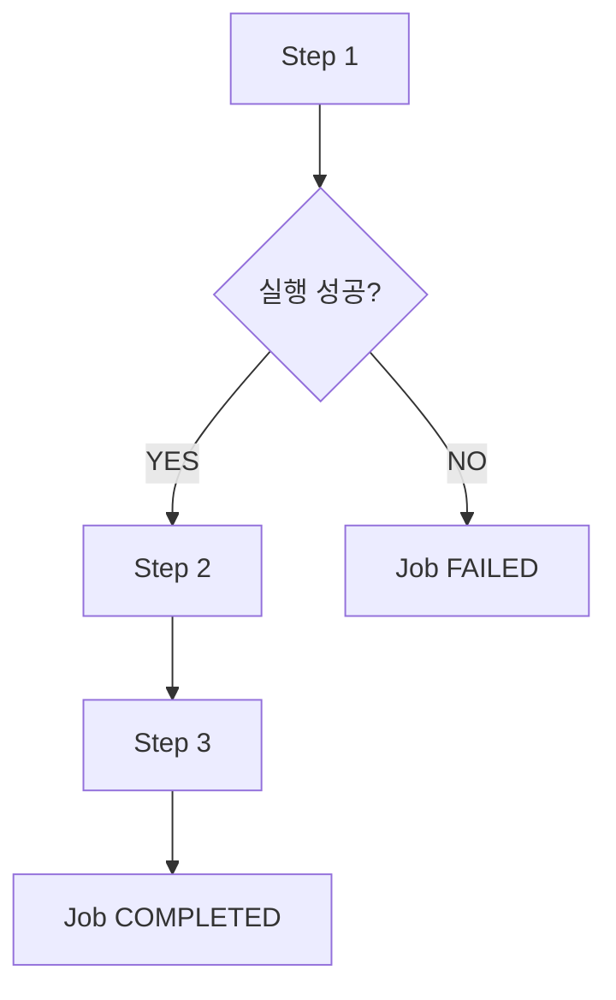

이러한 순차 실행 구조는 대부분의 배치 작업에서 충분히 활용할 수 있다.

하지만 실제 서비스에서는 단순히 Step을 순서대로 실행하는 것만으로 해결하기 어려운 요구사항이 발생한다.

예를 들어 정산 대상 데이터를 검증하는 Step이 있다고 생각해보자.

검증 결과에 따라 다음과 같이 처리해야 할 수 있다.

- 검증에 성공하면 실제 정산 데이터를 생성한다.
- 검증에 실패하면 오류 내역을 기록하고 운영자에게 알린다.
- 오류 처리 작업이 정상적으로 끝났다면 전체 Job을 정상 종료한다.
- 특정 조건에서는 일부 Step을 생략하고 다른 Step을 실행한다.

이러한 경우에는 단순한 순차 실행만으로 전체 흐름을 구성하기 어렵다.

다음과 같은 조건부 실행이 필요하기 때문이다.

```text
SettlementJob
    │
    ▼
ValidationStep
    │
    ├── COMPLETED
    │       │
    │       ▼
    │   SettlementStep
    │
    └── FAILED
            │
            ▼
        ErrorHandlingStep
```

Spring Batch에서는 이러한 요구사항을 해결하기 위해 `FlowJob`을 제공한다.

FlowJob은 Step을 단순히 순서대로 실행하는 것이 아니라 **이전 Step의 실행 결과에 따라 다음 실행 대상을 결정할 수 있는 Job 구현체**다.

다음과 같이 구성할 수 있다.

```java
@Bean
public Job settlementJob(
        JobRepository jobRepository,
        Step validationStep,
        Step settlementStep,
        Step errorHandlingStep
) {

    return new JobBuilder("settlementJob", jobRepository)
            .start(validationStep)
                .on("COMPLETED").to(settlementStep)
            .from(validationStep)
                .on("FAILED").to(errorHandlingStep)
            .end()
            .build();
}
```

이 코드는 다음과 같은 의미를 가진다.

ValidationStep이 COMPLETED로 종료되면 SettlementStep을 실행한다.

반면 FAILED로 종료되면 ErrorHandlingStep을 실행한다.

따라서 동일한 Job 안에서도 실행 결과에 따라 서로 다른 Step을 수행할 수 있다.

여기서 중요한 점이 있다.

**FlowJob에서는 특정 Step이 실패하더라도 전체 Job이 반드시 FAILED 상태로 종료되는 것은 아니다.**

실패한 Step 이후에 다른 Step을 실행하고, 최종 실행 흐름이 정상적으로 종료되도록 구성할 수 있기 때문이다.

이러한 기능이 가능한 이유는 FlowJob이 내부적으로 `SimpleFlow`라는 실행 흐름 관리 객체를 사용하기 때문이다.

이번에는 FlowJob의 기본 개념부터 SimpleJob과의 차이, 주요 API, Builder 구조, Transition, SimpleFlow의 실행 원리, 실행 상태와 실무 활용 방법까지 살펴보자.

---

### 개념

#### FlowJob이란?

`FlowJob`은 실행 결과에 따라 Step 또는 Flow의 실행 경로를 변경할 수 있는 Spring Batch의 Job 구현체다.

SimpleJob이 Step의 순차 실행에 초점을 맞춘다면 FlowJob은 조건에 따른 실행 흐름 제어에 초점을 맞춘다.

FlowJob의 대표적인 특징은 다음과 같다.

| 특징 | 설명 |
|---|---|
| 조건부 실행 | Step의 종료 상태에 따라 다음 실행 대상 결정 |
| 실행 경로 분기 | 성공과 실패에 따라 서로 다른 Step 실행 |
| Step 생략 | 조건에 해당하지 않는 Step은 실행하지 않음 |
| 실패 후 후속 처리 | 실패한 Step 이후 다른 Step 실행 가능 |
| 사용자 정의 상태 | 사용자 정의 ExitStatus를 이용한 분기 지원 |
| Flow 재사용 | 여러 Step을 하나의 Flow로 구성 가능 |
| 상태 전이 | Transition을 통해 실행 경로 결정 |
| 실행 관리 | 내부적으로 SimpleFlow 사용 |

FlowJob을 이해할 때 가장 중요한 개념은 두 가지다.

첫 번째는 `Flow`다.

두 번째는 `Transition`이다.

**Flow는 전체 실행 흐름을 정의한다.**

**Transition은 특정 실행 결과에 따라 다음 상태로 이동하는 규칙을 정의한다.**

이 두 개념이 결합되어 조건부 Job 실행이 가능해진다.

---

### SimpleJob과 FlowJob의 차이

FlowJob을 정확하게 이해하기 위해 SimpleJob과 비교해보자.

#### SimpleJob

SimpleJob은 등록된 Step을 순차적으로 실행한다.

예를 들어 다음과 같이 구성한다.

```java
new JobBuilder("simpleJob", jobRepository)
        .start(step1)
        .next(step2)
        .next(step3)
        .build();
```

실행 흐름은 다음과 같다.

```text
SimpleJob
    │
    ▼
Step 1
    │
    ▼
Step 2
    │
    ▼
Step 3
```

Step 1이 실패하면 Step 2와 Step 3은 실행되지 않는다.

Step 2가 실패하면 Step 3은 실행되지 않는다.

즉, 순차 실행 중 다음 Step으로 넘어가려면 이전 Step이 정상적으로 완료되어야 한다.

#### FlowJob

FlowJob은 특정 Step이 종료된 후 ExitStatus를 확인해 다음 실행 경로를 결정한다.

```java
new JobBuilder("flowJob", jobRepository)
        .start(step1)
            .on("COMPLETED").to(step3)
        .from(step1)
            .on("FAILED").to(step2)
        .end()
        .build();
```

실행 흐름은 다음과 같다.

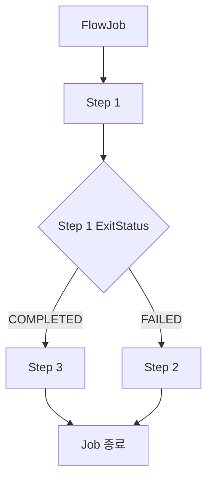

이 구조에서는 Step 1이 성공하면 Step 3을 실행한다.

반면 Step 1이 실패하면 Step 2를 실행한다.

즉, Step 2와 Step 3은 항상 실행되는 것이 아니다.

Step 1의 실행 결과에 따라 둘 중 하나만 실행된다.

#### SimpleJob과 FlowJob 비교

| 구분 | SimpleJob | FlowJob |
|---|---|---|
| 실행 방식 | 순차 실행 | 조건부 실행 |
| 주요 목적 | 정해진 순서대로 처리 | 실행 결과에 따른 흐름 제어 |
| 내부 구조 | Step 목록 | Flow |
| 핵심 실행 객체 | SimpleJob | SimpleFlow |
| 조건부 분기 | 기본적으로 지원하지 않음 | 지원 |
| 실패 후 다른 Step 실행 | 일반적인 순차 구성에서는 불가 | 가능 |
| 특정 Step 생략 | 순차 실행 구조에 따라 결정 | 조건에 따라 명시적으로 제어 가능 |
| Builder | SimpleJobBuilder | FlowJobBuilder |
| 실행 제어 | Step 반복 실행 | State와 Transition 기반 |
| 복잡도 | 상대적으로 단순 | 상대적으로 복잡 |
| 적합한 업무 | 정형화된 배치 | 조건별 처리가 필요한 배치 |

여기서 중요한 점은 FlowJob이 SimpleJob보다 항상 우수한 것은 아니라는 사실이다.

Step을 정해진 순서대로 실행하는 작업이라면 SimpleJob이 더 적합할 수 있다.

반면 실행 결과에 따라 처리 경로가 달라져야 한다면 FlowJob이 적합하다.

따라서 두 구현체는 서로 대체 관계라기보다 서로 다른 실행 요구사항을 해결하기 위한 구현체라고 이해하는 것이 좋다.

---

### 왜 사용하는가?

FlowJob이 필요한 이유는 실제 비즈니스 업무가 항상 하나의 실행 경로로만 구성되지는 않기 때문이다.

예를 들어 결제 대사 배치를 생각해보자.

결제 대사는 내부 결제 내역과 외부 PG사의 결제 내역을 비교해 차이가 있는지 확인하는 작업이다.

대사 결과에 따라 다음 작업이 달라질 수 있다.

```text
PaymentReconciliationJob
    │
    ▼
ReconciliationStep
    │
    ├── 정상
    │       │
    │       ▼
    │   SettlementStep
    │
    └── 불일치
            │
            ▼
        DiscrepancyReportStep
```

대사 결과가 정상이면 정산 작업을 진행한다.

반면 대사 결과에 불일치가 있다면 정산 작업을 진행하지 않고 불일치 보고서를 생성한다.

여기서 중요한 점은 불일치가 반드시 시스템 장애를 의미하지는 않는다는 사실이다.

실제 업무에서는 정상적인 비즈니스 조건에 따라 처리 경로를 변경해야 하는 경우도 많다.

FlowJob은 이러한 조건부 실행을 구성할 수 있다.

또한 다음과 같은 상황에서도 활용할 수 있다.

| 상황 | FlowJob 활용 |
|---|---|
| 데이터 검증 성공 | 다음 처리 Step 실행 |
| 데이터 검증 실패 | 오류 처리 Step 실행 |
| 처리 대상 데이터 없음 | 불필요한 Step 생략 |
| 일부 데이터 처리 실패 | 별도 보정 Step 실행 |
| 외부 시스템 장애 | 장애 기록 및 후속 처리 |
| 특정 상태 감지 | 별도 실행 경로 선택 |

따라서 FlowJob은 복잡한 비즈니스 요구사항을 실행 상태 기반의 흐름으로 표현할 수 있다는 장점이 있다.

---

### Flow란?

Flow는 여러 Step이나 다른 Flow의 실행 순서와 상태 전이 규칙을 표현하는 객체다.

Spring Batch에서는 `Flow`라는 인터페이스를 제공한다.

대표적인 구현체가 `SimpleFlow`다.

Flow는 다음과 같은 실행 흐름을 정의할 수 있다.

```text
Step 1
    │
    ├── COMPLETED → Step 3
    │
    └── FAILED    → Step 2
```

이 구조에서 Flow는 Step을 직접 구현하는 객체가 아니다.

Step 사이의 실행 관계를 관리하는 객체다.

따라서 다음과 같이 역할을 구분할 수 있다.

| 컴포넌트 | 역할 |
|---|---|
| Job | 배치 작업의 전체 실행 단위 |
| Flow | Step과 Flow의 실행 경로 정의 |
| Step | 실제 비즈니스 처리 단위 |
| Tasklet | Step 내부의 비즈니스 로직 |
| Transition | 실행 상태에 따른 이동 규칙 |

실제 비즈니스 로직은 Step에서 수행된다.

Flow는 특정 실행 결과에 따라 어떤 Step을 실행할 것인지 결정한다.

---

### Transition이란?

Transition은 현재 실행 상태에서 다음 실행 상태로 이동하는 규칙이다.

FlowJob에서는 Step의 실행 결과를 확인한 후 해당 결과에 맞는 Transition을 선택한다.

예를 들어 다음과 같은 코드를 살펴보자.

```java
.start(step1)
    .on("COMPLETED").to(step3)
.from(step1)
    .on("FAILED").to(step2)
```

여기에는 두 가지 Transition이 정의되어 있다.

첫 번째 Transition은 다음과 같다.

```text
Step 1
    │
    └── COMPLETED → Step 3
```

두 번째 Transition은 다음과 같다.

```text
Step 1
    │
    └── FAILED → Step 2
```

따라서 Step 1의 실행 결과에 따라 서로 다른 실행 경로가 선택된다.

Transition을 구성하는 핵심 API는 다음과 같다.

| API | 역할 |
|---|---|
| on() | 종료 코드에 대한 매칭 조건 정의 |
| to() | 조건이 일치할 때 이동할 대상 설정 |
| from() | 기존 Step이나 Flow에서 새로운 분기 추가 |
| next() | 정상 완료 시 다음 실행 대상 연결 |
| end() | 지정한 조건에서 정상 종료 또는 Builder 종료 |
| fail() | 지정한 조건에서 Job을 FAILED로 종료 |
| stop() | 지정한 조건에서 Job을 STOPPED로 종료 |
| stopAndRestart() | Job 중단 후 재시작 시 이동할 대상 지정 |

이 API들을 조합하면 다양한 실행 흐름을 구성할 수 있다.

---

### FlowJob의 주요 API

FlowJob을 구성할 때 대표적으로 사용하는 API는 다음과 같다.

```java
@Bean
public Job flowJob(
        JobRepository jobRepository,
        Step step1,
        Step step2,
        Step step3
) {

    return new JobBuilder("flowJob", jobRepository)
            .start(step1)
                .on("COMPLETED").to(step3)
            .from(step1)
                .on("FAILED").to(step2)
            .end()
            .build();
}
```

각 API를 하나씩 살펴보자.

#### start()

`start()`는 Job에서 가장 먼저 실행할 대상을 지정한다.

```java
.start(step1)
```

여기서는 Step 1을 가장 먼저 실행한다.

이때 중요한 점이 있다.

Spring Batch 5.2.4에서 `JobBuilder.start(Step)`을 호출하면 `SimpleJobBuilder`가 반환된다.

따라서 다음 코드만 작성하면 일반적인 SimpleJob을 생성하는 경로가 된다.

```java
new JobBuilder("job", jobRepository)
        .start(step1)
        .next(step2)
        .build();
```

반면 `on()`을 이용해 조건부 분기를 구성하면 FlowJob 생성 경로로 전환된다.

이 차이는 이후 Builder 구조에서 자세히 살펴보자.

#### on()

`on()`은 이전 Step의 실행 결과를 확인하기 위한 패턴을 설정한다.

```java
.on("COMPLETED")
```

이 코드는 이전 Step의 종료 코드가 COMPLETED와 일치하는지 확인한다.

다음과 같이 실패 상태도 지정할 수 있다.

```java
.on("FAILED")
```

여기서 반드시 기억해야 할 내용이 있다.

**on()은 StepExecution의 BatchStatus가 아니라 ExitStatus의 종료 코드를 기준으로 매칭한다.**

예를 들어 다음과 같은 상태가 있다고 생각해보자.

```text
BatchStatus = COMPLETED

ExitStatus = COMPLETED_WITH_WARNINGS
```

이 경우 BatchStatus는 COMPLETED다.

하지만 ExitStatus는 사용자 정의 코드다.

따라서 다음과 같은 조건을 사용할 수 있다.

```java
.on("COMPLETED_WITH_WARNINGS")
```

이처럼 FlowJob에서는 단순한 성공과 실패뿐 아니라 사용자 정의 종료 코드를 기준으로 실행 흐름을 구성할 수 있다.

#### to()

`to()`는 on()의 조건이 일치했을 때 이동할 실행 대상을 지정한다.

```java
.on("COMPLETED").to(step3)
```

이 코드는 이전 Step의 ExitStatus가 COMPLETED이면 Step 3을 실행한다는 의미다.

다음과 같이 사용할 수도 있다.

```java
.on("FAILED").to(step2)
```

이 경우 이전 Step이 FAILED로 종료되면 Step 2를 실행한다.

`to()`에는 Step 외에도 Flow나 JobExecutionDecider를 전달할 수 있다.

#### from()

`from()`은 이전에 등록한 Step이나 Flow를 기준으로 추가적인 실행 경로를 정의한다.

예를 들어 다음과 같은 코드가 있다고 생각해보자.

```java
.start(step1)
    .on("COMPLETED").to(step3)
```

이 코드는 Step 1이 성공했을 때 Step 3으로 이동하는 경로를 정의한다.

그렇다면 Step 1이 실패했을 때의 경로는 어떻게 정의할까?

다음과 같이 `from()`을 사용한다.

```java
.from(step1)
    .on("FAILED").to(step2)
```

이 코드는 이미 등록한 Step 1을 기준으로 새로운 Transition을 추가한다.

전체 코드는 다음과 같다.

```java
.start(step1)
    .on("COMPLETED").to(step3)
.from(step1)
    .on("FAILED").to(step2)
```

여기서 중요한 점이 있다.

**from(step1)은 Step 1을 즉시 다시 실행하는 메서드가 아니다.**

Step 1을 시작점으로 하는 추가적인 실행 경로를 정의하는 메서드다.

따라서 from()은 실행 흐름을 구성하는 시점에 사용된다.

실제 Step의 실행은 Job이 시작된 이후 SimpleFlow의 실행 제어에 따라 이루어진다.

#### next()

`next()`는 정상 완료 시 다음 실행 대상으로 연결하는 API다.

```java
.start(step1)
.next(step2)
.next(step3)
```

순차적인 실행 흐름을 구성할 때 사용할 수 있다.

FlowBuilder에서 next(step)를 사용하면 일반적으로 이전 상태가 COMPLETED일 때 다음 Step으로 이동하도록 구성된다.

반면 조건에 따라 실행 경로를 명시적으로 구분하고 싶다면 on()과 to()를 사용할 수 있다.

```java
.start(step1)
    .on("COMPLETED").to(step3)
.from(step1)
    .on("FAILED").to(step2)
```

따라서 next()와 on().to()는 상황에 따라 적절하게 선택하면 된다.

---

### on()에서 사용할 수 있는 패턴

FlowJob의 on()은 문자열 패턴을 이용해 ExitStatus를 매칭한다.

대표적인 패턴은 다음과 같다.

| 패턴 | 의미 |
|---|---|
| COMPLETED | 정확히 COMPLETED와 일치 |
| FAILED | 정확히 FAILED와 일치 |
| * | 모든 종료 코드 |
| COMPLETED* | COMPLETED로 시작하는 종료 코드 |
| FAILED* | FAILED로 시작하는 종료 코드 |
| ? | 임의의 한 글자 |
| COMPLETED_WITH_WARNINGS | 특정 사용자 정의 종료 코드 |

예를 들어 다음과 같이 작성할 수 있다.

```java
.on("COMPLETED").to(step2)
```

이 조건은 ExitStatus가 COMPLETED인 경우에 매칭된다.

반면 다음과 같이 작성하면

```java
.on("*").to(step3)
```

다른 모든 종료 코드를 처리하는 경로를 정의할 수 있다.

다만 패턴을 사용할 때는 주의해야 한다.

예를 들어 `COMPLETED*`는 COMPLETED뿐 아니라 COMPLETED_WITH_WARNINGS 같은 문자열에도 매칭될 수 있다.

따라서 실제 업무에서 특정 종료 상태만 처리해야 한다면 정확한 패턴을 사용하는 것이 좋다.

#### 여러 조건을 함께 구성하기

다음 코드를 살펴보자.

```java
.start(step1)
    .on("FAILED").to(errorStep)
.from(step1)
    .on("*").to(successStep)
.end()
.build();
```

이 구조에서는 FAILED에 해당하는 구체적인 조건을 먼저 처리하고, 나머지 종료 코드에 대해 기본 경로를 지정할 수 있다.

Spring Batch는 Transition을 구성할 때 패턴의 구체성을 고려해 매칭 순서를 처리한다.

따라서 예상 가능한 ExitStatus와 기본 처리 경로를 함께 정의하는 것이 중요하다.

---

### end(), fail(), stop(), stopAndRestart()

FlowJob에는 실행 흐름을 종료하거나 중단하기 위한 API도 존재한다.

하지만 이 API들은 모두 동일한 의미를 가지는 것은 아니다.

| API | 최종 BatchStatus | 의미 |
|---|---|---|
| end() | COMPLETED | 정상 종료 |
| fail() | FAILED | 실패 종료 |
| stop() | STOPPED | 중단 종료 |
| stopAndRestart() | STOPPED | 중단 후 재시작 위치 지정 |

이러한 종료 API는 TransitionBuilder에서 사용할 수 있다.

#### end(): 정상 종료

```java
.start(step1)
    .on("FAILED").end()
.end()
.build();
```

이 예제에서 첫 번째 end()는 FAILED라는 조건에 대한 종료 Transition을 정의한다.

즉, Step 1이 FAILED로 종료되더라도 Job을 COMPLETED 상태로 종료하도록 설정할 수 있다.

여기서 중요한 점은 **실패한 StepExecution의 상태가 COMPLETED로 변경되는 것은 아니라는 사실**이다.

StepExecution은 FAILED 상태를 유지할 수 있다.

하지만 JobExecution은 COMPLETED 상태로 종료될 수 있다.

또한 COMPLETED로 종료된 JobInstance는 동일한 식별용 JobParameters로 다시 시작할 수 없다.

따라서 실제 장애를 정상 종료로 처리하는 정책은 신중하게 적용해야 한다.

#### fail(): 실패 종료

```java
.start(step1)
    .on("FAILED").fail()
.end()
.build();
```

이 경우 Step 1이 FAILED로 종료되면 Job도 FAILED 상태로 종료된다.

FAILED 상태의 JobInstance는 재시작이 허용되는 구성이라면 동일한 식별용 JobParameters로 재시작할 수 있다.

따라서 장애가 해결된 후 재처리해야 하는 작업에 적합할 수 있다.

#### stop(): 중단 종료

```java
.start(step1)
    .on("COMPLETED").stop()
.end()
.build();
```

이 코드는 해당 조건에서 Job을 STOPPED 상태로 종료하도록 구성한다.

STOPPED는 COMPLETED나 FAILED와 다른 실행 상태다.

작업을 일시적으로 중단하고 이후 재시작하도록 설계할 때 활용할 수 있다.

#### stopAndRestart(): 재시작 위치 지정

```java
.start(step1)
    .on("COMPLETED").stopAndRestart(step2)
.end()
.build();
```

이 코드는 Step 1이 완료되면 Job을 STOPPED 상태로 종료한다.

그리고 같은 JobInstance를 재시작할 때 Step 2부터 진행하도록 구성한다.

다만 실제 재시작 가능 여부는 Job의 재시작 정책과 저장된 실행 상태에 따라 결정된다.

---

### 두 종류의 end()를 구분해야 한다

FlowJob에서 가장 혼동하기 쉬운 API 중 하나가 `end()`다.

다음 코드를 살펴보자.

```java
.start(step1)
    .on("FAILED").end()
.end()
.build();
```

여기에는 두 개의 end()가 존재한다.

하지만 역할은 서로 다르다.

#### 첫 번째 end()

```java
.on("FAILED").end()
```

이 end()는 `TransitionBuilder`의 메서드다.

FAILED 조건에 해당하면 Job을 정상 종료하도록 하는 Transition을 추가한다.

즉, **실행 중에 적용할 종료 규칙을 정의한다.**

#### 두 번째 end()

```java
.end()
.build();
```

여기서 end()는 `FlowBuilder`의 메서드다.

현재까지 정의한 Flow를 구성하고, Job을 생성하는 다음 단계로 진행한다.

Spring Batch 5.2.4의 FlowBuilder에서는 end()가 build()를 호출하도록 구현되어 있다.

JobFlowBuilder에서는 이 과정에서 SimpleFlow를 생성하고 부모 FlowJobBuilder에 전달한다.

따라서 두 메서드의 역할은 다음과 같다.

| 구분 | TransitionBuilder.end() | FlowBuilder.end() |
|---|---|---|
| 호출 위치 | on() 이후 | Job build() 이전 |
| 목적 | 조건별 정상 종료 규칙 추가 | Flow 구성 완료 |
| 실행 시점 | Job 실행 중 Transition으로 적용 | Job 생성 시 |
| 반환 | FlowBuilder | FlowJobBuilder 등 상위 Builder 결과 |
| 핵심 의미 | 어떤 상태에서 종료할 것인가? | 정의한 Flow를 어떻게 완성할 것인가? |

이 차이를 구분해야 FlowJob의 API 체인을 정확하게 이해할 수 있다.

---

### FlowJob의 Builder 구조

FlowJob은 여러 Builder를 통해 생성된다.

대표적으로 다음 클래스가 사용된다.

```text
JobBuilder
    │
    ▼
SimpleJobBuilder
    │
    ▼
JobFlowBuilder
    │
    ▼
FlowBuilder
    │
    ▼
SimpleFlow
    │
    ▼
FlowJobBuilder
    │
    ▼
FlowJob
```

여기서 주의할 점은 이 그림이 클래스의 상속 관계를 표현하는 것이 아니라 **FlowJob을 생성하는 과정에서 사용되는 주요 Builder와 객체의 관계**를 단순화한 것이라는 사실이다.

실제 Builder 구성은 반환 타입과 메서드 호출에 따라 달라진다.

#### SimpleJobBuilder에서 FlowJobBuilder로 전환되는 과정

다음 코드를 살펴보자.

```java
new JobBuilder("flowJob", jobRepository)
        .start(step1)
```

이 시점에는 SimpleJobBuilder가 반환된다.

하지만 이후 on()을 호출하면 흐름 구성이 달라진다.

```java
.on("COMPLETED")
```

Spring Batch 5.2.4의 SimpleJobBuilder에는 다음과 같은 메서드가 존재한다.

```java
public FlowBuilder.TransitionBuilder<FlowJobBuilder> on(
        String pattern
) {
    // ...
}
```

이 메서드에서는 JobFlowBuilder를 준비한다.

핵심 구조는 다음과 같다.

```java
builder = new JobFlowBuilder(
        new FlowJobBuilder(this),
        step
);
```

그리고 다음 메서드를 호출한다.

```java
return builder.on(pattern);
```

따라서 `on()`을 사용하는 순간 조건부 Flow를 구성하는 Builder 경로로 전환된다.

여기서 중요한 사실이 있다.

**start(step1)만 호출했다고 해서 최종 Job 구현체가 반드시 SimpleJob으로 결정되는 것은 아니다.**

그 이후 어떤 API를 호출하느냐에 따라 최종적으로 생성되는 Job 구현체가 달라질 수 있다.

예를 들어 다음과 같다.

```java
new JobBuilder("simpleJob", jobRepository)
        .start(step1)
        .next(step2)
        .build();
```

이 코드는 SimpleJob을 생성한다.

반면 다음 코드는

```java
new JobBuilder("flowJob", jobRepository)
        .start(step1)
            .on("COMPLETED").to(step3)
        .from(step1)
            .on("FAILED").to(step2)
        .end()
        .build();
```

FlowJob을 생성한다.

같은 JobBuilder를 사용하지만 조건부 Flow 구성 여부에 따라 최종 구현체가 달라지는 것이다.

---

### TransitionBuilder의 역할

`on()` 메서드를 호출하면 `TransitionBuilder`가 반환된다.

TransitionBuilder는 조건에 따른 다음 동작을 설정하는 Builder다.

대표적으로 다음 API를 제공한다.

```text
TransitionBuilder
    │
    ├── to()
    │
    ├── end()
    │
    ├── fail()
    │
    ├── stop()
    │
    └── stopAndRestart()
```

예를 들어 다음 코드를 살펴보자.

```java
.on("FAILED").to(step2)
```

처음 on()을 호출하면 TransitionBuilder가 반환된다.

이 Builder는 FAILED라는 매칭 패턴을 가진다.

그리고 to(step2)를 호출하면 FAILED 조건에 해당할 때 Step 2로 이동하는 Transition을 생성한다.

이후 다시 FlowBuilder로 돌아온다.

전체 과정은 다음과 같다.

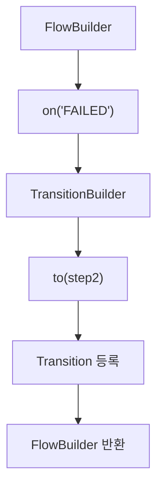

따라서 다음과 같은 API 체인을 구성할 수 있다.

```java
.start(step1)
    .on("COMPLETED").to(step3)
.from(step1)
    .on("FAILED").to(step2)
.end()
.build();
```

TransitionBuilder는 조건별 실행 규칙을 정의한다.

FlowBuilder는 여러 Transition을 조합해 전체 실행 흐름을 정의한다.

이러한 역할 분리로 인해 복잡한 조건부 실행을 선언적으로 구성할 수 있다.

---

### FlowBuilder와 SimpleFlow의 관계

FlowJob에서 실제 실행 흐름을 관리하는 객체는 `SimpleFlow`다.

SimpleFlow는 Flow 인터페이스의 구현체다.

FlowBuilder는 여러 Step과 Transition을 수집한 후 SimpleFlow를 생성한다.

Spring Batch 5.2.4의 FlowBuilder에는 다음과 같은 로직이 존재한다.

```java
protected Flow flow() {

    flow = new SimpleFlow(name);

    // Transition 및 State 구성

    flow.setStateTransitions(transitions);

    return flow;
}
```

위 코드는 핵심 생성 과정만 나타낸 것이다.

실제 구현에서는 시작 상태와 종료 상태, Transition 검증 및 비교 규칙 등도 함께 구성한다.

여기서 중요한 것은 다음 코드다.

```java
flow.setStateTransitions(transitions);
```

FlowBuilder가 수집한 Transition 정보를 SimpleFlow에 전달한다.

따라서 SimpleFlow는 다음 정보를 가지게 된다.

```text
SimpleFlow
    │
    ├── StartState
    │
    ├── StepState 1
    │
    ├── StepState 2
    │
    ├── StepState 3
    │
    └── StateTransition
            │
            ├── COMPLETED → StepState 3
            └── FAILED    → StepState 2
```

이렇게 구성된 SimpleFlow가 FlowJob 내부에 저장된다.

---

### FlowJob의 내부 구조

Spring Batch 5.2.4의 FlowJob은 AbstractJob을 상속한다.

```java
public class FlowJob extends AbstractJob {
}
```

그리고 내부적으로 Flow 타입의 필드를 가진다.

```java
protected Flow flow;
```

이 필드에는 일반적으로 FlowBuilder가 생성한 SimpleFlow 객체가 저장된다.

따라서 다음과 같은 구조가 만들어진다.

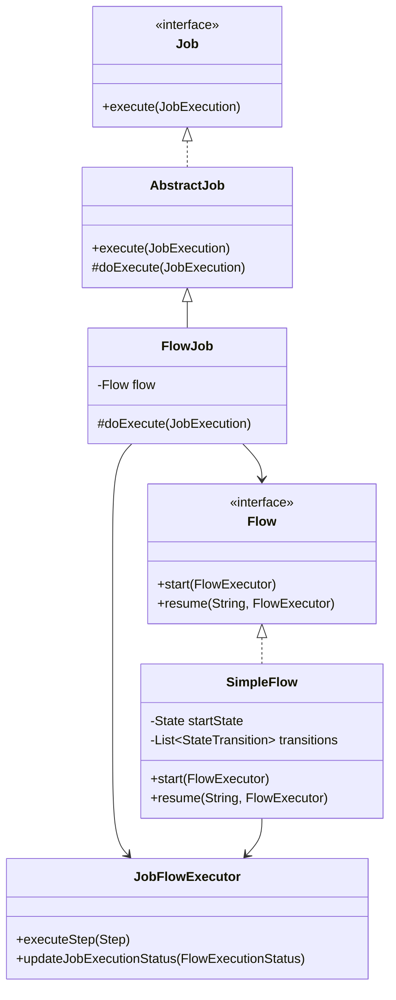

여기서 중요한 점은 FlowJob이 직접 Step의 조건부 실행을 모두 처리하지 않는다는 사실이다.

FlowJob은 SimpleFlow에 실행을 위임한다.

SimpleFlow는 State와 Transition을 이용해 다음 실행 대상을 결정한다.

---

### FlowJob.doExecute() 내부 분석

FlowJob에서 가장 중요한 메서드는 `doExecute()`다.

Spring Batch 5.2.4의 핵심 구현은 다음과 같다.

```java
@Override
protected void doExecute(
        final JobExecution execution
) throws JobExecutionException {

    try {

        JobFlowExecutor executor =
                new JobFlowExecutor(
                        getJobRepository(),
                        new SimpleStepHandler(
                                getJobRepository()
                        ),
                        execution
                );

        executor.updateJobExecutionStatus(
                flow.start(executor).getStatus()
        );

    } catch (FlowExecutionException e) {

        // 예외 처리
    }
}
```

이 코드에서 중요한 부분은 다음과 같다.

첫 번째로 JobFlowExecutor를 생성한다.

```java
JobFlowExecutor executor =
        new JobFlowExecutor(
                getJobRepository(),
                new SimpleStepHandler(
                        getJobRepository()
                ),
                execution
        );
```

JobFlowExecutor는 Flow 내부에서 Step을 실행하기 위한 객체다.

두 번째로 SimpleFlow를 실행한다.

```java
flow.start(executor);
```

이 호출이 실제 Flow의 실행을 시작한다.

세 번째로 실행 결과를 JobExecution에 반영한다.

```java
executor.updateJobExecutionStatus(
        flow.start(executor).getStatus()
);
```

따라서 전체 호출 흐름은 다음과 같다.

```text
FlowJob.doExecute()
    │
    ▼
JobFlowExecutor 생성
    │
    ▼
SimpleFlow.start()
    │
    ▼
SimpleFlow.resume()
    │
    ▼
State 실행
    │
    ▼
Transition 선택
    │
    ▼
다음 State 실행
    │
    ▼
FlowExecutionStatus 결정
    │
    ▼
JobExecution 상태 반영
```

이 구조를 이해하면 FlowJob이 SimpleJob과 어떻게 다른 방식으로 Step을 실행하는지 알 수 있다.

---

### SimpleFlow는 어떻게 다음 Step을 결정할까?

SimpleFlow는 여러 State와 Transition을 이용해 실행 흐름을 관리한다.

Spring Batch 5.2.4의 SimpleFlow에는 다음과 같은 메서드가 존재한다.

```java
public FlowExecution resume(
        String stateName,
        FlowExecutor executor
) throws FlowExecutionException
```

이 메서드는 지정한 State부터 Flow 실행을 진행한다.

핵심 실행 구조는 다음과 같다.

```java
while (isFlowContinued(
        state,
        status,
        stepExecution
)) {

    stateName = state.getName();

    status = state.handle(executor);

    stepExecution = executor.getStepExecution();

    state = nextState(
            stateName,
            status,
            stepExecution
    );
}
```

이 코드는 SimpleFlow의 핵심적인 실행 흐름을 보여준다.

#### 첫 번째: 현재 State 실행

```java
status = state.handle(executor);
```

현재 State를 실행한다.

State가 StepState라면 내부적으로 Step 실행이 이루어진다.

#### 두 번째: 실행 결과 확인

실행 결과는 FlowExecutionStatus로 반환된다.

```java
FlowExecutionStatus status
```

예를 들어 Step이 정상적으로 완료되었다면 COMPLETED에 해당하는 상태가 반환될 수 있다.

반면 실패했다면 FAILED에 해당하는 상태가 반환될 수 있다.

#### 세 번째: 다음 State 결정

```java
state = nextState(
        stateName,
        status,
        stepExecution
);
```

현재 실행 결과를 기준으로 다음 State를 선택한다.

여기서 FlowBuilder가 정의한 Transition이 사용된다.

예를 들어 다음과 같은 조건이 있다고 생각해보자.

```text
Step 1
    │
    ├── COMPLETED → Step 3
    │
    └── FAILED    → Step 2
```

Step 1이 COMPLETED를 반환했다면 다음 State는 Step 3이다.

FAILED를 반환했다면 다음 State는 Step 2다.

이처럼 SimpleFlow는 현재 State의 실행 결과를 이용해 다음 실행 대상을 결정한다.

---

### FlowExecutionStatus란?

FlowJob을 이해할 때 중요한 상태 객체가 하나 더 있다.

바로 `FlowExecutionStatus`다.

Spring Batch에서는 다음 세 가지 상태를 구분해서 이해해야 한다.

- BatchStatus
- ExitStatus
- FlowExecutionStatus

세 상태는 역할이 다르다.

| 구분 | BatchStatus | ExitStatus | FlowExecutionStatus |
|---|---|---|---|
| 대상 | JobExecution, StepExecution | JobExecution, StepExecution | FlowExecution |
| 주요 목적 | 실행 상태 관리 | 종료 코드 표현 | Flow 실행 상태 표현 |
| 대표 값 | COMPLETED, FAILED | COMPLETED, FAILED, 사용자 정의 코드 | COMPLETED, FAILED, STOPPED 등 |
| 사용 위치 | Job 및 Step 실행 관리 | Transition 조건 판단 | Flow의 상태 전이 및 최종 결과 |
| 사용자 정의 코드 | 제한적 | 가능 | 가능 |

여기서 중요한 것은 FlowJob의 조건부 실행 과정이다.

Step이 실행되면 StepExecution에 ExitStatus가 기록된다.

그리고 StepState는 이 종료 코드를 FlowExecutionStatus로 전달한다.

SimpleFlow는 해당 FlowExecutionStatus를 기준으로 다음 Transition을 결정한다.

전체 흐름은 다음과 같다.

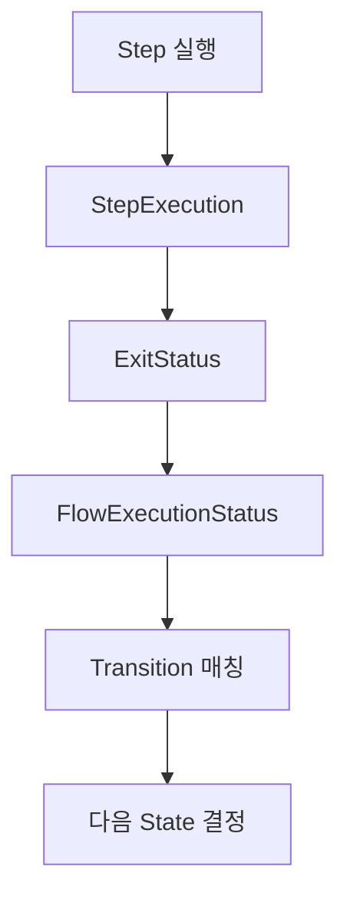

따라서 FlowJob의 조건부 실행을 이해하려면 ExitStatus와 FlowExecutionStatus의 관계를 알아야 한다.

---

### Step이 FAILED인데 Job은 COMPLETED가 될 수 있을까?

FlowJob에서 가장 중요한 특징 중 하나다.

결론부터 말하면 **가능하다.**

하지만 모든 실패 상황에서 자동으로 Job이 COMPLETED가 되는 것은 아니다.

다음과 같은 실행 흐름이 있다고 생각해보자.

```text
FlowJob
    │
    ▼
Step 1
    │
    ├── COMPLETED → Step 3
    │
    └── FAILED    → Step 2
```

Step 1이 실패했다고 가정하자.

```text
Step 1

BatchStatus = FAILED

ExitStatus = FAILED
```

이 경우 SimpleFlow는 FAILED에 해당하는 Transition을 찾는다.

그리고 Step 2를 실행한다.

```text
Step 2

BatchStatus = COMPLETED

ExitStatus = COMPLETED
```

Step 2가 정상적으로 완료되고 Flow도 정상 종료되면 최종 FlowExecutionStatus는 COMPLETED가 될 수 있다.

FlowJob은 이 결과를 JobExecution에 반영한다.

따라서 다음과 같은 상태가 만들어질 수 있다.

```text
Step 1 = FAILED

Step 2 = COMPLETED

Job = COMPLETED
```

여기서 중요한 사실은 **실패한 Step 1의 상태가 변경된 것은 아니라는 점**이다.

Step 1은 여전히 FAILED다.

다만 실패 후 실행하도록 정의한 Step 2가 성공했고 전체 Flow가 정상적으로 종료되었기 때문에 Job이 COMPLETED로 끝난 것이다.

이러한 동작은 FlowJob의 실행 결과가 단순히 모든 Step의 BatchStatus를 종합하는 방식이 아니라 Flow의 최종 실행 상태에 영향을 받기 때문에 가능하다.

#### 어떤 경우에 유용할까?

예를 들어 정산 대상 검증에서 처리할 데이터가 없다는 결과가 발생했다고 생각해보자.

이 상황을 비즈니스상 별도 처리 경로로 정의했다면 후속 처리 후 Job을 정상 종료하도록 설계할 수 있다.

다만 실제 시스템 오류나 데이터 정합성 문제를 무조건 정상 종료로 처리하면 운영상 위험할 수 있다.

따라서 **비즈니스상 정상적인 분기와 실제 시스템 장애는 명확하게 구분하는 것이 중요하다.**

---

### 예제: FlowJob 조건부 실행 구현하기

이제 실제로 FlowJob을 구현해보자.

이번 예제에서는 세 개의 Step을 생성한다.

Step 1은 실행 조건에 따라 성공하거나 실패한다.

Step 2는 Step 1이 실패했을 때 실행한다.

Step 3은 Step 1이 성공했을 때 실행한다.

전체 구조는 다음과 같다.

```text
flowJob
    │
    ▼
step1
    │
    ├── COMPLETED → step3
    │
    └── FAILED    → step2
```

이번 예제에서는 다음 두 가지 상황을 확인한다.

| 실행 상황 | 실행되는 Step | 최종 Job 상태 |
|---|---|---|
| Step 1 성공 | step1 → step3 | COMPLETED |
| Step 1 실패, Step 2 성공 | step1 → step2 | COMPLETED |

핵심은 두 번째 상황이다.

Step 1이 실패했지만 오류 처리 경로인 Step 2가 성공하면 전체 Flow가 정상적으로 종료되는 것을 확인한다.

#### 개발 환경

| 항목 | 기술 |
|---|---|
| Java | Java 17 |
| Spring Boot | 3.4.13 |
| Spring Batch | 5.2.4 |
| Database | H2 |
| Build Tool | Maven |
| Job 구현체 | FlowJob |
| Step 구현체 | TaskletStep |

---

### Maven 의존성 설정

`pom.xml`

```xml
<?xml version="1.0" encoding="UTF-8"?>
<project xmlns="http://maven.apache.org/POM/4.0.0"
         xmlns:xsi="http://www.w3.org/2001/XMLSchema-instance"
         xsi:schemaLocation="
             http://maven.apache.org/POM/4.0.0
             https://maven.apache.org/xsd/maven-4.0.0.xsd">

    <modelVersion>4.0.0</modelVersion>

    <parent>
        <groupId>org.springframework.boot</groupId>
        <artifactId>spring-boot-starter-parent</artifactId>
        <version>3.4.13</version>
        <relativePath/>
    </parent>

    <groupId>com.example</groupId>
    <artifactId>spring-batch-flowjob</artifactId>
    <version>0.0.1-SNAPSHOT</version>

    <properties>
        <java.version>17</java.version>
        <spring-batch.version>5.2.4</spring-batch.version>
    </properties>

    <dependencies>

        <dependency>
            <groupId>org.springframework.boot</groupId>
            <artifactId>spring-boot-starter-batch</artifactId>
        </dependency>

        <dependency>
            <groupId>com.h2database</groupId>
            <artifactId>h2</artifactId>
            <scope>runtime</scope>
        </dependency>

        <dependency>
            <groupId>org.springframework.boot</groupId>
            <artifactId>spring-boot-starter-test</artifactId>
            <scope>test</scope>
        </dependency>

    </dependencies>

    <build>
        <plugins>
            <plugin>
                <groupId>org.springframework.boot</groupId>
                <artifactId>spring-boot-maven-plugin</artifactId>
            </plugin>
        </plugins>
    </build>

</project>
```

Spring Batch와 H2 데이터베이스를 사용한다.

이번 예제에서는 실행 경로와 메타데이터를 확인하는 것이 목적이므로 인메모리 H2를 사용한다.

---

### application.yml 설정

`src/main/resources/application.yml`

```yaml
spring:
  application:
    name: spring-batch-flowjob

  main:
    web-application-type: none

  datasource:
    url: jdbc:h2:mem:flowjobdb;DB_CLOSE_DELAY=-1
    driver-class-name: org.h2.Driver
    username: sa
    password:

  batch:
    job:
      enabled: true
      name: flowJob

    jdbc:
      initialize-schema: always

logging:
  level:
    org.springframework.batch: INFO
    com.example.batch: INFO
```

여기서 중요한 설정은 다음과 같다.

```yaml
spring:
  batch:
    job:
      name: flowJob
```

애플리케이션이 시작될 때 flowJob을 실행하도록 지정한다.

---

### Spring Boot 애플리케이션

`BatchApplication.java`

```java
package com.example.batch;

import org.springframework.boot.SpringApplication;
import org.springframework.boot.autoconfigure.SpringBootApplication;

@SpringBootApplication
public class BatchApplication {

    public static void main(String[] args) {

        SpringApplication.run(
                BatchApplication.class,
                args
        );
    }
}
```

---

### FlowJobConfiguration 전체 코드

`FlowJobConfiguration.java`

```java
package com.example.batch;

import org.slf4j.Logger;
import org.slf4j.LoggerFactory;

import org.springframework.batch.core.Job;
import org.springframework.batch.core.Step;
import org.springframework.batch.core.StepExecution;

import org.springframework.batch.core.job.builder.JobBuilder;
import org.springframework.batch.core.repository.JobRepository;
import org.springframework.batch.core.step.builder.StepBuilder;

import org.springframework.batch.repeat.RepeatStatus;

import org.springframework.beans.factory.annotation.Qualifier;
import org.springframework.context.annotation.Bean;
import org.springframework.context.annotation.Configuration;

import org.springframework.transaction.PlatformTransactionManager;

@Configuration
public class FlowJobConfiguration {

    private static final Logger log =
            LoggerFactory.getLogger(
                    FlowJobConfiguration.class
            );

    // -------------------------------------------
    // FlowJob
    // -------------------------------------------

    @Bean
    public Job flowJob(
            JobRepository jobRepository,
            @Qualifier("step1") Step step1,
            @Qualifier("step2") Step step2,
            @Qualifier("step3") Step step3
    ) {

        Job job = new JobBuilder(
                "flowJob",
                jobRepository
        )
                .start(step1)
                    .on("COMPLETED").to(step3)
                .from(step1)
                    .on("FAILED").to(step2)
                .end()
                .build();

        log.info(
                "생성된 Job 구현체={}",
                job.getClass().getSimpleName()
        );

        return job;
    }

    // -------------------------------------------
    // Step 1: 성공 또는 실패
    // -------------------------------------------

    @Bean
    public Step step1(
            JobRepository jobRepository,
            PlatformTransactionManager transactionManager
    ) {

        return new StepBuilder(
                "step1",
                jobRepository
        )
                .tasklet((contribution, chunkContext) -> {

                    StepExecution execution =
                            contribution.getStepExecution();

                    String scenario =
                            execution
                                    .getJobParameters()
                                    .getString("scenario");

                    log.info(
                            "[Step1] 실행 시작, scenario={}",
                            scenario
                    );

                    if ("failure".equals(scenario)) {

                        log.info(
                                "[Step1] 의도적인 실패 발생"
                        );

                        throw new IllegalStateException(
                                "Step1 실행 실패"
                        );
                    }

                    log.info(
                            "[Step1] 정상 종료"
                    );

                    return RepeatStatus.FINISHED;

                }, transactionManager)
                .build();
    }

    // -------------------------------------------
    // Step 2: 실패 시 후속 처리
    // -------------------------------------------

    @Bean
    public Step step2(
            JobRepository jobRepository,
            PlatformTransactionManager transactionManager
    ) {

        return new StepBuilder(
                "step2",
                jobRepository
        )
                .tasklet((contribution, chunkContext) -> {

                    log.info(
                            "[Step2] 실패 후속 처리 실행"
                    );

                    return RepeatStatus.FINISHED;

                }, transactionManager)
                .build();
    }

    // -------------------------------------------
    // Step 3: 정상 처리
    // -------------------------------------------

    @Bean
    public Step step3(
            JobRepository jobRepository,
            PlatformTransactionManager transactionManager
    ) {

        return new StepBuilder(
                "step3",
                jobRepository
        )
                .tasklet((contribution, chunkContext) -> {

                    log.info(
                            "[Step3] 정상 처리 경로 실행"
                    );

                    return RepeatStatus.FINISHED;

                }, transactionManager)
                .build();
    }
}
```

이 코드에서 가장 중요한 부분은 Job의 구성이다.

```java
.start(step1)
    .on("COMPLETED").to(step3)
.from(step1)
    .on("FAILED").to(step2)
.end()
.build();
```

Step 1이 정상적으로 완료되면 Step 3을 실행한다.

Step 1이 실패하면 Step 2를 실행한다.

따라서 실행 결과에 따라 서로 다른 Step이 선택된다.

---

### 첫 번째 실행: Step 1이 성공하는 경우

먼저 프로젝트를 빌드한다.

```bash
mvn clean package
```

정상적으로 완료되면 다음과 같은 결과를 확인할 수 있다.

```text
BUILD SUCCESS
```

이제 Job을 실행한다.

```bash
java -jar target/spring-batch-flowjob-0.0.1-SNAPSHOT.jar \
  scenario=success
```

이번에는 scenario를 success로 설정했다.

따라서 Step 1에서 예외가 발생하지 않는다.

Step 1은 다음 값을 반환한다.

```java
return RepeatStatus.FINISHED;
```

따라서 Step 1은 정상적으로 완료된다.

```text
Step1

BatchStatus = COMPLETED

ExitStatus = COMPLETED
```

SimpleFlow는 COMPLETED에 해당하는 Transition을 확인한다.

```java
.on("COMPLETED").to(step3)
```

따라서 Step 3이 실행된다.

Step 2는 실행되지 않는다.

#### 예상 실행 로그

```text
생성된 Job 구현체=FlowJob

[Step1] 실행 시작, scenario=success

[Step1] 정상 종료

[Step3] 정상 처리 경로 실행
```

최종 실행 흐름은 다음과 같다.

```text
FlowJob
    │
    ▼
Step 1
    │
    └── COMPLETED
            │
            ▼
          Step 3
            │
            └── COMPLETED
                    │
                    ▼
              Job COMPLETED
```

#### 실행 결과

| 구분 | 실행 여부 | BatchStatus |
|---|---|---|
| Step 1 | 실행 | COMPLETED |
| Step 2 | 미실행 | StepExecution 없음 |
| Step 3 | 실행 | COMPLETED |
| FlowJob | 실행 | COMPLETED |

여기서 중요한 점은 Step 2가 실행되지 않았다는 사실이다.

FlowJob은 등록된 모든 Step을 무조건 실행하지 않는다.

현재 실행 상태에 맞는 Transition으로 연결된 Step만 실행한다.

---

### 두 번째 실행: Step 1이 실패하는 경우

이번에는 Step 1에서 의도적으로 예외를 발생시켜보자.

```bash
java -jar target/spring-batch-flowjob-0.0.1-SNAPSHOT.jar \
  scenario=failure
```

이번에는 scenario를 failure로 설정했다.

따라서 Step 1에서 다음 예외가 발생한다.

```java
throw new IllegalStateException(
        "Step1 실행 실패"
);
```

Step 1은 FAILED 상태로 종료된다.

```text
Step1

BatchStatus = FAILED

ExitStatus = FAILED
```

하지만 Job은 곧바로 종료되지 않는다.

왜냐하면 다음 Transition이 존재하기 때문이다.

```java
.from(step1)
    .on("FAILED").to(step2)
```

SimpleFlow는 FAILED에 해당하는 Transition을 선택한다.

그리고 Step 2를 실행한다.

Step 2는 정상적으로 완료된다.

#### 예상 실행 로그

```text
생성된 Job 구현체=FlowJob

[Step1] 실행 시작, scenario=failure

[Step1] 의도적인 실패 발생

IllegalStateException:
Step1 실행 실패

[Step2] 실패 후속 처리 실행
```

여기서 Step 1에서 예외가 발생했지만 Step 2가 실행된다는 점이 중요하다.

#### 최종 실행 흐름

```text
FlowJob
    │
    ▼
Step 1
    │
    └── FAILED
            │
            ▼
          Step 2
            │
            └── COMPLETED
                    │
                    ▼
              Job COMPLETED
```

#### 실행 결과

| 구분 | 실행 여부 | BatchStatus |
|---|---|---|
| Step 1 | 실행 | FAILED |
| Step 2 | 실행 | COMPLETED |
| Step 3 | 미실행 | StepExecution 없음 |
| FlowJob | 실행 | COMPLETED |

이 결과가 FlowJob의 가장 중요한 특징을 보여준다.

**Step 1이 FAILED 상태로 종료되었지만 전체 Job은 COMPLETED 상태로 종료될 수 있다.**

이는 실패를 무시했기 때문이 아니다.

FAILED에 해당하는 Transition을 정의했고, 해당 실행 경로가 정상적으로 종료되었기 때문이다.

---

### 데이터베이스에서 실행 결과 확인하기

Spring Batch는 Job과 Step의 실행 상태를 메타데이터 테이블에 저장한다.

대표적으로 다음 테이블을 사용한다.

```text
BATCH_JOB_INSTANCE

BATCH_JOB_EXECUTION

BATCH_STEP_EXECUTION
```

이번에는 JobExecution과 StepExecution을 함께 조회해보자.

#### JobExecution 조회

```sql
SELECT
    ji.JOB_NAME,
    je.JOB_EXECUTION_ID,
    je.STATUS,
    je.EXIT_CODE
FROM BATCH_JOB_INSTANCE ji
JOIN BATCH_JOB_EXECUTION je
    ON ji.JOB_INSTANCE_ID = je.JOB_INSTANCE_ID
WHERE ji.JOB_NAME = 'flowJob'
ORDER BY je.JOB_EXECUTION_ID;
```

Step 1이 성공하고 Step 3이 실행된 경우 Job은 COMPLETED다.

Step 1이 실패하고 Step 2가 정상적으로 완료된 경우에도 Job은 COMPLETED가 될 수 있다.

따라서 다음과 같은 결과가 만들어질 수 있다.

| 실행 시나리오 | Job STATUS | Job EXIT_CODE |
|---|---|---|
| Step 1 성공 | COMPLETED | COMPLETED |
| Step 1 실패 후 Step 2 성공 | COMPLETED | COMPLETED |

두 번째 실행에서는 Step 1이 FAILED였음에도 JobExecution의 상태가 COMPLETED인 것을 확인할 수 있다.

#### StepExecution 조회

```sql
SELECT
    je.JOB_EXECUTION_ID,
    se.STEP_EXECUTION_ID,
    se.STEP_NAME,
    se.STATUS,
    se.EXIT_CODE
FROM BATCH_JOB_EXECUTION je
JOIN BATCH_STEP_EXECUTION se
    ON je.JOB_EXECUTION_ID = se.JOB_EXECUTION_ID
ORDER BY
    je.JOB_EXECUTION_ID,
    se.STEP_EXECUTION_ID;
```

Step 1이 성공한 경우에는 다음과 같은 결과가 나타난다.

| STEP_NAME | STATUS |
|---|---|
| step1 | COMPLETED |
| step3 | COMPLETED |

반면 Step 1이 실패한 경우에는 다음과 같은 결과가 나타난다.

| STEP_NAME | STATUS |
|---|---|
| step1 | FAILED |
| step2 | COMPLETED |

여기서 중요한 것은 조건에 해당하지 않는 Step은 실행되지 않는다는 사실이다.

따라서 실행하지 않은 Step에 대한 StepExecution은 생성되지 않는다.

---

### JUnit으로 FlowJob의 조건부 실행 검증하기

이번에는 실제 JobLauncher를 이용해 FlowJob의 실행 결과를 검증해보자.

검증할 내용은 다음과 같다.

첫 번째는 FlowJob이 실제로 생성되는지 확인한다.

두 번째는 Step 1이 성공했을 때 Step 3이 실행되는지 확인한다.

세 번째는 Step 1이 실패했을 때 Step 2가 실행되는지 확인한다.

네 번째는 Step 1이 실패했더라도 Job이 COMPLETED로 종료될 수 있는지 확인한다.

`FlowJobTest.java`

```java
package com.example.batch;

import java.util.Set;
import java.util.UUID;
import java.util.stream.Collectors;

import org.junit.jupiter.api.Test;

import org.springframework.batch.core.BatchStatus;
import org.springframework.batch.core.Job;
import org.springframework.batch.core.JobExecution;
import org.springframework.batch.core.JobParameters;
import org.springframework.batch.core.JobParametersBuilder;
import org.springframework.batch.core.StepExecution;

import org.springframework.batch.core.job.flow.FlowJob;
import org.springframework.batch.core.launch.JobLauncher;

import org.springframework.beans.factory.annotation.Autowired;
import org.springframework.beans.factory.annotation.Qualifier;

import org.springframework.boot.test.context.SpringBootTest;

import static org.junit.jupiter.api.Assertions.*;

@SpringBootTest(properties = {
        "spring.batch.job.enabled=false"
})
class FlowJobTest {

    @Autowired
    private JobLauncher jobLauncher;

    @Autowired
    @Qualifier("flowJob")
    private Job flowJob;

    private JobParameters parameters(
            String scenario
    ) {

        return new JobParametersBuilder()
                .addString(
                        "scenario",
                        scenario
                )
                .addString(
                        "requestId",
                        UUID.randomUUID().toString()
                )
                .toJobParameters();
    }

    private Set<String> stepNames(
            JobExecution execution
    ) {

        return execution
                .getStepExecutions()
                .stream()
                .map(StepExecution::getStepName)
                .collect(Collectors.toSet());
    }

    private StepExecution findStep(
            JobExecution execution,
            String name
    ) {

        return execution
                .getStepExecutions()
                .stream()
                .filter(
                        step ->
                                step.getStepName().equals(name)
                )
                .findFirst()
                .orElseThrow();
    }

    // -------------------------------------------
    // FlowJob 생성 확인
    // -------------------------------------------

    @Test
    void FlowJob_구현체가_생성된다() {

        assertInstanceOf(
                FlowJob.class,
                flowJob
        );
    }

    // -------------------------------------------
    // Step 1 성공
    // -------------------------------------------

    @Test
    void Step1이_성공하면_Step3이_실행된다()
            throws Exception {

        JobExecution execution =
                jobLauncher.run(
                        flowJob,
                        parameters("success")
                );

        assertEquals(
                BatchStatus.COMPLETED,
                execution.getStatus()
        );

        assertEquals(
                Set.of("step1", "step3"),
                stepNames(execution)
        );

        assertEquals(
                BatchStatus.COMPLETED,
                findStep(
                        execution,
                        "step1"
                ).getStatus()
        );

        assertEquals(
                BatchStatus.COMPLETED,
                findStep(
                        execution,
                        "step3"
                ).getStatus()
        );
    }

    // -------------------------------------------
    // Step 1 실패
    // -------------------------------------------

    @Test
    void Step1이_실패하면_Step2가_실행된다()
            throws Exception {

        JobExecution execution =
                jobLauncher.run(
                        flowJob,
                        parameters("failure")
                );

        assertEquals(
                BatchStatus.COMPLETED,
                execution.getStatus()
        );

        assertEquals(
                Set.of("step1", "step2"),
                stepNames(execution)
        );

        assertEquals(
                BatchStatus.FAILED,
                findStep(
                        execution,
                        "step1"
                ).getStatus()
        );

        assertEquals(
                BatchStatus.COMPLETED,
                findStep(
                        execution,
                        "step2"
                ).getStatus()
        );
    }
}
```

이 테스트에서 가장 중요한 코드는 다음과 같다.

```java
assertEquals(
        BatchStatus.COMPLETED,
        execution.getStatus()
);
```

Step 1이 실패한 시나리오에서도 JobExecution이 COMPLETED인지 확인한다.

그리고 다음 코드로 Step 1이 실제로 실패했는지 확인한다.

```java
assertEquals(
        BatchStatus.FAILED,
        findStep(
                execution,
                "step1"
        ).getStatus()
);
```

마지막으로 Step 2가 실행되어 정상 완료되었는지 확인한다.

```java
assertEquals(
        BatchStatus.COMPLETED,
        findStep(
                execution,
                "step2"
        ).getStatus()
);
```

이를 통해 다음 사실을 검증할 수 있다.

**FlowJob의 최종 상태는 개별 Step의 실패 여부만으로 결정되지 않고, 정의된 Flow의 최종 실행 결과에 따라 결정될 수 있다.**

#### 테스트 실행

```bash
mvn test
```

테스트가 모두 성공하면 다음과 유사한 결과를 확인할 수 있다.

```text
Tests run: 3

Failures: 0

Errors: 0

BUILD SUCCESS
```

---

### FlowJob의 내부 실행 아키텍처

이제 전체 실행 과정을 내부 클래스 관점에서 정리해보자.

FlowJob은 JobLauncher를 통해 실행된다.

JobLauncher는 JobExecution을 생성하고 FlowJob을 실행한다.

FlowJob은 JobFlowExecutor를 생성한다.

그리고 자신에게 등록된 SimpleFlow를 실행한다.

SimpleFlow는 State를 실행하고 Transition을 이용해 다음 State를 결정한다.

전체 구조는 다음과 같다.

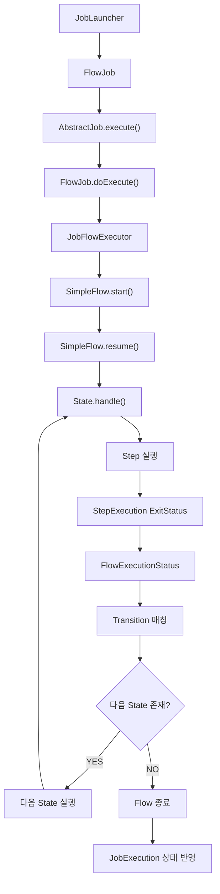

여기서 핵심적인 역할을 담당하는 클래스는 SimpleFlow다.

SimpleFlow는 State와 Transition을 통해 전체 실행 경로를 관리한다.

따라서 FlowJob을 정확하게 이해하려면 단순히 API를 사용하는 방법뿐 아니라 SimpleFlow가 어떤 방식으로 다음 State를 결정하는지 이해해야 한다.

---

### FlowJob과 SimpleFlow의 역할 차이

FlowJob과 SimpleFlow는 서로 다른 역할을 담당한다.

| 구분 | FlowJob | SimpleFlow |
|---|---|---|
| 역할 | Job 실행 관리 | Flow 실행 경로 관리 |
| 상위 타입 | AbstractJob | Flow |
| 주요 메서드 | doExecute() | start(), resume() |
| 주요 객체 | JobExecution | State, StateTransition |
| Step 실행 | JobFlowExecutor에 위임 | State를 통해 실행 |
| 실행 결과 | JobExecution 상태 반영 | FlowExecutionStatus 반환 |
| 주요 책임 | Job 전체 실행 | 조건부 상태 전이 |

FlowJob은 전체 Job의 실행 단위를 제공한다.

반면 SimpleFlow는 어떤 Step을 어떤 순서로 실행할지 결정한다.

이러한 구조를 통해 Spring Batch는 Job 실행 관리와 Flow 실행 제어를 분리한다.

---

### FlowJob을 실무에서 활용하는 12가지 방법

FlowJob은 조건부 실행을 구현할 수 있기 때문에 다양한 업무에 활용할 수 있다.

하지만 실행 흐름이 복잡해질수록 상태 관리와 장애 복구 정책도 함께 설계해야 한다.

#### 1. 정산 데이터 검증 결과에 따른 분기

정산 대상 데이터를 검증한 후 정상 데이터와 오류 데이터를 서로 다른 경로로 처리할 수 있다.

정상 데이터라면 정산 계산 Step을 실행한다.

반면 검증 실패라면 오류 보고서 생성 Step을 실행한다.

이러한 방식은 정산 데이터의 정합성을 관리하는 데 활용할 수 있다.

#### 2. 결제 대사 결과에 따른 처리 경로 변경

외부 PG사의 결제 내역과 내부 결제 내역을 비교한 후 결과에 따라 다음 작업을 구분할 수 있다.

대사가 일치하면 정산 작업을 진행한다.

반면 불일치가 발생하면 차액 분석이나 보정 처리 Step을 실행한다.

이 경우 단순한 시스템 예외와 비즈니스상 대사 불일치를 구분하는 것이 중요하다.

#### 3. 처리 대상이 없는 경우 불필요한 Step 생략

대량 데이터 배치에서 처리 대상이 없는 경우가 있다.

이때 무조건 Reader와 Writer를 실행하는 것보다 사전 검증 결과에 따라 작업을 생략할 수 있다.

예를 들어 사전 Step에서 처리 대상이 없음을 사용자 정의 ExitStatus로 반환하도록 구성할 수 있다.

#### 4. 사용자 정의 ExitStatus를 활용한 업무 상태 표현

단순히 COMPLETED와 FAILED만으로 업무 결과를 표현하기 어려울 수 있다.

예를 들어 다음과 같은 상태를 정의할 수 있다.

```text
NO_DATA

PARTIAL_SUCCESS

VALIDATION_FAILED

EXTERNAL_SYSTEM_UNAVAILABLE
```

이러한 상태를 ExitStatus에 반영하면 FlowJob에서 업무 조건에 맞는 실행 경로를 구성할 수 있다.

#### 5. 복구 가능한 오류와 복구 불가능한 오류 구분

모든 오류를 동일하게 처리할 필요는 없다.

일시적인 오류라면 재시도 또는 복구 Step을 실행할 수 있다.

반면 데이터 정합성을 훼손할 수 있는 오류라면 Job을 FAILED로 종료해야 할 수 있다.

따라서 오류의 성격에 따라 서로 다른 Transition을 정의하는 것이 좋다.

#### 6. 오류 처리 Step을 통한 운영 알림

특정 Step이 실패한 경우 운영 알림 Step을 실행할 수 있다.

예를 들어 Slack이나 이메일로 실패 내용을 전달할 수 있다.

다만 알림 Step이 성공했다고 해서 실제 배치 업무까지 성공한 것은 아니다.

따라서 알림 처리 완료와 업무 처리 완료를 구분해야 한다.

#### 7. 외부 시스템 상태에 따른 분기

외부 API나 데이터베이스의 상태를 확인한 후 실행 경로를 변경할 수 있다.

외부 시스템이 정상이라면 실제 업무를 실행한다.

반면 장애가 발생했다면 보류 처리 또는 후속 알림 Step을 실행할 수 있다.

#### 8. FlowJob의 COMPLETED 정책을 신중하게 적용

FlowJob에서는 실패한 Step 이후 후속 처리가 성공하면 Job이 COMPLETED로 종료될 수 있다.

하지만 COMPLETED로 종료된 JobInstance는 동일한 식별용 JobParameters로 재시작하기 어렵다.

따라서 실제 장애를 COMPLETED로 처리하면 복구가 어려워질 수 있다.

비즈니스적으로 정상 종료가 맞는 상황에서만 이러한 정책을 사용하는 것이 좋다.

#### 9. Flow 복잡도를 관리한다

FlowJob은 다양한 조건부 실행을 구성할 수 있다.

하지만 분기 조건이 많아지면 전체 실행 흐름을 파악하기 어려워질 수 있다.

따라서 분기 수가 증가한다면 Flow를 분리하거나 JobExecutionDecider를 활용하는 방안을 고려할 수 있다.

#### 10. 실행되지 않은 Step을 정상적인 미실행 상태로 구분한다

FlowJob에서는 조건에 따라 특정 Step이 아예 실행되지 않을 수 있다.

따라서 운영 모니터링에서는 실행되지 않은 Step과 실패한 Step을 구분해야 한다.

StepExecution이 존재하지 않는 경우와 FAILED 상태의 StepExecution이 존재하는 경우는 서로 다른 의미다.

#### 11. 조건부 분기와 트랜잭션을 구분한다

FlowJob은 Step 사이의 실행 흐름을 제어한다.

하지만 FlowJob 자체가 모든 Step의 비즈니스 작업을 하나의 트랜잭션으로 묶는 것은 아니다.

따라서 Step 1에서 이미 커밋한 데이터는 이후 Step에서 실패하더라도 자동으로 롤백되지 않을 수 있다.

이러한 특성은 정산 및 결제 시스템에서 특히 중요하다.

#### 12. 실행 흐름을 테스트 코드로 검증한다

FlowJob에서는 정상 시나리오뿐 아니라 실패 시나리오도 검증해야 한다.

특히 다음 사항을 확인하는 것이 좋다.

- 특정 ExitStatus에서 올바른 Step이 실행되는지
- 실행 대상이 아닌 Step이 실제로 생략되는지
- 오류 처리 Step이 실패했을 때 Job 상태가 어떻게 되는지
- 최종 JobExecution의 BatchStatus가 예상과 일치하는지
- Job 재시작 시 이전에 완료된 Step이 어떻게 처리되는지

조건부 실행 경로를 테스트 코드로 검증하면 운영 환경에서 예상하지 못한 흐름이 발생하는 문제를 줄일 수 있다.

---

### FlowJob에서 자주 혼동하는 부분

| 혼동하기 쉬운 내용 | 정확한 이해 |
|---|---|
| FlowJob은 SimpleJob과 동일한 순차 실행만 제공한다 | 실행 상태에 따른 조건부 분기를 지원한다 |
| FlowJob은 모든 Step을 실행한다 | 조건에 해당하는 Step만 실행한다 |
| Step이 FAILED면 Job도 반드시 FAILED다 | 실패 후 처리 경로에 따라 COMPLETED가 될 수 있다 |
| on()은 BatchStatus를 확인한다 | ExitStatus의 종료 코드를 기준으로 매칭한다 |
| from(step1)은 Step 1을 다시 실행한다 | Step 1을 기준으로 새로운 분기 규칙을 정의한다 |
| to()는 무조건 다음 Step을 실행한다 | on()의 조건이 일치할 때 해당 대상으로 이동한다 |
| end()는 모두 같은 역할이다 | Transition 종료와 Flow Builder 종료를 구분해야 한다 |
| FlowJob은 Step의 비즈니스 로직을 직접 처리한다 | 실제 비즈니스 로직은 Step에서 수행한다 |
| FlowJob이 모든 조건부 실행을 직접 관리한다 | 내부 SimpleFlow가 상태 전이를 관리한다 |
| SimpleFlow는 단순한 Step 목록이다 | State와 Transition을 이용해 실행 경로를 관리한다 |
| FlowJob이 COMPLETED면 모든 Step이 성공했다 | 일부 Step이 FAILED여도 Job은 COMPLETED일 수 있다 |
| FlowJob은 모든 Step을 하나의 트랜잭션으로 처리한다 | 각 Step의 트랜잭션 경계는 별도로 관리된다 |

---

### 전체 아키텍처 정리

지금까지 살펴본 내용을 하나의 구조로 정리해보자.

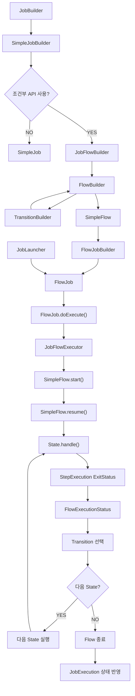

이 구조에서 가장 중요한 것은 다음과 같다.

첫 번째로 JobBuilder는 설정한 API에 따라 서로 다른 Job 생성 경로로 진행할 수 있다.

두 번째로 조건부 Flow를 구성하면 JobFlowBuilder와 FlowBuilder를 통해 SimpleFlow가 생성된다.

세 번째로 FlowJob은 SimpleFlow를 내부에 포함한다.

네 번째로 FlowJob이 실행되면 SimpleFlow가 State와 Transition을 이용해 전체 실행 흐름을 관리한다.

다섯 번째로 Flow의 최종 실행 상태가 JobExecution의 상태에 반영된다.

이러한 구조로 인해 FlowJob은 SimpleJob보다 복잡한 조건부 실행을 처리할 수 있다.

---

### 정리

Spring Batch의 `FlowJob`은 특정 실행 상태에 따라 Step의 실행 경로를 변경할 수 있는 Job 구현체다.

SimpleJob이 Step을 순차적으로 실행한다면 FlowJob은 조건부 실행을 지원한다.

예를 들어 다음과 같은 구조를 구성할 수 있다.

```text
Step 1
    │
    ├── COMPLETED → Step 3
    │
    └── FAILED    → Step 2
```

이러한 흐름을 구성하기 위해 Spring Batch는 다양한 API를 제공한다.

대표적으로 `on()`, `to()`, `from()`, `next()`, `end()` 등이 있다.

on()은 이전 Step의 ExitStatus를 확인하기 위한 패턴을 설정한다.

to()는 해당 조건에 일치할 때 이동할 실행 대상을 지정한다.

from()은 기존 Step이나 Flow를 기준으로 새로운 분기 경로를 정의한다.

next()는 정상 완료 시 다음 실행 대상을 연결한다.

end()는 호출 위치에 따라 조건별 정상 종료 Transition을 정의하거나 Flow 구성을 완료하는 역할을 수행한다.

FlowJob은 다음과 같이 생성할 수 있다.

```java
new JobBuilder("flowJob", jobRepository)
        .start(step1)
            .on("COMPLETED").to(step3)
        .from(step1)
            .on("FAILED").to(step2)
        .end()
        .build();
```

이 코드는 Step 1이 성공했을 때 Step 3을 실행한다.

반면 Step 1이 실패했을 때 Step 2를 실행한다.

따라서 실행 결과에 따라 서로 다른 Step이 실행된다.

또한 Step 1이 FAILED로 종료되었더라도 Step 2가 정상적으로 완료되고 Flow가 정상 종료되면 전체 Job은 COMPLETED 상태로 종료될 수 있다.

이것이 SimpleJob과 FlowJob의 중요한 차이점이다.

FlowJob은 내부적으로 SimpleFlow 객체를 가진다.

FlowJob이 실행되면 JobFlowExecutor를 생성하고 SimpleFlow의 start()를 호출한다.

SimpleFlow는 State를 실행한다.

그리고 반환된 FlowExecutionStatus에 따라 다음 Transition을 선택한다.

Transition이 지정한 다음 State가 존재하면 해당 State를 실행한다.

더 이상 실행할 State가 없다면 Flow를 종료한다.

마지막으로 Flow의 실행 결과를 JobExecution에 반영한다.

전체 실행 흐름은 다음과 같다.

```text
JobLauncher
    │
    ▼
FlowJob
    │
    ▼
JobFlowExecutor
    │
    ▼
SimpleFlow
    │
    ▼
State 실행
    │
    ▼
ExitStatus
    │
    ▼
FlowExecutionStatus
    │
    ▼
Transition
    │
    ├── 다음 State 존재
    │       │
    │       └── 다음 State 실행
    │
    └── 다음 State 없음
            │
            └── Flow 종료
                    │
                    ▼
              JobExecution 상태 반영
```

FlowJob을 제대로 이해하려면 단순히 API의 사용 방법만 알아서는 부족하다.

**ExitStatus를 기반으로 Transition이 선택되고, SimpleFlow가 다음 State를 실행하며, 최종 FlowExecutionStatus가 Job의 종료 상태에 반영되는 과정**을 이해해야 한다.

이러한 구조를 이해하면 정산 검증, 결제 대사, 오류 처리, 데이터 보정처럼 다양한 실행 조건을 가진 배치 시스템을 설계할 수 있다.

다만 FlowJob이 유연한 조건부 실행을 지원한다고 해서 모든 업무에 사용해야 하는 것은 아니다.

실행 순서가 고정되어 있다면 SimpleJob으로도 충분하다.

반면 업무 결과에 따라 실행 경로를 구분해야 하거나, 실패 이후 별도의 처리가 필요한 경우에는 FlowJob이 적절한 선택이 될 수 있다.

#### 한 줄 요약

> Spring Batch의 `FlowJob`은 `SimpleFlow`를 이용해 Step의 `ExitStatus`에 따라 실행 경로를 변경하는 Job 구현체다. `on()`과 `to()`로 조건부 Transition을 정의하고, `from()`으로 추가적인 실행 경로를 구성할 수 있다. FlowJob은 내부적으로 `JobFlowExecutor`와 `SimpleFlow`를 이용해 State를 실행하며, 최종 `FlowExecutionStatus`를 JobExecution에 반영한다. 따라서 특정 Step이 FAILED로 종료되더라도 후속 처리 흐름이 정상적으로 완료되면 전체 Job은 COMPLETED 상태가 될 수 있다.


## FlowJob - start() / next()


### Spring Batch FlowJob start()와 next() API 이해: Flow 구성, 순차 실행 및 내부 아키텍처

Spring Batch에서는 Job을 구성할 때 `start()`와 `next()` API를 사용한다.

이 두 API는 Job 또는 Flow의 실행 순서를 정의하는 가장 기본적인 메서드다.

일반적인 Job에서는 다음과 같이 사용할 수 있다.

```java
new JobBuilder("batchJob", jobRepository)
        .start(step1)
        .next(step2)
        .next(step3)
        .build();
```

이 코드는 세 개의 Step을 순차적으로 실행하는 Job을 생성한다.

실행 순서는 다음과 같다.

```text
Step 1
   │
   ▼
Step 2
   │
   ▼
Step 3
   │
   ▼
Job 종료
```

이러한 구조에서는 Step 1이 정상적으로 완료되면 Step 2를 실행하고, Step 2가 정상적으로 완료되면 Step 3을 실행한다.

하지만 실제 배치 시스템에서는 여러 Step을 기능별로 그룹화해야 하는 경우가 있다.

예를 들어 정산 배치를 생각해보자.

정산 배치는 크게 다음과 같은 작업으로 구성될 수 있다.

- 정산 대상 데이터 준비
- 정산 금액 계산
- 정산 데이터 검증
- 정산 결과 생성
- 정산 결과 전송
- 정산 작업 마무리

이러한 작업을 하나의 Job 안에 모두 나열할 수도 있다.

```text
SettlementJob
    │
    ├── Step 1. 데이터 조회
    ├── Step 2. 데이터 정제
    ├── Step 3. 정산 검증
    ├── Step 4. 정산 금액 계산
    ├── Step 5. 정산 결과 저장
    └── Step 6. 정산 완료 처리
```

하지만 Step의 개수가 많아지고 특정 업무 단위가 복잡해지면 전체 실행 구조를 이해하기 어려워질 수 있다.

이때 여러 Step을 하나의 Flow로 묶어 구성할 수 있다.

예를 들어 데이터 준비 작업을 Flow A로 정의하고 정산 처리 작업을 Flow B로 정의하는 것이다.

```text
SettlementJob
    │
    ├── Flow A
    │     ├── Step 1. 데이터 조회
    │     └── Step 2. 데이터 정제
    │
    ├── Step 3. 정산 검증
    │
    ├── Flow B
    │     ├── Step 4. 정산 계산
    │     └── Step 5. 정산 결과 저장
    │
    └── Step 6. 완료 처리
```

이처럼 Flow를 이용하면 여러 Step을 논리적인 업무 단위로 그룹화할 수 있다.

Spring Batch에서는 이러한 구조를 다음과 같이 구성한다.

```java
new JobBuilder("settlementJob", jobRepository)
        .start(flowA)
        .next(step3)
        .next(flowB)
        .next(step6)
        .end()
        .build();
```

여기서 중요한 것은 `start()`와 `next()`에 Step뿐 아니라 Flow도 전달할 수 있다는 사실이다.

또한 Flow를 사용한다고 해서 반드시 복잡한 조건부 분기를 구성해야 하는 것은 아니다.

**FlowJob도 `start()`와 `next()`만 사용하여 순차적인 실행 구조로 구성할 수 있다.**

이번에는 `start()`와 `next()` API의 개념부터 Builder 반환 타입, Flow 생성 방법, 실행 구조, 실패 처리와 재시작까지 자세히 살펴보자.

---

### 개념

#### start() API란?

`start()`는 Job 또는 Flow에서 가장 먼저 실행할 대상을 지정하는 API다.

Spring Batch 5.2.4의 JobBuilder에서는 대표적으로 다음과 같은 메서드를 제공한다.

```java
public SimpleJobBuilder start(Step step)
```

```java
public JobFlowBuilder start(Flow flow)
```

두 메서드는 이름이 같지만 매개변수 타입과 반환 타입이 다르다.

| API | 매개변수 | 반환 타입 | 역할 |
|---|---|---|---|
| start(Step) | Step | SimpleJobBuilder | Step을 시작점으로 설정 |
| start(Flow) | Flow | JobFlowBuilder | Flow를 시작점으로 설정 |
| start(JobExecutionDecider) | JobExecutionDecider | JobFlowBuilder | Decider를 시작점으로 설정 |

이번에는 Step과 Flow를 중심으로 살펴본다.

#### start(Step)

```java
.start(step1)
```

Step을 전달하면 SimpleJobBuilder가 반환된다.

예를 들어 다음과 같다.

```java
@Bean
public Job simpleJob(
        JobRepository jobRepository,
        Step step1,
        Step step2
) {

    return new JobBuilder("simpleJob", jobRepository)
            .start(step1)
            .next(step2)
            .build();
}
```

이 코드에서는 SimpleJob이 생성된다.

```text
JobBuilder
    │
    ▼
start(Step)
    │
    ▼
SimpleJobBuilder
    │
    ▼
next(Step)
    │
    ▼
build()
    │
    ▼
SimpleJob
```

여기서 주의할 점이 있다.

`start(Step)`을 호출했다고 해서 반드시 SimpleJob만 생성할 수 있는 것은 아니다.

SimpleJobBuilder에서도 `on()`을 호출해 조건부 흐름 구성으로 전환할 수 있기 때문이다.

예를 들어 다음과 같다.

```java
new JobBuilder("batchJob", jobRepository)
        .start(step1)
            .on("COMPLETED").to(step2)
        .from(step1)
            .on("FAILED").to(step3)
        .end()
        .build();
```

이 경우 최종적으로 FlowJob이 생성된다.

즉, `start(Step)`은 SimpleJobBuilder를 반환하지만 이후 어떤 API를 사용하는지에 따라 최종 Job 구현체가 달라질 수 있다.

#### start(Flow)

```java
.start(flowA)
```

Flow를 전달하면 JobFlowBuilder가 반환된다.

JobFlowBuilder는 FlowBuilder를 상속한 클래스다.

따라서 이후 `next()`, `from()`, `on()` 등을 사용해 실행 흐름을 구성할 수 있다.

예를 들어 다음과 같다.

```java
new JobBuilder("flowJob", jobRepository)
        .start(flowA)
        .next(step3)
        .end()
        .build();
```

이 경우 FlowJob이 생성된다.

```text
JobBuilder
    │
    ▼
start(Flow)
    │
    ▼
JobFlowBuilder
    │
    ▼
next(Step)
    │
    ▼
end()
    │
    ▼
FlowJobBuilder
    │
    ▼
build()
    │
    ▼
FlowJob
```

따라서 시작점으로 Flow를 지정하면 FlowJob 생성 구조로 진행한다.

---

### next() API란?

`next()`는 이전 Step 또는 Flow가 정상적으로 완료되었을 때 다음에 실행할 대상을 설정하는 API다.

FlowBuilder에서는 다음과 같은 메서드를 제공한다.

```java
public FlowBuilder<Q> next(Step step)
```

```java
public FlowBuilder<Q> next(Flow flow)
```

```java
public UnterminatedFlowBuilder<Q> next(
        JobExecutionDecider decider
)
```

각 메서드는 다음과 같은 역할을 수행한다.

| API | 역할 |
|---|---|
| next(Step) | 정상 완료 후 다음 Step 실행 |
| next(Flow) | 정상 완료 후 다음 Flow 실행 |
| next(JobExecutionDecider) | 정상 완료 후 Decider 실행 |

여기서 중요한 사실은 `next()`가 단순히 다음 객체를 등록하는 메서드만은 아니라는 것이다.

**FlowBuilder의 `next()`는 이전 실행 대상이 정상적으로 완료되었을 때 다음 대상으로 이동하는 Transition도 함께 정의한다.**

예를 들어 다음과 같다.

```java
.start(step1)
.next(step2)
```

이 코드는 단순히 Step 1과 Step 2를 연결하는 것이 아니다.

내부적으로 다음과 같은 실행 조건을 정의한다.

```text
Step 1
    │
    ├── COMPLETED → Step 2
    │
    └── 그 외 상태 → 실패 종료 경로
```

따라서 Step 1이 FAILED로 종료되면 Step 2가 실행되지 않는다.

이는 FlowBuilder의 실제 구현을 이해하면 더욱 명확해진다.

---

### 왜 사용하는가?

`start()`와 `next()`는 Job의 실행 구조를 정의하기 위한 핵심 API다.

특히 Flow와 결합하면 복잡한 배치 작업을 기능별로 분리할 수 있다.

예를 들어 다음과 같은 물류 데이터 처리 Job을 생각해보자.

```text
LogisticsDataJob
    │
    ├── 데이터 수집
    │
    ├── 데이터 정제
    │
    ├── 데이터 검증
    │
    ├── 통계 생성
    │
    ├── 결과 저장
    │
    └── 완료 알림
```

이 Job을 구성하는 방법은 여러 가지다.

첫 번째는 모든 Step을 순차적으로 나열하는 것이다.

두 번째는 Step을 업무 성격별로 Flow로 분리하는 것이다.

두 방식을 비교해보자.

#### 방법 1. Step을 직접 연결

```java
new JobBuilder("logisticsJob", jobRepository)
        .start(step1)
        .next(step2)
        .next(step3)
        .next(step4)
        .next(step5)
        .next(step6)
        .build();
```

전체 실행 흐름이 단순하고 각 Step의 역할이 명확하다면 이 방식으로 충분하다.

#### 방법 2. Flow를 이용해 그룹화

```java
new JobBuilder("logisticsJob", jobRepository)
        .start(collectionFlow)
        .next(validationStep)
        .next(analyticsFlow)
        .next(notificationStep)
        .end()
        .build();
```

이 방식에서는 데이터 수집 관련 작업과 통계 처리 관련 작업을 각각 Flow로 묶을 수 있다.

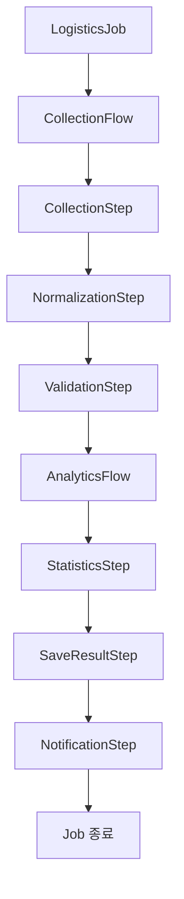

이러한 방식은 여러 Step으로 구성된 업무를 하나의 논리적인 단위로 관리할 수 있다는 장점이 있다.

또한 독립적으로 정의한 Flow를 다른 Job에서 재사용할 수도 있다.

다만 Flow는 실행 흐름을 그룹화하는 객체이지, 별도의 JobExecution을 생성하는 객체는 아니다.

이 차이는 이후 메타데이터 구조에서 자세히 살펴보자.

---

### SimpleJob과 FlowJob의 순차 실행 비교

FlowJob이라는 이름 때문에 반드시 조건부 분기가 있어야 한다고 생각하기 쉽다.

하지만 그렇지 않다.

FlowJob도 단순한 순차 실행 구조로 구성할 수 있다.

#### SimpleJob의 순차 실행

```java
new JobBuilder("simpleJob", jobRepository)
        .start(step1)
        .next(step2)
        .next(step3)
        .build();
```

```text
Step 1
   │
   ▼
Step 2
   │
   ▼
Step 3
```

#### FlowJob의 순차 실행

```java
new JobBuilder("flowJob", jobRepository)
        .start(flowA)
        .next(step3)
        .next(flowB)
        .next(step6)
        .end()
        .build();
```

```text
Flow A
   │
   ▼
Step 3
   │
   ▼
Flow B
   │
   ▼
Step 6
```

Flow A와 Flow B 내부에는 각각 여러 Step이 존재한다.

```text
Flow A
    ├── Step 1
    └── Step 2

Flow B
    ├── Step 4
    └── Step 5
```

따라서 실제 실행 순서는 다음과 같다.

```text
Step 1
   │
   ▼
Step 2
   │
   ▼
Step 3
   │
   ▼
Step 4
   │
   ▼
Step 5
   │
   ▼
Step 6
```

두 Job은 내부 구현체는 다르지만 순차 실행이라는 관점에서는 동일한 흐름으로 동작한다.

특히 중요한 것은 실패 처리다.

**`start()`와 `next()`만으로 구성한 FlowJob에서는 중간 Step이 실패하면 일반적으로 후속 Step이 실행되지 않고 Job이 FAILED로 종료된다.**

조건부 분기를 추가하지 않았기 때문이다.

---

### Flow를 생성하는 방법

FlowJob에서 Flow를 사용하려면 먼저 Flow 객체를 생성해야 한다.

Spring Batch는 이를 위해 `FlowBuilder`를 제공한다.

대표적인 사용 방법은 다음과 같다.

```java
@Bean
public Flow flowA(
        Step step1,
        Step step2
) {

    return new FlowBuilder<SimpleFlow>("flowA")
            .start(step1)
            .next(step2)
            .build();
}
```

여기서 중요한 클래스는 두 가지다.

첫 번째는 `FlowBuilder`다.

두 번째는 `SimpleFlow`다.

FlowBuilder는 Flow를 생성하기 위한 Builder다.

SimpleFlow는 실제 실행 흐름을 관리하는 Flow 구현체다.

#### FlowBuilder 생성

```java
new FlowBuilder<SimpleFlow>("flowA")
```

이 코드는 flowA라는 이름의 Flow를 구성하기 위한 Builder를 생성한다.

Generic 타입으로 SimpleFlow를 지정했다.

따라서 build()를 호출하면 SimpleFlow를 반환할 수 있다.

#### 첫 번째 Step 설정

```java
.start(step1)
```

Flow에서 가장 먼저 실행할 Step을 지정한다.

#### 다음 Step 설정

```java
.next(step2)
```

Step 1이 정상적으로 완료되면 Step 2로 이동하도록 구성한다.

#### Flow 생성

```java
.build()
```

지금까지 정의한 Step과 Transition을 이용해 Flow를 생성한다.

최종적으로 생성되는 구현체는 SimpleFlow다.

전체 생성 구조는 다음과 같다.

```text
FlowBuilder<SimpleFlow>
       │
       ▼
start(step1)
       │
       ▼
next(step2)
       │
       ▼
build()
       │
       ▼
SimpleFlow
       │
       ├── StepState 1
       ├── StepState 2
       └── StateTransition
```

이 구조에서 주의해야 할 점은 SimpleFlow가 단순히 Step 목록만 저장하는 객체가 아니라는 사실이다.

SimpleFlow는 Step의 실행 상태를 관리하기 위한 State와 Transition을 함께 가진다.

---

### FlowBuilder와 SimpleFlow의 차이

두 객체는 이름이 비슷하지만 역할이 다르다.

| 구분 | FlowBuilder | SimpleFlow |
|---|---|---|
| 역할 | Flow 구성 | Flow 실행 |
| 주요 메서드 | start(), next(), on(), build() | start(), resume() |
| 생성 시점 | 애플리케이션 설정 | Builder의 build() |
| 주요 관리 대상 | State 및 Transition 정의 | 실행 State와 Transition |
| 비즈니스 로직 실행 | 하지 않음 | StepState 등을 통해 실행 요청 |
| 실행 시 사용 | 직접 사용하지 않음 | FlowJob에서 사용 |

FlowBuilder는 실행 흐름을 만드는 역할이다.

SimpleFlow는 만들어진 흐름을 실행하는 역할이다.

이 둘을 구분하면 Spring Batch의 Flow 아키텍처를 이해하기 쉬워진다.

---

### 예제: Flow A와 Flow B 구성

이번에는 두 개의 Flow를 생성해보자.

Flow A는 Step 1과 Step 2로 구성한다.

Flow B는 Step 4와 Step 5로 구성한다.

#### Flow A

```java
@Bean
public Flow flowA(
        @Qualifier("step1") Step step1,
        @Qualifier("step2") Step step2
) {

    return new FlowBuilder<SimpleFlow>("flowA")
            .start(step1)
            .next(step2)
            .build();
}
```

이 Flow는 다음과 같은 구조를 가진다.

```text
Flow A
    │
    ▼
Step 1
    │
    ▼
Step 2
    │
    ▼
Flow 종료
```

#### Flow B

```java
@Bean
public Flow flowB(
        @Qualifier("step4") Step step4,
        @Qualifier("step5") Step step5
) {

    return new FlowBuilder<SimpleFlow>("flowB")
            .start(step4)
            .next(step5)
            .build();
}
```

이 Flow는 다음과 같은 구조를 가진다.

```text
Flow B
    │
    ▼
Step 4
    │
    ▼
Step 5
    │
    ▼
Flow 종료
```

두 Flow는 각각 독립적으로 정의된 실행 흐름이다.

하지만 이 Flow들을 Job에 연결하면 하나의 Job 안에서 순차적으로 실행할 수 있다.

---

### Flow와 Step을 조합한 Job 생성

이제 Flow A와 Flow B를 하나의 Job에 연결해보자.

추가로 Step 3과 Step 6을 사용한다.

최종 구조는 다음과 같다.

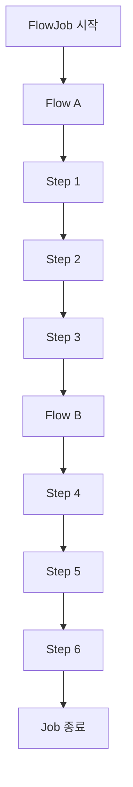

Job을 구성하는 코드는 다음과 같다.

```java
@Bean
public Job startNextFlowJob(
        JobRepository jobRepository,
        @Qualifier("flowA") Flow flowA,
        @Qualifier("step3") Step step3,
        @Qualifier("flowB") Flow flowB,
        @Qualifier("step6") Step step6
) {

    return new JobBuilder(
            "startNextFlowJob",
            jobRepository
    )
            .start(flowA)
            .next(step3)
            .next(flowB)
            .next(step6)
            .end()
            .build();
}
```

이 코드의 실행 과정을 하나씩 살펴보자.

#### 첫 번째: Flow A 실행

```java
.start(flowA)
```

Job은 Flow A부터 실행한다.

Flow A 내부에서는 Step 1과 Step 2가 실행된다.

```text
Flow A
    │
    ├── Step 1
    └── Step 2
```

Flow A가 정상적으로 완료되면 다음 실행 대상으로 이동한다.

#### 두 번째: Step 3 실행

```java
.next(step3)
```

Flow A가 정상적으로 완료되면 Step 3을 실행한다.

#### 세 번째: Flow B 실행

```java
.next(flowB)
```

Step 3이 정상적으로 완료되면 Flow B를 실행한다.

Flow B 내부에서는 Step 4와 Step 5가 실행된다.

#### 네 번째: Step 6 실행

```java
.next(step6)
```

Flow B가 정상적으로 완료되면 Step 6을 실행한다.

#### 다섯 번째: Flow 구성 완료

```java
.end()
.build();
```

여기서 end()는 JobFlowBuilder가 구성한 Flow를 마무리하는 역할이다.

이후 build()를 호출하면 최종적으로 FlowJob을 생성한다.

따라서 실제 실행 순서는 다음과 같다.

```text
Flow A
    │
    ├── Step 1
    └── Step 2
    │
    ▼
Step 3
    │
    ▼
Flow B
    │
    ├── Step 4
    └── Step 5
    │
    ▼
Step 6
    │
    ▼
Job 종료
```

---

### start()와 next()의 내부 동작

이번에는 소스 코드 수준에서 살펴보자.

Spring Batch 5.2.4의 FlowBuilder는 다음과 같은 메서드를 제공한다.

```java
public FlowBuilder<Q> start(Step step) {

    doStart(step);

    return this;
}
```

```java
public FlowBuilder<Q> next(Step step) {

    doNext(step);

    return this;
}
```

Flow 타입에 대해서도 같은 방식의 오버로드가 존재한다.

```java
public FlowBuilder<Q> start(Flow flow) {

    doStart(flow);

    return this;
}
```

```java
public FlowBuilder<Q> next(Flow flow) {

    doNext(flow);

    return this;
}
```

여기서 중요한 것은 실제 내부 처리 메서드다.

`doStart()`는 시작 State를 설정한다.

`doNext()`는 다음 State를 생성하고 Transition을 추가한다.

#### doStart()의 핵심 구조

```java
private void doStart(Object input) {

    if (this.currentState != null) {

        doFrom(input);

    } else {

        this.currentState = createState(input);
    }
}
```

처음 start()를 호출하면 currentState가 존재하지 않는다.

따라서 createState()를 통해 시작 State를 생성한다.

예를 들어 다음과 같이 호출했다고 생각해보자.

```java
.start(flowA)
```

이 경우 Flow A에 해당하는 State가 생성된다.

반면 다음과 같이 호출하면

```java
.start(step1)
```

Step 1에 해당하는 State가 생성된다.

여기서 State는 Flow의 실행 상태를 표현하는 객체다.

Step과 Flow는 각각 서로 다른 State 구현체로 변환된다.

---

### Step과 Flow는 어떤 State로 변환될까?

FlowBuilder는 전달받은 객체의 타입에 따라 State를 생성한다.

대표적으로 다음과 같이 처리한다.

| 전달 객체 | 생성되는 State |
|---|---|
| Step | StepState |
| Flow | FlowState |
| JobExecutionDecider | DecisionState |

예를 들어 다음 코드를 살펴보자.

```java
.start(flowA)
.next(step3)
.next(flowB)
.next(step6)
```

FlowBuilder는 각 실행 대상을 다음과 같은 State로 구성한다.

```text
FlowState(flowA)
       │
       ▼
StepState(step3)
       │
       ▼
FlowState(flowB)
       │
       ▼
StepState(step6)
```

여기서 FlowState는 내부 Flow의 실행을 담당한다.

StepState는 실제 Step의 실행을 담당한다.

이러한 구조 때문에 SimpleFlow는 Step과 Flow를 동일한 실행 흐름 안에서 관리할 수 있다.

실제 FlowBuilder의 `createState()`에서도 타입에 따라 `StepState`, `FlowState`, `DecisionState`를 생성한다.

---

### doNext()의 내부 구현

이번 내용에서 가장 중요한 부분이다.

FlowBuilder의 next()는 내부적으로 doNext()를 호출한다.

Spring Batch 5.2.4의 핵심 구현은 다음과 같다.

```java
private void doNext(Object input) {

    if (this.currentState == null) {

        doStart(input);

    } else {

        State next = createState(input);

        addTransition(
                "COMPLETED",
                next
        );

        addTransition(
                "*",
                failedState
        );

        this.currentState = next;
    }
}
```

이 코드를 이해하면 start()와 next()만 사용하는 FlowJob이 왜 중간 실패 시 종료되는지 알 수 있다.

#### 첫 번째: 다음 State 생성

```java
State next = createState(input);
```

next()에 전달한 객체를 State로 변환한다.

Step이면 StepState를 생성한다.

Flow이면 FlowState를 생성한다.

#### 두 번째: 정상 완료 Transition 추가

```java
addTransition(
        "COMPLETED",
        next
);
```

현재 State가 COMPLETED로 종료되었을 때 다음 State로 이동하는 Transition을 추가한다.

예를 들어 다음과 같다.

```text
Step 1
    │
    └── COMPLETED → Step 2
```

#### 세 번째: 실패 종료 Transition 추가

```java
addTransition(
        "*",
        failedState
);
```

이 코드는 정상 완료로 연결되지 않은 종료 상태에 대한 실패 종료 경로를 추가한다.

따라서 Step 1이 FAILED로 종료되면 다음 Step으로 진행하지 않는다.

```text
Step 1
    │
    ├── COMPLETED → Step 2
    │
    └── FAILED → 실패 종료
```

`*`는 모든 종료 코드에 매칭할 수 있는 패턴이지만, FlowBuilder는 Transition의 구체성을 고려해 매칭한다.

따라서 COMPLETED에 대해서는 앞서 정의한 구체적인 Transition이 적용된다.

그리고 그 외 종료 상태에 대해서는 실패 종료 경로가 적용된다.

이처럼 next()는 단순한 객체 연결이 아니라 **정상 완료와 실패에 대한 기본적인 Transition을 함께 정의하는 메서드**다.

---

### 왜 FlowJob인데 중간 Step이 실패하면 종료될까?

이제 앞에서 살펴본 코드를 다시 생각해보자.

```java
.start(flowA)
.next(step3)
.next(flowB)
.next(step6)
.end()
.build();
```

이 코드는 FlowJob을 생성한다.

하지만 조건부 분기 API인 on()을 사용하지 않았다.

따라서 각 next()는 정상 완료에 대한 순차 실행 관계를 구성한다.

실제 내부 구조는 다음과 같다.

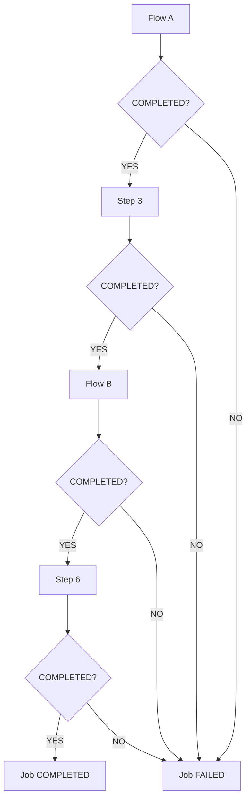

따라서 Flow A 내부의 Step 1이나 Step 2가 실패하면 Flow A는 정상적으로 완료되지 않는다.

그러면 Step 3으로 진행하지 않는다.

마찬가지로 Step 3이 실패하면 Flow B가 실행되지 않는다.

Flow B 내부에서 Step 4가 실패하면 Step 5와 Step 6이 실행되지 않는다.

즉, FlowJob이라고 해서 자동으로 실패를 복구하거나 다음 Step으로 진행하는 것은 아니다.

**FlowJob의 실패 후 실행 경로를 변경하려면 해당 요구사항에 맞는 Transition을 명시적으로 정의해야 한다.**

---

### FlowState의 내부 실행 구조

이번에는 Flow를 실행하는 State의 내부 구조를 살펴보자.

FlowBuilder에서 Flow를 전달하면 FlowState가 생성된다.

예를 들어 다음과 같다.

```java
.start(flowA)
```

이 경우 Flow A를 실행하는 FlowState가 생성된다.

FlowState의 핵심 실행 메서드는 다음과 같다.

```java
@Override
public FlowExecutionStatus handle(
        FlowExecutor executor
) throws Exception {

    return flow.start(executor).getStatus();
}
```

FlowState는 자신에게 등록된 Flow의 start()를 호출한다.

그리고 Flow의 실행 결과를 FlowExecutionStatus로 반환한다.

따라서 다음과 같은 관계가 만들어진다.

```text
FlowState
    │
    ▼
SimpleFlow.start()
    │
    ▼
SimpleFlow.resume()
    │
    ▼
StepState 실행
    │
    ▼
FlowExecutionStatus 반환
```

예를 들어 Flow A는 두 개의 Step으로 구성되어 있다.

```text
Flow A
    │
    ├── Step 1
    └── Step 2
```

FlowState가 Flow A를 실행하면 내부적으로 Step 1과 Step 2가 실행된다.

이후 Flow A가 정상적으로 완료되면 COMPLETED에 해당하는 FlowExecutionStatus를 반환한다.

반면 Step 1이나 Step 2에서 실패가 발생해 Flow A가 실패 경로로 종료되면 FAILED에 해당하는 결과가 반환될 수 있다.

상위 Flow는 이 값을 기준으로 다음 실행 대상으로 이동할지 결정한다.

---

### Flow와 FlowStep은 같은 객체일까?

여기서 혼동하기 쉬운 개념이 있다.

바로 `Flow`와 `FlowStep`이다.

두 객체는 서로 다르다.

#### Flow

Flow는 실행 흐름을 정의한다.

```java
@Bean
public Flow flowA(
        Step step1,
        Step step2
) {

    return new FlowBuilder<SimpleFlow>("flowA")
            .start(step1)
            .next(step2)
            .build();
}
```

이 Flow를 다음과 같이 Job에 직접 등록할 수 있다.

```java
.start(flowA)
```

이 경우 Flow A 자체에 대한 별도의 StepExecution이 생성되는 것은 아니다.

Flow A 내부에서 실제 실행된 Step에 대한 StepExecution이 생성된다.

#### FlowStep

FlowStep은 Flow를 실행하는 Step 구현체다.

따라서 FlowStep을 Job에 등록하면 FlowStep 자체도 Step이므로 StepExecution을 가진다.

두 방식을 비교하면 다음과 같다.

| 구분 | Flow | FlowStep |
|---|---|---|
| 타입 | Flow | Step |
| 대표 구현체 | SimpleFlow | FlowStep |
| 역할 | 실행 흐름 정의 | Step으로서 Flow 실행 |
| Job에 직접 등록 | 가능 | 가능 |
| 자체 StepExecution | 없음 | 있음 |
| 내부 StepExecution | 생성됨 | 생성됨 |
| 주요 용도 | Flow 그룹화와 재사용 | Flow를 하나의 Step으로 감싸기 |

이번 예제에서는 FlowStep을 사용하지 않는다.

Flow A와 Flow B를 Job에 직접 연결한다.

따라서 실행 메타데이터에는 실제로 실행된 여섯 개의 Step이 기록된다.

---

### 실제 예제: 여섯 개의 Step과 두 개의 Flow 구성

이번에는 다음 구조를 실제로 구현해보자.

```text
startNextFlowJob
       │
       ▼
     Flow A
       │
       ├── Step 1
       └── Step 2
       │
       ▼
     Step 3
       │
       ▼
     Flow B
       │
       ├── Step 4
       └── Step 5
       │
       ▼
     Step 6
       │
       ▼
   Job 종료
```

확인할 내용은 다음과 같다.

첫 번째는 정상 실행 시 Step 1부터 Step 6까지 순차적으로 실행되는지다.

두 번째는 Flow A와 Flow B가 각각 SimpleFlow로 생성되는지다.

세 번째는 Step 4에서 실패가 발생했을 때 Step 5와 Step 6이 실행되지 않는지다.

네 번째는 Flow 자체에 대한 별도의 StepExecution이 생성되지 않는지다.

다섯 번째는 최종 JobExecution의 상태가 어떻게 저장되는지다.

#### 개발 환경

| 항목 | 기술 |
|---|---|
| Java | Java 17 |
| Spring Boot | 3.4.13 |
| Spring Batch | 5.2.4 |
| Build Tool | Maven |
| Database | H2 |
| Job 구현체 | FlowJob |
| Flow 구현체 | SimpleFlow |
| Step 구현체 | TaskletStep |

이번 예제에서는 실행 이력을 여러 번 확인할 수 있도록 파일 기반 H2 데이터베이스를 사용한다.

---

### Maven 의존성 설정

`pom.xml`

```xml
<?xml version="1.0" encoding="UTF-8"?>
<project xmlns="http://maven.apache.org/POM/4.0.0"
         xmlns:xsi="http://www.w3.org/2001/XMLSchema-instance"
         xsi:schemaLocation="
             http://maven.apache.org/POM/4.0.0
             https://maven.apache.org/xsd/maven-4.0.0.xsd">

    <modelVersion>4.0.0</modelVersion>

    <parent>
        <groupId>org.springframework.boot</groupId>
        <artifactId>spring-boot-starter-parent</artifactId>
        <version>3.4.13</version>
        <relativePath/>
    </parent>

    <groupId>com.example</groupId>
    <artifactId>spring-batch-start-next</artifactId>
    <version>0.0.1-SNAPSHOT</version>

    <properties>
        <java.version>17</java.version>
        <spring-batch.version>5.2.4</spring-batch.version>
    </properties>

    <dependencies>

        <dependency>
            <groupId>org.springframework.boot</groupId>
            <artifactId>spring-boot-starter-batch</artifactId>
        </dependency>

        <dependency>
            <groupId>com.h2database</groupId>
            <artifactId>h2</artifactId>
            <scope>runtime</scope>
        </dependency>

        <dependency>
            <groupId>org.springframework.boot</groupId>
            <artifactId>spring-boot-starter-test</artifactId>
            <scope>test</scope>
        </dependency>

    </dependencies>

    <build>
        <plugins>
            <plugin>
                <groupId>org.springframework.boot</groupId>
                <artifactId>spring-boot-maven-plugin</artifactId>
            </plugin>
        </plugins>
    </build>

</project>
```

Spring Batch의 Job 실행과 메타데이터 저장을 위해 spring-boot-starter-batch를 사용한다.

실행 이력은 H2 데이터베이스에 저장한다.

---

### application.yml 설정

`src/main/resources/application.yml`

```yaml
spring:
  application:
    name: spring-batch-start-next

  main:
    web-application-type: none

  datasource:
    url: jdbc:h2:file:./data/start-next-db;DB_CLOSE_ON_EXIT=FALSE
    driver-class-name: org.h2.Driver
    username: sa
    password:

  batch:
    job:
      enabled: true
      name: startNextFlowJob

    jdbc:
      initialize-schema: ${BATCH_SCHEMA_INIT:never}

logging:
  level:
    org.springframework.batch: INFO
    com.example.batch: INFO
```

이번 예제에서는 파일 기반 H2를 사용한다.

```yaml
spring:
  datasource:
    url: jdbc:h2:file:./data/start-next-db;DB_CLOSE_ON_EXIT=FALSE
```

따라서 애플리케이션을 종료하더라도 이전 JobExecution과 StepExecution을 유지할 수 있다.

또한 다음 설정을 사용한다.

```yaml
spring:
  batch:
    jdbc:
      initialize-schema: ${BATCH_SCHEMA_INIT:never}
```

최초 실행에서만 환경변수로 `always`를 전달해 메타데이터 테이블을 생성한다.

이후 실행에서는 기존 테이블을 사용한다.

이렇게 구성하면 정상 실행과 실패 실행의 메타데이터를 비교할 수 있다.

---

### Spring Boot 애플리케이션

`BatchApplication.java`

```java
package com.example.batch;

import org.springframework.boot.SpringApplication;
import org.springframework.boot.autoconfigure.SpringBootApplication;

@SpringBootApplication
public class BatchApplication {

    public static void main(String[] args) {

        SpringApplication.run(
                BatchApplication.class,
                args
        );
    }
}
```

---

### StartNextConfiguration 전체 코드

이번에는 여섯 개의 Step을 정의한다.

각 Step은 동일한 구조의 Tasklet으로 생성한다.

다만 Step 4에서는 JobParameters에 따라 의도적으로 예외를 발생시킬 수 있도록 구성한다.

`StartNextConfiguration.java`

```java
package com.example.batch;

import org.slf4j.Logger;
import org.slf4j.LoggerFactory;

import org.springframework.batch.core.Job;
import org.springframework.batch.core.Step;
import org.springframework.batch.core.StepExecution;

import org.springframework.batch.core.job.builder.FlowBuilder;
import org.springframework.batch.core.job.builder.JobBuilder;

import org.springframework.batch.core.job.flow.Flow;
import org.springframework.batch.core.job.flow.support.SimpleFlow;

import org.springframework.batch.core.repository.JobRepository;
import org.springframework.batch.core.step.builder.StepBuilder;

import org.springframework.batch.repeat.RepeatStatus;

import org.springframework.beans.factory.annotation.Qualifier;

import org.springframework.context.annotation.Bean;
import org.springframework.context.annotation.Configuration;

import org.springframework.transaction.PlatformTransactionManager;

@Configuration
public class StartNextConfiguration {

    private static final Logger log =
            LoggerFactory.getLogger(
                    StartNextConfiguration.class
            );

    // --------------------------------------------------
    // 1. FlowJob
    // --------------------------------------------------

    @Bean
    public Job startNextFlowJob(
            JobRepository jobRepository,
            @Qualifier("flowA") Flow flowA,
            @Qualifier("step3") Step step3,
            @Qualifier("flowB") Flow flowB,
            @Qualifier("step6") Step step6
    ) {

        Job job = new JobBuilder(
                "startNextFlowJob",
                jobRepository
        )
                .start(flowA)
                .next(step3)
                .next(flowB)
                .next(step6)
                .end()
                .build();

        log.info(
                "Job 구현체={}",
                job.getClass().getSimpleName()
        );

        return job;
    }

    // --------------------------------------------------
    // 2. Flow A
    // --------------------------------------------------

    @Bean
    public Flow flowA(
            @Qualifier("step1") Step step1,
            @Qualifier("step2") Step step2
    ) {

        Flow flow = new FlowBuilder<SimpleFlow>("flowA")
                .start(step1)
                .next(step2)
                .build();

        log.info(
                "Flow A 구현체={}",
                flow.getClass().getSimpleName()
        );

        return flow;
    }

    // --------------------------------------------------
    // 3. Flow B
    // --------------------------------------------------

    @Bean
    public Flow flowB(
            @Qualifier("step4") Step step4,
            @Qualifier("step5") Step step5
    ) {

        Flow flow = new FlowBuilder<SimpleFlow>("flowB")
                .start(step4)
                .next(step5)
                .build();

        log.info(
                "Flow B 구현체={}",
                flow.getClass().getSimpleName()
        );

        return flow;
    }

    // --------------------------------------------------
    // 4. Step 1
    // --------------------------------------------------

    @Bean
    public Step step1(
            JobRepository jobRepository,
            PlatformTransactionManager transactionManager
    ) {

        return createTaskletStep(
                "step1",
                jobRepository,
                transactionManager
        );
    }

    // --------------------------------------------------
    // 5. Step 2
    // --------------------------------------------------

    @Bean
    public Step step2(
            JobRepository jobRepository,
            PlatformTransactionManager transactionManager
    ) {

        return createTaskletStep(
                "step2",
                jobRepository,
                transactionManager
        );
    }

    // --------------------------------------------------
    // 6. Step 3
    // --------------------------------------------------

    @Bean
    public Step step3(
            JobRepository jobRepository,
            PlatformTransactionManager transactionManager
    ) {

        return createTaskletStep(
                "step3",
                jobRepository,
                transactionManager
        );
    }

    // --------------------------------------------------
    // 7. Step 4
    // --------------------------------------------------

    @Bean
    public Step step4(
            JobRepository jobRepository,
            PlatformTransactionManager transactionManager
    ) {

        return createTaskletStep(
                "step4",
                jobRepository,
                transactionManager
        );
    }

    // --------------------------------------------------
    // 8. Step 5
    // --------------------------------------------------

    @Bean
    public Step step5(
            JobRepository jobRepository,
            PlatformTransactionManager transactionManager
    ) {

        return createTaskletStep(
                "step5",
                jobRepository,
                transactionManager
        );
    }

    // --------------------------------------------------
    // 9. Step 6
    // --------------------------------------------------

    @Bean
    public Step step6(
            JobRepository jobRepository,
            PlatformTransactionManager transactionManager
    ) {

        return createTaskletStep(
                "step6",
                jobRepository,
                transactionManager
        );
    }

    // --------------------------------------------------
    // 10. 공통 Step 생성 메서드
    // --------------------------------------------------

    private Step createTaskletStep(
            String stepName,
            JobRepository jobRepository,
            PlatformTransactionManager transactionManager
    ) {

        return new StepBuilder(
                stepName,
                jobRepository
        )
                .tasklet((contribution, chunkContext) -> {

                    StepExecution execution =
                            contribution.getStepExecution();

                    log.info(
                            "[{}] 실행 시작, jobExecutionId={}",
                            stepName,
                            execution.getJobExecutionId()
                    );

                    String failStep4 =
                            execution
                                    .getJobParameters()
                                    .getString("failStep4");

                    if (
                        "step4".equals(stepName)
                                && "true".equals(failStep4)
                    ) {

                        log.error(
                                "[{}] 의도적인 예외 발생",
                                stepName
                        );

                        throw new IllegalStateException(
                                "Step4 실행 실패"
                        );
                    }

                    log.info(
                            "[{}] 정상 종료",
                            stepName
                    );

                    return RepeatStatus.FINISHED;

                }, transactionManager)
                .build();
    }
}
```

이 코드에서는 두 개의 Flow와 여섯 개의 Step을 생성한다.

Flow A는 Step 1과 Step 2를 포함한다.

Flow B는 Step 4와 Step 5를 포함한다.

그리고 Job에서 Flow A, Step 3, Flow B, Step 6을 순차적으로 연결한다.

따라서 실제 실행 순서는 Step 1부터 Step 6까지 이어진다.

여기서 중요한 점은 Flow A와 Flow B가 별도의 Job이 아니라는 사실이다.

두 Flow는 같은 JobExecution 안에서 실행되는 Step들의 흐름을 정의한다.

---

### 첫 번째 실행: 모든 Step이 정상적으로 완료되는 경우

먼저 프로젝트를 빌드한다.

```bash
mvn clean package
```

정상적으로 빌드되면 다음과 같은 결과를 확인할 수 있다.

```text
BUILD SUCCESS
```

이제 데이터베이스 저장 디렉터리를 생성한다.

```bash
mkdir -p data
```

최초 실행에서는 Spring Batch 메타데이터 테이블을 생성해야 한다.

따라서 다음 명령어를 사용한다.

```bash
BATCH_SCHEMA_INIT=always \
java -jar target/spring-batch-start-next-0.0.1-SNAPSHOT.jar \
  failStep4=false
```

이 명령어는 failStep4를 false로 전달한다.

따라서 Step 4에서도 예외가 발생하지 않는다.

#### 예상 실행 로그

```text
Flow A 구현체=SimpleFlow

Flow B 구현체=SimpleFlow

Job 구현체=FlowJob

[step1] 실행 시작
[step1] 정상 종료

[step2] 실행 시작
[step2] 정상 종료

[step3] 실행 시작
[step3] 정상 종료

[step4] 실행 시작
[step4] 정상 종료

[step5] 실행 시작
[step5] 정상 종료

[step6] 실행 시작
[step6] 정상 종료
```

이 결과에서 확인할 수 있는 사실은 다음과 같다.

Flow A와 Flow B는 SimpleFlow로 생성되었다.

Job은 FlowJob으로 생성되었다.

Step 1부터 Step 6까지 순차적으로 실행되었다.

모든 Step이 정상적으로 종료되었으므로 Job도 COMPLETED 상태로 종료된다.

#### 실행 결과

| 순서 | 소속 | Step | 상태 |
|---|---|---|---|
| 1 | Flow A | step1 | COMPLETED |
| 2 | Flow A | step2 | COMPLETED |
| 3 | Job | step3 | COMPLETED |
| 4 | Flow B | step4 | COMPLETED |
| 5 | Flow B | step5 | COMPLETED |
| 6 | Job | step6 | COMPLETED |

최종 Job 상태는 다음과 같다.

```text
BatchStatus = COMPLETED

ExitStatus = COMPLETED
```

---

### 두 번째 실행: Flow B의 Step 4에서 실패하는 경우

이번에는 Step 4에서 의도적으로 예외를 발생시켜보자.

동일한 애플리케이션을 실행하지만 JobParameters를 변경한다.

```bash
java -jar target/spring-batch-start-next-0.0.1-SNAPSHOT.jar \
  failStep4=true
```

이번에는 failStep4가 true다.

따라서 Step 4에서 다음 코드가 실행된다.

```java
throw new IllegalStateException(
        "Step4 실행 실패"
);
```

Step 4는 FAILED 상태로 종료된다.

#### 예상 실행 로그

```text
[step1] 실행 시작
[step1] 정상 종료

[step2] 실행 시작
[step2] 정상 종료

[step3] 실행 시작
[step3] 정상 종료

[step4] 실행 시작

[step4] 의도적인 예외 발생

IllegalStateException:
Step4 실행 실패
```

여기서 중요한 점은 Step 5와 Step 6이 실행되지 않는다는 사실이다.

#### 실행 흐름

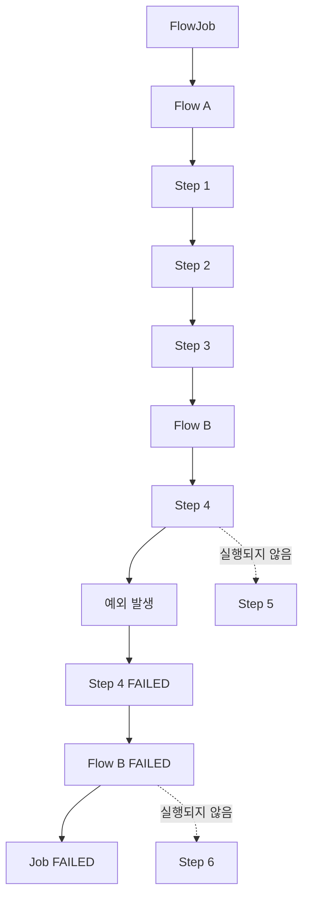

Step 4가 실패하면 Flow B 내부의 다음 Step인 Step 5로 진행하지 못한다.

Flow B의 실행 결과도 FAILED가 된다.

상위 Flow는 Flow B의 실패 결과를 확인한다.

그리고 Step 6으로 진행하지 않는다.

따라서 최종 Job 상태는 FAILED가 된다.

#### 실행 결과

| 순서 | Step | 실행 여부 | 상태 |
|---|---|---|---|
| 1 | step1 | 실행 | COMPLETED |
| 2 | step2 | 실행 | COMPLETED |
| 3 | step3 | 실행 | COMPLETED |
| 4 | step4 | 실행 | FAILED |
| 5 | step5 | 미실행 | StepExecution 없음 |
| 6 | step6 | 미실행 | StepExecution 없음 |

최종 Job 상태는 다음과 같다.

```text
BatchStatus = FAILED

ExitStatus = FAILED
```

여기서 중요한 것은 **Step 5와 Step 6이 실패한 것이 아니라 실행되지 않았다는 사실**이다.

따라서 해당 JobExecution에는 Step 5와 Step 6에 대한 StepExecution이 생성되지 않는다.

---

### 왜 Flow B의 실패가 전체 Job 실패로 이어질까?

이 부분은 FlowState와 SimpleFlow의 실행 관계를 이해하면 명확해진다.

전체 Job은 다음과 같이 구성되어 있다.

```text
Flow A
   │
   ▼
Step 3
   │
   ▼
Flow B
   │
   ▼
Step 6
```

Flow B는 내부적으로 다음과 같이 구성되어 있다.

```text
Step 4
   │
   ▼
Step 5
```

Step 4가 FAILED로 종료되면 Flow B는 다음 Step으로 진행하지 못한다.

따라서 Flow B의 실행 결과는 FAILED가 된다.

FlowState는 내부 Flow의 실행 결과를 반환한다.

```java
return flow.start(executor).getStatus();
```

따라서 상위 Flow는 Flow B가 FAILED로 종료되었다는 사실을 알 수 있다.

상위 Flow에서 Flow B 다음에 등록한 실행 대상은 Step 6이다.

```java
.next(step6)
```

하지만 next()는 앞선 실행 대상이 COMPLETED로 종료되었을 때만 다음 대상으로 이동하는 기본 Transition을 정의한다.

Flow B가 FAILED로 종료되었으므로 Step 6으로 이동하지 않는다.

이렇게 해서 전체 Job은 FAILED로 종료된다.

이 구조를 통해 다음 사실을 알 수 있다.

**하위 Flow의 실행 결과는 상위 Flow의 Transition 판단에 사용된다.**

따라서 하위 Flow가 실패하면 상위 Flow에도 영향을 준다.

---

### JobParameters를 변경하면 새로운 JobInstance가 생성된다

이번 예제에서는 두 번의 실행에서 서로 다른 JobParameters를 사용했다.

첫 번째 실행은 다음과 같다.

```text
failStep4 = false
```

두 번째 실행은 다음과 같다.

```text
failStep4 = true
```

Spring Batch의 JobParametersBuilder에서 별도로 지정하지 않으면 해당 파라미터는 기본적으로 식별용 파라미터가 된다.

따라서 두 실행은 서로 다른 JobInstance로 구분된다.

```text
JobInstance 1
    │
    └── failStep4=false
```

```text
JobInstance 2
    │
    └── failStep4=true
```

이러한 방식은 두 가지 실행 시나리오를 독립적으로 확인하는 데 적합하다.

하지만 실제 실패한 Job을 재시작하려는 경우에는 주의해야 한다.

동일한 JobInstance를 재시작하려면 식별용 JobParameters가 같아야 한다.

따라서 failStep4를 변경하는 것은 기존 JobInstance를 재시작하는 방법이 아니다.

실제 재시작을 구현하려면 실패 원인이 해결된 상태에서 같은 식별용 JobParameters를 사용해야 한다.

---

### 데이터베이스에서 실행 결과 확인하기

Spring Batch는 Job과 Step의 실행 이력을 메타데이터 테이블에 저장한다.

대표적인 테이블은 다음과 같다.

| 테이블 | 역할 |
|---|---|
| BATCH_JOB_INSTANCE | JobInstance 관리 |
| BATCH_JOB_EXECUTION | JobExecution 관리 |
| BATCH_JOB_EXECUTION_PARAMS | JobParameters 관리 |
| BATCH_STEP_EXECUTION | StepExecution 관리 |
| BATCH_STEP_EXECUTION_CONTEXT | Step ExecutionContext 저장 |

이번 예제에서는 두 개의 Flow를 사용했지만 Flow 자체에 대한 별도의 StepExecution은 생성하지 않는다.

따라서 BATCH_STEP_EXECUTION에는 실제 실행된 Step만 기록된다.

#### JobExecution 조회

```sql
SELECT
    ji.JOB_INSTANCE_ID,
    ji.JOB_NAME,
    je.JOB_EXECUTION_ID,
    je.STATUS,
    je.EXIT_CODE
FROM BATCH_JOB_INSTANCE ji
JOIN BATCH_JOB_EXECUTION je
    ON ji.JOB_INSTANCE_ID = je.JOB_INSTANCE_ID
WHERE ji.JOB_NAME = 'startNextFlowJob'
ORDER BY je.JOB_EXECUTION_ID;
```

두 가지 시나리오를 실행했다면 다음과 유사한 결과가 나타난다.

| JOB_INSTANCE_ID | JOB_EXECUTION_ID | STATUS |
|---|---|---|
| 1 | 1 | COMPLETED |
| 2 | 2 | FAILED |

첫 번째 실행은 모든 Step이 성공했다.

두 번째 실행은 Step 4에서 실패했다.

따라서 두 JobExecution은 서로 다른 상태를 가진다.

#### StepExecution 조회

```sql
SELECT
    je.JOB_EXECUTION_ID,
    se.STEP_EXECUTION_ID,
    se.STEP_NAME,
    se.STATUS,
    se.EXIT_CODE
FROM BATCH_JOB_EXECUTION je
JOIN BATCH_STEP_EXECUTION se
    ON je.JOB_EXECUTION_ID = se.JOB_EXECUTION_ID
ORDER BY
    je.JOB_EXECUTION_ID,
    se.STEP_EXECUTION_ID;
```

정상 실행에서는 다음과 같은 StepExecution이 생성된다.

| STEP_NAME | STATUS |
|---|---|
| step1 | COMPLETED |
| step2 | COMPLETED |
| step3 | COMPLETED |
| step4 | COMPLETED |
| step5 | COMPLETED |
| step6 | COMPLETED |

반면 Step 4가 실패한 실행에서는 다음과 같은 결과가 나타난다.

| STEP_NAME | STATUS |
|---|---|
| step1 | COMPLETED |
| step2 | COMPLETED |
| step3 | COMPLETED |
| step4 | FAILED |

Step 5와 Step 6의 데이터는 존재하지 않는다.

실제 실행되지 않았기 때문이다.

여기서 중요한 점을 하나 더 확인할 수 있다.

Flow A와 Flow B라는 이름의 StepExecution도 존재하지 않는다.

Flow는 실행 경로를 정의하는 객체이지 Step이 아니기 때문이다.

---

### JUnit으로 정상 실행과 실패 실행 검증하기

이번에는 실제 JobLauncher를 이용해 두 가지 시나리오를 검증해보자.

검증할 내용은 다음과 같다.

첫 번째는 실제 Job 구현체가 FlowJob인지 확인한다.

두 번째는 정상 실행 시 Step 1부터 Step 6까지 순차적으로 실행되는지 확인한다.

세 번째는 Step 4가 실패하면 Step 5와 Step 6이 실행되지 않는지 확인한다.

네 번째는 Flow A와 Flow B에 대한 별도의 StepExecution이 생성되지 않는지 확인한다.

`StartNextFlowJobTest.java`

```java
package com.example.batch;

import java.util.Comparator;
import java.util.List;
import java.util.UUID;

import org.junit.jupiter.api.Test;

import org.springframework.batch.core.BatchStatus;
import org.springframework.batch.core.Job;
import org.springframework.batch.core.JobExecution;
import org.springframework.batch.core.JobParameters;
import org.springframework.batch.core.JobParametersBuilder;
import org.springframework.batch.core.StepExecution;

import org.springframework.batch.core.job.flow.FlowJob;
import org.springframework.batch.core.launch.JobLauncher;

import org.springframework.beans.factory.annotation.Autowired;
import org.springframework.beans.factory.annotation.Qualifier;

import org.springframework.boot.test.context.SpringBootTest;

import static org.junit.jupiter.api.Assertions.*;

@SpringBootTest(properties = {
        "spring.batch.job.enabled=false",
        "spring.datasource.url=jdbc:h2:mem:start-next-test;DB_CLOSE_DELAY=-1",
        "spring.batch.jdbc.initialize-schema=always"
})
class StartNextFlowJobTest {

    @Autowired
    private JobLauncher jobLauncher;

    @Autowired
    @Qualifier("startNextFlowJob")
    private Job job;

    // -------------------------------------------
    // JobParameters
    // -------------------------------------------

    private JobParameters parameters(
            boolean failStep4
    ) {

        return new JobParametersBuilder()
                .addString(
                        "failStep4",
                        Boolean.toString(failStep4)
                )
                .addString(
                        "requestId",
                        UUID.randomUUID().toString()
                )
                .toJobParameters();
    }

    // -------------------------------------------
    // Step 실행 순서 조회
    // -------------------------------------------

    private List<String> stepNames(
            JobExecution execution
    ) {

        return execution.getStepExecutions()
                .stream()
                .sorted(
                        Comparator.comparing(
                                StepExecution::getId
                        )
                )
                .map(StepExecution::getStepName)
                .toList();
    }

    // -------------------------------------------
    // FlowJob 구현체 확인
    // -------------------------------------------

    @Test
    void FlowJob이_생성된다() {

        assertInstanceOf(
                FlowJob.class,
                job
        );
    }

    // -------------------------------------------
    // 정상 실행
    // -------------------------------------------

    @Test
    void 모든_Step이_순차적으로_실행된다()
            throws Exception {

        JobExecution execution =
                jobLauncher.run(
                        job,
                        parameters(false)
                );

        assertEquals(
                BatchStatus.COMPLETED,
                execution.getStatus()
        );

        assertEquals(
                List.of(
                        "step1",
                        "step2",
                        "step3",
                        "step4",
                        "step5",
                        "step6"
                ),
                stepNames(execution)
        );

        assertEquals(
                6,
                execution.getStepExecutions().size()
        );
    }

    // -------------------------------------------
    // Step 4 실패
    // -------------------------------------------

    @Test
    void Step4가_실패하면_후속_Step은_실행되지_않는다()
            throws Exception {

        JobExecution execution =
                jobLauncher.run(
                        job,
                        parameters(true)
                );

        assertEquals(
                BatchStatus.FAILED,
                execution.getStatus()
        );

        assertEquals(
                List.of(
                        "step1",
                        "step2",
                        "step3",
                        "step4"
                ),
                stepNames(execution)
        );

        assertEquals(
                4,
                execution.getStepExecutions().size()
        );

        StepExecution step4Execution =
                execution.getStepExecutions()
                        .stream()
                        .filter(
                                step ->
                                        step.getStepName()
                                                .equals("step4")
                        )
                        .findFirst()
                        .orElseThrow();

        assertEquals(
                BatchStatus.FAILED,
                step4Execution.getStatus()
        );
    }

    // -------------------------------------------
    // Flow 자체의 StepExecution 존재 여부
    // -------------------------------------------

    @Test
    void Flow는_별도의_StepExecution을_생성하지_않는다()
            throws Exception {

        JobExecution execution =
                jobLauncher.run(
                        job,
                        parameters(false)
                );

        List<String> names =
                stepNames(execution);

        assertFalse(
                names.contains("flowA")
        );

        assertFalse(
                names.contains("flowB")
        );

        assertEquals(
                6,
                names.size()
        );
    }
}
```

이 테스트에서는 실행할 때마다 새로운 requestId를 생성한다.

따라서 테스트끼리 동일한 JobInstance를 공유하지 않는다.

#### 정상 실행 검증

```java
assertEquals(
        List.of(
                "step1",
                "step2",
                "step3",
                "step4",
                "step5",
                "step6"
        ),
        stepNames(execution)
);
```

이 검증은 여섯 개의 Step이 순차적으로 실행되었는지 확인한다.

StepExecution ID 순서로 정렬해 실행 순서를 비교한다.

#### 실패 실행 검증

```java
assertEquals(
        List.of(
                "step1",
                "step2",
                "step3",
                "step4"
        ),
        stepNames(execution)
);
```

이 검증은 Step 4에서 실패한 경우 Step 5와 Step 6이 실행되지 않았는지 확인한다.

또한 다음 코드로 Job의 최종 상태를 검증한다.

```java
assertEquals(
        BatchStatus.FAILED,
        execution.getStatus()
);
```

#### Flow의 메타데이터 검증

```java
assertFalse(
        names.contains("flowA")
);
```

```java
assertFalse(
        names.contains("flowB")
);
```

이 검증은 Flow 자체에 대한 StepExecution이 생성되지 않는다는 사실을 확인한다.

즉, Flow는 Step을 실행하기 위한 구조이며 별도의 Step 실행 이력 객체를 생성하지 않는다.

#### 테스트 실행

```bash
mvn test
```

테스트가 모두 성공하면 다음과 유사한 결과를 확인할 수 있다.

```text
Tests run: 4

Failures: 0

Errors: 0

BUILD SUCCESS
```

---

### 전체 아키텍처: FlowJob에서 실제 Step이 실행되는 과정

이번에는 FlowJob의 실제 실행 구조를 살펴보자.

FlowJob은 내부적으로 Flow 객체를 가진다.

일반적으로 이 Flow는 SimpleFlow다.

FlowJob이 실행되면 다음과 같은 과정이 시작된다.

```text
JobLauncher
    │
    ▼
FlowJob
    │
    ▼
JobFlowExecutor
    │
    ▼
SimpleFlow.start()
    │
    ▼
SimpleFlow.resume()
    │
    ▼
State 실행
```

이번 예제에서는 Flow A와 Flow B가 각각 FlowState로 구성된다.

Step 3과 Step 6은 StepState로 구성된다.

따라서 상위 Flow의 실행 구조는 다음과 같다.

```text
SimpleFlow
    │
    ├── FlowState(flowA)
    │
    ├── StepState(step3)
    │
    ├── FlowState(flowB)
    │
    └── StepState(step6)
```

FlowState는 내부 Flow를 실행한다.

StepState는 실제 Step을 실행한다.

이렇게 서로 다른 State가 하나의 SimpleFlow 안에서 관리된다.

#### SimpleFlow 실행 구조

Spring Batch 5.2.4의 SimpleFlow는 다음과 같은 흐름으로 동작한다.

```text
SimpleFlow.start()
       │
       ▼
시작 State 조회
       │
       ▼
SimpleFlow.resume()
       │
       ▼
현재 State 실행
       │
       ▼
FlowExecutionStatus 반환
       │
       ▼
Transition 확인
       │
       ├── 다음 State 존재
       │       │
       │       └── 다음 State 실행
       │
       └── 다음 State 없음
               │
               └── Flow 종료
```

이 구조에서 실제 실행 순서를 결정하는 것은 State와 Transition이다.

Step을 실행하는 과정 자체는 StepState와 JobFlowExecutor를 통해 이루어진다.

따라서 SimpleFlow는 실행 대상이 Step인지 Flow인지에 관계없이 State 인터페이스를 통해 실행을 제어할 수 있다.

---

### FlowJob의 중첩 실행 구조

이번 예제를 State 수준에서 더 자세히 표현하면 다음과 같다.

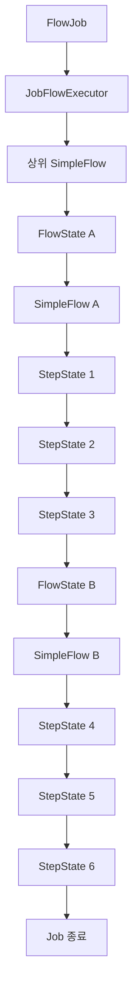

이 그림에서 중요한 것은 세 개의 SimpleFlow가 관여한다는 사실이다.

첫 번째는 Flow A를 관리하는 SimpleFlow다.

두 번째는 Flow B를 관리하는 SimpleFlow다.

세 번째는 Flow A, Step 3, Flow B, Step 6을 연결하는 상위 SimpleFlow다.

상위 SimpleFlow는 FlowState를 통해 하위 Flow를 실행한다.

하위 Flow는 자신에게 등록된 StepState를 실행한다.

그리고 하위 Flow가 종료되면 실행 결과를 상위 FlowState에 반환한다.

상위 SimpleFlow는 해당 결과를 확인하고 다음 State로 이동한다.

이러한 구조 덕분에 여러 Flow를 하나의 Job에 연결할 수 있다.

---

### 실패한 FlowJob을 재시작하면 어떻게 될까?

이번에는 Step 4에서 실패한 Job을 재시작하는 상황을 생각해보자.

최초 실행 결과는 다음과 같다.

```text
JobExecution 1
    │
    ├── Step 1 → COMPLETED
    ├── Step 2 → COMPLETED
    ├── Step 3 → COMPLETED
    └── Step 4 → FAILED

Job → FAILED
```

이 상태에서 동일한 식별용 JobParameters로 Job을 재시작하면 새로운 JobExecution이 생성된다.

하지만 이전에 완료된 Step은 일반적으로 다시 실행되지 않는다.

따라서 Step 1, Step 2, Step 3은 실행을 생략할 수 있다.

반면 Step 4는 이전에 실패했으므로 재실행 대상이 된다.

Step 4가 정상적으로 완료되면 Step 5와 Step 6이 이어서 실행된다.

```text
JobExecution 2
    │
    ├── Step 1 → 실행 생략
    ├── Step 2 → 실행 생략
    ├── Step 3 → 실행 생략
    │
    ├── Step 4 → COMPLETED
    ├── Step 5 → COMPLETED
    └── Step 6 → COMPLETED

Job → COMPLETED
```

다만 이 동작은 이전 StepExecution 상태와 각 Step의 재시작 설정에 영향을 받는다.

예를 들어 `allowStartIfComplete(true)`가 설정되어 있다면 이전에 완료된 Step도 다시 실행될 수 있다.

또한 `startLimit()`이 설정되어 있다면 실행 횟수 제한을 확인해야 한다.

따라서 FlowJob의 재시작도 기존에 살펴본 Step 재시작 정책을 따른다.

**Flow를 사용한다고 해서 StepExecution의 재시작 규칙이 사라지는 것은 아니다.**

---

### start()와 next()를 사용할 때 주의할 12가지 사항

실제 운영 환경에서 Flow를 구성할 때는 다음과 같은 부분을 고려해야 한다.

#### 1. 모든 Job에 Flow를 적용할 필요는 없다

Step의 실행 순서가 단순하다면 SimpleJob으로도 충분하다.

Flow는 실행 흐름을 그룹화하거나 여러 Job에서 동일한 Flow를 재사용할 필요가 있을 때 활용하는 것이 좋다.

불필요하게 Flow를 도입하면 오히려 실행 구조가 복잡해질 수 있다.

#### 2. Flow는 독립적인 Job이 아니다

Flow를 별도로 정의했다고 해서 새로운 JobInstance나 JobExecution이 생성되는 것은 아니다.

같은 Job 안에서 Flow를 실행하면 내부 Step들은 해당 Job의 JobExecution에 속한다.

독립적인 Job 실행 이력이 필요하다면 JobStep을 고려해야 한다.

#### 3. Flow와 FlowStep의 차이를 구분한다

Flow는 실행 흐름을 정의하는 객체다.

FlowStep은 Flow를 실행하는 Step이다.

따라서 FlowStep을 사용할 때는 FlowStep 자체의 StepExecution이 추가로 생성될 수 있다.

#### 4. next()는 정상 완료에 대한 Transition을 정의한다

FlowBuilder의 next()는 단순히 실행 대상을 추가하는 기능이 아니다.

내부적으로 COMPLETED에 해당하는 Transition과 실패 종료 경로를 정의한다.

따라서 이전 Step이 실패하면 다음 Step이 실행되지 않는다.

#### 5. 실패 후 다른 Step을 실행하려면 분기 규칙을 정의한다

Step 실패 후 오류 처리 Step을 실행해야 하는 경우에는 on()과 to() 등을 이용해 조건부 흐름을 구성해야 한다.

단순히 next()만 사용하면 실패 후 다음 Step으로 진행하지 않는다.

#### 6. Flow를 업무 단위로 그룹화한다

Flow는 기술적인 클래스 수를 줄이기 위한 목적보다 논리적인 업무 단위를 표현하는 데 활용하는 것이 좋다.

예를 들어 데이터 수집, 검증, 정산 처리, 결과 전송 등을 각각 Flow로 분리할 수 있다.

#### 7. Flow 이름과 Step 이름을 명확하게 구분한다

Flow와 Step은 서로 다른 객체다.

운영 로그와 모니터링에서도 두 개념을 혼동하지 않도록 이름을 명확하게 지정하는 것이 좋다.

#### 8. Flow 실행 결과가 상위 Flow에 영향을 준다는 점을 이해한다

하위 Flow가 FAILED로 종료되면 상위 Flow에도 해당 상태가 전달된다.

따라서 하위 Flow의 실패가 전체 Job의 실패로 이어질 수 있다.

복잡한 Flow를 구성할 때는 이러한 상태 전달 구조를 고려해야 한다.

#### 9. JobParameters를 이용한 실행 식별을 명확하게 설계한다

FlowJob 역시 JobParameters로 JobInstance를 식별한다.

따라서 동일한 Job을 여러 번 실행해야 한다면 식별용 JobParameters를 적절하게 구성해야 한다.

반면 실패한 Job을 재시작하려면 기존 JobInstance의 식별용 파라미터를 유지해야 한다.

#### 10. Flow의 순차 실행과 병렬 실행을 구분한다

이번에 사용한 next()는 순차 실행을 구성한다.

Flow A가 완료되어야 Step 3이 실행된다.

Step 3이 완료되어야 Flow B가 실행된다.

반면 여러 Flow를 병렬로 실행하려면 별도의 split() 구성이 필요하다.

따라서 Flow를 여러 개 정의했다고 해서 자동으로 병렬 실행되는 것은 아니다.

#### 11. 중간 Step 실패 시 데이터 정합성을 확인한다

Step 4에서 실패했다고 해서 이전 Step 1, Step 2, Step 3에서 이미 커밋된 데이터가 자동으로 롤백되는 것은 아니다.

각 Step의 트랜잭션 경계가 별도로 관리되기 때문이다.

따라서 재시작이 필요한 작업이라면 이미 처리한 데이터와 다시 처리할 데이터를 구분할 수 있어야 한다.

#### 12. 실행 흐름을 테스트 코드로 검증한다

Flow를 구성할 때는 정상 실행뿐 아니라 중간 실패도 검증해야 한다.

특히 다음 내용을 확인하는 것이 중요하다.

| 검증 항목 | 목적 |
|---|---|
| 모든 Step 정상 실행 | 순차 실행 검증 |
| Flow A 내부 실패 | 하위 Flow 실패 전파 확인 |
| Step 3 실패 | Flow 간 연결 중단 확인 |
| Flow B 내부 실패 | 후속 Flow 및 Step 중단 확인 |
| StepExecution 개수 | 실제 실행된 Step 확인 |
| JobExecution 상태 | 최종 실패 여부 확인 |
| 재시작 결과 | 이전 완료 Step의 실행 생략 여부 확인 |

이러한 검증을 통해 실제 운영 환경에서 예상하지 못한 실행 경로가 발생하는 문제를 줄일 수 있다.

---

### start() / next()에서 자주 혼동하는 부분

| 혼동하기 쉬운 내용 | 정확한 이해 |
|---|---|
| start()에는 Step만 전달할 수 있다 | Step과 Flow 등을 전달할 수 있다 |
| start(Step)은 FlowJobBuilder를 반환한다 | SimpleJobBuilder를 반환한다 |
| start(Flow)는 SimpleJobBuilder를 반환한다 | JobFlowBuilder를 반환한다 |
| FlowJob은 반드시 on()을 사용해야 한다 | start()와 next()만으로도 구성할 수 있다 |
| FlowJob은 중간 Step이 실패해도 계속 실행한다 | 기본 next() 구성에서는 실패 시 후속 실행이 중단된다 |
| next()는 단순히 다음 객체만 저장한다 | 정상 완료 및 실패에 대한 Transition을 구성한다 |
| FlowBuilder는 실제 Flow를 실행한다 | Flow를 구성하는 Builder다 |
| SimpleFlow는 단순한 Step 목록이다 | State와 Transition을 이용해 실행을 제어한다 |
| Flow는 별도의 JobExecution을 생성한다 | 별도의 JobExecution을 생성하지 않는다 |
| Flow A와 Flow B는 별도의 StepExecution을 가진다 | 직접 등록한 Flow 자체에는 StepExecution이 없다 |
| 여러 Flow를 next()로 연결하면 병렬 실행된다 | 순차 실행된다 |
| Flow를 사용하면 Step 재시작 정책이 달라진다 | 기존 Step 재시작 정책이 적용된다 |

---

### 전체 아키텍처 정리

지금까지 살펴본 내용을 하나의 구조로 정리해보자.

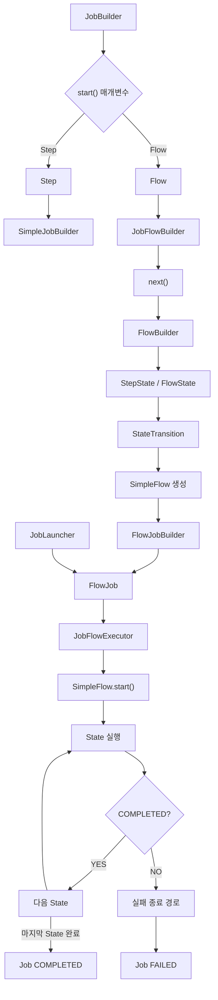

이 구조에서 핵심은 다음과 같다.

JobBuilder는 start()의 매개변수에 따라 서로 다른 Builder를 반환한다.

Flow를 전달하면 JobFlowBuilder가 반환된다.

JobFlowBuilder는 FlowBuilder를 상속하므로 next() 등을 이용해 실행 흐름을 구성할 수 있다.

FlowBuilder는 Step과 Flow를 각각 StepState와 FlowState로 변환한다.

그리고 Transition을 정의한다.

build() 과정에서는 SimpleFlow가 생성된다.

최종적으로 FlowJob이 생성되면 내부에 해당 SimpleFlow가 저장된다.

Job이 실행되면 FlowJob은 JobFlowExecutor를 통해 SimpleFlow를 실행한다.

SimpleFlow는 현재 State를 실행한다.

그리고 반환된 FlowExecutionStatus에 따라 다음 Transition을 선택한다.

현재 State가 정상적으로 완료되었다면 다음 State로 진행한다.

반면 실패했다면 기본적으로 실패 종료 경로로 진행한다.

이러한 구조 때문에 FlowJob은 다양한 Flow를 하나의 실행 흐름으로 연결할 수 있으며, start()와 next()만 사용해도 순차적인 배치 작업을 구성할 수 있다.

---

### 정리

Spring Batch의 `start()`와 `next()`는 Job과 Flow의 실행 순서를 정의하는 API다.

start()는 가장 먼저 실행할 대상을 설정한다.

next()는 이전 실행 대상이 정상적으로 완료된 후 다음에 실행할 대상을 설정한다.

두 API는 Step과 Flow를 전달받을 수 있다.

특히 JobBuilder에서 start(Step)을 호출하면 SimpleJobBuilder가 반환된다.

반면 start(Flow)를 호출하면 JobFlowBuilder가 반환된다.

따라서 FlowJob을 구성할 때는 다음과 같이 사용할 수 있다.

```java
new JobBuilder("flowJob", jobRepository)
        .start(flowA)
        .next(step3)
        .next(flowB)
        .next(step6)
        .end()
        .build();
```

여기서 Flow A와 Flow B는 FlowBuilder를 통해 별도로 생성한다.

```java
new FlowBuilder<SimpleFlow>("flowA")
        .start(step1)
        .next(step2)
        .build();
```

FlowBuilder는 Step과 Transition을 구성한다.

그리고 최종적으로 SimpleFlow를 생성한다.

SimpleFlow는 FlowJob 내부에서 실제 실행 흐름을 관리한다.

이때 Step은 StepState로 변환된다.

Flow는 FlowState로 변환된다.

따라서 하나의 SimpleFlow 안에서 Step과 Flow를 함께 관리할 수 있다.

또한 next()는 내부적으로 COMPLETED에 해당하는 Transition을 추가한다.

그리고 정상 완료가 아닌 상태에 대한 실패 종료 경로도 추가한다.

따라서 단순히 start()와 next()로 구성한 FlowJob에서는 중간 Step이 실패하면 후속 Step이 실행되지 않는다.

이러한 동작은 SimpleJob의 순차 실행 규칙과 유사하다.

하지만 두 구현체의 내부 실행 구조는 다르다.

SimpleJob은 Step 목록을 순차적으로 실행한다.

반면 FlowJob은 SimpleFlow의 State와 Transition을 이용해 실행을 제어한다.

따라서 이후 on()과 to() 등의 API를 사용하면 실패나 사용자 정의 종료 상태에 따른 조건부 실행 경로를 추가할 수 있다.

또한 Flow는 별도의 JobExecution을 생성하지 않는다.

Flow 내부에서 실행된 Step들은 같은 JobExecution에 속한다.

따라서 Flow는 독립적인 Job이 아니라 여러 Step의 실행 순서를 정의하는 객체로 이해해야 한다.

최종적으로 start()와 next()의 핵심은 다음과 같다.

| API | 핵심 역할 |
|---|---|
| start(Step) | Step을 시작점으로 지정하고 SimpleJobBuilder 반환 |
| start(Flow) | Flow를 시작점으로 지정하고 JobFlowBuilder 반환 |
| next(Step) | 정상 완료 후 다음 Step으로 이동 |
| next(Flow) | 정상 완료 후 다음 Flow로 이동 |
| FlowBuilder.build() | SimpleFlow 생성 |
| JobFlowBuilder.end() | Job의 Flow 구성을 완료하고 FlowJobBuilder 반환 |
| FlowJobBuilder.build() | FlowJob 생성 |

결국 **start()와 next()는 Step과 Flow를 연결해 전체 배치 실행 구조를 정의하는 기본 API이며, FlowBuilder가 생성하는 State와 Transition을 통해 순차적인 실행 흐름을 관리한다.**

#### 한 줄 요약

> Spring Batch의 `start()`와 `next()`는 Job 또는 Flow의 실행 순서를 정의하는 API다. `start(Step)`은 `SimpleJobBuilder`를 반환하고, `start(Flow)`는 `JobFlowBuilder`를 반환한다. `FlowBuilder<SimpleFlow>`를 이용하면 여러 Step을 하나의 Flow로 구성할 수 있으며, 이를 FlowJob에서 `start()`와 `next()`로 연결할 수 있다. 이때 `next()`는 기본적으로 이전 실행 대상이 COMPLETED일 때 다음 대상으로 이동하도록 Transition을 구성하므로, 중간 Step이 FAILED로 종료되면 후속 Step은 실행되지 않고 Job도 FAILED로 종료된다.
