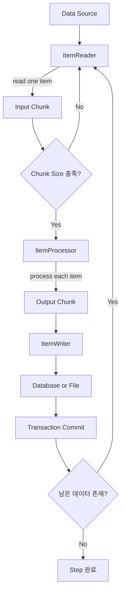
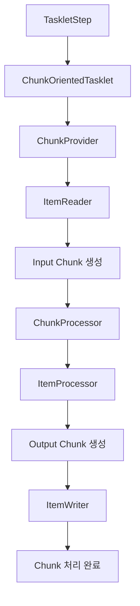
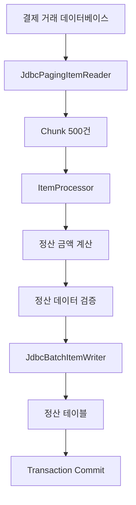

# 8. 스프링 배치 청크 프로세스 이해

# 8. 스프링 배치 청크 프로세스 이해

* toc
{:toc}

---

## Chunk


### Spring Batch Chunk의 개념과 내부 구조 및 처리 과정

Spring Batch에서 대용량 데이터를 안정적으로 처리하기 위해 사용하는 핵심 개념 중 하나가 **Chunk(청크)**입니다.

일반적인 애플리케이션에서는 데이터를 한 건씩 조회하고 처리하는 경우가 많지만, 대량의 데이터를 다루는 배치 시스템에서는 모든 데이터를 하나의 트랜잭션으로 처리하는 방식이 비효율적일 수 있습니다.

예를 들어 100만 건의 데이터를 데이터베이스에서 읽어 다른 테이블로 저장하는 작업이 있다고 가정해 보겠습니다.

100만 건을 하나의 트랜잭션으로 처리한다면 작업 시간이 길어지고, 트랜잭션이 유지되는 동안 데이터베이스의 리소스 사용량도 증가할 수 있습니다.

또한 99만 번째 데이터를 처리하던 중 오류가 발생하면 이전에 처리한 작업까지 롤백해야 하는 문제가 발생할 수 있습니다.

Spring Batch는 이러한 문제를 해결하기 위해 데이터를 일정한 크기로 나누어 처리하는 Chunk 기반 처리 방식을 제공합니다.

Chunk는 단순히 여러 데이터를 담는 컬렉션이 아니라, **데이터 처리 단위와 트랜잭션 경계를 결정하는 중요한 개념**입니다.

---

### Chunk란?

#### Chunk의 기본 개념

Chunk는 여러 개의 Item을 하나의 묶음으로 구성한 데이터 블록을 의미합니다.

Spring Batch에서는 ItemReader를 통해 데이터를 한 건씩 읽고, 설정된 Chunk Size만큼 데이터를 모은 뒤 하나의 처리 단위로 사용합니다.

예를 들어 다음과 같은 데이터가 있다고 가정하겠습니다.

```text
전체 데이터: 12건

item1
item2
item3
item4
item5
item6
item7
item8
item9
item10
item11
item12
```

Chunk Size를 5로 설정한다면 다음과 같이 구분됩니다.

```text
Chunk Size = 5

Chunk 1
┌──────────────────────────────┐
│ item1  item2  item3  item4  item5 │
└──────────────────────────────┘

Chunk 2
┌──────────────────────────────┐
│ item6  item7  item8  item9  item10│
└──────────────────────────────┘

Chunk 3
┌─────────────────┐
│ item11  item12  │
└─────────────────┘
```

전체 12건을 한 번에 처리하지 않고 5건, 5건, 2건으로 나누어 처리하는 것입니다.

일반적인 Chunk 기반 Step에서는 각 Chunk가 독립적인 트랜잭션 경계 안에서 처리됩니다.

```text
Transaction 1
 ├─ item1
 ├─ item2
 ├─ item3
 ├─ item4
 └─ item5
      ↓
    COMMIT

Transaction 2
 ├─ item6
 ├─ item7
 ├─ item8
 ├─ item9
 └─ item10
      ↓
    COMMIT

Transaction 3
 ├─ item11
 └─ item12
      ↓
    COMMIT
```

따라서 세 번째 Chunk에서 오류가 발생하더라도 앞서 정상적으로 커밋된 첫 번째, 두 번째 Chunk의 데이터는 유지됩니다.

다만 롤백 범위는 실제 트랜잭션에 참여하는 리소스에 한정됩니다.

데이터베이스에 저장하는 작업이라면 해당 트랜잭션에서 수행한 변경 사항을 롤백할 수 있지만, 외부 API 호출이나 이메일 발송처럼 데이터베이스 트랜잭션에 참여하지 않는 작업까지 자동으로 취소되는 것은 아닙니다.

**Chunk 기반 처리의 핵심은 대량의 데이터를 일정한 크기로 나누고, 각 처리 단위를 트랜잭션 경계 내에서 관리하는 것입니다.**

---

### 왜 Chunk를 사용하는가?

#### 1. 대용량 데이터 처리의 효율성

대량의 데이터를 하나의 트랜잭션으로 처리하면 트랜잭션 유지 시간이 길어지고 데이터베이스의 리소스 부담이 커질 수 있습니다.

Chunk 기반 처리는 일정한 데이터 단위로 작업을 완료하기 때문에 트랜잭션 유지 시간을 제어할 수 있습니다.

예를 들어 10만 건의 데이터를 Chunk Size 1,000으로 처리한다면 일반적인 정상 처리 과정에서 100개의 Chunk로 나누어집니다.

```text
전체 데이터: 100,000건
Chunk Size: 1,000

100,000 / 1,000 = 100 Chunk
```

각 Chunk를 처리한 뒤 커밋하기 때문에 하나의 트랜잭션이 전체 10만 건을 처리할 필요가 없습니다.

다만 Chunk 크기가 작을수록 커밋 횟수가 증가하기 때문에 무조건 작은 Chunk를 사용하는 것이 좋은 것은 아닙니다.

#### 2. 장애 발생 시 롤백 범위 제한

Chunk의 중요한 특징은 트랜잭션 경계를 분리할 수 있다는 것입니다.

예를 들어 Chunk Size가 100인 배치 작업에서 250번째 데이터를 처리하다가 오류가 발생했다고 가정하겠습니다.

```text
Chunk 1: 1 ~ 100
    → COMMIT

Chunk 2: 101 ~ 200
    → COMMIT

Chunk 3: 201 ~ 300
    → 250번째 데이터 처리 중 ERROR
    → ROLLBACK
```

일반적인 트랜잭션 환경에서는 세 번째 Chunk에서 수행한 변경 사항이 롤백됩니다.

반면 이전에 커밋된 200건은 유지됩니다.

이렇게 트랜잭션 범위를 제한하면 대량 데이터 처리에서 발생하는 장애의 영향을 줄일 수 있습니다.

단, Step이 실패했다고 해서 무조건 201번째 데이터부터 자동으로 재처리되는 것은 아닙니다.

재시작 위치를 정확히 복원하려면 ItemReader의 상태 관리, ExecutionContext, 체크포인트 저장 방식 등을 함께 고려해야 합니다.

#### 3. 메모리 사용량 제어

모든 데이터를 한 번에 메모리로 가져오는 방식은 데이터가 증가할수록 메모리 사용량이 커질 수 있습니다.

반면 Chunk 기반 처리에서는 일정한 수의 데이터를 읽고 처리한 뒤 다음 데이터를 가져오도록 구성할 수 있습니다.

```text
데이터베이스
   │
   │ 데이터 1,000건 읽기
   ▼
Chunk
   │
   │ 데이터 처리
   ▼
ItemWriter
   │
   │ 저장 완료
   ▼
다음 Chunk 처리
```

이러한 방식은 대용량 데이터 처리에서 메모리 사용량을 제어하는 데 도움이 됩니다.

다만 Chunk Size를 설정했다고 해서 전체 애플리케이션의 메모리 사용량이 해당 크기로 제한되는 것은 아닙니다.

ItemReader의 구현 방식에 따라 전체 데이터를 메모리에 올릴 수도 있으며, JPA 영속성 컨텍스트나 별도의 캐시에서 추가적인 메모리를 사용할 수도 있습니다.

따라서 실제 메모리 효율을 높이려면 Chunk Size와 함께 Reader의 데이터 조회 방식도 고려해야 합니다.

---

### Chunk의 주요 특징

Spring Batch의 Chunk는 다음과 같은 특징을 가집니다.

| 구분 | 설명 |
|---|---|
| 데이터 처리 단위 | 여러 Item을 하나의 Chunk로 구성 |
| Chunk Size | 한 번에 처리할 입력 Item의 기준 개수 |
| 트랜잭션 경계 | 일반적으로 Chunk 단위로 트랜잭션을 시작하고 커밋 |
| ItemReader | 데이터를 한 건씩 읽음 |
| ItemProcessor | 읽은 데이터를 한 건씩 가공하거나 필터링 |
| ItemWriter | 가공된 데이터를 Chunk 단위로 전달받아 처리 |
| 장애 처리 | 트랜잭션에 참여한 작업은 Chunk 단위로 롤백 가능 |
| 반복 처리 | 더 이상 읽을 데이터가 없을 때까지 Chunk 처리를 반복 |
| 메모리 관리 | 일정 단위의 데이터 처리로 메모리 사용량 제어에 도움 |
| 재시작 | 상태 관리가 가능한 Reader와 ExecutionContext 등을 활용 |

여기서 중요한 점은 **Chunk Size가 ItemWriter에 전달되는 데이터 개수와 항상 일치하지는 않는다는 것**입니다.

이 부분은 Chunk의 내부 구조와 처리 과정을 이해하면 자연스럽게 알 수 있습니다.

---

### Chunk의 내부 구조

#### Chunk 클래스

Spring Batch는 실제로 `Chunk`라는 클래스를 제공합니다.

Chunk는 여러 Item을 저장하는 컬렉션 형태의 객체로, 내부적으로 Item 목록을 관리합니다.

Spring Batch 6.x에서는 다음 패키지에 정의되어 있습니다.

```java
org.springframework.batch.infrastructure.item.Chunk
```

Spring Batch 5.x에서는 다음 패키지를 사용합니다.

```java
org.springframework.batch.item.Chunk
```

Chunk의 핵심적인 구조를 개념적으로 표현하면 다음과 같습니다.

```java
public class Chunk<W> implements Iterable<W> {

    private final List<W> items = new ArrayList<>();

    public void add(W item) {
        items.add(item);
    }

    public int size() {
        return items.size();
    }

    public List<W> getItems() {
        // 저장된 Item 목록 조회
    }

    @Override
    public ChunkIterator iterator() {
        // Item 순회를 위한 Iterator 반환
    }
}
```

위 코드는 핵심 구조를 이해하기 위해 단순화한 예시이며, 실제 라이브러리 구현 전체를 나타내지는 않습니다.

Chunk는 내부적으로 Item 목록을 보관하고, 데이터를 추가하거나 순회할 수 있는 기능을 제공합니다.

#### Chunk의 주요 메서드

| 메서드 | 역할 |
|---|---|
| `add(item)` | Chunk에 Item 추가 |
| `addAll(items)` | 여러 Item을 Chunk에 추가 |
| `getItems()` | Chunk에 저장된 Item 목록 조회 |
| `size()` | 현재 Chunk에 저장된 Item 개수 반환 |
| `isEmpty()` | Chunk가 비어 있는지 확인 |
| `iterator()` | Item 순회를 위한 Iterator 반환 |
| `clear()` | Chunk에 저장된 Item 제거 |
| `Chunk.of(...)` | 전달한 Item으로 Chunk 생성 |

Chunk가 내부적으로 데이터를 어떻게 관리하는지 간단한 예제로 확인해 보겠습니다.

```java
import org.springframework.batch.infrastructure.item.Chunk;

public class ChunkExample {

    public static void main(String[] args) {

        Chunk<String> chunk = new Chunk<>();

        chunk.add("item1");
        chunk.add("item2");
        chunk.add("item3");
        chunk.add("item4");
        chunk.add("item5");

        System.out.println("Chunk Size: " + chunk.size());

        for (String item : chunk) {
            System.out.println(item);
        }
    }
}
```

실행 결과는 다음과 같습니다.

```text
Chunk Size: 5

item1
item2
item3
item4
item5
```

Chunk는 일반적인 List와 유사하게 데이터를 저장하고 순회할 수 있지만, Spring Batch의 처리 흐름에서 사용하도록 설계된 전용 객체입니다.

참고로 Spring Batch 6.x의 `getItems()`는 변경할 수 없는 목록을 반환하므로 반환된 목록을 직접 수정하는 방식으로 사용하면 안 됩니다.

---

#### ChunkIterator

Chunk는 저장된 Item을 순회하기 위해 `ChunkIterator`라는 내부 클래스를 제공합니다.

```java
Chunk<String> chunk = Chunk.of(
    "item1",
    "item2",
    "item3"
);

for (String item : chunk) {
    System.out.println(item);
}
```

위 코드의 향상된 for문은 내부적으로 Iterator를 사용하여 Item을 순회합니다.

개념적으로 다음과 같이 동작합니다.

```java
Iterator<String> iterator = chunk.iterator();

while (iterator.hasNext()) {

    String item = iterator.next();

    System.out.println(item);
}
```

Spring Batch에서는 이러한 Iterator를 이용하여 Chunk에 저장된 Item을 하나씩 가져와 처리할 수 있습니다.

예를 들어 Input Chunk에 5개의 Item이 저장되어 있다면 Processor는 해당 Item들을 순회하면서 각각의 데이터를 변환할 수 있습니다.

```text
Input Chunk
┌──────────────────────┐
│ item1                │
│ item2                │
│ item3                │
│ item4                │
│ item5                │
└──────────────────────┘
          │
          ▼
     ChunkIterator
          │
          ├── next() → item1
          ├── next() → item2
          ├── next() → item3
          ├── next() → item4
          └── next() → item5
```

ChunkIterator는 Spring Batch의 내부 처리에서 Item 순회 및 특정 오류 처리 기능을 지원합니다.

특히 기존 Chunk 구현에는 오류가 발생한 Item을 제거하면서 Skip 정보를 기록하는 기능도 포함되어 있습니다.

다만 Spring Batch 6.0부터는 `Chunk`의 일부 Skip 관련 API가 Deprecated로 지정되었으므로, 새로운 코드에서는 해당 내부 상태를 직접 조작하기보다 공식적으로 제공되는 SkipPolicy 등의 장애 처리 기능을 사용하는 것이 적절합니다.

---

### Input Chunk와 Output Chunk

Chunk 기반 처리에서 중요한 개념은 **Input Chunk와 Output Chunk**입니다.

Spring Batch는 데이터를 읽어 저장하는 Chunk와 데이터를 가공한 결과를 저장하는 Chunk를 구분해서 사용합니다.

이를 각각 다음과 같이 표현합니다.

```java
Chunk<I> inputs;

Chunk<O> outputs;
```

여기서 `I`는 Input 타입을 의미하고 `O`는 Output 타입을 의미합니다.

두 객체는 서로 다른 데이터를 저장할 수 있지만, 모두 동일한 Chunk 클래스를 사용합니다.

즉, Input Chunk와 Output Chunk가 서로 다른 클래스인 것은 아닙니다.

#### Input Chunk

Input Chunk는 ItemReader가 읽은 데이터를 저장하는 객체입니다.

예를 들어 ItemReader가 문자열 5개를 읽었다고 가정하겠습니다.

```text
ItemReader
    │
    ├── read() → item1
    ├── read() → item2
    ├── read() → item3
    ├── read() → item4
    └── read() → item5
                   │
                   ▼
              Chunk<I>
    ┌────────────────────────┐
    │ item1                  │
    │ item2                  │
    │ item3                  │
    │ item4                  │
    │ item5                  │
    └────────────────────────┘
```

ItemReader는 하나의 Item을 읽을 때마다 해당 데이터를 반환하고, Spring Batch 내부 처리 로직은 반환된 데이터를 Input Chunk에 추가합니다.

설정한 Chunk Size만큼 데이터를 읽었다면 다음 단계로 진행합니다.

중요한 점은 ItemReader가 데이터 한 건을 읽을 때마다 즉시 ItemProcessor를 호출하는 구조가 아니라는 것입니다.

일반적인 Chunk 기반 처리에서는 **먼저 Chunk Size에 해당하는 데이터를 읽고, 이후 저장된 Item들을 순회하면서 처리합니다.**

#### Output Chunk

Output Chunk는 ItemProcessor가 가공한 데이터를 저장하는 객체입니다.

예를 들어 ItemProcessor가 입력 문자열 앞에 `my`를 추가한다고 가정하겠습니다.

```java
public ItemProcessor<String, String> itemProcessor() {

    return item -> "my" + item;
}
```

Input Chunk에 다음과 같은 데이터가 전달되었다면 다음과 같이 변환됩니다.

```text
Input Chunk
┌─────────────┐
│ item1       │
│ item2       │
│ item3       │
│ item4       │
│ item5       │
└─────────────┘
       │
       ▼
 ItemProcessor
       │
       ▼
Output Chunk
┌─────────────┐
│ myitem1     │
│ myitem2     │
│ myitem3     │
│ myitem4     │
│ myitem5     │
└─────────────┘
```

이렇게 가공된 데이터들은 Output Chunk에 저장됩니다.

이후 ItemWriter는 Output Chunk에 저장된 여러 Item을 전달받아 저장하거나 출력하는 작업을 수행합니다.

#### Input Chunk와 Output Chunk의 차이

| 구분 | Input Chunk | Output Chunk |
|---|---|---|
| 타입 | `Chunk<I>` | `Chunk<O>` |
| 데이터 출처 | ItemReader | ItemProcessor |
| 주요 역할 | 읽은 데이터 저장 | 가공된 데이터 저장 |
| 데이터 형태 | 원본 데이터 | 변환·필터링된 데이터 |
| 다음 처리 대상 | ItemProcessor | ItemWriter |
| 저장 개수 | Chunk Size 기준으로 구성 | 필터링에 따라 감소 가능 |

여기서 Output Chunk는 반드시 Input Chunk와 같은 개수의 Item을 가져야 하는 것은 아닙니다.

예를 들어 ItemProcessor가 일부 데이터를 필터링하면 Output Chunk의 크기가 줄어들 수 있습니다.

```java
public ItemProcessor<String, String> itemProcessor() {

    return item -> {

        if (item.equals("item3")) {
            return null;
        }

        return "my" + item;
    };
}
```

이 경우 결과는 다음과 같습니다.

```text
Input Chunk: 5건

item1
item2
item3
item4
item5

        ↓

ItemProcessor

item3 → null 반환 → 필터링

        ↓

Output Chunk: 4건

myitem1
myitem2
myitem4
myitem5
```

Spring Batch에서 ItemProcessor가 `null`을 반환하면 해당 Item은 필터링되어 ItemWriter에 전달되지 않습니다.

따라서 Chunk Size가 5라고 해서 ItemWriter가 항상 5건의 데이터를 받는 것은 아닙니다.

---

### Chunk 기반 처리 구조

Spring Batch의 Chunk 기반 처리 과정은 크게 세 가지 구성 요소로 나눌 수 있습니다.

| 구성 요소 | 역할 | 처리 단위 |
|---|---|---|
| ItemReader | 데이터를 읽음 | Item 단위 |
| ItemProcessor | 데이터를 가공 및 필터링 | Item 단위 |
| ItemWriter | 데이터를 저장하거나 출력 | Chunk 단위 |

전체 구조를 Mermaid로 표현하면 다음과 같습니다.



실제 내부 구현은 더 복잡하지만, 핵심적인 데이터 처리 흐름은 위와 같습니다.

#### 1. ItemReader가 데이터를 읽는다

ItemReader는 데이터 소스로부터 Item을 한 건씩 읽습니다.

```java
String item = itemReader.read();
```

읽은 Item은 Input Chunk에 저장됩니다.

```java
inputs.add(item);
```

#### 2. Chunk Size만큼 반복한다

설정된 Chunk Size에 도달할 때까지 ItemReader를 반복 호출합니다.

```java
while (inputs.size() < chunkSize) {

    String item = itemReader.read();

    if (item == null) {
        break;
    }

    inputs.add(item);
}
```

위 코드는 개념을 설명하기 위한 단순화된 로직입니다.

실제 Spring Batch는 반복 제어를 위한 별도의 구성 요소를 사용합니다.

또한 ItemReader가 `null`을 반환하면 더 이상 읽을 데이터가 없다는 의미로 해석합니다.

#### 3. ItemProcessor가 데이터를 가공한다

Input Chunk에 저장된 데이터를 하나씩 가져와 처리합니다.

```java
Chunk<String> outputs = new Chunk<>();

for (String item : inputs) {

    String processedItem = itemProcessor.process(item);

    if (processedItem != null) {
        outputs.add(processedItem);
    }
}
```

ItemProcessor는 각 Item을 개별적으로 처리합니다.

따라서 5개의 Item이 전달되었다면 일반적인 정상 처리 흐름에서 `process()`가 5번 호출됩니다.

반면 ItemProcessor가 없으면 읽은 데이터가 별도의 가공 과정 없이 Writer에 전달됩니다.

#### 4. ItemWriter가 데이터를 저장한다

ItemWriter는 Output Chunk를 전달받아 데이터를 저장합니다.

```java
itemWriter.write(outputs);
```

Spring Batch 5.x와 6.x의 ItemWriter 인터페이스는 다음과 같습니다.

```java
public interface ItemWriter<T> {

    void write(Chunk<? extends T> chunk) throws Exception;

}
```

따라서 ItemReader와 ItemProcessor는 개별 Item을 처리하지만, ItemWriter는 Chunk를 한 번에 전달받는다는 차이가 있습니다.

Spring Batch 4.x에서는 `ItemWriter.write(List<? extends T>)` 형태를 사용했지만, Spring Batch 5.0부터는 `Chunk`를 전달하는 방식으로 변경되었습니다.

---

### Chunk 기반 처리 예제

이번에는 실제 Spring Batch 코드를 사용하여 Chunk가 어떻게 생성되고 처리되는지 확인하겠습니다.

예제는 **Spring Batch 6.x API**를 기준으로 작성했습니다.

Spring Batch 6에서는 기존 ChunkOrientedTasklet 기반 방식 외에 새로운 `ChunkOrientedStep` 구현이 도입되었으며, `chunk(int)` API를 통해 해당 구조를 사용할 수 있습니다.

#### Step 구성

```java
import java.util.List;

import org.springframework.batch.core.Job;
import org.springframework.batch.core.Step;
import org.springframework.batch.core.job.builder.JobBuilder;
import org.springframework.batch.core.repository.JobRepository;
import org.springframework.batch.core.step.builder.StepBuilder;
import org.springframework.batch.core.configuration.annotation.StepScope;

import org.springframework.batch.infrastructure.item.ItemReader;
import org.springframework.batch.infrastructure.item.ItemProcessor;
import org.springframework.batch.infrastructure.item.ItemWriter;
import org.springframework.batch.infrastructure.item.support.ListItemReader;

import org.springframework.context.annotation.Bean;
import org.springframework.context.annotation.Configuration;

import org.springframework.transaction.PlatformTransactionManager;

@Configuration
public class ChunkBatchConfig {

    @Bean
    public Job chunkJob(
            JobRepository jobRepository,
            Step chunkStep) {

        return new JobBuilder("chunkJob", jobRepository)
                .start(chunkStep)
                .build();
    }

    @Bean
    public Step chunkStep(
            JobRepository jobRepository,
            PlatformTransactionManager transactionManager,
            ItemReader<String> itemReader,
            ItemProcessor<String, String> itemProcessor,
            ItemWriter<String> itemWriter) {

        return new StepBuilder("chunkStep", jobRepository)
                .<String, String>chunk(5)
                .transactionManager(transactionManager)
                .reader(itemReader)
                .processor(itemProcessor)
                .writer(itemWriter)
                .build();
    }

    @Bean
    @StepScope
    public ItemReader<String> itemReader() {

        return new ListItemReader<>(
                List.of(
                        "item1",
                        "item2",
                        "item3",
                        "item4",
                        "item5"
                )
        );
    }

    @Bean
    public ItemProcessor<String, String> itemProcessor() {

        return item -> {

            String result = "my" + item;

            System.out.println("Processing: " + result);

            return result;
        };
    }

    @Bean
    public ItemWriter<String> itemWriter() {

        return chunk -> {

            System.out.println(
                    "Writing Chunk: " + chunk.getItems()
            );
        };
    }
}
```

예제에서는 5개의 문자열을 입력 데이터로 사용하고 있습니다.

또한 Chunk Size를 5로 설정했기 때문에 하나의 Chunk에 5개의 Item이 저장됩니다.

참고로 `@StepScope`는 실행 시점에 Reader 인스턴스를 생성하도록 하여, 상태를 가진 Reader를 서로 다른 Step 실행 간에 재사용하는 문제를 줄이는 데 도움이 됩니다.

다만 `ListItemReader` 자체는 재시작 위치를 영속적으로 관리하는 ItemStream 구현체가 아니므로, 실제 운영 환경에서 체크포인트 기반 재시작이 필요하다면 해당 기능을 지원하는 Reader를 사용해야 합니다.

#### Chunk Size 설정

```java
.<String, String>chunk(5)
```

이 코드는 Chunk Size를 5로 설정합니다.

여기서 첫 번째 `String`은 Input 타입이고, 두 번째 `String`은 Output 타입입니다.

```java
.<I, O>chunk(5)
```

따라서 서로 다른 타입으로도 구성할 수 있습니다.

예를 들어 데이터베이스에서 `Order` 객체를 읽은 뒤 `Settlement` 객체로 변환하는 경우에는 다음과 같이 구성할 수 있습니다.

```java
.<Order, Settlement>chunk(100)
```

이 경우 Input Chunk와 Output Chunk의 타입은 다음과 같습니다.

```java
Chunk<Order> inputs;

Chunk<Settlement> outputs;
```

#### ItemReader

```java
@Bean
@StepScope
public ItemReader<String> itemReader() {

    return new ListItemReader<>(
            List.of(
                    "item1",
                    "item2",
                    "item3",
                    "item4",
                    "item5"
            )
    );
}
```

`ListItemReader`는 List에 저장된 데이터를 순차적으로 반환하는 ItemReader 구현체입니다.

호출할 때마다 하나의 Item을 반환합니다.

```text
read() → item1
read() → item2
read() → item3
read() → item4
read() → item5
read() → null
```

마지막에 `null`이 반환되면 읽을 데이터가 없다는 의미입니다.

#### ItemProcessor

```java
@Bean
public ItemProcessor<String, String> itemProcessor() {

    return item -> {

        String result = "my" + item;

        System.out.println("Processing: " + result);

        return result;
    };
}
```

ItemProcessor는 전달받은 문자열 앞에 `my`를 추가합니다.

```text
item1 → myitem1
item2 → myitem2
item3 → myitem3
item4 → myitem4
item5 → myitem5
```

각 Item은 개별적으로 Processor에 전달됩니다.

#### ItemWriter

```java
@Bean
public ItemWriter<String> itemWriter() {

    return chunk -> {

        System.out.println(
                "Writing Chunk: " + chunk.getItems()
        );
    };
}
```

ItemWriter는 ItemProcessor와 달리 개별 데이터가 아닌 Chunk를 전달받습니다.

따라서 Writer는 한 번 호출되면서 5개의 데이터를 처리합니다.

#### 실행 결과

```text
Processing: myitem1
Processing: myitem2
Processing: myitem3
Processing: myitem4
Processing: myitem5

Writing Chunk: [myitem1, myitem2, myitem3, myitem4, myitem5]
```

실행 결과를 보면 ItemProcessor는 5번 호출되지만 ItemWriter는 1번 호출됩니다.

즉, 데이터를 한 건씩 가공한 다음 여러 건을 묶어서 저장한다는 Chunk 기반 처리의 특징을 확인할 수 있습니다.

---

### Chunk의 내부 실행 과정

이번에는 Chunk가 Spring Batch 내부에서 어떤 순서로 생성되고 전달되는지 살펴보겠습니다.

기존 Spring Batch 4.x 및 5.x의 대표적인 Chunk 처리 구조는 다음과 같습니다.



이 구조에서 중요한 클래스는 `ChunkOrientedTasklet`, `ChunkProvider`, `ChunkProcessor`입니다.

#### ChunkOrientedTasklet

`ChunkOrientedTasklet`은 기존 Spring Batch에서 Chunk 기반 처리를 담당하던 핵심 구현체입니다.

일반적인 Tasklet과 달리 ItemReader, ItemProcessor, ItemWriter를 이용해 Chunk 단위의 데이터 처리 흐름을 구성합니다.

이 과정에서 직접 모든 데이터를 읽고 처리하는 것이 아니라 역할을 분리된 객체에 위임합니다.

```text
ChunkOrientedTasklet
         │
         ├── ChunkProvider
         │       │
         │       └── ItemReader
         │
         └── ChunkProcessor
                 │
                 ├── ItemProcessor
                 │
                 └── ItemWriter
```

각 객체는 서로 다른 책임을 가집니다.

`ChunkProvider`는 데이터를 읽어 Input Chunk를 구성하고, `ChunkProcessor`는 해당 Chunk를 가공한 뒤 저장합니다.

다만 Spring Batch 6.0에서는 새로운 `ChunkOrientedStep` 구현이 정식으로 도입되었습니다.

기존 `ChunkOrientedTasklet`과 `TaskletStep`을 기반으로 하는 Chunk 처리 방식은 레거시 구현으로 취급되며, 새로운 애플리케이션에서는 `ChunkOrientedStepBuilder`를 사용하는 방식을 고려할 수 있습니다.

따라서 이전 버전의 내부 구현을 분석할 때는 `ChunkProvider`와 `ChunkProcessor`를 이해하는 것이 중요하지만, Spring Batch 6.x의 새로운 처리 엔진 내부 구조와 완전히 동일하다고 생각하면 안 됩니다.

---

### Chunk와 트랜잭션의 관계

Chunk 기반 처리에서 가장 중요한 설정 중 하나는 Chunk Size입니다.

일반적인 Chunk 기반 Step에서 Chunk Size는 Commit Interval과 밀접하게 연결됩니다.

```java
.<String, String>chunk(5)
```

위 설정은 정상적인 처리 흐름에서 5개의 입력 Item을 하나의 트랜잭션으로 처리하겠다는 의미입니다.

#### 정상적인 트랜잭션 처리

```text
BEGIN TRANSACTION

ItemReader
   ├─ item1
   ├─ item2
   ├─ item3
   ├─ item4
   └─ item5

ItemProcessor
   ├─ process(item1)
   ├─ process(item2)
   ├─ process(item3)
   ├─ process(item4)
   └─ process(item5)

ItemWriter
   └─ write(Chunk)

COMMIT TRANSACTION
```

Writer가 정상적으로 처리를 완료하면 트랜잭션이 커밋됩니다.

다음 Chunk는 새로운 트랜잭션에서 처리됩니다.

#### 오류가 발생하는 경우

이번에는 ItemProcessor에서 오류가 발생한다고 가정하겠습니다.

```java
@Bean
public ItemProcessor<String, String> itemProcessor() {

    return item -> {

        if (item.equals("item3")) {
            throw new RuntimeException("Processing Error");
        }

        return "my" + item;
    };
}
```

Chunk Size가 5일 때 다음과 같은 처리 흐름이 발생할 수 있습니다.

```text
BEGIN TRANSACTION

ItemReader
   ├─ item1
   ├─ item2
   ├─ item3
   ├─ item4
   └─ item5

ItemProcessor
   ├─ item1 → SUCCESS
   ├─ item2 → SUCCESS
   └─ item3 → ERROR

ROLLBACK TRANSACTION
```

이 경우 예외를 별도로 처리하지 않았다면 Chunk 트랜잭션은 롤백됩니다.

앞에서 처리했던 Item들도 동일한 트랜잭션에 참여했다면 해당 트랜잭션에서 수행한 데이터베이스 변경 사항이 취소됩니다.

다만 Processor 내부에서 외부 API를 호출했다면 이미 발생한 외부 시스템의 변경 사항까지 자동으로 복구되지는 않습니다.

실무에서는 이러한 차이를 반드시 고려해야 합니다.

#### Chunk Size와 Commit Interval

| Chunk Size | 입력 데이터 10,000건 기준 정상 처리 Chunk 수 | 특징 |
|---|---:|---|
| 1 | 10,000 | 트랜잭션 관리 오버헤드가 커질 수 있음 |
| 10 | 1,000 | 비교적 작은 처리 단위 |
| 100 | 100 | 일반적인 배치 처리에서 검토할 수 있는 크기 |
| 500 | 20 | 커밋 횟수를 줄일 수 있음 |
| 1,000 | 10 | 처리량 개선 가능성은 있지만 리소스 사용량 확인 필요 |
| 10,000 | 1 | 하나의 트랜잭션이 길어질 수 있음 |

Chunk Size가 크다고 반드시 성능이 좋은 것은 아닙니다.

데이터베이스의 트랜잭션 로그, 잠금 유지 시간, 데이터 변환 비용, Writer의 처리 방식 등을 종합적으로 고려해야 합니다.

또한 Skip이나 Retry를 사용하는 경우에는 기본적인 Chunk 처리 흐름과 다른 방식으로 트랜잭션이 재시도될 수 있습니다.

---

### Spring Batch 버전별 Chunk API 차이

Spring Batch는 버전이 변경되면서 Chunk 관련 API와 내부 구현에도 변화가 있었습니다.

특히 Spring Batch 4.x, 5.x, 6.x에서는 다음과 같은 차이를 확인할 수 있습니다.

| 구분 | Spring Batch 4.x | Spring Batch 5.x | Spring Batch 6.x |
|---|---|---|---|
| Chunk 패키지 | `org.springframework.batch.core.step.item.Chunk` | `org.springframework.batch.item.Chunk` | `org.springframework.batch.infrastructure.item.Chunk` |
| ItemWriter 인자 | `List<? extends T>` | `Chunk<? extends T>` | `Chunk<? extends T>` |
| Step 생성 | `StepBuilderFactory` 사용 가능 | `StepBuilder` 직접 생성 권장 | `StepBuilder` 직접 생성 |
| Chunk 설정 | `chunk(size)` | `chunk(size, transactionManager)` | `chunk(size)` |
| Chunk 처리 엔진 | ChunkOrientedTasklet 기반 | 기존 구현 중심 | 새로운 ChunkOrientedStep 정식 도입 |
| 트랜잭션 설정 | 구성 방식에 따라 지정 | Chunk 설정 시 전달 | `transactionManager()` 사용 가능 |

Spring Batch 6.x에서는 다음과 같이 Chunk 기반 Step을 구성할 수 있습니다.

```java
return new StepBuilder("chunkStep", jobRepository)
        .<String, String>chunk(100)
        .transactionManager(transactionManager)
        .reader(itemReader)
        .processor(itemProcessor)
        .writer(itemWriter)
        .build();
```

반면 Spring Batch 5.x에서는 다음과 같은 형태를 사용합니다.

```java
return new StepBuilder("chunkStep", jobRepository)
        .<String, String>chunk(100, transactionManager)
        .reader(itemReader)
        .processor(itemProcessor)
        .writer(itemWriter)
        .build();
```

또한 Spring Batch 5.x에서 ItemReader, ItemProcessor, ItemWriter와 Chunk를 사용하는 경우에는 다음 패키지를 사용해야 합니다.

```java
import org.springframework.batch.item.Chunk;
import org.springframework.batch.item.ItemReader;
import org.springframework.batch.item.ItemProcessor;
import org.springframework.batch.item.ItemWriter;
```

버전에 따라 패키지와 메서드가 다르기 때문에 프로젝트에서 사용하는 Spring Batch 버전을 먼저 확인한 뒤 코드를 적용해야 합니다.

---

### 실무에서의 활용

Chunk는 정산, 대사, 데이터 마이그레이션, 대규모 통계 집계와 같은 작업에서 특히 중요한 역할을 합니다.

예를 들어 PG 결제 시스템에서 하루 동안 발생한 결제 데이터를 조회하여 정산 테이블에 저장하는 배치 작업을 생각해 보겠습니다.

#### 1. 결제 정산 배치



이 구조에서는 결제 데이터를 일정한 크기로 읽어 정산 금액을 계산하고 정산 테이블에 저장합니다.

예를 들어 하루에 50만 건의 결제가 발생한다면 Chunk Size를 500으로 설정하여 정상 처리 기준으로 1,000개의 Chunk로 구분할 수 있습니다.

```text
전체 거래: 500,000건
Chunk Size: 500

500,000 / 500 = 1,000 Chunk
```

Chunk 단위로 정산 데이터를 저장하면 트랜잭션 범위를 일정하게 유지할 수 있습니다.

또한 Writer가 여러 건의 정산 데이터를 한 번에 처리하도록 구성하면 개별 INSERT를 반복하는 방식보다 효율적인 저장 전략을 적용할 수 있습니다.

단, ItemWriter를 Chunk 기반으로 사용한다고 해서 자동으로 JDBC Batch Insert가 수행되는 것은 아닙니다.

실제 JDBC 배치 작업을 수행하려면 `JdbcBatchItemWriter` 등 적절한 Writer 구현체와 데이터베이스 설정을 함께 사용해야 합니다.

#### 2. 데이터 마이그레이션

기존 시스템의 데이터를 신규 시스템으로 옮기는 작업에서도 Chunk를 활용할 수 있습니다.

```text
Legacy Database
       │
       ▼
ItemReader
       │
       ▼
Chunk 1,000건
       │
       ▼
ItemProcessor
       │
       ├─ 데이터 형식 변경
       ├─ 필수 값 검증
       ├─ 코드 값 매핑
       └─ 불필요한 데이터 필터링
       │
       ▼
ItemWriter
       │
       ▼
New Database
```

이때 Chunk Size를 적절하게 설정하면 대량의 데이터를 일정한 크기로 나누어 처리할 수 있습니다.

#### 3. 운영 환경에서 고려해야 할 핵심 사항

실무에서는 Chunk를 단순히 설정하는 것보다 처리 대상 데이터와 시스템 특성에 맞게 운영하는 것이 중요합니다.

| 고려 사항 | 적용 방법 | 기대 효과 |
|---|---|---|
| Chunk Size 최적화 | 100, 500, 1,000 등 단계별 성능 측정 | 적절한 처리량 확보 |
| Reader 최적화 | Cursor 또는 Paging 기반 조회 | 메모리 및 조회 효율 개선 |
| Writer 최적화 | JDBC Batch Insert 활용 | DB 접근 비용 절감 |
| 데이터 필터링 | Processor에서 불필요한 데이터 제외 | 불필요한 저장 작업 감소 |
| 트랜잭션 관리 | 적절한 Commit Interval 설정 | 장시간 트랜잭션 방지 |
| 장애 복구 | Skip 및 Retry 정책 구성 | 일시적 오류 대응 |
| 재시작 처리 | ExecutionContext와 상태 저장 Reader 사용 | 중단 지점부터 재처리 |
| 중복 처리 방지 | Unique Key 및 멱등성 설계 | 재시도 시 중복 저장 방지 |
| 외부 API 연동 | 재시도 정책과 멱등성 키 활용 | 외부 시스템 데이터 정합성 확보 |
| 메모리 관리 | JPA 영속성 컨텍스트 관리 | 메모리 사용량 증가 방지 |
| 운영 모니터링 | Read Count, Write Count, Skip Count 확인 | 작업 진행 및 실패 원인 분석 |
| 데이터 정합성 | 거래 건수와 정산 건수 대사 | 배치 처리 결과 검증 |

특히 중요한 부분은 재시작과 멱등성입니다.

Chunk 단위로 커밋했다고 해서 재실행 시 데이터 중복 문제가 자동으로 해결되는 것은 아닙니다.

예를 들어 정산 데이터를 저장한 뒤 외부 시스템과 통신하는 과정에서 오류가 발생한다면, 재시작 시 동일한 거래가 다시 처리될 가능성을 고려해야 합니다.

따라서 거래 ID와 정산 일자 등을 기반으로 고유한 식별 기준을 마련하고, 중복 요청에도 동일한 결과가 유지되도록 설계하는 것이 중요합니다.

---

### 정리

Spring Batch의 Chunk는 여러 Item을 하나의 처리 단위로 묶어 대량 데이터를 안정적으로 처리할 수 있도록 지원하는 핵심 개념입니다.

ItemReader는 데이터를 한 건씩 읽어 Input Chunk를 구성하고, ItemProcessor는 해당 Chunk에 저장된 데이터를 개별적으로 가공합니다.

이후 ItemWriter는 가공된 데이터가 저장된 Output Chunk를 전달받아 일괄적으로 처리합니다.

이러한 처리 구조를 통해 Spring Batch는 데이터 읽기, 가공, 저장이라는 서로 다른 역할을 분리하고, Chunk를 기준으로 트랜잭션 경계를 관리할 수 있습니다.

특히 대량 데이터 처리에서는 Chunk Size가 처리 성능, 메모리 사용량, 트랜잭션 유지 시간, 장애 복구 범위 등에 영향을 미치므로 적절한 크기를 선택하는 것이 중요합니다.

또한 Spring Batch 5.x와 6.x에서는 Chunk의 패키지와 내부 처리 엔진이 달라졌으므로, 코드 구현과 내부 동작 분석 시 버전 차이를 고려해야 합니다.

#### 한 줄 요약

**Chunk는 Spring Batch에서 여러 Item을 하나의 처리 단위로 묶어 읽기·가공·저장 작업을 수행하고, 일정한 트랜잭션 경계 안에서 커밋과 롤백을 관리하도록 지원하는 핵심 객체입니다.**

#### 참고 문서

- [Spring Batch 공식 문서 - Chunk-oriented Processing](https://docs.spring.io/spring-batch/reference/step/chunk-oriented-processing.html)
- [Spring Batch 공식 문서 - Commit Interval](https://docs.spring.io/spring-batch/reference/step/chunk-oriented-processing/commit-interval.html)
- [Spring Batch 공식 문서 - Chunk API](https://docs.spring.io/spring-batch/reference/api/org/springframework/batch/infrastructure/item/Chunk.html)
- [Spring Batch 공식 문서 - ItemWriter](https://docs.spring.io/spring-batch/reference/readers-and-writers/item-writer.html)
- [Spring Batch 공식 문서 - Spring Batch 6 변경 사항](https://docs.spring.io/spring-batch/reference/6.0-SNAPSHOT/whatsnew.html)
