# 8. 스프링 배치 청크 프로세스 이해

# 8. 스프링 배치 청크 프로세스 이해

* toc
{:toc}

---

## Chunk


### Spring Batch Chunk의 개념과 내부 구조 및 처리 과정

Spring Batch에서 대용량 데이터를 안정적으로 처리하기 위해 사용하는 핵심 개념 중 하나가 **Chunk(청크)**입니다.

일반적인 애플리케이션에서는 데이터를 한 건씩 조회하고 처리하는 경우가 많지만, 대량의 데이터를 다루는 배치 시스템에서는 모든 데이터를 하나의 트랜잭션으로 처리하는 방식이 비효율적일 수 있습니다.

예를 들어 100만 건의 데이터를 데이터베이스에서 읽어 다른 테이블로 저장하는 작업이 있다고 가정해 보겠습니다.

100만 건을 하나의 트랜잭션으로 처리한다면 작업 시간이 길어지고, 트랜잭션이 유지되는 동안 데이터베이스의 리소스 사용량도 증가할 수 있습니다.

또한 99만 번째 데이터를 처리하던 중 오류가 발생하면 이전에 처리한 작업까지 롤백해야 하는 문제가 발생할 수 있습니다.

Spring Batch는 이러한 문제를 해결하기 위해 데이터를 일정한 크기로 나누어 처리하는 Chunk 기반 처리 방식을 제공합니다.

Chunk는 단순히 여러 데이터를 담는 컬렉션이 아니라, **데이터 처리 단위와 트랜잭션 경계를 결정하는 중요한 개념**입니다.

---

### Chunk란?

#### Chunk의 기본 개념

Chunk는 여러 개의 Item을 하나의 묶음으로 구성한 데이터 블록을 의미합니다.

Spring Batch에서는 ItemReader를 통해 데이터를 한 건씩 읽고, 설정된 Chunk Size만큼 데이터를 모은 뒤 하나의 처리 단위로 사용합니다.

예를 들어 다음과 같은 데이터가 있다고 가정하겠습니다.

```text
전체 데이터: 12건

item1
item2
item3
item4
item5
item6
item7
item8
item9
item10
item11
item12
```

Chunk Size를 5로 설정한다면 다음과 같이 구분됩니다.

```text
Chunk Size = 5

Chunk 1
┌──────────────────────────────┐
│ item1  item2  item3  item4  item5 │
└──────────────────────────────┘

Chunk 2
┌──────────────────────────────┐
│ item6  item7  item8  item9  item10│
└──────────────────────────────┘

Chunk 3
┌─────────────────┐
│ item11  item12  │
└─────────────────┘
```

전체 12건을 한 번에 처리하지 않고 5건, 5건, 2건으로 나누어 처리하는 것입니다.

일반적인 Chunk 기반 Step에서는 각 Chunk가 독립적인 트랜잭션 경계 안에서 처리됩니다.

```text
Transaction 1
 ├─ item1
 ├─ item2
 ├─ item3
 ├─ item4
 └─ item5
      ↓
    COMMIT

Transaction 2
 ├─ item6
 ├─ item7
 ├─ item8
 ├─ item9
 └─ item10
      ↓
    COMMIT

Transaction 3
 ├─ item11
 └─ item12
      ↓
    COMMIT
```

따라서 세 번째 Chunk에서 오류가 발생하더라도 앞서 정상적으로 커밋된 첫 번째, 두 번째 Chunk의 데이터는 유지됩니다.

다만 롤백 범위는 실제 트랜잭션에 참여하는 리소스에 한정됩니다.

데이터베이스에 저장하는 작업이라면 해당 트랜잭션에서 수행한 변경 사항을 롤백할 수 있지만, 외부 API 호출이나 이메일 발송처럼 데이터베이스 트랜잭션에 참여하지 않는 작업까지 자동으로 취소되는 것은 아닙니다.

**Chunk 기반 처리의 핵심은 대량의 데이터를 일정한 크기로 나누고, 각 처리 단위를 트랜잭션 경계 내에서 관리하는 것입니다.**

---

### 왜 Chunk를 사용하는가?

#### 1. 대용량 데이터 처리의 효율성

대량의 데이터를 하나의 트랜잭션으로 처리하면 트랜잭션 유지 시간이 길어지고 데이터베이스의 리소스 부담이 커질 수 있습니다.

Chunk 기반 처리는 일정한 데이터 단위로 작업을 완료하기 때문에 트랜잭션 유지 시간을 제어할 수 있습니다.

예를 들어 10만 건의 데이터를 Chunk Size 1,000으로 처리한다면 일반적인 정상 처리 과정에서 100개의 Chunk로 나누어집니다.

```text
전체 데이터: 100,000건
Chunk Size: 1,000

100,000 / 1,000 = 100 Chunk
```

각 Chunk를 처리한 뒤 커밋하기 때문에 하나의 트랜잭션이 전체 10만 건을 처리할 필요가 없습니다.

다만 Chunk 크기가 작을수록 커밋 횟수가 증가하기 때문에 무조건 작은 Chunk를 사용하는 것이 좋은 것은 아닙니다.

#### 2. 장애 발생 시 롤백 범위 제한

Chunk의 중요한 특징은 트랜잭션 경계를 분리할 수 있다는 것입니다.

예를 들어 Chunk Size가 100인 배치 작업에서 250번째 데이터를 처리하다가 오류가 발생했다고 가정하겠습니다.

```text
Chunk 1: 1 ~ 100
    → COMMIT

Chunk 2: 101 ~ 200
    → COMMIT

Chunk 3: 201 ~ 300
    → 250번째 데이터 처리 중 ERROR
    → ROLLBACK
```

일반적인 트랜잭션 환경에서는 세 번째 Chunk에서 수행한 변경 사항이 롤백됩니다.

반면 이전에 커밋된 200건은 유지됩니다.

이렇게 트랜잭션 범위를 제한하면 대량 데이터 처리에서 발생하는 장애의 영향을 줄일 수 있습니다.

단, Step이 실패했다고 해서 무조건 201번째 데이터부터 자동으로 재처리되는 것은 아닙니다.

재시작 위치를 정확히 복원하려면 ItemReader의 상태 관리, ExecutionContext, 체크포인트 저장 방식 등을 함께 고려해야 합니다.

#### 3. 메모리 사용량 제어

모든 데이터를 한 번에 메모리로 가져오는 방식은 데이터가 증가할수록 메모리 사용량이 커질 수 있습니다.

반면 Chunk 기반 처리에서는 일정한 수의 데이터를 읽고 처리한 뒤 다음 데이터를 가져오도록 구성할 수 있습니다.

```text
데이터베이스
   │
   │ 데이터 1,000건 읽기
   ▼
Chunk
   │
   │ 데이터 처리
   ▼
ItemWriter
   │
   │ 저장 완료
   ▼
다음 Chunk 처리
```

이러한 방식은 대용량 데이터 처리에서 메모리 사용량을 제어하는 데 도움이 됩니다.

다만 Chunk Size를 설정했다고 해서 전체 애플리케이션의 메모리 사용량이 해당 크기로 제한되는 것은 아닙니다.

ItemReader의 구현 방식에 따라 전체 데이터를 메모리에 올릴 수도 있으며, JPA 영속성 컨텍스트나 별도의 캐시에서 추가적인 메모리를 사용할 수도 있습니다.

따라서 실제 메모리 효율을 높이려면 Chunk Size와 함께 Reader의 데이터 조회 방식도 고려해야 합니다.

---

### Chunk의 주요 특징

Spring Batch의 Chunk는 다음과 같은 특징을 가집니다.

| 구분 | 설명 |
|---|---|
| 데이터 처리 단위 | 여러 Item을 하나의 Chunk로 구성 |
| Chunk Size | 한 번에 처리할 입력 Item의 기준 개수 |
| 트랜잭션 경계 | 일반적으로 Chunk 단위로 트랜잭션을 시작하고 커밋 |
| ItemReader | 데이터를 한 건씩 읽음 |
| ItemProcessor | 읽은 데이터를 한 건씩 가공하거나 필터링 |
| ItemWriter | 가공된 데이터를 Chunk 단위로 전달받아 처리 |
| 장애 처리 | 트랜잭션에 참여한 작업은 Chunk 단위로 롤백 가능 |
| 반복 처리 | 더 이상 읽을 데이터가 없을 때까지 Chunk 처리를 반복 |
| 메모리 관리 | 일정 단위의 데이터 처리로 메모리 사용량 제어에 도움 |
| 재시작 | 상태 관리가 가능한 Reader와 ExecutionContext 등을 활용 |

여기서 중요한 점은 **Chunk Size가 ItemWriter에 전달되는 데이터 개수와 항상 일치하지는 않는다는 것**입니다.

이 부분은 Chunk의 내부 구조와 처리 과정을 이해하면 자연스럽게 알 수 있습니다.

---

### Chunk의 내부 구조

#### Chunk 클래스

Spring Batch는 실제로 `Chunk`라는 클래스를 제공합니다.

Chunk는 여러 Item을 저장하는 컬렉션 형태의 객체로, 내부적으로 Item 목록을 관리합니다.

Spring Batch 6.x에서는 다음 패키지에 정의되어 있습니다.

```java
org.springframework.batch.infrastructure.item.Chunk
```

Spring Batch 5.x에서는 다음 패키지를 사용합니다.

```java
org.springframework.batch.item.Chunk
```

Chunk의 핵심적인 구조를 개념적으로 표현하면 다음과 같습니다.

```java
public class Chunk<W> implements Iterable<W> {

    private final List<W> items = new ArrayList<>();

    public void add(W item) {
        items.add(item);
    }

    public int size() {
        return items.size();
    }

    public List<W> getItems() {
        // 저장된 Item 목록 조회
    }

    @Override
    public ChunkIterator iterator() {
        // Item 순회를 위한 Iterator 반환
    }
}
```

위 코드는 핵심 구조를 이해하기 위해 단순화한 예시이며, 실제 라이브러리 구현 전체를 나타내지는 않습니다.

Chunk는 내부적으로 Item 목록을 보관하고, 데이터를 추가하거나 순회할 수 있는 기능을 제공합니다.

#### Chunk의 주요 메서드

| 메서드 | 역할 |
|---|---|
| `add(item)` | Chunk에 Item 추가 |
| `addAll(items)` | 여러 Item을 Chunk에 추가 |
| `getItems()` | Chunk에 저장된 Item 목록 조회 |
| `size()` | 현재 Chunk에 저장된 Item 개수 반환 |
| `isEmpty()` | Chunk가 비어 있는지 확인 |
| `iterator()` | Item 순회를 위한 Iterator 반환 |
| `clear()` | Chunk에 저장된 Item 제거 |
| `Chunk.of(...)` | 전달한 Item으로 Chunk 생성 |

Chunk가 내부적으로 데이터를 어떻게 관리하는지 간단한 예제로 확인해 보겠습니다.

```java
import org.springframework.batch.infrastructure.item.Chunk;

public class ChunkExample {

    public static void main(String[] args) {

        Chunk<String> chunk = new Chunk<>();

        chunk.add("item1");
        chunk.add("item2");
        chunk.add("item3");
        chunk.add("item4");
        chunk.add("item5");

        System.out.println("Chunk Size: " + chunk.size());

        for (String item : chunk) {
            System.out.println(item);
        }
    }
}
```

실행 결과는 다음과 같습니다.

```text
Chunk Size: 5

item1
item2
item3
item4
item5
```

Chunk는 일반적인 List와 유사하게 데이터를 저장하고 순회할 수 있지만, Spring Batch의 처리 흐름에서 사용하도록 설계된 전용 객체입니다.

참고로 Spring Batch 6.x의 `getItems()`는 변경할 수 없는 목록을 반환하므로 반환된 목록을 직접 수정하는 방식으로 사용하면 안 됩니다.

---

#### ChunkIterator

Chunk는 저장된 Item을 순회하기 위해 `ChunkIterator`라는 내부 클래스를 제공합니다.

```java
Chunk<String> chunk = Chunk.of(
    "item1",
    "item2",
    "item3"
);

for (String item : chunk) {
    System.out.println(item);
}
```

위 코드의 향상된 for문은 내부적으로 Iterator를 사용하여 Item을 순회합니다.

개념적으로 다음과 같이 동작합니다.

```java
Iterator<String> iterator = chunk.iterator();

while (iterator.hasNext()) {

    String item = iterator.next();

    System.out.println(item);
}
```

Spring Batch에서는 이러한 Iterator를 이용하여 Chunk에 저장된 Item을 하나씩 가져와 처리할 수 있습니다.

예를 들어 Input Chunk에 5개의 Item이 저장되어 있다면 Processor는 해당 Item들을 순회하면서 각각의 데이터를 변환할 수 있습니다.

```text
Input Chunk
┌──────────────────────┐
│ item1                │
│ item2                │
│ item3                │
│ item4                │
│ item5                │
└──────────────────────┘
          │
          ▼
     ChunkIterator
          │
          ├── next() → item1
          ├── next() → item2
          ├── next() → item3
          ├── next() → item4
          └── next() → item5
```

ChunkIterator는 Spring Batch의 내부 처리에서 Item 순회 및 특정 오류 처리 기능을 지원합니다.

특히 기존 Chunk 구현에는 오류가 발생한 Item을 제거하면서 Skip 정보를 기록하는 기능도 포함되어 있습니다.

다만 Spring Batch 6.0부터는 `Chunk`의 일부 Skip 관련 API가 Deprecated로 지정되었으므로, 새로운 코드에서는 해당 내부 상태를 직접 조작하기보다 공식적으로 제공되는 SkipPolicy 등의 장애 처리 기능을 사용하는 것이 적절합니다.

---

### Input Chunk와 Output Chunk

Chunk 기반 처리에서 중요한 개념은 **Input Chunk와 Output Chunk**입니다.

Spring Batch는 데이터를 읽어 저장하는 Chunk와 데이터를 가공한 결과를 저장하는 Chunk를 구분해서 사용합니다.

이를 각각 다음과 같이 표현합니다.

```java
Chunk<I> inputs;

Chunk<O> outputs;
```

여기서 `I`는 Input 타입을 의미하고 `O`는 Output 타입을 의미합니다.

두 객체는 서로 다른 데이터를 저장할 수 있지만, 모두 동일한 Chunk 클래스를 사용합니다.

즉, Input Chunk와 Output Chunk가 서로 다른 클래스인 것은 아닙니다.

#### Input Chunk

Input Chunk는 ItemReader가 읽은 데이터를 저장하는 객체입니다.

예를 들어 ItemReader가 문자열 5개를 읽었다고 가정하겠습니다.

```text
ItemReader
    │
    ├── read() → item1
    ├── read() → item2
    ├── read() → item3
    ├── read() → item4
    └── read() → item5
                   │
                   ▼
              Chunk<I>
    ┌────────────────────────┐
    │ item1                  │
    │ item2                  │
    │ item3                  │
    │ item4                  │
    │ item5                  │
    └────────────────────────┘
```

ItemReader는 하나의 Item을 읽을 때마다 해당 데이터를 반환하고, Spring Batch 내부 처리 로직은 반환된 데이터를 Input Chunk에 추가합니다.

설정한 Chunk Size만큼 데이터를 읽었다면 다음 단계로 진행합니다.

중요한 점은 ItemReader가 데이터 한 건을 읽을 때마다 즉시 ItemProcessor를 호출하는 구조가 아니라는 것입니다.

일반적인 Chunk 기반 처리에서는 **먼저 Chunk Size에 해당하는 데이터를 읽고, 이후 저장된 Item들을 순회하면서 처리합니다.**

#### Output Chunk

Output Chunk는 ItemProcessor가 가공한 데이터를 저장하는 객체입니다.

예를 들어 ItemProcessor가 입력 문자열 앞에 `my`를 추가한다고 가정하겠습니다.

```java
public ItemProcessor<String, String> itemProcessor() {

    return item -> "my" + item;
}
```

Input Chunk에 다음과 같은 데이터가 전달되었다면 다음과 같이 변환됩니다.

```text
Input Chunk
┌─────────────┐
│ item1       │
│ item2       │
│ item3       │
│ item4       │
│ item5       │
└─────────────┘
       │
       ▼
 ItemProcessor
       │
       ▼
Output Chunk
┌─────────────┐
│ myitem1     │
│ myitem2     │
│ myitem3     │
│ myitem4     │
│ myitem5     │
└─────────────┘
```

이렇게 가공된 데이터들은 Output Chunk에 저장됩니다.

이후 ItemWriter는 Output Chunk에 저장된 여러 Item을 전달받아 저장하거나 출력하는 작업을 수행합니다.

#### Input Chunk와 Output Chunk의 차이

| 구분 | Input Chunk | Output Chunk |
|---|---|---|
| 타입 | `Chunk<I>` | `Chunk<O>` |
| 데이터 출처 | ItemReader | ItemProcessor |
| 주요 역할 | 읽은 데이터 저장 | 가공된 데이터 저장 |
| 데이터 형태 | 원본 데이터 | 변환·필터링된 데이터 |
| 다음 처리 대상 | ItemProcessor | ItemWriter |
| 저장 개수 | Chunk Size 기준으로 구성 | 필터링에 따라 감소 가능 |

여기서 Output Chunk는 반드시 Input Chunk와 같은 개수의 Item을 가져야 하는 것은 아닙니다.

예를 들어 ItemProcessor가 일부 데이터를 필터링하면 Output Chunk의 크기가 줄어들 수 있습니다.

```java
public ItemProcessor<String, String> itemProcessor() {

    return item -> {

        if (item.equals("item3")) {
            return null;
        }

        return "my" + item;
    };
}
```

이 경우 결과는 다음과 같습니다.

```text
Input Chunk: 5건

item1
item2
item3
item4
item5

        ↓

ItemProcessor

item3 → null 반환 → 필터링

        ↓

Output Chunk: 4건

myitem1
myitem2
myitem4
myitem5
```

Spring Batch에서 ItemProcessor가 `null`을 반환하면 해당 Item은 필터링되어 ItemWriter에 전달되지 않습니다.

따라서 Chunk Size가 5라고 해서 ItemWriter가 항상 5건의 데이터를 받는 것은 아닙니다.

---

### Chunk 기반 처리 구조

Spring Batch의 Chunk 기반 처리 과정은 크게 세 가지 구성 요소로 나눌 수 있습니다.

| 구성 요소 | 역할 | 처리 단위 |
|---|---|---|
| ItemReader | 데이터를 읽음 | Item 단위 |
| ItemProcessor | 데이터를 가공 및 필터링 | Item 단위 |
| ItemWriter | 데이터를 저장하거나 출력 | Chunk 단위 |

전체 구조를 Mermaid로 표현하면 다음과 같습니다.

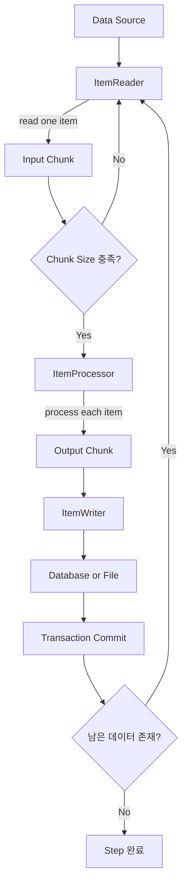

실제 내부 구현은 더 복잡하지만, 핵심적인 데이터 처리 흐름은 위와 같습니다.

#### 1. ItemReader가 데이터를 읽는다

ItemReader는 데이터 소스로부터 Item을 한 건씩 읽습니다.

```java
String item = itemReader.read();
```

읽은 Item은 Input Chunk에 저장됩니다.

```java
inputs.add(item);
```

#### 2. Chunk Size만큼 반복한다

설정된 Chunk Size에 도달할 때까지 ItemReader를 반복 호출합니다.

```java
while (inputs.size() < chunkSize) {

    String item = itemReader.read();

    if (item == null) {
        break;
    }

    inputs.add(item);
}
```

위 코드는 개념을 설명하기 위한 단순화된 로직입니다.

실제 Spring Batch는 반복 제어를 위한 별도의 구성 요소를 사용합니다.

또한 ItemReader가 `null`을 반환하면 더 이상 읽을 데이터가 없다는 의미로 해석합니다.

#### 3. ItemProcessor가 데이터를 가공한다

Input Chunk에 저장된 데이터를 하나씩 가져와 처리합니다.

```java
Chunk<String> outputs = new Chunk<>();

for (String item : inputs) {

    String processedItem = itemProcessor.process(item);

    if (processedItem != null) {
        outputs.add(processedItem);
    }
}
```

ItemProcessor는 각 Item을 개별적으로 처리합니다.

따라서 5개의 Item이 전달되었다면 일반적인 정상 처리 흐름에서 `process()`가 5번 호출됩니다.

반면 ItemProcessor가 없으면 읽은 데이터가 별도의 가공 과정 없이 Writer에 전달됩니다.

#### 4. ItemWriter가 데이터를 저장한다

ItemWriter는 Output Chunk를 전달받아 데이터를 저장합니다.

```java
itemWriter.write(outputs);
```

Spring Batch 5.x와 6.x의 ItemWriter 인터페이스는 다음과 같습니다.

```java
public interface ItemWriter<T> {

    void write(Chunk<? extends T> chunk) throws Exception;

}
```

따라서 ItemReader와 ItemProcessor는 개별 Item을 처리하지만, ItemWriter는 Chunk를 한 번에 전달받는다는 차이가 있습니다.

Spring Batch 4.x에서는 `ItemWriter.write(List<? extends T>)` 형태를 사용했지만, Spring Batch 5.0부터는 `Chunk`를 전달하는 방식으로 변경되었습니다.

---

### Chunk 기반 처리 예제

이번에는 실제 Spring Batch 코드를 사용하여 Chunk가 어떻게 생성되고 처리되는지 확인하겠습니다.

예제는 **Spring Batch 6.x API**를 기준으로 작성했습니다.

Spring Batch 6에서는 기존 ChunkOrientedTasklet 기반 방식 외에 새로운 `ChunkOrientedStep` 구현이 도입되었으며, `chunk(int)` API를 통해 해당 구조를 사용할 수 있습니다.

#### Step 구성

```java
import java.util.List;

import org.springframework.batch.core.Job;
import org.springframework.batch.core.Step;
import org.springframework.batch.core.job.builder.JobBuilder;
import org.springframework.batch.core.repository.JobRepository;
import org.springframework.batch.core.step.builder.StepBuilder;
import org.springframework.batch.core.configuration.annotation.StepScope;

import org.springframework.batch.infrastructure.item.ItemReader;
import org.springframework.batch.infrastructure.item.ItemProcessor;
import org.springframework.batch.infrastructure.item.ItemWriter;
import org.springframework.batch.infrastructure.item.support.ListItemReader;

import org.springframework.context.annotation.Bean;
import org.springframework.context.annotation.Configuration;

import org.springframework.transaction.PlatformTransactionManager;

@Configuration
public class ChunkBatchConfig {

    @Bean
    public Job chunkJob(
            JobRepository jobRepository,
            Step chunkStep) {

        return new JobBuilder("chunkJob", jobRepository)
                .start(chunkStep)
                .build();
    }

    @Bean
    public Step chunkStep(
            JobRepository jobRepository,
            PlatformTransactionManager transactionManager,
            ItemReader<String> itemReader,
            ItemProcessor<String, String> itemProcessor,
            ItemWriter<String> itemWriter) {

        return new StepBuilder("chunkStep", jobRepository)
                .<String, String>chunk(5)
                .transactionManager(transactionManager)
                .reader(itemReader)
                .processor(itemProcessor)
                .writer(itemWriter)
                .build();
    }

    @Bean
    @StepScope
    public ItemReader<String> itemReader() {

        return new ListItemReader<>(
                List.of(
                        "item1",
                        "item2",
                        "item3",
                        "item4",
                        "item5"
                )
        );
    }

    @Bean
    public ItemProcessor<String, String> itemProcessor() {

        return item -> {

            String result = "my" + item;

            System.out.println("Processing: " + result);

            return result;
        };
    }

    @Bean
    public ItemWriter<String> itemWriter() {

        return chunk -> {

            System.out.println(
                    "Writing Chunk: " + chunk.getItems()
            );
        };
    }
}
```

예제에서는 5개의 문자열을 입력 데이터로 사용하고 있습니다.

또한 Chunk Size를 5로 설정했기 때문에 하나의 Chunk에 5개의 Item이 저장됩니다.

참고로 `@StepScope`는 실행 시점에 Reader 인스턴스를 생성하도록 하여, 상태를 가진 Reader를 서로 다른 Step 실행 간에 재사용하는 문제를 줄이는 데 도움이 됩니다.

다만 `ListItemReader` 자체는 재시작 위치를 영속적으로 관리하는 ItemStream 구현체가 아니므로, 실제 운영 환경에서 체크포인트 기반 재시작이 필요하다면 해당 기능을 지원하는 Reader를 사용해야 합니다.

#### Chunk Size 설정

```java
.<String, String>chunk(5)
```

이 코드는 Chunk Size를 5로 설정합니다.

여기서 첫 번째 `String`은 Input 타입이고, 두 번째 `String`은 Output 타입입니다.

```java
.<I, O>chunk(5)
```

따라서 서로 다른 타입으로도 구성할 수 있습니다.

예를 들어 데이터베이스에서 `Order` 객체를 읽은 뒤 `Settlement` 객체로 변환하는 경우에는 다음과 같이 구성할 수 있습니다.

```java
.<Order, Settlement>chunk(100)
```

이 경우 Input Chunk와 Output Chunk의 타입은 다음과 같습니다.

```java
Chunk<Order> inputs;

Chunk<Settlement> outputs;
```

#### ItemReader

```java
@Bean
@StepScope
public ItemReader<String> itemReader() {

    return new ListItemReader<>(
            List.of(
                    "item1",
                    "item2",
                    "item3",
                    "item4",
                    "item5"
            )
    );
}
```

`ListItemReader`는 List에 저장된 데이터를 순차적으로 반환하는 ItemReader 구현체입니다.

호출할 때마다 하나의 Item을 반환합니다.

```text
read() → item1
read() → item2
read() → item3
read() → item4
read() → item5
read() → null
```

마지막에 `null`이 반환되면 읽을 데이터가 없다는 의미입니다.

#### ItemProcessor

```java
@Bean
public ItemProcessor<String, String> itemProcessor() {

    return item -> {

        String result = "my" + item;

        System.out.println("Processing: " + result);

        return result;
    };
}
```

ItemProcessor는 전달받은 문자열 앞에 `my`를 추가합니다.

```text
item1 → myitem1
item2 → myitem2
item3 → myitem3
item4 → myitem4
item5 → myitem5
```

각 Item은 개별적으로 Processor에 전달됩니다.

#### ItemWriter

```java
@Bean
public ItemWriter<String> itemWriter() {

    return chunk -> {

        System.out.println(
                "Writing Chunk: " + chunk.getItems()
        );
    };
}
```

ItemWriter는 ItemProcessor와 달리 개별 데이터가 아닌 Chunk를 전달받습니다.

따라서 Writer는 한 번 호출되면서 5개의 데이터를 처리합니다.

#### 실행 결과

```text
Processing: myitem1
Processing: myitem2
Processing: myitem3
Processing: myitem4
Processing: myitem5

Writing Chunk: [myitem1, myitem2, myitem3, myitem4, myitem5]
```

실행 결과를 보면 ItemProcessor는 5번 호출되지만 ItemWriter는 1번 호출됩니다.

즉, 데이터를 한 건씩 가공한 다음 여러 건을 묶어서 저장한다는 Chunk 기반 처리의 특징을 확인할 수 있습니다.

---

### Chunk의 내부 실행 과정

이번에는 Chunk가 Spring Batch 내부에서 어떤 순서로 생성되고 전달되는지 살펴보겠습니다.

기존 Spring Batch 4.x 및 5.x의 대표적인 Chunk 처리 구조는 다음과 같습니다.

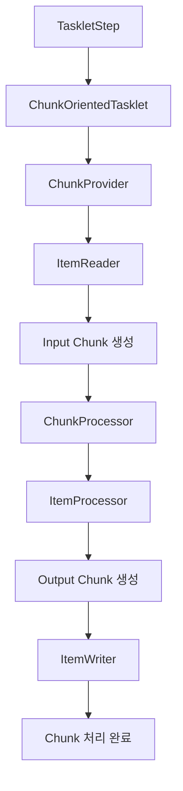

이 구조에서 중요한 클래스는 `ChunkOrientedTasklet`, `ChunkProvider`, `ChunkProcessor`입니다.

#### ChunkOrientedTasklet

`ChunkOrientedTasklet`은 기존 Spring Batch에서 Chunk 기반 처리를 담당하던 핵심 구현체입니다.

일반적인 Tasklet과 달리 ItemReader, ItemProcessor, ItemWriter를 이용해 Chunk 단위의 데이터 처리 흐름을 구성합니다.

이 과정에서 직접 모든 데이터를 읽고 처리하는 것이 아니라 역할을 분리된 객체에 위임합니다.

```text
ChunkOrientedTasklet
         │
         ├── ChunkProvider
         │       │
         │       └── ItemReader
         │
         └── ChunkProcessor
                 │
                 ├── ItemProcessor
                 │
                 └── ItemWriter
```

각 객체는 서로 다른 책임을 가집니다.

`ChunkProvider`는 데이터를 읽어 Input Chunk를 구성하고, `ChunkProcessor`는 해당 Chunk를 가공한 뒤 저장합니다.

다만 Spring Batch 6.0에서는 새로운 `ChunkOrientedStep` 구현이 정식으로 도입되었습니다.

기존 `ChunkOrientedTasklet`과 `TaskletStep`을 기반으로 하는 Chunk 처리 방식은 레거시 구현으로 취급되며, 새로운 애플리케이션에서는 `ChunkOrientedStepBuilder`를 사용하는 방식을 고려할 수 있습니다.

따라서 이전 버전의 내부 구현을 분석할 때는 `ChunkProvider`와 `ChunkProcessor`를 이해하는 것이 중요하지만, Spring Batch 6.x의 새로운 처리 엔진 내부 구조와 완전히 동일하다고 생각하면 안 됩니다.

---

### Chunk와 트랜잭션의 관계

Chunk 기반 처리에서 가장 중요한 설정 중 하나는 Chunk Size입니다.

일반적인 Chunk 기반 Step에서 Chunk Size는 Commit Interval과 밀접하게 연결됩니다.

```java
.<String, String>chunk(5)
```

위 설정은 정상적인 처리 흐름에서 5개의 입력 Item을 하나의 트랜잭션으로 처리하겠다는 의미입니다.

#### 정상적인 트랜잭션 처리

```text
BEGIN TRANSACTION

ItemReader
   ├─ item1
   ├─ item2
   ├─ item3
   ├─ item4
   └─ item5

ItemProcessor
   ├─ process(item1)
   ├─ process(item2)
   ├─ process(item3)
   ├─ process(item4)
   └─ process(item5)

ItemWriter
   └─ write(Chunk)

COMMIT TRANSACTION
```

Writer가 정상적으로 처리를 완료하면 트랜잭션이 커밋됩니다.

다음 Chunk는 새로운 트랜잭션에서 처리됩니다.

#### 오류가 발생하는 경우

이번에는 ItemProcessor에서 오류가 발생한다고 가정하겠습니다.

```java
@Bean
public ItemProcessor<String, String> itemProcessor() {

    return item -> {

        if (item.equals("item3")) {
            throw new RuntimeException("Processing Error");
        }

        return "my" + item;
    };
}
```

Chunk Size가 5일 때 다음과 같은 처리 흐름이 발생할 수 있습니다.

```text
BEGIN TRANSACTION

ItemReader
   ├─ item1
   ├─ item2
   ├─ item3
   ├─ item4
   └─ item5

ItemProcessor
   ├─ item1 → SUCCESS
   ├─ item2 → SUCCESS
   └─ item3 → ERROR

ROLLBACK TRANSACTION
```

이 경우 예외를 별도로 처리하지 않았다면 Chunk 트랜잭션은 롤백됩니다.

앞에서 처리했던 Item들도 동일한 트랜잭션에 참여했다면 해당 트랜잭션에서 수행한 데이터베이스 변경 사항이 취소됩니다.

다만 Processor 내부에서 외부 API를 호출했다면 이미 발생한 외부 시스템의 변경 사항까지 자동으로 복구되지는 않습니다.

실무에서는 이러한 차이를 반드시 고려해야 합니다.

#### Chunk Size와 Commit Interval

| Chunk Size | 입력 데이터 10,000건 기준 정상 처리 Chunk 수 | 특징 |
|---|---:|---|
| 1 | 10,000 | 트랜잭션 관리 오버헤드가 커질 수 있음 |
| 10 | 1,000 | 비교적 작은 처리 단위 |
| 100 | 100 | 일반적인 배치 처리에서 검토할 수 있는 크기 |
| 500 | 20 | 커밋 횟수를 줄일 수 있음 |
| 1,000 | 10 | 처리량 개선 가능성은 있지만 리소스 사용량 확인 필요 |
| 10,000 | 1 | 하나의 트랜잭션이 길어질 수 있음 |

Chunk Size가 크다고 반드시 성능이 좋은 것은 아닙니다.

데이터베이스의 트랜잭션 로그, 잠금 유지 시간, 데이터 변환 비용, Writer의 처리 방식 등을 종합적으로 고려해야 합니다.

또한 Skip이나 Retry를 사용하는 경우에는 기본적인 Chunk 처리 흐름과 다른 방식으로 트랜잭션이 재시도될 수 있습니다.

---

### Spring Batch 버전별 Chunk API 차이

Spring Batch는 버전이 변경되면서 Chunk 관련 API와 내부 구현에도 변화가 있었습니다.

특히 Spring Batch 4.x, 5.x, 6.x에서는 다음과 같은 차이를 확인할 수 있습니다.

| 구분 | Spring Batch 4.x | Spring Batch 5.x | Spring Batch 6.x |
|---|---|---|---|
| Chunk 패키지 | `org.springframework.batch.core.step.item.Chunk` | `org.springframework.batch.item.Chunk` | `org.springframework.batch.infrastructure.item.Chunk` |
| ItemWriter 인자 | `List<? extends T>` | `Chunk<? extends T>` | `Chunk<? extends T>` |
| Step 생성 | `StepBuilderFactory` 사용 가능 | `StepBuilder` 직접 생성 권장 | `StepBuilder` 직접 생성 |
| Chunk 설정 | `chunk(size)` | `chunk(size, transactionManager)` | `chunk(size)` |
| Chunk 처리 엔진 | ChunkOrientedTasklet 기반 | 기존 구현 중심 | 새로운 ChunkOrientedStep 정식 도입 |
| 트랜잭션 설정 | 구성 방식에 따라 지정 | Chunk 설정 시 전달 | `transactionManager()` 사용 가능 |

Spring Batch 6.x에서는 다음과 같이 Chunk 기반 Step을 구성할 수 있습니다.

```java
return new StepBuilder("chunkStep", jobRepository)
        .<String, String>chunk(100)
        .transactionManager(transactionManager)
        .reader(itemReader)
        .processor(itemProcessor)
        .writer(itemWriter)
        .build();
```

반면 Spring Batch 5.x에서는 다음과 같은 형태를 사용합니다.

```java
return new StepBuilder("chunkStep", jobRepository)
        .<String, String>chunk(100, transactionManager)
        .reader(itemReader)
        .processor(itemProcessor)
        .writer(itemWriter)
        .build();
```

또한 Spring Batch 5.x에서 ItemReader, ItemProcessor, ItemWriter와 Chunk를 사용하는 경우에는 다음 패키지를 사용해야 합니다.

```java
import org.springframework.batch.item.Chunk;
import org.springframework.batch.item.ItemReader;
import org.springframework.batch.item.ItemProcessor;
import org.springframework.batch.item.ItemWriter;
```

버전에 따라 패키지와 메서드가 다르기 때문에 프로젝트에서 사용하는 Spring Batch 버전을 먼저 확인한 뒤 코드를 적용해야 합니다.

---

### 실무에서의 활용

Chunk는 정산, 대사, 데이터 마이그레이션, 대규모 통계 집계와 같은 작업에서 특히 중요한 역할을 합니다.

예를 들어 PG 결제 시스템에서 하루 동안 발생한 결제 데이터를 조회하여 정산 테이블에 저장하는 배치 작업을 생각해 보겠습니다.

#### 1. 결제 정산 배치

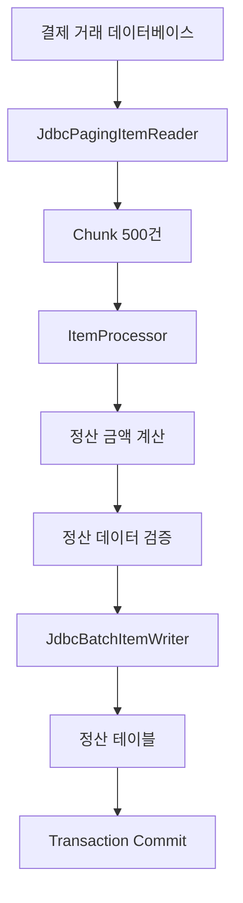

이 구조에서는 결제 데이터를 일정한 크기로 읽어 정산 금액을 계산하고 정산 테이블에 저장합니다.

예를 들어 하루에 50만 건의 결제가 발생한다면 Chunk Size를 500으로 설정하여 정상 처리 기준으로 1,000개의 Chunk로 구분할 수 있습니다.

```text
전체 거래: 500,000건
Chunk Size: 500

500,000 / 500 = 1,000 Chunk
```

Chunk 단위로 정산 데이터를 저장하면 트랜잭션 범위를 일정하게 유지할 수 있습니다.

또한 Writer가 여러 건의 정산 데이터를 한 번에 처리하도록 구성하면 개별 INSERT를 반복하는 방식보다 효율적인 저장 전략을 적용할 수 있습니다.

단, ItemWriter를 Chunk 기반으로 사용한다고 해서 자동으로 JDBC Batch Insert가 수행되는 것은 아닙니다.

실제 JDBC 배치 작업을 수행하려면 `JdbcBatchItemWriter` 등 적절한 Writer 구현체와 데이터베이스 설정을 함께 사용해야 합니다.

#### 2. 데이터 마이그레이션

기존 시스템의 데이터를 신규 시스템으로 옮기는 작업에서도 Chunk를 활용할 수 있습니다.

```text
Legacy Database
       │
       ▼
ItemReader
       │
       ▼
Chunk 1,000건
       │
       ▼
ItemProcessor
       │
       ├─ 데이터 형식 변경
       ├─ 필수 값 검증
       ├─ 코드 값 매핑
       └─ 불필요한 데이터 필터링
       │
       ▼
ItemWriter
       │
       ▼
New Database
```

이때 Chunk Size를 적절하게 설정하면 대량의 데이터를 일정한 크기로 나누어 처리할 수 있습니다.

#### 3. 운영 환경에서 고려해야 할 핵심 사항

실무에서는 Chunk를 단순히 설정하는 것보다 처리 대상 데이터와 시스템 특성에 맞게 운영하는 것이 중요합니다.

| 고려 사항 | 적용 방법 | 기대 효과 |
|---|---|---|
| Chunk Size 최적화 | 100, 500, 1,000 등 단계별 성능 측정 | 적절한 처리량 확보 |
| Reader 최적화 | Cursor 또는 Paging 기반 조회 | 메모리 및 조회 효율 개선 |
| Writer 최적화 | JDBC Batch Insert 활용 | DB 접근 비용 절감 |
| 데이터 필터링 | Processor에서 불필요한 데이터 제외 | 불필요한 저장 작업 감소 |
| 트랜잭션 관리 | 적절한 Commit Interval 설정 | 장시간 트랜잭션 방지 |
| 장애 복구 | Skip 및 Retry 정책 구성 | 일시적 오류 대응 |
| 재시작 처리 | ExecutionContext와 상태 저장 Reader 사용 | 중단 지점부터 재처리 |
| 중복 처리 방지 | Unique Key 및 멱등성 설계 | 재시도 시 중복 저장 방지 |
| 외부 API 연동 | 재시도 정책과 멱등성 키 활용 | 외부 시스템 데이터 정합성 확보 |
| 메모리 관리 | JPA 영속성 컨텍스트 관리 | 메모리 사용량 증가 방지 |
| 운영 모니터링 | Read Count, Write Count, Skip Count 확인 | 작업 진행 및 실패 원인 분석 |
| 데이터 정합성 | 거래 건수와 정산 건수 대사 | 배치 처리 결과 검증 |

특히 중요한 부분은 재시작과 멱등성입니다.

Chunk 단위로 커밋했다고 해서 재실행 시 데이터 중복 문제가 자동으로 해결되는 것은 아닙니다.

예를 들어 정산 데이터를 저장한 뒤 외부 시스템과 통신하는 과정에서 오류가 발생한다면, 재시작 시 동일한 거래가 다시 처리될 가능성을 고려해야 합니다.

따라서 거래 ID와 정산 일자 등을 기반으로 고유한 식별 기준을 마련하고, 중복 요청에도 동일한 결과가 유지되도록 설계하는 것이 중요합니다.

---

### 정리

Spring Batch의 Chunk는 여러 Item을 하나의 처리 단위로 묶어 대량 데이터를 안정적으로 처리할 수 있도록 지원하는 핵심 개념입니다.

ItemReader는 데이터를 한 건씩 읽어 Input Chunk를 구성하고, ItemProcessor는 해당 Chunk에 저장된 데이터를 개별적으로 가공합니다.

이후 ItemWriter는 가공된 데이터가 저장된 Output Chunk를 전달받아 일괄적으로 처리합니다.

이러한 처리 구조를 통해 Spring Batch는 데이터 읽기, 가공, 저장이라는 서로 다른 역할을 분리하고, Chunk를 기준으로 트랜잭션 경계를 관리할 수 있습니다.

특히 대량 데이터 처리에서는 Chunk Size가 처리 성능, 메모리 사용량, 트랜잭션 유지 시간, 장애 복구 범위 등에 영향을 미치므로 적절한 크기를 선택하는 것이 중요합니다.

또한 Spring Batch 5.x와 6.x에서는 Chunk의 패키지와 내부 처리 엔진이 달라졌으므로, 코드 구현과 내부 동작 분석 시 버전 차이를 고려해야 합니다.

#### 한 줄 요약

**Chunk는 Spring Batch에서 여러 Item을 하나의 처리 단위로 묶어 읽기·가공·저장 작업을 수행하고, 일정한 트랜잭션 경계 안에서 커밋과 롤백을 관리하도록 지원하는 핵심 객체입니다.**

#### 참고 문서

- [Spring Batch 공식 문서 - Chunk-oriented Processing](https://docs.spring.io/spring-batch/reference/step/chunk-oriented-processing.html)
- [Spring Batch 공식 문서 - Commit Interval](https://docs.spring.io/spring-batch/reference/step/chunk-oriented-processing/commit-interval.html)
- [Spring Batch 공식 문서 - Chunk API](https://docs.spring.io/spring-batch/reference/api/org/springframework/batch/infrastructure/item/Chunk.html)
- [Spring Batch 공식 문서 - ItemWriter](https://docs.spring.io/spring-batch/reference/readers-and-writers/item-writer.html)
- [Spring Batch 공식 문서 - Spring Batch 6 변경 사항](https://docs.spring.io/spring-batch/reference/6.0-SNAPSHOT/whatsnew.html)

## ChunkOrientedTaskelt - 개념 및 API 소개


### Spring Batch ChunkOrientedTasklet의 개념과 내부 실행 구조

Spring Batch는 대용량 데이터를 효율적으로 처리하기 위해 Chunk 기반 처리 방식을 제공합니다.

Chunk 기반 처리는 데이터를 한 건씩 읽고, 일정한 크기로 묶어 가공한 뒤, 하나의 트랜잭션 안에서 저장하는 구조입니다.

이 과정에서 핵심적인 역할을 하는 구성 요소가 `ItemReader`, `ItemProcessor`, `ItemWriter`입니다.

하지만 실제로 Spring Batch가 내부에서 이러한 구성 요소를 어떤 순서로 호출하고, 데이터를 어떻게 전달하며, 트랜잭션을 어떻게 관리하는지 이해하려면 한 단계 더 깊이 살펴봐야 합니다.

기존 Spring Batch에서는 이러한 처리 흐름을 제어하기 위해 **`ChunkOrientedTasklet`**이라는 클래스를 사용했습니다.

`ChunkOrientedTasklet`은 `Tasklet` 인터페이스를 구현한 클래스로, Chunk 기반 처리를 위해 다음 두 가지 핵심 구성 요소를 사용합니다.

- `ChunkProvider`: ItemReader를 이용하여 데이터를 읽고 Chunk를 구성합니다.
- `ChunkProcessor`: ItemProcessor와 ItemWriter를 이용하여 데이터를 가공하고 저장합니다.

즉, ChunkOrientedTasklet은 직접 모든 데이터를 처리하기보다 각 구성 요소에 작업을 위임하고, 전체 처리 흐름을 조정하는 역할을 담당합니다.

다만 Spring Batch 6.0부터는 새로운 `ChunkOrientedStep` 구현이 정식 도입되었습니다.

따라서 기존 시스템의 동작 원리를 이해하기 위해서는 `ChunkOrientedTasklet` 구조를 알아야 하지만, 새로운 시스템을 설계할 때는 `ChunkOrientedStep`을 기준으로 접근하는 것이 적절합니다.

이번에는 기존 내부 구현을 먼저 살펴보고, 이후 Spring Batch 5.x와 6.x의 차이점까지 정리하겠습니다.

---

### ChunkOrientedTasklet이란?

#### 기본 개념

`ChunkOrientedTasklet`은 Spring Batch에서 Chunk 지향 처리를 담당하도록 만들어진 `Tasklet` 인터페이스의 구현체입니다.

일반적인 Tasklet은 개발자가 직접 비즈니스 로직을 작성하고 실행 흐름을 제어합니다.

반면 ChunkOrientedTasklet은 Spring Batch가 제공하는 Chunk 기반 처리 구조를 활용하여 데이터의 읽기, 가공, 저장을 자동으로 관리합니다.

예를 들어 다음과 같은 배치 작업이 있다고 가정하겠습니다.

```text
전체 데이터: 6건

item1
item2
item3
item4
item5
item6
```

Chunk Size를 2로 설정하면 다음과 같이 처리됩니다.

```text
Chunk Size = 2

Transaction 1
 ├─ read(item1)
 ├─ read(item2)
 ├─ process(item1)
 ├─ process(item2)
 ├─ write([item1, item2])
 └─ COMMIT

Transaction 2
 ├─ read(item3)
 ├─ read(item4)
 ├─ process(item3)
 ├─ process(item4)
 ├─ write([item3, item4])
 └─ COMMIT

Transaction 3
 ├─ read(item5)
 ├─ read(item6)
 ├─ process(item5)
 ├─ process(item6)
 ├─ write([item5, item6])
 └─ COMMIT
```

일반적인 정상 처리 흐름에서 Chunk마다 새로운 트랜잭션이 시작되고, 해당 Chunk의 처리가 완료되면 커밋됩니다.

이 과정은 개발자가 직접 반복문과 트랜잭션 처리 로직을 작성하지 않아도 Spring Batch 내부에서 수행됩니다.

#### ChunkOrientedTasklet의 주요 특징

| 구분 | 설명 |
|---|---|
| 구현 형태 | `Tasklet` 인터페이스 구현체 |
| 주요 역할 | Chunk 기반 데이터 처리 흐름 제어 |
| 데이터 읽기 | ChunkProvider에 위임 |
| 데이터 가공 | ChunkProcessor를 통해 ItemProcessor 호출 |
| 데이터 저장 | ChunkProcessor를 통해 ItemWriter 호출 |
| 반복 실행 | TaskletStep에서 반복적으로 실행 |
| 트랜잭션 | 일반적으로 Chunk 단위로 관리 |
| 장애 처리 | 트랜잭션에 참여한 작업은 롤백 가능 |
| 데이터 버퍼링 | 읽은 Chunk를 ChunkContext에 임시 저장 가능 |
| 종료 판단 | RepeatStatus를 사용하여 반복 여부 결정 |

여기서 중요한 점은 ChunkOrientedTasklet이 트랜잭션을 직접 시작하고 커밋하는 클래스는 아니라는 것입니다.

기존 구조에서는 `TaskletStep`이 트랜잭션 경계를 관리하며, ChunkOrientedTasklet은 해당 트랜잭션 안에서 읽기와 처리 작업을 수행합니다.

---

### 왜 ChunkOrientedTasklet을 사용하는가?

#### 1. 데이터 처리 흐름의 표준화

일반적으로 데이터를 읽고 가공하여 저장하는 프로그램을 직접 작성한다면 다음과 같은 흐름이 필요합니다.

```java
while (true) {

    // 데이터 읽기
    // 데이터 가공
    // 데이터 저장
    // 트랜잭션 커밋
    // 오류 발생 시 롤백
    // 다음 데이터 처리
}
```

하지만 실제 운영 환경에서는 단순 반복문만으로 안정적인 배치 시스템을 구성하기 어렵습니다.

데이터가 더 이상 존재하지 않는 경우, 중간에 오류가 발생한 경우, 트랜잭션이 롤백된 경우, 배치를 재시작해야 하는 경우 등을 모두 고려해야 합니다.

ChunkOrientedTasklet은 이러한 처리 구조를 Spring Batch가 제공하는 구성 요소로 분리하여 관리하도록 설계되었습니다.

#### 2. 책임 분리를 통한 유지보수성 향상

ChunkOrientedTasklet은 데이터를 읽거나 저장하는 구체적인 로직을 직접 구현하지 않습니다.

각 구성 요소가 담당하는 역할은 다음과 같습니다.

| 구성 요소 | 역할 |
|---|---|
| ChunkOrientedTasklet | 전체 Chunk 처리 흐름 제어 |
| ChunkProvider | 데이터를 읽고 Chunk 구성 |
| ChunkProcessor | Chunk에 포함된 데이터 가공 및 저장 |
| ItemReader | 데이터 소스로부터 Item 조회 |
| ItemProcessor | 개별 Item 가공 및 필터링 |
| ItemWriter | 가공된 Item을 저장하거나 전송 |

이처럼 역할을 분리하면 데이터 조회 방식을 변경하더라도 전체 배치 처리 구조를 수정할 필요가 줄어듭니다.

예를 들어 데이터베이스에서 데이터를 읽던 시스템을 파일 기반 입력으로 변경한다면, ItemReader 구현체를 변경하는 방식으로 대응할 수 있습니다.

#### 3. 트랜잭션과 장애 처리의 일관성

ChunkOrientedTasklet을 사용하는 기존 Chunk 기반 Step에서는 Chunk 단위로 트랜잭션을 관리합니다.

따라서 하나의 Chunk에서 오류가 발생해도 이미 정상적으로 커밋된 이전 Chunk는 유지됩니다.

이러한 구조는 정산, 대사, 데이터 마이그레이션처럼 대량 데이터를 안정적으로 처리해야 하는 시스템에서 중요한 장점입니다.

---

### ChunkOrientedTasklet의 내부 구조

#### 클래스 구조

기존 ChunkOrientedTasklet은 다음과 같은 구조를 가집니다.

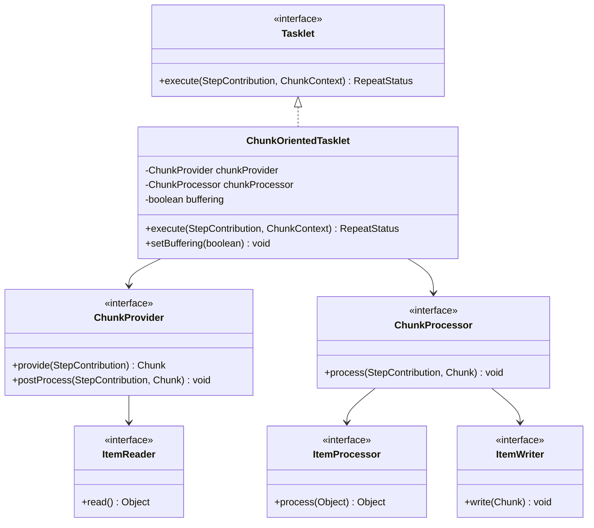

각 클래스의 관계를 살펴보면 ChunkOrientedTasklet이 전체 처리 흐름의 중심에 있다는 것을 확인할 수 있습니다.

ChunkOrientedTasklet은 두 구성 요소를 통해 데이터를 처리합니다.

**첫 번째는 ChunkProvider입니다.**

ChunkProvider는 ItemReader를 이용하여 데이터를 한 건씩 읽고, 지정된 Chunk Size만큼 데이터를 모아 하나의 Chunk를 생성합니다.

**두 번째는 ChunkProcessor입니다.**

ChunkProcessor는 ChunkProvider에서 전달받은 데이터를 ItemProcessor로 가공하고, ItemWriter에 전달하여 저장합니다.

두 구성 요소가 서로 다른 책임을 가지기 때문에 읽기와 쓰기 과정이 독립적으로 관리될 수 있습니다.

---

### ChunkOrientedTasklet의 실행 과정

기존 Spring Batch의 Chunk 기반 처리 흐름은 다음과 같습니다.

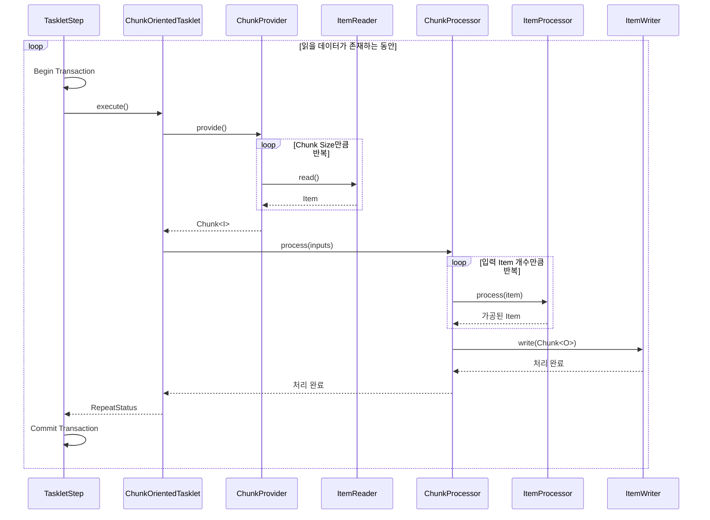

이 과정을 단계별로 살펴보겠습니다.

#### 1. TaskletStep이 ChunkOrientedTasklet을 실행한다

기존 Chunk 기반 Step은 내부적으로 `TaskletStep`을 사용합니다.

TaskletStep은 트랜잭션 경계 안에서 ChunkOrientedTasklet의 `execute()` 메서드를 호출합니다.

```java
execute(StepContribution contribution, ChunkContext chunkContext)
```

이때 전달되는 두 객체는 서로 다른 역할을 가집니다.

`StepContribution`은 해당 처리 단위에서 발생한 읽기, 쓰기, 필터링 등의 실행 통계를 관리하는 데 사용됩니다.

`ChunkContext`는 Chunk 처리 과정에서 필요한 실행 컨텍스트와 임시 속성을 제공합니다.

ChunkOrientedTasklet은 이러한 객체를 전달받아 처리 작업을 시작합니다.

#### 2. ChunkProvider를 호출한다

ChunkOrientedTasklet은 먼저 ChunkProvider의 `provide()` 메서드를 호출합니다.

```java
Chunk<I> inputs = chunkProvider.provide(contribution);
```

ChunkProvider는 ItemReader를 통해 데이터를 읽습니다.

```text
ItemReader.read()
       │
       ▼
     item1
       │
       ▼
Input Chunk에 추가
       │
       ▼
ItemReader.read()
       │
       ▼
     item2
       │
       ▼
Input Chunk에 추가
```

Chunk Size가 2라면 다음과 같은 Input Chunk가 구성됩니다.

```text
Chunk<I>

┌─────────────┐
│ item1       │
│ item2       │
└─────────────┘
```

일반적인 정상 처리에서는 Chunk Size만큼 데이터를 읽은 뒤 반복을 중단합니다.

다만 마지막 Chunk에서는 남은 데이터가 Chunk Size보다 적을 수 있습니다.

예를 들어 데이터가 총 5건이고 Chunk Size가 2라면 다음과 같이 처리됩니다.

```text
Chunk 1 → 2건
Chunk 2 → 2건
Chunk 3 → 1건
```

따라서 ChunkProvider가 항상 정확히 Chunk Size만큼 데이터를 반환하는 것은 아닙니다.

#### 3. ChunkProcessor를 호출한다

ChunkProvider에서 Input Chunk를 반환하면 ChunkOrientedTasklet은 ChunkProcessor를 호출합니다.

```java
chunkProcessor.process(contribution, inputs);
```

ChunkProcessor는 Input Chunk에 저장된 Item을 순회하면서 ItemProcessor를 호출합니다.

```text
Input Chunk
┌─────────────┐
│ item1       │
│ item2       │
└─────────────┘
       │
       ▼
 ItemProcessor
       │
       ├─ item1 → myitem1
       └─ item2 → myitem2
       │
       ▼
Output Chunk
┌─────────────┐
│ myitem1     │
│ myitem2     │
└─────────────┘
```

이렇게 처리된 데이터는 Output Chunk에 저장됩니다.

ItemProcessor는 선택적인 구성 요소이므로, 별도의 가공이 필요하지 않다면 생략할 수 있습니다.

#### 4. ItemWriter에 Output Chunk를 전달한다

ChunkProcessor는 가공이 완료된 Output Chunk를 ItemWriter에 전달합니다.

Spring Batch 5.x 이후 ItemWriter는 다음과 같은 인터페이스를 사용합니다.

```java
public interface ItemWriter<T> {

    void write(Chunk<? extends T> chunk) throws Exception;

}
```

ItemWriter는 하나의 Item이 아니라 여러 Item이 포함된 Chunk를 전달받습니다.

```text
ItemWriter.write()

Chunk:
[
    "myitem1",
    "myitem2"
]
```

ItemWriter가 정상적으로 작업을 완료하면 ChunkProcessor는 호출한 쪽으로 제어를 반환합니다.

이후 트랜잭션을 관리하는 Step이 커밋 절차를 수행합니다.

#### 5. 다음 Chunk를 처리한다

하나의 Chunk 처리가 완료되면 다음 Chunk를 처리합니다.

이때 이전 Chunk에서 사용한 데이터를 그대로 반복 처리하는 것이 아니라, ItemReader를 통해 다음 데이터를 읽습니다.

```text
1번째 Chunk
item1, item2
    ↓
처리 및 Commit

2번째 Chunk
item3, item4
    ↓
처리 및 Commit

3번째 Chunk
item5, item6
    ↓
처리 및 Commit
```

이 과정은 ItemReader가 더 이상 읽을 데이터가 없다고 판단할 때까지 반복됩니다.

---

### ChunkContext와 데이터 버퍼링

ChunkOrientedTasklet의 내부 구조에서 중요한 개념 중 하나가 **ChunkContext를 이용한 Input Chunk 버퍼링**입니다.

ChunkContext는 Chunk 실행 과정에서 필요한 컨텍스트와 임시 속성을 관리합니다.

기존 ChunkOrientedTasklet은 이미 읽은 데이터를 재사용할 수 있도록 ChunkContext에 Input Chunk를 저장하는 기능을 제공합니다.

#### ChunkContext를 사용하는 이유

예를 들어 Chunk Size가 3이고, 다음과 같은 데이터를 읽었다고 가정하겠습니다.

```text
Chunk Size = 3

Input Chunk
┌─────────────┐
│ item1       │
│ item2       │
│ item3       │
└─────────────┘
```

세 개의 데이터를 정상적으로 읽었지만 ItemWriter에서 오류가 발생할 수 있습니다.

```text
ItemReader
    ↓
item1, item2, item3
    ↓
ItemProcessor
    ↓
ItemWriter
    ↓
ERROR
```

이 경우 트랜잭션이 롤백됩니다.

그런데 데이터를 읽는 과정과 데이터베이스에 저장하는 과정이 항상 동일한 방식으로 롤백되는 것은 아닙니다.

예를 들어 파일 기반 Reader나 일반적인 순방향 Reader는 데이터베이스 트랜잭션이 롤백되었다고 해서 읽기 위치까지 자동으로 되돌아가지 않을 수 있습니다.

이러한 상황에서 이미 읽은 Item을 다시 사용할 수 있도록 버퍼링하는 기능이 필요합니다.

#### ChunkOrientedTasklet의 버퍼링 처리

기존 구현의 핵심 흐름을 단순화하면 다음과 같습니다.

```java
Chunk<I> inputs = chunkContext.getAttribute("INPUTS");

if (inputs == null) {

    inputs = chunkProvider.provide(contribution);

    if (buffering) {
        chunkContext.setAttribute("INPUTS", inputs);
    }
}

chunkProcessor.process(contribution, inputs);
```

위 코드는 동작 원리를 설명하기 위해 단순화한 것입니다.

처리 흐름은 다음과 같습니다.

1. ChunkContext에서 기존 Input Chunk를 조회합니다.
2. 저장된 Input Chunk가 없다면 ChunkProvider를 호출합니다.
3. ItemReader가 새로운 데이터를 읽습니다.
4. 버퍼링이 활성화되어 있다면 Input Chunk를 ChunkContext에 저장합니다.
5. ChunkProcessor가 데이터를 가공하고 저장합니다.

이때 ChunkContext에 저장된 데이터는 현재 실행 중인 Chunk 처리 흐름에서 재사용할 수 있는 임시 버퍼입니다.

#### 버퍼링을 통한 재처리

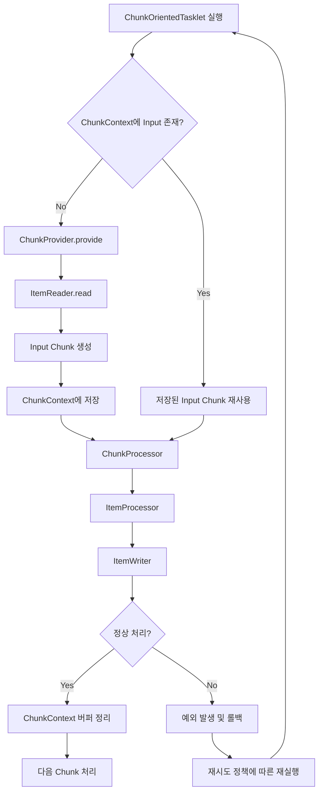

이러한 구조는 읽은 데이터의 재사용을 지원합니다.

다만 여기서 주의해야 할 점이 있습니다.

**ChunkContext에 Input Chunk를 저장했다고 해서 모든 오류에서 자동으로 재시도가 이루어지는 것은 아닙니다.**

재시도 여부는 예외 유형, Retry 정책, 트랜잭션 설정 등에 따라 달라집니다.

또한 ChunkContext의 임시 버퍼는 JobRepository에 영속적으로 저장되는 체크포인트 데이터와 구분해야 합니다.

애플리케이션 프로세스가 종료된 뒤 재시작하는 상황에서는 ItemStream과 ExecutionContext를 이용한 별도의 상태 복원 메커니즘이 필요합니다.

---

### ChunkOrientedTasklet의 setBuffering()

기존 ChunkOrientedTasklet은 데이터 버퍼링 여부를 제어하기 위해 다음 메서드를 제공합니다.

```java
public void setBuffering(boolean buffering)
```

버퍼링의 기본값은 `true`입니다.

#### buffering = true

```java
tasklet.setBuffering(true);
```

이 설정에서는 읽은 Input Chunk를 ChunkContext에 저장할 수 있습니다.

일반적인 순방향 Reader처럼 읽기 작업이 트랜잭션 롤백과 함께 되돌아가지 않는 경우에 적합합니다.

```text
ItemReader
    ↓
Input Chunk
    ↓
ChunkContext Buffer
    ↓
ChunkProcessor
```

#### buffering = false

```java
tasklet.setBuffering(false);
```

이 설정에서는 읽은 Input Chunk를 ChunkContext에 버퍼링하지 않습니다.

대표적인 사용 사례는 트랜잭션에 참여하는 JMS Reader입니다.

예를 들어 메시지 큐에서 메시지를 읽었지만 트랜잭션이 롤백되면 메시지가 다시 전달되도록 구성된 환경을 생각할 수 있습니다.

이 경우 별도의 Input Chunk 버퍼를 사용하지 않고 메시지 브로커의 트랜잭션 동작에 따라 메시지를 다시 읽도록 할 수 있습니다.

| 구분 | buffering = true | buffering = false |
|---|---|---|
| 기본값 | 기본 설정 | 명시적 변경 |
| Input Chunk 저장 | 저장 | 저장하지 않음 |
| 주요 대상 | 일반적인 비트랜잭션 Reader | 트랜잭션 기반 Queue Reader |
| 롤백 후 처리 | 버퍼의 Item 재사용 가능 | Reader의 재전달 동작에 의존 |
| 주의 사항 | 임시 버퍼와 재시작 상태는 다름 | 실제 리소스의 트랜잭션 참여 필요 |

중요한 점은 `setBuffering(false)`가 외부 메시지 큐에 트랜잭션 기능을 새롭게 제공하는 설정은 아니라는 것입니다.

트랜잭션에 참여하는 메시지 소비 구조가 이미 구성되어 있어야 의미가 있습니다.

---

### ChunkContext 버퍼 제거와 RepeatStatus

ChunkOrientedTasklet은 Chunk 처리가 완료되면 이전에 사용한 Input Chunk를 정리하고 다음 처리 여부를 판단합니다.

#### Input Chunk 버퍼 제거

기존 구현에서는 ChunkProcessor와 ChunkProvider의 후처리가 완료된 뒤, 더 이상 같은 Input Chunk를 처리할 필요가 없는 경우 다음과 같이 버퍼를 제거합니다.

```java
chunkContext.removeAttribute("INPUTS");
```

버퍼를 제거하는 이유는 다음 Chunk에서 새로운 데이터를 읽어야 하기 때문입니다.

예를 들어 첫 번째 Chunk에 다음 데이터가 저장되어 있다고 가정하겠습니다.

```text
Chunk 1

item1
item2
```

첫 번째 Chunk 처리가 정상적으로 완료되었다면 다음에는 `item3`, `item4`를 읽어야 합니다.

따라서 이전에 저장한 Input Chunk를 계속 유지할 필요가 없습니다.

여기서 버퍼 제거는 ChunkOrientedTasklet의 정상 처리 흐름에 포함된 동작이며, 실제 트랜잭션 커밋을 수행하는 작업과는 구분됩니다.

#### RepeatStatus란?

기존 Tasklet 실행 모델에서 `RepeatStatus`는 작업을 계속 반복할지 종료할지 나타내는 값입니다.

대표적인 상태는 다음과 같습니다.

| RepeatStatus | 의미 |
|---|---|
| `CONTINUABLE` | 작업을 계속 실행할 수 있음 |
| `FINISHED` | 작업을 종료함 |

예를 들어 다음과 같이 사용할 수 있습니다.

```java
return RepeatStatus.CONTINUABLE;
```

위 코드는 반복 실행을 계속할 수 있다는 의미입니다.

반면 다음과 같이 반환하면 반복 실행을 종료합니다.

```java
return RepeatStatus.FINISHED;
```

ChunkOrientedTasklet에서는 Chunk의 상태를 확인하여 반복 여부를 결정합니다.

기존 구현의 핵심 로직은 다음과 같습니다.

```java
return RepeatStatus.continueIf(!inputs.isEnd());
```

`inputs.isEnd()`는 입력 데이터의 끝에 도달했는지를 나타냅니다.

따라서 다음과 같이 동작합니다.

```text
inputs.isEnd() == false
    ↓
RepeatStatus.CONTINUABLE

inputs.isEnd() == true
    ↓
RepeatStatus.FINISHED
```

다만 실제 구현에서는 `inputs.isBusy()` 상태도 확인합니다.

해당 Chunk에 아직 처리해야 할 작업이 남아 있다면 `CONTINUABLE`을 반환할 수 있습니다.

따라서 종료 판단을 단순히 Input Chunk의 크기만으로 이해해서는 안 됩니다.

---

### ChunkOrientedTasklet의 실제 실행 흐름 분석

기존 ChunkOrientedTasklet의 `execute()` 메서드를 이해하기 쉽게 정리하면 다음과 같은 흐름입니다.

```java
public RepeatStatus execute(
        StepContribution contribution,
        ChunkContext chunkContext
) throws Exception {

    Chunk<I> inputs = getBufferedInputs(chunkContext);

    if (inputs == null) {

        inputs = chunkProvider.provide(contribution);

        if (buffering) {
            saveBufferedInputs(chunkContext, inputs);
        }
    }

    chunkProcessor.process(contribution, inputs);

    chunkProvider.postProcess(contribution, inputs);

    if (inputs.isBusy()) {
        return RepeatStatus.CONTINUABLE;
    }

    removeBufferedInputs(chunkContext);

    chunkContext.setComplete();

    return RepeatStatus.continueIf(!inputs.isEnd());
}
```

위 코드는 실제 소스의 핵심 처리 순서를 설명하기 위한 의사 코드입니다. `getBufferedInputs()`, `saveBufferedInputs()`, `removeBufferedInputs()`는 설명을 위해 만든 메서드 이름이며 실제 API가 아닙니다.

이 흐름에서 반드시 이해해야 할 부분은 다음과 같습니다.

#### 첫 번째: Input Chunk 조회

ChunkContext에 기존 Input Chunk가 저장되어 있는지 확인합니다.

기존 데이터가 없다면 새로운 Chunk를 생성하기 위해 ChunkProvider를 호출합니다.

#### 두 번째: Input Chunk 생성

ChunkProvider는 ItemReader에서 데이터를 읽어 Input Chunk를 구성합니다.

설정된 Chunk Size 또는 종료 조건에 도달하면 생성된 Chunk를 반환합니다.

#### 세 번째: Input Chunk 버퍼링

버퍼링이 활성화되어 있다면 생성된 Input Chunk를 ChunkContext에 저장합니다.

이는 재처리가 필요한 상황에서 읽은 데이터를 재사용하기 위한 구조입니다.

#### 네 번째: 데이터 가공 및 저장

ChunkProcessor는 Input Chunk를 전달받아 ItemProcessor와 ItemWriter를 호출합니다.

이 과정에서 데이터 가공과 저장이 수행됩니다.

#### 다섯 번째: 후처리 및 상태 확인

ChunkProcessor의 처리가 완료되면 ChunkProvider의 후처리 메서드를 호출합니다.

이후 Chunk가 아직 처리 중인지, 데이터의 끝에 도달했는지를 확인합니다.

#### 여섯 번째: 반복 여부 반환

계속 처리할 데이터가 있다면 `CONTINUABLE`을 반환하고, 모든 데이터가 처리되었다면 `FINISHED`를 반환합니다.

이렇게 ChunkOrientedTasklet은 Chunk 단위의 처리 과정을 조정하는 역할을 수행합니다.

---

### Chunk 기반 Step 설정 API

기존 Spring Batch에서는 `SimpleStepBuilder`를 통해 Chunk 기반 Step을 구성했습니다.

대표적인 설정은 다음과 같습니다.

```java
@Bean
public Step chunkStep(
        JobRepository jobRepository,
        PlatformTransactionManager transactionManager
) {

    return new StepBuilder("chunkStep", jobRepository)
            .<String, String>chunk(10, transactionManager)
            .reader(itemReader())
            .processor(itemProcessor())
            .writer(itemWriter())
            .build();
}
```

위 코드는 Spring Batch 5.x 기반 설정 예시입니다.

`StepBuilder`의 `chunk()` 메서드를 호출하면 `SimpleStepBuilder`를 이용한 Chunk 처리 구성을 이어갈 수 있습니다.

#### 주요 설정 API

| API | 역할 | 필수 여부 |
|---|---|---|
| `chunk(size, transactionManager)` | Chunk Size 및 트랜잭션 관리자 설정 | 기존 5.x Chunk 구성에서 사용 |
| `reader()` | ItemReader 등록 | 필수 |
| `processor()` | ItemProcessor 등록 | 선택 |
| `writer()` | ItemWriter 등록 | 필수 |
| `stream()` | ItemStream 등록 | 필요 시 |
| `readerIsTransactionalQueue()` | Reader가 트랜잭션 기반 Queue임을 알림 | 선택 |
| `listener()` | Chunk 및 Item 관련 Listener 등록 | 선택 |
| `build()` | Step 생성 | 필수 |

여기서 중요한 API를 조금 더 살펴보겠습니다.

#### chunk()

```java
.<String, String>chunk(10, transactionManager)
```

첫 번째 제네릭 타입은 Input 타입이고, 두 번째는 Output 타입입니다.

Chunk Size를 10으로 설정하면 일반적인 처리 흐름에서 10개의 입력 Item을 하나의 처리 단위로 구성합니다.

Chunk Size는 Commit Interval과 밀접하게 연결되지만, Processor에서 데이터를 필터링할 경우 Writer에 전달되는 실제 데이터 개수는 10개보다 적을 수 있습니다.

#### reader()

```java
.reader(itemReader())
```

ItemReader 구현체를 등록합니다.

ItemReader는 데이터베이스, 파일, 메시지 큐 등의 데이터 소스로부터 Item을 읽는 역할을 담당합니다.

#### processor()

```java
.processor(itemProcessor())
```

ItemProcessor 구현체를 등록합니다.

입력 데이터를 변환하거나 필터링하는 작업을 수행합니다.

ItemProcessor는 선택적인 구성 요소이므로, 데이터 가공이 필요하지 않다면 생략할 수 있습니다.

#### writer()

```java
.writer(itemWriter())
```

ItemWriter 구현체를 등록합니다.

ItemWriter는 전달받은 Chunk를 데이터베이스, 파일 또는 외부 시스템에 저장하는 역할을 담당합니다.

#### stream()

```java
.stream(itemStream())
```

ItemStream은 데이터 처리 상태를 관리하기 위한 생명주기 콜백을 제공합니다.

대표적인 메서드는 다음과 같습니다.

```java
void open(ExecutionContext executionContext);

void update(ExecutionContext executionContext);

void close();
```

각 메서드의 역할은 다음과 같습니다.

| 메서드 | 역할 |
|---|---|
| `open()` | 저장된 실행 상태를 기반으로 리소스 초기화 |
| `update()` | 현재 처리 위치 등의 상태 갱신 |
| `close()` | 사용한 리소스 정리 |

ItemStream을 활용하면 배치가 중단된 후 재시작할 때 이전 처리 위치를 복원할 수 있습니다.

다만 실제 재시작을 지원하려면 Reader 또는 Writer가 적절한 상태 정보를 저장하도록 구현되어 있어야 합니다.

또한 Reader, Processor, Writer가 직접 ItemStream을 구현한 경우에는 Spring Batch가 자동으로 등록할 수 있으므로 항상 별도의 `stream()` 호출이 필요한 것은 아닙니다.

반면 Composite 구조 내부에 포함된 Delegate는 명시적인 등록이 필요할 수 있습니다.

#### readerIsTransactionalQueue()

Spring Batch 5.x의 기존 SimpleStepBuilder에서는 다음 API를 사용할 수 있습니다.

```java
.readerIsTransactionalQueue()
```

이 설정은 Reader가 트랜잭션 기반 Queue를 사용한다는 것을 알려줍니다.

대표적인 예시는 트랜잭션에 참여하는 JMS Reader입니다.

내부적으로 ChunkOrientedTasklet의 버퍼링 설정과 연관되며, 기본적으로 활성화되는 Input Chunk 버퍼링을 비활성화하는 방향으로 동작합니다.

중요한 점은 이 설정만으로 메시지 브로커가 트랜잭션에 참여하게 되는 것은 아니라는 것입니다.

실제 메시지 소비, 승인, 롤백 동작은 메시지 브로커와 트랜잭션 매니저의 설정에 따라 달라집니다.

---

### CompletionPolicy를 이용한 Chunk 완료 조건 설정

기존 Spring Batch에서는 단순한 Chunk Size 외에도 `CompletionPolicy`를 사용하여 Chunk의 완료 조건을 제어할 수 있습니다.

#### Chunk Size 기반 처리

```java
.<String, String>chunk(10, transactionManager)
```

이 방식은 기본적으로 입력 데이터 10건을 하나의 Chunk로 처리합니다.

#### CompletionPolicy 기반 처리

```java
.<String, String>chunk(completionPolicy, transactionManager)
```

이 방식은 지정한 CompletionPolicy에 따라 Chunk의 완료 여부를 판단합니다.

예를 들어 일정한 개수의 데이터를 처리하거나 특정 시간 조건을 만족했을 때 Chunk 처리를 종료하도록 구성할 수 있습니다.

CompletionPolicy는 다음과 같은 상황에서 유용할 수 있습니다.

- 일정 건수에 도달했을 때 Chunk 종료
- 처리 시간이 특정 기준을 초과했을 때 Chunk 종료
- 사용자 정의 조건을 만족했을 때 Chunk 종료

다만 이 방식은 기존 TaskletStep 기반 Chunk 처리 구조에서 제공하던 기능입니다.

**Spring Batch 6.x의 새로운 ChunkOrientedStepBuilder에서는 기존 CompletionPolicy 기반 `chunk(CompletionPolicy)` API를 동일하게 제공하지 않습니다.**

Spring Batch 6의 새로운 Chunk 처리 엔진은 기존 Repeat 프레임워크에 의존하지 않는 구조로 변경되었기 때문입니다.

따라서 Spring Batch 6.x에서 동적으로 Chunk Size를 설정해야 한다면 Job Parameter와 JobScope를 활용하는 방식 등을 검토할 수 있습니다.

하지만 실행 중 매번 다른 완료 조건을 판단하는 사용자 정의 CompletionPolicy와 Job 실행 시작 시 Chunk Size를 동적으로 결정하는 것은 서로 다른 요구사항이므로 구분해서 접근해야 합니다.

---

### Spring Batch 5.x와 6.x의 Chunk 처리 구조 차이

Spring Batch 6.0에서는 Chunk 처리 방식의 내부 구조가 크게 변경되었습니다.

기존에는 TaskletStep과 ChunkOrientedTasklet을 이용하여 Chunk 처리를 수행했습니다.

반면 Spring Batch 6.0부터는 `ChunkOrientedStep`이라는 새로운 구현체가 정식으로 도입되었습니다.

#### Spring Batch 5.x 구조

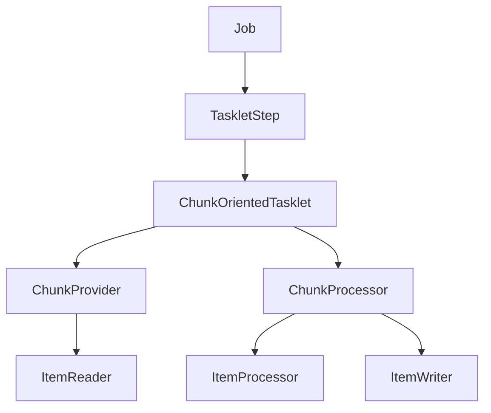

기존 구조에서 SimpleStepBuilder는 ChunkOrientedTasklet을 생성하고, 이를 TaskletStep에서 실행하도록 구성합니다.

#### Spring Batch 6.x 구조

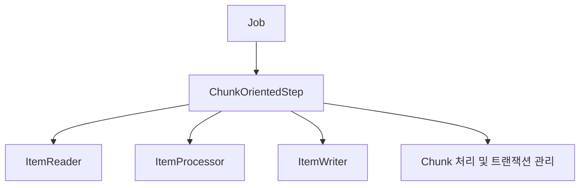

Spring Batch 6.x의 새로운 구조에서는 ChunkOrientedStep이 Chunk 기반 처리의 핵심 Step 구현체 역할을 담당합니다.

따라서 기존 ChunkOrientedTasklet과 TaskletStep을 반드시 거쳐야 하는 구조가 아닙니다.

#### 주요 차이점

| 구분 | Spring Batch 5.x 기존 구조 | Spring Batch 6.x 새로운 구조 |
|---|---|---|
| Chunk 처리 구현 | ChunkOrientedTasklet | ChunkOrientedStep |
| Step 구현 | TaskletStep | ChunkOrientedStep |
| Builder | SimpleStepBuilder | ChunkOrientedStepBuilder |
| Chunk 설정 | `chunk(size, transactionManager)` | `chunk(size)` |
| 트랜잭션 설정 | Chunk API에 전달 | `transactionManager()` |
| CompletionPolicy | 지원 | 새로운 Builder에서 동일 API 미제공 |
| Reader Transactional Queue 설정 | 지원 | 기존과 동일한 API 미제공 |
| Processor 설정 | 선택 | 선택 |
| Reader / Writer | 필수 | 필수 |

Spring Batch 6.0에서는 기존 ChunkOrientedTasklet 및 관련 레거시 구현이 Deprecated로 지정되었습니다.

또한 기존 구현은 향후 Spring Batch 7에서 제거될 예정이라고 안내하고 있습니다.

따라서 새롭게 개발하는 프로젝트에서는 ChunkOrientedStep을 사용하는 방향으로 설계하는 것이 적절합니다.

---

### Spring Batch 6.x 기반 Chunk 처리 예제

이번에는 새로운 Chunk 처리 구조를 사용하는 예제를 살펴보겠습니다.

예제는 Spring Batch 6.x API를 기준으로 작성했습니다.

전체 데이터는 6건이며 Chunk Size는 2로 설정하겠습니다.

#### 전체 설정 코드

```java
import java.util.List;

import org.springframework.batch.core.job.Job;
import org.springframework.batch.core.job.builder.JobBuilder;
import org.springframework.batch.core.repository.JobRepository;
import org.springframework.batch.core.step.Step;
import org.springframework.batch.core.step.builder.StepBuilder;
import org.springframework.batch.core.configuration.annotation.StepScope;

import org.springframework.batch.infrastructure.item.ItemReader;
import org.springframework.batch.infrastructure.item.ItemProcessor;
import org.springframework.batch.infrastructure.item.ItemWriter;
import org.springframework.batch.infrastructure.item.support.ListItemReader;

import org.springframework.context.annotation.Bean;
import org.springframework.context.annotation.Configuration;

import org.springframework.transaction.PlatformTransactionManager;

@Configuration
public class ChunkBatchConfig {

    @Bean
    public Job chunkJob(
            JobRepository jobRepository,
            Step chunkStep
    ) {

        return new JobBuilder("chunkJob", jobRepository)
                .start(chunkStep)
                .build();
    }

    @Bean
    public Step chunkStep(
            JobRepository jobRepository,
            PlatformTransactionManager transactionManager,
            ItemReader<String> itemReader,
            ItemProcessor<String, String> itemProcessor,
            ItemWriter<String> itemWriter
    ) {

        return new StepBuilder("chunkStep", jobRepository)
                .<String, String>chunk(2)
                .transactionManager(transactionManager)
                .reader(itemReader)
                .processor(itemProcessor)
                .writer(itemWriter)
                .build();
    }

    @Bean
    @StepScope
    public ItemReader<String> itemReader() {

        ListItemReader<String> delegate = new ListItemReader<>(
                List.of(
                        "item1",
                        "item2",
                        "item3",
                        "item4",
                        "item5",
                        "item6"
                )
        );

        return () -> {

            String item = delegate.read();

            System.out.println("READ: " + item);

            return item;
        };
    }

    @Bean
    public ItemProcessor<String, String> itemProcessor() {

        return item -> {

            String result = "my" + item;

            System.out.println("PROCESS: " + result);

            return result;
        };
    }

    @Bean
    public ItemWriter<String> itemWriter() {

        return chunk -> {

            System.out.println(
                    "WRITE: " + chunk.getItems()
            );
        };
    }
}
```

위 코드는 Batch 인프라를 제공하는 Spring Boot 또는 Spring Batch 설정이 이미 구성되어 있다고 가정한 예제입니다.

또한 로그 출력을 통한 처리 흐름 확인이 목적이므로, 실제 데이터베이스 저장 작업은 수행하지 않습니다.

운영 환경에서 사용할 때는 적절한 JobRepository, TransactionManager 및 실제 ItemReader와 ItemWriter 구현체를 구성해야 합니다.

#### StepBuilder 설정

```java
return new StepBuilder("chunkStep", jobRepository)
        .<String, String>chunk(2)
        .transactionManager(transactionManager)
        .reader(itemReader)
        .processor(itemProcessor)
        .writer(itemWriter)
        .build();
```

Chunk Size를 2로 설정했기 때문에 정상적인 처리 과정에서 입력 데이터 2건을 하나의 Chunk로 묶습니다.

데이터가 총 6건이므로 실제 데이터를 포함한 Chunk는 3개 생성됩니다.

#### 실행 흐름

실행 중 발생하는 핵심 로그는 다음과 같은 형태입니다.

```text
READ: item1
READ: item2

PROCESS: myitem1
PROCESS: myitem2

WRITE: [myitem1, myitem2]

READ: item3
READ: item4

PROCESS: myitem3
PROCESS: myitem4

WRITE: [myitem3, myitem4]

READ: item5
READ: item6

PROCESS: myitem5
PROCESS: myitem6

WRITE: [myitem5, myitem6]

READ: null
```

마지막 `READ: null`은 더 이상 읽을 데이터가 없다는 것을 확인하는 과정에서 발생할 수 있습니다.

실제 로그 순서와 내부 EOF 확인 시점은 사용하는 Spring Batch 버전 및 Reader 구현에 따라 차이가 있을 수 있습니다.

여기서 핵심은 ItemReader가 데이터를 한 건씩 읽고, ItemProcessor가 데이터를 개별적으로 가공하며, ItemWriter가 Chunk 단위로 데이터를 처리한다는 것입니다.

---

### Chunk 트랜잭션과 Commit Interval

Chunk 기반 처리에서 트랜잭션 경계는 중요한 역할을 합니다.

일반적인 Chunk 처리에서는 하나의 Chunk를 읽고, 가공하고, 저장하는 작업이 하나의 트랜잭션 경계 내에서 진행됩니다.

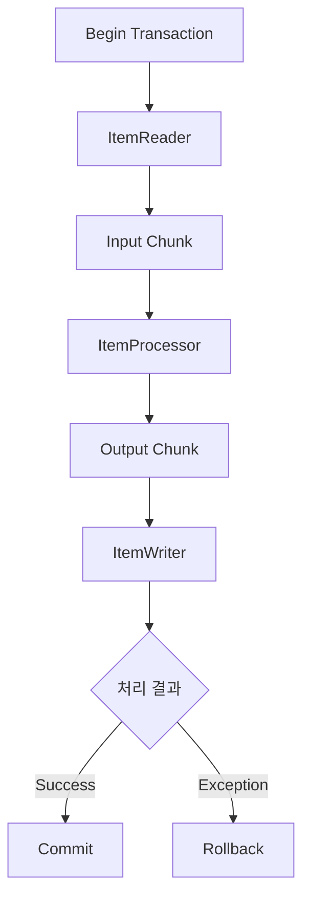

#### 정상적인 처리

Chunk Size가 2인 경우 다음과 같이 처리됩니다.

```text
BEGIN TRANSACTION

READ item1
READ item2

PROCESS item1
PROCESS item2

WRITE [item1, item2]

COMMIT
```

#### 오류 발생 시 처리

ItemWriter에서 예외가 발생한다면 다음과 같은 흐름이 발생할 수 있습니다.

```text
BEGIN TRANSACTION

READ item3
READ item4

PROCESS item3
PROCESS item4

WRITE [item3, item4]

ERROR

ROLLBACK
```

이때 이전에 커밋된 Chunk는 유지됩니다.

```text
Chunk 1 → COMMIT 완료

Chunk 2 → ROLLBACK
```

다만 롤백은 실제 트랜잭션에 참여한 리소스에만 적용됩니다.

예를 들어 ItemWriter가 외부 API를 호출했다면 데이터베이스 트랜잭션이 롤백되더라도 이미 수행된 API 작업은 자동으로 취소되지 않을 수 있습니다.

또한 데이터베이스 작업이라도 Reader와 Writer가 서로 다른 트랜잭션 매니저를 사용하거나 별도의 트랜잭션 경계에서 실행된다면 기대한 범위로 롤백되지 않을 수 있습니다.

따라서 실제 운영 환경에서는 다음 요소를 함께 고려해야 합니다.

- 트랜잭션 매니저 설정
- Reader와 Writer의 트랜잭션 참여 여부
- 외부 API 호출의 멱등성
- Retry 및 Skip 정책
- 배치 재시작 시 중복 처리 방지

---

### 실무에서의 활용

ChunkOrientedTasklet과 Chunk 처리 엔진의 내부 구조를 이해하면 단순한 기능 구현을 넘어 배치 시스템의 성능과 안정성을 개선하는 데 활용할 수 있습니다.

#### 1. Chunk Size를 실제 처리 비용에 맞게 조정

Chunk Size가 크면 커밋 횟수를 줄일 수 있지만 트랜잭션 유지 시간과 메모리 사용량이 증가할 수 있습니다.

반대로 Chunk Size가 너무 작으면 트랜잭션 관리 오버헤드가 증가할 수 있습니다.

따라서 단순히 데이터 건수만 기준으로 설정하지 않고, ItemReader와 ItemWriter의 처리 비용을 함께 측정해야 합니다.

#### 2. Reader와 Writer의 트랜잭션 경계 확인

데이터베이스 Reader와 Writer를 사용하는 경우 실제로 동일한 트랜잭션 경계 안에서 동작하는지 확인해야 합니다.

특히 외부 시스템과 연동하는 경우 데이터베이스 롤백이 외부 시스템의 상태까지 복구해 주지는 않습니다.

따라서 처리 대상 리소스의 트랜잭션 참여 여부를 명확하게 구분해야 합니다.

#### 3. ChunkContext 버퍼와 ExecutionContext 구분

ChunkContext의 Input Chunk 버퍼링과 ExecutionContext의 상태 저장은 서로 다른 목적을 가집니다.

ChunkContext 버퍼링은 기존 Chunk 처리 엔진에서 읽은 데이터를 임시로 재사용하기 위한 기능입니다.

ExecutionContext는 실행 상태를 저장하고, 적절한 ItemStream 구현과 함께 배치 재시작에 활용됩니다.

두 개념을 혼동하면 애플리케이션 재시작 시에도 임시 버퍼가 복구될 것이라고 잘못 이해할 수 있습니다.

#### 4. ItemReader의 재시작 가능 여부 확인

모든 ItemReader가 자동으로 재시작 기능을 제공하는 것은 아닙니다.

예를 들어 단순한 ListItemReader는 입력 목록을 순차적으로 읽는 용도로 사용할 수 있지만, 영속적인 체크포인트 복원 기능을 제공하는 Reader와는 차이가 있습니다.

정산이나 데이터 마이그레이션처럼 중단 지점부터 재처리해야 하는 작업에서는 상태 저장 기능이 있는 Reader를 선택해야 합니다.

#### 5. ItemProcessor의 중복 실행 가능성 고려

Retry 및 Rollback이 발생하면 ItemProcessor가 동일한 데이터를 다시 처리할 수 있습니다.

따라서 Processor 내부에서 외부 API 호출이나 직접적인 데이터 변경을 수행하면 중복 실행 문제가 발생할 수 있습니다.

가능하면 Processor는 데이터 변환과 검증에 집중하도록 구성하는 것이 좋습니다.

#### 6. ItemWriter의 멱등성 확보

배치 시스템에서는 재시도나 재시작으로 인해 동일한 데이터가 다시 전달될 가능성을 고려해야 합니다.

예를 들어 정산 데이터를 저장할 때 거래 ID와 정산 일자를 기준으로 고유한 식별 조건을 설정하면 중복 저장을 방지하는 데 도움이 됩니다.

필요하다면 Upsert 또는 중복 검증 로직을 적용할 수 있습니다.

#### 7. 데이터 필터링과 Skip 구분

ItemProcessor가 `null`을 반환하는 것은 정상적인 데이터 필터링입니다.

반면 Skip은 특정 예외가 발생했을 때 해당 Item을 건너뛰도록 하는 장애 처리 정책입니다.

두 동작은 처리 결과가 비슷해 보일 수 있지만 실행 통계와 예외 처리 관점에서는 차이가 있습니다.

따라서 유효하지 않은 데이터를 정상적으로 제외하는 것인지, 오류가 발생한 데이터를 건너뛰는 것인지 명확히 구분해야 합니다.

#### 8. ItemWriter의 배치 저장 최적화

ItemWriter는 Chunk 단위로 데이터를 전달받지만 자동으로 JDBC Batch Insert가 수행되는 것은 아닙니다.

데이터베이스에 여러 건을 효율적으로 저장하려면 JdbcBatchItemWriter 등의 적절한 Writer 구현체를 사용해야 합니다.

실제 성능 개선을 위해서는 Chunk Size뿐 아니라 데이터베이스 드라이버와 SQL 실행 방식도 함께 확인해야 합니다.

#### 9. ChunkListener를 이용한 모니터링

ChunkListener를 활용하면 Chunk 처리 전후에 필요한 작업을 수행할 수 있습니다.

대표적인 콜백은 다음과 같습니다.

```java
beforeChunk(ChunkContext context);

afterChunk(ChunkContext context);

afterChunkError(ChunkContext context);
```

이를 이용하여 Chunk 처리 시간, 실패 이력, 실행 상태 등을 기록할 수 있습니다.

특히 `afterChunk`는 정상적인 Chunk 트랜잭션 처리가 완료된 이후 호출되므로 커밋 이후의 후처리와 모니터링에 활용할 수 있습니다.

#### 10. Retry와 Rollback을 구분하여 설계

Rollback은 트랜잭션에 참여한 작업을 취소하는 동작이고, Retry는 실패한 작업을 다시 시도하는 정책입니다.

따라서 Rollback이 발생했다고 해서 항상 Retry가 실행되는 것은 아닙니다.

예를 들어 일시적인 네트워크 오류에는 제한된 Retry를 적용할 수 있지만, 데이터 형식 오류처럼 재시도해도 성공할 가능성이 낮은 상황에서는 다른 오류 처리 방식이 필요합니다.

#### 11. Spring Batch 버전에 맞는 내부 구조 분석

Spring Batch 5.x와 6.x는 Chunk 처리 엔진이 다릅니다.

기존 ChunkOrientedTasklet의 동작을 그대로 Spring Batch 6.x의 새로운 ChunkOrientedStep에 적용하여 이해하면 실제 실행 과정과 차이가 발생할 수 있습니다.

따라서 내부 동작을 분석하거나 확장 기능을 구현할 때는 프로젝트에서 사용하는 Spring Batch 버전을 먼저 확인해야 합니다.

특히 Spring Batch 6.x에서는 새로운 ChunkOrientedStep을 기준으로 트랜잭션, 장애 처리, 병렬 처리 기능을 검토하는 것이 적절합니다.

---

### 정리

ChunkOrientedTasklet은 기존 Spring Batch에서 Chunk 기반 데이터 처리를 담당하던 핵심 Tasklet 구현체입니다.

ChunkProvider를 통해 데이터를 읽고 Input Chunk를 구성하며, ChunkProcessor를 통해 데이터를 가공하고 저장하는 흐름을 제어합니다.

또한 ChunkContext를 이용한 Input Chunk 버퍼링과 RepeatStatus를 통한 반복 제어 기능을 제공합니다.

다만 실제 트랜잭션 경계는 TaskletStep에서 관리되며, ChunkOrientedTasklet이 직접 Commit 또는 Rollback을 수행하는 것은 아닙니다.

Spring Batch 6.0부터는 새로운 ChunkOrientedStep 구현이 도입되면서 기존 구조가 변경되었습니다.

따라서 기존 시스템을 유지보수할 때는 ChunkOrientedTasklet과 ChunkProvider, ChunkProcessor의 동작 원리를 이해하고, 신규 시스템을 설계할 때는 ChunkOrientedStep을 기준으로 접근하는 것이 적절합니다.

#### 한 줄 요약

**ChunkOrientedTasklet은 기존 Spring Batch에서 ChunkProvider와 ChunkProcessor를 통해 데이터의 읽기·가공·저장 흐름을 제어하던 핵심 구현체이며, Spring Batch 6.x에서는 새로운 ChunkOrientedStep이 해당 역할을 담당합니다.**

#### 참고 문서

- Spring Batch 공식 문서 — Chunk-oriented Processing
- Spring Batch 공식 문서 — Configuring a Step
- Spring Batch 6.0 Migration Guide
- Spring Batch API — ChunkOrientedTasklet
- Spring Batch API — ChunkOrientedStepBuilder
- Spring Batch GitHub — ChunkOrientedTasklet.java

## ChunkOrientedTaskelt - ChunkProvider / ChunkProcessor


### Spring Batch ChunkProvider와 ChunkProcessor의 내부 구조 및 동작 원리

Spring Batch의 Chunk 기반 처리는 대용량 데이터를 일정한 크기로 나누어 읽고, 가공하고, 저장하는 방식입니다.

이러한 처리 과정에서 중요한 역할을 하는 두 가지 구성 요소가 있습니다.

바로 **ChunkProvider와 ChunkProcessor**입니다.

기존 Spring Batch의 Chunk 처리 구조에서는 `ChunkOrientedTasklet`이 전체 작업 흐름을 관리하고, 실제 데이터의 읽기와 가공 및 저장을 각각 ChunkProvider와 ChunkProcessor에 위임합니다.

ChunkProvider는 ItemReader를 사용하여 데이터를 읽고 Input Chunk를 생성합니다.

반면 ChunkProcessor는 전달받은 Input Chunk를 ItemProcessor로 가공한 뒤 Output Chunk를 생성하고, ItemWriter를 통해 데이터를 저장합니다.

이 두 구성 요소는 서로 다른 책임을 가지지만, 하나의 Chunk 처리 흐름을 완성하기 위해 긴밀하게 동작합니다.

이번에는 각각의 역할뿐 아니라 실제 내부 구현에서 어떤 메서드가 호출되고, 반복문은 어떻게 종료되며, 데이터를 어떤 방식으로 관리하는지 자세히 살펴보겠습니다.

---

### 개념

#### ChunkProvider란?

ChunkProvider는 ItemReader를 사용하여 데이터 소스로부터 Item을 읽고, 지정된 Chunk Size만큼 데이터를 모아 하나의 Chunk로 제공하는 객체입니다.

데이터 소스는 데이터베이스, 파일, 메시지 큐 등 다양한 형태가 될 수 있습니다.

예를 들어 다음과 같은 데이터가 있다고 가정하겠습니다.

```text
item1
item2
item3
item4
item5
item6
```

Chunk Size를 2로 설정하면 ChunkProvider는 데이터를 다음과 같이 처리합니다.

```text
ChunkProvider
    │
    ├── ItemReader.read() → item1
    ├── ItemReader.read() → item2
    │
    ▼
Input Chunk 1
[item1, item2]
    │
    ▼
ChunkProcessor
```

첫 번째 Chunk 처리가 완료되면 ChunkProvider는 다음 데이터를 읽습니다.

```text
ChunkProvider
    │
    ├── ItemReader.read() → item3
    ├── ItemReader.read() → item4
    │
    ▼
Input Chunk 2
[item3, item4]
    │
    ▼
ChunkProcessor
```

이러한 작업을 더 이상 읽을 데이터가 없을 때까지 반복합니다.

즉, ChunkProvider의 핵심 역할은 **ItemReader가 읽은 개별 데이터를 Chunk 단위로 구성하여 다음 처리 단계에 제공하는 것**입니다.

#### ChunkProcessor란?

ChunkProcessor는 ChunkProvider가 생성한 Input Chunk를 전달받아 데이터를 가공하고 저장하는 객체입니다.

내부적으로 다음 두 가지 구성 요소를 사용합니다.

- ItemProcessor: 데이터를 변형하거나 필터링합니다.
- ItemWriter: 가공한 데이터를 저장하거나 출력합니다.

예를 들어 ChunkProvider가 다음 데이터를 전달했다고 가정하겠습니다.

```text
Input Chunk
[item1, item2]
```

ItemProcessor가 문자열 앞에 `my`를 추가한다면 다음과 같이 변환됩니다.

```text
Input Chunk
[item1, item2]
     │
     ▼
ItemProcessor
     │
     ├── item1 → myitem1
     └── item2 → myitem2
     │
     ▼
Output Chunk
[myitem1, myitem2]
     │
     ▼
ItemWriter
     │
     ▼
Database
```

ChunkProcessor는 데이터를 직접 조회하지 않습니다.

이미 읽힌 데이터를 가공하고 최종 목적지에 전달하는 역할을 담당합니다.

#### ChunkProvider와 ChunkProcessor 비교

| 구분 | ChunkProvider | ChunkProcessor |
|---|---|---|
| 주요 역할 | 데이터 읽기 및 Chunk 구성 | 데이터 가공 및 저장 |
| 입력 데이터 | 데이터 소스 | Input Chunk |
| 출력 데이터 | Input Chunk | Output Chunk 처리 결과 |
| 핵심 구성 요소 | ItemReader | ItemProcessor, ItemWriter |
| 기본 구현체 | SimpleChunkProvider | SimpleChunkProcessor |
| 장애 처리 확장 구현체 | FaultTolerantChunkProvider | FaultTolerantChunkProcessor |
| 주요 메서드 | `provide()` | `process()` |
| 반복 단위 | ItemReader의 개별 Item | Input Chunk에 포함된 Item |
| 처리 종료 조건 | Chunk Size 충족 또는 EOF | Chunk의 처리 및 쓰기 완료 |

중요한 점은 두 구성 요소 모두 직접 트랜잭션을 커밋하는 주체는 아니라는 것입니다.

기존 구조에서는 TaskletStep이 트랜잭션 경계를 관리하고, ChunkProvider와 ChunkProcessor는 해당 트랜잭션 안에서 실행됩니다.

---

### 왜 사용하는가?

ChunkProvider와 ChunkProcessor를 분리한 이유는 단순히 코드를 여러 클래스로 나누기 위해서가 아닙니다.

데이터를 읽는 작업과 데이터를 처리하는 작업은 서로 다른 책임과 장애 특성을 가지고 있기 때문입니다.

#### 1. 데이터 읽기와 처리의 책임 분리

데이터베이스에서 데이터를 읽는 로직과 데이터를 가공하여 저장하는 로직을 하나의 클래스에서 관리한다면 다음과 같은 문제가 발생할 수 있습니다.

```java
while (true) {

    // 데이터 읽기
    // 읽기 종료 여부 판단
    // 데이터 변환
    // 필터링
    // 데이터 저장
    // 예외 처리
    // 반복 여부 판단
}
```

모든 작업이 하나의 메서드에 포함되면 로직이 복잡해지고, 특정 기능을 수정할 때 다른 처리 과정에도 영향을 줄 수 있습니다.

반면 ChunkProvider와 ChunkProcessor를 분리하면 각각의 책임이 명확해집니다.

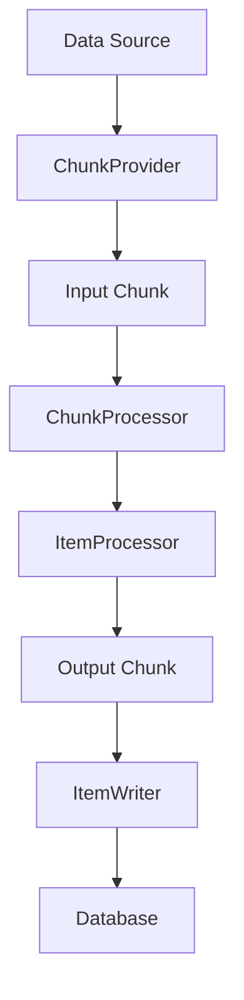

ChunkProvider는 데이터가 어디에서 오는지에 집중하고, ChunkProcessor는 해당 데이터를 어떻게 처리할지에 집중할 수 있습니다.

#### 2. 대용량 데이터 처리의 효율성

ChunkProvider는 모든 데이터를 한꺼번에 가져와 처리하도록 강제하지 않습니다.

설정된 Chunk Size를 기준으로 데이터를 묶어 다음 처리 단계에 전달합니다.

예를 들어 100만 건의 데이터를 Chunk Size 1,000으로 처리한다면 정상적인 처리 과정에서 1,000개의 Chunk로 나누어 작업할 수 있습니다.

```text
전체 데이터: 1,000,000건

Chunk Size: 1,000

Chunk 1    → 1 ~ 1,000
Chunk 2    → 1,001 ~ 2,000
Chunk 3    → 2,001 ~ 3,000
...
Chunk 1000 → 999,001 ~ 1,000,000
```

이러한 구조는 한 번에 처리하는 데이터의 범위를 제한하고, 트랜잭션의 크기를 제어하는 데 도움이 됩니다.

다만 Reader가 내부적으로 전체 데이터를 메모리에 올리는 방식이라면 Chunk Size만으로 메모리 사용량을 제한할 수는 없습니다.

#### 3. 장애 처리 기능 확장

데이터를 읽는 과정에서 발생하는 오류와 데이터를 저장하는 과정에서 발생하는 오류는 성격이 다릅니다.

예를 들어 파일을 읽다가 형식 오류가 발생할 수 있고, 데이터베이스에 저장하다가 일시적인 연결 문제가 발생할 수도 있습니다.

Spring Batch는 이러한 상황에 대응할 수 있도록 FaultTolerant 구현체를 제공합니다.

기존 Chunk 처리 구조에서는 읽기 단계와 처리·쓰기 단계의 장애 대응 책임이 각각 다른 객체에 분리되어 있습니다.

이러한 설계는 Retry와 Skip 같은 장애 처리 정책을 적용할 때 중요한 역할을 합니다.

---

### 주요 특징

#### ChunkProvider와 ChunkProcessor의 클래스 구조

Spring Batch 5.x 기준으로 두 구성 요소의 관계를 표현하면 다음과 같습니다.

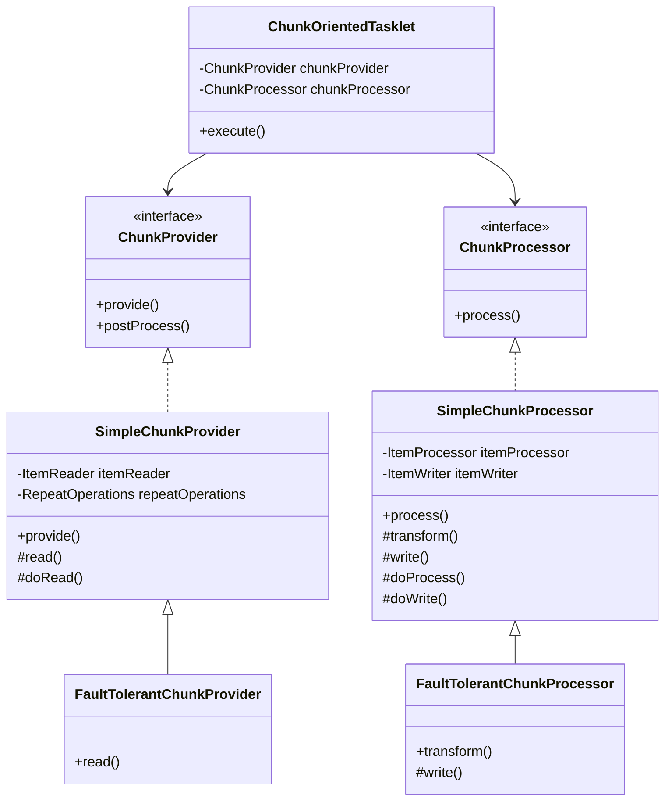

이 구조에서 확인할 수 있는 중요한 특징은 다음과 같습니다.

첫 번째로 ChunkProvider와 ChunkProcessor는 인터페이스이며, 실제 처리는 각각의 구현체가 담당합니다.

두 번째로 기본적인 데이터 처리에는 Simple 구현체를 사용합니다.

세 번째로 Skip 및 Retry 같은 장애 처리 기능이 필요한 경우 FaultTolerant 구현체를 활용할 수 있습니다.

네 번째로 ChunkOrientedTasklet은 두 구성 요소를 조합하여 전체 Chunk 처리 흐름을 제어합니다.

이 구조는 Spring Batch 5.x의 기존 Chunk 처리 엔진을 기준으로 한 것입니다.

Spring Batch 6.0부터는 새로운 ChunkOrientedStep이 정식 도입되면서 내부 처리 구조가 변경되었습니다.

따라서 기존 구현체의 내부 구조와 새로운 Chunk 처리 엔진은 구분하여 이해해야 합니다.

---

### SimpleChunkProvider의 내부 구조

#### SimpleChunkProvider란?

`SimpleChunkProvider`는 ChunkProvider 인터페이스의 기본 구현체입니다.

ItemReader를 사용하여 데이터를 한 건씩 읽고, 해당 데이터를 Chunk에 저장하는 역할을 담당합니다.

Spring Batch 5.x에서는 다음 패키지에 정의되어 있습니다.

```java
org.springframework.batch.core.step.item.SimpleChunkProvider
```

내부적으로 중요한 구성 요소는 다음과 같습니다.

```java
ItemReader<? extends I> itemReader;

RepeatOperations repeatOperations;
```

여기서 ItemReader는 실제 데이터를 읽는 객체입니다.

RepeatOperations는 ItemReader의 반복 호출을 제어하는 객체입니다.

일반적으로 RepeatOperations의 구현체인 RepeatTemplate을 사용합니다.

#### SimpleChunkProvider의 주요 메서드

| 메서드 | 역할 |
|---|---|
| `provide()` | 새로운 Input Chunk 생성 및 반환 |
| `read()` | ItemReader를 호출하는 읽기 처리 |
| `doRead()` | 실제 ItemReader의 `read()` 실행 |
| `postProcess()` | Chunk 처리 후 필요한 후처리 |
| `setListeners()` | ItemReadListener 등 Listener 등록 |
| `setMeterRegistry()` | 모니터링을 위한 MeterRegistry 설정 |

이 중 가장 중요한 메서드는 `provide()`입니다.

---

### SimpleChunkProvider의 provide() 분석

#### provide()의 기본 동작

`provide()`는 ItemReader를 반복 호출하여 Input Chunk를 구성하는 메서드입니다.

실제 구현의 핵심 흐름을 이해하기 쉽게 표현하면 다음과 같습니다.

```java
public Chunk<I> provide(StepContribution contribution)
        throws Exception {

    Chunk<I> inputs = new Chunk<>();

    repeatOperations.iterate(context -> {

        I item = read(contribution, inputs);

        if (item == null) {

            inputs.setEnd();

            return RepeatStatus.FINISHED;
        }

        inputs.add(item);

        return RepeatStatus.CONTINUABLE;
    });

    return inputs;
}
```

위 코드는 Spring Batch 5.x의 핵심 처리 흐름을 단순화한 의사 코드입니다.

실제 구현에는 Listener 호출, 메트릭 수집, 예외 처리 등의 추가 로직이 포함됩니다.

이 코드를 단계별로 살펴보겠습니다.

#### 1. Input Chunk 생성

```java
Chunk<I> inputs = new Chunk<>();
```

먼저 ItemReader에서 읽은 데이터를 저장할 Chunk를 생성합니다.

Chunk는 내부적으로 Item 목록을 관리합니다.

```text
Chunk<I>

items = []
```

처음 생성된 Chunk에는 Item이 존재하지 않습니다.

#### 2. RepeatOperations 실행

```java
repeatOperations.iterate(context -> {
    // ItemReader 반복 호출
});
```

RepeatOperations는 ItemReader의 호출을 반복하는 역할을 담당합니다.

기존 구현에서는 일반적으로 RepeatTemplate을 사용합니다.

```text
RepeatTemplate
     │
     ├── read()
     ├── read()
     ├── read()
     └── ...
```

이 반복은 설정된 Chunk Size에 도달하거나 읽을 데이터가 없을 때 종료됩니다.

#### 3. ItemReader 호출

```java
I item = read(contribution, inputs);
```

ChunkProvider는 ItemReader를 통해 데이터를 한 건씩 읽습니다.

예를 들어 다음과 같은 데이터를 가지고 있다면 다음과 같이 반환됩니다.

```text
read() → item1
read() → item2
read() → item3
...
```

ItemReader는 한 번 호출될 때 하나의 Item을 반환합니다.

#### 4. 읽은 Item을 Chunk에 저장

```java
inputs.add(item);
```

ItemReader가 반환한 데이터가 `null`이 아니라면 Input Chunk에 추가합니다.

Chunk Size가 2인 경우 다음과 같이 처리됩니다.

```text
처음 생성

Chunk<I>
items = []

첫 번째 read()

Chunk<I>
items = [item1]

두 번째 read()

Chunk<I>
items = [item1, item2]
```

이때 Chunk Size를 충족했으므로 내부 반복을 종료합니다.

#### 5. Input Chunk 반환

```java
return inputs;
```

반복이 종료되면 생성된 Chunk를 반환합니다.

```text
ChunkProvider.provide()
        │
        ▼
Chunk<I>
[item1, item2]
        │
        ▼
ChunkOrientedTasklet
```

ChunkOrientedTasklet은 전달받은 Input Chunk를 ChunkProcessor에 전달합니다.

중요한 점은 **ChunkProvider가 ChunkProcessor를 직접 호출하는 것이 아니라, ChunkOrientedTasklet이 두 구성 요소의 실행을 조정한다는 것**입니다.

---

### ChunkProvider의 반복문 종료 조건

ChunkProvider 내부 반복문은 크게 두 가지 상황에서 종료됩니다.

#### 1. Chunk Size에 도달한 경우

예를 들어 Chunk Size가 2라고 가정하겠습니다.

```text
Chunk Size = 2

첫 번째 read()
    ↓
item1
    ↓
현재 Item 수 = 1

두 번째 read()
    ↓
item2
    ↓
현재 Item 수 = 2
    ↓
Chunk Size 충족
    ↓
반복 종료
```

Spring Batch 5.x의 기존 구현에서는 CompletionPolicy가 내부 반복의 종료 조건을 판단합니다.

고정 Chunk Size를 사용하는 경우 대표적으로 `SimpleCompletionPolicy`가 사용됩니다.

이때 내부적으로 반복 횟수를 확인합니다.

개념적으로 다음과 같은 조건입니다.

```java
return repeatContext.getStartedCount() >= chunkSize;
```

예를 들어 Chunk Size가 2라면 다음과 같습니다.

| 반복 횟수 | startedCount | Chunk Size | 반복 종료 |
|---|---:|---:|---|
| 첫 번째 | 1 | 2 | false |
| 두 번째 | 2 | 2 | true |

첫 번째 Item을 읽은 후에는 설정된 크기에 도달하지 않았기 때문에 반복을 계속합니다.

두 번째 Item을 읽으면 종료 조건을 만족하므로 반복이 종료됩니다.

여기서 `startedCount`는 반복 컨텍스트에서 시작된 반복 횟수를 의미합니다.

일반적인 정상 읽기 흐름에서는 ItemReader 호출 횟수와 대응하지만, 읽기 오류나 Skip 등이 발생하면 실제로 Chunk에 저장된 Item 수와 다를 수 있습니다.

따라서 startedCount를 항상 Chunk에 저장된 Item 개수와 동일하게 이해하면 안 됩니다.

#### 2. ItemReader가 null을 반환한 경우

ItemReader는 더 이상 읽을 데이터가 없으면 `null`을 반환합니다.

```java
if (item == null) {

    inputs.setEnd();

    return RepeatStatus.FINISHED;
}
```

이때 두 가지 작업이 수행됩니다.

첫 번째는 Input Chunk에 데이터의 끝에 도달했다는 상태를 기록하는 것입니다.

```java
inputs.setEnd();
```

두 번째는 현재 읽기 반복을 종료하는 것입니다.

```java
return RepeatStatus.FINISHED;
```

여기서 중요한 차이가 있습니다.

`RepeatStatus.FINISHED`는 현재 RepeatTemplate의 반복을 종료한다는 의미입니다.

반면 `inputs.setEnd()`는 더 이상 읽을 데이터가 없다는 사실을 Chunk에 기록합니다.

이후 ChunkOrientedTasklet은 해당 상태를 확인하여 상위 반복을 종료할 수 있습니다.

즉, **내부 반복 종료와 전체 Step 반복 종료는 서로 다른 과정**입니다.

---

### RepeatTemplate의 이중 반복 구조

Spring Batch 5.x의 Chunk 기반 처리 구조에는 중요한 특징이 있습니다.

바로 두 단계의 반복 구조가 존재한다는 것입니다.

첫 번째 반복은 Chunk 단위의 처리를 반복합니다.

두 번째 반복은 하나의 Chunk를 구성하기 위해 ItemReader를 반복 호출합니다.

#### 전체 반복 구조

```text
TaskletStep
│
└── RepeatTemplate
    │
    │ 1차 반복: Chunk 처리 반복
    │
    └── ChunkOrientedTasklet
        │
        ├── ChunkProvider
        │   │
        │   └── RepeatTemplate
        │       │
        │       │ 2차 반복: ItemReader 반복
        │       │
        │       ├── read()
        │       ├── read()
        │       └── Chunk Size 충족
        │
        └── ChunkProcessor
            │
            ├── ItemProcessor
            └── ItemWriter
```

이러한 구조를 이해하면 Chunk Size에 따라 ItemReader가 여러 번 호출되고, ChunkProcessor는 Chunk 단위로 실행되는 이유를 알 수 있습니다.

#### 1차 반복: TaskletStep

TaskletStep은 ChunkOrientedTasklet을 반복 실행합니다.

```java
while (continueStep) {

    executeChunkOrientedTasklet();
}
```

이 코드는 개념을 표현하기 위한 의사 코드입니다.

실제로는 RepeatTemplate 등의 반복 제어 구조를 사용합니다.

1차 반복은 더 이상 처리할 데이터가 없을 때까지 Chunk 처리를 반복하는 역할을 합니다.

#### 2차 반복: ChunkProvider

ChunkProvider 내부에서는 ItemReader를 반복 호출합니다.

```java
while (readCount < chunkSize) {

    Item item = itemReader.read();

    if (item == null) {
        break;
    }

    inputs.add(item);

    readCount++;
}
```

이 역시 동작 원리를 단순화한 코드입니다.

실제 구현에서는 RepeatOperations와 CompletionPolicy를 이용해 반복을 제어합니다.

#### 두 반복문의 관계

전체 데이터가 6건이고 Chunk Size가 2라고 가정하겠습니다.

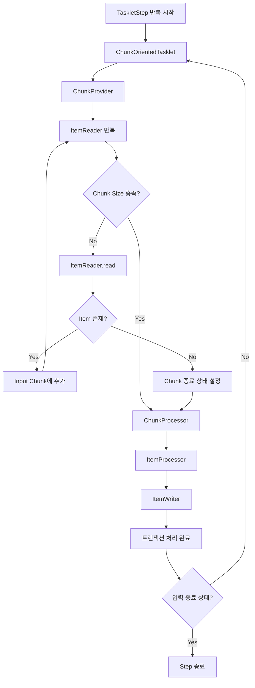

여기서 트랜잭션 처리는 TaskletStep이 관리하며, 정상 처리 후 커밋됩니다.

이중 반복 구조는 기존 Spring Batch 5.x의 Chunk 처리 엔진을 이해하는 데 핵심적인 개념입니다.

---

### SimpleChunkProcessor의 내부 구조

#### SimpleChunkProcessor란?

`SimpleChunkProcessor`는 ChunkProcessor 인터페이스의 기본 구현체입니다.

ChunkProvider가 생성한 Input Chunk를 전달받아 데이터 변환과 저장을 담당합니다.

Spring Batch 5.x에서는 다음 패키지에 정의되어 있습니다.

```java
org.springframework.batch.core.step.item.SimpleChunkProcessor
```

내부적으로 중요한 구성 요소는 다음과 같습니다.

```java
ItemProcessor<? super I, ? extends O> itemProcessor;

ItemWriter<? super O> itemWriter;
```

ItemProcessor는 개별 Item을 가공합니다.

ItemWriter는 가공된 Item이 포함된 Output Chunk를 저장합니다.

#### SimpleChunkProcessor의 주요 메서드

| 메서드 | 역할 |
|---|---|
| `process()` | Chunk 처리 전체 흐름 제어 |
| `transform()` | Input Chunk를 Output Chunk로 변환 |
| `doProcess()` | 실제 ItemProcessor 호출 |
| `write()` | Output Chunk의 쓰기 처리 |
| `doWrite()` | Listener와 실제 Writer 호출 관리 |
| `writeItems()` | ItemWriter의 `write()` 호출 |
| `getFilterCount()` | 필터링된 Item 개수 계산 |
| `initializeUserData()` | 필터링 건수 계산 등에 필요한 초기 상태 저장 |
| `getAdjustedOutputs()` | 쓰기 전 Output Chunk 조정 확장 지점 |

이 중 핵심적인 메서드는 `process()`, `transform()`, `write()`입니다.

---

### SimpleChunkProcessor의 process() 분석

#### process()의 전체 흐름

SimpleChunkProcessor의 `process()` 메서드는 크게 세 가지 작업을 수행합니다.

첫 번째는 Input Chunk의 초기 상태를 관리하는 것입니다.

두 번째는 ItemProcessor를 이용한 데이터 변환입니다.

세 번째는 ItemWriter를 이용한 데이터 저장입니다.

핵심 흐름을 단순화하면 다음과 같습니다.

```java
public void process(
        StepContribution contribution,
        Chunk<I> inputs
) throws Exception {

    initializeUserData(inputs);

    if (isComplete(inputs)) {
        return;
    }

    Chunk<O> outputs = transform(contribution, inputs);

    contribution.incrementFilterCount(
            getFilterCount(inputs, outputs)
    );

    write(
            contribution,
            inputs,
            getAdjustedOutputs(inputs, outputs)
    );
}
```

위 코드는 Spring Batch 5.2 계열의 핵심 흐름을 설명하기 위해 구성한 코드입니다.

각 메서드의 역할을 자세히 살펴보겠습니다.

#### 1. Input Chunk 초기 상태 저장

```java
initializeUserData(inputs);
```

이 메서드는 Input Chunk의 초기 상태를 기록합니다.

기본 구현에서는 입력 Item 개수를 Chunk의 사용자 데이터에 저장합니다.

```java
inputs.setUserData(inputs.size());
```

이 정보는 이후 필터링된 데이터의 개수를 계산할 때 사용됩니다.

#### 2. 처리 대상 확인

```java
if (isComplete(inputs)) {
    return;
}
```

기본 구현에서 `isComplete()`는 Input Chunk가 비어 있는지 확인합니다.

```java
return inputs.isEmpty();
```

처리할 데이터가 없다면 불필요한 가공이나 쓰기 작업을 수행하지 않습니다.

#### 3. 데이터 변환

```java
Chunk<O> outputs = transform(contribution, inputs);
```

이 단계에서는 Input Chunk에 포함된 Item을 하나씩 가져와 ItemProcessor를 호출합니다.

가공된 데이터는 Output Chunk에 저장됩니다.

#### 4. 필터링 건수 계산

```java
contribution.incrementFilterCount(
        getFilterCount(inputs, outputs)
);
```

ItemProcessor에서 필터링된 데이터의 개수를 계산하고 StepContribution에 반영합니다.

이 부분은 실제 배치 운영에서 중요한 처리 통계입니다.

#### 5. 데이터 저장

```java
write(contribution, inputs, outputs);
```

마지막으로 Output Chunk를 ItemWriter에 전달하여 저장합니다.

이렇게 SimpleChunkProcessor는 데이터를 가공하고, 처리 건수를 기록하며, 최종 저장까지의 흐름을 담당합니다.

---

### transform()의 내부 동작

`transform()`은 Input Chunk에 저장된 데이터를 개별적으로 가공하여 Output Chunk를 생성하는 메서드입니다.

#### transform()의 기본 구조

실제 구현의 핵심 흐름을 단순화하면 다음과 같습니다.

```java
protected Chunk<O> transform(
        StepContribution contribution,
        Chunk<I> inputs
) throws Exception {

    Chunk<O> outputs = new Chunk<>();

    for (I item : inputs) {

        O output = doProcess(item);

        if (output != null) {
            outputs.add(output);
        }
    }

    return outputs;
}
```

실제 Spring Batch 5.x 구현에서는 `ChunkIterator`를 사용하며, 필터링된 Item에 대해서는 Iterator를 통해 입력 Chunk의 Item을 제거하는 처리도 수행합니다.

또한 오류 처리, 메트릭 수집, 종료 상태 전달 등의 추가 작업이 포함됩니다.

#### Input Chunk와 Output Chunk의 생성

예를 들어 Input Chunk에 다음 데이터가 있다고 가정하겠습니다.

```text
Input Chunk

[
    "item1",
    "item2"
]
```

ItemProcessor는 문자열 앞에 `my`를 추가합니다.

```java
public String process(String item) {
    return "my" + item;
}
```

그러면 Output Chunk는 다음과 같이 생성됩니다.

```text
Output Chunk

[
    "myitem1",
    "myitem2"
]
```

이 과정에서 ItemProcessor는 각각의 Item을 개별적으로 처리합니다.

#### doProcess()의 내부 동작

`doProcess()`는 실제 ItemProcessor를 호출하는 메서드입니다.

핵심 구조는 다음과 같습니다.

```java
protected final O doProcess(I item) throws Exception {

    if (itemProcessor == null) {

        @SuppressWarnings("unchecked")
        O result = (O) item;

        return result;
    }

    return itemProcessor.process(item);
}
```

위 코드는 Listener와 예외 처리 구문을 제외한 핵심 구조입니다.

여기서 중요한 특징은 ItemProcessor가 설정되지 않았을 때의 동작입니다.

```java
if (itemProcessor == null)
```

ItemProcessor가 없다면 입력받은 Item을 그대로 반환합니다.

즉, **ItemProcessor는 Chunk 기반 처리를 구성할 때 필수 요소가 아닙니다.**

반면 ItemReader와 ItemWriter는 정상적인 Chunk Step 구성에 필요한 요소입니다.

다만 Processor 없이 입력과 출력의 타입을 다르게 선언하면 타입 변환이 자동으로 이루어지는 것은 아닙니다.

별도의 변환 작업이 없다면 Input과 Output 타입을 동일하게 구성하는 것이 자연스럽습니다.

---

### ItemProcessor의 필터링 처리

ItemProcessor는 데이터를 변형하는 것뿐 아니라 특정 조건에 따라 데이터를 필터링할 수도 있습니다.

Spring Batch에서는 ItemProcessor가 `null`을 반환하면 해당 데이터를 정상적인 필터링 대상으로 판단합니다.

#### 필터링 예제

```java
@Bean
public ItemProcessor<String, String> itemProcessor() {

    return item -> {

        if (item.equals("item3")) {
            return null;
        }

        return "my" + item;
    };
}
```

Input Chunk에 다음과 같은 데이터가 있다고 가정하겠습니다.

```text
Input Chunk

item1
item2
item3
item4
item5
```

ItemProcessor는 `item3`을 제외하고 나머지 데이터를 변환합니다.

```text
item1 → myitem1
item2 → myitem2
item3 → null
item4 → myitem4
item5 → myitem5
```

최종 Output Chunk는 다음과 같습니다.

```text
Output Chunk

myitem1
myitem2
myitem4
myitem5
```

Input Chunk에는 5건이 있었지만 Output Chunk에는 4건만 존재합니다.

따라서 필터링된 Item은 1건입니다.

#### Filter Count 계산

Spring Batch 5.x의 SimpleChunkProcessor는 기본적으로 Input Chunk의 원래 크기와 Output Chunk의 크기를 비교하여 필터링 건수를 계산합니다.

개념적으로 다음과 같습니다.

```java
int filterCount = inputCount - outputCount;
```

실제 구현에서는 최초 입력 크기를 Chunk의 UserData에 저장한 뒤 사용합니다.

```java
protected int getFilterCount(
        Chunk<I> inputs,
        Chunk<O> outputs
) {

    return (Integer) inputs.getUserData()
            - outputs.size();
}
```

따라서 다음과 같이 계산됩니다.

```text
Input Count  = 10
Output Count = 9

Filter Count = 10 - 9
             = 1
```

여기서 중요한 점은 **Filter Count가 최종적으로 저장된 Item의 개수가 아니라, 필터링되어 제외된 Item의 개수라는 것**입니다.

따라서 입력 데이터 10건 중 9건이 Output Chunk에 저장되었다면 Filter Count는 9가 아니라 1입니다.

이 값은 StepContribution에 반영되어 실행 통계에 활용됩니다.

---

### StepContribution을 통한 처리 건수 관리

Spring Batch는 Step 실행 과정에서 발생하는 다양한 처리 건수를 관리합니다.

기존 Chunk 처리 구조에서는 `StepContribution`이 이러한 통계를 기록하는 데 사용됩니다.

대표적인 통계는 다음과 같습니다.

| 항목 | 의미 |
|---|---|
| Read Count | 정상적으로 읽은 Item 개수 |
| Write Count | 정상적으로 저장한 Item 개수 |
| Filter Count | ItemProcessor에서 필터링된 Item 개수 |
| Read Skip Count | 읽기 단계에서 Skip한 Item 개수 |
| Process Skip Count | 처리 단계에서 Skip한 Item 개수 |
| Write Skip Count | 쓰기 단계에서 Skip한 Item 개수 |

예를 들어 데이터 10건을 읽고 그중 1건을 필터링한 뒤 9건을 정상적으로 저장했다고 가정하겠습니다.

```text
Read Count        = 10
Write Count       = 9
Filter Count      = 1

Read Skip Count   = 0
Process Skip Count = 0
Write Skip Count  = 0
```

이때 필터링과 Skip은 서로 다른 개념입니다.

필터링은 ItemProcessor가 `null`을 반환하여 정상적으로 데이터를 제외하는 것입니다.

반면 Skip은 특정 예외가 발생했을 때 해당 Item을 건너뛰도록 설정한 장애 처리 정책입니다.

두 개념을 구분해야 실제 배치 처리 결과를 정확하게 해석할 수 있습니다.

---

### write()의 내부 동작

`write()`는 ItemProcessor에서 가공한 Output Chunk를 ItemWriter에 전달하는 메서드입니다.

#### write()의 주요 역할

SimpleChunkProcessor의 `write()`는 내부적으로 `doWrite()`를 호출합니다.

그 후 정상 처리된 Item 개수를 StepContribution에 반영합니다.

핵심 흐름은 다음과 같습니다.

```java
protected void write(
        StepContribution contribution,
        Chunk<I> inputs,
        Chunk<O> outputs
) throws Exception {

    doWrite(outputs);

    contribution.incrementWriteCount(
            outputs.size()
    );
}
```

위 코드는 타이머와 예외 처리 등을 생략한 형태입니다.

실제 구현에서는 쓰기 작업 중 오류가 발생하면 입력 Chunk를 정리하고 예외를 다시 전달하는 처리도 포함됩니다.

#### doWrite()의 역할

`doWrite()`는 실제 ItemWriter를 호출하기 전후에 Listener를 실행합니다.

개념적으로 다음과 같은 구조입니다.

```java
protected final void doWrite(
        Chunk<O> items
) throws Exception {

    listener.beforeWrite(items);

    itemWriter.write(items);

    listener.afterWrite(items);
}
```

실제 구현에는 ItemWriter 존재 여부 확인과 예외 발생 시 `onWriteError()` 호출 등이 포함됩니다.

이 구조에서 중요한 점은 ItemWriter에 개별 Item을 하나씩 전달하지 않는다는 것입니다.

ItemWriter는 Output Chunk 전체를 전달받습니다.

#### Spring Batch 버전별 ItemWriter 차이

Spring Batch 4.x에서는 ItemWriter가 List를 전달받았습니다.

```java
void write(List<? extends T> items) throws Exception;
```

반면 Spring Batch 5.x부터는 Chunk를 전달받습니다.

```java
void write(Chunk<? extends T> chunk) throws Exception;
```

따라서 Spring Batch 5.x 이상에서는 다음과 같이 구현합니다.

```java
@Bean
public ItemWriter<String> itemWriter() {

    return chunk -> {

        for (String item : chunk) {
            System.out.println(item);
        }
    };
}
```

Chunk의 내부 Item 목록이 필요한 경우 다음 메서드를 사용할 수 있습니다.

```java
chunk.getItems();
```

하지만 ItemWriter에 전달되는 객체 자체가 Chunk이므로, 일반적인 상황에서는 Chunk를 직접 순회할 수도 있습니다.

---

### 전체 실행 구조

이제 ChunkProvider와 ChunkProcessor의 내부 동작을 하나의 흐름으로 연결해 보겠습니다.

Spring Batch 5.x 기준 전체 구조는 다음과 같습니다.

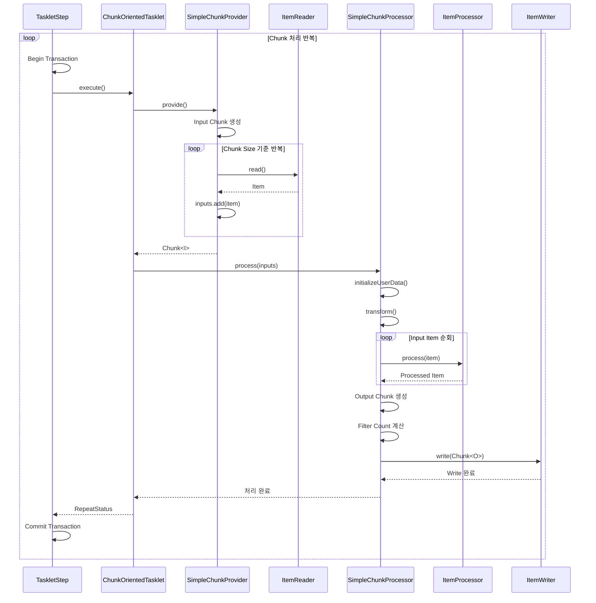

이 구조에서 가장 중요한 것은 반복의 단위입니다.

ItemReader는 개별 Item을 읽기 위해 반복 호출됩니다.

ItemProcessor 역시 읽은 Item 개수만큼 반복 호출됩니다.

반면 ItemWriter는 가공된 Item들을 Chunk 단위로 전달받습니다.

그리고 TaskletStep은 Chunk의 처리 결과에 따라 다음 Chunk를 실행하거나 Step을 종료합니다.

---

### 예제

이번에는 실제로 Chunk Size를 2로 설정하고 6개의 데이터를 처리하는 예제를 살펴보겠습니다.

내부 구현을 이해하는 것이 목적이므로 Spring Batch 5.2 기준으로 작성합니다.

#### 전체 설정 코드

```java
import java.util.List;

import org.springframework.batch.core.Job;
import org.springframework.batch.core.Step;
import org.springframework.batch.core.job.builder.JobBuilder;
import org.springframework.batch.core.repository.JobRepository;
import org.springframework.batch.core.step.builder.StepBuilder;
import org.springframework.batch.core.configuration.annotation.StepScope;

import org.springframework.batch.item.ItemReader;
import org.springframework.batch.item.ItemProcessor;
import org.springframework.batch.item.ItemWriter;
import org.springframework.batch.item.support.ListItemReader;

import org.springframework.context.annotation.Bean;
import org.springframework.context.annotation.Configuration;

import org.springframework.transaction.PlatformTransactionManager;

@Configuration
public class ChunkProviderProcessorConfig {

    @Bean
    public Job chunkJob(
            JobRepository jobRepository,
            Step chunkStep
    ) {

        return new JobBuilder("chunkJob", jobRepository)
                .start(chunkStep)
                .build();
    }

    @Bean
    public Step chunkStep(
            JobRepository jobRepository,
            PlatformTransactionManager transactionManager,
            ItemReader<String> itemReader,
            ItemProcessor<String, String> itemProcessor,
            ItemWriter<String> itemWriter
    ) {

        return new StepBuilder("chunkStep", jobRepository)
                .<String, String>chunk(2, transactionManager)
                .reader(itemReader)
                .processor(itemProcessor)
                .writer(itemWriter)
                .build();
    }

    @Bean
    @StepScope
    public ItemReader<String> itemReader() {

        ListItemReader<String> delegate = new ListItemReader<>(
                List.of(
                        "item1",
                        "item2",
                        "item3",
                        "item4",
                        "item5",
                        "item6"
                )
        );

        return () -> {

            String item = delegate.read();

            System.out.println("READ: " + item);

            return item;
        };
    }

    @Bean
    public ItemProcessor<String, String> itemProcessor() {

        return item -> {

            String result = "my" + item;

            System.out.println("PROCESS: " + result);

            return result;
        };
    }

    @Bean
    public ItemWriter<String> itemWriter() {

        return chunk -> {

            System.out.println(
                    "WRITE: " + chunk.getItems()
            );
        };
    }
}
```

이 예제는 JobRepository와 PlatformTransactionManager가 이미 구성되어 있는 Spring Batch 5.2 환경을 전제로 합니다.

Reader는 `@StepScope`를 사용하여 Step 실행마다 새로운 인스턴스를 생성하도록 구성했습니다.

다만 예제에 사용한 ListItemReader는 영속적인 재시작 위치를 저장하는 구현체가 아닙니다.

따라서 운영 환경에서 재시작 기능이 필요하다면 ItemStream을 지원하는 Reader를 사용하거나 별도의 상태 저장 기능을 구현해야 합니다.

#### Chunk Size 설정

```java
.<String, String>chunk(2, transactionManager)
```

Chunk Size를 2로 설정했기 때문에 입력 데이터를 2건씩 묶어 처리합니다.

#### 실행 결과

정상적인 처리 흐름에서 주요 로그는 다음과 같이 출력됩니다.

```text
READ: item1
READ: item2

PROCESS: myitem1
PROCESS: myitem2

WRITE: [myitem1, myitem2]

READ: item3
READ: item4

PROCESS: myitem3
PROCESS: myitem4

WRITE: [myitem3, myitem4]

READ: item5
READ: item6

PROCESS: myitem5
PROCESS: myitem6

WRITE: [myitem5, myitem6]

READ: null
```

마지막에 `READ: null`이 발생하는 이유는 데이터의 끝에 도달했는지 확인하기 때문입니다.

6개의 Item을 모두 읽었다고 해서 Reader가 스스로 전체 데이터의 종료를 알리는 것은 아닙니다.

추가적인 `read()` 호출에서 `null`을 반환받으면 ChunkProvider는 입력 종료 상태를 설정합니다.

이 과정에서 입력 데이터가 없는 Chunk는 실제 쓰기 작업 없이 종료될 수 있습니다.

따라서 정상적인 처리 결과에서 실제 데이터가 포함된 Writer 호출은 총 3번 발생합니다.

#### 실행 과정 분석

| 순서 | Chunk | ItemReader | ItemProcessor | ItemWriter |
|---|---|---|---|---|
| 1 | Chunk 1 | item1, item2 | myitem1, myitem2 | 2건 저장 |
| 2 | Chunk 2 | item3, item4 | myitem3, myitem4 | 2건 저장 |
| 3 | Chunk 3 | item5, item6 | myitem5, myitem6 | 2건 저장 |
| 4 | 종료 확인 | null | 실행 없음 | 실행 없음 |

이 예제를 통해 ChunkProvider와 ChunkProcessor의 역할이 명확하게 구분된다는 것을 확인할 수 있습니다.

---

### FaultTolerantChunkProvider와 FaultTolerantChunkProcessor

기존 Spring Batch는 기본적인 처리 외에도 장애 대응을 위한 구현체를 제공합니다.

대표적인 구현체는 다음과 같습니다.

```text
ChunkProvider
    │
    ├── SimpleChunkProvider
    │
    └── FaultTolerantChunkProvider
```

```text
ChunkProcessor
    │
    ├── SimpleChunkProcessor
    │
    └── FaultTolerantChunkProcessor
```

#### FaultTolerantChunkProvider

FaultTolerantChunkProvider는 읽기 단계에서 발생하는 오류에 대응하기 위한 구현체입니다.

예를 들어 CSV 파일을 읽다가 특정 행의 형식이 잘못된 상황을 생각해 볼 수 있습니다.

```text
CSV

1,홍길동,20
2,김철수,30
3,INVALID_DATA
4,이영희,25
```

기본적인 처리에서는 읽기 오류로 인해 Step이 실패할 수 있습니다.

반면 Skip 정책을 구성한 경우 특정 예외에 해당하는 데이터를 건너뛰고 다음 데이터를 읽도록 처리할 수 있습니다.

다만 모든 읽기 오류를 무조건 건너뛸 수 있는 것은 아닙니다.

Reader가 오류 이후 다음 데이터로 진행할 수 있는지와 Skip 정책이 해당 예외를 허용하는지 등을 함께 고려해야 합니다.

#### FaultTolerantChunkProcessor

FaultTolerantChunkProcessor는 ItemProcessor와 ItemWriter 단계의 장애 처리 기능을 확장합니다.

대표적으로 다음과 같은 상황에 활용됩니다.

- 특정 Item의 처리 오류를 Skip하는 경우
- 일시적인 오류에 대해 Retry를 수행하는 경우
- 쓰기 오류 발생 시 실패한 Item을 식별해야 하는 경우

특히 Writer에서 여러 Item을 한꺼번에 처리하다 오류가 발생하면 어떤 Item이 실패했는지 바로 알기 어려울 수 있습니다.

따라서 FaultTolerantChunkProcessor는 설정된 정책에 따라 재시도하거나 실패한 Item을 식별하기 위한 추가 처리를 수행할 수 있습니다.

이러한 처리 과정은 기본적인 SimpleChunkProcessor보다 복잡합니다.

또한 Spring Batch 6.x의 새로운 Chunk 처리 엔진에서는 Retry와 Skip의 내부 구현이 변경되었으므로, 기존 FaultTolerantChunkProcessor의 동작을 그대로 적용해서 이해해서는 안 됩니다.

---

### Spring Batch 5.x와 6.x의 구조 차이

Spring Batch 6.0에서는 기존 Chunk 처리 엔진을 대체하는 새로운 `ChunkOrientedStep` 구현이 정식 도입되었습니다.

Spring Batch 5.1에서 실험적으로 도입된 새로운 처리 모델이 Spring Batch 6.0에서 안정적인 구현으로 제공되기 시작한 것입니다.

#### Spring Batch 5.x 구조

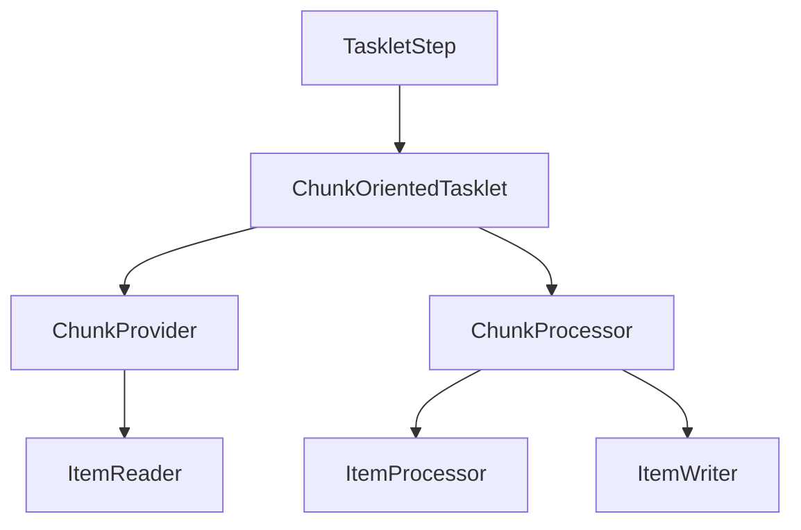

Spring Batch 5.x에서는 ChunkOrientedTasklet이 ChunkProvider와 ChunkProcessor를 사용합니다.

ChunkProvider는 RepeatOperations를 통해 ItemReader를 반복 호출합니다.

ChunkProcessor는 Input Chunk에 포함된 Item을 변환하고 Writer에 전달합니다.

#### Spring Batch 6.x 구조

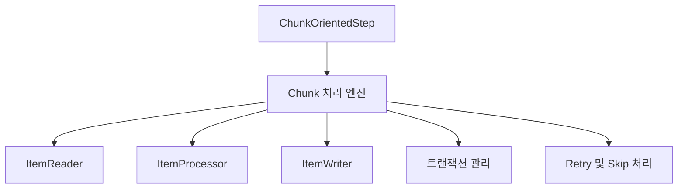

새로운 ChunkOrientedStep은 기존 ChunkOrientedTasklet과 TaskletStep 조합을 대체합니다.

따라서 이전과 동일한 ChunkProvider 및 ChunkProcessor의 호출 구조를 전제로 하지 않습니다.

#### 주요 차이점

| 구분 | Spring Batch 5.x | Spring Batch 6.x |
|---|---|---|
| Chunk 처리 중심 | ChunkOrientedTasklet | ChunkOrientedStep |
| Step 구현 | TaskletStep | ChunkOrientedStep |
| Builder | SimpleStepBuilder | ChunkOrientedStepBuilder |
| Chunk 구성 | ChunkProvider 사용 | 새로운 Chunk 처리 엔진 |
| Chunk 가공 및 저장 | ChunkProcessor 사용 | 새로운 Chunk 처리 엔진 |
| 반복 제어 | RepeatTemplate 기반 | 새로운 처리 방식 |
| Retry 및 Skip | 기존 FaultTolerant 구현체 | 새로운 장애 처리 구조 |
| Chunk 설정 | `chunk(size, transactionManager)` | `chunk(size)` |
| 트랜잭션 설정 | Chunk API에 전달 | `transactionManager()` 활용 가능 |

Spring Batch 6.x에서는 다음과 같이 Step을 구성할 수 있습니다.

```java
@Bean
public Step chunkStep(
        JobRepository jobRepository,
        PlatformTransactionManager transactionManager,
        ItemReader<String> itemReader,
        ItemProcessor<String, String> itemProcessor,
        ItemWriter<String> itemWriter
) {

    return new StepBuilder("chunkStep", jobRepository)
            .<String, String>chunk(2)
            .transactionManager(transactionManager)
            .reader(itemReader)
            .processor(itemProcessor)
            .writer(itemWriter)
            .build();
}
```

새로운 API를 사용하는 경우에는 ItemReader, ItemProcessor, ItemWriter의 패키지도 Spring Batch 6.x에 맞게 변경해야 합니다.

```java
import org.springframework.batch.infrastructure.item.ItemReader;
import org.springframework.batch.infrastructure.item.ItemProcessor;
import org.springframework.batch.infrastructure.item.ItemWriter;
```

반면 Spring Batch 5.x에서는 다음 패키지를 사용합니다.

```java
import org.springframework.batch.item.ItemReader;
import org.springframework.batch.item.ItemProcessor;
import org.springframework.batch.item.ItemWriter;
```

기존 ChunkProvider, SimpleChunkProvider, ChunkProcessor, SimpleChunkProcessor 계열 API는 Spring Batch 6.0부터 Deprecated로 표시되었으며 향후 제거될 예정입니다.

따라서 신규 프로젝트에서는 새로운 ChunkOrientedStep 기반 구조를 사용하는 것이 적절합니다.

---

### 실무에서의 활용

ChunkProvider와 ChunkProcessor의 내부 구조를 이해하면 대용량 데이터 처리 시스템에서 발생하는 다양한 문제를 분석하고 개선하는 데 도움이 됩니다.

#### 1. Chunk Size에 따른 Reader 호출 횟수 분석

Chunk Size는 한 번의 Chunk 처리에서 데이터를 읽는 기준입니다.

예를 들어 전체 데이터가 10만 건이고 Chunk Size가 1,000이라면 정상적인 처리 과정에서 100개의 Chunk가 생성됩니다.

하지만 ItemReader의 실제 호출 횟수는 데이터 개수보다 많을 수 있습니다.

더 이상 읽을 데이터가 없다는 사실을 확인하기 위해 추가적인 `read()` 호출이 발생할 수 있기 때문입니다.

따라서 처리 건수를 분석할 때는 ItemReader 메서드 호출 횟수와 Read Count를 구분해야 합니다.

#### 2. ChunkProvider와 Reader의 조회 비용 분리

ChunkProvider는 ItemReader를 반복 호출하지만 실제 데이터 조회 방식은 Reader 구현체에 따라 달라집니다.

예를 들어 JdbcPagingItemReader는 내부적으로 데이터를 페이지 단위로 조회합니다.

이 경우 Chunk Size와 Page Size가 서로 다른 개념이라는 점을 이해해야 합니다.

Chunk Size는 배치 처리와 커밋의 기준이고, Page Size는 데이터베이스 조회 과정에서 한 번에 가져오는 데이터 수를 결정합니다.

두 값을 동일하게 설정해야 하는 것은 아니며, 실제 조회 비용과 메모리 사용량을 측정하여 적절한 크기를 선택해야 합니다.

#### 3. ItemProcessor의 불필요한 외부 호출 방지

ItemProcessor는 입력 Item마다 호출됩니다.

따라서 Processor 내부에서 외부 API를 호출한다면 입력 데이터 개수에 비례하여 외부 호출이 발생할 수 있습니다.

예를 들어 10만 건의 데이터를 처리하면서 각 Item마다 외부 API를 한 번씩 호출한다면 총 10만 번의 요청이 발생할 수 있습니다.

이러한 구조는 처리 시간이 길어지고 외부 서비스의 Rate Limit에 영향을 받을 가능성이 있습니다.

따라서 Processor 내부에서 반드시 개별 API 호출이 필요한지 검토해야 합니다.

#### 4. Writer의 일괄 처리 성능 개선

ItemWriter는 Chunk 단위로 데이터를 전달받습니다.

그러나 Chunk 단위로 전달받는다고 해서 데이터베이스에서 자동으로 Batch Insert가 수행되는 것은 아닙니다.

실제로 일괄 저장을 수행하려면 JdbcBatchItemWriter와 같은 적절한 구현체를 사용해야 합니다.

또한 데이터베이스 드라이버의 배치 처리 설정과 SQL 실행 방식도 함께 고려해야 합니다.

#### 5. Filter Count 기반 데이터 정합성 검증

배치 작업에서 Read Count와 Write Count가 다르다고 해서 반드시 오류가 발생한 것은 아닙니다.

ItemProcessor에서 정상적으로 데이터를 필터링할 수도 있기 때문입니다.

예를 들어 다음과 같은 결과가 발생했다고 가정하겠습니다.

```text
Read Count   = 10,000
Filter Count = 500
Write Count  = 9,500
```

Skip이 없고 각 입력 Item이 최대 하나의 출력 Item을 생성하는 정상적인 처리라면 다음 관계가 성립합니다.

```text
Read Count = Write Count + Filter Count
```

이러한 처리 건수는 데이터 정합성을 확인하는 데 활용할 수 있습니다.

다만 Retry, Skip, 재시작, Writer의 실제 저장 동작 등에 따라 단순한 건수 비교만으로 최종 데이터 정합성을 보장할 수는 없습니다.

#### 6. Reader의 EOF 처리 확인

ItemReader는 더 이상 읽을 데이터가 없으면 `null`을 반환해야 합니다.

이 종료 계약을 지키지 않으면 배치가 무한 반복하거나 정상적으로 종료되지 않는 문제가 발생할 수 있습니다.

특히 Custom ItemReader를 구현하는 경우 마지막 데이터 이후에 어떤 값을 반환하는지 확인해야 합니다.

#### 7. Chunk 처리 중 예외 발생 위치 분석

배치에서 오류가 발생했을 때는 먼저 어느 단계에서 발생했는지 구분하는 것이 중요합니다.

| 발생 위치 | 주요 확인 사항 |
|---|---|
| ChunkProvider | Reader 조회 실패, 파싱 오류 |
| ItemProcessor | 데이터 변환 오류, 유효성 검증 오류 |
| ItemWriter | DB 저장 실패, 제약 조건 위반 |
| 트랜잭션 처리 | 커밋 실패, 잠금 충돌 |
| 상태 저장 | ExecutionContext 갱신 실패 |

같은 Step 실패라도 발생 위치에 따라 원인과 해결 방법이 달라집니다.

#### 8. Retry 시 중복 처리 가능성 고려

Retry가 발생하면 동일한 Item이 다시 처리될 수 있습니다.

특히 Processor 내부에서 외부 API 호출이나 데이터 변경 같은 부수 효과가 발생한다면 중복 처리 문제가 생길 수 있습니다.

따라서 재시도가 가능한 처리 구조에서는 멱등성을 확보하는 것이 중요합니다.

#### 9. Chunk와 트랜잭션 경계 구분

ChunkProvider와 ChunkProcessor는 데이터 처리 역할을 담당하지만, 직접 Commit과 Rollback을 수행하는 것은 아닙니다.

기존 구조에서는 TaskletStep이 트랜잭션을 관리합니다.

따라서 ItemWriter가 정상적으로 반환했다고 해서 모든 데이터 변경이 이미 커밋되었다고 판단해서는 안 됩니다.

실제 커밋은 Step의 트랜잭션 처리 과정에서 수행됩니다.

#### 10. ItemStream을 이용한 재시작 안정성 확보

Chunk 단위로 커밋하더라도 Reader가 이전 처리 위치를 복원하지 못하면 재시작 시 처음부터 데이터를 읽을 수 있습니다.

정산이나 데이터 마이그레이션처럼 재시작 가능성이 중요한 작업에서는 ExecutionContext와 ItemStream을 활용한 상태 관리가 필요합니다.

또한 상태 저장과 실제 데이터 저장이 일관된 트랜잭션 경계에서 관리되는지 확인해야 합니다.

#### 11. 데이터베이스 정산 작업의 멱등성 확보

결제 정산 배치에서는 동일한 거래가 중복 저장되지 않도록 설계해야 합니다.

예를 들어 거래 ID와 정산 일자를 기반으로 고유한 식별 기준을 설정할 수 있습니다.

```sql
ALTER TABLE settlement
ADD CONSTRAINT uk_settlement_transaction
UNIQUE (transaction_id, settlement_date);
```

이러한 제약 조건은 재시작이나 중복 실행으로 인한 데이터 중복을 방지하는 데 도움이 됩니다.

다만 데이터베이스의 Unique 제약 조건만으로 모든 멱등성 문제가 해결되는 것은 아닙니다.

외부 시스템 호출이나 상태 전이 로직이 존재한다면 해당 작업의 멱등성도 별도로 고려해야 합니다.

#### 12. Spring Batch 버전별 내부 구현 확인

Spring Batch 5.x의 ChunkProvider와 ChunkProcessor는 기존 Chunk 처리 엔진을 이해하는 데 중요한 클래스입니다.

반면 Spring Batch 6.x에서는 새로운 ChunkOrientedStep 구현이 사용됩니다.

따라서 기존 소스코드의 내부 동작을 분석할 때는 프로젝트가 실제로 어떤 Spring Batch 버전과 Step 구현체를 사용하고 있는지 확인해야 합니다.

단순히 같은 Chunk API를 사용한다는 이유로 내부 처리 엔진까지 동일하다고 판단하면 안 됩니다.

---

### 정리

ChunkProvider와 ChunkProcessor는 기존 Spring Batch의 Chunk 처리 구조에서 핵심적인 역할을 담당하는 구성 요소입니다.

ChunkProvider는 ItemReader를 사용하여 데이터를 한 건씩 읽고, 지정된 Chunk Size만큼 Input Chunk를 구성합니다.

ChunkProcessor는 전달받은 Input Chunk를 ItemProcessor로 가공하여 Output Chunk를 생성하고, ItemWriter를 통해 데이터를 저장합니다.

이 과정에서 ChunkProvider는 RepeatOperations를 사용하여 ItemReader 호출을 반복하고, ChunkProcessor는 Input Chunk에 포함된 Item을 순회하면서 데이터 변환과 저장을 수행합니다.

또한 StepContribution을 통해 읽기, 쓰기, 필터링 등의 처리 건수를 관리할 수 있습니다.

기존 Spring Batch 5.x에서는 TaskletStep과 ChunkOrientedTasklet, ChunkProvider, ChunkProcessor가 협력하여 전체 Chunk 처리 흐름을 구성합니다.

반면 Spring Batch 6.x에서는 새로운 ChunkOrientedStep이 정식 도입되어 내부 구조가 변경되었습니다.

따라서 기존 시스템의 동작을 이해하기 위해서는 ChunkProvider와 ChunkProcessor의 내부 구조를 익히고, 신규 시스템을 설계할 때는 새로운 Chunk 처리 엔진을 기준으로 접근하는 것이 중요합니다.

#### 한 줄 요약

**ChunkProvider는 ItemReader를 이용하여 데이터를 Chunk 단위로 구성하는 역할을 담당하고, ChunkProcessor는 해당 Chunk를 가공하고 저장하는 역할을 담당하는 기존 Spring Batch의 핵심 처리 구성 요소입니다.**

#### 참고 문서

- Spring Batch 5.2 API — SimpleChunkProvider
- Spring Batch 5.2 API — SimpleChunkProcessor
- Spring Batch 5.2 API — FaultTolerantChunkProvider
- Spring Batch 5.2 API — FaultTolerantChunkProcessor
- Spring Batch Reference — Chunk-oriented Processing
- Spring Batch Reference — What's New in Spring Batch 6

## ItemReader / ItemWriter / ItemProcessor 이해


### Spring Batch ItemReader, ItemWriter, ItemProcessor의 개념과 내부 구조 및 구현 방법

Spring Batch는 대용량 데이터를 안정적으로 처리하기 위해 Chunk 기반 처리 방식을 제공합니다.

Chunk 기반 처리는 데이터를 일정한 크기로 나누어 읽고, 가공하고, 저장하는 방식입니다.

이러한 처리 과정에서 가장 핵심적인 역할을 하는 구성 요소가 바로 `ItemReader`, `ItemProcessor`, `ItemWriter`입니다.

각 구성 요소는 다음과 같은 역할을 담당합니다.

- **ItemReader**: 데이터베이스, 파일, 메시지 큐 등 다양한 데이터 소스로부터 데이터를 읽습니다.
- **ItemProcessor**: 읽어온 데이터를 비즈니스 요구사항에 맞게 가공하거나 필터링합니다.
- **ItemWriter**: 가공된 데이터를 데이터베이스, 파일 또는 외부 시스템에 저장합니다.

세 가지 구성 요소는 서로 독립적인 역할을 가지고 있으며, Spring Batch는 이를 조합하여 하나의 Chunk 기반 처리 흐름을 구성합니다.

예를 들어 결제 시스템에서 하루 동안 발생한 거래 내역을 읽고, 정산 금액을 계산하여 정산 테이블에 저장하는 작업이 있다고 가정하겠습니다.

```text
결제 거래 데이터베이스
        │
        ▼
    ItemReader
        │
        │ 거래 데이터 조회
        ▼
   ItemProcessor
        │
        │ 정산 금액 계산
        │ 거래 상태 검증
        │ 데이터 변환
        ▼
    ItemWriter
        │
        │ 정산 데이터 저장
        ▼
   정산 데이터베이스
```

이렇게 데이터를 읽는 작업과 비즈니스 로직을 처리하는 작업, 최종적으로 저장하는 작업을 분리하면 각각의 구성 요소를 독립적으로 개발하고 유지보수할 수 있습니다.

또한 Spring Batch는 이러한 구성 요소를 통해 대용량 데이터 처리, 트랜잭션 관리, 오류 처리, 재시작 기능 등을 구현할 수 있도록 지원합니다.

---

### 개념

#### ItemReader란?

`ItemReader`는 다양한 데이터 소스로부터 데이터를 읽어 하나의 Item으로 반환하는 인터페이스입니다.

Spring Batch는 ItemReader를 통해 데이터베이스, 파일, XML, JSON, 메시지 큐 등 다양한 형태의 데이터를 읽을 수 있도록 지원합니다.

ItemReader의 가장 중요한 특징은 **메서드를 호출할 때마다 하나의 Item을 반환한다는 것**입니다.

예를 들어 데이터베이스에 다음과 같은 데이터가 있다고 가정하겠습니다.

| ID | NAME |
|---|---|
| 1 | user1 |
| 2 | user2 |
| 3 | user3 |

ItemReader는 다음과 같이 데이터를 반환할 수 있습니다.

```text
첫 번째 read()
    ↓
Customer(id=1, name=user1)

두 번째 read()
    ↓
Customer(id=2, name=user2)

세 번째 read()
    ↓
Customer(id=3, name=user3)

네 번째 read()
    ↓
null
```

여기서 마지막에 반환되는 `null`은 중요한 의미를 가집니다.

Spring Batch에서 ItemReader가 `null`을 반환하면 **더 이상 읽을 데이터가 없다는 의미**로 해석합니다.

따라서 ItemReader를 직접 구현할 때는 모든 데이터를 읽은 이후 반드시 `null`을 반환하도록 구성해야 합니다.

#### ItemReader 인터페이스

Spring Batch 6.x에서는 다음 패키지에 정의되어 있습니다.

```java
org.springframework.batch.infrastructure.item.ItemReader
```

인터페이스의 핵심 구조는 다음과 같습니다.

```java
@FunctionalInterface
public interface ItemReader<T> {

    @Nullable
    T read() throws Exception;
}
```

`T`는 ItemReader가 반환할 데이터 타입입니다.

예를 들어 다음과 같이 사용할 수 있습니다.

```java
ItemReader<String>
```

문자열 데이터를 읽는 Reader입니다.

```java
ItemReader<Customer>
```

Customer 객체를 반환하는 Reader입니다.

```java
ItemReader<Order>
```

Order 객체를 반환하는 Reader입니다.

ItemReader는 데이터를 읽는 방식과 관계없이 동일한 인터페이스를 사용합니다.

따라서 파일에서 읽든 데이터베이스에서 읽든 Spring Batch는 ItemReader의 `read()` 메서드를 호출하여 데이터를 가져올 수 있습니다.

---

#### ItemWriter란?

`ItemWriter`는 ItemReader와 ItemProcessor를 거쳐 전달된 데이터를 최종 목적지에 저장하거나 출력하는 인터페이스입니다.

ItemReader가 하나의 Item을 반환하는 것과 달리, ItemWriter는 여러 Item이 포함된 Chunk를 전달받습니다.

예를 들어 Chunk Size를 3으로 설정했다면 다음과 같이 처리됩니다.

```text
ItemReader
    │
    ├── read() → item1
    ├── read() → item2
    └── read() → item3
                 │
                 ▼
           Input Chunk
                 │
                 ▼
           ItemProcessor
                 │
                 ▼
           Output Chunk
           [item1, item2, item3]
                 │
                 ▼
           ItemWriter
                 │
                 ▼
              Database
```

ItemWriter는 개별 Item을 하나씩 전달받는 것이 아니라, Chunk 단위로 데이터를 전달받아 처리합니다.

이러한 구조는 데이터베이스의 Batch Insert나 파일의 일괄 기록과 같은 작업에 활용할 수 있습니다.

다만 ItemWriter가 Chunk를 전달받는다고 해서 자동으로 JDBC Batch Insert가 수행되는 것은 아닙니다.

실제 일괄 저장을 수행하려면 `JdbcBatchItemWriter`와 같은 구현체를 사용해야 합니다.

#### ItemWriter 인터페이스

Spring Batch 6.x에서는 다음 패키지에 정의되어 있습니다.

```java
org.springframework.batch.infrastructure.item.ItemWriter
```

인터페이스는 다음과 같습니다.

```java
@FunctionalInterface
public interface ItemWriter<T> {

    void write(Chunk<? extends T> chunk) throws Exception;
}
```

여기서 `T`는 저장할 Item의 타입입니다.

예를 들어 다음과 같이 사용할 수 있습니다.

```java
ItemWriter<Customer>
```

Customer 객체를 저장하는 Writer입니다.

```java
ItemWriter<Order>
```

Order 객체를 저장하는 Writer입니다.

ItemWriter는 전달받은 Chunk 내부의 Item을 반복해서 처리할 수 있습니다.

```java
public void write(Chunk<? extends Customer> chunk) {

    for (Customer customer : chunk) {
        System.out.println(customer.getName());
    }
}
```

여기서 중요한 점은 ItemWriter가 직접 트랜잭션을 커밋하는 것은 아니라는 사실입니다.

ItemWriter는 데이터 저장 작업을 수행하며, 실제 Commit과 Rollback은 Chunk를 실행하는 Step의 트랜잭션 관리 구조에서 처리됩니다.

따라서 ItemWriter가 정상적으로 반환되었다고 해서 항상 해당 데이터가 이미 커밋되었다고 판단해서는 안 됩니다.

---

#### ItemProcessor란?

`ItemProcessor`는 ItemReader가 읽은 데이터를 가공하거나 변환하고, 필요한 데이터만 필터링하는 역할을 담당합니다.

ItemReader와 ItemWriter 사이에서 비즈니스 로직을 처리하기 위한 구성 요소입니다.

예를 들어 데이터베이스에서 사용자 이름을 읽어 모두 대문자로 변환해야 한다고 가정하겠습니다.

```text
Input
  │
  ├── user1
  ├── user2
  └── user3
  │
  ▼
ItemProcessor
  │
  ├── USER1
  ├── USER2
  └── USER3
  │
  ▼
Output
```

이처럼 데이터의 값을 변경하거나 새로운 객체로 변환하는 작업을 수행할 수 있습니다.

또한 특정 조건에 해당하는 데이터를 제외할 수도 있습니다.

예를 들어 결제 상태가 `CANCELLED`인 거래는 정산 대상에서 제외해야 한다면 ItemProcessor에서 해당 데이터를 필터링할 수 있습니다.

#### ItemProcessor 인터페이스

Spring Batch 6.x에서는 다음 패키지에 정의되어 있습니다.

```java
org.springframework.batch.infrastructure.item.ItemProcessor
```

인터페이스는 다음과 같습니다.

```java
@FunctionalInterface
public interface ItemProcessor<I, O> {

    @Nullable
    O process(I item) throws Exception;
}
```

여기서 두 가지 제네릭 타입을 사용합니다.

| 제네릭 타입 | 의미 |
|---|---|
| `I` | ItemReader에서 전달받는 Input 타입 |
| `O` | ItemWriter에 전달할 Output 타입 |

예를 들어 다음과 같이 정의할 수 있습니다.

```java
ItemProcessor<Customer, Customer>
```

Customer 객체를 전달받아 다시 Customer 객체로 반환합니다.

```java
ItemProcessor<Order, Settlement>
```

Order 객체를 전달받아 Settlement 객체로 변환합니다.

```java
ItemProcessor<String, Customer>
```

문자열을 전달받아 Customer 객체로 변환합니다.

이렇게 ItemProcessor는 입력 타입과 출력 타입을 서로 다르게 설정할 수 있습니다.

#### ItemProcessor의 null 반환

ItemProcessor의 중요한 특징 중 하나는 `null`을 반환하여 특정 데이터를 필터링할 수 있다는 것입니다.

```java
@Override
public Customer process(Customer customer) {

    if (customer.getName().equals("user2")) {
        return null;
    }

    return customer;
}
```

이 경우 `user2`는 Output Chunk에 포함되지 않습니다.

```text
Input Chunk

user1
user2
user3

    ↓

ItemProcessor

user1 → 정상 처리
user2 → null 반환
user3 → 정상 처리

    ↓

Output Chunk

user1
user3
```

따라서 ItemReader가 읽은 데이터가 반드시 모두 ItemWriter에 전달되는 것은 아닙니다.

ItemProcessor에서 필터링된 데이터는 ItemWriter에 전달되지 않습니다.

---

### 왜 사용하는가?

#### 1. 데이터 처리 역할을 명확하게 분리하기 위해

ItemReader, ItemProcessor, ItemWriter가 없다면 개발자가 직접 데이터를 읽고 가공하고 저장하는 전체 흐름을 구현해야 합니다.

예를 들어 다음과 같은 코드가 있다고 가정하겠습니다.

```java
List<Customer> customers = repository.findAll();

for (Customer customer : customers) {

    customer.setName(
            customer.getName().toUpperCase()
    );

    repository.save(customer);
}
```

데이터가 적다면 이러한 구조도 사용할 수 있습니다.

그러나 수십만 건 이상의 데이터를 처리해야 한다면 추가적인 요소를 고려해야 합니다.

데이터를 한 번에 조회하면서 발생하는 메모리 사용량, 트랜잭션 유지 시간, 오류 발생 시 복구 방식 등이 대표적입니다.

Spring Batch는 이러한 데이터 처리 과정을 표준화된 구성 요소로 분리합니다.

```text
데이터 읽기
    ↓
ItemReader

데이터 가공
    ↓
ItemProcessor

데이터 저장
    ↓
ItemWriter
```

각 구성 요소의 책임이 명확하기 때문에 특정 기능을 변경하더라도 전체 흐름에 미치는 영향을 줄일 수 있습니다.

#### 2. 다양한 데이터 소스를 동일한 구조로 처리하기 위해

Spring Batch는 다양한 데이터 소스를 지원합니다.

예를 들어 CSV 파일을 읽어 데이터베이스에 저장하는 작업과 데이터베이스에서 조회한 데이터를 JSON 파일로 생성하는 작업은 서로 다른 입출력 방식을 사용합니다.

하지만 Spring Batch에서는 동일한 인터페이스를 사용할 수 있습니다.

```text
CSV 파일
   ↓
ItemReader
   ↓
ItemProcessor
   ↓
ItemWriter
   ↓
Database
```

```text
Database
   ↓
ItemReader
   ↓
ItemProcessor
   ↓
ItemWriter
   ↓
JSON 파일
```

입출력 대상이 변경되더라도 전체 처리 구조를 유지할 수 있습니다.

#### 3. 비즈니스 로직을 독립적으로 관리하기 위해

ItemProcessor는 비즈니스 로직을 분리하는 데 중요한 역할을 합니다.

예를 들어 결제 정산 시스템에서는 다음과 같은 작업이 필요할 수 있습니다.

- 결제 상태 확인
- 정산 대상 여부 판단
- 수수료 계산
- 정산 금액 계산
- 데이터 형식 변환

이러한 작업을 ItemReader 또는 ItemWriter 내부에 모두 구현한다면 각각의 역할이 불명확해집니다.

반면 ItemProcessor에 비즈니스 로직을 집중시키면 데이터 조회 및 저장 로직과 독립적으로 관리할 수 있습니다.

#### 4. 재사용성과 테스트 용이성을 높이기 위해

각 구성 요소가 독립적인 인터페이스를 사용하기 때문에 개별적으로 테스트할 수 있습니다.

예를 들어 ItemProcessor는 데이터베이스 연결 없이도 테스트할 수 있습니다.

```java
Customer customer = new Customer("user1");

Customer result = processor.process(customer);

assertEquals("USER1", result.getName());
```

이처럼 비즈니스 로직을 독립적으로 검증할 수 있다는 점은 코드의 안정성과 유지보수성 측면에서 중요한 장점입니다.

---

### 주요 특징

#### ItemReader의 주요 특징

ItemReader는 데이터 소스에서 데이터를 읽고 다음 데이터로 이동하는 역할을 담당합니다.

다음과 같은 특징을 가집니다.

| 특징 | 설명 |
|---|---|
| 데이터 읽기 | 다양한 데이터 소스로부터 데이터를 조회 |
| 처리 단위 | 하나의 Item |
| 반환 타입 | 제네릭 타입 `T` |
| 종료 조건 | `read()`가 `null` 반환 |
| 상태 관리 | 구현체에 따라 읽기 위치 관리 |
| 재시작 기능 | ItemStream을 활용한 상태 복원 가능 |
| Thread-Safety | 구현체별로 확인 필요 |
| 필수 여부 | Chunk 기반 Step에서 필수 |

특히 중요한 것은 ItemReader의 종료 조건입니다.

ItemReader가 `null`을 반환하는 것은 오류가 아닙니다.

더 이상 읽을 데이터가 없다는 정상적인 종료 신호입니다.

또한 `null`은 ItemProcessor로 전달되지 않습니다.

마지막 Chunk에 이미 읽은 Item이 남아 있다면 해당 Item은 처리한 뒤 Step이 종료되지만, `null` 자체를 ItemProcessor에서 처리하지는 않습니다.

---

#### ItemReader의 주요 구현체

Spring Batch는 데이터 소스에 따라 다양한 ItemReader 구현체를 제공합니다.

| 구분 | 구현체 | 설명 |
|---|---|---|
| 파일 | FlatFileItemReader | CSV, TXT 등의 파일을 읽음 |
| 파일 | StaxEventItemReader | XML 데이터를 읽음 |
| 파일 | JsonItemReader | JSON 데이터를 읽음 |
| 파일 | MultiResourceItemReader | 여러 파일을 순차적으로 읽음 |
| 데이터베이스 | JdbcCursorItemReader | JDBC Cursor 기반 데이터 조회 |
| 데이터베이스 | JdbcPagingItemReader | JDBC Paging 기반 데이터 조회 |
| 데이터베이스 | JpaCursorItemReader | JPA Cursor 기반 데이터 조회 |
| 데이터베이스 | JpaPagingItemReader | JPA Paging 기반 데이터 조회 |
| 메시징 | JmsItemReader | JMS 메시지 읽기 |
| 메시징 | KafkaItemReader | Kafka 데이터 읽기 |
| 메시징 | AmqpItemReader | AMQP 기반 메시지 읽기 |
| 재사용 | ItemReaderAdapter | 기존 서비스 메서드를 Reader로 활용 |
| 메모리 | ListItemReader | List 데이터를 순차적으로 읽음 |
| 동기화 | SynchronizedItemStreamReader | Reader 호출을 동기화하는 래퍼 |
| 사용자 정의 | Custom ItemReader | 직접 구현한 Reader |

이 중에서 파일과 데이터베이스를 사용하는 Reader가 일반적인 배치 작업에서 자주 활용됩니다.

##### FlatFileItemReader

`FlatFileItemReader`는 CSV나 TXT와 같은 파일을 읽을 때 사용합니다.

예를 들어 다음과 같은 파일이 있다고 가정하겠습니다.

```csv
id,name,age
1,user1,20
2,user2,30
3,user3,40
```

FlatFileItemReader는 파일의 각 행을 읽어 Java 객체로 변환할 수 있습니다.

```text
CSV 파일
   │
   ▼
FlatFileItemReader
   │
   ├── Customer(1, user1, 20)
   ├── Customer(2, user2, 30)
   └── Customer(3, user3, 40)
```

파일의 구분자나 필드 위치를 기준으로 데이터를 분리하고, FieldSetMapper 등을 사용하여 객체로 변환합니다.

##### JdbcCursorItemReader

JdbcCursorItemReader는 JDBC Cursor 방식으로 데이터를 읽습니다.

SQL을 실행하여 ResultSet을 생성한 후, Cursor를 이동하면서 데이터를 순차적으로 반환합니다.

```text
Database
   │
   ▼
SQL 실행
   │
   ▼
ResultSet
   │
   ├── next() → Row1
   ├── next() → Row2
   └── next() → Row3
```

Cursor를 유지하면서 데이터를 읽기 때문에 데이터베이스 연결 유지 시간과 리소스 사용량을 고려해야 합니다.

##### JdbcPagingItemReader

JdbcPagingItemReader는 데이터를 페이지 단위로 조회합니다.

예를 들어 Page Size를 100으로 설정했다면 다음과 같이 데이터를 조회할 수 있습니다.

```text
Page 1 → 1 ~ 100
Page 2 → 101 ~ 200
Page 3 → 201 ~ 300
```

이때 Chunk Size와 Page Size는 서로 다른 개념입니다.

Chunk Size는 데이터 처리 및 커밋 단위를 결정하고, Page Size는 Reader가 데이터를 조회하는 단위를 결정합니다.

따라서 두 값을 반드시 동일하게 설정할 필요는 없습니다.

또한 Paging 기반 조회에서는 정렬 기준의 안정성과 데이터 변경으로 인한 누락 및 중복 가능성을 고려해야 합니다.

---

#### ItemWriter의 주요 특징

ItemWriter는 가공된 데이터를 최종 목적지에 저장하는 역할을 담당합니다.

| 특징 | 설명 |
|---|---|
| 데이터 저장 | DB, 파일, 메시지 큐 등에 데이터 출력 |
| 처리 단위 | Chunk 단위 |
| 입력 타입 | `Chunk<? extends T>` |
| 일괄 처리 | 여러 Item을 한 번에 전달받음 |
| 트랜잭션 | Step의 트랜잭션 경계에서 실행 |
| 재시작 기능 | ItemStream을 통한 상태 관리 가능 |
| 필수 여부 | Chunk 기반 Step에서 필수 |

ItemWriter의 핵심은 데이터를 Chunk 단위로 전달받는다는 점입니다.

다만 Writer에 전달되는 Chunk가 항상 설정된 Chunk Size와 동일한 개수의 Item을 포함하는 것은 아닙니다.

ItemProcessor의 필터링이나 Skip 처리에 따라 실제 전달되는 Item의 개수가 줄어들 수 있습니다.

또한 모든 Item이 필터링된 경우에는 빈 Chunk가 전달될 수도 있으므로, Custom ItemWriter는 빈 Chunk도 안전하게 처리하도록 구현하는 것이 좋습니다.

---

#### ItemWriter의 주요 구현체

| 구분 | 구현체 | 설명 |
|---|---|---|
| 파일 | FlatFileItemWriter | CSV, TXT 등 텍스트 파일 생성 |
| 파일 | StaxEventItemWriter | XML 파일 생성 |
| 파일 | JsonFileItemWriter | JSON 파일 생성 |
| 파일 | MultiResourceItemWriter | 데이터를 여러 파일로 나누어 저장 |
| 데이터베이스 | JdbcBatchItemWriter | JDBC Batch 기반 데이터 저장 |
| 데이터베이스 | JpaItemWriter | JPA 기반 데이터 저장 |
| 메시징 | JmsItemWriter | JMS 메시지 전송 |
| 메시징 | KafkaItemWriter | Kafka 데이터 전송 |
| 재사용 | ItemWriterAdapter | 기존 서비스 메서드를 Writer로 활용 |
| 사용자 정의 | Custom ItemWriter | 직접 구현한 Writer |

ItemReader와 ItemWriter는 유사한 데이터 형식을 지원하지만, 반드시 일대일로 대응하는 것은 아닙니다.

예를 들어 CSV 파일을 읽어 데이터베이스에 저장할 수도 있고, 데이터베이스에서 데이터를 조회하여 JSON 파일로 생성할 수도 있습니다.

##### JdbcBatchItemWriter

JdbcBatchItemWriter는 JDBC Batch 기능을 이용하여 여러 건의 데이터를 저장할 수 있습니다.

일반적인 반복 INSERT 방식과 비교하면 다음과 같은 차이가 있습니다.

```text
개별 INSERT 방식

INSERT item1
INSERT item2
INSERT item3
INSERT item4
INSERT item5
```

```text
JDBC Batch 방식

Batch
 ├── item1
 ├── item2
 ├── item3
 ├── item4
 └── item5
       │
       ▼
executeBatch()
```

JDBC Batch를 활용하면 데이터베이스와의 통신 비용을 줄일 수 있습니다.

다만 실제 성능은 데이터베이스 드라이버, SQL 구조, 네트워크 환경, 데이터베이스 설정 등에 따라 달라집니다.

##### JpaItemWriter

JpaItemWriter는 JPA의 EntityManager를 이용하여 데이터를 저장합니다.

JPA의 영속성 컨텍스트와 Flush 동작을 고려하여 데이터를 저장하므로, 대량의 Entity를 처리할 때는 영속성 컨텍스트 관리와 메모리 사용량을 함께 고려해야 합니다.

---

#### ItemProcessor의 주요 특징

ItemProcessor는 데이터 변환과 필터링을 담당합니다.

| 특징 | 설명 |
|---|---|
| 데이터 변환 | 입력 데이터를 다른 형태로 변경 |
| 데이터 검증 | 비즈니스 조건 검사 |
| 데이터 필터링 | `null` 반환으로 Item 제외 |
| 타입 변환 | Input과 Output 타입을 다르게 설정 가능 |
| 처리 단위 | 개별 Item |
| 필수 여부 | 선택 |
| 상태 관리 | 일반적으로 상태 없는 구조 권장 |

ItemProcessor는 반드시 설정해야 하는 구성 요소가 아닙니다.

데이터를 읽은 뒤 별도의 가공 없이 그대로 저장한다면 ItemProcessor를 생략할 수 있습니다.

```java
return new StepBuilder("step", jobRepository)
        .<Customer, Customer>chunk(100)
        .transactionManager(transactionManager)
        .reader(itemReader)
        .writer(itemWriter)
        .build();
```

반면 데이터 변환이 필요하다면 다음과 같이 추가합니다.

```java
return new StepBuilder("step", jobRepository)
        .<Customer, Customer>chunk(100)
        .transactionManager(transactionManager)
        .reader(itemReader)
        .processor(itemProcessor)
        .writer(itemWriter)
        .build();
```

ItemProcessor는 일반적으로 입력 데이터 하나를 처리하고 결과를 반환하는 구조이므로, 가능한 한 상태를 가지지 않도록 설계하는 것이 좋습니다.

다만 ItemProcessor가 ItemStream을 구현할 수 없는 것은 아닙니다.

상태 관리가 필요한 특별한 경우에는 ItemStream을 함께 구현할 수 있지만, 대부분의 단순 데이터 변환 작업에서는 필요하지 않습니다.

---

#### ItemProcessor의 주요 구현체

Spring Batch는 ItemProcessor를 직접 구현할 수 있도록 인터페이스를 제공하며, 여러 개의 Processor를 조합하거나 검증하는 구현체도 제공합니다.

| 구현체 | 설명 |
|---|---|
| CompositeItemProcessor | 여러 Processor를 순차적으로 연결 |
| ClassifierCompositeItemProcessor | 조건에 따라 서로 다른 Processor로 분기 |
| ValidatingItemProcessor | Validator를 이용한 데이터 검증 |
| BeanValidatingItemProcessor | Jakarta Bean Validation 기반 검증 |
| PassThroughItemProcessor | 데이터를 변경하지 않고 그대로 반환 |
| FunctionItemProcessor | Function을 이용하여 데이터 변환 |
| Custom ItemProcessor | 직접 구현한 비즈니스 로직 처리 |

##### CompositeItemProcessor

여러 Processor를 순차적으로 연결할 때 사용합니다.

```text
Input
  │
  ▼
Processor A
  │
  │ 데이터 검증
  ▼
Processor B
  │
  │ 데이터 변환
  ▼
Processor C
  │
  │ 비즈니스 계산
  ▼
Output
```

예를 들어 정산 배치에서 데이터 검증, 수수료 계산, 정산 데이터 변환 작업을 각각의 Processor로 분리할 수 있습니다.

##### ClassifierCompositeItemProcessor

입력 데이터의 조건에 따라 서로 다른 Processor를 선택할 때 사용합니다.

```text
Input
  │
  ▼
Classifier
  │
  ├── CARD → CardProcessor
  │
  ├── BANK → BankProcessor
  │
  └── POINT → PointProcessor
```

결제 수단별로 다른 정산 로직을 적용해야 하는 상황에서 활용할 수 있습니다.

##### ValidatingItemProcessor

Validator를 이용하여 데이터를 검증하는 Processor입니다.

유효하지 않은 데이터가 발견되면 검증 예외를 발생시킬 수 있습니다.

이때 검증 실패와 필터링은 서로 다른 개념입니다.

정상적으로 처리 대상에서 제외할 데이터라면 `null`을 반환할 수 있지만, 데이터 자체에 오류가 있다면 예외를 발생시켜 Skip 또는 실패 처리 정책에 따라 대응하도록 설계할 수 있습니다.

---

### 구조

#### 전체 데이터 처리 구조

ItemReader, ItemProcessor, ItemWriter는 Chunk를 중심으로 연결됩니다.

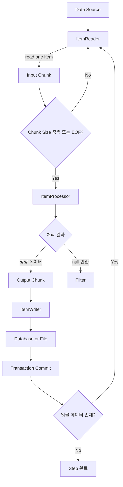

위 구조에서 중요한 점은 처리 단위의 차이입니다.

ItemReader와 ItemProcessor는 각각의 Item을 개별적으로 처리합니다.

반면 ItemWriter는 여러 Item이 포함된 Chunk를 전달받아 처리합니다.

실제 Spring Batch 내부에서는 Chunk 처리 엔진이 이 과정을 제어하며, 입력 종료 여부와 트랜잭션 경계를 관리합니다.

#### ItemReader와 ItemStream의 관계

Spring Batch의 많은 ItemReader 구현체는 ItemReader뿐 아니라 ItemStream도 함께 구현합니다.

ItemStream은 데이터 처리 과정에서 필요한 리소스와 상태를 관리하기 위한 인터페이스입니다.

대표적인 메서드는 다음과 같습니다.

```java
public interface ItemStream {

    void open(ExecutionContext executionContext)
            throws ItemStreamException;

    void update(ExecutionContext executionContext)
            throws ItemStreamException;

    void close()
            throws ItemStreamException;
}
```

각 메서드는 다음과 같은 역할을 담당합니다.

| 메서드 | 역할 |
|---|---|
| `open()` | 리소스 초기화 및 이전 실행 상태 복원 |
| `update()` | 현재 처리 상태를 ExecutionContext에 갱신 |
| `close()` | 사용한 리소스 정리 |

일반적인 처리 흐름은 다음과 같습니다.

```text
Step 시작
    │
    ▼
ItemStream.open()
    │
    │ 리소스 초기화
    │ 이전 처리 상태 복원
    ▼
ItemReader.read()
    │
    ▼
ItemProcessor.process()
    │
    ▼
ItemWriter.write()
    │
    ▼
ItemStream.update()
    │
    │ 현재 처리 위치 갱신
    ▼
Chunk Commit
    │
    ▼
다음 Chunk 반복
    │
    ▼
Step 종료
    │
    ▼
ItemStream.close()
```

ItemStream을 통해 상태 정보를 관리하면 중단된 배치를 재시작할 때 이전 실행 위치를 복원하는 데 활용할 수 있습니다.

다만 ItemReader나 ItemWriter가 반드시 ItemStream을 구현해야 하는 것은 아닙니다.

재시작을 위한 상태 관리가 필요하지 않은 단순한 구현체는 ItemReader 또는 ItemWriter만 구현할 수도 있습니다.

---

### 예제

이번에는 ItemReader, ItemProcessor, ItemWriter를 직접 구현하여 Chunk 기반 배치 작업을 구성하겠습니다.

다음과 같은 요구사항이 있다고 가정하겠습니다.

**요구사항**

1. Customer 객체 3개를 생성합니다.
2. ItemReader에서 Customer 객체를 하나씩 읽습니다.
3. ItemProcessor에서 Customer의 이름을 대문자로 변환합니다.
4. ItemWriter에서 변환된 Customer 객체를 출력합니다.
5. Chunk Size는 3으로 설정합니다.

예제는 Spring Batch 6.1을 기준으로 작성합니다.

#### 1. Customer 클래스

먼저 데이터를 저장할 Customer 객체를 생성하겠습니다.

```java
public class Customer {

    private String name;

    public Customer(String name) {
        this.name = name;
    }

    public String getName() {
        return name;
    }

    public void setName(String name) {
        this.name = name;
    }

    @Override
    public String toString() {
        return "Customer{name='" + name + "'}";
    }
}
```

Customer는 사용자 이름을 저장하는 간단한 객체입니다.

ItemReader는 해당 객체를 읽고, ItemProcessor는 이름을 대문자로 변경하며, ItemWriter는 최종 결과를 출력합니다.

---

#### 2. CustomItemReader 구현

ItemReader 인터페이스를 직접 구현하겠습니다.

```java
import java.util.ArrayList;
import java.util.List;

import org.springframework.batch.infrastructure.item.ItemReader;

public class CustomItemReader implements ItemReader<Customer> {

    private final List<Customer> customers;

    public CustomItemReader(List<Customer> customers) {

        this.customers = new ArrayList<>(customers);
    }

    @Override
    public Customer read() throws Exception {

        if (customers.isEmpty()) {

            System.out.println("READ: null");

            return null;
        }

        Customer customer = customers.remove(0);

        System.out.println("READ: " + customer.getName());

        return customer;
    }
}
```

##### 코드 분석

먼저 ItemReader 인터페이스를 구현합니다.

```java
implements ItemReader<Customer>
```

이는 ItemReader가 Customer 객체를 반환한다는 의미입니다.

다음으로 생성자에서 List 형태의 데이터를 전달받습니다.

```java
public CustomItemReader(List<Customer> customers) {

    this.customers = new ArrayList<>(customers);
}
```

전달받은 List를 새로운 ArrayList로 복사하여 내부에서 관리합니다.

데이터를 읽을 때는 다음 코드를 사용합니다.

```java
Customer customer = customers.remove(0);
```

List의 첫 번째 데이터를 꺼내 반환합니다.

이 과정에서 첫 번째 데이터가 List에서 제거되므로 다음 호출에서는 두 번째 데이터를 반환합니다.

```text
최초 데이터

[user1, user2, user3]

첫 번째 read()

반환: user1
남은 데이터: [user2, user3]

두 번째 read()

반환: user2
남은 데이터: [user3]

세 번째 read()

반환: user3
남은 데이터: []

네 번째 read()

반환: null
```

이처럼 ItemReader는 호출할 때마다 다음 데이터를 반환하도록 구현할 수 있습니다.

##### 데이터가 없는 경우

```java
if (customers.isEmpty()) {
    return null;
}
```

List에 데이터가 존재하지 않는다면 `null`을 반환합니다.

Spring Batch는 ItemReader가 `null`을 반환하면 더 이상 읽을 데이터가 없다고 판단합니다.

여기서 주의해야 할 점이 있습니다.

ArrayList의 `remove(0)`은 첫 번째 요소를 제거한 뒤 나머지 요소를 앞으로 이동시켜야 하므로 일반적으로 O(n)의 시간 복잡도를 가집니다.

따라서 대량의 데이터를 처리하는 Reader에서는 비효율적일 수 있습니다.

간단한 구현 원리를 확인하는 용도로는 사용할 수 있지만, 실제 데이터 처리에서는 Cursor, Paging 또는 Queue 기반 구조를 고려하는 것이 좋습니다.

---

#### 3. CustomItemProcessor 구현

이번에는 ItemProcessor를 구현하겠습니다.

ItemProcessor에서는 Customer 객체의 이름을 대문자로 변환합니다.

```java
import java.util.Locale;

import org.springframework.batch.infrastructure.item.ItemProcessor;

public class CustomItemProcessor
        implements ItemProcessor<Customer, Customer> {

    @Override
    public Customer process(Customer customer) throws Exception {

        String upperName = customer.getName()
                .toUpperCase(Locale.ROOT);

        customer.setName(upperName);

        System.out.println(
                "PROCESS: " + customer.getName()
        );

        return customer;
    }
}
```

##### 코드 분석

먼저 ItemProcessor 인터페이스를 구현합니다.

```java
implements ItemProcessor<Customer, Customer>
```

첫 번째 Customer는 ItemReader에서 전달받을 데이터 타입입니다.

두 번째 Customer는 ItemWriter에 전달할 데이터 타입입니다.

다음으로 `process()` 메서드를 구현합니다.

```java
public Customer process(Customer customer)
```

ItemProcessor는 개별 Customer 객체를 전달받습니다.

이후 다음 코드로 이름을 대문자로 변경합니다.

```java
String upperName = customer.getName()
        .toUpperCase(Locale.ROOT);

customer.setName(upperName);
```

예를 들어 다음과 같이 변경됩니다.

```text
user1 → USER1
user2 → USER2
user3 → USER3
```

마지막으로 변경된 Customer 객체를 반환합니다.

```java
return customer;
```

이렇게 반환된 객체는 Output Chunk에 저장됩니다.

##### 주의: 입력 객체를 직접 수정하는 방식

위 예제에서는 Customer 객체의 상태를 직접 변경했습니다.

하지만 실제 운영 환경에서는 이러한 방식이 문제를 일으킬 수 있습니다.

특히 JPA Entity를 ItemReader에서 읽은 경우에는 영속성 컨텍스트에 의해 관리되는 객체일 수 있습니다.

이때 Processor에서 Entity의 값을 변경하면 변경 감지에 의해 의도하지 않은 데이터베이스 업데이트가 발생할 가능성이 있습니다.

또한 Retry나 Rollback으로 동일한 객체를 다시 처리하는 상황에서 이미 변경된 상태가 남아 있을 수 있습니다.

따라서 가능하면 입력 객체를 직접 변경하지 않고 새로운 객체를 생성하는 방식이 더 안전합니다.

```java
@Override
public Customer process(Customer customer) {

    String upperName = customer.getName()
            .toUpperCase(Locale.ROOT);

    return new Customer(upperName);
}
```

이 방식은 원본 Customer 객체를 변경하지 않고 새로운 Customer 객체를 반환합니다.

단순한 문자열 변환에서는 차이가 크지 않을 수 있지만, 복잡한 비즈니스 로직에서는 이러한 설계 방식이 안정성을 높이는 데 도움이 됩니다.

---

#### 4. CustomItemWriter 구현

마지막으로 ItemWriter를 구현하겠습니다.

```java
import org.springframework.batch.infrastructure.item.Chunk;
import org.springframework.batch.infrastructure.item.ItemWriter;

public class CustomItemWriter implements ItemWriter<Customer> {

    @Override
    public void write(
            Chunk<? extends Customer> chunk
    ) throws Exception {

        System.out.println(
                "WRITE CHUNK SIZE: " + chunk.size()
        );

        for (Customer customer : chunk) {

            System.out.println(
                    "WRITE: " + customer.getName()
            );
        }
    }
}
```

##### 코드 분석

ItemWriter 인터페이스를 구현합니다.

```java
implements ItemWriter<Customer>
```

ItemWriter는 다음 메서드를 구현해야 합니다.

```java
void write(Chunk<? extends Customer> chunk)
```

여기서 ItemReader와 중요한 차이가 있습니다.

ItemReader는 하나의 Customer 객체를 반환합니다.

반면 ItemWriter는 여러 Customer 객체가 포함된 Chunk를 전달받습니다.

```text
Input Chunk

user1
user2
user3

    ↓

ItemProcessor

USER1
USER2
USER3

    ↓

Output Chunk

[USER1, USER2, USER3]

    ↓

ItemWriter.write()
```

따라서 Chunk Size가 3이고 필터링된 데이터가 없다면 ItemWriter는 3개의 Customer 객체를 전달받습니다.

ItemWriter는 전달받은 Chunk를 반복하면서 데이터를 출력합니다.

---

#### 5. Job과 Step 구성

이제 직접 구현한 세 가지 구성 요소를 Spring Batch Step에 등록하겠습니다.

```java
import java.util.List;

import org.springframework.batch.core.job.Job;
import org.springframework.batch.core.job.builder.JobBuilder;
import org.springframework.batch.core.repository.JobRepository;
import org.springframework.batch.core.step.Step;
import org.springframework.batch.core.step.builder.StepBuilder;
import org.springframework.batch.core.configuration.annotation.StepScope;

import org.springframework.batch.infrastructure.item.ItemReader;
import org.springframework.batch.infrastructure.item.ItemProcessor;
import org.springframework.batch.infrastructure.item.ItemWriter;

import org.springframework.context.annotation.Bean;
import org.springframework.context.annotation.Configuration;

import org.springframework.transaction.PlatformTransactionManager;

@Configuration
public class CustomBatchConfig {

    @Bean
    public Job customJob(
            JobRepository jobRepository,
            Step customStep
    ) {

        return new JobBuilder("customJob", jobRepository)
                .start(customStep)
                .build();
    }

    @Bean
    public Step customStep(
            JobRepository jobRepository,
            PlatformTransactionManager transactionManager,
            ItemReader<Customer> customItemReader,
            ItemProcessor<Customer, Customer> customItemProcessor,
            ItemWriter<Customer> customItemWriter
    ) {

        return new StepBuilder("customStep", jobRepository)
                .<Customer, Customer>chunk(3)
                .transactionManager(transactionManager)
                .reader(customItemReader)
                .processor(customItemProcessor)
                .writer(customItemWriter)
                .build();
    }

    @Bean
    @StepScope
    public ItemReader<Customer> customItemReader() {

        return new CustomItemReader(
                List.of(
                        new Customer("user1"),
                        new Customer("user2"),
                        new Customer("user3")
                )
        );
    }

    @Bean
    public ItemProcessor<Customer, Customer> customItemProcessor() {

        return new CustomItemProcessor();
    }

    @Bean
    public ItemWriter<Customer> customItemWriter() {

        return new CustomItemWriter();
    }
}
```

이 설정은 JobRepository와 PlatformTransactionManager가 이미 구성된 Spring Batch 6.1 환경을 전제로 합니다.

예제에서는 Console 출력을 통해 처리 흐름을 확인하므로 실제 데이터베이스 저장은 수행하지 않습니다.

##### Chunk Size 설정

```java
.<Customer, Customer>chunk(3)
```

Chunk Size를 3으로 설정했습니다.

따라서 ItemReader는 최대 3개의 Customer 객체를 읽어 Input Chunk를 구성합니다.

##### ItemReader 등록

```java
.reader(customItemReader)
```

직접 구현한 CustomItemReader를 등록했습니다.

##### ItemProcessor 등록

```java
.processor(customItemProcessor)
```

CustomItemProcessor를 등록했습니다.

##### ItemWriter 등록

```java
.writer(customItemWriter)
```

CustomItemWriter를 등록했습니다.

이렇게 설정하면 Spring Batch는 ItemReader, ItemProcessor, ItemWriter를 호출하여 Chunk 기반 처리 작업을 수행합니다.

---

#### 6. 실행 결과

배치를 실행하면 핵심적인 로그는 다음과 같이 출력됩니다.

```text
READ: user1
READ: user2
READ: user3

PROCESS: USER1
PROCESS: USER2
PROCESS: USER3

WRITE CHUNK SIZE: 3

WRITE: USER1
WRITE: USER2
WRITE: USER3

READ: null
```

실행 결과를 보면 ItemReader는 데이터를 한 건씩 읽습니다.

ItemProcessor 역시 개별 Customer 객체를 전달받아 대문자로 변환합니다.

반면 ItemWriter는 세 개의 Customer 객체가 저장된 Chunk를 전달받아 처리합니다.

이후 ItemReader가 `null`을 반환하면서 더 이상 읽을 데이터가 없다는 사실을 확인합니다.

##### 실행 순서 정리

| 순서 | 구성 요소 | 동작 |
|---|---|---|
| 1 | ItemReader | user1 읽기 |
| 2 | ItemReader | user2 읽기 |
| 3 | ItemReader | user3 읽기 |
| 4 | ItemProcessor | user1 → USER1 |
| 5 | ItemProcessor | user2 → USER2 |
| 6 | ItemProcessor | user3 → USER3 |
| 7 | ItemWriter | 3개의 Customer 일괄 처리 |
| 8 | ItemReader | null 반환 |
| 9 | Step | 입력 종료 확인 후 작업 종료 |

이 예제에서 실제 데이터가 포함된 Chunk는 하나입니다.

데이터가 총 3건이고 Chunk Size도 3이기 때문입니다.

---

### ItemReader, ItemProcessor, ItemWriter의 차이점

세 가지 인터페이스의 가장 큰 차이는 처리 목적과 데이터 단위입니다.

| 구분 | ItemReader | ItemProcessor | ItemWriter |
|---|---|---|---|
| 역할 | 데이터 읽기 | 데이터 가공 | 데이터 저장 |
| 메서드 | `read()` | `process()` | `write()` |
| 입력 | 데이터 소스 | 개별 Item | Chunk |
| 출력 | 개별 Item | 가공된 Item 또는 null | 반환값 없음 |
| 처리 단위 | Item | Item | Chunk |
| 상태 관리 | 구현체에 따라 필요 | 일반적으로 불필요 | 구현체에 따라 필요 |
| 필수 여부 | 필수 | 선택 | 필수 |
| 주요 활용 | DB 및 파일 조회 | 검증, 변환, 필터링 | DB 및 파일 저장 |

여기서 다음 세 가지 사항을 기억해야 합니다.

첫 번째는 ItemReader가 데이터를 한 건씩 반환한다는 것입니다.

두 번째는 ItemProcessor가 데이터를 한 건씩 가공하며, `null`을 반환하면 해당 데이터가 필터링된다는 것입니다.

세 번째는 ItemWriter가 개별 Item이 아닌 Chunk를 전달받는다는 것입니다.

---

### 실무에서의 활용

실제 배치 시스템에서는 단순히 데이터를 읽고 저장하는 것보다 데이터 정합성, 장애 처리, 재시작, 성능 최적화 등을 함께 고려해야 합니다.

#### 1. 대량 데이터 조회 시 적절한 ItemReader 선택

데이터베이스에서 수십만 건 이상의 데이터를 읽는 경우에는 Reader의 조회 방식이 중요합니다.

JdbcCursorItemReader와 JdbcPagingItemReader는 모두 대용량 데이터 조회에 활용할 수 있지만 동작 방식이 다릅니다.

Cursor 방식은 ResultSet을 유지하면서 데이터를 순차적으로 읽습니다.

반면 Paging 방식은 데이터를 일정한 크기로 나누어 조회합니다.

따라서 데이터베이스 연결 유지 시간, 조회 대상 데이터의 변경 가능성, 정렬 기준, 재시작 요구사항 등을 고려하여 Reader를 선택해야 합니다.

#### 2. Chunk Size와 Page Size를 구분하여 설정

Chunk Size와 Page Size는 서로 다른 역할을 합니다.

예를 들어 다음과 같이 설정할 수 있습니다.

```text
Chunk Size = 500
Page Size  = 1000
```

Page Size는 한 번의 데이터베이스 조회에서 가져오는 데이터의 크기를 결정합니다.

Chunk Size는 데이터를 처리하고 커밋하는 단위를 결정합니다.

두 값을 적절하게 조합하면 조회 비용과 트랜잭션 비용을 제어할 수 있습니다.

다만 반드시 같은 값으로 설정해야 하는 것은 아닙니다.

#### 3. ItemProcessor의 상태 변경 최소화

ItemProcessor는 동일한 데이터를 여러 번 처리할 가능성이 있습니다.

Retry 또는 Rollback 이후 같은 Item이 다시 전달될 수 있기 때문입니다.

따라서 ItemProcessor에서 외부 API를 호출하거나 데이터베이스를 직접 수정하는 작업은 신중하게 설계해야 합니다.

가능하다면 입력 데이터를 받아 새로운 결과 객체를 반환하는 방식이 좋습니다.

이러한 구조는 단위 테스트를 작성하기에도 유리합니다.

#### 4. 필터링과 예외 처리를 명확하게 구분

ItemProcessor에서 데이터를 제외하는 방법은 크게 두 가지로 구분할 수 있습니다.

정상적인 비즈니스 조건에 따라 처리 대상에서 제외하는 경우에는 `null`을 반환할 수 있습니다.

반면 데이터 형식 오류나 비즈니스 규칙 위반으로 정상적인 처리가 불가능한 경우에는 예외를 발생시킬 수 있습니다.

예외 발생 시에는 Step의 Skip 및 Retry 정책에 따라 작업이 실패하거나 재처리될 수 있습니다.

따라서 정상적인 필터링과 오류 처리를 구분해야 운영 통계를 정확하게 해석할 수 있습니다.

#### 5. ItemWriter의 일괄 저장 방식 최적화

ItemWriter는 Chunk 단위로 데이터를 전달받습니다.

하지만 이를 개별 INSERT로 처리한다면 데이터베이스 접근 비용이 증가할 수 있습니다.

따라서 대량 데이터 저장 작업에서는 JdbcBatchItemWriter 등을 활용하여 JDBC Batch 기능을 사용할 수 있습니다.

이때 Batch Size와 Chunk Size뿐 아니라 데이터베이스 드라이버의 설정, SQL 실행 방식, 트랜잭션 로그 사용량도 고려해야 합니다.

#### 6. 재시작 가능한 ItemReader 구현

단순한 List 기반 Custom ItemReader는 애플리케이션이 종료되면 이전 처리 위치를 복원하지 못할 수 있습니다.

실제 운영 환경에서 배치가 중단된 지점부터 재시작해야 한다면 ItemStream을 활용한 상태 관리가 필요합니다.

ExecutionContext에 현재 처리 위치를 기록하고, 배치 재시작 시 해당 위치를 복원하도록 구현할 수 있습니다.

다만 상태 정보만 저장한다고 해서 모든 재시작 문제가 해결되는 것은 아닙니다.

데이터의 정렬 기준과 조회 대상의 변경 가능성까지 함께 고려해야 합니다.

#### 7. 멀티스레드 환경에서 Reader의 Thread-Safety 확인

ItemReader 구현체 중에는 내부적으로 현재 읽기 위치를 저장하는 객체가 많습니다.

이러한 Reader를 여러 스레드에서 동시에 사용하면 중복 조회나 데이터 누락이 발생할 가능성이 있습니다.

따라서 멀티스레드 Step을 구성할 때는 해당 Reader가 Thread-Safe한지 확인해야 합니다.

필요하다면 동기화된 Reader를 사용하거나 Partitioning을 이용해 각 스레드가 서로 다른 데이터 범위를 처리하도록 설계할 수 있습니다.

단순히 Reader 호출을 동기화하는 것만으로 재시작 안정성까지 자동으로 확보되는 것은 아닙니다.

#### 8. ItemProcessor를 여러 단계로 분리

복잡한 비즈니스 로직을 하나의 Processor에 모두 구현하면 유지보수가 어려워질 수 있습니다.

예를 들어 정산 처리에서는 데이터 검증, 수수료 계산, 정산 금액 계산, 결과 데이터 변환 등의 작업이 필요할 수 있습니다.

이러한 경우 CompositeItemProcessor를 활용하여 여러 Processor를 순차적으로 연결할 수 있습니다.

각 Processor는 하나의 명확한 책임을 가지도록 설계하는 것이 좋습니다.

#### 9. 결제 수단별 Processor 분리

결제 시스템에서는 신용카드, 계좌이체, 포인트 등 결제 수단에 따라 서로 다른 처리 정책이 필요할 수 있습니다.

ClassifierCompositeItemProcessor를 활용하면 결제 수단에 따라 적절한 Processor로 처리 흐름을 분기할 수 있습니다.

이러한 방식은 조건문이 복잡하게 중첩되는 구조를 줄이고, 새로운 결제 수단이 추가되었을 때 기존 로직에 미치는 영향을 줄이는 데 도움이 됩니다.

#### 10. ItemWriter의 멱등성 확보

배치 작업은 장애나 재시작으로 인해 동일한 데이터를 다시 처리할 가능성이 있습니다.

따라서 ItemWriter는 중복 저장에 대한 방어 전략을 고려해야 합니다.

예를 들어 거래 ID와 정산 일자를 기준으로 Unique Key를 구성하거나 Upsert 방식을 활용할 수 있습니다.

단, 데이터베이스 중복 저장을 방지하는 것과 외부 API 요청의 중복 실행을 방지하는 것은 별도의 문제입니다.

외부 시스템과 연동한다면 요청 식별자와 멱등성 키 등을 함께 고려해야 합니다.

#### 11. 읽기·처리·쓰기 단계의 성능을 분리하여 측정

배치 처리 시간이 길어졌을 때 모든 원인이 데이터베이스 조회에 있는 것은 아닙니다.

ItemProcessor에서 복잡한 계산을 수행하거나 외부 API를 호출하고 있을 수도 있습니다.

또한 ItemWriter에서 데이터베이스 잠금이나 대량 INSERT로 인해 지연이 발생할 수도 있습니다.

따라서 Reader, Processor, Writer 각각의 처리 시간을 구분하여 모니터링하는 것이 좋습니다.

이를 통해 실제 병목 지점을 확인한 후 최적화할 수 있습니다.

#### 12. Read Count, Write Count, Filter Count를 이용한 정합성 검증

Spring Batch는 Item을 처리한 개수를 실행 통계로 관리합니다.

대표적으로 Read Count, Write Count, Filter Count를 확인할 수 있습니다.

예를 들어 다음과 같은 결과가 발생했다고 가정하겠습니다.

```text
Read Count   = 10,000
Filter Count = 500
Write Count  = 9,500
```

Skip이 없고 각 입력 Item이 최대 하나의 출력 Item을 생성하며 모든 쓰기 작업이 성공한 경우 다음 관계가 성립할 수 있습니다.

```text
Read Count = Filter Count + Write Count
```

이러한 통계는 배치 처리 결과를 검증하는 데 활용할 수 있습니다.

다만 실제 데이터베이스에 저장된 건수와 Spring Batch의 Write Count가 항상 일치하는 것은 아닙니다.

Writer 내부에서 중복 데이터를 제외하거나 Upsert를 수행할 수 있기 때문입니다.

따라서 중요한 정산 배치에서는 실행 통계와 실제 데이터베이스의 처리 결과를 함께 검증해야 합니다.

---

### 정리

Spring Batch의 ItemReader, ItemProcessor, ItemWriter는 Chunk 기반 데이터 처리의 핵심 구성 요소입니다.

ItemReader는 데이터베이스, 파일, 메시지 큐 등 다양한 데이터 소스로부터 데이터를 한 건씩 읽어 반환합니다.

ItemProcessor는 ItemReader가 읽은 데이터를 비즈니스 요구사항에 맞게 변환하거나 필터링합니다.

ItemWriter는 최종적으로 가공된 데이터를 Chunk 단위로 전달받아 데이터베이스, 파일 또는 외부 시스템에 저장합니다.

세 가지 구성 요소는 역할과 처리 단위가 서로 다르지만, Spring Batch에서는 하나의 Chunk 처리 흐름으로 연결됩니다.

또한 ItemReader와 ItemWriter는 필요에 따라 ItemStream을 함께 구현하여 리소스 초기화, 상태 저장, 재시작 기능을 지원할 수 있습니다.

실무에서는 각 인터페이스의 사용 방법뿐 아니라 처리 대상 데이터의 특성, 트랜잭션 경계, 메모리 사용량, 재시작 가능성, 중복 처리 방지 등을 함께 고려해야 합니다.

특히 Spring Batch 5.x와 6.x에서는 패키지 구조와 Chunk 처리 엔진이 변경되었으므로, 프로젝트에서 사용하는 버전에 맞는 API를 적용해야 합니다.

#### 한 줄 요약

**ItemReader는 데이터를 한 건씩 읽고, ItemProcessor는 개별 데이터를 가공하거나 필터링하며, ItemWriter는 가공된 데이터를 Chunk 단위로 전달받아 저장하는 Spring Batch의 핵심 구성 요소입니다.**

## ItemStream

### Spring Batch ItemStream의 개념과 ExecutionContext를 활용한 배치 재시작 원리

Spring Batch는 대용량 데이터를 안정적으로 처리하기 위한 다양한 기능을 제공합니다.

대표적으로 Chunk 기반 데이터 처리, 트랜잭션 관리, 오류 처리, 배치 재시작 기능 등이 있습니다.

이 중에서 배치 재시작 기능은 실제 운영 환경에서 매우 중요합니다.

예를 들어 100만 건의 데이터를 처리하는 배치 작업이 있다고 가정하겠습니다.

배치가 50만 건까지 정상적으로 처리했지만, 이후 데이터베이스 연결 오류로 작업이 중단되었습니다.

이때 배치를 다시 실행하면 어떻게 될까요?

처음부터 100만 건을 다시 처리해야 할까요?

이미 정상적으로 처리된 데이터를 다시 읽고 저장한다면 불필요한 작업이 발생할 뿐만 아니라 중복 처리로 인한 데이터 정합성 문제가 발생할 수 있습니다.

따라서 배치 시스템에서는 **어디까지 정상적으로 처리했는지 저장하고, 장애 발생 후 마지막으로 완료된 지점부터 재시작하는 기능**이 필요합니다.

Spring Batch는 이러한 요구사항을 지원하기 위해 `ItemStream`과 `ExecutionContext`를 제공합니다.

`ItemStream`은 데이터 처리 상태를 관리하는 인터페이스이며, `ExecutionContext`는 해당 상태를 저장하고 복원하는 데 사용하는 객체입니다.

두 구성 요소를 함께 사용하면 배치의 현재 처리 위치를 기록하고, 실패한 배치를 다시 실행할 때 이전 처리 상태를 복원할 수 있습니다.

이번에는 ItemStream의 개념부터 내부 동작 원리, 주요 API, ExecutionContext와의 관계, Custom ItemStreamReader 및 ItemStreamWriter 구현 방법까지 자세히 살펴보겠습니다.

---

### 개념

#### ItemStream이란?

`ItemStream`은 Spring Batch에서 데이터의 처리 상태를 관리하고, 리소스의 초기화 및 정리 작업을 지원하기 위한 인터페이스입니다.

주로 ItemReader와 ItemWriter에서 사용됩니다.

ItemReader는 데이터를 읽는 역할을 담당하지만, 다음과 같은 상황까지 모두 처리하는 것은 아닙니다.

- 파일이나 데이터베이스 연결을 초기화해야 하는 경우
- 이전에 읽었던 데이터의 위치를 복원해야 하는 경우
- 현재까지 처리한 데이터의 위치를 저장해야 하는 경우
- 배치가 종료되었을 때 사용한 리소스를 정리해야 하는 경우

이러한 기능은 ItemReader의 `read()` 메서드만으로 처리하기 어렵습니다.

ItemWriter 역시 마찬가지입니다.

파일을 생성하거나 데이터베이스에 데이터를 저장하는 Writer라면 리소스 초기화, 현재 저장 위치 관리, 리소스 해제 등의 작업이 필요할 수 있습니다.

이러한 공통적인 요구사항을 처리하기 위해 ItemStream이 제공됩니다.

#### ItemStream의 핵심 역할

ItemStream은 크게 세 가지 역할을 담당합니다.

| 역할 | 설명 |
|---|---|
| 리소스 초기화 | 파일, 연결 등 필요한 리소스를 열거나 초기화 |
| 상태 저장 | 현재 데이터 처리 위치 등의 정보를 ExecutionContext에 기록 |
| 리소스 정리 | 작업이 종료되면 사용한 리소스를 안전하게 해제 |

이를 위해 다음 세 가지 메서드를 제공합니다.

```java
open(ExecutionContext executionContext);

update(ExecutionContext executionContext);

close();
```

각 메서드는 서로 다른 시점에 호출됩니다.

`open()`은 배치 처리가 시작되기 전에 호출되어 리소스를 초기화하거나 이전 실행 상태를 복원합니다.

`update()`는 현재 처리 상태를 ExecutionContext에 반영합니다.

`close()`는 배치 처리가 종료될 때 사용한 리소스를 정리합니다.

이처럼 ItemStream은 단순한 데이터 입출력 기능을 넘어 **배치의 실행 상태와 리소스 생명주기를 관리하는 역할**을 수행합니다.

---

### 왜 ItemStream을 사용하는가?

#### 1. 실패한 배치를 처음부터 다시 실행하지 않기 위해

다음과 같이 10개의 데이터를 처리하는 배치 작업이 있다고 가정하겠습니다.

```text
전체 데이터

0
1
2
3
4
5
6
7
8
9
```

Chunk Size는 5로 설정했습니다.

정상적으로 실행된다면 다음과 같은 흐름으로 처리됩니다.

```text
Chunk 1
[0, 1, 2, 3, 4]
       ↓
     COMMIT

Chunk 2
[5, 6, 7, 8, 9]
       ↓
     COMMIT
```

그런데 두 번째 Chunk를 처리하다가 오류가 발생했다고 가정하겠습니다.

```text
Chunk 1
[0, 1, 2, 3, 4]
       ↓
     COMMIT

Chunk 2
[5, ...]
       ↓
     ERROR
       ↓
    ROLLBACK
```

이때 첫 번째 Chunk는 이미 정상적으로 커밋되었습니다.

반면 두 번째 Chunk는 정상적으로 완료되지 않았습니다.

따라서 배치를 재시작할 때는 다음과 같이 처리하는 것이 적절합니다.

```text
재시작 시점

이미 완료한 데이터
[0, 1, 2, 3, 4]
       ↓
    처리 제외

다시 처리할 데이터
[5, 6, 7, 8, 9]
       ↓
    처리 및 COMMIT
```

이러한 동작을 구현하려면 마지막으로 정상 처리한 위치를 저장해야 합니다.

여기서 ItemStream과 ExecutionContext가 사용됩니다.

#### 2. 리소스의 생명주기를 관리하기 위해

데이터베이스 Cursor나 파일 기반 Reader는 데이터를 읽기 전에 리소스 초기화가 필요합니다.

예를 들어 파일을 읽는 Reader라면 다음과 같은 과정이 필요할 수 있습니다.

```text
파일 열기
   ↓
현재 읽기 위치 설정
   ↓
데이터 읽기
   ↓
읽기 위치 갱신
   ↓
파일 닫기
```

이러한 작업을 `read()` 메서드 내부에서 모두 처리한다면 책임이 복잡해집니다.

반면 ItemStream을 활용하면 다음과 같이 역할을 분리할 수 있습니다.

```text
open()
  │
  └── 파일 열기 및 이전 위치 복원

read()
  │
  └── 실제 데이터 읽기

update()
  │
  └── 현재 읽기 위치 저장

close()
  │
  └── 파일 닫기
```

각 메서드가 명확한 역할을 담당하므로 구현과 유지보수가 쉬워집니다.

#### 3. 처리 상태를 영속적으로 관리하기 위해

일반적인 Java 객체의 멤버 변수는 애플리케이션이 종료되면 사라집니다.

예를 들어 다음과 같이 현재 읽기 위치를 저장했다고 가정하겠습니다.

```java
private int currentIndex = 5;
```

해당 값은 현재 객체가 존재하는 동안에는 유지될 수 있습니다.

하지만 애플리케이션 프로세스가 종료되면 메모리에 저장된 값은 사라집니다.

따라서 재시작 이후에도 처리 위치를 복원하려면 별도의 영속적인 저장소가 필요합니다.

Spring Batch는 ExecutionContext와 JobRepository를 통해 이러한 상태 정보를 저장하고 복원할 수 있도록 지원합니다.

---

### ItemStream 인터페이스의 구조

Spring Batch 6.x에서는 ItemStream이 다음 패키지에 정의되어 있습니다.

```java
org.springframework.batch.infrastructure.item.ItemStream
```

핵심 구조는 다음과 같습니다.

```java
public interface ItemStream {

    default void open(ExecutionContext executionContext)
            throws ItemStreamException {
    }

    default void update(ExecutionContext executionContext)
            throws ItemStreamException {
    }

    default void close()
            throws ItemStreamException {
    }
}
```

Spring Batch 6.x에서 각 메서드는 기본 구현을 가진 `default` 메서드입니다.

따라서 모든 메서드를 반드시 재정의해야 하는 것은 아니며, 필요한 메서드만 구현할 수 있습니다.

다만 ItemStream의 동작을 이해하기 위해 세 메서드를 모두 살펴보겠습니다.

---

### open() 메서드

#### 기본 개념

`open()`은 ItemStream을 사용하는 구성 요소가 실제 데이터 처리 작업을 시작하기 전에 호출되는 메서드입니다.

주로 다음 작업을 수행합니다.

- 파일 또는 데이터베이스 연결 초기화
- 이전 처리 상태 복원
- 현재 처리 위치 초기화
- 입력 및 출력 리소스 준비

메서드는 다음과 같은 형태입니다.

```java
@Override
public void open(ExecutionContext executionContext) {

    // 리소스 초기화
    // 이전 실행 상태 복원
}
```

여기서 전달되는 ExecutionContext는 이전 실행의 상태 정보를 포함할 수 있습니다.

따라서 해당 객체를 사용하면 실패한 배치의 마지막 처리 위치를 복원할 수 있습니다.

#### 최초 실행 시 동작

처음 실행하는 배치라고 가정하겠습니다.

```java
private int currentIndex;

@Override
public void open(ExecutionContext executionContext) {

    if (executionContext.containsKey("current.index")) {

        currentIndex = executionContext.getInt("current.index");

    } else {

        currentIndex = 0;
    }
}
```

최초 실행에서는 `current.index`라는 키가 존재하지 않습니다.

따라서 현재 읽기 위치를 0으로 초기화합니다.

```text
ExecutionContext

current.index = 없음
        ↓
open()
        ↓
currentIndex = 0
```

이후 ItemReader는 첫 번째 데이터부터 읽습니다.

#### 재시작 시 동작

첫 번째 Chunk가 정상적으로 커밋된 뒤 현재 처리 위치가 5로 저장되었다고 가정하겠습니다.

```text
ExecutionContext

current.index = 5
```

배치를 재시작하면 ItemStream의 `open()`이 호출됩니다.

```java
currentIndex = executionContext.getInt("current.index");
```

이때 현재 읽기 위치는 5로 복원됩니다.

```text
ExecutionContext

current.index = 5
        ↓
open()
        ↓
currentIndex = 5
        ↓
다섯 번째 인덱스부터 읽기
```

이처럼 open()은 단순히 리소스를 여는 것뿐 아니라 이전 실행 상태를 복원하는 역할도 담당합니다.

---

### update() 메서드

#### 기본 개념

`update()`는 현재 ItemStream이 관리하는 상태 정보를 ExecutionContext에 반영하기 위한 메서드입니다.

예를 들어 현재 ItemReader가 어디까지 데이터를 읽었는지 기록할 수 있습니다.

```java
@Override
public void update(ExecutionContext executionContext) {

    executionContext.putInt(
            "current.index",
            currentIndex
    );
}
```

위 코드는 현재 읽기 위치를 ExecutionContext에 저장합니다.

이 정보는 배치가 실패한 뒤 재시작할 때 사용됩니다.

#### update()는 언제 호출될까?

Chunk 기반 처리에서는 일반적으로 Chunk의 트랜잭션이 커밋되기 전에 ItemStream의 `update()`가 호출됩니다.

예를 들어 Chunk Size가 5라면 다음과 같은 흐름으로 처리됩니다.

```text
BEGIN TRANSACTION
       │
       ▼
ItemReader.read()
       │
       ├── 0
       ├── 1
       ├── 2
       ├── 3
       └── 4
       │
       ▼
ItemWriter.write()
       │
       ▼
ItemStream.update()
       │
       │ current.index = 5
       ▼
ExecutionContext 저장
       │
       ▼
COMMIT
```

여기서 중요한 점은 `update()`가 호출되었다고 해서 해당 상태가 즉시 데이터베이스에 커밋되었다는 의미는 아니라는 것입니다.

`update()`는 ExecutionContext 객체에 현재 상태를 기록합니다.

이후 Spring Batch가 JobRepository를 통해 상태 정보를 저장하고, 관련 트랜잭션이 정상적으로 커밋되어야 영속적인 체크포인트로 사용할 수 있습니다.

따라서 다음 두 개념을 구분해야 합니다.

| 구분 | 의미 |
|---|---|
| `ItemStream.update()` | 현재 처리 상태를 ExecutionContext에 반영 |
| JobRepository의 영속화 및 커밋 | ExecutionContext를 재시작 시 사용할 수 있는 상태로 저장 |

#### update() 호출 횟수와 Chunk Size

전체 데이터가 100건이고 Chunk Size가 10이라고 가정하겠습니다.

정상적으로 데이터를 처리한다면 실제 데이터가 포함된 Chunk는 10개입니다.

```text
Chunk 1  → 10건
Chunk 2  → 10건
Chunk 3  → 10건
...
Chunk 10 → 10건
```

각 Chunk의 커밋 과정에서 상태 갱신이 이루어질 수 있습니다.

하지만 `update()` 호출 횟수가 반드시 정확히 10번이라고 단정할 수는 없습니다.

Spring Batch 버전과 Step 구현 방식에 따라 초기 상태 저장, 입력 종료 확인 등의 과정에서 추가 호출이 발생할 수 있기 때문입니다.

따라서 **ItemStream의 update()는 단순히 데이터 10건을 읽을 때마다 호출되는 메서드가 아니라, Step의 체크포인트와 상태 저장 과정에서 호출되는 메서드**로 이해하는 것이 정확합니다.

---

### close() 메서드

#### 기본 개념

`close()`는 ItemStream의 사용이 종료될 때 리소스를 정리하는 메서드입니다.

대표적으로 다음 작업을 수행합니다.

- 파일 스트림 종료
- 데이터베이스 Cursor 정리
- 네트워크 연결 해제
- 메모리 버퍼 정리
- Reader 또는 Writer 내부 리소스 반환

예를 들어 파일을 읽는 Reader라면 다음과 같이 구현할 수 있습니다.

```java
@Override
public void close() {

    if (bufferedReader != null) {

        try {
            bufferedReader.close();
        } catch (IOException e) {
            throw new ItemStreamException(
                    "파일 스트림 종료 실패",
                    e
            );
        }
    }
}
```

Spring Batch는 Step이 정상적으로 종료되거나 예외가 발생하여 종료되는 과정에서 등록된 ItemStream의 `close()`를 호출합니다.

다만 애플리케이션 프로세스가 강제 종료되거나 서버가 비정상적으로 중단되는 상황에서는 `close()`가 반드시 실행된다고 보장할 수 없습니다.

따라서 중요한 데이터 저장 작업을 `close()`에만 의존하도록 설계해서는 안 됩니다.

`close()`는 리소스 정리 용도로 사용하는 것이 적절합니다.

---

### ItemStream과 ExecutionContext의 관계

ItemStream의 핵심 기능을 이해하려면 ExecutionContext를 함께 살펴봐야 합니다.

#### ExecutionContext란?

ExecutionContext는 배치 실행 과정에서 필요한 상태 정보를 Key-Value 형태로 저장하는 객체입니다.

내부적으로 Map과 유사한 구조를 사용합니다.

```text
ExecutionContext

{
    "current.index": 5,
    "processed.count": 100,
    "last.customer.id": 12345
}
```

이러한 데이터를 저장하거나 조회하기 위해 다음과 같은 API를 사용할 수 있습니다.

```java
executionContext.putInt("current.index", 5);

int index = executionContext.getInt("current.index");
```

문자열도 저장할 수 있습니다.

```java
executionContext.putString(
        "last.customer.id",
        "12345"
);
```

값이 존재하는지 확인할 수도 있습니다.

```java
boolean exists =
        executionContext.containsKey("current.index");
```

ExecutionContext는 ItemStream이 상태를 기록하고 복원할 수 있도록 데이터를 제공하는 역할을 합니다.

#### ExecutionContext는 어디에 저장될까?

Spring Batch는 JobRepository를 통해 Job과 Step의 실행 메타데이터를 관리합니다.

JDBC 기반 JobRepository를 사용하는 경우 ExecutionContext는 관련 메타데이터 테이블에 영속화됩니다.

대표적으로 다음 두 테이블이 사용됩니다.

| 테이블 | 역할 |
|---|---|
| `BATCH_JOB_EXECUTION_CONTEXT` | JobExecution의 ExecutionContext 저장 |
| `BATCH_STEP_EXECUTION_CONTEXT` | StepExecution의 ExecutionContext 저장 |

ItemStream에서 일반적으로 사용하는 ExecutionContext는 StepExecution에 연결된 ExecutionContext입니다.

따라서 ItemStream이 저장한 읽기 위치 등의 정보는 일반적으로 `BATCH_STEP_EXECUTION_CONTEXT`에 저장됩니다.

예를 들어 다음과 같은 상태가 있다고 가정하겠습니다.

```text
current.index = 5
```

이 값은 StepExecution의 ExecutionContext에 기록되고, JobRepository에 의해 영속화될 수 있습니다.

이후 동일한 JobInstance의 실패한 Step을 재시작하면 Spring Batch가 이전 상태 정보를 복원하여 ItemStream에 전달합니다.

단, 실제로 재시작 상태를 영속적으로 유지하려면 JDBC 기반 JobRepository와 같이 실행 메타데이터가 보존되는 저장소가 필요합니다.

메모리 또는 비영속적인 저장소만 사용한다면 애플리케이션 프로세스가 종료된 이후 상태 정보를 복원할 수 없습니다.

---

### JobExecutionContext와 StepExecutionContext의 차이

Spring Batch는 Job과 Step 수준에서 각각 ExecutionContext를 관리할 수 있습니다.

두 객체는 목적과 저장 시점이 다릅니다.

| 구분 | JobExecutionContext | StepExecutionContext |
|---|---|---|
| 관리 범위 | Job 실행 | Step 실행 |
| 주요 목적 | Step 간 데이터 공유 | Step의 처리 상태 관리 |
| 대표 데이터 | 이전 Step의 결과값 | Reader의 현재 읽기 위치 |
| 일반적인 저장 시점 | Step 완료 시점 등 | Chunk 커밋 시점 |
| 재시작 활용 | Job 수준 상태 복원 | 실패한 Step의 처리 위치 복원 |
| 저장 테이블 | `BATCH_JOB_EXECUTION_CONTEXT` | `BATCH_STEP_EXECUTION_CONTEXT` |

예를 들어 다음과 같은 Job이 있다고 가정하겠습니다.

```text
Job
 │
 ├── Step 1: 정산 대상 거래 조회
 │
 └── Step 2: 정산 데이터 생성
```

Step 1에서 조회한 정산 대상 날짜를 Step 2에서도 사용해야 한다면 JobExecutionContext를 활용할 수 있습니다.

반면 Step 2에서 거래 데이터를 어디까지 처리했는지 저장하려면 StepExecutionContext를 활용하는 것이 적절합니다.

이러한 차이를 이해하면 ExecutionContext를 목적에 맞게 사용할 수 있습니다.

---

### ItemStreamReader와 ItemStreamWriter

ItemReader와 ItemWriter에서 ItemStream 기능을 함께 사용하기 위해 편의 인터페이스가 제공됩니다.

바로 `ItemStreamReader`와 `ItemStreamWriter`입니다.

#### ItemStreamReader

ItemStreamReader는 ItemReader와 ItemStream을 함께 상속하는 인터페이스입니다.

```java
public interface ItemStreamReader<T>
        extends ItemStream, ItemReader<T> {
}
```

따라서 ItemStreamReader를 구현하면 다음 기능을 사용할 수 있습니다.

```text
ItemStreamReader
       │
       ├── ItemReader
       │      └── read()
       │
       └── ItemStream
              ├── open()
              ├── update()
              └── close()
```

ItemReader가 데이터를 읽는 역할을 담당한다면, ItemStream은 현재 읽기 위치를 저장하고 복원하는 역할을 담당합니다.

#### ItemStreamWriter

ItemStreamWriter는 ItemWriter와 ItemStream을 함께 상속하는 인터페이스입니다.

```java
public interface ItemStreamWriter<T>
        extends ItemStream, ItemWriter<T> {
}
```

따라서 다음 기능을 함께 사용할 수 있습니다.

```text
ItemStreamWriter
       │
       ├── ItemWriter
       │      └── write()
       │
       └── ItemStream
              ├── open()
              ├── update()
              └── close()
```

ItemWriter는 데이터를 저장하고, ItemStream은 필요한 경우 저장 위치나 리소스 상태를 관리합니다.

---

### ItemStream의 내부 실행 구조

Spring Batch는 Step에 등록된 ItemStream들을 관리하고 적절한 시점에 생명주기 메서드를 호출합니다.

기존 Spring Batch의 TaskletStep 기반 구조에서는 `CompositeItemStream`이 여러 ItemStream의 생명주기 호출을 관리하는 데 사용됩니다.

새로운 ChunkOrientedStep에서도 등록된 ItemStream에 대한 생명주기 관리 기능이 제공됩니다.

#### 전체 실행 흐름

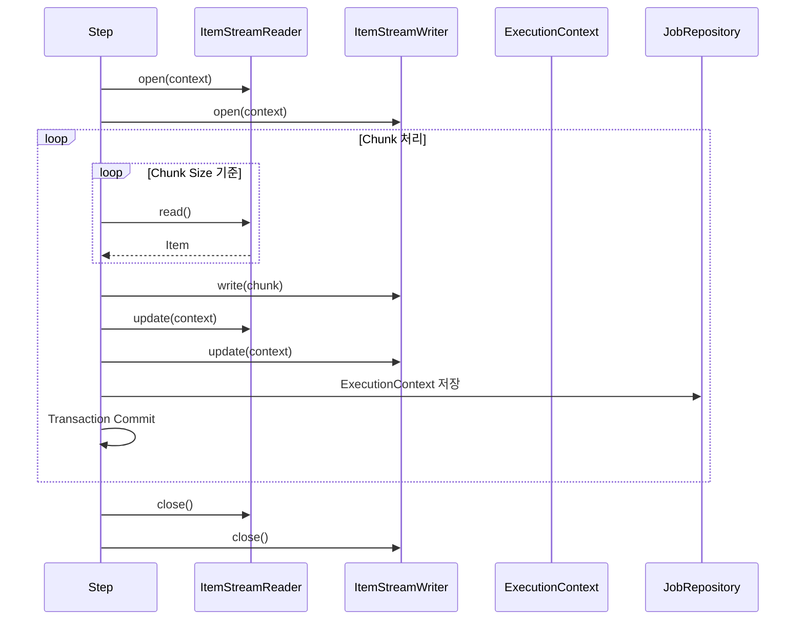

위 구조는 이해를 돕기 위해 핵심적인 호출 흐름만 표현한 것입니다.

실제 내부에서는 Step 실행 상태 갱신, Listener 호출, 초기 상태 저장, 예외 처리 등의 추가 과정이 존재합니다.

중요한 것은 Reader와 Writer가 모두 ItemStream을 구현하고 Step에 등록되어 있다면 각각의 생명주기 메서드가 호출된다는 점입니다.

---

### 예제: ItemStream을 이용한 배치 실패 및 재시작

이번에는 ItemStream을 직접 구현하여 배치가 실패했을 때 처리 위치를 저장하고, 재시작 시 해당 위치부터 데이터를 읽는 예제를 살펴보겠습니다.

예제는 Spring Batch 6.x API를 기준으로 작성합니다.

#### 요구사항

전체 데이터는 0부터 9까지 총 10건입니다.

```text
0
1
2
3
4
5
6
7
8
9
```

Chunk Size는 5로 설정합니다.

처리 흐름은 다음과 같습니다.

1. 첫 번째 Chunk에서 0~4까지 정상적으로 처리합니다.
2. 첫 번째 Chunk의 체크포인트를 저장하고 커밋합니다.
3. 두 번째 Chunk의 첫 번째 데이터인 5를 읽는 과정에서 의도적으로 예외를 발생시킵니다.
4. Job이 실패합니다.
5. 동일한 JobInstance를 재시작합니다.
6. 이전에 저장된 체크포인트를 복원합니다.
7. 데이터 5부터 다시 읽어 나머지 데이터를 처리합니다.

여기서 가장 중요한 것은 실패 직전의 메모리 상태가 아니라 **마지막으로 정상 커밋된 체크포인트를 기준으로 재시작한다는 것**입니다.

---

#### 1. CustomItemStreamReader 구현

먼저 ItemStreamReader를 구현하겠습니다.

```java
import java.util.List;

import org.springframework.batch.infrastructure.item.ExecutionContext;
import org.springframework.batch.infrastructure.item.ItemStreamReader;

public class CustomItemStreamReader
        implements ItemStreamReader<String> {

    private static final String POSITION_KEY =
            "customItemStreamReader.nextIndex";

    private final List<String> items;

    private int nextIndex;

    private boolean restartedFromCheckpoint;

    public CustomItemStreamReader(List<String> items) {

        this.items = List.copyOf(items);
    }

    @Override
    public void open(ExecutionContext executionContext) {

        restartedFromCheckpoint =
                executionContext.containsKey(POSITION_KEY);

        nextIndex = executionContext.getInt(
                POSITION_KEY,
                0
        );

        System.out.println(
                "READER OPEN - nextIndex: " + nextIndex
        );

        System.out.println(
                "READER RESTARTED: " + restartedFromCheckpoint
        );
    }

    @Override
    public String read() {

        if (nextIndex >= items.size()) {

            System.out.println("READ: null");

            return null;
        }

        if (nextIndex == 5 && !restartedFromCheckpoint) {

            throw new IllegalStateException(
                    "의도적인 장애 발생: index = 5"
            );
        }

        String item = items.get(nextIndex);

        System.out.println("READ: " + item);

        nextIndex++;

        return item;
    }

    @Override
    public void update(ExecutionContext executionContext) {

        executionContext.putInt(
                POSITION_KEY,
                nextIndex
        );

        System.out.println(
                "READER UPDATE - nextIndex: " + nextIndex
        );
    }

    @Override
    public void close() {

        System.out.println("READER CLOSE");
    }
}
```

이 코드는 ItemStream의 체크포인트 저장과 복원을 확인하기 위한 예제입니다.

실제 운영 환경에서 사용하는 Reader라면 실패 여부를 체크포인트 존재 여부로 판단하는 방식은 사용하지 않는 것이 좋습니다.

여기서는 첫 실행에서만 의도적으로 장애를 발생시키기 위해 해당 조건을 사용했습니다.

---

#### 2. CustomItemStreamReader의 open() 분석

```java
@Override
public void open(ExecutionContext executionContext) {

    restartedFromCheckpoint =
            executionContext.containsKey(POSITION_KEY);

    nextIndex = executionContext.getInt(
            POSITION_KEY,
            0
    );
}
```

최초 실행에서는 ExecutionContext에 다음 키가 존재하지 않습니다.

```text
customItemStreamReader.nextIndex
```

따라서 `nextIndex`는 0으로 초기화됩니다.

```text
최초 실행

ExecutionContext:
{}

        ↓

open()

        ↓

nextIndex = 0
restartedFromCheckpoint = false
```

반면 재시작 시에는 이전 Chunk에서 저장한 값이 존재할 수 있습니다.

```text
재시작

ExecutionContext:
{
    "customItemStreamReader.nextIndex": 5
}

        ↓

open()

        ↓

nextIndex = 5
restartedFromCheckpoint = true
```

이렇게 이전 실행의 상태를 복원하면 처음부터 데이터를 다시 읽을 필요가 없습니다.

---

#### 3. read() 분석

```java
@Override
public String read() {

    if (nextIndex >= items.size()) {
        return null;
    }

    if (nextIndex == 5 && !restartedFromCheckpoint) {

        throw new IllegalStateException(
                "의도적인 장애 발생"
        );
    }

    String item = items.get(nextIndex);

    nextIndex++;

    return item;
}
```

먼저 다음 조건을 확인합니다.

```java
if (nextIndex >= items.size())
```

현재 인덱스가 전체 데이터 개수보다 크거나 같다면 더 이상 읽을 데이터가 없다는 의미입니다.

따라서 `null`을 반환합니다.

그다음에는 의도적인 장애 조건을 확인합니다.

```java
if (nextIndex == 5 && !restartedFromCheckpoint)
```

최초 실행에서 5번 인덱스에 도달하면 예외를 발생시킵니다.

첫 번째 Chunk의 처리 결과는 다음과 같습니다.

```text
READ: 0
READ: 1
READ: 2
READ: 3
READ: 4
```

이후 Chunk가 정상적으로 처리되면 ItemStream의 update()가 호출됩니다.

다음 Chunk에서 5번 인덱스를 읽으려고 하면 예외가 발생합니다.

```text
ERROR:
의도적인 장애 발생: index = 5
```

이때 이전에 커밋된 체크포인트는 5입니다.

따라서 재시작 시에는 5번 인덱스부터 읽도록 할 수 있습니다.

---

#### 4. update() 분석

```java
@Override
public void update(ExecutionContext executionContext) {

    executionContext.putInt(
            POSITION_KEY,
            nextIndex
    );
}
```

이 메서드는 현재 읽기 위치를 ExecutionContext에 기록합니다.

첫 번째 Chunk에서 0~4까지 읽었다면 다음 상태가 됩니다.

```text
nextIndex = 5
```

여기서 5는 마지막으로 읽은 데이터의 인덱스가 아니라 **다음에 읽어야 할 데이터의 인덱스**입니다.

이러한 방식은 재시작 위치를 관리할 때 직관적입니다.

```text
읽기 완료한 데이터

0
1
2
3
4

다음에 읽을 데이터

5
```

이후 JobRepository가 ExecutionContext를 저장하고 트랜잭션이 정상적으로 커밋되면 해당 값이 체크포인트로 유지됩니다.

---

#### 5. CustomItemStreamWriter 구현

이번에는 ItemStreamWriter를 구현하겠습니다.

```java
import org.springframework.batch.infrastructure.item.Chunk;
import org.springframework.batch.infrastructure.item.ExecutionContext;
import org.springframework.batch.infrastructure.item.ItemStreamWriter;

public class CustomItemStreamWriter
        implements ItemStreamWriter<String> {

    @Override
    public void open(ExecutionContext executionContext) {

        System.out.println("WRITER OPEN");
    }

    @Override
    public void write(Chunk<? extends String> chunk) {

        System.out.println(
                "WRITE: " + chunk.getItems()
        );
    }

    @Override
    public void update(ExecutionContext executionContext) {

        System.out.println("WRITER UPDATE");
    }

    @Override
    public void close() {

        System.out.println("WRITER CLOSE");
    }
}
```

Writer에서는 데이터를 실제 데이터베이스에 저장하지 않고 로그만 출력합니다.

이를 통해 ItemStreamWriter의 생명주기 메서드가 호출되는 시점을 확인할 수 있습니다.

다만 콘솔 로그는 트랜잭션 롤백의 대상이 아닙니다.

따라서 실제 재시작 안정성을 검증하려면 데이터베이스 저장이나 파일 출력 등 실제 영속적인 Writer를 사용하여 데이터 정합성까지 확인해야 합니다.

---

#### 6. Job과 Step 구성

이제 CustomItemStreamReader와 CustomItemStreamWriter를 Step에 등록하겠습니다.

```java
import java.util.List;
import java.util.stream.IntStream;

import org.springframework.batch.core.job.Job;
import org.springframework.batch.core.job.builder.JobBuilder;
import org.springframework.batch.core.repository.JobRepository;
import org.springframework.batch.core.step.Step;
import org.springframework.batch.core.step.builder.StepBuilder;
import org.springframework.batch.core.configuration.annotation.StepScope;

import org.springframework.batch.infrastructure.item.ItemStreamReader;
import org.springframework.batch.infrastructure.item.ItemStreamWriter;

import org.springframework.context.annotation.Bean;
import org.springframework.context.annotation.Configuration;

import org.springframework.transaction.PlatformTransactionManager;

@Configuration
public class ItemStreamBatchConfig {

    @Bean
    public Job itemStreamJob(
            JobRepository jobRepository,
            Step itemStreamStep
    ) {

        return new JobBuilder("itemStreamJob", jobRepository)
                .start(itemStreamStep)
                .build();
    }

    @Bean
    public Step itemStreamStep(
            JobRepository jobRepository,
            PlatformTransactionManager transactionManager,
            ItemStreamReader<String> customItemStreamReader,
            ItemStreamWriter<String> customItemStreamWriter
    ) {

        return new StepBuilder("itemStreamStep", jobRepository)
                .<String, String>chunk(5)
                .transactionManager(transactionManager)
                .reader(customItemStreamReader)
                .writer(customItemStreamWriter)
                .build();
    }

    @Bean
    @StepScope
    public ItemStreamReader<String> customItemStreamReader() {

        List<String> items = IntStream.range(0, 10)
                .mapToObj(String::valueOf)
                .toList();

        return new CustomItemStreamReader(items);
    }

    @Bean
    @StepScope
    public ItemStreamWriter<String> customItemStreamWriter() {

        return new CustomItemStreamWriter();
    }
}
```

예제는 Spring Batch 6.x의 ItemStream API와 새로운 ChunkOrientedStep 구조를 사용합니다.

또한 실제 재시작 기능을 사용하려면 실행 메타데이터를 보존할 수 있는 JobRepository가 구성되어 있어야 합니다.

#### Chunk Size 설정

```java
.<String, String>chunk(5)
```

전체 데이터는 10건이고 Chunk Size는 5입니다.

따라서 정상적으로 처리된다면 실제 데이터를 포함한 Chunk는 2개입니다.

```text
Chunk 1 → 0, 1, 2, 3, 4

Chunk 2 → 5, 6, 7, 8, 9
```

#### ItemStreamReader 등록

```java
.reader(customItemStreamReader)
```

직접 구현한 ItemStreamReader를 등록합니다.

Spring Batch는 Reader가 ItemStream을 구현한 경우 해당 Stream을 자동으로 등록할 수 있습니다.

이 예제에서는 `@StepScope`를 사용하고 있으므로 Bean의 반환 타입을 `ItemStreamReader<String>`으로 선언했습니다.

이렇게 하면 Step에서 ItemStream 인터페이스를 사용할 수 있음을 명확하게 표현할 수 있습니다.

#### ItemStreamWriter 등록

```java
.writer(customItemStreamWriter)
```

ItemStreamWriter 역시 동일하게 등록합니다.

따라서 Reader와 Writer 모두 필요한 생명주기 콜백을 받을 수 있습니다.

---

### 최초 실행 과정 분석

이제 실제 실행 흐름을 살펴보겠습니다.

#### 1. ItemStream open() 호출

배치가 시작되면 등록된 ItemStream의 open()이 호출됩니다.

```text
READER OPEN - nextIndex: 0
READER RESTARTED: false

WRITER OPEN
```

Reader는 최초 실행이므로 인덱스를 0으로 초기화합니다.

#### 2. 첫 번째 Chunk 처리

ItemReader는 0부터 4까지 데이터를 읽습니다.

```text
READ: 0
READ: 1
READ: 2
READ: 3
READ: 4
```

이후 ItemWriter가 Chunk를 전달받습니다.

```text
WRITE: [0, 1, 2, 3, 4]
```

첫 번째 Chunk의 처리 과정에서 Reader의 update()가 호출됩니다.

```text
READER UPDATE - nextIndex: 5
```

Writer의 update()도 호출됩니다.

```text
WRITER UPDATE
```

이후 관련 체크포인트가 저장되고 트랜잭션이 정상적으로 커밋됩니다.

이때 영속적으로 저장된 처리 위치는 다음과 같습니다.

```text
customItemStreamReader.nextIndex = 5
```

#### 3. 두 번째 Chunk 처리 중 오류 발생

첫 번째 Chunk가 완료되면 두 번째 Chunk 처리가 시작됩니다.

```text
nextIndex = 5
```

Reader는 다음 조건을 확인합니다.

```java
if (nextIndex == 5 && !restartedFromCheckpoint)
```

현재는 최초 실행이므로 `restartedFromCheckpoint`가 false입니다.

따라서 예외가 발생합니다.

```text
ERROR:
의도적인 장애 발생: index = 5
```

Step은 실패 상태로 전환됩니다.

일반적인 종료 정리 과정에서 등록된 ItemStream의 close()가 호출됩니다.

```text
READER CLOSE
WRITER CLOSE
```

이 시점의 중요한 상태는 다음과 같습니다.

```text
Chunk 1
[0, 1, 2, 3, 4]
       ↓
     COMMIT

ExecutionContext
nextIndex = 5
       ↓

Chunk 2
       ↓
     ERROR
       ↓
     FAILED
```

즉, 첫 번째 Chunk의 체크포인트는 이미 저장되어 있습니다.

---

### 실패한 Job의 재시작 과정

Spring Batch에서 실패한 Job을 재시작할 때는 기존 JobInstance와 연결된 실행 상태를 활용합니다.

여기서 중요한 점은 **새로운 JobInstance를 생성하는 것과 실패한 JobInstance를 재시작하는 것은 서로 다르다**는 것입니다.

새로운 JobInstance를 실행하면 이전 StepExecution의 ExecutionContext가 자동으로 이어진다고 보장할 수 없습니다.

반면 실패한 JobInstance를 올바르게 재시작하면 Spring Batch가 이전 실행의 상태 정보를 활용할 수 있습니다.

#### 1. ExecutionContext 복원

첫 번째 실행에서 저장한 값은 다음과 같습니다.

```text
customItemStreamReader.nextIndex = 5
```

배치를 재시작하면 ItemStreamReader의 open()이 다시 호출됩니다.

```java
@Override
public void open(ExecutionContext executionContext) {

    restartedFromCheckpoint =
            executionContext.containsKey(POSITION_KEY);

    nextIndex = executionContext.getInt(
            POSITION_KEY,
            0
    );
}
```

이번에는 이전에 저장된 키가 존재합니다.

따라서 다음과 같이 복원됩니다.

```text
READER OPEN - nextIndex: 5

READER RESTARTED: true
```

#### 2. 다섯 번째 인덱스부터 다시 읽기

Reader는 복원된 인덱스를 기준으로 데이터를 읽습니다.

```text
READ: 5
READ: 6
READ: 7
READ: 8
READ: 9
```

이전 실행에서 이미 정상적으로 처리한 0~4는 다시 읽지 않습니다.

#### 3. 두 번째 Chunk 정상 처리

ItemWriter는 다음 데이터를 전달받습니다.

```text
WRITE: [5, 6, 7, 8, 9]
```

정상적으로 처리되면 현재 위치는 10이 됩니다.

```text
READER UPDATE - nextIndex: 10
```

이후 ItemReader가 더 이상 읽을 데이터가 없다고 판단합니다.

```text
READ: null
```

마지막으로 리소스를 정리하고 Step이 완료됩니다.

```text
READER CLOSE
WRITER CLOSE
```

전체 데이터 10건이 정상적으로 처리된 것입니다.

---

### 배치 재시작의 전체 구조

앞에서 살펴본 과정을 하나의 흐름으로 표현하면 다음과 같습니다.

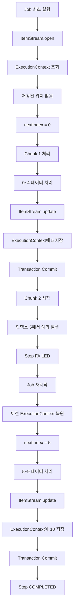

핵심은 ExecutionContext가 이전 실행의 체크포인트를 저장하고, ItemStream이 해당 정보를 이용하여 현재 상태를 복원한다는 것입니다.

---

### ItemStream과 Chunk 트랜잭션의 관계

ItemStream을 이해할 때 반드시 구분해야 하는 개념이 있습니다.

바로 **현재 읽기 위치와 마지막으로 커밋된 읽기 위치는 다를 수 있다**는 점입니다.

예를 들어 Chunk Size가 5이고, 첫 번째 Chunk를 정상적으로 처리했다고 가정하겠습니다.

```text
마지막 커밋 위치 = 5
```

이후 두 번째 Chunk에서 데이터를 일부 읽었습니다.

```text
READ: 5
READ: 6
READ: 7
```

현재 Reader가 메모리에 가지고 있는 위치는 다음과 같습니다.

```text
nextIndex = 8
```

그런데 ItemWriter에서 오류가 발생하여 해당 Chunk가 롤백되었습니다.

이 경우 메모리에 존재하던 `nextIndex = 8`이 그대로 영속적인 체크포인트가 되는 것은 아닙니다.

실제로 저장된 마지막 체크포인트는 다음과 같을 수 있습니다.

```text
nextIndex = 5
```

따라서 재시작 시에는 5부터 다시 읽어야 합니다.

| 구분 | 값 |
|---|---|
| 마지막으로 커밋된 처리 위치 | 5 |
| 실패 직전 메모리의 현재 위치 | 8 |
| 재시작 시 복원할 위치 | 5 |

이것이 Chunk 기반 재시작에서 매우 중요한 개념입니다.

#### 왜 실패 직전의 위치로 재시작하면 안 될까?

실패 직전의 메모리 위치가 8이라고 해서 다음 실행을 8부터 시작하면 문제가 발생할 수 있습니다.

데이터 5, 6, 7은 읽었지만 트랜잭션이 정상적으로 커밋되지 않았기 때문입니다.

이 상태에서 8부터 처리하면 5, 6, 7의 데이터가 누락될 수 있습니다.

따라서 일반적인 트랜잭션 기반 Chunk 처리에서는 **마지막으로 성공적으로 커밋된 위치를 재시작 기준으로 삼아야 합니다.**

다만 실제로 이러한 일관성이 보장되려면 Reader 상태 저장, JobRepository, Writer의 트랜잭션 구성이 적절하게 연결되어 있어야 합니다.

---

### ItemStream 등록과 CompositeItemStream

Spring Batch는 Step에 등록된 ItemStream들을 관리합니다.

#### 자동 등록

ItemReader, ItemProcessor 또는 ItemWriter 자체가 ItemStream을 구현하고 있다면 Spring Batch가 해당 Stream을 자동 등록할 수 있습니다.

```java
.reader(customItemStreamReader)
.writer(customItemStreamWriter)
```

위 예제에서는 Reader와 Writer가 ItemStream을 구현하고 있으므로 추가적인 등록 없이 생명주기 메서드를 호출받을 수 있습니다.

#### 명시적 등록

반면 내부적으로 다른 ItemStream을 위임하여 사용하는 경우에는 명시적인 등록이 필요할 수 있습니다.

예를 들어 다음과 같은 구조입니다.

```text
CustomItemReader
       │
       └── DelegateReader
               │
               └── ItemStream 구현
```

Step이 DelegateReader를 직접 알지 못한다면 해당 객체의 open(), update(), close()가 호출되지 않을 수 있습니다.

이러한 경우 다음과 같이 명시적으로 등록할 수 있습니다.

```java
return new StepBuilder("step", jobRepository)
        .<String, String>chunk(100)
        .transactionManager(transactionManager)
        .reader(customReader)
        .writer(itemWriter)
        .stream(delegateReader)
        .build();
```

다만 Composite 구현체 자체가 내부 Delegate의 ItemStream 생명주기를 위임하여 관리하는 경우에는 별도로 등록하지 않아도 될 수 있습니다.

따라서 실제 사용하는 Composite 구현체의 동작을 확인해야 합니다.

---

### 실무에서의 활용

ItemStream과 ExecutionContext는 단순한 읽기 위치 저장을 넘어 배치 시스템의 안정성을 높이는 데 다양하게 활용할 수 있습니다.

#### 1. 데이터베이스 기반 대량 정산 배치 재시작

결제 정산 배치에서 수백만 건의 거래를 처리한다고 가정하겠습니다.

이때 단순히 현재 처리 건수를 저장하는 것보다 마지막으로 처리한 거래 ID를 저장하는 방식이 유용할 수 있습니다.

예를 들어 다음과 같은 체크포인트를 사용할 수 있습니다.

```text
last.transaction.id = 150000
```

재시작 시에는 해당 거래 ID보다 큰 데이터부터 처리하도록 구성할 수 있습니다.

```sql
SELECT
    transaction_id,
    amount,
    payment_status
FROM payment_transaction
WHERE transaction_id > :lastTransactionId
ORDER BY transaction_id;
```

이러한 방식은 Offset 기반 Paging과 비교했을 때 데이터 추가나 삭제에 따른 위치 변경 문제를 줄이는 데 도움이 됩니다.

단, 거래 ID의 정렬 기준과 처리 대상 데이터의 변경 가능성을 함께 고려해야 합니다.

#### 2. Chunk Size에 따른 재처리 범위 최적화

Chunk Size가 클수록 커밋 횟수는 줄어들 수 있지만, 장애 발생 시 다시 처리해야 하는 데이터 범위가 커질 수 있습니다.

예를 들어 다음과 같습니다.

```text
Chunk Size = 100

마지막 커밋 이후 최대 100건 수준의
데이터가 다시 처리될 수 있음
```

```text
Chunk Size = 1000

마지막 커밋 이후 최대 1000건 수준의
데이터가 다시 처리될 수 있음
```

실제 재처리 범위는 오류 위치와 트랜잭션 처리 방식에 따라 달라집니다.

따라서 Chunk Size를 설정할 때는 단순히 처리 속도뿐 아니라 장애 발생 시 재처리 비용도 고려해야 합니다.

#### 3. ExecutionContext의 키 충돌 방지

여러 ItemStream이 동일한 ExecutionContext를 사용하는 경우 키 이름이 충돌할 수 있습니다.

예를 들어 두 Reader가 모두 다음 키를 사용한다고 가정하겠습니다.

```text
current.index
```

서로 다른 Reader가 같은 키에 값을 저장하면 이전 상태를 덮어쓸 수 있습니다.

따라서 다음과 같이 고유한 키를 사용하는 것이 좋습니다.

```text
customerReader.current.index
orderReader.current.index
settlementReader.current.index
```

이처럼 각 ItemStream의 상태를 구분할 수 있는 네임스페이스를 사용하면 키 충돌 문제를 방지하는 데 도움이 됩니다.

#### 4. ExecutionContext에 대용량 데이터 저장 방지

ExecutionContext는 상태 정보를 관리하기 위한 객체입니다.

따라서 대량의 데이터를 직접 저장하는 용도로 사용하지 않는 것이 좋습니다.

예를 들어 다음과 같은 구조는 피하는 것이 좋습니다.

```text
ExecutionContext

processedItems = List<100000 Customer>
```

이러한 데이터를 저장하면 직렬화 비용과 데이터베이스 저장 비용이 증가할 수 있습니다.

대신 필요한 최소한의 상태만 저장하는 것이 적절합니다.

```text
ExecutionContext

lastProcessedId = 150000
```

ExecutionContext에는 데이터 자체보다는 처리 위치나 진행 상태를 저장하는 것이 좋습니다.

#### 5. JobRepository와 비즈니스 데이터의 트랜잭션 일관성 확보

ExecutionContext에 체크포인트가 저장되었다고 해서 모든 비즈니스 데이터가 정상적으로 저장되었다고 보장할 수는 없습니다.

예를 들어 Writer는 비즈니스 데이터베이스에 저장하고 JobRepository는 별도의 데이터베이스에 저장한다고 가정하겠습니다.

이때 서로 다른 트랜잭션으로 관리된다면 체크포인트와 실제 저장 데이터 사이에 불일치가 발생할 수 있습니다.

따라서 중요한 정산 배치에서는 다음 항목을 확인해야 합니다.

- 비즈니스 데이터 저장에 사용하는 TransactionManager
- JobRepository의 트랜잭션 처리 방식
- Checkpoint 저장과 데이터 저장의 원자성
- 장애 발생 시 중복 처리 및 누락 가능성

특히 서로 다른 데이터베이스나 외부 시스템을 사용하는 경우에는 멱등성 있는 처리 구조가 필요합니다.

#### 6. ItemWriter의 멱등성 확보

배치 재시작 과정에서는 같은 데이터를 다시 처리할 수 있습니다.

따라서 Writer는 중복 실행에 대응할 수 있도록 설계하는 것이 좋습니다.

예를 들어 다음과 같은 고유 제약 조건을 사용할 수 있습니다.

```sql
ALTER TABLE settlement
ADD CONSTRAINT uk_settlement_transaction
UNIQUE (transaction_id, settlement_date);
```

이렇게 하면 동일한 거래에 대한 중복 정산 데이터가 저장되는 것을 방지하는 데 도움이 됩니다.

다만 외부 API나 메시지 큐에 데이터를 전달하는 작업은 데이터베이스 트랜잭션으로 자동 롤백되지 않을 수 있으므로 별도의 멱등성 전략이 필요합니다.

#### 7. 파일 기반 Reader의 읽기 위치 복원

CSV나 TXT 파일을 처리하는 경우에도 ItemStream을 활용할 수 있습니다.

예를 들어 마지막으로 처리한 행 번호를 저장할 수 있습니다.

```text
file.current.line = 10000
```

재시작 시 해당 위치를 복원하여 이후 데이터를 처리하도록 구성할 수 있습니다.

다만 파일 내용이 변경되었다면 동일한 행 번호가 다른 데이터를 가리킬 수 있습니다.

따라서 파일의 변경 가능성이 있는 환경에서는 파일명, 크기, 수정 시각, 체크섬 등의 정보도 함께 관리하는 것이 좋습니다.

#### 8. 파일 Writer의 재시작 안정성 확보

파일을 생성하는 Writer는 데이터베이스 Writer와 다른 특성을 가집니다.

데이터베이스는 트랜잭션을 통해 Rollback을 수행할 수 있지만, 파일 시스템에서 이미 기록된 데이터를 자동으로 원래 상태로 복구하는 것은 일반적으로 어렵습니다.

따라서 파일 Writer를 구현할 때는 다음을 고려해야 합니다.

- 마지막으로 정상 기록한 위치
- 기존 파일에 이어서 기록할지 여부
- 실패한 Chunk에서 기록한 데이터의 처리 방식
- 재시작 시 중복 출력 방지
- 임시 파일과 최종 파일의 교체 방식

이러한 요구사항에 따라 ItemStream을 활용하여 파일의 처리 위치와 상태를 관리할 수 있습니다.

#### 9. Multi-threaded Step의 상태 관리

여러 스레드가 하나의 Reader를 공유하는 경우 현재 읽기 위치를 안전하게 관리해야 합니다.

단순히 `currentIndex`를 멤버 변수로 선언했다고 해서 여러 스레드에서 안전하게 동작하는 것은 아닙니다.

또한 Reader 호출을 동기화하더라도 ExecutionContext의 체크포인트 저장 순서까지 항상 일관되게 유지된다고 보장할 수는 없습니다.

따라서 병렬 처리가 필요한 경우에는 다음과 같은 방식을 고려해야 합니다.

- Partitioning으로 처리 범위 분리
- 스레드별 Reader 인스턴스 사용
- Partition별 ExecutionContext 관리
- 중복 처리에 대응하는 Writer 설계

특히 Partitioning을 사용하면 각 Partition이 자신의 StepExecutionContext를 관리할 수 있으므로 처리 범위와 상태를 분리하는 데 유리합니다.

#### 10. JobInstance와 JobExecution 구분

배치 재시작에서는 JobInstance와 JobExecution을 구분하는 것이 중요합니다.

JobInstance는 Job과 식별용 JobParameters를 기준으로 구분됩니다.

JobExecution은 해당 JobInstance가 실제로 실행된 이력을 의미합니다.

예를 들어 다음과 같은 관계가 있을 수 있습니다.

```text
JobInstance A
    │
    ├── JobExecution 1 → FAILED
    │
    └── JobExecution 2 → COMPLETED
```

두 JobExecution은 동일한 JobInstance에 속할 수 있습니다.

이러한 관계에서 실패한 Job을 재시작하면 이전 실행의 Step 상태를 활용할 수 있습니다.

반면 식별용 JobParameters를 변경하여 새로운 JobInstance를 생성하면 이전 체크포인트가 자동으로 이어지는 것은 아닙니다.

따라서 재시작을 구현할 때는 단순히 Job을 다시 실행하는 것과 기존 JobInstance를 재시작하는 것을 명확하게 구분해야 합니다.

#### 11. ExecutionContext의 직렬화 가능성 확인

ExecutionContext에 저장된 데이터는 JobRepository를 통해 영속화될 수 있습니다.

따라서 저장하는 값은 직렬화 방식과 호환되어야 합니다.

예를 들어 복잡한 도메인 객체를 그대로 저장한다면 직렬화 오류가 발생하거나 클래스 구조 변경으로 재시작에 문제가 생길 수 있습니다.

가능하면 다음과 같은 단순한 데이터를 저장하는 것이 좋습니다.

```text
lastProcessedId = 10000

currentIndex = 500

lastProcessedDate = 2026-11-26
```

복잡한 객체를 저장해야 한다면 사용하는 ExecutionContextSerializer와 해당 객체의 직렬화 가능성을 확인해야 합니다.

#### 12. 상태 저장 시점과 장애 발생 시점 구분

ItemStream의 update()는 현재 상태를 ExecutionContext에 반영합니다.

하지만 실제 재시작 기준은 영속적으로 저장된 체크포인트입니다.

따라서 장애 분석 시에는 다음 세 가지를 구분해야 합니다.

```text
Reader가 마지막으로 읽은 위치

ExecutionContext에 마지막으로 반영한 위치

JobRepository에 정상적으로 커밋된 위치
```

이 값들은 항상 동일하지 않을 수 있습니다.

특히 트랜잭션이 롤백되거나 애플리케이션이 비정상적으로 종료된 상황에서는 차이가 발생할 수 있습니다.

따라서 배치 재시작 문제를 분석할 때는 단순히 Reader의 멤버 변수만 확인하지 말고 실제 JobRepository에 저장된 체크포인트를 함께 확인해야 합니다.

---

### ItemStream 사용 시 주의사항

ItemStream을 사용할 때는 몇 가지 중요한 사항을 기억해야 합니다.

| 주의사항 | 설명 |
|---|---|
| `open()` 호출 | 데이터 처리 전에 리소스 초기화 및 상태 복원 |
| `update()` 호출 | 현재 상태를 ExecutionContext에 반영 |
| `close()` 호출 | 리소스 정리, 강제 종료 시 호출 보장 안 됨 |
| 상태 영속화 | JobRepository와 체크포인트 저장이 필요 |
| 재시작 위치 | 마지막으로 커밋된 체크포인트 기준 |
| ItemStream 등록 | Step에 Stream이 등록되어 있어야 함 |
| 데이터 직렬화 | ExecutionContext에 저장하는 값의 직렬화 가능성 확인 |
| 멱등성 | 재처리 과정에서 중복 저장 방지 |
| 멀티스레드 | Reader 상태 및 체크포인트의 동시성 고려 |
| JobInstance | 새 실행과 실패한 실행의 재시작을 구분 |

이 중에서도 가장 중요한 것은 ItemStream이 단독으로 재시작 기능을 완성하는 것이 아니라는 점입니다.

ItemStream은 상태를 기록하고 복원하는 기능을 제공하지만, 실제 재시작 안정성은 JobRepository, 트랜잭션 처리, Reader의 데이터 조회 방식, Writer의 멱등성 등이 함께 보장되어야 확보할 수 있습니다.

---

### 정리

Spring Batch의 ItemStream은 데이터 입출력 과정에서 필요한 상태 관리와 리소스 생명주기 처리를 지원하는 인터페이스입니다.

`open()`, `update()`, `close()` 세 가지 메서드를 통해 리소스를 초기화하고 현재 처리 상태를 저장하며, 작업이 종료되었을 때 리소스를 정리할 수 있습니다.

ItemStream은 ExecutionContext와 함께 사용되어 배치의 현재 처리 위치를 기록하고 이전 실행 상태를 복원하는 데 활용됩니다.

특히 Chunk 기반 배치에서는 마지막으로 정상 커밋된 체크포인트를 기준으로 재시작하는 것이 중요합니다.

실패 직전에 Reader가 메모리에서 관리하던 위치와 실제로 커밋된 위치는 서로 다를 수 있기 때문입니다.

또한 ItemStream을 구현했다고 해서 모든 상황에서 자동으로 안전한 재시작이 보장되는 것은 아닙니다.

실제 운영 환경에서는 JobRepository의 영속성, 비즈니스 데이터와 체크포인트의 트랜잭션 일관성, Reader의 조회 안정성, Writer의 멱등성까지 함께 고려해야 합니다.

이러한 구조를 이해하면 단순히 실패한 배치를 다시 실행하는 것을 넘어, **중복 처리와 데이터 누락을 최소화하는 재시작 가능한 배치 시스템**을 설계할 수 있습니다.

#### 한 줄 요약

**ItemStream은 open(), update(), close()를 통해 데이터 처리 상태와 리소스 생명주기를 관리하며, ExecutionContext와 JobRepository를 이용하여 마지막으로 정상 커밋된 위치부터 배치를 재시작할 수 있도록 지원하는 핵심 인터페이스입니다.**
