# 데이터 사이언스

# 데이터 사이언스

* toc
{:toc}

---

## 데이터 사이언스(Data Science) 완벽 이해: 데이터의 가치부터 빅데이터 분석·관리 기술, 머신러닝, 데이터 엔지니어링까지

현대의 소프트웨어 시스템은 단순히 데이터를 저장하고 조회하는 역할을 넘어, 축적된 데이터에서 의미 있는 정보를 추출하고 이를 비즈니스 의사결정에 활용하는 방향으로 발전하고 있다.

예를 들어 전자상거래 서비스를 운영한다고 가정해 보자.

사용자는 상품을 검색하고, 상세 페이지를 조회하고, 장바구니에 상품을 추가한 뒤 결제를 진행한다.

이 과정에서 다양한 데이터가 생성된다.

- 사용자가 검색한 키워드
- 상품별 조회 횟수
- 장바구니에 추가한 상품
- 실제 구매한 상품
- 결제 완료까지 걸린 시간
- 사용자의 재방문 주기
- 상품별 구매 전환율
- 시간대별 주문량
- 결제 실패 및 취소 이력

이러한 데이터는 그 자체로도 의미가 있지만, 저장되어 있다는 사실만으로 비즈니스 가치가 만들어지지는 않는다.

예를 들어 사용자가 장바구니에 상품을 추가했지만 결제하지 않았다는 데이터가 있다고 가정해 보자.

단순히 해당 데이터를 저장하는 것과 다음 질문에 답하는 것은 서로 다른 문제다.

**"사용자가 상품을 장바구니에 추가했지만 구매를 완료하지 않은 이유는 무엇일까?"**

이 질문에 답하려면 여러 데이터를 연결하여 분석해야 한다.

사용자의 행동 흐름을 분석하고, 구매를 중단하는 시점을 확인하고, 결제 실패나 배송비 등의 요소와 연관성이 있는지 살펴봐야 한다.

더 나아가 분석 결과를 이용하여 구매 전환율을 개선하거나, 구매할 가능성이 높은 상품을 추천할 수도 있다.

이처럼 **데이터를 수집하고 저장하는 것을 넘어 데이터에서 지식과 인사이트를 도출하고, 이를 의사결정과 시스템에 적용하는 분야가 데이터 사이언스(Data Science)**다.

데이터 사이언스를 이해하려면 다음 개념들을 함께 살펴볼 필요가 있다.

| 개념 | 주요 관심사 |
|---|---|
| Data | 분석의 대상이 되는 데이터 |
| Big Data | 대규모·다양한 데이터와 이를 처리하기 위한 환경 |
| Data Analytics | 데이터를 분석하여 패턴과 의미를 발견하는 활동 |
| Data Science | 데이터를 이용해 지식과 인사이트를 도출하는 종합적인 접근 |
| Data Engineering | 데이터를 수집·저장·처리·제공하는 기반 구축 |
| Machine Learning | 데이터에서 패턴을 학습하여 예측이나 판단 수행 |
| Data Visualization | 분석 결과를 이해하기 쉬운 형태로 표현 |

이 개념들은 완전히 독립된 영역이 아니다.

하나의 데이터 기반 서비스 안에서 서로 연결되어 동작한다.

이번 글에서는 데이터 사이언스의 기본 개념부터 데이터 분석 프로세스, 빅데이터 관리 기술, 머신러닝과 지능 자동화, 데이터 관련 직무까지 하나의 흐름으로 살펴본다.

---

## 데이터 사이언스란?

### 데이터 사이언스의 개념

데이터 사이언스(Data Science)는 다양한 형태의 데이터로부터 의미 있는 지식과 인사이트를 도출하기 위해 과학적 방법론, 통계, 알고리즘, 프로그래밍, 데이터 처리 시스템 등을 활용하는 융합 분야다.

여기서 중요한 것은 데이터 사이언스가 단순히 데이터를 분석하는 행위 하나만을 의미하지 않는다는 점이다.

데이터 사이언스는 일반적으로 다음과 같은 활동을 포함한다.

1. 해결할 문제를 정의한다.
2. 문제와 관련된 데이터를 수집한다.
3. 데이터를 저장하고 관리한다.
4. 데이터의 구조와 특성을 이해한다.
5. 데이터에 포함된 오류와 불필요한 정보를 처리한다.
6. 데이터의 패턴과 관계를 분석한다.
7. 통계적 실험이나 머신러닝 모델을 적용한다.
8. 결과를 검증하고 평가한다.
9. 분석 결과를 시각화하거나 시스템에 적용한다.
10. 실제 활용 결과를 바탕으로 분석 방법을 개선한다.

이를 간단히 표현하면 다음과 같다.

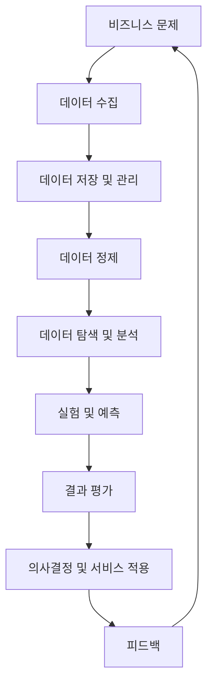

여기서 주목해야 할 부분은 가장 마지막 단계다.

분석 결과를 도출하는 것만으로 모든 작업이 끝나는 것은 아니다.

**분석 결과가 실제 문제를 해결하는 데 도움이 되었는지 확인하고, 그 결과를 다음 개선 과정에 반영해야 한다.**

예를 들어 상품 추천 모델을 개발했다면 추천 정확도뿐 아니라 실제 구매 전환율이나 사용자 경험에 어떤 변화가 발생했는지 확인할 필요가 있다.

즉, 데이터 사이언스의 핵심은 데이터를 많이 보유하는 것이 아니라 **데이터를 이용하여 문제를 해결하고 가치를 창출하는 것**이다.

---

## 데이터 사이언스가 중요해진 배경

### 4차 산업혁명과 데이터

데이터의 중요성을 설명할 때 자주 등장하는 개념이 4차 산업혁명이다.

산업혁명의 흐름은 일반적으로 다음과 같이 구분하여 설명할 수 있다.

| 구분 | 주요 기술 | 대표적인 변화 |
|---|---|---|
| 1차 산업혁명 | 증기기관 | 기계화 |
| 2차 산업혁명 | 전기에너지 | 대량생산 |
| 3차 산업혁명 | 컴퓨터, 인터넷 | 정보화와 자동화 |
| 4차 산업혁명 | AI, IoT, 빅데이터 등 | 초연결과 지능화 |

이러한 시대 구분은 기술 발전의 특징을 이해하기 위한 개괄적인 틀이다.

실제 기술 발전은 특정 시점을 기준으로 명확하게 나뉘는 것이 아니라 여러 기술이 겹치면서 진행된다.

데이터 관점에서 중요한 변화는 다음 두 가지다.

**첫 번째는 초연결성(Hyper-Connected)이다.**

사람과 사람뿐 아니라 사람과 사물, 사물과 사물이 네트워크를 통해 연결된다.

**두 번째는 초지능화(Hyper-Intelligent)다.**

연결된 환경에서 발생하는 데이터를 활용하여 분석·예측·판단을 자동화하는 방향으로 시스템이 발전한다.

이 두 가지를 이해하면 데이터 사이언스가 중요해진 이유를 파악할 수 있다.

### 초연결성이란?

초연결성은 다양한 장치와 시스템이 네트워크를 통해 연결되어 데이터를 주고받는 특성을 의미한다.

예를 들어 물류 시스템을 생각해 보자.

화물 운송 과정에서는 다음과 같은 시스템이 연결될 수 있다.

- 선박 위치 추적 시스템
- 컨테이너 상태 측정 센서
- 항만 운영 시스템
- 운송 관리 시스템
- 물류 플랫폼
- 고객 알림 시스템

이러한 시스템이 연결되면 각 시스템에서 생성되는 데이터를 함께 활용할 수 있다.

예를 들어 선박 위치 정보와 항만 혼잡도, 과거 운송 이력을 결합하여 예상 도착 시간을 계산할 수 있다.

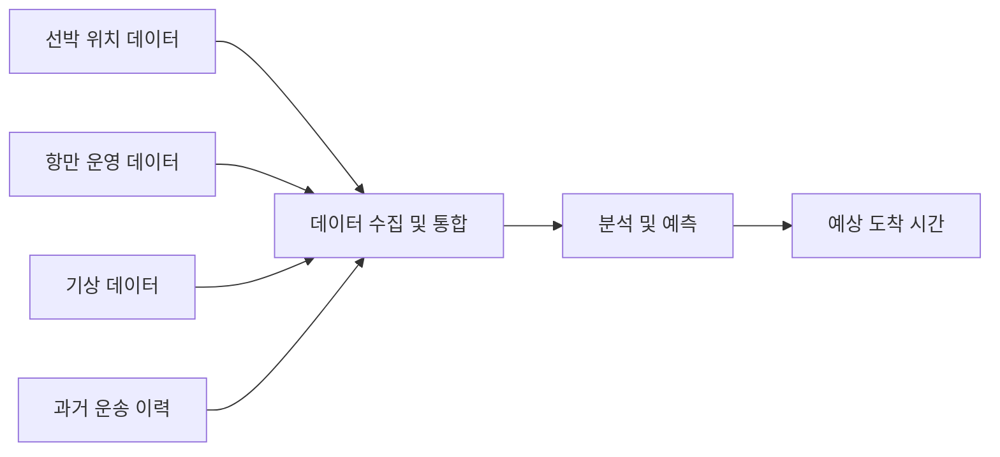

이처럼 초연결성은 더 많은 데이터가 생성되고 서로 연결될 수 있는 환경을 만든다.

### 초지능화란?

초지능화는 데이터와 알고리즘을 이용하여 복잡한 판단이나 작업을 자동화하는 방향의 기술적 변화를 의미한다.

예를 들어 다음과 같은 기능을 생각해 볼 수 있다.

| 분야 | 데이터 기반 기능 |
|---|---|
| 전자상거래 | 개인화 상품 추천 |
| 금융 | 이상 거래 탐지 |
| 물류 | 도착 시간 예측 |
| 제조 | 설비 고장 예측 |
| 교육 | 학습 성취도 분석 |
| 의료 | 진단 보조 |
| 고객 지원 | 상담 분류 및 응답 지원 |

이러한 기능은 단순히 데이터를 저장하는 것만으로 구현할 수 없다.

데이터를 분석하고, 패턴을 발견하고, 그 결과를 실제 시스템에서 활용할 수 있어야 한다.

따라서 초연결성이 데이터 생성과 유통의 기반을 제공한다면, 초지능화는 축적된 데이터를 활용하여 새로운 기능과 가치를 만들어내는 방향이라고 이해할 수 있다.

---

## 데이터는 어떻게 가치를 만들어낼까?

### 데이터의 가치는 저장량만으로 결정되지 않는다

데이터를 많이 수집하면 분석에 활용할 수 있는 정보가 증가할 가능성이 있다.

하지만 데이터가 많다고 반드시 높은 가치가 만들어지는 것은 아니다.

예를 들어 다음 두 시스템을 비교해 보자.

**시스템 A**

사용자의 구매 이력 1억 건을 저장하고 있지만, 해당 데이터를 조회하거나 분석할 수 있는 구조가 없다.

**시스템 B**

사용자의 구매 이력 10만 건을 저장하고 있으며, 구매 패턴을 분석하여 재구매 가능성이 높은 고객을 파악할 수 있다.

데이터의 양은 시스템 A가 훨씬 많다.

그러나 실제 비즈니스 의사결정에 활용할 수 있는 정도는 시스템 B가 더 높을 수 있다.

이 차이는 데이터의 **활용 가능성**에서 발생한다.

데이터의 가치를 높이려면 다음 조건을 고려해야 한다.

| 요소 | 설명 |
|---|---|
| 정확성 | 데이터가 실제 상황을 올바르게 표현하는가? |
| 완전성 | 필요한 데이터가 누락되지 않았는가? |
| 적시성 | 의사결정에 필요한 시점에 사용할 수 있는가? |
| 일관성 | 여러 시스템에서 동일한 의미로 관리되는가? |
| 접근성 | 필요한 사람이 데이터를 활용할 수 있는가? |
| 관련성 | 해결하려는 문제와 직접적인 관계가 있는가? |
| 활용성 | 분석 결과를 실제 업무나 서비스에 적용할 수 있는가? |

결국 **데이터의 양보다 중요한 것은 해당 데이터가 어떤 문제를 해결하는 데 사용될 수 있는지**다.

### 데이터에서 가치가 만들어지는 과정

데이터가 비즈니스 가치로 전환되는 과정은 다음과 같이 표현할 수 있다.

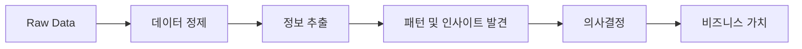

각 단계를 전자상거래 서비스에 적용해 보자.

| 단계 | 예시 |
|---|---|
| Raw Data | 사용자별 상품 조회 및 구매 로그 |
| 데이터 정제 | 중복 로그 제거, 잘못된 상품 ID 처리 |
| 정보 추출 | 상품별 조회 수와 구매 수 계산 |
| 인사이트 발견 | 특정 상품은 조회 수에 비해 구매율이 낮음 |
| 의사결정 | 상품 상세 페이지와 구매 흐름 개선 |
| 가치 창출 | 구매 전환율 개선 가능성 확보 |

이러한 흐름을 이해하면 데이터 사이언스가 단순한 통계 계산을 넘어 비즈니스 문제 해결과 연결된다는 점을 알 수 있다.

---

## 데이터 사이언스에서 y = f(x)가 의미하는 것

데이터 사이언스를 이해할 때 다음과 같은 수식을 사용할 수 있다.

**y = f(x)**

이 수식은 입력값 `x`가 함수 `f`를 통해 결과 `y`로 변환된다는 의미다.

데이터 분석이나 머신러닝에서는 다음과 같이 해석할 수 있다.

| 구성 요소 | 의미 |
|---|---|
| x | 입력 데이터 |
| f | 데이터 처리 규칙 또는 학습된 모델 |
| y | 계산·분석·예측 결과 |

예를 들어 사용자의 학습 데이터를 이용하여 시험 성적을 예측한다고 가정해 보자.

입력 데이터는 다음과 같을 수 있다.

| 입력값 | 설명 |
|---|---|
| 학습 시간 | 하루 평균 학습 시간 |
| 문제 풀이 수 | 일정 기간 동안 해결한 문제 수 |
| 복습 횟수 | 학습 내용을 반복한 횟수 |
| 과거 성적 | 이전 평가 결과 |

이러한 입력값을 이용하여 예측 모델을 구성할 수 있다.

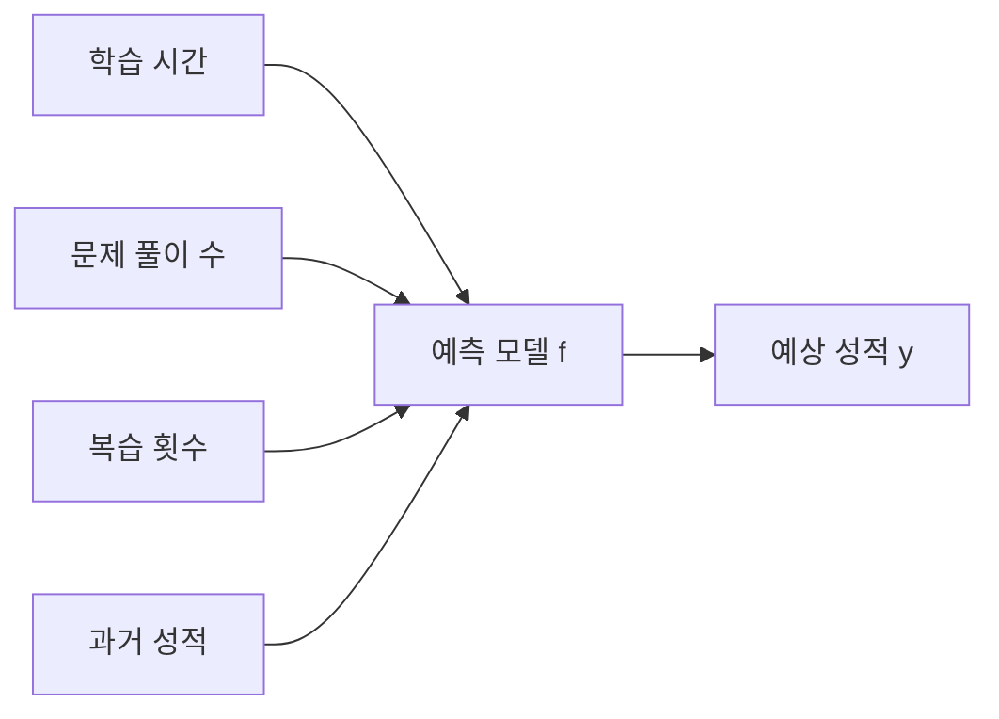

이때 중요한 것은 함수 `f`가 처음부터 자동으로 만들어지는 것이 아니라는 점이다.

분석 목적에 따라 규칙을 직접 정의할 수도 있고, 데이터를 이용하여 머신러닝 모델을 학습할 수도 있다.

또한 예측 결과가 실제 성적과 얼마나 일치하는지 평가해야 한다.

따라서 `y = f(x)`는 데이터로부터 결과를 도출하는 과정을 이해하기 위한 개념적 표현이다.

모든 데이터 사이언스 작업이 반드시 머신러닝 모델을 만드는 것은 아니다.

단순 통계 분석이나 규칙 기반 계산도 데이터를 활용하는 중요한 방법이다.

---

## 데이터 저장 기술과 데이터 사이언스의 관계

데이터 사이언스를 수행하려면 분석 대상 데이터가 저장되어 있어야 한다.

이를 위해 다양한 데이터 저장 기술을 사용할 수 있다.

대표적으로 다음과 같은 기술이 있다.

- RDBMS
- NoSQL
- 분산 파일 시스템
- 객체 스토리지

데이터 저장 기술을 선택할 때는 단순히 데이터 양만 고려해서는 안 된다.

데이터의 구조와 조회 방식, 변경 빈도, 일관성 요구사항, 분석 처리 방식 등을 함께 검토해야 한다.

### RDBMS

RDBMS(Relational Database Management System)는 테이블을 기반으로 데이터를 저장하고 관리하는 관계형 데이터베이스 시스템이다.

대표적으로 다음과 같은 제품이 있다.

| RDBMS | 주요 특징 |
|---|---|
| MySQL | 다양한 웹 애플리케이션에서 활용 |
| PostgreSQL | SQL 및 다양한 데이터 처리 기능 제공 |
| Oracle Database | 기업용 트랜잭션 및 데이터 관리 |
| Microsoft SQL Server | 기업용 데이터 관리 및 분석 기능 제공 |
| IBM Db2 | 기업용 관계형 데이터 처리 |

RDBMS는 정형 데이터를 관리하고 SQL을 이용하여 조회·집계·분석하는 데 활용할 수 있다.

예를 들어 주문 데이터와 결제 데이터가 서로 연결되어 있다면 관계형 모델을 통해 관리할 수 있다.

### NoSQL

NoSQL은 관계형 데이터 모델 이외의 다양한 데이터 모델을 지원하는 데이터베이스 범주다.

대표적인 유형은 다음과 같다.

| 유형 | 대표 기술 | 활용 예시 |
|---|---|---|
| Document | MongoDB | 유연한 구조의 비즈니스 데이터 |
| Key-Value | Redis | 캐시 및 빠른 데이터 접근 |
| Wide-Column | Cassandra | 대규모 분산 데이터 |
| Graph | Neo4j | 복잡한 관계 데이터 |

다만 NoSQL이라고 해서 모든 데이터베이스가 동일한 성능이나 기능을 제공하는 것은 아니다.

각 데이터베이스는 서로 다른 데이터 모델과 처리 특성을 가진다.

### RDBMS와 NoSQL은 경쟁 관계일까?

두 기술은 반드시 하나만 선택해야 하는 관계가 아니다.

예를 들어 다음과 같은 시스템을 구성할 수 있다.

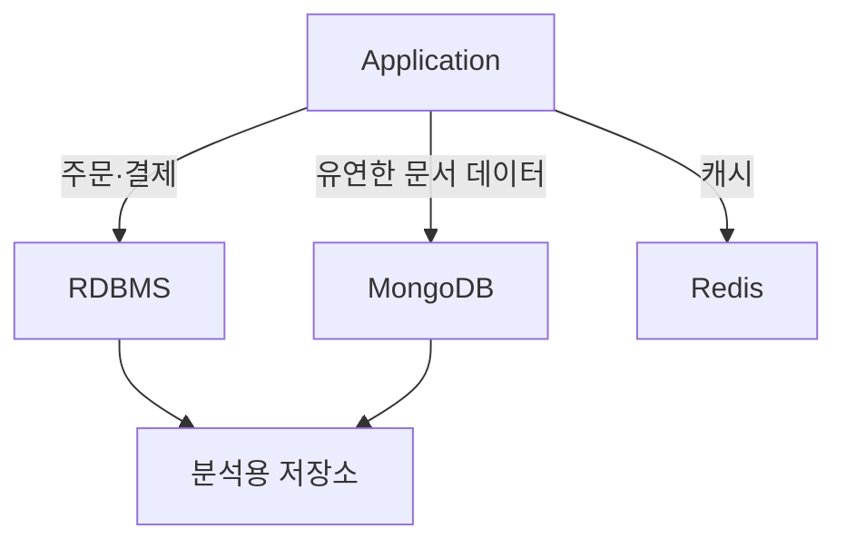

RDBMS는 주문 및 결제 데이터를 관리한다.

MongoDB는 다양한 구조의 콘텐츠 데이터를 저장한다.

Redis는 빠른 데이터 접근을 위한 캐시로 활용한다.

그리고 분석용 저장소에서는 여러 시스템의 데이터를 통합하여 분석할 수 있다.

핵심은 **서비스의 데이터 저장 요구사항과 분석 요구사항을 구분하여 기술을 선택하는 것**이다.

---

## Data Science, Big Data, Data Analytics의 차이

데이터 분야에서 혼동하기 쉬운 개념이 다음 세 가지다.

1. Data Science
2. Big Data
3. Data Analytics

서로 연관되어 있지만 강조하는 대상과 목적에는 차이가 있다.

### Data Science

데이터 사이언스는 다양한 데이터를 활용하여 지식과 인사이트를 추출하고, 예측과 의사결정에 적용하는 종합적인 분야다.

통계학, 컴퓨터 과학, 수학, 도메인 지식 등을 함께 활용한다.

### Big Data

빅데이터는 기존 방식만으로 저장하거나 처리하기 어려운 규모·속도·다양성을 가진 데이터와 관련 기술을 포괄하는 개념이다.

일반적으로 대규모 데이터의 수집, 저장, 분산 처리 등의 문제와 연결된다.

### Data Analytics

데이터 분석은 데이터를 조사하고 가공하여 패턴과 관계를 발견하고, 이를 의사결정에 활용하는 활동이다.

통계적 분석, 집계, 시각화, 비교 분석 등이 포함될 수 있다.

### 세 가지 개념 비교

| 항목 | Data Science | Big Data | Data Analytics |
|---|---|---|---|
| 핵심 관심사 | 데이터로부터 지식과 가치 창출 | 대규모 데이터의 관리와 처리 | 데이터의 의미와 패턴 발견 |
| 주요 목적 | 문제 해결, 예측, 의사결정 | 대규모 데이터 활용 기반 마련 | 현상 이해와 의사결정 지원 |
| 주요 활동 | 데이터 준비, 분석, 모델링, 평가 | 수집, 저장, 분산 처리 | 탐색, 집계, 통계, 시각화 |
| 대표 기술 | Python, R, 머신러닝 | Hadoop, NoSQL, 분산 처리 | SQL, 통계 도구, BI |
| 결과물 | 예측 모델, 분석 결과, API | 데이터 처리 환경, 데이터셋 | 분석 보고서, 대시보드 |
| 데이터 규모 | 작거나 클 수 있음 | 대규모 데이터 중심 | 작거나 클 수 있음 |

여기서 중요한 것은 세 영역이 서로 배타적이지 않다는 점이다.

예를 들어 데이터 사이언스 프로젝트에서 빅데이터 처리 기술과 데이터 분석 기법을 모두 사용할 수 있다.

반대로 데이터 규모가 작더라도 데이터 사이언스를 수행할 수 있다.

**데이터 사이언스를 하려면 반드시 빅데이터가 있어야 하는 것은 아니다.**

---

## Small Data와 Big Data의 차이

데이터 사이언스를 이해할 때는 빅데이터뿐 아니라 Small Data의 의미도 알아야 한다.

Small Data는 상대적으로 규모가 작고 일반적인 시스템이나 분석 도구로 처리할 수 있는 데이터를 의미한다.

예를 들어 작은 온라인 쇼핑몰에서 한 달 동안 발생한 주문 데이터 5,000건을 분석한다고 가정해 보자.

이 정도 데이터는 일반적인 RDBMS와 SQL만으로도 충분히 분석할 수 있을 가능성이 있다.

반면 수억 명의 사용자가 발생시키는 클릭 이벤트를 실시간으로 수집하고 분석해야 한다면 분산 처리 기술이 필요할 수 있다.

### 비교

| 항목 | Small Data | Big Data |
|---|---|---|
| 데이터 규모 | 상대적으로 작음 | 대규모 |
| 처리 환경 | 단일 서버로 처리 가능할 수 있음 | 분산 처리 필요성이 커질 수 있음 |
| 데이터 형식 | 정형 중심일 수 있음 | 정형·반정형·비정형 혼합 가능 |
| 처리 요구 | 일반적인 집계 및 분석 | 높은 처리량과 확장성 요구 |
| 주요 고려사항 | 분석 정확성, 데이터 품질 | 품질과 함께 분산 처리·비용·운영 복잡성 |

다만 Small Data와 Big Data를 구분하는 절대적인 데이터 크기 기준이 존재하는 것은 아니다.

동일한 데이터 규모라도 처리 목적과 하드웨어 성능, 응답 시간 요구사항에 따라 처리 난이도가 달라질 수 있다.

따라서 데이터 규모만으로 기술을 결정하기보다 실제 처리 요구사항을 분석하는 것이 중요하다.

---

## 빅데이터의 특징

빅데이터를 이해할 때 자주 사용하는 개념이 3V다.

### Volume

Volume은 데이터의 양을 의미한다.

예를 들어 하루에 수억 건의 이벤트가 발생하는 서비스라면 대규모 데이터를 저장하고 처리할 수 있는 시스템이 필요하다.

### Velocity

Velocity는 데이터가 생성되고 전달되며 처리되어야 하는 속도와 관련된다.

예를 들어 금융 거래 데이터를 실시간으로 분석하여 이상 거래를 탐지해야 한다면 데이터 처리 지연이 중요한 요소가 된다.

### Variety

Variety는 데이터 형식의 다양성을 의미한다.

예를 들어 다음 데이터는 서로 다른 구조를 가진다.

| 데이터 | 형식 |
|---|---|
| 주문 정보 | 정형 데이터 |
| 웹 서버 로그 | 반정형 데이터 |
| 사용자 리뷰 | 텍스트 |
| 상품 이미지 | 이미지 |
| 음성 상담 기록 | 오디오 |
| 센서 데이터 | 시계열 데이터 |

실무에서는 이러한 3V 외에도 정확성과 가치 등을 강조하기 위해 다른 요소를 추가해 설명하기도 한다.

하지만 중요한 것은 특정 개수의 V를 암기하는 것이 아니라, 데이터의 특성이 저장·처리·분석 아키텍처에 어떤 영향을 주는지 이해하는 것이다.

---

## 데이터 마이닝(Data Mining)이란?

데이터 마이닝은 데이터에 포함된 패턴과 관계를 발견하기 위해 통계적 방법과 알고리즘 등을 활용하는 활동이다.

예를 들어 사용자의 구매 데이터를 분석하여 다음과 같은 규칙을 발견할 수 있다.

> 특정 상품을 구매한 사용자는 다른 상품도 함께 구매하는 경향이 있다.

이러한 패턴을 발견하는 것이 데이터 마이닝의 대표적인 활용 예다.

### 데이터 마이닝과 데이터 사이언스의 차이

데이터 마이닝과 데이터 사이언스는 서로 관련되어 있지만 동일한 개념은 아니다.

데이터 마이닝은 주로 데이터에서 패턴과 관계를 발견하는 활동에 초점을 맞춘다.

반면 데이터 사이언스는 문제 정의, 데이터 수집, 데이터 엔지니어링, 분석, 모델 개발, 평가, 서비스 적용까지 더 넓은 범위를 포함할 수 있다.

| 구분 | Data Mining | Data Science |
|---|---|---|
| 주요 목적 | 데이터에서 패턴과 관계 발견 | 데이터 기반 문제 해결과 가치 창출 |
| 주요 활동 | 패턴 탐색, 분류, 군집화 등 | 데이터 수집·분석·모델링·평가·활용 |
| 결과물 | 규칙, 패턴, 분석 결과 | 인사이트, 예측 모델, API, 보고서 등 |
| 관계 | 데이터 사이언스에서 활용 가능한 방법 | 여러 방법론과 기술을 포괄하는 분야 |

따라서 데이터 마이닝은 데이터 사이언스를 수행할 때 활용할 수 있는 중요한 방법 중 하나로 이해하는 것이 적절하다.

---

## 데이터 사이언스의 전체 작업 흐름

데이터 사이언스는 일반적으로 다음과 같은 흐름으로 진행된다.

**Data Collection → EDA & Visualization → Experimentation & Prediction → Result**

최종 결과는 보고서나 대시보드가 될 수도 있고, API나 프로그램 코드가 될 수도 있다.

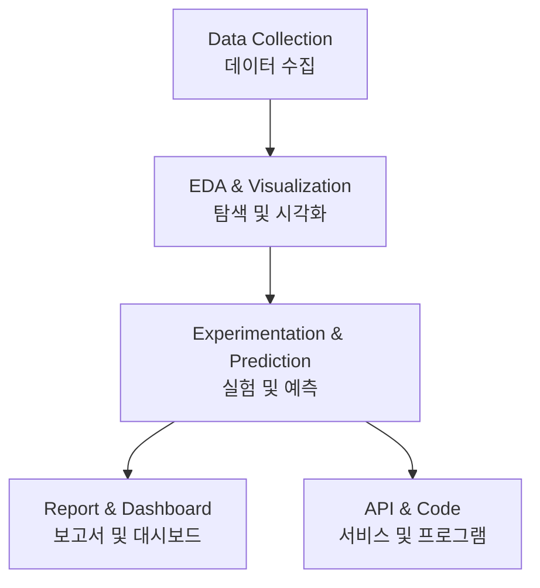

이 흐름을 단계별로 살펴보자.

---

## 1. 데이터 수집(Data Collection)

데이터 수집은 해결하려는 문제와 관련된 데이터를 확보하는 단계다.

데이터는 다양한 시스템에서 생성될 수 있다.

예를 들어 다음과 같은 데이터 소스를 생각해 볼 수 있다.

| 데이터 소스 | 데이터 예시 |
|---|---|
| RDBMS | 회원, 주문, 결제 |
| MongoDB | 콘텐츠 및 이벤트 문서 |
| Redis | 캐시 및 일부 실시간 상태 |
| Kafka | 이벤트 스트림 |
| 외부 API | 기상, 환율, 위치 |
| 웹사이트 | 공개된 웹 페이지의 정보 |
| IoT 센서 | 온도, 습도, 진동 |
| 애플리케이션 로그 | 요청, 오류, 사용자 행동 |

데이터 수집에서 중요한 것은 데이터를 많이 모으는 것이 아니라 **분석 목적에 필요한 데이터를 적절하게 수집하는 것**이다.

예를 들어 결제 실패 원인을 분석하려면 단순히 결제 실패 건수만 수집하는 것으로는 부족할 수 있다.

다음 데이터가 함께 필요할 수 있다.

| 데이터 | 분석 목적 |
|---|---|
| 결제 시도 시간 | 시간대별 실패 패턴 |
| 결제 수단 | 결제 수단별 실패율 |
| PG사 응답 코드 | 외부 결제 실패 원인 |
| 사용자 국가 | 국가별 차이 |
| 요청 처리 시간 | Timeout 관련 분석 |
| 재시도 횟수 | 반복 실패 패턴 |

다만 개인정보와 민감한 정보는 목적에 필요한 범위 내에서 적절하게 수집하고 보호해야 한다.

데이터를 수집할 수 있다는 사실과 수집해도 된다는 것은 별개의 문제다.

---

## 2. 데이터 탐색 및 시각화(EDA & Visualization)

### EDA란?

EDA(Exploratory Data Analysis)는 탐색적 데이터 분석을 의미한다.

수집된 데이터의 구조와 특성을 이해하고, 데이터에 포함된 패턴이나 이상 징후를 발견하는 과정이다.

EDA에서는 다음과 같은 질문을 할 수 있다.

- 데이터는 총 몇 건인가?
- 누락된 값은 얼마나 존재하는가?
- 특정 값에 데이터가 집중되어 있는가?
- 평균과 중앙값은 어떻게 다른가?
- 비정상적으로 크거나 작은 값이 존재하는가?
- 변수 사이에 관계가 존재하는가?
- 시간에 따른 변화가 발생하는가?

예를 들어 결제 데이터를 분석한다고 가정해 보자.

다음과 같은 데이터가 있다.

| 결제 ID | 결제 금액 | 결제 수단 | 처리 시간 |
|---|---:|---|---:|
| 1001 | 10,000 | CARD | 120ms |
| 1002 | 30,000 | CARD | 150ms |
| 1003 | 15,000 | PAYPAL | 180ms |
| 1004 | 20,000 | PAYPAL | 3,500ms |
| 1005 | 50,000 | CARD | 130ms |

대부분의 결제는 수백 밀리초 안에 처리되었다.

하지만 한 건은 3,500ms가 소요되었다.

이때 다음 질문을 할 수 있다.

**"왜 해당 결제만 처리 시간이 길었을까?"**

이것이 데이터 탐색의 시작이다.

실제 분석에서는 더 많은 데이터를 수집하여 다음 항목을 확인할 수 있다.

- PG사별 처리 시간 분포
- 결제 수단별 P95·P99 처리 시간
- 시간대별 Timeout 발생률
- 국가별 네트워크 지연
- 오류 코드별 처리 시간

단순히 평균값만 확인하는 것보다 데이터의 분포와 패턴을 함께 분석하는 것이 중요하다.

### 데이터 시각화

EDA에서는 시각화를 자주 활용한다.

시각화는 숫자만으로 파악하기 어려운 패턴과 관계를 그래프로 표현하는 방법이다.

대표적인 시각화 방식은 다음과 같다.

| 시각화 방식 | 주요 목적 |
|---|---|
| Line Chart | 시간에 따른 변화 |
| Bar Chart | 항목별 값 비교 |
| Histogram | 데이터 분포 |
| Scatter Plot | 변수 간 관계 |
| Box Plot | 분포와 이상치 확인 |
| Heatmap | 값의 분포 및 관계 |
| Map | 공간적 패턴 |

예를 들어 시간대별 결제 건수를 Line Chart로 표현하면 특정 시간대에 트래픽이 집중되는지 확인할 수 있다.

또한 결제 금액의 분포를 Histogram으로 표현하면 소액 결제가 많은지, 고액 결제가 많은지 파악할 수 있다.

**EDA의 목적은 예쁜 그래프를 만드는 것이 아니라 데이터가 가진 구조와 문제를 이해하는 것**이다.

---

## 3. 실험 및 예측(Experimentation & Prediction)

데이터의 구조를 이해했다면 분석 목적에 따라 실험이나 예측을 수행할 수 있다.

### 실험

실험은 특정 가설을 검증하기 위한 활동이다.

예를 들어 다음과 같은 가설을 생각해 보자.

> 결제 화면에서 불필요한 입력 단계를 줄이면 구매 완료율이 증가할 것이다.

이 가설을 검증하기 위해 사용자 집단을 구분할 수 있다.

| 집단 | 결제 화면 |
|---|---|
| A | 기존 결제 화면 |
| B | 입력 단계를 줄인 화면 |

이후 두 집단의 구매 완료율을 비교할 수 있다.

하지만 단순히 B 집단의 구매율이 더 높다는 사실만으로 변경 효과를 확정할 수는 없다.

표본 수와 집단 구성, 통계적 불확실성, 실험 설계 등을 함께 고려해야 한다.

### 예측

예측은 과거 데이터의 패턴을 이용하여 앞으로 발생할 결과를 추정하는 활동이다.

예를 들어 다음과 같은 기능이 있다.

| 예측 대상 | 입력 데이터 | 결과 |
|---|---|---|
| 구매 가능성 | 사용자 행동·구매 이력 | 구매 확률 |
| 배송 지연 | 운송 이력·기상·항만 상태 | 지연 가능성 |
| 결제 실패 | 결제 수단·국가·응답 이력 | 실패 가능성 |
| 사용자 이탈 | 접속·이용·결제 이력 | 이탈 위험 |
| 설비 고장 | 센서·정비 이력 | 고장 가능성 |

예측 모델을 개발할 때는 실제로 예측하려는 시점에 사용할 수 있는 데이터만 입력으로 사용해야 한다.

예를 들어 결제 실패를 미리 예측하는 모델에 **결제가 완료된 이후에만 알 수 있는 최종 실패 코드**를 입력한다면 문제가 발생한다.

모델 학습 시점에는 높은 정확도를 얻을 수 있어도, 실제 예측 시점에는 해당 데이터를 사용할 수 없기 때문이다.

이러한 문제는 데이터 누수(Data Leakage)의 한 형태다.

데이터 누수를 방지하려면 학습 데이터와 평가 데이터를 적절하게 분리하고, 전처리 과정에서도 평가 데이터의 정보가 학습에 유입되지 않도록 해야 한다. [Scikit-learn](https://scikit-learn.org/stable/common_pitfalls.html?highlight=kfold\&utm_source=chatgpt.com)

---

## 데이터 사이언스의 최종 결과물은 무엇일까?

데이터 사이언스의 결과물이 반드시 인공지능 모델인 것은 아니다.

분석 목적에 따라 서로 다른 형태의 결과물을 만들 수 있다.

크게 다음 두 가지로 구분할 수 있다.

**사람이 직접 활용하는 결과물**

보고서와 대시보드

**다른 시스템이 활용하는 결과물**

API와 프로그램 코드

### 1. Report & Dashboard

보고서와 대시보드는 분석 결과를 사람이 이해하고 의사결정에 활용하도록 제공하는 방식이다.

예를 들어 구독 서비스의 운영 현황을 분석한다고 가정해 보자.

다음과 같은 지표를 제공할 수 있다.

| 지표 | 의미 |
|---|---|
| 신규 구독자 수 | 새롭게 구독을 시작한 사용자 |
| 구독 해지율 | 일정 기간 동안 구독을 해지한 비율 |
| 결제 성공률 | 전체 결제 시도 중 성공한 비율 |
| 매출 | 기간별 결제 금액 |
| 재구독률 | 해지 이후 재구독한 사용자 비율 |

이러한 지표를 대시보드로 제공하면 운영 담당자는 서비스 상태를 빠르게 파악할 수 있다.

또한 기간별 변화를 분석하여 특정 마케팅 활동이나 서비스 변경이 어떤 영향을 주었는지 확인할 수 있다.

### 2. API & Code

분석 결과를 다른 시스템에서 자동으로 활용할 수도 있다.

예를 들어 사용자 이탈 가능성을 예측하는 모델을 개발했다고 가정해 보자.

백엔드 애플리케이션은 특정 사용자의 이탈 위험도를 요청할 수 있다.

예측 시스템은 해당 사용자의 정보를 바탕으로 위험도를 계산하여 반환한다.

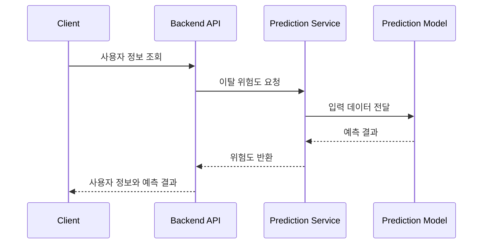

이 구조에서는 사람이 매번 보고서를 확인하지 않아도 애플리케이션이 분석 결과를 사용할 수 있다.

다만 예측 결과를 자동으로 실행에 반영할지는 별도의 정책 문제다.

예를 들어 결제 사기 탐지 모델이 특정 거래를 위험하다고 판단하더라도 이를 즉시 차단할지, 추가 인증을 요청할지, 운영자 검토를 거칠지는 서비스의 위험과 비용을 고려하여 결정해야 한다.

### 보고서와 API 비교

| 항목 | Report & Dashboard | API & Code |
|---|---|---|
| 주요 사용자 | 사람 | 애플리케이션 |
| 활용 방식 | 직접 확인 및 판단 | 자동 호출 및 처리 |
| 대표 결과 | KPI, 그래프, 보고서 | 예측값, 분류 결과, 점수 |
| 주요 요구사항 | 이해하기 쉬운 표현 | 응답 시간, 안정성, 일관성 |
| 주요 활용 | 비즈니스 의사결정 | 서비스 자동화 |

결국 데이터 사이언스의 결과물은 **누가, 어떤 방식으로 활용할 것인가**에 따라 달라진다.

---

## 데이터 분석(Data Analytics)이란?

### 데이터 분석의 개념

데이터 분석은 문제를 발견하고, 관련 데이터를 수집·가공·분석하여 의미 있는 정보를 도출하고, 그 결과를 업무나 시스템 개선에 활용하는 활동이다.

일반적으로 다음과 같은 흐름으로 진행된다.

**문제 발견 → 데이터 수집 및 가공 → 데이터 분석 → 액션**

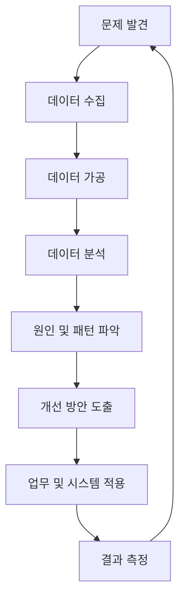

이 흐름에서 중요한 점은 문제를 먼저 정의한다는 것이다.

분석 목적이 명확하지 않으면 데이터를 많이 수집하더라도 의미 있는 결과를 얻기 어렵다.

### 데이터 분석의 실제 예시

구독형 서비스에서 결제 실패율이 증가했다고 가정해 보자.

**1단계: 문제 발견**

최근 결제 실패율이 평소보다 높아졌다.

**2단계: 데이터 수집**

결제 시도 이력, 결제 수단, PG사 응답 코드, 사용자 국가, 재시도 이력 등을 확보한다.

**3단계: 데이터 가공**

중복 요청을 구분하고, 오류 코드를 표준화하며, 분석 기간을 통일한다.

**4단계: 데이터 분석**

결제 수단과 국가, 시간대별 실패율을 분석한다.

**5단계: 원인 및 패턴 확인**

특정 결제 수단에서 실패가 집중되는지 확인한다.

**6단계: 개선 방안 도출**

외부 결제 요청의 Timeout, 재시도 정책, 사용자 안내 등을 검토한다.

**7단계: 시스템 적용**

검증된 개선 방안을 서비스에 반영한다.

**8단계: 결과 측정**

변경 이후 결제 실패율과 사용자 경험이 실제로 개선되었는지 확인한다.

이 과정은 백엔드 개발에서도 중요한 문제 해결 방식이다.

특히 장애 대응이나 성능 최적화 과정에서도 유사한 접근 방식을 사용할 수 있다.

---

## 데이터 분석과 머신러닝의 차이

데이터 분석과 머신러닝은 밀접하게 연결되어 있지만 목적이 항상 같지는 않다.

데이터 분석은 현재 상황이나 과거 현상을 이해하는 데 활용할 수 있다.

머신러닝은 데이터에서 학습한 패턴을 이용하여 새로운 데이터에 대한 예측이나 판단을 수행할 수 있다.

| 항목 | 데이터 분석 | 머신러닝 |
|---|---|---|
| 주요 목적 | 현상 이해와 인사이트 발견 | 패턴 학습 및 예측 |
| 대표 질문 | 왜 결제 실패율이 증가했을까? | 이 결제가 실패할 가능성은? |
| 대표 방법 | SQL, 집계, 통계, 시각화 | 분류, 회귀, 군집화 등 |
| 결과 | 분석 결과, 인사이트 | 학습된 모델, 예측 결과 |
| 활용 | 의사결정 | 예측 및 자동화 |

예를 들어 지난달의 결제 실패 원인을 분석하는 것은 데이터 분석에 해당한다.

반면 현재 진행 중인 결제가 실패할 가능성을 사전에 예측하는 모델을 만드는 것은 머신러닝의 활용 예시다.

다만 머신러닝 역시 데이터 분석 과정에서 활용될 수 있으므로 두 영역을 완전히 분리해서 이해할 필요는 없다.

---

## 빅데이터 분석에서 알고리즘·병렬 연산·데이터가 중요한 이유

대규모 데이터를 분석하고 복잡한 패턴을 발견하려면 세 가지 요소가 중요하다.

**알고리즘 + 연산 기술 + 데이터**

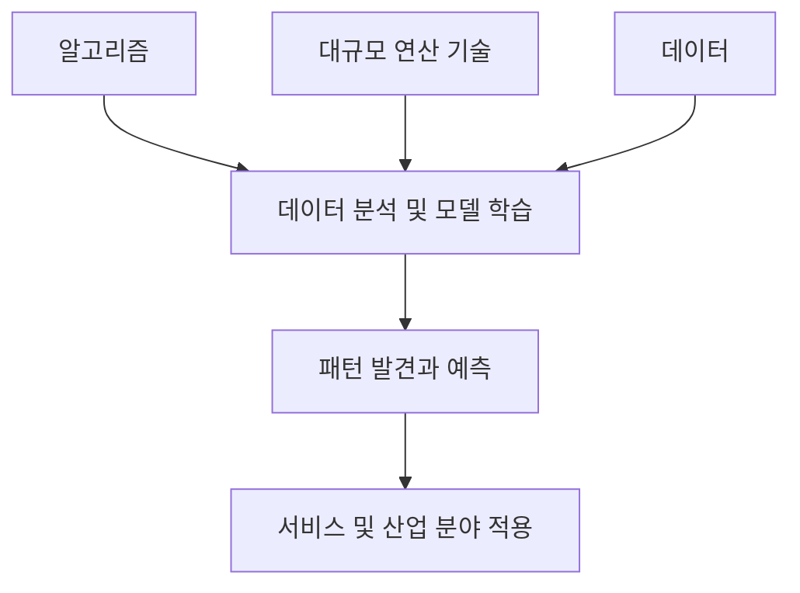

각 요소의 역할을 살펴보자.

### 1. 알고리즘

알고리즘은 주어진 문제를 해결하기 위한 절차나 방법이다.

데이터 분석에서는 다음과 같은 알고리즘을 활용할 수 있다.

- 통계 분석 알고리즘
- 분류 알고리즘
- 회귀 알고리즘
- 군집화 알고리즘
- 딥러닝 알고리즘

예를 들어 사용자가 서비스를 해지할 가능성을 예측하려면 기존 사용자 데이터를 바탕으로 분류 모델을 학습할 수 있다.

### 2. 대규모 연산 기술

데이터가 많아지거나 모델이 복잡해지면 단일 CPU에서 처리하는 데 오랜 시간이 걸릴 수 있다.

이때 병렬 연산을 활용할 수 있다.

병렬 연산은 여러 작업을 동시에 수행하여 전체 처리 시간을 줄이기 위한 방법이다.

대표적인 방식으로 다음과 같은 접근을 생각할 수 있다.

| 방식 | 설명 |
|---|---|
| 멀티스레드 | 여러 스레드를 이용한 병렬 처리 |
| 멀티프로세스 | 여러 프로세스에서 작업 수행 |
| 분산 처리 | 여러 서버에 작업을 분배 |
| GPU 연산 | 대량의 수치 연산을 병렬 처리 |

단, 병렬 처리한다고 모든 작업이 비례하여 빨라지는 것은 아니다.

데이터 이동 비용과 작업 간 의존성, 동기화 비용 등이 발생할 수 있기 때문이다.

### 3. 데이터

알고리즘과 연산 능력이 충분하더라도 분석 목적에 적합한 데이터가 없다면 유용한 결과를 얻기 어렵다.

예를 들어 물류 도착 시간을 예측하는 모델을 개발한다고 가정해 보자.

선박 위치 정보만으로는 충분하지 않을 수 있다.

기상, 항만 혼잡도, 운송 이력 등의 정보가 추가로 필요할 수 있다.

또한 데이터가 많더라도 측정 오류나 누락이 심하면 모델 성능이 저하될 수 있다.

따라서 **알고리즘의 복잡도보다 데이터 품질과 문제 정의가 더 중요한 상황도 존재한다.**

---

## 데이터 관리(Data Management)란?

데이터 분석을 수행하기 위해서는 데이터를 안정적으로 수집하고 저장하며 처리할 수 있어야 한다.

이러한 작업을 포괄하는 개념이 데이터 관리다.

데이터 관리의 전체 흐름은 다음과 같이 구분할 수 있다.

**Data Source → Collection → Storage → Processing → Analytics → Presentation**

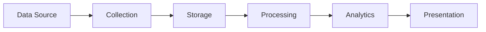

각 단계는 서로 다른 책임을 가진다.

---

## 1. 데이터 소스(Data Source)

데이터 소스는 분석 대상 데이터가 생성되거나 존재하는 위치를 의미한다.

대표적으로 다음과 같이 구분할 수 있다.

| 유형 | 설명 | 예시 |
|---|---|---|
| 내부 데이터 | 조직 내부 시스템에서 생성 | 회원, 주문, 결제 |
| 외부 데이터 | 외부 기관이나 서비스에서 제공 | 기상, 환율, 공개 통계 |
| 미디어 데이터 | 이미지·영상·음성 등의 데이터 | 상품 이미지, 영상, 음성 |

### 내부 데이터

기업이 운영하는 애플리케이션과 데이터베이스에서 생성되는 데이터다.

예를 들어 주문 서비스에서 발생하는 주문 이력이나 결제 시스템에서 생성되는 거래 정보 등이 있다.

### 외부 데이터

외부 API 또는 외부 기관에서 제공하는 데이터다.

예를 들어 물류 서비스에서 기상 정보를 활용하거나 환율 데이터를 이용하여 해외 거래 금액을 분석할 수 있다.

### 미디어 데이터

이미지와 영상, 음성 등의 데이터다.

미디어 데이터는 텍스트나 숫자와 다른 처리 방식이 필요할 수 있다.

예를 들어 이미지 분석에는 이미지 인식 모델을 활용할 수 있고, 음성 분석에는 음성 인식 기술을 활용할 수 있다.

---

## 2. 데이터 수집(Collection)

데이터 수집은 여러 소스에서 필요한 데이터를 가져오는 단계다.

크게 수동 수집과 자동 수집으로 나눌 수 있다.

### 수동 수집

사용자가 직접 데이터를 입력하거나 파일을 업로드하는 방식이다.

예를 들어 다음과 같은 작업이다.

- Excel 파일 업로드
- CSV 파일 등록
- 관리자 시스템을 통한 데이터 입력

### 자동 수집

프로그램이나 시스템을 이용하여 데이터를 자동으로 확보하는 방식이다.

예를 들어 다음과 같다.

| 방식 | 활용 예시 |
|---|---|
| API 호출 | 외부 서비스 데이터 수집 |
| 로그 수집 | 서버 및 애플리케이션 로그 |
| 웹 크롤링 | 웹 페이지 데이터 추출 |
| 이벤트 스트리밍 | 사용자 행동 이벤트 |
| 센서 수집 | IoT 장치 데이터 |
| ETL | 여러 데이터 소스의 데이터 통합 |

### 수집 과정에서 고려해야 할 사항

데이터 수집은 단순히 데이터를 가져오는 것으로 끝나지 않는다.

다음과 같은 문제가 발생할 수 있다.

- 동일한 데이터가 중복 수집된다.
- 데이터가 일부 누락된다.
- 데이터 형식이 변경된다.
- 데이터 생성 시각과 수집 시각이 다르다.
- 외부 API 요청이 실패한다.
- 수집 순서가 뒤바뀐다.

이러한 문제를 고려하지 않으면 분석 결과가 왜곡될 수 있다.

따라서 데이터 수집 단계에서도 오류 처리와 재시도, 중복 제거, 데이터 검증 등이 필요하다.

---

## 3. 데이터 저장(Storage)

수집한 데이터를 분석에 활용하려면 적절한 저장소에 보관해야 한다.

저장 기술은 데이터의 구조와 목적에 따라 달라진다.

### 정형 데이터

정형 데이터는 미리 정의된 구조를 가진 데이터다.

예를 들어 다음과 같은 주문 정보가 있다.

| order_id | user_id | amount | status |
|---|---|---:|---|
| 1001 | 101 | 30,000 | COMPLETED |
| 1002 | 102 | 50,000 | CANCELLED |

이러한 데이터는 관계형 데이터베이스에서 관리하기에 적합할 수 있다.

### 반정형 데이터

반정형 데이터는 일정한 구조를 가지지만 데이터마다 필드가 달라질 수 있는 데이터다.

대표적으로 JSON 문서가 있다.

예를 들어 사용자 행동 이벤트는 이벤트 유형에 따라 서로 다른 속성을 가질 수 있다.

이러한 데이터는 MongoDB와 같은 Document Database에 저장하는 방식을 고려할 수 있다.

### 비정형 데이터

비정형 데이터는 고정된 테이블 구조로 표현하기 어려운 데이터를 의미한다.

대표적으로 다음과 같은 데이터가 있다.

- 이미지
- 동영상
- 음성
- 자유 형식의 텍스트

이러한 데이터는 파일 시스템이나 객체 스토리지에 저장하고 별도의 메타데이터를 관리할 수 있다.

### 데이터 저장 기술 비교

| 기술 | 주요 특징 | 대표적인 활용 |
|---|---|---|
| RDBMS | 관계형 구조와 SQL | 정형 비즈니스 데이터 |
| MongoDB | Document 기반 저장 | 유연한 문서 데이터 |
| Redis | 빠른 메모리 기반 데이터 접근 | 캐시 및 상태 데이터 |
| 분산 파일 시스템 | 여러 노드에 파일 분산 저장 | 대규모 파일 처리 |
| 객체 스토리지 | 객체 단위 데이터 저장 | 원본 파일, 데이터 레이크 |

여기서 중요한 것은 모든 데이터를 반드시 하나의 저장소에 넣을 필요가 없다는 점이다.

서비스 데이터와 분석용 데이터의 특성이 다르다면 저장소를 분리하는 것도 고려할 수 있다.

---

## 4. 데이터 처리(Processing)

데이터 처리는 수집한 데이터를 분석 가능한 형태로 변환하거나 필요한 계산을 수행하는 단계다.

대표적으로 다음과 같은 작업이 있다.

- 데이터 정제
- 중복 제거
- 데이터 형식 변환
- 데이터 결합
- 집계
- 필터링
- 정렬
- 이상치 처리
- 통계 계산

데이터 처리 방식은 크게 Batch Processing과 Stream Processing으로 구분할 수 있다.

### Batch Processing

Batch Processing은 일정 기간 동안 쌓인 데이터를 모아서 처리하는 방식이다.

예를 들어 하루 동안 발생한 결제 데이터를 매일 새벽에 집계할 수 있다.


배치 처리에 적합한 작업은 다음과 같다.

- 일별 매출 집계
- 월별 정산
- 통계 리포트 생성
- 대량 데이터 정제
- 과거 데이터 분석

### Stream Processing

Stream Processing은 데이터가 지속적으로 발생하는 환경에서 데이터를 연속적으로 처리하는 방식이다.

예를 들어 사용자 클릭 이벤트를 수집하여 실시간 인기 상품 순위를 계산할 수 있다.


스트림 처리에서는 데이터가 발생하는 순서와 지연, 중복, 집계 시간 범위 등을 고려해야 한다.

또한 스트림 처리라고 해서 모든 결과가 지연 없이 즉시 반영된다는 뜻은 아니다.

실제 처리 지연은 시스템 구성과 워크로드에 따라 달라진다.

### Batch와 Stream 비교

| 항목 | Batch Processing | Stream Processing |
|---|---|---|
| 처리 대상 | 일정 기간 누적된 데이터 | 지속적으로 발생하는 데이터 |
| 처리 시점 | 정해진 시점 또는 조건 | 데이터 유입에 따라 지속 |
| 주요 목적 | 대량 집계 및 정기 처리 | 빠른 분석 및 반응 |
| 대표 사례 | 일별 매출 집계 | 실시간 이상 거래 탐지 |
| 주요 고려사항 | 처리량, 실행 시간, 재처리 | 지연, 중복, 순서, 상태 관리 |

실제 시스템에서는 두 방식을 함께 사용하는 경우도 있다.

예를 들어 실시간 대시보드는 스트림 처리로 구성하고, 정산과 같은 정확성이 중요한 최종 집계는 배치 처리로 수행할 수 있다.

---

## 분산 처리(Distributed Processing)란?

데이터 규모가 증가하면 하나의 서버에서 모든 작업을 수행하기 어려워질 수 있다.

분산 처리는 여러 서버에 작업을 나누어 수행하는 방식이다.

예를 들어 1억 건의 데이터를 분석한다고 가정해 보자.

단일 서버에서는 모든 데이터를 읽고 계산해야 한다.

반면 분산 처리 환경에서는 데이터를 여러 노드에 나누어 저장하고 처리할 수 있다.

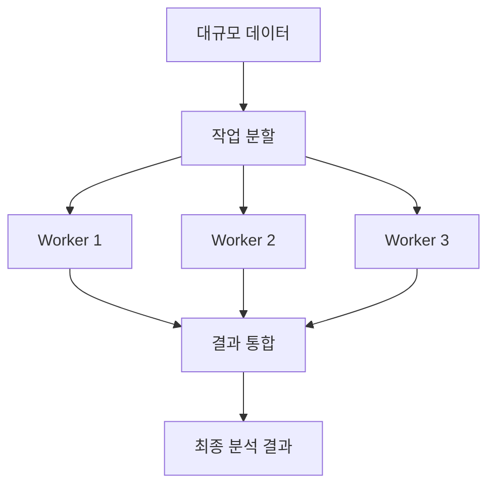

분산 처리의 장점은 여러 서버의 연산 능력을 활용할 수 있다는 것이다.

하지만 단점도 존재한다.

- 네트워크 통신 비용 발생
- 데이터 이동 비용 증가
- 노드 장애 처리 필요
- 데이터 분산 전략 필요
- 작업 간 동기화 복잡성 증가

따라서 데이터가 작고 단일 서버에서 충분히 처리할 수 있다면 분산 처리가 오히려 복잡성을 증가시킬 수 있다.

**분산 처리는 데이터 규모 자체보다 처리 요구사항과 시스템 비용을 기준으로 도입해야 한다.**

---

## Hadoop과 MapReduce 이해하기

대규모 데이터 처리 기술을 이해할 때 자주 등장하는 기술이 Hadoop과 MapReduce다.

### Hadoop이란?

Apache Hadoop은 여러 컴퓨터를 이용하여 대규모 데이터를 저장하고 처리할 수 있도록 지원하는 오픈소스 프레임워크다.

Hadoop은 하나의 데이터베이스 제품이 아니라 여러 구성 요소로 이루어진 생태계다.

대표적인 구성 요소는 다음과 같다.

| 구성 요소 | 역할 |
|---|---|
| HDFS | 분산 파일 저장 |
| YARN | 클러스터 자원 관리 |
| MapReduce | 분산 데이터 처리 모델 |
| Hadoop Common | 공통 라이브러리와 유틸리티 |

### HDFS

HDFS(Hadoop Distributed File System)는 여러 서버에 파일을 분산하여 저장하는 파일 시스템이다.

데이터를 여러 블록으로 나누어 분산 저장하고, 구성에 따라 복제를 통해 장애에 대응할 수 있다.

### MapReduce

MapReduce는 대규모 데이터를 병렬로 처리하기 위한 프로그래밍 모델이다.

일반적으로 Map과 Reduce 단계로 구성된다.

#### Map

입력 데이터를 분석하여 중간 결과를 생성한다.

#### Reduce

중간 결과를 키를 기준으로 집계하거나 결합한다.

예를 들어 단어의 등장 횟수를 계산한다고 가정해 보자.

입력 데이터는 다음과 같다.

| 문서 | 내용 |
|---|---|
| A | MongoDB Redis |
| B | MongoDB Kafka |
| C | Redis MongoDB |

Map 단계에서는 단어별로 값을 생성한다.

| 단어 | 값 |
|---|---|
| MongoDB | 1 |
| Redis | 1 |
| MongoDB | 1 |
| Kafka | 1 |
| Redis | 1 |
| MongoDB | 1 |

이후 같은 단어를 묶는다.

Reduce 단계에서는 값을 합산한다.

| 단어 | 등장 횟수 |
|---|---:|
| MongoDB | 3 |
| Redis | 2 |
| Kafka | 1 |

전체 구조는 다음과 같다.

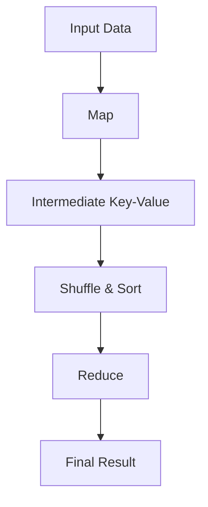

MapReduce는 대규모 데이터 처리를 여러 작업으로 나누는 방법을 이해하는 데 중요한 개념이다.

다만 Hadoop을 사용한다고 모든 분석 작업에 MapReduce를 직접 구현해야 하는 것은 아니다.

Hadoop의 저장 기능과 분산 처리 프레임워크는 별개의 구성 요소이며, 데이터 처리 목적에 따라 다양한 실행 엔진을 사용할 수 있다.

Apache Hadoop 공식 문서에서도 HDFS와 MapReduce를 서로 다른 구성 요소로 설명한다. [hadoop.apache.org](https://hadoop.apache.org/docs/current1/?utm_source=chatgpt.com)

---

## 5. 데이터 분석(Analytics)

데이터 분석 단계에서는 처리된 데이터에서 의미 있는 패턴이나 관계를 찾아낸다.

대표적인 분석 방법은 다음과 같다.

| 분석 방법 | 주요 목적 |
|---|---|
| 통계 분석 | 데이터의 특성과 관계 파악 |
| 데이터 마이닝 | 숨겨진 패턴 발견 |
| 텍스트 마이닝 | 텍스트에서 정보 추출 |
| 예측 분석 | 미래 결과 예측 |
| 최적화 | 주어진 제약 안에서 적절한 해 탐색 |
| 평판 분석 | 리뷰나 의견의 경향 파악 |
| 소셜 네트워크 분석 | 개체 간 관계와 연결 구조 분석 |

각 방법을 살펴보자.

### 통계 분석

통계 분석은 데이터의 분포와 관계를 이해하고 가설을 검증하는 데 활용한다.

예를 들어 다음과 같은 질문에 답할 수 있다.

- 평균 결제 금액은 얼마인가?
- 사용자별 구매 횟수는 어떻게 분포하는가?
- 특정 변경 전후에 차이가 존재하는가?

### 데이터 마이닝

데이터에서 반복적으로 나타나는 패턴이나 관계를 발견한다.

예를 들어 어떤 상품들이 함께 구매되는지 분석할 수 있다.

### 텍스트 마이닝

텍스트 데이터에서 의미 있는 정보를 추출한다.

예를 들어 고객 문의 내용을 분석하여 자주 발생하는 문제를 분류할 수 있다.

### 예측 분석

과거 데이터를 이용하여 앞으로 발생할 결과를 예측한다.

예를 들어 고객 이탈 가능성이나 상품 수요를 예측할 수 있다.

### 최적화

여러 제약 조건을 고려하여 적절한 해결책을 찾는다.

예를 들어 물류 서비스에서 운송 비용과 배송 시간을 고려하여 운송 경로를 결정할 수 있다.

### 평판 분석

사용자 리뷰나 온라인 의견을 분석하여 특정 제품이나 서비스에 대한 인식을 파악할 수 있다.

### 소셜 네트워크 분석

사용자나 조직 등 개체 사이의 관계를 분석한다.

예를 들어 사용자 간 연결 구조를 통해 영향력이 높은 계정을 파악할 수 있다.

---

## 6. 데이터 표현(Presentation)

데이터 표현은 분석 결과를 사용자가 이해하기 쉬운 형태로 제공하는 단계다.

데이터를 분석하여 중요한 정보를 발견했더라도 결과를 이해하기 어렵다면 활용도가 낮아질 수 있다.

예를 들어 다음과 같은 숫자 데이터가 있다고 가정해 보자.

| 월 | 신규 구독자 |
|---|---:|
| 1월 | 1,000 |
| 2월 | 1,200 |
| 3월 | 1,450 |
| 4월 | 1,800 |

이 데이터를 Line Chart로 표현하면 월별 신규 구독자의 증가 추세를 직관적으로 확인할 수 있다.

데이터 표현 방식은 전달하려는 정보의 성격에 따라 선택해야 한다.

### 시각화 유형

| 유형 | 주요 목적 | 대표 차트 |
|---|---|---|
| 시간 시각화 | 시간에 따른 변화 | Line Chart |
| 분포 시각화 | 값의 분포 확인 | Histogram, Box Plot |
| 관계 시각화 | 변수 간 관계 | Scatter Plot |
| 비교 시각화 | 항목별 차이 | Bar Chart |
| 공간 시각화 | 위치 기반 패턴 | Map |
| 인포그래픽 | 정보를 종합적으로 전달 | 구조도, 요약 시각화 |

여기서 중요한 것은 시각화의 목적이다.

단순히 다양한 차트를 사용하는 것보다 분석 결과를 가장 정확하게 전달할 수 있는 표현 방식을 선택해야 한다.

예를 들어 시간에 따른 변화는 Line Chart가 적합할 수 있다.

반면 항목별 크기를 비교하려면 Bar Chart가 더 적합할 수 있다.

---

## ETL이란?

데이터 수집과 저장을 설명할 때 중요한 개념이 ETL이다.

ETL은 다음 세 단어의 약자다.

**Extract → Transform → Load**

| 단계 | 의미 |
|---|---|
| Extract | 데이터 추출 |
| Transform | 데이터 변환 |
| Load | 데이터 적재 |

### Extract

여러 데이터 소스에서 필요한 데이터를 추출한다.

예를 들어 주문 서비스와 결제 서비스에서 데이터를 가져올 수 있다.

### Transform

추출한 데이터를 분석 목적에 맞게 변환한다.

대표적으로 다음과 같은 작업이 있다.

- 날짜 형식 통일
- 통화 단위 변환
- 중복 데이터 제거
- 상태 코드 표준화
- 데이터 결합
- 잘못된 값 처리

### Load

변환한 데이터를 분석용 저장소에 적재한다.

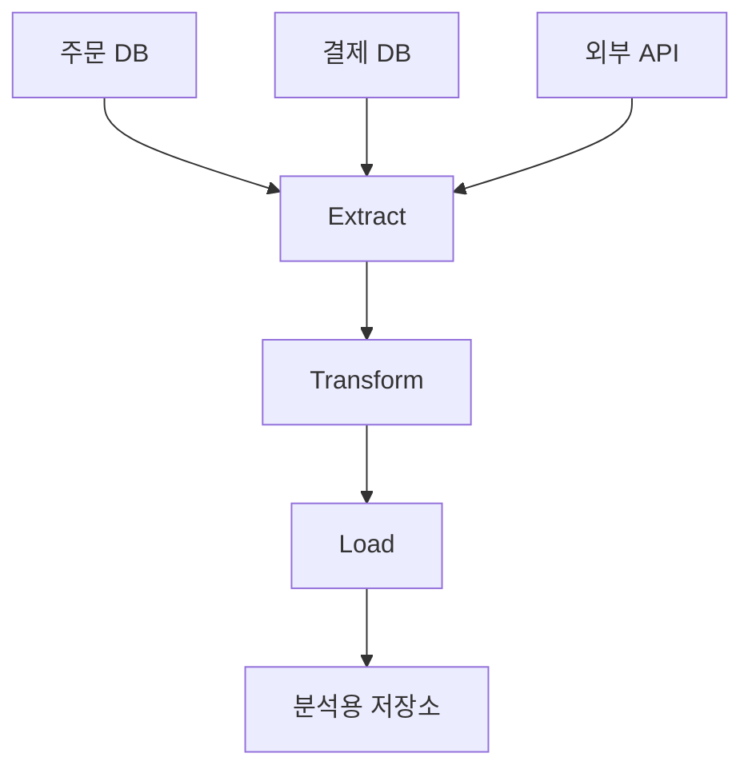

### ETL이 필요한 이유

여러 시스템의 데이터는 서로 다른 구조를 가질 수 있다.

예를 들어 주문 서비스에서는 상태를 다음과 같이 관리한다고 가정해 보자.

`COMPLETED`

반면 다른 시스템에서는 다음 값을 사용할 수 있다.

`SUCCESS`

이 두 값이 동일한 업무 의미를 나타낸다면 분석 과정에서 표준화할 필요가 있다.

또한 시간대가 서로 다른 시스템의 데이터를 결합한다면 날짜와 시간 기준을 통일해야 한다.

이러한 데이터 표준화 작업은 분석 결과의 정확성을 높이는 데 중요하다.

### ETL과 ELT

실무에서는 ETL 외에도 ELT 방식을 사용할 수 있다.

ELT는 데이터를 먼저 적재한 다음 분석 환경에서 변환하는 방식이다.

| 구분 | ETL | ELT |
|---|---|---|
| 처리 순서 | 추출 → 변환 → 적재 | 추출 → 적재 → 변환 |
| 변환 위치 | 적재 이전 | 적재 이후 |
| 특징 | 사전 정제된 데이터 적재 | 원본 데이터 활용 유연성 |
| 주요 고려사항 | 변환 시스템의 처리 능력 | 저장소의 변환 및 연산 능력 |

두 방식 중 어느 것이 항상 더 우수한 것은 아니다.

데이터 규모와 저장소의 처리 능력, 원본 데이터 보존 요구사항 등에 따라 선택할 수 있다.

---

## 빅데이터 관리 플랫폼의 전체 구조

데이터 수집부터 분석 결과 제공까지 수행하려면 여러 구성 요소를 연결하는 플랫폼이 필요하다.

데이터 관리 플랫폼은 일반적으로 다음과 같은 기능을 포함할 수 있다.

- 데이터 수집 및 정제
- 데이터 저장 및 관리
- 데이터 처리
- 데이터 분석
- 데이터 표현

하지만 기술 요소만 구성한다고 플랫폼이 완성되는 것은 아니다.

사용자가 데이터를 활용할 수 있는 환경과 시스템을 안정적으로 운영하기 위한 관리 체계도 필요하다.

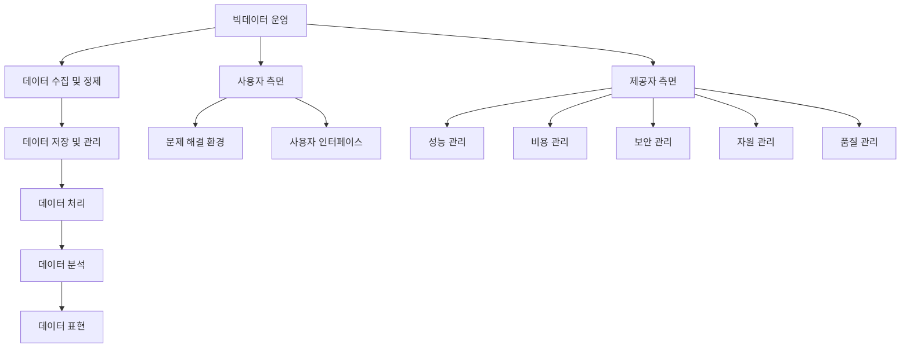

이 구조에서는 플랫폼을 사용하는 사람과 제공하는 사람의 관심사를 구분할 수 있다.

---

## 데이터 플랫폼 사용자와 제공자의 차이

### 사용자 측면

데이터 플랫폼을 사용하는 사람은 데이터를 통해 문제를 해결하는 데 관심이 있다.

예를 들어 데이터 분석가는 다음 기능을 필요로 할 수 있다.

- 분석용 데이터 조회
- 데이터 탐색
- 시각화
- 통계 계산
- 보고서 작성
- 분석 결과 공유

사용자는 데이터가 어떤 서버에 분산되어 있는지보다 필요한 데이터를 얼마나 편리하게 활용할 수 있는지에 관심이 있을 수 있다.

### 제공자 측면

반면 플랫폼 제공자는 데이터 시스템을 안정적으로 운영해야 한다.

주요 관심사는 다음과 같다.

| 영역 | 주요 관심사 |
|---|---|
| 성능 | 데이터 수집·처리·조회 속도 |
| 비용 | 저장소 및 컴퓨팅 비용 |
| 보안 | 접근 제어 및 데이터 보호 |
| 자원 | CPU, 메모리, 네트워크, 스토리지 |
| 품질 | 데이터 정확성, 누락, 중복, 일관성 |
| 안정성 | 장애 대응 및 복구 |
| 운영 | 모니터링, 배포, 변경 관리 |

예를 들어 데이터 분석가는 대시보드에 필요한 데이터가 빠르게 조회되기를 원한다.

반면 플랫폼 엔지니어는 해당 조회가 시스템에 과도한 부하를 발생시키지 않는지도 고려해야 한다.

따라서 사용자 관점의 편의성과 제공자 관점의 안정성을 함께 고려해야 한다.

---

## 데이터 기반 지능 자동화란?

데이터 기반 지능 자동화는 데이터와 분석·학습 기술을 이용하여 시스템이 특정 작업을 자동으로 수행하거나 의사결정을 지원하도록 만드는 접근이다.

대표적으로 다음과 같은 기술을 활용할 수 있다.

- 인공지능
- 머신러닝
- 딥러닝
- 전문가 시스템
- 의사결정 지원 시스템

지능 자동화에서 중요한 점은 자동화의 대상과 수준을 명확하게 정의하는 것이다.

예를 들어 사용자의 문의를 자동으로 분류하는 기능과 금융 거래를 자동으로 차단하는 기능은 위험 수준이 다르다.

따라서 자동화 수준은 업무의 특성과 잘못된 판단이 미치는 영향을 고려하여 결정해야 한다.

### 데이터 기반 지능 자동화 구조

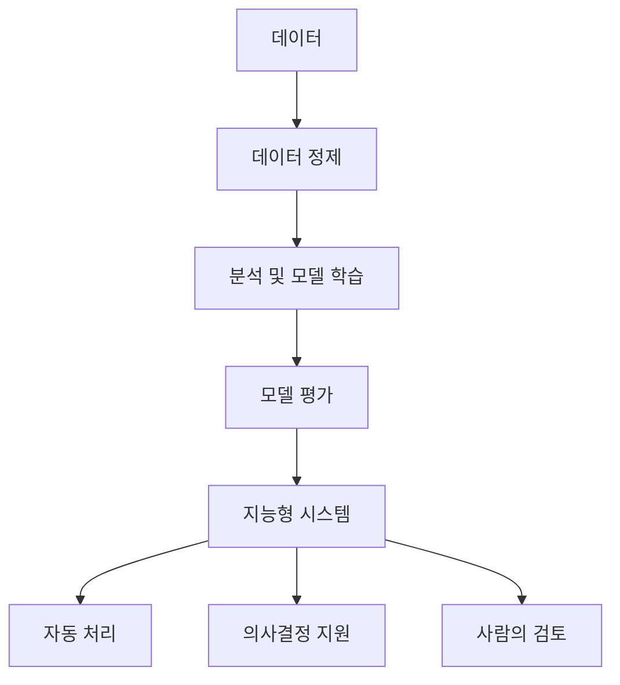

지능 자동화가 반드시 사람의 역할을 완전히 대체한다는 의미는 아니다.

실제로는 시스템이 분석 결과를 제공하고 사람이 최종 결정을 내리는 방식도 중요하다.

---

## 머신러닝과 딥러닝의 관계

### 머신러닝(Machine Learning)

머신러닝은 데이터로부터 패턴을 학습하여 새로운 데이터에 대한 예측이나 판단을 수행하는 기술이다.

대표적으로 다음과 같은 학습 방법이 있다.

| 방법 | 주요 목적 | 활용 예시 |
|---|---|---|
| 분류(Classification) | 범주 예측 | 정상 거래·이상 거래 분류 |
| 회귀(Regression) | 연속적인 값 예측 | 배송 소요 시간 예측 |
| 군집화(Clustering) | 유사한 데이터 그룹화 | 사용자 유형 분석 |

### 딥러닝(Deep Learning)

딥러닝은 여러 계층으로 구성된 신경망을 활용하는 머신러닝의 한 분야다.

이미지와 음성, 자연어 등의 복잡한 데이터를 처리하는 데 활용할 수 있다.

### 관계

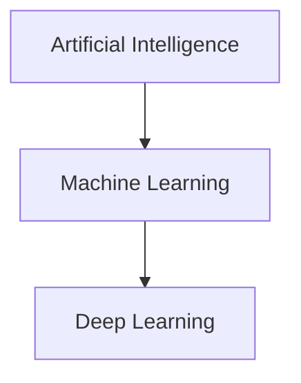

딥러닝은 머신러닝에 포함된다.

머신러닝은 인공지능의 한 분야다.

따라서 인공지능과 머신러닝, 딥러닝을 완전히 같은 개념으로 이해해서는 안 된다.

또한 복잡한 문제라고 해서 항상 딥러닝을 사용해야 하는 것은 아니다.

데이터의 규모와 특성에 따라 전통적인 통계 모델이나 머신러닝 모델이 더 적합할 수 있다.

---

## 데이터 기반 지능 자동화의 활용 분야

데이터 기반 지능 자동화는 다양한 산업 분야에서 활용할 수 있다.

### 1. 인공지능 시스템

분류, 회귀, 군집화 등의 기법을 이용하여 지능형 기능을 개발할 수 있다.

예를 들어 고객 문의를 자동으로 분류하거나, 상품의 구매 가능성을 예측하는 시스템이 있다.

### 2. 고장 진단 및 예측

설비에서 수집되는 데이터를 분석하여 이상 상태를 감지하거나 고장 가능성을 예측할 수 있다.

예를 들어 제조 설비에서 다음 데이터를 수집한다고 가정해 보자.

| 데이터 | 활용 목적 |
|---|---|
| 온도 | 과열 여부 |
| 진동 | 비정상적인 움직임 |
| 전류 | 전력 사용 패턴 |
| 가동 시간 | 설비 사용량 |
| 정비 이력 | 과거 고장과의 관계 |

이러한 데이터를 이용하여 설비의 상태를 분석할 수 있다.

고장이 발생한 이후에만 수리하는 방식에서, 이상 징후를 사전에 탐지하는 방식으로 발전시킬 수 있다.

### 3. 로보틱스(Robotics)

로보틱스는 로봇의 움직임과 제어, 센서 처리 등을 다루는 분야다.

데이터 기반 분석과 학습 기술을 이용하여 로봇의 동작을 개선할 수 있다.

예를 들어 로봇이 주변 환경을 인식하거나 물체를 분류하는 기능에 머신러닝을 활용할 수 있다.

### 4. 물류 자동화

물류 분야에서는 AGV와 UAV 등의 기술을 활용할 수 있다.

AGV(Automated Guided Vehicle)는 자동 유도 차량을 의미한다.

UAV(Unmanned Aerial Vehicle)는 무인 항공기를 의미한다.

물류 자동화에서는 다음과 같은 데이터 기반 기능을 고려할 수 있다.

- 창고 내 운반 경로 최적화
- 물품 위치 추적
- 작업량 예측
- 배송 경로 계산
- 장비 상태 모니터링

### 5. IoT(Internet of Things)

IoT는 다양한 사물과 장치를 네트워크로 연결하여 데이터를 수집하고 활용하는 기술이다.

예를 들어 스마트 센서가 온도와 습도를 측정하고 서버에 데이터를 전송할 수 있다.

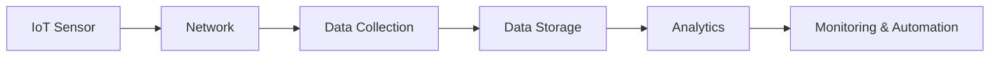

이처럼 데이터 수집과 분석, 자동화를 연결하면 여러 산업 분야에서 활용할 수 있다.

---

## Machine-Human Cooperation이란?

Machine-Human Cooperation은 사람과 기계가 서로의 장점을 활용하여 협력하는 접근이다.

예를 들어 금융 거래 탐지 시스템을 생각해 보자.

머신러닝 모델은 대량의 거래 데이터를 빠르게 분석하여 위험도가 높은 거래를 찾아낼 수 있다.

하지만 모델의 판단이 항상 정확한 것은 아니다.

따라서 고위험 거래는 담당자가 추가로 검토하도록 구성할 수 있다.

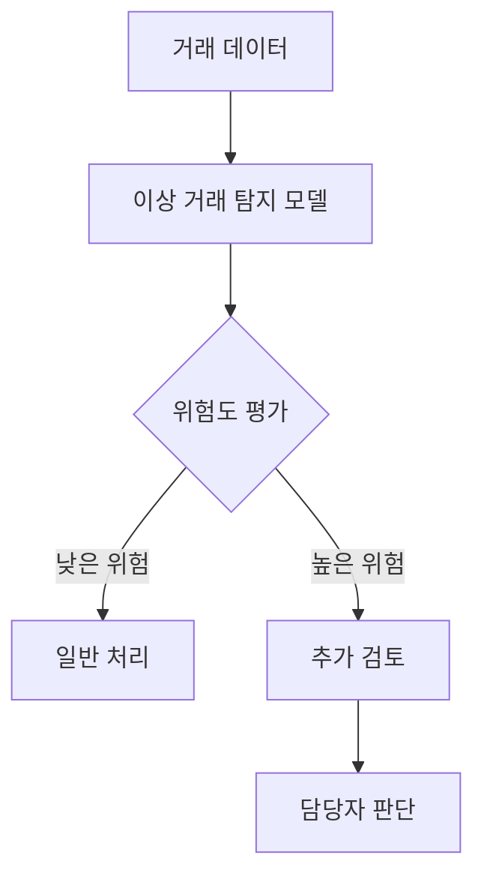

이러한 구조에서는 시스템이 대량의 데이터를 처리하고, 사람은 중요한 판단에 집중할 수 있다.

다만 실제로 어떤 거래를 자동 처리할지, 추가 검토할지는 서비스 정책과 모델 성능, 법적 요구사항 등에 따라 결정해야 한다.

핵심은 자동화 자체보다 **신뢰할 수 있는 의사결정 구조를 만드는 것**이다.

---

## 데이터 분석 경로와 머신러닝 학습 경로

데이터 기반 문제 해결 과정은 크게 두 방향으로 구분할 수 있다.

첫 번째는 데이터를 분석하여 인사이트를 발견하는 경로다.

두 번째는 데이터를 이용하여 머신러닝 모델을 학습하는 경로다.

두 과정은 공통된 준비 단계를 가진다.

```mermaid
flowchart TD
    A["도메인 및 문제 이해"]
    B["원시 데이터 수집"]
    C["데이터 분석 및 정제"]

    D["머신러닝 학습 경로"]
    E["데이터 분석 경로"]

    F["학습 데이터 준비"]
    G["모델 학습 및 최적화"]
    H["모델 품질 평가"]

    I["탐색 및 분석"]
    J["패턴 추출 및 해석"]
    K["시각화 및 결과 평가"]

    A --> B
    B --> C

    C --> D
    C --> E

    D --> F
    F --> G
    G --> H

    E --> I
    I --> J
    J --> K
```

두 경로는 목적이 다르지만 공통적으로 데이터 품질과 문제 정의가 중요하다.

### 머신러닝 학습 경로

머신러닝 경로에서는 학습에 적합한 데이터를 준비하고 모델을 학습한다.

이후 평가 데이터를 이용하여 모델 성능을 검증한다.

실무에서는 다음과 같은 요소를 추가로 고려해야 한다.

- 학습 데이터와 평가 데이터의 분리
- 적절한 평가 지표 선택
- 데이터 누수 방지
- 과적합 확인
- 모델 재학습
- 운영 환경의 성능 변화

### 데이터 분석 경로

데이터 분석 경로에서는 데이터의 패턴과 관계를 탐색하고 이를 해석한다.

최종 결과는 보고서나 대시보드 등이 될 수 있다.

예를 들어 특정 국가에서 결제 실패가 증가한 원인을 분석하고 결과를 시각화할 수 있다.

두 경로가 반드시 독립적으로 실행되는 것은 아니다.

하나의 프로젝트에서 탐색적 데이터 분석을 수행한 후 머신러닝 모델을 개발할 수도 있다.

---

## 빅데이터 요소 기술의 종류

데이터 기반 시스템을 구성하기 위해서는 여러 기술이 필요하다.

대표적으로 다음 여섯 가지 영역으로 구분할 수 있다.

1. 데이터 수집
2. 데이터 공유
3. 데이터 저장
4. 데이터 처리
5. 데이터 분석
6. 데이터 시각화

각 영역에는 서로 다른 기술이 활용된다.

### 빅데이터 요소 기술 비교

| 영역 | 주요 역할 | 대표 기술 및 방법 |
|---|---|---|
| 수집 | 다양한 소스의 데이터 확보 | ETL, 크롤링, 로그 수집, 센서, RSS, Open API |
| 공유 | 시스템 간 데이터 활용 | 데이터 공유 플랫폼, API, 접근 제어 |
| 저장 | 데이터 저장 및 관리 | RDBMS, NoSQL, Hadoop 관련 저장 기술 |
| 처리 | 데이터 변환 및 계산 | 실시간 처리, 분산 병렬 처리, 인메모리 처리 |
| 분석 | 패턴과 의미 발견 | 통계, 데이터 마이닝, 예측 분석, 텍스트 마이닝 |
| 시각화 | 결과 표현 | 시간·분포·관계·비교·공간 시각화 |

이 분류는 기술의 역할을 이해하기 위한 개념적 구분이다.

실제 시스템에서는 하나의 기술이 여러 역할을 수행할 수 있다.

예를 들어 MongoDB는 데이터 저장뿐 아니라 Aggregation Framework를 이용한 데이터 처리와 분석에도 활용할 수 있다.

또한 Hadoop은 단순히 저장 기술 하나가 아니라 여러 구성 요소로 이루어진 프레임워크다.

### 데이터 공유 기술에서 주의할 점

데이터 공유 기술은 서로 다른 시스템이나 사용자 사이에서 데이터를 활용할 수 있도록 하는 기술을 의미한다.

예를 들어 멀티테넌트 환경에서 데이터 접근 권한을 관리하거나 API를 통해 데이터를 제공하는 구조가 있다.

한편 협업 필터링(Collaborative Filtering)은 사용자 또는 아이템 간의 행동 패턴을 이용하는 추천 기법이다.

일부 기술 분류에서는 데이터 공유와 연관된 항목으로 소개되기도 하지만, 일반적으로 협업 필터링의 주된 목적은 추천 및 패턴 분석이다.

따라서 데이터 공유 기술과 협업 필터링을 동일한 개념으로 이해해서는 안 된다.

---

## 데이터 사이언스와 데이터 엔지니어링의 관계

데이터 사이언스와 데이터 엔지니어링은 서로 밀접하게 연결되어 있다.

데이터 사이언스가 데이터에서 의미를 발견하고 결과를 활용하는 데 관심이 있다면, 데이터 엔지니어링은 해당 작업을 수행할 수 있는 데이터 기반을 만드는 데 집중한다.

예를 들어 사용자 행동 데이터를 분석하는 시스템을 생각해 보자.

```mermaid
flowchart TD
    A["Application Events"]
    B["Data Collection"]
    C["Data Pipeline"]
    D["Data Storage"]
    E["Prepared Dataset"]

    F["Data Analysis"]
    G["Machine Learning"]
    H["Dashboard / API"]

    A --> B
    B --> C
    C --> D
    D --> E

    E --> F
    E --> G

    F --> H
    G --> H
```

여기서 Data Engineering은 주로 데이터의 수집·저장·처리·제공을 담당한다.

Data Science는 준비된 데이터를 활용하여 분석과 모델링을 수행한다.

하지만 실제 조직에서는 역할이 겹칠 수 있다.

규모가 작은 조직에서는 한 사람이 데이터 파이프라인 구축과 분석, 모델 개발까지 모두 담당하기도 한다.

---

## 데이터 엔지니어(Data Engineer)란?

데이터 엔지니어는 데이터 수집과 저장, 처리, 제공을 위한 시스템을 설계하고 운영하는 역할을 담당한다.

대표적인 업무는 다음과 같다.

- 데이터 파이프라인 구축
- ETL 및 ELT 개발
- 데이터 저장소 설계
- 데이터 정제 및 변환
- 배치 처리 시스템 개발
- 스트리밍 데이터 처리
- 데이터 품질 관리
- 데이터 처리 시스템 모니터링

주로 사용하는 기술은 조직과 업무에 따라 달라지지만 다음과 같은 언어가 활용될 수 있다.

| 언어 | 활용 분야 |
|---|---|
| SQL | 데이터 조회 및 변환 |
| Python | 데이터 처리와 자동화 |
| Java | 대규모 데이터 처리 애플리케이션 |
| Scala | 일부 분산 데이터 처리 환경 |

### 백엔드 개발자와 데이터 엔지니어의 관계

백엔드 개발과 데이터 엔지니어링은 공통점이 많다.

예를 들어 다음 기술과 경험은 두 분야 모두에서 활용될 수 있다.

- 데이터베이스 설계
- 트랜잭션 처리
- 메시지 큐
- 배치 처리
- API 개발
- 분산 시스템
- 장애 대응
- 모니터링

하지만 주요 관심사는 다를 수 있다.

| 구분 | Backend Engineer | Data Engineer |
|---|---|---|
| 주요 목적 | 서비스 기능 제공 | 데이터 활용 기반 제공 |
| 주요 대상 | 사용자 요청과 비즈니스 트랜잭션 | 데이터 수집·변환·저장 |
| 대표 작업 | API 개발, 결제 처리, 권한 관리 | 데이터 파이프라인, ETL, 집계 |
| 성능 관심사 | 응답 시간, 동시성, 트랜잭션 | 처리량, 데이터 지연, 품질 |
| 주요 결과물 | API 및 백엔드 서비스 | 데이터셋 및 데이터 처리 시스템 |

예를 들어 결제 시스템을 개발하는 백엔드 엔지니어는 결제 요청을 안정적으로 처리하는 데 집중한다.

반면 데이터 엔지니어는 결제 데이터를 수집하고 정제하여 분석 가능한 형태로 제공하는 시스템을 개발할 수 있다.

물론 두 역할의 경계는 조직에 따라 달라질 수 있다.

---

## 데이터 분석가(Data Analyst)란?

데이터 분석가는 데이터를 분석하여 비즈니스 의사결정에 필요한 정보를 제공하는 역할을 담당한다.

대표적인 업무는 다음과 같다.

- SQL을 이용한 데이터 조회
- KPI 정의
- 데이터 탐색
- 통계 분석
- 대시보드 작성
- 분석 보고서 작성
- 비즈니스 문제 분석

대표적인 도구로는 다음과 같은 기술을 활용할 수 있다.

- SQL
- Spreadsheet
- BI 도구
- 데이터 시각화 도구

### 데이터 분석가의 주요 질문

데이터 분석가는 다음과 같은 질문에 답할 수 있어야 한다.

**"지난달 매출이 감소한 이유는 무엇인가?"**

이 질문을 분석하려면 매출 데이터뿐 아니라 주문 수, 평균 구매 금액, 사용자 수, 결제 성공률 등을 함께 살펴봐야 한다.

따라서 단순히 SQL을 작성하는 능력뿐 아니라 비즈니스 지표를 올바르게 정의하는 능력도 중요하다.

---

## 데이터 과학자(Data Scientist)란?

데이터 과학자는 데이터와 통계적 방법론, 머신러닝 등을 활용하여 문제를 분석하고 예측 모델을 개발하는 역할을 담당할 수 있다.

대표적인 업무는 다음과 같다.

- 문제 정의
- 데이터 탐색 및 분석
- 통계적 실험
- 가설 검증
- 예측 모델 개발
- 모델 평가
- 분석 결과 해석

대표적인 언어로 SQL, Python, R 등이 활용될 수 있다.

데이터 과학자는 반드시 머신러닝 모델만 개발하는 역할은 아니다.

분석 목적에 따라 통계적 실험과 인과적 분석, 데이터 탐색 등이 더 중요할 수도 있다.

---

## 머신러닝 연구자(Machine Learning Scientist)란?

머신러닝 연구자는 머신러닝 모델과 알고리즘의 개발·개선에 중점을 두는 역할을 담당할 수 있다.

대표적인 업무는 다음과 같다.

- 머신러닝 모델 설계
- 알고리즘 연구
- 모델 학습
- 모델 성능 최적화
- 모델 평가 방법 연구
- 새로운 학습 방법 검토

주로 Python과 R 등의 언어가 활용될 수 있다.

하지만 머신러닝 연구자와 데이터 과학자의 역할은 조직에 따라 상당 부분 겹칠 수 있다.

또한 실무에서는 머신러닝 모델을 운영 시스템에 배포하고 관리하는 ML Engineer나 MLOps Engineer 역할을 별도로 두기도 한다.

---

## 데이터 관련 직무 비교

| 항목 | Data Engineer | Data Analyst | Data Scientist | ML Scientist |
|---|---|---|---|---|
| 주요 목적 | 데이터 활용 기반 구축 | 데이터 기반 의사결정 지원 | 데이터에서 지식·예측 도출 | 머신러닝 모델 개발·개선 |
| 핵심 업무 | 수집·저장·처리 | 탐색·분석·시각화 | 통계·실험·모델링 | 알고리즘·모델 연구 |
| 대표 언어 | SQL, Java, Scala, Python | SQL, Python 등 | Python, R, SQL | Python, R 등 |
| 주요 결과물 | 데이터 파이프라인, 데이터셋 | 분석 보고서, 대시보드 | 분석 결과, 예측 모델 | 학습 모델, 알고리즘 |
| 주요 품질 기준 | 안정성, 정확성, 처리 지연 | 분석 신뢰성, 지표 정확성 | 모델 및 분석의 타당성 | 모델 성능, 일반화 성능 |

이러한 직무 구분은 대표적인 역할을 설명한 것이다.

실제 프로젝트에서는 여러 직무가 협업하여 하나의 데이터 기반 서비스를 완성한다. data-science-screen-text

---

## 실무 예제: 구독 결제 데이터를 활용한 데이터 사이언스 아키텍처

지금까지 살펴본 개념을 하나의 서비스 아키텍처에 적용해 보자.

구독형 서비스를 운영하면서 다음과 같은 문제를 해결하려고 한다고 가정한다.

**"구독 해지가 증가하는 원인을 파악하고, 해지 가능성이 높은 사용자를 사전에 예측하고 싶다."**

이 문제를 해결하기 위해 다음과 같은 데이터를 사용할 수 있다.

| 데이터 | 주요 내용 |
|---|---|
| 사용자 정보 | 가입일, 국가, 서비스 이용 기간 |
| 구독 정보 | 요금제, 시작일, 갱신일 |
| 결제 이력 | 결제 성공·실패, 결제 수단 |
| 서비스 이용 기록 | 접속 횟수, 주요 기능 사용 |
| 구독 해지 이력 | 해지 여부, 해지 시점 |

이 데이터를 활용하기 위한 아키텍처를 생각해 보자.

```mermaid
flowchart TD
    A["Subscription Service"]
    B["Payment Service"]
    C["User Activity Service"]

    D["Data Collection"]
    E["Raw Data Storage"]
    F["Data Processing"]
    G["Analytics Storage"]

    H["Data Analysis"]
    I["Machine Learning"]

    J["Dashboard"]
    K["Prediction API"]

    L["Business Decision"]
    M["Backend Application"]

    A --> D
    B --> D
    C --> D

    D --> E
    E --> F
    F --> G

    G --> H
    G --> I

    H --> J
    I --> K

    J --> L
    K --> M
```

### 1단계: 데이터 수집

구독 서비스와 결제 서비스, 사용자 활동 서비스에서 필요한 데이터를 수집한다.

이때 데이터 소스마다 구조와 의미가 다르므로 식별자와 시간 기준을 통일해야 한다.

### 2단계: 데이터 저장

수집한 데이터를 원본 형태로 저장한다.

필요에 따라 분석용 저장소로 별도 적재할 수 있다.

### 3단계: 데이터 처리

사용자별 결제 실패 횟수와 서비스 이용 빈도 등을 계산한다.

예를 들어 다음과 같은 분석용 데이터를 구성할 수 있다.

| 사용자 | 최근 30일 접속 수 | 결제 실패 수 | 구독 해지 여부 |
|---|---:|---:|---|
| A | 25 | 0 | N |
| B | 3 | 2 | Y |
| C | 18 | 0 | N |
| D | 2 | 3 | Y |

이 데이터는 설명을 위한 가상의 예시다.

실제 분석에서는 더 많은 사용자와 다양한 특성을 사용해야 할 수 있다.

### 4단계: 데이터 분석

구독을 해지한 사용자의 행동 패턴을 분석한다.

예를 들어 다음과 같은 질문을 할 수 있다.

- 구독을 해지하기 전에 접속 빈도가 감소하는가?
- 결제 실패를 경험한 사용자의 해지율이 높은가?
- 특정 요금제에서 해지율이 높은가?
- 서비스 이용 기간에 따라 해지율이 다른가?

### 5단계: 머신러닝

필요하다면 데이터를 이용하여 구독 해지 가능성을 예측하는 모델을 개발할 수 있다.

입력 데이터는 사용자의 이용 기록과 결제 이력 등이다.

출력은 해지 가능성에 대한 예측 결과가 될 수 있다.

### 6단계: 결과 활용

분석 결과를 대시보드에 표시할 수 있다.

또는 예측 모델을 API로 제공하여 백엔드 애플리케이션이 사용할 수 있다.

하지만 모델을 개발했다고 해서 구독 해지율이 실제로 감소하는 것은 아니다.

예측 결과를 활용한 운영 정책을 적용하고 효과를 측정해야 한다.

예를 들어 사용자에게 어떤 안내를 제공할지, 어떤 개선 조치를 수행할지 등의 후속 의사결정이 필요하다.

이처럼 데이터 사이언스는 분석과 모델 개발뿐 아니라 실제 서비스 운영과 연결되어야 한다.

---

## 실무에서 데이터 사이언스 시스템을 설계할 때 중요한 12가지 원칙

### 1. 데이터보다 문제 정의를 먼저 수행한다

데이터를 많이 확보했다고 해서 해결해야 할 문제가 자동으로 정해지지는 않는다.

예를 들어 결제 실패 분석이라면 무엇을 실패로 정의할지부터 결정해야 한다.

PG사의 승인 거절과 네트워크 Timeout, 사용자 취소를 모두 동일한 실패로 처리하면 분석 결과가 왜곡될 수 있다.

따라서 데이터 수집 이전에 업무 용어와 분석 목적을 명확하게 정의해야 한다.

### 2. 원본 데이터와 분석용 데이터를 구분한다

원본 데이터는 실제 비즈니스 시스템에서 생성된 데이터를 의미한다.

분석용 데이터는 분석 목적에 맞게 변환한 데이터를 의미한다.

이 둘을 분리하면 데이터 가공 과정에서 오류가 발생했을 때 원본 데이터를 이용하여 재처리할 수 있다.

### 3. 데이터 품질을 지속적으로 관리한다

데이터 파이프라인이 정상적으로 실행되더라도 잘못된 데이터가 저장될 수 있다.

예를 들어 결제 금액이 음수로 저장되거나, 주문 ID가 누락될 수 있다.

따라서 데이터 처리 과정에서 필수 필드와 자료형, 중복 여부 등을 검증해야 한다.

### 4. 데이터 수집 시간과 실제 발생 시간을 구분한다

이벤트가 발생한 시간과 서버가 이벤트를 수집한 시간은 다를 수 있다.

예를 들어 사용자가 오전 10시에 결제했지만 네트워크 문제로 이벤트가 오전 10시 5분에 수집될 수 있다.

이러한 차이는 시간별 집계 결과에 영향을 줄 수 있다.

특히 스트리밍 시스템에서는 이벤트 발생 시각과 처리 시각을 구분하는 것이 중요하다.

### 5. 배치 처리와 실시간 처리를 목적에 따라 선택한다

모든 데이터를 실시간으로 처리할 필요는 없다.

예를 들어 월별 정산 데이터는 정해진 시점에 정확하게 처리하는 것이 더 중요할 수 있다.

반면 이상 거래 탐지는 빠른 판단이 중요할 수 있다.

따라서 처리 지연 요구사항과 정확성, 운영 비용을 기준으로 처리 방식을 선택해야 한다.

### 6. 재처리 가능한 데이터 파이프라인을 설계한다

데이터 수집과 처리 과정에서는 장애가 발생할 수 있다.

따라서 실패한 작업을 다시 수행할 수 있어야 한다.

이때 동일한 데이터를 재처리하더라도 중복 저장이나 중복 집계가 발생하지 않도록 설계하는 것이 중요하다.

### 7. 데이터 스키마와 의미를 관리한다

서로 다른 서비스에서 동일한 필드 이름을 사용하더라도 의미가 다를 수 있다.

예를 들어 `createdAt`이 주문 생성 시간인지, 결제 생성 시간인지에 따라 분석 결과가 달라진다.

따라서 필드의 의미와 단위, 시간대, 데이터 생성 기준 등을 문서화해야 한다.

### 8. 분석 결과와 원인 관계를 구분한다

두 데이터 사이에 상관관계가 존재한다고 해서 반드시 원인과 결과 관계가 성립하는 것은 아니다.

예를 들어 특정 시간대에 결제 실패율이 증가했다고 해서 시간대 자체가 실패의 원인이라고 단정할 수 없다.

네트워크 장애나 외부 PG사의 문제 등 다른 요인이 영향을 주었을 수 있기 때문이다.

따라서 분석 결과를 해석할 때는 대안적인 설명도 검토해야 한다.

### 9. 모델 성능뿐 아니라 실제 서비스 효과를 측정한다

머신러닝 모델의 정확도가 높다고 해서 반드시 비즈니스 성과가 개선되는 것은 아니다.

예를 들어 추천 모델의 예측 성능이 높더라도 실제 구매 전환율이 개선되지 않을 수 있다.

따라서 모델 평가 지표와 서비스 지표를 함께 관리하는 것이 중요하다.

### 10. 데이터 접근 권한과 보안을 설계한다

분석에 사용되는 데이터에는 개인정보나 민감한 업무 정보가 포함될 수 있다.

따라서 데이터 수집과 저장, 공유 과정에서 접근 권한을 관리해야 한다.

또한 분석 목적에 필요하지 않은 데이터는 수집하거나 제공하지 않는 것이 적절하다.

### 11. 처리 비용과 시스템 복잡성을 함께 고려한다

대규모 분산 처리 시스템은 확장성을 제공할 수 있지만 운영 비용과 복잡성도 증가시킨다.

따라서 단일 데이터베이스와 일반적인 배치 처리로 충분한 문제에 복잡한 분산 시스템을 도입할 필요는 없다.

기술 선택은 데이터 규모와 처리 요구사항을 기준으로 판단해야 한다.

### 12. 데이터 파이프라인과 분석 결과를 함께 모니터링한다

데이터 파이프라인이 실행 중이라는 사실만으로 데이터가 정상적으로 처리되고 있다고 판단해서는 안 된다.

예를 들어 다음 항목을 모니터링할 수 있다.

| 항목 | 확인 내용 |
|---|---|
| 수집 성공률 | 데이터 수집 작업 성공 여부 |
| 데이터 지연 | 데이터 발생부터 분석 가능 시점까지의 시간 |
| 데이터 누락 | 예상 데이터와 실제 수집 데이터 차이 |
| 중복 데이터 | 중복 이벤트 및 Document |
| 데이터 품질 | 필수 필드·자료형·값의 유효성 |
| 처리 시간 | 배치 및 스트리밍 처리 지연 |
| 분석 결과 | 주요 지표의 이상 변화 |
| 모델 품질 | 실제 운영 데이터에서의 성능 변화 |

**데이터를 안정적으로 수집하고 저장하는 것과 해당 데이터가 올바른 분석 결과를 만들어낸다는 것은 서로 다른 문제다.**

따라서 데이터 처리 시스템과 분석 결과를 함께 검증해야 한다.

---

## 데이터 사이언스와 백엔드 아키텍처의 연결

데이터 사이언스는 데이터 분석가나 머신러닝 연구자만의 관심사가 아니다.

실제 서비스에서 데이터 사이언스의 결과를 활용하려면 백엔드 시스템과의 연결이 필요하다.

예를 들어 백엔드 시스템은 다음과 같은 역할을 담당할 수 있다.

| 역할 | 백엔드 기술과의 연결 |
|---|---|
| 이벤트 생성 | 애플리케이션 로그 및 도메인 이벤트 |
| 이벤트 전달 | 메시지 브로커 및 비동기 처리 |
| 데이터 저장 | RDBMS, NoSQL |
| 데이터 가공 | Batch Processing |
| 분석 결과 제공 | REST API, gRPC |
| 모델 결과 활용 | 예측 서비스 연동 |
| 장애 대응 | 재시도, 모니터링, 복구 |
| 보안 | 인증, 인가, 데이터 접근 제어 |

예를 들어 Spring Boot 기반 서비스에서는 비즈니스 이벤트를 생성하고, 메시징 시스템을 통해 데이터 처리 시스템으로 전달할 수 있다.

이후 데이터 파이프라인에서 이벤트를 정제하고 분석용 저장소에 적재한다.

데이터 분석 시스템은 해당 데이터를 활용하여 인사이트를 도출하거나 예측 모델을 개발할 수 있다.

최종 결과는 다시 백엔드 API를 통해 사용자에게 제공될 수 있다.

```mermaid
flowchart TD
    A["Spring Boot Application"]
    B["Business Event"]
    C["Messaging System"]
    D["Data Pipeline"]
    E["Analytics Storage"]

    F["Data Analytics"]
    G["Machine Learning"]

    H["Dashboard"]
    I["Prediction API"]

    J["Backend Service"]
    K["Client"]

    A --> B
    B --> C
    C --> D
    D --> E

    E --> F
    E --> G

    F --> H
    G --> I

    I --> J
    J --> K
```

여기서 중요한 점은 데이터 사이언스와 백엔드 개발이 별개의 시스템으로 끝나는 것이 아니라는 것이다.

백엔드는 분석에 필요한 데이터를 안정적으로 생성하고 전달할 수 있어야 한다.

데이터 분석 시스템은 신뢰할 수 있는 결과를 만들어야 한다.

또한 백엔드는 분석 결과를 실제 사용자 경험에 연결할 수 있어야 한다.

이러한 구조에서는 데이터의 정확성뿐 아니라 시스템 간 계약과 데이터 스키마, 처리 지연, 장애 복구 등이 중요해진다.

---

## 데이터 사이언스의 전체 구조

지금까지 살펴본 개념을 하나의 아키텍처로 정리하면 다음과 같다.

```mermaid
flowchart TD
    A["비즈니스 문제 정의"]

    B["데이터 소스"]
    C["데이터 수집"]
    D["데이터 저장"]
    E["데이터 처리"]
    F["데이터 탐색 및 분석"]

    G["통계 분석"]
    H["머신러닝"]

    I["보고서 및 대시보드"]
    J["API 및 서비스"]

    K["비즈니스 의사결정"]
    L["지능 자동화"]

    M["데이터 엔지니어링"]
    N["데이터 품질 및 보안"]
    O["모니터링 및 운영"]

    A --> B
    B --> C
    C --> D
    D --> E
    E --> F

    F --> G
    F --> H

    G --> I
    H --> J

    I --> K
    J --> L

    M --> C
    M --> D
    M --> E

    N --> C
    N --> D
    N --> E

    O --> C
    O --> D
    O --> E
    O --> J

    K --> A
    L --> A
```

이 구조는 데이터 사이언스를 이해할 때 중요한 세 가지 관점을 보여준다.

**첫 번째는 데이터의 흐름이다.**

데이터는 수집되고 저장되며, 필요한 형태로 가공된 후 분석에 활용된다.

**두 번째는 분석 결과의 활용이다.**

분석 결과는 사람이 직접 활용하는 보고서나 대시보드가 될 수 있다.

또는 다른 시스템이 활용하는 API나 예측 모델이 될 수 있다.

**세 번째는 데이터 기반 시스템의 운영이다.**

데이터를 안정적으로 활용하려면 데이터 엔지니어링과 품질 관리, 보안, 모니터링 등의 기반이 필요하다.

이러한 요소들이 연결되어야 지속적으로 데이터를 활용할 수 있는 시스템을 구축할 수 있다.

---

## 주요 개념 정리

| 개념 | 설명 |
|---|---|
| Data Science | 데이터에서 지식과 인사이트를 도출하여 문제 해결에 활용하는 분야 |
| Big Data | 대규모·다양한 데이터와 관련 처리 기술 |
| Data Analytics | 데이터를 분석하여 의미와 패턴을 발견하는 활동 |
| Data Mining | 데이터에서 패턴과 관계를 찾는 방법 |
| EDA | 탐색적 데이터 분석 |
| Data Collection | 데이터 수집 |
| Data Storage | 데이터 저장 |
| Data Processing | 데이터 정제 및 처리 |
| Batch Processing | 누적 데이터를 일정 시점에 처리 |
| Stream Processing | 지속적으로 발생하는 데이터를 연속적으로 처리 |
| Distributed Processing | 여러 노드에 작업을 분산하여 처리 |
| ETL | 추출·변환·적재 |
| ELT | 추출·적재·변환 |
| Hadoop | 분산 데이터 저장 및 처리를 지원하는 프레임워크 |
| HDFS | Hadoop의 분산 파일 시스템 |
| MapReduce | Map과 Reduce를 이용하는 분산 처리 모델 |
| Machine Learning | 데이터에서 패턴을 학습하는 기술 |
| Deep Learning | 신경망을 활용하는 머신러닝의 한 분야 |
| Data Visualization | 데이터를 시각적인 형태로 표현 |
| Data Engineer | 데이터 수집·저장·처리 기반 구축 |
| Data Analyst | 데이터 분석 및 의사결정 지원 |
| Data Scientist | 통계·분석·모델링을 통한 지식 도출 |
| ML Scientist | 머신러닝 모델 및 알고리즘 연구 |

---

## 정리

데이터 사이언스는 데이터를 수집하고 분석하는 것을 넘어 **데이터에서 의미 있는 지식과 인사이트를 추출하고, 이를 실제 문제 해결과 가치 창출에 연결하는 분야**다.

데이터 사이언스의 중요성이 높아진 배경에는 초연결성과 초지능화라는 기술적 변화가 있다.

다양한 장치와 시스템이 네트워크로 연결되면서 더 많은 데이터가 생성되고, 이러한 데이터를 분석하여 판단과 작업을 자동화할 수 있는 환경이 확대되고 있다.

하지만 데이터를 많이 확보하는 것만으로 가치가 만들어지는 것은 아니다.

데이터의 가치는 해당 데이터가 얼마나 정확하고, 필요한 시점에 활용할 수 있으며, 실제 문제 해결에 기여하는지에 따라 달라진다.

이러한 점에서 Data Science, Big Data, Data Analytics는 서로 다른 관점을 가진다.

Data Science는 데이터에서 지식과 가치를 만들어내는 종합적인 활동이다.

Big Data는 대규모·다양한 데이터의 저장과 처리 문제를 중심으로 한다.

Data Analytics는 데이터를 분석하여 패턴과 의미를 발견하는 활동이다.

세 영역은 서로 배타적이지 않으며 실제 프로젝트에서는 함께 활용될 수 있다.

데이터 사이언스의 전체 작업 흐름은 다음과 같다.

**데이터 수집 → 데이터 탐색 및 시각화 → 실험 및 예측 → 결과 활용**

여기서 최종 결과는 보고서나 대시보드가 될 수도 있고, API나 프로그램 코드가 될 수도 있다.

보고서와 대시보드는 사람이 직접 분석 결과를 이해하고 의사결정에 활용하기 위한 결과물이다.

반면 API와 프로그램 코드는 다른 시스템에서 분석 결과를 자동으로 활용할 수 있도록 제공하는 방식이다.

데이터 분석에서는 문제 정의가 특히 중요하다.

해결하려는 문제가 명확하지 않다면 데이터를 많이 수집하더라도 의미 있는 결과를 얻기 어렵다.

따라서 분석은 문제를 발견하고, 관련 데이터를 수집·가공한 뒤, 패턴을 분석하여 개선 방안을 도출하고 실제 업무에 적용하는 과정으로 이해해야 한다.

또한 데이터 분석이 가능하려면 데이터를 안정적으로 관리하는 시스템이 필요하다.

데이터 관리의 기본적인 흐름은 다음과 같다.

**데이터 소스 → 수집 → 저장 → 처리 → 분석 → 표현**

데이터는 내부 시스템과 외부 API, 센서, 로그 등 다양한 소스에서 생성된다.

이러한 데이터를 수집하여 적절한 저장소에 저장하고, 분석 목적에 맞게 변환해야 한다.

데이터 저장에는 RDBMS와 NoSQL, 분산 파일 시스템 등 다양한 기술을 활용할 수 있다.

데이터 처리에서는 Batch Processing과 Stream Processing 등을 적용할 수 있으며, 대규모 데이터에서는 분산 처리 기술을 활용할 수 있다.

Hadoop과 MapReduce는 대규모 데이터 저장 및 분산 처리 구조를 이해하는 데 중요한 기술이다.

하지만 데이터 규모가 크지 않다면 복잡한 분산 시스템을 도입하는 것보다 단순한 시스템을 안정적으로 운영하는 것이 더 적합할 수도 있다.

데이터 기반 지능 자동화에서는 머신러닝과 딥러닝 등을 활용할 수 있다.

머신러닝은 데이터에서 패턴을 학습하여 새로운 데이터에 대한 예측이나 판단을 수행한다.

딥러닝은 신경망을 활용하는 머신러닝의 한 분야다.

이러한 기술은 인공지능 시스템과 고장 예측, 로보틱스, 물류 자동화, IoT 등 다양한 분야에서 활용할 수 있다.

그러나 모델의 예측 결과가 항상 정확한 것은 아니므로 학습 데이터의 품질과 모델 평가, 실제 서비스에서의 성능 검증이 중요하다.

특히 자동화된 판단이 사용자나 비즈니스에 중요한 영향을 미치는 경우에는 사람의 검토와 협력 구조도 고려해야 한다.

데이터 기반 시스템을 구축하기 위해서는 여러 직무의 협력이 필요하다.

Data Engineer는 데이터 수집·저장·처리 기반을 구축한다.

Data Analyst는 데이터를 분석하여 비즈니스 의사결정을 지원한다.

Data Scientist는 통계적 방법론과 모델링 등을 활용하여 데이터에서 지식과 예측 결과를 도출한다.

Machine Learning Scientist는 머신러닝 모델과 알고리즘의 개발 및 개선에 집중할 수 있다.

다만 실제 조직에서는 직무 간 역할이 겹칠 수 있으며, 하나의 프로젝트에서 여러 역할을 함께 수행하기도 한다.

백엔드 개발 관점에서도 데이터 사이언스는 중요한 의미를 가진다.

애플리케이션은 데이터가 생성되는 출발점이며, 데이터 파이프라인과 분석 시스템은 이러한 데이터를 활용하여 새로운 가치를 만들어낸다.

데이터 분석 결과는 다시 API나 서비스 기능을 통해 사용자에게 제공될 수 있다.

따라서 데이터 사이언스와 백엔드 시스템은 서로 독립적인 영역이 아니라 하나의 데이터 흐름 안에서 연결되어 있다.

결국 데이터 사이언스에서 가장 중요한 것은 다음 세 가지다.

**첫째, 어떤 문제를 해결하기 위해 데이터를 활용하는지 명확하게 정의해야 한다.**

**둘째, 신뢰할 수 있는 데이터를 안정적으로 수집·저장·처리할 수 있는 기반을 구축해야 한다.**

**셋째, 분석 결과를 실제 의사결정이나 서비스 기능에 연결하고 그 효과를 검증해야 한다.**

이러한 관점에서 데이터 사이언스는 단순한 분석 기술이 아니라 데이터의 생성부터 활용까지 연결하는 종합적인 문제 해결 과정이라고 이해할 수 있다.

### 한 줄 요약

**데이터 사이언스(Data Science)는 다양한 데이터를 수집·저장·정제·분석하여 지식과 인사이트를 도출하고, 이를 보고서·대시보드 또는 API·머신러닝 모델의 형태로 제공하여 의사결정과 지능 자동화에 활용하는 분야다. 실제 시스템에서는 데이터 엔지니어링, 빅데이터 처리, 분석, 머신러닝, 시각화뿐 아니라 데이터 품질과 보안, 운영 안정성까지 함께 고려해야 지속적인 가치를 창출할 수 있다.**
