# 아파치 루씬과 엘라스틱서치

# 아파치 루씬과 엘라스틱서치

* toc
{:toc}

---

## Apache Lucene과 Elasticsearch 완벽 이해: ELK Stack의 구조부터 Logstash, Kibana, Beats, X-Pack 및 실무 활용까지

현대의 백엔드 시스템에서는 데이터를 저장하는 것만큼 **원하는 데이터를 빠르게 검색하고, 대량의 로그를 분석하며, 시스템의 상태를 실시간에 가깝게 파악하는 능력**이 중요하다.

예를 들어 전자상거래 서비스를 운영한다고 가정해 보자.

사용자는 다음과 같은 검색을 요청할 수 있다.

- 특정 키워드가 포함된 상품 검색
- 상품명과 설명을 기반으로 한 유사 상품 검색
- 가격과 카테고리를 조합한 검색
- 최근 등록된 상품 검색
- 오타가 포함된 검색어에 대한 검색 결과 제공

한편 개발자와 운영자는 다음과 같은 데이터를 분석해야 한다.

- 애플리케이션에서 발생한 오류 로그
- 특정 API의 응답 시간
- 서버별 CPU 및 메모리 사용량
- 사용자 요청의 처리 흐름
- 결제 실패가 집중되는 시간대
- 특정 서버에서 반복적으로 발생하는 예외

이러한 요구사항은 일반적인 관계형 데이터베이스에서도 일부 구현할 수 있다.

하지만 검색 대상이 방대해지고, 다양한 조건을 조합해야 하며, 여러 서버에서 발생하는 로그를 통합하여 분석해야 한다면 검색과 분석을 위한 별도의 시스템이 유용할 수 있다.

이때 대표적으로 활용되는 기술이 **Apache Lucene과 Elasticsearch**다.

Apache Lucene은 텍스트를 색인하고 검색하는 기능을 제공하는 라이브러리다.

Elasticsearch는 Lucene을 기반으로 검색 기능을 제공하면서, REST API와 분산 클러스터 관리 등의 기능을 추가한 검색 및 분석 엔진이다.

여기에 Logstash와 Kibana를 결합하면 데이터 수집부터 분석 결과의 시각화까지 하나의 시스템으로 구성할 수 있다.

이러한 기술 조합을 **ELK Stack**이라고 한다.

ELK는 다음 세 가지 기술의 앞 글자를 조합한 이름이다.

| 구성 요소 | 핵심 역할 |
|---|---|
| Elasticsearch | 데이터 저장, 색인, 검색 및 분석 |
| Logstash | 데이터 수집, 가공 및 전달 |
| Kibana | 데이터 탐색, 분석 및 시각화 |

여기에 Beats를 추가하면 여러 서버에서 발생하는 로그와 메트릭을 수집하는 구조를 구성할 수 있다.

또한 X-Pack이라는 이름으로 소개되어 온 기능들을 통해 보안, 모니터링, 알림, 보고서, 머신러닝 등의 기능을 활용할 수 있다.

이번 글에서는 Apache Lucene의 기본 원리부터 Elasticsearch와 ELK Stack의 역할, Beats를 통한 데이터 수집, Logstash의 데이터 처리 구조, Kibana 시각화, X-Pack의 기능과 실제 활용 사례까지 살펴본다.

---

## Apache Lucene이란?

### Apache Lucene의 개념

Apache Lucene은 Java로 개발된 오픈소스 정보 검색 라이브러리다.

특히 **전문 검색(Full-Text Search)** 기능을 구현하는 데 활용된다.

전문 검색이란 문서에 포함된 텍스트를 대상으로 검색어와 관련된 내용을 찾아내는 기능이다.

예를 들어 다음과 같은 상품 정보가 있다고 가정해 보자.

| 상품 ID | 상품명 |
|---|---|
| 1 | Spring Boot 완벽 가이드 |
| 2 | Java 백엔드 개발 |
| 3 | Spring Security 실전 |
| 4 | MongoDB 데이터베이스 입문 |
| 5 | Elasticsearch 검색 엔진 |

사용자가 `Spring`을 검색한다면 다음 상품을 찾을 수 있어야 한다.

- Spring Boot 완벽 가이드
- Spring Security 실전

이처럼 텍스트에 포함된 단어를 분석하고, 해당 단어가 포함된 문서를 찾아내는 기능이 전문 검색의 기본적인 목적이다.

Lucene은 이러한 검색 기능을 구현하는 데 필요한 다양한 구성 요소를 제공한다.

대표적으로 다음과 같은 기능이 있다.

1. 문서와 필드 관리
2. 텍스트 분석
3. 색인(Index) 생성
4. 검색어 처리
5. 검색 결과의 관련도 계산
6. 검색 결과 정렬
7. 다양한 검색 조건 조합

Apache Lucene은 Java 애플리케이션에서 직접 사용할 수 있는 라이브러리이며, Elasticsearch나 Apache Solr와 같은 검색 시스템의 기반 기술로 활용된다. [Apache Lucene](https://lucene.apache.org/core/10_4_0/core/index.html?utm_source=chatgpt.com)

### Lucene은 완성된 검색 서버일까?

Lucene을 이해할 때 가장 중요한 부분은 **Lucene 자체가 완성된 검색 서비스나 웹 서버는 아니라는 점**이다.

Lucene은 검색 기능을 구현하기 위한 라이브러리다.

따라서 Lucene만으로 다음 기능이 모두 자동으로 제공되는 것은 아니다.

- 웹사이트 데이터 수집
- HTML 페이지 크롤링
- 검색용 REST API 제공
- 분산 클러스터 관리
- 사용자 인증 및 권한 관리
- 검색 결과를 보여주는 웹 화면

이러한 기능은 Lucene을 사용하는 애플리케이션이나 상위 시스템에서 구현해야 한다.

예를 들어 검색 서비스의 전체 구조는 다음과 같이 구성할 수 있다.

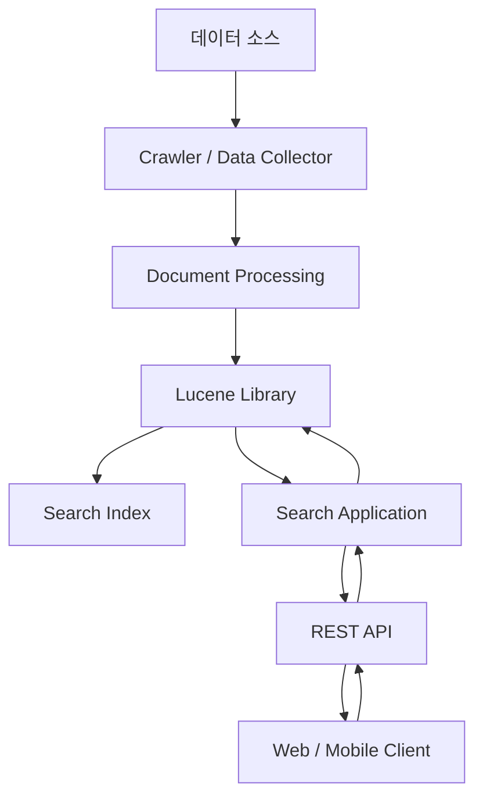

여기서 각 구성 요소의 책임은 다르다.

**Crawler**

웹사이트나 외부 시스템에서 데이터를 수집한다.

**Document Processing**

수집된 데이터를 검색에 적합한 구조로 변환한다.

**Lucene**

문서를 색인하고 검색한다.

**Search Application**

검색 조건을 처리하고 결과를 가공한다.

**REST API**

외부 클라이언트가 검색 기능을 사용할 수 있도록 인터페이스를 제공한다.

즉, Lucene은 검색 시스템의 핵심 기능을 담당하지만 전체 서비스를 완성하려면 추가적인 개발이 필요하다.

---

## 전문 검색(Full-Text Search)이란?

### 일반적인 문자열 검색과 전문 검색의 차이

관계형 데이터베이스에서 특정 문자열을 찾으려면 다음과 같은 SQL을 사용할 수 있다.

```sql
SELECT *
FROM products
WHERE product_name LIKE '%Spring%';
```

이 SQL은 상품명에 `Spring`이라는 문자열이 포함된 데이터를 검색한다.

작은 데이터셋에서는 이러한 방식만으로도 충분할 수 있다.

하지만 다음과 같은 요구사항을 생각해 보자.

- 검색어를 단어 단위로 분석해야 한다.
- 검색어의 관련도를 계산해야 한다.
- 문서의 제목과 본문을 함께 검색해야 한다.
- 특정 단어의 출현 빈도를 고려해야 한다.
- 유사한 검색어도 처리해야 한다.
- 대량의 문서에서 검색 결과를 빠르게 찾아야 한다.

이러한 기능은 단순한 문자열 포함 여부를 검사하는 방식보다 복잡하다.

전문 검색 엔진은 이를 위해 문서를 분석하고 검색에 적합한 색인 구조를 생성한다.

### 문자열 검색과 전문 검색 비교

| 구분 | 일반적인 문자열 검색 | 전문 검색 |
|---|---|---|
| 주요 목적 | 문자열 일치 여부 확인 | 검색어와 관련된 문서 탐색 |
| 검색 단위 | 문자열 또는 패턴 | 분석된 토큰과 문서 |
| 색인 | DB 인덱스 등 활용 | 역색인 등 검색용 구조 |
| 관련도 계산 | 별도 구현이 필요할 수 있음 | 검색 엔진에서 제공 |
| 복잡한 검색 | SQL 및 DB 기능에 의존 | 검색 전용 기능 제공 |
| 주요 활용 | 정확한 값 조회, 간단한 검색 | 문서 검색, 상품 검색, 로그 검색 |

다만 RDBMS라고 해서 전문 검색을 제공하지 않는 것은 아니다.

MySQL이나 PostgreSQL 등의 데이터베이스도 전문 검색 기능을 제공한다.

따라서 Elasticsearch가 항상 필요한 것은 아니며 데이터 규모와 검색 요구사항에 따라 선택해야 한다.

---

## Lucene의 핵심 개념: Document와 Field

Lucene의 논리적인 데이터 구조에서 중요한 개념은 Document와 Field다.

### Document란?

Document는 검색 대상이 되는 하나의 논리적인 데이터 단위다.

예를 들어 상품 하나를 Document로 표현할 수 있다.

```json
{
  "productId": 1001,
  "name": "Spring Boot 완벽 가이드",
  "category": "BOOK",
  "price": 35000,
  "description": "Spring Boot 기반 백엔드 개발을 위한 도서"
}
```

이 데이터는 하나의 상품을 표현한다.

Lucene에서는 이러한 정보를 여러 Field로 구성된 Document 형태로 다룬다.

### Field란?

Field는 Document를 구성하는 개별 속성이다.

앞의 상품 Document에는 다음과 같은 Field가 존재한다.

| Field | 값 |
|---|---|
| productId | 1001 |
| name | Spring Boot 완벽 가이드 |
| category | BOOK |
| price | 35000 |
| description | Spring Boot 기반 백엔드 개발을 위한 도서 |

검색 시스템은 Field의 특성에 따라 서로 다른 검색 및 처리 방법을 적용할 수 있다.

예를 들어 다음과 같이 구분할 수 있다.

**상품명**

단어 기반의 전문 검색이 필요하다.

**카테고리**

정확한 값으로 필터링하는 것이 적합하다.

**가격**

숫자 범위 검색이 필요하다.

**등록일**

날짜 범위 검색과 정렬이 필요하다.

이처럼 Document는 하나의 검색 대상을 표현하고, Field는 해당 대상의 속성을 표현한다.

### Document와 Field의 관계

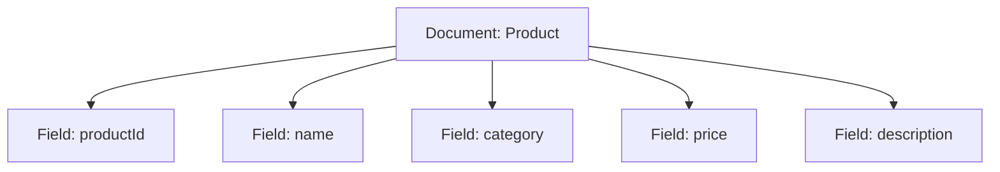

이러한 구조는 Elasticsearch에서 JSON Document를 저장하고 검색하는 개념과도 연결된다.

다만 Lucene 내부의 Document 구조와 Elasticsearch의 JSON Document가 완전히 동일한 구현이라는 의미는 아니다.

Elasticsearch는 JSON 데이터를 받아 Mapping에 따라 내부 색인 구조로 처리한다.

---

## Lucene의 색인(Index)이란?

### 색인의 개념

색인은 데이터를 검색하기 쉽도록 미리 구성한 자료구조다.

데이터베이스에서 인덱스를 사용하는 이유와 유사하다.

예를 들어 도서관에서 원하는 책을 찾는다고 가정해 보자.

책을 찾기 위해 모든 서가의 책을 처음부터 끝까지 확인하는 방법은 비효율적이다.

대신 책 제목과 위치가 정리된 목록이 있다면 원하는 책을 빠르게 찾을 수 있다.

검색 엔진에서도 비슷한 개념을 사용한다.

문서를 저장할 때 검색에 필요한 정보를 분석하고, 해당 정보를 색인에 기록한다.

검색 요청이 들어오면 문서 전체를 매번 검사하는 대신 색인을 활용하여 관련 문서를 찾는다.

### 역색인(Inverted Index)이란?

Lucene에서 핵심적으로 활용하는 자료구조 중 하나가 역색인이다.

역색인은 단어를 기준으로 해당 단어가 포함된 문서를 찾을 수 있도록 구성한 자료구조다.

예를 들어 다음 문서가 있다고 가정해 보자.

| 문서 ID | 내용 |
|---|---|
| D1 | Java Spring Boot |
| D2 | Java Redis |
| D3 | Spring Elasticsearch |

일반적인 문서 중심 구조에서는 다음과 같이 저장된다.

```text
D1 → Java, Spring, Boot

D2 → Java, Redis

D3 → Spring, Elasticsearch
```

반면 역색인은 단어를 기준으로 문서 목록을 구성한다.

| Term | Document |
|---|---|
| Java | D1, D2 |
| Spring | D1, D3 |
| Boot | D1 |
| Redis | D2 |
| Elasticsearch | D3 |

사용자가 `Spring`을 검색하면 다음 정보를 확인한다.

```text
Spring → D1, D3
```

따라서 모든 문서를 처음부터 끝까지 검사하지 않고도 검색어와 관련된 문서를 찾을 수 있다.

### 역색인 구조

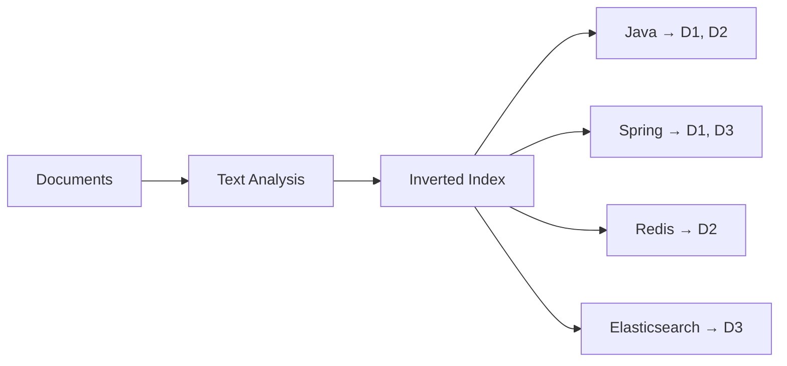

실제 Lucene의 색인 구조는 단순한 단어와 문서 ID의 연결보다 복잡하다.

검색에 필요한 단어의 위치, 빈도, 점수 계산에 필요한 정보 등도 관리할 수 있다.

Lucene 공식 문서에서는 역색인의 핵심 구조를 Posting이라고 설명하며, 검색에 필요한 다양한 정보를 저장한다. [Apache Lucene](https://lucene.apache.org/core/10_5_2/core/org/apache/lucene/index/package-summary.html?utm_source=chatgpt.com)

---

## Lucene의 텍스트 분석(Analysis)

### 왜 텍스트 분석이 필요할까?

전문 검색에서는 문서를 저장할 때 텍스트를 분석하는 과정이 중요하다.

예를 들어 다음 문장이 있다고 가정해 보자.

```text
Spring Boot is a Java Framework
```

검색 엔진은 이 문장을 하나의 긴 문자열로만 처리하는 대신 여러 토큰으로 나누어 색인할 수 있다.

개념적으로 다음과 같이 표현할 수 있다.

```text
spring

boot

is

a

java

framework
```

다만 실제 토큰은 사용하는 Analyzer의 종류와 설정에 따라 달라진다.

일부 Analyzer는 불용어를 제거하거나 단어 형태를 정규화할 수도 있다.

### Analyzer란?

Analyzer는 텍스트를 검색에 적합한 토큰으로 분석하는 구성 요소다.

텍스트 분석 과정에는 다음과 같은 처리가 포함될 수 있다.

1. 문자 정규화
2. 토큰 분리
3. 소문자 변환
4. 불용어 제거
5. 동의어 처리
6. 형태소 분석

이를 구조로 표현하면 다음과 같다.

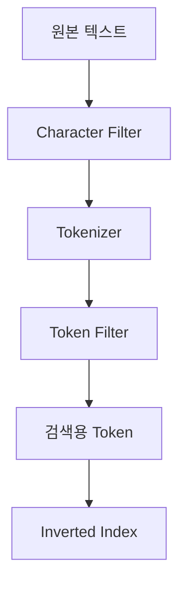

### Character Filter

텍스트를 토큰으로 나누기 전에 문자를 변환하거나 정리한다.

예를 들어 HTML 태그를 제거하는 처리를 구성할 수 있다.

### Tokenizer

텍스트를 여러 토큰으로 나눈다.

### Token Filter

생성된 토큰을 추가로 가공한다.

예를 들어 대문자를 소문자로 변환하거나 불용어를 제거할 수 있다.

### 한국어 검색에서 고려할 점

한국어는 영어와 언어적 특성이 다르다.

예를 들어 다음 문장을 생각해 보자.

```text
사용자가 상품을 검색했습니다.
```

한국어에서는 조사와 어미 등이 결합되어 나타나므로 단순히 공백을 기준으로 분리하는 것만으로 충분하지 않을 수 있다.

따라서 한국어 검색의 정확도를 높이려면 한국어 형태소 분석과 검색어 처리 방식을 고려해야 한다.

Elasticsearch에서는 한국어 분석을 위해 Nori 분석 플러그인 등을 활용할 수 있다.

또한 검색 목적에 따라 Analyzer를 어떻게 구성할지 결정해야 한다.

예를 들어 상품명 검색과 로그 메시지 검색은 서로 다른 분석 전략이 적합할 수 있다.

---

## Lucene 기반 프로젝트

Lucene은 검색 라이브러리이므로 이를 활용하거나 관련 검색 기술을 확장한 여러 프로젝트가 등장했다.

대표적으로 다음과 같은 프로젝트들이 있다.

| 프로젝트 | 주요 목적 |
|---|---|
| Apache Nutch | 웹 크롤링 |
| Apache Solr | 엔터프라이즈 검색 서버 |
| Compass | 과거 Lucene 관련 검색 프로젝트 |
| CrateDB | 분산 SQL 및 데이터 분석 |
| DocFetcher | 로컬 파일 및 문서 검색 |
| Elasticsearch | 분산 검색 및 분석 |
| KinoSearch | Perl·C 기반 검색 라이브러리 |
| Swiftype | 검색 서비스 관련 제품 및 기술 |

각 프로젝트는 검색 기술을 활용하지만 제공하는 기능과 목적이 다르다.

### Apache Nutch

Apache Nutch는 웹 크롤링을 위한 프로젝트다.

웹사이트를 탐색하여 데이터를 수집하는 역할을 담당한다.

Lucene이 색인과 검색에 집중한다면 Nutch는 검색 대상 데이터를 수집하는 영역과 연결된다.

### Apache Solr

Apache Solr는 Lucene을 기반으로 개발된 검색 서버다.

Lucene의 검색 기능에 서버 기능과 API, 분산 검색 등의 기능을 결합하여 제공한다.

따라서 개발자가 Lucene의 모든 내부 구성 요소를 직접 조합하지 않고도 검색 서비스를 구축할 수 있다.

Apache Solr 공식 문서에서도 Solr가 Lucene을 기반으로 하는 검색 서버임을 설명한다. [Apache Solr](https://solr.apache.org/guide/solr/latest/getting-started/introduction.html?utm_source=chatgpt.com)

### Compass

Compass는 과거 Elasticsearch의 등장과 관련하여 언급되는 Lucene 기반 검색 프로젝트다.

여기서 주의할 점은 MongoDB Compass와 구분해야 한다는 것이다.

MongoDB Compass는 MongoDB에서 제공하는 GUI 관리 도구다.

두 제품은 이름이 같지만 서로 다른 제품이다.

### CrateDB

CrateDB는 분산 SQL 데이터베이스로, Lucene 계열 기술을 활용하는 검색 및 데이터 처리 기능과 관련이 있다.

다만 Elasticsearch와 동일한 용도의 제품은 아니므로 SQL 처리와 데이터 모델, 운영 구조 등을 구분해야 한다.

### DocFetcher

DocFetcher는 데스크톱 환경에서 파일과 문서를 검색하는 데 활용되는 애플리케이션이다.

로컬 문서의 내용을 색인하여 검색하는 유형의 프로그램이다.

### Elasticsearch

Elasticsearch는 Lucene을 기반으로 개발된 분산 검색 및 분석 엔진이다.

Lucene의 검색 기능을 활용하면서 REST API와 클러스터링 기능 등을 제공한다.

### KinoSearch

KinoSearch는 Perl과 C 환경에서 사용된 검색 기술로, Lucene과 유사한 정보 검색 기능을 제공하는 프로젝트로 알려져 있다.

### Swiftype

Swiftype는 웹사이트 검색과 엔터프라이즈 검색 등의 검색 서비스 영역에서 등장한 제품이다.

이러한 프로젝트들은 Lucene과 관련된 검색 기술의 발전 과정을 이해하는 데 도움이 된다.

다만 일부는 역사적인 프로젝트이므로 모든 프로젝트가 현재도 같은 형태로 개발되거나 지원된다고 이해해서는 안 된다.

---

## Apache Lucene과 Elasticsearch의 차이

Lucene과 Elasticsearch는 서로 밀접하게 연결되어 있지만 역할이 다르다.

**Lucene은 검색 라이브러리이고 Elasticsearch는 검색 서버이자 분산 검색·분석 엔진이다.**

이 차이를 이해하는 것이 중요하다.

| 항목 | Apache Lucene | Elasticsearch |
|---|---|---|
| 성격 | 검색 라이브러리 | 분산 검색 및 분석 엔진 |
| 기반 언어 | Java | Java 기반 |
| 주요 기능 | 색인, 검색, 관련도 계산 | 색인, 검색, 집계, REST API |
| REST API | 자체 완성형 서버 API는 제공하지 않음 | 제공 |
| 클러스터링 | 애플리케이션에서 별도 구성 필요 | 분산 클러스터 기능 제공 |
| 데이터 구조 | Document, Field | JSON Document, Mapping |
| 주요 사용 방식 | 애플리케이션에 라이브러리 통합 | 별도 서버로 구축 및 호출 |
| 활용 사례 | 검색 기능 구현 | 상품 검색, 로그 분석, 데이터 분석 |

예를 들어 Java 애플리케이션 내부에서 검색 기능을 직접 구현하려면 Lucene을 사용할 수 있다.

반면 여러 백엔드 서비스에서 공통으로 사용하는 검색 시스템을 구축하려면 Elasticsearch와 같은 검색 엔진을 검토할 수 있다.

### 구조적 차이

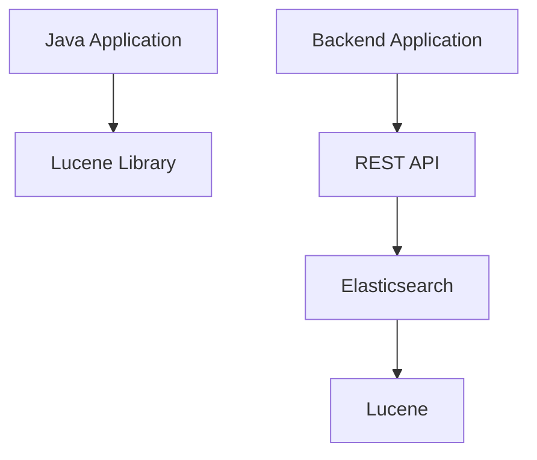

Elasticsearch는 내부적으로 Lucene을 활용하지만, 사용자는 일반적으로 Elasticsearch가 제공하는 API를 통해 검색 기능을 사용한다.

---

## ELK Stack이란?

### ELK의 개념

ELK Stack은 Elasticsearch, Logstash, Kibana를 결합하여 데이터를 수집하고 검색·분석하며 시각화하는 기술 조합이다.

ELK를 구성하는 세 가지 기술은 서로 다른 역할을 담당한다.

**Elasticsearch**

데이터를 저장하고 색인하며 검색과 집계를 수행한다.

**Logstash**

다양한 데이터 소스에서 데이터를 수집하고 가공하여 전달한다.

**Kibana**

Elasticsearch에 저장된 데이터를 탐색하고 시각화한다.

### ELK Stack의 기본 구조

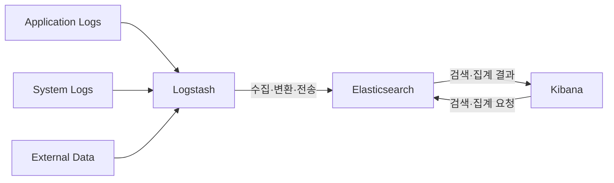

이 구조에서 Logstash는 데이터를 처리하는 역할을 담당한다.

Elasticsearch는 데이터를 검색하고 분석하는 역할을 담당한다.

Kibana는 Elasticsearch의 결과를 사용자에게 시각적으로 제공한다.

세 기술을 결합하면 데이터 수집부터 시각화까지 연결할 수 있다.

### ELK와 Elastic Stack의 차이

ELK라는 이름은 Elasticsearch, Logstash, Kibana의 조합을 의미한다.

이후 Beats 등 다양한 구성 요소가 등장하면서 더 넓은 기술 조합을 Elastic Stack이라고 부르게 되었다.

일반적으로 다음과 같이 구분할 수 있다.

| 구분 | 주요 구성 |
|---|---|
| ELK Stack | Elasticsearch, Logstash, Kibana |
| Elastic Stack | ELK를 포함한 다양한 데이터 수집·검색·분석 구성 요소 |

현재 Elastic 생태계에는 Beats 외에도 통합 데이터 수집과 중앙 관리를 위한 Elastic Agent와 Fleet 등이 제공된다.

따라서 Elastic Stack을 이해할 때는 세 가지 제품에만 한정하지 않고 데이터 수집과 처리, 검색, 분석, 모니터링을 위한 전체 기술 생태계로 이해하는 것이 좋다. [elastic.co](https://www.elastic.co/docs/reference/fleet?utm_source=chatgpt.com)

---

## ELK Stack을 사용하는 이유

ELK Stack은 다양한 데이터를 통합하여 검색하고 분석하기 위한 구조를 제공한다.

대표적인 장점은 다음과 같다.

### 1. 다양한 데이터 형식 지원

Elasticsearch는 JSON Document를 기반으로 다양한 구조의 데이터를 저장하고 검색할 수 있다.

예를 들어 다음과 같은 로그 데이터를 생각해 보자.

```json
{
  "timestamp": "2026-11-20T10:30:00Z",
  "service": "payment-service",
  "level": "ERROR",
  "message": "Payment processing failed",
  "statusCode": 500,
  "responseTimeMs": 1250
}
```

이 Document에는 다음 유형의 데이터가 포함되어 있다.

| 필드 | 데이터 유형 |
|---|---|
| timestamp | 날짜·시간 |
| service | 문자열 |
| level | 문자열 |
| message | 텍스트 |
| statusCode | 숫자 |
| responseTimeMs | 숫자 |

Elasticsearch는 각 필드의 특성에 따라 검색과 집계를 수행할 수 있다.

예를 들어 서비스 이름으로 필터링하고, 특정 시간대의 오류를 검색하거나, 평균 응답 시간을 집계할 수 있다.

### 2. 유연한 데이터 구조

Elasticsearch는 동적 매핑(Dynamic Mapping)을 지원한다.

새로운 필드가 포함된 Document가 저장되면 설정에 따라 필드의 데이터 타입을 자동으로 추론하여 Mapping을 생성할 수 있다.

하지만 이것이 **데이터 타입이나 스키마를 전혀 고려하지 않아도 된다는 의미는 아니다.**

운영 환경에서는 필드 수가 지나치게 증가하는 문제나 잘못된 타입 추론이 발생할 수 있다.

따라서 중요한 필드는 명시적인 Mapping을 구성하는 것이 좋다.

Elastic 공식 문서에서도 Dynamic Mapping의 동작과 필드 수 증가에 따른 문제를 설명한다. [elastic.co](https://www.elastic.co/docs/manage-data/data-store/mapping?utm_source=chatgpt.com)

### 3. 다양한 검색 기능

Elasticsearch는 다음과 같은 검색을 지원한다.

- 전문 검색
- 정확한 값 검색
- 숫자 범위 검색
- 날짜 범위 검색
- 위치 기반 검색
- 복합 조건 검색
- 집계 및 분석

또한 검색 조건을 조합하여 원하는 데이터를 찾을 수 있다.

### 4. 분산 클러스터 구성

Elasticsearch는 여러 노드로 구성된 클러스터를 통해 데이터를 분산 저장하고 검색할 수 있다.

이를 통해 데이터 규모와 워크로드에 따라 확장할 수 있다.

다만 노드를 추가한다고 모든 쿼리의 성능이 자동으로 향상되는 것은 아니다.

Shard 구성과 데이터 분포, 네트워크 비용, 검색 패턴 등에 따라 실제 성능이 달라진다.

### 5. 시각화 도구 제공

Kibana를 이용하면 Elasticsearch에 저장된 데이터를 다양한 형태로 시각화할 수 있다.

예를 들어 다음과 같은 정보를 대시보드로 구성할 수 있다.

- 시간대별 오류 발생 건수
- 서비스별 요청량
- HTTP 상태 코드 분포
- API 응답 시간 추세
- 서버별 로그 발생량
- 특정 지역의 요청 분포

### 6. 메시징 시스템과 결합 가능

ELK Stack은 Kafka 등의 메시징 시스템과 결합하여 데이터 수집 구조를 구성할 수 있다.

예를 들어 다음과 같은 구조다.


이 구조에서는 메시징 시스템이 데이터 생산자와 처리 시스템 사이의 완충 역할을 담당할 수 있다.

다만 실제 데이터 전달 보장은 Kafka와 Logstash의 설정, Offset 관리, 재처리 방식 등에 따라 달라진다.

따라서 메시징 시스템을 추가했다는 사실만으로 데이터 유실이나 중복이 자동으로 해결되는 것은 아니다.

---

## Elasticsearch란?

### Elasticsearch의 개념

Elasticsearch는 Lucene을 기반으로 개발된 분산 검색 및 분석 엔진이다.

REST API를 통해 데이터를 저장하고 검색하며, 다양한 조건의 집계와 분석을 수행할 수 있다.

Elasticsearch는 다음과 같은 데이터를 처리하는 데 활용할 수 있다.

- 텍스트
- 숫자
- 날짜
- 로그
- 메트릭
- 위치정보
- 정형 및 반정형 데이터

여기서 핵심은 Elasticsearch가 단순한 문자열 검색 도구가 아니라는 점이다.

**Elasticsearch는 검색과 집계, 분석을 함께 수행할 수 있는 시스템**이다.

예를 들어 특정 결제 서비스에서 발생한 오류 로그만 검색하고, 시간대별 오류 수를 집계할 수 있다.

### Elasticsearch의 주요 개념

Elasticsearch를 이해하려면 다음 용어를 알아야 한다.

| 용어 | 의미 |
|---|---|
| Document | 저장 및 검색의 기본 데이터 단위 |
| Field | Document의 속성 |
| Index | Document를 관리하는 논리적 단위 |
| Mapping | 필드 구조 및 데이터 타입 정의 |
| Shard | Index를 분산 저장하는 단위 |
| Replica | Primary Shard의 복제본 |
| Node | Elasticsearch 서버 인스턴스 |
| Cluster | 여러 Node로 구성된 집합 |

이 개념들은 Elasticsearch의 검색 구조와 분산 아키텍처를 이해하는 데 중요하다.

---

## Elasticsearch의 Index와 Document

### Index란?

Elasticsearch의 Index는 관련된 Document를 관리하는 논리적인 단위다.

관계형 데이터베이스의 Table과 유사한 역할을 한다고 이해할 수 있다.

예를 들어 다음과 같이 Index를 구성할 수 있다.

```text
products

orders

payment-logs

application-logs
```

각 Index에는 여러 Document가 저장될 수 있다.

### Document란?

Document는 Elasticsearch에 저장되는 개별 데이터 단위다.

일반적으로 JSON 형태로 표현한다.

예를 들어 다음과 같다.

```json
{
  "productId": 1001,
  "productName": "Spring Boot 완벽 가이드",
  "category": "BOOK",
  "price": 35000
}
```

이 Document를 `products` Index에 저장할 수 있다.

### 구조 비교

| RDBMS | Elasticsearch |
|---|---|
| Table | Index |
| Row | Document |
| Column | Field |
| Schema | Mapping |

다만 이 비교는 개념을 이해하기 위한 대응 관계다.

Elasticsearch의 Index와 RDBMS의 Table은 동일한 기능과 정합성 모델을 제공하는 것은 아니다.

특히 Elasticsearch는 검색과 분석에 최적화된 시스템이므로 관계형 데이터베이스의 트랜잭션 처리와 제약 조건을 그대로 대체한다고 이해해서는 안 된다.

---

## Elasticsearch의 Mapping이란?

Mapping은 Elasticsearch에서 Document의 필드 타입과 검색 방식을 정의하는 구조다.

예를 들어 상품 검색 시스템에서 다음과 같이 필드를 정의할 수 있다.

| Field | Type | 목적 |
|---|---|---|
| productId | keyword | 정확한 상품 ID 검색 |
| productName | text | 상품명 전문 검색 |
| category | keyword | 카테고리 필터링 |
| price | integer | 가격 범위 검색 |
| createdAt | date | 등록일 검색 |

### text와 keyword의 차이

Elasticsearch에서 문자열을 다룰 때 중요한 타입이 `text`와 `keyword`다.

**text**

전문 검색에 적합한 타입이다.

Analyzer를 통해 텍스트를 분석하여 색인할 수 있다.

**keyword**

정확한 값의 검색이나 필터링, 집계 등에 적합한 타입이다.

예를 들어 다음과 같은 값은 `keyword`로 관리하는 것이 적합할 수 있다.

```text
COMPLETED

FAILED

PAYPAL

STRIPE
```

반면 다음과 같은 문장은 `text` 타입으로 관리하는 것이 적합할 수 있다.

```text
Payment processing failed due to timeout
```

### text와 keyword 비교

| 항목 | text | keyword |
|---|---|---|
| 주요 목적 | 전문 검색 | 정확한 값 검색 |
| 텍스트 분석 | 일반적으로 수행 | 일반적으로 수행하지 않음 |
| 대표 사용 | 상품명, 설명, 로그 메시지 | 상태 코드, 서비스명, 카테고리 |
| 집계 및 정렬 | 별도 설정이나 하위 필드가 필요할 수 있음 | 일반적으로 적합 |
| 검색 방식 | 분석된 토큰 중심 | 전체 값 중심 |

하나의 문자열을 전문 검색과 정확한 값 검색에 모두 사용해야 한다면 Multi-field Mapping을 활용할 수 있다.

Elastic 공식 문서에서도 `text`와 `keyword`를 서로 다른 목적으로 사용하도록 설명한다. [elastic.co](https://www.elastic.co/docs/reference/elasticsearch/mapping-reference/text?utm_source=chatgpt.com)

---

## Elasticsearch의 기본 검색 예제

Elasticsearch는 REST API를 통해 다양한 작업을 수행할 수 있다.

다음은 Elasticsearch의 Dev Tools Console에서 사용할 수 있는 간단한 예시다.

여기서는 검색 구조를 이해하기 위해 상품 데이터를 저장하고 조회한다.

### 1. Index 생성

```http
PUT /products
{
  "mappings": {
    "properties": {
      "productId": {
        "type": "keyword"
      },
      "productName": {
        "type": "text"
      },
      "category": {
        "type": "keyword"
      },
      "price": {
        "type": "integer"
      },
      "createdAt": {
        "type": "date"
      }
    }
  }
}
```

이 요청은 `products` Index를 생성하면서 각 Field의 타입을 정의한다.

여기서 `mappings`는 데이터 구조를 정의한다.

`properties`에는 실제 Field와 타입을 지정한다.

### 2. Document 저장

```http
PUT /products/_doc/1001
{
  "productId": "1001",
  "productName": "Spring Boot 완벽 가이드",
  "category": "BOOK",
  "price": 35000,
  "createdAt": "2026-11-20T10:00:00Z"
}
```

`1001`이라는 ID로 Document를 저장한다.

### 3. 전문 검색

```http
GET /products/_search
{
  "query": {
    "match": {
      "productName": "Spring"
    }
  }
}
```

`match` 쿼리는 분석된 텍스트를 기반으로 검색한다.

실제 검색 결과는 저장된 데이터와 Analyzer 설정에 따라 달라진다.

### 4. 정확한 값 검색

```http
GET /products/_search
{
  "query": {
    "term": {
      "category": "BOOK"
    }
  }
}
```

`term` 쿼리는 정확한 값에 대한 검색에 활용한다.

따라서 `keyword` 타입의 필드와 함께 사용하는 경우가 많다.

### 5. 가격 범위 검색

```http
GET /products/_search
{
  "query": {
    "range": {
      "price": {
        "gte": 10000,
        "lte": 50000
      }
    }
  }
}
```

`gte`는 Greater Than or Equal을 의미한다.

`lte`는 Less Than or Equal을 의미한다.

따라서 다음 조건과 같다.

```text
10000 <= price <= 50000
```

### 6. 복합 조건 검색

```http
GET /products/_search
{
  "query": {
    "bool": {
      "must": [
        {
          "match": {
            "productName": "Spring"
          }
        }
      ],
      "filter": [
        {
          "term": {
            "category": "BOOK"
          }
        },
        {
          "range": {
            "price": {
              "gte": 10000,
              "lte": 50000
            }
          }
        }
      ]
    }
  }
}
```

이 쿼리는 다음 조건을 조합한다.

- 상품명에 `Spring`과 관련된 검색 결과가 있어야 한다.
- 카테고리는 `BOOK`이어야 한다.
- 가격은 10,000 이상 50,000 이하여야 한다.

이처럼 Elasticsearch는 다양한 검색 조건을 조합할 수 있다.

참고로 위 요청들은 검색 API의 사용 방식을 보여주기 위한 예시이며, 실제 실행 결과를 확인한 것은 아니다.

---

## Elasticsearch의 분산 아키텍처

Elasticsearch의 중요한 특징 중 하나는 분산 클러스터를 구성할 수 있다는 점이다.

데이터가 많아지거나 검색 요청이 증가하면 여러 노드에 데이터를 분산할 수 있다.

### Node란?

Node는 Elasticsearch 서버 인스턴스다.

하나의 Cluster에는 여러 Node가 존재할 수 있다.

### Cluster란?

Cluster는 여러 Node가 하나의 Elasticsearch 시스템으로 동작하도록 구성된 집합이다.

### Shard란?

Shard는 Index의 데이터를 분산 저장하는 단위다.

Elasticsearch는 Index를 여러 Primary Shard로 나누어 저장할 수 있다.

### Replica란?

Replica는 Primary Shard의 복제본이다.

Replica를 이용하면 노드 장애 상황에 대응하거나 검색 부하를 분산하는 데 도움이 될 수 있다.

단, Replica를 설정했다고 모든 장애 상황에서 데이터 유실이 완전히 방지되는 것은 아니다.

실제 가용성과 데이터 내구성은 클러스터 구성과 장애 상황에 따라 달라진다.

### Elasticsearch 분산 구조

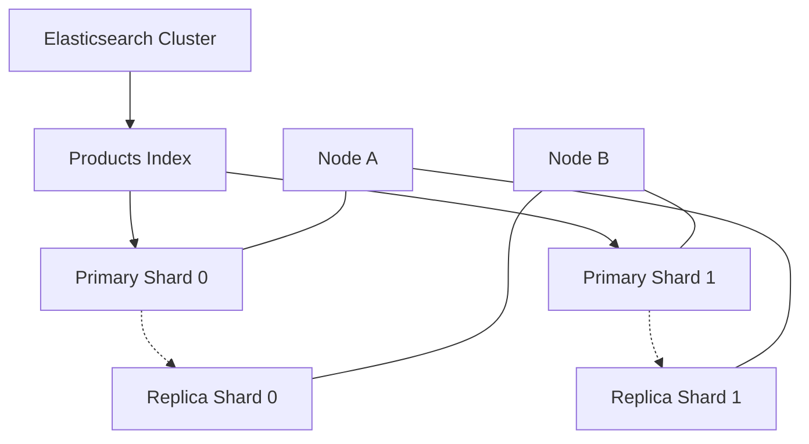

실제 Elasticsearch에서는 각 Shard의 복제본을 동일한 Primary와 같은 노드에 배치하지 않도록 관리한다.

### 검색 요청은 어떻게 처리될까?

사용자가 검색 요청을 보내면 Elasticsearch는 해당 요청에 필요한 Shard를 대상으로 검색을 수행한다.

각 Shard에서 검색 결과를 계산한 후 이를 통합하여 최종 결과를 반환할 수 있다.

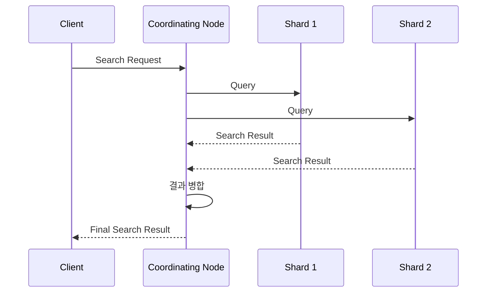

이 구조에서는 Shard를 분산하여 검색 작업을 수행할 수 있다.

하지만 Shard 수를 지나치게 늘리면 관리 비용과 메모리 사용량이 증가할 수 있다.

따라서 적절한 Shard 설계가 필요하다.

---

## Elasticsearch는 실시간 데이터베이스일까?

Elasticsearch를 설명할 때 자주 등장하는 표현이 실시간 검색이다.

하지만 정확하게는 **Near Real-Time Search**, 즉 준실시간 검색이라고 이해하는 것이 좋다.

Elasticsearch에 Document를 저장했다고 해서 해당 Document가 모든 검색 요청에서 즉시 조회된다고 보장되는 것은 아니다.

검색 가능한 상태로 반영되기 위해 Refresh 과정이 필요하기 때문이다.

### 데이터 저장과 검색 가능 시점


Elasticsearch는 일정한 주기에 따라 Refresh를 수행할 수 있다.

따라서 데이터 저장 성공과 검색 가능 시점을 구분해야 한다.

검색 결과에 반영되는 시점을 제어해야 한다면 Refresh 관련 옵션을 사용할 수 있다.

다만 매번 강제로 Refresh를 수행하면 성능에 영향을 줄 수 있으므로 주의해야 한다.

Elastic 공식 문서에서도 Elasticsearch의 검색 특성을 Near Real-Time으로 설명한다. [elastic.co](https://www.elastic.co/docs/manage-data/data-store/near-real-time-search?trk=public_post_comment-text\&utm_source=chatgpt.com)

---

## Logstash란?

### Logstash의 개념

Logstash는 다양한 데이터 소스에서 데이터를 수집하고 가공하여 다른 시스템으로 전달하는 데이터 처리 파이프라인이다.

ELK Stack에서는 주로 데이터를 수집하고 변환하여 Elasticsearch에 전달하는 역할을 담당한다.

예를 들어 여러 애플리케이션에서 서로 다른 형식의 로그가 발생한다고 가정해 보자.

**서비스 A**

```text
2026-11-20 10:30:00 ERROR Payment failed
```

**서비스 B**

```json
{
  "timestamp": "2026-11-20T10:30:00Z",
  "level": "ERROR",
  "message": "Payment failed"
}
```

**서비스 C**

```text
level=ERROR service=payment message="Payment failed"
```

이러한 로그는 표현 방식이 다르다.

그대로 저장하면 통합 분석이 어려울 수 있다.

Logstash를 이용하면 서로 다른 데이터를 수집하고, 필요한 필드를 추출하여 일관된 구조로 변환한 뒤 Elasticsearch에 전달할 수 있다.

### Logstash의 역할

Logstash는 크게 세 가지 작업을 수행한다.

1. Input
2. Filter
3. Output


이 구조는 Logstash의 핵심적인 처리 모델이다.

Elastic 공식 문서에서도 Logstash 파이프라인을 Inputs → Filters → Outputs의 세 단계로 설명한다. [elastic.co](https://www.elastic.co/docs/reference/logstash/how-logstash-works?utm_source=chatgpt.com)

---

## Logstash의 Input

Input은 Logstash가 데이터를 수집하는 단계다.

Logstash는 다양한 소스에서 데이터를 가져올 수 있다.

대표적으로 다음과 같은 입력 방식이 있다.

| Input | 활용 예시 |
|---|---|
| Beats | Filebeat 등에서 전달하는 데이터 |
| File | 파일에 기록된 로그 |
| Kafka | 메시지 브로커에서 이벤트 수집 |
| HTTP | HTTP 요청으로 전달된 데이터 |
| JDBC | 데이터베이스에서 데이터 수집 |
| TCP | TCP 연결로 전달된 데이터 |

예를 들어 Filebeat가 애플리케이션 로그를 수집하여 Logstash로 전달할 수 있다.

또는 Kafka에 저장된 이벤트를 Logstash가 소비하도록 구성할 수도 있다.

### 여러 입력 소스를 사용하는 구조

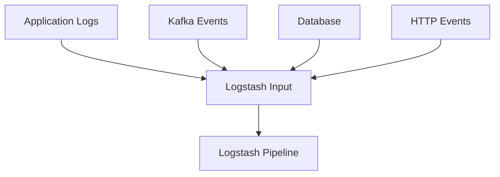

이처럼 Logstash는 여러 소스의 데이터를 하나의 처리 파이프라인으로 연결할 수 있다.

---

## Logstash의 Filter

Filter는 수집한 데이터를 변환하고 가공하는 단계다.

Logstash에서 중요한 역할을 담당하는 부분이다.

대표적으로 다음과 같은 작업을 수행할 수 있다.

- 문자열 파싱
- 필드 추출
- 데이터 타입 변환
- 날짜 형식 변환
- 불필요한 필드 제거
- 새로운 필드 추가
- 데이터 정규화
- 데이터 보강

### Filter가 필요한 이유

다음과 같은 로그가 있다고 가정해 보자.

```text
2026-11-20 10:30:00 ERROR payment-service Payment failed
```

이 상태에서는 하나의 문자열로 표현되어 있다.

하지만 로그를 분석하려면 다음 항목을 분리하는 것이 유용하다.

| Field | Value |
|---|---|
| timestamp | 2026-11-20 10:30:00 |
| level | ERROR |
| service | payment-service |
| message | Payment failed |

이처럼 문자열에서 구조화된 데이터를 추출하는 작업을 Parsing이라고 한다.

### Filter의 처리 과정

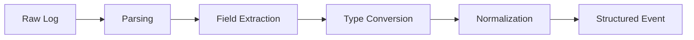

이 과정에서 중요한 것은 로그 형식이 변경될 수 있다는 점이다.

예를 들어 애플리케이션 로그에 새로운 필드가 추가되거나 날짜 형식이 변경되면 기존 Parser가 정상적으로 동작하지 않을 수 있다.

따라서 로그 형식을 표준화하고 스키마 변경에 대응할 수 있도록 구성하는 것이 좋다.

---

## Logstash의 Output

Output은 처리된 데이터를 다른 시스템으로 전달하는 단계다.

ELK Stack에서는 Elasticsearch로 데이터를 전달하는 경우가 많다.

하지만 Logstash의 Output은 Elasticsearch에만 제한되지 않는다.

다양한 Output Plugin을 이용하여 목적에 맞는 시스템으로 데이터를 전송할 수 있다.

### 전체 처리 구조

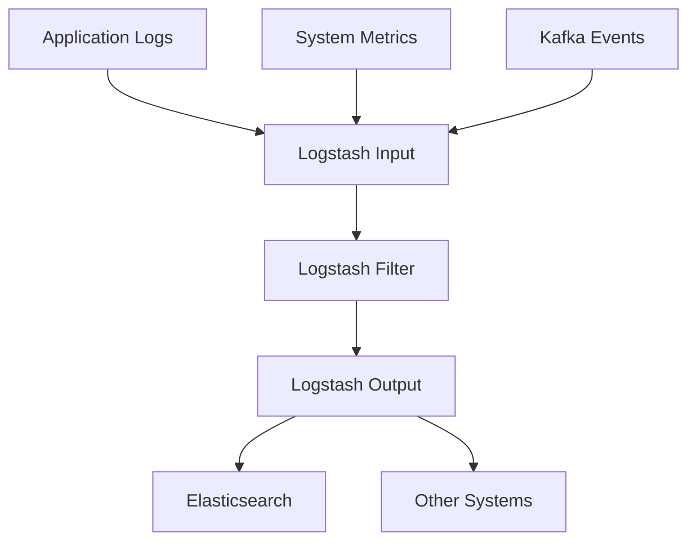

Logstash는 데이터 처리 파이프라인이지, Elasticsearch와 같은 목적의 영구 데이터베이스는 아니다.

Logstash에는 메모리 기반 큐나 Persistent Queue 등의 기능이 있지만 이를 Elasticsearch의 데이터 저장 기능과 동일하게 이해해서는 안 된다.

---

## Logstash의 Codec이란?

Logstash는 Input, Filter, Output 외에도 Codec을 제공한다.

Codec은 데이터를 입력받거나 출력할 때 인코딩 또는 디코딩하는 기능이다.

예를 들어 JSON 문자열을 Logstash Event로 변환하거나, Event를 JSON 형태로 출력할 수 있다.

### Input과 Codec의 관계

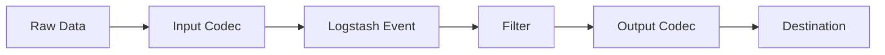

Input 단계에서 Codec을 사용하면 수집한 데이터를 필요한 형식으로 변환할 수 있다.

Output 단계에서도 목적지에서 요구하는 형식으로 데이터를 변환할 수 있다.

### Input, Filter, Output, Codec 비교

| 구성 요소 | 주요 역할 |
|---|---|
| Input | 데이터 수집 |
| Filter | 데이터 가공 |
| Output | 데이터 전송 |
| Codec | 입력·출력 데이터의 인코딩 및 디코딩 |

이러한 구성 요소를 조합하면 다양한 데이터 처리 요구사항에 대응할 수 있다.

---

## Logstash Pipeline 설정 예제

Logstash는 설정 파일을 이용하여 파이프라인을 구성할 수 있다.

일반적으로 다음 세 가지 블록을 사용한다.

```text
input

filter

output
```

다음은 JSON 문자열을 입력받아 처리하고 콘솔에 출력하는 간단한 예제다.

### pipeline.conf

```ruby
input {
  stdin {
  }
}

filter {
  json {
    source => "message"
  }
}

output {
  stdout {
    codec => rubydebug
  }
}
```

이 설정은 Logstash의 파이프라인 구성을 이해하기 위한 독립적인 예제다.

Elasticsearch 연결이나 실제 운영 로그 수집은 포함하지 않는다.

### Input 설정

```ruby
input {
  stdin {
  }
}
```

표준 입력을 통해 데이터를 전달받는다.

### Filter 설정

```ruby
filter {
  json {
    source => "message"
  }
}
```

`message` 필드에 포함된 JSON 문자열을 파싱한다.

### Output 설정

```ruby
output {
  stdout {
    codec => rubydebug
  }
}
```

처리된 이벤트를 콘솔에 출력한다.

여기서 `rubydebug`는 Logstash 이벤트를 확인하기 쉬운 형태로 출력하기 위한 Codec이다.

### 처리 대상 데이터 예시

다음과 같은 JSON 문자열을 입력한다고 가정해 보자.

```json
{
  "service": "payment-service",
  "level": "ERROR",
  "message": "Payment failed"
}
```

Filter는 JSON 문자열을 파싱하여 구조화된 Event로 변환할 수 있다.

다만 실제 실행 시 생성되는 메타데이터와 출력 형식은 Logstash 버전과 설정에 따라 달라진다.

---

## Logstash의 플러그인 아키텍처

Logstash는 플러그인을 중심으로 기능을 확장할 수 있도록 설계되었다.

대표적인 플러그인 유형은 다음과 같다.

| 플러그인 유형 | 역할 |
|---|---|
| Input Plugin | 데이터 수집 |
| Filter Plugin | 데이터 처리 및 변환 |
| Output Plugin | 데이터 전달 |
| Codec Plugin | 데이터 인코딩 및 디코딩 |

이러한 구조에서는 데이터 소스와 목적지가 달라져도 필요한 플러그인을 조합하여 파이프라인을 구성할 수 있다.

예를 들어 다음과 같은 구조를 생각할 수 있다.

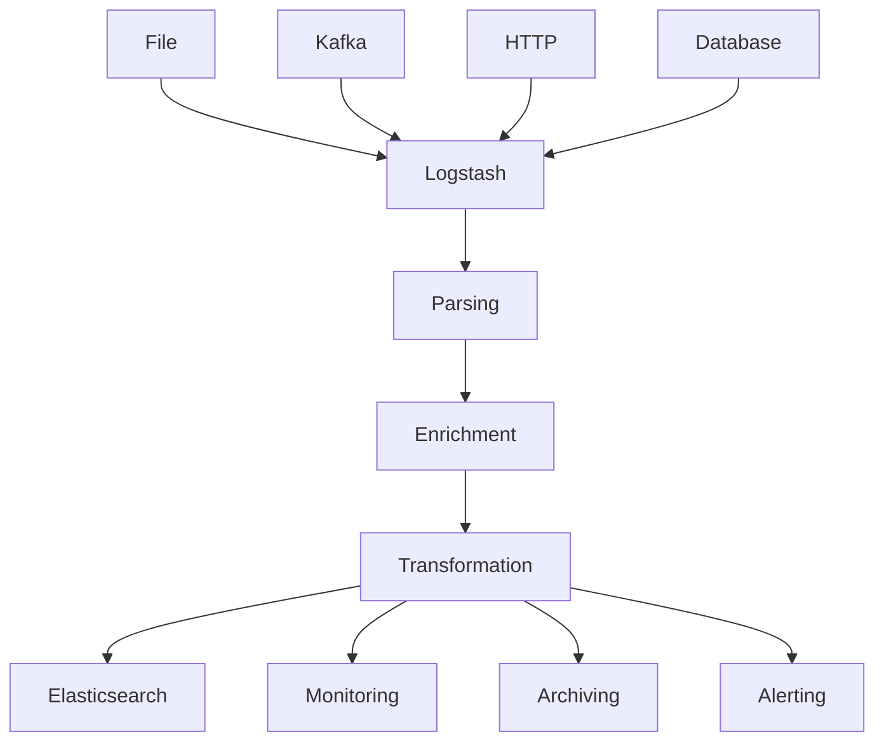

여기서 Logstash는 여러 데이터 소스와 처리 목적을 연결하는 중심 역할을 담당한다.

### Logstash는 수평 확장이 가능할까?

Logstash는 워크로드에 따라 여러 인스턴스를 실행하여 처리량을 확장할 수 있다.

하지만 여러 Logstash 인스턴스를 실행했다고 자동으로 데이터가 균등하게 분산되는 것은 아니다.

Input Plugin과 데이터 소스의 분산 방식에 따라 별도 구성이 필요할 수 있다.

예를 들어 Kafka를 입력으로 사용한다면 Consumer Group과 Partition 구성에 따라 병렬 처리 구조가 달라질 수 있다.

### Logstash의 처리 안정성

Logstash는 메모리 기반 큐와 Persistent Queue 등의 기능을 제공한다.

Persistent Queue는 Logstash에서 처리 중인 이벤트를 디스크 기반 큐에 보관하여 특정 장애 상황에서 데이터 손실 위험을 줄이는 데 사용할 수 있다.

다만 Persistent Queue를 설정했다고 모든 데이터 손실 가능성이 제거되는 것은 아니다.

입력과 출력 플러그인의 동작, Queue 설정, 장애 유형 등을 함께 고려해야 한다. [elastic.co](https://www.elastic.co/docs/reference/logstash/persistent-queues?utm_source=chatgpt.com)

---

## Kibana란?

### Kibana의 개념

Kibana는 Elasticsearch에 저장된 데이터를 검색하고 분석하며 시각화하기 위한 플랫폼이다.

Kibana를 이용하면 Elasticsearch에 저장된 데이터를 브라우저에서 탐색할 수 있다.

또한 차트와 그래프, 테이블, 지도 등을 이용하여 데이터를 시각화할 수 있다.

예를 들어 애플리케이션 로그가 Elasticsearch에 저장되어 있다고 가정해 보자.

Kibana에서는 다음과 같은 작업을 수행할 수 있다.

- 특정 서비스의 오류 로그 검색
- 특정 시간대의 이벤트 분석
- 로그 레벨별 발생 건수 집계
- API 응답 시간 변화 확인
- 서버별 오류 발생량 비교
- 분석 결과를 대시보드로 구성

### Kibana의 역할

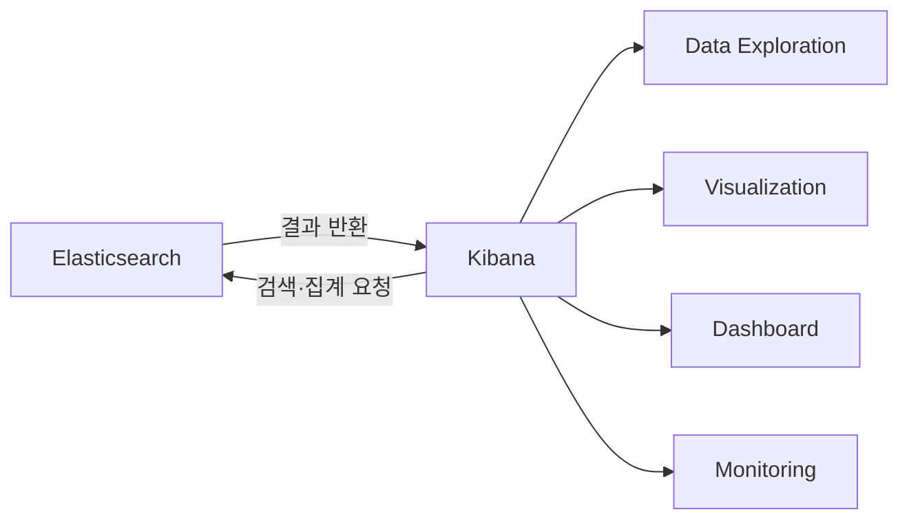

중요한 점은 Kibana가 Elasticsearch의 데이터를 사용자에게 보여주기 위한 도구라는 것이다.

Kibana 자체를 Elasticsearch와 같은 목적의 데이터 저장소로 이해해서는 안 된다.

---

## Kibana의 주요 기능

### 1. 데이터 탐색

Kibana의 Discover 기능을 이용하면 Elasticsearch에 저장된 데이터를 검색하고 확인할 수 있다.

예를 들어 다음과 같은 조건으로 로그를 탐색할 수 있다.

```text
service.name: "payment-service"
```

또는 특정 로그 레벨을 검색할 수 있다.

```text
log.level: "ERROR"
```

실제 검색 가능 여부는 해당 필드가 존재하는지와 Mapping, 데이터 뷰 설정에 따라 달라진다.

### 2. 데이터 시각화

Kibana는 다양한 형태의 시각화를 지원한다.

대표적으로 다음과 같은 유형이 있다.

| 시각화 | 활용 목적 |
|---|---|
| Line Chart | 시간별 변화 |
| Bar Chart | 항목별 비교 |
| Pie Chart | 구성 비율 |
| Data Table | 집계 결과 확인 |
| Gauge | 사용률 또는 수치 |
| Map | 위치 기반 데이터 |
| Dashboard | 여러 지표 통합 |

### 3. Dashboard

Dashboard는 여러 시각화 결과를 하나의 화면에 배치하여 보여주는 기능이다.

예를 들어 결제 서비스의 운영 대시보드를 구성한다고 가정해 보자.

다음과 같은 정보를 표시할 수 있다.

```text
Payment Service Dashboard

- 시간대별 결제 요청량
- 결제 실패 건수
- HTTP 5xx 발생률
- API 응답 시간
- 서비스 인스턴스별 오류 로그
- 최근 발생한 주요 오류
```

이러한 정보를 하나의 화면으로 구성하면 여러 지표를 함께 분석할 수 있다.

### 4. 실시간에 가까운 데이터 확인

Kibana는 Elasticsearch에 저장된 데이터를 주기적으로 다시 조회하여 대시보드를 갱신할 수 있다.

다만 실제 데이터가 화면에 반영되는 시간은 데이터 수집, 처리, Elasticsearch 색인 및 Refresh, Kibana 조회 주기 등에 따라 달라진다.

따라서 Kibana에서 자동 새로고침을 설정했다고 모든 데이터가 지연 없이 표시되는 것은 아니다.

Kibana 공식 문서에서는 Discover를 통한 데이터 탐색과 다양한 시각화 및 Dashboard 기능을 제공한다. [elastic.co](https://www.elastic.co/docs/explore-analyze/discover?utm_source=chatgpt.com)

---

## Kibana에서 Data View가 필요한 이유

Kibana는 Elasticsearch의 어떤 데이터를 대상으로 검색하고 시각화할지 알아야 한다.

이를 위해 Data View를 사용할 수 있다.

Data View는 Elasticsearch의 Index나 Data Stream 등을 참조하는 설정이다.

예를 들어 다음과 같은 Index가 있다고 가정해 보자.

```text
payment-logs-2026.11.18

payment-logs-2026.11.19

payment-logs-2026.11.20
```

이때 다음과 같은 패턴을 사용할 수 있다.

```text
payment-logs-*
```

이 패턴은 해당 이름 규칙에 일치하는 여러 Index를 대상으로 활용할 수 있다.

### Data View의 역할

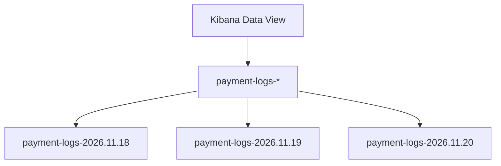

Data View를 구성하면 여러 Index에 저장된 데이터를 하나의 검색 대상으로 다룰 수 있다.

다만 Index 이름에 와일드카드를 사용할 수 있다는 사실만으로 모든 검색이 효율적으로 수행되는 것은 아니다.

대상 Index가 지나치게 많거나 Shard 수가 과도하면 검색 비용이 증가할 수 있다.

따라서 Index와 Data Stream의 수명주기 관리도 함께 고려해야 한다.

---

## Beats란?

### Beats의 개념

Beats는 서버와 시스템에서 다양한 데이터를 수집하여 Elasticsearch 또는 Logstash로 전달하는 경량 데이터 수집기다.

일반적으로 수집 대상 시스템에 에이전트 형태로 설치하여 사용한다.

예를 들어 다음과 같은 데이터를 수집할 수 있다.

- 애플리케이션 로그
- 시스템 메트릭
- 네트워크 트래픽
- Windows 이벤트 로그
- 가용성 확인 결과
- 시스템 감사 이벤트

Beats의 주요 목적은 **데이터가 생성되는 시스템에서 필요한 정보를 수집하여 중앙의 분석 시스템으로 전달하는 것**이다.

### Beats의 위치

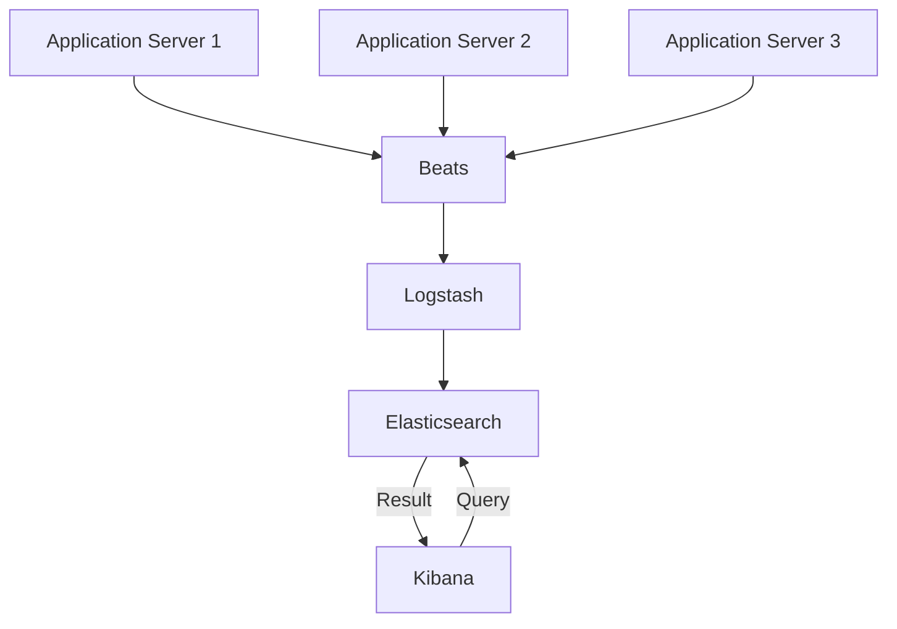

이러한 구조에서는 각 서버에 직접 접속하여 로그를 확인하지 않고도 중앙에서 로그를 검색할 수 있다.

---

## Beats의 종류

Beats는 수집하려는 데이터 유형에 따라 여러 종류로 구분된다.

대표적으로 다음과 같은 도구가 있다.

| Beats | 주요 역할 |
|---|---|
| Filebeat | 로그 파일 수집 |
| Metricbeat | 시스템 및 서비스 메트릭 수집 |
| Packetbeat | 네트워크 트래픽 분석 |
| Winlogbeat | Windows 이벤트 로그 수집 |
| Heartbeat | 서비스 가용성 모니터링 |
| Auditbeat | 시스템 감사 이벤트 수집 |

Elastic 공식 문서에서도 이러한 Beats의 역할을 구분하여 설명한다. [elastic.co](https://www.elastic.co/docs/reference/beats?utm_source=chatgpt.com)

### Filebeat

Filebeat는 로그 파일을 수집하고 전달하는 도구다.

예를 들어 Spring Boot 애플리케이션이 다음 경로에 로그를 저장한다고 가정해 보자.

```text
/var/log/myapp/application.log
```

Filebeat는 해당 로그 파일에서 새롭게 기록되는 로그를 수집하여 Elasticsearch나 Logstash에 전달할 수 있다.

### Metricbeat

Metricbeat는 시스템과 서비스의 메트릭을 수집한다.

대표적으로 다음과 같은 정보가 있다.

- CPU 사용량
- 메모리 사용량
- 디스크 사용량
- 네트워크 관련 지표
- 일부 서비스의 성능 지표

### Packetbeat

Packetbeat는 네트워크 트래픽을 관찰하고 분석하는 데 활용된다.

네트워크 프로토콜과 통신 관련 데이터를 수집할 수 있다.

### Winlogbeat

Winlogbeat는 Windows 운영체제의 이벤트 로그를 수집한다.

Windows 기반 서버 환경에서 활용할 수 있다.

### Heartbeat

Heartbeat는 서비스의 가용성을 확인하는 데 활용된다.

예를 들어 특정 HTTP 서비스에 접근할 수 있는지 확인할 수 있다.

### Auditbeat

Auditbeat는 시스템 감사 이벤트와 관련된 데이터를 수집한다.

보안 및 운영 감사 목적의 데이터 수집에 활용할 수 있다.

---

## libbeat란?

Beats를 이해할 때 알아야 할 또 다른 개념은 libbeat다.

libbeat는 Beats 계열 데이터 수집기의 공통 기능을 제공하는 라이브러리다.

데이터 전달과 관련된 공통 처리 기능 등을 제공한다.

### libbeat의 역할

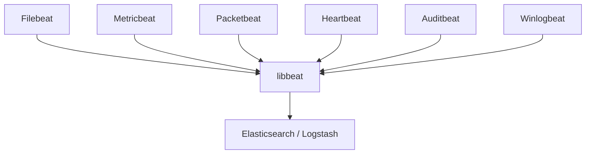

개별 Beat는 수집 대상과 수집 방법에 집중할 수 있다.

libbeat는 데이터 전달과 관련된 공통 기능을 제공한다.

따라서 Beats는 서로 다른 데이터를 수집하면서도 공통된 기반을 활용할 수 있다.

---

## Beats의 두 가지 데이터 전송 방식

Beats를 사용할 때 중요한 부분은 데이터가 반드시 Logstash를 거쳐야 하는 것은 아니라는 점이다.

대표적으로 두 가지 구조를 사용할 수 있다.

### 1. Beats에서 Elasticsearch로 직접 전송

```mermaid
flowchart LR
    A["Beats"]
    B["Elasticsearch"]
    C["Kibana"]

    A --> B
    C -->|"검색 및 집계 요청"| B
    B -->|"결과 반환"| C
```

이 구조에서는 Beats가 데이터를 직접 Elasticsearch에 전달한다.

Logstash를 별도로 운영하지 않아도 된다.

데이터 수집과 전달 요구사항이 비교적 단순한 경우 검토할 수 있다.

### 장점

- Logstash 운영이 필요하지 않을 수 있다.
- 구성 요소가 줄어든다.
- 데이터 전달 경로가 단순해진다.

### 고려사항

- 복잡한 데이터 변환 요구사항이 있는지 확인해야 한다.
- 필요한 데이터 가공 기능을 다른 방식으로 제공할 수 있는지 검토해야 한다.
- 수집기와 Elasticsearch 간의 연결 및 인증을 관리해야 한다.

### 2. Beats에서 Logstash를 거쳐 Elasticsearch로 전송

```mermaid
flowchart LR
    A["Beats"]
    B["Logstash"]
    C["Elasticsearch"]
    D["Kibana"]

    A --> B
    B -->|"Parsing & Enrichment"| C

    D -->|"검색 및 집계 요청"| C
    C -->|"결과 반환"| D
```

이 구조에서는 Beats가 Logstash에 데이터를 전달한다.

Logstash는 데이터를 변환한 후 Elasticsearch에 전달한다.

### 장점

- 복잡한 로그 파싱을 수행할 수 있다.
- 다양한 데이터 변환 로직을 구성할 수 있다.
- 여러 소스의 데이터를 표준화할 수 있다.
- 데이터 처리 로직을 중앙에서 관리할 수 있다.

### 고려사항

- Logstash를 별도로 운영해야 한다.
- 데이터 처리 단계가 추가된다.
- Logstash의 처리량과 장애 대응을 고려해야 한다.

### 두 방식 비교

| 항목 | 직접 전송 | Logstash 경유 |
|---|---|---|
| 경로 | Beats → Elasticsearch | Beats → Logstash → Elasticsearch |
| 구조 | 상대적으로 단순 | 처리 단계 추가 |
| 데이터 변환 | Beats 및 Elasticsearch의 처리 기능 활용 | Logstash Filter 활용 |
| 운영 대상 | 상대적으로 적음 | Logstash 추가 |
| 적합한 상황 | 단순한 데이터 수집 및 전달 | 복잡한 파싱과 변환 |
| 주요 고려사항 | 수집기 설정과 직접 연결 | 처리량, Queue, 장애 복구 |

따라서 Logstash는 ELK Stack의 주요 구성 요소지만, 모든 데이터 수집 구조에서 필수적인 것은 아니다.

---

## Filebeat를 이용한 데이터 전송 설정 예제

Filebeat에서는 YAML 설정 파일을 이용하여 수집할 데이터와 전달 대상을 지정할 수 있다.

다음은 로그 파일을 Elasticsearch에 직접 전달하는 예시다.

### Filebeat에서 Elasticsearch로 직접 전송

```yaml
filebeat.inputs:
  - type: filestream
    id: application-log
    enabled: true
    paths:
      - /var/log/myapp/application.log

output.elasticsearch:
  hosts:
    - "https://elasticsearch.example.com:9200"

  api_key: "${ELASTIC_API_KEY}"

  ssl.certificate_authorities:
    - "/etc/filebeat/certs/ca.crt"
```

이 설정은 로그 수집과 출력 대상을 이해하기 위한 예시다.

실제 실행 환경에서는 Elasticsearch 주소와 API Key, 인증서 경로 등을 적절하게 구성해야 한다.

### filebeat.inputs

```yaml
filebeat.inputs:
  - type: filestream
```

Filebeat가 파일에서 데이터를 수집하도록 구성한다.

### paths

```yaml
paths:
  - /var/log/myapp/application.log
```

수집 대상 로그 파일의 경로를 지정한다.

### output.elasticsearch

```yaml
output.elasticsearch:
```

수집한 데이터를 Elasticsearch로 직접 전달하도록 설정한다.

### Filebeat에서 Logstash로 전달

Logstash를 경유하도록 구성하려면 Output을 변경할 수 있다.

```yaml
filebeat.inputs:
  - type: filestream
    id: application-log
    enabled: true
    paths:
      - /var/log/myapp/application.log

output.logstash:
  hosts:
    - "logstash:5044"
```

이 설정에서는 Logstash로 데이터를 전달한다.

여기서 `logstash`는 Logstash에 접근 가능한 호스트 이름이며, `5044`는 예시로 사용한 Beats Input 포트다.

실제로 데이터를 수신하려면 Logstash에 해당 Input을 구성해야 한다.

예를 들어 다음과 같다.

```ruby
input {
  beats {
    port => 5044
  }
}

output {
  stdout {
    codec => rubydebug
  }
}
```

이 예시는 Beats 입력을 받아 콘솔로 출력하는 기본 구조다.

실제 운영 환경에서는 Elasticsearch Output과 TLS, 인증, Queue 설정 등을 함께 구성해야 한다.

또한 Filebeat에서 Logstash로 전송하는 구조에서는 Elasticsearch 직접 Output과 Logstash Output을 동시에 활성화하는 방식이 아니라 목적에 맞는 Output 구성을 선택해야 한다.

---

## Elastic Agent와 Beats의 관계

현재 Elastic 생태계에서는 Beats 외에도 Elastic Agent를 제공한다.

Elastic Agent는 로그와 메트릭 등의 데이터를 통합적으로 수집하기 위한 에이전트다.

Fleet를 이용하면 여러 Elastic Agent의 정책과 설정을 중앙에서 관리할 수 있다.

### Beats와 Elastic Agent 비교

| 항목 | Beats | Elastic Agent |
|---|---|---|
| 주요 목적 | 데이터 유형별 수집 | 통합 데이터 수집 |
| 구성 방식 | 개별 Beat 설정 | 통합 Agent와 Integration |
| 관리 방식 | Beat별 설정 및 관리 | Fleet를 통한 중앙 관리 가능 |
| 활용 | 기존 Beats 기반 환경 등 | 통합 관리가 필요한 환경 |
| 주요 특징 | 목적별 수집기 | 여러 데이터 수집 기능 통합 |

따라서 새로운 환경에서 데이터 수집 아키텍처를 설계한다면 Beats뿐 아니라 Elastic Agent도 함께 검토하는 것이 좋다.

Elastic 공식 문서에서도 Elastic Agent를 로그와 메트릭 등을 수집하기 위한 통합적인 방식으로 설명한다. [elastic.co](https://www.elastic.co/docs/reference/fleet?utm_source=chatgpt.com)

---

## X-Pack이란?

### X-Pack의 개념

X-Pack은 Elasticsearch와 Kibana 등의 기능을 확장하기 위해 제공되어 온 기능 집합의 이름이다.

대표적으로 다음과 같은 기능이 있다.

- Security
- Alerting
- Monitoring
- Reporting
- Graph
- Machine Learning

이러한 기능은 검색과 로그 분석을 넘어 Elastic Stack을 운영 및 분석 플랫폼으로 활용하는 데 도움이 된다.

### X-Pack의 주요 기능

| 기능 | 설명 |
|---|---|
| Security | 인증, 권한 관리 등 보안 기능 |
| Alerting | 조건에 따른 알림 |
| Monitoring | 시스템 상태 및 성능 모니터링 |
| Reporting | 분석 결과를 보고서 형태로 제공 |
| Graph | 데이터 간 관계 분석 |
| Machine Learning | 데이터 패턴 및 이상 징후 탐지 |

### X-Pack의 설치 방식과 라이선스

여기서는 과거와 현재의 차이를 구분해야 한다.

과거에는 X-Pack을 별도의 확장 패키지로 설치하는 방식이 사용되었다.

하지만 Elastic Stack 6.3부터는 X-Pack 기능들이 기본 배포판에 포함되는 방향으로 변경되었다.

따라서 현재 환경에서 모든 X-Pack 기능을 별도의 플러그인으로 설치해야 한다고 이해해서는 안 된다. [elastic.co](https://www.elastic.co/downloads/x-pack?utm_source=chatgpt.com)

또한 Elastic의 라이선스는 과거와 달라졌다.

2024년 Elastic은 Elasticsearch와 Kibana의 일부 무료 소스 코드에 AGPLv3를 추가적인 라이선스 선택지로 제공한다고 발표했다.

그러나 Elastic이 배포하는 공식 바이너리의 라이선스까지 모두 AGPL로 변경된 것은 아니다.

공식 배포판에는 Elastic License 2.0이 적용되며, 사용 가능한 기능은 제품과 라이선스 등급에 따라 달라질 수 있다. [elastic.co](https://www.elastic.co/pricing/faq/licensing?utm_source=chatgpt.com)

따라서 Elastic Stack을 운영 환경에 도입할 때는 사용하는 배포판과 필요한 기능, 라이선스 조건을 구분하여 검토해야 한다.

---

## X-Pack Security

Security는 Elasticsearch와 Kibana에 대한 접근을 보호하기 위한 기능이다.

대표적으로 다음과 같은 기능을 제공할 수 있다.

- 사용자 인증
- 사용자별 권한 관리
- 역할 기반 접근 제어
- TLS 기반 통신 보호
- 데이터 접근 제한

예를 들어 다음과 같은 사용자가 있다고 가정해 보자.

| 사용자 | 역할 |
|---|---|
| 개발자 | 개발 환경 로그 조회 |
| 운영자 | 운영 로그 조회 및 관리 |
| 보안 담당자 | 보안 이벤트 조회 |
| 분석가 | 분석용 데이터 조회 |

모든 사용자에게 동일한 접근 권한을 제공할 필요는 없다.

따라서 역할에 따라 필요한 데이터에만 접근하도록 구성할 수 있다.

특히 운영 로그에는 사용자 정보나 요청 데이터 등의 민감한 정보가 포함될 수 있으므로 접근 권한 관리가 중요하다.

---

## X-Pack Alerting

Alerting은 특정 조건을 만족할 때 알림을 발생시키는 기능이다.

예를 들어 다음과 같은 조건을 설정할 수 있다.

```text
최근 5분 동안

payment-service의 ERROR 로그가

평소보다 크게 증가한 경우

알림 발생
```

전체 구조는 다음과 같다.

```mermaid
flowchart TD
    A["Application Logs"]
    B["Elasticsearch"]
    C["Alert Rule"]
    D{"조건 충족?"}
    E["Alert"]
    F["Operator"]

    A --> B
    B --> C
    C --> D

    D -->|Yes| E
    E --> F
```

이러한 알림을 구성하면 운영자가 대시보드를 계속 확인하지 않더라도 이상 징후를 인지하는 데 도움이 된다.

다만 실제 알림의 정확도는 조건과 임계값 설정에 따라 달라진다.

따라서 평소 로그 발생량과 오류 패턴을 분석한 후 적절한 알림 조건을 구성해야 한다.

---

## X-Pack Monitoring

Monitoring은 Elastic Stack 자체의 상태와 성능을 확인하는 기능이다.

대표적으로 다음과 같은 정보를 확인할 수 있다.

- Elasticsearch Cluster 상태
- Node 상태
- CPU 및 메모리 사용량
- 검색 및 색인 작업량
- Shard 상태
- Logstash 처리 상태
- 데이터 수집 지연

예를 들어 Elasticsearch의 검색 응답 시간이 증가했다고 가정해 보자.

이때 다음 항목을 함께 확인해야 한다.

1. 검색 요청량이 증가했는가?
2. 특정 Index에 요청이 집중되었는가?
3. Shard가 적절하게 분산되어 있는가?
4. JVM 메모리 사용량이 증가했는가?
5. 디스크 I/O가 증가했는가?
6. 특정 Node에 부하가 집중되었는가?

이러한 정보를 활용하면 Elasticsearch 내부의 성능 문제를 분석할 수 있다.

---

## X-Pack Reporting

Reporting은 검색 및 분석 결과를 보고서 형태로 제공하기 위한 기능이다.

예를 들어 운영 대시보드의 데이터를 보고서로 생성하여 공유할 수 있다.

활용 사례는 다음과 같다.

- 주간 서비스 운영 보고서
- 월간 오류 발생 분석
- 시스템 성능 추세 보고서
- 보안 이벤트 요약
- 비즈니스 KPI 보고서

다만 실제 지원되는 보고서 형식과 자동 생성 기능은 사용하는 Kibana 버전과 라이선스 조건에 따라 달라질 수 있다.

---

## X-Pack Graph

Graph는 데이터 사이의 관계를 탐색하고 분석하기 위한 기능이다.

예를 들어 사용자와 상품 간의 연결 관계를 생각해 보자.

```mermaid
flowchart TD
    A["User A"]
    B["User B"]

    C["Product 1"]
    D["Product 2"]
    E["Product 3"]

    A --> C
    A --> D

    B --> D
    B --> E
```

이 구조에서 두 사용자는 `Product 2`와 연결되어 있다.

이러한 관계를 분석하면 사용자와 상품 간의 연관성을 탐색할 수 있다.

다만 Graph 기능을 관계형 데이터베이스의 Join이나 전문적인 Graph Database의 모든 기능과 동일하게 이해해서는 안 된다.

---

## X-Pack Machine Learning

### 시계열 이상 징후 탐지

Machine Learning 기능은 데이터에 포함된 패턴을 분석하고 이상 징후를 탐지하는 데 활용할 수 있다.

대표적인 활용 대상은 시계열 데이터다.

시계열 데이터는 시간에 따라 수집되는 데이터를 의미한다.

예를 들어 다음과 같은 데이터가 있다.

| 시간 | 오류 건수 |
|---|---:|
| 10:00 | 10 |
| 10:05 | 12 |
| 10:10 | 11 |
| 10:15 | 150 |
| 10:20 | 13 |

일반적으로 오류 건수가 10건 안팎으로 발생하다가 특정 시점에 150건으로 증가했다.

이러한 값은 이상 징후로 검토할 수 있다.

### 이상 징후 탐지 구조

```mermaid
flowchart TD
    A["Time-Series Data"]
    B["Elasticsearch"]
    C["Machine Learning"]
    D["Pattern Analysis"]
    E["Anomaly Detection"]
    F["Alert / Dashboard"]

    A --> B
    B --> C
    C --> D
    D --> E
    E --> F
```

여기서 중요한 점은 **이상 징후와 장애가 동일한 개념이 아니라는 것**이다.

예를 들어 특정 시간대에 트래픽이 급격하게 증가했다고 가정해 보자.

이는 장애의 징후일 수도 있지만 정상적인 이벤트나 프로모션으로 인해 발생했을 수도 있다.

따라서 머신러닝이 이상 징후를 탐지하더라도 실제 상황을 해석하는 과정이 필요하다.

### 활용 가능한 데이터

대표적으로 다음과 같은 데이터에서 이상 징후를 분석할 수 있다.

| 데이터 | 탐지 목적 |
|---|---|
| 애플리케이션 로그 | 오류 발생량의 급격한 변화 |
| API 응답 시간 | 성능 저하 징후 |
| 서버 메트릭 | CPU·메모리 사용 패턴 변화 |
| 네트워크 트래픽 | 비정상적인 통신 패턴 |
| 금융 거래 | 비정상적인 거래 패턴 |
| 사용자 행동 | 평소와 다른 이용 패턴 |

이러한 기능을 운영 환경에 적용하려면 데이터의 특성과 적절한 탐지 기준, 오탐 가능성 등을 함께 고려해야 한다.

---

## ELK Stack의 대표적인 활용 사례

ELK Stack은 검색뿐 아니라 다양한 데이터 분석 및 모니터링 영역에서 활용할 수 있다.

대표적으로 다음과 같은 사례가 있다.

| 활용 분야 | 주요 목적 |
|---|---|
| 애플리케이션 검색 | 서비스 내부 데이터 검색 |
| 웹사이트 검색 | 웹 콘텐츠 검색 |
| 엔터프라이즈 검색 | 기업 내부 문서 및 정보 검색 |
| 로그 분석 | 여러 서버의 로그 통합 분석 |
| 인프라 모니터링 | 시스템 리소스 및 메트릭 분석 |
| 컨테이너 모니터링 | Docker·Kubernetes 환경의 상태 분석 |
| APM | 애플리케이션 성능 분석 |
| 위치 기반 분석 | 위치정보 검색 및 시각화 |
| 보안 분석 | 보안 이벤트와 이상 징후 분석 |
| 비즈니스 분석 | 서비스 및 업무 데이터 분석 |

각 활용 사례를 살펴보자.

---

## 1. 애플리케이션 검색

Elasticsearch는 애플리케이션 내부의 검색 기능을 구현하는 데 활용할 수 있다.

예를 들어 전자상거래 서비스에서는 다음과 같은 검색이 필요하다.

- 상품명 검색
- 카테고리 검색
- 가격 범위 검색
- 브랜드별 필터링
- 관련도 기반 정렬
- 복합 조건 검색

이러한 요구사항에서는 전문 검색과 필터링, 집계 기능을 함께 활용할 수 있다.

### 검색 시스템 아키텍처

```mermaid
flowchart TD
    A["Product Service"]
    B["Primary Database"]
    C["Data Synchronization"]
    D["Elasticsearch"]

    E["Search API"]
    F["Web / Mobile Client"]

    A --> B
    B --> C
    C --> D

    F --> E
    E --> D
```

여기서는 RDBMS 등을 원본 데이터 저장소로 사용하고 Elasticsearch를 검색 전용 저장소로 활용하는 구조를 생각할 수 있다.

다만 데이터베이스와 Elasticsearch 사이의 데이터 동기화 지연을 고려해야 한다.

예를 들어 상품 가격이 변경되었지만 Elasticsearch의 데이터가 아직 갱신되지 않았다면 검색 결과와 실제 상품 정보가 다를 수 있다.

따라서 결제 금액처럼 정합성이 중요한 정보는 최종 처리 시점에 원본 시스템을 기준으로 검증해야 한다.

---

## 2. 웹사이트 검색

웹사이트에는 다양한 콘텐츠가 존재한다.

예를 들어 다음과 같은 콘텐츠가 있다.

- 게시글
- 문서
- 공지사항
- FAQ
- 기술 문서
- 상품 설명

이러한 콘텐츠를 검색하기 위해 Elasticsearch를 활용할 수 있다.

특히 검색어와 관련된 문서를 빠르게 찾고, 검색 결과의 관련도를 계산하는 기능이 중요하다.

이때 웹사이트의 데이터를 수집하는 과정과 색인하는 과정을 구분해야 한다.

검색 엔진이 웹사이트의 모든 콘텐츠를 자동으로 수집하는 것은 아니기 때문이다.

---

## 3. 엔터프라이즈 검색

기업 내부에는 다양한 시스템에 데이터가 분산되어 있을 수 있다.

예를 들어 다음과 같은 데이터가 있다.

- 사내 문서
- 업무 시스템
- 고객 지원 기록
- 제품 매뉴얼
- 기술 자료
- 업무 이력

이러한 데이터를 통합하여 검색할 수 있는 시스템을 구축할 수 있다.

단, 기업 내부 문서에는 접근 권한이 존재할 수 있다.

따라서 검색 결과에서도 사용자의 권한을 고려해야 한다.

검색 엔진에 모든 문서를 색인했다고 해서 모든 사용자가 해당 문서를 조회할 수 있도록 구성해서는 안 된다.

---

## 4. 로깅과 로그 분석

ELK Stack의 대표적인 활용 사례 중 하나가 중앙 집중식 로그 관리다.

여러 서버에서 발생하는 로그를 수집하고 Elasticsearch에 저장한 뒤 Kibana에서 검색할 수 있다.

### 중앙 집중식 로그 아키텍처

```mermaid
flowchart TD
    A["API Server 1"]
    B["API Server 2"]
    C["Payment Service"]
    D["Notification Service"]

    E["Filebeat / Elastic Agent"]
    F["Logstash"]
    G["Elasticsearch"]
    H["Kibana"]

    A --> E
    B --> E
    C --> E
    D --> E

    E --> F
    F --> G

    H -->|"검색 요청"| G
    G -->|"검색 결과"| H
```

이러한 구조를 사용하면 여러 서버에 직접 접속하여 로그를 확인하지 않아도 된다.

예를 들어 특정 결제 요청에서 오류가 발생했다면 로그에서 다음 정보를 검색할 수 있다.

```text
service.name: "payment-service"
```

또는 특정 Trace ID를 기준으로 관련 로그를 찾는 구조를 구성할 수 있다.

다만 로그에 Trace ID가 포함되어 있어야 하며, 서비스 간 동일한 식별자가 전달되도록 설계해야 한다.

---

## 5. 인프라 메트릭과 컨테이너 모니터링

ELK Stack은 시스템 메트릭을 저장하고 분석하는 데 활용할 수 있다.

대표적으로 다음과 같은 메트릭이 있다.

- CPU 사용량
- 메모리 사용량
- 디스크 사용량
- 네트워크 트래픽
- 컨테이너 상태
- 프로세스 상태

예를 들어 Metricbeat 또는 Elastic Agent를 이용하여 시스템 메트릭을 수집할 수 있다.

```mermaid
flowchart LR
    A["Server Metrics"]
    B["Metricbeat / Elastic Agent"]
    C["Elasticsearch"]
    D["Kibana"]

    A --> B
    B --> C

    D -->|"Query"| C
    C -->|"Metrics"| D
```

이러한 구조에서는 특정 서버에서 메모리 사용량이 증가하는 시점과 오류 로그가 발생하는 시점을 함께 비교할 수 있다.

---

## 6. 애플리케이션 성능 모니터링(APM)

APM(Application Performance Monitoring)은 애플리케이션의 성능과 요청 처리 상태를 관찰하는 활동이다.

대표적인 분석 대상은 다음과 같다.

- API 응답 시간
- 요청 처리량
- 오류 발생률
- 외부 서비스 호출 시간
- 데이터베이스 요청 시간
- 요청 처리 구간별 지연

예를 들어 다음과 같은 요청 흐름을 생각해 보자.

```mermaid
sequenceDiagram
    participant Client
    participant API as API Server
    participant Payment as Payment Service
    participant DB as Database

    Client->>API: 결제 요청
    API->>Payment: 결제 처리 요청
    Payment->>DB: 결제 정보 조회
    DB-->>Payment: 조회 결과
    Payment-->>API: 처리 결과
    API-->>Client: 응답
```

전체 요청이 3초 걸렸다고 가정해 보자.

이때 어떤 구간에서 지연이 발생했는지 분석해야 한다.

예를 들어 다음과 같은 정보를 수집할 수 있다.

| 구간 | 처리 시간 |
|---|---:|
| API 처리 | 50ms |
| Payment Service | 2,800ms |
| Database 조회 | 100ms |
| 응답 처리 | 50ms |

이 경우 Payment Service의 처리 시간을 추가로 분석할 수 있다.

다만 이러한 요청 구간별 분석을 위해서는 애플리케이션에 적절한 계측이 필요하다.

로그를 Elasticsearch에 저장했다고 해서 분산 추적 정보가 자동으로 생성되는 것은 아니다.

따라서 APM과 로그 분석을 함께 활용하려면 Trace ID와 Span 등의 개념을 이해하는 것이 좋다.

---

## 7. 위치 기반 데이터 분석

Elasticsearch는 위치정보를 이용한 검색과 분석에도 활용할 수 있다.

예를 들어 다음과 같은 기능을 생각할 수 있다.

- 특정 위치 주변의 매장 검색
- 지역별 사용자 분포 분석
- 배송 지역 분석
- 위치 기반 이벤트 검색

위치 데이터를 처리하려면 적절한 필드 타입을 사용해야 한다.

예를 들어 위도와 경도를 이용한 위치 검색에서는 `geo_point` 타입을 활용할 수 있다.

단순히 위도와 경도를 문자열로 저장하는 것만으로 모든 위치 기반 검색 기능을 활용할 수 있는 것은 아니다.

---

## 8. 보안 분석

ELK Stack은 보안 이벤트를 수집하고 분석하는 데 활용할 수 있다.

대표적으로 다음과 같은 데이터가 있다.

- 인증 실패 로그
- 비정상적인 접근 시도
- 네트워크 통신 기록
- 시스템 감사 이벤트
- 권한 변경 이력

예를 들어 특정 IP 주소에서 짧은 시간 동안 많은 로그인 실패가 발생했다고 가정해 보자.

이러한 데이터를 분석하면 비정상적인 접근 패턴을 탐지하는 데 도움이 될 수 있다.

다만 로그인 실패 건수가 많다는 사실만으로 악의적인 공격을 확정할 수는 없다.

정상 사용자의 비밀번호 오류나 시스템 설정 문제 등이 원인일 수도 있기 때문이다.

따라서 여러 데이터를 조합하여 분석해야 한다.

---

## 9. 비즈니스 분석

Elasticsearch는 비즈니스 데이터를 검색하고 집계하는 용도로도 활용할 수 있다.

예를 들어 다음과 같은 분석이 가능하다.

- 시간대별 주문 건수
- 상품 카테고리별 판매량
- 국가별 사용자 수
- 결제 수단별 실패율
- 특정 이벤트의 발생 추세

다만 비즈니스 분석 시스템을 설계할 때는 데이터 정합성과 집계 기준이 중요하다.

예를 들어 결제 성공 건수를 계산할 때 단순히 성공 로그의 개수를 합산하면 실제 결제 성공 건수와 달라질 수 있다.

동일한 결제에 대해 재시도나 중복 로그가 발생할 수 있기 때문이다.

따라서 분석 목적에 따라 고유한 결제 ID나 이벤트 ID를 기준으로 중복을 제거해야 할 수 있다.

---

## ELK Stack과 RDBMS의 차이

Elasticsearch는 데이터를 저장하고 검색할 수 있지만 일반적인 관계형 데이터베이스와 동일한 목적으로 설계된 시스템은 아니다.

따라서 기술을 선택할 때 차이를 이해해야 한다.

| 항목 | RDBMS | Elasticsearch |
|---|---|---|
| 주요 목적 | 비즈니스 데이터의 저장 및 트랜잭션 처리 | 검색 및 분석 |
| 데이터 모델 | 관계형 모델 | Document 기반 |
| 검색 | SQL 및 DB 검색 기능 | 검색 DSL 및 분석 기능 |
| 트랜잭션 | 관계형 트랜잭션 지원 | RDBMS와 다른 데이터 변경 모델 |
| 관계 처리 | Join 등 관계형 기능 | Document 중심 데이터 설계 |
| 전문 검색 | 제품별 기능 제공 | 핵심 기능 |
| 집계 | SQL 기반 집계 | Aggregation 기능 |
| 주요 활용 | 주문, 결제, 회원 정보 | 검색, 로그, 분석 |

### Elasticsearch를 Primary Database로 사용해도 될까?

Elasticsearch에 데이터를 직접 저장하는 것은 가능하다.

하지만 트랜잭션 정합성이 중요한 모든 업무 데이터를 Elasticsearch만으로 관리하는 것이 적절한 것은 아니다.

예를 들어 결제 시스템에서는 다음 작업이 발생할 수 있다.

1. 결제 요청 생성
2. 외부 PG사 승인
3. 결제 결과 저장
4. 주문 상태 변경
5. 결제 이력 관리

이러한 처리에서는 트랜잭션과 데이터 정합성이 중요하다.

따라서 RDBMS를 원본 데이터 저장소로 사용하고 Elasticsearch를 검색 및 분석 용도로 활용하는 구조를 고려할 수 있다.

이는 Elasticsearch가 기능적으로 부족하다는 단순한 의미가 아니라 두 시스템이 서로 다른 요구사항에 최적화되어 있다는 의미다.

---

## ELK Stack과 Kafka를 함께 사용하는 아키텍처

대규모 서비스에서는 애플리케이션이 로그나 이벤트를 직접 Elasticsearch에 전송하는 대신 메시징 시스템을 중간에 배치할 수 있다.

예를 들어 Kafka를 활용한 구조를 생각해 보자.

```mermaid
flowchart TD
    A["Application Services"]
    B["Kafka"]
    C["Logstash"]
    D["Elasticsearch"]
    E["Kibana"]

    F["Other Consumers"]

    A -->|"Events"| B

    B --> C
    B --> F

    C -->|"Transform & Index"| D

    E -->|"Search / Aggregation"| D
    D -->|"Results"| E
```

### Kafka를 중간에 배치하는 이유

Kafka는 메시지를 저장하고 Consumer가 데이터를 처리할 수 있도록 한다.

따라서 데이터 생산자와 처리 시스템을 분리할 수 있다.

예를 들어 Elasticsearch에 장애가 발생했다고 가정해 보자.

Kafka에 데이터가 정상적으로 저장되고 보관 기간이 충분하다면 소비자가 나중에 데이터를 처리하는 구조를 구성할 수 있다.

하지만 데이터 재처리 과정에서는 중복 색인이 발생할 수 있다.

따라서 이벤트 ID를 활용한 중복 방지나 재처리 전략 등을 함께 고려해야 한다.

### Kafka와 Logstash의 역할 차이

| 항목 | Kafka | Logstash |
|---|---|---|
| 주요 역할 | 이벤트 저장 및 전달 | 데이터 수집과 변환 |
| 데이터 보관 | 설정된 보관 정책에 따라 가능 | 파이프라인 중심 |
| Consumer 관리 | Consumer Group 및 Offset | Input Plugin 기반 |
| 데이터 변환 | 별도 처리 시스템과 결합 | Filter Plugin 제공 |
| 주요 목적 | 비동기 데이터 전달 | 데이터 가공 및 전송 |

Kafka와 Logstash는 서로 대체 관계라기보다 요구사항에 따라 함께 사용할 수 있는 기술이다.

---

## ELK Stack을 실무에서 운영할 때 고려할 사항

ELK Stack을 구축할 때는 검색 기능뿐 아니라 운영 안정성과 비용을 함께 고려해야 한다.

### 1. 로그 구조를 표준화한다

서로 다른 서비스에서 로그 형식이 다르면 통합 분석이 어렵다.

예를 들어 다음과 같은 공통 필드를 정의할 수 있다.

| 필드 | 의미 |
|---|---|
| timestamp | 로그 발생 시각 |
| service.name | 서비스 이름 |
| log.level | 로그 레벨 |
| message | 로그 메시지 |
| trace.id | 요청 추적 식별자 |
| transaction.id | 트랜잭션 식별자 |
| environment | 실행 환경 |

이러한 필드를 일관되게 사용하면 여러 서비스의 로그를 연결하여 분석하기 쉬워진다.

### 2. 로그 발생 시각을 명확하게 관리한다

로그가 실제로 발생한 시간과 수집 시스템에 도착한 시간은 다를 수 있다.

예를 들어 로그가 오전 10시에 생성되었지만 네트워크 문제로 오전 10시 5분에 전달될 수 있다.

따라서 이벤트 발생 시각과 수집 시각을 구분하면 분석 정확도를 높일 수 있다.

### 3. 불필요한 로그를 줄인다

로그가 많다고 반드시 운영에 도움이 되는 것은 아니다.

불필요한 로그가 지나치게 많으면 저장 비용과 검색 비용이 증가할 수 있다.

따라서 다음 요소를 검토해야 한다.

- 로그 레벨
- 로그 보관 기간
- 민감 정보 포함 여부
- 중복 로그
- 분석 목적에 필요한 필드

### 4. Index와 Shard를 적절하게 설계한다

Index와 Shard의 수는 Elasticsearch의 운영 비용에 영향을 준다.

Shard가 많아지면 메모리와 관리 비용이 증가할 수 있다.

반대로 데이터가 매우 큰 Shard에 집중되면 처리 성능과 복구 시간에 영향을 줄 수 있다.

따라서 데이터 규모와 검색 패턴에 맞는 설계가 필요하다.

### 5. Mapping을 관리한다

Dynamic Mapping은 편리하지만 새로운 필드가 무제한으로 증가하도록 방치하는 것은 위험할 수 있다.

예를 들어 사용자 ID를 필드 이름으로 사용하는 JSON 구조는 많은 필드를 생성할 수 있다.

```json
{
  "users": {
    "user_1001": true,
    "user_1002": true,
    "user_1003": true
  }
}
```

이러한 구조가 지속적으로 확장된다면 Mapping 관리에 문제가 발생할 수 있다.

따라서 데이터 구조를 설계할 때 고정된 필드 이름을 사용하는 방식 등을 고려해야 한다.

### 6. 데이터 보관 정책을 수립한다

로그 데이터는 지속적으로 증가한다.

따라서 다음과 같은 정책이 필요하다.

- 로그 보관 기간
- 오래된 데이터 삭제
- 저장 계층 관리
- 인덱스 수명주기 관리
- 장기 보관 데이터 분리

로그를 무기한 보관하면 저장 비용이 지속적으로 증가할 수 있다.

### 7. 로그 수집 시스템의 장애를 고려한다

Elasticsearch가 정상적으로 동작하더라도 Beats나 Logstash에 문제가 발생하면 데이터가 수집되지 않을 수 있다.

따라서 전체 파이프라인을 모니터링해야 한다.

```mermaid
flowchart TD
    A["Application"]
    B["Beats"]
    C["Logstash"]
    D["Elasticsearch"]
    E["Kibana"]

    F["Monitoring"]

    A --> B
    B --> C
    C --> D

    E -->|"Query"| D
    D -->|"Result"| E

    F -.-> A
    F -.-> B
    F -.-> C
    F -.-> D
```

각 구성 요소의 상태를 확인하면 문제가 발생한 구간을 좁혀 나갈 수 있다.

### 8. 보안과 접근 권한을 관리한다

로그에는 사용자 정보와 요청 데이터가 포함될 수 있다.

따라서 다음과 같은 사항을 고려해야 한다.

- 로그에 민감 정보가 기록되지 않도록 처리
- 사용자별 접근 권한 구분
- 전송 구간 암호화
- API Key 관리
- 보관 기간 관리
- 감사 이력 관리

특히 결제 시스템에서는 카드 정보나 인증 정보와 같은 민감한 값을 로그에 그대로 기록하지 않아야 한다.

### 9. 검색 성능과 색인 성능을 함께 고려한다

Elasticsearch는 검색과 색인 작업을 모두 수행한다.

따라서 많은 로그를 저장하면서 동시에 복잡한 검색을 실행하면 자원 경쟁이 발생할 수 있다.

이때 다음 지표를 함께 확인해야 한다.

- 색인 처리량
- 검색 요청량
- 검색 응답 시간
- JVM Heap 사용량
- CPU 사용량
- 디스크 I/O
- Shard 상태

필요하다면 검색 워크로드와 데이터 수집 워크로드를 분석하여 클러스터 구성을 조정할 수 있다.

### 10. 분석 목적에 따라 로그와 메트릭을 함께 활용한다

로그는 특정 이벤트가 발생한 이유를 분석하는 데 도움이 된다.

메트릭은 시스템 상태의 변화를 확인하는 데 도움이 된다.

예를 들어 특정 시간대에 API 오류가 증가했다고 가정해 보자.

로그에서는 오류 메시지를 확인할 수 있다.

메트릭에서는 CPU 사용량이나 메모리 사용량의 변화를 확인할 수 있다.

두 정보를 함께 분석하면 문제의 원인을 더 구체적으로 파악할 수 있다.

---

## Lucene부터 ELK Stack까지의 전체 아키텍처

지금까지 살펴본 개념을 하나의 구조로 정리하면 다음과 같다.

```mermaid
flowchart TD
    A["Application Services"]
    B["System Logs"]
    C["Network Data"]
    D["Metrics"]

    E["Beats / Elastic Agent"]
    F["Kafka"]
    G["Logstash"]

    H["Elasticsearch"]
    I["Apache Lucene"]

    J["Kibana"]

    K["Search"]
    L["Analytics"]
    M["Monitoring"]
    N["Alerting"]
    O["Dashboard"]

    A --> E
    B --> E
    C --> E
    D --> E

    E --> G
    E --> H

    A --> F
    F --> G

    G --> H

    H --> I

    J -->|"Query"| H
    H -->|"Results"| J

    H --> K
    H --> L

    J --> M
    J --> N
    J --> O
```

이 구조에서는 각각의 기술이 담당하는 책임을 확인할 수 있다.

**Apache Lucene**

문서를 색인하고 검색하는 핵심 라이브러리다.

**Elasticsearch**

Lucene을 기반으로 분산 검색과 집계, 분석 기능을 제공한다.

**Logstash**

데이터를 수집하고 변환하여 다른 시스템으로 전달한다.

**Kibana**

Elasticsearch의 데이터를 탐색하고 시각화한다.

**Beats**

여러 서버와 시스템에서 로그와 메트릭 등을 수집한다.

**X-Pack 관련 기능**

보안, 모니터링, 알림, 보고서, 머신러닝 등 Elastic Stack의 다양한 기능과 연결된다.

**Kafka**

필요한 경우 이벤트 생산자와 처리 시스템을 분리하는 메시징 계층으로 활용할 수 있다.

이러한 구성 요소를 목적에 맞게 조합하면 단순한 검색 서비스부터 중앙 집중식 로그 분석, 모니터링, 데이터 분석 플랫폼까지 다양한 시스템을 구축할 수 있다.

---

## 주요 개념 및 기술 정리

| 기술 및 개념 | 핵심 역할 |
|---|---|
| Apache Lucene | 전문 검색 라이브러리 |
| Full-Text Search | 텍스트 기반 검색 |
| Document | 검색 대상 데이터 |
| Field | Document의 속성 |
| Inverted Index | 단어에서 문서를 찾기 위한 색인 구조 |
| Analyzer | 텍스트 분석 |
| Elasticsearch | 분산 검색 및 분석 엔진 |
| Index | Document 관리 단위 |
| Mapping | Field 타입과 구조 정의 |
| Shard | Index의 데이터 분산 단위 |
| Replica | Primary Shard의 복제본 |
| Cluster | 여러 Node로 구성된 집합 |
| Logstash | 데이터 처리 파이프라인 |
| Input | 데이터 수집 |
| Filter | 데이터 가공 |
| Output | 데이터 전달 |
| Codec | 데이터 인코딩 및 디코딩 |
| Kibana | 데이터 탐색 및 시각화 |
| Data View | Elasticsearch 데이터 참조 설정 |
| Beats | 경량 데이터 수집기 |
| Filebeat | 로그 파일 수집 |
| Metricbeat | 메트릭 수집 |
| Packetbeat | 네트워크 트래픽 분석 |
| Winlogbeat | Windows 이벤트 로그 수집 |
| Heartbeat | 서비스 가용성 확인 |
| Auditbeat | 시스템 감사 이벤트 수집 |
| libbeat | Beats 공통 라이브러리 |
| Elastic Agent | 통합 데이터 수집 에이전트 |
| Fleet | Elastic Agent 중앙 관리 |
| Security | 인증 및 접근 제어 |
| Alerting | 조건 기반 알림 |
| Monitoring | 시스템 상태 확인 |
| Reporting | 분석 결과 보고서 제공 |
| Graph | 데이터 간 관계 분석 |
| Machine Learning | 패턴 분석 및 이상 징후 탐지 |
| APM | 애플리케이션 성능 모니터링 |

---

## 정리

Apache Lucene과 Elasticsearch를 이해할 때 가장 중요한 것은 두 기술의 역할을 구분하는 것이다.

**Apache Lucene은 검색 라이브러리이며, Elasticsearch는 Lucene을 기반으로 개발된 분산 검색 및 분석 엔진이다.**

Lucene은 Document와 Field를 기반으로 데이터를 관리하고, 색인을 이용하여 검색 기능을 제공한다.

특히 역색인(Inverted Index)은 텍스트 검색을 구현하는 중요한 자료구조다.

역색인은 특정 단어가 어떤 문서에 포함되어 있는지 빠르게 찾을 수 있도록 구성된다.

또한 Lucene은 Analyzer를 이용하여 텍스트를 토큰으로 분석하고, 검색어와 관련된 문서를 찾는 기능을 제공한다.

하지만 Lucene 자체는 완성된 웹 검색 서비스가 아니다.

웹 크롤링이나 REST API, 분산 클러스터 관리 등의 기능은 별도의 애플리케이션이나 상위 검색 시스템에서 제공해야 한다.

이러한 검색 기능을 확장하여 분산 검색 및 분석 시스템으로 제공하는 기술이 Elasticsearch다.

Elasticsearch는 JSON Document를 저장하고, Mapping에 따라 필드를 색인하며, 다양한 조건의 검색과 집계를 수행한다.

또한 Node와 Cluster, Shard, Replica 등의 개념을 이용하여 분산 환경에서 데이터를 관리할 수 있다.

다만 Elasticsearch가 데이터를 저장할 수 있다는 이유로 RDBMS와 동일한 트랜잭션 및 정합성 모델을 제공한다고 이해해서는 안 된다.

특히 주문이나 결제처럼 정확한 비즈니스 트랜잭션 처리가 중요한 영역에서는 원본 데이터 저장소와 검색용 시스템의 책임을 구분하는 것이 좋다.

ELK Stack은 Elasticsearch를 중심으로 데이터 수집과 시각화 기능을 결합한 구조다.

ELK는 다음 세 가지 기술로 구성된다.

**Elasticsearch는 데이터를 저장하고 검색·분석한다.**

**Logstash는 데이터를 수집하고 가공하여 전달한다.**

**Kibana는 검색 및 분석 결과를 시각화한다.**

Logstash는 Input, Filter, Output의 구조를 중심으로 동작한다.

Input은 여러 데이터 소스에서 데이터를 수집한다.

Filter는 수집한 데이터를 파싱하고 변환한다.

Output은 가공된 데이터를 Elasticsearch 등의 시스템으로 전달한다.

또한 Codec을 통해 입력과 출력 과정에서 데이터 인코딩과 디코딩을 수행할 수 있다.

이러한 구조는 서로 다른 형식의 로그와 이벤트를 통합하여 분석하는 데 유용하다.

Kibana는 Elasticsearch의 데이터를 브라우저에서 탐색하고 시각화할 수 있도록 제공한다.

이를 이용하면 애플리케이션의 오류 로그와 시스템 메트릭, 요청 처리량 등을 대시보드로 구성할 수 있다.

또한 Beats를 이용하면 여러 서버와 시스템에서 데이터를 수집할 수 있다.

대표적으로 Filebeat는 로그 파일을 수집하고, Metricbeat는 시스템 메트릭을 수집한다.

Packetbeat는 네트워크 트래픽을 분석하고, Winlogbeat는 Windows 이벤트 로그를 수집한다.

Heartbeat는 서비스의 가용성을 확인하며, Auditbeat는 시스템 감사 이벤트를 수집한다.

여기서 중요한 점은 **Beats가 반드시 Logstash를 거쳐야 하는 것은 아니라는 점**이다.

데이터를 직접 Elasticsearch로 전달할 수도 있고, Logstash를 거쳐 가공한 뒤 전달할 수도 있다.

따라서 데이터 변환 요구사항과 운영 복잡성을 고려하여 적절한 구조를 선택해야 한다.

또한 현재 Elastic 생태계에서는 Elastic Agent와 Fleet를 이용한 통합적인 데이터 수집 및 관리 방식도 제공한다.

X-Pack이라는 이름으로 소개되어 온 기능들은 Elastic Stack의 보안, 모니터링, 알림, 보고서, 관계 분석, 머신러닝 등의 영역과 연결된다.

다만 X-Pack의 설치 방식과 라이선스는 과거와 달라졌으므로 사용하는 Elastic Stack 버전과 라이선스 조건을 확인해야 한다.

특히 머신러닝 기반 이상 징후 탐지는 로그와 메트릭, 금융 거래 등의 시계열 데이터에서 비정상적인 패턴을 발견하는 데 활용할 수 있다.

하지만 이상 징후가 발생했다고 해서 반드시 장애나 공격이 발생한 것은 아니다.

실제 원인을 파악하려면 로그와 메트릭, 서비스 이벤트 등의 데이터를 함께 분석해야 한다.

ELK Stack은 다음과 같은 영역에서 활용할 수 있다.

- 애플리케이션 검색
- 웹사이트 및 기업 내부 문서 검색
- 중앙 집중식 로그 관리
- 시스템 및 컨테이너 모니터링
- 애플리케이션 성능 분석
- 위치 기반 데이터 검색
- 보안 이벤트 분석
- 비즈니스 데이터 분석

이러한 기능을 실제 운영 환경에 도입할 때는 검색 성능뿐 아니라 데이터 수집의 안정성과 Mapping, Index, Shard, 로그 보관 정책, 접근 권한 등을 함께 고려해야 한다.

특히 대규모 백엔드 시스템에서는 여러 서비스에서 발생한 로그와 이벤트를 중앙에서 수집하고 분석하는 능력이 중요하다.

서버에 직접 접속하여 로그를 확인하는 방식만으로는 복잡한 장애를 빠르게 분석하기 어렵기 때문이다.

따라서 서비스별 로그 형식을 표준화하고, Trace ID와 같은 식별자를 활용하여 요청 흐름을 연결하며, Elasticsearch와 Kibana를 통해 관련 데이터를 검색할 수 있는 구조를 구성하면 운영 효율을 높일 수 있다.

또한 필요한 경우 Kafka와 같은 메시징 시스템을 결합하여 데이터 생산자와 처리 시스템을 분리할 수 있다.

결국 Apache Lucene과 ELK Stack에서 가장 중요한 것은 특정 도구의 기능을 암기하는 것이 아니라 **데이터가 수집되고, 변환되고, 색인되고, 검색되며, 최종적으로 분석과 시각화에 활용되는 전체 흐름을 이해하는 것**이다.

이 흐름을 이해하면 검색 시스템과 로그 분석 시스템, 모니터링 플랫폼을 목적에 맞게 설계할 수 있다.

### 한 줄 요약

**Apache Lucene은 Document와 Field, 역색인 등을 이용하여 전문 검색 기능을 제공하는 라이브러리이며, Elasticsearch는 이를 기반으로 분산 검색과 분석 기능을 제공하는 엔진이다. ELK Stack은 Elasticsearch·Logstash·Kibana를 결합하여 데이터 수집·변환·검색·시각화를 수행하는 구조이며, Beats와 Elastic Agent를 통해 데이터 수집을 확장하고 보안·모니터링·알림·머신러닝 등의 기능을 결합하여 검색 서비스와 중앙 집중식 로그 분석 및 운영 모니터링 시스템을 구축할 수 있다.**

## yq를 이용한 Yaml 파싱

### yq를 이용한 YAML 파싱: 데이터 조회, 조건 검색, 정렬, 타입 검증 및 수정

Kubernetes와 Spring Boot에서는 YAML을 사용하여 애플리케이션과 인프라의 설정을 관리한다.

YAML은 사람이 읽기 쉬운 데이터 직렬화 형식이지만, 설정 파일이 복잡해질수록 원하는 데이터를 찾거나 변경하는 작업은 어려워질 수 있다.

예를 들어 다음과 같은 상황을 생각해보자.

- YAML 파일에서 특정 Key의 값을 조회해야 한다.
- 여러 개의 Mapping 중 원하는 항목만 추출해야 한다.
- Sequence의 모든 요소를 순회해야 한다.
- 특정 문자열로 시작하는 데이터만 검색해야 한다.
- 입력값이 숫자인지 문자열인지 검증해야 한다.
- YAML의 Key를 알파벳순으로 정렬해야 한다.
- 특정 설정값을 변경한 후 파일에 저장해야 한다.

이러한 작업은 일반적인 텍스트 검색만으로 처리하기에는 한계가 있다.

특히 YAML은 들여쓰기를 사용하여 계층 구조를 표현하기 때문에 단순한 문자열 검색으로는 데이터가 어느 Mapping에 속하는지 정확하게 구분하기 어렵다.

이때 사용할 수 있는 도구가 **yq**이다.

yq는 YAML을 구조적으로 파싱하고, 특정 데이터를 조회하거나 조건에 따라 필터링하고, 필요한 값을 수정할 수 있는 CLI 도구이다.

이번에는 하나의 YAML 파일을 사용하여 yq의 주요 기능을 단계적으로 살펴본다.

전체적으로 다음과 같은 흐름을 이해하는 것이 목표이다.

```mermaid
flowchart TD
    A["YAML 파일"] --> B["yq 파싱"]

    B --> C["Mapping 조회"]
    B --> D["Sequence 조회"]

    C --> E["특정 Key 접근"]
    D --> F["인덱스 및 전체 요소 접근"]

    E --> G["Pipeline"]
    F --> G

    G --> H["조건 검색"]
    G --> I["Key 정렬"]
    G --> J["데이터 타입 확인"]
    G --> K["길이 확인"]
    G --> L["데이터 수정"]
```

---

### yq의 기본 구조

yq는 YAML 파일을 입력받고, 지정한 표현식을 평가하여 결과를 출력한다.

기본적인 명령어 구조는 다음과 같다.

```bash
yq '표현식' 파일명
```

예를 들어 다음과 같은 명령어가 있다.

```bash
yq '.name' person.yaml
```

각 요소의 의미는 다음과 같다.

| 요소 | 설명 |
|---|---|
| `yq` | YAML 데이터를 처리하는 CLI 프로그램 |
| `.name` | 조회할 데이터 경로 |
| `person.yaml` | 입력으로 사용할 YAML 파일 |

여기서 `.name`과 같은 표현식을 **경로 표현식(Path Expression)** 이라고 이해할 수 있다.

YAML 데이터의 구조를 따라 원하는 값에 접근하는 방식이다.

#### eval 명령어

yq에서는 `eval` 명령어를 명시적으로 사용할 수도 있다.

```bash
yq eval '.name' person.yaml
```

`eval`은 지정한 표현식을 YAML 문서에 적용한다.

축약형인 `e`도 사용할 수 있다.

```bash
yq e '.name' person.yaml
```

yq v4.18.1부터는 `eval`이 기본 명령어로 처리되므로 생략할 수 있다.

```bash
yq '.name' person.yaml
```

따라서 다음 세 명령어는 동일한 목적으로 사용된다.

```bash
yq eval '.name' person.yaml
```

```bash
yq e '.name' person.yaml
```

```bash
yq '.name' person.yaml
```

이후에는 가장 간결한 세 번째 방식을 사용한다.

예제는 Mike Farah의 yq v4.19.1을 기준으로 설명하며, 다른 v4 버전에서도 기본적인 사용 방식은 유사하다.

---

### YAML 파싱을 위한 예제 파일 작성

먼저 사람에 대한 정보를 저장한 YAML 파일을 작성해보자.

이름과 나이뿐 아니라 좋아하는 것, 직업, 싫어하는 것에 대한 정보도 포함한다.

**person.yaml**

```yaml
name: 길동
age: 30

favorite:
  food: Steak
  musician: The Weeknd

jobs:
  - title: artist
    experience: 10

  - title: teacher
    experience: 4

dislikes:
  - talk
  - travel
  - smoking
```

이 YAML에는 여러 데이터 구조가 함께 사용되고 있다.

각 필드의 의미는 다음과 같다.

| 필드 | 값 | 데이터 구조 |
|---|---|---|
| `name` | 길동 | Scalar |
| `age` | 30 | Scalar |
| `favorite` | 좋아하는 것 | Mapping |
| `favorite.food` | Steak | Scalar |
| `favorite.musician` | The Weeknd | Scalar |
| `jobs` | 직업 목록 | Sequence |
| `jobs[0]` | artist, 10 | Mapping |
| `jobs[1]` | teacher, 4 | Mapping |
| `dislikes` | 싫어하는 것 목록 | Sequence |

전체 데이터 구조를 표현하면 다음과 같다.

```mermaid
flowchart TD
    A["person.yaml"] --> B["name: 길동"]
    A --> C["age: 30"]
    A --> D["favorite: Mapping"]
    A --> E["jobs: Sequence"]
    A --> F["dislikes: Sequence"]

    D --> G["food: Steak"]
    D --> H["musician: The Weeknd"]

    E --> I["Job 0: Mapping"]
    E --> J["Job 1: Mapping"]

    I --> K["title: artist"]
    I --> L["experience: 10"]

    J --> M["title: teacher"]
    J --> N["experience: 4"]

    F --> O["talk"]
    F --> P["travel"]
    F --> Q["smoking"]
```

이제 yq를 사용하여 해당 데이터를 다양한 방식으로 조회해보자.

---

### 전체 YAML 데이터 조회하기

가장 먼저 전체 YAML을 조회하는 방법이다.

```bash
yq '.' person.yaml
```

출력:

```yaml
name: 길동
age: 30
favorite:
  food: Steak
  musician: The Weeknd
jobs:
  - title: artist
    experience: 10
  - title: teacher
    experience: 4
dislikes:
  - talk
  - travel
  - smoking
```

여기서 사용한 표현식은 점 하나이다.

```text
.
```

yq에서 `.`은 **현재 입력 데이터 전체를 의미한다.**

YAML 문서 전체를 대상으로 실행했다면 최상위 문서가 선택된다.

따라서 파일의 전체 내용이 출력된다.

이는 단순히 파일 내용을 문자열로 출력하는 것과는 차이가 있다.

yq는 YAML을 파싱하여 Mapping, Sequence, Scalar 구조를 해석한 후 다시 출력한다.

이 때문에 정상적으로 파싱할 수 없는 YAML이 입력되면 오류가 발생할 수 있다.

#### 전체 조회 명령어 비교

다음 명령어도 동일하게 사용할 수 있다.

```bash
yq eval '.' person.yaml
```

```bash
yq e '.' person.yaml
```

```bash
yq '.' person.yaml
```

또한 다음처럼 파일명만 전달하여 전체 내용을 조회할 수도 있다.

```bash
yq person.yaml
```

다만 명령어의 목적을 명확하게 표현하려면 `.`을 지정하는 방식이 이해하기 쉽다.

---

### 특정 Key의 Value 조회하기

이번에는 YAML 전체가 아니라 특정 값만 조회해보자.

예를 들어 나이만 확인하고 싶다고 가정하자.

YAML에는 다음과 같이 정의되어 있다.

```yaml
age: 30
```

이 값을 조회하려면 다음 명령어를 실행한다.

```bash
yq '.age' person.yaml
```

출력:

```text
30
```

이 명령어는 다음과 같이 동작한다.

```mermaid
flowchart LR
    A["person.yaml"] --> B["Root Mapping"]
    B --> C["age Key"]
    C --> D["30"]
```

즉 `.age`는 최상위 Mapping에서 `age`라는 Key를 선택한다는 의미이다.

이름도 같은 방식으로 조회할 수 있다.

```bash
yq '.name' person.yaml
```

출력:

```text
길동
```

이러한 방식은 YAML의 Key-Value 구조에 접근하는 가장 기본적인 방법이다.

---

### 중첩된 Mapping 조회하기

이번에는 Mapping 안에 또 다른 Mapping이 있는 경우를 살펴보자.

예제 파일에는 다음과 같은 데이터가 존재한다.

```yaml
favorite:
  food: Steak
  musician: The Weeknd
```

여기서 `favorite`는 Mapping이다.

그 안에는 `food`와 `musician`이라는 Key가 존재한다.

#### favorite 전체 조회

```bash
yq '.favorite' person.yaml
```

출력:

```yaml
food: Steak
musician: The Weeknd
```

이 명령어는 `favorite` Mapping 전체를 조회한다.

#### favorite.food 조회

좋아하는 음식만 확인하려면 다음과 같이 작성한다.

```bash
yq '.favorite.food' person.yaml
```

출력:

```text
Steak
```

#### favorite.musician 조회

```bash
yq '.favorite.musician' person.yaml
```

출력:

```text
The Weeknd
```

이처럼 중첩된 Mapping에 접근할 때는 점(`.`)으로 경로를 연결한다.

```text
.favorite.food
```

각 부분의 의미는 다음과 같다.

| 표현식 | 의미 |
|---|---|
| `.` | 최상위 데이터 |
| `.favorite` | favorite Mapping 선택 |
| `.favorite.food` | favorite 내부의 food 선택 |

이를 계층 구조로 표현하면 다음과 같다.

```text
Root
 │
 └── favorite
       │
       ├── food: Steak
       │
       └── musician: The Weeknd
```

중첩 수준이 증가하더라도 동일한 원리를 사용할 수 있다.

예를 들어 다음과 같은 설정이 있다면,

```yaml
application:
  server:
    connection:
      timeout: 30
```

다음 명령어로 접근할 수 있다.

```bash
yq '.application.server.connection.timeout' application.yaml
```

이처럼 yq는 Mapping의 계층 구조를 따라 원하는 데이터를 조회할 수 있다.

---

### Sequence 데이터 조회하기

이번에는 Sequence를 조회해보자.

예제 YAML에는 다음과 같은 직업 목록이 있다.

```yaml
jobs:
  - title: artist
    experience: 10

  - title: teacher
    experience: 4
```

`jobs`는 Sequence이다.

각 요소는 `title`과 `experience`라는 Key를 가진 Mapping이다.

먼저 전체 직업 목록을 조회해보자.

```bash
yq '.jobs' person.yaml
```

출력:

```yaml
- title: artist
  experience: 10
- title: teacher
  experience: 4
```

이 결과에서 하이픈(`-`)은 Sequence의 요소를 나타낸다.

각 요소는 하나의 Mapping이므로 `title`과 `experience`가 함께 포함되어 있다.

```text
jobs
 │
 ├── [0]
 │    ├── title: artist
 │    └── experience: 10
 │
 └── [1]
      ├── title: teacher
      └── experience: 4
```

이처럼 Sequence 안에 Mapping이 포함된 구조는 Kubernetes Manifest에서도 자주 사용된다.

---

### Sequence의 특정 인덱스 조회하기

Sequence는 순서가 있는 데이터 구조이므로 인덱스를 이용하여 특정 요소에 접근할 수 있다.

인덱스는 0부터 시작한다.

현재 `jobs`에는 두 개의 요소가 있다.

| 인덱스 | title | experience |
|---|---|---:|
| 0 | artist | 10 |
| 1 | teacher | 4 |

#### 첫 번째 직업 조회

```bash
yq '.jobs[0]' person.yaml
```

출력:

```yaml
title: artist
experience: 10
```

`[0]`은 Sequence의 첫 번째 요소를 의미한다.

#### 두 번째 직업 조회

```bash
yq '.jobs[1]' person.yaml
```

출력:

```yaml
title: teacher
experience: 4
```

#### 첫 번째 직업의 title 조회

```bash
yq '.jobs[0].title' person.yaml
```

출력:

```text
artist
```

#### 두 번째 직업의 experience 조회

```bash
yq '.jobs[1].experience' person.yaml
```

출력:

```text
4
```

이 명령어는 다음 과정을 거친다.

```mermaid
flowchart TD
    A["person.yaml"] --> B["jobs"]
    B --> C["Index 1"]
    C --> D["teacher Mapping"]

    D --> E["title: teacher"]
    D --> F["experience: 4"]
```

`Mapping → Sequence → Mapping` 구조를 이해하면 이러한 표현식을 쉽게 해석할 수 있다.

---

### Sequence의 모든 요소 조회하기

특정 인덱스만 선택하는 것이 아니라 모든 요소를 개별적으로 조회할 수도 있다.

이때 사용하는 표현식은 빈 대괄호이다.

```text
[]
```

예를 들어 다음 명령어를 실행한다.

```bash
yq '.jobs[]' person.yaml
```

이 명령어는 `jobs` Sequence의 모든 요소를 각각 선택한다.

개념적으로 다음과 같은 데이터가 순서대로 출력된다.

```yaml
title: artist
experience: 10
```

```yaml
title: teacher
experience: 4
```

실제 yq 출력에서는 여러 결과를 구분하기 위해 `---`가 표시될 수 있다.

여기서 중요한 점이 있다.

**`[]`는 단순히 YAML의 들여쓰기를 제거하는 기능이 아니다.**

`[]`의 실제 역할은 Sequence를 순회하면서 각 요소를 개별적으로 선택하는 것이다.

따라서 다음 두 표현식의 의미는 다르다.

| 표현식 | 의미 |
|---|---|
| `.jobs` | jobs Sequence 자체를 선택 |
| `.jobs[]` | jobs Sequence의 모든 요소를 개별적으로 선택 |

이를 Mermaid로 표현하면 다음과 같다.

```mermaid
flowchart TD
    A["jobs Sequence"] --> B[".jobs"]
    A --> C[".jobs[]"]

    B --> D["Sequence 전체 반환"]

    C --> E["Job 0 Mapping"]
    C --> F["Job 1 Mapping"]
```

이 차이를 이해하는 것이 중요하다.

이후 조건 검색이나 특정 필드 추출에서는 `[]`를 자주 사용하기 때문이다.

---

### 모든 직업의 title 조회하기

이번에는 모든 직업의 이름만 조회해보자.

현재 YAML에는 다음 데이터가 존재한다.

```yaml
jobs:
  - title: artist
    experience: 10

  - title: teacher
    experience: 4
```

다음 명령어를 실행한다.

```bash
yq '.jobs[].title' person.yaml
```

출력:

```text
artist
teacher
```

이 표현식은 다음 순서로 해석된다.

```text
.jobs
   ↓
jobs Sequence 선택

[]
   ↓
모든 요소 순회

.title
   ↓
각 Mapping에서 title 추출
```

즉 모든 직업을 순회하면서 `title`이라는 Key의 값만 출력하는 것이다.

경력도 같은 방식으로 조회할 수 있다.

```bash
yq '.jobs[].experience' person.yaml
```

출력:

```text
10
4
```

이러한 방식은 여러 객체에서 공통된 필드만 추출할 때 유용하다.

예를 들어 Kubernetes Deployment의 모든 컨테이너 이미지도 다음과 같은 구조로 조회할 수 있다.

```bash
yq '.spec.template.spec.containers[].image' deployment.yaml
```

---

### Scalar Sequence 조회하기

Sequence가 반드시 Mapping을 포함해야 하는 것은 아니다.

문자열이나 숫자처럼 Scalar 값만 포함할 수도 있다.

다음 데이터를 살펴보자.

```yaml
dislikes:
  - talk
  - travel
  - smoking
```

`dislikes`는 문자열을 요소로 가지는 Sequence이다.

전체 목록을 조회한다.

```bash
yq '.dislikes' person.yaml
```

출력:

```yaml
- talk
- travel
- smoking
```

각 요소를 개별적으로 조회하려면 다음과 같이 작성한다.

```bash
yq '.dislikes[]' person.yaml
```

출력:

```text
talk
travel
smoking
```

여기서도 `[]`는 Sequence의 모든 요소를 선택한다.

특정 인덱스로 접근할 수도 있다.

```bash
yq '.dislikes[0]' person.yaml
```

출력:

```text
talk
```

```bash
yq '.dislikes[1]' person.yaml
```

출력:

```text
travel
```

```bash
yq '.dislikes[2]' person.yaml
```

출력:

```text
smoking
```

여기까지 이해했다면 Mapping과 Sequence에 접근하는 기본적인 방법을 익힌 것이다.

이제 조회된 데이터를 다시 가공하는 방법을 살펴보자.

---

### Pipeline이란?

yq에서는 파이프(`|`)를 사용하여 여러 표현식을 연결할 수 있다.

Pipeline은 앞의 표현식에서 선택된 데이터를 다음 표현식으로 전달하는 구조이다.

예를 들어 다음 명령어를 살펴보자.

```bash
yq '.jobs[] | .title' person.yaml
```

이 명령어는 두 단계로 나누어 이해할 수 있다.

첫 번째 단계는 모든 직업을 선택하는 것이다.

```text
.jobs[]
```

두 번째 단계는 각 직업의 `title`을 선택하는 것이다.

```text
.title
```

두 표현식을 파이프로 연결한다.

```text
.jobs[] | .title
```

실행 흐름은 다음과 같다.

```mermaid
flowchart LR
    A["person.yaml"] --> B[".jobs[]"]
    B --> C["Job Mapping"]
    C --> D[".title"]
    D --> E["artist / teacher"]
```

실행 결과:

```text
artist
teacher
```

앞에서 사용한 다음 표현식과 동일한 값을 조회한다.

```bash
yq '.jobs[].title' person.yaml
```

즉 다음 두 방식은 동일한 목적에 사용할 수 있다.

```bash
yq '.jobs[].title' person.yaml
```

```bash
yq '.jobs[] | .title' person.yaml
```

다만 Pipeline을 사용하면 표현식을 단계별로 나누어 작성할 수 있다.

따라서 복잡한 조건 검색이나 데이터 변환을 수행할 때 활용도가 높다.

---

### yq Pipeline과 Linux Shell Pipeline의 차이

여기서 파이프(`|`)를 정확하게 구분할 필요가 있다.

Linux에서도 파이프를 사용한다.

예를 들어 다음과 같다.

```bash
cat person.yaml | yq '.name'
```

이 경우 파이프는 Shell에서 동작한다.

`cat` 명령어의 표준 출력을 yq의 표준 입력으로 전달한다.

반면 다음 명령어에서는 yq 표현식 내부의 파이프가 사용된다.

```bash
yq '.jobs[] | .title' person.yaml
```

이 경우 파이프는 yq 내부에서 동작한다.

`jobs`의 요소를 선택한 결과가 `.title` 표현식으로 전달된다.

| 구분 | Shell Pipeline | yq Pipeline |
|---|---|---|
| 사용 위치 | Shell 명령어 사이 | yq 표현식 내부 |
| 연결 대상 | 프로세스의 표준 출력과 입력 | yq 표현식의 평가 결과 |
| 데이터 처리 | 바이트 스트림 중심 | YAML 노드 중심 |
| 예시 | `cat file.yaml \| yq '.'` | `.jobs[] \| .title` |

두 방식을 함께 사용할 수도 있다.

```bash
cat person.yaml | yq '.jobs[] | .title'
```

여기서는 외부 Shell Pipeline과 yq 내부 Pipeline을 함께 사용한다.

이처럼 파이프의 위치에 따라 역할이 달라진다.

---

### select를 이용한 조건 검색

지금까지는 특정 Key나 Sequence를 조회하는 방법을 살펴보았다.

하지만 실제 데이터를 처리하다 보면 전체 데이터를 조회하는 것이 아니라 특정 조건을 만족하는 값만 검색해야 하는 상황이 발생한다.

예를 들어 다음 목록이 있다고 가정하자.

```yaml
dislikes:
  - talk
  - travel
  - smoking
```

여기서 `t`로 시작하는 값만 조회하고 싶다고 해보자.

원하는 결과는 다음과 같다.

```text
talk
travel
```

이러한 작업에 사용하는 연산자가 `select`이다.

`select`는 조건식을 평가하여 **조건을 만족하는 데이터만 선택하는 필터링 연산자**이다.

기본적인 형태는 다음과 같다.

```text
select(조건식)
```

예를 들어 다음처럼 사용할 수 있다.

```bash
yq '.dislikes[] | select(. == "talk")' person.yaml
```

출력:

```text
talk
```

이 명령어는 다음과 같이 동작한다.

1. `dislikes` Sequence의 모든 요소를 조회한다.
2. 각 요소가 `"talk"`와 같은지 비교한다.
3. 조건이 참인 요소만 출력한다.

```mermaid
flowchart TD
    A["dislikes Sequence"] --> B["각 요소 조회"]
    B --> C{"값이 talk인가?"}

    C -->|"true"| D["출력"]
    C -->|"false"| E["제외"]
```

이제 문자열의 시작 패턴을 기준으로 검색해보자.

---

### 특정 문자로 시작하는 값 검색하기

`t`로 시작하는 문자열만 조회하려면 정규표현식과 `select`를 조합할 수 있다.

```bash
yq '.dislikes[] | select(test("^t"))' person.yaml
```

출력:

```text
talk
travel
```

여기서 사용하는 `test()`는 문자열이 지정한 정규표현식에 일치하는지 검사하는 연산자이다.

```text
test("^t")
```

정규표현식에서 `^`는 문자열의 시작을 의미한다.

따라서 `^t`는 다음 조건을 나타낸다.

> 문자열이 t로 시작하는가?

각 요소에 대한 검사 결과는 다음과 같다.

| 값 | `test("^t")` | 출력 여부 |
|---|---|---|
| talk | true | 출력 |
| travel | true | 출력 |
| smoking | false | 제외 |

전체 실행 과정을 표현하면 다음과 같다.

```mermaid
flowchart TD
    A["dislikes"] --> B["talk"]
    A --> C["travel"]
    A --> D["smoking"]

    B --> E{"^t와 일치?"}
    C --> F{"^t와 일치?"}
    D --> G{"^t와 일치?"}

    E -->|"true"| H["talk 출력"]
    F -->|"true"| I["travel 출력"]
    G -->|"false"| J["제외"]
```

이 방식은 단순한 문자열 비교보다 복잡한 검색 조건에 사용할 수 있다.

---

### Wildcard를 이용한 접두어 검색

yq는 문자열 비교에서 Wildcard 패턴을 활용하는 방식도 지원한다.

예를 들어 다음과 같이 작성할 수 있다.

```bash
yq '.dislikes[] | select(. == "t*")' person.yaml
```

출력:

```text
talk
travel
```

여기서 `"t*"`는 `t`로 시작하는 문자열에 일치하는 패턴이다.

다만 Wildcard와 정규표현식은 서로 다른 개념이다.

| 방식 | 표현식 | 의미 |
|---|---|---|
| Wildcard | `"t*"` | t로 시작 |
| 정규표현식 | `"^t"` | t로 시작 |
| Wildcard | `"*ing"` | ing로 끝남 |
| 정규표현식 | `"ing$"` | ing로 끝남 |

복잡한 문자열 검색을 수행해야 한다면 정규표현식을 사용하는 `test()`가 더 유연하다.

반면 단순한 접두어와 접미어 검색에서는 Wildcard를 이용할 수도 있다.

---

### 특정 문자로 시작하지 않는 값 검색하기

이번에는 반대로 `t`로 시작하지 않는 값만 조회해보자.

현재 데이터는 다음과 같다.

```yaml
dislikes:
  - talk
  - travel
  - smoking
```

조건에 맞는 값은 `smoking`이다.

다음 명령어를 실행한다.

```bash
yq '.dislikes[] | select(test("^t") == false)' person.yaml
```

출력:

```text
smoking
```

여기서는 먼저 `test("^t")`를 평가한다.

그 결과가 `false`인 요소만 선택한다.

각 요소에 대한 판단은 다음과 같다.

| 값 | t로 시작하는가? | 최종 선택 |
|---|---|---|
| talk | true | 제외 |
| travel | true | 제외 |
| smoking | false | 선택 |

정규표현식은 다음과 같이 다양하게 활용할 수 있다.

| 표현식 | 의미 |
|---|---|
| `^t` | t로 시작 |
| `^s` | s로 시작 |
| `ing$` | ing로 끝남 |
| `^t.*l$` | t로 시작하고 l로 끝남 |
| `^[a-z]+$` | 소문자 알파벳으로만 구성 |
| `^[0-9]+$` | 숫자로만 구성 |

예를 들어 `ing`로 끝나는 값을 검색하려면 다음과 같이 작성한다.

```bash
yq '.dislikes[] | select(test("ing$"))' person.yaml
```

출력:

```text
smoking
```

이처럼 `select`와 `test`를 조합하면 문자열 패턴을 기반으로 데이터를 필터링할 수 있다.

---

### 여러 조건을 조합하여 검색하기

조건 검색은 문자열에만 적용되는 것이 아니다.

숫자나 Boolean 값을 기준으로도 데이터를 선택할 수 있다.

예제 YAML의 `jobs`를 살펴보자.

```yaml
jobs:
  - title: artist
    experience: 10

  - title: teacher
    experience: 4
```

여기서 경력이 5년 이상인 직업만 조회하고 싶다고 가정하자.

다음 명령어를 실행한다.

```bash
yq '.jobs[] | select(.experience >= 5)' person.yaml
```

출력:

```yaml
title: artist
experience: 10
```

현재 직업 정보는 다음과 같다.

| title | experience | 5년 이상 |
|---|---:|---|
| artist | 10 | true |
| teacher | 4 | false |

따라서 `artist`만 출력된다.

#### 경력이 5년 미만인 직업 조회

```bash
yq '.jobs[] | select(.experience < 5)' person.yaml
```

출력:

```yaml
title: teacher
experience: 4
```

#### 조건에 맞는 직업의 title만 조회

```bash
yq '.jobs[] | select(.experience >= 5) | .title' person.yaml
```

출력:

```text
artist
```

이 명령어는 다음 세 단계를 수행한다.

```mermaid
flowchart LR
    A["jobs Sequence"] --> B["모든 요소 순회"]
    B --> C["experience >= 5"]
    C --> D["title 추출"]
    D --> E["artist"]
```

이처럼 yq의 Pipeline은 여러 연산자를 순서대로 적용할 수 있도록 한다.

---

### and와 or를 이용한 복합 조건

복잡한 검색에서는 여러 조건을 함께 검사해야 할 수 있다.

예를 들어 다음 두 조건을 모두 만족하는 직업을 조회한다고 가정하자.

- 경력이 5년 이상이다.
- 직업 이름이 artist이다.

다음과 같이 작성할 수 있다.

```bash
yq '.jobs[] | select(.experience >= 5 and .title == "artist")' person.yaml
```

출력:

```yaml
title: artist
experience: 10
```

여기서 `and`는 두 조건을 모두 만족해야 한다는 의미이다.

반대로 둘 중 하나만 만족하면 선택하고 싶다면 `or`를 사용할 수 있다.

```bash
yq '.jobs[] | select(.experience >= 5 or .title == "teacher")' person.yaml
```

이 경우 두 직업이 모두 조건을 만족한다.

| title | experience | 조건 만족 이유 |
|---|---:|---|
| artist | 10 | 경력이 5년 이상 |
| teacher | 4 | title이 teacher |

따라서 두 Mapping이 모두 출력된다.

조건 검색에 사용하는 주요 연산자는 다음과 같다.

| 연산자 | 의미 |
|---|---|
| `==` | 같다 |
| `!=` | 다르다 |
| `>` | 크다 |
| `<` | 작다 |
| `>=` | 크거나 같다 |
| `<=` | 작거나 같다 |
| `and` | 두 조건 모두 만족 |
| `or` | 두 조건 중 하나 이상 만족 |

이러한 연산자를 조합하면 복잡한 YAML 데이터에서도 원하는 항목을 추출할 수 있다.

---

### sort_keys를 이용한 Mapping 정렬

YAML은 사람이 이해하기 쉬운 순서로 Key를 작성할 수 있다.

하지만 여러 설정 파일을 비교하거나 일정한 형태로 정리해야 할 때는 Key를 정렬하고 싶을 수 있다.

예제 YAML의 최상위 Key는 다음 순서로 작성되어 있다.

```text
name
age
favorite
jobs
dislikes
```

알파벳순으로 정렬되어 있지는 않다.

이러한 Mapping을 정렬할 때 사용하는 연산자가 `sort_keys`이다.

기본적인 사용법은 다음과 같다.

```bash
yq 'sort_keys(.)' person.yaml
```

`sort_keys(.)`는 최상위 Mapping의 Key를 정렬한다.

정렬 후 최상위 Key는 다음 순서가 된다.

```text
age
dislikes
favorite
jobs
name
```

예를 들어 출력은 다음과 같은 구조가 된다.

```yaml
age: 30

dislikes:
  - talk
  - travel
  - smoking

favorite:
  food: Steak
  musician: The Weeknd

jobs:
  - title: artist
    experience: 10

  - title: teacher
    experience: 4

name: 길동
```

여기서 중요한 점은 **`sort_keys(.)`가 최상위 Mapping의 Key를 정렬한다는 것**이다.

`jobs` 내부의 `title`, `experience` 순서까지 모두 정렬하는 것은 아니다.

---

### sort_keys와 Sequence 정렬의 차이

`sort_keys`라는 이름만 보면 모든 데이터를 정렬한다고 생각할 수 있다.

하지만 `sort_keys`는 Mapping의 Key를 정렬하는 연산자이다.

Sequence의 요소 순서를 변경하는 연산자가 아니다.

예를 들어 다음 데이터가 있다고 가정하자.

```yaml
numbers:
  - 30
  - 10
  - 20
```

여기에 `sort_keys`를 적용한다고 해서 다음처럼 숫자가 정렬되는 것은 아니다.

```yaml
numbers:
  - 10
  - 20
  - 30
```

Sequence의 값을 정렬하려면 `sort`나 `sort_by`와 같은 별도의 연산자를 사용해야 한다.

```bash
yq '.numbers | sort' numbers.yaml
```

출력:

```yaml
- 10
- 20
- 30
```

두 연산자의 차이를 정리하면 다음과 같다.

| 연산자 | 정렬 대상 |
|---|---|
| `sort_keys` | Mapping의 Key |
| `sort` | Sequence의 값 |
| `sort_by` | 지정한 기준에 따른 Sequence 요소 |

따라서 Mapping 정렬과 Sequence 정렬을 구분해야 한다.

---

### 중첩된 Mapping의 Key 정렬하기

이번에는 최상위 Mapping뿐 아니라 중첩된 Mapping까지 정렬해보자.

현재 `jobs`의 첫 번째 요소는 다음과 같다.

```yaml
- title: artist
  experience: 10
```

알파벳순으로 Key를 정렬하면 다음과 같다.

```yaml
- experience: 10
  title: artist
```

이처럼 중첩된 모든 Mapping의 Key를 정렬하고 싶다면 다음 표현식을 사용할 수 있다.

```bash
yq 'sort_keys(..)' person.yaml
```

여기서 `..`는 재귀적으로 하위 노드에 접근하는 표현식이다.

`sort_keys(..)`는 YAML 구조를 탐색하면서 Mapping에 해당하는 노드들의 Key를 정렬한다.

정렬 결과는 다음과 같은 형태가 된다.

```yaml
age: 30

dislikes:
  - talk
  - travel
  - smoking

favorite:
  food: Steak
  musician: The Weeknd

jobs:
  - experience: 10
    title: artist

  - experience: 4
    title: teacher

name: 길동
```

여기서 확인해야 할 부분은 다음과 같다.

첫째, 최상위 Key가 정렬되었다.

둘째, `jobs`에 포함된 Mapping의 Key도 정렬되었다.

셋째, `jobs` Sequence의 요소 순서는 변경되지 않았다.

즉 `artist`가 첫 번째 직업이고 `teacher`가 두 번째 직업이라는 사실은 그대로 유지된다.

```mermaid
flowchart TD
    A["sort_keys(..)"] --> B["최상위 Mapping 정렬"]
    A --> C["중첩 Mapping 정렬"]

    C --> D["favorite Mapping"]
    C --> E["jobs 내부 Mapping"]

    A --> F["Sequence 요소 순서는 유지"]
```

이 기능은 여러 YAML 파일의 Key 순서를 통일하거나 설정 변경 사항을 비교할 때 유용하다.

다만 Anchor와 Alias를 사용하는 복잡한 YAML에서는 정렬 과정이 참조 관계에 영향을 줄 수 있으므로 주의해야 한다.

---

### Pipeline과 sort_keys 조합하기

yq에서는 `sort_keys`도 Pipeline으로 연결할 수 있다.

예를 들어 다음 명령어를 살펴보자.

```bash
yq 'sort_keys(.) | .jobs[] | sort_keys(.)' person.yaml
```

이 명령어는 다음과 같이 동작한다.

1. 최상위 Mapping의 Key를 정렬한다.
2. `jobs` Sequence의 각 요소를 선택한다.
3. 각 직업 Mapping의 Key를 정렬한다.
4. 정렬된 직업 정보를 출력한다.

출력되는 데이터는 다음과 같은 구조이다.

```yaml
experience: 10
title: artist
```

```yaml
experience: 4
title: teacher
```

여기서 주의할 점은 Pipeline의 중간에서 `.jobs[]`를 사용했다는 것이다.

따라서 출력 대상은 YAML 전체가 아니라 직업 Mapping들이다.

전체 YAML의 Mapping을 재귀적으로 정렬하려면 앞에서 살펴본 다음 명령어가 더 간결하다.

```bash
yq 'sort_keys(..)' person.yaml
```

**Pipeline은 표현식을 연결하는 도구이며, 중간에 어떤 데이터를 선택하느냐에 따라 최종 출력 범위가 달라진다.**

이 점을 이해하는 것이 중요하다.

---

### tag를 이용한 데이터 타입 확인

YAML은 문자열, 숫자, Boolean, Null, Mapping, Sequence 등 여러 데이터 타입을 표현할 수 있다.

그런데 실제 설정 파일을 처리할 때 값이 의도한 데이터 타입으로 해석되는지 확인해야 하는 경우가 있다.

예를 들어 다음 데이터를 살펴보자.

```yaml
age: 30
```

여기서 `30`은 정수이다.

반면 다음 데이터는 문자열이다.

```yaml
age: "30"
```

사람이 읽으면 두 값이 비슷하게 보이지만 실제 데이터 타입은 다르다.

이러한 차이를 확인할 때 사용하는 연산자가 `tag`이다.

#### age의 데이터 타입 조회

```bash
yq '.age | tag' person.yaml
```

출력:

```text
!!int
```

`!!int`는 정수 타입을 의미한다.

#### name의 데이터 타입 조회

```bash
yq '.name | tag' person.yaml
```

출력:

```text
!!str
```

`!!str`은 문자열 타입이다.

#### favorite의 데이터 타입 조회

```bash
yq '.favorite | tag' person.yaml
```

출력:

```text
!!map
```

`favorite`는 Mapping이므로 `!!map`이 반환된다.

#### jobs의 데이터 타입 조회

```bash
yq '.jobs | tag' person.yaml
```

출력:

```text
!!seq
```

`jobs`는 Sequence이므로 `!!seq`가 반환된다.

주요 타입 태그는 다음과 같다.

| 태그 | 의미 |
|---|---|
| `!!str` | 문자열 |
| `!!int` | 정수 |
| `!!float` | 실수 |
| `!!bool` | Boolean |
| `!!null` | Null |
| `!!map` | Mapping |
| `!!seq` | Sequence |

이처럼 `tag`를 사용하면 YAML 데이터를 읽는 과정에서 어떤 타입으로 해석되었는지 확인할 수 있다.

---

### tag를 이용한 타입 검증

단순히 타입을 출력하는 것뿐 아니라 특정 타입과 일치하는지 검사할 수도 있다.

예를 들어 `age`는 반드시 정수여야 한다고 가정하자.

다음 명령어를 실행한다.

```bash
yq '.age | tag == "!!int"' person.yaml
```

출력:

```text
true
```

현재 `age`는 정수이므로 조건을 만족한다.

반대로 문자열인지 검사해보자.

```bash
yq '.age | tag == "!!str"' person.yaml
```

출력:

```text
false
```

현재 `age`는 문자열이 아니므로 `false`가 출력된다.

이러한 검사를 통해 YAML 설정값의 타입을 검증할 수 있다.

#### 문자열로 잘못 입력한 경우

다음처럼 YAML을 변경했다고 가정하자.

```yaml
age: "30"
```

이 경우 다음 명령어를 실행하면,

```bash
yq '.age | tag' person.yaml
```

출력:

```text
!!str
```

정수가 아니라 문자열로 해석된다.

따라서 다음 타입 검사는 실패한다.

```bash
yq '.age | tag == "!!int"' person.yaml
```

출력:

```text
false
```

이처럼 `tag`는 데이터 유효성 검사에서 활용할 수 있다.

---

### 타입 검증을 Shell Script에 적용하기

실제 자동화 작업에서는 단순히 `true`나 `false`를 출력하는 것보다 조건에 따라 작업을 중단해야 할 수 있다.

예를 들어 `age`가 정수가 아니면 오류를 반환하도록 만들 수 있다.

```bash
if yq -e '.age | tag == "!!int"' person.yaml > /dev/null; then
    echo "올바른 정수 값입니다."
else
    echo "age는 정수여야 합니다."
    exit 1
fi
```

여기서 `-e` 옵션은 평가 결과에 따라 종료 상태를 판단하도록 한다.

조건이 참이면 정상적으로 진행한다.

조건이 거짓이면 오류 메시지를 출력하고 스크립트를 종료한다.

```mermaid
flowchart TD
    A["person.yaml"] --> B["age 조회"]
    B --> C["tag 확인"]

    C --> D{"!!int인가?"}

    D -->|"true"| E["정상 처리"]
    D -->|"false"| F["오류 메시지"]
    F --> G["exit 1"]
```

이 방식은 다음과 같은 상황에서 활용할 수 있다.

- 정수 설정값 검증
- Boolean 설정값 검증
- 필수 Mapping 구조 검증
- Sequence 타입 검증
- CI/CD 환경의 배포 설정 사전 검사

다만 실제 서비스에서는 타입만 맞는다고 유효한 데이터가 되는 것은 아니다.

예를 들어 `age: -100`은 정수이지만 비즈니스 규칙상 허용되지 않을 수 있다.

따라서 타입 검증과 값의 범위 검증을 함께 적용해야 한다.

---

### length를 이용한 데이터 길이 확인

yq에서는 `length`를 사용하여 데이터의 길이를 확인할 수 있다.

다만 `length`는 데이터 타입에 따라 의미가 달라진다.

대표적으로 다음과 같다.

| 데이터 타입 | length의 의미 |
|---|---|
| String | 문자열의 길이 |
| Sequence | 요소 개수 |
| Mapping | Key-Value 항목 개수 |
| Null | 0 |

이를 실제 예제로 확인해보자.

---

### 문자열의 길이 확인하기

먼저 이름의 길이를 확인해보자.

```yaml
name: 길동
```

다음 명령어를 실행한다.

```bash
yq '.name | length' person.yaml
```

**yq v4.19.1에서는 다음과 같이 출력된다.**

```text
6
```

그런데 `길동`은 사람이 보기에는 두 글자이다.

왜 6이 출력될까?

이는 yq v4.19.1의 문자열 길이 계산 방식과 관련이 있다.

해당 버전의 `length` 구현은 문자열에 대해 Go의 `len()`을 사용한다.

Go에서 문자열의 `len()`은 UTF-8 인코딩된 바이트 수를 반환한다.

한글의 완성형 음절은 일반적으로 UTF-8에서 3바이트를 사용한다.

따라서 다음과 같이 계산된다.

```text
길 → 3바이트
동 → 3바이트

총 6바이트
```

반면 다음 영문 문자열을 생각해보자.

```yaml
name: Gildong
```

이 경우 다음 명령어를 실행하면,

```bash
yq '.name | length' person.yaml
```

출력:

```text
7
```

영문 알파벳 7개가 각각 1바이트로 표현되기 때문이다.

따라서 **yq의 문자열 `length`를 항상 사람이 인식하는 글자 수라고 생각해서는 안 된다.**

특히 한글, 특수문자, 이모지 등이 포함된 문자열에서는 바이트 길이와 실제 글자 수가 다를 수 있다.

이 점은 입력값의 최대 길이를 검증할 때 중요하다.

#### Linux에서 바이트 수와 문자 수 비교하기

Linux에서는 다음과 같이 비교할 수 있다.

```bash
printf '길동' | wc -c
```

출력:

```text
6
```

`wc -c`는 바이트 수를 계산한다.

반면 UTF-8 로케일 환경에서 다음 명령어를 실행하면,

```bash
printf '길동' | wc -m
```

출력:

```text
2
```

`wc -m`은 문자 수를 계산한다.

따라서 입력값 검증에서는 바이트 수를 제한하려는 것인지, 문자 수를 제한하려는 것인지 명확하게 정의해야 한다.

---

### Sequence의 길이 확인하기

이번에는 Sequence의 길이를 확인해보자.

현재 YAML에는 다음과 같은 데이터가 있다.

```yaml
dislikes:
  - talk
  - travel
  - smoking
```

다음 명령어를 실행한다.

```bash
yq '.dislikes | length' person.yaml
```

출력:

```text
3
```

Sequence에 세 개의 요소가 존재하기 때문이다.

`jobs`도 확인해보자.

```bash
yq '.jobs | length' person.yaml
```

출력:

```text
2
```

현재 직업이 두 개이므로 2가 반환된다.

이처럼 Sequence의 `length`는 문자열의 길이가 아니라 요소의 개수를 나타낸다.

---

### Sequence 내부의 모든 문자열 길이 확인하기

이번에는 `dislikes`의 각 요소에 대한 길이를 확인해보자.

먼저 다음 명령어를 실행한다.

```bash
yq '.dislikes[]' person.yaml
```

출력:

```text
talk
travel
smoking
```

각 문자열의 길이를 확인하려면 `length`를 연결하면 된다.

```bash
yq '.dislikes[] | length' person.yaml
```

출력:

```text
4
6
7
```

각 결과의 의미는 다음과 같다.

| 문자열 | 길이 |
|---|---:|
| talk | 4 |
| travel | 6 |
| smoking | 7 |

이 표현식은 다음과 같은 과정을 수행한다.

```mermaid
flowchart TD
    A["dislikes Sequence"] --> B["각 요소 순회"]

    B --> C["talk"]
    B --> D["travel"]
    B --> E["smoking"]

    C --> F["length: 4"]
    D --> G["length: 6"]
    E --> H["length: 7"]
```

여기서 중요한 차이를 정리하면 다음과 같다.

```bash
yq '.dislikes | length' person.yaml
```

결과:

```text
3
```

반면 다음 명령어는,

```bash
yq '.dislikes[] | length' person.yaml
```

결과:

```text
4
6
7
```

첫 번째는 Sequence 전체의 요소 개수를 반환한다.

두 번째는 Sequence의 각 문자열에 대한 길이를 반환한다.

즉 `[]`를 사용하는 위치에 따라 `length`가 계산되는 대상이 달라진다.

---

### Mapping의 길이 확인하기

Mapping에서도 `length`를 사용할 수 있다.

예를 들어 다음 데이터를 살펴보자.

```yaml
favorite:
  food: Steak
  musician: The Weeknd
```

다음 명령어를 실행한다.

```bash
yq '.favorite | length' person.yaml
```

출력:

```text
2
```

`favorite`에는 두 개의 Key-Value 항목이 있기 때문이다.

최상위 Mapping의 길이도 확인할 수 있다.

```bash
yq '. | length' person.yaml
```

출력:

```text
5
```

현재 최상위 Key는 다음 다섯 개이다.

```text
name
age
favorite
jobs
dislikes
```

따라서 Mapping의 길이는 5이다.

이를 정리하면 다음과 같다.

| 표현식 | 대상 | 결과 |
|---|---|---:|
| `.name \| length` | 한글 문자열 | 6바이트 |
| `.age \| length` | 숫자 30의 텍스트 표현 | 2 |
| `.favorite \| length` | Mapping | 2 |
| `.jobs \| length` | Sequence | 2 |
| `.dislikes \| length` | Sequence | 3 |
| `.dislikes[] \| length` | 각 문자열 | 4, 6, 7 |
| `. \| length` | 최상위 Mapping | 5 |

숫자 Scalar에 `length`를 적용하면 yq의 값 표현을 기준으로 길이가 계산된다.

따라서 숫자의 자릿수 검증이나 범위 검증이 필요한 경우에는 `length`만 사용하는 것보다 타입과 값의 범위를 직접 검사하는 편이 명확하다.

---

### select와 length를 조합한 데이터 검증

`length`는 `select`와 함께 사용할 수도 있다.

예를 들어 싫어하는 것의 목록에서 문자열 길이가 5 이상인 값만 조회한다고 가정하자.

```bash
yq '.dislikes[] | select(length >= 5)' person.yaml
```

출력:

```text
travel
smoking
```

각 문자열의 길이는 다음과 같다.

| 값 | 길이 | 조건 만족 |
|---|---:|---|
| talk | 4 | false |
| travel | 6 | true |
| smoking | 7 | true |

따라서 `travel`과 `smoking`이 출력된다.

#### 길이가 5 미만인 값만 조회

```bash
yq '.dislikes[] | select(length < 5)' person.yaml
```

출력:

```text
talk
```

#### 영문 소문자 t로 시작하면서 길이가 5 이상인 값

```bash
yq '.dislikes[] | select(test("^t") and length >= 5)' person.yaml
```

출력:

```text
travel
```

이처럼 조건을 조합하면 문자열의 내용과 길이를 동시에 검사할 수 있다.

실무에서는 다음과 같은 상황에 활용할 수 있다.

- 특정 접두어로 시작하는 설정 조회
- 일정 길이 이상의 문자열 검색
- 비어 있는 문자열 검출
- 설정값의 형식 검사
- 필수 데이터의 길이 확인

다만 앞서 살펴본 것처럼 yq의 문자열 길이는 버전과 구현 방식에 따라 바이트 수를 기준으로 계산될 수 있으므로, 사용자에게 보이는 글자 수 검증에는 별도의 주의가 필요하다.

---

### 값을 변경하는 Assignment 연산자

지금까지는 YAML 데이터를 조회하고 조건에 따라 선택하는 방법을 살펴보았다.

이번에는 실제 값을 변경해보자.

예제 YAML에는 다음과 같은 값이 존재한다.

```yaml
age: 30
```

이를 45로 변경하고 싶다고 가정하자.

yq에서는 할당 연산자인 `=`을 사용할 수 있다.

```bash
yq '.age = 45' person.yaml
```

이 명령어는 `age`의 값을 45로 변경한 YAML을 출력한다.

결과는 다음과 같은 형태이다.

```yaml
name: 길동
age: 45

favorite:
  food: Steak
  musician: The Weeknd

jobs:
  - title: artist
    experience: 10

  - title: teacher
    experience: 4

dislikes:
  - talk
  - travel
  - smoking
```

여기서 중요한 점이 있다.

**이 명령어는 원본 YAML 파일을 직접 변경하지 않는다.**

변경된 결과를 표준 출력으로 보여주는 것이다.

---

### 표준 출력과 파일 수정의 차이

다음 명령어를 다시 살펴보자.

```bash
yq '.age = 45' person.yaml
```

이 명령어의 동작은 다음과 같다.

```mermaid
flowchart TD
    A["person.yaml"] --> B["yq 실행"]
    B --> C["age 값을 45로 변경"]
    C --> D["변경된 YAML 생성"]
    D --> E["표준 출력"]

    A --> F["원본 파일은 유지"]
```

즉 yq는 파일을 읽고 변경된 데이터 구조를 생성한 후 출력한다.

원본 파일은 그대로 유지된다.

따라서 다음 명령어를 실행하면,

```bash
yq '.age' person.yaml
```

여전히 다음 값이 출력된다.

```text
30
```

이 차이는 yq를 처음 사용할 때 반드시 이해해야 하는 부분이다.

단순히 할당 연산자를 사용했다고 해서 원본 파일이 변경되는 것은 아니다.

---

### -i 옵션을 이용한 원본 파일 수정

원본 YAML 파일을 직접 변경하려면 `-i` 옵션을 사용한다.

`-i`는 `--inplace`의 축약형이다.

다음 명령어를 실행해보자.

```bash
yq -i '.age = 45' person.yaml
```

이 명령어는 `person.yaml` 파일의 `age` 값을 직접 변경한다.

수정이 완료되면 일반적인 경우 변경된 YAML 전체가 표준 출력으로 표시되지 않는다.

이제 다시 값을 조회해보자.

```bash
yq '.age' person.yaml
```

출력:

```text
45
```

실제 파일에 변경 사항이 반영되었다.

```mermaid
flowchart TD
    A["person.yaml"] --> B["yq -i 실행"]
    B --> C["age 값을 45로 변경"]
    C --> D["원본 YAML 파일 갱신"]

    D --> E["person.yaml"]
    E --> F["age: 45"]
```

두 방식의 차이를 정리하면 다음과 같다.

| 명령어 | 동작 |
|---|---|
| `yq '.age = 45' person.yaml` | 변경 결과만 출력 |
| `yq -i '.age = 45' person.yaml` | 원본 파일 직접 수정 |

실제 운영 환경에서는 `-i`를 사용하기 전에 변경 사항을 충분히 검증하는 것이 좋다.

---

### 원본 YAML을 안전하게 수정하는 방법

운영 설정 파일을 수정할 때는 기존 데이터를 보존할 수 있어야 한다.

따라서 다음과 같은 순서로 작업하는 것이 좋다.

#### 1. 원본 파일 백업

```bash
cp person.yaml person.backup.yaml
```

#### 2. 변경 결과 미리 확인

```bash
yq '.age = 45' person.yaml
```

이 단계에서는 실제 파일이 변경되지 않는다.

출력 결과가 의도한 형태인지 확인한다.

#### 3. 원본 파일 수정

```bash
yq -i '.age = 45' person.yaml
```

#### 4. 수정된 값 확인

```bash
yq '.age' person.yaml
```

출력:

```text
45
```

#### 5. 원본과 변경 파일 비교

```bash
diff -u person.backup.yaml person.yaml
```

변경 사항을 확인할 수 있다.

예상되는 핵심 차이는 다음과 같다.

```diff
-age: 30
+age: 45
```

YAML 파일을 Git으로 관리하고 있다면 다음 명령어도 사용할 수 있다.

```bash
git diff -- person.yaml
```

이렇게 하면 예상하지 못한 필드 변경이나 구조 변경을 확인할 수 있다.

---

### = 연산자와 |= 연산자의 차이

yq에서는 값을 변경할 때 `=`뿐 아니라 `|=`도 사용할 수 있다.

두 연산자는 비슷해 보이지만 오른쪽 표현식을 평가하는 기준에 차이가 있다.

#### = 연산자

`=`은 왼쪽에서 선택한 노드에 오른쪽 값을 할당한다.

예를 들어 다음과 같다.

```bash
yq '.age = 45' person.yaml
```

이 명령어는 `age` 값을 45로 변경한다.

#### |= 연산자

`|=`은 왼쪽에서 선택한 노드를 기준으로 오른쪽 표현식을 평가한다.

따라서 기존 값을 사용하여 새로운 값을 계산할 때 유용하다.

예를 들어 다음 명령어를 살펴보자.

```bash
yq '.age |= . + 1' person.yaml
```

현재 `age`가 30이라면 결과는 31이다.

```yaml
age: 31
```

여기서 `.`은 `|=`의 왼쪽에서 선택한 현재 값인 30을 의미한다.

따라서 다음과 같이 계산된다.

```text
기존 age = 30

30 + 1 = 31
```

반면 다음 명령어는 다른 의미를 가진다.

```bash
yq '.age = 31' person.yaml
```

기존 값과 관계없이 31이라는 값을 할당한다.

이를 정리하면 다음과 같다.

| 연산자 | 주요 목적 |
|---|---|
| `=` | 특정 값 할당 |
| `\|=` | 기존 값을 기준으로 계산하거나 변환 |

이 차이는 배열의 각 요소를 변경하거나 기존 문자열을 변환할 때 유용하다.

---

### Sequence 내부의 값 변경하기

예를 들어 첫 번째 직업의 경력을 변경한다고 가정하자.

현재 데이터는 다음과 같다.

```yaml
jobs:
  - title: artist
    experience: 10

  - title: teacher
    experience: 4
```

첫 번째 직업의 경력을 12로 변경하려면 다음과 같이 작성한다.

```bash
yq '.jobs[0].experience = 12' person.yaml
```

변경 결과에서 첫 번째 직업은 다음과 같이 나타난다.

```yaml
- title: artist
  experience: 12
```

원본 파일을 변경하려면 `-i`를 사용한다.

```bash
yq -i '.jobs[0].experience = 12' person.yaml
```

이처럼 Mapping과 Sequence가 중첩된 구조에서도 경로 표현식을 이용하여 특정 값을 변경할 수 있다.

---

### 특정 조건을 만족하는 Mapping의 값 수정하기

인덱스로 접근하는 방식에는 한 가지 단점이 있다.

Sequence의 요소 순서가 변경되면 다른 데이터를 수정할 수 있다는 점이다.

예를 들어 현재 첫 번째 직업이 `artist`이지만 이후 순서가 바뀔 수도 있다.

따라서 실제 운영에서는 인덱스보다 명시적인 Key를 기준으로 수정하는 것이 더 안전할 수 있다.

다음과 같이 작성할 수 있다.

```bash
yq '(.jobs[] | select(.title == "artist") | .experience) = 12' person.yaml
```

이 명령어는 다음 과정을 수행한다.

1. 모든 직업을 순회한다.
2. `title`이 `artist`인 Mapping을 선택한다.
3. 해당 Mapping의 `experience` 필드를 선택한다.
4. 값을 12로 변경한다.

```mermaid
flowchart TD
    A["jobs Sequence"] --> B["모든 직업 순회"]
    B --> C{"title == artist"}

    C -->|"true"| D["experience 선택"]
    C -->|"false"| E["변경하지 않음"]

    D --> F["12 할당"]
```

원본 파일을 수정하려면 다음과 같이 작성한다.

```bash
yq -i '(.jobs[] | select(.title == "artist") | .experience) = 12' person.yaml
```

이 방식은 Kubernetes의 여러 컨테이너 중 특정 이름의 컨테이너 이미지를 수정하는 작업에서도 활용할 수 있다.

---

### Kubernetes Manifest에서의 활용

지금까지 살펴본 기능은 Kubernetes 환경에서도 그대로 활용할 수 있다.

예를 들어 다음 Deployment Manifest가 있다고 가정하자.

**deployment.yaml**

```yaml
apiVersion: apps/v1
kind: Deployment

metadata:
  name: web-server

spec:
  replicas: 3

  selector:
    matchLabels:
      app: web-server

  template:
    metadata:
      labels:
        app: web-server

    spec:
      containers:
        - name: web
          image: nginx:1.27

          ports:
            - containerPort: 80

          resources:
            requests:
              cpu: "100m"
              memory: "128Mi"

            limits:
              cpu: "500m"
              memory: "256Mi"
```

이 Manifest에는 여러 Mapping과 Sequence가 중첩되어 있다.

앞서 살펴본 yq 표현식으로 필요한 값을 조회할 수 있다.

#### Deployment 이름 조회

```bash
yq '.metadata.name' deployment.yaml
```

출력:

```text
web-server
```

#### replicas 조회

```bash
yq '.spec.replicas' deployment.yaml
```

출력:

```text
3
```

#### 컨테이너 이미지 조회

```bash
yq '.spec.template.spec.containers[].image' deployment.yaml
```

출력:

```text
nginx:1.27
```

#### CPU requests 조회

```bash
yq '.spec.template.spec.containers[].resources.requests.cpu' deployment.yaml
```

출력:

```text
100m
```

#### Memory limits 조회

```bash
yq '.spec.template.spec.containers[].resources.limits.memory' deployment.yaml
```

출력:

```text
256Mi
```

이처럼 Kubernetes Manifest에서도 동일한 표현식을 사용할 수 있다.

---

### Kubernetes 컨테이너 이미지 변경하기

이번에는 Deployment의 컨테이너 이미지를 변경해보자.

현재 이미지는 다음과 같다.

```yaml
image: nginx:1.27
```

이를 `nginx:1.28`로 변경하고 싶다고 가정하자.

다음 명령어를 실행할 수 있다.

```bash
yq -i \
  '.spec.template.spec.containers[0].image = "nginx:1.28"' \
  deployment.yaml
```

이 명령어는 첫 번째 컨테이너의 이미지 값을 변경한다.

수정된 값을 확인한다.

```bash
yq '.spec.template.spec.containers[0].image' deployment.yaml
```

출력:

```text
nginx:1.28
```

다만 컨테이너가 여러 개 존재한다면 인덱스가 아니라 이름을 기준으로 수정하는 것이 더 안전할 수 있다.

```bash
yq -i \
  '(.spec.template.spec.containers[] | select(.name == "web") | .image) = "nginx:1.28"' \
  deployment.yaml
```

이 명령어는 `name`이 `web`인 컨테이너의 이미지 필드만 변경한다.

여기서 중요한 점이 있다.

**yq로 Deployment Manifest를 변경했다고 해서 Kubernetes 클러스터에 변경 사항이 자동으로 반영되는 것은 아니다.**

yq는 로컬 YAML 파일을 수정하는 도구이다.

변경된 설정을 Kubernetes에 적용하려면 별도의 작업이 필요하다.

```bash
kubectl apply -f deployment.yaml
```

전체 과정은 다음과 같다.

```mermaid
flowchart TD
    A["deployment.yaml"] --> B["yq로 이미지 변경"]
    B --> C["수정된 YAML"]
    C --> D["kubectl apply"]
    D --> E["Kubernetes API Server"]
    E --> F["Deployment 업데이트"]
    F --> G["새로운 Pod 배포"]
```

따라서 yq와 kubectl의 역할을 구분해야 한다.

| 도구 | 역할 |
|---|---|
| yq | YAML 데이터 조회 및 수정 |
| kubectl | Kubernetes API를 통한 리소스 생성 및 변경 |

실제 CI/CD 환경에서는 이러한 두 도구를 함께 사용하여 배포 자동화를 구현할 수 있다.

---

### 실제 Kubernetes 리소스를 yq로 조회하기

yq는 로컬 YAML 파일뿐 아니라 다른 명령어의 출력 결과도 처리할 수 있다.

예를 들어 Kubernetes에 배포된 Deployment의 설정을 조회한다고 가정하자.

```bash
kubectl get deployment web-server -o yaml
```

이 명령어는 클러스터에 저장된 Deployment 객체를 YAML로 출력한다.

여기에 yq를 연결하면 필요한 정보만 추출할 수 있다.

#### 현재 배포된 이미지 조회

```bash
kubectl get deployment web-server -o yaml |
  yq '.spec.template.spec.containers[].image'
```

#### 현재 replicas 조회

```bash
kubectl get deployment web-server -o yaml |
  yq '.spec.replicas'
```

#### 실제 Ready Replica 수량 조회

```bash
kubectl get deployment web-server -o yaml |
  yq '.status.readyReplicas'
```

여기서 `spec.replicas`와 `status.readyReplicas`는 서로 다른 의미를 가진다.

| 필드 | 의미 |
|---|---|
| `spec.replicas` | 원하는 Pod 수량 |
| `status.readyReplicas` | 현재 Ready 상태인 Pod 수량 |

따라서 다음과 같은 상황을 확인할 수 있다.

```text
원하는 Pod 수량: 3
Ready Pod 수량: 2
```

이 경우 원하는 수량과 실제 Ready 수량에 차이가 있음을 알 수 있다.

다만 `readyReplicas`가 아직 기록되지 않은 상황에서는 해당 필드가 `null`로 출력될 수 있으므로 자동화에서는 존재 여부까지 고려해야 한다.

---

### yq 활용 시 자주 발생하는 실수

#### 1. Mapping과 Sequence를 혼동하는 경우

다음 데이터가 있다고 가정하자.

```yaml
jobs:
  - title: artist
    experience: 10
```

`jobs`는 Sequence이다.

따라서 다음처럼 접근해야 한다.

```bash
yq '.jobs[0].title' person.yaml
```

반면 다음 표현식은 의도한 결과를 반환하지 않을 수 있다.

```bash
yq '.jobs.title' person.yaml
```

`jobs` 자체는 Mapping이 아니라 Sequence이기 때문이다.

모든 요소의 `title`을 조회하려면 다음과 같이 작성한다.

```bash
yq '.jobs[].title' person.yaml
```

#### 2. select의 입력 데이터를 잘못 선택하는 경우

다음 명령어를 생각해보자.

```bash
yq '.jobs | select(.experience >= 5)' person.yaml
```

여기서는 `jobs` Sequence 전체를 대상으로 `experience`라는 필드를 검사하려고 한다.

하지만 `experience`는 Sequence 자체의 필드가 아니라 각 요소인 Mapping의 필드이다.

따라서 먼저 Sequence를 순회해야 한다.

```bash
yq '.jobs[] | select(.experience >= 5)' person.yaml
```

이처럼 `select`를 적용하기 전에 어떤 데이터가 선택되는지 확인해야 한다.

#### 3. 값이 존재하지 않는 경우

다음 명령어를 실행한다고 가정하자.

```bash
yq '.address' person.yaml
```

현재 예제 YAML에는 `address`가 없다.

이 경우 `null`이 출력될 수 있다.

```text
null
```

하지만 이러한 결과는 YAML 문법 오류와는 다르다.

단순히 조회한 경로에 값이 존재하지 않는 상황일 수 있다.

따라서 자동화 작업에서는 Key의 존재 여부를 확인하는 것이 좋다.

예를 들어 다음과 같이 작성할 수 있다.

```bash
yq 'has("address")' person.yaml
```

출력:

```text
false
```

#### 4. yq 출력 결과와 원본 파일의 상태를 혼동하는 경우

다음 명령어는 결과만 출력한다.

```bash
yq '.age = 45' person.yaml
```

반면 다음 명령어는 원본 파일을 변경한다.

```bash
yq -i '.age = 45' person.yaml
```

이 차이를 이해하지 못하면 실제 파일에 변경 사항이 반영되지 않았는데도 수정되었다고 판단할 수 있다.

#### 5. sort_keys가 Sequence까지 정렬한다고 생각하는 경우

`sort_keys`는 Mapping의 Key를 정렬한다.

Sequence의 값이나 요소 순서를 정렬하려면 `sort`, `sort_by` 등의 연산자를 사용해야 한다.

#### 6. length를 사람에게 보이는 글자 수로 판단하는 경우

문자열에 한글이나 이모지가 포함되어 있다면 바이트 길이와 사람이 인식하는 글자 수가 다를 수 있다.

특히 yq v4.19.1에서는 문자열 길이가 UTF-8 바이트 수를 기준으로 계산되므로 입력값 검증 시 주의해야 한다.

---

### 실무에서 yq를 활용하는 10가지 방법

지금까지 살펴본 기능은 실제 개발 및 운영 업무에서도 다양하게 활용할 수 있다.

#### 1. 애플리케이션 설정값 조회

```bash
yq '.server.port' application.yaml
```

Spring Boot 애플리케이션의 서버 포트 설정을 확인할 수 있다.

#### 2. Kubernetes Deployment의 replicas 확인

```bash
yq '.spec.replicas' deployment.yaml
```

배포하려는 Pod 수량을 확인한다.

#### 3. 모든 컨테이너 이미지 확인

```bash
yq '.spec.template.spec.containers[].image' deployment.yaml
```

Deployment에 정의된 모든 컨테이너 이미지를 조회한다.

#### 4. 특정 컨테이너만 검색

```bash
yq '.spec.template.spec.containers[] | select(.name == "web")' deployment.yaml
```

컨테이너 이름을 기준으로 설정을 조회한다.

#### 5. CPU requests 설정 확인

```bash
yq '.spec.template.spec.containers[].resources.requests.cpu' deployment.yaml
```

컨테이너에 정의된 CPU requests 값을 조회한다.

#### 6. 필수 데이터 타입 검증

```bash
yq '.age | tag == "!!int"' person.yaml
```

특정 설정값이 정수인지 검사한다.

#### 7. Sequence 요소 개수 확인

```bash
yq '.jobs | length' person.yaml
```

설정된 직업의 개수를 확인한다.

#### 8. 특정 조건에 맞는 데이터 검색

```bash
yq '.jobs[] | select(.experience >= 5)' person.yaml
```

조건을 만족하는 Mapping만 조회한다.

#### 9. YAML Key 정렬

```bash
yq 'sort_keys(..)' person.yaml
```

중첩된 Mapping의 Key를 정렬하여 비교하기 쉬운 형태로 출력한다.

#### 10. 배포 이미지 버전 자동 변경

```bash
yq -i \
  '.spec.template.spec.containers[0].image = "nginx:1.28"' \
  deployment.yaml
```

배포 Manifest의 컨테이너 이미지 버전을 변경한다.

이러한 기능을 조합하면 단순한 YAML 조회를 넘어 설정 검증과 배포 자동화까지 구현할 수 있다.

---

### 실무에서 yq를 안전하게 사용하는 방법

yq는 YAML 파일을 간편하게 변경할 수 있다는 장점이 있다.

하지만 운영 환경에서는 이러한 편리함이 오히려 실수의 원인이 될 수 있다.

특히 `-i` 옵션을 사용하면 실제 설정 파일을 직접 수정하므로 주의해야 한다.

운영 환경에서는 다음과 같은 절차를 권장한다.

**첫째, 변경할 대상이 정확한지 조회한다.**

```bash
yq '.spec.template.spec.containers[].name' deployment.yaml
```

**둘째, 수정할 값을 확인한다.**

```bash
yq '.spec.template.spec.containers[].image' deployment.yaml
```

**셋째, 파일을 변경하지 않고 수정 결과를 미리 확인한다.**

```bash
yq \
  '(.spec.template.spec.containers[] | select(.name == "web") | .image) = "nginx:1.28"' \
  deployment.yaml
```

**넷째, 원본 파일을 수정한다.**

```bash
yq -i \
  '(.spec.template.spec.containers[] | select(.name == "web") | .image) = "nginx:1.28"' \
  deployment.yaml
```

**다섯째, 변경 사항을 확인한다.**

```bash
git diff -- deployment.yaml
```

**여섯째, Kubernetes API 기준으로 설정을 검증한다.**

```bash
kubectl apply --dry-run=server -f deployment.yaml
```

**일곱째, 실제 배포를 수행한다.**

```bash
kubectl apply -f deployment.yaml
```

이러한 절차를 적용하면 YAML을 수정하는 과정에서 발생할 수 있는 문제를 줄일 수 있다.

다만 실제 운영에서 GitOps를 사용하고 있다면 클러스터에 직접 `kubectl apply`를 실행하는 방식보다 Git에 변경 사항을 반영하고 GitOps Controller를 통해 동기화하는 방식을 사용하는 것이 적절할 수 있다.

또한 `kubectl apply --dry-run=server`는 Kubernetes API 관점에서 설정을 검증하지만 실제 이미지 다운로드, 스케줄링, 애플리케이션 시작까지 보장하지는 않는다.

따라서 실제 배포 후에는 Pod 상태와 Deployment의 Rollout 상태도 함께 확인해야 한다.

---

### 정리

yq는 YAML 파일을 구조적으로 파싱하고, 특정 데이터를 조회하거나 조건에 따라 검색하고, 값을 변경할 수 있는 CLI 도구이다.

YAML에서 사용하는 Mapping과 Sequence를 이해하고 있다면 yq의 경로 표현식도 쉽게 이해할 수 있다.

Mapping에 접근할 때는 점(`.`)을 사용하고, Sequence에 접근할 때는 인덱스 또는 빈 대괄호(`[]`)를 사용한다.

예를 들어 다음 표현식이 있다.

```bash
yq '.favorite.food' person.yaml
```

이 명령어는 중첩된 Mapping의 값을 조회한다.

반면 다음 표현식은,

```bash
yq '.jobs[0].title' person.yaml
```

Sequence의 첫 번째 Mapping에 접근한다.

또한 다음과 같이 작성하면,

```bash
yq '.jobs[].title' person.yaml
```

Sequence의 모든 요소에서 동일한 Key의 값을 추출할 수 있다.

여기에 Pipeline을 사용하면 여러 연산자를 연결할 수 있다.

```bash
yq '.jobs[] | select(.experience >= 5) | .title' person.yaml
```

이 명령어는 모든 직업을 조회한 후 경력이 5년 이상인 직업의 이름만 출력한다.

이번에 살펴본 주요 연산자를 정리하면 다음과 같다.

| 연산자 | 역할 | 예시 |
|---|---|---|
| `.` | 전체 문서 조회 | `yq '.' file.yaml` |
| `.key` | 특정 Key 조회 | `yq '.age' file.yaml` |
| `.parent.child` | 중첩 Mapping 조회 | `yq '.favorite.food' file.yaml` |
| `[0]` | Sequence의 첫 번째 요소 | `.jobs[0]` |
| `[]` | Sequence의 모든 요소 | `.jobs[]` |
| `\|` | 여러 표현식 연결 | `.jobs[] \| .title` |
| `select()` | 조건에 맞는 데이터 선택 | `select(.age >= 20)` |
| `test()` | 정규표현식 검사 | `test("^t")` |
| `sort_keys(.)` | 최상위 Mapping Key 정렬 | `sort_keys(.)` |
| `sort_keys(..)` | 중첩 Mapping Key 정렬 | `sort_keys(..)` |
| `tag` | 데이터 타입 조회 | `.age \| tag` |
| `length` | 데이터 길이 또는 요소 개수 | `.jobs \| length` |
| `=` | 특정 값 할당 | `.age = 45` |
| `\|=` | 기존 값을 기준으로 변경 | `.age \|= . + 1` |
| `-i` | 원본 파일 직접 수정 | `yq -i '.age = 45' file.yaml` |
| `-e` | 평가 결과를 종료 상태에 반영 | `yq -e '조건식' file.yaml` |

특히 다음 네 가지 개념을 구분하는 것이 중요하다.

**첫째, `[]`는 단순히 들여쓰기를 제거하는 것이 아니라 Sequence의 각 요소를 선택하는 연산자이다.**

**둘째, Pipeline은 앞에서 선택된 데이터를 다음 표현식으로 전달한다.**

**셋째, `sort_keys`는 Mapping의 Key를 정렬하며, Sequence 요소의 순서를 정렬하는 기능과는 다르다.**

**넷째, 값을 할당하는 것과 원본 YAML 파일을 수정하는 것은 별도의 동작이다.**

또한 `tag`와 `length`는 단순한 조회뿐 아니라 데이터 검증에도 활용할 수 있다.

타입 검증을 통해 문자열과 숫자를 구분할 수 있고, Sequence의 길이를 확인하여 데이터 개수를 검사할 수도 있다.

다만 문자열의 길이는 바이트 수와 문자 수의 차이를 고려해야 하며, 실제 유효성 검증에서는 값의 타입뿐 아니라 허용 범위와 필수 여부도 함께 확인하는 것이 좋다.

결국 yq를 이해하는 핵심은 많은 명령어를 암기하는 것이 아니다.

**YAML의 Mapping과 Sequence 구조를 이해하고, 원하는 데이터를 선택한 후 필요한 연산자를 단계적으로 조합하는 것**이다.

이러한 방식을 익히면 복잡한 Kubernetes Manifest에서도 원하는 설정을 빠르게 찾고, 안전하게 수정하며, 배포 자동화 작업에 활용할 수 있다.

#### 한 줄 요약

> yq는 YAML의 Mapping과 Sequence를 구조적으로 탐색하는 CLI 도구로, 경로 표현식과 Pipeline을 활용하여 데이터를 조회·필터링·정렬·검증·수정할 수 있으며, Kubernetes 설정 관리와 CI/CD 자동화에 유용하게 활용할 수 있다.
