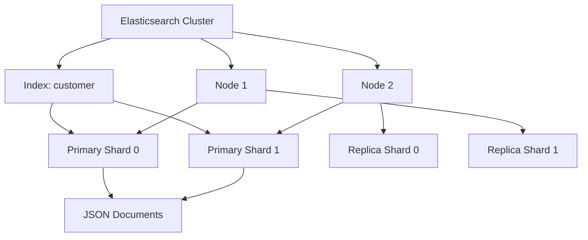
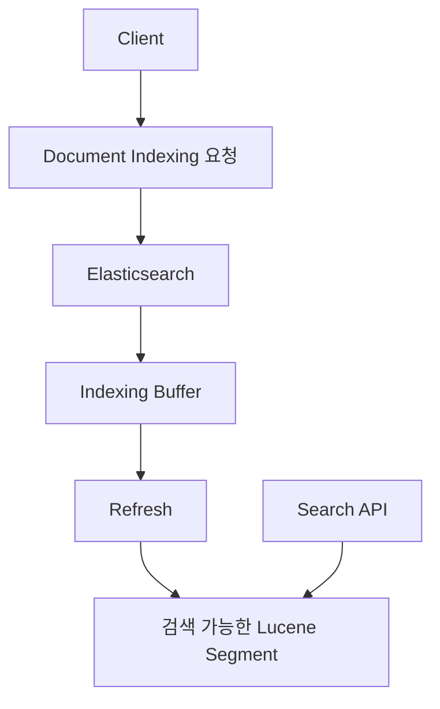
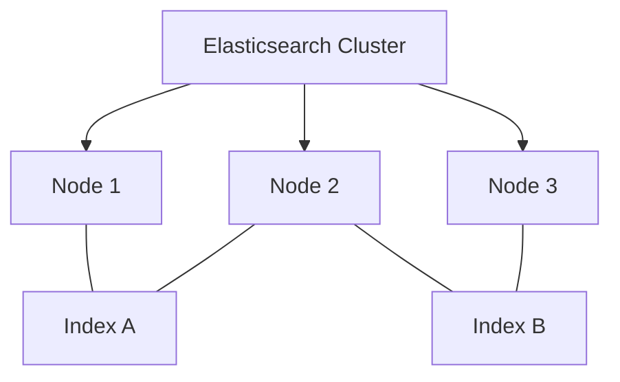
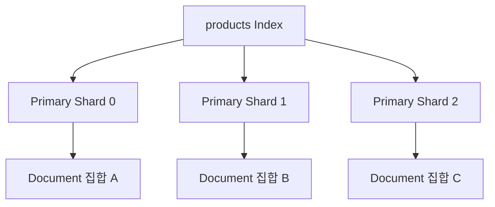
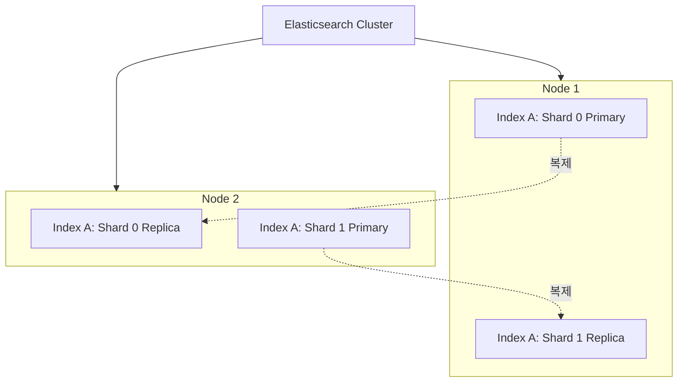
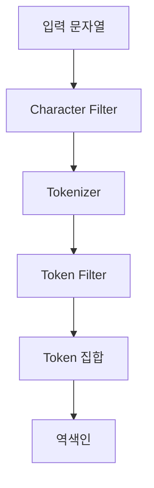
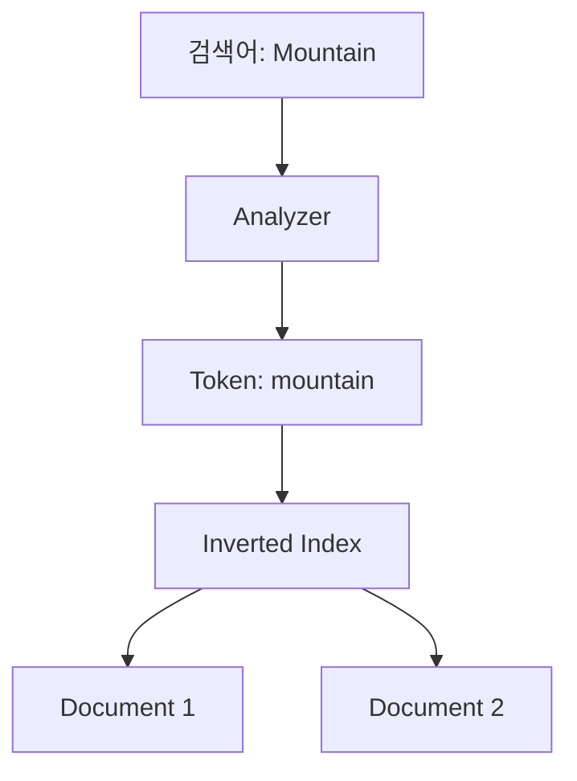
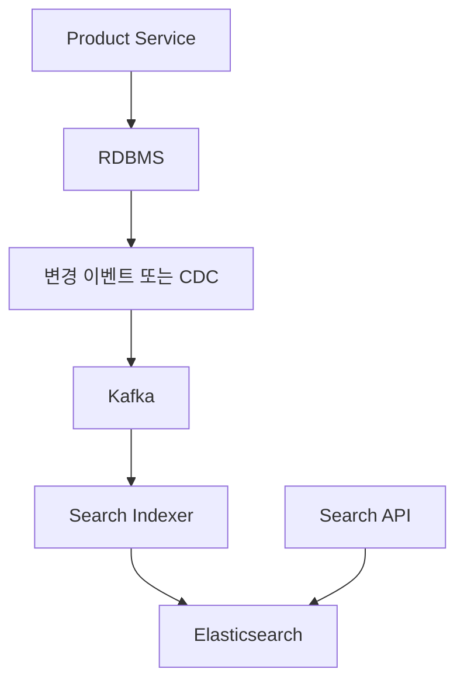
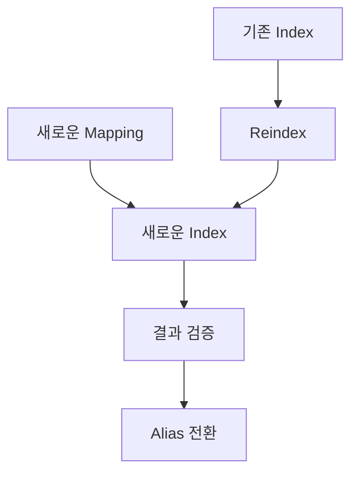

# 엘라스틱서치

# 엘라스틱서치

* toc
{:toc}

---

### Elasticsearch 완벽 이해: Cluster, Shard, Mapping부터 REST API와 Bulk 처리까지

Elasticsearch는 대규모 데이터를 저장하고 빠르게 검색하기 위한 분산 검색 및 분석 엔진이다.

일반적인 관계형 데이터베이스에서도 SQL을 사용하여 데이터를 검색할 수 있다.

하지만 서비스 규모가 커지고 검색 조건이 복잡해지면 단순한 데이터 조회와 전문 검색(Full-text Search) 사이에 차이가 나타난다.

예를 들어 전자상거래 서비스에서 사용자가 다음과 같은 검색어를 입력한다고 가정해 보자.

```text
무선 노이즈 캔슬링 헤드폰
```

사용자는 상품명에 해당 문장이 정확하게 포함된 상품만 찾고 싶은 것이 아니다.

다음과 같은 상품도 검색 결과에 포함되기를 기대할 수 있다.

```text
프리미엄 무선 헤드폰

노이즈 캔슬링 블루투스 헤드폰

무선 오디오 헤드셋
```

검색 시스템에서는 단순한 문자열 일치뿐 아니라 단어 분석, 검색어와 문서의 관련성, 정렬 기준 등을 고려해야 한다.

Elasticsearch는 이러한 문제를 해결하기 위해 Apache Lucene을 기반으로 검색 기능을 제공한다.

또한 여러 서버에 데이터를 분산하여 저장하고 검색할 수 있도록 Cluster와 Shard 구조를 지원한다.

Elasticsearch를 사용하면 다음과 같은 기능을 구현할 수 있다.

- 상품명과 설명을 이용한 전문 검색
- 사용자 및 주문 데이터 검색
- 로그 수집과 검색
- 실시간 또는 준실시간 데이터 분석
- 조건별 필터링과 정렬
- 대용량 데이터 집계
- 분산 저장과 장애 복구
- 다양한 시스템과의 검색 데이터 연동

하지만 Elasticsearch는 단순히 데이터를 저장한 후 SQL 대신 검색 API를 호출하는 시스템이 아니다.

데이터가 어떻게 색인되는지, 검색 결과에 언제 반영되는지, Shard가 어떻게 배치되는지 이해해야 안정적인 검색 서비스를 구축할 수 있다.

이번 글에서는 Elasticsearch의 구조부터 실제 REST API 사용 방법까지 단계적으로 살펴본다.

---

### Elasticsearch란?

#### Elasticsearch의 개념

Elasticsearch는 JSON Document를 저장하고 검색하는 분산 검색 및 분석 엔진이다.

다음과 같은 JSON 데이터를 저장한다고 가정해 보자.

```json
{
  "name": "Mountain Lover",
  "age": 20,
  "description": "Outdoor adventure and mountain hiking"
}
```

Elasticsearch는 이러한 JSON 데이터를 Document라는 단위로 관리한다.

Document는 Index에 저장되며, Index는 하나 이상의 Primary Shard로 구성된다.

각 Shard는 자체적인 Apache Lucene Index를 가지고 있다.

전체 구조는 다음과 같다.



이 구조에서 중요한 개념은 다음과 같다.

| 개념 | 설명 |
|---|---|
| Cluster | 여러 Elasticsearch Node를 논리적으로 묶은 시스템 |
| Node | Elasticsearch를 실행하는 하나의 인스턴스 |
| Index | 관련된 Document를 저장하는 논리적 단위 |
| Document | JSON 형태로 표현되는 데이터 |
| Field | Document를 구성하는 속성 |
| Mapping | Field의 자료형과 색인 방법을 정의 |
| Primary Shard | 실제 Document를 분산 저장하는 기본 Shard |
| Replica Shard | Primary Shard의 복제본 |

각 개념을 자세히 이해하면 Elasticsearch의 REST API와 분산 저장 구조를 보다 쉽게 이해할 수 있다.

---

### Elasticsearch의 주요 특징

#### 1. Near Real-time Search

Elasticsearch는 Near Real-time 검색 엔진이다.

Near Real-time은 데이터가 저장된 후 검색 결과에 반영되기까지 짧은 지연이 발생할 수 있다는 의미다.

일반적인 관계형 데이터베이스에서는 트랜잭션이 Commit된 이후 다른 트랜잭션에서 해당 데이터를 조회할 수 있다.

Elasticsearch에서는 Document를 색인하는 작업과 검색 가능한 상태로 만드는 작업을 구분한다.

이를 이해하려면 Refresh 개념이 필요하다.

#### 2. 분산 저장

Elasticsearch는 Index를 여러 Shard로 나누어 저장할 수 있다.

하나의 서버에 모든 데이터를 저장하지 않고 여러 Node에 분산할 수 있다.

#### 3. 고가용성

Replica Shard를 구성하면 일부 Node에 장애가 발생했을 때 다른 Node의 복제본을 이용하여 서비스를 계속 제공할 수 있다.

다만 실제 고가용성을 확보하려면 Replica 수와 Node 배치가 적절해야 한다.

#### 4. REST API

Elasticsearch는 HTTP 기반 REST API를 제공한다.

따라서 Java와 Python 같은 애플리케이션뿐 아니라 `curl`과 같은 명령어로도 데이터를 관리할 수 있다.

#### 5. 다양한 검색 기능

Elasticsearch는 정확한 값 비교뿐 아니라 전문 검색과 유사도 기반 검색, 집계, 정렬 등의 기능을 제공한다.

---

### Near Real-time은 무엇인가?

#### Indexing과 Searching은 서로 다른 과정이다

Elasticsearch에 Document를 저장하는 과정을 생각해 보자.



Elasticsearch에 Document를 기록했다고 해서 반드시 즉시 검색 결과에 나타나는 것은 아니다.

새로운 Document가 검색 가능한 상태가 되려면 Refresh가 필요할 수 있다.

일반적인 Elastic Stack 환경에서는 `index.refresh_interval`의 기본 설정이 1초다.

다만 이는 모든 Document가 정확히 1초 후 검색된다는 보장이 아니다.

최근 검색 활동 여부와 Index 설정, Refresh 실행 조건 등에 따라 달라질 수 있다.

#### Refresh와 Flush의 차이

Elasticsearch에서는 Refresh와 Flush를 구분해야 한다.

| 구분 | Refresh | Flush |
|---|---|---|
| 주요 목적 | 최근 변경 사항을 검색 가능하게 함 | Lucene Commit과 Translog 세대 전환 |
| 관련 대상 | 검색 가능한 Segment | Lucene 저장 상태와 Transaction Log |
| 사용 상황 | 검색 가시성 확보 | 복구 및 저장 상태 관리 |
| 수동 호출 | `_refresh` | `_flush` |

Refresh는 검색 가시성과 관련된 작업이다.

Flush는 Lucene Commit과 Translog 관리에 관련된 작업이다.

따라서 Flush를 단순히 메모리를 비우는 작업으로 이해해서는 안 된다.

#### Refresh API

다음 API를 이용하면 특정 Index를 Refresh할 수 있다.

```bash
curl -X POST \
  "http://localhost:9200/customer/_refresh"
```

이 명령어는 `customer` Index에 대해 Refresh를 요청한다.

하지만 운영 환경에서 모든 Document 저장 직후 `_refresh`를 호출하는 방식은 권장하기 어렵다.

Refresh에는 비용이 발생하기 때문이다.

#### refresh=wait_for

특정 Document가 검색 가능한 상태가 된 이후 응답받고 싶다면 다음 방식을 고려할 수 있다.

```bash
curl -X PUT \
  "http://localhost:9200/customer/_doc/1?refresh=wait_for" \
  -H "Content-Type: application/json" \
  -d '{
    "name": "Mountain Lover",
    "age": 20
  }'
```

`refresh=wait_for`는 해당 변경이 검색 가능해지는 Refresh를 기다리는 옵션이다.

즉시 강제 Refresh를 반복하는 방식보다 적합할 수 있다.

다만 검색 가시성을 기다리는 만큼 요청 지연이 증가할 수 있다.

**Elasticsearch에서 Document 저장 성공과 Search API에서 검색 가능한 시점은 구분해야 한다.**

---

### Elasticsearch의 Cluster란?

#### Cluster의 개념

Cluster는 여러 Elasticsearch Node를 하나의 논리적인 시스템으로 구성한 것이다.

예를 들어 다음과 같은 Node가 있다고 가정해 보자.

```text
Node 1

Node 2

Node 3
```

이 Node들이 동일한 Cluster에 참여하면 하나의 Elasticsearch 시스템처럼 동작할 수 있다.



Cluster는 Index와 Shard의 배치 상태를 관리한다.

Client는 Cluster에 요청을 보내고, Elasticsearch는 필요한 Shard를 찾아 작업을 수행한다.

#### Cluster가 필요한 이유

하나의 Node에 모든 데이터를 저장하는 구조에서는 해당 Node의 자원에 의해 처리량과 저장 용량이 제한된다.

또한 Node에 장애가 발생하면 서비스 전체가 영향을 받을 수 있다.

여러 Node로 구성하면 데이터를 분산 저장하고 일부 작업을 병렬로 처리할 수 있다.

단, Node를 추가한다고 모든 검색 요청의 성능이 비례하여 증가하는 것은 아니다.

검색 유형과 Shard 배치, CPU, 디스크, 네트워크 사용량 등에 따라 효과가 달라진다.

---

### Elasticsearch의 Node란?

#### Node의 개념

Node는 Elasticsearch를 실행하는 하나의 인스턴스다.

일반적으로 하나의 서버나 컨테이너에서 하나의 Elasticsearch Node를 실행할 수 있다.

Node는 역할에 따라 다양한 작업을 수행한다.

대표적으로 다음 역할이 존재한다.

| 역할 | 설명 |
|---|---|
| Master-eligible | Cluster 상태 관리에 참여 |
| Data | Shard 데이터를 저장하고 검색·색인 처리 |
| Ingest | 데이터 색인 전 변환 처리 |
| Coordinating | 요청을 받아 관련 Node와 결과를 조정 |

하나의 Node가 여러 역할을 수행할 수 있다.

예를 들어 개발 환경에서는 하나의 Node에서 Cluster 관리와 데이터 저장, 검색을 모두 처리할 수 있다.

실제 운영 환경에서는 데이터 규모와 업무 특성에 따라 Node 역할을 분리할 수 있다.

#### Master Node와 Data Node의 차이

Master Node는 Cluster Metadata와 Shard 배치 등 Cluster의 관리 작업을 조정한다.

Data Node는 실제 데이터를 저장하고 검색 및 색인 작업을 수행한다.

Master Node가 모든 검색 데이터를 직접 가지고 있거나 모든 검색 작업을 수행해야 하는 것은 아니다.

---

### Index란?

#### Index의 개념

Index는 서로 관련된 Document를 저장하는 논리적인 단위다.

예를 들어 다음과 같은 Index를 만들 수 있다.

```text
customers

products

orders

application-logs
```

각 Index에는 해당 데이터와 관련된 Document가 저장된다.

예를 들어 `products` Index에는 다음과 같은 Document를 저장할 수 있다.

```json
{
  "productId": "product-1001",
  "name": "Wireless Headphones",
  "price": 89000,
  "category": "electronics"
}
```

Index는 관계형 데이터베이스의 Table과 비슷하게 느껴질 수 있다.

하지만 Elasticsearch Index와 RDBMS Table은 완전히 동일한 개념이 아니다.

Elasticsearch Index는 내부적으로 여러 Shard로 분산될 수 있고, Document는 JSON 기반 구조를 사용한다.

---

### Document란?

#### Document의 개념

Document는 Elasticsearch에서 저장하고 검색하는 기본 데이터 단위다.

일반적으로 JSON 객체로 표현된다.

```json
{
  "name": "John Doe",
  "age": 30,
  "city": "Seoul"
}
```

각 속성은 Field라고 부른다.

| Field | Value |
|---|---|
| name | John Doe |
| age | 30 |
| city | Seoul |

Document에는 고유한 `_id`가 부여된다.

직접 ID를 지정할 수도 있고 Elasticsearch가 자동으로 생성하도록 할 수도 있다.

#### Document의 주요 메타데이터

Document를 조회하면 다음과 같은 메타데이터를 확인할 수 있다.

```json
{
  "_index": "customer",
  "_id": "1",
  "_version": 1,
  "found": true,
  "_source": {
    "name": "John Doe",
    "age": 30
  }
}
```

이는 응답 구조를 설명하기 위한 예시이며, 실제 응답에는 추가 메타데이터가 포함될 수 있다.

각 필드의 의미는 다음과 같다.

| 필드 | 의미 |
|---|---|
| `_index` | Document가 저장된 Index |
| `_id` | Document 식별자 |
| `_version` | Document의 내부 버전 |
| `_source` | Document의 원본 내용 |
| `found` | 조회 대상 존재 여부 |

여기서 `_version`은 Document 변경에 따른 내부 버전 정보다.

Elasticsearch의 모든 동시성 제어를 `_version`만으로 구현해야 하는 것은 아니다.

현대 Elasticsearch에서는 `_seq_no`와 `_primary_term`을 이용한 낙관적 동시성 제어도 지원한다.

---

### RDBMS와 Elasticsearch의 데이터 모델 비교

#### 과거 Elasticsearch의 데이터 모델

과거 Elasticsearch에서는 다음과 같은 개념을 사용했다.

| RDBMS | 과거 Elasticsearch |
|---|---|
| Database | Index |
| Table | Type |
| Row | Document |
| Column | Field |
| Schema | Mapping |
| Index | 색인 구조 |
| SQL | Query DSL |

이러한 비교는 처음 개념을 이해할 때 도움이 될 수 있다.

하지만 현재 Elasticsearch에 그대로 적용하면 문제가 발생한다.

가장 중요한 차이는 **Mapping Type이 제거되었다는 것**이다.

#### Mapping Type이 제거된 이유

과거 Elasticsearch에서는 다음과 같은 URL을 사용했다.

```text
/customer/external/1
```

이 구조에서 `external`은 Type을 나타냈다.

```text
Index: customer

Type: external

Document ID: 1
```

과거에는 하나의 Index 내부에 여러 Type을 정의하는 모델을 사용할 수 있었다.

하지만 서로 다른 Type의 동일한 Field 이름이 내부적으로 같은 Lucene Field와 연결되는 등의 문제가 있었다.

이러한 모델은 데이터 구조를 유연하게 설계하는 데 제약이 되었다.

Elasticsearch는 점진적으로 Mapping Type을 제거했고, Elasticsearch 8.0부터는 지원하지 않는다.

#### 현재 Elasticsearch의 구조

현재는 다음과 같이 이해하는 것이 적절하다.

```text
Index
    ↓
Document
    ↓
Field
```

REST API 경로도 변경되었다.

**과거 방식**

```text
/customer/external/1
```

**현재 방식**

```text
/customer/_doc/1
```

`_doc`은 Document API에 사용되는 고정된 경로 요소다.

과거의 `external`처럼 사용자가 정의하는 Mapping Type이 아니다.

#### 현재 기준 비교표

| RDBMS 개념 | Elasticsearch 개념 | 주의사항 |
|---|---|---|
| Database | Index와 부분적으로 유사 | 완전히 동일하지 않음 |
| Table | Index와 부분적으로 유사 | Mapping Type은 제거됨 |
| Row | Document | JSON 기반 데이터 |
| Column | Field | 다양한 자료형 지원 |
| Schema | Mapping | 동적·명시적 Mapping 지원 |
| Index | 역색인 및 기타 색인 구조 | 모든 Field가 같은 방식으로 색인되는 것은 아님 |
| SQL | Query DSL, ES|QL 등 | 기능과 처리 모델이 다름 |

특히 과거의 `Everything is indexed`라는 표현은 모든 Field가 무조건 검색 가능하다는 뜻으로 이해하면 안 된다.

현대 Elasticsearch에서는 Field별로 `index`, `doc_values` 등의 설정을 조정할 수 있다.

---

### Shard란?

#### Shard의 개념

Shard는 Elasticsearch Index를 나누어 저장하는 단위다.

예를 들어 하나의 Index에 100만 개의 Document가 있다고 가정해 보자.

이 데이터를 하나의 Shard에 저장할 수도 있다.

하지만 데이터 규모와 처리 요구사항에 따라 여러 Shard로 분산할 수도 있다.



각 Primary Shard는 서로 다른 Document 집합을 저장한다.

따라서 Shard는 데이터를 분할하는 기능을 담당한다.

#### Shard와 Partition의 차이

Kafka의 Partition과 Elasticsearch의 Shard는 데이터를 나누어 처리한다는 공통점이 있다.

하지만 목적과 동작 방식은 다르다.

| 구분 | Kafka Partition | Elasticsearch Shard |
|---|---|---|
| 주요 목적 | 이벤트 로그 분산 저장 | 검색 데이터 분산 저장 |
| 기본 구조 | 순서가 있는 Append Log | Lucene Index |
| 데이터 위치 | Topic Partition | Index Shard |
| 순서 | Partition 내부 Offset 순서 | 검색 결과 정렬은 Query에 따라 결정 |
| 복제 | Replica Partition | Replica Shard |
| 병렬 처리 | Consumer 병렬 소비 | 분산 검색·색인 |

Elasticsearch는 Kafka처럼 모든 Document에 대해 단일한 전역 Offset 순서를 제공하지 않는다.

---

### Primary Shard와 Replica Shard

#### Primary Shard란?

Primary Shard는 Index의 데이터를 분할하여 저장하는 기본 Shard다.

Document를 색인할 때 Elasticsearch는 대상 Document가 어느 Primary Shard에 속하는지 결정한다.

이후 해당 Shard에 데이터가 기록된다.

#### Replica Shard란?

Replica Shard는 Primary Shard의 복제본이다.

Replica는 데이터 내구성과 검색 가용성, 읽기 처리량 확장에 도움을 준다.

#### 두 Node에 Shard를 배치하는 예제

두 개의 Node가 존재한다고 가정해 보자.

`Index A`에는 Primary Shard 두 개가 있다.

각 Primary Shard에는 Replica가 하나씩 존재한다.



Primary와 Replica는 같은 Shard의 복제 관계다.

Primary Shard 0의 Replica는 Shard 0의 데이터를 복제한다.

Primary Shard 1의 Replica는 Shard 1의 데이터를 복제한다.

서로 다른 Shard 번호의 데이터를 복제하는 것은 아니다.

#### Primary Shard와 Replica Shard의 역할 비교

| 구분 | Primary Shard | Replica Shard |
|---|---|---|
| 목적 | 데이터 분산 저장 | 데이터 복제 |
| 쓰기 처리 | 해당 데이터의 기본 쓰기 처리 | Primary의 변경 사항 복제 |
| 읽기 처리 | 가능 | 가능 |
| 장애 대응 | 장애 발생 가능 | 필요 시 Primary 역할 승격 가능 |
| 동일 Node 배치 | Replica와 동일 Node에 배치하지 않음 | 대응 Primary와 다른 Node 필요 |

#### Replica가 있으면 반드시 안전할까?

Replica가 존재하더라도 올바르게 배치되지 않으면 장애 대응 효과를 얻기 어렵다.

Elasticsearch는 동일한 Primary Shard와 그 Replica를 같은 Node에 배치하지 않는다.

따라서 Node가 하나뿐이라면 Replica가 할당되지 않을 수 있다.

예를 들어 다음과 같은 구성이다.

```text
Node 수: 1

Primary Shard: 1

Replica 수: 1
```

Primary Shard는 정상적으로 실행할 수 있다.

하지만 Replica는 다른 Node가 필요하므로 할당되지 않는다.

이때 Cluster Health가 `yellow`로 나타날 수 있다.

단일 Node 개발 환경에서는 Replica를 0으로 설정하는 경우가 많다.

반면 운영 환경에서는 고가용성 요구사항에 맞게 충분한 Node와 Replica를 구성해야 한다.

---

### Shard 개수는 많을수록 좋을까?

Shard를 여러 개로 나누면 데이터 저장과 검색 작업을 분산할 수 있다.

하지만 Shard가 많을수록 무조건 성능이 좋아지는 것은 아니다.

각 Shard는 자체적인 Lucene Index와 관련 메타데이터를 관리한다.

따라서 Shard 수가 증가하면 다음 비용도 증가할 수 있다.

- Heap 및 메타데이터 사용량
- 파일 핸들 사용량
- 검색 요청 분산 및 결과 병합 비용
- Cluster 상태 관리 비용
- Shard 이동 및 복구 비용

따라서 Shard 수는 데이터 규모와 검색 패턴, 색인 처리량, 장애 복구 요구사항 등을 기준으로 결정해야 한다.

과거에는 기본 Primary Shard 수를 5개로 제공하던 버전도 있었다.

현대 Elasticsearch에서는 일반적인 Index의 기본 Primary Shard 수가 1개다.

특정 환경이나 Index Template이 별도 값을 지정할 수 있으므로 실제 Index의 설정을 확인하는 것이 가장 정확하다.

---

### Elasticsearch 설치 및 실행 환경

Elasticsearch의 기본 개념을 확인했다면 실제 API를 호출해 보자.

이번에는 Elasticsearch 9.5.6을 기준으로 한다.

로컬 개발 환경에서는 Docker를 이용하면 비교적 간단하게 Elasticsearch를 실행할 수 있다.

#### Docker 실행

다음 명령어를 사용한다.

```bash
docker run -d \
  --name elasticsearch-lab \
  --memory 3g \
  -p 127.0.0.1:9200:9200 \
  -e "discovery.type=single-node" \
  -e "xpack.security.enabled=false" \
  -e "ES_JAVA_OPTS=-Xms1g -Xmx1g" \
  docker.elastic.co/elasticsearch/elasticsearch:9.5.6
```

이 명령어는 로컬 실습용 단일 Node Elasticsearch를 실행한다.

각 옵션의 의미는 다음과 같다.

| 옵션 | 설명 |
|---|---|
| `-d` | 백그라운드 실행 |
| `--name` | 컨테이너 이름 지정 |
| `--memory 3g` | 컨테이너 메모리 제한 |
| `-p 127.0.0.1:9200:9200` | 호스트의 Loopback 주소에 9200 포트 연결 |
| `discovery.type=single-node` | 단일 Node 개발 환경 구성 |
| `xpack.security.enabled=false` | Elasticsearch 보안 기능 비활성화 |
| `ES_JAVA_OPTS` | JVM Heap 설정 |

**보안 기능을 비활성화하는 설정은 외부에 노출하지 않는 로컬 개발 환경에서만 사용해야 한다.**

운영 환경에서는 TLS와 인증, 권한 관리 등을 적용해야 한다.

#### 실행 상태 확인

```bash
docker ps
```

Elasticsearch 컨테이너가 실행 중인지 확인한다.

로그를 확인하려면 다음 명령어를 사용한다.

```bash
docker logs -f elasticsearch-lab
```

Elasticsearch가 시작되는 과정에서 오류가 발생했다면 로그를 통해 확인할 수 있다.

특히 Linux 환경에서는 `vm.max_map_count` 설정이 부족해 시작에 실패할 수 있다.

이 경우 호스트 운영체제의 관련 설정을 확인해야 한다.

#### Elasticsearch 연결 확인

```bash
curl -X GET "http://localhost:9200"
```

정상적으로 연결되면 Elasticsearch의 Cluster 이름과 버전 등의 정보가 JSON으로 반환된다.

예상 응답 구조는 다음과 같다.

```json
{
  "name": "node-name",
  "cluster_name": "docker-cluster",
  "version": {
    "number": "9.5.6"
  }
}
```

실제 응답에는 추가 필드가 포함된다.

이후 명령어에서는 다음 주소를 기준으로 사용한다.

```text
http://localhost:9200
```

---

### Elasticsearch REST API란?

#### REST API의 개념

Elasticsearch는 HTTP 기반 REST API를 제공한다.

따라서 다양한 프로그래밍 언어와 애플리케이션에서 Elasticsearch에 접근할 수 있다.

대표적인 HTTP 메서드는 다음과 같다.

| HTTP Method | 주요 용도 |
|---|---|
| GET | 데이터 조회 |
| POST | 데이터 생성 또는 특정 작업 실행 |
| PUT | 리소스 생성·교체·설정 |
| DELETE | 데이터 삭제 |

다만 메서드만 보고 실제 동작을 단정해서는 안 된다.

Elasticsearch에서는 Endpoint에 따라 동일한 HTTP 메서드라도 다른 작업을 수행한다.

예를 들어 다음 두 API는 서로 다른 작업이다.

```http
PUT /customer
```

Index를 생성한다.

```http
PUT /customer/_doc/1
```

Document를 생성하거나 전체 교체한다.

REST API를 사용할 때는 HTTP 메서드와 URL 경로를 함께 이해해야 한다.

---

### Elasticsearch REST API의 URI 구조

#### 과거의 URI 구조

과거 Elasticsearch에서는 다음과 같은 URI를 사용했다.

```text
http://localhost:9200/index/type/id?parameters
```

각 요소의 의미는 다음과 같다.

| 요소 | 의미 |
|---|---|
| index | Index 이름 |
| type | Mapping Type |
| id | Document ID |
| parameters | API 옵션 |

예를 들어 다음과 같다.

```text
/customer/external/1
```

하지만 Mapping Type이 제거되었으므로 현대 Elasticsearch에서는 이 경로를 사용하지 않는다.

#### 현재의 URI 구조

Document API에서는 다음과 같은 경로를 사용한다.

```text
/{index}/_doc/{id}
```

예를 들어 다음과 같다.

```text
/customer/_doc/1
```

검색 API에서는 다음 경로를 사용한다.

```text
/{index}/_search
```

Mapping 조회는 다음과 같다.

```text
/{index}/_mapping
```

Settings 조회는 다음과 같다.

```text
/{index}/_settings
```

Bulk API는 다음과 같다.

```text
/{index}/_bulk
```

이처럼 특정 작업을 나타내는 Endpoint를 사용한다.

---

### Elasticsearch REST API의 주요 Endpoint

Elasticsearch에서 자주 사용하는 Endpoint는 다음과 같다.

| Endpoint | 역할 |
|---|---|
| `_cluster` | Cluster 관련 정보와 관리 |
| `_nodes` | Node 정보 조회 |
| `_aliases` | Index Alias 관리 |
| `_analyze` | Analyzer 동작 확인 |
| `_cache/clear` | Cache 정리 |
| `_flush` | Lucene Commit 및 Translog 관리 |
| `_forcemerge` | Lucene Segment 강제 병합 |
| `_stats` | Index 통계 조회 |
| `_search` | 검색 |
| `_msearch` | 여러 검색 요청 처리 |
| `_mget` | 여러 Document를 ID로 조회 |
| `_validate/query` | Query 유효성 검사 |
| `_bulk` | 여러 Document 작업을 일괄 처리 |
| `_count` | 검색 조건에 맞는 Document 수 조회 |
| `_settings` | Index 설정 관리 |

과거에 사용하던 일부 Endpoint는 현재 다른 방식으로 제공된다.

예를 들어 `_optimize`는 현대 Elasticsearch에서 `_forcemerge`로 이해해야 한다.

다만 Force Merge는 비용이 큰 작업이므로 일반적인 쓰기 대상 Index에 반복 실행하는 작업으로 사용해서는 안 된다.

또한 `_mget`은 여러 Document를 수정하는 API가 아니라 **여러 Document를 ID로 조회하는 API**다.

---

### Index 생성하기

Elasticsearch에서 데이터를 저장하려면 먼저 Index를 생성할 수 있다.

이번에는 `customer`라는 이름의 Index를 생성한다.

#### 단순 Index 생성

```bash
curl -X PUT \
  "http://localhost:9200/customer"
```

정상적으로 생성되면 다음과 같은 응답을 받을 수 있다.

```json
{
  "acknowledged": true,
  "shards_acknowledged": true,
  "index": "customer"
}
```

이 응답은 정상적인 생성 상황을 설명하기 위한 예시다.

이미 같은 이름의 Index가 존재한다면 생성에 실패할 수 있다.

#### Index 생성 시 Settings 지정

운영 환경에서는 Index의 설정을 명시적으로 지정하는 경우가 많다.

예를 들어 다음과 같다.

```bash
curl -X PUT \
  "http://localhost:9200/customer" \
  -H "Content-Type: application/json" \
  -d '{
    "settings": {
      "number_of_shards": 1,
      "number_of_replicas": 0,
      "refresh_interval": "1s"
    }
  }'
```

이 코드는 새 Index를 생성할 때 사용할 수 있는 예시다.

이미 `customer` Index를 생성했다면 같은 이름으로 다시 생성할 수 없으므로, 최초 생성 시 두 방법 중 하나를 선택해야 한다.

#### 주요 Settings

| 설정 | 의미 |
|---|---|
| `number_of_shards` | Primary Shard 개수 |
| `number_of_replicas` | Primary Shard당 Replica 개수 |
| `refresh_interval` | 검색 가시성 갱신 주기 |

이번에는 단일 Node 환경이므로 Replica를 0으로 설정했다.

실제 운영 환경에서는 Replica를 0으로 설정하는 것이 일반적인 권장사항은 아니다.

---

### Index Settings 조회하기

다음 명령어로 Index의 설정을 확인할 수 있다.

```bash
curl -X GET \
  "http://localhost:9200/customer/_settings?pretty"
```

`pretty` 옵션은 JSON 응답을 읽기 쉽게 출력하기 위한 옵션이다.

다음과 같은 설정을 확인할 수 있다.

```json
{
  "customer": {
    "settings": {
      "index": {
        "number_of_shards": "1",
        "number_of_replicas": "0"
      }
    }
  }
}
```

실제 응답에는 생성 날짜와 UUID, Version 등의 정보도 포함될 수 있다.

#### Settings의 종류

Elasticsearch의 설정은 적용 범위에 따라 다르게 관리된다.

**Cluster Settings**

Cluster 전체에 적용되는 설정이다.

**Index Settings**

개별 Index에 적용되는 설정이다.

**Node Settings**

Elasticsearch Node의 실행 및 동작과 관련된 설정이다.

따라서 다음 API는 서로 다른 정보를 제공한다.

```http
GET /_cluster/settings
```

```http
GET /customer/_settings
```

```http
GET /_nodes/settings
```

Index Settings API를 단순히 `elasticsearch.yml`의 전체 설정을 조회하는 기능으로 이해해서는 안 된다.

---

### Mapping이란?

#### Mapping의 개념

Mapping은 Elasticsearch에서 Document의 Field가 어떤 자료형을 가지며 어떻게 색인되는지 정의하는 설정이다.

관계형 데이터베이스의 Schema와 비슷한 역할을 한다.

예를 들어 다음 JSON을 생각해 보자.

```json
{
  "name": "John Doe",
  "age": 30,
  "createdAt": "2026-11-23T10:00:00Z"
}
```

이 Document에는 세 개의 Field가 존재한다.

| Field | 자료형 |
|---|---|
| name | 문자열 |
| age | 정수 |
| createdAt | 날짜 |

Elasticsearch에서는 이를 Mapping으로 정의할 수 있다.

#### Mapping이 필요한 이유

Mapping을 명확하게 정의하지 않으면 Elasticsearch가 데이터를 기반으로 Field의 자료형을 자동 추론할 수 있다.

이를 Dynamic Mapping이라고 한다.

Dynamic Mapping은 개발 초기에는 편리하다.

하지만 실제 운영 환경에서는 문제가 발생할 수 있다.

예를 들어 `age` Field가 처음에는 숫자로 들어왔다고 가정해 보자.

```json
{
  "age": 30
}
```

이후 다른 Producer가 다음과 같은 문자열을 전송한다.

```json
{
  "age": "thirty"
}
```

이미 Field 자료형이 숫자로 결정되어 있다면 색인 오류가 발생할 수 있다.

따라서 중요한 Field는 명시적인 Mapping을 정의하는 것이 좋다.

---

### Elasticsearch Mapping의 주요 자료형

현재 Elasticsearch에서는 다양한 자료형을 지원한다.

대표적인 자료형은 다음과 같다.

| 자료형 | 설명 | 사용 사례 |
|---|---|---|
| `text` | 분석기를 이용한 전문 검색 | 상품명, 본문 |
| `keyword` | 정확한 값 비교 | 상태 코드, ID |
| `integer` | 정수 | 나이, 수량 |
| `long` | 큰 정수 | 금액, 누적 수치 |
| `double` | 부동소수점 | 측정값 |
| `boolean` | 참·거짓 | 활성화 여부 |
| `date` | 날짜와 시간 | 생성 시각 |
| `object` | 중첩 JSON 객체 | 주소 정보 |
| `nested` | 객체 배열의 독립적인 관계 유지 | 상품 옵션 배열 |

특히 문자열 자료형에서는 `text`와 `keyword`의 차이를 반드시 이해해야 한다.

---

### text와 keyword의 차이

#### text란?

`text`는 전문 검색에 적합한 자료형이다.

일반적으로 Analyzer를 통해 문자열을 분석한 후 검색한다.

예를 들어 다음 문자열을 저장했다고 가정해 보자.

```text
Mountain Lover
```

기본적인 분석 과정에서 다음과 같은 Token으로 분리될 수 있다.

```text
mountain

lover
```

따라서 `Mountain` 또는 `Lover`와 같은 단어 검색에 활용할 수 있다.

#### keyword란?

`keyword`는 정확한 값 비교에 적합한 자료형이다.

예를 들어 다음 상태 코드를 생각해 보자.

```text
PAYMENT_COMPLETED
```

이 값은 일반적인 문장처럼 분석할 필요가 없다.

전체 문자열을 하나의 값으로 비교하는 것이 적절하다.

따라서 `keyword`를 사용할 수 있다.

#### text와 keyword 비교

| 구분 | text | keyword |
|---|---|---|
| 주요 목적 | 전문 검색 | 정확한 값 비교 |
| 일반적인 분석 | Analyzer 적용 | 하나의 값으로 처리 |
| 대표 검색 | match | term |
| 정렬·집계 | 별도 설정이나 하위 Field 활용 | 일반적으로 적합 |
| 활용 예 | 제목, 설명 | 상태 코드, 카테고리, 식별자 |

#### 하나의 문자열을 두 방식으로 사용하기

상품명은 전문 검색에도 사용하고 정확한 값 비교에도 사용해야 할 수 있다.

이때 Multi-field를 사용할 수 있다.

```json
{
  "name": {
    "type": "text",
    "fields": {
      "keyword": {
        "type": "keyword"
      }
    }
  }
}
```

이렇게 설정하면 다음 두 Field를 활용할 수 있다.

```text
name
```

전문 검색에 사용한다.

```text
name.keyword
```

정확한 값 비교나 정렬, 집계 등에 사용할 수 있다.

---

### Mapping 전체 예제

이번에는 `customer` Index에 명시적인 Mapping을 정의해 보자.

Index를 새로 생성하는 시점이라면 Settings와 Mapping을 함께 지정할 수 있다.

```bash
curl -X PUT \
  "http://localhost:9200/customer" \
  -H "Content-Type: application/json" \
  -d '{
    "settings": {
      "number_of_shards": 1,
      "number_of_replicas": 0,
      "refresh_interval": "1s"
    },
    "mappings": {
      "properties": {
        "name": {
          "type": "text",
          "fields": {
            "keyword": {
              "type": "keyword"
            }
          }
        },
        "age": {
          "type": "integer"
        },
        "description": {
          "type": "text"
        },
        "createdAt": {
          "type": "date"
        }
      }
    }
  }'
```

이 명령어는 새 Index를 생성하면서 Mapping을 지정하는 예제다.

기존에 같은 이름의 Index가 존재한다면 먼저 새로운 이름의 Index를 생성하거나 기존 Index에 적용 가능한 Mapping 변경 API를 사용해야 한다.

실제로는 다음 순서로 진행하는 것이 좋다.

```text
Index 생성 전
    ↓
Field 구조 설계
    ↓
Settings와 Mapping 정의
    ↓
Index 생성
    ↓
Document 색인
```

중요한 Field의 자료형을 나중에 변경하기는 쉽지 않다.

이미 저장된 데이터의 Field Type을 다른 Type으로 변경해야 한다면 새로운 Index를 생성하고 데이터를 다시 색인하는 방법을 고려해야 한다.

---

### 과거 Mapping 속성과 현재 Mapping의 차이

Elasticsearch는 버전이 발전하면서 Mapping 구조가 크게 변경되었다.

과거에는 다음과 같은 자료형을 사용했다.

```json
{
  "type": "string",
  "index": "not_analyzed"
}
```

하지만 현대 Elasticsearch에서는 이러한 구문을 사용하지 않는다.

대표적으로 다음과 같이 변경되었다.

```json
{
  "type": "keyword"
}
```

다음은 주요 Mapping 속성의 변화다.

| 과거 속성 | 현재 기준 |
|---|---|
| `string` | `text` 또는 `keyword`로 구분 |
| `index: analyzed` | 일반적으로 `text`와 Analyzer 활용 |
| `index: not_analyzed` | 일반적으로 `keyword` 활용 |
| `index: no` | `index: false` 사용 |
| `store` | 현재도 지원되지만 `_source`와 구분 필요 |
| `term_vector` | 현재도 지원 |
| `boost` | 과거와 동일한 Mapping 설정으로 사용하지 않음 |
| `null_value` | 지원하는 Field Type에서 활용 가능 |
| `omit_norms` | `norms` 설정으로 이해 |
| `index_options` | Field Type에 따른 옵션 지원 |
| `analyzer` | 현재도 지원 |
| `index_analyzer` | 현대 Mapping에서는 별도 `analyzer` 설정 사용 |
| `search_analyzer` | 현재도 지원 |
| `include_in_all` | 제거된 `_all` 모델과 관련 |
| `ignore_above` | 현재도 지원 |
| `position_offset_gap` | 현재 지원되는 `position_increment_gap`과 구분 |
| `precision_step` | 과거 숫자 색인 방식 관련 설정 |
| `ignore_malformed` | 지원하는 자료형에서 활용 가능 |
| `format` | 날짜 등의 형식 지정에 사용 |

모든 속성이 동일한 시점에 제거되거나 변경된 것은 아니다.

따라서 과거 설정을 현대 Elasticsearch에 그대로 복사하기보다는 현재 Field Type과 요구사항에 맞게 다시 설계해야 한다.

---

### store와 _source의 차이

Elasticsearch Mapping을 이해할 때 자주 혼동하는 속성이 `store`다.

예를 들어 다음 설정을 살펴보자.

```json
{
  "name": {
    "type": "text",
    "store": true
  }
}
```

`store`는 해당 Field 값을 별도로 저장할지 결정하는 설정이다.

하지만 `store: false`라고 해서 Document의 원본 값이 반드시 사라지는 것은 아니다.

Elasticsearch는 일반적으로 `_source`를 통해 원본 Document를 보관한다.

예를 들어 다음 Document가 있다고 가정해 보자.

```json
{
  "name": "John Doe",
  "age": 30
}
```

Mapping에서 `name`의 `store`가 `false`이더라도 `_source`가 유지된다면 일반적인 Document 조회에서 `name` 값을 확인할 수 있다.

따라서 다음 두 가지는 서로 다른 개념이다.

**store**

Field 값을 별도로 저장하는 옵션이다.

**_source**

Document의 원본 내용을 보관하거나 재구성하기 위한 기능이다.

`_source`는 재색인과 업데이트, 데이터 복구 등 여러 작업에서 중요하게 사용되므로 비활성화 여부를 신중하게 결정해야 한다.

---

### Analyzer란?

#### Analyzer의 개념

Analyzer는 텍스트를 검색에 적합한 형태로 분석하는 구성 요소다.

일반적인 텍스트 분석 과정은 다음과 같이 이해할 수 있다.



Analyzer는 보통 다음 구성 요소를 조합한다.

| 구성 요소 | 역할 |
|---|---|
| Character Filter | 입력 문자열 전처리 |
| Tokenizer | 문자열을 Token으로 분리 |
| Token Filter | Token의 대소문자 변환 등 후처리 |

#### Analyzer 확인하기

다음 API를 사용할 수 있다.

```bash
curl -X POST \
  "http://localhost:9200/_analyze" \
  -H "Content-Type: application/json" \
  -d '{
    "analyzer": "standard",
    "text": "Mountain Lover"
  }'
```

정상적인 분석에서는 다음과 같은 Token을 확인할 수 있다.

```text
mountain

lover
```

실제 응답에는 Token의 시작 위치와 종료 위치, Position 등의 메타데이터가 포함된다.

#### 한국어 검색에서는 어떻게 해야 할까?

영어는 공백과 단어 경계가 비교적 명확한 경우가 많다.

하지만 한국어는 조사와 어미가 결합되므로 단순한 공백 분리만으로 원하는 검색 품질을 얻기 어려울 수 있다.

예를 들어 다음 문장을 생각해 보자.

```text
배송이 완료되었습니다.
```

사용자는 다음 검색어로도 관련 문서를 찾고 싶을 수 있다.

```text
배송 완료
```

이러한 요구사항에서는 한국어 형태소 분석기를 검토할 수 있다.

Elasticsearch에서는 Nori와 같은 한국어 분석 기능을 사용할 수 있다.

다만 분석기 선택은 검색 도메인과 Elasticsearch 버전, 설치 방식에 따라 달라질 수 있다.

상품 검색과 로그 검색, 문서 검색은 원하는 Token 처리 방식이 서로 다를 수 있으므로 실제 검색 데이터를 이용하여 분석 결과를 검증하는 것이 좋다.

---

### 역색인(Inverted Index)이란?

#### 역색인의 개념

Elasticsearch는 Apache Lucene을 기반으로 전문 검색을 수행한다.

이때 중요한 개념이 역색인(Inverted Index)이다.

일반적인 문서 저장 구조를 생각해 보자.

| Document ID | 내용 |
|---|---|
| 1 | Mountain Lover |
| 2 | Mountain Hiking |
| 3 | City Lover |

이 구조에서 `Mountain`을 검색하려면 문서 내용을 하나씩 확인하는 방법을 생각할 수 있다.

반면 역색인은 단어를 기준으로 해당 단어가 포함된 Document를 찾을 수 있도록 구성한다.

| Term | Document ID |
|---|---|
| mountain | 1, 2 |
| lover | 1, 3 |
| hiking | 2 |
| city | 3 |

검색어가 `Mountain`이라면 역색인을 이용하여 관련 Document를 빠르게 찾을 수 있다.



이러한 구조는 전문 검색에서 중요한 역할을 한다.

하지만 Elasticsearch의 모든 검색이 동일한 역색인만을 사용하는 것은 아니다.

정렬과 집계에는 Doc Values 등 다른 저장 구조도 활용한다.

따라서 Elasticsearch를 단순히 모든 Field를 역색인으로 저장하는 시스템이라고 이해하면 실제 구조를 정확하게 설명하기 어렵다.

---

### Document 등록하기

이제 실제 REST API를 이용하여 Document를 등록해 보자.

Elasticsearch에서는 Document ID를 자동 생성하거나 직접 지정할 수 있다.

#### 자동 ID 생성

다음 명령어를 사용한다.

```bash
curl -X POST \
  "http://localhost:9200/customer/_doc?pretty" \
  -H "Content-Type: application/json" \
  -d '{
    "name": "Mountain Lover",
    "age": 20
  }'
```

이 명령어는 `customer` Index에 새로운 Document를 저장한다.

ID는 Elasticsearch가 자동으로 생성한다.

정상적으로 저장되면 다음과 같은 정보를 포함한 응답을 받을 수 있다.

```json
{
  "_index": "customer",
  "_id": "자동으로 생성된 ID",
  "result": "created"
}
```

실제 `_id`는 실행할 때 생성된 값을 확인해야 한다.

#### 지정 ID로 Document 등록

이번에는 ID를 직접 지정해 보자.

```bash
curl -X PUT \
  "http://localhost:9200/customer/_doc/1?pretty" \
  -H "Content-Type: application/json" \
  -d '{
    "name": "Mountain Lover",
    "age": 20
  }'
```

이 명령어는 ID가 `1`인 Document를 생성하거나 교체한다.

여기서 중요한 차이가 있다.

**POST /customer/_doc**

Elasticsearch가 Document ID를 생성한다.

**PUT /customer/_doc/1**

Document ID를 직접 지정한다.

---

### Document 조회하기

Document ID를 알고 있다면 Get Document API를 이용할 수 있다.

```bash
curl -X GET \
  "http://localhost:9200/customer/_doc/1?pretty"
```

정상적으로 조회되면 다음과 같은 형태의 응답을 받을 수 있다.

```json
{
  "_index": "customer",
  "_id": "1",
  "found": true,
  "_source": {
    "name": "Mountain Lover",
    "age": 20
  }
}
```

Get Document API는 Document ID를 이용한 조회다.

일반적인 검색 Query를 실행하는 Search API와는 목적이 다르다.

또한 Document Get은 기본적으로 실시간 조회 특성을 가지므로, Search API의 Refresh 가시성과 차이가 발생할 수 있다.

---

### Document 수정하기

Elasticsearch에서는 Document를 수정하는 방법을 구분해야 한다.

대표적으로 전체 교체와 부분 수정이 있다.

#### 전체 교체: Index API

다음 Document가 있다고 가정해 보자.

```json
{
  "name": "Mountain Lover",
  "age": 20
}
```

다음 명령어를 실행한다.

```bash
curl -X PUT \
  "http://localhost:9200/customer/_doc/1?pretty" \
  -H "Content-Type: application/json" \
  -d '{
    "name": "Mountain Lover!"
  }'
```

이 경우 Document의 `_source`는 새로 지정한 내용으로 교체된다.

따라서 기존에 존재하던 `age` Field가 사라질 수 있다.

이것이 전체 교체의 중요한 특징이다.

#### 부분 수정: Update API

기존 Document의 일부 Field만 변경하려면 Update API를 사용할 수 있다.

```bash
curl -X POST \
  "http://localhost:9200/customer/_update/1?pretty" \
  -H "Content-Type: application/json" \
  -d '{
    "doc": {
      "name": "Mountain Lover!",
      "age": 20
    }
  }'
```

Update API에서는 `doc` 객체를 이용하여 부분 수정할 Field를 지정한다.

여기서 주의할 점은 Update API가 일반적인 Index API처럼 Document 전체를 교체하는 기능이 아니라는 것이다.

#### 전체 교체와 부분 수정 비교

| 구분 | 전체 교체 | 부분 수정 |
|---|---|---|
| API | Index API | Update API |
| 대표 경로 | `PUT /customer/_doc/1` | `POST /customer/_update/1` |
| 본문 | 전체 Document | `doc` 객체 |
| 기존 Field | 새 본문에 없으면 제거될 수 있음 | 지정하지 않은 Field는 일반적으로 유지 |
| 사용 사례 | 완전한 상태 동기화 | 일부 Field 변경 |

실제 백엔드 개발에서는 두 API의 차이를 명확하게 이해해야 한다.

예를 들어 데이터베이스의 전체 Row를 검색 인덱스로 동기화한다면 전체 교체가 적합할 수 있다.

반면 특정 상태만 갱신해야 한다면 부분 수정을 고려할 수 있다.

---

### Document 삭제하기

특정 Document를 삭제하려면 DELETE API를 사용한다.

```bash
curl -X DELETE \
  "http://localhost:9200/customer/_doc/1?pretty"
```

삭제 이후 같은 Document를 조회하면 존재하지 않는다는 결과를 받을 수 있다.

```bash
curl -X GET \
  "http://localhost:9200/customer/_doc/1?pretty"
```

일반적인 조회에서는 `found: false`와 같은 응답을 확인할 수 있다.

---

### Delete By Query란?

특정 ID가 아니라 검색 조건에 일치하는 Document를 삭제해야 할 수도 있다.

예를 들어 이름이 `Mountain Lover!`인 Document를 삭제한다고 가정해 보자.

현대 Elasticsearch에서는 Delete By Query API를 사용할 수 있다.

```bash
curl -X POST \
  "http://localhost:9200/customer/_delete_by_query?pretty" \
  -H "Content-Type: application/json" \
  -d '{
    "query": {
      "match": {
        "name": "Mountain Lover!"
      }
    }
  }'
```

이 명령어는 검색 조건에 일치하는 Document를 삭제한다.

일반적인 DELETE Document API와 차이가 있다.

**DELETE /customer/_doc/1**

특정 ID를 삭제한다.

**POST /customer/_delete_by_query**

검색 조건에 일치하는 Document를 삭제한다.

Delete By Query는 많은 Document를 삭제할 수 있으므로 운영 환경에서 실행할 때 특히 주의해야 한다.

검색 조건을 먼저 확인한 후 대상 Document가 예상과 일치하는지 검증하는 것이 좋다.

---

### Index 삭제하기

Index 자체를 삭제하려면 다음 명령어를 사용한다.

```bash
curl -X DELETE \
  "http://localhost:9200/customer"
```

이 작업은 Document 하나를 삭제하는 것이 아니다.

`customer` Index 전체를 삭제한다.

따라서 해당 Index의 Mapping과 Settings, Document까지 함께 제거된다.

운영 환경에서는 실수로 Index를 삭제하지 않도록 권한과 작업 절차를 분리하는 것이 좋다.

특히 `DELETE /customer/_doc/1`과 `DELETE /customer`를 혼동해서는 안 된다.

---

### Search API란?

#### Search API의 개념

Search API는 Elasticsearch에 저장된 Document를 검색하는 기능이다.

Document ID를 이용한 단순 조회와 달리 다양한 검색 조건을 지정할 수 있다.

예를 들어 다음과 같은 검색이 가능하다.

- 특정 단어가 포함된 Document 검색
- 여러 조건을 조합한 검색
- 정확한 값이 일치하는 Document 검색
- 특정 범위에 속하는 값 검색
- 정렬
- 페이지네이션
- 집계

Search API는 일반적으로 Query DSL을 사용하여 검색 조건을 표현한다.

---

### Query DSL이란?

Query DSL은 Elasticsearch에서 JSON 형태로 검색 조건을 정의하는 방식이다.

예를 들어 모든 Document를 검색하려면 다음 Query를 사용할 수 있다.

```json
{
  "query": {
    "match_all": {}
  }
}
```

특정 Field의 값을 검색하려면 다음과 같은 Query를 사용할 수 있다.

```json
{
  "query": {
    "match": {
      "name": "Mountain Lover"
    }
  }
}
```

이러한 JSON 기반 검색 표현을 Query DSL이라고 한다.

---

### 모든 Document 검색하기

모든 Document를 검색하려면 `match_all`을 사용할 수 있다.

```bash
curl -X POST \
  "http://localhost:9200/customer/_search?pretty" \
  -H "Content-Type: application/json" \
  -d '{
    "query": {
      "match_all": {}
    }
  }'
```

검색 결과에는 일반적으로 다음과 같은 정보가 포함된다.

```json
{
  "hits": {
    "total": {
      "value": 2,
      "relation": "eq"
    },
    "hits": [
      {
        "_index": "customer",
        "_id": "1",
        "_source": {
          "name": "John Doe"
        }
      }
    ]
  }
}
```

이 응답은 구조를 설명하기 위해 단순화한 예시다.

실제 검색 결과는 저장된 Document 수와 Query, Index 상태에 따라 달라진다.

---

### match Query란?

`match` Query는 전문 검색에 사용되는 대표적인 Query다.

다음 예제를 살펴보자.

```bash
curl -X POST \
  "http://localhost:9200/customer/_search?pretty" \
  -H "Content-Type: application/json" \
  -d '{
    "query": {
      "match": {
        "name": "Mountain Lover"
      }
    }
  }'
```

이 Query는 `name` Field를 대상으로 검색한다.

`name`이 `text` 타입으로 정의되어 있다면 Analyzer가 검색에 관여할 수 있다.

검색어가 분석되고 관련 Document가 검색된다.

---

### term Query란?

`term` Query는 정확한 값 검색에 사용한다.

예를 들어 `name.keyword` Field에 정확히 `Mountain Lover`라는 값이 저장되어 있다고 가정해 보자.

다음 Query를 사용할 수 있다.

```bash
curl -X POST \
  "http://localhost:9200/customer/_search?pretty" \
  -H "Content-Type: application/json" \
  -d '{
    "query": {
      "term": {
        "name.keyword": {
          "value": "Mountain Lover"
        }
      }
    }
  }'
```

이 Query는 문자열의 전체 값을 기준으로 정확히 일치하는 Document를 검색하는 데 적합하다.

#### match와 term의 차이

| 구분 | match | term |
|---|---|---|
| 주요 목적 | 전문 검색 | 정확한 값 검색 |
| Analyzer | 검색어 분석이 관여할 수 있음 | 검색어를 분석하지 않음 |
| 대표 Field | text | keyword |
| 사용 사례 | 상품명 검색 | 상태 코드 검색 |

예를 들어 결제 상태가 `PAID`인 Document를 검색해야 한다면 `keyword` Field에 대한 `term` Query가 적합할 수 있다.

반면 상품 설명에서 관련 단어를 검색해야 한다면 `text` Field에 대한 `match` Query가 적합하다.

---

### Search API의 주요 파라미터

Elasticsearch에서는 다양한 검색 파라미터를 사용할 수 있다.

대표적으로 다음과 같다.

| 파라미터 | 역할 |
|---|---|
| `q` | Query String 기반 검색 |
| `analyzer` | 지원되는 Query에서 분석기 지정 |
| `default_operator` | Query String의 기본 논리 연산자 |
| `_source` | 원본 Document 반환 제어 |
| `_source_includes` | 반환할 Field 제한 |
| `_source_excludes` | 제외할 Field 지정 |
| `df` | Query String의 기본 Field 지정 |
| `sort` | 결과 정렬 |

단, 모든 파라미터가 모든 API에서 동일하게 지원되는 것은 아니다.

또한 현대 Elasticsearch에서는 Request Body의 Query DSL을 이용하여 검색 조건을 명확하게 표현하는 방식이 일반적이다.

#### URL 기반 검색

다음과 같이 검색할 수 있다.

```bash
curl -X GET \
  "http://localhost:9200/customer/_search?q=name:Mountain&pretty"
```

이 방식은 간단한 검색을 확인할 때 유용하다.

하지만 검색 조건이 복잡해지면 URL Encoding과 특수 문자 처리에 주의해야 한다.

#### Request Body 기반 검색

복잡한 검색은 Request Body를 사용하는 것이 적합하다.

```bash
curl -X POST \
  "http://localhost:9200/customer/_search?pretty" \
  -H "Content-Type: application/json" \
  -d '{
    "query": {
      "bool": {
        "must": [
          {
            "match": {
              "name": "Mountain"
            }
          }
        ],
        "filter": [
          {
            "range": {
              "age": {
                "gte": 18
              }
            }
          }
        ]
      }
    }
  }'
```

이 Query는 다음 조건을 의미한다.

```text
name에 Mountain 관련 검색 조건 적용

AND

age가 18 이상
```

전문 검색과 정확한 조건 필터링을 구분하면 검색 의도를 명확하게 표현할 수 있다.

---

### _source를 이용한 검색 결과 제어

검색 결과에서 일부 Field만 반환하도록 설정할 수 있다.

예를 들어 다음과 같다.

```bash
curl -X POST \
  "http://localhost:9200/customer/_search?pretty" \
  -H "Content-Type: application/json" \
  -d '{
    "_source": [
      "name",
      "age"
    ],
    "query": {
      "match_all": {}
    }
  }'
```

이 경우 검색 결과의 `_source`에는 지정한 Field가 포함된다.

하지만 중요한 점이 있다.

**응답에서 특정 Field를 제외한다고 Elasticsearch가 해당 Field를 색인하지 않는 것은 아니다.**

검색 결과의 반환 Field 제어와 Mapping의 색인 여부는 서로 다른 기능이다.

---

### 정렬과 검색 결과 크기 설정

검색 결과를 특정 기준으로 정렬할 수 있다.

예를 들어 나이의 내림차순으로 검색한다고 가정해 보자.

```bash
curl -X POST \
  "http://localhost:9200/customer/_search?pretty" \
  -H "Content-Type: application/json" \
  -d '{
    "size": 10,
    "sort": [
      {
        "age": {
          "order": "desc"
        }
      }
    ],
    "query": {
      "match_all": {}
    }
  }'
```

각 옵션의 의미는 다음과 같다.

| 옵션 | 설명 |
|---|---|
| `size` | 반환할 검색 결과 수 |
| `sort` | 정렬 조건 |
| `order` | 오름차순 또는 내림차순 |

대규모 데이터에서 깊은 페이지네이션이 필요하다면 단순한 `from`과 `size` 조합만으로 처리하는 방식의 비용을 고려해야 한다.

실제 서비스에서는 `search_after`와 Point in Time(PIT) 등의 기능을 검토할 수 있다.

---

### Elasticsearch의 주요 관리 API

Elasticsearch 운영에서는 Document API 외에도 Cluster와 Index 상태를 확인해야 한다.

대표적인 API를 살펴보자.

#### Cluster Health 조회

```bash
curl -X GET \
  "http://localhost:9200/_cluster/health?pretty"
```

Cluster 상태를 확인한다.

대표적인 상태는 다음과 같다.

| 상태 | 의미 |
|---|---|
| green | Primary와 Replica Shard가 모두 할당됨 |
| yellow | Primary는 할당되었지만 일부 Replica가 할당되지 않음 |
| red | 일부 Primary Shard가 할당되지 않음 |

`yellow` 상태가 항상 모든 검색이 불가능하다는 의미는 아니다.

하지만 Replica가 부족하므로 장애 대응 능력이 낮아질 수 있다.

`red` 상태는 일부 Primary Shard를 사용할 수 없는 상황이므로 우선적인 확인이 필요하다.

#### Node 목록 조회

```bash
curl -X GET \
  "http://localhost:9200/_cat/nodes?v"
```

Node별 정보를 확인할 수 있다.

#### Index 목록 조회

```bash
curl -X GET \
  "http://localhost:9200/_cat/indices?v"
```

Index 이름과 상태, Document 수, 저장 공간 등을 확인할 수 있다.

#### Shard 배치 확인

```bash
curl -X GET \
  "http://localhost:9200/_cat/shards?v"
```

각 Shard가 어떤 Node에 배치되어 있는지 확인할 수 있다.

#### Index Mapping 조회

```bash
curl -X GET \
  "http://localhost:9200/customer/_mapping?pretty"
```

현재 Index의 Field Mapping을 확인한다.

#### Index 통계 조회

```bash
curl -X GET \
  "http://localhost:9200/customer/_stats?pretty"
```

Index의 검색과 색인, 저장소 관련 통계 등을 확인할 수 있다.

---

### CAT API의 주요 파라미터

CAT API는 사람이 빠르게 상태를 확인하기 위한 텍스트 기반 API다.

예를 들어 다음 명령어를 사용한다.

```bash
curl -X GET \
  "http://localhost:9200/_cat/indices?v"
```

`v`는 컬럼 헤더를 출력하는 옵션이다.

다른 옵션도 사용할 수 있다.

| 옵션 | 의미 |
|---|---|
| `v` | 헤더 출력 |
| `help` | 사용 가능한 컬럼 확인 |
| `h` | 출력할 컬럼 지정 |
| `bytes` | 크기 출력 단위 지정 |

예를 들어 다음과 같이 사용할 수 있다.

```bash
curl -X GET \
  "http://localhost:9200/_cat/indices?v&h=index,health,status,docs.count,store.size&bytes=b"
```

이 명령어는 Index 이름과 상태, Document 수, 저장 공간 등의 컬럼을 선택하여 출력한다.

참고로 `_cat/indices`의 Document 수는 내부 Lucene Document의 특성에 영향을 받을 수 있다.

논리적인 Document 개수를 정확히 확인해야 한다면 `_count` API를 사용하는 방법도 고려해야 한다.

---

### Bulk API란?

#### Bulk API의 개념

Bulk API는 여러 Document에 대한 작업을 하나의 요청으로 묶어서 처리하는 API다.

일반적인 Document API에서는 하나의 요청으로 하나의 Document를 생성하거나 수정한다.

반면 Bulk API에서는 여러 작업을 하나의 요청으로 전달할 수 있다.

예를 들어 다음과 같은 데이터를 저장한다고 가정해 보자.

```text
John Doe

Jane Doe

Kevin Lee
```

각 Document를 개별 요청으로 전송하는 대신 Bulk API로 묶어서 처리할 수 있다.

#### Bulk API가 필요한 이유

대량의 데이터를 색인할 때 Document마다 HTTP 요청을 보내면 요청 처리와 네트워크 오버헤드가 증가한다.

Bulk API는 여러 작업을 묶어 전송함으로써 이러한 비용을 줄이는 데 도움이 된다.

하지만 한 번에 너무 많은 데이터를 전송하면 요청 크기와 메모리 사용량이 증가할 수 있다.

따라서 실제 운영 환경에서는 Bulk 크기를 조정하면서 처리량과 지연 시간, 실패율을 측정해야 한다.

---

### Bulk API의 데이터 형식

Bulk API는 NDJSON(Newline Delimited JSON) 형식을 사용한다.

NDJSON은 한 줄에 하나의 JSON 객체를 기록하는 형식이다.

Bulk 요청에서는 작업 종류에 따라 메타데이터 행과 Document 본문 행을 구분한다.

#### index 작업

다음 데이터를 살펴보자.

```json
{"index":{"_id":"1"}}
{"name":"John Doe"}
{"index":{"_id":"2"}}
{"name":"Jane Doe"}
```

첫 번째 줄은 작업 정보를 나타낸다.

```json
{"index":{"_id":"1"}}
```

두 번째 줄은 실제 Document다.

```json
{"name":"John Doe"}
```

세 번째 줄은 다음 작업 정보를 나타낸다.

```json
{"index":{"_id":"2"}}
```

네 번째 줄은 다음 Document다.

```json
{"name":"Jane Doe"}
```

이를 구조로 나타내면 다음과 같다.

```text
Action Metadata
Document Body

Action Metadata
Document Body
```

이러한 행 단위 형식은 Bulk API를 이해할 때 매우 중요하다.

---

### Bulk API 실행 예제

#### NDJSON 파일 생성

다음 파일을 생성한다.

```text
bulk.ndjson
```

전체 내용은 다음과 같다.

```json
{"index":{"_id":"1"}}
{"name":"John Doe","age":30}
{"index":{"_id":"2"}}
{"name":"Jane Doe","age":28}
```

실제 파일에서는 각 JSON 객체가 한 줄씩 작성되어야 한다.

**마지막 줄 뒤에도 줄바꿈 문자가 존재해야 한다.**

Bulk API는 마지막 줄의 개행을 요구한다.

#### Bulk 요청 실행

```bash
curl -X POST \
  "http://localhost:9200/customer/_bulk?pretty" \
  -H "Content-Type: application/x-ndjson" \
  --data-binary "@bulk.ndjson"
```

각 요소의 의미는 다음과 같다.

| 항목 | 의미 |
|---|---|
| `POST` | Bulk 작업 요청 |
| `/customer/_bulk` | customer Index의 Bulk API |
| `application/x-ndjson` | NDJSON 데이터 형식 |
| `--data-binary` | 파일 내용을 변형하지 않고 전송 |
| `@bulk.ndjson` | 요청 본문으로 사용할 파일 |

#### 왜 --data-binary를 사용할까?

Bulk API에서는 줄바꿈이 데이터 구조의 일부다.

따라서 원본 파일 내용을 그대로 전송하는 것이 중요하다.

`--data-binary`를 사용하면 파일의 줄바꿈을 포함한 데이터를 전달할 수 있다.

---

### Bulk API 응답 확인하기

Bulk API가 정상적으로 요청을 받으면 여러 작업의 실행 결과를 반환한다.

예를 들어 다음과 같은 구조다.

```json
{
  "errors": false,
  "items": [
    {
      "index": {
        "_index": "customer",
        "_id": "1",
        "status": 201
      }
    },
    {
      "index": {
        "_index": "customer",
        "_id": "2",
        "status": 201
      }
    }
  ]
}
```

이는 정상적인 신규 색인 상황을 단순화한 예시다.

실제 응답 상태 코드는 기존 Document 존재 여부 등에 따라 달라질 수 있다.

#### Bulk API에서 중요한 필드

```json
{
  "errors": false
}
```

Bulk 요청에 포함된 작업들이 실패했는지 확인하는 데 중요한 필드다.

여기서 주의해야 한다.

**Bulk API의 HTTP 응답이 200이라고 해서 내부의 모든 Document 작업이 성공했다고 판단해서는 안 된다.**

일부 Document의 Mapping 오류나 버전 충돌이 발생할 수 있다.

따라서 응답의 `errors`와 `items`를 확인해야 한다.

---

### Bulk API에서 사용할 수 있는 작업

Bulk API는 여러 작업을 지원한다.

| 작업 | 의미 |
|---|---|
| `index` | Document 생성 또는 교체 |
| `create` | 기존 ID가 없을 때 생성 |
| `update` | 기존 Document 수정 |
| `delete` | Document 삭제 |

여기서 중요한 것은 모든 작업이 동일한 행 구조를 사용하지 않는다는 사실이다.

#### index

메타데이터 행과 Document 본문 행이 필요하다.

```json
{"index":{"_id":"1"}}
{"name":"John Doe"}
```

#### update

메타데이터 행과 수정 내용을 담은 본문 행이 필요하다.

```json
{"update":{"_id":"1"}}
{"doc":{"age":31}}
```

#### delete

삭제할 Document ID만 지정하면 되므로 별도의 Document 본문 행이 필요하지 않다.

```json
{"delete":{"_id":"1"}}
```

이 세 가지는 현대 Elasticsearch Bulk API의 동작을 설명하기 위해 확장한 예제다.

실제 데이터 처리에서 Bulk API를 사용한다면 작업 종류별 본문 형식을 정확하게 구분해야 한다.

---

### 기존 Elasticsearch REST API와 현재 API 비교

Elasticsearch는 오래전부터 REST API를 제공했지만 버전이 바뀌면서 여러 API와 Mapping 구조가 변경되었다.

오래된 시스템을 유지보수하거나 Elasticsearch를 업그레이드한다면 이러한 차이를 이해해야 한다.

#### 1. Mapping Type을 포함한 Document API

**과거**

```bash
curl -X PUT \
  "http://node201.hadoop.com:9200/customer/external/1?pretty" \
  -d '{
    "name": "Mountain Lover"
  }'
```

**현재**

```bash
curl -X PUT \
  "http://localhost:9200/customer/_doc/1?pretty" \
  -H "Content-Type: application/json" \
  -d '{
    "name": "Mountain Lover"
  }'
```

핵심 차이는 `external`이라는 Mapping Type이 제거되었다는 것이다.

#### 2. 부분 수정 API

**과거**

```bash
curl -X POST \
  "http://node201.hadoop.com:9200/customer/external/1/_update?pretty" \
  -d '{
    "doc": {
      "name": "Mountain Lover!",
      "age": 20
    }
  }'
```

**현재**

```bash
curl -X POST \
  "http://localhost:9200/customer/_update/1?pretty" \
  -H "Content-Type: application/json" \
  -d '{
    "doc": {
      "name": "Mountain Lover!",
      "age": 20
    }
  }'
```

`_update`의 위치가 달라졌다.

#### 3. Delete By Query

**과거**

```bash
curl -X DELETE \
  "http://node201.hadoop.com:9200/customer/external/_query?pretty" \
  -d '{
    "query": {
      "match": {
        "name": "Mountain Lover!"
      }
    }
  }'
```

**현재**

```bash
curl -X POST \
  "http://localhost:9200/customer/_delete_by_query?pretty" \
  -H "Content-Type: application/json" \
  -d '{
    "query": {
      "match": {
        "name": "Mountain Lover!"
      }
    }
  }'
```

단순히 HTTP Method만 변경된 것이 아니다.

Endpoint 자체가 변경되었다.

#### 4. Mapping 설정

**과거**

```json
{
  "title": {
    "type": "string",
    "index": "not_analyzed"
  }
}
```

**현재**

```json
{
  "title": {
    "type": "keyword"
  }
}
```

과거에는 문자열 Field를 `string`으로 정의하고 분석 여부를 설정했다.

현재는 검색 목적에 따라 `text`와 `keyword`를 구분한다.

#### 5. Cluster 상태 조회

**과거**

```http
GET /_status
```

**현재**

```http
GET /_cluster/health
```

Cluster Health를 확인할 때는 현재 제공되는 API를 사용해야 한다.

다만 Cluster Health와 Index 통계는 서로 다른 정보다.

Index별 상세 통계가 필요하다면 `_stats` API를 사용할 수 있다.

---

### 구버전 Elasticsearch 명령어 전체 예제

오래된 Elasticsearch 시스템을 유지보수하는 경우 기존 API의 구조를 이해해야 할 때가 있다.

다음 명령어는 과거에 사용되던 형식을 보존한 예제다.

**현재 Elasticsearch 9.x에서 그대로 실행하는 용도가 아니다.**

일부 명령어에는 오래된 Endpoint와 불완전한 JSON, 잘못된 `curl` 옵션이 포함되어 있다.

#### Index 생성과 조회

```bash
curl -XPUT 'node201.hadoop.com:9200/customer?pretty'

curl -GET 'node201.hadoop.com:9200/_cat/indices?v'
```

여기서 두 번째 명령어의 `-GET`은 일반적인 `curl` 사용법에 맞지 않는다.

현대적인 명령어에서는 다음과 같이 사용할 수 있다.

```bash
curl -X GET \
  "http://localhost:9200/_cat/indices?v"
```

#### 자동 ID로 Document 등록

```bash
curl -XPOST \
  'node201.hadoop.com:9200/customer/external?pretty' \
  -d '{ "name": "Mountain Lover" }'
```

#### 지정 ID로 Document 등록

```bash
curl -XPUT \
  'node201.hadoop.com:9200/customer/external/1?pretty' \
  -d '{ "name": "Mountain Lover" }'

curl -XGET \
  'node201.hadoop.com:9200/customer/external/1?pretty'
```

#### 부분 수정과 전체 교체

```bash
curl -XPOST \
  'node201.hadoop.com:9200/customer/external/1/_update?pretty' \
  -d '{ "doc": { "name": "Mountain Lover!", "age": 20 } }'

curl -XGET \
  'node201.hadoop.com:9200/customer/external/1?pretty'

curl -XPUT \
  'node201.hadoop.com:9200/customer/external/1?pretty' \
  -d '{ "name": "Mountain Lover!" }'

curl -XGET \
  'node201.hadoop.com:9200/customer/external/1?pretty'
```

#### Document와 Index 삭제

```bash
curl -XDELETE \
  'node201.hadoop.com:9200/customer/external/1?pretty'

curl -XGET \
  'node201.hadoop.com:9200/customer/external/1?pretty'

curl -XDELETE \
  'node201.hadoop.com:9200/customer/external/_query?pretty' \
  -d '{ "query": { "match": { "name": "Mountain Lover!" } } }'

curl -XGET \
  'node201.hadoop.com:9200/customer/external/1?pretty'

curl -XDELETE \
  'node201.hadoop.com:9200/customer?pretty'

curl -GET \
  'node201.hadoop.com:9200/_cat/indices?v'
```

이 명령어에는 현대 Elasticsearch에서 제거된 Mapping Type과 `_query` 경로가 포함되어 있다.

따라서 현재 버전에서는 앞에서 설명한 Document API와 Delete By Query API로 변경해야 한다.

---

### 구버전 Index 관리 API

과거에는 다음과 같은 명령어를 사용했다.

```bash
curl -XGET http://node201.hadoop.com:9200/_status

curl -XPOST http://node201.hadoop.com:9200/index001

curl -XDELETE http://node201.hadoop.com:9200/index001

curl -XGET http://node201.hadoop.com:9200/index001/_mapping

curl -XGET http://node201.hadoop.com:9200/index001/_status

curl -XGET http://node201.hadoop.com:9200/index001/_search

curl -XGET http://node201.hadoop.com:9200/_all/_search
```

이 명령어에서 구분해야 할 내용은 다음과 같다.

| 과거 사용 방식 | 현재 이해할 내용 |
|---|---|
| `_status` | Cluster Health 또는 Index Stats 등 목적에 맞는 API |
| `POST /index001` | 일반적인 Index 생성은 `PUT /index001` |
| `DELETE /index001` | Index 삭제 API |
| `/index001/_mapping` | Mapping 조회 |
| `/index001/_search` | Index 검색 |
| `/_all/_search` | 현재 버전의 검색 대상 지정 방식으로 변경 |

오래된 명령어를 무조건 문법만 수정하는 것은 적절하지 않다.

어떤 정보를 확인하기 위한 API인지 먼저 파악한 뒤 현재 버전에서 제공하는 기능으로 변경해야 한다.

---

### 구버전 Type 관리 API

과거에는 다음과 같은 명령어를 사용했다.

```bash
curl -XPOST \
  http://node201.hadoop.com:9200/index001/type001 \
  -d '{ title: "Greeting", body: "Hello World!" }'

curl -XDELETE \
  http://node201.hadoop.com:9200/index001/type001

curl -XGET \
  http://node201.hadoop.com:9200/index001/type001/_mapping

curl -XGET \
  http://node201.hadoop.com:9200/index001/type001/_status

curl -XGET \
  http://node201.hadoop.com:9200/index001/type001/_search
```

이 명령어에는 다음과 같은 문제가 있다.

첫째, `type001`이라는 Mapping Type을 사용한다.

둘째, 첫 번째 요청 본문은 JSON Key에 큰따옴표가 없어 올바른 JSON 형식이 아니다.

셋째, Type 자체를 관리하는 Endpoint는 현대 Elasticsearch의 데이터 모델과 맞지 않는다.

이러한 예제를 현대적으로 변경하려면 Type을 제거하고 Index와 Document 중심으로 구조를 다시 설계해야 한다.

예를 들어 다음과 같다.

```bash
curl -X PUT \
  "http://localhost:9200/index001/_doc/data001" \
  -H "Content-Type: application/json" \
  -d '{
    "title": "Greeting",
    "body": "Hello World!"
  }'
```

---

### 구버전 Mapping 관리 API

과거에는 Mapping을 다음과 같이 설정하는 방식이 사용되었다.

```text
PUT /index001/type001/_mapping
```

당시 설정 예제에는 다음과 같은 내용이 포함되었다.

```text
type001: {
  properties: {
    title: {
      type: "string",
      index: "not_analyzed"
    }
  }
}
```

이 구조는 현재 Elasticsearch에서 사용할 수 없다.

현재는 다음과 같이 변경할 수 있다.

```bash
curl -X PUT \
  "http://localhost:9200/index001/_mapping" \
  -H "Content-Type: application/json" \
  -d '{
    "properties": {
      "title": {
        "type": "keyword"
      }
    }
  }'
```

이 예제는 기존 Index에 새 Field Mapping을 추가하거나 허용되는 Mapping 변경을 수행하는 경우를 가정한다.

이미 존재하는 `title` Field가 다른 자료형으로 매핑되어 있다면 단순한 Mapping API 호출로 자료형을 변경할 수 없다.

이 경우 새로운 Index로 재색인해야 할 수 있다.

---

### Elasticsearch에서 검색 데이터 모델을 설계하는 방법

Elasticsearch를 실제 서비스에 적용한다면 관계형 데이터베이스와 역할을 구분하는 것이 좋다.

예를 들어 상품 서비스를 생각해 보자.

관계형 데이터베이스에는 다음과 같은 테이블이 있다고 가정한다.

```text
products

product_categories

product_options

product_images
```

상품 검색 API가 호출될 때마다 여러 테이블을 Join하여 검색 조건을 계산할 수도 있다.

하지만 복잡한 검색과 정렬, 전문 검색 요구사항이 증가하면 별도의 검색 모델을 구성하는 방법을 고려할 수 있다.

#### 검색용 Document 설계

```json
{
  "productId": "product-1001",
  "name": "Wireless Headphones",
  "description": "Premium wireless headphones",
  "price": 89000,
  "category": "electronics",
  "status": "ON_SALE",
  "createdAt": "2026-11-23T10:00:00Z"
}
```

이 Document는 검색 API에 필요한 정보를 중심으로 구성한다.

관계형 데이터베이스의 모든 테이블 구조를 그대로 Elasticsearch로 복사해야 하는 것은 아니다.

검색 요구사항에 맞는 형태로 데이터를 구성할 수 있다.

#### 검색 데이터와 원본 데이터의 관계



이 구조에서 RDBMS는 상품 상태의 원본 저장소로 사용할 수 있다.

Elasticsearch는 검색에 최적화된 조회 저장소로 사용할 수 있다.

Kafka는 변경 이벤트를 전달하는 데 활용할 수 있다.

이러한 구조는 CQRS의 읽기 모델과도 연결된다.

---

### Elasticsearch와 RDBMS의 데이터 정합성

Elasticsearch를 검색용 데이터베이스로 사용하는 경우 원본 데이터베이스와의 정합성을 고려해야 한다.

예를 들어 상품 가격이 변경되었다고 가정해 보자.

```text
기존 가격: 89,000원

변경 가격: 79,000원
```

관계형 데이터베이스에는 새로운 가격이 저장되었다.

하지만 Elasticsearch에는 아직 이전 가격이 남아 있을 수 있다.

```text
RDBMS

79,000원
```

```text
Elasticsearch

89,000원
```

이러한 상황은 변경 이벤트 전달과 Consumer 처리 과정에서 발생할 수 있다.

따라서 다음 사항을 고려해야 한다.

- 변경 이벤트가 누락되지 않는가?
- 동일한 이벤트를 다시 처리해도 안전한가?
- 이벤트 순서가 뒤바뀌면 어떻게 되는가?
- Elasticsearch 색인에 실패하면 어떻게 복구하는가?
- 전체 데이터를 다시 색인할 수 있는가?
- 검색 결과가 원본 데이터보다 늦게 갱신될 수 있음을 사용자 경험에 반영했는가?

이러한 질문은 Elasticsearch를 단순한 검색 엔진이 아니라 실제 서비스의 조회 저장소로 운영할 때 중요하다.

---

### Elasticsearch에서 재색인이 필요한 이유

Mapping은 검색 데이터의 구조를 정의한다.

하지만 모든 Mapping 변경을 기존 Index에 바로 적용할 수 있는 것은 아니다.

예를 들어 `name` Field를 `text`로 정의했다고 가정해 보자.

이후 검색 요구사항이 변경되어 다른 Analyzer를 적용해야 할 수 있다.

이 경우 새로운 Index를 생성하고 기존 데이터를 다시 색인하는 방식이 필요할 수 있다.

#### Reindex 구조



예를 들어 다음과 같은 Index를 사용할 수 있다.

```text
products-v1
```

```text
products-v2
```

새로운 Mapping을 적용한 `products-v2`를 생성한다.

이후 기존 데이터를 새로운 Index로 옮긴다.

결과를 검증한 뒤 Alias를 새로운 Index로 전환할 수 있다.

이 방법은 운영 중 검색 인덱스 구조를 변경할 때 유용하다.

다만 재색인 중에도 원본 데이터가 계속 변경된다면 변경 이벤트를 어디까지 반영할지 별도 전략이 필요하다.

---

### Elasticsearch 운영에서 자주 발생하는 문제

#### 1. Document를 저장했는데 검색되지 않는다

Document 저장에는 성공했지만 아직 Refresh가 수행되지 않았을 수 있다.

이 경우 다음 항목을 확인한다.

- Index가 정상적으로 생성되었는가?
- Document 저장 API의 응답이 성공했는가?
- Search API에서 올바른 Index를 사용했는가?
- Mapping과 Analyzer가 검색 의도에 맞는가?
- Refresh가 수행되었는가?

단순히 검색되지 않는다는 이유로 Document가 저장되지 않았다고 판단해서는 안 된다.

#### 2. Cluster 상태가 yellow다

Replica Shard가 할당되지 않았을 수 있다.

특히 단일 Node 환경에서 Replica를 1 이상으로 설정하면 해당 Replica를 배치할 다른 Node가 없어 `yellow` 상태가 나타날 수 있다.

이 경우 Node 수와 Replica 설정, Shard 배치를 확인해야 한다.

#### 3. Search API가 느리다

검색 성능은 다양한 요소에 영향을 받는다.

예를 들어 다음과 같다.

- 검색 대상 Document 수
- Query 복잡도
- Shard 수
- 정렬 및 집계 조건
- Node의 CPU와 메모리
- 디스크 I/O
- 검색 결과 크기
- Analyzer와 Mapping 구조

따라서 검색 성능을 개선하기 전에 어떤 작업에서 시간이 오래 걸리는지 확인해야 한다.

#### 4. Mapping 오류가 발생한다

Field Type과 실제 데이터가 맞지 않을 수 있다.

예를 들어 `age`를 `integer`로 정의했는데 문자열이 들어오면 색인 오류가 발생할 수 있다.

따라서 Producer 단계에서 데이터 유효성을 검증하는 것이 좋다.

#### 5. Bulk API 일부 작업이 실패한다

Bulk API는 여러 작업을 한 번에 처리한다.

따라서 HTTP 요청이 성공했더라도 일부 Document 작업이 실패할 수 있다.

응답의 `errors`와 `items`를 확인해야 한다.

실패한 항목을 재처리할 때는 같은 Document ID를 사용하는지, 기존 데이터에 어떤 영향을 주는지 함께 고려해야 한다.

#### 6. 기존 Type API가 동작하지 않는다

Elasticsearch 8.0부터 Mapping Type을 지원하지 않는다.

따라서 다음 경로를 사용하면 안 된다.

```text
/customer/external/1
```

현재는 다음 경로를 사용해야 한다.

```text
/customer/_doc/1
```

#### 7. Elasticsearch에 연결되지 않는다

연결 오류가 발생하면 다음 항목을 확인한다.

- Elasticsearch 프로세스가 실행 중인가?
- HTTP 또는 HTTPS를 올바르게 사용하고 있는가?
- 인증이 필요한 환경인가?
- 포트가 올바른가?
- Docker 포트 매핑이 올바른가?
- 접근 권한과 방화벽 설정이 올바른가?

현대 Elasticsearch에서는 보안 기능이 기본적으로 활성화되는 설치 방식이 많다.

따라서 인증과 TLS가 설정된 환경에서 단순 HTTP 요청을 보내면 연결에 실패할 수 있다.

---

### Elasticsearch 실무 활용을 위한 12가지 전략

#### 1. 검색 요구사항에 맞게 Index를 설계한다

Elasticsearch의 데이터 모델은 관계형 데이터베이스와 다르다.

따라서 원본 테이블 구조를 그대로 복사하기보다 검색 API에서 필요한 데이터를 중심으로 Document를 설계하는 것이 좋다.

#### 2. Mapping을 명시적으로 관리한다

Dynamic Mapping은 편리하지만 예상하지 못한 Field Type이 생성될 수 있다.

따라서 중요한 Field의 자료형과 Analyzer를 명확하게 정의해야 한다.

#### 3. text와 keyword를 구분한다

전문 검색이 필요한 Field에는 `text`를 고려한다.

정확한 값 비교와 정렬, 집계가 필요한 Field에는 `keyword`를 고려한다.

필요하다면 Multi-field를 활용하여 하나의 문자열을 여러 방식으로 색인할 수 있다.

#### 4. Shard 수를 무조건 늘리지 않는다

Shard 수가 많으면 데이터 분산에 도움이 될 수 있지만 관리 비용도 증가한다.

따라서 데이터 규모와 검색 패턴, Node 자원에 맞게 결정해야 한다.

#### 5. Replica와 Node 수를 함께 설계한다

Replica를 생성하려면 복제본을 배치할 수 있는 Node가 필요하다.

단순히 Replica 수를 증가시키는 것만으로 고가용성을 확보할 수 없다.

#### 6. Refresh 비용을 이해한다

Elasticsearch는 Near Real-time 검색 엔진이다.

따라서 저장 성공과 검색 가시성 확보 시점을 구분해야 한다.

모든 Document 저장 후 강제 Refresh를 실행하는 방식은 색인 성능에 부담을 줄 수 있다.

#### 7. Bulk API를 활용한다

대량의 Document를 색인할 때 Bulk API를 사용하면 요청 오버헤드를 줄일 수 있다.

하지만 지나치게 큰 Bulk 요청은 메모리와 네트워크에 부담을 줄 수 있다.

적절한 Batch 크기를 측정해야 한다.

#### 8. Bulk 실패 항목을 개별적으로 관리한다

Bulk API의 HTTP 응답만 확인해서는 안 된다.

`errors`와 `items`를 통해 실패한 Document를 확인해야 한다.

재시도할 때는 중복 처리와 기존 Document 교체 여부를 고려해야 한다.

#### 9. 검색 데이터의 원본을 명확하게 정의한다

Elasticsearch를 RDBMS의 검색용 조회 모델로 사용하는 경우 원본 데이터가 어디에 있는지 명확하게 해야 한다.

검색 데이터에 오류가 발생했을 때 원본 데이터로부터 복구할 수 있어야 한다.

#### 10. Reindex 전략을 준비한다

Mapping이나 Analyzer를 변경해야 할 때 기존 Index를 직접 수정할 수 없는 경우가 있다.

따라서 새로운 Index 생성과 재색인, 검증, Alias 전환 절차를 준비하는 것이 좋다.

#### 11. 보안과 접근 권한을 관리한다

Elasticsearch에는 사용자 정보와 주문 데이터, 로그 등의 민감한 정보가 저장될 수 있다.

따라서 인증과 TLS, 역할 기반 권한 관리를 적용해야 한다.

또한 개발 환경의 보안 비활성화 설정을 운영 환경에 그대로 사용해서는 안 된다.

#### 12. 검색 성능과 데이터 정합성을 함께 모니터링한다

검색 응답 시간이 빠르더라도 데이터가 오래된 상태라면 사용자에게 잘못된 정보를 제공할 수 있다.

따라서 다음 항목을 함께 확인해야 한다.

- Cluster Health
- Shard 상태
- 검색 응답 시간
- Indexing 처리량
- Refresh 및 Merge 비용
- JVM Heap 사용량
- GC 상태
- 디스크 사용량
- Bulk 실패율
- 원본 데이터와 검색 데이터의 동기화 지연

검색 성능과 데이터 정합성은 모두 중요한 운영 품질이다.

---

### 정리

Elasticsearch는 Apache Lucene을 기반으로 하는 분산 검색 및 분석 엔진이다.

JSON Document를 저장하고 빠르게 검색할 수 있으며, 대규모 데이터를 여러 Node와 Shard로 분산하여 처리할 수 있다.

Elasticsearch의 주요 구성 요소는 Cluster, Node, Index, Document, Field, Mapping, Shard다.

Cluster는 여러 Elasticsearch Node를 하나의 논리적인 시스템으로 구성한다.

Node는 Elasticsearch를 실행하는 개별 인스턴스다.

Index는 관련된 Document를 저장하는 단위다.

Document는 JSON 형태로 표현되는 데이터다.

Field는 Document를 구성하는 속성이다.

Mapping은 Field의 자료형과 색인 방법을 정의한다.

Shard는 Index를 분산 저장하는 단위다.

Primary Shard는 실제 데이터를 분할하여 저장한다.

Replica Shard는 Primary Shard의 데이터를 복제하여 장애 대응과 읽기 성능 확장에 활용할 수 있다.

이때 Replica Shard는 대응하는 Primary Shard와 같은 Node에 배치되지 않는다.

따라서 단일 Node 환경에서 Replica를 설정하면 Replica가 할당되지 않아 Cluster Health가 `yellow`로 나타날 수 있다.

Elasticsearch는 Near Real-time 검색 엔진이라는 특징도 가진다.

Document를 저장한 직후 Search API에서 바로 검색되지 않을 수 있다.

이는 Indexing과 Refresh가 서로 다른 작업이기 때문이다.

Refresh는 최근 변경된 데이터를 검색 가능한 상태로 만드는 작업이다.

반면 Flush는 Lucene Commit과 Translog 관리에 관련된 작업이다.

따라서 두 작업을 혼동하지 않아야 한다.

Elasticsearch에서는 Mapping을 이용하여 데이터 구조를 정의할 수 있다.

특히 `text`와 `keyword`의 차이를 이해하는 것이 중요하다.

`text`는 Analyzer를 이용한 전문 검색에 적합하다.

`keyword`는 정확한 값 비교와 정렬, 집계에 적합하다.

필요하다면 Multi-field를 이용하여 하나의 문자열을 여러 방식으로 색인할 수도 있다.

또한 Elasticsearch는 역색인을 활용하여 전문 검색을 효율적으로 수행한다.

역색인은 검색어를 기준으로 관련 Document를 찾을 수 있도록 하는 구조다.

하지만 정렬과 집계 등에는 Doc Values와 같은 다른 저장 구조도 활용하므로 모든 검색 기능이 동일한 역색인만으로 처리되는 것은 아니다.

Elasticsearch는 REST API를 통해 데이터를 관리한다.

Index 생성과 Settings 조회, Mapping 관리, Document 등록·수정·삭제, 검색, Bulk 처리 등의 기능을 HTTP로 호출할 수 있다.

여기서 중요한 것은 HTTP Method뿐 아니라 Endpoint의 의미를 함께 이해해야 한다는 사실이다.

Document 등록에서는 ID를 자동 생성하거나 직접 지정할 수 있다.

Document 수정에서는 전체 교체와 부분 수정을 구분해야 한다.

전체 교체는 새 Document 본문으로 기존 데이터를 대체한다.

부분 수정은 Update API의 `doc` 객체를 이용하여 지정한 Field를 변경할 수 있다.

검색에서는 Query DSL을 이용하여 다양한 조건을 표현할 수 있다.

`match_all`은 모든 Document 검색에 사용한다.

`match`는 전문 검색에 사용한다.

`term`은 정확한 값 비교에 사용한다.

또한 `bool` Query를 이용하여 여러 검색 조건과 필터를 결합할 수 있다.

Bulk API는 여러 Document 작업을 하나의 요청으로 묶어 처리하는 기능이다.

Bulk API에서는 NDJSON 형식을 사용한다.

일반적인 `index` 작업은 메타데이터 행과 Document 본문 행으로 구성된다.

또한 Bulk API는 일부 작업이 실패하더라도 HTTP 요청 자체는 성공할 수 있으므로 응답의 `errors`와 `items`를 반드시 확인해야 한다.

Elasticsearch의 버전 변화도 중요하다.

과거에는 Index 내부에 Mapping Type을 정의하는 방식이 사용되었다.

하지만 Mapping Type은 Elasticsearch 8.0부터 지원되지 않는다.

따라서 과거의 `/index/type/id` 구조는 현재의 `/index/_doc/id` 구조로 변경해야 한다.

또한 과거의 `string`과 `not_analyzed` 설정은 현재의 `text`와 `keyword` 구조로 이해해야 한다.

`_status`, `_optimize`, `_query` 등 오래된 Endpoint도 현재 제공되는 API로 변경해야 한다.

실제 백엔드 시스템에서는 Elasticsearch를 관계형 데이터베이스의 검색용 조회 저장소로 활용할 수 있다.

이때 원본 데이터베이스와 Elasticsearch 사이에 데이터 반영 지연이 발생할 수 있다.

따라서 CDC나 Kafka 이벤트 등을 통해 데이터를 동기화하고, 실패한 이벤트를 재처리할 수 있는 구조를 설계해야 한다.

Mapping이 변경되면 새로운 Index를 생성하여 재색인해야 할 수 있다.

이러한 상황에서는 버전이 구분된 Index와 Alias를 활용하여 안전하게 전환하는 방법을 고려할 수 있다.

결국 Elasticsearch를 안정적으로 활용하려면 다음 네 가지를 이해해야 한다.

**첫째, Cluster와 Node, Primary Shard, Replica Shard의 역할을 이해하여 적절한 분산 저장 구조를 설계해야 한다.**

**둘째, Mapping과 Analyzer, 역색인의 동작을 이해하여 검색 목적에 적합한 데이터 모델을 구성해야 한다.**

**셋째, REST API의 등록·수정·삭제·검색과 Bulk 처리 방식, Refresh에 따른 검색 가시성 차이를 이해해야 한다.**

**넷째, Elasticsearch를 실제 서비스에 적용할 때는 원본 데이터와의 정합성, 재색인, 장애 복구, 성능 및 보안까지 함께 고려해야 한다.**

이러한 개념을 바탕으로 Elasticsearch를 활용하면 단순한 검색 기능을 넘어 대규모 데이터 검색과 분석을 처리하는 백엔드 시스템을 설계할 수 있다.

#### 한 줄 요약

**Elasticsearch는 JSON Document를 Index와 Shard에 분산 저장하고 Apache Lucene의 검색 기능을 활용하는 Near Real-time 검색 엔진이다. Cluster와 Replica를 이용하여 분산 처리와 장애 대응을 구성할 수 있으며, Mapping과 Analyzer로 검색 데이터의 구조를 정의한다. REST API를 통해 Document CRUD와 검색을 수행하고 Bulk API로 대량 데이터를 효율적으로 처리할 수 있다. 실제 운영에서는 검색 가시성, 데이터 정합성, Mapping 변경에 따른 재색인 및 Shard 관리가 핵심이다.**
