# Logstash

# Logstash 
 
* toc
{:toc}

---

### Logstash 완벽 이해: 데이터 파이프라인, Input·Filter·Output, Codec, Persistent Queue, CSV와 Elasticsearch 연동

현대적인 백엔드 시스템에서는 애플리케이션이 생성하는 데이터의 종류가 매우 다양하다.

사용자의 요청을 처리하면서 발생하는 애플리케이션 로그부터 서버의 성능 지표, 데이터베이스의 변경 사항, 외부 API 응답, IoT 장치의 센서 데이터까지 서로 다른 형태의 데이터가 지속적으로 생성된다.

예를 들어 다음과 같은 시스템을 생각해 보자.

- Spring Boot 애플리케이션에서 JSON 로그 생성
- Nginx에서 HTTP Access Log 생성
- MySQL에서 비즈니스 데이터 관리
- Kafka에서 이벤트 메시지 수집
- 서버에서 CPU와 메모리 사용량 수집
- CSV 파일을 통해 외부 데이터 제공

이러한 데이터를 Elasticsearch에 저장하여 검색하거나 분석하려면 어떤 과정이 필요할까?

가장 단순한 방법은 각 애플리케이션에서 Elasticsearch API를 직접 호출하는 것이다.

하지만 이 방식에는 여러 문제가 있다.

첫째, 데이터 소스마다 수집 코드를 별도로 구현해야 한다.

둘째, 데이터마다 형식이 다르므로 Elasticsearch에 저장하기 전에 변환 작업이 필요하다.

셋째, 데이터 저장소에 장애가 발생하면 데이터를 생성하는 애플리케이션에도 영향을 줄 수 있다.

넷째, 여러 서비스에서 동일한 데이터 변환 로직을 반복해서 개발해야 할 수 있다.

다섯째, 데이터가 급격하게 증가하면 수집과 변환, 저장 과정에서 병목이 발생할 수 있다.

이러한 문제를 해결하기 위해 데이터 수집과 처리 과정을 별도의 시스템으로 분리할 수 있다.

그중 대표적인 기술이 **Logstash**다.

Logstash는 다양한 데이터 소스에서 데이터를 수집하고, 필요한 형태로 변환한 후, Elasticsearch를 비롯한 여러 목적지로 전달할 수 있는 데이터 처리 엔진이다.

특히 Elasticsearch와 함께 사용하면 애플리케이션 로그 수집부터 대용량 데이터 색인까지 다양한 데이터 파이프라인을 구성할 수 있다.

이번 글에서는 Logstash의 개념과 내부 구조를 이해하고, 실제 설정 파일을 작성하여 CSV 데이터를 Elasticsearch에 저장하는 과정까지 살펴본다.

---

### Logstash란?

#### Logstash의 개념

Logstash는 데이터 수집, 변환, 전송 기능을 제공하는 오픈소스 데이터 처리 엔진이다.

다양한 데이터 소스로부터 이벤트를 받아 필요한 형태로 가공한 뒤 다른 시스템으로 전달하는 역할을 수행한다.

Logstash에서 데이터를 처리하는 기본 구조는 다음과 같다.

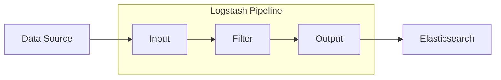

여기서 세 가지 구성 요소가 중요하다.

**Input**

외부 시스템에서 데이터를 수집한다.

**Filter**

수집한 데이터를 분석하거나 변환한다.

**Output**

처리한 데이터를 원하는 목적지로 전달한다.

예를 들어 다음과 같은 작업을 구성할 수 있다.

```text
Nginx Access Log
        ↓
Logstash Input
        ↓
HTTP 상태 코드 추출
        ↓
요청 시간과 IP 주소 추출
        ↓
날짜 형식 변환
        ↓
Elasticsearch 저장
```

이렇게 구성하면 Nginx에서 생성한 로그를 검색과 분석에 적합한 데이터로 변환할 수 있다.

Logstash는 단순히 데이터를 다른 시스템으로 전달하는 도구가 아니다.

**서로 다른 형식의 데이터를 수집하고, 정제하고, 통합하는 데이터 처리 계층**이라고 이해하는 것이 적절하다.

---

### Logstash를 사용하는 이유

#### 1. 서로 다른 데이터 소스를 통합할 수 있다

실제 시스템에서는 모든 데이터가 동일한 형식으로 생성되지 않는다.

예를 들어 다음과 같은 데이터가 존재할 수 있다.

**애플리케이션 로그**

```text
2026-11-24 10:15:32 INFO Order created successfully
```

**JSON 데이터**

```json
{
  "orderId": "ORDER-1001",
  "status": "COMPLETED",
  "amount": 45000
}
```

**CSV 데이터**

```csv
Date,Open,High,Low,Close,Volume
2026-11-23,100.5,105.2,99.8,103.7,1500000
```

**서버 성능 지표**

```json
{
  "host": "server-01",
  "cpu_usage": 73.5,
  "memory_usage": 82.1
}
```

각 데이터는 구조와 의미가 다르다.

Logstash는 다양한 Input과 Filter 플러그인을 조합하여 이러한 데이터를 처리할 수 있다.

#### 2. 데이터 변환 로직을 중앙에서 관리할 수 있다

여러 애플리케이션에서 Elasticsearch에 직접 데이터를 저장한다고 가정해 보자.

각 애플리케이션이 다음 작업을 직접 수행해야 할 수 있다.

- 문자열을 숫자로 변환
- 날짜 형식 통일
- 불필요한 Field 제거
- JSON 데이터 분석
- 데이터 유효성 검증
- Elasticsearch 저장

애플리케이션 수가 증가할수록 중복된 코드와 운영 부담이 증가한다.

반면 Logstash를 사용하면 공통적인 데이터 처리 과정을 별도의 파이프라인에서 관리할 수 있다.

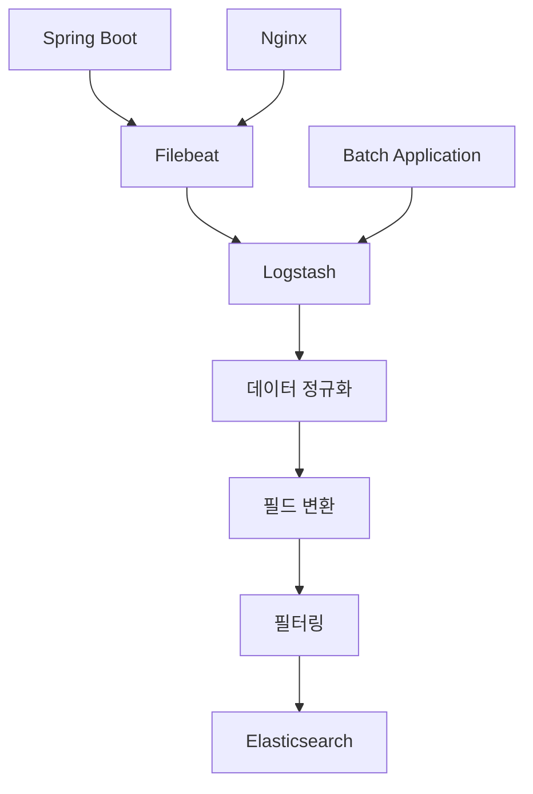

다만 모든 비즈니스 데이터를 무조건 Logstash에서 변환해야 하는 것은 아니다.

도메인 규칙과 밀접한 변환은 해당 애플리케이션에서 처리하는 편이 적절할 수 있다.

Logstash는 공통적인 데이터 수집과 정규화에 특히 유용하다.

#### 3. 데이터 처리 과정의 결합도를 낮출 수 있다

애플리케이션이 Elasticsearch에 직접 데이터를 전송하면 두 시스템 사이의 의존성이 증가한다.

Elasticsearch가 느려지거나 장애가 발생하면 애플리케이션에도 영향을 줄 수 있다.

Logstash를 중간 계층으로 사용하면 데이터 수집과 저장 과정을 분리할 수 있다.

다만 Logstash를 추가했다고 모든 장애가 자동으로 격리되는 것은 아니다.

Logstash가 데이터를 전달하지 못하면 내부 큐에 데이터가 쌓이거나 입력 시스템으로 Backpressure가 전달될 수 있다.

따라서 큐 설정과 장애 복구 전략이 필요하다.

#### 4. 플러그인을 이용하여 기능을 확장할 수 있다

Logstash는 플러그인 기반으로 동작한다.

필요한 데이터 소스와 변환 기능, 출력 목적지에 따라 플러그인을 조합할 수 있다.

예를 들어 다음과 같이 구성할 수 있다.

```text
File Input
    ↓
CSV Filter
    ↓
Mutate Filter
    ↓
Date Filter
    ↓
Elasticsearch Output
```

이러한 구조에서는 데이터 수집과 변환, 저장의 책임을 명확하게 구분할 수 있다.

---

### Logstash의 주요 특징

| 특징 | 설명 |
|---|---|
| 다양한 데이터 수집 | 파일, HTTP, Beats, Kafka, 데이터베이스 등과 연동 |
| 데이터 변환 | 파싱, 형 변환, 필드 추가·삭제, 데이터 확장 |
| 플러그인 기반 | Input, Filter, Output, Codec 조합 |
| 다중 파이프라인 | 하나의 프로세스에서 여러 파이프라인 실행 |
| 데이터 버퍼링 | 메모리 큐와 디스크 기반 영속 큐 제공 |
| 장애 복구 | 재시도와 큐를 활용한 복구 지원 |
| Elasticsearch 연동 | 검색 데이터를 Elasticsearch에 전달 |
| 모니터링 | 처리량, 큐, JVM, 파이프라인 상태 확인 |
| JVM 기반 | JVM 메모리와 GC, 스레드 자원 관리 필요 |

여기서 중요한 점이 있다.

Logstash는 JVM 위에서 실행된다.

따라서 단순한 텍스트 처리 도구처럼 생각하기보다 하나의 독립적인 데이터 처리 애플리케이션으로 운영해야 한다.

입력 데이터가 증가하면 CPU와 메모리, 디스크, 네트워크 사용량이 함께 증가할 수 있다.

---

### Logstash 데이터 파이프라인의 구조

#### Pipeline이란?

Pipeline은 Logstash에서 이벤트가 처리되는 흐름을 정의하는 단위다.

Logstash는 하나 이상의 Pipeline을 실행할 수 있다.

각 Pipeline은 일반적으로 다음 세 단계로 구성된다.

```text
Input
  ↓
Filter
  ↓
Output
```

이를 실제 내부 처리 구조에 가깝게 표현하면 다음과 같다.

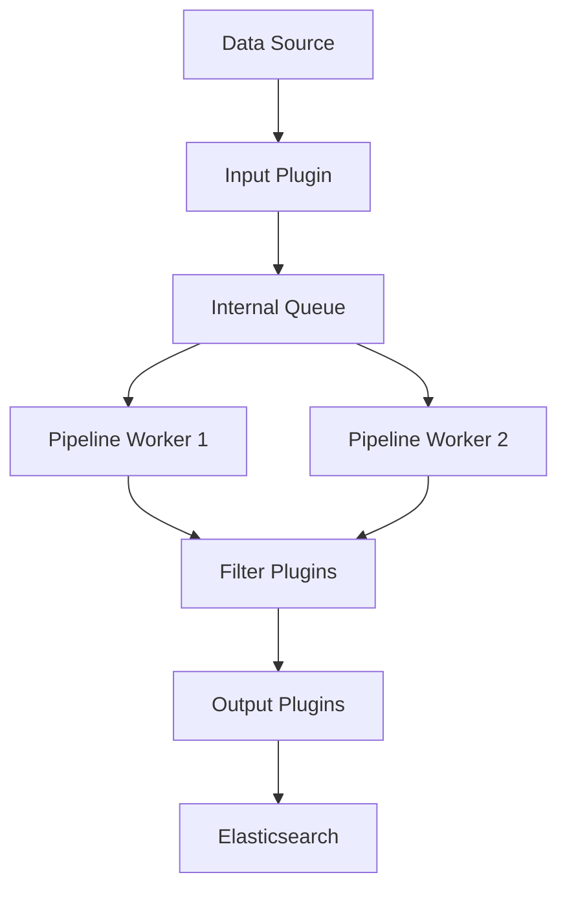

Logstash에서는 Input에서 읽은 이벤트를 내부 큐에 넣는다.

이후 Pipeline Worker가 큐에서 이벤트를 가져와 Filter와 Output을 실행한다.

즉, 다음 두 영역을 구분할 수 있다.

**Input 영역**

외부 데이터 소스에서 이벤트를 읽고 내부 큐에 전달한다.

**Pipeline Worker 영역**

큐에서 이벤트를 가져와 Filter와 Output을 수행한다.

이 구조를 이해하면 Logstash의 처리량과 장애 대응 방식을 이해하기 쉬워진다.

---

### Logstash의 Input, Filter, Output 처리 순서

Logstash의 데이터 처리 단계는 다음 순서로 진행된다.

```text
Input → Filter → Output
```

하지만 이 표현이 모든 이벤트가 하나의 스레드에서 순차적으로 처리된다는 뜻은 아니다.

Logstash는 여러 Pipeline Worker를 이용하여 이벤트를 병렬 처리할 수 있다.

예를 들어 이벤트가 다음 순서로 수집되었다고 가정해 보자.

```text
Event A
Event B
Event C
```

두 개의 Worker가 동작한다면 다음과 같은 상황이 가능하다.

```text
Worker 1 → Event A 처리

Worker 2 → Event B 처리

Worker 1 → Event C 처리
```

각 이벤트의 처리 시간이 다르면 완료 순서가 달라질 수 있다.

따라서 **Input → Filter → Output이라는 단계적 처리 구조와 이벤트 전체의 순서 보장은 다른 개념**이다.

Logstash에서 이벤트 순서를 보장해야 한다면 `pipeline.workers`와 `pipeline.ordered` 설정을 검토해야 한다.

```yaml
pipeline.workers: 1
pipeline.ordered: true
```

다만 이 설정이 외부 시스템에서 생성한 이벤트의 원래 순서까지 복구한다는 의미는 아니다.

입력 소스가 여러 개라면 수집 이전부터 이벤트의 순서가 서로 다를 수 있다.

---

### Logstash의 내부 Queue

Logstash에서는 Input에서 수집한 데이터를 내부 큐에 보관한다.

이 큐는 Input과 Pipeline Worker 사이에서 버퍼 역할을 수행한다.

Logstash는 대표적으로 다음 두 가지 큐 방식을 제공한다.

- Memory Queue
- Persistent Queue

두 방식의 차이를 이해하는 것이 중요하다.

---

### Memory Queue란?

#### Memory Queue의 개념

Memory Queue는 데이터를 메모리에 보관하는 기본 큐 방식이다.

별도 설정이 없는 일반적인 Logstash 환경에서는 Memory Queue가 사용된다.

구조는 다음과 같다.

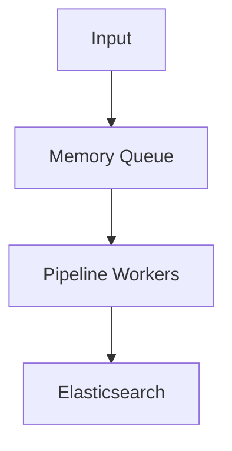

Memory Queue는 이벤트를 메모리에 저장하므로 디스크 기반 영속화 작업이 필요하지 않다.

하지만 프로세스가 비정상적으로 종료되면 큐에 남아 있던 이벤트가 유실될 수 있다.

#### Memory Queue에서 장애가 발생하면?

다음 상황을 생각해 보자.

```text
1. Input이 이벤트 1,000건을 수집

2. Memory Queue에 일부 이벤트 적재

3. Pipeline Worker가 이벤트 처리

4. Logstash 프로세스 비정상 종료
```

이때 메모리 큐에 남아 있던 이벤트는 사라질 수 있다.

다만 원본 파일이나 메시징 시스템에 이벤트가 남아 있다면 Input 플러그인의 재처리 방식에 따라 다시 수집할 수도 있다.

따라서 데이터 유실 가능성은 Logstash의 큐뿐 아니라 원본 시스템과 Input 플러그인의 동작에 따라서도 달라진다.

---

### Persistent Queue란?

#### Persistent Queue의 개념

Persistent Queue는 이벤트를 디스크에 저장하는 영속 큐다.

Logstash가 비정상적으로 종료되더라도 큐에 저장된 이벤트를 복구할 수 있도록 설계되었다.

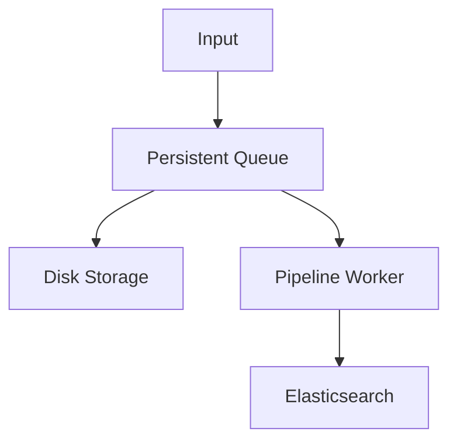

Persistent Queue를 사용하면 Logstash가 이벤트를 처리하기 전에 디스크 기반 큐에 기록할 수 있다.

이후 Pipeline Worker가 이벤트를 처리한다.

처리가 완료된 이벤트는 큐에서 처리 완료 상태로 관리된다.

#### Persistent Queue 활성화

`logstash.yml`에 다음과 같이 설정할 수 있다.

```yaml
queue.type: persisted
queue.max_bytes: 1gb
```

각 설정의 의미는 다음과 같다.

| 설정 | 설명 |
|---|---|
| `queue.type` | 큐 유형 선택 |
| `persisted` | Persistent Queue 사용 |
| `queue.max_bytes` | 큐의 최대 저장 크기 |

이 설정은 모든 파이프라인에 공통 적용할 수도 있고, `pipelines.yml`에서 파이프라인별로 지정할 수도 있다.

#### Persistent Queue의 장점

첫째, Logstash 프로세스가 종료되어도 디스크에 저장된 이벤트를 복구할 수 있다.

둘째, Elasticsearch가 일시적으로 느려지면 큐를 이용하여 데이터 적체를 일정 범위까지 완충할 수 있다.

셋째, 외부 메시징 시스템을 추가하지 않고도 일부 버퍼링 요구사항을 해결할 수 있다.

하지만 Persistent Queue에도 한계가 있다.

**Persistent Queue는 데이터를 여러 서버에 복제하는 분산 메시지 브로커가 아니다.**

따라서 디스크 자체가 손상되거나 서버 전체가 유실되면 큐 데이터도 손실될 수 있다.

또한 체크포인트가 기록되기 전에 비정상 종료가 발생한 경우 데이터 손실 가능성이 존재한다.

입력 프로토콜이 수신 확인을 제공하지 않는 경우에도 원본 데이터 전달을 완전히 보호하기 어렵다.

---

### Memory Queue와 Persistent Queue 비교

| 구분 | Memory Queue | Persistent Queue |
|---|---|---|
| 저장 위치 | 메모리 | 디스크 |
| 기본 설정 | 기본값 | 별도 활성화 필요 |
| 프로세스 종료 시 | 큐 데이터 유실 가능 | 저장된 데이터 복구 가능 |
| 디스크 사용량 | 상대적으로 적음 | 증가 |
| 처리 비용 | 메모리 기반 | 디스크 I/O 및 체크포인트 비용 |
| 데이터 보존 | 프로세스 메모리에 의존 | 로컬 디스크에 의존 |
| 서버 전체 장애 | 데이터 유실 가능 | 디스크 손실 시 데이터 유실 가능 |
| 주요 사용 사례 | 재수집 가능한 데이터 처리 | 데이터 유실 위험을 낮춰야 하는 파이프라인 |

Persistent Queue를 사용한다고 정확히 한 번 처리(Exactly Once)가 자동으로 보장되는 것은 아니다.

장애 복구 과정에서 일부 이벤트가 다시 처리될 수 있기 때문이다.

따라서 중요한 데이터라면 목적지에서도 멱등성을 고려해야 한다.

---

### Backpressure란?

#### Backpressure의 개념

Backpressure는 데이터를 처리하는 시스템보다 데이터를 생성하거나 전달하는 시스템의 속도가 빠를 때, 처리 속도 차이가 상위 시스템으로 전달되는 현상이다.

예를 들어 다음과 같은 상황을 생각해 보자.

```text
Logstash Input 처리량

초당 10,000건
```

```text
Elasticsearch 저장 처리량

초당 3,000건
```

이 경우 초당 약 7,000건의 이벤트가 처리되지 못하고 적체될 수 있다.

처음에는 내부 큐가 적체를 완충할 수 있다.

하지만 적체가 계속 증가하면 큐가 가득 찰 수 있다.

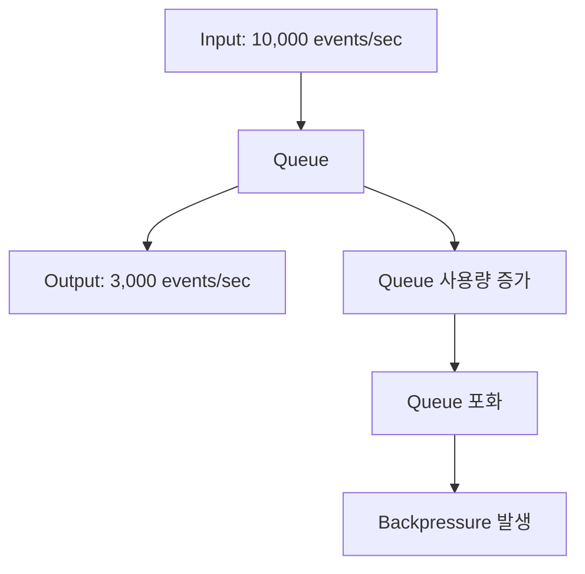

이때 Logstash는 Input 측의 이벤트 전달을 지연시키거나 제한할 수 있다.

하지만 입력 프로토콜에 따라 결과가 달라진다.

예를 들어 TCP 기반 입력에서는 송신자에게 전송 지연이 전달될 수 있다.

반면 UDP처럼 수신 확인이 없는 방식은 데이터 유실 가능성을 고려해야 한다.

Persistent Queue는 이러한 적체를 더 오랫동안 흡수하는 데 도움이 되지만, 큐 용량이 무한한 것은 아니다.

**Backpressure를 해결하려면 큐 용량뿐 아니라 실제 병목이 발생한 위치를 찾아야 한다.**

---

### Logstash Plugin이란?

#### Plugin의 개념

Logstash Plugin은 데이터 수집과 변환, 출력 기능을 제공하는 확장 구성 요소다.

Logstash는 여러 플러그인을 조합하여 하나의 Pipeline을 구성할 수 있다.

주요 플러그인은 다음과 같이 분류한다.

| 종류 | 역할 |
|---|---|
| Input Plugin | 데이터 수집 |
| Filter Plugin | 데이터 가공 |
| Output Plugin | 데이터 전달 |
| Codec Plugin | 데이터 인코딩과 디코딩 |

예를 들어 다음과 같이 조합할 수 있다.

```text
File Input
    ↓
JSON Filter
    ↓
Elasticsearch Output
```

이 구조는 파일에서 읽은 문자열을 JSON 데이터로 분석한 뒤 Elasticsearch에 저장하는 흐름을 나타낸다.

단, 실제 설정에서는 Input과 Filter의 동작을 구분해야 한다.

JSON 문자열을 분석하는 방법은 JSON Filter뿐 아니라 JSON Codec을 사용하는 방법도 있다.

---

### Input Plugin이란?

#### Input의 개념

Input Plugin은 외부 데이터 소스에서 이벤트를 수집하는 역할을 한다.

예를 들어 다음과 같은 시스템에서 데이터를 가져올 수 있다.

- 로그 파일
- 애플리케이션
- HTTP 요청
- Kafka
- Redis
- 관계형 데이터베이스
- 클라우드 스토리지
- Beats
- 시스템 모니터링 데이터

대표적인 Input Plugin은 다음과 같다.

| Plugin | 역할 |
|---|---|
| `file` | 파일의 내용을 읽어 이벤트 생성 |
| `stdin` | 표준 입력에서 데이터 수집 |
| `beats` | Filebeat 등의 Beats 이벤트 수신 |
| `http` | HTTP 요청으로 이벤트 수신 |
| `http_poller` | 외부 HTTP API를 주기적으로 호출 |
| `jdbc` | JDBC를 통해 데이터베이스 조회 |
| `kafka` | Kafka Topic에서 메시지 소비 |
| `redis` | Redis에서 데이터 수집 |
| `tcp` | TCP 데이터 수신 |
| `udp` | UDP 데이터 수신 |
| `syslog` | Syslog 데이터 수집 |
| `s3` | S3 데이터 수집 |

이외에도 다양한 플러그인이 존재한다.

다만 Logstash 플러그인은 제품과 버전에 따라 지원 상태가 달라질 수 있으므로 실제 사용할 플러그인의 설치 및 호환성을 확인해야 한다.

---

### File Input Plugin

#### File Input의 개념

File Input Plugin은 지정한 파일을 읽어서 이벤트를 생성한다.

예를 들어 다음과 같은 파일이 있다고 가정해 보자.

```text
2026-11-24 10:00:00 INFO Application started
2026-11-24 10:00:01 INFO Database connected
2026-11-24 10:00:02 ERROR Connection timeout
```

Logstash는 이 파일을 읽어 각 줄을 이벤트로 처리할 수 있다.

기본적인 설정은 다음과 같다.

```ruby
input {
  file {
    path => "/var/log/application.log"
    start_position => "beginning"
  }
}
```

여기서 중요한 옵션은 `path`와 `start_position`이다.

#### path

```ruby
path => "/var/log/application.log"
```

읽을 파일의 경로를 지정한다.

여러 파일을 대상으로 할 수도 있다.

```ruby
path => "/var/log/myapp/*.log"
```

#### start_position

```ruby
start_position => "beginning"
```

처음 발견한 파일의 어디에서 읽기 시작할지 결정한다.

대표적인 값은 다음과 같다.

| 값 | 설명 |
|---|---|
| `beginning` | 파일 처음부터 읽기 |
| `end` | 파일 끝부터 읽기 |

하지만 `beginning`을 지정했다고 Logstash를 재시작할 때마다 파일을 처음부터 다시 읽는 것은 아니다.

그 이유가 바로 `sincedb`다.

---

### sincedb란?

#### sincedb의 개념

`sincedb`는 Logstash File Input Plugin이 파일을 어디까지 읽었는지 추적하는 기능이다.

파일을 읽을 때마다 처음부터 처리하면 이미 수집한 데이터를 중복 처리할 수 있다.

따라서 Logstash는 파일별 읽기 위치를 기록한다.

```text
application.log

Line 1
Line 2
Line 3
Line 4
Line 5
```

현재 3번째 줄까지 읽었다고 가정해 보자.

Logstash는 파일 식별 정보와 읽기 위치를 기록한다.

```text
현재 처리 위치: Line 3 이후
```

이후 파일에 새로운 로그가 추가되면 이전에 읽지 않은 부분부터 처리할 수 있다.

실제 `sincedb`는 단순히 줄 번호를 저장하는 것이 아니라 파일 식별 정보와 읽은 바이트 위치 등을 관리한다.

#### sincedb가 필요한 이유

첫째, 이미 읽은 데이터를 반복해서 수집하는 것을 줄일 수 있다.

둘째, Logstash가 재시작된 이후에도 이전 위치부터 파일을 읽는 데 도움이 된다.

셋째, 로그 파일이 지속적으로 증가하는 환경에서 수집 위치를 관리할 수 있다.

---

### sincedb_path 설정하기

File Input에는 다음 옵션이 존재한다.

```ruby
sincedb_path => "/var/lib/logstash/sincedb-app"
```

이 설정은 파일 처리 위치를 기록할 경로를 지정한다.

실제 환경에서는 Logstash 프로세스가 해당 경로에 쓰기 권한을 가지고 있어야 한다.

#### /dev/null을 지정하면?

다음 설정을 살펴보자.

```ruby
sincedb_path => "/dev/null"
```

Linux의 `/dev/null`은 기록된 데이터를 보존하지 않는 특수 장치다.

따라서 이 경로를 사용하면 `sincedb`의 읽기 위치를 정상적인 파일처럼 영구 보관할 수 없다.

Logstash가 재시작되면 과거 처리 위치를 복원하지 못할 수 있다.

특히 다음 설정과 함께 사용하면 재시작 후 기존 데이터를 다시 읽을 가능성이 높다.

```ruby
start_position => "beginning"
sincedb_path => "/dev/null"
```

이 설정은 반복해서 파일을 읽어야 하는 테스트 환경에서 활용할 수 있다.

하지만 운영 환경에서는 중복 데이터 처리가 발생할 수 있으므로 주의해야 한다.

#### start_position과 sincedb의 관계

| 상황 | 예상 동작 |
|---|---|
| 처음 발견한 파일 + beginning | 파일 처음부터 읽음 |
| 처음 발견한 파일 + end | 파일 끝부터 읽음 |
| 기존 sincedb 기록 존재 | 기록된 위치를 기준으로 처리 |
| beginning + 기존 sincedb 기록 | beginning보다 기존 위치 기록이 우선 |
| beginning + /dev/null | 재시작 후 기존 데이터를 다시 읽을 수 있음 |

`start_position`은 기존 처리 위치가 없는 파일에 처음 접근할 때 영향을 준다.

이미 파일 처리 위치가 기록되어 있다면 기존 `sincedb`가 우선한다.

이 차이는 File Input을 이용한 데이터 중복 문제를 분석할 때 매우 중요하다.

---

### File Input의 Tail Mode와 Read Mode

File Input Plugin은 파일을 읽는 방식에 따라 두 가지 모드를 제공한다.

#### Tail Mode

Tail Mode는 지속적으로 증가하는 파일을 읽는 방식이다.

애플리케이션 로그처럼 계속 추가되는 파일에 적합하다.

```ruby
input {
  file {
    path => "/var/log/application.log"
    mode => "tail"
    start_position => "beginning"
  }
}
```

Tail Mode는 파일에 새로운 데이터가 추가되는 상황을 전제로 한다.

#### Read Mode

Read Mode는 이미 완성된 파일을 읽는 데 적합하다.

예를 들어 매일 전달되는 CSV 파일이나 일회성 데이터 파일에 사용할 수 있다.

```ruby
input {
  file {
    path => "/data/import/*.csv"
    mode => "read"
    file_completed_action => "log"
    file_completed_log_path => "/var/lib/logstash/completed-files.log"
  }
}
```

여기서 `file_completed_action => "log"`는 파일 읽기가 완료된 후 해당 파일 경로를 기록하도록 지정한다.

중요한 점은 Read Mode의 기본 `file_completed_action`이 `delete`라는 것이다.

따라서 원본 파일을 보존해야 한다면 완료 후 처리 정책을 명시적으로 설정하는 것이 안전하다.

#### Tail과 Read 비교

| 구분 | Tail Mode | Read Mode |
|---|---|---|
| 목적 | 지속적으로 증가하는 파일 처리 | 이미 완성된 파일 처리 |
| 대표 사례 | 애플리케이션 로그 | CSV 데이터 일괄 적재 |
| 기본 모드 | Tail | 별도 지정 |
| 처리 종료 | 새 데이터 대기 | 파일 끝까지 읽고 완료 처리 |
| 주의사항 | 로그 회전 및 읽기 위치 | 완료 후 파일 처리 정책 |

---

### Filter Plugin이란?

#### Filter의 개념

Filter Plugin은 수집한 이벤트를 분석하거나 변환하는 역할을 한다.

Logstash의 Filter 단계는 선택 사항이다.

즉, 모든 파이프라인에 Filter가 반드시 있어야 하는 것은 아니다.

하지만 실제 데이터 파이프라인에서는 다양한 변환 작업이 필요하므로 자주 사용된다.

대표적인 Filter Plugin은 다음과 같다.

| Plugin | 기능 |
|---|---|
| `grok` | 정규표현식 기반 문자열 분석 |
| `mutate` | 필드 추가·변경·삭제 및 형 변환 |
| `date` | 날짜 문자열 분석 및 타임스탬프 지정 |
| `drop` | 이벤트 제거 |
| `clone` | 이벤트 복사 |
| `json` | JSON 문자열 분석 |
| `geoip` | IP 주소 기반 위치 정보 추가 |
| `csv` | CSV 문자열을 필드로 분리 |

각 Filter의 역할을 구체적으로 살펴보자.

---

### Grok Filter

#### Grok이란?

Grok은 로그 문자열에서 필요한 데이터를 추출하는 데 사용하는 Filter다.

정규표현식을 기반으로 하지만 자주 사용하는 패턴을 제공하므로 복잡한 로그 분석에 활용하기 좋다.

예를 들어 다음과 같은 로그가 있다고 가정해 보자.

```text
2026-11-24 10:15:32 INFO Order created successfully
```

이 문자열에는 여러 정보가 포함되어 있다.

```text
날짜

시간

로그 레벨

메시지
```

Grok을 이용하여 데이터를 분리할 수 있다.

```ruby
filter {
  grok {
    match => {
      "message" => "%{TIMESTAMP_ISO8601:log_timestamp} %{LOGLEVEL:log_level} %{GREEDYDATA:log_message}"
    }
  }
}
```

이 설정은 로그를 다음과 같은 구조로 변환하는 데 사용할 수 있다.

```json
{
  "log_timestamp": "2026-11-24 10:15:32",
  "log_level": "INFO",
  "log_message": "Order created successfully"
}
```

실제 이벤트에는 `@timestamp`, `message` 등의 추가 필드도 존재할 수 있다.

#### Grok이 유용한 상황

Grok은 다음과 같은 로그에 적합하다.

- Nginx Access Log
- Apache HTTP Server Log
- Java 애플리케이션 로그
- 시스템 로그
- 일정한 패턴을 가진 문자열 데이터

하지만 데이터 형식이 복잡하거나 불규칙하면 정규표현식의 처리 비용과 유지보수 부담이 증가할 수 있다.

따라서 애플리케이션에서 처음부터 구조화된 JSON 로그를 생성할 수 있다면 그 방법이 더 단순할 수 있다.

---

### Mutate Filter

#### Mutate란?

Mutate Filter는 이벤트의 필드를 변경하는 데 사용한다.

대표적으로 다음 기능을 제공한다.

- 필드 자료형 변환
- 필드 이름 변경
- 필드 제거
- 필드 추가
- 문자열 변환
- 값 치환

예를 들어 다음 이벤트가 있다고 가정해 보자.

```json
{
  "name": "John Doe",
  "age": "30",
  "status": "ACTIVE"
}
```

여기서 `age`는 숫자가 아니라 문자열이다.

Mutate Filter를 이용하여 숫자로 변환할 수 있다.

```ruby
filter {
  mutate {
    convert => {
      "age" => "integer"
    }
  }
}
```

결과적으로 `age`를 정수 형태로 처리할 수 있다.

#### 필드 이름 변경

```ruby
filter {
  mutate {
    rename => {
      "user_name" => "username"
    }
  }
}
```

#### 필드 제거

```ruby
filter {
  mutate {
    remove_field => ["unnecessary_field"]
  }
}
```

#### 필드 추가

```ruby
filter {
  mutate {
    add_field => {
      "environment" => "production"
    }
  }
}
```

Mutate는 데이터 구조를 정규화하는 데 자주 사용된다.

다만 Mutate에서 수행하는 형 변환과 Elasticsearch Mapping은 서로 다른 단계다.

예를 들어 Logstash에서 `float`로 변환했다고 Elasticsearch의 Mapping이 자동으로 원하는 정밀도를 가진 자료형으로 설정되는 것은 아니다.

중요한 데이터는 Elasticsearch Mapping도 함께 설계해야 한다.

---

### Date Filter

#### Date Filter의 역할

Date Filter는 이벤트에 포함된 날짜 문자열을 분석하여 Logstash의 타임스탬프에 반영할 수 있다.

예를 들어 다음 데이터가 있다고 가정해 보자.

```json
{
  "createdAt": "2026-11-24 10:15:32",
  "message": "Order created"
}
```

Date Filter를 사용하지 않으면 Logstash는 일반적으로 이벤트를 처리한 시점을 `@timestamp`로 사용할 수 있다.

하지만 실제 이벤트가 발생한 시간을 기준으로 분석하려면 원본의 날짜를 사용해야 한다.

다음과 같이 설정할 수 있다.

```ruby
filter {
  date {
    match => ["createdAt", "yyyy-MM-dd HH:mm:ss"]
    timezone => "Asia/Seoul"
    target => "@timestamp"
  }
}
```

각 설정의 의미는 다음과 같다.

| 옵션 | 설명 |
|---|---|
| `match` | 분석할 필드와 날짜 형식 |
| `timezone` | 원본 날짜가 나타내는 시간대 |
| `target` | 변환 결과를 저장할 필드 |

위 예제는 원본 날짜가 한국 시간이라는 전제로 작성했다.

실제 로그에 UTC Offset이 포함되어 있다면 해당 정보를 기준으로 처리해야 한다.

#### Date Filter가 중요한 이유

실제 이벤트 발생 시각과 Logstash 수집 시각은 다를 수 있다.

예를 들어 다음과 같은 상황을 생각해 보자.

```text
이벤트 발생

10:00:00
```

```text
Logstash 수집

10:05:00
```

데이터가 5분 늦게 수집되었다.

이때 수집 시각을 기준으로 데이터를 분석하면 실제 이벤트 발생 시간과 차이가 생긴다.

따라서 분석 목적에 따라 Event Time과 Ingestion Time을 구분해야 한다.

---

### Drop Filter

Drop Filter는 특정 조건에 해당하는 이벤트를 제거하는 데 사용한다.

예를 들어 로그 레벨이 DEBUG인 이벤트를 저장하지 않도록 설정할 수 있다.

```ruby
filter {
  if [log_level] == "DEBUG" {
    drop {}
  }
}
```

이렇게 하면 DEBUG 이벤트는 이후 Output 단계로 전달되지 않는다.

다만 Drop Filter는 데이터를 실제로 버리는 작업이다.

따라서 감사 로그나 결제 이력처럼 반드시 보존해야 하는 이벤트에는 신중하게 적용해야 한다.

---

### Clone Filter

Clone Filter는 이벤트의 복사본을 생성하는 데 사용한다.

하나의 이벤트를 서로 다른 방식으로 처리해야 할 때 활용할 수 있다.

예를 들어 원본 이벤트와 분석용 이벤트를 구분하는 구조를 만들 수 있다.

하지만 이벤트 복사는 전체 처리량과 메모리 사용량을 증가시킬 수 있다.

따라서 목적이 단순한 다중 전송이라면 여러 Output을 사용하는 편이 적절한 경우도 있다.

---

### JSON Filter

#### JSON Filter의 역할

JSON Filter는 문자열에 포함된 JSON 데이터를 분석하여 이벤트의 필드로 변환한다.

예를 들어 `message` 필드에 다음 문자열이 들어 있다고 가정해 보자.

```json
{
  "message": "{\"orderId\":\"ORDER-1001\",\"amount\":45000}"
}
```

이벤트의 `message`는 JSON 객체가 아니라 JSON 형식의 문자열이다.

다음 Filter를 사용할 수 있다.

```ruby
filter {
  json {
    source => "message"
    target => "order"
  }
}
```

변환 결과는 다음과 같은 구조가 될 수 있다.

```json
{
  "order": {
    "orderId": "ORDER-1001",
    "amount": 45000
  }
}
```

여기서 `source`는 분석할 문자열 필드다.

`target`은 변환한 데이터를 저장할 필드다.

JSON 문자열 분석에 실패하면 `_jsonparsefailure` 태그가 추가될 수 있다.

따라서 실패한 데이터를 구분해서 처리하는 것이 좋다.

---

### GeoIP Filter

GeoIP Filter는 IP 주소를 기반으로 위치 정보를 추가하는 데 사용한다.

예를 들어 다음 데이터가 있다고 가정해 보자.

```json
{
  "client_ip": "203.0.113.10"
}
```

GeoIP Filter를 활용하면 IP 주소에 대한 위치 정보를 추가하는 구성을 만들 수 있다.

```ruby
filter {
  geoip {
    source => "client_ip"
    target => "geoip"
  }
}
```

다만 모든 IP 주소에서 실제 위치를 얻을 수 있는 것은 아니다.

특히 사설 IP나 문서 예시용 IP, 위치 정보가 제공되지 않는 IP는 조회 결과가 없을 수 있다.

또한 GeoIP 정보는 추정된 위치 정보이므로 실제 사용자의 정확한 위치를 보장하지 않는다.

---

### Output Plugin이란?

#### Output의 개념

Output Plugin은 처리된 이벤트를 외부 시스템으로 전달한다.

대표적인 출력 목적지는 다음과 같다.

| Plugin | 역할 |
|---|---|
| `elasticsearch` | Elasticsearch에 데이터 저장 |
| `stdout` | 콘솔에 이벤트 출력 |
| `file` | 파일에 데이터 기록 |
| `kafka` | Kafka Topic에 이벤트 발행 |
| `redis` | Redis에 이벤트 전달 |
| `http` | HTTP Endpoint에 요청 |
| `s3` | Amazon S3에 데이터 저장 |
| `graphite` | Graphite로 메트릭 전달 |
| `statsd` | StatsD로 메트릭 전달 |

Logstash는 여러 Output을 함께 설정할 수도 있다.

예를 들어 다음과 같이 구성할 수 있다.

```ruby
output {
  elasticsearch {
    hosts => ["http://localhost:9200"]
    index => "application-logs"
  }

  stdout {
    codec => rubydebug
  }
}
```

이 설정은 처리된 이벤트를 Elasticsearch에 전달하면서 콘솔에도 출력하는 구조다.

개발 환경에서 데이터가 예상대로 변환되는지 확인할 때 유용하다.

다만 운영 환경에서 모든 이벤트를 콘솔에 상세 출력하면 로그량이 증가할 수 있다.

---

### Codec이란?

#### Codec의 개념

Codec은 데이터를 인코딩하거나 디코딩하는 기능을 제공한다.

Logstash에서는 주로 Input과 Output Plugin에서 Codec을 사용한다.

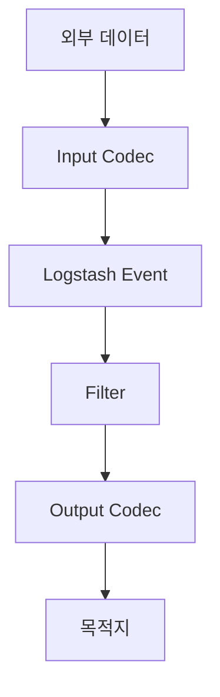

예를 들어 JSON 데이터를 수신할 때 JSON Codec을 사용하면 입력 단계에서 데이터를 JSON 구조로 분석할 수 있다.

반대로 Output에서는 데이터를 JSON 형태로 인코딩하여 전달할 수도 있다.

---

### JSON Codec과 JSON Filter의 차이

JSON Codec과 JSON Filter는 모두 JSON을 다룰 수 있지만 사용 위치가 다르다.

#### JSON Codec

```ruby
input {
  stdin {
    codec => json
  }
}
```

Input 단계에서 JSON 데이터를 디코딩한다.

#### JSON Filter

```ruby
filter {
  json {
    source => "message"
    target => "parsed"
  }
}
```

이미 생성된 Logstash 이벤트의 특정 문자열 필드를 JSON으로 분석한다.

두 방식의 차이는 다음과 같다.

| 구분 | JSON Codec | JSON Filter |
|---|---|---|
| 사용 위치 | Input 또는 Output | Filter |
| 주요 목적 | 입력·출력 데이터 인코딩/디코딩 | 이벤트 내부 JSON 문자열 분석 |
| 처리 대상 | Plugin이 주고받는 데이터 | Logstash 이벤트의 특정 필드 |
| 대표 설정 | `codec => json` | `json { source => "message" }` |

데이터가 처음부터 JSON 형식으로 들어온다면 Input Codec을 사용하는 것이 간단할 수 있다.

반면 일반 로그 문자열 안에 JSON이 포함되어 있다면 Filter에서 JSON을 분석하는 방법이 적합할 수 있다.

---

### Multiline Codec

#### 여러 줄로 구성된 로그 처리

Java 애플리케이션에서는 예외가 발생하면 Stack Trace가 여러 줄로 출력된다.

```text
2026-11-24 10:15:32 ERROR Database connection failed
java.sql.SQLException: Connection timeout
    at com.example.OrderRepository.findById(OrderRepository.java:42)
    at com.example.OrderService.getOrder(OrderService.java:25)
```

이 로그는 하나의 예외에 대한 정보다.

하지만 줄 단위로만 처리하면 여러 개의 이벤트로 분리될 수 있다.

Multiline Codec은 여러 줄을 하나의 이벤트로 병합할 때 사용할 수 있다.

다만 여러 송신자의 이벤트가 하나의 Input으로 유입되는 환경에서는 주의해야 한다.

특히 Filebeat를 이용해 여러 호스트의 로그를 전달한다면 Logstash Beats Input에서 Multiline을 처리하기보다 Filebeat에서 먼저 병합하는 방식이 권장된다.

서로 다른 로그 스트림이 혼합되면 이벤트의 내용이 잘못 결합될 수 있기 때문이다.

---

### Rubydebug Codec

Rubydebug Codec은 이벤트 구조를 사람이 읽기 쉬운 형태로 출력하는 데 사용한다.

예를 들어 다음과 같이 설정할 수 있다.

```ruby
output {
  stdout {
    codec => rubydebug
  }
}
```

Logstash에서 처리한 이벤트의 Field와 Value를 확인하는 데 유용하다.

개발 초기에는 Filter가 예상대로 동작하는지 확인하기 위해 자주 사용한다.

하지만 운영 환경에서 모든 이벤트를 Rubydebug로 출력하면 불필요한 로그가 많이 발생할 수 있다.

---

### Logstash 설정 파일의 종류

Logstash는 크게 두 종류의 설정 파일을 사용한다.

첫 번째는 데이터 처리 흐름을 정의하는 Pipeline Configuration이다.

두 번째는 Logstash 프로세스의 실행 환경을 정의하는 Settings Configuration이다.

대표적인 파일은 다음과 같다.

| 파일 | 역할 |
|---|---|
| `*.conf` | Input, Filter, Output으로 구성되는 Pipeline 정의 |
| `logstash.yml` | Logstash 실행 및 파이프라인 기본 설정 |
| `pipelines.yml` | 여러 Pipeline을 실행하기 위한 설정 |
| `jvm.options` | JVM Heap과 JVM 옵션 |
| `log4j2.properties` | Logstash 자체 로그 출력 설정 |

각 파일은 서로 다른 책임을 가진다.

---

### Pipeline Configuration File

#### Pipeline Configuration이란?

Pipeline Configuration은 데이터를 어떻게 처리할지 정의한다.

대표적인 구조는 다음과 같다.

```ruby
input {
}

filter {
}

output {
}
```

Input과 Output은 데이터 처리의 기본 요소다.

Filter는 필요한 경우에만 추가한다.

예를 들어 표준 입력에서 데이터를 읽고 콘솔에 출력하는 파이프라인은 다음과 같이 구성할 수 있다.

```ruby
input {
  stdin {
  }
}

output {
  stdout {
    codec => rubydebug
  }
}
```

이처럼 Filter가 없어도 Pipeline을 구성할 수 있다.

---

### logstash.yml

`logstash.yml`은 Logstash의 실행 및 처리 환경을 설정하는 파일이다.

예를 들어 다음과 같은 설정이 가능하다.

```yaml
node.name: logstash-node-01

pipeline.workers: 2
pipeline.batch.size: 125
pipeline.batch.delay: 50

queue.type: memory

api.http.host: "127.0.0.1"
api.http.port: 9600
```

이 설정은 Logstash의 기본적인 처리 환경을 나타내는 예시다.

주요 옵션은 다음과 같다.

| 설정 | 설명 |
|---|---|
| `node.name` | Logstash Node 이름 |
| `pipeline.workers` | Filter와 Output을 수행할 Worker 수 |
| `pipeline.batch.size` | Worker가 한 번에 처리할 최대 이벤트 수 |
| `pipeline.batch.delay` | Batch 구성을 위해 기다리는 시간 |
| `queue.type` | 큐 유형 |
| `api.http.host` | Logstash 모니터링 API 바인딩 주소 |
| `api.http.port` | Logstash 모니터링 API 포트 |

여기서 `pipeline.workers`와 `pipeline.batch.size`는 처리량에 영향을 줄 수 있다.

하지만 값을 무조건 증가시키는 것이 좋은 것은 아니다.

Worker 수가 많으면 CPU와 메모리 사용량이 증가할 수 있다.

Batch 크기를 크게 설정하면 메모리에 동시에 존재하는 이벤트 수가 증가한다.

따라서 실제 데이터 크기와 처리량을 측정하면서 조정해야 한다.

---

### jvm.options

Logstash는 JVM 기반으로 실행된다.

따라서 JVM Heap 크기와 GC 동작이 성능에 영향을 줄 수 있다.

대표적으로 다음과 같은 옵션을 지정할 수 있다.

```text
-Xms1g
-Xmx1g
```

`-Xms`는 JVM의 초기 Heap 크기를 지정한다.

`-Xmx`는 JVM의 최대 Heap 크기를 지정한다.

이 예제는 Heap 크기를 1GB로 설정한다.

다만 Logstash가 사용하는 메모리가 JVM Heap에만 한정되는 것은 아니다.

다음 영역에서도 메모리가 사용된다.

- JVM Heap
- Direct Memory
- 스레드 Stack
- JVM 자체 메모리
- 플러그인별 버퍼
- 운영체제의 파일 캐시

따라서 컨테이너 메모리 제한을 JVM Heap 크기와 동일하게 설정하면 메모리 부족 문제가 발생할 수 있다.

특히 Beats나 HTTP 등 네트워크 Input Plugin은 Direct Memory 사용량도 고려해야 한다.

---

### log4j2.properties

`log4j2.properties`는 Logstash 자체 로그 설정을 관리하는 파일이다.

여기서 구분해야 할 로그가 두 가지 있다.

**Logstash가 수집하는 애플리케이션 로그**

다른 애플리케이션에서 생성한 로그 데이터다.

**Logstash 자체의 실행 로그**

Logstash가 시작하거나 Plugin에 오류가 발생했을 때 출력하는 로그다.

`log4j2.properties`는 두 번째에 해당하는 Logstash 자체 로깅 설정과 관련이 있다.

따라서 애플리케이션 로그의 분석 규칙을 작성하는 Pipeline Configuration과 혼동해서는 안 된다.

---

### pipelines.yml

#### Multiple Pipelines란?

Logstash에서는 하나의 프로세스에서 여러 Pipeline을 실행할 수 있다.

예를 들어 다음과 같은 데이터 처리 작업이 있다고 가정해 보자.

```text
Application Log Pipeline

Stock CSV Pipeline

Kafka Event Pipeline
```

각 작업은 데이터 소스와 변환 규칙, 목적지가 다르다.

이러한 파이프라인을 하나의 Logstash 인스턴스에서 독립적으로 실행할 수 있다.

`pipelines.yml`을 이용하면 된다.

---

### Multiple Pipelines 설정 예제

다음은 두 개의 Pipeline을 정의한 예제다.

```yaml
- pipeline.id: my-pipeline_1
  path.config: "/etc/path/to/p1.config"
  pipeline.workers: 3

- pipeline.id: my-other-pipeline
  path.config: "/etc/different/path/p2.cfg"
  queue.type: persisted
```

각 설정을 살펴보자.

#### pipeline.id

```yaml
pipeline.id: my-pipeline_1
```

Pipeline의 식별자를 지정한다.

하나의 Logstash 인스턴스에서 여러 Pipeline을 구분하는 데 사용한다.

#### path.config

```yaml
path.config: "/etc/path/to/p1.config"
```

해당 Pipeline에서 사용할 설정 파일의 경로를 지정한다.

#### pipeline.workers

```yaml
pipeline.workers: 3
```

해당 Pipeline의 Worker 수를 지정한다.

#### queue.type

```yaml
queue.type: persisted
```

해당 Pipeline에서 Persistent Queue를 사용한다.

이처럼 파이프라인마다 다른 처리량과 내구성 정책을 적용할 수 있다.

---

### 여러 설정 파일과 여러 Pipeline의 차이

Logstash에서는 여러 설정 파일을 사용하는 것과 여러 Pipeline을 사용하는 것을 구분해야 한다.

#### 방법 1. 하나의 설정 파일로 하나의 Pipeline 실행

예를 들어 다음 파일이 존재한다고 가정해 보자.

```text
config/test.conf
```

다음 명령어로 Pipeline을 실행할 수 있다.

```bash
bin/logstash -f config/test.conf
```

이 명령어는 지정한 설정 파일을 사용하여 Logstash를 실행한다.

#### 방법 2. 여러 설정 파일로 하나의 Pipeline 구성

다음과 같은 파일이 있다고 가정해 보자.

```text
config/
├── 01-input.conf
├── 02-filter.conf
└── 03-output.conf
```

디렉터리를 지정하여 여러 설정 파일을 하나의 Pipeline 구성으로 사용할 수 있다.

```bash
bin/logstash -f config/
```

하지만 파일이 세 개라는 이유로 Pipeline도 세 개가 생성되는 것은 아니다.

여러 설정 파일이 하나의 Pipeline Configuration으로 결합될 수 있다.

#### 방법 3. 여러 Pipeline을 독립적으로 실행

`pipelines.yml`에 각각의 Pipeline을 정의한다.

```yaml
- pipeline.id: application-logs
  path.config: "/etc/logstash/pipelines/application.conf"

- pipeline.id: stock-data
  path.config: "/etc/logstash/pipelines/stock.conf"

- pipeline.id: payment-events
  path.config: "/etc/logstash/pipelines/payment.conf"
```

이 구조에서는 세 개의 Pipeline을 실행할 수 있다.

#### 세 방식의 차이

| 구분 | 설정 파일 수 | Pipeline 수 |
|---|---:|---:|
| 단일 설정 파일 | 1개 | 1개 |
| 여러 설정 파일 결합 | 여러 개 | 1개 |
| pipelines.yml 활용 | 각 Pipeline별 설정 | 여러 개 |

여기서 주의할 점이 있다.

Logstash를 실행할 때 `-f` 또는 `-e` 옵션을 사용하면 일반적으로 `pipelines.yml`을 무시한다.

따라서 다중 파이프라인을 실행하려면 Logstash 시작 방식과 설정 파일의 우선순위를 함께 확인해야 한다.

---

### 여러 Pipeline을 사용하는 이유

#### 1. 업무별 데이터 처리 분리

서로 다른 데이터를 처리하는 Pipeline을 분리할 수 있다.

예를 들어 다음과 같이 구성할 수 있다.

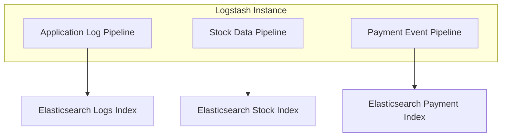

#### 2. 장애 영향 감소

특정 Pipeline의 Output이 느려지더라도 다른 Pipeline은 별도의 큐와 Worker를 사용할 수 있다.

따라서 처리 흐름을 분리하는 데 도움이 된다.

하지만 여러 Pipeline이 같은 JVM과 서버 자원을 공유한다는 점은 변하지 않는다.

한 Pipeline이 CPU나 메모리를 지나치게 사용하면 다른 Pipeline에도 영향을 줄 수 있다.

#### 3. 서로 다른 성능 정책 적용

예를 들어 다음과 같이 설정할 수 있다.

```yaml
- pipeline.id: important-events
  path.config: "/etc/logstash/important.conf"
  pipeline.workers: 2
  queue.type: persisted

- pipeline.id: debug-logs
  path.config: "/etc/logstash/debug.conf"
  pipeline.workers: 1
  queue.type: memory
```

중요한 이벤트는 Persistent Queue를 사용한다.

재수집이 가능한 로그는 Memory Queue를 사용할 수 있다.

이처럼 데이터의 중요도와 처리 요구사항에 따라 설정을 구분할 수 있다.

---

### Logstash의 기본 파일 입력 예제

이제 File Input을 사용하여 파일을 읽고 콘솔에 출력하는 기본적인 파이프라인을 살펴보자.

다음 파일을 사용한다.

```text
config/test.conf
```

전체 설정은 다음과 같다.

```ruby
input {
  file {
    path => ["/home/logstash/testdata.log"]
    sincedb_path => "/dev/null"
    start_position => "beginning"
  }
}

filter {
}

output {
  stdout {
    codec => rubydebug
  }
}
```

이 파이프라인은 다음 과정으로 동작한다.

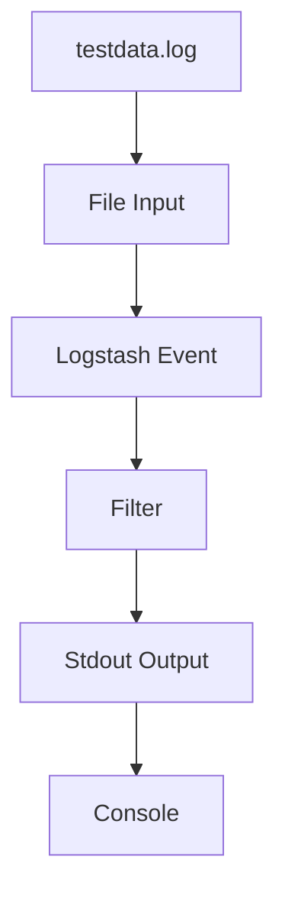

#### 1. File Input

```ruby
input {
  file {
    path => ["/home/logstash/testdata.log"]
    sincedb_path => "/dev/null"
    start_position => "beginning"
  }
}
```

Logstash가 지정한 파일을 읽는다.

`start_position => "beginning"`은 처음 발견한 파일의 시작 지점부터 읽도록 지정한다.

`sincedb_path => "/dev/null"`은 읽기 위치를 영구적으로 기록하지 않는 설정이다.

따라서 재시작 시 기존 이벤트가 다시 수집될 수 있다.

#### 2. Filter

```ruby
filter {
}
```

별도의 Filter가 없다.

따라서 수집한 이벤트를 특별히 가공하지 않고 Output으로 전달한다.

#### 3. Output

```ruby
output {
  stdout {
    codec => rubydebug
  }
}
```

처리한 이벤트를 콘솔에 출력한다.

이 예제는 Logstash가 파일을 읽고 이벤트를 생성하는 과정을 이해하기에 적합하다.

---

### Logstash 설정 파일 실행하기

Logstash가 설치된 디렉터리에서 다음 명령어를 사용할 수 있다.

```bash
bin/logstash -f config/test.conf
```

실행 전에 설정 문법을 확인하려면 다음 옵션을 사용할 수 있다.

```bash
bin/logstash \
  -f config/test.conf \
  --config.test_and_exit
```

`--config.test_and_exit`는 설정 파일의 문법과 기본적인 구성 유효성을 검사한 뒤 종료하도록 하는 옵션이다.

다만 이 검사가 모든 외부 시스템 연결이나 실제 데이터 처리 결과까지 보장하는 것은 아니다.

예를 들어 Elasticsearch Output의 인증 오류나 실행 시점의 Mapping 충돌은 별도로 발생할 수 있다.

따라서 설정 검증과 실제 데이터 처리 검증을 구분해야 한다.

---

### CSV 데이터를 Elasticsearch에 저장하기

지금까지 Logstash의 기본 구조를 살펴보았다.

이제 CSV 파일을 읽고 Elasticsearch에 저장하는 파이프라인을 구성해 보자.

전체 과정은 다음과 같다.

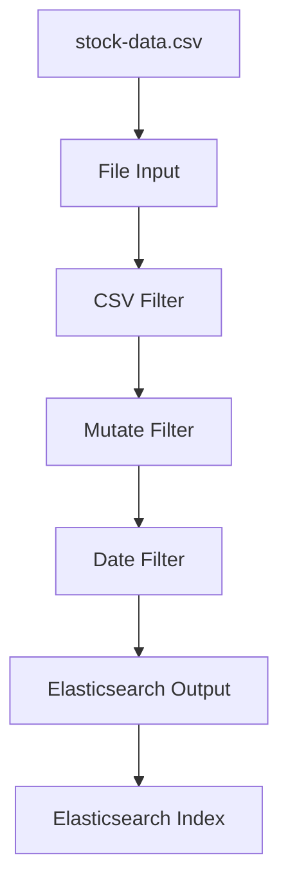

여기서 중요한 작업은 다음과 같다.

첫째, CSV 파일을 읽는다.

둘째, 각 행을 Field로 분리한다.

셋째, 문자열로 읽힌 숫자를 숫자 자료형으로 변환한다.

넷째, 날짜를 처리한다.

다섯째, Elasticsearch에 저장한다.

---

### CSV File Input 설정

우선 CSV 파일을 읽는 Input 설정을 살펴보자.

```ruby
input {
  file {
    path => "/{your-path}/stock-data.csv"
    start_position => "beginning"
    sincedb_path => "/dev/null"
  }
}
```

각 옵션의 의미는 다음과 같다.

| 옵션 | 의미 |
|---|---|
| `path` | CSV 파일 경로 |
| `start_position` | 처음 발견한 파일을 읽기 시작할 위치 |
| `sincedb_path` | 파일 처리 위치 기록 경로 |

이 설정은 파일을 처음부터 읽는 구조다.

다만 `/{your-path}/stock-data.csv`는 실제 파일 경로가 아니라 예시 경로다.

사용할 환경에 맞게 변경해야 한다.

또한 `sincedb_path => "/dev/null"`을 사용하면 Logstash를 재시작할 때 데이터를 다시 읽을 수 있다.

특히 Elasticsearch에서 자동 ID를 사용하면 같은 데이터가 중복 저장될 수 있다.

따라서 운영 환경에서는 실제 `sincedb` 파일을 사용하는 것이 좋다.

---

### CSV Filter 설정

CSV 파일은 쉼표로 구분된 문자열 데이터다.

예를 들어 다음 파일이 있다고 가정해 보자.

```csv
Date,Open,High,Low,Close,Volume,Adj Close
2026-11-20,102.5,107.0,100.8,105.2,1543200,105.2
2026-11-23,105.2,109.1,104.7,108.6,1897600,108.6
```

이 데이터는 날짜와 가격, 거래량으로 구성되어 있다.

Logstash가 파일을 읽으면 각 줄은 처음에는 문자열 형태로 처리된다.

CSV Filter를 사용하면 각 열을 분리할 수 있다.

```ruby
filter {
  csv {
    separator => ","
    columns => [
      "Date",
      "Open",
      "High",
      "Low",
      "Close",
      "Volume",
      "Adj Close"
    ]
  }
}
```

#### separator

```ruby
separator => ","
```

CSV 데이터의 구분자를 지정한다.

#### columns

```ruby
columns => [
  "Date",
  "Open",
  "High",
  "Low",
  "Close",
  "Volume",
  "Adj Close"
]
```

각 열에 대응하는 Field 이름을 지정한다.

예를 들어 다음 데이터가 들어왔다고 가정해 보자.

```csv
2026-11-20,102.5,107.0,100.8,105.2,1543200,105.2
```

CSV Filter를 적용하면 다음과 같은 구조로 해석할 수 있다.

```json
{
  "Date": "2026-11-20",
  "Open": "102.5",
  "High": "107.0",
  "Low": "100.8",
  "Close": "105.2",
  "Volume": "1543200",
  "Adj Close": "105.2"
}
```

여기서 중요한 점은 숫자가 여전히 문자열 형태일 수 있다는 것이다.

따라서 자료형 변환이 필요하다.

---

### Mutate를 이용한 CSV 자료형 변환

CSV Filter를 적용한 다음 Mutate Filter를 이용하여 숫자 Field를 변환할 수 있다.

다음 설정을 살펴보자.

```ruby
mutate {
  convert => {
    "Open" => "float"
    "High" => "float"
    "Low" => "float"
    "Close" => "float"
    "Volume" => "float"
    "Adj Close" => "float"
  }
}
```

각 Field를 `float`로 변환하는 설정이다.

다만 이 설정에서는 거래량을 나타내는 `Volume`도 `float`로 변환한다.

거래량은 일반적으로 정수 형태의 데이터이므로 실제 시스템에서는 다른 자료형을 사용하는 편이 더 적절할 수 있다.

또한 Logstash의 Mutate Filter에서 `float` 변환은 내부적으로 64비트 부동소수점 값을 사용한다.

하지만 실제 Elasticsearch에서 어떤 Mapping Type으로 저장할지는 별도로 결정해야 한다.

#### 거래량을 integer로 변경하는 방법

```ruby
mutate {
  convert => {
    "Volume" => "integer"
  }
}
```

이렇게 하면 거래량을 정수로 변환할 수 있다.

다만 금융 관련 가격 데이터는 부동소수점 오차 문제가 발생할 수 있다.

따라서 가격의 정밀도 요구사항에 따라 Elasticsearch의 `scaled_float`나 적절한 정수 단위 저장 방식을 검토할 수 있다.

---

### Elasticsearch Output 설정

CSV 데이터를 변환했다면 Elasticsearch에 전송할 수 있다.

다음 설정을 사용할 수 있다.

```ruby
output {
  elasticsearch {
    hosts => "127.0.0.1:9200"
    index => "stock-%{+YYYY.MM.dd}"
  }

  stdout {
  }
}
```

이 설정은 Elasticsearch에 데이터를 전송하면서 콘솔에도 이벤트를 출력하는 구조다.

#### hosts

```ruby
hosts => "127.0.0.1:9200"
```

Elasticsearch 서버 주소를 지정한다.

하지만 Docker 환경에서는 주의해야 한다.

Logstash와 Elasticsearch가 서로 다른 컨테이너에서 실행된다면 Logstash 컨테이너 내부의 `127.0.0.1`은 Elasticsearch가 아니라 Logstash 컨테이너 자신을 가리킨다.

따라서 Docker Compose에서는 일반적으로 서비스 이름을 사용한다.

```ruby
hosts => ["http://elasticsearch:9200"]
```

#### index

```ruby
index => "stock-%{+YYYY.MM.dd}"
```

저장할 Elasticsearch Index의 이름을 지정한다.

여기서는 날짜 기반 Index 이름을 구성한다.

예를 들어 다음과 같은 형태다.

```text
stock-2026.11.23
```

다만 날짜 표현식을 이해할 때 중요한 점이 있다.

**Logstash의 날짜 기반 Index 이름은 기본적으로 이벤트의 `@timestamp`를 기준으로 계산한다.**

CSV의 `Date` 필드를 자동으로 사용하는 것은 아니다.

또한 기존의 `%{+...}` 형식은 Joda-Time 스타일의 날짜 포맷이다.

현대 Logstash에서는 Java Time 기반 표현식인 `%{{...}}`도 지원한다.

예를 들어 다음과 같이 사용할 수 있다.

```ruby
index => "stock-%{{yyyy.MM.dd}}"
```

특히 날짜 패턴에서는 대문자와 소문자의 의미가 다를 수 있으므로 사용 중인 포맷 체계에 맞게 지정해야 한다.

---

### CSV 처리 예제에서 추가로 고려해야 할 문제

지금까지 설명한 설정을 실제 운영에 사용하려면 몇 가지 문제를 해결해야 한다.

#### 1. CSV Header 처리

CSV 파일의 첫 번째 줄에는 일반적으로 컬럼명이 들어 있다.

```csv
Date,Open,High,Low,Close,Volume,Adj Close
```

이 줄을 그대로 데이터로 처리하면 숫자 변환 과정에서 문제가 발생할 수 있다.

따라서 Header를 제외해야 한다.

CSV Filter에서는 다음 옵션을 사용할 수 있다.

```ruby
skip_header => true
```

다만 이 옵션을 사용할 때는 Pipeline Worker를 1개로 설정해야 한다.

또한 명시적인 `columns`와 함께 사용하면 입력 행이 컬럼명 목록과 일치할 때 Header로 판단해 건너뛸 수 있다.

#### 2. 날짜 변환

CSV의 `Date` 필드를 실제 이벤트 시각으로 사용하려면 Date Filter를 추가해야 한다.

#### 3. 중복 데이터 처리

Logstash가 재시작되거나 파일을 다시 읽으면 동일한 데이터가 다시 처리될 수 있다.

따라서 이벤트의 ID를 어떻게 결정할지 설계해야 한다.

#### 4. Elasticsearch Mapping

CSV에서 숫자로 변환했다고 Elasticsearch가 항상 원하는 자료형으로 저장하는 것은 아니다.

따라서 중요한 Field에 대해 Mapping을 정의해야 한다.

#### 5. 실패 이벤트 처리

CSV 구조가 잘못되었거나 날짜 변환에 실패하면 데이터가 정상적으로 저장되지 않을 수 있다.

따라서 실패한 이벤트를 발견하고 복구할 수 있는 구조가 필요하다.

이러한 사항을 반영하여 실제 실행 가능한 형태의 파이프라인을 구성해 보자.

---

### Docker Compose로 Logstash와 Elasticsearch 구성하기

이번에는 Docker Compose를 이용하여 다음 환경을 구성한다.

```text
Elasticsearch

Logstash

CSV 데이터 파일
```

Logstash가 CSV 파일을 읽고 데이터를 변환하여 Elasticsearch에 저장하는 구조다.

두 제품의 버전은 검증된 예제를 일관되게 구성하기 위해 9.2.0으로 고정한다.

이 환경은 로컬 개발과 기능 검증을 위한 구성이다.

인증과 TLS를 비활성화하므로 외부 네트워크에 노출해서는 안 된다.

#### 프로젝트 디렉터리 구성

다음과 같이 구성한다.

```text
logstash-project/
├── docker-compose.yml
├── stock-data.csv
└── pipeline/
    └── stock.conf
```

각 파일의 역할은 다음과 같다.

| 파일 | 역할 |
|---|---|
| `docker-compose.yml` | Elasticsearch와 Logstash 컨테이너 구성 |
| `stock-data.csv` | 입력 데이터 |
| `pipeline/stock.conf` | Logstash 데이터 처리 파이프라인 |

---

### docker-compose.yml 전체 설정

다음은 Docker Compose 전체 설정이다.

```yaml
services:
  elasticsearch:
    image: docker.elastic.co/elasticsearch/elasticsearch:9.2.0
    container_name: elasticsearch-lab

    environment:
      discovery.type: single-node
      xpack.security.enabled: "false"
      ES_JAVA_OPTS: "-Xms1g -Xmx1g"

    ports:
      - "127.0.0.1:9200:9200"

    volumes:
      - elasticsearch-data:/usr/share/elasticsearch/data

    healthcheck:
      test:
        - CMD-SHELL
        - curl -fsS http://localhost:9200/_cluster/health >/dev/null || exit 1
      interval: 10s
      timeout: 5s
      retries: 30

  logstash:
    image: docker.elastic.co/logstash/logstash:9.2.0
    container_name: logstash-lab

    environment:
      LS_JAVA_OPTS: "-Xms512m -Xmx512m"
      PIPELINE_WORKERS: "1"
      PIPELINE_ECS_COMPATIBILITY: "disabled"

    ports:
      - "127.0.0.1:9600:9600"

    volumes:
      - ./pipeline:/usr/share/logstash/pipeline:ro
      - ./stock-data.csv:/usr/share/logstash/stock-data.csv:ro
      - logstash-data:/usr/share/logstash/data

    depends_on:
      elasticsearch:
        condition: service_healthy

volumes:
  elasticsearch-data:
  logstash-data:
```

#### Elasticsearch 설정

```yaml
image: docker.elastic.co/elasticsearch/elasticsearch:9.2.0
```

Elasticsearch Docker 이미지를 지정한다.

```yaml
discovery.type: single-node
```

단일 Node 환경으로 구성한다.

```yaml
xpack.security.enabled: "false"
```

로컬 개발 환경에서 인증과 TLS 설정을 비활성화한다.

운영 환경에는 적용하지 않는다.

```yaml
ES_JAVA_OPTS: "-Xms1g -Xmx1g"
```

Elasticsearch JVM Heap을 설정한다.

```yaml
ports:
  - "127.0.0.1:9200:9200"
```

호스트의 Loopback 주소에 Elasticsearch HTTP API를 노출한다.

외부 인터페이스에 직접 노출하지 않기 위한 설정이다.

#### Logstash 설정

```yaml
image: docker.elastic.co/logstash/logstash:9.2.0
```

Logstash Docker 이미지를 지정한다.

```yaml
PIPELINE_WORKERS: "1"
```

Pipeline Worker를 1개로 설정한다.

이번 예제에서는 CSV Header 처리를 위해 Worker를 1개로 사용한다.

```yaml
PIPELINE_ECS_COMPATIBILITY: "disabled"
```

예제의 CSV Field 이름을 단순하게 유지하기 위해 ECS 호환성 기본값을 비활성화한다.

```yaml
volumes:
  - ./pipeline:/usr/share/logstash/pipeline:ro
```

로컬 Pipeline 설정 파일을 Logstash 컨테이너에 연결한다.

```yaml
volumes:
  - ./stock-data.csv:/usr/share/logstash/stock-data.csv:ro
```

CSV 데이터를 Logstash 컨테이너에 연결한다.

```yaml
volumes:
  - logstash-data:/usr/share/logstash/data
```

Logstash의 데이터 디렉터리를 Docker Volume에 연결한다.

이 Volume에는 `sincedb`와 같은 내부 상태가 저장될 수 있다.

#### depends_on

```yaml
depends_on:
  elasticsearch:
    condition: service_healthy
```

Elasticsearch가 Health Check를 통과한 이후 Logstash가 시작되도록 한다.

다만 시작 시점의 상태가 정상적이라는 사실이 이후 모든 요청의 성공을 보장하는 것은 아니다.

---

### stock-data.csv 작성하기

다음 파일을 생성한다.

```text
stock-data.csv
```

전체 내용은 다음과 같다.

```csv
Date,Open,High,Low,Close,Volume,Adj Close
2026-11-20,102.5,107.0,100.8,105.2,1543200,105.2
2026-11-23,105.2,109.1,104.7,108.6,1897600,108.6
```

이 데이터는 예제용 주식 데이터다.

실제 주식 시세를 나타내는 데이터는 아니다.

각 컬럼의 의미는 다음과 같다.

| 컬럼 | 의미 |
|---|---|
| Date | 거래 날짜 |
| Open | 시가 |
| High | 고가 |
| Low | 저가 |
| Close | 종가 |
| Volume | 거래량 |
| Adj Close | 수정 종가 |

---

### stock.conf 전체 설정

이제 실제 Pipeline Configuration을 작성한다.

다음 파일을 생성한다.

```text
pipeline/stock.conf
```

전체 내용은 다음과 같다.

```ruby
input {
  file {
    path => "/usr/share/logstash/stock-data.csv"

    mode => "tail"

    start_position => "beginning"

    sincedb_path => "/usr/share/logstash/data/sincedb-stock"
  }
}

filter {
  csv {
    source => "message"

    separator => ","

    columns => [
      "Date",
      "Open",
      "High",
      "Low",
      "Close",
      "Volume",
      "Adj Close"
    ]

    skip_header => true
  }

  mutate {
    rename => {
      "Adj Close" => "adj_close"
    }
  }

  mutate {
    convert => {
      "Open" => "float"
      "High" => "float"
      "Low" => "float"
      "Close" => "float"
      "Volume" => "integer"
      "adj_close" => "float"
    }
  }

  date {
    match => ["Date", "yyyy-MM-dd"]

    timezone => "UTC"

    target => "@timestamp"
  }
}

output {
  if "_csvparsefailure" in [tags] or
     "_dateparsefailure" in [tags] or
     "_mutate_error" in [tags] {

    stdout {
      codec => rubydebug
    }

  } else {

    elasticsearch {
      hosts => ["http://elasticsearch:9200"]

      index => "stock-%{{yyyy.MM.dd}}"

      document_id => "%{Date}"

      action => "index"

      data_stream => "false"

      ilm_enabled => false
    }

    stdout {
      codec => rubydebug
    }
  }
}
```

이 설정은 기존 CSV 파이프라인을 확장한 예제다.

핵심은 다음과 같다.

- File Input을 이용한 CSV 수집
- `sincedb`를 이용한 파일 처리 위치 관리
- CSV Header 제외
- CSV Field 분리
- 숫자 자료형 변환
- 거래 날짜를 `@timestamp`로 설정
- 변환 실패 이벤트 구분
- 날짜 기반 Elasticsearch Index 생성
- Document ID 지정을 통한 중복 색인 감소

각 부분을 자세히 살펴보자.

---

### Input 설정 분석

```ruby
input {
  file {
    path => "/usr/share/logstash/stock-data.csv"

    mode => "tail"

    start_position => "beginning"

    sincedb_path => "/usr/share/logstash/data/sincedb-stock"
  }
}
```

#### path

컨테이너 내부의 CSV 파일 경로를 지정한다.

Docker Compose에서 연결한 경로와 일치해야 한다.

#### mode

```ruby
mode => "tail"
```

파일을 지속적으로 감시하는 Tail Mode를 사용한다.

이번 예제는 최초 실행 시 기존 파일 내용을 읽은 뒤 프로세스가 계속 실행되는 방식이다.

완성된 파일을 일회성으로 적재하는 운영 작업에서는 Read Mode가 더 적합할 수 있다.

#### start_position

```ruby
start_position => "beginning"
```

처음 발견한 파일의 시작 위치부터 데이터를 읽는다.

#### sincedb_path

```ruby
sincedb_path => "/usr/share/logstash/data/sincedb-stock"
```

CSV 파일의 처리 위치를 기록한다.

`/dev/null`을 사용하는 기존 예제와 달리 Docker Volume을 통해 읽기 위치를 보존할 수 있다.

---

### CSV Filter 설정 분석

```ruby
csv {
  source => "message"

  separator => ","

  columns => [
    "Date",
    "Open",
    "High",
    "Low",
    "Close",
    "Volume",
    "Adj Close"
  ]

  skip_header => true
}
```

#### source

```ruby
source => "message"
```

File Input에서 읽은 데이터가 저장된 `message` Field를 CSV로 분석한다.

#### separator

```ruby
separator => ","
```

쉼표를 기준으로 Field를 분리한다.

#### columns

CSV의 각 열에 대응하는 Field 이름을 지정한다.

#### skip_header

```ruby
skip_header => true
```

CSV의 Header를 제외한다.

이 예제에서는 명시적인 컬럼 이름과 Header가 동일하므로 Header를 건너뛸 수 있다.

CSV Filter의 Header 처리에서는 Worker 수를 1개로 설정하는 것이 중요하다.

---

### Mutate Filter 설정 분석

#### 필드 이름 변경

```ruby
mutate {
  rename => {
    "Adj Close" => "adj_close"
  }
}
```

공백이 포함된 Field 이름을 변경한다.

Elasticsearch에서는 공백이 포함된 Field 이름을 사용할 수 있지만, 애플리케이션 코드나 Query에서 다루기 불편할 수 있다.

따라서 일관된 필드 명명 규칙을 사용하는 것이 좋다.

#### 숫자 변환

```ruby
mutate {
  convert => {
    "Open" => "float"
    "High" => "float"
    "Low" => "float"
    "Close" => "float"
    "Volume" => "integer"
    "adj_close" => "float"
  }
}
```

가격 관련 Field는 실수로 변환한다.

거래량은 정수로 변환한다.

다만 실제 금융 시스템에서는 금액과 가격의 정밀도가 중요하므로 부동소수점 자료형을 무조건 선택해서는 안 된다.

---

### Date Filter 설정 분석

```ruby
date {
  match => ["Date", "yyyy-MM-dd"]

  timezone => "UTC"

  target => "@timestamp"
}
```

이 설정은 `Date` Field를 분석하여 `@timestamp`에 반영한다.

이번 예제는 날짜를 UTC 기준 자정으로 해석한다.

실제 거래소의 현지 날짜를 처리하는 시스템이라면 해당 거래소의 시간대와 날짜 규칙을 기준으로 설계해야 한다.

중요한 점은 다음과 같다.

**`@timestamp`를 데이터의 실제 날짜로 설정해야 날짜 기반 Index 이름도 원하는 기준으로 생성할 수 있다.**

---

### Elasticsearch Output 설정 분석

```ruby
elasticsearch {
  hosts => ["http://elasticsearch:9200"]

  index => "stock-%{{yyyy.MM.dd}}"

  document_id => "%{Date}"

  action => "index"

  data_stream => "false"

  ilm_enabled => false
}
```

#### hosts

```ruby
hosts => ["http://elasticsearch:9200"]
```

Elasticsearch 서비스에 연결한다.

여기서는 Docker Compose의 서비스 이름을 사용한다.

#### index

```ruby
index => "stock-%{{yyyy.MM.dd}}"
```

`@timestamp`를 기준으로 날짜별 Index 이름을 생성한다.

예를 들어 다음과 같은 Index를 사용할 수 있다.

```text
stock-2026.11.20
```

```text
stock-2026.11.23
```

#### document_id

```ruby
document_id => "%{Date}"
```

Document ID를 CSV의 날짜로 지정한다.

이번 예제는 하나의 종목에 대한 데이터만 저장하는 상황을 전제로 한다.

따라서 동일한 날짜의 데이터를 다시 처리하면 같은 Document ID로 색인할 수 있다.

하지만 여러 종목의 데이터를 함께 처리한다면 날짜만으로는 Document를 구분할 수 없다.

그 경우 다음과 같은 복합적인 식별자가 필요하다.

```text
종목 코드 + 거래 날짜
```

예를 들어 다음과 같다.

```text
AAPL-2026-11-23
```

또한 동일한 데이터가 다른 날짜의 Index로 저장된다면 같은 Document ID를 사용하더라도 서로 다른 Document가 생성될 수 있다.

따라서 중복 방지 정책에는 Index 선택 기준도 포함되어야 한다.

#### data_stream

```ruby
data_stream => "false"
```

이번 예제에서는 일반적인 Elasticsearch Index에 데이터를 저장하도록 설정한다.

#### ilm_enabled

```ruby
ilm_enabled => false
```

예제에서 날짜 기반 Index 이름을 직접 지정하기 위해 Logstash Output의 ILM 자동 관리를 비활성화한다.

실제 운영 환경에서는 ILM이나 Data Stream Lifecycle을 이용하여 보존과 삭제 정책을 관리하는 방식을 검토해야 한다.

---

### Elasticsearch Index Template 설정하기

Logstash가 데이터를 저장하기 전에 Elasticsearch의 Mapping을 명시적으로 정의하는 것이 좋다.

특히 CSV의 숫자 자료형을 정확하게 관리하려면 Index Template을 사용할 수 있다.

다음 예제는 `stock-*` 패턴의 Index에 적용할 Template이다.

```bash
curl -X PUT \
  "http://localhost:9200/_index_template/stock-template" \
  -H "Content-Type: application/json" \
  -d '{
    "index_patterns": ["stock-*"],
    "template": {
      "settings": {
        "number_of_shards": 1,
        "number_of_replicas": 0
      },
      "mappings": {
        "properties": {
          "Date": {
            "type": "date",
            "format": "yyyy-MM-dd"
          },
          "Open": {
            "type": "double"
          },
          "High": {
            "type": "double"
          },
          "Low": {
            "type": "double"
          },
          "Close": {
            "type": "double"
          },
          "Volume": {
            "type": "long"
          },
          "adj_close": {
            "type": "double"
          },
          "@timestamp": {
            "type": "date"
          }
        }
      }
    }
  }'
```

이 설정은 다음 역할을 한다.

| Field | Elasticsearch Type |
|---|---|
| Date | date |
| Open | double |
| High | double |
| Low | double |
| Close | double |
| Volume | long |
| adj_close | double |
| @timestamp | date |

여기서 주의해야 할 점이 있다.

**Index Template은 일반적으로 새로운 Index가 생성될 때 적용된다.**

이미 생성된 Index에 동일한 이름의 Template을 나중에 등록한다고 기존 Field의 Mapping이 자동으로 변경되는 것은 아니다.

따라서 테스트할 때는 Elasticsearch Index가 생성되기 전에 Template을 등록해야 한다.

---

### Docker Compose 실행하기

전체 실행 순서는 다음과 같다.

```text
1. 프로젝트 파일 생성

2. Elasticsearch 실행

3. Index Template 등록

4. Logstash 실행

5. 데이터 색인 확인

6. 검색 결과 확인
```

#### 1. 프로젝트 디렉터리 생성

```bash
mkdir -p logstash-project/pipeline
```

```bash
cd logstash-project
```

앞에서 설명한 파일을 생성한다.

```text
docker-compose.yml

stock-data.csv

pipeline/stock.conf
```

#### 2. Elasticsearch 실행

```bash
docker compose up -d elasticsearch
```

Elasticsearch 컨테이너를 실행한다.

#### 3. 컨테이너 상태 확인

```bash
docker compose ps
```

Elasticsearch가 실행 중인지 확인한다.

#### 4. Elasticsearch 연결 확인

```bash
curl -X GET \
  "http://localhost:9200"
```

Cluster 이름과 버전 정보가 출력되는지 확인한다.

#### 5. Index Template 등록

앞에서 작성한 `stock-template` 등록 명령어를 실행한다.

이 작업을 Logstash 실행 전에 완료하는 것이 좋다.

#### 6. Logstash 실행

```bash
docker compose up -d logstash
```

Logstash 컨테이너를 실행한다.

#### 7. Logstash 로그 확인

```bash
docker compose logs -f logstash
```

Logstash의 시작 과정과 Pipeline 실행 상태를 확인한다.

---

### Elasticsearch에서 색인 결과 확인하기

#### Index 목록 조회

```bash
curl -X GET \
  "http://localhost:9200/_cat/indices?v"
```

정상적으로 데이터가 적재되었다면 다음과 같은 이름의 Index가 생성될 수 있다.

```text
stock-2026.11.20

stock-2026.11.23
```

실제 생성 여부는 Logstash의 데이터 처리와 Elasticsearch 저장 결과를 확인해야 한다.

#### 전체 데이터 검색

```bash
curl -X POST \
  "http://localhost:9200/stock-*/_search?pretty" \
  -H "Content-Type: application/json" \
  -d '{
    "query": {
      "match_all": {}
    }
  }'
```

이 명령어는 `stock-*` 패턴에 일치하는 Index에서 Document를 검색한다.

#### 특정 날짜의 데이터 검색

```bash
curl -X POST \
  "http://localhost:9200/stock-*/_search?pretty" \
  -H "Content-Type: application/json" \
  -d '{
    "query": {
      "term": {
        "Date": "2026-11-23"
      }
    }
  }'
```

`Date`가 날짜 자료형으로 매핑되어 있으므로, 실제 운영에서는 Range Query나 날짜 형식에 맞는 Query를 사용하는 방식도 고려할 수 있다.

#### 가격 범위 검색

```bash
curl -X POST \
  "http://localhost:9200/stock-*/_search?pretty" \
  -H "Content-Type: application/json" \
  -d '{
    "query": {
      "range": {
        "Close": {
          "gte": 100,
          "lte": 110
        }
      }
    }
  }'
```

이 Query는 종가가 100 이상 110 이하인 Document를 검색한다.

---

### Logstash 모니터링 API

Logstash는 HTTP 기반 모니터링 API를 제공한다.

기본 포트는 일반적으로 9600이다.

Docker Compose에서도 이 포트를 로컬에 연결했다.

#### Logstash 상태 확인

```bash
curl -X GET \
  "http://localhost:9600"
```

Logstash 버전과 Node 정보 등을 확인할 수 있다.

#### Pipeline 통계 조회

```bash
curl -X GET \
  "http://localhost:9600/_node/stats/pipelines?pretty"
```

Pipeline별 통계를 조회한다.

이 API를 이용하면 다음과 같은 정보를 확인할 수 있다.

- 입력 이벤트 수
- 출력 이벤트 수
- Filter 처리량
- Pipeline 처리 시간
- Plugin별 처리 상태
- 큐 관련 통계

#### JVM 통계 조회

```bash
curl -X GET \
  "http://localhost:9600/_node/stats/jvm?pretty"
```

JVM Heap과 GC 등의 상태를 확인할 수 있다.

#### Queue 통계 조회

```bash
curl -X GET \
  "http://localhost:9600/_node/stats/pipelines?pretty"
```

Pipeline 통계에는 큐 관련 지표도 포함될 수 있다.

이를 통해 큐 적체와 처리량을 분석할 수 있다.

---

### Logstash에서 장애가 발생하는 주요 상황

#### 1. Elasticsearch 연결 실패

Logstash에서 Elasticsearch에 연결하지 못하는 경우다.

대표적인 원인은 다음과 같다.

- Elasticsearch 프로세스 중단
- 잘못된 `hosts` 설정
- Docker 네트워크 구성 오류
- 인증 정보 오류
- TLS 설정 불일치
- 네트워크 연결 제한

특히 Docker 환경에서는 다음 설정을 혼동하기 쉽다.

```ruby
hosts => ["http://127.0.0.1:9200"]
```

Logstash 컨테이너에서 이 주소는 자기 자신을 가리킨다.

다른 컨테이너에 실행된 Elasticsearch에 연결하려면 다음과 같은 서비스 주소를 사용해야 한다.

```ruby
hosts => ["http://elasticsearch:9200"]
```

---

### CSV 데이터가 처리되지 않는 경우

CSV 데이터가 정상적으로 처리되지 않는다면 다음 항목을 확인해야 한다.

#### 파일 경로

설정한 경로에 실제 파일이 존재하는지 확인한다.

#### 파일 권한

Logstash 프로세스가 해당 파일을 읽을 수 있는지 확인한다.

#### sincedb

이미 파일을 모두 읽은 것으로 기록되어 있을 수 있다.

이 경우 `start_position => "beginning"`을 설정해도 다시 읽지 않을 수 있다.

#### CSV Header

Header가 정상적으로 제외되는지 확인한다.

#### Column 개수

CSV 데이터의 열 수와 `columns` 설정이 일치하는지 확인한다.

#### CSV 형식

쉼표가 포함된 문자열이나 따옴표가 포함된 데이터가 올바르게 작성되어 있는지 확인한다.

#### 문자열 인코딩

UTF-8과 같은 문자 인코딩이 올바르게 처리되는지 확인한다.

---

### sincedb 때문에 데이터가 다시 읽히지 않는 경우

다음 상황을 생각해 보자.

```text
1. Logstash 실행

2. stock-data.csv 읽기 완료

3. sincedb에 처리 위치 기록

4. Logstash 종료

5. Logstash 재시작
```

이 경우 Logstash는 기존 파일이 이미 처리되었다고 판단할 수 있다.

따라서 파일 내용이 변경되지 않았다면 새로운 이벤트가 발생하지 않을 수 있다.

이는 오류가 아니라 중복 수집을 방지하기 위한 동작이다.

반대로 다음 설정을 사용하면 재시작 후 데이터를 다시 읽을 수 있다.

```ruby
sincedb_path => "/dev/null"
```

하지만 이 설정을 운영 환경에서 사용하면 중복 색인이 발생할 수 있다.

따라서 다음 두 가지 전략 중 하나를 선택해야 한다.

**전략 1. 처리 위치를 유지한다**

정상적인 운영에서는 `sincedb`를 유지하여 이전 처리 위치부터 읽는다.

**전략 2. 중복 처리에 안전한 ID를 사용한다**

같은 데이터를 다시 읽더라도 동일한 Document ID를 사용하여 결과를 덮어쓰도록 설계할 수 있다.

다만 이 방식은 원본 데이터의 식별자가 안정적이고 Index 선택 기준이 일관되어 있다는 전제가 필요하다.

---

### Elasticsearch Mapping 오류

Logstash가 데이터를 정상적으로 수집했더라도 Elasticsearch에 저장하는 과정에서 오류가 발생할 수 있다.

예를 들어 Elasticsearch에서 `Volume`을 `long`으로 정의했다고 가정해 보자.

```json
{
  "Volume": 1500000
}
```

이 데이터는 정상적으로 저장할 수 있다.

하지만 다음 데이터가 들어왔다고 가정해 보자.

```json
{
  "Volume": "invalid"
}
```

Elasticsearch는 해당 데이터를 숫자로 변환할 수 없어 색인에 실패할 수 있다.

이러한 상황에서는 다음을 확인해야 한다.

- CSV 원본 데이터가 올바른가?
- Mutate 변환이 정상적으로 수행되었는가?
- Elasticsearch Mapping과 자료형이 일치하는가?
- 실패한 이벤트를 별도로 보관할 수 있는가?

데이터 변환 단계에서 오류를 검출하는 것과 Elasticsearch에서 최종 저장을 검증하는 것은 서로 다른 작업이다.

따라서 두 단계 모두 확인해야 한다.

---

### Dead Letter Queue란?

#### DLQ의 개념

Dead Letter Queue(DLQ)는 정상적으로 처리하지 못한 일부 이벤트를 별도로 저장하여 분석하고 재처리할 수 있도록 지원하는 기능이다.

예를 들어 Elasticsearch Mapping 오류로 인해 이벤트 색인에 실패했다고 가정해 보자.

이러한 이벤트를 단순히 버리면 데이터가 누락될 수 있다.

DLQ를 사용하면 지원되는 실패 유형의 이벤트를 별도로 보관할 수 있다.

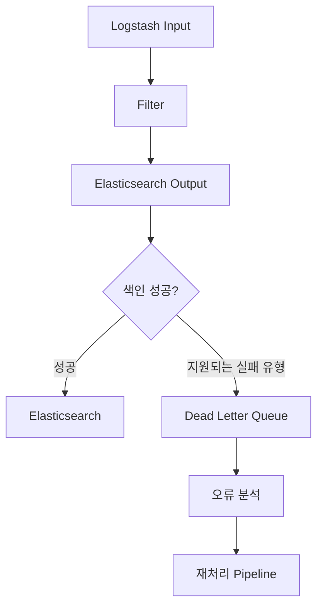

#### DLQ 설정

`logstash.yml`에서 다음과 같이 활성화할 수 있다.

```yaml
dead_letter_queue.enable: true
```

DLQ를 사용하면 일부 비정상 이벤트를 분석하고 재처리하는 데 도움이 된다.

하지만 모든 Filter 오류나 모든 Output 실패가 자동으로 DLQ에 기록되는 것은 아니다.

지원되는 실패 유형과 플러그인의 처리 정책을 확인해야 한다.

또한 DLQ는 이벤트를 저장하는 로컬 디스크 기반 기능이므로 디스크 용량과 보존 정책을 함께 관리해야 한다.

---

### Logstash와 Kafka의 차이

Logstash와 Kafka는 모두 데이터 파이프라인에서 활용할 수 있다.

하지만 주요 역할이 다르다.

| 구분 | Logstash | Kafka |
|---|---|---|
| 주요 역할 | 데이터 수집·가공·전송 | 이벤트 저장·전달 |
| 핵심 구조 | Input → Filter → Output | Producer → Topic → Consumer |
| 데이터 처리 | 플러그인 기반 변환 | 기본적으로 이벤트 로그 전달 |
| 데이터 보존 | Queue 및 대상 시스템에 의존 | Topic Retention Policy |
| 확장 방식 | Logstash 인스턴스·Pipeline 확장 | Broker·Partition 확장 |
| 주요 활용 | 로그 파싱, CSV 처리, 데이터 정규화 | 서비스 간 이벤트 전달, 스트리밍 플랫폼 |

Kafka는 여러 Producer와 Consumer 사이에서 이벤트를 저장하고 전달하는 역할에 강점이 있다.

Logstash는 다양한 데이터 형식을 수집하고 변환하는 데 강점이 있다.

따라서 두 기술을 함께 사용할 수도 있다.

---

### Kafka와 Logstash를 함께 사용하는 구조

예를 들어 여러 서비스가 Kafka에 이벤트를 발행한다고 가정해 보자.

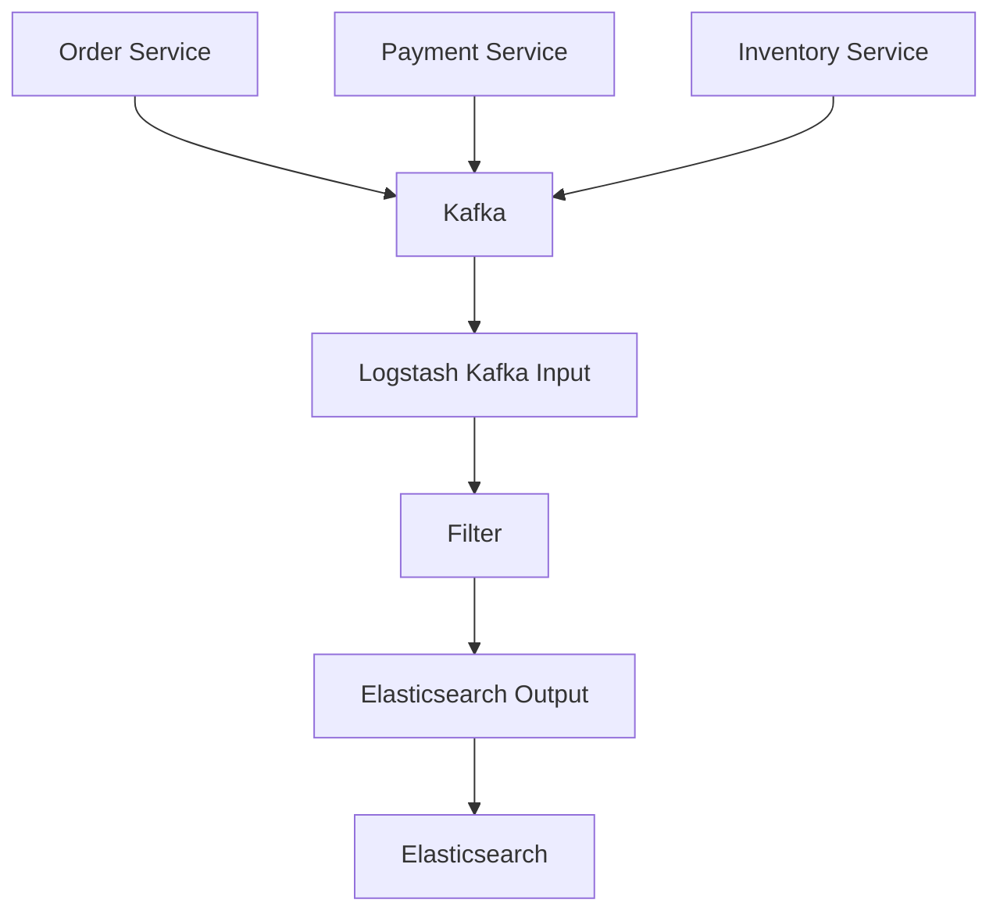

Kafka는 이벤트를 저장한다.

Logstash는 Kafka에서 이벤트를 읽는다.

이후 필요한 변환 작업을 수행하고 Elasticsearch에 저장한다.

이 구조에서는 이벤트 전달과 데이터 정규화의 책임을 구분할 수 있다.

다만 Kafka와 Logstash를 함께 사용하면 운영해야 할 컴포넌트가 증가한다.

따라서 처리량과 데이터 재처리 요구사항, 시스템 복잡도를 함께 고려해야 한다.

---

### Logstash와 Elasticsearch Ingest Pipeline의 차이

Elasticsearch는 Logstash와 별개로 Ingest Pipeline 기능을 제공한다.

Ingest Pipeline은 Elasticsearch에 데이터를 저장하기 전에 처리하는 기능이다.

따라서 다음 두 구조를 비교할 수 있다.

**Logstash 사용**

```text
Data Source
    ↓
Logstash
    ↓
Filter
    ↓
Elasticsearch
```

**Elasticsearch Ingest Pipeline 사용**

```text
Data Source
    ↓
Elasticsearch Ingest Pipeline
    ↓
Elasticsearch Index
```

각 방식은 장단점이 있다.

| 항목 | Logstash | Elasticsearch Ingest Pipeline |
|---|---|---|
| 실행 위치 | 별도 프로세스 | Elasticsearch |
| 데이터 수집 | 다양한 Input Plugin | 별도 수집 경로 필요 |
| 데이터 변환 | Filter Plugin | Ingest Processor |
| 운영 대상 | Logstash 추가 | Elasticsearch 내부 기능 활용 |
| 확장 방식 | 독립적인 Logstash 확장 | Elasticsearch Ingest 처리 자원 활용 |
| 적합한 사례 | 복잡한 수집·변환 파이프라인 | Elasticsearch 저장 전 간단한 변환 |

단순한 데이터 변환만 필요한 경우에는 Elasticsearch Ingest Pipeline이 적합할 수 있다.

반면 여러 외부 시스템에서 데이터를 수집하고 복잡한 변환을 수행해야 한다면 Logstash가 유용할 수 있다.

---

### Logstash 성능 최적화

Logstash의 성능을 개선하려면 Pipeline의 처리량과 리소스 사용량을 함께 확인해야 한다.

대표적인 성능 관련 설정은 다음과 같다.

```yaml
pipeline.workers: 4
pipeline.batch.size: 125
pipeline.batch.delay: 50
```

각 설정의 역할을 살펴보자.

#### pipeline.workers

Filter와 Output을 수행하는 Worker 수를 지정한다.

Worker 수가 증가하면 여러 이벤트를 병렬로 처리할 수 있다.

하지만 CPU 자원이 부족하다면 Worker 수를 늘려도 처리량이 증가하지 않을 수 있다.

또한 Worker 수가 증가하면 이벤트 순서와 메모리 사용량에 영향을 줄 수 있다.

#### pipeline.batch.size

Worker가 한 번에 처리할 최대 이벤트 수를 지정한다.

Batch 크기가 증가하면 Output Plugin이 여러 이벤트를 묶어서 처리하는 데 도움이 될 수 있다.

특히 Elasticsearch Output은 Batch 단위로 Bulk 요청을 구성할 수 있다.

하지만 Batch 크기를 지나치게 늘리면 메모리 사용량이 증가한다.

#### pipeline.batch.delay

Batch가 충분히 채워지지 않았을 때 추가 이벤트를 기다리는 시간에 영향을 준다.

처리량과 지연 시간 사이의 균형을 고려해야 한다.

---

### Inflight Events란?

#### Inflight Events의 개념

Inflight Events는 동시에 처리 중일 수 있는 이벤트 수를 이해하기 위한 개념이다.

간단하게는 다음과 같이 계산할 수 있다.

```text
Inflight Events

=

pipeline.workers × pipeline.batch.size
```

예를 들어 다음 설정이 있다고 가정해 보자.

```yaml
pipeline.workers: 4
pipeline.batch.size: 125
```

이 경우 다음과 같다.

```text
4 × 125 = 500
```

동시에 최대 500개의 이벤트가 Worker 처리 Batch에 포함될 수 있다는 의미다.

여기서 중요한 것은 이벤트의 크기다.

작은 JSON 이벤트 500개와 수 MB의 Stack Trace 이벤트 500개는 메모리 사용량이 크게 다르다.

따라서 Batch 크기를 결정할 때 단순한 이벤트 개수뿐 아니라 평균 및 최대 이벤트 크기를 고려해야 한다.

---

### Logstash 운영에서 확인해야 할 지표

실제 운영 환경에서는 다음 지표를 함께 확인하는 것이 좋다.

| 지표 | 확인 목적 |
|---|---|
| Event Input Rate | 초당 수집 이벤트 수 |
| Event Output Rate | 초당 처리 완료 이벤트 수 |
| Pipeline Worker Utilization | Worker 사용률 |
| Queue Size | 큐 적체 정도 |
| Queue Backpressure | 입력 지연 및 압력 |
| JVM Heap Usage | Heap 사용량 |
| GC Time | GC로 인한 처리 지연 |
| Elasticsearch Output Errors | 저장 실패 |
| Pipeline Reload Failures | 설정 변경 오류 |
| DLQ Size | 실패 이벤트 적체 |

특히 Input Rate와 Output Rate를 비교하면 처리량 차이를 확인할 수 있다.

예를 들어 다음과 같은 상황이다.

```text
Input Rate: 10,000 events/sec

Output Rate: 5,000 events/sec
```

이 상태가 지속되면 큐 적체가 증가할 수 있다.

하지만 Input과 Output의 이벤트 수가 다르다고 반드시 장애는 아니다.

Drop이나 Clone처럼 이벤트 수를 변경하는 Filter가 존재할 수 있기 때문이다.

따라서 Pipeline의 설계와 처리 지표를 함께 분석해야 한다.

---

### Logstash 실무 활용을 위한 12가지 전략

#### 1. Pipeline을 업무별로 분리한다

서로 다른 데이터 처리 목적을 하나의 거대한 Pipeline에 모두 구현하면 유지보수가 어려워질 수 있다.

예를 들어 애플리케이션 로그와 주식 CSV 데이터는 수집 방식과 처리 요구사항이 다르다.

따라서 별도의 Pipeline으로 구분할 수 있다.

#### 2. Pipeline과 설정 파일의 개념을 구분한다

여러 설정 파일을 사용한다고 자동으로 여러 Pipeline이 생성되는 것은 아니다.

단일 Pipeline의 설정을 여러 파일로 분리할 수도 있다.

독립적인 Pipeline이 필요하다면 `pipelines.yml` 등을 이용하여 명시적으로 구성해야 한다.

#### 3. sincedb를 운영 환경에 맞게 설정한다

File Input에서는 파일 처리 위치가 중요하다.

운영 환경에서 `/dev/null`을 사용하면 재시작 후 데이터가 중복 수집될 수 있다.

따라서 처리 위치를 보존할 수 있는 경로를 사용하는 것이 좋다.

#### 4. Tail Mode와 Read Mode를 구분한다

지속적으로 증가하는 로그 파일에는 Tail Mode가 적합하다.

이미 완성된 CSV 파일을 일회성으로 처리하는 경우에는 Read Mode가 적합할 수 있다.

특히 Read Mode에서는 처리 완료 후 파일을 어떻게 관리할지 설정해야 한다.

#### 5. 데이터 변환에 실패한 이벤트를 관리한다

CSV 파싱이나 JSON 분석, 날짜 변환에 실패한 이벤트를 무조건 버려서는 안 된다.

실패 유형을 구분하고 재처리할 수 있도록 설계해야 한다.

#### 6. Elasticsearch Mapping을 명시적으로 정의한다

Logstash에서 숫자로 변환했다고 Elasticsearch가 원하는 자료형으로 자동 저장된다고 가정해서는 안 된다.

중요한 Field는 Index Template과 Mapping을 이용하여 자료형을 관리해야 한다.

#### 7. 데이터 중복을 고려한다

Logstash는 장애 복구나 재시작 과정에서 이벤트를 다시 처리할 수 있다.

따라서 목적지에 저장할 Document ID를 어떻게 결정할지 설계해야 한다.

특히 금융과 결제 데이터에서는 중복 처리로 인해 잘못된 결과가 발생하지 않도록 해야 한다.

#### 8. Persistent Queue의 한계를 이해한다

Persistent Queue는 프로세스 장애 이후 이벤트를 복구하는 데 도움이 된다.

하지만 디스크 손상과 서버 전체 유실을 방지하는 분산 복제 시스템은 아니다.

따라서 중요한 데이터는 원본 시스템의 재처리 기능이나 별도의 메시징 시스템과 함께 고려해야 한다.

#### 9. Plugin별 처리량을 모니터링한다

Pipeline 전체의 처리량만 보면 병목 지점을 찾기 어려울 수 있다.

Grok 처리 시간이 오래 걸리는지, Elasticsearch Output이 느린지, Input에서 지연이 발생하는지 구분해야 한다.

#### 10. JVM 메모리와 GC를 함께 관리한다

Logstash는 JVM 기반 애플리케이션이다.

따라서 Heap과 GC, Direct Memory 사용량을 함께 고려해야 한다.

특히 큰 이벤트를 처리하거나 Batch 크기를 증가시키는 경우 메모리 사용량이 급격하게 늘어날 수 있다.

#### 11. 운영 환경에서는 인증과 TLS를 사용한다

Elasticsearch와 Logstash 사이에 인증이 필요한 환경이라면 적절한 인증 정보를 설정해야 한다.

또한 TLS를 적용하여 전송 중 데이터를 보호할 수 있다.

개발 환경의 보안 비활성화 설정을 운영 환경에 그대로 적용해서는 안 된다.

#### 12. 데이터 처리 결과를 실제 목적지에서 검증한다

Logstash에서 오류가 발생하지 않았다고 모든 데이터가 정상적으로 저장되었다고 판단해서는 안 된다.

Elasticsearch의 Index와 Mapping, Document 수를 확인해야 한다.

또한 원본 데이터 수와 실제 색인 결과를 비교하고 누락이나 중복이 없는지 검증해야 한다.

---

### Logstash를 도입할 때 고려해야 할 아키텍처

Logstash를 모든 시스템에 반드시 도입해야 하는 것은 아니다.

예를 들어 애플리케이션이 이미 구조화된 JSON 로그를 생성하고 있고, 별도의 변환 과정이 필요하지 않다면 Filebeat나 Elastic Agent를 통해 Elasticsearch로 직접 전달하는 방식도 고려할 수 있다.

반면 여러 데이터 소스의 형식이 다르고 복잡한 가공 작업이 필요한 환경에서는 Logstash가 유용하다.

다음과 같은 기준으로 판단할 수 있다.

| 요구사항 | 검토할 방식 |
|---|---|
| 단순한 파일 로그 수집 | Filebeat / Elastic Agent |
| 복잡한 로그 파싱 | Logstash |
| CSV 데이터 정규화 | Logstash |
| Kafka 이벤트 변환 | Kafka Streams 또는 Logstash |
| Elasticsearch 저장 전 간단한 변환 | Elasticsearch Ingest Pipeline |
| 여러 외부 시스템의 데이터 통합 | Logstash |
| 장기간 이벤트 보관과 다중 Consumer | Kafka |
| 검색 데이터 저장 | Elasticsearch |

핵심은 도구의 기능이 아니라 해결하려는 문제다.

단순히 Elastic Stack을 사용한다는 이유로 Elasticsearch와 Logstash, Beats, Kafka를 모두 도입할 필요는 없다.

데이터 수집량과 변환 복잡도, 재처리 요구사항, 운영 비용을 기준으로 필요한 구성 요소를 선택해야 한다.

---

### 정리

Logstash는 다양한 데이터 소스에서 데이터를 수집하고 가공하여 목적지로 전달하는 오픈소스 데이터 처리 엔진이다.

Logstash의 핵심 구조는 Input, Filter, Output으로 구성된다.

Input은 외부 시스템에서 데이터를 수집한다.

Filter는 수집한 데이터를 분석하고 변환한다.

Output은 처리한 데이터를 Elasticsearch와 같은 목적지에 전달한다.

이러한 데이터 처리 흐름을 Pipeline이라고 한다.

Logstash는 하나 이상의 Pipeline을 실행할 수 있다.

또한 여러 설정 파일을 결합하여 하나의 Pipeline을 구성하거나, `pipelines.yml`을 이용하여 여러 Pipeline을 독립적으로 실행할 수 있다.

여기서 중요한 것은 설정 파일의 수와 Pipeline의 수가 반드시 일치하는 것은 아니라는 점이다.

Logstash는 플러그인 기반으로 동작한다.

Input Plugin은 File과 HTTP, Kafka, JDBC 등 다양한 시스템에서 데이터를 읽을 수 있다.

Filter Plugin은 Grok과 Mutate, Date, JSON, CSV 등의 기능을 이용하여 데이터를 변환한다.

Output Plugin은 Elasticsearch와 File, Kafka 등 다양한 목적지로 데이터를 전달한다.

Codec은 입력과 출력 과정에서 데이터를 인코딩하거나 디코딩하는 역할을 수행한다.

특히 JSON Codec과 JSON Filter는 사용 위치와 처리 목적이 다르므로 구분해야 한다.

Logstash에는 데이터 처리 과정의 속도 차이를 완충하기 위한 내부 Queue가 존재한다.

기본적으로 Memory Queue를 사용하며, 필요에 따라 Persistent Queue를 활성화할 수 있다.

Memory Queue는 메모리에 이벤트를 보관한다.

Persistent Queue는 디스크에 이벤트를 저장하여 프로세스 장애 이후 복구 가능성을 높인다.

하지만 Persistent Queue도 모든 데이터 유실을 방지하는 것은 아니다.

체크포인트 기록 이전의 장애나 디스크 손상, 서버 전체 유실 등에 대해서는 별도의 대응이 필요하다.

Logstash File Input에서는 `sincedb`가 중요한 역할을 한다.

`sincedb`는 파일을 어디까지 읽었는지 기록한다.

이를 통해 Logstash가 재시작되어도 기존 처리 위치부터 파일을 읽을 수 있다.

`start_position => "beginning"`은 처음 발견한 파일의 시작 위치를 지정하지만, 이미 `sincedb`에 기록된 위치가 있다면 해당 위치가 우선한다.

따라서 `sincedb_path => "/dev/null"`과 `start_position => "beginning"`을 함께 사용하는 경우 재시작 후 기존 데이터가 중복 수집될 수 있다.

CSV 데이터를 처리할 때는 File Input으로 파일을 읽고 CSV Filter를 이용하여 각 컬럼을 분리할 수 있다.

이후 Mutate Filter를 이용하여 문자열을 숫자로 변환하고 Date Filter를 이용하여 날짜를 처리할 수 있다.

마지막으로 Elasticsearch Output을 이용하여 변환된 데이터를 Elasticsearch에 저장한다.

이 과정에서 CSV Header 처리와 숫자 자료형, 날짜의 시간대, Elasticsearch Mapping을 함께 고려해야 한다.

또한 Logstash는 JVM 기반으로 실행되므로 Worker 수와 Batch 크기, Heap 사용량, GC 상태가 성능에 영향을 줄 수 있다.

따라서 처리량이 부족한 경우 단순히 Worker 수를 늘리기보다 실제 병목이 어디에서 발생하는지 먼저 확인하는 것이 중요하다.

Logstash의 주요 병목은 Input과 Filter, Output 어디에서든 발생할 수 있다.

Elasticsearch가 느려지면 Output 단계에서 적체가 발생할 수 있다.

Filter의 데이터 변환 작업이 복잡하면 CPU 사용량이 증가할 수 있다.

Input에서 수집하는 데이터가 지나치게 많으면 내부 큐에 이벤트가 누적될 수 있다.

따라서 Logstash의 모니터링 API를 이용하여 이벤트 처리량과 Worker 사용률, Queue 상태, JVM 메모리 등을 함께 확인해야 한다.

실제 운영 환경에서는 장애 복구 전략도 중요하다.

데이터 파싱에 실패한 이벤트를 구분하고, Elasticsearch Mapping 오류를 처리하며, 재시작 후 중복 처리 가능성을 고려해야 한다.

필요하다면 Persistent Queue와 Dead Letter Queue를 활용하여 장애 이후 재처리 가능한 구조를 구성할 수 있다.

또한 Logstash는 Kafka와 함께 사용할 수도 있다.

Kafka는 이벤트를 저장하고 전달하는 역할을 수행한다.

Logstash는 이벤트를 읽고 가공하여 Elasticsearch에 저장하는 역할을 담당할 수 있다.

이렇게 각 시스템의 책임을 구분하면 대규모 이벤트 기반 데이터 파이프라인을 구성하는 데 도움이 된다.

결국 Logstash를 안정적으로 활용하기 위해서는 다음 네 가지를 이해해야 한다.

**첫째, Input·Filter·Output으로 구성되는 데이터 처리 흐름과 Pipeline의 구조를 이해해야 한다.**

**둘째, Memory Queue와 Persistent Queue, Backpressure의 동작을 이해하여 데이터 적체와 장애에 대응해야 한다.**

**셋째, File Input과 sincedb, CSV Filter, Mutate Filter, Date Filter를 적절하게 활용하여 데이터 정합성을 관리해야 한다.**

**넷째, Elasticsearch 저장 결과와 Logstash 처리량, JVM 자원, 실패 이벤트를 함께 모니터링해야 한다.**

이러한 개념을 바탕으로 Logstash를 활용하면 단순한 로그 수집을 넘어 다양한 데이터를 안정적으로 수집하고 정규화하여 검색 및 분석 시스템으로 전달하는 데이터 파이프라인을 구축할 수 있다.

#### 한 줄 요약

**Logstash는 Input·Filter·Output 구조를 기반으로 다양한 데이터를 수집하고 변환하여 Elasticsearch 등의 목적지로 전달하는 데이터 처리 엔진이다. Plugin과 Codec을 조합하여 데이터 처리를 확장할 수 있으며, 여러 Pipeline과 Persistent Queue를 이용하여 처리 흐름을 분리하고 장애 복구 가능성을 높일 수 있다. 실제 운영에서는 sincedb에 따른 파일 처리 위치, CSV와 날짜 변환의 정확성, Elasticsearch Mapping, 이벤트 중복, Backpressure 및 JVM 성능을 함께 고려하는 것이 중요하다.**
