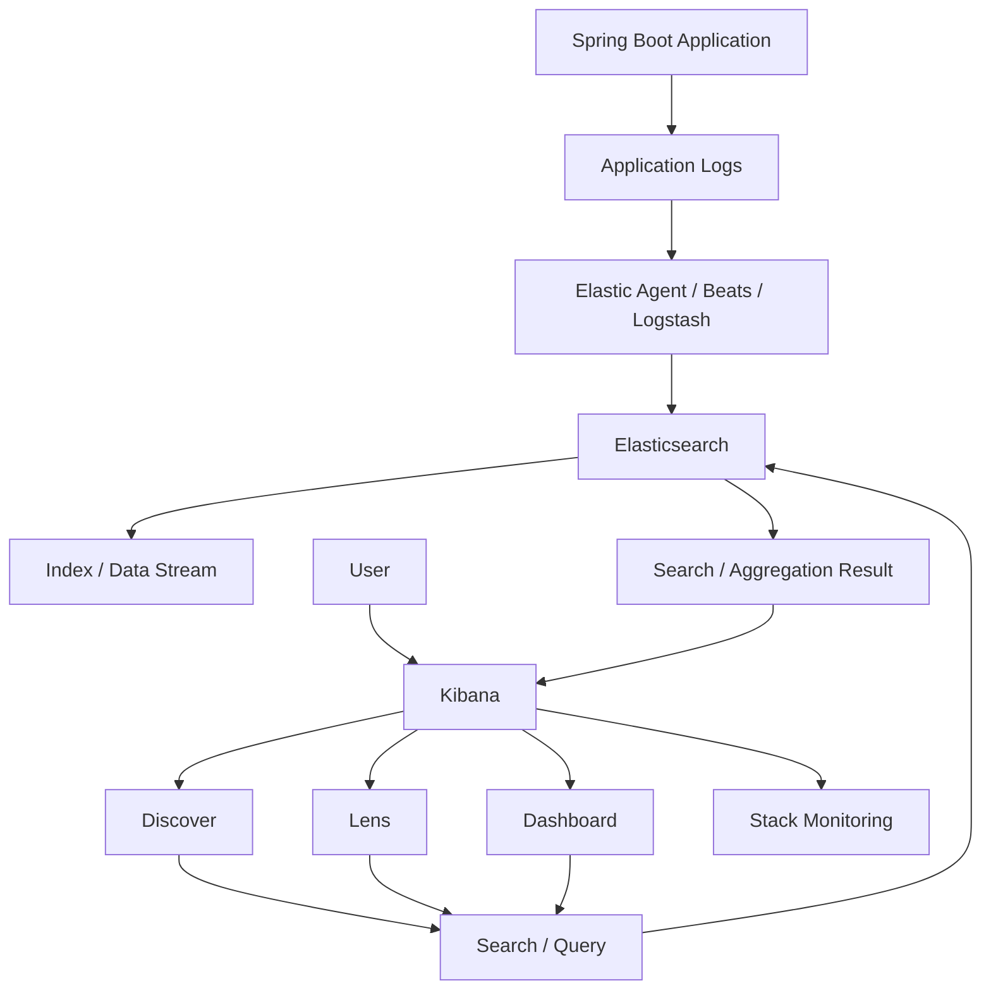
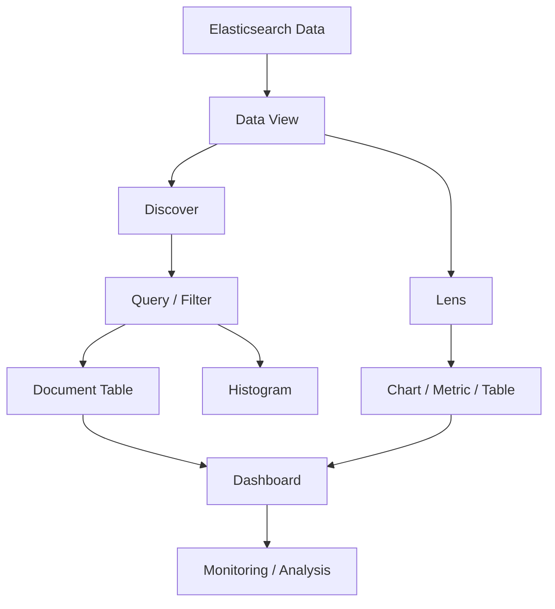

# Kibana

# Kibana
 
* toc
{:toc}

---

### Kibana의 이해와 활용 - Elasticsearch 데이터 탐색, 시각화 및 모니터링

Elasticsearch는 대량의 데이터를 빠르게 검색하고 분석할 수 있는 분산 검색 엔진입니다.

하지만 Elasticsearch에 저장된 데이터를 분석하려면 일반적으로 REST API를 호출하거나 Query DSL을 작성해야 합니다.

개발자에게는 익숙한 방식이지만, 운영 담당자나 데이터 분석가가 직접 활용하기에는 진입 장벽이 존재합니다.

또한 수많은 로그와 검색 결과를 JSON 형태로 확인하는 것만으로는 전체 시스템의 상태나 데이터 변화 추이를 파악하기 어렵습니다.

이러한 문제를 해결하기 위해 사용하는 도구가 **Kibana**입니다.

Kibana는 Elasticsearch에 저장된 데이터를 웹 브라우저에서 검색하고 분석하며, 다양한 차트와 대시보드로 시각화할 수 있도록 지원합니다.

단순히 데이터를 보여주는 데 그치지 않고 시스템 모니터링, 로그 분석, 운영 지표 확인, 장애 원인 추적 등 다양한 목적으로 활용됩니다.

이번 글에서는 Kibana의 기본 개념과 주요 기능을 이해하고, Elasticsearch와 연결되는 구조부터 실제 서비스 운영에서 활용하는 방법까지 살펴보겠습니다.

---

### 개념

#### Kibana란?

**Kibana는 Elasticsearch의 데이터를 탐색하고 분석하며 시각화하기 위한 웹 기반 사용자 인터페이스입니다.**

Elasticsearch가 데이터를 저장하고 검색 및 집계하는 역할을 담당한다면, Kibana는 이러한 기능을 사용자가 편리하게 활용할 수 있도록 지원합니다.

예를 들어 Elasticsearch에 다음과 같은 애플리케이션 로그가 저장되어 있다고 가정하겠습니다.

```json
{
  "@timestamp": "2026-11-26T08:30:00Z",
  "service": "payment-api",
  "level": "ERROR",
  "status_code": 500,
  "latency_ms": 1250,
  "message": "Payment processing failed"
}
```

이 데이터는 결제 API에서 발생한 오류를 나타냅니다.

개발자는 Elasticsearch API를 호출하여 해당 데이터를 검색할 수 있습니다.

그러나 운영 중인 서비스에서 다음과 같은 정보를 확인하려면 어떻게 해야 할까요?

- 최근 1시간 동안 발생한 결제 오류는 몇 건인가?
- 특정 시간대에 오류가 집중적으로 발생했는가?
- 어떤 서비스에서 오류가 가장 많이 발생하는가?
- API 응답 시간이 증가하는 추세인가?
- 최근 배포 이후 오류 발생률이 증가했는가?

이러한 질문에 답하기 위해 매번 검색 API를 호출하고 결과를 가공한다면 많은 시간과 노력이 필요합니다.

Kibana를 활용하면 데이터 검색과 필터링, 집계 결과의 시각화를 웹 브라우저에서 수행할 수 있습니다.

특히 하나의 화면에 여러 지표를 배치하면 서비스 상태를 종합적으로 파악할 수 있습니다.

#### Elasticsearch와 Kibana의 차이

Elasticsearch와 Kibana는 함께 사용되는 경우가 많지만 담당하는 역할은 다릅니다.

| 구분 | Elasticsearch | Kibana |
|---|---|---|
| 주요 역할 | 데이터 저장, 검색, 집계 | 데이터 탐색, 분석, 시각화 |
| 시스템 유형 | 분산 검색 및 분석 엔진 | 웹 기반 분석 및 관리 도구 |
| 데이터 저장 | 인덱스와 데이터 스트림 등에 저장 | 검색 대상 데이터를 직접 저장하는 역할은 아님 |
| 데이터 검색 | Query DSL, ES\|QL 등 지원 | 검색 UI 및 쿼리 편집 환경 제공 |
| 데이터 집계 | Aggregation 등을 실행 | 집계 결과를 차트와 테이블로 표현 |
| 모니터링 | 클러스터 및 노드 상태 정보 제공 | 수집된 모니터링 지표를 화면에 표시 |
| 사용자 인터페이스 | REST API 중심 | 브라우저 기반 UI 중심 |
| 대표 활용 | 검색 API, 로그 저장, 분석 엔진 | 로그 탐색, 운영 대시보드, 장애 분석 |

여기서 중요한 점은 **Kibana가 Elasticsearch의 검색과 집계 기능을 대신 수행하는 것은 아니라는 사실**입니다.

예를 들어 Kibana에서 특정 기간의 오류 발생 건수를 조회하면 Elasticsearch가 조건에 맞는 데이터를 검색하고 집계합니다.

Kibana는 반환된 결과를 사용자가 이해하기 쉬운 형태로 표현합니다.

다만 Kibana를 단순한 읽기 전용 시각화 도구로만 이해해서는 안 됩니다.

Kibana에는 데이터 가져오기, 인덱스 관리, Elasticsearch API 호출 등 데이터를 생성하거나 변경할 수 있는 관리 기능도 포함되어 있습니다.

즉, Kibana는 데이터 분석과 운영을 위한 통합 관리 인터페이스에 가깝습니다.

#### Elastic Stack에서 Kibana의 역할

Kibana는 Elastic Stack을 구성하는 주요 제품 중 하나입니다.

Elastic Stack에서는 일반적으로 다음과 같은 기술이 함께 사용됩니다.

| 구성 요소 | 주요 역할 |
|---|---|
| Elasticsearch | 데이터 저장, 검색, 집계 및 분석 |
| Kibana | 데이터 탐색, 시각화, 관리 및 모니터링 |
| Logstash | 데이터 수집, 변환 및 전달 |
| Beats | 다양한 시스템의 데이터를 수집하는 경량 에이전트 |
| Elastic Agent | 통합 데이터 수집 및 에이전트 관리 |
| APM | 애플리케이션 성능 및 분산 트랜잭션 분석 |

예를 들어 Spring Boot 애플리케이션에서 발생하는 로그를 Elasticsearch로 전달하고 Kibana에서 분석할 수 있습니다.

이때 Logstash가 반드시 필요한 것은 아닙니다.

수집 방식에 따라 Elastic Agent, Beats, 직접 API 호출 등 다양한 방법을 사용할 수 있습니다.

---

### 왜 사용하는가?

#### 1. 복잡한 데이터를 직관적으로 분석하기 위해

Elasticsearch의 검색 결과는 일반적으로 JSON 형태로 반환됩니다.

데이터가 적을 때는 직접 확인할 수 있지만, 수백만 건 이상의 로그를 분석해야 한다면 개별 JSON을 확인하는 방식에는 한계가 있습니다.

Kibana를 활용하면 데이터를 시간별, 서비스별, 상태별로 분류하고 시각적으로 확인할 수 있습니다.

예를 들어 결제 오류가 100건 발생했다는 정보보다, 특정 배포 직후 5분 동안 90건의 오류가 집중적으로 발생했다는 정보가 장애 원인 분석에 훨씬 유용할 수 있습니다.

Kibana는 이러한 시간적 변화와 데이터 분포를 파악할 수 있도록 도와줍니다.

#### 2. 서비스 상태를 실시간에 가깝게 확인하기 위해

운영 환경에서는 서비스의 상태가 계속 변화합니다.

사용자가 증가하면 API 요청량이 늘어나고, 특정 기능에 장애가 발생하면 오류율이 급격하게 증가할 수 있습니다.

Kibana에서는 일정한 주기로 데이터를 새로고침하여 이러한 변화를 확인할 수 있습니다.

다만 새로고침 주기와 실제 데이터 수집 지연은 서로 다른 개념입니다.

로그가 Elasticsearch에 늦게 수집된다면 Kibana의 새로고침 주기를 짧게 설정하더라도 해당 로그를 즉시 확인할 수 있는 것은 아닙니다.

따라서 실시간 모니터링 환경에서는 데이터 수집 지연과 화면 갱신 주기를 함께 고려해야 합니다.

#### 3. 장애 발생 시 원인을 빠르게 추적하기 위해

운영 중인 시스템에 장애가 발생하면 장애 자체를 감지하는 것만큼 원인을 파악하는 과정이 중요합니다.

예를 들어 다음과 같은 상황을 가정해 보겠습니다.

결제 API의 응답 시간이 증가했고, 동시에 HTTP 500 오류도 증가했습니다.

이때 Kibana를 활용하면 해당 시간대의 오류 로그를 검색하고, 특정 서비스 또는 요청 경로에 문제가 집중되어 있는지 확인할 수 있습니다.

또한 동일한 시간대의 인프라 지표와 비교하면 애플리케이션 문제인지 Elasticsearch 클러스터의 성능 문제인지 판단하는 데 도움이 됩니다.

단, 두 지표가 동시에 증가했다는 이유만으로 인과관계가 입증되는 것은 아닙니다.

추가적인 로그와 메트릭 분석을 통해 원인을 검증해야 합니다.

#### 4. 운영자와 개발자가 동일한 데이터를 공유하기 위해

Kibana는 브라우저 기반 인터페이스를 제공하므로 개발자가 아니더라도 권한이 허용된 데이터를 확인할 수 있습니다.

예를 들어 운영 담당자는 결제 성공 건수와 실패 건수를 확인하고, 개발자는 오류 로그와 응답 시간을 확인할 수 있습니다.

각 담당자가 별도의 조회 프로그램을 개발하지 않아도 동일한 데이터 저장소를 기반으로 필요한 정보를 확인할 수 있다는 장점이 있습니다.

이러한 구조는 서비스 운영의 투명성과 협업 효율성을 높이는 데 도움이 됩니다.

---

### 주요 특징

Kibana의 핵심적인 기능은 다음과 같이 구분할 수 있습니다.

| 기능 | 설명 | 주요 목적 |
|---|---|---|
| Monitoring | Elastic Stack의 상태와 성능 지표 확인 | 시스템 운영 및 장애 감지 |
| Data Views | 검색과 시각화에 사용할 데이터 범위 정의 | 데이터 탐색 대상 설정 |
| Discover | 저장된 문서 검색 및 상세 내용 확인 | 로그 분석 및 데이터 탐색 |
| Visualize / Lens | 데이터를 차트와 테이블로 시각화 | 데이터 분석 |
| Dashboard | 여러 시각화 결과를 하나의 화면으로 통합 | 통합 모니터링 |
| Dev Tools Console | Elasticsearch API 요청 실행 | 데이터 조회 및 관리 |
| Alerting | 설정한 조건에 따른 알림 생성 | 이상 징후 감지 및 대응 |

이러한 기능은 서로 독립적으로 활용할 수도 있지만, 하나의 분석 흐름으로 연결했을 때 더욱 효과적입니다.

#### 1. Kibana Monitoring

Monitoring은 Elastic Stack의 상태와 성능을 확인하기 위한 기능입니다.

현재 Elastic 환경에서는 일반적으로 **Stack Monitoring**이라는 명칭을 사용합니다.

Stack Monitoring을 활용하면 Elasticsearch 클러스터뿐 아니라 Kibana, Logstash 등 다양한 구성 요소의 상태를 확인할 수 있습니다.

다만 실제 지표가 표시되려면 해당 구성 요소의 모니터링 데이터를 수집하고 Kibana에서 조회하도록 설정해야 합니다.

##### Elasticsearch 클러스터 상태

Elasticsearch는 여러 노드가 하나의 클러스터를 구성하는 분산 시스템입니다.

따라서 단일 서버의 상태뿐 아니라 전체 클러스터의 상태를 확인해야 합니다.

대표적으로 다음과 같은 지표를 확인할 수 있습니다.

| 지표 | 설명 | 확인해야 하는 이유 |
|---|---|---|
| Cluster Health | 클러스터의 전체 상태 | 샤드 할당 및 가용성 확인 |
| Nodes | 클러스터에 참여한 노드 수 | 노드 이탈 여부 확인 |
| Indices | 인덱스 수 및 상태 | 데이터 관리 현황 확인 |
| Documents | 저장된 문서 수 | 데이터 증가 추이 확인 |
| Disk Usage | 디스크 사용량 | 저장 공간 부족 위험 확인 |
| JVM Heap | JVM 힙 메모리 사용량 | 메모리 압박 및 GC 문제 확인 |
| Primary Shards | 원본 데이터가 저장되는 샤드 | 데이터 분산 상태 확인 |
| Replica Shards | Primary Shard의 복제본 | 장애 복구 및 가용성 확인 |
| Unassigned Shards | 노드에 할당되지 않은 샤드 | 복제본 및 데이터 가용성 위험 확인 |

특히 Cluster Health는 가장 먼저 확인해야 하는 지표 중 하나입니다.

##### Cluster Health의 상태

Elasticsearch의 클러스터 상태는 일반적으로 Green, Yellow, Red로 구분됩니다.

| 상태 | 의미 | 운영 관점 |
|---|---|---|
| Green | 모든 Primary 및 Replica Shard가 할당됨 | 정상적인 샤드 할당 상태 |
| Yellow | 모든 Primary Shard는 할당되었지만 일부 Replica Shard가 미할당됨 | 복제본 부족으로 장애 내성이 감소한 상태 |
| Red | 하나 이상의 Primary Shard가 미할당됨 | 일부 데이터에 접근할 수 없는 위험 상태 |

여기서 Yellow가 반드시 서비스 장애를 의미하는 것은 아닙니다.

예를 들어 Elasticsearch가 단일 노드로 구성되어 있고 인덱스에 Replica Shard가 설정되어 있다면 Yellow 상태가 발생할 수 있습니다.

Elasticsearch는 동일한 노드에 Primary Shard와 해당 Replica Shard를 함께 배치하지 않기 때문입니다.

따라서 단일 노드에서는 Replica Shard를 할당할 다른 노드가 존재하지 않을 수 있습니다.

반면 여러 노드로 구성된 운영 환경에서 갑자기 Yellow 상태로 전환되었다면 노드 이탈, 디스크 공간 부족, 샤드 할당 정책 등을 확인해야 합니다.

중요한 것은 **Yellow 상태 자체가 아니라 샤드가 할당되지 않은 원인을 파악하는 것**입니다.

이를 위해 Elasticsearch의 Cluster Health API와 Shard Allocation Explain API를 활용할 수 있습니다.

##### JVM Heap과 Disk Usage

Elasticsearch는 JVM 기반으로 동작하므로 JVM Heap 사용량이 중요한 지표입니다.

JVM Heap 사용량이 지속적으로 높은 상태를 유지하면 GC 부담이 증가하고 검색 및 색인 처리 성능에 영향을 줄 수 있습니다.

그러나 힙 사용률이 일시적으로 상승했다고 해서 반드시 메모리 문제가 발생한 것은 아닙니다.

GC 이후 힙 사용량이 정상적으로 감소하는지, GC 시간이 증가하는지, 검색 지연이 함께 발생하는지 등을 종합적으로 확인해야 합니다.

Disk Usage 역시 중요합니다.

Elasticsearch는 데이터가 지속적으로 증가하는 구조이므로 디스크 사용량이 높아지면 샤드 할당이나 데이터 색인에 문제가 발생할 수 있습니다.

운영 환경에서는 디스크 사용률뿐 아니라 데이터 증가 속도와 남은 저장 공간을 함께 모니터링하는 것이 좋습니다.

##### Search Rate와 Search Latency

Elasticsearch의 검색 성능을 분석할 때는 처리량과 지연 시간을 구분해야 합니다.

**Search Rate**는 일정 시간 동안 처리되는 검색 작업의 비율을 나타냅니다.

**Search Latency**는 검색 작업을 처리하는 데 걸리는 시간을 나타냅니다.

| 지표 | 의미 | 해석 |
|---|---|---|
| Search Rate | 단위 시간당 검색 작업 수 | 검색 부하 및 요청 패턴 |
| Search Latency | 검색 작업 처리 지연 | 검색 성능 변화 |
| Indexing Rate | 단위 시간당 색인 작업 수 | 데이터 수집 및 저장 처리량 |
| Indexing Latency | 색인 작업 처리 지연 | 데이터 저장 성능 변화 |

예를 들어 Search Rate가 증가하는 상황에서 Search Latency도 함께 증가한다면 검색 부하가 성능에 영향을 주고 있을 가능성이 있습니다.

반대로 Search Rate가 감소했는데 Search Latency가 증가했다면 단순한 요청량 증가보다는 리소스 문제나 비효율적인 검색 쿼리 등을 의심할 수 있습니다.

다만 모니터링 지표의 계산 범위와 집계 방식에 따라 의미가 달라질 수 있으므로, 실제 API 요청의 평균 응답 시간이나 P95·P99 지연 시간과 동일한 값으로 해석해서는 안 됩니다.

##### Kibana 인스턴스 모니터링

Stack Monitoring에서는 Elasticsearch 외에도 Kibana 자체의 상태를 확인할 수 있습니다.

대표적인 지표는 Requests, Response Time, Connections, Memory Usage 등입니다.

예를 들어 Elasticsearch의 검색 성능에는 문제가 없지만 Kibana 화면이 느리게 동작한다면 Kibana 인스턴스의 메모리 사용량이나 응답 시간을 확인해 볼 수 있습니다.

이처럼 Elasticsearch와 Kibana의 상태를 구분하여 분석하면 장애가 발생한 영역을 더욱 정확하게 파악할 수 있습니다.

#### 2. Kibana Alerting

Monitoring이 시스템의 현재 상태를 확인하는 기능이라면 Alerting은 특정 조건이 충족되었을 때 이를 감지하고 알림을 발생시키는 기능입니다.

운영자가 지속적으로 대시보드를 확인하지 않아도 이상 징후를 감지할 수 있도록 지원합니다.

예를 들어 다음과 같은 상황에 활용할 수 있습니다.

| 감지 대상 | 예시 조건 | 기대 효과 |
|---|---|---|
| CPU 사용량 | 일정 시간 동안 높은 CPU 사용률 유지 | 리소스 과부하 조기 감지 |
| 디스크 사용량 | 사용률이 운영 임계값 초과 | 저장 공간 부족 예방 |
| 클러스터 상태 | Green에서 Yellow 또는 Red로 변경 | 샤드 할당 문제 감지 |
| 노드 수 | 정상 노드 수보다 감소 | 노드 이탈 확인 |
| 애플리케이션 오류 | 일정 시간 내 오류 건수 급증 | 서비스 장애 조기 발견 |
| 검색 성능 | 검색 지연 시간 증가 | 성능 저하 감지 |

현재 Stack Monitoring은 기본 알림 규칙을 제공하며, 외부 채널로 알림을 전달하려면 적절한 Connector와 Action을 설정해야 합니다.

예를 들어 Slack 또는 이메일 알림을 사용하려면 해당 채널에 대한 Connector가 필요합니다.

일부 알림 기능과 Action 유형은 제품 구독 조건에 따라 사용 가능 여부가 달라질 수 있습니다.

또한 기본 규칙을 생성했다고 해서 외부 알림까지 자동으로 발송되는 것은 아닙니다.

따라서 알림 기능을 도입할 때는 **감지 조건, 평가 주기, 재알림 정책, 알림 수신 채널**을 함께 설계해야 합니다.

#### 3. Index Pattern과 Data Views

Kibana에서 데이터를 탐색하려면 어떤 Elasticsearch 인덱스를 대상으로 조회할 것인지 결정해야 합니다.

기존 Kibana에서는 이를 Index Pattern이라고 불렀습니다.

현재 Kibana에서는 일반적으로 **Data Views**라는 개념을 사용합니다.

Data View는 하나 이상의 Elasticsearch 인덱스, 데이터 스트림 또는 별칭을 대상으로 데이터를 탐색할 수 있도록 정의하는 논리적인 구조입니다.

예를 들어 다음과 같은 인덱스가 존재한다고 가정하겠습니다.

```text
logstash-2026.11.24
logstash-2026.11.25
logstash-2026.11.26
```

이때 다음과 같은 패턴을 지정할 수 있습니다.

```text
logstash-*
```

해당 패턴과 일치하는 인덱스를 하나의 탐색 대상으로 사용할 수 있습니다.

이는 여러 인덱스를 실제로 하나의 인덱스로 합치는 것이 아닙니다.

Kibana에서 검색과 시각화를 수행할 때 사용할 데이터 범위를 정의하는 것입니다.

##### Data View와 Elasticsearch Index의 차이

| 구분 | Elasticsearch Index | Kibana Data View |
|---|---|---|
| 역할 | 실제 문서 저장 및 검색 | 검색 대상 데이터 정의 |
| 데이터 저장 | 실제 데이터 저장 | 문서 자체를 저장하지 않음 |
| 생성 목적 | 데이터 관리 및 검색 | 탐색과 시각화 |
| 복수 인덱스 연결 | 개별 인덱스 단위 | 여러 인덱스를 하나의 View로 연결 가능 |
| 필드 관리 | Mapping 기반 | 필드 표시 형식 및 Runtime Field 등 관리 |
| 삭제 시 영향 | 저장된 데이터가 삭제될 수 있음 | Data View 삭제만으로 인덱스 데이터가 삭제되지는 않음 |

예를 들어 `payment-*`라는 Data View를 생성하면 다음과 같은 인덱스를 함께 탐색할 수 있습니다.

```text
payment-2026.11.24
payment-2026.11.25
payment-2026.11.26
```

이러한 구조는 날짜별로 인덱스를 분리하여 관리하는 환경에서 유용합니다.

또한 Data View를 생성할 때 시간 필드를 지정하면 Discover와 Dashboard에서 시간 범위를 활용한 조회가 가능합니다.

일반적으로 로그 데이터에서는 `@timestamp` 필드를 많이 사용합니다.

##### Data View의 주요 설정

| 설정 | 설명 |
|---|---|
| Name | Data View의 이름 |
| Index Pattern | 연결할 인덱스 이름 또는 와일드카드 패턴 |
| Timestamp Field | 시간 범위 조회에 사용할 필드 |
| Runtime Fields | 조회 시점에 계산하는 필드 |
| Field Format | 날짜, 숫자 등 필드 표시 형식 |
| Field Labels | 사용자에게 표시할 필드 이름 |

현재 Kibana에서는 일부 데이터 수집 기능을 통해 Data View가 자동 생성되기도 합니다.

또한 ES|QL 모드에서는 별도의 Data View를 생성하지 않고도 Elasticsearch의 데이터를 조회할 수 있습니다.

따라서 Data View가 모든 Kibana 검색 방식에서 반드시 필요한 것은 아닙니다.

##### CSV Importer와 데이터 가져오기

Elasticsearch에 데이터가 아직 저장되어 있지 않다면 Kibana의 파일 업로드 기능을 활용하여 데이터를 가져올 수도 있습니다.

현재 Kibana는 Data Visualizer와 파일 업로드 기능을 통해 CSV 등 다양한 형식의 데이터를 분석하고 Elasticsearch 인덱스로 가져오는 기능을 제공합니다.

일반적인 흐름은 다음과 같습니다.

```text
CSV 파일 준비
      |
      v
Kibana 파일 업로드
      |
      v
데이터 구조 및 필드 확인
      |
      v
Elasticsearch 인덱스 생성 또는 선택
      |
      v
데이터 가져오기
      |
      v
Data View 생성 또는 선택
      |
      v
Discover에서 데이터 탐색
```

파일 업로드는 소규모 데이터의 초기 분석과 테스트에 유용합니다.

그러나 지속적으로 발생하는 대용량 운영 데이터를 수집하는 용도라면 Elastic Agent, Logstash, 애플리케이션 연동 등 별도의 데이터 수집 구조를 사용하는 것이 적절합니다.

#### 4. Discover

Discover는 Elasticsearch에 저장된 데이터를 검색하고 탐색하는 기능입니다.

실무에서는 장애가 발생했을 때 가장 먼저 사용하는 기능 중 하나입니다.

예를 들어 특정 API에서 HTTP 500 오류가 발생했다면 Discover에서 해당 시간대의 오류 로그를 검색할 수 있습니다.

Discover에서는 데이터를 검색하는 것뿐 아니라 시간별 이벤트 분포를 확인하고, 개별 문서를 확장하여 상세 내용을 살펴볼 수도 있습니다.

##### Discover의 주요 구성 요소

| 구성 요소 | 역할 |
|---|---|
| Data View | 검색할 데이터 범위 선택 |
| Query Bar | 검색 조건 입력 |
| Time Picker | 조회할 시간 범위 설정 |
| Filter | 조건을 추가하여 검색 결과 제한 |
| Histogram | 시간에 따른 이벤트 분포 확인 |
| Document Table | 검색된 문서 목록 표시 |
| Fields | 사용 가능한 필드 목록 |
| Toolbar | 저장, 공유, 새로고침 등 화면 작업 |

이러한 구성 요소는 하나의 검색 흐름으로 연결됩니다.

예를 들어 결제 API의 오류를 분석한다고 가정하겠습니다.

먼저 `payment-*` Data View를 선택하고, Time Picker에서 최근 1시간을 지정합니다.

이후 Query Bar에서 오류 조건을 입력합니다.

```kql
level: "ERROR"
```

그러면 해당 시간 범위와 검색 조건에 일치하는 문서가 조회됩니다.

여기서 HTTP 상태 코드가 500 이상인 문서만 확인하려면 조건을 추가할 수 있습니다.

```kql
level: "ERROR" and status_code >= 500
```

이후 Histogram에서 오류 발생 시점을 확인하고, Document Table에서 개별 로그를 분석할 수 있습니다.

##### Histogram의 역할

Histogram은 시간에 따른 데이터의 분포를 나타냅니다.

예를 들어 다음과 같이 오류가 발생했다고 가정하겠습니다.

| 시간 | 오류 발생 건수 |
|---|---:|
| 10:00 | 2 |
| 10:05 | 3 |
| 10:10 | 4 |
| 10:15 | 85 |
| 10:20 | 72 |
| 10:25 | 5 |

이 데이터를 표로 확인하면 특정 시간대에 오류가 증가했다는 사실을 알 수 있습니다.

하지만 Histogram으로 표현하면 10시 15분부터 오류가 급격히 증가했다는 패턴을 더욱 직관적으로 파악할 수 있습니다.

운영 중 장애가 발생했을 때는 이러한 시간적 패턴이 매우 중요합니다.

특정 배포 시점, 외부 API 장애 시점, 데이터베이스 부하 증가 시점과 비교하여 원인을 추적할 수 있기 때문입니다.

##### Document Table의 역할

Document Table은 검색 결과에 해당하는 개별 문서를 표시합니다.

예를 들어 다음과 같은 필드를 확인할 수 있습니다.

| 필드 | 설명 |
|---|---|
| `@timestamp` | 이벤트 발생 시간 |
| `service` | 로그를 발생시킨 서비스 |
| `level` | 로그 레벨 |
| `status_code` | HTTP 응답 상태 |
| `message` | 로그 메시지 |
| `latency_ms` | 처리 소요 시간 |
| `_index` | 문서가 저장된 인덱스 |
| `_id` | 문서 식별자 |
| `_source` | 원본 문서의 저장된 필드 데이터 |

실제 데이터의 필드 구성은 애플리케이션의 로깅 방식과 Elasticsearch Mapping에 따라 달라집니다.

또한 기존 Elasticsearch에서 사용하던 `_type`과 같은 Mapping Type 개념은 Elasticsearch 8.0부터 지원되지 않습니다.

따라서 오래된 Kibana 화면에서 보이는 필드를 현재 버전에서도 동일하게 사용할 수 있다고 가정해서는 안 됩니다.

##### Discover 검색 방식

Kibana는 여러 검색 방식을 지원합니다.

대표적으로 KQL, Lucene Query Syntax, ES|QL 등이 있습니다.

| 구분 | KQL | Lucene Query Syntax | ES\|QL |
|---|---|---|---|
| 주요 목적 | 문서 필터링 | 문서 검색 | 검색, 변환, 집계 |
| 문법 특징 | 직관적인 필드 조건 | Lucene 기반 검색 표현식 | 파이프라인 형태의 쿼리 |
| 집계 | 직접 수행하지 않음 | 직접 수행하지 않음 | 지원 |
| 정렬 | 쿼리 자체에서는 수행하지 않음 | 쿼리 구문 자체에서는 수행하지 않음 | `SORT` 지원 |
| 대표 사용 | 오류 로그 필터링 | 세부 검색 조건 | 통계 및 데이터 분석 |

KQL은 주로 문서를 필터링하는 데 사용됩니다.

예를 들어 다음과 같은 조건을 작성할 수 있습니다.

```kql
status_code >= 500
```

```kql
service: "payment-api"
```

```kql
service: "payment-api" and latency_ms > 1000
```

```kql
level: "ERROR" and not status_code: 404
```

KQL은 Elasticsearch의 Query DSL과 동일한 문법이 아닙니다.

KQL은 Kibana의 검색 인터페이스에서 조건을 작성하기 위한 언어이며, 데이터 집계와 정렬 자체를 수행하는 언어는 아닙니다.

반면 ES|QL은 검색 결과를 집계하고 변환하는 기능까지 제공합니다.

```esql
FROM kibana-demo-logs
| WHERE status_code >= 500
| STATS error_count = COUNT(*) BY service
| SORT error_count DESC
```

이 쿼리는 HTTP 상태 코드가 500 이상인 문서를 검색한 뒤 서비스별 오류 건수를 집계합니다.

따라서 단순히 어떤 로그가 발생했는지 확인하는 목적이라면 KQL이 편리하고, 데이터 집계와 통계 분석까지 수행하려면 ES|QL을 활용할 수 있습니다.

#### 5. Visualize와 Lens

Visualize는 Elasticsearch 데이터를 다양한 그래프와 테이블로 표현하기 위한 기능입니다.

현재 Kibana에서는 **Lens가 대표적인 시각화 편집기**로 사용됩니다.

Lens는 필드를 선택하거나 드래그하는 방식으로 차트를 구성할 수 있도록 지원합니다.

기존 Visualize 기능에서 사용하던 Aggregation-based 편집기나 Timelion 등은 레거시 편집 방식으로 분류됩니다.

지원되는 기능과 메뉴 위치는 Kibana 버전 및 배포 환경에 따라 달라질 수 있습니다.

##### 주요 시각화 유형

| 유형 | 설명 | 활용 예시 |
|---|---|---|
| Area Chart | 시간에 따른 값의 변화를 영역으로 표시 | 트래픽 변화 |
| Line Chart | 시간에 따른 수치 변화 | API 응답 시간 |
| Pie Chart | 전체 데이터의 구성 비율 | 상태 코드별 비율 |
| Data Table | 집계 결과를 표로 표현 | 서비스별 오류 건수 |
| Metric | 특정 핵심 수치를 강조 | 전체 요청 수 |
| Markdown / Text | 설명과 안내 문구 표시 | 운영 가이드 |
| Bar Chart | 범주별 값 비교 | 서비스별 요청량 |

각 차트는 목적에 따라 선택해야 합니다.

예를 들어 API 응답 시간의 변화를 확인하려면 Line Chart가 적합합니다.

반면 서비스별 오류 건수를 비교하려면 Bar Chart가 더 직관적일 수 있습니다.

전체 요청 중 HTTP 500 오류가 차지하는 비율을 표현하려면 Pie Chart를 사용할 수 있지만, 비교해야 할 범주가 많다면 Bar Chart가 더 읽기 쉬울 수 있습니다.

즉, 데이터의 특성과 분석 목적에 따라 시각화 유형을 선택하는 것이 중요합니다.

##### Metric 시각화

Metric은 하나의 중요한 수치를 크게 표시하는 방식입니다.

예를 들어 운영 대시보드 상단에 다음과 같은 지표를 배치할 수 있습니다.

| 지표 | 표현 방식 |
|---|---|
| 전체 API 요청 수 | Metric |
| HTTP 500 오류 건수 | Metric |
| 평균 응답 시간 | Metric |
| 결제 성공률 | Metric |
| 활성 사용자 수 | Metric |

이처럼 핵심 지표를 한눈에 확인할 수 있도록 구성하면 운영자가 서비스 상태를 빠르게 파악할 수 있습니다.

##### Line Chart와 Area Chart

Line Chart와 Area Chart는 시간에 따른 데이터 변화를 분석할 때 유용합니다.

예를 들어 API 응답 시간을 시간별로 시각화하면 특정 시간대에 성능 저하가 발생했는지 확인할 수 있습니다.

이때 평균 응답 시간만 확인하는 것보다는 P95 또는 P99 응답 시간을 함께 분석하는 것이 좋습니다.

평균값은 일부 느린 요청의 영향을 충분히 드러내지 못할 수 있기 때문입니다.

Area Chart는 시간별 요청량이나 여러 데이터 시리즈의 변화를 시각적으로 비교할 때 활용할 수 있습니다.

#### 6. Dashboard

Dashboard는 여러 시각화 결과를 하나의 화면으로 통합하는 기능입니다.

예를 들어 결제 시스템의 운영 대시보드를 구성한다고 가정하겠습니다.

상단에는 전체 요청 수와 결제 성공률을 배치하고, 중간에는 시간별 결제 요청량과 오류 발생 추이를 표시할 수 있습니다.

하단에는 최근 오류 로그를 표시하여 장애 상황이 발생했을 때 상세 데이터를 확인하도록 구성할 수 있습니다.

##### Dashboard 구성 예시

| 영역 | 표시할 데이터 | 시각화 유형 |
|---|---|---|
| 상단 | 전체 요청 수 | Metric |
| 상단 | 결제 성공률 | Metric |
| 상단 | 오류 발생 건수 | Metric |
| 중간 | 시간별 요청량 | Area Chart |
| 중간 | 응답 시간 변화 | Line Chart |
| 중간 | 상태 코드 비율 | Pie Chart |
| 하단 | 서비스별 오류 현황 | Data Table |
| 하단 | 최근 오류 로그 | Discover 결과 |
| 안내 | 주요 지표 설명 | Markdown / Text |

이러한 대시보드는 데이터를 개별적으로 검색하지 않더라도 서비스 전체의 흐름을 확인할 수 있도록 도와줍니다.

##### Dashboard의 필터와 시간 범위

Dashboard는 단순히 여러 차트를 배치하는 기능만 제공하는 것은 아닙니다.

공통 시간 범위와 필터를 적용하여 여러 시각화 결과를 함께 분석할 수 있습니다.

예를 들어 Dashboard 전체의 시간 범위를 최근 24시간으로 설정하면 해당 시간 범위에 맞춰 패널 데이터를 조회할 수 있습니다.

또한 특정 서비스만 선택하면 관련 패널에 필터를 적용할 수 있습니다.

다만 각 패널의 데이터 소스나 필터 설정에 따라 공통 조건의 적용 방식이 달라질 수 있습니다.

따라서 대시보드를 구성할 때는 패널마다 어떤 데이터 범위와 시간 필드를 사용하는지 확인해야 합니다.

##### Dashboard 공유

Kibana는 저장된 Dashboard를 다른 사용자와 공유할 수 있습니다.

이를 통해 개발자와 운영 담당자가 동일한 지표를 확인하고 협업할 수 있습니다.

다만 Dashboard에 접근할 수 있다고 해서 모든 Elasticsearch 데이터에 접근할 수 있는 것은 아닙니다.

Kibana의 Space와 Role 기반 권한 설정, Elasticsearch의 인덱스 접근 권한 등을 함께 고려해야 합니다.

실무에서는 운영용 대시보드와 개발용 대시보드를 분리하고, 필요한 사용자에게 적절한 권한을 부여하는 것이 좋습니다.

---

### 예제

이번에는 실제로 Elasticsearch에 데이터를 저장한 뒤 Kibana에서 검색하고 시각화하는 흐름을 살펴보겠습니다.

아래 예제는 Elasticsearch REST API와 Kibana의 현재 검색 기능을 기준으로 구성한 독립적인 실습 예시입니다.

실제 운영 데이터가 아닌 가상의 결제 시스템 로그를 사용합니다.

#### 1. Elasticsearch 인덱스 생성

먼저 Kibana의 Dev Tools Console을 실행합니다.

Dev Tools Console에서는 Elasticsearch REST API를 직접 호출할 수 있습니다.

다음 요청으로 인덱스를 생성하겠습니다.

```json
PUT kibana-demo-logs
{
  "mappings": {
    "properties": {
      "@timestamp": {
        "type": "date"
      },
      "service": {
        "type": "keyword"
      },
      "level": {
        "type": "keyword"
      },
      "status_code": {
        "type": "integer"
      },
      "latency_ms": {
        "type": "integer"
      },
      "message": {
        "type": "text"
      }
    }
  }
}
```

각 필드의 의미는 다음과 같습니다.

| 필드 | 데이터 타입 | 설명 |
|---|---|---|
| `@timestamp` | date | 로그 발생 시간 |
| `service` | keyword | 서비스 이름 |
| `level` | keyword | 로그 레벨 |
| `status_code` | integer | HTTP 상태 코드 |
| `latency_ms` | integer | API 응답 시간 |
| `message` | text | 로그 메시지 |

여기서 `service`와 `level`을 `keyword` 타입으로 선언한 이유는 정확한 값의 필터링과 집계를 수행하기 위해서입니다.

반면 `message`는 로그 메시지의 내용을 검색할 수 있도록 `text` 타입을 사용했습니다.

실제 운영 환경에서는 Elastic Common Schema(ECS)와 같은 공통 필드 규칙을 활용하면 여러 서비스에서 발생하는 로그를 일관된 형태로 관리하는 데 도움이 됩니다.

#### 2. 샘플 로그 저장

이제 인덱스에 데이터를 저장하겠습니다.

```json
PUT kibana-demo-logs/_doc/1
{
  "@timestamp": "2026-11-26T08:35:00Z",
  "service": "payment-api",
  "level": "INFO",
  "status_code": 200,
  "latency_ms": 120,
  "message": "Payment completed successfully"
}
```

```json
PUT kibana-demo-logs/_doc/2
{
  "@timestamp": "2026-11-26T08:35:30Z",
  "service": "payment-api",
  "level": "ERROR",
  "status_code": 500,
  "latency_ms": 890,
  "message": "Payment processing failed"
}
```

```json
PUT kibana-demo-logs/_doc/3
{
  "@timestamp": "2026-11-26T08:36:00Z",
  "service": "payment-api",
  "level": "ERROR",
  "status_code": 502,
  "latency_ms": 1300,
  "message": "External payment gateway timeout"
}
```

```json
PUT kibana-demo-logs/_doc/4
{
  "@timestamp": "2026-11-26T08:36:30Z",
  "service": "order-api",
  "level": "INFO",
  "status_code": 200,
  "latency_ms": 95,
  "message": "Order created successfully"
}
```

```json
PUT kibana-demo-logs/_doc/5
{
  "@timestamp": "2026-11-26T08:37:00Z",
  "service": "order-api",
  "level": "ERROR",
  "status_code": 503,
  "latency_ms": 1800,
  "message": "Order service temporarily unavailable"
}
```

총 5개의 문서를 저장했습니다.

데이터는 예제를 명확하게 재현할 수 있도록 고정된 시간을 사용했습니다.

따라서 Discover에서 확인할 때는 Time Picker를 `2026-11-26 08:35:00 UTC`부터 `2026-11-26 08:38:00 UTC`까지 포함하는 절대 시간 범위로 설정하면 됩니다.

한국 시간 기준으로는 같은 날 17시 35분부터 17시 38분까지입니다.

#### 3. Elasticsearch 데이터 조회

저장된 데이터를 확인하려면 다음 API를 실행합니다.

```json
GET kibana-demo-logs/_search
{
  "query": {
    "match_all": {}
  }
}
```

`match_all`은 검색 대상의 모든 문서를 조회하는 조건입니다.

반환되는 문서 수는 요청의 `size` 설정 및 기본값에 영향을 받으므로, 전체 문서를 한 번에 반환하는 명령으로 이해해서는 안 됩니다.

특정 서비스의 오류만 확인하고 싶다면 다음과 같이 Query DSL을 작성할 수 있습니다.

```json
GET kibana-demo-logs/_search
{
  "size": 10,
  "query": {
    "bool": {
      "filter": [
        {
          "term": {
            "service": "payment-api"
          }
        },
        {
          "range": {
            "status_code": {
              "gte": 500
            }
          }
        }
      ]
    }
  },
  "sort": [
    {
      "@timestamp": "desc"
    }
  ]
}
```

이 쿼리는 다음 조건을 적용합니다.

`service`가 `payment-api`이고, `status_code`가 500 이상인 문서를 조회합니다.

또한 `@timestamp` 기준 내림차순으로 정렬합니다.

위에서 저장한 데이터에서는 문서 2번과 3번이 조건에 해당합니다.

#### 4. Data View 생성

이제 Kibana에서 데이터를 탐색할 수 있도록 Data View를 생성합니다.

Kibana의 Data Views 관리 메뉴에서 다음과 같이 설정합니다.

| 설정 항목 | 값 |
|---|---|
| Name | kibana-demo-logs |
| Index Pattern | kibana-demo-logs |
| Timestamp Field | @timestamp |

설정을 저장하면 Discover에서 해당 Data View를 선택할 수 있습니다.

#### 5. Discover에서 데이터 검색

Discover를 실행하고 `kibana-demo-logs` Data View를 선택합니다.

이후 Time Picker에서 예제 로그가 저장된 시간 범위를 지정합니다.

전체 문서를 조회하려면 별도의 조건 없이 검색할 수 있습니다.

오류 로그만 확인하려면 다음 KQL을 사용합니다.

```kql
level: "ERROR"
```

서비스와 상태 코드 조건을 함께 적용하려면 다음과 같이 작성합니다.

```kql
service: "payment-api" and status_code >= 500
```

이렇게 하면 결제 API에서 발생한 HTTP 500 이상의 오류만 확인할 수 있습니다.

응답 시간이 1초를 초과한 요청만 확인하려면 다음과 같이 작성합니다.

```kql
latency_ms > 1000
```

이 조건에서는 `latency_ms`가 1300인 결제 API 오류와 1800인 주문 API 오류가 조회됩니다.

이처럼 Discover는 특정 조건에 해당하는 로그를 빠르게 찾아야 하는 상황에서 유용합니다.

#### 6. Elasticsearch Aggregation 활용

Elasticsearch의 Aggregation은 검색 결과를 집계하는 기능입니다.

예를 들어 HTTP 상태 코드별 요청 건수를 확인하려면 다음 쿼리를 사용할 수 있습니다.

```json
GET kibana-demo-logs/_search
{
  "size": 0,
  "aggs": {
    "by_status_code": {
      "terms": {
        "field": "status_code"
      }
    }
  }
}
```

여기서 `size: 0`은 개별 검색 문서는 반환하지 않고 집계 결과를 확인하겠다는 의미입니다.

집계 결과는 `aggregations` 영역에 포함됩니다.

위 예제 데이터라면 다음과 같은 결과를 예상할 수 있습니다.

| 상태 코드 | 요청 건수 |
|---|---:|
| 200 | 2 |
| 500 | 1 |
| 502 | 1 |
| 503 | 1 |

이 데이터를 Pie Chart나 Bar Chart로 시각화하면 상태 코드별 요청 분포를 쉽게 파악할 수 있습니다.

#### 7. Lens를 활용한 시각화

Lens에서 `kibana-demo-logs`를 선택한 뒤 다음과 같은 시각화를 구성할 수 있습니다.

| 차트 | X축 또는 분류 기준 | Y축 또는 집계 기준 |
|---|---|---|
| 시간별 요청량 | @timestamp | Count |
| 서비스별 오류 건수 | service | Count |
| 상태 코드별 요청량 | status_code | Count |
| 평균 응답 시간 | @timestamp | Average(latency_ms) |

예를 들어 시간별 요청량을 Line Chart로 구성하면 특정 시간대에 요청이 집중되었는지 확인할 수 있습니다.

응답 시간을 시각화하려면 `latency_ms` 필드를 사용하고 평균값을 집계하도록 설정할 수 있습니다.

여기서 주의할 점은 Count와 Average가 서로 다른 의미를 가진다는 것입니다.

Count는 문서 수를 집계하고 Average는 선택한 숫자 필드의 평균값을 계산합니다.

응답 시간을 분석하려는데 Count를 선택하면 요청 건수만 표시되므로 분석 목적에 맞는 집계 방식을 선택해야 합니다.

#### 8. Dashboard 구성

앞에서 생성한 시각화를 하나의 Dashboard로 통합합니다.

예를 들어 다음과 같은 화면을 구성할 수 있습니다.

```text
+----------------------------------------------------+
|                  Payment Dashboard                 |
+----------------+----------------+------------------+
| 전체 요청 수   | 오류 발생 건수 | 평균 응답 시간   |
+----------------+----------------+------------------+
|                                                    |
|              시간별 API 요청량                     |
|                                                    |
+-------------------------+--------------------------+
|                         |                          |
|    서비스별 오류 건수   |     상태 코드별 비율     |
|                         |                          |
+-------------------------+--------------------------+
|                                                    |
|                 최근 오류 로그                     |
|                                                    |
+----------------------------------------------------+
```

이러한 대시보드를 활용하면 운영 담당자는 전체적인 서비스 상태를 확인하고, 개발자는 오류가 발생했을 때 상세 로그를 분석할 수 있습니다.

---

### 구조

#### Elasticsearch와 Kibana의 데이터 처리 구조

Kibana가 데이터를 탐색하고 시각화하는 구조를 이해하려면 데이터 수집부터 화면 표시까지의 흐름을 살펴봐야 합니다.



전체적인 처리 과정은 다음과 같습니다.

애플리케이션에서 로그가 발생하면 수집 시스템이 해당 데이터를 Elasticsearch로 전달합니다.

Elasticsearch는 데이터를 저장하고 검색 가능한 형태로 색인합니다.

사용자가 Kibana에서 검색을 수행하면 Kibana는 Elasticsearch에 요청을 전달합니다.

Elasticsearch는 검색 또는 집계 결과를 반환하고 Kibana는 해당 결과를 테이블이나 차트 형태로 표시합니다.

Monitoring 역시 수집된 메트릭을 기반으로 상태를 표시한다는 점에서는 유사하지만, 모니터링 데이터 수집과 조회를 위한 별도의 설정이 필요할 수 있습니다.

#### Discover와 Dashboard의 연결 구조

Discover와 Dashboard는 사용 목적이 다르지만 연결하여 활용할 수 있습니다.



Discover는 개별 데이터를 탐색하는 데 강점이 있습니다.

반면 Lens는 데이터를 집계하고 시각화하는 데 적합합니다.

Dashboard는 여러 탐색 결과와 시각화 요소를 통합하여 전체적인 상황을 파악할 수 있도록 지원합니다.

따라서 일반적인 분석 흐름에서는 데이터를 탐색한 뒤 필요한 지표를 정의하고, 이를 시각화하여 Dashboard로 통합하는 방식이 효과적입니다.

#### Console과 curl의 차이

Elasticsearch는 REST API를 제공하므로 Kibana가 없어도 직접 API를 호출할 수 있습니다.

대표적인 방법으로 Kibana Dev Tools Console과 `curl`이 있습니다.

| 구분 | Dev Tools Console | curl |
|---|---|---|
| 실행 환경 | Kibana 웹 브라우저 | 터미널 |
| 주요 목적 | API 테스트 및 데이터 관리 | API 호출 및 자동화 |
| 요청 방식 | HTTP 메서드와 경로 입력 | 명령어와 옵션 입력 |
| 응답 확인 | Kibana UI에서 확인 | 터미널에서 확인 |
| 인증 | Kibana 연결 환경과 권한 활용 | 인증 헤더 등 직접 설정 |
| 활용 예시 | Elasticsearch 쿼리 작성 | Shell Script 및 운영 점검 |

예를 들어 클러스터 상태를 확인하려면 Console에서 다음 요청을 실행할 수 있습니다.

```http
GET _cluster/health
```

동일한 API를 터미널에서 호출하려면 다음과 같이 작성할 수 있습니다.

```bash
curl --fail --silent --show-error \
  -H "Authorization: ApiKey ${ELASTIC_API_KEY}" \
  "${ELASTICSEARCH_URL}/_cluster/health?pretty"
```

이 명령어는 환경 변수에 설정된 Elasticsearch 주소와 API Key를 이용하여 클러스터 상태를 조회합니다.

`--fail`은 HTTP 오류 응답을 실패로 처리하는 옵션입니다.

`--silent`는 진행 상태 표시를 생략합니다.

`--show-error`는 오류가 발생했을 때 오류 내용을 출력하도록 합니다.

`Authorization` 헤더에는 Elasticsearch API Key를 전달합니다.

`pretty` 옵션은 JSON 응답을 읽기 쉬운 형태로 출력하도록 합니다.

실행 전에는 `ELASTICSEARCH_URL`과 `ELASTIC_API_KEY`가 올바르게 설정되어 있어야 하며, 사용하는 계정 또는 API Key에 필요한 권한이 있어야 합니다.

실제 응답에서는 `status`, `number_of_nodes`, `active_shards`, `unassigned_shards` 등의 값을 확인할 수 있습니다.

다만 반환되는 값은 실행한 클러스터의 실제 상태에 따라 달라집니다.

이처럼 Console은 개발 및 운영 과정에서 Elasticsearch API를 직접 확인하는 데 유용하고, curl은 자동화 스크립트나 외부 시스템 연동에서 활용하기 좋습니다.

---

### 실무에서의 활용

Kibana는 단순히 로그를 검색하는 도구가 아니라 운영 데이터를 분석하고 의사결정을 지원하는 플랫폼으로 활용할 수 있습니다.

특히 백엔드 개발에서는 장애 대응, 성능 분석, 서비스 지표 확인과 같은 영역에서 유용합니다.

다음은 Kibana를 활용할 수 있는 대표적인 실무 사례입니다.

#### 실무 적용 아이디어 11가지

**1. API 장애 감지 및 오류 발생 추이 분석**

Spring Boot 애플리케이션에서 발생하는 HTTP 500 오류를 Elasticsearch에 저장하고, Kibana에서 오류 발생 건수를 시각화할 수 있습니다.

시간별 오류 건수를 확인하면 특정 시간대에 장애가 집중적으로 발생하는지 파악할 수 있습니다.

또한 서비스별 오류 발생량을 비교하면 문제가 발생한 서비스를 식별하는 데 도움이 됩니다.

단순히 오류 건수만 확인하는 것보다 전체 요청 대비 오류 비율을 함께 분석하는 것이 좋습니다.

트래픽이 증가하면 오류 건수도 함께 증가할 수 있기 때문입니다.

**2. API 응답 시간 모니터링**

서비스의 평균 응답 시간과 P95·P99 응답 시간을 추적하는 대시보드를 구성할 수 있습니다.

예를 들어 평균 응답 시간은 200ms인데 P99 응답 시간이 3초 이상으로 증가했다면 일부 사용자 요청에서 심각한 지연이 발생하고 있을 가능성이 있습니다.

이러한 지표를 API 경로나 서비스별로 구분하여 분석하면 성능 저하가 발생한 영역을 파악하는 데 도움이 됩니다.

응답 시간 데이터는 애플리케이션에서 적절한 필드와 단위로 수집되어야 합니다.

**3. 결제 시스템의 성공률 및 실패 원인 분석**

결제 시스템에서는 단순한 HTTP 응답 상태만으로 실제 결제 성공 여부를 판단하기 어려운 경우가 있습니다.

외부 PG사의 응답 코드와 내부 결제 상태를 함께 고려해야 하기 때문입니다.

따라서 결제 요청 결과, PG사 응답 코드, 결제 수단, 실패 사유 등의 정보를 분석 가능한 필드로 저장하면 유용합니다.

이러한 데이터를 Kibana에서 집계하면 결제 수단별 성공률과 실패 원인을 분석할 수 있습니다.

예를 들어 특정 PG사에서 실패율이 급증했다면 내부 서비스와 외부 결제 시스템 중 어느 영역에 문제가 발생했는지 조사하는 출발점으로 활용할 수 있습니다.

**4. 정기 배치 작업의 실행 상태 모니터링**

Spring Batch를 사용하는 환경에서는 배치 실행 결과를 시각화하는 대시보드를 구성할 수 있습니다.

배치 시작 시간, 종료 시간, 처리 건수, 성공 여부, 실패 건수 등의 정보를 Elasticsearch에 저장하는 방식입니다.

이후 Kibana에서 일별 배치 성공률과 평균 실행 시간을 확인할 수 있습니다.

특히 평소 10분 정도 소요되던 배치가 갑자기 30분 이상 실행된다면 데이터 증가나 외부 시스템 지연 등의 문제를 조사할 수 있습니다.

단, Spring Batch의 JobRepository를 Elasticsearch가 대체하는 것은 아닙니다. 배치 실행 상태의 원천 데이터와 모니터링용 데이터를 구분하여 관리해야 합니다.

**5. 메시지 큐 처리 지연 분석**

Kafka, RabbitMQ, Azure Service Bus 등의 메시징 시스템에서는 메시지 생성 시점과 처리 완료 시점의 차이를 분석할 수 있습니다.

애플리케이션에서 해당 정보를 로그로 수집하면 메시지 처리 지연 시간을 시각화할 수 있습니다.

특정 시간대에 처리 지연이 증가한다면 Consumer 처리 속도 저하나 외부 서비스 응답 지연 등을 의심할 수 있습니다.

다만 Kibana 자체가 메시지 브로커의 모든 내부 지표를 자동으로 제공하는 것은 아닙니다.

브로커 메트릭과 애플리케이션 처리 로그를 적절하게 수집해야 분석할 수 있습니다.

**6. Redis 캐시 효과 분석**

Redis 캐시를 사용하는 서비스에서는 Cache Hit와 Cache Miss 정보를 수집하여 캐시 효율을 분석할 수 있습니다.

예를 들어 Cache Hit 비율이 감소하는 시점에 데이터베이스 요청량과 API 응답 시간이 동시에 증가하는지 확인할 수 있습니다.

이러한 분석은 캐시 만료 정책이나 데이터 접근 패턴을 개선하는 데 도움이 됩니다.

다만 로그 수집만으로 캐시 효율을 정확하게 측정하기 어려운 환경도 있으므로 Redis 메트릭과 애플리케이션 지표를 함께 활용하는 것이 좋습니다.

**7. Elasticsearch 검색 성능 최적화**

Elasticsearch 자체의 검색 처리량과 지연 시간을 분석하는 용도로도 Kibana를 활용할 수 있습니다.

예를 들어 특정 시간대에 Search Latency가 증가했다면 해당 시간대의 Search Rate, JVM Heap, GC, 디스크 상태 등을 함께 확인할 수 있습니다.

또한 느린 검색 쿼리를 분석하려면 Elasticsearch의 Slow Log나 Search Profiler 등을 활용할 수 있습니다.

이처럼 모니터링 지표와 실제 검색 쿼리 분석을 함께 수행하면 검색 성능 문제를 더욱 체계적으로 조사할 수 있습니다.

**8. 사용자 행동 및 기능 사용 현황 분석**

사용자가 어떤 기능을 자주 사용하는지 파악하기 위한 이벤트 데이터를 Elasticsearch에 저장할 수 있습니다.

예를 들어 상품 조회, 검색, 장바구니 추가, 결제 시도 등의 이벤트를 수집하는 방식입니다.

이후 Kibana에서 시간별 기능 사용량이나 서비스별 요청 비율을 시각화할 수 있습니다.

다만 사용자 행동 분석을 위해서는 이벤트 정의와 데이터 수집 기준을 일관되게 관리해야 합니다.

특히 개인정보와 민감정보가 로그에 포함되지 않도록 수집 단계에서 적절한 보호 조치를 적용해야 합니다.

**9. 배포 전후 서비스 품질 비교**

애플리케이션 배포 시점과 버전 정보를 로그에 포함하면 배포 전후의 서비스 상태를 비교할 수 있습니다.

예를 들어 배포 이전과 이후의 오류율, 응답 시간, 요청량을 비교하는 방식입니다.

배포 직후 특정 API의 응답 시간이 증가했다면 변경된 코드나 데이터베이스 쿼리를 우선적으로 확인할 수 있습니다.

이러한 분석을 위해서는 애플리케이션 버전, 배포 시각, 서비스 이름 등을 일관된 필드로 관리하는 것이 좋습니다.

**10. 운영팀을 위한 통합 서비스 대시보드**

서비스 운영 담당자가 개발자의 도움 없이 주요 지표를 확인할 수 있도록 Dashboard를 구성할 수 있습니다.

예를 들어 하루 동안의 주문 건수, 결제 성공률, 취소 건수, 장애 발생 건수 등을 하나의 화면에 표시하는 방식입니다.

각 지표를 목적에 따라 분류하면 운영 담당자가 데이터 조회를 위해 별도의 SQL이나 API를 실행하지 않아도 됩니다.

이러한 대시보드는 단순히 시각적으로 보기 좋은 화면을 만드는 것이 아니라 반복적인 운영 업무를 줄이는 데 목적이 있습니다.

**11. 이상 징후 감지와 장애 대응 자동화**

Kibana Alerting을 활용하면 특정 지표가 설정된 임계값을 초과했을 때 알림을 발생시킬 수 있습니다.

예를 들어 최근 5분 동안 결제 오류가 일정 기준 이상 발생하면 운영 담당자에게 알림을 전달하도록 구성할 수 있습니다.

여기서 중요한 것은 임계값을 무조건 낮게 설정하는 것이 아닙니다.

서비스의 평소 트래픽과 오류 발생 패턴을 분석한 뒤 적절한 기준을 설정해야 합니다.

너무 민감한 알림은 불필요한 알림을 증가시키고, 지나치게 느슨한 알림은 장애 감지를 지연시킬 수 있습니다.

따라서 운영 환경에서는 알림 발생 건수와 실제 장애 발생 이력을 함께 분석하며 기준을 지속적으로 개선하는 것이 좋습니다.

#### 실무에서 반드시 고려해야 할 사항

Kibana를 실제 서비스에 도입할 때는 몇 가지 주의해야 할 점이 있습니다.

##### 로그 데이터의 구조화

로그를 단순한 문자열로 저장하면 검색은 가능하지만 집계와 분석이 어려워질 수 있습니다.

따라서 서비스 이름, 로그 레벨, 요청 식별자, 응답 코드, 처리 시간 등을 별도 필드로 구분하는 것이 좋습니다.

예를 들어 다음과 같은 구조를 사용할 수 있습니다.

```json
{
  "@timestamp": "2026-11-26T08:30:00Z",
  "service": "payment-api",
  "environment": "production",
  "trace_id": "abc123xyz",
  "level": "ERROR",
  "status_code": 500,
  "latency_ms": 1250,
  "message": "Payment processing failed"
}
```

이렇게 구조화하면 서비스별, 환경별, 요청별로 데이터를 필터링하기 쉬워집니다.

실제 운영 환경에서는 Trace ID와 같은 추적 식별자를 활용하여 여러 서비스에 걸친 요청 흐름을 분석할 수도 있습니다.

##### 데이터 보관 정책

로그 데이터는 시간이 지날수록 계속 증가합니다.

따라서 모든 로그를 무기한 저장하면 디스크 사용량과 운영 비용이 증가할 수 있습니다.

실무에서는 로그의 중요도와 보관 목적에 따라 저장 기간을 정의하는 것이 좋습니다.

예를 들어 일반적인 애플리케이션 로그와 보안 감사 로그는 서로 다른 보관 정책이 필요할 수 있습니다.

Elasticsearch에서는 데이터 특성에 따라 ILM(Index Lifecycle Management)이나 데이터 스트림 관련 수명주기 기능 등을 활용할 수 있습니다.

##### 개인정보 및 보안

운영 로그에는 사용자 ID, 요청 정보, 결제 식별자 등 다양한 정보가 포함될 수 있습니다.

그러나 비밀번호, 인증 토큰, 카드번호와 같은 민감한 정보를 로그에 그대로 저장해서는 안 됩니다.

또한 Kibana에서 데이터에 접근할 수 있는 사용자와 권한을 적절하게 관리해야 합니다.

개발용 Kibana와 운영용 Kibana의 접근 범위를 구분하는 것도 좋은 방법입니다.

##### 모니터링 비용과 시스템 부하

Kibana Dashboard에서 너무 많은 패널을 동시에 조회하거나 짧은 주기로 데이터를 새로고침하면 Elasticsearch에 추가적인 검색 부하가 발생할 수 있습니다.

특히 대량의 로그를 대상으로 복잡한 집계 쿼리를 실행하면 클러스터 성능에 영향을 줄 수 있습니다.

따라서 대시보드를 설계할 때는 필요한 지표만 조회하도록 구성하고, 적절한 검색 범위와 새로고침 주기를 설정하는 것이 중요합니다.

---

### 정리

Kibana는 Elasticsearch에 저장된 데이터를 검색하고 분석하며, 다양한 형태로 시각화할 수 있도록 지원하는 웹 기반 플랫폼입니다.

Elasticsearch가 데이터 저장과 검색 및 집계 처리를 담당한다면 Kibana는 사용자가 이러한 기능을 쉽게 활용할 수 있도록 돕습니다.

주요 기능을 정리하면 다음과 같습니다.

| 기능 | 핵심 역할 |
|---|---|
| Monitoring | Elasticsearch 및 Elastic Stack 상태 확인 |
| Data Views | 데이터 탐색 대상 정의 |
| Discover | 로그와 문서 검색 및 상세 분석 |
| Lens | 집계 결과의 시각화 |
| Dashboard | 여러 시각화 결과의 통합 |
| Console | Elasticsearch API 실행 |
| Alerting | 이상 징후 감지 및 알림 |

이러한 기능은 서로 연결되어 하나의 운영 및 분석 환경을 구성합니다.

특히 백엔드 개발에서는 API 장애 분석, 시스템 성능 모니터링, 배치 처리 현황 확인, 결제 오류 분석 등 다양한 영역에서 활용할 수 있습니다.

Kibana를 효과적으로 활용하려면 단순히 차트를 만드는 방법만 이해해서는 안 됩니다.

Elasticsearch의 인덱스 구조와 검색 방식, 데이터 수집 흐름, 집계 결과의 의미를 함께 이해해야 합니다.

또한 운영 환경에서는 데이터 수집 지연, Elasticsearch 검색 부하, 권한 설정, 로그 보관 정책까지 고려해야 안정적인 모니터링 환경을 구성할 수 있습니다.

결국 Kibana를 활용하는 목적은 데이터를 보기 좋게 표현하는 데 있는 것이 아닙니다.

**수집된 데이터를 바탕으로 시스템의 현재 상태를 이해하고, 문제가 발생했을 때 빠르게 원인을 파악하며, 더 나은 운영과 개발을 위한 판단 근거를 확보하는 데 있습니다.**

#### 한 줄 요약

**Kibana는 Elasticsearch의 검색 및 분석 기능을 웹 기반 탐색, 시각화, 대시보드, 모니터링 기능으로 연결하여 서비스 운영과 장애 분석을 효율적으로 지원하는 플랫폼입니다.**

#### 참고 문서

공식 기술 문서에서는 Data Views, Discover, Lens, Dashboard, Stack Monitoring, Query Language 등의 기능을 상세히 설명하고 있습니다.

- Elastic Kibana Documentation
- Kibana Data Views
- Discover
- Lens Visualizations
- Kibana Dashboards
- Stack Monitoring
- Kibana Query Language
- ES|QL
