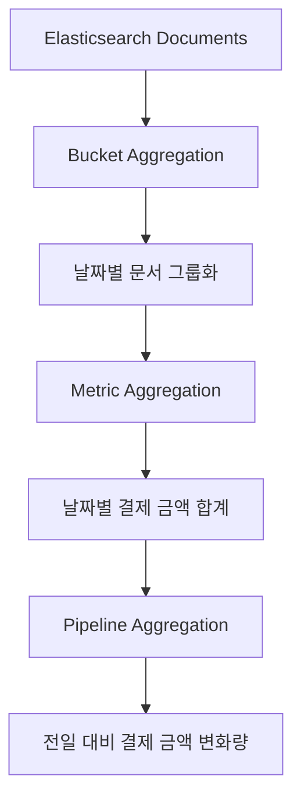
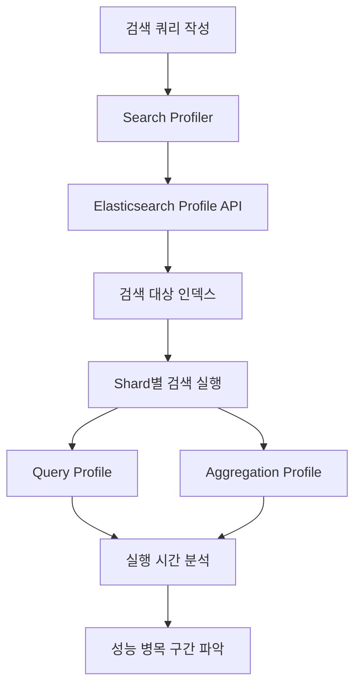
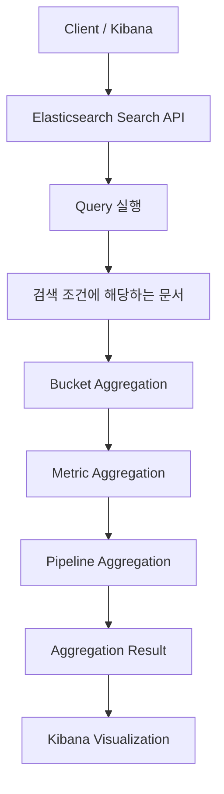
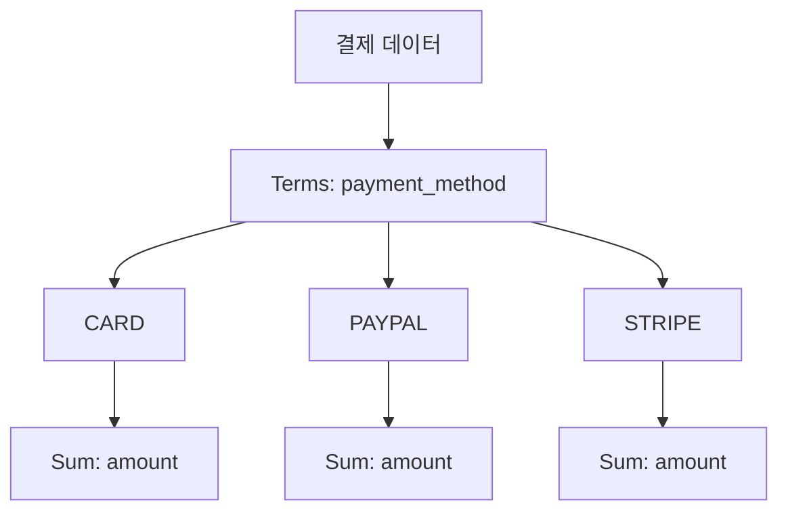
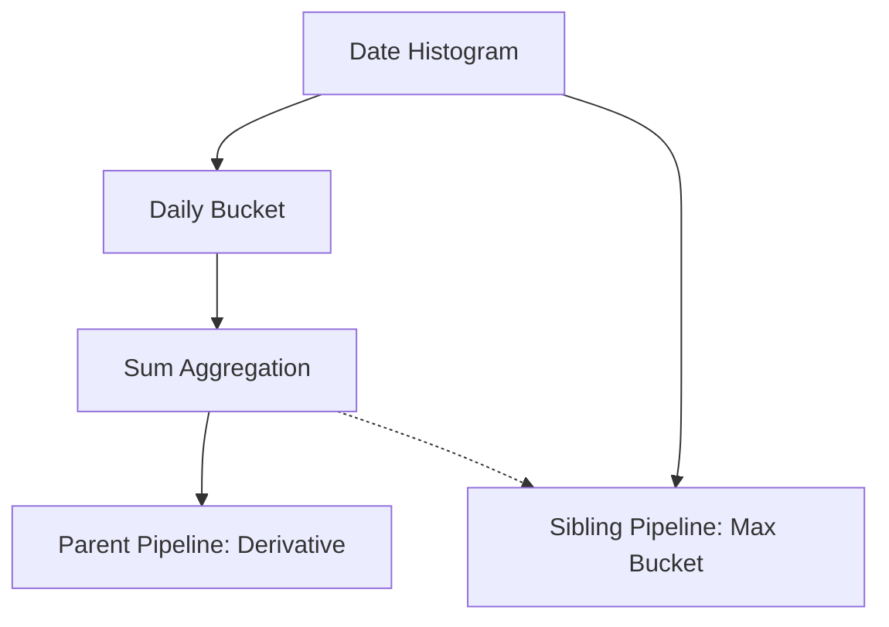
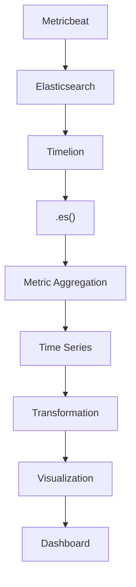

# Kibana 활용

# Kibana 활용
 
* toc
{:toc}

---

### Kibana 활용 - Elasticsearch Aggregation, Timelion, Dev Tools와 Search Profiler

Elasticsearch는 대량의 데이터를 빠르게 검색할 수 있는 분산 검색 엔진입니다.

하지만 실제 서비스에서는 단순히 특정 조건에 해당하는 데이터를 조회하는 것만으로 충분하지 않은 경우가 많습니다.

예를 들어 결제 시스템을 운영한다고 가정하겠습니다.

Elasticsearch에 결제 요청 로그가 수백만 건 저장되어 있다면 다음과 같은 정보를 확인해야 할 수 있습니다.

- 전체 결제 요청 중 성공한 건수는 얼마나 되는가?
- 결제 수단별 평균 결제 금액은 얼마인가?
- 특정 기간에 결제 실패율이 증가했는가?
- 시간별 API 요청량은 어떻게 변화하는가?
- 서버의 CPU 사용률이 급격히 증가하는 구간이 있는가?
- 어떤 검색 쿼리가 Elasticsearch의 성능을 저하시키고 있는가?

이러한 정보를 얻으려면 데이터를 검색하는 것에서 나아가, 여러 문서를 그룹화하고 통계값을 계산하며 시간에 따른 변화를 분석해야 합니다.

Elasticsearch는 이를 위해 **Aggregation(집계)** 기능을 제공합니다.

Kibana는 Elasticsearch의 집계 결과를 차트와 대시보드로 표현하며, Timelion과 같은 시계열 분석 도구를 통해 시간에 따른 데이터 변화를 확인할 수 있도록 지원합니다.

또한 Dev Tools에서는 Elasticsearch REST API를 직접 실행하거나 검색 쿼리의 성능을 분석할 수 있습니다.

이번 글에서는 Aggregation의 동작 원리와 주요 유형을 살펴보고, Kibana의 시계열 분석 및 개발 도구를 실제 예제와 함께 알아보겠습니다.

---

### 개념

#### Aggregation이란?

**Aggregation(집계)은 Elasticsearch에 저장된 문서들을 특정 기준으로 그룹화하거나 통계값을 계산하는 기능입니다.**

일반적인 검색은 조건에 해당하는 문서를 찾아 반환하는 것이 목적입니다.

반면 Aggregation은 검색된 문서들을 대상으로 합계, 평균, 최솟값, 최댓값, 개수, 비율 등의 통계 정보를 생성합니다.

예를 들어 다음과 같은 데이터가 있다고 가정하겠습니다.

| 주문 ID | 사용자 | 결제 금액 | 결제 상태 |
|---|---|---:|---|
| 1 | userA | 10,000 | SUCCESS |
| 2 | userB | 20,000 | SUCCESS |
| 3 | userC | 30,000 | FAILED |
| 4 | userA | 40,000 | SUCCESS |
| 5 | userD | 50,000 | SUCCESS |

일반적인 검색에서는 위 문서들을 개별적으로 조회할 수 있습니다.

그러나 다음과 같은 결과가 필요하다면 Aggregation을 사용해야 합니다.

| 집계 항목 | 결과 |
|---|---:|
| 전체 주문 건수 | 5건 |
| 전체 결제 금액 합계 | 150,000원 |
| 평균 결제 금액 | 30,000원 |
| 최대 결제 금액 | 50,000원 |
| 최소 결제 금액 | 10,000원 |
| 결제 성공 건수 | 4건 |
| 결제 실패 건수 | 1건 |

이러한 통계값은 데이터를 단순히 조회하는 것보다 서비스 상태를 이해하는 데 유용합니다.

다만 위 금액 합계는 성공과 실패를 모두 포함한 원본 데이터의 단순 합계입니다. 실제 매출을 계산하려면 결제 성공 상태와 취소·환불 여부 등을 반영해야 합니다.

#### SQL의 GROUP BY와 Elasticsearch Aggregation

Aggregation은 관계형 데이터베이스의 `GROUP BY`와 비슷한 역할을 수행합니다.

예를 들어 SQL에서 결제 상태별 건수를 확인하려면 다음과 같이 작성할 수 있습니다.

```sql
SELECT
    payment_status,
    COUNT(*) AS payment_count
FROM payments
GROUP BY payment_status;
```

Elasticsearch에서는 `terms` Aggregation으로 비슷한 결과를 얻을 수 있습니다.

```json
GET payments/_search
{
  "size": 0,
  "aggs": {
    "payments_by_status": {
      "terms": {
        "field": "payment_status"
      }
    }
  }
}
```

이 쿼리는 `payment_status` 필드의 고유한 값을 기준으로 문서를 그룹화합니다.

각 그룹에는 해당 조건에 속하는 문서 개수가 `doc_count`로 제공됩니다.

여기서 중요한 점은 Elasticsearch의 Aggregation이 SQL의 `GROUP BY`와 완전히 동일한 구조는 아니라는 것입니다.

Elasticsearch에서는 그룹화뿐 아니라 집계 결과에 대한 추가 집계, 중첩된 집계, 시계열 계산 등 다양한 기능을 지원합니다.

특히 **집계 결과를 다시 계산하는 Pipeline Aggregation**은 복잡한 통계 분석에 유용합니다.

#### Aggregation의 세 가지 주요 유형

Elasticsearch의 Aggregation은 일반적으로 세 가지 유형으로 구분합니다.

| 구분 | 역할 | 대표 기능 |
|---|---|---|
| Metric Aggregation | 숫자 및 통계값 계산 | Avg, Sum, Min, Max, Stats |
| Bucket Aggregation | 특정 기준으로 문서 그룹화 | Terms, Range, Date Histogram |
| Pipeline Aggregation | 다른 집계의 결과를 이용한 추가 계산 | Derivative, Max Bucket, Bucket Script |

각 유형은 서로 다른 역할을 담당합니다.

Metric Aggregation은 문서의 값을 계산합니다.

Bucket Aggregation은 문서를 여러 그룹으로 분류합니다.

Pipeline Aggregation은 이미 계산된 집계 결과를 다시 분석합니다.

예를 들어 날짜별 결제 금액의 증가량을 계산하려면 다음과 같은 과정이 필요합니다.



이처럼 세 가지 Aggregation을 조합하면 단순한 검색을 넘어 복잡한 분석을 수행할 수 있습니다.

---

### 왜 사용하는가?

#### 1. 대량의 데이터를 효율적으로 분석하기 위해

서비스에서 발생하는 모든 데이터를 애플리케이션으로 가져와 직접 집계하는 방식은 비효율적일 수 있습니다.

예를 들어 수백만 건의 결제 로그를 조회하여 Java 애플리케이션에서 평균 결제 금액을 계산한다고 가정하겠습니다.

이 경우 애플리케이션은 대량의 데이터를 전달받아 메모리에 적재하고 계산해야 합니다.

반면 Elasticsearch의 Aggregation을 활용하면 Elasticsearch 내부에서 집계 작업을 수행하고 필요한 결과만 반환받을 수 있습니다.

물론 집계 작업 자체에도 CPU와 메모리 등의 리소스가 필요합니다.

그러나 단순 통계값을 계산하기 위해 모든 원본 문서를 애플리케이션으로 가져오는 것보다 효율적인 구조를 만들 수 있습니다.

#### 2. 데이터를 다양한 기준으로 분류하기 위해

실제 서비스에서는 동일한 데이터를 여러 기준으로 분석해야 합니다.

결제 데이터를 예로 들면 다음과 같은 분석이 가능합니다.

- 날짜별 결제 건수
- 결제 수단별 결제 금액
- 사용자별 결제 건수
- 국가별 결제 성공률
- 결제 금액 구간별 사용자 분포

이러한 분석은 Bucket Aggregation으로 문서를 그룹화한 후 Metric Aggregation으로 통계값을 계산하는 방식으로 구현할 수 있습니다.

#### 3. 시간에 따른 변화와 추세를 파악하기 위해

서비스의 상태는 시간에 따라 변합니다.

예를 들어 API 요청량이 증가하거나 CPU 사용률이 높아지는 현상은 특정 시점의 수치만 확인해서는 정확하게 이해하기 어렵습니다.

시간별 데이터를 분석하면 다음과 같은 정보를 얻을 수 있습니다.

- 특정 시간대의 트래픽 증가
- 배포 이후 API 오류율 변화
- 일별 매출 증가 추세
- 배치 처리 시간 증가
- 서버 CPU와 메모리 사용량 변화

Elasticsearch는 Date Histogram과 Pipeline Aggregation 등을 제공하며, Kibana는 이를 시계열 차트로 표현할 수 있습니다.

#### 4. 검색 성능 문제를 분석하기 위해

Elasticsearch는 대량의 데이터를 분산 처리하지만 모든 쿼리가 항상 빠르게 실행되는 것은 아닙니다.

검색 조건, Mapping, 샤드 구성, 집계 방식 등에 따라 쿼리 실행 비용이 달라집니다.

특히 복잡한 Aggregation은 많은 데이터를 읽거나 여러 버킷을 생성하므로 높은 처리 비용이 발생할 수 있습니다.

이러한 상황에서는 Search Profiler를 통해 검색 쿼리의 실행 구조와 내부 처리 시간을 분석할 수 있습니다.

즉, Aggregation은 데이터를 분석하기 위한 기능이고 Search Profiler는 이러한 분석 과정에서 발생하는 검색 성능 문제를 조사하기 위한 도구입니다.

---

### 주요 특징

#### 1. Metric Aggregation

Metric Aggregation은 문서에 저장된 데이터를 이용해 통계값을 계산하는 기능입니다.

대표적으로 합계, 평균, 최솟값, 최댓값 등을 계산할 수 있습니다.

SQL의 집계 함수와 유사한 개념입니다.

```sql
SELECT AVG(score)
FROM results;
```

Elasticsearch에서는 다음과 같은 형태로 작성할 수 있습니다.

```json
GET results/_search
{
  "size": 0,
  "aggs": {
    "average_score": {
      "avg": {
        "field": "score"
      }
    }
  }
}
```

여기서 `aggs`는 Aggregation을 정의하는 영역입니다.

`average_score`는 사용자가 지정한 집계 이름입니다.

`avg`는 평균을 계산하는 Aggregation 유형이며, `score`는 집계 대상 필드입니다.

또한 `size: 0`은 개별 검색 문서의 반환을 생략하고 집계 결과에 집중하기 위한 설정입니다.

##### Metric Aggregation의 주요 종류

| Aggregation | 설명 |
|---|---|
| Avg | 숫자 필드의 평균값 계산 |
| Sum | 숫자 필드의 합계 계산 |
| Min | 숫자 필드의 최솟값 계산 |
| Max | 숫자 필드의 최댓값 계산 |
| Stats | Count, Min, Max, Avg, Sum 계산 |
| Extended Stats | 분산, 표준편차 등 추가 통계 계산 |
| Cardinality | 고유 값 개수의 근삿값 계산 |
| Value Count | 필드에 존재하는 값의 개수 계산 |
| Percentiles | 특정 백분위수에 해당하는 값 계산 |
| Percentile Ranks | 특정 값 이하의 데이터 비율 추정 |
| Geo Bounds | 지리 좌표 데이터의 경계 범위 계산 |
| Geo Centroid | 지리 좌표 데이터의 중심점 계산 |
| Scripted Metric | 스크립트를 활용한 사용자 정의 집계 |
| Top Hits | 버킷 내 관련성이 높은 문서 반환 |

각 기능의 지원 조건은 Elasticsearch 버전과 데이터 타입에 따라 달라질 수 있습니다.

##### Stats Aggregation

`stats`는 여러 통계값을 한 번에 계산하는 Aggregation입니다.

```json
GET payments/_search
{
  "size": 0,
  "aggs": {
    "payment_statistics": {
      "stats": {
        "field": "amount"
      }
    }
  }
}
```

이 쿼리는 `amount` 필드의 통계값을 계산합니다.

앞서 제시한 다섯 건의 예제 데이터를 사용한다면 결과는 다음과 같습니다.

```json
{
  "aggregations": {
    "payment_statistics": {
      "count": 5,
      "min": 10000.0,
      "max": 50000.0,
      "avg": 30000.0,
      "sum": 150000.0
    }
  }
}
```

위 JSON은 집계 결과의 핵심 영역을 표현한 예시입니다.

실제 Elasticsearch 응답에는 검색 실행 시간과 샤드 처리 상태 등의 정보도 포함됩니다.

##### Extended Stats Aggregation

Extended Stats는 Stats보다 다양한 통계 정보를 제공합니다.

대표적으로 다음과 같은 값을 계산할 수 있습니다.

| 통계값 | 의미 |
|---|---|
| count | 집계 대상 값의 개수 |
| sum | 합계 |
| min | 최솟값 |
| max | 최댓값 |
| avg | 평균 |
| sum_of_squares | 각 값의 제곱합 |
| variance | 분산 |
| std_deviation | 표준편차 |
| std_deviation_bounds | 표준편차 기반 범위 |

예를 들어 API 응답 시간의 평균값만 확인하는 것보다 표준편차를 함께 확인하면 응답 시간의 변동성을 파악하는 데 도움이 됩니다.

평균 응답 시간이 동일한 두 서비스라도 특정 서비스의 표준편차가 크다면 요청마다 응답 시간의 편차가 크다는 의미일 수 있습니다.

##### Cardinality Aggregation

Cardinality는 특정 필드의 고유 값 개수를 계산하는 기능입니다.

예를 들어 결제 요청 로그에서 실제로 몇 명의 사용자가 결제를 시도했는지 확인할 때 활용할 수 있습니다.

```json
GET payments/_search
{
  "size": 0,
  "aggs": {
    "unique_users": {
      "cardinality": {
        "field": "user_id"
      }
    }
  }
}
```

여기서 주의할 점은 **Cardinality가 기본적으로 고유 값 개수의 근삿값을 계산한다는 사실**입니다.

Elasticsearch는 HyperLogLog++ 기반의 알고리즘을 활용하여 메모리 사용량과 정확도 사이의 균형을 조절합니다.

정확도를 조정하기 위해 `precision_threshold` 옵션을 사용할 수 있습니다.

```json
GET payments/_search
{
  "size": 0,
  "aggs": {
    "unique_users": {
      "cardinality": {
        "field": "user_id",
        "precision_threshold": 10000
      }
    }
  }
}
```

`precision_threshold`는 정확도를 조절하기 위한 기준값이며, 반드시 해당 개수까지 정확한 결과를 보장한다는 의미는 아닙니다.

또한 값을 높이면 메모리 사용량이 증가할 수 있습니다.

고유 사용자 수나 고유 상품 수처럼 대략적인 규모를 파악하는 경우에는 유용하지만, 금융 정산처럼 정확한 건수가 필요한 경우에는 근삿값의 사용 여부를 신중하게 판단해야 합니다.

---

#### 2. Bucket Aggregation

Bucket Aggregation은 특정 조건을 기준으로 문서를 여러 그룹으로 나누는 기능입니다.

여기서 Bucket은 동일한 조건에 해당하는 문서들의 집합을 의미합니다.

예를 들어 결제 데이터를 결제 수단별로 분류한다고 가정하겠습니다.

| 결제 ID | 결제 수단 | 결제 금액 |
|---|---|---:|
| 1 | CARD | 10,000 |
| 2 | CARD | 20,000 |
| 3 | PAYPAL | 30,000 |
| 4 | STRIPE | 40,000 |
| 5 | PAYPAL | 50,000 |

결제 수단을 기준으로 그룹화하면 다음과 같은 Bucket이 생성됩니다.

```text
전체 결제 문서
│
├── CARD
│   ├── 결제 1
│   └── 결제 2
│
├── PAYPAL
│   ├── 결제 3
│   └── 결제 5
│
└── STRIPE
    └── 결제 4
```

각 Bucket은 자신에게 속한 문서의 개수를 가지고 있습니다.

또한 Bucket 내부에 Metric Aggregation을 정의하면 그룹별 평균이나 합계를 계산할 수도 있습니다.

##### Bucket Aggregation의 주요 종류

| Aggregation | 설명 |
|---|---|
| Terms | 필드의 고유 값별로 문서 그룹화 |
| Range | 숫자 값의 범위별로 문서 그룹화 |
| Histogram | 일정한 숫자 간격으로 문서 그룹화 |
| Date Histogram | 날짜 또는 시간 간격으로 문서 그룹화 |
| Date Range | 지정한 날짜 범위별로 문서 그룹화 |
| Filter | 하나의 검색 조건에 해당하는 문서 그룹화 |
| Filters | 여러 검색 조건별로 문서 그룹화 |
| Missing | 특정 필드가 존재하지 않는 문서 그룹화 |
| Nested | 중첩 객체의 문서를 대상으로 집계 |
| Reverse Nested | 중첩 집계에서 상위 문서로 이동 |
| Geo Distance | 특정 위치에서의 거리별 집계 |
| Geohash Grid | 지리 좌표를 격자 단위로 그룹화 |
| Significant Terms | 통계적으로 특징적인 값 탐색 |

다음에서는 Range와 Terms를 중심으로 살펴보겠습니다.

##### Range Aggregation

Range Aggregation은 숫자 필드의 값을 특정 범위로 분리합니다.

예를 들어 사용자 계좌의 `balance` 필드를 기준으로 잔액 구간별 사용자 분포를 확인할 수 있습니다.

Kibana에서 Range 기반 원형 차트를 구성한다면 다음과 같이 설정할 수 있습니다.

| 설정 | 값 |
|---|---|
| Metrics | Slice Size |
| Aggregation | Count |
| Buckets | Split Slices |
| Aggregation | Range |
| Field | balance |

잔액 구간은 다음과 같이 정의할 수 있습니다.

| 구간 | 시작값 | 종료값 |
|---|---:|---:|
| 1 | 0 | 999 |
| 2 | 1,000 | 2,999 |
| 3 | 3,000 | 6,999 |
| 4 | 7,000 | 14,999 |
| 5 | 15,000 | 30,999 |
| 6 | 31,000 | 50,000 |

이때 `Count`는 각 구간에 속하는 문서의 개수를 의미합니다.

`Range`는 문서를 구분하는 기준을 정의합니다.

따라서 원형 차트의 각 조각은 잔액 구간을 나타내고, 조각의 크기는 해당 구간에 속하는 문서 수에 따라 결정됩니다.

다만 Elasticsearch의 Range Aggregation에서 경계값을 해석할 때는 주의해야 합니다.

**Range Aggregation은 `from` 값을 포함하고 `to` 값은 포함하지 않습니다.**

따라서 정수형 잔액 데이터에서 0부터 999까지를 포함하려면 `from: 0`, `to: 1000`으로 정의해야 합니다.

이에 따라 실제 쿼리는 다음과 같이 작성할 수 있습니다.

```json
GET accounts/_search
{
  "size": 0,
  "aggs": {
    "balance_ranges": {
      "range": {
        "field": "balance",
        "ranges": [
          {
            "key": "0-999",
            "from": 0,
            "to": 1000
          },
          {
            "key": "1000-2999",
            "from": 1000,
            "to": 3000
          },
          {
            "key": "3000-6999",
            "from": 3000,
            "to": 7000
          },
          {
            "key": "7000-14999",
            "from": 7000,
            "to": 15000
          },
          {
            "key": "15000-30999",
            "from": 15000,
            "to": 31000
          },
          {
            "key": "31000-50000",
            "from": 31000,
            "to": 50001
          }
        ]
      }
    }
  }
}
```

위 예제는 `balance`가 정수라는 전제에서 작성되었습니다.

소수점이 존재할 수 있다면 단순히 종료값에 1을 더하는 방식이 적절하지 않을 수 있으므로 구간 설계를 다시 검토해야 합니다.

또한 지정된 범위 밖에 존재하는 문서는 위 여섯 개의 Bucket에 포함되지 않습니다.

Range Aggregation을 활용하면 사용자 자산 분포뿐 아니라 주문 금액 구간, API 응답 시간 구간, 상품 가격 구간 등 다양한 데이터를 분석할 수 있습니다.

##### Terms Aggregation

Terms Aggregation은 특정 필드의 고유 값을 기준으로 문서를 그룹화합니다.

예를 들어 연극 작품 이름을 의미하는 `play_name` 필드가 있다고 가정하겠습니다.

Kibana의 막대 차트에서는 다음과 같은 설정을 사용할 수 있습니다.

| 설정 | 값 |
|---|---|
| Buckets | Aggregation |
| Aggregation | Terms |
| Field | play_name |
| Order By | Metric: Speaking Parts |
| Order | Ascending |
| Size | 5 |
| Custom Label | Play Name |

이 설정은 `play_name`을 기준으로 데이터를 그룹화한 뒤, `Speaking Parts`라는 메트릭을 기준으로 오름차순 정렬하고 최대 5개 항목을 표시하는 구조입니다.

여기서 `Speaking Parts`는 정렬에 사용되는 메트릭의 이름입니다.

실제 어떤 필드를 어떤 방식으로 집계했는지에 따라 값의 의미가 달라지므로, 단순히 작품별 문서 개수와 동일하다고 가정해서는 안 됩니다.

예를 들어 각 작품의 발화 부분 개수가 `speaking_parts`라는 숫자 필드에 저장되어 있고, 합계를 계산한다고 가정하면 다음과 같은 쿼리를 작성할 수 있습니다.

```json
GET plays/_search
{
  "size": 0,
  "aggs": {
    "plays_by_name": {
      "terms": {
        "field": "play_name",
        "size": 5,
        "order": {
          "speaking_parts_total": "asc"
        }
      },
      "aggs": {
        "speaking_parts_total": {
          "sum": {
            "field": "speaking_parts"
          }
        }
      }
    }
  }
}
```

이 쿼리는 다음 순서로 동작합니다.

1. `play_name` 기준으로 문서를 그룹화합니다.
2. 각 작품에 속한 `speaking_parts` 값을 합산합니다.
3. 합계가 작은 작품부터 오름차순으로 정렬합니다.
4. 정렬 결과에서 최대 5개의 Bucket을 반환합니다.

여기서 `order`에 사용한 `speaking_parts_total`은 내부에 정의한 Metric Aggregation의 이름입니다.

이러한 방식으로 Terms와 Metric Aggregation을 함께 활용하면 그룹별 통계값을 기준으로 정렬할 수 있습니다.

단, 분산 환경에서 Terms Aggregation의 후보 Bucket 수가 제한되므로 일부 정렬 방식에서는 상위 또는 하위 Bucket 선정 결과가 부정확할 수 있습니다.

특히 문서 수 기준 오름차순 정렬이나 일부 하위 집계값 기반 정렬은 주의가 필요합니다.

정확한 전체 그룹 분석이 필요하다면 데이터의 Cardinality와 집계 방식에 따라 Composite Aggregation 등의 대안을 검토해야 합니다.

---

#### 3. Pipeline Aggregation

Pipeline Aggregation은 다른 Aggregation에서 계산된 결과를 입력값으로 사용하여 추가적인 계산을 수행하는 기능입니다.

일반적인 Metric Aggregation이 원본 문서의 값을 계산한다면 Pipeline Aggregation은 이미 집계된 결과를 대상으로 계산합니다.

예를 들어 날짜별 매출이 다음과 같다고 가정하겠습니다.

| 날짜 | 매출 |
|---|---:|
| 11월 24일 | 100,000 |
| 11월 25일 | 150,000 |
| 11월 26일 | 120,000 |
| 11월 27일 | 200,000 |

이 데이터로 날짜별 매출을 확인하는 작업은 Date Histogram과 Sum Aggregation을 조합하면 됩니다.

하지만 전일 대비 매출 증가량을 계산하려면 추가적인 연산이 필요합니다.

| 날짜 | 매출 | 전일 대비 변화량 |
|---|---:|---:|
| 11월 24일 | 100,000 | - |
| 11월 25일 | 150,000 | +50,000 |
| 11월 26일 | 120,000 | -30,000 |
| 11월 27일 | 200,000 | +80,000 |

이러한 계산에 Pipeline Aggregation을 활용할 수 있습니다.

##### Parent Pipeline Aggregation

Parent Pipeline Aggregation은 부모 Bucket 안에서 계산된 결과를 이용합니다.

대표적인 기능은 다음과 같습니다.

| Aggregation | 역할 |
|---|---|
| Derivative | 이전 Bucket과 현재 Bucket의 값 차이 계산 |
| Cumulative Sum | Bucket 값의 누적 합계 계산 |
| Moving Function | 이동 평균 등 이동 구간 기반 계산 |
| Bucket Script | 다른 집계값을 이용한 사용자 정의 계산 |
| Bucket Selector | 계산 조건을 만족하는 Bucket만 결과에 유지 |
| Serial Differencing | 지정한 간격의 이전 값과 차이 계산 |

예를 들어 날짜별 매출 증가량은 `derivative`를 활용할 수 있습니다.

```json
GET orders/_search
{
  "size": 0,
  "aggs": {
    "daily_sales": {
      "date_histogram": {
        "field": "@timestamp",
        "calendar_interval": "day"
      },
      "aggs": {
        "total_amount": {
          "sum": {
            "field": "amount"
          }
        },
        "sales_change": {
          "derivative": {
            "buckets_path": "total_amount"
          }
        }
      }
    }
  }
}
```

여기서 `daily_sales`는 날짜별 Bucket Aggregation입니다.

`total_amount`는 각 날짜에 속한 문서의 결제 금액을 합산합니다.

`sales_change`는 이전 날짜의 `total_amount`와 현재 날짜의 값을 비교하여 변화량을 계산합니다.

중요한 부분은 다음과 같습니다.

```json
"buckets_path": "total_amount"
```

`buckets_path`는 Pipeline Aggregation이 어떤 집계 결과를 참조할지 지정하는 옵션입니다.

이 예제에서는 동일한 날짜 Bucket 안에 정의된 `total_amount`를 참조합니다.

첫 번째 날짜는 이전 Bucket이 존재하지 않으므로 일반적으로 변화량을 계산할 수 없습니다.

또한 날짜별 데이터가 누락되어 있는 경우에는 빈 Bucket 처리와 `gap_policy` 등의 설정에 따라 결과가 달라질 수 있습니다.

##### Sibling Pipeline Aggregation

Sibling Pipeline Aggregation은 같은 수준에 정의된 다른 Bucket Aggregation의 결과를 이용합니다.

대표적인 기능은 다음과 같습니다.

| Aggregation | 역할 |
|---|---|
| Avg Bucket | 여러 Bucket의 메트릭 평균 |
| Max Bucket | 여러 Bucket 중 최대 메트릭값 |
| Min Bucket | 여러 Bucket 중 최소 메트릭값 |
| Sum Bucket | 여러 Bucket의 메트릭 합계 |
| Stats Bucket | Bucket 메트릭에 대한 통계 계산 |
| Extended Stats Bucket | Bucket 메트릭에 대한 확장 통계 |

예를 들어 날짜별 매출 중 가장 높은 매출을 기록한 날짜를 찾으려면 다음과 같이 작성할 수 있습니다.

```json
GET orders/_search
{
  "size": 0,
  "aggs": {
    "daily_sales": {
      "date_histogram": {
        "field": "@timestamp",
        "calendar_interval": "day"
      },
      "aggs": {
        "total_amount": {
          "sum": {
            "field": "amount"
          }
        }
      }
    },
    "highest_sales": {
      "max_bucket": {
        "buckets_path": "daily_sales>total_amount"
      }
    }
  }
}
```

이 쿼리는 날짜별 매출을 계산한 후 가장 높은 매출을 기록한 Bucket을 찾습니다.

여기서 중요한 부분은 다음과 같습니다.

```json
"buckets_path": "daily_sales>total_amount"
```

`daily_sales`는 상위 Bucket Aggregation입니다.

`total_amount`는 해당 Bucket 내부에 정의된 Metric Aggregation입니다.

두 집계 이름은 `>` 기호로 연결됩니다.

##### buckets_path의 동작 원리

Pipeline Aggregation에서 `buckets_path`는 집계 결과의 참조 경로를 정의합니다.

다음 구조를 살펴보겠습니다.

```text
aggregations
│
├── daily_sales
│   │
│   ├── 2026-11-24
│   │   └── total_amount
│   │
│   ├── 2026-11-25
│   │   └── total_amount
│   │
│   └── 2026-11-26
│       └── total_amount
│
└── highest_sales
    └── daily_sales>total_amount
```

`highest_sales`는 `daily_sales`의 각 Bucket에 있는 `total_amount` 값을 비교합니다.

따라서 집계 경로를 정확히 작성해야 합니다.

상위 Bucket 이름이나 내부 Metric 이름이 잘못되면 Elasticsearch가 참조할 대상을 찾지 못할 수 있습니다.

##### Parent와 Sibling의 차이

| 구분 | Parent Pipeline | Sibling Pipeline |
|---|---|---|
| 참조 대상 | 부모 Bucket 내부의 집계 결과 | 같은 수준에 있는 다른 집계 결과 |
| 결과 위치 | 부모 Bucket 내부 | 참조 대상 Bucket 집계와 같은 수준 |
| 대표 기능 | Derivative, Cumulative Sum | Max Bucket, Avg Bucket |
| 활용 예시 | 일별 매출 변화량 | 일별 매출 중 최대값 |

두 유형 모두 기존 집계 결과를 사용하지만 결과가 생성되는 위치가 다릅니다.

이 차이를 이해하면 복잡한 중첩 집계 구조를 작성할 때 도움이 됩니다.

##### Moving Average와 Moving Function

과거 Elasticsearch에서는 이동 평균을 계산하기 위해 `moving_avg` Aggregation을 사용했습니다.

하지만 현재 Elasticsearch에서는 `moving_avg` 대신 `moving_fn`을 사용합니다.

`moving_fn`은 지정한 구간의 집계 결과에 함수를 적용합니다.

예를 들어 날짜별 매출에 대해 최근 3개 Bucket의 이동 평균을 계산하려면 다음과 같이 작성할 수 있습니다.

```json
GET orders/_search
{
  "size": 0,
  "aggs": {
    "daily_sales": {
      "date_histogram": {
        "field": "@timestamp",
        "calendar_interval": "day"
      },
      "aggs": {
        "total_amount": {
          "sum": {
            "field": "amount"
          }
        },
        "moving_average": {
          "moving_fn": {
            "buckets_path": "total_amount",
            "window": 3,
            "script": "MovingFunctions.unweightedAvg(values)"
          }
        }
      }
    }
  }
}
```

`window: 3`은 이동 계산에 사용할 Bucket의 개수를 지정합니다.

`MovingFunctions.unweightedAvg(values)`는 해당 구간 값의 단순 평균을 계산합니다.

여기서 `window`는 문서 개수가 아니라 Bucket 개수를 기준으로 동작합니다.

또한 현재 Bucket을 포함하는 일반적인 SQL 윈도 함수와 동일하게 해석해서는 안 됩니다. `moving_fn`의 이동 구간과 `shift` 등의 동작을 함께 고려해야 합니다.

현재 공식 문서에서도 `moving_fn` 사용을 안내하고 있습니다.

---

#### 4. Timelion

Timelion은 Kibana에서 시계열 데이터를 분석하고 시각화하기 위한 도구입니다.

이름은 Time과 Lion을 결합한 것으로, 시간에 따른 데이터 변화를 표현하는 기능을 제공합니다.

Timelion은 특정 시점에 발생한 값의 변화뿐 아니라 여러 시계열 데이터를 결합하여 비교할 수 있다는 특징이 있습니다.

예를 들어 다음과 같은 분석이 가능합니다.

- 서버 CPU 사용률 변화
- 메모리 사용량 변화
- 네트워크 트래픽 변화
- 시간별 API 요청량
- 전일 대비 트래픽 비교
- 서로 다른 인덱스의 시계열 데이터 비교

현재 Kibana에서는 Timelion을 **Legacy Editor**로 분류합니다.

따라서 신규 시각화를 구성할 때는 Lens 등의 현대적인 편집기를 우선적으로 고려하는 것이 좋습니다.

다만 기존 운영 환경에 Timelion 기반 Dashboard가 존재하거나, 여러 시계열을 함수 형태로 조합해야 한다면 Timelion의 동작 원리를 이해할 필요가 있습니다.

##### Timelion의 주요 특징

Timelion은 별도의 표현식 언어를 사용합니다.

데이터를 조회하고, 변환하고, 시각화하는 과정을 함수 형태로 연결합니다.

기본적인 함수는 다음과 같습니다.

```text
.es()
```

`.es()`는 Elasticsearch에서 시계열 데이터를 조회하는 함수입니다.

전체 이름을 사용하면 다음과 같이 작성할 수도 있습니다.

```text
.elasticsearch()
```

두 함수는 동일한 Elasticsearch 데이터 소스 기능을 의미합니다.

Timelion의 함수는 일반적으로 점(`.`)으로 시작합니다.

또한 함수 내부에 전달하는 매개변수를 이용하여 검색할 인덱스, 시간 필드, 집계 방식 등을 지정할 수 있습니다.

##### Metricbeat를 활용한 CPU 사용률 분석

Metricbeat는 시스템 및 서비스의 메트릭을 수집하기 위한 Elastic의 경량 에이전트입니다.

예를 들어 서버의 CPU 사용률과 메모리 사용량 등을 Elasticsearch에 저장할 수 있습니다.

Metricbeat 데이터가 `metricbeat-*` 패턴에 해당하는 인덱스에 저장되어 있다고 가정하겠습니다.

CPU 사용률을 시계열로 표시하려면 다음과 같은 Timelion 표현식을 사용할 수 있습니다.

```text
.es(index=metricbeat-*, timefield='@timestamp', metric='avg:system.cpu.user.pct')
```

각 요소의 의미는 다음과 같습니다.

| 요소 | 설명 |
|---|---|
| `.es()` | Elasticsearch 데이터 조회 |
| `index` | 조회할 인덱스 패턴 |
| `metricbeat-*` | Metricbeat 데이터가 저장된 인덱스 패턴 |
| `timefield` | 시계열 분석에 사용할 시간 필드 |
| `@timestamp` | 이벤트 발생 시간 |
| `metric` | 집계 방식과 대상 필드 |
| `avg` | 평균값 계산 |
| `system.cpu.user.pct` | CPU User 영역 사용률 필드 |

이 표현식은 일정 시간 간격에 따라 CPU User 사용률의 평균을 계산하고 시계열 차트로 표시합니다.

예를 들어 조회 범위를 최근 1시간으로 설정하면 해당 시간 범위의 CPU 사용률 변화를 확인할 수 있습니다.

단, `system.cpu.user.pct`의 값은 일반적으로 0부터 1 사이의 비율로 표현됩니다.

따라서 백분율로 표시하려면 시각화 설정이나 계산식을 통해 단위를 변환해야 합니다.

또한 실제 필드의 존재 여부와 값의 의미는 Metricbeat 버전 및 수집 설정에 따라 확인해야 합니다.

##### 여러 시계열 비교

Timelion은 여러 표현식을 쉼표로 구분하여 하나의 차트에 표시할 수 있습니다.

예를 들어 현재 CPU 사용률과 1시간 전 CPU 사용률을 비교할 수 있습니다.

```text
.es(index=metricbeat-*, timefield='@timestamp', metric='avg:system.cpu.user.pct').label('Current CPU'),
.es(index=metricbeat-*, timefield='@timestamp', metric='avg:system.cpu.user.pct', offset=-1h).label('Previous CPU')
```

여기서 `offset=-1h`는 시계열을 1시간 이전으로 이동시켜 비교하는 옵션입니다.

이렇게 하면 현재 시점의 CPU 사용률과 이전 시간대의 CPU 사용률을 동일한 차트에서 비교할 수 있습니다.

##### 네트워크 트래픽 분석

Metricbeat에는 네트워크 트래픽과 관련된 필드도 존재합니다.

대표적으로 다음과 같은 필드를 활용할 수 있습니다.

| 필드 | 설명 |
|---|---|
| `system.network.in.bytes` | 수신된 누적 바이트 수 |
| `system.network.out.bytes` | 송신된 누적 바이트 수 |

이 값은 일반적으로 누적 Counter 성격의 메트릭이므로 단순히 평균을 계산하는 것만으로 초당 네트워크 트래픽을 정확히 표현하기 어렵습니다.

시간에 따른 증가량을 계산해야 합니다.

Timelion에서는 다음과 같은 함수들을 활용할 수 있습니다.

| 함수 | 역할 |
|---|---|
| `.es()` | Elasticsearch 데이터 조회 |
| `.derivative()` | 이전 시점과의 차이 계산 |
| `.divide()` | 값을 특정 수로 나누기 |
| `.multiply()` | 값을 특정 수로 곱하기 |
| `.lines()` | 선형 차트 표현 |
| `.color()` | 차트 색상 설정 |
| `.label()` | 시계열 이름 지정 |
| `.title()` | 차트 제목 지정 |
| `.legend()` | 범례 설정 |

예를 들어 누적 바이트 수의 증가량을 확인하려면 다음과 같이 표현할 수 있습니다.

```text
.es(index=metricbeat-*, timefield='@timestamp', metric='max:system.network.in.bytes').derivative().label('Inbound bytes per bucket')
```

이 표현식은 각 시간 Bucket 간 누적 수신 바이트 수의 차이를 계산하는 예시입니다.

단, 결과는 Bucket 간 증가량이지 자동으로 초당 전송률이 되는 것은 아닙니다.

초당 전송률을 계산하려면 시간 간격을 고려해야 합니다.

또한 네트워크 인터페이스별 Counter가 재설정되거나 서버가 재시작되는 경우에는 음수 값 또는 비정상적인 증가량이 발생할 수 있으므로 이에 대한 처리도 필요합니다.

##### Timelion과 Dashboard

Timelion으로 만든 시각화는 저장하여 Dashboard에서 활용할 수 있습니다.

기존 Timelion 환경에서는 전체 Timelion Sheet를 저장하거나 현재 표현식을 Dashboard 패널로 저장하는 방식을 제공했습니다.

예를 들어 다음과 같은 항목을 하나의 Dashboard에서 확인할 수 있습니다.

| 차트 | 분석 내용 |
|---|---|
| CPU usage over time | 시간별 CPU 사용률 |
| Network traffic | 네트워크 송수신량 변화 |
| Memory consumption over time | 메모리 사용량 변화 |

현재 Kibana에서는 저장된 Timelion 시각화를 Visualize Library를 통해 Dashboard에 추가하는 방식으로 사용할 수 있습니다.

기존의 독립적인 Timelion 메뉴와 현재의 Legacy Editor 접근 방식은 다를 수 있으므로 사용하는 Kibana 버전에 맞는 메뉴를 확인해야 합니다.

---

#### 5. Dev Tools

Dev Tools는 Kibana에서 Elasticsearch 관련 개발 및 분석 작업을 수행할 수 있도록 제공하는 도구입니다.

대표적으로 다음과 같은 기능이 있습니다.

| 도구 | 역할 |
|---|---|
| Console | Elasticsearch REST API 실행 |
| Search Profiler | 검색 쿼리 성능 분석 |
| Grok Debugger | Grok 패턴 테스트 |

실제 제공되는 기능은 Kibana 버전과 사용 환경에 따라 달라질 수 있습니다.

##### Console

Console은 Elasticsearch REST API를 직접 호출할 수 있는 인터페이스입니다.

일반적으로 화면 왼쪽에서 HTTP 요청을 작성하고, 오른쪽에서 응답 결과를 확인합니다.

예를 들어 전체 문서를 검색하는 요청은 다음과 같습니다.

```json
GET /_search
{
  "query": {
    "match_all": {}
  }
}
```

`match_all`은 검색 조건에 제한을 두지 않고 모든 문서를 검색 대상으로 지정하는 쿼리입니다.

여기서 `GET /_search`는 여러 인덱스를 검색할 수 있으므로, 실제 운영 환경에서는 대상 인덱스를 명확하게 지정하는 것이 좋습니다.

예를 들어 결제 인덱스만 조회하려면 다음과 같이 작성할 수 있습니다.

```json
GET payments/_search
{
  "query": {
    "match_all": {}
  }
}
```

Console은 다음과 같은 HTTP 메서드를 지원합니다.

| HTTP 메서드 | 주요 목적 |
|---|---|
| GET | 데이터 및 상태 조회 |
| POST | 데이터 생성, 검색, 작업 실행 |
| PUT | 데이터 생성 또는 수정 |
| DELETE | 데이터 및 리소스 삭제 |

Elasticsearch의 API는 REST 방식으로 제공되므로 각 리소스에 대해 적절한 HTTP 메서드를 사용할 수 있습니다.

##### Console의 주요 편의 기능

Console은 단순한 API 호출 외에도 다양한 편의 기능을 제공합니다.

대표적으로 다음과 같은 기능이 있습니다.

- 요청 자동완성
- JSON 형식 자동 정렬
- API 문서 확인
- 요청 실행 및 응답 확인
- 이전 요청 기록 확인
- 요청을 cURL 형식으로 복사

특히 `Copy as cURL` 기능은 Console에서 작성한 요청을 터미널 환경에서 실행할 때 유용합니다.

다만 Console에서 복사한 요청을 외부 환경에서 실행하려면 인증 정보나 Elasticsearch 주소 등을 환경에 맞게 설정해야 합니다.

---

#### 6. Search Profiler

Search Profiler는 Elasticsearch 검색 쿼리의 실행 구조와 성능을 분석하는 도구입니다.

Elasticsearch는 검색 요청을 처리할 때 여러 단계의 내부 작업을 수행합니다.

예를 들어 검색 조건을 평가하고, 인덱스의 각 샤드에서 데이터를 조회하며, 필요한 결과를 집계합니다.

이 과정에서 특정 작업이 많은 시간을 소비한다면 전체 검색 성능이 저하될 수 있습니다.

Search Profiler는 이러한 내부 실행 정보를 분석하여 어느 부분에서 시간이 소요되는지 확인할 수 있도록 도와줍니다.

##### Search Profiler의 주요 기능

Search Profiler에서는 다음과 같은 정보를 확인할 수 있습니다.

| 항목 | 설명 |
|---|---|
| Index | 검색 대상 인덱스 |
| Shard | 검색이 수행된 샤드 |
| Query Profile | 검색 쿼리 실행 분석 |
| Aggregation Profile | 집계 작업 실행 분석 |
| Cumulative Time | 샤드별 실행 시간의 누적값 |
| Self Time | 해당 쿼리 구성 요소 자체의 실행 시간 |
| Total Time | 해당 요소와 하위 요소의 실행 시간 |
| View Details | 상세 실행 정보 확인 |

여기서 중요한 것은 Cumulative Time과 실제 API 응답 시간을 동일하게 해석해서는 안 된다는 점입니다.

Elasticsearch는 여러 샤드에서 검색 작업을 병렬로 수행할 수 있습니다.

따라서 각 샤드의 실행 시간을 모두 합한 값은 사용자가 체감하는 전체 요청 시간과 다를 수 있습니다.

또한 Search Profiler는 내부 실행 정보를 수집하기 때문에 일반 검색보다 추가적인 오버헤드가 발생합니다.

따라서 Profile 결과를 실제 운영 환경의 API 응답 시간과 직접 비교해서는 안 됩니다.

##### Search Profiler의 실행 흐름



검색 쿼리가 실행되면 Elasticsearch는 쿼리 구성 요소별 실행 정보를 수집합니다.

Search Profiler는 이러한 결과를 시각화하여 분석하기 쉽게 표시합니다.

---

### 예제

이번에는 Elasticsearch의 Aggregation을 직접 실행하고, Pipeline Aggregation과 Search Profiler까지 연결하는 과정을 살펴보겠습니다.

다음 예제는 설명을 위해 새롭게 구성한 데이터입니다.

Elasticsearch 8.x 및 9.x에서 사용하는 주요 Query DSL 문법을 기준으로 작성했으며, 실제 서버에서 실행한 결과가 아니라 입력 데이터로부터 예상되는 결과를 설명합니다.

#### 1. 테스트 인덱스 생성

먼저 결제 데이터를 저장할 인덱스를 생성하겠습니다.

```json
PUT kibana-practice-payments
{
  "mappings": {
    "properties": {
      "@timestamp": {
        "type": "date"
      },
      "payment_id": {
        "type": "keyword"
      },
      "user_id": {
        "type": "keyword"
      },
      "payment_method": {
        "type": "keyword"
      },
      "payment_status": {
        "type": "keyword"
      },
      "amount": {
        "type": "long"
      }
    }
  }
}
```

각 필드는 다음과 같은 의미를 가집니다.

| 필드 | 데이터 타입 | 설명 |
|---|---|---|
| @timestamp | date | 결제 발생 시간 |
| payment_id | keyword | 결제 식별자 |
| user_id | keyword | 사용자 식별자 |
| payment_method | keyword | 결제 수단 |
| payment_status | keyword | 결제 상태 |
| amount | long | 결제 금액 |

결제 수단과 결제 상태를 `keyword` 타입으로 설정한 이유는 정확한 값에 대한 필터링과 그룹별 집계를 수행하기 위해서입니다.

#### 2. 테스트 데이터 저장

이제 결제 데이터를 저장하겠습니다.

```json
POST kibana-practice-payments/_bulk?refresh=true
{"index":{"_id":"1"}}
{"@timestamp":"2026-11-24T09:00:00Z","payment_id":"P001","user_id":"userA","payment_method":"CARD","payment_status":"SUCCESS","amount":10000}
{"index":{"_id":"2"}}
{"@timestamp":"2026-11-24T10:00:00Z","payment_id":"P002","user_id":"userB","payment_method":"PAYPAL","payment_status":"SUCCESS","amount":20000}
{"index":{"_id":"3"}}
{"@timestamp":"2026-11-25T09:00:00Z","payment_id":"P003","user_id":"userA","payment_method":"CARD","payment_status":"SUCCESS","amount":30000}
{"index":{"_id":"4"}}
{"@timestamp":"2026-11-25T11:00:00Z","payment_id":"P004","user_id":"userC","payment_method":"STRIPE","payment_status":"FAILED","amount":40000}
{"index":{"_id":"5"}}
{"@timestamp":"2026-11-26T09:00:00Z","payment_id":"P005","user_id":"userD","payment_method":"PAYPAL","payment_status":"SUCCESS","amount":50000}
{"index":{"_id":"6"}}
{"@timestamp":"2026-11-26T12:00:00Z","payment_id":"P006","user_id":"userE","payment_method":"CARD","payment_status":"SUCCESS","amount":60000}
```

총 6건의 데이터를 저장했습니다.

`_bulk` API는 여러 문서를 하나의 요청으로 처리하는 기능입니다.

각 문서는 작업 정보를 나타내는 줄과 실제 데이터 줄로 구성됩니다.

따라서 각 JSON 객체는 한 줄에 작성해야 하며, 실제 Bulk API 요청 본문은 마지막 줄바꿈을 포함하는 NDJSON 형식이어야 합니다.

`refresh=true`는 요청 완료 후 검색에서 변경 사항을 확인할 수 있도록 Refresh를 수행하는 옵션입니다.

실제 운영 환경에서 모든 요청에 무조건 적용하면 성능에 영향을 줄 수 있으므로 테스트 용도로 사용하는 것이 적절합니다.

#### 3. 전체 결제 통계 계산

먼저 Metric Aggregation을 이용해 결제 금액의 통계값을 확인하겠습니다.

```json
GET kibana-practice-payments/_search
{
  "size": 0,
  "aggs": {
    "payment_statistics": {
      "stats": {
        "field": "amount"
      }
    }
  }
}
```

위에서 저장한 6건의 문서를 기준으로 다음과 같은 결과를 예상할 수 있습니다.

```json
{
  "count": 6,
  "min": 10000.0,
  "max": 60000.0,
  "avg": 35000.0,
  "sum": 210000.0
}
```

이 값은 성공과 실패를 포함한 전체 결제 시도 금액을 기준으로 계산한 결과입니다.

실제 결제 성공 금액만 집계하려면 결제 상태를 필터링해야 합니다.

```json
GET kibana-practice-payments/_search
{
  "size": 0,
  "query": {
    "term": {
      "payment_status": "SUCCESS"
    }
  },
  "aggs": {
    "successful_payment_statistics": {
      "stats": {
        "field": "amount"
      }
    }
  }
}
```

이렇게 하면 `payment_status`가 `SUCCESS`인 문서만 대상으로 통계값을 계산합니다.

예제 데이터의 성공 결제 금액 합계는 170,000입니다.

#### 4. 결제 수단별 집계

이번에는 Bucket Aggregation과 Metric Aggregation을 함께 사용하겠습니다.

결제 수단별 결제 건수와 전체 결제 시도 금액을 확인합니다.

```json
GET kibana-practice-payments/_search
{
  "size": 0,
  "aggs": {
    "payments_by_method": {
      "terms": {
        "field": "payment_method",
        "size": 10
      },
      "aggs": {
        "total_amount": {
          "sum": {
            "field": "amount"
          }
        }
      }
    }
  }
}
```

이 쿼리는 다음 순서로 실행됩니다.

먼저 `payment_method` 필드를 기준으로 Bucket을 생성합니다.

이후 각 Bucket에 속한 문서의 `amount` 값을 합산합니다.

예상 결과는 다음과 같습니다.

| 결제 수단 | 건수 | 결제 시도 금액 합계 |
|---|---:|---:|
| CARD | 3 | 100,000 |
| PAYPAL | 2 | 70,000 |
| STRIPE | 1 | 40,000 |

여기서 `doc_count`는 해당 결제 수단으로 발생한 문서 개수입니다.

`total_amount`는 내부 Metric Aggregation으로 계산한 금액 합계입니다.

#### 5. 날짜별 결제 성공 금액 집계

이번에는 Date Histogram을 사용하겠습니다.

```json
GET kibana-practice-payments/_search
{
  "size": 0,
  "query": {
    "term": {
      "payment_status": "SUCCESS"
    }
  },
  "aggs": {
    "daily_payments": {
      "date_histogram": {
        "field": "@timestamp",
        "calendar_interval": "day",
        "time_zone": "Asia/Seoul"
      },
      "aggs": {
        "total_amount": {
          "sum": {
            "field": "amount"
          }
        }
      }
    }
  }
}
```

`date_histogram`은 날짜 또는 시간 간격으로 문서를 그룹화하는 Aggregation입니다.

`calendar_interval`은 달력 기준의 간격을 지정합니다.

`time_zone`은 날짜별 Bucket을 구성할 때 사용할 시간대를 지정합니다.

예제에서는 한국 시간 기준으로 일별 데이터를 그룹화합니다.

예상 결과는 다음과 같습니다.

| 날짜 | 결제 성공 금액 |
|---|---:|
| 2026-11-24 | 30,000 |
| 2026-11-25 | 30,000 |
| 2026-11-26 | 110,000 |

날짜별 데이터가 필요한 운영 환경에서는 서버의 UTC 시간과 실제 서비스의 비즈니스 시간대를 구분해야 합니다.

특히 글로벌 서비스를 운영한다면 국가별 날짜 경계가 달라질 수 있으므로 집계 기준 시간대를 명확하게 정의하는 것이 좋습니다.

#### 6. 날짜별 결제 금액 변화량 계산

이번에는 Pipeline Aggregation을 사용하여 전일 대비 결제 금액 변화를 계산하겠습니다.

```json
GET kibana-practice-payments/_search
{
  "size": 0,
  "query": {
    "term": {
      "payment_status": "SUCCESS"
    }
  },
  "aggs": {
    "daily_payments": {
      "date_histogram": {
        "field": "@timestamp",
        "calendar_interval": "day",
        "time_zone": "Asia/Seoul"
      },
      "aggs": {
        "total_amount": {
          "sum": {
            "field": "amount"
          }
        },
        "daily_change": {
          "derivative": {
            "buckets_path": "total_amount"
          }
        }
      }
    }
  }
}
```

이 쿼리에서는 날짜별 성공 결제 금액을 계산한 후 이전 날짜와의 차이를 구합니다.

예상 결과는 다음과 같습니다.

| 날짜 | 성공 결제 금액 | 전일 대비 변화량 |
|---|---:|---:|
| 2026-11-24 | 30,000 | - |
| 2026-11-25 | 30,000 | 0 |
| 2026-11-26 | 110,000 | +80,000 |

이렇게 하면 일별 결제 금액의 절댓값뿐 아니라 변화량까지 함께 분석할 수 있습니다.

#### 7. 결제 수단별 성공률 계산

이번에는 `bucket_script`를 활용하겠습니다.

`bucket_script`는 다른 집계 결과를 변수로 참조하여 사용자 정의 계산을 수행하는 Pipeline Aggregation입니다.

결제 수단별 성공률은 다음과 같이 계산할 수 있습니다.

```text
결제 성공률 = 성공 결제 건수 / 전체 결제 시도 건수 × 100
```

이를 Elasticsearch에서 구현하면 다음과 같습니다.

```json
GET kibana-practice-payments/_search
{
  "size": 0,
  "aggs": {
    "payments_by_method": {
      "terms": {
        "field": "payment_method",
        "size": 10
      },
      "aggs": {
        "successful_payments": {
          "filter": {
            "term": {
              "payment_status": "SUCCESS"
            }
          }
        },
        "success_rate": {
          "bucket_script": {
            "buckets_path": {
              "successCount": "successful_payments>_count",
              "totalCount": "_count"
            },
            "script": "params.totalCount > 0 ? params.successCount / params.totalCount * 100 : 0"
          }
        }
      }
    }
  }
}
```

여기서 `successful_payments`는 성공 결제만 필터링하는 Bucket Aggregation입니다.

`success_rate`는 전체 결제 건수와 성공 결제 건수를 이용하여 성공률을 계산합니다.

`buckets_path`에서 `_count`는 해당 Bucket의 문서 개수를 참조합니다.

예상 결과는 다음과 같습니다.

| 결제 수단 | 전체 건수 | 성공 건수 | 성공률 |
|---|---:|---:|---:|
| CARD | 3 | 3 | 100% |
| PAYPAL | 2 | 2 | 100% |
| STRIPE | 1 | 0 | 0% |

이러한 집계 방식은 결제 수단별 성공률뿐 아니라 API 성공률, 알림 발송 성공률, 배치 처리 성공률 등을 계산할 때 활용할 수 있습니다.

다만 분모에 포함할 요청의 범위와 실패로 분류할 상태를 비즈니스 요구사항에 맞게 정의해야 합니다.

---

#### 8. Dev Tools에서 REST API 실행

Elasticsearch는 REST API를 제공하므로 Kibana Console이나 터미널에서 직접 요청을 실행할 수 있습니다.

예를 들어 문서를 생성하려면 다음과 같이 작성할 수 있습니다.

```json
PUT kibana-practice-payments/_doc/P007
{
  "@timestamp": "2026-11-27T09:00:00Z",
  "payment_id": "P007",
  "user_id": "userF",
  "payment_method": "CARD",
  "payment_status": "SUCCESS",
  "amount": 25000
}
```

특정 문서를 조회하려면 다음과 같이 작성합니다.

```http
GET kibana-practice-payments/_doc/P007
```

문서를 삭제하려면 다음과 같이 작성합니다.

```http
DELETE kibana-practice-payments/_doc/P007
```

여기서 `PUT`, `GET`, `DELETE`는 HTTP 메서드입니다.

Elasticsearch는 요청 URL에 포함된 인덱스 이름과 문서 ID를 이용하여 작업 대상을 결정합니다.

##### curl을 활용한 API 호출

같은 API를 터미널에서 호출하려면 `curl`을 사용할 수 있습니다.

```bash
curl --fail --silent --show-error \
  -X GET \
  -H "Authorization: ApiKey ${ELASTIC_API_KEY}" \
  "${ELASTICSEARCH_URL}/kibana-practice-payments/_search?pretty"
```

위 명령어는 API Key 인증을 사용하여 결제 인덱스의 문서를 검색합니다.

| 옵션 | 의미 |
|---|---|
| `-X GET` | HTTP GET 요청 |
| `-H` | HTTP 요청 헤더 설정 |
| `Authorization` | 인증 정보 전달 |
| `--fail` | HTTP 오류 응답을 명령 실패로 처리 |
| `--silent` | 진행 상태 출력 생략 |
| `--show-error` | 오류 발생 시 메시지 출력 |
| `pretty` | JSON 결과를 읽기 쉬운 형태로 출력 |

실행하기 전에 Elasticsearch 주소와 API Key를 환경 변수로 설정해야 합니다.

또한 사용하는 Elasticsearch 환경이 HTTPS로 구성되어 있다면 해당 주소와 인증서 신뢰 설정을 올바르게 구성해야 합니다.

실행 결과는 실제 데이터에 따라 달라지며, 정상적으로 요청이 처리되면 JSON 형식의 검색 결과가 반환됩니다.

---

#### 9. Search Profiler로 쿼리 분석

이번에는 앞에서 작성한 결제 수단별 집계 쿼리의 실행 구조를 분석해 보겠습니다.

Search Profiler에서 검색할 인덱스를 `kibana-practice-payments`로 지정합니다.

이후 다음 쿼리를 입력합니다.

```json
{
  "query": {
    "match_all": {}
  },
  "aggs": {
    "payments_by_method": {
      "terms": {
        "field": "payment_method"
      }
    }
  }
}
```

Search Profiler에서는 Console과 달리 일반적으로 검색 요청의 JSON 본문을 입력하고 Profile 기능을 실행합니다.

검색을 실행하면 Query Profile과 Aggregation Profile 정보를 확인할 수 있습니다.

##### Query Profile

Query Profile은 검색 조건의 내부 실행 과정을 분석합니다.

예를 들어 `match_all` 쿼리는 모든 문서를 검색 대상으로 지정하므로 특정 필드에 대한 복잡한 검색 조건이 필요하지 않습니다.

반면 `bool`, `range`, `term`, `match` 등 여러 검색 조건을 조합하면 내부 실행 구조가 복잡해질 수 있습니다.

Search Profiler는 이러한 검색 작업을 구성 요소별로 표시합니다.

##### Aggregation Profile

Aggregation Profile은 집계 작업의 처리 비용을 분석할 때 활용합니다.

예를 들어 `terms` Aggregation이 많은 고유 값을 가진 필드를 대상으로 실행된다면 상당한 리소스를 사용할 수 있습니다.

특히 다음과 같은 상황을 확인하는 데 유용합니다.

- 불필요하게 많은 Bucket을 생성하는 경우
- 높은 Cardinality를 가진 필드를 집계하는 경우
- 복잡한 하위 Aggregation이 중첩된 경우
- 스크립트 기반 집계가 많은 비용을 사용하는 경우
- 특정 샤드에서 집계 비용이 집중되는 경우

다만 Search Profiler는 검색과 집계의 내부 처리 시간을 분석하는 도구이지 전체 애플리케이션 응답 시간을 측정하는 도구는 아닙니다.

네트워크 지연, 요청 대기 시간, 애플리케이션 내부 처리 시간 등을 포함한 전체 응답 시간을 분석하려면 별도의 모니터링 지표와 함께 확인해야 합니다.

##### Profile API 직접 사용하기

Search Profiler를 사용하지 않고 Elasticsearch API로 직접 프로파일링할 수도 있습니다.

```json
GET kibana-practice-payments/_search
{
  "profile": true,
  "query": {
    "match_all": {}
  },
  "aggs": {
    "payments_by_method": {
      "terms": {
        "field": "payment_method"
      }
    }
  }
}
```

`profile: true`를 설정하면 Elasticsearch가 검색과 집계의 내부 실행 정보를 수집합니다.

결과에는 다음과 같은 정보가 포함될 수 있습니다.

```text
profile
│
└── shards
    │
    ├── searches
    │   └── query
    │       ├── type
    │       ├── description
    │       ├── time_in_nanos
    │       └── breakdown
    │
    └── aggregations
        ├── type
        ├── description
        ├── time_in_nanos
        └── breakdown
```

이러한 정보를 분석하면 검색 쿼리의 어떤 작업에서 시간이 소요되는지 확인할 수 있습니다.

단, `profile: true`는 추가적인 처리 비용을 발생시키므로 운영 서비스의 일반적인 검색 요청에 상시 적용하는 것은 적절하지 않습니다.

---

### 구조

#### Aggregation의 전체 처리 구조

Elasticsearch는 검색 조건과 집계 조건을 함께 처리할 수 있습니다.

일반적인 처리 흐름은 다음과 같습니다.



실제 Elasticsearch에서는 검색과 집계가 여러 샤드에서 분산 수행되며, 결과를 병합하는 과정이 포함됩니다.

따라서 위 구조는 개념적인 처리 흐름을 표현한 것입니다.

#### Bucket과 Metric의 관계

Bucket Aggregation은 문서를 그룹화합니다.

Metric Aggregation은 각 그룹의 값을 계산합니다.



이러한 구조는 SQL의 `GROUP BY`와 집계 함수를 조합하는 방식과 유사합니다.

#### Parent와 Sibling Pipeline 구조

Pipeline Aggregation은 다른 집계 결과를 참조합니다.



Parent Pipeline은 각 날짜 Bucket 내부에서 변화량 등의 값을 계산합니다.

Sibling Pipeline은 여러 날짜 Bucket에서 계산된 결과를 비교하여 최대값이나 평균값 등을 계산할 수 있습니다.

#### Timelion의 데이터 흐름

Timelion은 데이터를 조회한 후 함수로 변환하고 시각화합니다.



Timelion에서 제공하는 함수들은 데이터 조회와 변환, 시각화를 연결하는 역할을 합니다.

다만 새로운 시스템을 설계할 때는 Timelion의 Legacy 특성을 고려하여 Lens나 ES|QL 기반 시각화 등 현재 지원되는 대안도 함께 검토하는 것이 좋습니다.

---

### 실무에서의 활용

Aggregation과 Kibana의 분석 도구는 실제 백엔드 시스템에서 다양한 목적으로 사용할 수 있습니다.

특히 결제, 배치, API, 메시징, 데이터 수집 시스템처럼 대량의 이벤트가 발생하는 환경에서는 집계와 시각화가 운영 효율을 높이는 데 도움이 됩니다.

#### 1. 결제 수단별 성공률 분석

Stripe, PayPal, 신용카드 등 다양한 결제 수단을 제공하는 서비스에서는 결제 수단별 성공률을 분석할 수 있습니다.

Terms Aggregation으로 결제 수단을 그룹화하고, Filter Aggregation으로 성공과 실패를 구분한 뒤 Bucket Script로 성공률을 계산할 수 있습니다.

이러한 분석을 통해 특정 결제 수단에서 오류가 집중적으로 발생하는지 확인할 수 있습니다.

#### 2. 시간별 결제 금액 증가율 분석

Date Histogram으로 날짜별 결제 금액을 집계하고 Derivative를 활용하여 전일 대비 변화량을 계산할 수 있습니다.

필요하다면 Bucket Script를 추가하여 변화율을 계산할 수도 있습니다.

이러한 방식은 매출 추세나 특정 이벤트 이후의 결제량 변화를 분석할 때 유용합니다.

#### 3. API 응답 시간 분포 분석

Range Aggregation을 활용하면 API 응답 시간을 구간별로 분류할 수 있습니다.

예를 들어 다음과 같은 범위를 정의할 수 있습니다.

| 응답 시간 | 의미 |
|---|---|
| 0~99ms | 매우 빠른 응답 |
| 100~299ms | 빠른 응답 |
| 300~999ms | 일반적인 응답 |
| 1000~2999ms | 느린 응답 |
| 3000ms 이상 | 심각한 지연 가능성 |

이렇게 하면 평균 응답 시간만으로 확인하기 어려운 느린 요청의 분포를 파악할 수 있습니다.

단, 위 구간은 예시일 뿐이며 실제 서비스의 성능 기준에 따라 달라져야 합니다.

#### 4. 일별 활성 사용자 수 분석

Cardinality Aggregation을 이용하여 날짜별 고유 사용자 수를 계산할 수 있습니다.

Date Histogram 내부에 Cardinality를 정의하면 날짜별 고유 사용자 수의 근삿값을 얻을 수 있습니다.

다만 DAU와 같은 지표를 정의할 때는 무엇을 활성 사용자로 볼 것인지 명확하게 정해야 합니다.

단순히 요청 로그에 등장한 사용자 수와 실제 비즈니스에서 정의하는 활성 사용자 수는 다를 수 있습니다.

#### 5. 배치 작업 처리량 분석

Spring Batch의 실행 정보를 Elasticsearch에 저장하면 날짜별 처리 건수와 평균 실행 시간을 분석할 수 있습니다.

예를 들어 특정 배치가 하루에 몇 건의 데이터를 처리하는지, 최근 들어 처리 시간이 증가하고 있는지 확인할 수 있습니다.

또한 Max Bucket으로 처리 시간이 가장 길었던 구간을 찾을 수 있습니다.

#### 6. 메시지 큐 처리 지연 분석

Kafka나 Azure Service Bus에서 메시지를 처리하는 시스템에서는 메시지 생성 시각과 처리 완료 시각을 기록할 수 있습니다.

이 데이터를 활용하면 처리 시간의 평균, 최댓값, 백분위수를 집계할 수 있습니다.

다만 Consumer Lag과 같은 브로커의 내부 지표는 별도로 수집해야 하며, 애플리케이션 처리 시간과 혼동해서는 안 됩니다.

#### 7. Elasticsearch 검색 병목 분석

Search Profiler를 활용하면 복잡한 검색 쿼리의 내부 실행 구조를 분석할 수 있습니다.

예를 들어 불필요한 검색 조건이나 과도한 Aggregation으로 처리 비용이 증가하는지 확인할 수 있습니다.

단, Profile 결과만으로 최적화 방향을 확정하기보다는 실제 검색 응답 시간, CPU 사용량, JVM Heap, 샤드 구성 등을 함께 확인해야 합니다.

#### 8. CPU 및 메모리 사용량의 추세 분석

Metricbeat 데이터를 Kibana에서 시각화하면 시간별 시스템 리소스 변화를 확인할 수 있습니다.

CPU 사용률이 지속적으로 증가하는지, 특정 시간대에 메모리 사용량이 급증하는지 분석할 수 있습니다.

이러한 데이터를 애플리케이션의 요청량 및 오류율과 비교하면 시스템 부하와 서비스 상태 사이의 관계를 조사하는 데 도움이 됩니다.

#### 9. 네트워크 트래픽 이상 징후 분석

서버의 네트워크 송수신량을 시계열로 분석하면 평소와 다른 트래픽 패턴을 감지할 수 있습니다.

예를 들어 특정 시간대에 송신 트래픽이 급증한다면 대용량 파일 전송이나 외부 API 호출량 증가 등을 확인할 수 있습니다.

다만 네트워크 트래픽 증가가 반드시 장애를 의미하는 것은 아니므로 정상적인 서비스 패턴과 비교하여 판단해야 합니다.

#### 10. 운영 지표 통합 대시보드 구성

여러 Aggregation을 이용해 계산한 결과를 Kibana Dashboard에 배치할 수 있습니다.

예를 들어 API 요청량, 오류 발생 건수, 평균 응답 시간, 결제 성공률, 배치 실패 건수 등을 하나의 화면에서 확인하도록 구성할 수 있습니다.

이러한 방식은 운영자가 여러 시스템의 데이터를 개별적으로 조회해야 하는 부담을 줄이는 데 도움이 됩니다.

#### 11. 배포 전후 성능 비교

애플리케이션의 배포 시점과 버전 정보를 Elasticsearch에 저장하면 배포 전후의 성능을 분석할 수 있습니다.

예를 들어 배포 이전과 이후의 평균 응답 시간, 오류 발생률, 요청량 등을 비교할 수 있습니다.

이러한 분석은 성능 개선 작업의 효과를 검증하거나 신규 배포 이후 발생한 문제를 조사할 때 유용합니다.

---

### 정리

Kibana는 Elasticsearch에 저장된 데이터를 단순히 검색하는 것에서 나아가 통계 분석, 시계열 시각화, 검색 성능 분석까지 수행할 수 있도록 지원합니다.

이 과정에서 Aggregation은 핵심적인 역할을 담당합니다.

Metric Aggregation은 평균과 합계 등의 통계값을 계산합니다.

Bucket Aggregation은 데이터를 특정 기준으로 그룹화합니다.

Pipeline Aggregation은 다른 집계 결과를 참조하여 변화량, 이동 평균, 비율 등을 계산합니다.

Timelion은 이러한 데이터를 시간에 따른 시계열로 표현하는 데 활용할 수 있습니다.

다만 현재 Kibana에서는 Legacy Editor로 분류되므로 신규 개발에서는 Lens 등의 대안도 고려해야 합니다.

Dev Tools Console은 Elasticsearch REST API를 직접 실행하는 환경을 제공하며, Search Profiler는 검색 쿼리와 집계 작업의 내부 실행 시간을 분석하는 데 활용됩니다.

주요 기능을 정리하면 다음과 같습니다.

| 기능 | 핵심 역할 | 대표 활용 |
|---|---|---|
| Metric Aggregation | 통계값 계산 | 평균 결제 금액 |
| Bucket Aggregation | 문서 그룹화 | 결제 수단별 건수 |
| Pipeline Aggregation | 집계 결과 추가 계산 | 전일 대비 매출 변화 |
| Timelion | 시계열 분석 | CPU 사용률 변화 |
| Dev Tools Console | REST API 실행 | 검색 및 집계 쿼리 테스트 |
| Search Profiler | 검색 성능 분석 | 검색 및 집계 병목 조사 |

실제 운영 환경에서는 개별 데이터를 검색하는 것만큼 데이터를 어떤 기준으로 집계하고 분석할 것인지 결정하는 과정이 중요합니다.

또한 Elasticsearch의 집계 기능은 강력하지만 집계 대상 데이터와 Bucket 수, 샤드 구성, 쿼리 구조 등에 따라 성능 차이가 발생할 수 있습니다.

따라서 대량의 데이터를 다루는 시스템에서는 Aggregation을 활용한 분석과 함께 Search Profiler 등을 이용한 성능 검증도 중요합니다.

결국 Kibana와 Elasticsearch의 Aggregation을 효과적으로 활용하려면 **데이터 구조를 이해하고, 목적에 맞는 집계 방식을 선택하며, 집계 결과의 정확성과 실행 비용을 함께 고려해야 합니다.**

#### 한 줄 요약

**Elasticsearch Aggregation은 대량의 데이터를 그룹화하고 통계값을 계산하는 기능이며, Kibana의 시각화·시계열 분석 및 Dev Tools와 함께 활용하면 데이터 분석부터 검색 성능 최적화까지 효율적으로 수행할 수 있습니다.**

#### 참고 문서

- Elasticsearch Aggregations: https://www.elastic.co/docs/reference/aggregations
- Metric Aggregations: https://www.elastic.co/docs/reference/aggregations/metrics
- Bucket Aggregations: https://www.elastic.co/docs/reference/aggregations/bucket
- Pipeline Aggregations: https://www.elastic.co/docs/reference/aggregations/pipeline
- Timelion: https://www.elastic.co/docs/explore-analyze/visualize/legacy-editors/timelion
- Dev Tools Console: https://www.elastic.co/docs/explore-analyze/query-filter/tools/console
- Search Profiler: https://www.elastic.co/docs/explore-analyze/query-filter/tools/search-profiler
- Elasticsearch Profile API: https://www.elastic.co/docs/reference/elasticsearch/rest-apis/search-profile
