# 아파치 카프카 소개하기

# 아파치 카프카 소개하기

* toc
{:toc}

---

## Apache Kafka 완벽 이해: 탄생 배경부터 이벤트 스트리밍, Producer·Consumer, Topic·Partition 및 실무 아키텍처까지

현대의 백엔드 시스템은 하나의 애플리케이션만으로 모든 기능을 처리하는 구조에서 여러 서비스가 독립적으로 동작하고 데이터를 주고받는 구조로 발전하고 있다.

예를 들어 전자상거래 서비스를 운영한다고 가정해 보자.

사용자가 상품을 주문하면 단순히 주문 데이터베이스에 정보를 저장하는 것으로 모든 처리가 끝나지 않는다.

주문이 생성된 이후에는 여러 시스템에서 추가적인 작업이 필요하다.

- 결제 시스템에서는 결제 승인 요청을 처리한다.
- 재고 시스템에서는 주문한 상품의 재고를 확인하거나 차감한다.
- 배송 시스템에서는 배송 정보를 생성한다.
- 알림 시스템에서는 사용자에게 주문 완료 메시지를 전달한다.
- 분석 시스템에서는 주문 데이터를 수집하여 매출 통계를 계산한다.
- 추천 시스템에서는 구매 이력을 기반으로 사용자에게 적절한 상품을 추천한다.

이러한 기능들을 구현하는 가장 단순한 방법은 주문 서비스가 각각의 시스템을 직접 호출하는 것이다.

하지만 서비스가 증가할수록 시스템 사이의 연결 관계가 복잡해진다.

또한 특정 서비스에서 장애가 발생하면 해당 서비스를 호출하는 다른 서비스에도 영향을 줄 수 있다.

이러한 문제를 해결하기 위해 등장한 대표적인 기술이 **Apache Kafka**다.

Apache Kafka는 여러 시스템에서 발생하는 이벤트를 수집하고 저장하며, 필요한 시스템이 해당 이벤트를 독립적으로 소비할 수 있도록 제공하는 **분산 이벤트 스트리밍 플랫폼(Distributed Event Streaming Platform)**이다.

Kafka는 단순히 메시지를 전달하는 역할만 수행하지 않는다.

이벤트를 저장하고 보존하며, 여러 Consumer가 동일한 이벤트를 각자의 목적에 따라 처리할 수 있도록 지원한다.

또한 Partition과 Broker를 이용하여 대규모 데이터를 분산 처리할 수 있는 구조를 제공한다.

이번 글에서는 Kafka가 등장하게 된 배경부터 이벤트 스트리밍의 개념, Kafka의 주요 구성 요소, 기존 메시지 큐와의 차이, 실제 기업의 활용 사례, 그리고 백엔드 시스템에서 Kafka를 도입할 때 고려해야 할 설계 원칙까지 살펴본다.

---

## Apache Kafka란?

### Kafka의 개념

Apache Kafka는 실시간으로 지속해서 발생하는 대량의 이벤트를 수집하고, 저장하고, 전달하기 위한 분산 이벤트 스트리밍 플랫폼이다.

Kafka는 LinkedIn에서 대규모 데이터와 시스템 간 메시지 전달 문제를 해결하기 위해 개발되었으며, 이후 Apache 오픈소스 프로젝트로 발전했다.

Kafka의 주요 목적은 다음과 같다.

1. 여러 시스템에서 발생하는 이벤트를 수집한다.
2. 이벤트를 안정적으로 저장한다.
3. 필요한 시스템에 이벤트를 전달한다.
4. 여러 시스템이 동일한 이벤트를 독립적으로 처리할 수 있도록 한다.
5. 대규모 데이터를 처리할 수 있도록 분산 환경을 지원한다.

Kafka를 이해할 때 가장 중요한 특징은 **데이터를 전달하면서 동시에 보관한다는 점**이다.

일반적인 작업 큐에서는 메시지가 소비되고 확인되면 큐에서 제거되는 방식이 흔하다.

반면 Kafka는 Consumer가 이벤트를 읽었다고 해서 해당 이벤트를 즉시 삭제하지 않는다.

Kafka에 기록된 이벤트는 설정된 보존 정책에 따라 유지된다.

따라서 서로 다른 Consumer가 동일한 이벤트를 읽을 수 있으며, 보존 기간 안에 있는 이벤트는 다시 처리할 수도 있다.

### Kafka의 기본 구조

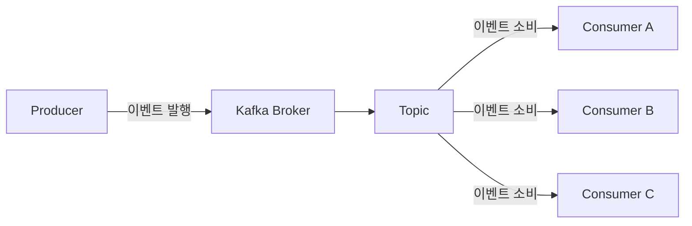

각 구성 요소의 역할은 다음과 같다.

| 구성 요소 | 역할 |
|---|---|
| Producer | Kafka에 이벤트를 발행하는 애플리케이션 |
| Broker | 이벤트를 저장하고 클라이언트 요청을 처리하는 서버 |
| Topic | 이벤트를 구분하는 논리적인 이름 |
| Partition | Topic의 데이터를 분산 저장하는 단위 |
| Consumer | Kafka에 저장된 이벤트를 읽어 처리하는 애플리케이션 |
| Consumer Group | 여러 Consumer가 작업을 분담하는 논리적인 그룹 |

예를 들어 주문 서비스가 `OrderCreated` 이벤트를 Kafka에 발행하면 알림, 배송, 분석 서비스가 해당 이벤트를 각각 처리할 수 있다.

이 과정에서 주문 서비스는 다른 서비스의 구체적인 구현이나 처리 속도를 알 필요가 없다.

Kafka가 시스템 사이에서 이벤트를 저장하고 전달하는 공통 계층 역할을 수행하기 때문이다.

---

## Kafka가 등장한 배경

### 기존 시스템의 복잡한 데이터 전달 구조

Kafka가 등장하기 전에도 시스템 간 데이터 전달을 구현할 수 있는 기술은 다양하게 존재했다.

대표적으로 다음과 같은 방법이 있다.

- HTTP API 호출
- 데이터베이스 직접 조회
- 데이터베이스 변경 사항을 주기적으로 확인하는 Polling
- 메시지 큐
- CSV 파일 생성 및 전달
- NFS와 같은 공유 파일 시스템
- `rsync`를 이용한 파일 동기화
- ETL을 이용한 데이터 추출 및 적재

각 방식은 목적에 따라 유용하게 사용할 수 있다.

문제는 데이터가 필요한 시스템이 증가하면서 서로 다른 전송 방식과 연결 관계가 지나치게 많아진다는 것이다.

예를 들어 세 개의 애플리케이션이 있다고 가정해 보자.

**Application A**

회원과 주문 데이터를 관리한다.

**Application B**

결제 데이터를 관리한다.

**Application C**

상품과 재고 데이터를 관리한다.

이러한 데이터는 다음 시스템에서도 필요할 수 있다.

- 관계형 데이터베이스
- 캐시
- 로그 분석 시스템
- 검색 엔진
- 데이터 웨어하우스
- 모니터링 시스템
- 실시간 분석 시스템

이를 직접 연결하면 다음과 같은 구조가 만들어진다.

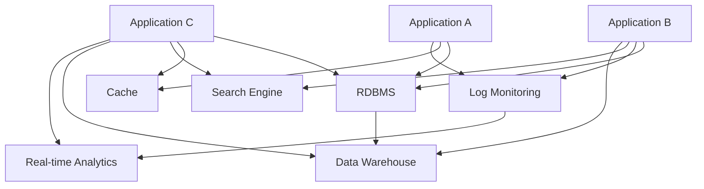

처음에는 이러한 구조가 큰 문제가 되지 않을 수 있다.

하지만 시스템이 증가하면 여러 문제가 발생한다.

### 1. 시스템 간 결합도 증가

주문 서비스가 알림 서비스를 직접 호출한다고 가정해 보자.

```text
Order Service
    ↓
Notification Service
```

이 구조에서 알림 서비스의 API 주소나 요청 형식이 변경되면 주문 서비스도 영향을 받을 수 있다.

이후 배송 서비스와 분석 서비스가 추가되면 주문 서비스가 관리해야 할 연결 관계도 증가한다.

### 2. 장애 전파 가능성

주문 서비스가 알림 서비스를 동기적으로 호출한다고 가정해 보자.

알림 서비스의 응답 시간이 증가하면 주문 서비스의 처리 시간도 증가할 수 있다.

극단적으로 알림 서비스에 장애가 발생하면 주문 서비스에서도 Timeout이나 오류가 발생할 수 있다.

물론 Timeout, Circuit Breaker 등의 기법으로 이러한 문제를 완화할 수 있다.

하지만 시스템이 서로 직접 호출하는 구조에서는 이러한 장애 대응을 각 연결 관계마다 고려해야 한다.

### 3. 데이터 전달 방식의 불일치

어떤 시스템은 HTTP로 데이터를 전달한다.

다른 시스템은 메시지 큐를 이용한다.

또 다른 시스템은 데이터베이스를 직접 조회하거나 CSV 파일을 이용한다.

이러한 방식이 혼재하면 데이터 전달 경로와 처리 상태를 일관되게 관리하기 어려워질 수 있다.

### 4. 새로운 시스템 추가의 어려움

예를 들어 상품 데이터를 기반으로 추천 시스템을 추가한다고 가정해 보자.

기존 구조에서는 추천 시스템에 필요한 데이터를 제공하기 위해 상품 서비스나 주문 서비스를 수정해야 할 수 있다.

새로운 기능을 추가할 때마다 기존 시스템의 변경이 필요해지는 것이다.

### 5. 데이터 재처리의 어려움

분석 시스템에 문제가 발생하여 특정 기간의 데이터를 처리하지 못했다고 가정해 보자.

기존 데이터 전달 방식에서는 해당 데이터를 다시 추출하거나 재전송하는 기능을 별도로 구현해야 할 수 있다.

이러한 문제가 반복되면 데이터 파이프라인의 유지보수 비용이 증가한다.

---

## Kafka는 복잡한 데이터 파이프라인을 어떻게 단순화할까?

Kafka는 데이터를 생산하는 시스템과 사용하는 시스템 사이에 공통적인 이벤트 저장 및 전달 계층을 제공한다.

각 서비스가 서로 직접 데이터를 전달하는 대신 Kafka에 이벤트를 발행하거나 Kafka에서 이벤트를 소비하도록 구성한다.

### Kafka 도입 전

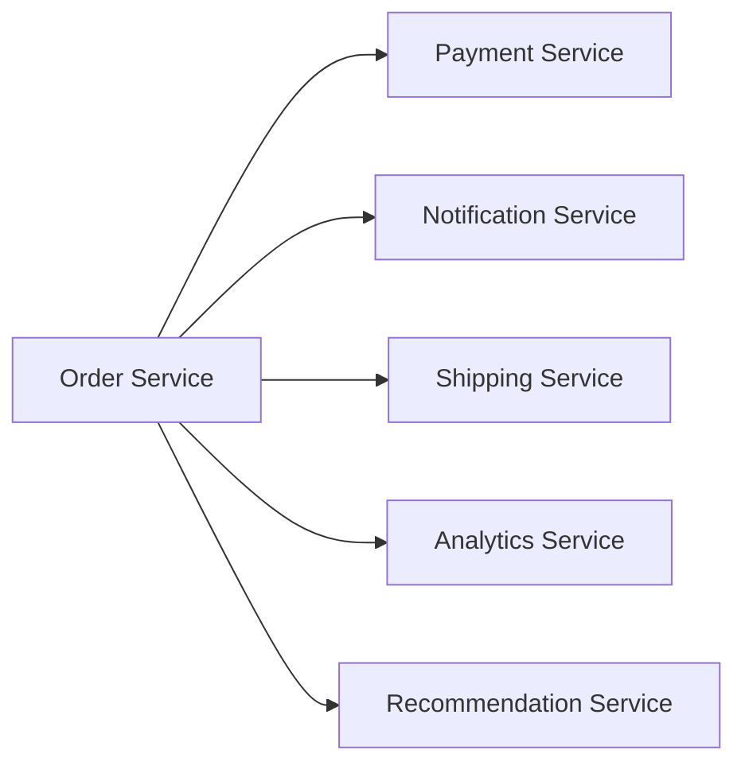

주문 서비스는 여러 시스템과 직접 연결된다.

### Kafka 도입 후

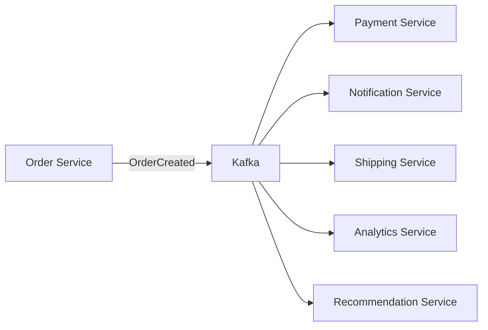

이제 주문 서비스는 주문 생성 이벤트를 Kafka에 발행한다.

알림 서비스는 주문 생성 이벤트를 읽고 알림을 발송한다.

배송 서비스는 이벤트를 읽고 배송 정보를 생성한다.

분석 서비스는 동일한 이벤트를 읽고 주문 데이터를 분석한다.

이러한 구조에서는 새로운 Consumer를 추가하더라도 기존 Producer를 수정하지 않아도 되는 경우가 많다.

### Kafka를 도입하면 모든 의존성이 사라질까?

그렇지는 않다.

Kafka를 이용하면 서비스가 서로의 주소와 호출 방식에 직접 의존하는 문제를 줄일 수 있다.

하지만 이벤트의 구조와 의미에 대한 의존성은 남아 있다.

예를 들어 주문 생성 이벤트에서 `orderId` 필드가 제거되면 해당 필드를 사용하던 Consumer에 문제가 발생할 수 있다.

따라서 이벤트 기반 시스템에서도 다음 요소를 관리해야 한다.

- 이벤트 스키마
- 이벤트 버전
- 필드의 의미
- 이벤트 발행 시점
- 이벤트 처리 책임
- 데이터 보존 기간
- 장애 및 재처리 정책

**Kafka는 시스템 간 의존성을 완전히 제거하는 기술이 아니라, 직접적인 호출 의존성을 데이터 계약 중심의 의존성으로 전환하는 기술이라고 이해하는 것이 적절하다.**

---

## 이벤트 스트리밍(Event Streaming)이란?

### 이벤트(Event)의 개념

이벤트는 시스템에서 발생한 사실을 표현하는 데이터다.

예를 들어 다음과 같은 상황을 생각해 보자.

```text
사용자가 회원가입을 완료했다.

사용자가 상품을 주문했다.

결제가 승인되었다.

상품의 재고가 변경되었다.

사용자가 구독을 해지했다.

차량의 위치가 변경되었다.

서버의 CPU 사용률이 증가했다.
```

이러한 사건은 모두 이벤트로 표현할 수 있다.

이벤트의 중요한 특징은 **이미 발생한 사실을 기록한다는 점**이다.

예를 들어 `OrderCreated`는 주문을 생성하라는 명령이 아니라 주문이 생성되었다는 사실을 의미한다.

### Command와 Event의 차이

| 구분 | Command | Event |
|---|---|---|
| 의미 | 수행해야 할 작업 | 이미 발생한 사실 |
| 예시 | CreateOrder | OrderCreated |
| 목적 | 특정 작업 요청 | 상태 변화 전달 |
| 처리 대상 | 일반적으로 명확한 수신자 | 여러 Consumer가 활용 가능 |
| 실패 의미 | 요청한 작업의 실패 | 이벤트 전달 또는 후속 처리 실패 |

예를 들어 다음 두 표현은 의미가 다르다.

```text
CreatePayment
→ 결제를 생성해 주세요.
```

```text
PaymentCompleted
→ 결제가 완료되었습니다.
```

이 구분은 이벤트 기반 아키텍처를 설계할 때 중요하다.

이미 발생한 사실을 표현하는 이벤트와 실행해야 할 작업을 의미하는 명령을 혼동하면 서비스 간 책임이 불명확해질 수 있기 때문이다.

---

## 이벤트는 어떤 구조로 표현할까?

Kafka에서 이벤트는 일반적으로 Key와 Value, Timestamp, Header 등의 정보를 가진 Record로 표현된다.

예를 들어 주문 생성 이벤트를 JSON으로 표현하면 다음과 같다.

```json
{
  "eventId": "evt-10001",
  "eventType": "OrderCreated",
  "eventVersion": 1,
  "occurredAt": "2026-11-20T10:00:00+09:00",
  "orderId": "order-9001",
  "customerId": "customer-101",
  "totalAmount": 45000
}
```

각 필드의 역할은 다음과 같다.

| 필드 | 설명 |
|---|---|
| `eventId` | 이벤트의 고유 식별자 |
| `eventType` | 이벤트 종류 |
| `eventVersion` | 이벤트 스키마 버전 |
| `occurredAt` | 실제 이벤트 발생 시각 |
| `orderId` | 주문 식별자 |
| `customerId` | 사용자 식별자 |
| `totalAmount` | 주문 금액 |

이러한 구조는 애플리케이션에서 사용하는 이벤트 Payload의 예시다.

Kafka 자체가 반드시 이 JSON 구조를 요구하는 것은 아니다.

Kafka의 Record Value는 Byte Array 기반으로 전달되며 JSON, Avro, Protobuf 등의 직렬화 형식을 사용할 수 있다.

### 이벤트에 식별자가 필요한 이유

Kafka에서는 장애나 재시도 상황에서 동일한 이벤트가 다시 처리될 수 있다.

이때 `eventId`가 존재하면 Consumer에서 이미 처리한 이벤트인지 확인할 수 있다.

예를 들어 다음과 같은 상황이다.

```text
1. Consumer가 이벤트 수신
2. 데이터베이스 저장 성공
3. Offset Commit 이전에 Consumer 종료
4. Consumer 재시작
5. 동일한 이벤트 재수신
```

Consumer가 중복 처리에 대응하지 않는다면 같은 데이터를 두 번 저장하거나 같은 알림을 여러 번 발송할 수 있다.

따라서 이벤트 식별자와 멱등성(Idempotency)을 함께 고려해야 한다.

---

## 이벤트 스트리밍의 개념

이벤트 스트리밍은 이벤트가 지속적으로 발생하고 전달되는 흐름을 처리하는 방식이다.

예를 들어 사용자의 웹사이트 클릭 이벤트는 한 번 발생하고 끝나는 데이터가 아니다.

사용자가 서비스를 이용하는 동안 계속 생성된다.

자동차의 GPS 정보도 마찬가지다.

차량이 움직이는 동안 위치정보가 지속적으로 발생한다.

IoT 센서 역시 정해진 주기에 따라 온도나 습도 등의 데이터를 생성할 수 있다.

이러한 데이터를 지속적으로 수집하고 저장하며 처리하는 방식이 이벤트 스트리밍이다.

### 이벤트 스트리밍의 처리 흐름

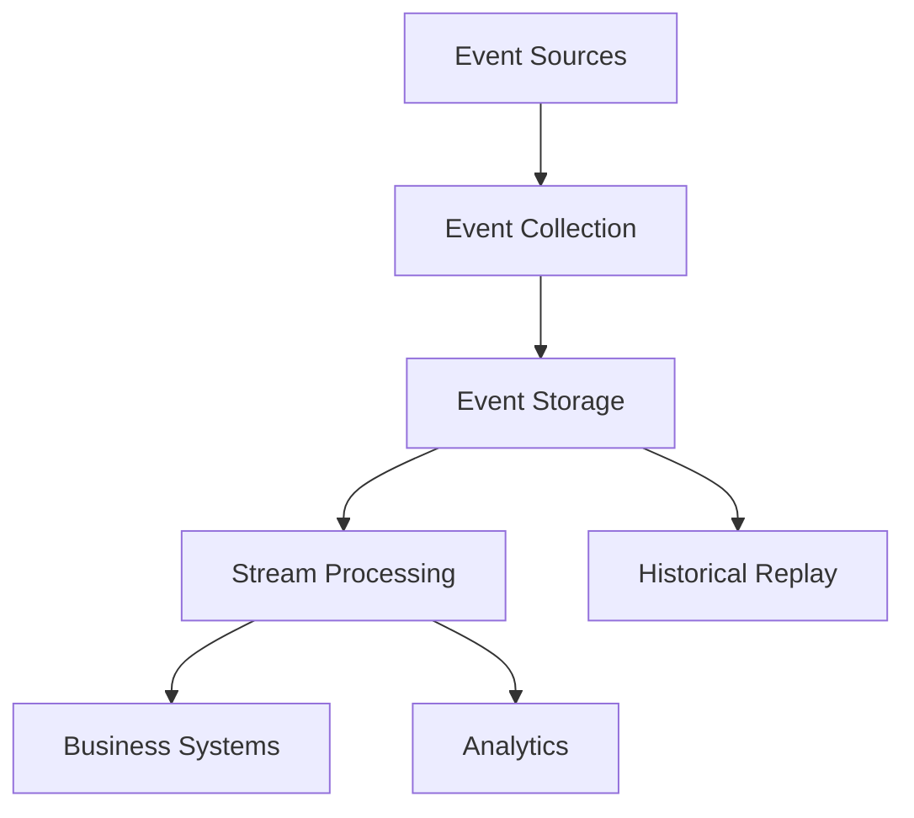

이 구조에는 세 가지 중요한 기능이 포함된다.

**첫 번째는 이벤트 수집이다.**

다양한 시스템에서 발생한 이벤트를 받아들인다.

**두 번째는 이벤트 저장이다.**

수집한 이벤트를 일정 기간 보존한다.

**세 번째는 이벤트 처리다.**

Consumer가 이벤트를 읽어 필요한 작업을 수행한다.

Kafka는 이러한 이벤트 흐름의 중심에서 저장과 전달을 담당한다.

실제 업무 로직은 Kafka를 사용하는 애플리케이션이나 Kafka Streams 등의 처리 시스템이 수행한다.

---

## 이벤트 스트리밍을 중추 신경계에 비유하는 이유

이벤트 스트리밍은 인간의 중추 신경계에 비유할 수 있다.

사람의 신체에서는 감각 기관이 외부 자극을 감지하고 신경계를 통해 정보를 전달한다.

이후 전달된 정보를 바탕으로 필요한 반응이 발생한다.

데이터 기반 시스템에서도 비슷한 구조를 생각할 수 있다.

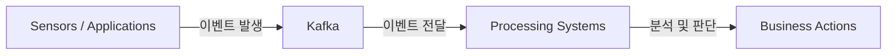

여기서 각 요소의 역할은 다음과 같이 이해할 수 있다.

| 신경계 비유 | 이벤트 스트리밍 |
|---|---|
| 감각 기관 | 데이터 생산 시스템 |
| 신경 전달 | 이벤트 전달 |
| 정보 전달 경로 | Kafka |
| 정보 처리 | Consumer 및 Stream Processor |
| 반응 | 업무 처리 및 자동화 |

이러한 비유에서 중요한 것은 필요한 정보가 필요한 곳에 전달된다는 점이다.

그러나 Kafka 자체가 모든 이벤트를 분석하거나 최종 의사결정을 수행하는 것은 아니다.

Kafka는 이벤트의 흐름을 연결하는 역할에 집중한다.

---

## 이벤트 스트리밍의 대표적인 활용 분야

이벤트는 다양한 산업에서 발생한다.

| 산업 | 발생하는 이벤트 | 활용 목적 |
|---|---|---|
| 금융 | 결제, 송금, 거래 | 거래 처리와 이상 탐지 |
| 물류 | 배송 상태, 차량 위치 | 실시간 추적 및 모니터링 |
| 자동차 | GPS, 센서 데이터 | 차량 상태 및 운행 분석 |
| 제조 | 온도, 진동, 설비 상태 | 설비 모니터링과 고장 예측 |
| 소매 | 주문, 구매, 재고 변경 | 재고 관리와 개인화 |
| 여행·호텔 | 예약, 취소, 고객 행동 | 예약 처리와 서비스 분석 |
| 의료 | 환자 상태, 의료 장비 데이터 | 상태 모니터링 |
| 기업 내부 시스템 | 업무 이벤트, 로그 | 데이터 통합 및 분석 |

예를 들어 물류 서비스에서는 다음과 같은 이벤트가 발생할 수 있다.

```text
ShipmentCreated

ShipmentDeparted

ShipmentArrivedAtPort

ShipmentDelayed

ShipmentDelivered
```

이벤트를 Kafka에 발행하면 여러 시스템에서 활용할 수 있다.

고객 알림 서비스는 배송 상태 변경을 확인하여 알림을 발송한다.

모니터링 시스템은 배송 지연 이벤트를 분석한다.

분석 시스템은 배송 소요 시간과 지연 패턴을 계산한다.

이처럼 **하나의 이벤트를 여러 시스템에서 서로 다른 목적으로 활용할 수 있다는 점**이 이벤트 스트리밍의 중요한 장점이다.

---

## Kafka의 주요 특징

Kafka는 분산 이벤트 스트리밍 플랫폼으로서 여러 특징을 제공한다.

대표적으로 다음 여섯 가지를 살펴보자.

### 1. 실시간 데이터 스트리밍

Kafka는 지속적으로 발생하는 데이터를 수집하고 전달할 수 있다.

예를 들어 다음과 같은 이벤트를 처리할 수 있다.

- 웹사이트 클릭
- 금융 거래
- IoT 센서 측정값
- 애플리케이션 로그
- 사용자 행동 이벤트

Producer가 Kafka에 이벤트를 발행하면 Consumer는 해당 이벤트를 읽어 처리할 수 있다.

다만 여기서 실시간이 모든 결과가 즉시 반영된다는 의미는 아니다.

이벤트가 실제 서비스에 반영되기까지는 다음과 같은 과정이 존재한다.

```text
Producer
→ Kafka Broker
→ Consumer
→ Business Logic
→ Database 또는 외부 시스템
```

각 단계에서 네트워크 지연이나 처리 지연이 발생할 수 있다.

따라서 시스템을 설계할 때는 구체적인 지연 목표를 정의하는 것이 좋다.

예를 들어 다음과 같다.

```text
결제 완료 후 5초 이내에 알림 발송

차량 위치 변경 후 3초 이내에 화면 반영

사용자 행동 이벤트 발생 후 10초 이내에 분석 데이터 갱신
```

Kafka는 이러한 구조의 기반을 제공하지만 전체 처리 지연은 Consumer와 외부 시스템의 성능에도 영향을 받는다.

### 2. 높은 처리량(High Throughput)

Kafka는 대량의 이벤트를 효율적으로 처리하도록 설계되었다.

이를 위해 다음과 같은 구조를 활용한다.

- Append-Only Log
- Sequential Write
- Batch 전송
- 메시지 압축
- Partition 기반 병렬 처리
- 여러 Broker를 이용한 데이터 분산

특히 Kafka는 이벤트를 Partition의 끝에 순차적으로 추가하는 로그 구조를 사용한다.

이러한 저장 모델은 높은 처리량을 달성하는 데 도움이 된다.

하지만 Kafka의 성능이 모든 환경에서 동일하게 나타나는 것은 아니다.

실제 처리량은 다음 요소에 따라 달라진다.

| 요소 | 성능에 미치는 영향 |
|---|---|
| 메시지 크기 | 네트워크 및 디스크 사용량 |
| Partition 수 | 병렬 처리 수준 |
| Broker 수 | 분산 처리 자원 |
| Replication Factor | 복제 비용 |
| 압축 방식 | CPU와 네트워크 사용량 |
| Batch 크기 | 요청 효율과 전송 지연 |
| Consumer 처리 속도 | 전체 데이터 처리 지연 |

따라서 초당 수백만 건을 처리할 수 있다는 설명만으로 Kafka의 실제 성능을 판단해서는 안 된다.

어떤 크기의 이벤트를 어떤 조건에서 처리하는지 함께 확인해야 한다.

### 3. 내구성과 안정성

Kafka는 이벤트를 디스크 기반 로그에 저장하고, 설정에 따라 여러 Broker에 복제할 수 있다.

이러한 구조는 장애 상황에서 데이터 손실 위험을 줄이고 가용성을 높이는 데 도움이 된다.

하지만 Kafka를 사용한다고 모든 데이터 손실 가능성이 사라지는 것은 아니다.

데이터 복제 수준과 Producer의 전송 설정, Broker 장애 상황 등에 따라 실제 보장 수준이 달라진다.

예를 들어 다음과 같은 설정이 중요하다.

| 설정 | 의미 |
|---|---|
| `acks` | Producer가 기다리는 저장 확인 수준 |
| `replication.factor` | Partition의 복제본 수 |
| `min.insync.replicas` | 쓰기 승인에 필요한 최소 ISR 수 |
| `enable.idempotence` | Producer 재시도에 따른 중복 기록 방지 지원 |

따라서 내구성을 확보하려면 이러한 설정을 함께 고려해야 한다.

### 4. 분산 시스템

Kafka는 여러 Broker를 이용하여 Cluster를 구성할 수 있다.

Topic의 Partition을 여러 Broker에 나누어 배치하고, 필요한 경우 복제할 수 있다.

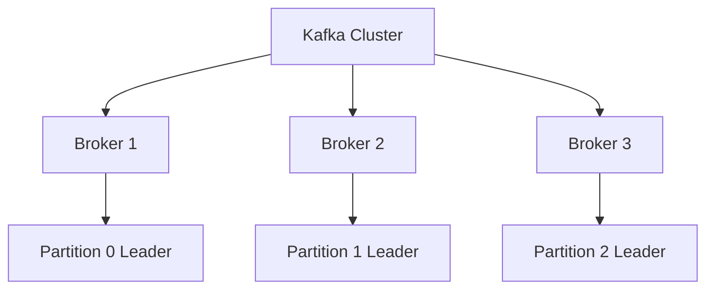

이 구조를 통해 특정 Broker에만 모든 데이터와 요청이 집중되지 않도록 설계할 수 있다.

또한 복제와 Leader 선출을 통해 일부 장애 상황에 대응할 수 있다.

그러나 하나의 Broker에 문제가 발생해도 전체 시스템에 영향이 전혀 없다고 단정할 수는 없다.

장애 상황에서는 Leader 전환으로 인한 일시적인 지연이 발생할 수 있으며, 정상 Replica가 충분하지 않다면 특정 Partition의 쓰기가 중단될 수도 있다.

### 5. Publish/Subscribe 메시징 모델

Kafka는 Producer와 Consumer를 분리하는 Publish/Subscribe 모델을 지원한다.

Producer는 Topic에 이벤트를 발행한다.

Consumer는 해당 Topic에서 이벤트를 읽는다.

Producer는 Consumer가 몇 개 존재하는지 알 필요가 없다.

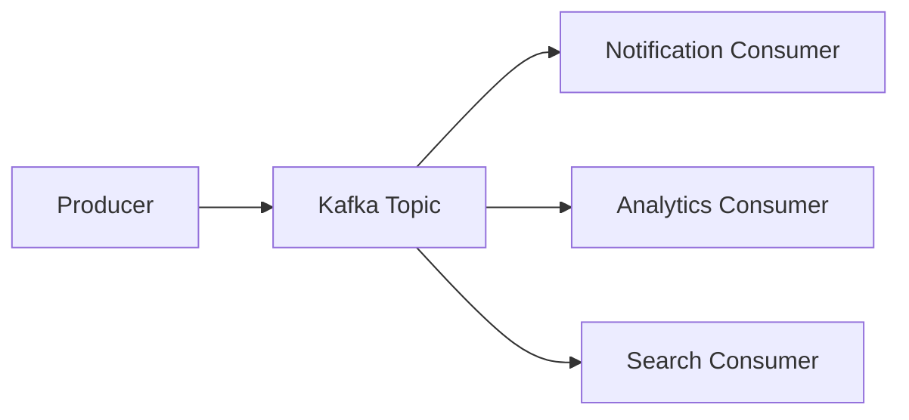

이러한 구조는 동일한 이벤트를 여러 시스템에서 활용하는 데 적합하다.

### 6. 이벤트 보존과 재처리

Kafka에서는 Consumer가 이벤트를 읽었다고 해서 해당 이벤트가 바로 삭제되지 않는다.

이벤트는 Topic의 Retention 정책에 따라 보존된다.

따라서 Consumer가 장애로 중단되더라도 보존된 이벤트를 다시 읽을 수 있다.

또한 새로운 Consumer를 추가하여 이전 이벤트부터 처리하도록 구성할 수도 있다.

다만 Kafka가 이벤트를 무기한 보관하는 것은 아니다.

설정된 보존 기간이나 저장 용량에 따라 오래된 이벤트가 삭제될 수 있다.

Kafka 공식 문서에서도 Topic의 이벤트 보존과 Consumer의 독립적인 읽기 구조를 핵심 특징으로 설명한다. [Apache Kafka](https://kafka.apache.org/42/getting-started/introduction/?utm_source=chatgpt.com)

---

## Kafka의 기본 아키텍처

Kafka를 이해하려면 다음 다섯 가지 개념을 먼저 알아야 한다.

1. Broker
2. Topic
3. Partition
4. Producer
5. Consumer

여기에 Offset과 Consumer Group을 추가하면 기본적인 데이터 처리 구조를 이해할 수 있다.

### 전체 구조

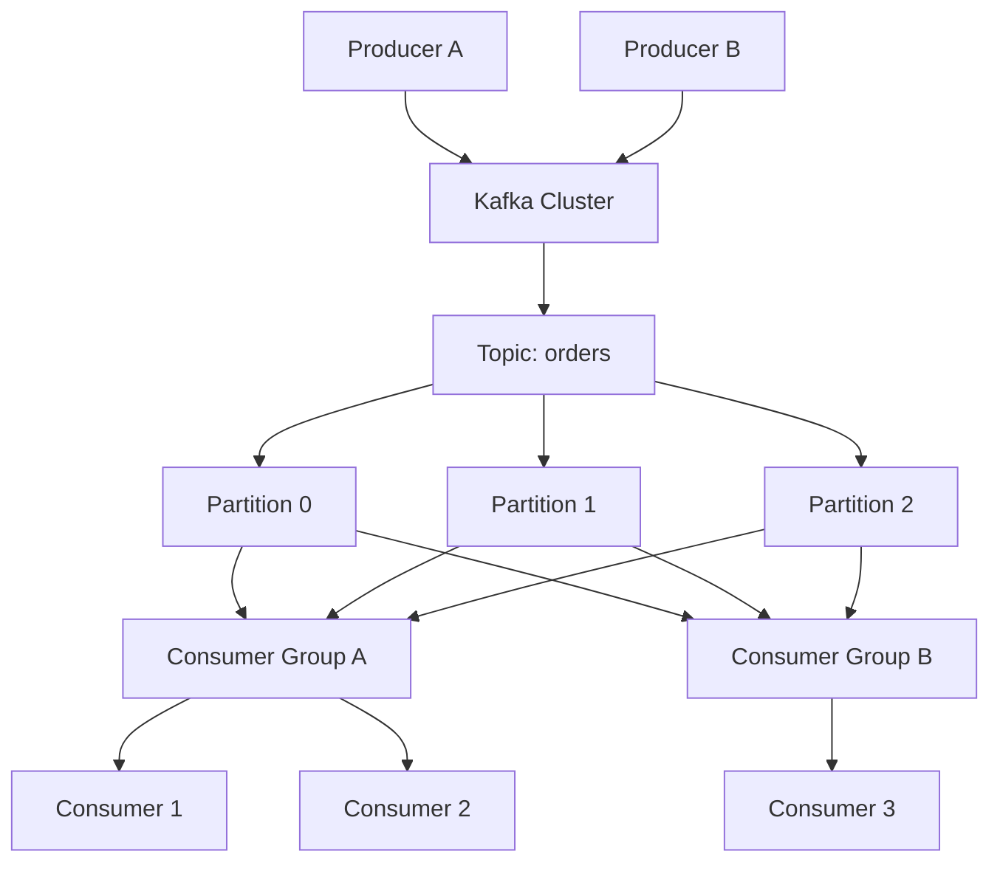

이 구조에서 Topic은 하나 이상의 Partition으로 구성된다.

Producer는 Topic에 이벤트를 발행한다.

Consumer는 Partition에 저장된 이벤트를 읽는다.

Consumer Group은 여러 Consumer가 Partition을 나누어 처리할 수 있도록 지원한다.

---

## Broker란?

Broker는 Kafka 서버 프로세스를 의미한다.

일반적으로 Kafka 애플리케이션이 실행되는 서버나 노드를 지칭하는 표현으로도 사용한다.

Broker는 다음과 같은 역할을 수행한다.

- Producer가 발행한 이벤트 저장
- Consumer의 데이터 조회 요청 처리
- Partition 데이터 관리
- Replica 데이터 관리
- 다른 Broker와의 데이터 복제

### Kafka Cluster란?

여러 Broker가 하나의 Kafka 시스템으로 구성된 집합을 Kafka Cluster라고 한다.

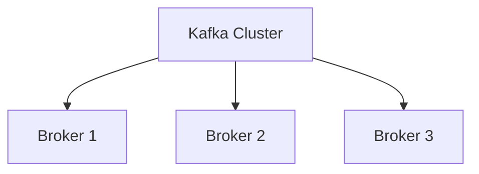

각 Broker는 Cluster의 일부 Partition을 담당한다.

Broker를 여러 대 구성하면 데이터를 분산하여 저장할 수 있다.

하지만 Broker를 여러 대 실행했다는 사실만으로 고가용성이 자동으로 보장되는 것은 아니다.

Partition의 복제 설정과 장애 배치, Controller 구성 등을 함께 고려해야 한다.

---

## Topic이란?

Topic은 Producer가 발행한 이벤트를 논리적으로 구분하는 이름이다.

예를 들어 전자상거래 서비스에서는 다음과 같은 Topic을 구성할 수 있다.

```text
orders

payments

shipments

notifications

user-activities

application-logs
```

주문 서비스는 `orders` Topic에 이벤트를 발행할 수 있다.

결제 서비스는 `payments` Topic에 결제 관련 이벤트를 발행할 수 있다.

### Topic은 데이터베이스의 Table과 같을까?

Topic과 Table은 모두 데이터를 논리적으로 구분한다는 점에서 비슷하게 보일 수 있다.

하지만 실제 역할은 다르다.

| 항목 | RDBMS Table | Kafka Topic |
|---|---|---|
| 목적 | 데이터 저장 및 조회 | 이벤트 저장 및 전달 |
| 데이터 구조 | Row | Record |
| 조회 방식 | SQL Query | Consumer의 순차적인 읽기 |
| 데이터 변경 | INSERT, UPDATE, DELETE | 기본적으로 Append |
| 데이터 보존 | 데이터 변경 및 삭제 정책 | Retention 및 Compaction |
| 주요 활용 | 비즈니스 상태 관리 | 이벤트 전달과 처리 |

Kafka Topic을 관계형 데이터베이스의 Table과 동일한 개념으로 이해해서는 안 된다.

Topic은 지속적으로 추가되는 이벤트 로그를 관리하는 단위에 가깝다.

---

## Partition이란?

Partition은 Topic을 물리적으로 나누어 저장하고 처리하기 위한 단위다.

Kafka의 분산 처리와 병렬성을 이해할 때 매우 중요한 개념이다.

예를 들어 `orders` Topic에 세 개의 Partition이 있다고 가정해 보자.

```text
orders
 ├── Partition 0
 ├── Partition 1
 └── Partition 2
```

Producer가 발행한 이벤트는 Partition 중 하나에 기록된다.

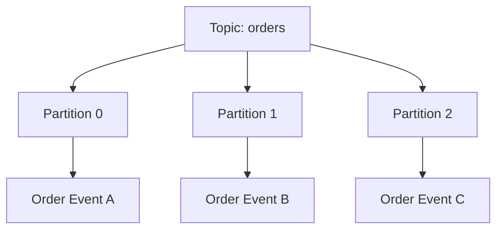

### Partition을 사용하는 이유

Partition을 사용하면 다음과 같은 장점이 있다.

**첫 번째는 데이터 분산이다.**

하나의 Topic 데이터를 여러 Broker에 나누어 저장할 수 있다.

**두 번째는 병렬 처리다.**

여러 Consumer가 서로 다른 Partition을 처리할 수 있다.

**세 번째는 확장성이다.**

데이터 규모와 처리량에 따라 Partition 구성을 조정할 수 있다.

### Partition과 순서 보장

Kafka에서 중요한 특징은 **Partition 내부의 이벤트 순서를 보장한다는 점**이다.

예를 들어 다음과 같은 이벤트가 하나의 Partition에 저장되었다고 가정해 보자.

```text
Partition 0

Offset 0 → OrderCreated

Offset 1 → PaymentCompleted

Offset 2 → ShipmentStarted

Offset 3 → ShipmentDelivered
```

해당 Partition에 기록된 이벤트는 Offset 순서로 관리된다.

하지만 여러 Partition에 걸친 모든 이벤트의 전역적인 순서는 보장하지 않는다.

예를 들어 다음과 같은 구조다.

```text
Partition 0
A → C → E

Partition 1
B → D → F
```

Partition 0에서는 `A → C → E` 순서가 유지된다.

Partition 1에서는 `B → D → F` 순서가 유지된다.

그러나 서로 다른 Partition의 이벤트까지 하나의 전역 순서로 관리하는 것은 아니다.

### 동일한 주문의 이벤트 순서를 유지하려면?

주문 생성부터 배송 완료까지 동일한 주문의 이벤트를 순서대로 처리해야 한다고 가정해 보자.

이 경우 `orderId`를 Kafka Record의 Key로 사용하는 방식을 고려할 수 있다.

```text
Key: order-1001

OrderCreated
PaymentCompleted
ShipmentStarted
ShipmentDelivered
```

같은 Key의 이벤트가 동일한 Partition에 기록되도록 구성하면 해당 주문에 대한 이벤트 순서를 관리하기 쉬워진다.

다만 Partition 수가 변경되면 Key의 Partition 배치가 달라질 수 있다.

또한 Consumer 내부에서 비동기 처리를 수행하는 경우에도 순서 관리가 필요하다.

따라서 **Kafka가 Partition 내부의 순서를 보장한다는 사실과 비즈니스 작업이 순서대로 완료된다는 사실은 구분해야 한다.**

---

## Offset이란?

Offset은 Partition 내부에서 Record의 위치를 나타내는 번호다.

Kafka Consumer는 Offset을 이용하여 데이터를 읽고 처리 위치를 관리한다.

예를 들어 다음과 같은 Partition이 있다고 가정해 보자.

| Offset | Event |
|---|---|
| 0 | OrderCreated |
| 1 | PaymentCompleted |
| 2 | ShipmentStarted |
| 3 | ShipmentDelivered |

Consumer가 Offset 2까지 처리했다면 이후 Offset 3부터 처리를 이어갈 수 있도록 자신의 처리 위치를 관리할 수 있다.

### Offset은 데이터베이스의 Primary Key일까?

아니다.

Offset은 Partition 내부의 위치를 나타낸다.

따라서 서로 다른 Partition에는 동일한 Offset 값이 존재할 수 있다.

```text
Partition 0
Offset 0
Offset 1
Offset 2

Partition 1
Offset 0
Offset 1
Offset 2
```

Offset은 전역적으로 유일한 이벤트 ID가 아니다.

이벤트를 식별하려면 Topic과 Partition, Offset의 조합을 사용할 수 있다.

또한 업무적으로 동일한 이벤트인지 판단하려면 별도의 `eventId`가 필요할 수 있다.

---

## Producer란?

Producer는 Kafka에 이벤트를 발행하는 애플리케이션 또는 클라이언트다.

Producer는 지정한 Topic에 Record를 전송한다.

예를 들어 다음과 같은 애플리케이션이 Producer가 될 수 있다.

- 주문 서비스
- 결제 서비스
- 사용자 활동 수집기
- 로그 수집 시스템
- IoT Gateway
- 데이터베이스 변경 수집기

### Producer의 기본 동작

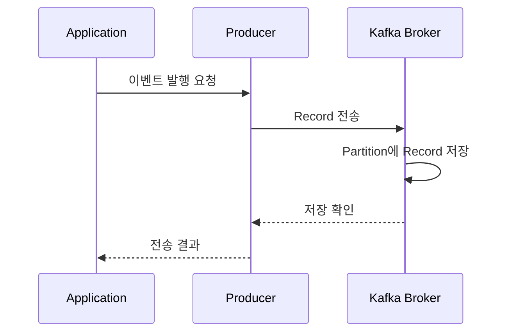

Producer는 Kafka Broker에 데이터를 전송한다.

Broker는 해당 데이터를 Partition에 기록한다.

이후 Producer는 설정된 `acks` 정책에 따라 저장 확인을 받을 수 있다.

### Producer의 저장 성공은 업무 처리 성공일까?

아니다.

예를 들어 주문 서비스가 Kafka에 `OrderCreated` 이벤트를 성공적으로 기록했다고 가정해 보자.

이것이 알림 발송이나 배송 처리가 완료되었다는 의미는 아니다.

```text
Kafka에 이벤트 저장 성공
        ≠
알림 발송 완료
        ≠
배송 처리 완료
        ≠
분석 시스템 반영 완료
```

각 Consumer는 이벤트를 독립적으로 처리한다.

따라서 최종 처리 결과가 필요한 업무에서는 결과 이벤트나 상태 조회 방식 등을 별도로 설계해야 한다.

---

## Consumer란?

Consumer는 Kafka에 저장된 이벤트를 읽어 처리하는 애플리케이션 또는 클라이언트다.

예를 들어 주문 생성 이벤트를 읽는 Consumer는 다음과 같은 작업을 수행할 수 있다.

**Notification Consumer**

사용자에게 주문 완료 알림을 발송한다.

**Shipping Consumer**

배송 정보를 생성한다.

**Analytics Consumer**

주문 데이터를 분석 시스템에 적재한다.

**Recommendation Consumer**

사용자의 구매 이력을 추천 데이터에 반영한다.

### Consumer는 Kafka에서 데이터를 가져오는가?

일반적인 Kafka Consumer는 Broker에 Fetch 요청을 보내 데이터를 가져오는 Pull 기반 모델을 사용한다.

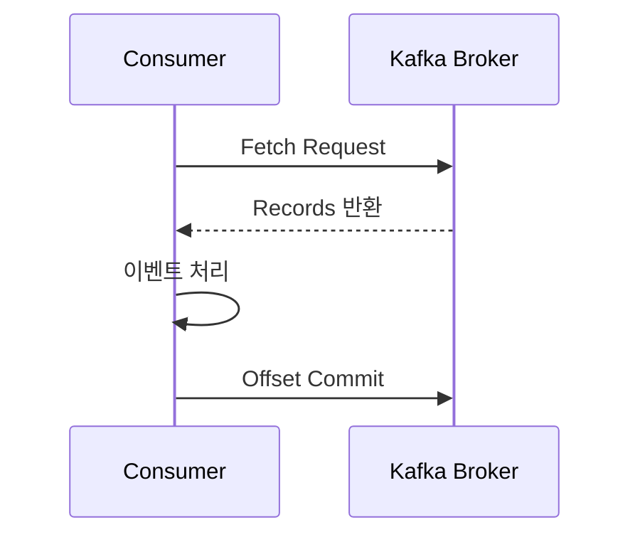

이 과정에서 Consumer는 자신의 처리 속도와 설정에 따라 데이터를 가져올 수 있다.

다만 Consumer가 Broker에서 Record를 읽었다는 사실만으로 업무 처리가 성공했다고 판단해서는 안 된다.

데이터베이스 저장이나 외부 API 호출이 실패할 수 있기 때문이다.

따라서 Offset Commit 시점을 신중하게 설계해야 한다.

---

## Consumer Group이란?

Consumer Group은 여러 Consumer가 하나의 처리 목적을 위해 Partition을 나누어 처리하는 논리적인 그룹이다.

예를 들어 `orders` Topic에 세 개의 Partition이 있다고 가정해 보자.

```text
orders
 ├── Partition 0
 ├── Partition 1
 └── Partition 2
```

동일한 Consumer Group에 Consumer가 세 개 존재한다면 Partition을 나누어 처리할 수 있다.

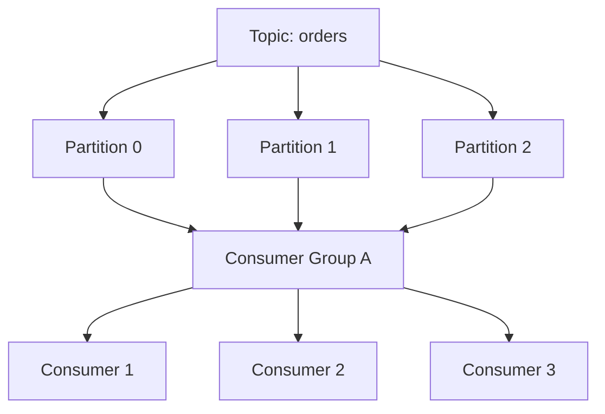

실제 Partition 할당은 Consumer Group의 Rebalance와 할당 전략에 따라 결정된다.

### 동일한 Consumer Group

일반적인 Consumer Group에서는 같은 Partition이 한 시점에 하나의 Consumer에 할당된다.

따라서 같은 목적의 작업을 여러 Consumer가 분담하도록 구성할 수 있다.

### 서로 다른 Consumer Group

서로 다른 Consumer Group은 동일한 Topic의 이벤트를 독립적으로 읽을 수 있다.

예를 들어 다음과 같다.

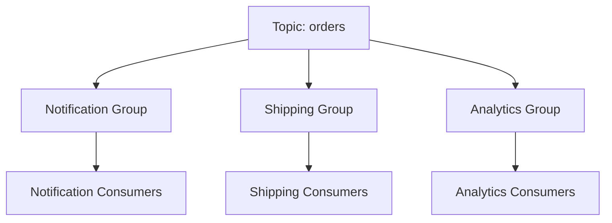

알림 서비스와 배송 서비스, 분석 서비스는 서로 다른 목적의 작업을 수행한다.

따라서 서로 다른 Consumer Group으로 구성하는 것이 적절하다.

이러한 구조에서는 분석 서비스의 처리가 느려지더라도 알림 서비스는 자신의 Offset을 기준으로 계속 처리할 수 있다.

### Consumer 수가 Partition보다 많다면?

예를 들어 Partition이 세 개이고 같은 Consumer Group에 Consumer가 다섯 개 있다고 가정해 보자.

일반적인 Consumer Group 모델에서는 하나의 Partition을 같은 시점에 여러 Consumer가 나누어 할당받지 않는다.

따라서 일부 Consumer는 Partition을 할당받지 못하고 대기할 수 있다.

| Partition 수 | Consumer 수 | 일반적인 최대 동시 Partition 담당 Consumer 수 |
|---:|---:|---:|
| 3 | 1 | 1 |
| 3 | 2 | 2 |
| 3 | 3 | 3 |
| 3 | 5 | 3 |

따라서 Consumer를 무조건 늘린다고 처리량이 비례하여 증가하는 것은 아니다.

Partition 수와 Consumer 수를 함께 설계해야 한다.

### Kafka Share Group과의 차이

여기서 버전에 따른 차이를 알아둘 필요가 있다.

Kafka 4.2에서는 Share Group이라는 소비 모델이 운영 환경에서 사용할 수 있는 기능으로 도입되었다.

Share Group은 기존 Consumer Group과 달리 Partition을 한 Consumer에게만 독점 할당하지 않고 Record 단위의 협력 소비와 확인을 지원한다.

따라서 모든 Kafka 소비 모델에 기존 Consumer Group의 Partition 할당 규칙이 동일하게 적용되는 것은 아니다.

다만 이벤트 순서가 중요한 일반적인 스트리밍 처리에서는 기존 Consumer Group의 특징을 기준으로 이해하는 것이 유용하다. [Apache Kafka](https://kafka.apache.org/42/getting-started/upgrade/?utm_source=chatgpt.com)

---

## Kafka의 데이터 저장 방식

Kafka의 중요한 특징 중 하나는 Append-Only Log 기반으로 데이터를 저장한다는 점이다.

### Append-Only Log란?

Append-Only Log는 새로운 데이터를 기존 로그의 끝에 추가하는 구조다.

예를 들어 다음과 같다.

```text
Partition 0

Offset 0 → Event A
Offset 1 → Event B
Offset 2 → Event C
Offset 3 → Event D
```

새로운 이벤트가 발생하면 다음 위치에 기록된다.

```text
Offset 4 → Event E
```

기존 이벤트를 임의로 수정하는 방식보다 새로운 Record를 계속 추가하는 구조에 가깝다.

이러한 방식은 순차적인 데이터 기록과 효율적인 전송에 도움이 된다.

### Kafka는 데이터를 얼마나 오래 보관할까?

Kafka는 Topic에 설정된 Retention 정책에 따라 이벤트를 보존한다.

대표적인 보존 방식은 다음과 같다.

| 보존 방식 | 설명 |
|---|---|
| 시간 기준 | 지정한 시간이 지난 데이터 정리 |
| 용량 기준 | 저장 용량 기준으로 오래된 데이터 정리 |
| Log Compaction | Key를 기준으로 오래된 Record 정리 |

예를 들어 Retention을 7일로 설정했다면 해당 보존 정책에 따라 오래된 데이터가 삭제될 수 있다.

다만 데이터가 정확히 7일이 되는 순간 개별 Record 단위로 즉시 삭제된다고 이해해서는 안 된다.

Kafka는 로그 세그먼트 단위로 데이터를 관리하므로 실제 삭제 시점은 관련 설정과 내부 정리 과정에 영향을 받는다.

### Log Compaction이란?

Log Compaction은 동일한 Key에 대해 오래된 Record를 정리하고 최신 상태를 유지하는 데 활용할 수 있는 기능이다.

예를 들어 사용자 상태 변경 이벤트가 다음과 같이 발생했다고 가정해 보자.

```text
Key: user-1001

ACTIVE
SUSPENDED
ACTIVE
```

Compaction을 적용하면 동일한 Key의 오래된 Record가 정리될 수 있다.

하지만 Compaction은 모든 과거 이벤트를 무조건 유지하는 기능이 아니다.

따라서 전체 변경 이력을 반드시 보존해야 하는 요구사항이라면 Compaction과 보존 정책을 신중하게 선택해야 한다.

Kafka의 데이터 보존은 Consumer가 읽었는지 여부와 별도로 관리된다는 점이 핵심이다.

---

## Kafka의 내구성과 복제 구조

Kafka는 Partition의 데이터를 여러 Broker에 복제할 수 있다.

예를 들어 Replication Factor가 3인 Topic을 생각해 보자.

하나의 Partition에 대해 세 개의 복제본을 유지하도록 구성할 수 있다.

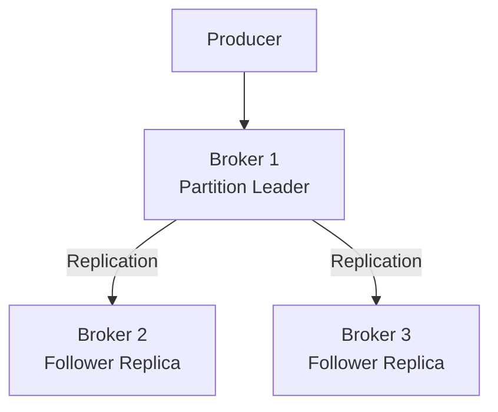

### Leader

Leader는 해당 Partition의 쓰기와 일반적인 읽기 요청을 주로 처리하는 Replica다.

### Follower

Follower는 Leader의 데이터를 복제하는 역할을 수행한다.

### ISR(In-Sync Replicas)

ISR은 Leader와 충분히 동기화된 것으로 판단되는 Replica 집합이다.

Kafka에서는 ISR을 이용하여 데이터 복제와 쓰기 승인 조건을 관리한다.

### acks란?

Producer의 `acks` 설정은 Broker로부터 어느 수준의 저장 확인을 받을 것인지 결정한다.

대표적으로 다음과 같이 구분할 수 있다.

| 설정 | 의미 |
|---|---|
| `acks=0` | Broker 응답을 기다리지 않음 |
| `acks=1` | Leader의 저장 확인을 기다림 |
| `acks=all` | ISR 기반의 저장 확인을 기다림 |

`acks=all`을 사용하면 복제 상태를 고려한 더 강한 저장 확인을 받을 수 있다.

하지만 `acks=all`만 설정했다고 모든 장애에서 데이터가 절대 유실되지 않는 것은 아니다.

`min.insync.replicas`와 Replication Factor 등도 함께 고려해야 한다.

### 예시

다음과 같은 구성을 생각해 보자.

```properties
acks=all
```

Topic과 Broker 측에서는 다음과 같은 복제 조건을 구성할 수 있다.

```properties
replication.factor=3
min.insync.replicas=2
```

여기서 `replication.factor`는 Topic 생성 시 지정하는 설정이며, `min.insync.replicas`는 Topic 또는 Broker의 설정으로 관리할 수 있다.

위 내용은 개념을 설명하기 위한 설정 예시다.

실제 구성에서는 Producer 설정과 Topic 설정, Broker 설정을 각각 올바른 위치에 적용해야 한다.

이러한 조합을 통해 데이터 내구성과 가용성 사이의 균형을 설계할 수 있다.

---

## Producer와 Consumer를 분리해야 하는 이유

Kafka를 사용하는 중요한 목적 중 하나는 Producer와 Consumer의 실행 시점과 처리 속도를 분리하는 것이다.

### 직접 호출 방식

예를 들어 주문 서비스에서 알림 서비스를 직접 호출한다고 가정해 보자.

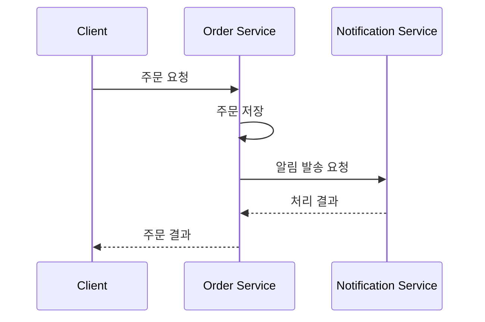

이 구조에서는 알림 서비스 호출이 주문 요청의 응답 시간에 영향을 줄 수 있다.

물론 비동기 HTTP 호출이나 별도 스레드를 사용하여 일부 문제를 완화할 수 있다.

하지만 요청 처리와 후속 작업을 안정적으로 분리하려면 추가적인 설계가 필요하다.

### Kafka 기반 이벤트 처리

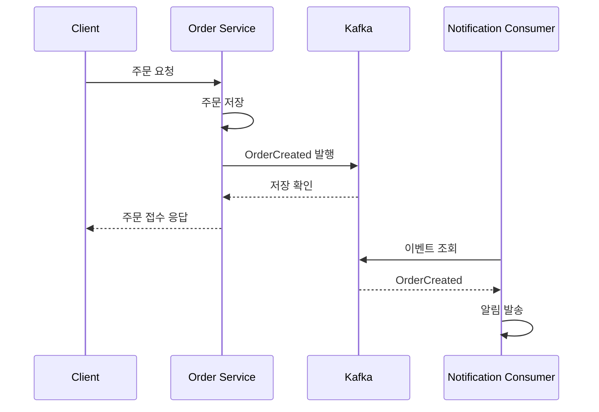

이 구조에서는 주문 서비스가 알림 발송 완료까지 기다리지 않고 요청을 처리하도록 설계할 수 있다.

알림 서비스는 Kafka에 저장된 이벤트를 자신의 속도로 처리한다.

### 장점

- 서비스 간 직접적인 호출 의존성을 줄일 수 있다.
- Consumer를 독립적으로 배포할 수 있다.
- Consumer의 일시적인 장애를 일정 기간 흡수할 수 있다.
- 같은 이벤트를 여러 서비스에서 사용할 수 있다.
- 새로운 Consumer를 추가하기 쉬워진다.

### 주의할 점

이벤트 기반 시스템에서는 데이터가 모든 시스템에 동시에 반영되지 않을 수 있다.

예를 들어 주문은 생성되었지만 알림은 아직 발송되지 않은 상태가 존재할 수 있다.

따라서 시스템을 설계할 때 이러한 중간 상태와 최종적인 데이터 일관성 확보 방법을 고려해야 한다.

---

## Kafka와 기존 메시지 큐의 차이

Kafka를 공부할 때 자주 비교하는 기술이 RabbitMQ와 ActiveMQ다.

Kafka와 기존 메시지 큐는 모두 비동기 메시징을 구현하는 데 사용할 수 있다.

하지만 설계 목적과 데이터 처리 모델에 차이가 있다.

### 전통적인 작업 큐

일반적인 작업 큐에서는 메시지를 발행하고 Consumer가 메시지를 처리한다.

처리 완료를 확인하면 메시지가 큐에서 제거되는 형태가 흔하다.

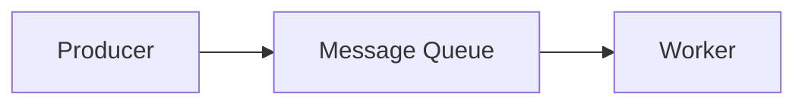

이 방식은 작업을 여러 Worker에 분배하는 데 적합하다.

예를 들어 다음과 같은 작업이다.

- 이메일 발송
- 이미지 변환
- 백그라운드 작업 실행
- 비동기 명령 처리

### Kafka의 이벤트 로그 모델

Kafka는 이벤트를 보존하는 로그 모델을 중심으로 설계되었다.

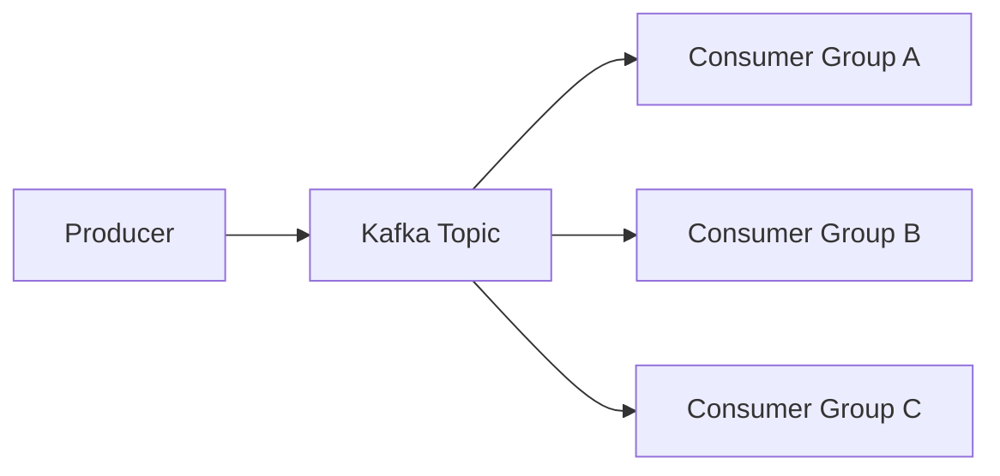

Consumer가 데이터를 읽어도 해당 Record가 즉시 제거되지 않는다.

따라서 서로 다른 Consumer Group이 동일한 데이터를 독립적으로 사용할 수 있다.

### Kafka와 메시지 큐 비교

| 비교 항목 | 전통적인 작업 큐 | Kafka의 일반적인 이벤트 로그 모델 |
|---|---|---|
| 주요 목적 | 작업 전달 및 분배 | 이벤트 저장 및 스트리밍 |
| 데이터 처리 | 메시지 수신 및 확인 | Offset 기반 소비 |
| 처리 후 데이터 | 일반적으로 Ack 후 제거 | Retention 정책에 따라 보존 |
| 여러 시스템에서 활용 | Queue 및 Routing 구성 | Consumer Group별 독립 소비 |
| 재처리 | 별도 보관 또는 재발행이 필요할 수 있음 | 보존된 이벤트를 다시 읽을 수 있음 |
| 순서 관리 | Queue 및 Consumer 설정에 따라 다름 | Partition 내부 순서 보장 |
| 병렬 처리 | Worker 기반 | Partition 및 Consumer Group 기반 |
| 주요 활용 | 작업 큐, 비동기 명령 | 데이터 파이프라인, 이벤트 처리, 로그 집계 |

### RabbitMQ는 메시지를 보존하거나 재처리할 수 없을까?

그렇지는 않다.

RabbitMQ도 Streams와 같은 기능을 제공하며, 이를 통해 메시지 보존과 재처리를 구현할 수 있다.

따라서 RabbitMQ는 메시지를 한 번 처리하면 무조건 삭제하고 Kafka만 재처리가 가능하다고 설명하는 것은 정확하지 않다.

중요한 것은 제품 이름만 비교하는 것이 아니라 **어떤 메시징 모델과 기능을 사용하려는지 비교하는 것**이다.

RabbitMQ 공식 문서에서도 Streams의 데이터 보존과 재처리 기능을 설명한다. [rabbitmq.com](https://www.rabbitmq.com/docs/streams?utm_source=chatgpt.com)

---

## 직접 호출, Pub/Sub, Kafka의 차이

시스템 간 통신 방식을 이해할 때 다음 세 가지 구조를 비교할 수 있다.

### 1. 직접 호출

```text
Producer → Consumer
```

발신자가 수신자를 직접 알고 요청한다.

HTTP나 gRPC 등이 대표적인 예다.

### 2. Publish/Subscribe

```text
Producer → Messaging System → Subscribers
```

발신자가 메시지를 중개 시스템에 전달한다.

중개 시스템은 구독 관계에 따라 메시지를 전달한다.

### 3. Kafka의 이벤트 로그 모델

```text
Producer → Kafka Topic → Consumer Groups
```

이벤트를 Topic에 저장한다.

여러 Consumer Group이 자신의 Offset을 기준으로 이벤트를 읽는다.

### 비교

| 구분 | 직접 호출 | Pub/Sub | Kafka 이벤트 로그 |
|---|---|---|---|
| 수신자와의 연결 | 직접적 | 중개 계층 활용 | Topic 기반 |
| 데이터 보존 | 호출 자체는 보존하지 않음 | 제품과 설정에 따라 다름 | Retention 기반 보존 |
| 재처리 | 별도 구현 필요 | 제품과 설정에 따라 다름 | Offset 기반 재처리 가능 |
| 대표 기술 | HTTP, gRPC | RabbitMQ 등 | Kafka |
| 적합한 상황 | 즉시 응답이 필요한 요청 | 메시지 전달 및 분배 | 지속적인 이벤트 흐름 |

세 방식은 서로를 완전히 대체하는 관계가 아니다.

실제 백엔드 시스템에서는 함께 사용하는 경우가 많다.

예를 들어 결제 승인 요청은 HTTP API로 처리하고, 결제가 완료된 이후의 알림이나 통계 처리는 Kafka 이벤트로 처리할 수 있다.

---

## Kafka는 어떤 상황에서 필요할까?

Kafka는 모든 시스템에서 반드시 사용해야 하는 기술은 아니다.

다음과 같은 요구사항이 존재할 때 도입을 검토할 수 있다.

### 1. 대규모 실시간 이벤트 처리

웹사이트 활동, 모바일 앱 이벤트, 센서 데이터처럼 지속해서 많은 데이터가 발생하는 환경이다.

예를 들어 사용자가 많아질수록 클릭 이벤트가 대량으로 발생할 수 있다.

이때 Kafka를 이용하여 이벤트를 수집하고 여러 처리 시스템으로 전달할 수 있다.

### 2. 다양한 시스템 간 데이터 공유

하나의 이벤트를 여러 시스템에서 사용해야 하는 경우다.

예를 들어 상품 가격 변경 이벤트가 발생했다고 가정해 보자.

```mermaid
flowchart LR
    A["Product Service"]
    B["Kafka"]

    C["Search System"]
    D["Cache System"]
    E["Recommendation System"]
    F["Analytics System"]

    A -->|"ProductPriceChanged"| B

    B --> C
    B --> D
    B --> E
    B --> F
```

상품 서비스는 다른 시스템을 직접 호출하지 않고 이벤트를 발행한다.

각 시스템은 필요한 방식으로 데이터를 활용한다.

### 3. 데이터 파이프라인 구축

Kafka는 데이터의 수집과 처리, 분석 시스템을 연결하는 데 활용할 수 있다.

예를 들어 다음과 같은 구조다.

```mermaid
flowchart LR
    A["Applications"]
    B["Kafka"]
    C["Stream Processing"]
    D["Data Warehouse"]
    E["Analytics"]

    A --> B
    B --> C
    C --> D
    D --> E
```

이러한 구조에서는 지속적으로 발생하는 데이터를 분석 시스템에 전달할 수 있다.

### 4. 이벤트 기반 아키텍처

시스템에서 발생하는 중요한 상태 변화를 이벤트로 표현하고, 여러 서비스가 해당 이벤트를 구독하도록 구성하는 방식이다.

예를 들어 주문 생성과 결제 완료, 배송 시작 등의 상태 변화를 이벤트로 발행할 수 있다.

이벤트 기반 아키텍처는 서비스 간 직접적인 의존성을 줄이는 데 도움이 된다.

### 5. 데이터 안정성과 재처리

Consumer가 일시적으로 중단되더라도 Kafka에 이벤트가 보존되어 있다면 복구 후 다시 처리할 수 있다.

다만 보존 기간과 Consumer 처리 속도를 함께 고려해야 한다.

### Kafka가 적합하지 않을 수 있는 경우

다음 상황에서는 다른 기술이 더 단순하고 적절할 수 있다.

| 상황 | 고려할 대안 |
|---|---|
| 즉시 응답이 필요한 단순 조회 | HTTP, gRPC |
| 소규모 비동기 작업 처리 | 단순 Queue |
| 단일 서비스 내부 작업 | 애플리케이션 내부 비동기 처리 |
| 데이터베이스 트랜잭션 | RDBMS Transaction |
| 대용량 이미지·동영상 전달 | Object Storage |
| 단순한 예약 작업 | Scheduler |

**Kafka 도입 여부는 처리량뿐 아니라 여러 Consumer의 독립적인 처리, 이벤트 보존, 재처리, 시스템 간 결합도 등을 함께 고려하여 결정해야 한다.**

---

## Kafka를 활용한 실시간 데이터 파이프라인

Kafka의 대표적인 활용 사례 중 하나는 데이터를 수집하고 분석 시스템에 전달하는 파이프라인이다.

예를 들어 사용자의 웹사이트 활동 데이터를 수집한다고 가정해 보자.

사용자는 다음과 같은 행동을 수행한다.

```text
상품 검색

상품 상세 페이지 조회

장바구니 추가

주문 생성

결제 완료
```

이러한 이벤트를 Kafka에 발행할 수 있다.

이후 여러 Consumer가 데이터를 처리한다.

```mermaid
flowchart TD
    A["Web / Mobile Application"]
    B["Kafka"]

    C["Real-time Analytics"]
    D["Recommendation System"]
    E["Data Warehouse"]
    F["Monitoring"]

    A --> B

    B --> C
    B --> D
    B --> E
    B --> F
```

실시간 분석 시스템은 사용자 행동을 집계할 수 있다.

추천 시스템은 사용자 행동을 추천 데이터에 반영할 수 있다.

데이터 웨어하우스는 이벤트를 저장하여 장기적인 분석에 활용할 수 있다.

모니터링 시스템은 비정상적인 이벤트 발생량을 탐지할 수 있다.

이처럼 Kafka는 다양한 분석 시스템의 공통 데이터 전달 계층이 될 수 있다.

---

## Kafka를 활용한 스트림 처리

Kafka는 이벤트를 저장하고 전달하는 역할을 담당한다.

하지만 이벤트를 분석하고 가공하는 비즈니스 로직은 별도의 처리 시스템에서 수행한다.

대표적으로 다음과 같은 기술을 사용할 수 있다.

- Kafka Streams
- Apache Flink
- Apache Spark Structured Streaming

### 스트림 처리란?

스트림 처리는 지속적으로 들어오는 이벤트를 순차적 또는 병렬적으로 처리하는 방식이다.

대표적으로 다음과 같은 작업을 수행한다.

- Filtering
- Transformation
- Aggregation
- Window Processing
- Stream Join
- Pattern Detection

### 예시: 결제 이상 거래 탐지

사용자가 결제를 시도했다고 가정해 보자.

Kafka에 결제 이벤트가 발행된다.

Stream Processing 시스템은 사용자의 최근 거래 이력과 현재 거래 정보를 분석한다.

```mermaid
flowchart TD
    A["Payment Events"]
    B["Kafka"]
    C["Stream Processing"]

    D["최근 거래 집계"]
    E["위험 패턴 분석"]
    F["Fraud Detection"]

    G["Alert"]
    H["Additional Verification"]

    A --> B
    B --> C

    C --> D
    D --> E
    E --> F

    F --> G
    F --> H
```

예를 들어 최근 짧은 시간 동안 동일한 사용자에게 비정상적으로 많은 결제 시도가 발생했는지 확인할 수 있다.

또는 평소와 다른 국가나 장치에서 거래가 발생했는지 분석할 수 있다.

다만 Kafka 자체가 사기 거래를 판단하는 것은 아니다.

Kafka는 이벤트를 전달하고, 별도의 처리 시스템이나 머신러닝 모델이 분석을 수행한다.

---

## 실제 기업에서 Kafka를 사용하는 사례

Kafka는 다양한 기업에서 대규모 이벤트 처리와 데이터 파이프라인 구축에 활용되어 왔다.

대표적인 사례는 다음과 같다.

| 기업 | Kafka 활용 분야 |
|---|---|
| LinkedIn | 대규모 이벤트 및 내부 데이터 파이프라인 |
| Netflix | 중앙 집중식 이벤트 파이프라인 |
| Uber | 실시간 데이터 인프라 |
| Cloudflare | 서비스 간 메시지 전달 |
| DoorDash | 비동기 작업 처리 시스템 개선 |
| Grab | 실시간 사기 및 오용 탐지 |
| Adobe | 고객 데이터 및 이벤트 처리 |
| Salesforce | 로그 및 이벤트 연동 |
| Walmart | 재고와 옴니채널 데이터 |
| DICK’S Sporting Goods | 옴니채널 상품·가격·프로모션 데이터 |

이러한 사례에서 중요한 것은 기업의 이름이나 처리량 자체가 아니다.

**대규모 서비스에서 이벤트를 어떻게 수집하고, 저장하고, 여러 시스템에 독립적으로 전달하는지 이해하는 것**이 더 중요하다.

---

## LinkedIn의 Kafka 활용 사례

Kafka는 LinkedIn에서 탄생했다.

LinkedIn은 소셜 네트워크 서비스로서 다양한 사용자 활동 데이터를 처리해야 했다.

예를 들어 다음과 같은 데이터가 발생한다.

- 사용자 활동 기록
- 메시지 관련 이벤트
- 서비스 로그
- 시스템 메트릭
- 검색 및 추천 관련 데이터

이러한 데이터를 여러 시스템에 전달하기 위한 공통적인 데이터 파이프라인이 필요했다.

Kafka는 이러한 요구사항을 해결하기 위해 개발되었다.

### LinkedIn의 처리 규모

LinkedIn은 2019년 10월 공개한 기술 문서에서 하루 약 7조 건의 메시지를 처리하는 Kafka 운영 규모를 설명했다.

이 수치는 당시 LinkedIn의 여러 Kafka Cluster를 포함한 전체 운영 환경의 규모다.

단일 Kafka Broker가 하루 7조 건을 처리했다는 의미는 아니다.

또한 현재 운영 규모를 나타내는 값도 아니다. [LinkedIn](https://www.linkedin.com/blog/engineering/open-source/apache-kafka-trillion-messages?utm_source=chatgpt.com)

이 사례에서 주목할 부분은 대규모 데이터를 여러 시스템에서 공통으로 활용할 수 있도록 데이터 전달 구조를 설계했다는 점이다.

---

## Netflix의 Kafka 활용 사례

Netflix는 다양한 마이크로서비스로 구성된 대규모 서비스를 운영한다.

각 서비스에서는 지속적으로 이벤트가 발생한다.

예를 들어 다음과 같은 이벤트가 있다.

- 콘텐츠 재생 이벤트
- 사용자 행동 이벤트
- 서비스 요청 이벤트
- 시스템 로그
- 성능 메트릭
- 내부 서비스 상태 변화

이러한 이벤트는 단순히 발생한 서비스 내부에서만 사용하는 것이 아니다.

데이터 분석과 모니터링, 사용자 경험 개선 등을 위해 다른 시스템으로 전달해야 한다.

### Netflix의 Keystone

Netflix는 이러한 데이터 흐름을 처리하기 위해 Keystone이라는 이벤트 파이프라인을 구축했다.

Keystone은 이벤트를 수집하고 다양한 분석 및 처리 시스템으로 전달하는 공통 데이터 파이프라인이다.

대표적인 구조는 다음과 같이 표현할 수 있다.

```mermaid
flowchart TD
    A["Event Producers"]

    B["Producer Library / HTTP Proxy"]
    C["Fronting Kafka"]

    D["Routing Layer"]

    E["Amazon S3"]
    F["Elasticsearch"]
    G["Consumer Kafka"]

    H["Spark / Mantis / Applications"]
    I["Batch Analytics"]

    A --> B
    B --> C
    C --> D

    D --> E
    D --> F
    D --> G

    E --> I
    G --> H
```

### Fronting Kafka의 역할

Fronting Kafka는 Producer로부터 전달되는 이벤트를 수집하고 Buffering하는 역할을 담당한다.

### Routing Layer의 역할

수집한 이벤트를 목적에 따라 다른 저장소나 처리 시스템으로 전달한다.

### Consumer Kafka의 역할

실시간 Consumer가 이벤트를 사용할 수 있도록 제공한다.

### S3의 역할

장기적인 데이터 보관이나 배치 분석에 활용할 수 있다.

### Elasticsearch의 역할

이벤트를 검색하고 분석하는 데 활용할 수 있다.

Netflix의 공개 기술 문서에서는 Fronting Kafka와 Consumer Kafka를 구분한 Keystone 구조를 설명한다. [Netflix TechBlog](https://netflixtechblog.com/kafka-inside-keystone-pipeline-dd5aeabaf6bb?utm_source=chatgpt.com)

### 왜 Kafka Cluster를 분리했을까?

Kafka Cluster를 역할에 따라 분리하면 데이터 수집과 소비 시스템의 책임을 구분할 수 있다.

예를 들어 특정 Consumer가 많은 데이터를 처리하면서 부하가 증가하더라도 Producer가 사용하는 수집 계층에 미치는 영향을 줄이도록 설계할 수 있다.

또한 데이터 처리 목적에 따라 서로 다른 보존 정책과 운영 정책을 적용할 수 있다.

### Netflix의 Kafka 운영 규모

2024년에 공개된 Netflix의 Kafka as a Service 운영 사례에서는 다음과 같은 수치가 제시되었다.

| 항목 | 당시 발표 규모 |
|---|---:|
| 메시지 처리량 | 초당 1억 9천만 건 |
| 데이터 유입량 | 초당 150GB 이상 |
| 저장 데이터 | 8PB 이상 |
| 전용 Kafka Cluster | 475개 이상 |
| Kafka Broker | 11,500개 |
| Kafka Topic | 35,000개 |

이 수치는 Netflix가 당시 발표한 전체 운영 환경의 규모를 나타낸다.

Kafka를 설치하면 동일한 성능이 나온다는 의미가 아니다. [www.slideshare.net](https://www.slideshare.net/slideshow/self-hosting-kafka-at-scale-netflix-s-journey-challenges/272172619?utm_source=chatgpt.com)

### Kafka as a Service란?

Kafka as a Service는 Kafka Cluster를 여러 개발팀이 사용할 수 있도록 서비스 형태로 제공하는 운영 모델이다.

단순히 Broker를 실행하는 것을 넘어 다음과 같은 기능이 필요할 수 있다.

- Topic 생성 및 관리
- 권한 관리
- Cluster 자원 관리
- 모니터링
- 처리량 관리
- 데이터 보존 정책
- 장애 대응
- 사용자별 사용량 관리

이러한 구조는 대규모 조직에서 Kafka 운영의 복잡성을 중앙에서 관리하는 데 도움이 된다.

---

## Uber의 Kafka 활용 사례

Uber는 탑승자와 운전자, 차량, 위치정보, 요금 계산 등 다양한 시스템에서 실시간 이벤트가 발생하는 서비스다.

대표적인 데이터 소스는 다음과 같다.

- 탑승자 애플리케이션
- 운전자 애플리케이션
- GPS 및 센서 데이터
- 백엔드 서비스 이벤트
- 애플리케이션 로그
- 데이터베이스 변경 이벤트
- 외부 데이터

이러한 데이터를 다양한 분석 및 처리 시스템에서 활용해야 한다.

### Uber의 실시간 데이터 아키텍처

```mermaid
flowchart TD
    A["Rider Application"]
    B["Driver Application"]
    C["GPS / Sensor Data"]
    D["Backend Services"]
    E["Database Changes"]

    F["Kafka"]

    G["Real-time Processing"]
    H["Batch Processing"]

    I["Dynamic Pricing"]
    J["Monitoring / Alerting"]
    K["Analytics"]
    L["Machine Learning"]
    M["Data Warehouse"]

    A --> F
    B --> F
    C --> F
    D --> F
    E --> F

    F --> G
    F --> H

    G --> I
    G --> J
    G --> K

    H --> L
    H --> M
```

Uber에서는 데이터 처리 목적을 크게 다음과 같이 구분하여 설명할 수 있다.

### 1. Messaging Platform

여러 시스템 사이에서 이벤트와 메시지를 전달한다.

### 2. Stream Processing

지속적으로 발생하는 이벤트를 처리한다.

예를 들어 차량 위치정보나 사용자 행동 이벤트를 분석할 수 있다.

### 3. Online Analytics

실시간에 가까운 데이터 조회와 분석을 제공한다.

예를 들어 운영 대시보드나 실시간 데이터 탐색 등에 활용할 수 있다.

### Uber의 설계 고려사항

대규모 데이터 인프라에서는 다음 요소가 중요하다.

| 요소 | 설명 |
|---|---|
| 내구성 | 데이터 손실 위험 최소화 |
| 가용성 | 일부 시스템 장애에도 서비스 유지 |
| 확장성 | 이벤트 증가에 대응 |
| 접근성 | 여러 팀과 시스템이 데이터 활용 |
| 유연성 | 새로운 분석 도구와 처리 시스템 추가 |

Uber는 Kafka Cluster 간 데이터 복제를 위한 uReplicator를 공개한 바 있다.

이는 대규모 분산 환경에서 Kafka 데이터 전달과 복제를 운영하는 문제를 보여주는 사례다. [Uber](https://www.uber.com/us/en/blog/ureplicator-apache-kafka-replicator/?utm_source=chatgpt.com)

---

## DoorDash의 Kafka 활용 사례

DoorDash는 음식 주문과 배달 서비스를 제공한다.

이러한 서비스에서는 다양한 비동기 작업이 발생한다.

예를 들어 다음과 같다.

- 주문 처리
- 가맹점 주문 전달
- 배달원 위치 처리
- 알림
- 외부 서비스 연동

DoorDash는 과거 RabbitMQ와 Celery 기반의 비동기 작업 처리 구조에서 발생하던 장애 문제를 개선하기 위해 Kafka를 활용한 사례를 공개했다.

기존 메시징 시스템에서 높은 부하로 인한 장애가 반복되었고, 이를 해결하기 위해 Kafka 기반 구조로 점진적으로 전환했다.

중요한 점은 RabbitMQ 자체가 모든 상황에서 불안정하다는 의미가 아니라는 것이다.

DoorDash의 당시 요구사항과 트래픽, 운영 구조에서 Kafka 기반 설계가 적합한 해결책이었던 것이다. [DoorDash](https://careersatdoordash.com/blog/eliminating-task-processing-outages-with-kafka/?utm_source=chatgpt.com)

### 실무에서 얻을 수 있는 교훈

메시징 시스템을 선택할 때는 단순히 처리량만 비교해서는 안 된다.

다음 요소를 함께 검토해야 한다.

- 메시지 처리 모델
- 장애 상황에서의 복구 방식
- 데이터 보존 요구사항
- Consumer 처리량
- 재처리 필요성
- 운영 복잡성

---

## Cloudflare의 Kafka 활용 사례

Cloudflare는 대규모 네트워크 서비스를 운영한다.

이러한 환경에서는 내부 서비스 사이에서 많은 메시지가 전달된다.

Cloudflare는 Kafka를 이용하여 서비스 간 메시지를 처리한 사례를 공개했다.

2022년 공개된 사례에서는 누적 1조 건의 서비스 간 메시지를 처리한 경험을 설명했다.

이 수치는 해당 메시징 용도에서 약 8년 동안 누적된 처리량을 의미한다.

별도의 로그나 통계 파이프라인에서 처리한 일일 메시지 수와 혼동해서는 안 된다. [Cloudflare Blog](https://blog.cloudflare.com/using-apache-kafka-to-process-1-trillion-messages/?utm_source=chatgpt.com)

### 핵심 구조

```mermaid
flowchart LR
    A["Internal Service A"]
    B["Internal Service B"]

    C["Kafka"]

    D["Internal Service C"]
    E["Internal Service D"]
    F["Processing System"]

    A --> C
    B --> C

    C --> D
    C --> E
    C --> F
```

이 사례에서는 여러 내부 서비스 사이에서 메시지를 전달하기 위한 공통 인프라로 Kafka를 활용한다는 점이 중요하다.

---

## Grab의 Kafka 활용 사례

Grab은 차량 호출과 배달, 결제 등 여러 서비스를 제공한다.

이러한 서비스에서는 사용자와 거래에 대한 다양한 이벤트가 발생한다.

특히 사기 및 오용 탐지에서는 실시간 데이터 처리가 중요하다.

예를 들어 다음과 같은 데이터가 분석 대상이 될 수 있다.

- 사용자 로그인 정보
- 장치 정보
- 거래 이력
- 결제 시도
- 위치정보
- 사용자 행동 패턴

### Kafka 기반 사기 탐지 구조

```mermaid
flowchart TD
    A["User Events"]
    B["Payment Events"]
    C["Device Events"]

    D["Kafka"]

    E["Stream Processing"]
    F["Feature Engineering"]
    G["Fraud Detection Model"]

    H["Risk Score"]
    I["Alert / Verification"]

    A --> D
    B --> D
    C --> D

    D --> E
    E --> F
    F --> G

    G --> H
    H --> I
```

Kafka는 이벤트를 수집하고 전달한다.

Stream Processing 시스템은 이벤트를 분석에 적합한 형태로 변환한다.

머신러닝 모델은 변환된 데이터를 이용하여 위험도를 계산할 수 있다.

Grab은 Kafka 기반 데이터 스트리밍 플랫폼을 활용한 사기 탐지 사례를 공개했다. [computerweekly.com](https://www.computerweekly.com/news/252505097/How-Grab-is-using-Kafka-in-fraud-detection?utm_source=chatgpt.com)

---

## DICK’S Sporting Goods의 Kafka 활용 사례

DICK’S Sporting Goods는 미국의 스포츠용품 소매 기업이다.

소매 서비스에서는 여러 채널의 데이터가 연결되어야 한다.

대표적으로 다음과 같은 채널이 있다.

- 오프라인 매장
- 온라인 쇼핑몰
- 모바일 애플리케이션
- 고객 지원 시스템
- 재고 관리 시스템

이러한 구조를 옴니채널(Omnichannel)이라고 한다.

### 옴니채널에서 발생하는 문제

온라인 쇼핑몰에서 상품 가격이 변경되었다고 가정해 보자.

동일한 상품이 오프라인 매장과 모바일 앱에서도 판매된다면 여러 시스템에 변경 사항을 반영해야 한다.

만약 데이터 전달이 지연되면 채널마다 서로 다른 가격이 표시될 수 있다.

### Kafka 기반 데이터 공유

```mermaid
flowchart TD
    A["Product / Pricing Service"]

    B["Kafka"]

    C["Online Store"]
    D["Mobile Application"]
    E["Physical Store"]
    F["Marketing System"]
    G["Analytics"]

    A --> B

    B --> C
    B --> D
    B --> E
    B --> F
    B --> G
```

상품 가격이나 프로모션 변경을 이벤트로 발행하면 각 채널에서 해당 이벤트를 처리할 수 있다.

DICK’S Sporting Goods는 Confluent를 통해 가격과 프로모션 데이터를 실시간으로 연동하는 옴니채널 사례를 공개했다. [Confluent](https://www.confluent.io/customers/dicks-sporting-goods/?utm_source=chatgpt.com)

### 고객 행동 데이터를 추천에 활용하기

Kafka는 사용자 행동 이벤트를 추천 시스템에 전달하는 데에도 활용할 수 있다.

예를 들어 다음과 같은 정보가 있다고 가정해 보자.

```text
90일 전: 뉴스레터 클릭

10일 전: 상품 상세 페이지 조회

8일 전: 상품 비교

현재: 매장 방문
```

이러한 데이터를 연결하면 사용자의 현재 관심사를 더 풍부하게 이해할 수 있다.

이후 추천 모델이나 마케팅 시스템에서 활용할 수 있다.

다만 개인정보 활용 목적과 보존 정책을 함께 고려해야 한다.

---

## Kafka와 머신러닝 시스템의 관계

Kafka는 머신러닝 모델 자체가 아니다.

하지만 머신러닝 시스템이 데이터를 지속적으로 수집하고 활용할 수 있도록 연결하는 역할을 수행한다.

머신러닝 시스템에서는 일반적으로 두 가지 데이터 처리 경로를 구분할 수 있다.

### 1. Model Training

과거 데이터를 이용하여 모델을 학습한다.

### 2. Model Inference

새로운 이벤트를 이용하여 학습된 모델이 예측을 수행한다.

### 전체 구조

```mermaid
flowchart TD
    A["Payment Events"]
    B["Kafka"]

    C["Training Data Storage"]
    D["Model Training"]
    E["Model Registry"]

    F["Real-time Stream Processing"]
    G["Feature Engineering"]
    H["Model Server"]

    I["Prediction Result"]
    J["Business Application"]

    A --> B

    B --> C
    C --> D
    D --> E

    B --> F
    F --> G
    G --> H

    E --> H

    H --> I
    I --> J
```

### 학습 경로

Kafka에서 발생한 데이터를 저장한다.

저장된 데이터를 정제하고 학습 데이터셋을 생성한다.

이후 모델을 학습하고 평가한다.

### 추론 경로

실시간으로 발생하는 이벤트를 처리한다.

필요한 Feature를 계산한다.

Model Server를 호출하여 예측 결과를 얻는다.

### 왜 학습과 추론 경로를 분리할까?

두 경로는 서로 다른 처리 요구사항을 가진다.

| 항목 | Model Training | Model Inference |
|---|---|---|
| 데이터 | 과거 누적 데이터 | 새로운 실시간 이벤트 |
| 주요 목적 | 모델 학습 | 예측 결과 제공 |
| 처리 방식 | 배치 또는 분산 학습 | 저지연 처리 |
| 주요 관심사 | 데이터 품질, 모델 성능 | 응답 시간, 안정성 |
| 결과 | 학습된 모델 | 예측값 또는 위험 점수 |

이처럼 Kafka는 머신러닝 시스템에서 여러 처리 경로를 연결하는 데이터 기반으로 활용될 수 있다.

---

## Kafka 생태계의 주요 기술

Kafka를 실제 서비스에서 활용할 때는 Broker와 Producer, Consumer 외에도 여러 기술을 함께 사용할 수 있다.

대표적인 기술은 다음과 같다.

| 기술 | 주요 역할 |
|---|---|
| Kafka Connect | 외부 시스템과 Kafka 연동 |
| Kafka Streams | Java 기반 스트림 처리 |
| Schema Registry | 이벤트 스키마 관리 |
| REST Proxy | HTTP 기반 Kafka 접근 |
| Apache Flink | 분산 스트림 처리 |
| SQL 기반 Stream Processing | SQL 형태의 이벤트 처리 |

### Kafka Connect

Kafka Connect는 Kafka와 외부 시스템 사이에서 데이터를 이동하기 위한 프레임워크다.

대표적으로 Source Connector와 Sink Connector가 있다.

**Source Connector**

외부 시스템에서 데이터를 가져와 Kafka에 전달한다.

**Sink Connector**

Kafka의 데이터를 외부 시스템에 저장한다.

```mermaid
flowchart LR
    A["External Database"]

    B["Source Connector"]
    C["Kafka"]
    D["Sink Connector"]

    E["Elasticsearch"]
    F["Data Warehouse"]

    A --> B
    B --> C
    C --> D

    D --> E
    D --> F
```

이러한 구조를 이용하면 외부 시스템과 Kafka를 연결하는 코드를 직접 작성해야 하는 부담을 줄일 수 있다.

다만 필요한 Connector의 기능과 데이터 전달 보장 수준은 구현체와 설정에 따라 달라진다.

### Kafka Streams

Kafka Streams는 Kafka에 저장된 이벤트를 처리하기 위한 Java 라이브러리다.

대표적으로 다음과 같은 작업을 수행할 수 있다.

- Filtering
- Mapping
- Aggregation
- Window Processing
- Stream Join

Kafka Streams는 Kafka Broker 내부에서 실행되는 것이 아니라 애플리케이션의 일부로 실행된다.

따라서 Kafka Broker와 스트림 처리 애플리케이션의 역할을 구분해야 한다.

### Schema Registry

Schema Registry는 이벤트의 구조와 버전을 관리하기 위해 사용할 수 있는 도구다.

예를 들어 JSON, Avro, Protobuf 등의 데이터 형식을 사용하는 시스템에서 Schema를 관리할 수 있다.

이벤트 구조가 변경되면 Producer와 Consumer 사이의 호환성 문제가 발생할 수 있다.

Schema Registry는 이러한 변경을 관리하는 데 도움이 된다.

다만 Schema Registry는 Apache Kafka Broker를 설치하면 자동으로 제공되는 필수 구성 요소는 아니다.

필요에 따라 별도의 제품이나 구현체를 선택해야 한다.

---

## 실무 예제: 구독 결제 시스템에서 Kafka 활용하기

이제 Kafka의 개념을 실제 백엔드 서비스에 적용해 보자.

구독 결제 시스템을 운영한다고 가정해 보자.

사용자가 결제에 성공하면 다음과 같은 후속 처리가 필요할 수 있다.

1. 결제 상태 저장
2. 사용자 구독 권한 활성화
3. 결제 완료 알림 발송
4. 결제 이력 분석
5. 운영 대시보드 갱신

이를 모두 결제 서비스에서 직접 처리하면 서비스 간 결합도가 증가할 수 있다.

Kafka를 이용하면 결제 완료 이벤트를 발행하고 여러 Consumer가 후속 작업을 처리하도록 구성할 수 있다.

### 전체 아키텍처

```mermaid
flowchart TD
    A["Payment Service"]
    B["Payment Database"]

    C["Kafka"]
    D["Topic: payment-events"]

    E["Membership Consumer"]
    F["Notification Consumer"]
    G["Analytics Consumer"]

    H["Membership Database"]
    I["Notification Service"]
    J["Analytics Storage"]

    A --> B
    A -->|"PaymentCompleted"| C

    C --> D

    D --> E
    D --> F
    D --> G

    E --> H
    F --> I
    G --> J
```

### PaymentCompleted 이벤트

결제가 완료되면 다음과 같은 이벤트를 발행할 수 있다.

```json
{
  "eventId": "evt-payment-10001",
  "eventType": "PaymentCompleted",
  "eventVersion": 1,
  "occurredAt": "2026-11-20T10:30:00+09:00",
  "paymentId": "payment-10001",
  "subscriptionId": "subscription-10001",
  "userId": "user-10001",
  "amount": 29000,
  "currency": "KRW"
}
```

### Membership Consumer

결제 완료 이벤트를 읽고 구독 권한을 활성화한다.

### Notification Consumer

결제 완료 이벤트를 읽고 알림을 발송한다.

### Analytics Consumer

결제 완료 이벤트를 읽고 분석용 데이터를 저장한다.

각 Consumer는 서로 다른 Consumer Group을 사용할 수 있다.

---

## 결제 데이터 저장과 Kafka 이벤트 발행의 원자성 문제

Kafka를 결제 시스템에 도입할 때 특히 중요한 문제가 있다.

**데이터베이스 저장과 Kafka 이벤트 발행은 서로 다른 작업이라는 점**이다.

다음 상황을 생각해 보자.

```text
1. 결제 서비스에서 결제 완료 처리

2. 데이터베이스에 결제 성공 저장

3. Kafka에 PaymentCompleted 발행 시도

4. Kafka 발행 실패
```

이 경우 데이터베이스에는 결제가 완료된 것으로 저장되었다.

하지만 다른 서비스에는 이벤트가 전달되지 않았다.

따라서 구독 권한이 활성화되지 않거나 알림이 발송되지 않는 문제가 발생할 수 있다.

반대 상황도 생각해 볼 수 있다.

Kafka에 이벤트를 발행한 뒤 데이터베이스 Transaction이 Rollback되면 Consumer는 실제로 완료되지 않은 결제를 처리할 수 있다.

### Transactional Outbox 패턴

이러한 문제를 해결하기 위한 방법 중 하나가 Transactional Outbox 패턴이다.

이 패턴에서는 비즈니스 데이터와 발행해야 할 이벤트를 동일한 데이터베이스 Transaction에서 저장한다.

```mermaid
flowchart TD
    A["Payment Service"]

    B["Database Transaction"]

    C["Payment Table"]
    D["Outbox Table"]

    E["Outbox Publisher"]
    F["Kafka"]

    G["Membership Consumer"]
    H["Notification Consumer"]

    A --> B

    B --> C
    B --> D

    D --> E
    E --> F

    F --> G
    F --> H
```

### 처리 흐름

**1단계**

결제 완료 정보를 Payment Table에 저장한다.

**2단계**

발행해야 할 `PaymentCompleted` 이벤트를 Outbox Table에 저장한다.

**3단계**

두 작업을 하나의 데이터베이스 Transaction으로 Commit한다.

**4단계**

별도의 Publisher가 Outbox Table에 저장된 이벤트를 Kafka로 발행한다.

**5단계**

Consumer가 이벤트를 처리한다.

이 구조에서는 데이터베이스에 결제 완료 정보가 저장되었지만 발행할 이벤트 정보가 누락되는 문제를 줄일 수 있다.

다만 Outbox Publisher의 재시도 과정에서 동일한 이벤트가 중복 발행될 수 있다.

따라서 Consumer의 멱등성은 여전히 중요하다.

---

## Kafka에서 Exactly-Once를 이해할 때 주의할 점

Kafka를 사용하면 이벤트가 정확히 한 번만 처리된다고 생각하기 쉽다.

하지만 실제로는 처리 범위를 구분해야 한다.

Kafka는 설정과 API를 통해 일정한 범위에서 중복 없는 생산과 Exactly-Once Processing을 지원한다.

예를 들어 Kafka Streams에서는 Kafka Topic에서 데이터를 읽고 처리한 뒤 다른 Kafka Topic에 기록하는 과정을 Transaction과 연결할 수 있다.

하지만 다음과 같은 외부 작업까지 자동으로 하나의 Transaction에 포함되는 것은 아니다.

- 외부 결제 API 호출
- 이메일 발송
- 별도 RDBMS 변경
- 외부 서비스 요청

따라서 실제 백엔드 시스템에서는 동일한 이벤트가 다시 처리되더라도 결과가 중복되지 않도록 설계해야 한다.

### 멱등성이란?

멱등성은 동일한 작업을 여러 번 수행하더라도 최종 결과가 한 번 수행한 것과 동일하도록 만드는 성질이다.

예를 들어 구독 권한 활성화 이벤트를 두 번 처리했다고 가정해 보자.

```text
PaymentCompleted 수신

→ 구독 권한 활성화
```

이후 같은 이벤트를 다시 수신하더라도 이미 활성화된 구독 권한을 중복 생성하지 않아야 한다.

이를 위해 다음과 같은 방법을 사용할 수 있다.

- `eventId` 기반 처리 이력
- 데이터베이스 Unique Constraint
- 상태 전이 검증
- 중복 요청 방지 Key
- 멱등적인 Update

Kafka의 Exactly-Once 기능과 외부 시스템까지 포함한 업무 처리의 멱등성은 구분해야 한다. [Apache Kafka](https://kafka.apache.org/42/design/design/?utm_source=chatgpt.com)

---

## Kafka 운영에서 중요한 Consumer Lag

Consumer Lag은 Kafka에 기록된 데이터와 Consumer가 처리한 위치 사이의 차이를 나타내는 지표다.

예를 들어 다음과 같은 상황을 생각해 보자.

```text
Partition Latest Offset: 1000

Consumer Committed Offset: 800
```

이 경우 Consumer가 아직 처리하지 못한 이벤트가 남아 있을 수 있다.

일반적으로 이러한 차이를 이용하여 Consumer Lag을 관찰한다.

단, 실제 Lag 계산에서는 Kafka의 Offset 위치와 다음에 소비할 Offset의 의미를 구분해야 한다.

### Consumer Lag이 증가하는 이유

대표적으로 다음과 같은 원인이 있다.

- Producer의 이벤트 발행량 증가
- Consumer 처리 속도 저하
- 데이터베이스 응답 지연
- 외부 API 호출 지연
- Consumer 장애
- Partition 대비 Consumer 처리 능력 부족

### Consumer Lag 처리 구조

```mermaid
flowchart TD
    A["Producer"]
    B["Kafka"]

    C["Consumer"]

    D["Database"]
    E["External API"]

    F["Consumer Lag"]

    A --> B
    B --> C

    C --> D
    C --> E

    B --> F
    C --> F
```

Consumer가 이벤트를 읽는 속도보다 Producer가 이벤트를 발행하는 속도가 더 빠르면 Lag이 증가할 수 있다.

### Lag이 크면 반드시 장애일까?

그렇지는 않다.

대량의 배치성 데이터가 일시적으로 유입되면 Lag이 증가할 수 있다.

또한 Consumer가 의도적으로 일정한 속도로 데이터를 처리하는 구조일 수도 있다.

따라서 Lag의 절대적인 수치뿐 아니라 다음 항목을 함께 확인하는 것이 좋다.

- Lag 증가 속도
- Consumer 처리량
- Producer 유입량
- 처리 지연 시간
- 오류 발생 여부
- 데이터 보존 기간

특히 Consumer가 장시간 중단되어 Retention 기간이 지난 이벤트가 삭제된다면 해당 데이터를 다시 처리하지 못할 수 있다.

---

## Kafka를 도입할 때 고려해야 할 12가지 설계 원칙

### 1. Topic의 책임을 명확하게 정의한다

Topic을 생성할 때는 어떤 이벤트를 저장하는지 명확하게 정의해야 한다.

예를 들어 `events`라는 이름의 Topic 하나에 모든 비즈니스 이벤트를 저장하면 관리가 어려워질 수 있다.

반면 업무 영역과 이벤트의 특성을 고려하여 Topic을 구분하면 데이터 계약과 권한 관리가 쉬워질 수 있다.

### 2. 이벤트를 업무 사실 중심으로 설계한다

이벤트는 가능한 한 이미 발생한 업무 사실을 표현하도록 설계하는 것이 좋다.

예를 들어 `OrderCreated`, `PaymentCompleted`, `SubscriptionCancelled` 등이 있다.

이벤트 이름이 명확하면 Consumer가 이벤트의 의미를 이해하기 쉬워진다.

### 3. Partition Key를 신중하게 선택한다

Partition Key는 이벤트의 분산과 순서에 영향을 준다.

예를 들어 동일한 주문의 이벤트 순서가 중요하다면 `orderId`를 Key로 사용하는 방식을 검토할 수 있다.

하지만 특정 Key에 이벤트가 지나치게 집중되면 Partition 간 부하가 불균형해질 수 있다.

### 4. Partition 수를 무조건 늘리지 않는다

Partition 수를 늘리면 병렬 처리 수준을 높일 수 있다.

하지만 Partition이 증가하면 Broker와 Consumer의 관리 비용도 증가할 수 있다.

따라서 예상 처리량과 Consumer 수, 순서 보장 요구사항을 함께 고려해야 한다.

### 5. 데이터 보존 기간을 업무 요구사항에 맞게 설정한다

Consumer 장애 복구와 재처리가 필요하다면 충분한 보존 기간이 필요하다.

반면 불필요하게 긴 보존 기간은 디스크 사용량을 증가시킬 수 있다.

따라서 복구 목표와 저장 비용을 함께 고려해야 한다.

### 6. Producer의 내구성 설정을 검토한다

중요한 이벤트를 발행하는 Producer에서는 `acks`, 재시도, 멱등성 등의 설정을 검토해야 한다.

특히 결제와 같이 데이터 손실이 중요한 문제로 이어질 수 있는 영역에서는 전송 성공 여부와 실패 처리 정책을 명확하게 정의해야 한다.

### 7. Consumer를 멱등적으로 설계한다

동일한 이벤트가 여러 번 전달되거나 다시 처리되는 상황을 고려해야 한다.

이를 위해 이벤트 식별자와 처리 이력 등을 사용할 수 있다.

### 8. Consumer Lag을 모니터링한다

Consumer가 이벤트를 처리하지 못하고 데이터가 누적되는 상황을 관찰해야 한다.

Lag이 지속적으로 증가한다면 Consumer 처리량과 외부 시스템의 응답 속도를 확인해야 한다.

### 9. 이벤트 스키마의 호환성을 관리한다

이벤트 구조는 Producer와 Consumer 사이의 계약이다.

필드를 제거하거나 의미를 변경할 때는 기존 Consumer가 영향을 받는지 확인해야 한다.

필요하다면 Schema Registry 등을 활용할 수 있다.

### 10. 장애 복구와 재처리 절차를 준비한다

Consumer 장애나 데이터 처리 실패가 발생했을 때 어떻게 복구할지 정의해야 한다.

예를 들어 다음과 같은 정책을 고려할 수 있다.

- 재시도
- 지연 재시도
- 오류 이벤트 분리
- Dead Letter Topic
- 수동 재처리
- Offset 재설정

단, Dead Letter Topic을 사용하더라도 오류의 원인을 해결하지 않으면 동일한 문제가 반복될 수 있다.

### 11. 보안과 접근 권한을 관리한다

Kafka에는 중요한 비즈니스 이벤트가 저장될 수 있다.

따라서 다음 요소를 고려해야 한다.

- Producer와 Consumer 인증
- Topic별 접근 권한
- TLS 기반 통신
- 민감 정보 보호
- 이벤트 보존 정책
- 감사 로그

### 12. Kafka 도입 비용을 함께 고려한다

Kafka는 강력한 데이터 스트리밍 플랫폼이지만 운영 복잡성이 존재한다.

Broker와 Cluster뿐 아니라 다음 요소를 관리해야 한다.

- 디스크 용량
- 네트워크 사용량
- Partition 수
- Replica 상태
- Consumer Lag
- Controller 상태
- Topic 관리
- 장애 복구
- 버전 업그레이드

따라서 단순한 작업 큐 하나로 충분한 시스템에 반드시 Kafka를 도입할 필요는 없다.

**Kafka는 시스템의 요구사항을 해결하기 위한 도구이지, 모든 비동기 처리 문제의 정답은 아니다.**

---

## Kafka의 최신 아키텍처에서 알아야 할 KRaft

Kafka의 과거 아키텍처에서는 ZooKeeper를 이용하여 Cluster 메타데이터와 관련된 관리 기능을 수행했다.

그러나 Kafka 4.0부터는 ZooKeeper 기반 실행 모드가 제거되었다.

현재 Kafka는 KRaft 기반으로 Cluster의 메타데이터와 Controller 기능을 관리한다.

KRaft는 Kafka의 메타데이터 관리를 Kafka 자체의 합의 메커니즘으로 처리하기 위한 구조다.

따라서 과거의 ZooKeeper 기반 Kafka 설치 방식과 현재 Kafka의 설치 및 운영 방식은 구분해야 한다. [Apache Kafka](https://kafka.apache.org/blog/2025/03/18/apache-kafka-4.0.0-release-announcement/?utm_source=chatgpt.com)

### KRaft 기반 구조

```mermaid
flowchart TD
    A["Kafka Cluster"]

    B["Controller Quorum"]
    C["Kafka Brokers"]

    D["Metadata Management"]
    E["Partition Data"]
    F["Producer / Consumer"]

    A --> B
    A --> C

    B --> D
    C --> E

    F --> C
```

이 구조에서 Controller는 Cluster 메타데이터와 관련된 관리 작업을 담당한다.

Broker는 Topic의 Partition 데이터를 저장하고 Producer 및 Consumer의 요청을 처리한다.

실제 운영 환경에서는 Controller와 Broker의 역할 분리, Quorum 구성, 장애 대응 등을 고려해야 한다.

---

## Kafka의 전체 아키텍처

지금까지 살펴본 내용을 하나의 구조로 정리하면 다음과 같다.

```mermaid
flowchart TD
    A["Web / Mobile Applications"]
    B["Backend Services"]
    C["Databases"]
    D["IoT Devices"]

    E["Kafka Producers / Connect"]

    F["Kafka Cluster"]

    G["Topic: Business Events"]
    H["Topic: Application Logs"]
    I["Topic: User Activities"]

    J["Notification Consumers"]
    K["Search Consumers"]
    L["Analytics Consumers"]
    M["Stream Processing"]

    N["Notification Service"]
    O["Elasticsearch"]
    P["Data Warehouse"]
    Q["Machine Learning"]

    A --> E
    B --> E
    C --> E
    D --> E

    E --> F

    F --> G
    F --> H
    F --> I

    G --> J
    G --> K
    H --> L
    I --> M

    J --> N
    K --> O
    L --> P
    M --> Q
```

이 구조에서는 여러 시스템에서 발생한 이벤트를 Kafka를 중심으로 수집한다.

이벤트는 Topic에 구분하여 저장된다.

각 Consumer는 필요한 Topic의 데이터를 읽어 처리한다.

이러한 구조를 통해 다음과 같은 시스템을 연결할 수 있다.

- 마이크로서비스
- 관계형 데이터베이스
- NoSQL
- 검색 엔진
- 데이터 웨어하우스
- 스트림 처리 시스템
- 모니터링 시스템
- 머신러닝 시스템

결국 Kafka는 여러 시스템을 연결하는 공통 데이터 전달 계층으로 활용될 수 있다.

---

## 주요 개념 정리

| 개념 | 설명 |
|---|---|
| Apache Kafka | 분산 이벤트 스트리밍 플랫폼 |
| Event | 시스템에서 발생한 사실을 표현하는 데이터 |
| Event Streaming | 지속적으로 발생하는 이벤트를 수집·저장·처리하는 방식 |
| Producer | Kafka에 이벤트를 발행하는 애플리케이션 |
| Broker | Kafka 데이터를 저장하고 요청을 처리하는 서버 |
| Cluster | 여러 Broker로 구성된 Kafka 시스템 |
| Topic | 이벤트를 논리적으로 구분하는 이름 |
| Partition | Topic 데이터를 분산 저장하는 단위 |
| Offset | Partition 내부 Record의 위치 |
| Consumer | Kafka의 이벤트를 읽는 애플리케이션 |
| Consumer Group | Consumer가 Partition 처리를 분담하는 그룹 |
| Share Group | Record 단위 협력 소비를 지원하는 별도 소비 모델 |
| Replication Factor | Partition 복제본 수 |
| Leader | Partition의 주요 읽기·쓰기 요청을 처리하는 Replica |
| Follower | Leader의 데이터를 복제하는 Replica |
| ISR | Leader와 동기화된 Replica 집합 |
| Retention | 이벤트 보존 정책 |
| Log Compaction | Key 기반 로그 정리 방식 |
| Consumer Lag | Consumer의 처리 지연을 나타내는 지표 |
| Kafka Connect | 외부 시스템과 Kafka 연동 |
| Kafka Streams | Java 기반 스트림 처리 라이브러리 |
| Schema Registry | 이벤트 스키마 관리 |
| KRaft | Kafka의 메타데이터 및 Controller 관리 아키텍처 |
| Transactional Outbox | DB 변경과 이벤트 발행의 정합성 문제를 완화하는 패턴 |

---

## 정리

Apache Kafka는 여러 시스템에서 발생하는 이벤트를 수집하고 저장하며, 필요한 시스템이 독립적으로 해당 이벤트를 소비할 수 있도록 제공하는 분산 이벤트 스트리밍 플랫폼이다.

Kafka는 LinkedIn에서 대규모 데이터와 복잡한 시스템 간 메시지 전달 문제를 해결하기 위해 개발되었다.

기존 시스템에서는 애플리케이션과 데이터베이스, 로그 시스템, 검색 엔진, 분석 시스템 등을 직접 연결하는 경우가 많았다.

하지만 시스템이 증가하면 연결 관계가 복잡해지고, 데이터 전달 방식이 서로 달라지며, 장애 대응과 재처리가 어려워질 수 있다.

Kafka는 이러한 문제를 완화하기 위해 공통적인 이벤트 저장 및 전달 계층을 제공한다.

Producer는 다른 서비스를 직접 호출하는 대신 Kafka의 Topic에 이벤트를 발행할 수 있다.

Consumer는 필요한 Topic에서 이벤트를 읽어 각자의 비즈니스 로직을 처리한다.

이러한 구조를 통해 서비스 사이의 직접적인 호출 의존성을 줄일 수 있다.

Kafka의 핵심 구성 요소는 Broker, Topic, Partition, Producer, Consumer다.

Broker는 Kafka 데이터를 저장하고 클라이언트의 요청을 처리한다.

Topic은 이벤트를 논리적으로 구분하는 이름이다.

Partition은 Topic의 데이터를 분산 저장하고 병렬 처리할 수 있도록 제공하는 단위다.

Producer는 Kafka에 이벤트를 발행한다.

Consumer는 Kafka에 저장된 이벤트를 읽는다.

또한 Consumer Group을 이용하면 여러 Consumer가 Partition을 나누어 처리할 수 있다.

서로 다른 Consumer Group은 동일한 Topic의 데이터를 독립적으로 읽을 수 있으므로 하나의 이벤트를 여러 비즈니스 시스템에서 활용할 수 있다.

Kafka의 중요한 특징 중 하나는 이벤트 소비와 데이터 보존이 분리되어 있다는 점이다.

Consumer가 이벤트를 읽었다고 해서 Record가 즉시 삭제되지 않는다.

데이터는 Topic의 Retention 정책에 따라 보존된다.

따라서 Consumer가 장애로 중단되더라도 보존된 이벤트를 복구 후 다시 처리할 수 있다.

또한 새로운 Consumer가 추가되었을 때 과거 데이터를 재처리하도록 구성할 수도 있다.

하지만 Kafka가 모든 데이터를 무기한 보관하는 것은 아니다.

Retention 정책이나 Log Compaction에 따라 데이터가 정리될 수 있으므로 데이터 보존 요구사항을 명확하게 정의해야 한다.

Kafka는 Partition과 Broker를 이용하여 대규모 데이터를 분산 저장하고 처리할 수 있다.

또한 Replica를 구성하여 데이터 내구성과 가용성을 높일 수 있다.

그러나 Kafka를 사용한다고 모든 장애 상황에서 데이터 손실이나 서비스 중단이 완전히 방지되는 것은 아니다.

Producer의 `acks`, Replication Factor, ISR, Consumer Offset 관리 등을 함께 고려해야 한다.

Kafka와 RabbitMQ, ActiveMQ 등의 메시징 시스템을 비교할 때도 이러한 차이를 이해하는 것이 중요하다.

전통적인 작업 큐는 작업 전달과 분배에 초점을 맞추는 경우가 많다.

반면 Kafka의 일반적인 소비 모델은 이벤트 로그를 보존하고 여러 Consumer Group이 독립적으로 읽는 구조를 중심으로 한다.

하지만 RabbitMQ도 Streams를 제공하고 Kafka 역시 Share Group과 같은 소비 모델을 지원하므로 단순한 기능 비교만으로 기술을 선택해서는 안 된다.

실제 요구사항에 맞는 메시징 모델을 선택해야 한다.

Kafka는 다음과 같은 영역에서 활용할 수 있다.

- 대규모 실시간 이벤트 처리
- 시스템 간 데이터 공유
- 데이터 파이프라인 구축
- 이벤트 기반 아키텍처
- 로그 및 메트릭 수집
- 스트림 처리
- 실시간 분석
- 머신러닝 데이터 파이프라인

실제 대규모 서비스에서도 Kafka는 다양한 목적으로 활용되고 있다.

LinkedIn은 대규모 사용자 활동 데이터와 내부 이벤트를 처리하는 기반으로 Kafka를 발전시켰다.

Netflix는 Keystone을 통해 여러 마이크로서비스에서 발생한 이벤트를 공통 데이터 파이프라인으로 전달했다.

Uber는 모바일 애플리케이션과 GPS, 백엔드 서비스에서 발생한 데이터를 실시간 분석과 배치 처리 시스템에 연결했다.

DoorDash는 비동기 작업 처리 시스템의 안정성 문제를 개선하기 위해 Kafka 기반 구조를 도입했다.

Grab은 실시간 사기 및 오용 탐지에 필요한 이벤트를 전달하는 기반으로 Kafka를 활용했다.

DICK’S Sporting Goods는 여러 판매 채널의 가격과 프로모션 데이터를 연결하는 옴니채널 환경에서 Kafka를 활용했다.

이러한 사례에서 공통적으로 확인할 수 있는 것은 데이터 생산 시스템과 소비 시스템을 분리하고, 동일한 이벤트를 여러 목적으로 활용할 수 있도록 했다는 점이다.

다만 Kafka를 실제 백엔드 시스템에 도입할 때는 메시지 전달 기능만 고려해서는 안 된다.

예를 들어 결제 시스템에서는 데이터베이스 저장과 Kafka 이벤트 발행 사이에 정합성 문제가 발생할 수 있다.

이러한 문제를 해결하기 위해 Transactional Outbox나 CDC 등의 패턴을 검토할 수 있다.

또한 Consumer가 동일한 이벤트를 다시 처리할 수 있으므로 멱등성 확보가 중요하다.

서비스가 정상적으로 동작하는지 확인하기 위해서는 Consumer Lag과 Broker 상태, Partition 복제 상태 등을 모니터링해야 한다.

이벤트 스키마와 보존 기간, Topic 설계, 접근 권한 등을 관리하는 것도 필요하다.

결국 Kafka를 제대로 활용하려면 단순히 Producer가 이벤트를 발행하고 Consumer가 읽는 방법만 알아서는 부족하다.

**Kafka의 데이터 저장 모델과 Partition 구조, Consumer Group, Offset, 복제 방식, 이벤트 보존 정책, 장애 복구와 재처리 전략을 함께 이해해야 한다.**

이러한 개념을 이해하면 Kafka를 단순한 메시지 전달 시스템이 아니라 여러 서비스와 데이터 플랫폼을 연결하는 이벤트 스트리밍 인프라로 활용할 수 있다.

### 한 줄 요약

**Apache Kafka는 여러 시스템에서 발생하는 이벤트를 Topic과 Partition에 분산 저장하고, Producer와 Consumer를 분리하여 대규모 데이터를 안정적으로 전달하는 분산 이벤트 스트리밍 플랫폼이다. Consumer Group을 이용하면 여러 시스템이 동일한 이벤트를 독립적으로 처리할 수 있으며, Retention과 Offset을 통해 데이터 보존 및 재처리가 가능하다. 실제 운영에서는 복제와 내구성 설정, 이벤트 스키마, 멱등성, Consumer Lag, 장애 복구 및 데이터베이스와의 정합성 문제까지 함께 고려해야 한다.**
