# 아파치 카프카 소개하기

# 아파치 카프카 소개하기

* toc
{:toc}

---

## Apache Kafka 소개

서비스가 커지면 하나의 데이터가 여러 곳에서 필요해진다. 사용자의 주문 정보는 주문 데이터베이스에 저장되는 데 그치지 않고 배송, 알림, 재고 관리, 추천, 매출 분석 시스템으로 전달된다. 사용자의 클릭 기록과 서버 로그도 검색, 모니터링, 데이터 분석에 사용된다.

이때 각 시스템을 직접 연결하면 데이터가 필요한 곳이 늘어날수록 연결 방식과 장애 처리 로직도 복잡해진다. 어떤 시스템은 HTTP로 호출하고, 다른 시스템은 데이터베이스를 주기적으로 조회하며, 분석 시스템에는 CSV 파일을 만들어 전달하는 식이다.

Apache Kafka는 이러한 데이터 흐름을 연결하는 **분산 이벤트 스트리밍 플랫폼**이다. 여러 시스템에서 발생한 이벤트를 받아 저장하고, 필요한 시스템이 각자의 속도로 읽어 처리할 수 있도록 제공한다.

Kafka를 이해하는 출발점은 데이터를 전달하면서도 보관한다는 점이다. Consumer가 읽은 데이터를 바로 삭제하지 않기 때문에 여러 시스템이 같은 이벤트를 독립적으로 사용하고, 보존된 데이터를 다시 처리할 수 있다.

## Kafka가 등장한 배경

### 직접 연결이 늘어날 때 생기는 문제

초기에는 애플리케이션과 데이터베이스, 로그 서버 정도만 연결하면 된다. 이후 Cache, 검색 엔진, 데이터 웨어하우스, 추천 시스템이 추가되면 데이터 전달 경로도 함께 늘어난다.

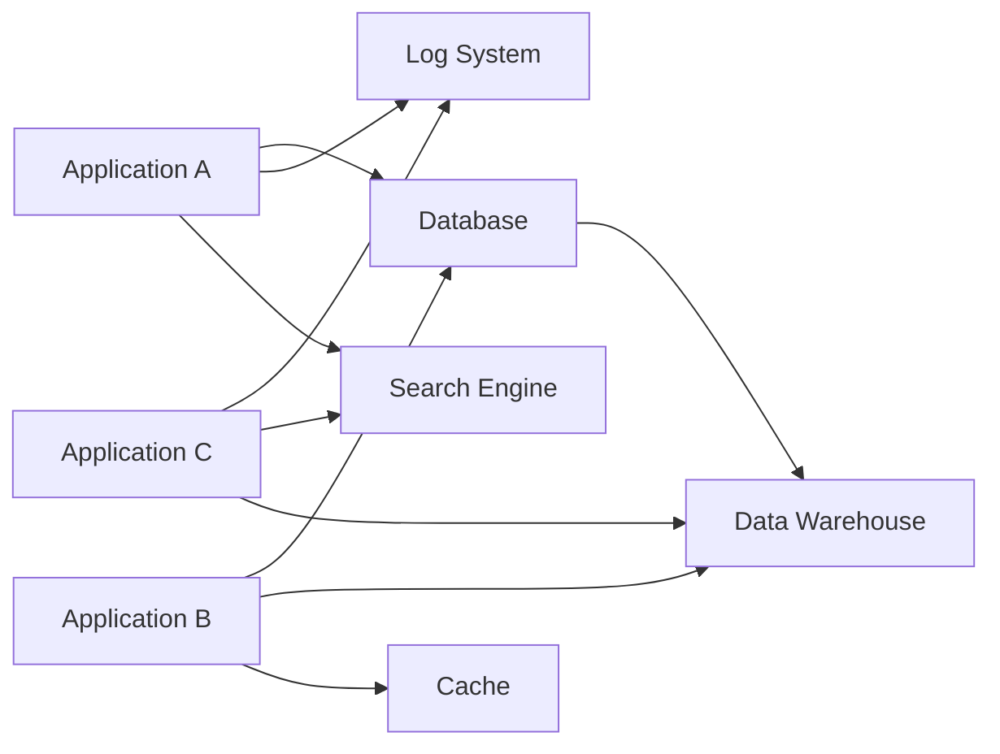

직접 연결이 많아지면 다음 문제를 겪기 쉽다.

- 새 시스템을 추가할 때 기존 애플리케이션을 수정해야 한다.
- 시스템마다 데이터 형식과 전송 방식이 다르다.
- 느린 수신 시스템 때문에 데이터를 보내는 시스템도 지연된다.
- 장애 후 어느 지점부터 다시 전달해야 하는지 판단하기 어렵다.
- 같은 데이터를 여러 곳에 중복해서 전달한다.
- 데이터가 어디에서 누락되거나 늦어졌는지 추적하기 어렵다.

기존 환경에서는 Database Polling, HTTP 호출, 메시지 큐, CSV Dump, NFS, `rsync`, ETL 작업 등을 조합해 이러한 연결을 만들었다. 각각 필요한 방식이지만 연결마다 별도의 운영 절차가 생기면 전체 데이터 흐름을 관리하기 어려워진다.

### Kafka를 중심으로 데이터 흐름 구성하기

Kafka를 사용하면 데이터를 만드는 시스템과 사용하는 시스템 사이에 공통적인 저장·전달 계층을 둘 수 있다.

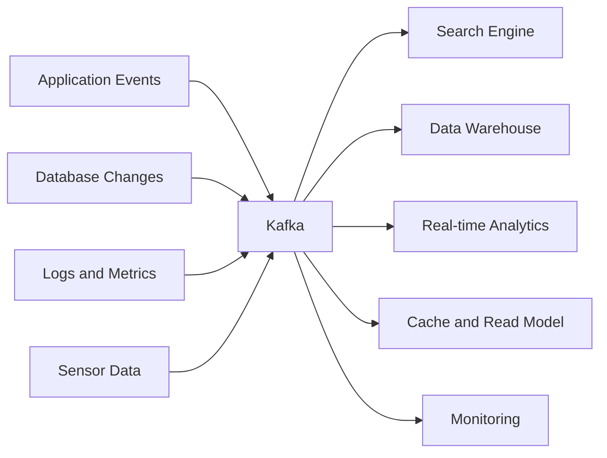

데이터를 생산하는 애플리케이션은 개별 수신 시스템을 모두 호출하는 대신 Kafka에 이벤트를 기록한다. 데이터를 사용하는 시스템은 필요한 Topic을 읽는다.

예를 들어 주문 서비스는 배송 시스템, 알림 시스템, 분석 시스템의 주소를 모두 알 필요 없이 주문 생성 이벤트를 발행할 수 있다. 새로운 분석 시스템이 추가되어도 기존 Topic을 구독하도록 구성하면 된다.

Kafka는 LinkedIn에서 활동 기록, 메시지 교환, Metric 수집 등 대규모 데이터 흐름을 다루는 과정에서 개발되었다. 이후 공개되어 다양한 서비스의 데이터 연결 기반으로 사용되고 있다. [LinkedIn의 Kafka 개발 및 운영 사례](https://www.linkedin.com/blog/engineering/open-source/apache-kafka-trillion-messages)

다만 Kafka를 도입한다고 모든 연동 문제가 사라지는 것은 아니다. 이벤트 형식, 접근 권한, 보존 기간, 장애 복구와 처리 책임은 여전히 설계해야 한다. 연결 대상에 대한 직접적인 의존성을 줄이는 대신 이벤트 계약을 관리하게 되는 것이다.

## 이벤트 스트리밍의 개념

### 이벤트는 이미 발생한 사실이다

이벤트는 시스템에서 발생한 사실을 기록한 데이터다.

```text
사용자가 가입했다.
주문이 생성되었다.
결제가 승인되었다.
상품 가격이 변경되었다.
차량 위치가 갱신되었다.
센서가 새로운 온도를 측정했다.
```

주문 생성 이벤트는 다음과 같은 형태로 표현할 수 있다.

```json
{
  "eventId": "evt-10001",
  "eventType": "OrderCreated",
  "eventVersion": 1,
  "occurredAt": "2026-10-14T10:00:00+09:00",
  "orderId": "order-9001",
  "customerId": "customer-101",
  "totalAmount": 45000
}
```

이 예제의 필드는 다음 역할을 한다.

| 필드 | 목적 |
|---|---|
| `eventId` | 이벤트 식별과 중복 처리 방지 |
| `eventType` | 발생한 사실의 종류 |
| `eventVersion` | 데이터 형식의 버전 |
| `occurredAt` | 업무상 이벤트 발생 시각 |
| `orderId` | 관련 주문 식별자 |
| `customerId` | 관련 고객 식별자 |
| `totalAmount` | 처리에 필요한 업무 데이터 |

이벤트 형식은 소비하는 시스템과의 계약이다. 필드를 삭제하거나 의미를 바꾸면 Consumer가 영향을 받으므로 API처럼 호환성을 관리해야 한다.

### 이벤트 스트림

이벤트 스트림은 시간에 따라 계속 발생하는 이벤트의 흐름이다.

웹사이트 클릭, 금융 거래, 차량 위치와 센서 측정값은 한 번 생성한 파일로 끝나지 않는다. 서비스가 운영되는 동안 지속해서 추가된다.

이벤트 스트리밍은 이러한 데이터를 수집하고 저장하며, 도착하는 흐름에 맞춰 처리하고 다른 시스템으로 전달하는 방식이다.

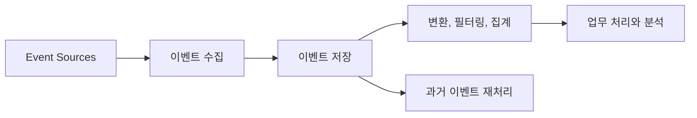

여기서 실시간은 모든 처리 결과가 즉시 반영된다는 뜻은 아니다. Producer 전송, Broker 저장, Consumer 처리와 외부 시스템 반영 과정에서 지연이 생긴다.

따라서 실시간 처리 요구사항은 구체적인 시간으로 정의하는 편이 좋다.

```text
주문 생성 후 5초 안에 알림을 발송한다.
차량 위치를 수 초 이내에 화면에 반영한다.
결제 이벤트를 정해진 지연 범위 안에서 위험 분석에 사용한다.
```

Kafka는 낮은 지연의 데이터 전달을 지원하지만 최종 응답 시간은 전체 Pipeline의 성능에 따라 달라진다.

### 이벤트 스트리밍의 활용 분야

| 분야 | 활용 예 |
|---|---|
| 금융 | 거래 이벤트 수집, 결제 후속 처리, 이상 거래 탐지 |
| 물류와 자동차 | 차량 위치, 배송 상태, 운행 정보 추적 |
| 제조와 에너지 | 설비 센서 수집, 이상 상태 감지 |
| 소매와 여행 | 주문, 예약, 고객 행동 분석 |
| 의료 | 환자 상태와 장비 측정 데이터 전달 |
| 기업 내부 플랫폼 | 부서별 데이터 연결, 감사와 분석 |

Kafka는 이벤트 기반 아키텍처, 데이터 플랫폼, Microservice의 기반으로 사용할 수 있다. 의료나 금융처럼 중요한 분야에서도 데이터 전달 기술이 업무 판단의 정확성까지 보장하는 것은 아니므로 검증과 대응 절차가 함께 필요하다.

## Kafka의 기본 구성

Kafka의 데이터 흐름은 Producer, Broker, Topic, Partition, Consumer로 설명할 수 있다.

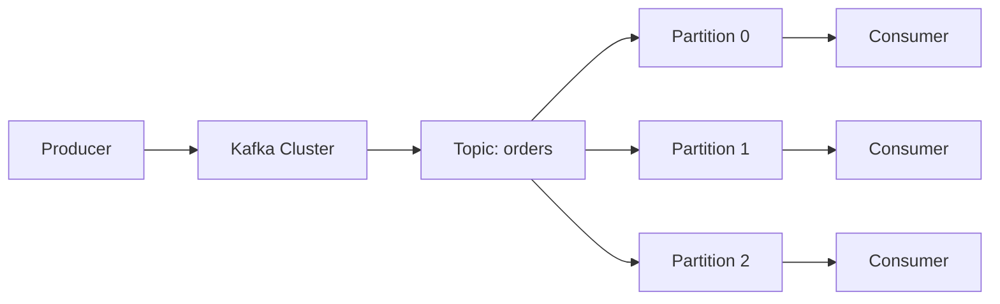

### Broker와 Cluster

Broker는 Kafka의 데이터를 저장하고 Client 요청을 처리하는 서버 프로세스다. Broker가 실행되는 서버나 Node를 지칭하는 표현으로도 사용한다.

여러 Broker를 구성하면 Kafka Cluster가 된다. Partition을 여러 Broker에 나누어 배치하고 데이터를 복제해 처리량과 장애 대응 능력을 높일 수 있다.

다만 Broker 수를 늘렸다는 이유만으로 모든 Topic이 자동으로 충분한 복제와 균형을 갖추는 것은 아니다. Partition 배치와 복제 설정도 확인해야 한다.

### Topic

Topic은 관련 이벤트를 묶는 이름이다.

```text
orders
payments
user-activities
application-logs
vehicle-locations
```

Producer는 지정한 Topic에 이벤트를 보내고 Consumer는 필요한 Topic에서 이벤트를 읽는다. 하나의 Topic에는 여러 Producer가 데이터를 기록할 수 있고 여러 Consumer가 데이터를 사용할 수 있다.

Topic 이름은 처리 책임과 데이터 의미를 이해할 수 있도록 정하는 것이 좋다. 서로 관계없는 이벤트를 하나의 Topic에 무작정 넣으면 권한, 보존 기간과 데이터 형식 관리가 어려워진다.

### Partition

Topic은 하나 이상의 Partition으로 나뉜다. Partition은 이벤트가 순서대로 추가되는 로그이며 저장과 병렬 처리의 기본 단위다.

```text
orders
 ├─ Partition 0: Event A → Event D → Event G
 ├─ Partition 1: Event B → Event E → Event H
 └─ Partition 2: Event C → Event F → Event I
```

순서는 **Partition 내부에서** 유지된다. 여러 Partition에 걸쳐 기록된 모든 이벤트의 전역 순서를 보장하는 것은 아니다.

같은 주문의 상태 변경을 순서대로 다뤄야 한다면 `orderId`를 Key로 사용하는 방법을 고려할 수 있다. 동일한 Partition 수와 Key 분배 방식을 유지하는 동안 같은 Key의 이벤트를 같은 Partition으로 보내도록 구성할 수 있다.

Partition 수를 변경하면 Key의 배치가 달라질 수 있다. 순서가 중요한 데이터는 Partition 확장과 Consumer 내부 처리 방식까지 함께 검토해야 한다. [Kafka Topic과 Partition의 기본 구조](https://kafka.apache.org/42/getting-started/introduction/)

### Producer

Producer는 Kafka에 이벤트를 보내는 Client다.

웹 서버, 백엔드 서비스, 로그 수집기, 센서 Gateway, Database 변경 수집기 등이 Producer 역할을 할 수 있다. 별도의 독립 서버만을 뜻하지 않으며 하나의 애플리케이션 내부에 Producer Client를 둘 수도 있다.

Producer가 Broker에 데이터를 성공적으로 기록했다는 사실은 Consumer의 업무 처리가 완료되었다는 의미와 다르다.

```text
Kafka에 주문 이벤트 기록 성공
≠
알림 발송 완료
≠
배송 처리 완료
```

최종 처리 결과가 필요한 업무라면 결과 이벤트나 상태 조회 방식도 설계해야 한다.

### Consumer

Consumer는 Kafka에서 이벤트를 읽고 처리하는 Client다.

- 주문 이벤트를 읽어 알림을 발송한다.
- 상품 변경 이벤트로 검색 Index를 갱신한다.
- 접속 로그를 분석 저장소에 적재한다.
- 거래 이벤트로 위험 점수를 계산한다.

일반적인 Consumer는 Broker에 Fetch 요청을 보내 데이터를 가져온다. 처리 속도는 Consumer의 코드와 연결된 저장소의 성능에도 영향을 받는다.

### Offset

Offset은 Partition 안에서 Record의 위치를 나타내는 번호다.

```text
Partition 0

Offset 0: 주문 생성
Offset 1: 결제 승인
Offset 2: 배송 시작
Offset 3: 배송 완료
```

Consumer는 자신의 처리 위치를 관리하고 필요한 시점에 Commit한다. 동일한 Topic이라도 Partition마다 Offset이 별도로 존재한다.

Offset은 업무 데이터의 ID가 아니다. `orderId`가 같은 이벤트도 서로 다른 Offset에 기록될 수 있다.

### Consumer Group

일반적인 Consumer Group은 같은 목적의 Consumer 여러 개가 Topic의 Partition을 나누어 처리하는 단위다.

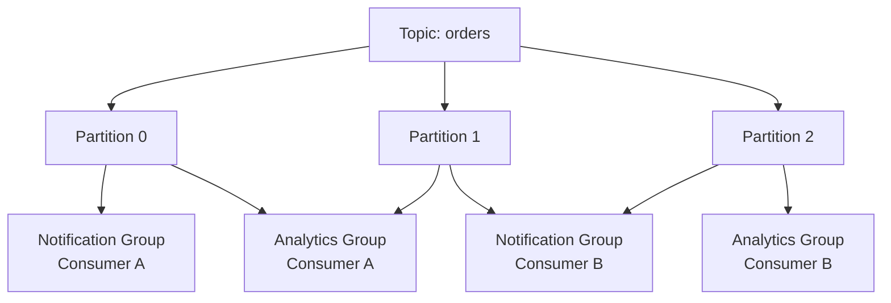

같은 Group에서는 Partition을 나누어 처리하고, 다른 Group은 같은 Topic을 독립적으로 읽는다.

알림과 매출 분석은 다른 처리 목적이므로 별도 Group으로 구성할 수 있다. 분석 처리가 느리더라도 알림 Group은 자신의 위치에서 계속 처리한다.

일반적인 Consumer Group에서 하나의 Partition은 한 시점에 한 Consumer에게 할당된다. 따라서 Partition이 세 개인 Topic을 같은 Group의 Consumer 열 개로 읽더라도 모두가 Partition을 할당받는 것은 아니다.

이 설명은 일반 Consumer Group 기준이다. Kafka 4.2부터 운영용으로 제공되는 Share Group은 Record 단위 확인과 협력 소비를 지원하는 별도 모델이므로 같은 규칙을 그대로 적용하면 안 된다. [Kafka Share Group 안내](https://kafka.apache.org/42/getting-started/upgrade/)

## Kafka의 주요 특징

### 높은 처리량을 위한 구조

Kafka는 많은 이벤트를 효율적으로 저장하고 전달하도록 설계되었다.

- Partition에 데이터를 순차적으로 추가한다.
- 여러 Record를 Batch로 전송할 수 있다.
- 압축으로 전송량과 저장량을 줄일 수 있다.
- 여러 Partition과 Broker로 작업을 분산한다.
- Consumer Group으로 병렬 소비를 구성한다.

실제 처리량은 메시지 크기, 압축 방식, Partition 수, 복제 수, 디스크와 네트워크 성능에 따라 달라진다. 특정 기업의 초당 메시지 수를 그대로 자신의 환경에 적용할 수는 없다.

메시지 수만큼이나 초당 데이터 크기도 중요하다. 작은 클릭 이벤트 백만 건과 대용량 Payload 백만 건은 필요한 자원이 전혀 다르다.

### 소비와 보존을 분리한다

Kafka에서는 Consumer가 데이터를 읽었다고 Record가 바로 삭제되지 않는다. 데이터 정리는 Topic의 보존 정책에 따라 이루어진다.

- 시간 기준 보존
- 용량 기준 보존
- Key 기준 Log Compaction
- 시간·용량 보존과 Compaction의 조합

예를 들어 알림 Consumer는 주문 이벤트를 바로 읽고, 분석 Consumer는 조금 늦게 같은 이벤트를 읽을 수 있다. 새로운 Consumer가 추가되면 남아 있는 과거 데이터부터 처리하도록 구성할 수도 있다.

이벤트를 보존한다는 말이 무기한 보관한다는 뜻은 아니다. Retention으로 삭제되거나 Compaction으로 정리된 과거 Record는 다시 읽을 수 없다.

### Consumer 장애를 흡수할 수 있다

Consumer가 잠시 중단되어도 Kafka가 데이터를 보관하면 복구 후 이어서 처리할 수 있다.

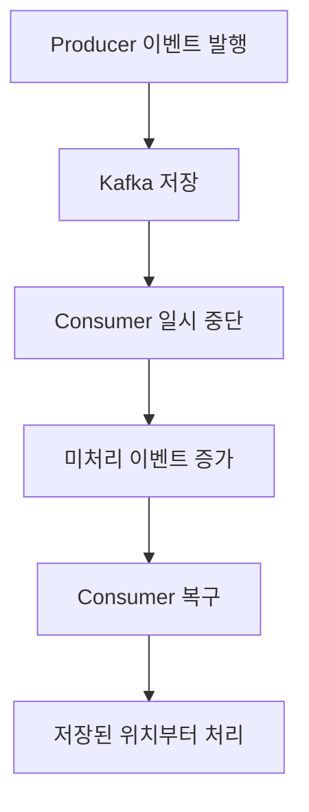

이때 쌓인 처리 지연을 Consumer Lag으로 관찰할 수 있다.

다만 Consumer가 보존 기간보다 오래 중단되면 읽지 않은 데이터가 삭제될 수 있다. 복구 후에도 처리 속도가 유입 속도보다 느리다면 Lag은 계속 증가한다. 저장소의 여유와 Consumer 처리 성능을 함께 관리해야 한다.

### 복제로 내구성과 가용성을 높인다

Kafka는 Partition의 데이터를 여러 Broker에 복제할 수 있다. Leader Broker에 장애가 발생하면 적절한 Replica가 Leader 역할을 이어받도록 구성한다.

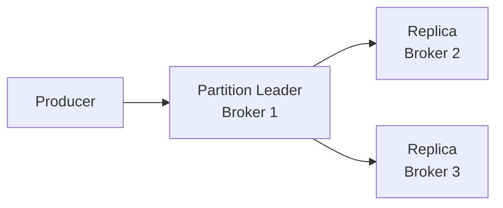

복제가 있다고 해서 어떤 장애에서도 데이터 손실이 없거나 영향이 전혀 없는 것은 아니다. Leader 전환 중 지연이 발생할 수 있고, 충분한 Replica가 남아 있지 않으면 쓰기를 중단하거나 가용성이 낮아질 수 있다.

내구성을 고려할 때는 다음 설정과 조건을 함께 확인한다.

| 항목 | 확인할 내용 |
|---|---|
| Replication Factor | 몇 개의 Broker에 복제할 것인가 |
| `acks` | Producer가 어떤 확인을 기다릴 것인가 |
| `min.insync.replicas` | 쓰기에 필요한 최소 ISR 수 |
| 장애 배치 | Replica가 같은 장애 범위에 몰려 있지 않은가 |
| 복구 정책 | 불완전한 Replica를 Leader로 허용할 것인가 |

`acks=all`은 현재 In-Sync Replica의 확인을 기다리는 설정이다. 외부 업무 처리가 끝났거나 모든 종류의 물리적 장애에 안전하다는 의미는 아니다. [Kafka 복제와 내구성 설계](https://kafka.apache.org/40/design/design/)

## Producer와 Consumer의 분리

### 실행 시점과 처리 속도 분리

동기 호출에서는 요청을 받은 서버가 후속 시스템의 응답을 기다릴 수 있다.

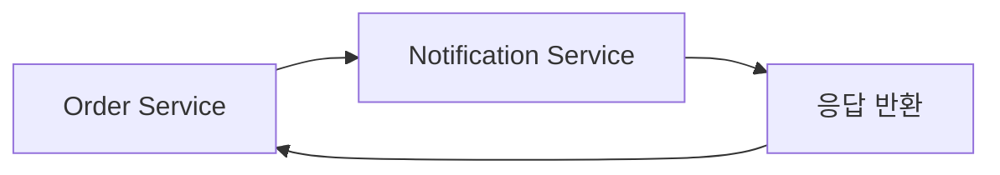

이벤트 방식에서는 주문 서비스가 Kafka에 이벤트를 기록하고 알림 서비스가 별도로 처리한다.

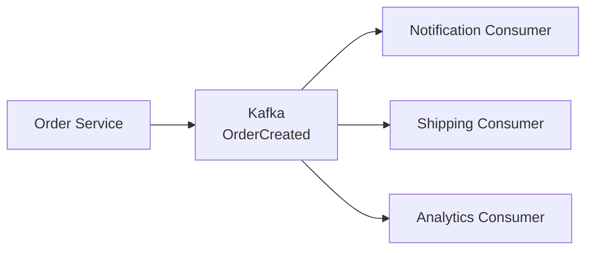

이 구조는 서로 다른 시스템의 실행 시점과 처리 속도를 분리한다. Consumer를 독립적으로 배포하거나 새 처리 기능을 추가하기도 쉬워진다.

대신 결과가 즉시 일치하지 않을 수 있다. 주문은 생성되었지만 알림은 아직 발송되지 않은 상태처럼 중간 상태가 존재한다. 사용자 화면과 업무 로직에서도 이러한 지연을 고려해야 한다.

### 장애 후 중복 처리 가능성

이벤트 처리에는 재시도가 필요하다. Consumer가 데이터베이스 변경을 완료한 뒤 Offset Commit 전에 종료되면 같은 Record를 다시 처리할 수 있다.

```text
이벤트 읽기
→ 데이터베이스 반영
→ Consumer 종료
→ Offset 미반영
→ 재실행 후 같은 이벤트 처리
```

따라서 `eventId`, Unique Constraint, 처리 이력 등으로 멱등성을 확보해야 한다.

Kafka Transaction과 Kafka Streams는 정해진 조건에서 Kafka Topic 사이의 Exactly-Once 처리를 지원한다. 하지만 이메일 발송, 외부 결제 API 호출, 별도 데이터베이스 변경까지 자동으로 하나의 Transaction에 포함하는 것은 아니다. [Kafka 전달 및 처리 보장](https://kafka.apache.org/42/design/design/)

## Kafka와 메시지 큐 비교

Kafka와 RabbitMQ, ActiveMQ 등은 모두 비동기 메시징에 사용할 수 있다. 비교할 때는 제품 이름만으로 구분하기보다 사용하려는 Queue 또는 Stream 모델을 봐야 한다.

### 전통적인 Queue와 Kafka 로그 모델

전통적인 작업 Queue는 대기 중인 작업을 전달하고, 확인된 작업을 Queue에서 제거하는 흐름이 중심이다.

Kafka의 일반적인 소비 모델은 보존된 로그에서 각 Consumer Group의 읽기 위치를 관리한다.

| 비교 항목 | 전통적인 작업 Queue | Kafka의 일반적인 로그 소비 모델 |
|---|---|---|
| 중심 개념 | 전달할 작업 | 보존된 이벤트 로그 |
| 처리 완료 관리 | 메시지 Ack | Partition별 Offset |
| 처리 후 데이터 | Ack 등 정책에 따라 Queue에서 제거 | 소비와 독립적인 보존 정책 |
| 여러 업무의 데이터 사용 | Queue 분리와 Routing 구성 | 별도 Consumer Group |
| 재처리 | 별도 보관과 재발행이 필요할 수 있음 | 남아 있는 로그의 위치를 되돌려 처리 |
| 순서와 병렬성 | Queue 종류와 소비 설정에 따라 다름 | Partition 기준으로 설계 |
| 대표 용도 | 작업 분배, 세밀한 메시지 Routing | 이벤트 Pipeline, 데이터 연동, 재처리 |

RabbitMQ에도 보존과 재처리를 지원하는 Streams가 있다. Kafka에도 Share Group을 통한 Queue 성격의 소비가 추가되었다. 따라서 “RabbitMQ는 재처리할 수 없고 Kafka만 가능하다”는 구분은 정확하지 않다. [RabbitMQ Streams의 보존 방식](https://www.rabbitmq.com/docs/streams)

처리량 역시 하나는 중간 수준이고 다른 하나는 항상 매우 높다고 단정할 수 없다. 메시지 크기, 보장 수준과 Cluster 구성까지 맞춰 비교해야 한다.

### 직접 호출, Pub/Sub, 이벤트 로그

통신 모델의 차이는 다음과 같이 볼 수 있다.

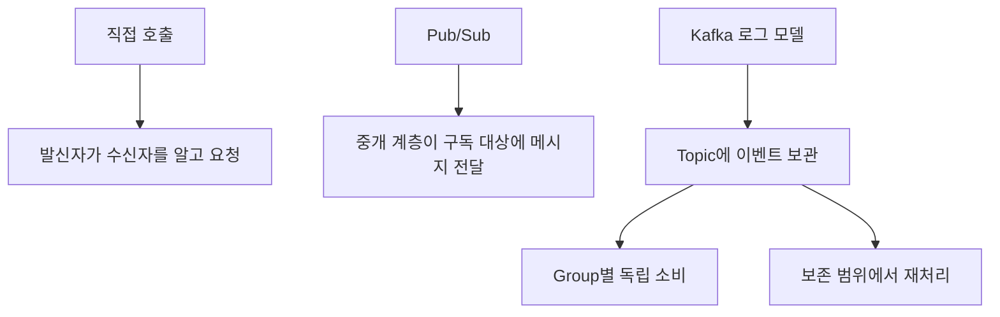

이 관계를 이전 기술이 사라지고 다음 기술로 대체되는 발전 순서로 볼 필요는 없다. 즉시 응답이 필요한 요청은 HTTP나 RPC가 적합하고, 독립적인 후속 처리는 이벤트 방식이 적합할 수 있다.

하나의 시스템에서도 여러 방식을 함께 사용한다.

## Kafka를 활용하는 상황

### 대규모 이벤트 처리

웹사이트 활동, 모바일 이벤트, 센서와 서버 로그처럼 지속해서 많은 데이터가 발생할 때 Kafka를 고려할 수 있다.

판단할 지표는 다음과 같다.

- 초당 이벤트 수와 데이터 크기
- 순간적으로 유입량이 증가하는 폭
- 허용 가능한 처리 지연
- 보존 기간
- 독립적으로 데이터를 사용할 시스템 수

초당 수천 건부터 훨씬 큰 규모까지 다양한 구성이 가능하지만 요구 처리량만으로 도입 여부를 결정하지는 않는다.

### 여러 시스템의 데이터 공유

상품 정보 변경 이벤트를 검색, Cache, 추천과 분석 시스템이 각각 사용할 수 있다.

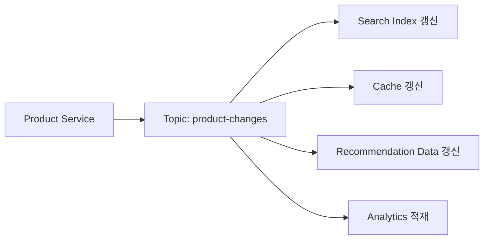

Consumer마다 처리 속도와 배포 시점이 달라도 각자의 Group에서 데이터를 소비할 수 있다.

### 실시간 데이터 Pipeline

Kafka는 다음과 같은 데이터 소스와 목적지를 연결하는 기반으로 사용할 수 있다.

| 소스 | 목적지 |
|---|---|
| 애플리케이션 이벤트 | 실시간 분석 |
| Database 변경 기록 | 검색과 Cache |
| 로그와 Metric | 모니터링, 보안 분석 |
| 모바일 행동 데이터 | 추천과 Feature 생성 |
| 센서 데이터 | 이상 감지 |
| 외부 데이터 Feed | Data Lake, Data Warehouse |

거래 처리에 사용하는 OLTP 시스템과 집계·분석에 사용하는 OLAP 시스템은 목적이 다르다. Kafka는 이 사이의 변경 데이터를 전달할 수 있지만 Transaction Database나 분석 저장소 자체를 대체하는 것은 아니다.

### 스트림 처리

이벤트 전달에 더해 필터링, 변환, 집계와 Join이 필요하면 Kafka Streams, Flink 등의 처리 도구를 사용할 수 있다.

```text
결제 이벤트
→ 사용자별 최근 거래 집계
→ 평소와 다른 거래 패턴 계산
→ 위험 이벤트 발행
→ 알림 또는 추가 확인
```

Kafka Broker가 이러한 업무 분석을 모두 실행하는 것은 아니다. Broker는 이벤트 저장과 전달을 담당하고, 처리 애플리케이션이 업무 로직을 수행한다.

## 기업 활용 사례

기업마다 Kafka를 사용하는 규모와 목적은 다르다.

| 기업 | 활용 분야 |
|---|---|
| Adobe | Experience Platform의 고객 데이터 처리 |
| Cloudflare | 서비스 간 이벤트 전달 |
| DoorDash | 기존 메시징 구성 개선과 서비스 연동 |
| Grab | 실시간 사기·오용 탐지 |
| LinkedIn | 활동 기록, 메시지 교환, Metric 수집 |
| Netflix | 공통 이벤트 Pipeline과 Kafka 운영 플랫폼 |
| Salesforce | 로그와 기업용 이벤트 기반 연동 |
| Uber | 앱 이벤트, 위치 정보, 로그와 실시간 분석 |
| Walmart | 재고·보충과 옴니채널 데이터 연동 |
| DICK’S Sporting Goods | 상품, 가격, Promotion과 고객 서비스 연동 |

이러한 사례에서 주목할 점은 유명 기업이 사용한다는 사실보다 같은 데이터를 여러 시스템에서 독립적으로 활용한다는 구조다.

### Cloudflare와 LinkedIn의 규모 해석

Cloudflare가 2022년에 공개한 서비스 간 메시징 사례의 1조 건은 해당 용도에서 약 8년 동안 처리한 누적 수치다. 같은 글에 언급된 별도 통계 Pipeline의 일일 처리량과 혼동하면 안 된다. [Cloudflare의 Kafka 메시징 사례](https://blog.cloudflare.com/using-apache-kafka-to-process-1-trillion-messages/)

LinkedIn은 2019년 공개 글에서 전체 Kafka 운영 환경의 일일 처리량이 7조 건을 넘었다고 설명했다. 이 수치는 여러 Cluster로 구성된 당시 환경의 합계다. 단일 Broker의 성능이나 현재 운영 규모를 나타내는 값이 아니다. [LinkedIn의 일일 7조 메시지 사례](https://www.linkedin.com/blog/engineering/open-source/apache-kafka-trillion-messages)

처리량을 비교할 때는 집계 기간, 메시지 크기, Cluster 수와 업무 범위를 함께 봐야 한다.

### Netflix의 이벤트 Pipeline

Netflix의 Keystone은 이벤트를 발행하고 수집해 Batch 및 Stream 처리 시스템으로 전달하는 공통 Pipeline 사례다.

다음은 핵심 구조를 단순화한 것이다.

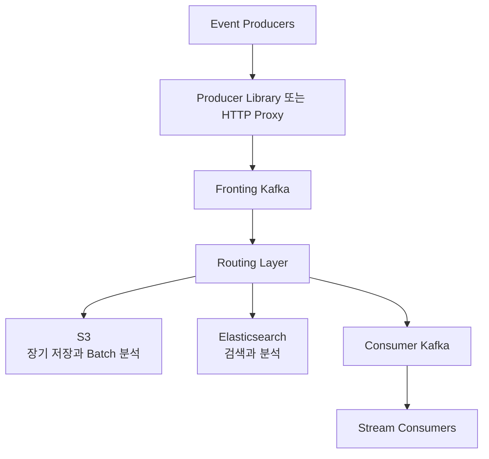

Fronting Kafka는 수집과 Buffering을, Consumer Kafka는 실시간 Consumer가 사용할 데이터를 제공하는 역할을 수행했다. 수집 경로와 소비 경로를 나누면 Consumer의 부하와 변경이 수집 계층에 미치는 영향을 줄일 수 있다. [Netflix의 Keystone Kafka 구조](https://medium.com/netflix-techblog/kafka-inside-keystone-pipeline-dd5aeabaf6bb)

대규모 KaaS 사례의 규모를 설명할 때 제시된 수치는 다음과 같다.

| 항목 | 규모 |
|---|---:|
| 메시지 처리량 | 초당 1억 9천만 건 |
| 데이터 유입량 | 초당 150GB 이상 |
| 보관 데이터 | 8PB 이상 |
| 전용 Kafka Cluster | 475개 이상 |
| Broker | 11,500개 |
| Topic | 35,000개 |

이는 특정 시점의 전체 운영 환경을 설명하는 수치로 이해해야 한다. Kafka를 설치하면 같은 성능이 나온다는 의미는 아니다.

KaaS에는 Broker 운영 외에도 Topic 생성, 권한, Monitoring, 용량 관리와 장애 대응을 다른 개발팀이 이용할 수 있도록 제공하는 일이 포함된다.

### Uber의 실시간 데이터 기반

Uber는 탑승자 앱, 운전자 앱, Backend, GPS 등에서 발생한 이벤트와 로그를 Kafka로 모아 실시간 및 Batch Pipeline에 전달한 사례를 공개했다.

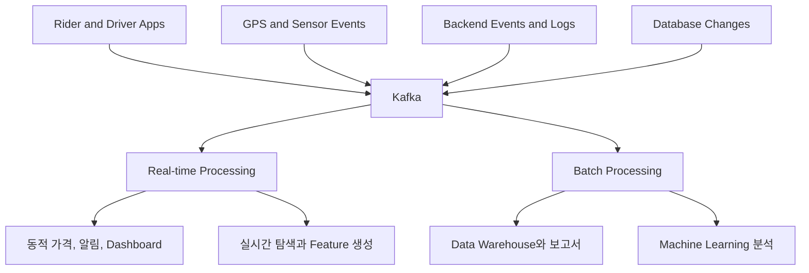

과거 공개 구성에는 Samza, Storm, Hadoop, Vertica, Elasticsearch 등 여러 처리·저장 시스템이 등장한다. 이를 현재 반드시 사용해야 할 조합으로 보기는 어렵다. 실시간 처리와 Batch 처리가 같은 이벤트 기반에서 출발할 수 있다는 점이 중요하다. [Uber의 Kafka 기반 데이터 Pipeline](https://www.uber.com/au/en/blog/ureplicator-apache-kafka-replicator/)

이러한 플랫폼에서는 데이터 내구성과 가용성뿐 아니라 새로운 처리 도구를 연결할 수 있는 확장성, 여러 팀이 데이터를 이용할 수 있는 접근성도 중요하다.

### 옴니채널과 추천

옴니채널 서비스에서는 매장, 웹사이트와 모바일 앱의 데이터가 연결되어야 한다.

가격이나 Promotion이 변경되면 각 채널에 반영해야 하고, 고객 상담에서도 최근 주문 상태를 확인할 수 있어야 한다. DICK’S Sporting Goods는 분리된 데이터를 연결해 상품과 가격, Promotion 정보를 실시간으로 다루는 사례를 공개했다. [DICK’S의 옴니채널 데이터 연동](https://www.confluent.io/es-es/customers/dicks-sporting-goods/)

고객 행동 이벤트는 서로 다른 목적으로 활용할 수도 있다.

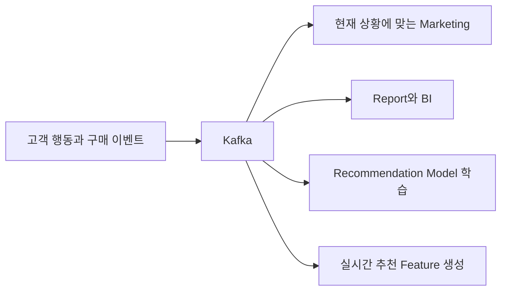

과거 Newsletter 반응과 최근 상품 탐색, 현재 매장 행동을 연결하면 단일 시점의 정보보다 풍부한 판단이 가능하다. 다만 개인정보 이용 목적과 보존 정책도 함께 설계해야 한다.

### Machine Learning과 사기 탐지

Kafka는 모델 학습에 필요한 데이터를 전달하고, 운영 중 발생한 이벤트를 실시간 추론에 연결하는 데 사용할 수 있다.

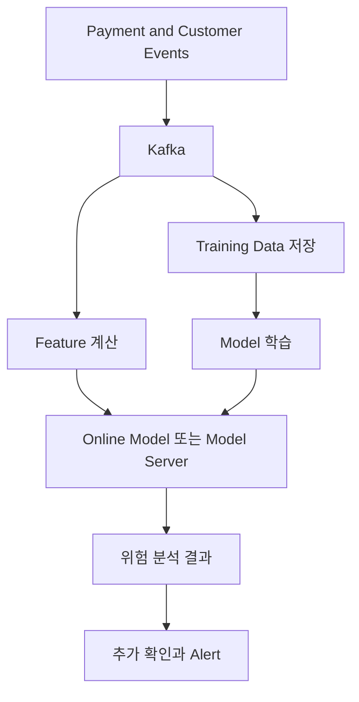

실시간 경로에서는 거래 이벤트를 처리해 Feature를 계산하고 모델을 호출한다. 학습 경로에서는 누적 데이터를 저장하고 새 모델을 만든다. 지연과 자원 요구가 다르므로 두 경로를 구분하는 것이 좋다.

모델 학습과 추론은 별도의 ML 시스템이 담당한다. Kafka는 필요한 데이터가 지속해서 흐르도록 연결한다.

## Kafka 생태계의 도구

| 도구 | 역할 |
|---|---|
| Producer·Consumer Client | 애플리케이션에서 이벤트 발행과 소비 |
| Kafka Connect | 외부 시스템과 Kafka 사이의 데이터 연동 |
| Kafka Streams | 애플리케이션 내부의 Stream 처리 |
| Schema Registry | 이벤트 Schema와 호환성 관리 |
| REST Proxy | HTTP 방식의 접근 계층 |
| Flink 등의 처리 엔진 | 복잡한 집계, 상태 관리와 Stream 처리 |
| SQL 기반 Stream 도구 | SQL 형태로 변환과 분석 정의 |

Kafka Connect와 Kafka Streams는 Apache Kafka 프로젝트의 구성요소다. Schema Registry와 REST Proxy는 별도 제품이나 구현을 선택해 사용하는 계층이므로 모든 Kafka 설치에 자동으로 포함된다고 가정해서는 안 된다.

Go, .NET, Python, Java 등 여러 언어의 애플리케이션이 Kafka Client를 사용할 수 있다. HTTP 연동이 필요하다면 REST Proxy 같은 중간 계층을 선택할 수도 있다.

## 도입 전에 판단할 사항

Kafka가 적합한지는 데이터의 성격과 처리 요구에서 판단해야 한다.

| 요구사항 | 판단 방향 |
|---|---|
| 같은 데이터를 여러 시스템이 사용 | Topic과 별도 Consumer Group 검토 |
| 장애 후 재처리가 필요 | 보존 기간과 Offset 관리 검토 |
| 대규모 지속 이벤트 수집 | Partition, Broker, Network 용량 설계 |
| 독립적인 후속 처리 | 이벤트 기반 연동 검토 |
| 즉시 결과가 필요한 호출 | HTTP·RPC와 역할 구분 |
| 소규모 단순 작업 분배 | 더 단순한 Queue 구성도 비교 |
| 대용량 이미지·영상 전달 | Object Storage에 저장하고 위치를 이벤트로 전달 |

운영에는 Broker 관리, 디스크 용량, 보안, Retention과 Consumer Lag Monitoring이 필요하다. 데이터 계약도 Producer와 Consumer가 함께 관리해야 한다.

핵심 데이터 변경을 Kafka로 전달한다면 Database 저장과 이벤트 발행 사이의 실패도 고려해야 한다. 주문은 저장했지만 이벤트 발행이 실패하는 상황을 막기 위해 Transactional Outbox나 CDC 같은 방식을 검토할 수 있다.

## 정리

Kafka는 여러 시스템에서 발생한 이벤트를 저장하고 독립적으로 소비할 수 있도록 제공하는 분산 이벤트 스트리밍 플랫폼이다. Topic과 Partition으로 데이터를 나누고, Producer가 기록한 이벤트를 Consumer가 Offset을 관리하며 읽는다.

소비와 보존이 분리되어 있다는 점은 여러 Consumer Group의 독립 처리와 재처리를 가능하게 한다. 순서는 Partition 내부에서 다루며, 복제와 전달 확인 설정으로 내구성과 가용성을 설계한다.

데이터 Pipeline, Microservice 연동, 실시간 분석과 Machine Learning에서 Kafka를 활용할 수 있다. 다만 도입 자체가 무손실, 무중단이나 외부 업무의 Exactly-Once 처리를 보장하지는 않는다. 이벤트 계약, 멱등성, 보존 정책과 복구 절차까지 함께 설계해야 한다.
