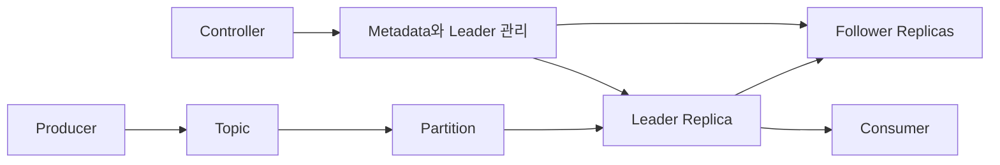
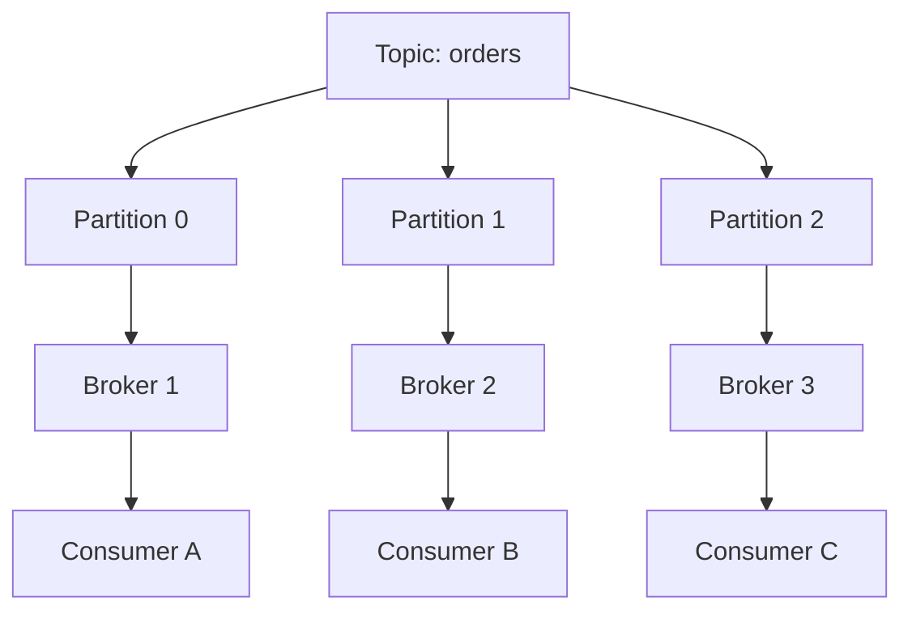
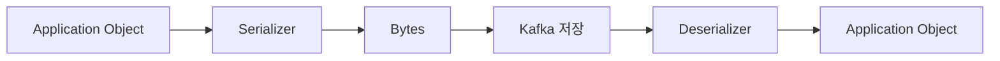
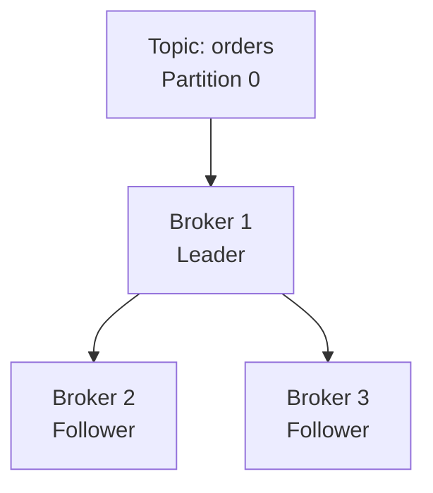
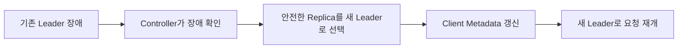
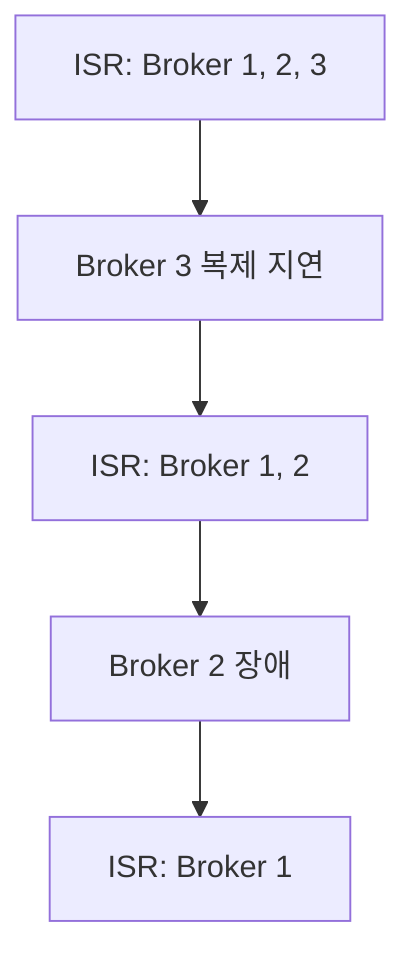
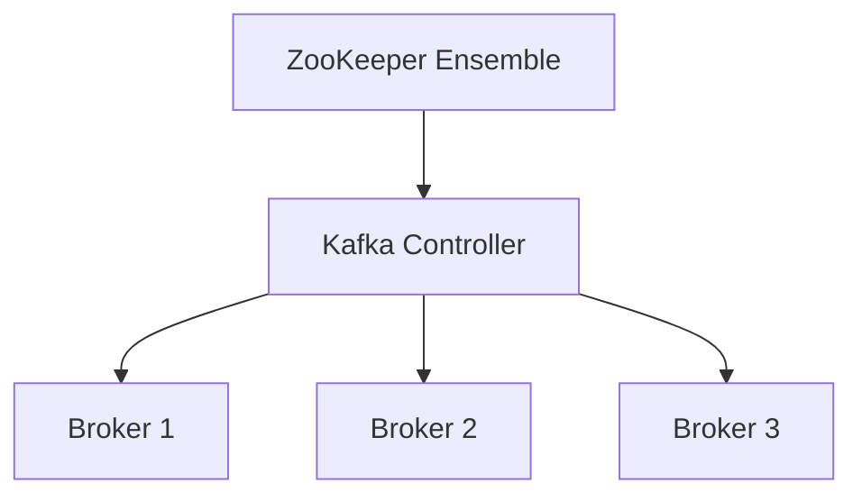
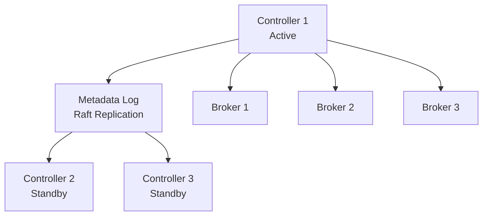

# 카프카의 핵심 개념 알아보기

# 카프카의 핵심 개념 알아보기

* toc
{:toc}

---

## Kafka의 핵심 개념

Kafka를 이해하려면 데이터를 어떻게 나누어 저장하는지, 저장한 데이터를 장애 상황에서 어떻게 지키는지 함께 살펴봐야 한다.

데이터 모델에서는 Topic, Partition, Offset과 Record의 구조가 중요하다. 고가용성에서는 Partition 복제, Leader와 Follower, ISR, Controller의 역할을 구분해야 한다.

이 개념들은 각각 독립적인 설정이 아니다. Partition 수는 병렬 처리와 운영 비용에 영향을 주고, Key는 데이터 분배와 순서에 영향을 준다. 복제 수와 전송 확인 설정은 장애가 발생했을 때 데이터를 계속 기록할 수 있는지 결정한다.



## Kafka 데이터 모델

### Topic은 이벤트를 구분하는 논리적인 단위다

Topic은 관련된 이벤트를 묶어 저장하는 이름이다. 하나의 Kafka Cluster에는 여러 Topic을 만들 수 있다.

```text
commerce.orders.created.v1
commerce.payments.approved.v1
media.uploads.completed.v1
platform.application-logs.v1
```

Producer는 지정한 Topic에 데이터를 기록하고, Consumer는 필요한 Topic에서 데이터를 읽는다.

뉴스, 동영상, 이미지처럼 데이터의 성격을 기준으로 Topic을 나눌 수도 있다. 다만 동영상이나 이미지라는 Topic 이름이 실제 대용량 파일 전체를 Kafka에 저장해야 한다는 뜻은 아니다. 일반적으로 파일은 Object Storage 등에 저장하고 Kafka에는 파일 위치, 식별자와 처리 상태를 전달하는 구성이 적합하다.

```json
{
  "eventId": "evt-10001",
  "eventType": "ImageUploaded",
  "imageId": "image-9001",
  "objectKey": "uploads/2026/10/image-9001.jpg",
  "contentType": "image/jpeg"
}
```

이렇게 하면 이벤트 전달과 대용량 파일 저장의 책임을 나눌 수 있다.

### Topic 이름 규칙

Topic 이름에는 영문자, 숫자, 마침표(`.`), 밑줄(`_`), 하이픈(`-`)을 사용할 수 있다. 최대 길이는 **249자**이며, 빈 이름이나 `.`과 `..`만으로 된 이름은 사용할 수 없다.

마침표와 밑줄은 Metric 이름에서 충돌할 수 있으므로 명명 규칙에서는 두 문자를 혼용하지 않는 편이 좋다. 이러한 검증은 [Kafka의 Topic 이름 검사 코드](https://github.com/apache/kafka/blob/trunk/clients/src/main/java/org/apache/kafka/common/internals/Topic.java)에서도 확인할 수 있다.

실무에서는 이름만 보고 데이터의 소유자와 의미를 파악할 수 있어야 한다.

```text
<domain>.<entity>.<event>.v<version>
```

예를 들어 다음과 같이 구성할 수 있다.

```text
commerce.orders.created.v1
commerce.orders.cancelled.v1
membership.users.registered.v1
```

명명 규칙을 정할 때는 다음 기준을 맞추는 것이 좋다.

- 소문자 사용
- 단어 구분자 통일
- 서비스나 업무 Domain을 접두사로 사용
- 단수형과 복수형의 일관성 유지
- 불필요하게 긴 이름 피하기
- 버전 표기를 사용할 조건 정의

여기서 Domain이나 서비스 접두사는 이름을 구분하는 관례다. Kafka에 별도의 계층형 Namespace가 생성되는 것은 아니다. 접근 제어가 필요하면 ACL 등 권한 설정도 적용해야 한다.

## Partition과 병렬 처리

### Topic은 여러 Partition으로 나뉜다

Partition은 Topic을 나누는 저장 단위다. 각 Partition에는 Record가 순서대로 추가된다.

```text
Topic: commerce.orders.created.v1

Partition 0: A → D → G
Partition 1: B → E → H
Partition 2: C → F → I
```

Partition을 여러 Broker에 배치하면 저장과 요청 처리를 분산할 수 있다. Consumer도 Partition을 나누어 읽으면서 병렬로 처리할 수 있다.



반드시 여러 Producer가 있어야 Partition을 활용할 수 있는 것은 아니다. 하나의 Producer도 여러 Partition으로 데이터를 전송할 수 있다.

### Partition이 늘면 얼마나 빨라질까

각 메시지를 처리하는 데 1초가 걸린다고 가정하면, 하나의 처리 경로에서 네 개를 순차적으로 처리하는 데는 4초가 필요하다.

서로 독립적인 네 개의 처리 경로에서 동시에 처리할 수 있다면 이론적으로는 약 1초에 끝낼 수 있다.

| 구성 | 가정한 처리 방식 | 이론적인 소요 시간 |
|---|---|---:|
| 하나의 처리 경로 | A, B, C, D 순차 처리 | 4초 |
| 네 개의 처리 경로 | A, B, C, D 병렬 처리 | 1초 |

이는 병렬성의 원리를 설명하기 위한 예다. Partition을 네 배로 늘린다고 실제 처리량이 반드시 네 배가 되는 것은 아니다.

다음 조건이 병목이 될 수 있기 때문이다.

- Broker의 디스크와 Network 처리량
- Producer의 전송 능력
- Consumer의 처리 로직
- Consumer가 사용하는 Database
- 특정 Key로 데이터가 집중되는 현상
- Batch 크기와 압축 설정
- 복제에 사용하는 자원

Partition은 병렬 처리의 기회를 제공한다. 그 기회를 활용할 수 있는 애플리케이션과 인프라가 함께 필요하다.

### Producer 수와 Partition 수는 같은 개념이 아니다

Producer 네 대가 각각 초당 10개를 보내면 전체 유입량은 초당 40개다.

Consumer 한 개의 처리 능력이 초당 5개라면 같은 유입량을 처리하기 위해 여덟 개의 처리 단위가 필요하다.

| 구분 | 인스턴스 수 | 인스턴스당 처리량 | 전체 처리량 |
|---|---:|---:|---:|
| Producer | 4 | 초당 10개 | 초당 40개 |
| Consumer | 8 | 초당 5개 | 초당 40개 |

일반적인 Consumer Group에서 여덟 Consumer가 모두 Partition을 할당받으려면 적어도 여덟 Partition이 필요하다. Producer가 네 대라고 해서 Partition도 반드시 네 개여야 하는 것은 아니다.

이 계산은 Partition별 작업량이 균등하고, 다른 자원의 병목이 없다는 가정에 따른 최소치다. 유입량과 처리량이 정확히 같으면 장애나 순간적인 Traffic 증가로 생긴 Lag을 줄일 여유도 없다.

### 목표 처리량으로 Partition 수 추정하기

Partition 하나가 감당할 수 있는 Producer 처리량과 Consumer 처리량을 측정했다면 다음과 같이 출발점을 잡을 수 있다.

```text
필요 Partition 수의 추정값

= max(
    목표 유입량 / Partition당 쓰기 처리량,
    목표 처리량 / Partition당 소비 처리량
  )

각 계산 결과는 올림 처리
```

그다음 다음 조건을 더한다.

- 예상하는 Consumer 병렬 수
- 순간 최대 유입량
- 장애 후 밀린 데이터를 따라잡을 처리 여유
- 메시지 크기와 Key 분포
- Broker별 Partition Replica 수
- 운영 중 확장 계획

메시지 개수만으로 계산하기보다 초당 Byte 수와 처리 시간도 함께 측정해야 한다.

### Partition을 너무 많이 만들면 생기는 비용

Partition은 논리적인 숫자만 늘어나는 설정이 아니다. Broker는 각 Partition Replica의 로그 Segment, Index, 복제 상태와 Metadata 등을 관리한다.

Partition이 많아지면 다음 비용이 증가할 수 있다.

- 열린 파일과 File Descriptor 사용량
- Broker Memory와 Metadata 관리량
- 복제와 상태 확인 비용
- Leader 전환과 장애 복구 작업량
- Consumer의 Partition 할당 관리 비용
- 작은 Batch가 여러 Partition으로 흩어지는 비용

Broker당 Partition을 약 2,000개로 제한하자는 식의 수치는 특정 환경의 출발점으로 볼 수 있다. Kafka의 보편적인 고정 상한은 아니다. 버전, Hardware, Traffic과 복구 목표에 따라 적절한 규모가 달라진다.

이때 Leader Partition만 세지 말고 Follower를 포함한 **Partition Replica 수**도 확인해야 한다.

### Partition 수 변경과 순서

기존 Topic의 Partition 수는 늘릴 수 있지만 일반적인 관리 기능으로 줄일 수는 없다. 줄여야 한다면 새로운 Topic을 만들고 데이터를 이동하는 방식을 검토해야 한다.

Partition을 늘릴 때는 Key 분배도 중요하다. Key 해시와 Partition 수로 목적지를 계산하는 경우 Partition 수가 바뀌면 같은 Key가 이전과 다른 Partition으로 갈 수 있다.

기존 Record는 자동으로 새 Partition에 재분배되지 않는다. 따라서 순서가 중요한 데이터는 Partition 확장 과정에서 이전 데이터와 새로운 데이터가 어떻게 처리될지 확인해야 한다.

## Offset과 메시지 순서

### Offset은 Partition 내부의 위치다

Offset은 Partition 안에서 Record의 위치를 나타내는 값이다. 일반적으로 0부터 시작해 증가하는 64비트 정수이며, Partition별로 관리된다.

```text
Partition 0: 0, 1, 2, 3, 4, 5
Partition 1: 0, 1, 2, 3
Partition 2: 0, 1, 2, 3, 4
```

따라서 Offset `3`만으로는 Record를 식별할 수 없다. 어느 Topic의 어느 Partition인지 함께 알아야 한다.

```text
Topic + Partition + Offset
```

Offset은 주문 번호나 이벤트 ID와도 다르다. 같은 주문에 관한 이벤트 여러 개가 서로 다른 Offset을 가질 수 있다.

### Offset이 증가해도 모든 번호가 남는 것은 아니다

보존 정책이나 Log Compaction에 따라 오래된 Record가 삭제될 수 있다. 남아 있는 Record의 Offset을 다시 0부터 정렬하지는 않는다.

```text
정리 전: 0, 1, 2, 3, 4, 5
정리 후: 0, 3, 5
```

따라서 Offset 차이를 언제나 실제로 읽을 수 있는 업무 메시지 개수와 같다고 볼 수는 없다.

### Kafka가 보장하는 순서의 범위

Kafka는 Partition에 기록된 순서를 기준으로 데이터를 제공한다. 서로 다른 Partition 사이에는 하나의 전역 순서가 없다.

같은 주문의 상태 변경을 순서대로 처리하려면 관련 이벤트를 같은 Partition에 보내는 구성이 필요하다.

```text
Key: order-1001

OrderCreated
→ PaymentApproved
→ ShippingStarted
```

Consumer가 읽은 Record를 여러 Thread에 무작위로 분배하면 처리 완료 순서는 달라질 수 있다. Producer의 전송·재시도 설정부터 Consumer의 병렬 실행 방식까지 함께 고려해야 업무상의 순서를 지킬 수 있다.

## Kafka Record의 구조

Kafka에서는 메시지를 Record라고도 부른다. 애플리케이션이 전송하는 주요 데이터와 Broker가 부여하는 위치 정보를 나누어 보면 이해하기 쉽다.

| 구성 요소 | 의미 |
|---|---|
| Key | 데이터 분배와 업무 식별 등에 사용하는 선택 값 |
| Value | 실제 전달할 데이터 |
| Timestamp | Record의 생성 또는 Broker 기록 시각 |
| Headers | 추적과 형식 등 부가 Metadata |
| Partition | Record가 저장된 Partition |
| Offset | Partition 안에서의 위치 |

Kafka의 실제 전송 형식에는 더 많은 정보가 있지만 애플리케이션 개발에서는 우선 이 항목들을 이해하면 된다.

### Key

Key는 특정 Partition으로 데이터를 모으는 데 사용할 수 있다.

```text
Key: customer-101
Value: 고객 정보 변경 이벤트
```

Partition을 명시하지 않고 Key를 사용하는 기본 분배 방식에서는 직렬화된 Key의 해시를 기준으로 Partition을 선택한다.

같은 업무 ID를 사용하더라도 Producer마다 Key 직렬화 방식이 다르면 결과가 달라질 수 있다. 명시적인 Partition 지정이나 Custom Partitioner를 사용하는 경우에도 기본 규칙과 다르게 동작할 수 있다.

따라서 “같은 Key는 언제나 같은 Partition”이라는 설명에는 Partition 수, 직렬화와 분배 방식이 유지된다는 조건이 붙는다.

### Key가 없을 때의 분배

Key가 없으면 언제나 메시지를 하나씩 Round Robin으로 보낸다고 생각하기 쉽지만, 현재 Java Producer의 기본 동작은 그렇게 단순하지 않다.

Batch 효율을 높이기 위한 Sticky Partitioning을 사용하며, 설정에 따라 Broker 성능을 고려하는 Adaptive Partitioning도 적용될 수 있다.

| 조건 | 일반적인 선택 방식 |
|---|---|
| Partition을 직접 지정 | 지정한 Partition |
| Partition 미지정, Key 존재 | Key 기반 분배 |
| Partition과 Key 모두 없음 | 기본 Sticky·Adaptive 분배 |
| Custom Partitioner 지정 | 구현한 분배 규칙 |

Round Robin이 필요하면 해당 Partitioner를 명시할 수 있다. Client 종류와 버전에 따라 기본값이 다를 수 있으므로 [Producer Partition 설정](https://kafka.apache.org/43/configuration/producer-configs/)을 기준으로 확인해야 한다.

### Value

Kafka는 Value를 특정 업무 구조로 해석하지 않고 Byte 데이터로 다룬다. Java 객체를 보내려면 Serializer로 변환하고, Consumer는 Deserializer로 복원한다.



Value에는 JSON 문자열, Avro와 Protobuf로 직렬화한 데이터 등 여러 형식을 사용할 수 있다.

Value가 `null`인 Record도 가능하다. 특히 Compacted Topic에서 Key와 `null` Value의 조합은 해당 Key의 삭제를 나타내는 Tombstone으로 사용한다.

### Timestamp

Record의 Timestamp에는 대표적으로 두 기준이 있다.

| 기준 | 의미 |
|---|---|
| `CreateTime` | Producer가 지정하거나 생성한 시각 |
| `LogAppendTime` | Broker가 로그에 기록하는 시각 |

업무 데이터의 실제 발생 시각과 Kafka에 도착한 시각은 다를 수 있다. 지연 분석이나 시간 구간 집계가 중요하다면 Value에도 `occurredAt` 같은 업무 시각을 두고 의미를 명확히 정하는 것이 좋다.

### Headers

Headers는 Key-Value 형태의 부가 정보를 전달한다.

```text
event-id: evt-10001
content-type: application/json
schema-version: 1
trace-id: trace-9001
```

추적 정보나 직렬화 형식을 Payload와 분리할 때 유용하다. 다만 Header에 Routing 정보를 넣었다고 Broker가 자동으로 목적지 Topic을 변경하는 것은 아니다. 해당 값을 사용하는 Client나 처리 애플리케이션이 있어야 한다.

## 메시지 형식과 압축

### 직렬화 형식 선택

| 형식 | 장점 | 고려할 점 |
|---|---|---|
| JSON | 읽기 쉽고 지원 도구가 많음 | 크기와 필드 검증 방식 |
| XML | 구조와 Schema를 표현할 수 있음 | 장황한 데이터와 Parsing 비용 |
| CSV | 단순한 표 형태에 적합 | 중첩 구조, 구분자와 타입 처리 |
| Avro | Schema 기반의 효율적인 이진 형식 | Writer·Reader Schema 관리 |
| Protocol Buffers | 명시적인 Schema와 다중 언어 지원 | 필드 번호와 변경 규칙 |
| MessagePack | JSON과 유사한 데이터를 이진화 | 별도 데이터 계약과 검증 관리 |

사람이 직접 읽기 쉬운지, 여러 언어에서 사용하는지, 데이터 크기와 Schema 변경이 얼마나 중요한지를 기준으로 선택한다.

### Schema 진화

Producer와 Consumer는 동시에 배포되지 않을 수 있다. 새 Producer가 만든 데이터를 이전 Consumer가 읽거나, 새 Consumer가 오래된 데이터를 다시 읽는 상황을 고려해야 한다.

Avro는 Writer와 Reader Schema를 비교하는 규칙을 제공한다. 예를 들어 새 필드에 적절한 기본값을 두면 오래된 데이터에 없는 필드를 읽는 데 사용할 수 있다. 그러나 모든 변경이 자동으로 호환되는 것은 아니다. [Avro Schema Resolution](https://avro.apache.org/docs/%2B%2Bversion%2B%2B/specification/)

Protobuf는 필드 번호가 중요하다. 기존 필드 번호를 다른 의미로 재사용하면 과거 데이터를 잘못 해석할 수 있으므로 삭제한 번호는 `reserved`로 남기는 방식이 권장된다. [Protobuf Schema 변경 규칙](https://protobuf.dev/best-practices/dos-donts/)

MessagePack도 데이터 계약을 만들 수 있지만 직렬화 형식 자체가 Schema 관리를 강제하지는 않는다. 별도 문서와 검증 규칙 없이 사용하면 필수 필드와 타입을 파악하기 어려워질 수 있다.

### 압축은 설정해야 적용된다

Kafka Producer는 Gzip, Snappy, LZ4, Zstd 등을 지원한다. 기본 `compression.type`은 `none`이므로 모든 메시지가 자동으로 압축되는 것은 아니다.

```properties
compression.type=zstd
```

압축은 Record Batch 단위로 적용된다. Batch 구성에 따라 압축 효율도 달라진다.

| 방식 | 선택 시 고려할 성격 |
|---|---|
| Gzip | 압축률과 CPU 비용 |
| Snappy | 처리 속도와 상대적으로 낮은 압축률 |
| LZ4 | 빠른 압축·해제와 낮은 지연 |
| Zstd | 압축 수준에 따른 크기·CPU 조절 |

작은 데이터에서는 압축 비용이 이익보다 클 수 있다. 이미 압축된 이미지나 영상은 추가 압축 효과가 작을 수도 있다. 실제 Payload로 Network 사용량, CPU와 지연을 측정해야 한다.

## Partition 복제와 고가용성

### 복제는 Partition별로 이루어진다

Topic에 Replication Factor를 설정하지만, 실제 복제 단위는 Topic을 구성하는 각각의 Partition이다.

Replication Factor가 `3`이라면 하나의 Partition에 총 세 개의 Replica를 둔다. 보통 하나가 Leader이고 나머지가 Follower다.



Replication Factor에는 Leader도 포함된다.

| Replication Factor | 전체 복사본 | Follower 수 |
|---|---:|---:|
| 1 | 1 | 0 |
| 2 | 2 | 1 |
| 3 | 3 | 2 |

복제 수는 Topic 생성 설정과 Broker·플랫폼 정책에 따라 결정된다. 기본값이 언제나 운영에 적합하다고 가정하지 말고 실제 Topic의 값을 확인해야 한다.

### Replication Factor가 1인 경우

Partition이 Broker 1에만 있다면 Broker 2나 Broker 3이 정상이어도 그 Partition의 복사본은 없다.

Broker 1이 중단되면 해당 Partition은 사용할 수 없게 된다. 디스크까지 유실되면 외부 복구 수단이 없는 한 데이터도 잃을 수 있다.

따라서 Broker 세 대를 운영한다는 사실만으로 모든 Topic의 고가용성이 확보되지는 않는다.

### Replication Factor가 2 이상인 경우

Leader와 충분히 동기화된 Follower가 있다면 Leader 장애 시 역할을 이어받을 수 있다.



전환 중에는 요청 실패나 지연이 발생할 수 있다. 고가용성은 모든 장애에서 중단 시간이 전혀 없다는 뜻이 아니다. Client의 Retry, Timeout과 오류 처리도 함께 필요하다.

### 복제에 필요한 저장공간

복제 전 실제 로그 크기가 100GB라면 단순 계산은 다음과 같다.

| 논리적인 로그 크기 | Replication Factor | Replica 로그 합계 |
|---|---:|---:|
| 100GB | 1 | 약 100GB |
| 100GB | 2 | 약 200GB |
| 100GB | 3 | 약 300GB |

실제 디스크 계획에는 Index, 내부 Topic, 운영 여유 공간과 Replica 이동에 필요한 공간도 포함해야 한다.

복제는 Disk뿐 아니라 Broker 사이의 Network와 I/O도 사용한다. 같은 Broker에 동일 Partition의 복사본을 중복 배치해서는 장애를 피할 수 없고, 같은 Rack이나 Zone에 몰려 있어도 공통 장애에 취약하다.

## Leader, Follower와 ISR

### 역할은 Partition마다 다르다

Leader와 Follower는 Broker 전체에 고정된 역할이 아니다. Broker 하나가 Partition A에서는 Leader, Partition B에서는 Follower일 수 있다.

일반적인 쓰기 요청은 해당 Partition의 Leader가 처리한다. Consumer도 기본적으로 Leader에서 읽지만, 별도의 Replica 선택 설정을 통해 Follower Read를 사용하는 구성도 있다.

Follower는 Leader에 Fetch 요청을 보내 로그를 복제한다.

### ISR

ISR은 In-Sync Replicas의 약자로, Leader를 충분히 따라오고 있다고 판단한 Replica 집합이다.

ISR은 단순히 살아 있는 Broker 목록도 아니고, 특정 순간 모든 Byte가 완전히 같은 Replica 목록도 아니다. Kafka의 동기화 판단 기준을 충족하는 집합이며 Leader도 포함된다.

```text
할당된 Replicas: Broker 1, Broker 2, Broker 3
현재 ISR: Broker 1, Broker 2
```

Broker 3이 복제를 따라오지 못하면 ISR에서 빠질 수 있다. 이것이 Replica 할당 자체를 제거하거나 데이터를 즉시 삭제한다는 뜻은 아니다. 복구 후 다시 조건을 충족하면 ISR에 합류할 수 있다.

전통적인 정상 Leader 선출에서는 ISR이 안전한 후보를 정하는 기준이다. 최근 Kafka에는 ISR 밖에서도 안전하게 승격할 수 있는 Replica를 추적하는 ELR 기능이 추가되었으므로 모든 버전의 선출 규칙을 “ISR만 가능”으로 단정해서는 안 된다. [Eligible Leader Replicas](https://kafka.apache.org/42/operations/eligible-leader-replicas/)

### ISR 축소가 의미하는 것

ISR이 줄어들면 현재 데이터를 함께 보관하는 정상 Replica가 줄어든다.



Leader가 남아 있다고 계속 쓰기를 허용할지는 `acks`와 `min.insync.replicas` 설정에 달려 있다.

복제 상태를 확인하지 않고 “서버 한 대가 살아 있으니 안전하다”고 판단하면 남은 한 대에 데이터가 집중되는 위험을 놓치게 된다.

## acks와 최소 ISR

### Producer가 성공으로 판단하는 시점

| `acks` | 동작 |
|---|---|
| `0` | Broker의 저장 확인 응답을 기다리지 않음 |
| `1` | Leader의 로컬 로그 기록 확인을 기다림 |
| `all` | 현재 ISR 전체의 기록 확인을 기다림 |

`acks=1`에서는 Follower가 복제하기 전에 Leader가 장애를 겪으면 성공 응답을 받은 데이터도 잃을 수 있다.

`acks=all`은 현재 ISR을 기준으로 한다. Replication Factor가 3이어도 ISR이 하나뿐이고 최소 ISR 정책이 허용한다면 한 복사본만으로 성공할 수 있다.

### min.insync.replicas

`min.insync.replicas`는 `acks=all` 쓰기를 성공시키기 위해 필요한 최소 ISR 수를 정한다. Leader도 이 수에 포함된다.

예를 들어 다음 조합을 사용할 수 있다.

```text
Replication Factor: 3
min.insync.replicas: 2
Producer acks: all
```

| 현재 ISR 수 | 쓰기 처리 |
|---:|---|
| 3 | ISR 전체 확인 후 성공 가능 |
| 2 | 두 Replica 확인 후 성공 가능 |
| 1 | 최소 조건 부족으로 쓰기 실패 |

최소 ISR이 2라고 해서 세 개의 ISR 중 임의의 두 개만 확인받으면 된다는 뜻은 아니다. ISR이 세 개라면 `acks=all`은 그 집합 전체를 기준으로 한다. [Topic 최소 ISR 설정](https://kafka.apache.org/42/configuration/topic-configs/)

### 설정 예제

다음은 **Broker 세 대 이상이 준비된 환경**에서 Topic을 생성하는 명령 예다.

```bash
bin/kafka-topics.sh \
  --bootstrap-server localhost:9092 \
  --create \
  --topic commerce.orders.created.v1 \
  --partitions 8 \
  --replication-factor 3 \
  --config min.insync.replicas=2
```

주요 설정은 다음과 같다.

- `--bootstrap-server`: 접속을 시작할 Broker 주소
- `--partitions 8`: Partition 여덟 개 생성
- `--replication-factor 3`: Partition마다 총 세 Replica 배치
- `min.insync.replicas=2`: 최소 ISR 두 개 요구

Producer에서는 다음 설정을 함께 사용한다.

```properties
acks=all
enable.idempotence=true
compression.type=zstd
```

`enable.idempotence`는 Producer의 재시도로 Kafka 로그에 중복 기록되는 상황을 줄이는 기능이다. Consumer가 외부 Database를 중복 갱신하거나 결제 API를 다시 호출하는 문제까지 해결하지는 않는다.

## ISR이 모두 사라졌을 때의 복구

### 오래된 Replica를 Leader로 선택할 때 생기는 문제

다음은 최소 ISR을 1로 허용하고 Leader만 남아도 쓰기를 계속한 상황을 단순화한 예다.

| 단계 | 기존 Leader | Follower 1 | Follower 2 |
|---|---|---|---|
| A 기록 | A | A | A |
| Follower 2 중단 후 B 기록 | A, B | A, B | A |
| Follower 1 중단 후 C 기록 | A, B, C | A, B | A |
| Leader도 중단 | 접근 불가 | 접근 불가 | 접근 불가 |

이 상태에서 A만 가진 Follower 2를 강제로 새 Leader로 선택하면 B와 C를 보존할 수 없다.

새 Leader의 로그를 기준으로 동기화가 진행되면 기존 Broker에 더 긴 로그가 남아 있어도 해당 부분이 잘릴 수 있다. 이것이 동기화되지 않은 Replica를 승격할 때 발생하는 데이터 손실 위험이다.

### Unclean Leader Election

동기화되지 않은 Replica를 가용성 회복 목적으로 Leader로 선택하는 것을 Unclean Leader Election이라고 한다.

```properties
unclean.leader.election.enable=false
```

이 설정은 데이터가 뒤처진 Replica를 무조건 승격하는 대신 안전한 후보가 복구되기를 기다리도록 하는 데 사용한다. 설정을 허용하면 가용성을 빨리 회복할 가능성이 있지만 데이터 손실을 받아들여야 할 수 있다. [Unclean Leader Election 설정](https://kafka.apache.org/40/generated/kafka_config.html)

어떤 Follower든 먼저 살아나면 자동으로 안전한 Leader가 되는 것은 아니다. 반대로 모든 장애에서 반드시 마지막 Leader만 먼저 시작해야 한다는 규칙도 없다.

중요한 기준은 **안전하게 기록된 데이터를 가진 Replica가 무엇인지**다. 앞의 예제에서는 C를 가진 유일한 복사본이 마지막 Leader에 있으므로 그 로그의 복구가 중요하다. 실제 복구에서는 ISR, ELR, Leader Epoch와 디스크 상태를 함께 판단해야 한다.

### 쓰기를 멈추는 것도 데이터 보호다

`min.insync.replicas=2`였다면 ISR이 하나로 줄어든 상태에서 새로운 쓰기를 성공 처리하지 않는다. 서비스 관점에서는 오류가 발생하지만, 데이터가 한 대에만 남은 상태로 계속 성공 응답을 보내는 위험을 줄인다.

장애 때 읽기와 쓰기를 계속 허용할지, 안전한 Replica를 기다릴지는 업무 요구사항에 따라 결정해야 한다. Kafka 설정만 바꾸기 전에 Producer가 실패를 어떻게 처리하고 사용자가 어떤 상태를 보게 되는지도 정의해야 한다.

## Topic과 Replica 배치 예제

Broker 세 대에 다음 두 Topic이 있다고 가정한다.

| Topic | Partition 수 | Replication Factor | 전체 Replica 수 |
|---|---:|---:|---:|
| `peter-topic01` | 2 | 3 | 6 |
| `peter-topic02` | 2 | 2 | 4 |

전체 Replica 수는 열 개다. 가능한 배치 예는 다음과 같다.

| Broker | 배치된 Replica |
|---|---|
| Broker 1 | Topic01-P0 Leader, Topic01-P1 Follower, Topic02-P1 Follower |
| Broker 2 | Topic01-P0 Follower, Topic01-P1 Leader, Topic02-P0 Follower, Topic02-P1 Leader |
| Broker 3 | Topic01-P0 Follower, Topic01-P1 Follower, Topic02-P0 Leader |

각 Partition에는 Leader가 하나씩 있고 복사본은 서로 다른 Broker에 존재한다. Broker 1이 중단되더라도 해당 Partition에 안전한 복사본이 남아 있다면 역할을 이어받을 수 있다.

균형을 볼 때는 Replica 개수뿐 아니라 Leader가 처리하는 실제 Traffic과 데이터 크기도 확인해야 한다.

## ZooKeeper에서 KRaft로

### Metadata 관리가 필요한 이유

Kafka Cluster는 업무 이벤트 외에도 다음 정보를 관리한다.

- Broker 등록과 상태
- Topic과 Partition 구성
- Replica 배치
- Partition Leader와 ISR 상태
- Cluster 설정

이 정보가 서버마다 제각각이면 서로 다른 Broker가 동시에 같은 Partition의 Leader라고 판단하는 등의 문제가 생길 수 있다. 따라서 Metadata를 일관되게 관리할 합의 체계가 필요하다.

### ZooKeeper 기반 구성

과거 Kafka는 ZooKeeper를 Cluster 조정에 사용했다. Broker 중 하나가 Kafka Controller 역할을 맡아 Partition Leader 선출과 상태 변경 등을 관리했다.

ZooKeeper Ensemble의 Leader와 Kafka Controller는 서로 다른 역할이다. 이를 하나의 Leader로 이해하면 Metadata 관리 구조를 혼동하기 쉽다.



이 구조에서는 Kafka와 별도로 ZooKeeper의 서버, 보안, Network와 장애 대응도 운영해야 했다.

### KRaft

KRaft는 Kafka 내부의 Metadata Quorum으로 Cluster 상태를 관리하는 방식이다. KIP-500에서 추진되었으며 Kafka 3.3부터 운영 가능한 단계로 제공되었다.

현재 구조를 이해할 때는 버전 차이를 명확히 해야 한다. **Kafka 4.0부터 ZooKeeper 모드가 제거되어 KRaft만 지원한다.** ZooKeeper Cluster를 그대로 4.x로 올리는 것이 아니라 지원되는 이전 버전에서 KRaft 전환 절차를 거쳐야 한다. [Kafka 4.0 전환 조건](https://kafka.apache.org/40/getting-started/upgrade/)



### Metadata Log와 Snapshot

KRaft Controller는 Metadata의 변경을 로그에 기록하고 복제한다. Controller는 확정된 로그를 적용해 Cluster 상태를 구성하며, Snapshot을 이용해 복구와 상태 재구성 비용을 줄일 수 있다.

```text
Metadata 변경
→ Metadata Log 기록과 합의
→ 상태 적용
→ 주기적인 Snapshot
```

Metadata Log는 일반 애플리케이션이 주문 이벤트를 보내는 Topic과는 목적과 관리 방식이 다르다. 또한 KRaft의 Raft 복제가 일반 업무 Partition의 ISR 기반 복제를 모두 대체하는 것도 아니다.

### Controller Quorum의 과반수

Controller는 Metadata 합의를 유지하기 위해 과반수가 필요하다.

| Controller 수 | 과반수 | 감당 가능한 Controller 장애 수 |
|---:|---:|---:|
| 3 | 2 | 1 |
| 5 | 3 | 2 |

이 수는 Broker의 Replication Factor나 `min.insync.replicas`와 별개다.

| 개념 | 관리 대상 |
|---|---|
| Partition 복제와 ISR | 업무 Record의 복사본 |
| 최소 ISR과 `acks` | 쓰기 확인 조건 |
| Controller Quorum | Cluster Metadata의 합의 |

Controller 과반수를 잃으면 Metadata 변경과 정상적인 Leader 선출 등에 문제가 생긴다. 일부 기존 데이터 경로가 잠시 동작하더라도 Cluster 전체가 정상이라고 판단해서는 안 된다.

Kafka 프로세스는 Broker, Controller 또는 두 역할을 함께 수행하도록 구성할 수 있다. 중요한 운영 환경에서는 역할과 장애 범위를 분리하는 구성을 검토해야 한다. [KRaft 운영 구성](https://kafka.apache.org/43/operations/kraft/)

### KRaft의 운영상 이점

KRaft의 이점은 별도의 ZooKeeper 운영을 없애고 Kafka Metadata 관리 구조를 통합한다는 데 있다.

- 운영 Component와 설정 체계 단순화
- 보안과 Monitoring 관리 범위 통합
- Metadata 로그 기반 상태 복구
- 대규모 Partition 환경의 Controller 처리 개선
- Controller 전환과 Broker 종료·복구 효율 개선

대규모 Partition 환경에서 Controlled Shutdown과 비정상 종료 후 Recovery 시간을 줄이는 것도 중요한 목적이다. 다만 Controller 전환이나 장애 복구가 언제나 즉시 끝나는 것은 아니다. 실제 Metadata 크기, 디스크, Network와 Broker 상태에 따라 시간이 달라진다.

## 정리

Topic은 이벤트를 구분하는 논리적인 단위이고, Partition은 저장과 병렬 처리의 단위다. Partition 수는 목표 처리량과 Consumer의 처리 능력을 기준으로 정하되 복제, 파일과 Metadata 관리 비용까지 고려해야 한다.

Offset은 Partition 안에서의 위치이며 순서도 Partition 범위에서 다룬다. 업무상 순서가 중요하다면 Key 분배, Partition 확장과 Consumer 병렬 처리 방식을 함께 설계해야 한다.

고가용성은 Broker 수만으로 확보되지 않는다. Replication Factor, ISR, `acks`와 `min.insync.replicas`를 조합해 장애 중 어떤 쓰기를 성공으로 인정할지 결정해야 한다. 안전하지 않은 Replica의 Leader 승격은 데이터 손실로 이어질 수 있다.

KRaft는 Cluster Metadata를 관리하는 합의 체계다. 업무 데이터 복제와 Metadata 합의의 역할을 구분하면 Kafka의 저장 구조와 장애 복구 과정을 더 정확하게 이해할 수 있다.
